# Page: Overview

# Overview

<details>
<summary>Relevant source files</summary>

The following files were used as context for generating this wiki page:

- [README.md](README.md)

</details>


## Purpose and Scope

Local Deep Researcher is a LangGraph-orchestrated web research assistant that uses local LLMs to conduct iterative, autonomous research on user-provided topics. The system integrates with local LLM providers (Ollama, LMStudio) and multiple search APIs to generate comprehensive research summaries with citations.

This document provides a high-level technical overview of the system architecture, core components, and capabilities. For detailed project structure and dependencies, see [Project Structure](#1.1). For comprehensive deployment information, see [Deployment](#5). For step-by-step usage instructions, see [Usage Guide](#6).

## System Architecture

The Local Deep Researcher implements a state machine-driven research workflow using LangGraph to orchestrate interactions between LLM providers, search APIs, and content processing components.

### Core Architecture Components

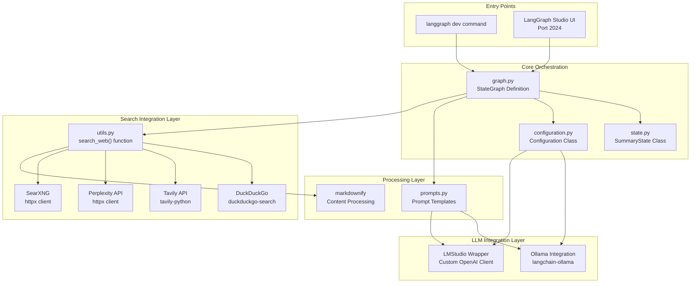

**Sources:** [README.md:1-221](), [langgraph.json](), [pyproject.toml]()

### Research Workflow State Machine

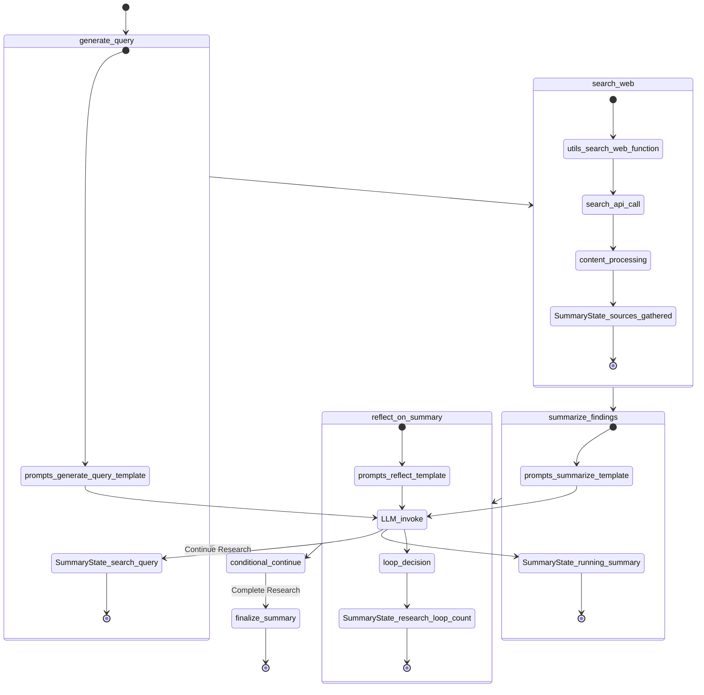

**Sources:** [README.md:165-172](), [graph.py](), [state.py](), [prompts.py](), [utils.py]()

## Core Workflow Process

The system implements an iterative research methodology inspired by IterDRAG, using a configurable loop to progressively build comprehensive research summaries.

### Research Loop Components

| Component | Code Location | Purpose |
|-----------|---------------|---------|
| Query Generation | `prompts.py` templates | Convert research topic into targeted search queries |
| Web Search | `utils.py:search_web()` | Execute searches across configured APIs |
| Content Summarization | `prompts.py` templates | Extract relevant information from search results |
| Gap Analysis | `prompts.py` reflection templates | Identify knowledge gaps for follow-up research |
| State Management | `state.py:SummaryState` | Track progress and accumulate findings |

### Configuration-Driven Behavior

The system uses a three-tier configuration hierarchy:

1. **Environment Variables** (highest priority) - [.env file]()
2. **LangGraph Studio Configuration** - Runtime UI settings  
3. **Default Values** - [`configuration.py:Configuration`]() class defaults

Key configuration parameters include:

- `LLM_PROVIDER`: Selection between `ollama` and `lmstudio`
- `SEARCH_API`: Choice of `duckduckgo`, `tavily`, `perplexity`, or `searxng`
- `MAX_WEB_RESEARCH_LOOPS`: Iteration limit (default: 3)
- `FETCH_FULL_PAGE`: Content depth control for DuckDuckGo searches

**Sources:** [README.md:30-82](), [README.md:135-141](), [configuration.py]()

## Technology Stack

### Core Framework Dependencies

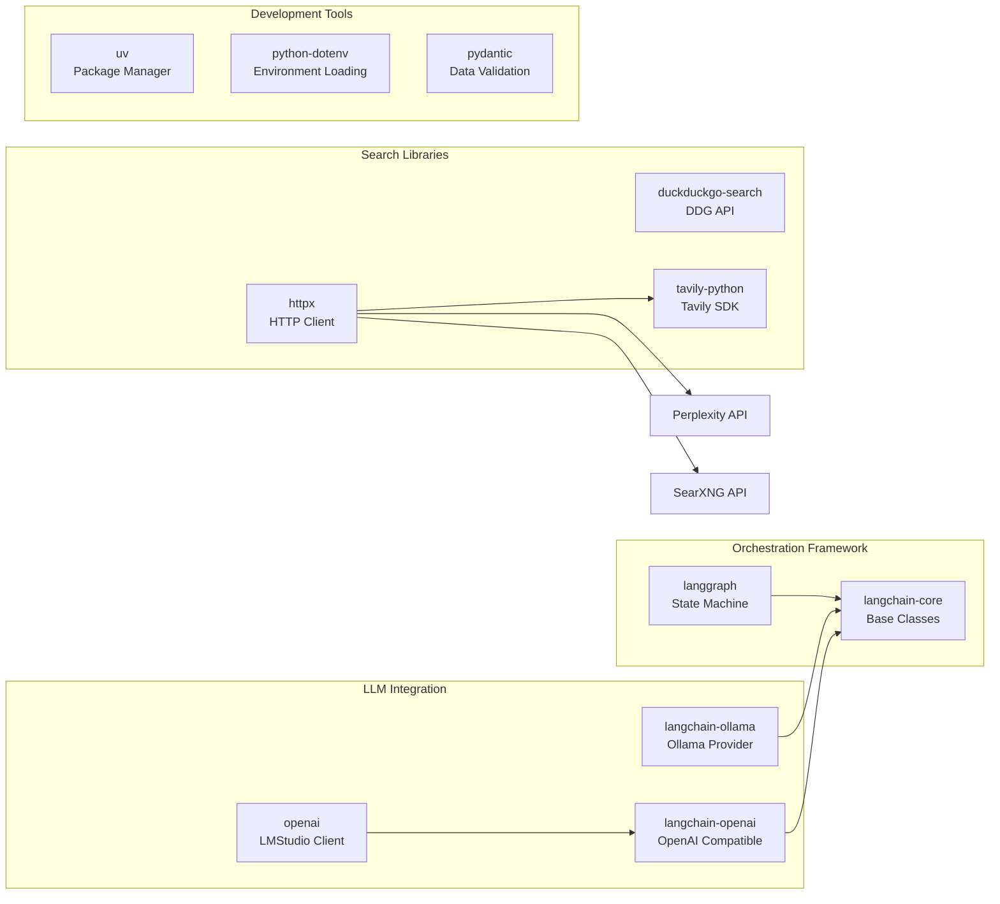

**Sources:** [pyproject.toml](), [README.md:96-98](), [README.md:116-119]()

## Key Capabilities

### Multi-Provider LLM Support

The system supports both local and cloud-based LLM providers through standardized interfaces:

- **Ollama Integration**: Direct connection to local Ollama service at `http://localhost:11434`
- **LMStudio Integration**: OpenAI-compatible API wrapper for LMStudio at `http://localhost:1234/v1`
- **Fallback Mechanisms**: Automatic handling of models with limited JSON support

### Search API Abstraction

Unified search interface supporting multiple providers:

- **DuckDuckGo**: No API key required, optional full-page content fetching
- **Tavily**: Commercial search API with structured results
- **Perplexity**: AI-powered search with Sonar API integration  
- **SearXNG**: Self-hosted metasearch engine support

### Deployment Flexibility

- **Development Mode**: `langgraph dev` command with hot reload
- **Production Deployment**: Multi-architecture Docker containers
- **CI/CD Pipeline**: Automated GitHub Actions workflows for container builds

**Sources:** [README.md:35-82](), [README.md:193-221](), [Dockerfile](), [.github/workflows/docker-image.yml]()

---

# Page: Project Structure

# Project Structure

<details>
<summary>Relevant source files</summary>

The following files were used as context for generating this wiki page:

- [pyproject.toml](pyproject.toml)
- [src/ollama_deep_researcher/__init__.py](src/ollama_deep_researcher/__init__.py)
- [uv.lock](uv.lock)

</details>


This page documents the Python package structure, dependency management, and development setup for the Local Deep Researcher project. For information about the overall system architecture and component interactions, see [System Architecture](#2). For deployment configuration details, see [Configuration](#4).

## Package Organization

The Local Deep Researcher is structured as a standard Python package using modern packaging practices with `pyproject.toml` configuration and `uv` for dependency management.

### Directory Structure

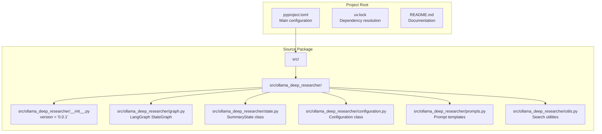

**Package Configuration**
The project uses `setuptools` as the build backend with the package located at `src/ollama_deep_researcher`. The package name is `ollama-deep-researcher` while the Python module is `ollama_deep_researcher`.

Sources: [pyproject.toml:32-39]()

## Dependencies Overview

The project has a focused set of dependencies organized around LangGraph orchestration, LLM integrations, and web search capabilities.

### Core Dependency Categories

| Category | Purpose | Key Packages |
|----------|---------|--------------|
| **Orchestration** | Workflow management and state handling | `langgraph>=0.2.55` |
| **LLM Integration** | Local and cloud LLM providers | `langchain-ollama>=0.3.6`, `langchain-openai>=0.1.1` |
| **Search APIs** | Web search capabilities | `tavily-python>=0.5.0`, `duckduckgo-search>=7.3.0` |
| **Community Tools** | Extended LangChain functionality | `langchain-community>=0.3.9` |
| **HTTP Client** | Web requests and content processing | `httpx>=0.28.1`, `markdownify>=0.11.0` |
| **Configuration** | Environment management | `python-dotenv==1.0.1` |

### Dependency Resolution Architecture

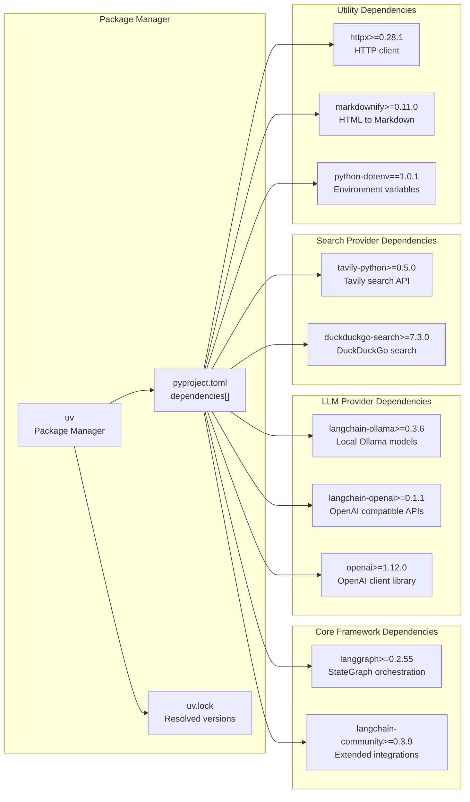

Sources: [pyproject.toml:11-23](), [uv.lock:1-10]()

## Development Environment Setup

The project uses `uv` as the primary package manager for fast dependency resolution and environment management.

### Development Dependencies

Development tools are specified in the optional dependencies section:

```python
[project.optional-dependencies]
dev = ["mypy>=1.11.1", "ruff>=0.6.1"]
```

Additional development dependencies are managed through dependency groups:

```python
[dependency-groups]
dev = ["ruff>=0.12.7"]
```

### Code Quality Configuration

The project includes comprehensive linting and formatting configuration through `ruff`:

- **Selected Rules**: `E` (pycodestyle), `F` (pyflakes), `I` (isort), `D` (pydocstyle), `T201`, `UP`
- **Documentation Style**: Google convention docstrings
- **Import Sorting**: Automatic import organization
- **Type Checking**: MyPy integration for static analysis

Sources: [pyproject.toml:25-26](), [pyproject.toml:41-68]()

## Build System Configuration

### Package Metadata

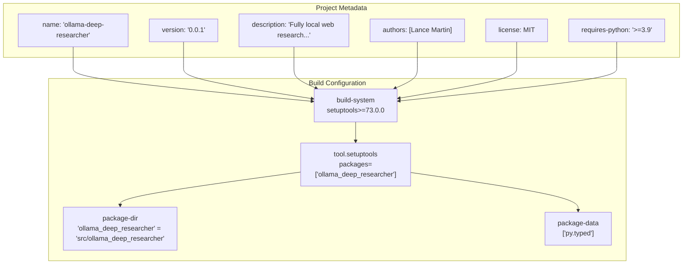

The build system uses `setuptools>=73.0.0` with `wheel` for distribution. The package includes type hints (`py.typed` marker file) for static analysis support.

### Python Version Compatibility

The project requires Python 3.9 or higher, ensuring compatibility with modern Python features while maintaining reasonable backward compatibility.

Sources: [pyproject.toml:1-10](), [pyproject.toml:28-39]()

## Lock File Management

The `uv.lock` file provides deterministic dependency resolution across environments:

- **Lock Version**: 1, Revision 3
- **Python Compatibility**: Supports Python 3.9+ with resolution markers for different versions
- **Resolved Dependencies**: 122 packages with exact version pins and cryptographic hashes
- **Platform Support**: Multi-platform wheels for macOS, Linux (various architectures), Windows, and Muslim Linux distributions

The lock file ensures reproducible builds by pinning all transitive dependencies to specific versions with integrity verification.

Sources: [uv.lock:1-10](), [uv.lock:11-121]()

---

# Page: System Architecture

# System Architecture

<details>
<summary>Relevant source files</summary>

The following files were used as context for generating this wiki page:

- [README.md](README.md)
- [src/ollama_deep_researcher/graph.py](src/ollama_deep_researcher/graph.py)

</details>


This document describes the overall system architecture of the Local Deep Researcher, focusing on the LangGraph-orchestrated research workflow, component interactions, and integration patterns. For specific implementation details of individual components, see [Core Components](#3). For configuration details, see [Configuration](#4). For deployment architecture, see [Deployment](#5).

The Local Deep Researcher implements an iterative web research system built on LangGraph's state machine framework. The architecture coordinates between local LLM providers, multiple search APIs, and a configurable workflow engine to produce comprehensive research summaries with proper citations.

## LangGraph State Machine Architecture

The core system is implemented as a LangGraph StateGraph that orchestrates the research workflow through a series of connected nodes. Each node represents a distinct phase in the research process.

### Research Workflow State Machine

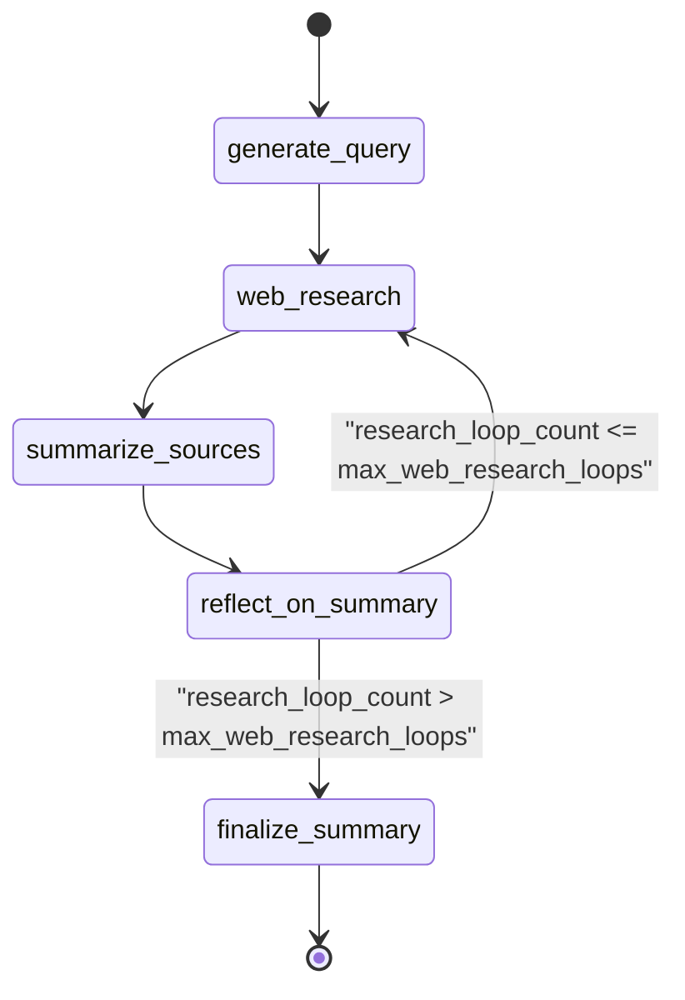

**LangGraph Node Implementation**

The StateGraph is defined in [src/ollama_deep_researcher/graph.py:445-465]() with the following node structure:

| Node | Function | Purpose |
|------|----------|---------|
| `generate_query` | [graph.py:138-189]() | Generates initial search query using LLM |
| `web_research` | [graph.py:192-262]() | Executes web search using configured API |
| `summarize_sources` | [graph.py:265-328]() | Creates/updates running summary with LLM |
| `reflect_on_summary` | [graph.py:331-384]() | Identifies knowledge gaps and generates follow-up queries |
| `finalize_summary` | [graph.py:387-418]() | Formats final output with deduplicated sources |

Sources: [src/ollama_deep_researcher/graph.py:445-465](), [src/ollama_deep_researcher/graph.py:138-418]()

### State Management Schema

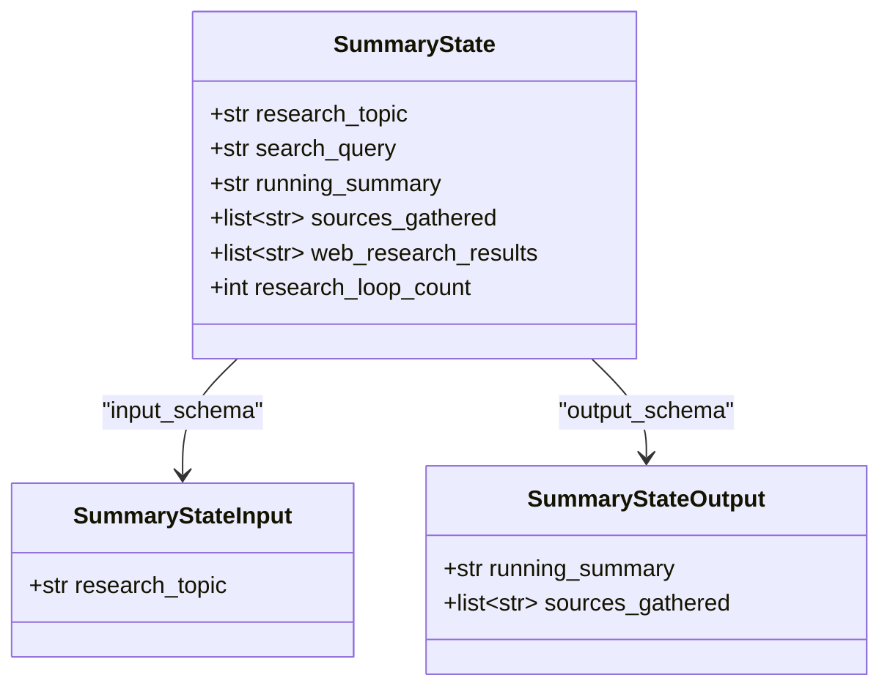

The state management system tracks research progress and accumulated data across the iterative workflow. The `SummaryState` class maintains all necessary context between node executions.

Sources: [src/ollama_deep_researcher/state.py]()

## Component Integration Architecture

The system integrates multiple external services through a configuration-driven abstraction layer that allows runtime selection of LLM providers and search APIs.

### LLM Provider Integration

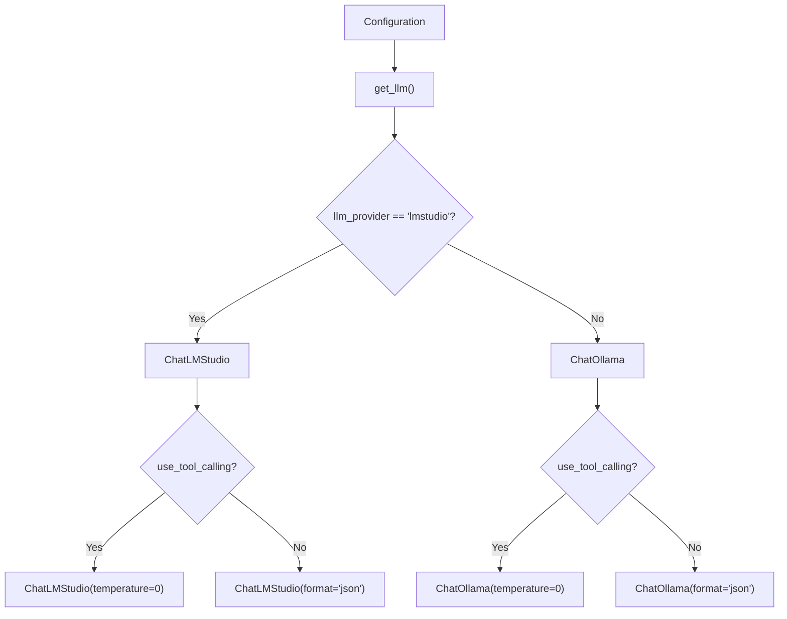

The `get_llm()` function [graph.py:97-135]() provides a unified interface for LLM instantiation, supporting both structured output modes (JSON format and tool calling) across different providers.

Sources: [src/ollama_deep_researcher/graph.py:97-135](), [src/ollama_deep_researcher/lmstudio.py]()

### Search API Integration

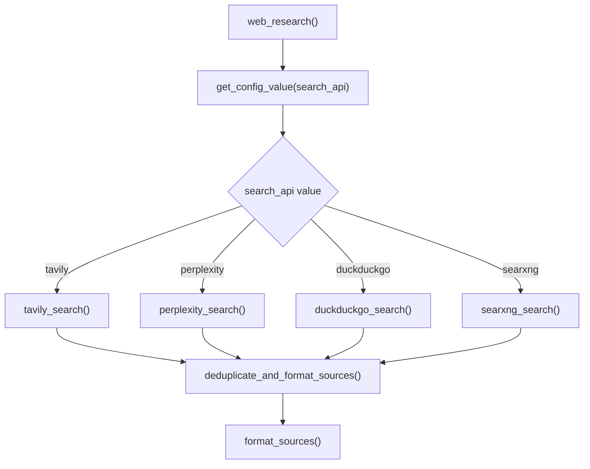

The search integration layer [graph.py:192-262]() provides a unified interface for multiple search APIs, with consistent result formatting and deduplication across all providers.

Sources: [src/ollama_deep_researcher/graph.py:192-262](), [src/ollama_deep_researcher/utils.py]()

## Structured Output Architecture

The system supports two modes for extracting structured data from LLMs: tool calling and JSON mode. This dual approach ensures compatibility across different model capabilities.

### Structured Output Flow

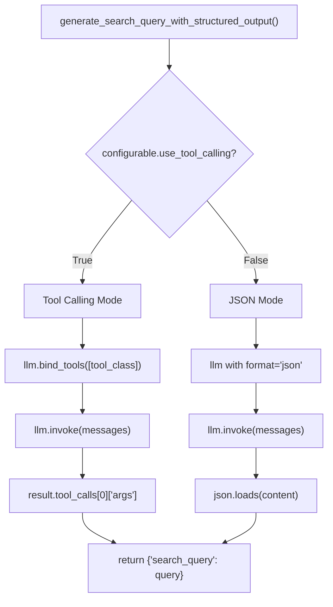

The `generate_search_query_with_structured_output()` function [graph.py:44-95]() handles both output modes with fallback mechanisms for failed extractions.

Sources: [src/ollama_deep_researcher/graph.py:44-95]()

## Configuration Integration Architecture

The system implements a three-tier configuration hierarchy that allows flexible deployment while maintaining reasonable defaults.

### Configuration Resolution Flow

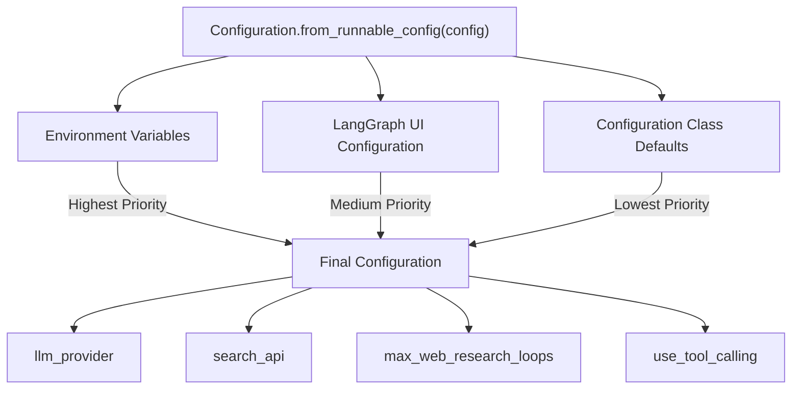

The configuration system allows runtime customization through multiple channels while ensuring the system remains functional with minimal setup.

Sources: [src/ollama_deep_researcher/configuration.py](), [README.md:135-141]()

## System Boundaries and External Dependencies

The Local Deep Researcher maintains clear boundaries between internal orchestration logic and external service dependencies.

### External Service Integration

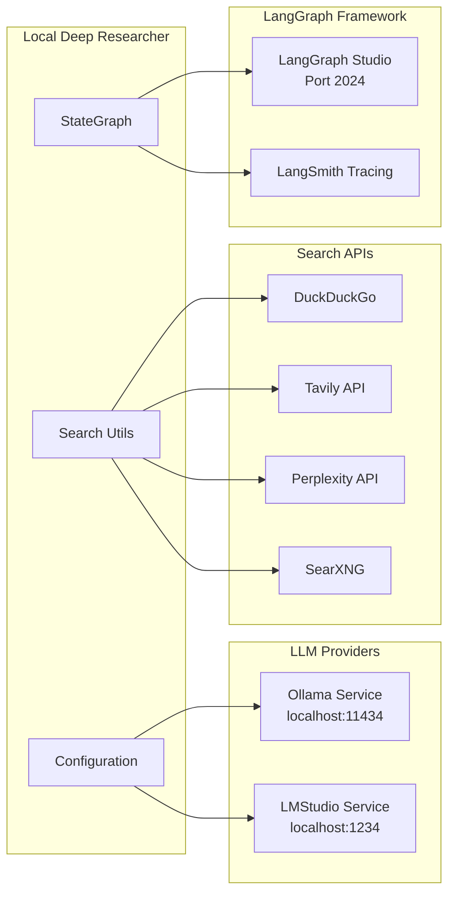

The architecture maintains loose coupling with external services through configuration-driven service selection and standardized interfaces.

Sources: [src/ollama_deep_researcher/graph.py](), [src/ollama_deep_researcher/utils.py](), [src/ollama_deep_researcher/configuration.py]()

---

# Page: Research Workflow

# Research Workflow

<details>
<summary>Relevant source files</summary>

The following files were used as context for generating this wiki page:

- [src/ollama_deep_researcher/graph.py](src/ollama_deep_researcher/graph.py)
- [src/ollama_deep_researcher/prompts.py](src/ollama_deep_researcher/prompts.py)

</details>


This document explains the iterative research workflow implemented by the Local Deep Researcher system. The workflow orchestrates web search, summarization, and reflection using a LangGraph StateGraph to progressively build comprehensive research summaries on any given topic.

For information about the underlying state management data structures, see [State Management](#2.2). For details about LLM and search API integrations used within this workflow, see [LLM Integration](#3.1) and [Search API Integration](#3.2).

## Workflow Overview

The research workflow implements an iterative research process using a `StateGraph` from LangGraph. The system starts with a user-provided research topic and progressively builds a comprehensive summary through cycles of query generation, web research, summarization, and reflection.

### Core Workflow Graph

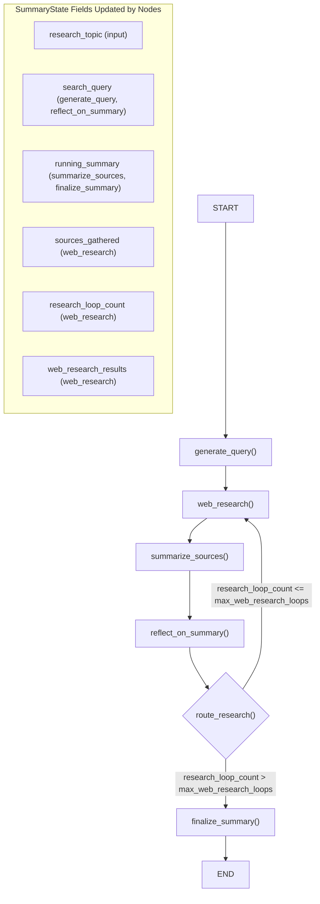

**Node Function Mapping**

| Node Name | Function | Primary State Updates |
|-----------|----------|----------------------|
| `generate_query` | `generate_query()` | `search_query` |
| `web_research` | `web_research()` | `sources_gathered`, `research_loop_count`, `web_research_results` |
| `summarize_sources` | `summarize_sources()` | `running_summary` |
| `reflect_on_summary` | `reflect_on_summary()` | `search_query` |
| `finalize_summary` | `finalize_summary()` | `running_summary` (final format) |

Sources: [src/ollama_deep_researcher/graph.py:444-465]()

## Node Implementation Details

### Query Generation Node

The `generate_query` function transforms the research topic into an optimized web search query using structured output from the LLM. It supports both tool calling and JSON mode depending on configuration.

**Query Generation with Structured Output**

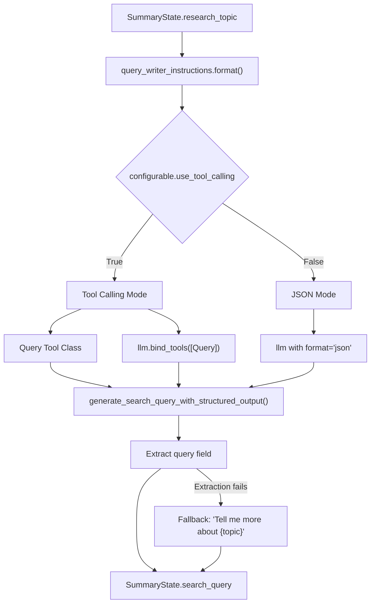

**Query Tool Definition**

The function dynamically creates a `Query` tool class with the following structure:
- `query: str` - The actual search query string
- `rationale: str` - Brief explanation of query relevance

The helper function `generate_search_query_with_structured_output` handles both output modes:
- **Tool Calling**: Uses `llm.bind_tools()` and extracts from `result.tool_calls[0]["args"]`
- **JSON Mode**: Uses `format="json"` and parses `json.loads(result.content)`

Sources: [src/ollama_deep_researcher/graph.py:44-96](), [src/ollama_deep_researcher/graph.py:138-189](), [src/ollama_deep_researcher/prompts.py:9-42]()

### Web Research Node

The `web_research` function executes web searches using the configured search API and processes the results for summarization.

| Search API | Function | Max Results | Full Page Support |
|-----------|----------|-------------|------------------|
| `tavily` | `tavily_search()` | 1 | Yes |
| `perplexity` | `perplexity_search()` | Varies | Yes |
| `duckduckgo` | `duckduckgo_search()` | 3 | Yes |
| `searxng` | `searxng_search()` | 3 | Yes |

The node updates three state fields:
- `sources_gathered`: Formatted source citations using `format_sources()`
- `research_loop_count`: Incremented counter for tracking iterations
- `web_research_results`: Deduplicated and formatted search content using `deduplicate_and_format_sources()`

Sources: [src/ollama_deep_researcher/graph.py:76-112](), [src/ollama_deep_researcher/utils.py:49-110]()

### Summarization Node

The `summarize_sources` function integrates new research results with the existing summary using LLM-based summarization. Unlike other nodes, this always uses regular mode (no structured output) since it generates prose content.

**Summarization Process**

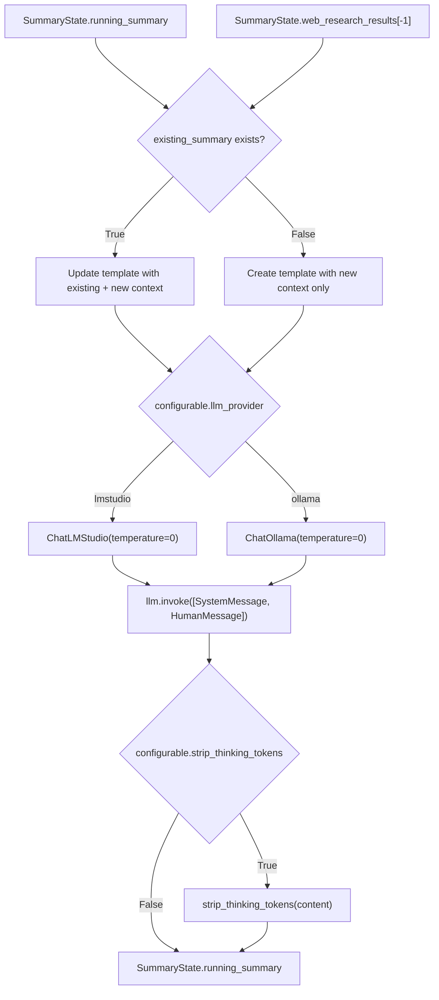

**Message Template Construction**

The function builds different human message content based on context:

| Scenario | Template Structure |
|----------|-------------------|
| **Existing Summary** | `<Existing Summary>` + `<New Context>` + Update instruction |
| **New Summary** | `<Context>` + Create instruction |

Both templates reference `SummaryState.research_topic` and use `summarizer_instructions` as the system message.

Sources: [src/ollama_deep_researcher/graph.py:265-328](), [src/ollama_deep_researcher/prompts.py:44-72]()

### Reflection Node

The `reflect_on_summary` function analyzes the current summary to identify knowledge gaps and generates follow-up search queries using structured output.

**Reflection with Structured Output**

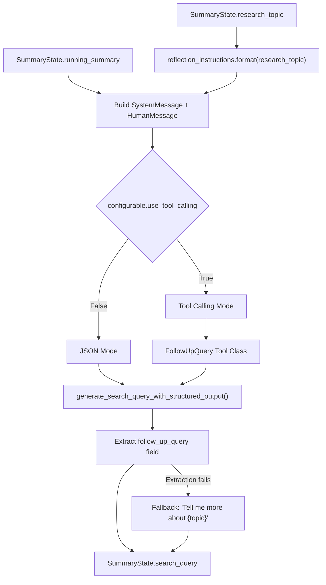

**FollowUpQuery Tool Definition**

The function creates a `FollowUpQuery` tool class with:
- `follow_up_query: str` - Specific question to address knowledge gap
- `knowledge_gap: str` - Description of missing information

The reflection uses different prompt instructions based on the output mode:
- **Tool Calling**: `tool_calling_reflection_instructions`
- **JSON Mode**: `json_mode_reflection_instructions`

Both modes analyze the existing summary content and generate targeted follow-up queries to address identified knowledge gaps.

Sources: [src/ollama_deep_researcher/graph.py:331-384](), [src/ollama_deep_researcher/prompts.py:74-112]()

## State Flow and Routing Logic

### Loop Control Mechanism

The `route_research` function controls the iterative research process by comparing the current loop count against the configured maximum.

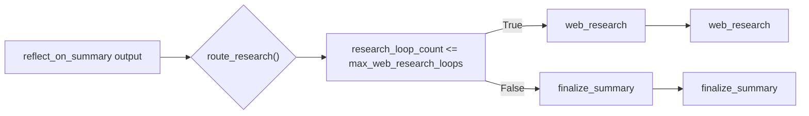

The routing function returns a `Literal["finalize_summary", "web_research"]` type to ensure type safety in the graph execution.

Sources: [src/ollama_deep_researcher/graph.py:262-280]()

### Summary Finalization

The `finalize_summary` node processes the accumulated research data into a final formatted output with deduplicated sources.

The function implements source deduplication by:
1. Creating a `seen_sources` set to track processed sources
2. Splitting each source string into individual lines
3. Adding only unique, non-empty lines to `unique_sources`
4. Formatting the final output with a structured markdown format

Sources: [src/ollama_deep_researcher/graph.py:231-260]()

## Graph Compilation and Configuration

The workflow graph is built using the `StateGraph` builder pattern with the following configuration:

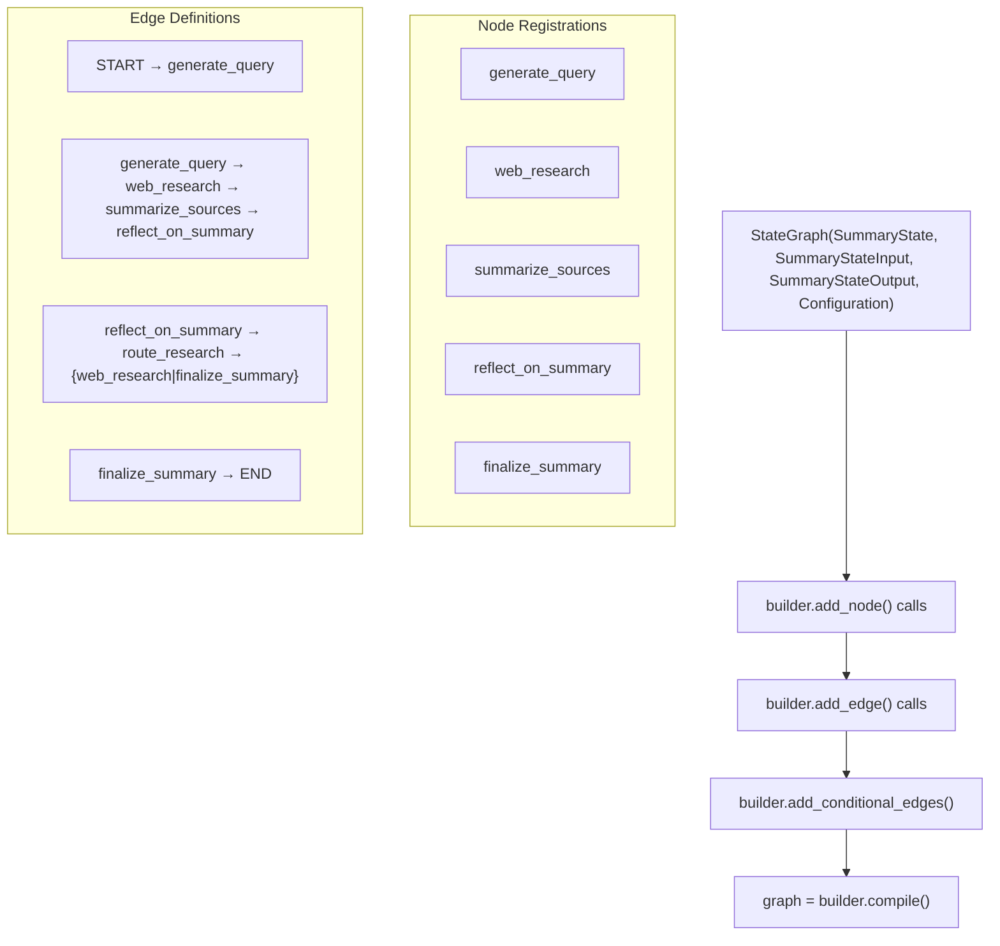

The graph uses:
- `SummaryState` as the state schema
- `SummaryStateInput` for input validation
- `SummaryStateOutput` for output formatting
- `Configuration` as the config schema for runtime configuration

Sources: [src/ollama_deep_researcher/graph.py:283-298]()

---

# Page: State Management

# State Management

<details>
<summary>Relevant source files</summary>

The following files were used as context for generating this wiki page:

- [src/ollama_deep_researcher/graph.py](src/ollama_deep_researcher/graph.py)
- [src/ollama_deep_researcher/state.py](src/ollama_deep_researcher/state.py)

</details>


This page documents how the Local Deep Researcher maintains and updates its research state throughout the iterative research process. State management is a critical component that enables the system to track progress, accumulate findings, and make decisions about the research flow. For information about the overall research workflow logic, see [Research Workflow](#2.1).

## State Structure

The Local Deep Researcher uses a dedicated state class that contains all necessary information to track a research session. The state acts as both data storage and a control mechanism for the iterative research process.

```mermaid
classDiagram
    class "SummaryState" {
        +research_topic: str
        +search_query: str
        +web_research_results: list
        +sources_gathered: list
        +research_loop_count: int
        +running_summary: str
    }

    class "SummaryStateInput" {
        +research_topic: str
    }

    class "SummaryStateOutput" {
        +running_summary: str
    }

    SummaryStateInput --> SummaryState: initializes
    SummaryState --> SummaryStateOutput: produces
```

Sources: [src/ollama_deep_researcher/state.py:6-20]()

### State Components

The `SummaryState` class has the following components:

| Field | Type | Purpose | Accumulation Method |
|-------|------|---------|---------------------|
| `research_topic` | str | The user-provided research topic | Set once at initialization |
| `search_query` | str | Current search query | Updated each research iteration |
| `web_research_results` | list | Search results from each iteration | Accumulates via `operator.add` |
| `sources_gathered` | list | Formatted sources for citation | Accumulates via `operator.add` |
| `research_loop_count` | int | Number of research iterations completed | Incremented after each search |
| `running_summary` | str | Current research summary | Updated with new findings each iteration |

The `operator.add` annotation on list fields enables automatic list merging when the state is updated, allowing search results and sources to accumulate throughout multiple research iterations.

Sources: [src/ollama_deep_researcher/state.py:6-12]()

## State Flow in the Research Graph

The state flows through a directed graph implemented using LangGraph's `StateGraph`. Each node in the graph receives the current state, performs specific operations, and returns state updates which are merged with the main state.

```mermaid
flowchart TD
    subgraph "State Flow in Research Process"
        Start["START"]
        GenQ["generate_query"]
        WebR["web_research"]
        Summ["summarize_sources"]
        Refl["reflect_on_summary"]
        Final["finalize_summary"]
        End["END"]
        
        Start --> GenQ
        GenQ -->|"Updates search_query"| WebR
        WebR -->|"Updates web_research_results,\nsources_gathered,\nresearch_loop_count"| Summ
        Summ -->|"Updates running_summary"| Refl
        Refl -->|"Updates search_query"| Route{"route_research"}
        Route -->|"research_loop_count ≤\nmax_web_research_loops"| WebR
        Route -->|"research_loop_count >\nmax_web_research_loops"| Final
        Final -->|"Formats running_summary\nwith citations"| End
    end
```

Sources: [src/ollama_deep_researcher/graph.py:282-297]()

## State Updates by Node

Each node in the graph modifies specific parts of the state:

### 1. Generate Query Node

The `generate_query` node updates the `search_query` field based on the research topic:

```mermaid
flowchart LR
    subgraph "generate_query"
        direction TB
        In["Input State"]
        LLM["LLM Query Generator"]
        Out["Output State Update"]
        
        In -->|"research_topic"| LLM
        LLM -->|"Generated query"| Out
        Out -->|"{ search_query: query }"| StateUpdate["State Update"]
    end
```

Sources: [src/ollama_deep_researcher/graph.py:17-74]()

### 2. Web Research Node

The `web_research` node executes the search query and updates three state fields:

```mermaid
flowchart LR
    subgraph "web_research"
        direction TB
        In["Input State"]
        Search["Search API"]
        Format["Format Results"]
        Out["Output State Update"]
        
        In -->|"search_query"| Search
        Search -->|"Raw results"| Format
        Format -->|"Formatted results"| Out
        Out -->|"{ sources_gathered: [formatted],\nresearch_loop_count: count+1,\nweb_research_results: [results] }"| StateUpdate["State Update"]
    end
```

Sources: [src/ollama_deep_researcher/graph.py:76-112]()

### 3. Summarize Sources Node

The `summarize_sources` node updates the running summary with new findings:

```mermaid
flowchart LR
    subgraph "summarize_sources"
        direction TB
        In["Input State"]
        Compare["Compare existing\nsummary with new data"]
        LLM["LLM Summarizer"]
        Out["Output State Update"]
        
        In -->|"running_summary,\nweb_research_results"| Compare
        Compare -->|"Context for summarization"| LLM
        LLM -->|"New/updated summary"| Out
        Out -->|"{ running_summary: summary }"| StateUpdate["State Update"]
    end
```

Sources: [src/ollama_deep_researcher/graph.py:114-175]()

### 4. Reflect on Summary Node

The `reflect_on_summary` node generates a new search query based on identified knowledge gaps:

```mermaid
flowchart LR
    subgraph "reflect_on_summary"
        direction TB
        In["Input State"]
        Analyze["Analyze current knowledge"]
        LLM["LLM Reflection"]
        Out["Output State Update"]
        
        In -->|"running_summary,\nresearch_topic"| Analyze
        Analyze -->|"Knowledge gaps"| LLM
        LLM -->|"Follow-up query"| Out
        Out -->|"{ search_query: follow_up_query }"| StateUpdate["State Update"]
    end
```

Sources: [src/ollama_deep_researcher/graph.py:177-229]()

### 5. Route Research Decision

The `route_research` function uses the state to decide whether to continue research or finalize:

```mermaid
flowchart TD
    subgraph "route_research"
        direction TB
        In["Input State"]
        Check["Check research_loop_count\nagainst max_loops"]
        Route["Route Decision"]
        
        In -->|"research_loop_count"| Check
        Check -->|"Compare to threshold"| Route
        Route -->|"research_loop_count ≤ max_loops"| WebR["Return 'web_research'"]
        Route -->|"research_loop_count > max_loops"| Final["Return 'finalize_summary'"]
    end
```

Sources: [src/ollama_deep_researcher/graph.py:262-280]()

### 6. Finalize Summary Node

The `finalize_summary` node prepares the final output by formatting the running summary with citations:

```mermaid
flowchart LR
    subgraph "finalize_summary"
        direction TB
        In["Input State"]
        Dedup["Deduplicate Sources"]
        Format["Format Final Output"]
        Out["Output State Update"]
        
        In -->|"running_summary,\nsources_gathered"| Dedup
        Dedup -->|"Unique sources"| Format
        Format -->|"Formatted summary with sources"| Out
        Out -->|"{ running_summary: formatted_summary }"| StateUpdate["State Update"]
    end
```

Sources: [src/ollama_deep_researcher/graph.py:231-260]()

## State Integration with LangGraph

The Local Deep Researcher uses LangGraph's `StateGraph` to manage state transitions between nodes. The state class is registered with the graph during initialization, along with input and output schemas:

```mermaid
flowchart TB
    subgraph "LangGraph State Integration"
        SState["SummaryState"]
        SInput["SummaryStateInput"]
        SOutput["SummaryStateOutput"]
        Config["Configuration"]
        Builder["StateGraph Builder"]
        CompiledGraph["Compiled Graph"]
        
        SState --> Builder
        SInput --> Builder
        SOutput --> Builder
        Config --> Builder
        
        Builder -->|"compile()"| CompiledGraph
        
        subgraph "Graph Definition"
            Nodes["Add Nodes"]
            Edges["Add Edges"]
            
            Nodes --> Edges
        end
        
        Graph Definition --> Builder
    end
```

Sources: [src/ollama_deep_researcher/graph.py:283-297]()

## State Reset and Initialization

For each new research session, a fresh `SummaryState` instance is created with only the `research_topic` field populated from the `SummaryStateInput`. All other fields are initialized to their default values:

- `search_query`: None
- `web_research_results`: Empty list
- `sources_gathered`: Empty list
- `research_loop_count`: 0
- `running_summary`: None

This ensures that each research session starts with a clean state.

Sources: [src/ollama_deep_researcher/state.py:6-20]()

## Data Accumulation Patterns

The state uses two primary accumulation patterns:

1. **List Accumulation**: The `web_research_results` and `sources_gathered` fields are annotated with `operator.add`, which means when these fields are updated, the new items are appended to the existing lists rather than replacing them.

2. **Progressive Refinement**: The `running_summary` field is repeatedly updated with more comprehensive information as research progresses. Each update to this field replaces the previous value, but incorporates knowledge from earlier iterations.

Sources: [src/ollama_deep_researcher/state.py:6-12](), [src/ollama_deep_researcher/graph.py:114-175]()

## Conclusion

The state management system in Local Deep Researcher enables:

1. Tracking the progress of research through multiple iterations
2. Accumulating and organizing research findings
3. Making decisions about when to continue research vs. finalize results
4. Providing context for each step in the research process
5. Ensuring a cohesive and progressive development of the final research output

The system's use of LangGraph for state management provides a structured way to handle the complex, iterative nature of the automated research process.

---

# Page: Core Components

# Core Components

<details>
<summary>Relevant source files</summary>

The following files were used as context for generating this wiki page:

- [src/ollama_deep_researcher/graph.py](src/ollama_deep_researcher/graph.py)
- [src/ollama_deep_researcher/utils.py](src/ollama_deep_researcher/utils.py)

</details>


This document provides an overview of the main functional components that enable the Local Deep Researcher's LLM-driven research capabilities. It covers the three primary component layers: LLM integration, search API integration, and prompt engineering systems that work together within the LangGraph orchestration framework.

For detailed information about specific LLM provider configurations, see [LLM Integration](#3.1). For search API implementation details, see [Search API Integration](#3.2). For prompt template specifications, see [Prompt Engineering](#3.3).

## Architecture Overview

The Local Deep Researcher is built around three core functional layers that integrate within a LangGraph state machine to provide automated research capabilities.

```mermaid
graph TB
    subgraph "LangGraph Orchestration Layer"
        GQ["generate_query()"]
        WR["web_research()"] 
        SS["summarize_sources()"]
        ROS["reflect_on_summary()"]
        FS["finalize_summary()"]
        RR["route_research()"]
    end
    
    subgraph "LLM Integration Layer"
        GLM["get_llm()"]
        CO["ChatOllama"]
        CLM["ChatLMStudio"]
        GSQSO["generate_search_query_with_structured_output()"]
    end
    
    subgraph "Search Integration Layer"  
        TS["tavily_search()"]
        PS["perplexity_search()"]
        DS["duckduckgo_search()"]
        SS_SEARCH["searxng_search()"]
        DAFS["deduplicate_and_format_sources()"]
        FRC["fetch_raw_content()"]
    end
    
    subgraph "Prompt Engineering Layer"
        QWI["query_writer_instructions"]
        SI["summarizer_instructions"] 
        RI["reflection_instructions"]
        JMQI["json_mode_query_instructions"]
        TCQI["tool_calling_query_instructions"]
    end
    
    subgraph "Configuration & State"
        CONFIG["Configuration"]
        STATE["SummaryState"]
        GCV["get_config_value()"]
    end
    
    GQ --> GLM
    GQ --> QWI
    GQ --> GSQSO
    WR --> TS
    WR --> PS  
    WR --> DS
    WR --> SS_SEARCH
    WR --> DAFS
    SS --> GLM
    SS --> SI
    ROS --> GLM
    ROS --> RI
    ROS --> GSQSO
    
    GLM --> CO
    GLM --> CLM
    
    TS --> FRC
    DS --> FRC
    SS_SEARCH --> FRC
    
    CONFIG --> GCV
    STATE --> CONFIG
```

**Sources:** [src/ollama_deep_researcher/graph.py:1-466](), [src/ollama_deep_researcher/utils.py:1-388]()

## LLM Integration Components

The system provides a unified interface for interacting with local LLM providers through the `get_llm()` function, which abstracts the differences between Ollama and LMStudio configurations.

| Component | Purpose | Key Methods |
|-----------|---------|-------------|
| `get_llm()` | LLM provider factory | Returns configured `ChatOllama` or `ChatLMStudio` |
| `ChatOllama` | Ollama integration | Standard LangChain Ollama wrapper |
| `ChatLMStudio` | LMStudio integration | Custom wrapper for LMStudio API |
| `generate_search_query_with_structured_output()` | Structured output handler | Manages tool calling vs JSON mode |

The LLM integration supports two operational modes:
- **Tool Calling Mode**: Uses LangChain's tool binding for structured outputs
- **JSON Mode**: Uses format="json" parameter for models without tool calling support

**Sources:** [src/ollama_deep_researcher/graph.py:97-136](), [src/ollama_deep_researcher/graph.py:44-96]()

## Search Integration Components

The search layer provides a unified interface across multiple web search APIs, with consistent result formatting and optional full-page content fetching.

```mermaid
graph LR
    subgraph "Search API Functions"
        TAVILY["tavily_search()"]
        PERP["perplexity_search()"]  
        DDG["duckduckgo_search()"]
        SEARX["searxng_search()"]
    end
    
    subgraph "Processing Functions"
        DAFS["deduplicate_and_format_sources()"]
        FS["format_sources()"]
        FRC["fetch_raw_content()"]
        STT["strip_thinking_tokens()"]
    end
    
    subgraph "External Libraries"
        TC["TavilyClient"]
        DDGS["DDGS"]
        SSW["SearxSearchWrapper"] 
        HTTPX["httpx.Client"]
        REQUESTS["requests"]
    end
    
    subgraph "Return Format"
        RESULTS["{'results': [{'title': str, 'url': str, 'content': str, 'raw_content': str}]}"]
    end
    
    TAVILY --> TC
    DDG --> DDGS
    SEARX --> SSW
    PERP --> REQUESTS
    
    TAVILY --> DAFS
    PERP --> DAFS
    DDG --> DAFS
    SEARX --> DAFS
    
    FRC --> HTTPX
    DDG --> FRC
    SEARX --> FRC
    
    DAFS --> RESULTS
    FS --> RESULTS
```

Each search function returns a standardized dictionary format with `results` containing title, URL, content snippet, and optional raw content from full page fetches.

**Sources:** [src/ollama_deep_researcher/utils.py:165-388](), [src/ollama_deep_researcher/utils.py:55-121]()

## Prompt Engineering Components

The prompt system uses template-based instructions that adapt based on the LLM's capabilities (tool calling vs JSON mode).

| Template | Purpose | Mode Support |
|----------|---------|--------------|
| `query_writer_instructions` | Initial search query generation | Both |
| `summarizer_instructions` | Content summarization | Text only |
| `reflection_instructions` | Knowledge gap analysis | Both |
| `json_mode_query_instructions` | JSON format guidance | JSON mode |
| `tool_calling_query_instructions` | Tool calling guidance | Tool calling |

The system dynamically selects appropriate instruction templates based on the `use_tool_calling` configuration flag and appends mode-specific formatting instructions.

**Sources:** [src/ollama_deep_researcher/graph.py:28-37](), [src/ollama_deep_researcher/graph.py:172-178]()

## LangGraph Orchestration Layer

The core research workflow is implemented as LangGraph nodes that coordinate between the component layers to execute the iterative research process.

```mermaid
stateDiagram-v2
    [*] --> generate_query
    generate_query --> web_research
    web_research --> summarize_sources
    summarize_sources --> reflect_on_summary
    reflect_on_summary --> route_research
    route_research --> web_research : research_loop_count <= max_loops
    route_research --> finalize_summary : research_loop_count > max_loops
    finalize_summary --> [*]
    
    note right of generate_query : Uses query_writer_instructions + LLM
    note right of web_research : Uses configured search API
    note right of summarize_sources : Uses summarizer_instructions + LLM  
    note right of reflect_on_summary : Uses reflection_instructions + LLM
    note right of route_research : Checks research_loop_count vs config
    note right of finalize_summary : Formats sources + summary
```

Each node operates on the `SummaryState` object and uses the `Configuration` to determine which components to invoke for LLM and search operations.

**Sources:** [src/ollama_deep_researcher/graph.py:138-465](), [src/ollama_deep_researcher/graph.py:421-442]()

## Data Processing Pipeline

The system processes research data through a standardized pipeline that maintains consistency across different search APIs and LLM providers.

```mermaid
flowchart TD
    INPUT["User Research Topic"] --> GQ["generate_query()"]
    GQ --> SEARCH_QUERY["search_query: str"]
    SEARCH_QUERY --> WR["web_research()"]
    WR --> RAW_RESULTS["Raw Search Results"]
    RAW_RESULTS --> DAFS["deduplicate_and_format_sources()"]
    DAFS --> FORMATTED["Formatted Sources String"]
    FORMATTED --> SS["summarize_sources()"]
    SS --> SUMMARY["running_summary: str"]
    SUMMARY --> ROS["reflect_on_summary()"]
    ROS --> FOLLOWUP["follow_up_query: str"]
    FOLLOWUP --> RR["route_research()"]
    RR --> CONTINUE{Continue Research?}
    CONTINUE -->|Yes| WR
    CONTINUE -->|No| FS["finalize_summary()"]
    FS --> OUTPUT["Final Report with Sources"]
    
    subgraph "State Tracking"
        STATE["SummaryState tracks:<br/>• research_topic<br/>• search_query<br/>• running_summary<br/>• sources_gathered<br/>• research_loop_count<br/>• web_research_results"]
    end
    
    GQ -.-> STATE
    WR -.-> STATE  
    SS -.-> STATE
    ROS -.-> STATE
```

The pipeline maintains state consistency through the `SummaryState` object, which accumulates research progress and enables the iterative refinement process.

**Sources:** [src/ollama_deep_researcher/graph.py:192-262](), [src/ollama_deep_researcher/graph.py:265-328](), [src/ollama_deep_researcher/utils.py:55-121]()

---

# Page: LLM Integration

# LLM Integration

<details>
<summary>Relevant source files</summary>

The following files were used as context for generating this wiki page:

- [src/ollama_deep_researcher/configuration.py](src/ollama_deep_researcher/configuration.py)
- [src/ollama_deep_researcher/graph.py](src/ollama_deep_researcher/graph.py)
- [src/ollama_deep_researcher/lmstudio.py](src/ollama_deep_researcher/lmstudio.py)

</details>


The LLM Integration component manages the system's integration with local Large Language Model providers, specifically Ollama and LMStudio. This module handles LLM instantiation, configuration-based provider selection, and structured output generation using either JSON mode or tool calling approaches.

For information about how LLMs are used within the research workflow, see [Research Workflow](#2.1). For prompt engineering and templates, see [Prompt Engineering](#3.3).

## LLM Provider Architecture

The system supports two local LLM providers through a unified interface, allowing runtime selection based on configuration. Both providers use standardized LangChain chat interfaces while maintaining provider-specific optimizations.

### Provider Selection Flow

```mermaid
flowchart TD
    config["Configuration.llm_provider"] --> decision{"Provider Type?"}
    decision -->|"ollama"| ollama_path["ChatOllama Instantiation"]
    decision -->|"lmstudio"| lmstudio_path["ChatLMStudio Instantiation"]
    
    ollama_path --> mode_check1{"use_tool_calling?"}
    lmstudio_path --> mode_check2{"use_tool_calling?"}
    
    mode_check1 -->|true| ollama_tools["ChatOllama<br/>temperature=0"]
    mode_check1 -->|false| ollama_json["ChatOllama<br/>temperature=0<br/>format='json'"]
    
    mode_check2 -->|true| lmstudio_tools["ChatLMStudio<br/>temperature=0"]
    mode_check2 -->|false| lmstudio_json["ChatLMStudio<br/>temperature=0<br/>format='json'"]
    
    ollama_tools --> llm_instance["LLM Instance"]
    ollama_json --> llm_instance
    lmstudio_tools --> llm_instance
    lmstudio_json --> llm_instance
```

Sources: [src/ollama_deep_researcher/graph.py:97-135]()

### Configuration Parameters

The LLM integration is controlled by several configuration parameters that determine provider selection and behavior:

| Parameter | Type | Default | Description |
|-----------|------|---------|-------------|
| `llm_provider` | Literal["ollama", "lmstudio"] | "ollama" | Selects the LLM provider |
| `local_llm` | str | "llama3.2" | Model name to use |
| `ollama_base_url` | str | "http://localhost:11434/" | Ollama API endpoint |
| `lmstudio_base_url` | str | "http://localhost:1234/v1" | LMStudio API endpoint |
| `use_tool_calling` | bool | False | Enables tool calling vs JSON mode |

Sources: [src/ollama_deep_researcher/configuration.py:24-61]()

## Provider Implementation Details

### Ollama Integration

The Ollama integration uses the `ChatOllama` class from the `langchain-ollama` package, providing direct integration with Ollama's native API. The system configures temperature to 0 for deterministic outputs and conditionally enables JSON mode.

```mermaid
classDiagram
    class ChatOllama {
        +base_url: str
        +model: str
        +temperature: int
        +format: Optional[str]
        +invoke(messages)
    }
    
    class get_llm {
        +configurable: Configuration
        +returns: ChatOllama | ChatLMStudio
    }
    
    get_llm --> ChatOllama : "instantiates when llm_provider='ollama'"
    ChatOllama --> "Ollama API" : "communicates via base_url"
```

Sources: [src/ollama_deep_researcher/graph.py:122-135]()

### LMStudio Integration

The LMStudio integration uses a custom `ChatLMStudio` class that wraps `ChatOpenAI` to work with LMStudio's OpenAI-compatible API. This wrapper adds JSON mode support and response cleaning functionality.

```mermaid
classDiagram
    class ChatOpenAI {
        +base_url: str
        +model: str
        +temperature: float
        +api_key: str
        +_generate(messages)
    }
    
    class ChatLMStudio {
        +format: Optional[str]
        +__init__(base_url, model, temperature, format, api_key)
        +_generate(messages, stop, run_manager, kwargs)
    }
    
    ChatLMStudio --|> ChatOpenAI : "inherits from"
    ChatLMStudio --> "LMStudio API" : "communicates via OpenAI-compatible endpoint"
```

The `ChatLMStudio` class provides several key features:

- **JSON Mode Support**: Automatically sets `response_format` to `{"type": "json_object"}` when `format="json"`
- **Response Cleaning**: Extracts valid JSON from model responses that may contain additional text
- **Error Handling**: Falls back to original response if JSON extraction fails
- **Logging**: Provides detailed logging for debugging JSON parsing issues

Sources: [src/ollama_deep_researcher/lmstudio.py:19-98]()

## Structured Output Generation

The system supports two approaches for generating structured output from LLMs, with runtime selection based on the `use_tool_calling` configuration parameter.

### Tool Calling Mode

When `use_tool_calling=True`, the system uses LangChain's tool calling capabilities with Pydantic models to define the expected output structure:

```mermaid
sequenceDiagram
    participant Node as "Graph Node"
    participant LLM as "LLM Instance"
    participant Tool as "Pydantic Tool"
    
    Node->>LLM: bind_tools([tool_class])
    Node->>LLM: invoke(messages)
    LLM->>Node: result.tool_calls[0]["args"]
    Node->>Node: extract field from tool_data
```

Sources: [src/ollama_deep_researcher/graph.py:65-77]()

### JSON Mode

When `use_tool_calling=False`, the system uses JSON mode with manual parsing:

```mermaid
sequenceDiagram
    participant Node as "Graph Node" 
    participant LLM as "LLM Instance"
    participant Parser as "JSON Parser"
    
    Node->>LLM: invoke(messages) with format="json"
    LLM->>Node: result.content (JSON string)
    Node->>Parser: json.loads(content)
    Parser->>Node: parsed_json[field_name]
    Note over Node: Falls back to strip_thinking_tokens if parsing fails
```

Sources: [src/ollama_deep_researcher/graph.py:79-95]()

## Usage in Research Workflow

The LLM integration is used throughout the research workflow in three main contexts, each with different requirements for structured output:

### Query Generation

Uses structured output to generate search queries with rationale:

- **Tool Calling**: Uses `Query` tool with `query` and `rationale` fields
- **JSON Mode**: Expects JSON with `query` field
- **Fallback**: Returns default query based on research topic

Sources: [src/ollama_deep_researcher/graph.py:138-189]()

### Source Summarization

Uses unstructured output for natural language summary generation. Always uses regular mode (no JSON/tool calling) regardless of configuration:

```mermaid
flowchart LR
    state["SummaryState"] --> messages["SystemMessage + HumanMessage"]
    messages --> llm["LLM.invoke()"]
    llm --> content["result.content"]
    content --> strip["strip_thinking_tokens()"]
    strip --> summary["running_summary"]
```

Sources: [src/ollama_deep_researcher/graph.py:265-328]()

### Reflection and Follow-up

Uses structured output to identify knowledge gaps and generate follow-up queries:

- **Tool Calling**: Uses `FollowUpQuery` tool with `follow_up_query` and `knowledge_gap` fields  
- **JSON Mode**: Expects JSON with `follow_up_query` field
- **Fallback**: Returns default query for continued research

Sources: [src/ollama_deep_researcher/graph.py:331-384]()

## Configuration Integration

The LLM integration seamlessly integrates with the system's three-tier configuration approach:

1. **Environment Variables**: Override via `LLM_PROVIDER`, `LOCAL_LLM`, `OLLAMA_BASE_URL`, etc.
2. **LangGraph Configuration**: Set via the configurable fields in LangGraph Studio
3. **Defaults**: Fallback to sensible defaults in the `Configuration` class

The `Configuration.from_runnable_config()` method handles this precedence and provides the configuration to the `get_llm()` function for provider instantiation.

Sources: [src/ollama_deep_researcher/configuration.py:63-81](), [src/ollama_deep_researcher/graph.py:97-135]()

---

# Page: Search API Integration

# Search API Integration

<details>
<summary>Relevant source files</summary>

The following files were used as context for generating this wiki page:

- [src/ollama_deep_researcher/graph.py](src/ollama_deep_researcher/graph.py)
- [src/ollama_deep_researcher/utils.py](src/ollama_deep_researcher/utils.py)

</details>


## Purpose and Scope

This document covers the search API integration layer of the Local Deep Researcher system, which provides a unified abstraction for querying multiple web search services. The system supports DuckDuckGo, Tavily, Perplexity, and SearXNG APIs through a common interface that standardizes search results and content processing.

For information about how search results are processed within the research workflow, see [Research Workflow](#2.1). For configuration of search API credentials and settings, see [Environment Variables](#4.1).

## Search API Architecture

The search integration layer implements a pluggable architecture where different search providers can be selected at runtime through configuration. All search APIs return results in a standardized format that enables consistent processing downstream.

```mermaid
graph TB
    subgraph "Search API Selection"
        web_research["web_research()"]
        get_config_value["get_config_value()"]
        search_api_config["configurable.search_api"]
    end
    
    subgraph "Search Implementations"
        tavily_search["tavily_search()"]
        perplexity_search["perplexity_search()"]
        duckduckgo_search["duckduckgo_search()"]
        searxng_search["searxng_search()"]
    end
    
    subgraph "External APIs"
        TavilyClient["TavilyClient"]
        DDGS["DDGS"]
        PerplexityAPI["Perplexity API"]
        SearxSearchWrapper["SearxSearchWrapper"]
    end
    
    subgraph "Processing Layer"
        deduplicate_and_format_sources["deduplicate_and_format_sources()"]
        format_sources["format_sources()"]
        fetch_raw_content["fetch_raw_content()"]
    end
    
    web_research --> get_config_value
    get_config_value --> search_api_config
    search_api_config --> tavily_search
    search_api_config --> perplexity_search  
    search_api_config --> duckduckgo_search
    search_api_config --> searxng_search
    
    tavily_search --> TavilyClient
    perplexity_search --> PerplexityAPI
    duckduckgo_search --> DDGS
    searxng_search --> SearxSearchWrapper
    
    tavily_search --> deduplicate_and_format_sources
    perplexity_search --> deduplicate_and_format_sources
    duckduckgo_search --> deduplicate_and_format_sources
    searxng_search --> deduplicate_and_format_sources
    
    deduplicate_and_format_sources --> fetch_raw_content
    tavily_search --> format_sources
    perplexity_search --> format_sources
    duckduckgo_search --> format_sources
    searxng_search --> format_sources
```

**Sources:** [src/ollama_deep_researcher/graph.py:192-262](), [src/ollama_deep_researcher/utils.py:17-33]()

## Search API Implementations

### Tavily Search

The `tavily_search()` function provides integration with the Tavily API, which specializes in AI-optimized web search with built-in content extraction capabilities.

| Feature | Implementation | Configuration |
|---------|---------------|---------------|
| API Client | `TavilyClient` | Requires `TAVILY_API_KEY` environment variable |
| Content Extraction | Built-in raw content support | `include_raw_content` parameter |
| Result Limit | Configurable via `max_results` | Default: 3 results |
| Timeout | Handled by Tavily client | N/A |

```mermaid
flowchart TD
    tavily_search["tavily_search(query, fetch_full_page, max_results)"]
    TavilyClient["TavilyClient()"]
    search_call["client.search(query, max_results, include_raw_content)"]
    results["{'results': [{'title', 'url', 'content', 'raw_content'}]}"]
    
    tavily_search --> TavilyClient
    TavilyClient --> search_call
    search_call --> results
```

**Sources:** [src/ollama_deep_researcher/utils.py:277-306]()

### DuckDuckGo Search  

The `duckduckgo_search()` function uses the `DDGS` library to perform privacy-focused web searches without requiring API keys.

| Feature | Implementation | Configuration |
|---------|---------------|---------------|
| API Client | `DDGS` from `duckduckgo-search` | No API key required |
| Content Extraction | Manual via `fetch_raw_content()` | Optional full page fetching |
| Result Limit | Configurable via `max_results` | Default: 3 results |
| Timeout | 10 seconds via `httpx.Client` | Hardcoded in `fetch_raw_content()` |

```mermaid
flowchart TD
    duckduckgo_search["duckduckgo_search(query, max_results, fetch_full_page)"]
    DDGS_context["DDGS() context manager"]
    ddgs_text["ddgs.text(query, max_results)"]
    fetch_raw_content["fetch_raw_content(url)"] 
    httpx_client["httpx.Client(timeout=10.0)"]
    markdownify["markdownify(response.text)"]
    
    duckduckgo_search --> DDGS_context
    DDGS_context --> ddgs_text
    duckduckgo_search --> fetch_raw_content
    fetch_raw_content --> httpx_client
    httpx_client --> markdownify
```

**Sources:** [src/ollama_deep_researcher/utils.py:165-220](), [src/ollama_deep_researcher/utils.py:141-163]()

### Perplexity Search

The `perplexity_search()` function integrates with Perplexity's `sonar-pro` model for AI-enhanced search with automatic summarization.

| Feature | Implementation | Configuration |
|---------|---------------|---------------|
| API Client | Direct HTTP requests via `requests` | Requires `PERPLEXITY_API_KEY` environment variable |
| Content Format | AI-generated summary with citations | Fixed system prompt |
| Result Structure | Single content with multiple citations | Loop count tracking for source labeling |
| Error Handling | `response.raise_for_status()` | HTTP error exceptions |

**Sources:** [src/ollama_deep_researcher/utils.py:309-387]()

### SearXNG Search

The `searxng_search()` function connects to self-hosted SearXNG instances for privacy-focused metasearch capabilities.

| Feature | Implementation | Configuration |
|---------|---------------|---------------|
| API Client | `SearxSearchWrapper` from LangChain | `SEARXNG_URL` environment variable |
| Default Host | `http://localhost:8888` | Configurable via environment |
| Content Extraction | Manual via `fetch_raw_content()` | Optional full page fetching |
| Result Processing | Similar to DuckDuckGo pattern | Standard result format |

**Sources:** [src/ollama_deep_researcher/utils.py:222-274]()

## Unified Data Flow

The search integration layer provides a consistent data flow regardless of which search API is selected. All search functions return results in the same standardized format.

```mermaid
graph LR
    subgraph "Input Processing"
        search_query["state.search_query"]
        configurable_search_api["configurable.search_api"]
        fetch_full_page["configurable.fetch_full_page"]
    end
    
    subgraph "API Selection Logic"
        get_config_value_call["get_config_value(configurable.search_api)"]
        api_routing["if/elif routing logic"]
    end
    
    subgraph "Search Execution"
        selected_api["Selected search function"]
        search_results["search_results"]
    end
    
    subgraph "Result Processing"
        deduplicate_and_format_sources_call["deduplicate_and_format_sources()"]
        format_sources_call["format_sources()"]
        search_str["search_str (formatted)"]
        sources_gathered["sources_gathered (citations)"]
    end
    
    search_query --> selected_api
    configurable_search_api --> get_config_value_call
    get_config_value_call --> api_routing
    api_routing --> selected_api
    fetch_full_page --> selected_api
    
    selected_api --> search_results
    search_results --> deduplicate_and_format_sources_call
    search_results --> format_sources_call
    deduplicate_and_format_sources_call --> search_str
    format_sources_call --> sources_gathered
```

**Sources:** [src/ollama_deep_researcher/graph.py:206-262]()

## Standardized Result Format

All search APIs return results conforming to a common data structure that enables consistent downstream processing.

### Standard Result Schema

```python
{
    "results": [
        {
            "title": str,        # Title of the search result
            "url": str,          # URL of the source
            "content": str,      # Summary/snippet content  
            "raw_content": str   # Full page content (optional)
        }
    ]
}
```

### Content Processing Pipeline

The `deduplicate_and_format_sources()` function processes search results through several stages:

| Stage | Function | Purpose |
|-------|----------|---------|
| Input Normalization | Type checking and conversion | Handle both single dict and list inputs |
| Deduplication | URL-based uniqueness | Remove duplicate sources across searches |
| Content Limiting | Token-based truncation | Limit content to `max_tokens_per_source` |
| Formatting | Structured output | Create consistent text format for LLM processing |

**Sources:** [src/ollama_deep_researcher/utils.py:55-121]()

## Configuration and API Selection

The search API selection is controlled through the configuration system, with runtime routing handled by the `web_research()` node in the LangGraph workflow.

### API Selection Logic

```mermaid
graph TD
    get_config_value["get_config_value(configurable.search_api)"]
    tavily_check["search_api == 'tavily'"]
    perplexity_check["search_api == 'perplexity'"] 
    duckduckgo_check["search_api == 'duckduckgo'"]
    searxng_check["search_api == 'searxng'"]
    error_case["ValueError: Unsupported search API"]
    
    get_config_value --> tavily_check
    tavily_check -->|Yes| tavily_search
    tavily_check -->|No| perplexity_check
    perplexity_check -->|Yes| perplexity_search
    perplexity_check -->|No| duckduckgo_check
    duckduckgo_check -->|Yes| duckduckgo_search
    duckduckgo_check -->|No| searxng_check
    searxng_check -->|Yes| searxng_search
    searxng_check -->|No| error_case
```

### Configuration Parameters

| Parameter | Type | Default | Purpose |
|-----------|------|---------|---------|
| `search_api` | `SearchAPI` enum | Set via configuration | Selects which search provider to use |
| `fetch_full_page` | `bool` | `False` | Controls whether to fetch complete page content |
| `max_results` | `int` | Varies by API | Limits number of search results returned |

**Sources:** [src/ollama_deep_researcher/graph.py:206-256](), [src/ollama_deep_researcher/utils.py:17-33]()

## Content Fetching and Processing

The system provides optional full-page content fetching for enhanced research depth, implemented through the `fetch_raw_content()` function.

### Content Fetching Features

- **Timeout Management**: 10-second timeout prevents hanging on slow sites
- **Markdown Conversion**: HTML content converted via `markdownify` library  
- **Error Handling**: Graceful degradation when content fetching fails
- **Token Limiting**: Content truncated based on `max_tokens_per_source` configuration

### Content Processing Flow

```mermaid
sequenceDiagram
    participant "Search Function" as SF
    participant "fetch_raw_content()" as FRC
    participant "httpx.Client" as HTTP
    participant "markdownify" as MD
    
    SF->>FRC: fetch_raw_content(url)
    FRC->>HTTP: client.get(url) with 10s timeout
    HTTP-->>FRC: HTML response
    FRC->>MD: markdownify(response.text)
    MD-->>FRC: Markdown content
    FRC-->>SF: Processed content or None on error
```

**Sources:** [src/ollama_deep_researcher/utils.py:141-163]()

---

# Page: Prompt Engineering

# Prompt Engineering

<details>
<summary>Relevant source files</summary>

The following files were used as context for generating this wiki page:

- [src/ollama_deep_researcher/prompts.py](src/ollama_deep_researcher/prompts.py)

</details>


This document covers the prompt templates and engineering strategies used throughout the Local Deep Researcher system. The prompts coordinate with LLM providers to generate structured outputs for query generation, content summarization, and research reflection. For information about LLM provider integration, see [LLM Integration](#3.1). For details on the overall research workflow that utilizes these prompts, see [Research Workflow](#2.1).

## Prompt Architecture Overview

The Local Deep Researcher employs a three-stage prompt engineering approach aligned with its iterative research workflow. Each stage uses specialized prompt templates designed to produce structured outputs that drive the research process forward.

```mermaid
flowchart TD
    RESEARCH_TOPIC["research_topic"] --> QUERY_STAGE["Query Generation Stage"]
    QUERY_STAGE --> SEARCH_RESULTS["search_results"]
    SEARCH_RESULTS --> SUMMARY_STAGE["Summarization Stage"]
    SUMMARY_STAGE --> REFLECTION_STAGE["Reflection Stage"]
    REFLECTION_STAGE --> LOOP_DECISION{"Continue Research?"}
    LOOP_DECISION -->|Yes| QUERY_STAGE
    LOOP_DECISION -->|No| FINAL_OUTPUT["Final Research Report"]
    
    subgraph "Prompt Templates"
        QUERY_PROMPTS["query_writer_instructions<br/>json_mode_query_instructions<br/>tool_calling_query_instructions"]
        SUMMARY_PROMPTS["summarizer_instructions"]
        REFLECTION_PROMPTS["reflection_instructions<br/>json_mode_reflection_instructions<br/>tool_calling_reflection_instructions"]
    end
    
    QUERY_STAGE --> QUERY_PROMPTS
    SUMMARY_STAGE --> SUMMARY_PROMPTS
    REFLECTION_STAGE --> REFLECTION_PROMPTS
```

**Sources:** [src/ollama_deep_researcher/prompts.py:1-112]()

## Query Generation Prompts

The query generation stage transforms research topics into targeted web search queries using contextual prompts that account for current dates and provide clear formatting expectations.

### Base Query Instructions

The `query_writer_instructions` template provides the foundational structure for query generation:

| Component | Purpose | Implementation |
|-----------|---------|----------------|
| Context Block | Provides current date awareness | Uses `get_current_date()` function |
| Topic Block | Injects research topic | Template variable `{research_topic}` |
| Example Block | Demonstrates expected output format | JSON structure with `query` and `rationale` |

```mermaid
graph LR
    RESEARCH_TOPIC["{research_topic}"] --> CONTEXT_INJECTION["CONTEXT Block<br/>current_date injection"]
    CONTEXT_INJECTION --> TOPIC_INJECTION["TOPIC Block<br/>research_topic injection"]
    TOPIC_INJECTION --> EXAMPLE_GUIDANCE["EXAMPLE Block<br/>JSON format demonstration"]
    EXAMPLE_GUIDANCE --> LLM_OUTPUT["Structured Query Output"]
    
    subgraph "Template Variables"
        CURRENT_DATE["{current_date}"]
        RESEARCH_VAR["{research_topic}"]
    end
    
    CURRENT_DATE --> CONTEXT_INJECTION
    RESEARCH_VAR --> TOPIC_INJECTION
```

**Sources:** [src/ollama_deep_researcher/prompts.py:9-26](), [src/ollama_deep_researcher/prompts.py:4-6]()

### Output Formatting Strategies

The system supports two output formatting approaches for query generation:

#### JSON Mode Approach
The `json_mode_query_instructions` template enforces strict JSON formatting with explicit key requirements:

- Requires exact keys: `query` and `rationale`
- Provides clear FORMAT section with specifications
- Ends with explicit JSON format request

#### Tool Calling Approach  
The `tool_calling_query_instructions` template leverages LLM tool calling capabilities:

- References a "Query tool" for structured output
- Uses INSTRUCTIONS block format
- Delegates formatting to tool calling mechanism

**Sources:** [src/ollama_deep_researcher/prompts.py:28-42]()

## Summarization Prompts

The `summarizer_instructions` template handles both initial summary creation and iterative summary extension throughout the research process.

### Summary Generation Logic

```mermaid
flowchart TD
    INPUT_CONTEXT["Search Results Context"] --> SUMMARY_TYPE{"Summary Type?"}
    SUMMARY_TYPE -->|New| NEW_SUMMARY_PATH["NEW Summary Path"]
    SUMMARY_TYPE -->|Extending| EXTEND_SUMMARY_PATH["EXTENDING Summary Path"]
    
    NEW_SUMMARY_PATH --> NEW_REQUIREMENTS["1. Highlight relevant information<br/>2. Ensure coherent flow"]
    
    EXTEND_SUMMARY_PATH --> EXTEND_REQUIREMENTS["1. Read existing + new results<br/>2. Compare information<br/>3. Integration logic<br/>4. Relevance filtering<br/>5. Verification"]
    
    NEW_REQUIREMENTS --> OUTPUT_FORMAT["Direct summary output<br/>No preamble/titles<br/>No XML tags"]
    EXTEND_REQUIREMENTS --> OUTPUT_FORMAT
    
    subgraph "Integration Logic"
        RELATED_INFO["Related to existing:<br/>Integrate into paragraph"]
        NEW_INFO["Entirely new:<br/>Add new paragraph"]
        IRRELEVANT["Not relevant:<br/>Skip information"]
    end
    
    EXTEND_REQUIREMENTS --> RELATED_INFO
    EXTEND_REQUIREMENTS --> NEW_INFO
    EXTEND_REQUIREMENTS --> IRRELEVANT
```

### Key Summarization Requirements

The summarization prompts enforce specific quality and formatting standards:

| Requirement Category | Specifications |
|---------------------|----------------|
| Content Integration | Compare new vs existing information, integrate related content, add new paragraphs for novel information |
| Relevance Filtering | Skip irrelevant information, ensure all additions relate to user topic |
| Output Verification | Ensure final output differs from input summary |
| Formatting Rules | Start directly with summary, no preamble or titles, no XML tags in output |

**Sources:** [src/ollama_deep_researcher/prompts.py:44-72]()

## Reflection Prompts

The reflection stage analyzes summaries to identify knowledge gaps and generate follow-up research questions. The `reflection_instructions` template focuses on technical depth and emerging trends.

### Reflection Analysis Framework

```mermaid
graph TB
    SUMMARY_INPUT["Current Summary"] --> ANALYSIS_GOALS["Analysis Goals"]
    ANALYSIS_GOALS --> GAP_IDENTIFICATION["1. Identify knowledge gaps"]
    ANALYSIS_GOALS --> QUESTION_GENERATION["2. Generate follow-up questions"]
    ANALYSIS_GOALS --> FOCUS_AREAS["3. Focus on technical details"]
    
    GAP_IDENTIFICATION --> CONTENT_TYPES["Gap Categories"]
    QUESTION_GENERATION --> SELF_CONTAINED["Self-contained Questions"]
    FOCUS_AREAS --> TECHNICAL_DEPTH["Technical Details<br/>Implementation Specifics<br/>Emerging Trends"]
    
    subgraph "Gap Categories"
        PERFORMANCE["Performance Metrics"]
        IMPLEMENTATION["Implementation Details"]
        TRENDS["Emerging Trends"]
        BENCHMARKS["Benchmark Data"]
    end
    
    CONTENT_TYPES --> PERFORMANCE
    CONTENT_TYPES --> IMPLEMENTATION
    CONTENT_TYPES --> TRENDS
    CONTENT_TYPES --> BENCHMARKS
    
    SELF_CONTAINED --> SEARCH_READY["Web Search Ready"]
    TECHNICAL_DEPTH --> DEEPER_EXPLORATION["Deeper Exploration"]
```

### Reflection Output Formats

Similar to query generation, reflection supports dual formatting approaches:

#### JSON Mode Reflection
The `json_mode_reflection_instructions` template produces structured analysis:

- `knowledge_gap`: Describes missing information
- `follow_up_query`: Provides specific question to address gaps
- Includes example output for guidance

#### Tool Calling Reflection  
The `tool_calling_reflection_instructions` template uses a "FollowUpQuery tool":

- Delegates structure to tool calling mechanism
- Maintains same output field requirements
- Follows INSTRUCTIONS block pattern

**Sources:** [src/ollama_deep_researcher/prompts.py:74-112]()

## Template Variable System

The prompt system uses a consistent variable injection approach across all templates:

| Variable | Usage | Purpose |
|----------|-------|---------|
| `{current_date}` | Query generation | Ensures time-aware search queries |
| `{research_topic}` | Query and reflection | Maintains topic focus throughout workflow |

The `get_current_date()` function provides formatted date strings for context injection, ensuring search queries account for temporal relevance.

```mermaid
graph LR
    GET_CURRENT_DATE["get_current_date()"] --> DATE_FORMAT["strftime('%B %d, %Y')"]
    DATE_FORMAT --> CONTEXT_TEMPLATE["{current_date} in templates"]
    
    RESEARCH_INPUT["User Research Topic"] --> TOPIC_TEMPLATE["{research_topic} in templates"]
    
    CONTEXT_TEMPLATE --> QUERY_PROMPTS["Query Generation"]
    TOPIC_TEMPLATE --> QUERY_PROMPTS
    TOPIC_TEMPLATE --> REFLECTION_PROMPTS["Reflection Analysis"]
```

**Sources:** [src/ollama_deep_researcher/prompts.py:4-6](), [src/ollama_deep_researcher/prompts.py:12](), [src/ollama_deep_researcher/prompts.py:17](), [src/ollama_deep_researcher/prompts.py:74]()

## Prompt Engineering Patterns

The Local Deep Researcher employs consistent prompt engineering patterns across all templates:

### Structural Patterns
- **Section Headers**: Use XML-style tags (`<GOAL>`, `<REQUIREMENTS>`, `<FORMAT>`) for clear organization
- **Task Blocks**: Explicit `<Task>` sections that define expected actions
- **Example Provision**: Concrete examples demonstrating expected output format

### Content Patterns  
- **Context Awareness**: Date injection and topic maintenance across research loops
- **Incremental Processing**: Support for both new creation and iterative extension
- **Quality Assurance**: Verification requirements and relevance filtering

### Output Formatting Flexibility
- **Dual Format Support**: Both JSON mode and tool calling approaches for LLM compatibility
- **Structured Keys**: Consistent field naming across output formats
- **Format Enforcement**: Explicit formatting instructions and examples

**Sources:** [src/ollama_deep_researcher/prompts.py:1-112]()

---

# Page: Configuration

# Configuration

<details>
<summary>Relevant source files</summary>

The following files were used as context for generating this wiki page:

- [README.md](README.md)
- [src/ollama_deep_researcher/configuration.py](src/ollama_deep_researcher/configuration.py)

</details>


This document covers the configuration system for the Local Deep Researcher, including all available configuration options, their sources, and how they are processed by the system. This includes LLM provider settings, search API configuration, and operational parameters that control the research workflow behavior.

For deployment-specific configuration, see [Deployment](#5). For LangGraph framework configuration details, see [LangGraph Configuration](#4.2).

## Configuration Sources and Priority

The Local Deep Researcher uses a hierarchical configuration system with three primary sources, processed in order of priority:

```mermaid
graph TB
    subgraph "Configuration Priority Hierarchy"
        P1[Priority1] --> EnvVars["Environment Variables<br/>(.env file)"]
        P2[Priority2] --> UIConfig["LangGraph Studio UI<br/>(Runtime configurable)"]
        P3[Priority3] --> Defaults["Default Values<br/>(Configuration class)"]
    end
    
    subgraph "Configuration Processing"
        ConfigClass["Configuration.from_runnable_config()"] --> Validation["Pydantic Validation"]
        Validation --> ConfigInstance["Configuration Instance"]
    end
    
    subgraph "Configuration Categories"
        LLMConfig["LLM Configuration<br/>• llm_provider<br/>• local_llm<br/>• ollama_base_url<br/>• lmstudio_base_url"]
        SearchConfig["Search Configuration<br/>• search_api<br/>• tavily_api_key<br/>• perplexity_api_key<br/>• searxng_url"]
        OpConfig["Operational Configuration<br/>• max_web_research_loops<br/>• fetch_full_page<br/>• strip_thinking_tokens"]
    end
    
    EnvVars --> ConfigClass
    UIConfig --> ConfigClass
    Defaults --> ConfigClass
    
    ConfigInstance --> LLMConfig
    ConfigInstance --> SearchConfig
    ConfigInstance --> OpConfig
```

The configuration system loads values using the `Configuration.from_runnable_config()` method, which checks environment variables first, then configurable parameters from the LangGraph runtime, and finally falls back to default values defined in the `Configuration` class.

**Sources:** [src/ollama_deep_researcher/configuration.py:58-76](), [.env.example:1-17]()

## LLM Provider Configuration

The system supports two local LLM providers with distinct configuration requirements:

| Configuration Field | Type | Default | Description |
|---------------------|------|---------|-------------|
| `llm_provider` | `"ollama"` \| `"lmstudio"` | `"ollama"` | LLM service provider |
| `local_llm` | `str` | `"llama3.2"` | Model name in the provider |
| `ollama_base_url` | `str` | `"http://localhost:11434/"` | Ollama API endpoint |
| `lmstudio_base_url` | `str` | `"http://localhost:1234/v1"` | LMStudio OpenAI-compatible API |
| `strip_thinking_tokens` | `bool` | `true` | Remove `` tags are removed from model responses, which is particularly useful for reasoning models that output their thought process.

**Sources:** [src/ollama_deep_researcher/configuration.py:22-31](), [src/ollama_deep_researcher/configuration.py:42-56](), [.env.example:10-14]()

## Search API Configuration

The system integrates with multiple web search providers through a unified configuration interface:

```mermaid
graph TB
    subgraph "SearchAPI Enum Values"
        SearchAPIEnum["SearchAPI Enum"] --> DDG["DUCKDUCKGO = 'duckduckgo'"]
        SearchAPIEnum --> Tavily["TAVILY = 'tavily'"]
        SearchAPIEnum --> Perplexity["PERPLEXITY = 'perplexity'"]
        SearchAPIEnum --> SearXNG["SEARXNG = 'searxng'"]
    end
    
    subgraph "Authentication Requirements"
        DDG --> NoAuth["No API key required<br/>(Default option)"]
        Tavily --> TavilyKey["TAVILY_API_KEY<br/>tvly-xxxxx format"]
        Perplexity --> PerplexityKey["PERPLEXITY_API_KEY<br/>pplx-xxxxx format"]
        SearXNG --> SearXNGURL["SEARXNG_URL<br/>Self-hosted endpoint"]
    end
    
    subgraph "Configuration Fields"
        SearchConfig["search_api field<br/>(Configuration class)"] --> ProviderSelection["Selected provider"]
        FetchConfig["fetch_full_page field<br/>(bool, default: True)"] --> ContentDepth["Full page content vs summaries"]
    end
    
    ProviderSelection --> NoAuth
    ProviderSelection --> TavilyKey
    ProviderSelection --> PerplexityKey
    ProviderSelection --> SearXNGURL
```

| Provider | Configuration | Authentication | Default URL |
|----------|---------------|----------------|-------------|
| DuckDuckGo | `search_api="duckduckgo"` | None required | Built-in |
| Tavily | `search_api="tavily"` | `TAVILY_API_KEY` | `https://api.tavily.com` |
| Perplexity | `search_api="perplexity"` | `PERPLEXITY_API_KEY` | `https://api.perplexity.ai` |
| SearXNG | `search_api="searxng"` | `SEARXNG_URL` | `http://localhost:8888` |

The `fetch_full_page` parameter determines whether the system retrieves complete webpage content or just summaries from search results, affecting both research depth and processing time.

**Sources:** [src/ollama_deep_researcher/configuration.py:8-12](), [src/ollama_deep_researcher/configuration.py:32-41](), [.env.example:1-8]()

## Operational Parameters

Core operational settings control the research workflow behavior:

| Parameter | Type | Default | Environment Variable | Description |
|-----------|------|---------|---------------------|-------------|
| `max_web_research_loops` | `int` | `3` | `MAX_WEB_RESEARCH_LOOPS` | Research iteration limit |
| `fetch_full_page` | `bool` | `true` | `FETCH_FULL_PAGE` | Retrieve complete page content |
| `strip_thinking_tokens` | `bool` | `true` | `STRIP_THINKING_TOKENS` | Remove thinking tags from responses |

```mermaid
graph TD
    subgraph "Research Loop Control"
        StartResearch["Begin Research"] --> GenerateQuery["Generate Search Query"]
        GenerateQuery --> ExecuteSearch["Execute Web Search"]
        ExecuteSearch --> ProcessResults["Process Results<br/>(fetch_full_page setting)"]
        ProcessResults --> UpdateState["Update SummaryState"]
        UpdateState --> CheckLoop{"research_loop_count <br/>< max_web_research_loops?"}
        CheckLoop -->|Yes| GenerateQuery
        CheckLoop -->|No| FinishResearch["Finalize Summary"]
    end
    
    subgraph "Response Processing"
        LLMResponse["Raw LLM Response"] --> ThinkingCheck{"strip_thinking_tokens<br/>enabled?"}
        ThinkingCheck -->|Yes| StripTokens["Remove <think> tags"]
        ThinkingCheck -->|No| PassThrough["Use raw response"]
        StripTokens --> CleanResponse["Clean Response"]
        PassThrough --> CleanResponse
    end
```

These parameters directly control the research workflow execution, with `max_web_research_loops` preventing infinite research cycles and `fetch_full_page` balancing research depth against processing speed.

**Sources:** [src/ollama_deep_researcher/configuration.py:17-21](), [src/ollama_deep_researcher/configuration.py:37-41](), [src/ollama_deep_researcher/configuration.py:52-56](), [.env.example:16-17]()

## Configuration Loading Process

The configuration system uses Pydantic for validation and type safety, with a custom loading mechanism that handles environment variables and runtime configuration:

```mermaid
graph TD
    subgraph "Configuration Loading Flow"
        RunnableConfig["RunnableConfig<br/>(from LangGraph)"] --> FromRunnable["Configuration.from_runnable_config()"]
        EnvVars["Environment Variables<br/>(os.environ)"] --> FromRunnable
        
        FromRunnable --> ExtractConfigurable["Extract 'configurable' dict"]
        ExtractConfigurable --> BuildRawValues["Build raw_values dict<br/>(env vars + configurable)"]
        BuildRawValues --> FilterNone["Filter None values"]
        FilterNone --> PydanticConstruct["Configuration(**values)"]
        PydanticConstruct --> ValidatedConfig["Validated Configuration"]
    end
    
    subgraph "Field Resolution Priority"
        FieldName["Configuration field name"] --> EnvLookup["os.environ.get(name.upper())"]
        EnvLookup --> ConfigLookup["configurable.get(name)"]
        ConfigLookup --> DefaultValue["Field default value"]
    end
    
    subgraph "Pydantic Validation"
        ValidatedConfig --> FieldValidation["Per-field type validation"]
        FieldValidation --> EnumValidation["Enum constraint checking"]
        EnumValidation --> ConfigInstance["Final Configuration instance"]
    end
```

The loading process follows this sequence:

1. **Extract values**: For each field in `Configuration.model_fields`, check environment variables using uppercase field names
2. **Runtime override**: Check the `configurable` dictionary from `RunnableConfig` for runtime values
3. **Filter and construct**: Remove `None` values and construct the `Configuration` instance
4. **Validate**: Pydantic validates types, constraints, and enum values

**Sources:** [src/ollama_deep_researcher/configuration.py:58-76](), [src/ollama_deep_researcher/configuration.py:14-56]()

---

# Page: Environment Variables

# Environment Variables

<details>
<summary>Relevant source files</summary>

The following files were used as context for generating this wiki page:

- [.env.example](.env.example)
- [src/ollama_deep_researcher/configuration.py](src/ollama_deep_researcher/configuration.py)

</details>


This document covers all environment variables available in the Local Deep Researcher system, their purposes, default values, and configuration examples. Environment variables provide the highest priority configuration method in the three-tier configuration hierarchy.

For information about the overall configuration system architecture, see [Configuration](#4). For LangGraph-specific configuration options, see [LangGraph Configuration](#4.2).

## Configuration Hierarchy

Environment variables sit at the top of the configuration precedence chain, overriding both LangGraph Studio configuration and default values defined in the `Configuration` class.

### Configuration Precedence Flow

```mermaid
flowchart TD
    ENV["Environment Variables<br/>(.env file or shell)"] 
    LG_CONFIG["LangGraph Studio<br/>Configuration Tab"]
    DEFAULTS["Configuration Class<br/>Default Values"]
    
    ENV -->|"Highest Priority"| FINAL["Final Configuration<br/>Used by Application"]
    LG_CONFIG -->|"Medium Priority"| FINAL
    DEFAULTS -->|"Lowest Priority"| FINAL
    
    subgraph "Implementation"
        from_runnable_config["Configuration.from_runnable_config()"]
        os_environ["os.environ.get(name.upper())"]
        model_fields["cls.model_fields.keys()"]
    end
    
    ENV -.-> os_environ
    from_runnable_config --> os_environ
    from_runnable_config --> model_fields
```

**Environment Variable Resolution Process**

The system resolves configuration values through the `Configuration.from_runnable_config()` method, which implements the following precedence logic:

- **Environment Variables**: Read using `os.environ.get(name.upper())` format
- **Runtime Configuration**: Values passed via LangGraph Studio
- **Default Values**: Defined in `Configuration` class field definitions

Sources: [src/ollama_deep_researcher/configuration.py:63-81]()

## Core System Variables

### Research Behavior Configuration

| Variable | Type | Default | Description |
|----------|------|---------|-------------|
| `MAX_WEB_RESEARCH_LOOPS` | `int` | `3` | Number of research iterations to perform |
| `FETCH_FULL_PAGE` | `bool` | `True` | Include full page content in search results |
| `USE_TOOL_CALLING` | `bool` | `False` | Use tool calling instead of JSON mode for structured output |
| `STRIP_THINKING_TOKENS` | `bool` | `True` | Whether to strip `<think>` tokens from model responses |

Sources: [src/ollama_deep_researcher/configuration.py:19-61](), [.env.example:16-17]()

### LLM Provider Configuration

| Variable | Type | Default | Description |
|----------|------|---------|-------------|
| `LLM_PROVIDER` | `Literal["ollama", "lmstudio"]` | `"ollama"` | Provider for the LLM service |
| `LOCAL_LLM` | `str` | `"llama3.2"` | Name of the LLM model to use |
| `OLLAMA_BASE_URL` | `str` | `"http://localhost:11434/"` | Base URL for Ollama API |
| `LMSTUDIO_BASE_URL` | `str` | `"http://localhost:1234/v1"` | Base URL for LMStudio OpenAI-compatible API |

Sources: [src/ollama_deep_researcher/configuration.py:24-51](), [.env.example:10-14]()

### Search API Configuration

| Variable | Type | Default | Description |
|----------|------|---------|-------------|
| `SEARCH_API` | `Literal["perplexity", "tavily", "duckduckgo", "searxng"]` | `"duckduckgo"` | Web search API to use |
| `SEARXNG_URL` | `str` | `None` | SearXNG instance URL (defaults to `http://localhost:8888`) |

Sources: [src/ollama_deep_researcher/configuration.py:34-36](), [.env.example:1-4]()

## API Authentication Variables

### Search API Keys

```mermaid
graph LR
    subgraph "API Authentication"
        TAVILY_KEY["TAVILY_API_KEY<br/>tvly-xxxxx"]
        PERP_KEY["PERPLEXITY_API_KEY<br/>pplx-xxxxx"]
        DDG["DuckDuckGo<br/>(No Key Required)"]
        SEARX["SearXNG<br/>(Self-hosted)"]
    end
    
    subgraph "Search Provider Selection"
        SEARCH_API_VAR["SEARCH_API<br/>Environment Variable"]
    end
    
    SEARCH_API_VAR -->|"tavily"| TAVILY_KEY
    SEARCH_API_VAR -->|"perplexity"| PERP_KEY
    SEARCH_API_VAR -->|"duckduckgo"| DDG
    SEARCH_API_VAR -->|"searxng"| SEARX
    
    subgraph "Implementation"
        SearchAPI_Enum["SearchAPI Enum<br/>configuration.py:9-13"]
        search_api_field["search_api Field<br/>configuration.py:34-36"]
    end
    
    SEARCH_API_VAR -.-> SearchAPI_Enum
    SearchAPI_Enum -.-> search_api_field
```

| Variable | Required | Format | Provider |
|----------|----------|--------|----------|
| `TAVILY_API_KEY` | When using Tavily | `tvly-xxxxx` | Get key at https://tavily.com |
| `PERPLEXITY_API_KEY` | When using Perplexity | `pplx-xxxxx` | Get key at https://www.perplexity.ai |

**Note**: DuckDuckGo and SearXNG do not require API keys. DuckDuckGo is the default search provider when no API keys are configured.

Sources: [.env.example:6-8](), [src/ollama_deep_researcher/configuration.py:9-13]()

## Environment Variable to Code Mapping

### Configuration Class Integration

```mermaid
graph TB
    subgraph "Environment Variables"
        MAX_LOOPS["MAX_WEB_RESEARCH_LOOPS"]
        LLM_PROV["LLM_PROVIDER"] 
        LOCAL_MODEL["LOCAL_LLM"]
        SEARCH_VAR["SEARCH_API"]
        FETCH_PAGE["FETCH_FULL_PAGE"]
        OLLAMA_URL["OLLAMA_BASE_URL"]
        LMSTUDIO_URL["LMSTUDIO_BASE_URL"]
        TOOL_CALL["USE_TOOL_CALLING"]
        STRIP_THINK["STRIP_THINKING_TOKENS"]
    end
    
    subgraph "Configuration Class Fields"
        max_web_research_loops["max_web_research_loops<br/>Field(default=3)"]
        llm_provider["llm_provider<br/>Field(default='ollama')"]
        local_llm["local_llm<br/>Field(default='llama3.2')"]
        search_api["search_api<br/>Field(default='duckduckgo')"]
        fetch_full_page["fetch_full_page<br/>Field(default=True)"]
        ollama_base_url["ollama_base_url<br/>Field(default='http://localhost:11434/')"]
        lmstudio_base_url["lmstudio_base_url<br/>Field(default='http://localhost:1234/v1')"]
        use_tool_calling["use_tool_calling<br/>Field(default=False)"]
        strip_thinking_tokens["strip_thinking_tokens<br/>Field(default=True)"]
    end
    
    MAX_LOOPS -->|"name.upper()"| max_web_research_loops
    LLM_PROV --> llm_provider
    LOCAL_MODEL --> local_llm
    SEARCH_VAR --> search_api
    FETCH_PAGE --> fetch_full_page
    OLLAMA_URL --> ollama_base_url
    LMSTUDIO_URL --> lmstudio_base_url
    TOOL_CALL --> use_tool_calling
    STRIP_THINK --> strip_thinking_tokens
    
    subgraph "Resolution Method"
        from_runnable_config["Configuration.from_runnable_config()<br/>Lines 64-81"]
        os_environ_get["os.environ.get(name.upper(), configurable.get(name))<br/>Line 74"]
    end
    
    max_web_research_loops -.-> from_runnable_config
    from_runnable_config -.-> os_environ_get
```

The environment variable resolution follows a consistent pattern where each `Configuration` class field maps to an uppercase environment variable name. The `from_runnable_config()` method iterates through all model fields and attempts to resolve values from environment variables first.

Sources: [src/ollama_deep_researcher/configuration.py:19-61](), [src/ollama_deep_researcher/configuration.py:73-76]()

## Configuration Examples

### Basic Setup (.env file)

```bash
# Basic configuration for local development
SEARCH_API=duckduckgo
LLM_PROVIDER=ollama
LOCAL_LLM=llama3.2
MAX_WEB_RESEARCH_LOOPS=3
FETCH_FULL_PAGE=true
```

### Production Setup with API Keys

```bash
# Production configuration with external APIs
SEARCH_API=tavily
TAVILY_API_KEY=tvly-your-api-key-here
LLM_PROVIDER=lmstudio
LOCAL_LLM=qwen_qwq-32b
LMSTUDIO_BASE_URL=http://localhost:1234/v1
MAX_WEB_RESEARCH_LOOPS=5
FETCH_FULL_PAGE=true
USE_TOOL_CALLING=true
```

### Self-hosted SearXNG Setup

```bash
# Configuration for self-hosted search
SEARCH_API=searxng
SEARXNG_URL=http://localhost:8888
LLM_PROVIDER=ollama
LOCAL_LLM=llama3.2
OLLAMA_BASE_URL=http://localhost:11434
```

### Advanced Research Configuration

```bash
# Advanced configuration for detailed research
MAX_WEB_RESEARCH_LOOPS=7
FETCH_FULL_PAGE=true
USE_TOOL_CALLING=true
STRIP_THINKING_TOKENS=false
SEARCH_API=perplexity
PERPLEXITY_API_KEY=pplx-your-api-key-here
```

Sources: [.env.example:1-17]()

## Environment Variable Validation

The system uses Pydantic for configuration validation, ensuring that environment variables conform to expected types and constraints. Invalid values will raise validation errors during application startup.

### Type Enforcement

- **Boolean values**: Accepts `true`/`false`, `1`/`0`, `yes`/`no`
- **Integer values**: Must be valid integers (e.g., `MAX_WEB_RESEARCH_LOOPS`)
- **Literal types**: Must match exactly (e.g., `LLM_PROVIDER` must be `"ollama"` or `"lmstudio"`)
- **URL values**: Should be valid HTTP/HTTPS URLs with appropriate ports

### Common Validation Errors

1. **Invalid LLM Provider**: `LLM_PROVIDER` must be exactly `"ollama"` or `"lmstudio"`
2. **Invalid Search API**: `SEARCH_API` must be one of `"perplexity"`, `"tavily"`, `"duckduckgo"`, or `"searxng"`
3. **Invalid URL Format**: Base URLs must include protocol and valid port numbers
4. **Type Mismatches**: Boolean and integer fields must have valid values

Sources: [src/ollama_deep_researcher/configuration.py:16-61]()

---

# Page: LangGraph Configuration

# LangGraph Configuration

<details>
<summary>Relevant source files</summary>

The following files were used as context for generating this wiki page:

- [README.md](README.md)
- [langgraph.json](langgraph.json)
- [src/ollama_deep_researcher/configuration.py](src/ollama_deep_researcher/configuration.py)

</details>


This document explains the LangGraph-specific configuration mechanisms, including the `langgraph.json` manifest file and runtime configuration within LangGraph Studio UI. For information about environment variables and the `.env` file configuration, see [Environment Variables](#4.1). For broader configuration system architecture, see [Configuration](#4).

## LangGraph Manifest File

The `langgraph.json` file serves as the primary manifest that defines how LangGraph Studio discovers and runs the Local Deep Researcher application. This file establishes the connection between the LangGraph runtime and the application code.

### Manifest Structure

```mermaid
graph TB
    subgraph "langgraph.json Structure"
        MANIFEST["langgraph.json"]
        GRAPHS["graphs"]
        DEPS["dependencies"]
        ENV["env"]
        PYTHON["python_version"]
        DOCKER["dockerfile_lines"]
    end
    
    subgraph "Code Integration"
        GRAPH_PY["graph.py"]
        GRAPH_INSTANCE["graph instance"]
        DOTENV[".env file"]
        PYPROJECT["pyproject.toml"]
    end
    
    MANIFEST --> GRAPHS
    MANIFEST --> DEPS
    MANIFEST --> ENV
    MANIFEST --> PYTHON
    MANIFEST --> DOCKER
    
    GRAPHS --> GRAPH_PY
    GRAPH_PY --> GRAPH_INSTANCE
    ENV --> DOTENV
    DEPS --> PYPROJECT
```

The manifest defines several key components:

| Field | Purpose | Value |
|-------|---------|-------|
| `graphs` | Maps graph names to their implementation | `"ollama_deep_researcher": "./src/ollama_deep_researcher/graph.py:graph"` |
| `dependencies` | Specifies package dependencies | `["."]` (current package) |
| `env` | Points to environment variables file | `"./.env"` |
| `python_version` | Required Python version | `"3.11"` |
| `dockerfile_lines` | Additional Docker configuration | `[]` (empty) |

Sources: [langgraph.json:1-11]()

## LangGraph Studio Runtime Configuration

LangGraph Studio provides a web-based configuration interface that allows real-time modification of application settings without requiring environment variable changes or application restarts.

### Configuration Interface Architecture

```mermaid
graph LR
    subgraph "LangGraph Studio UI"
        CONFIG_TAB["Configuration Tab"]
        THREAD_VIEW["Thread View"]
        DEV_SERVER["Dev Server"]
    end
    
    subgraph "Configuration Sources"
        ENV_VARS["Environment Variables"]
        UI_CONFIG["UI Configuration"]
        CONFIG_CLASS["Configuration class"]
    end
    
    subgraph "Application Runtime"
        RUNNABLE_CONFIG["RunnableConfig"]
        CONFIG_INSTANCE["Configuration.from_runnable_config()"]
        GRAPH_EXECUTION["Graph Execution"]
    end
    
    CONFIG_TAB --> UI_CONFIG
    DEV_SERVER --> RUNNABLE_CONFIG
    
    ENV_VARS -->|"Priority 1"| CONFIG_INSTANCE
    UI_CONFIG -->|"Priority 2"| CONFIG_INSTANCE
    CONFIG_CLASS -->|"Priority 3"| CONFIG_INSTANCE
    
    RUNNABLE_CONFIG --> CONFIG_INSTANCE
    CONFIG_INSTANCE --> GRAPH_EXECUTION
```

The Studio UI provides direct access to all configurable fields defined in the `Configuration` class, allowing users to modify research behavior in real-time.

Sources: [README.md:135-141](), [configuration.py:63-81]()

## Configuration Priority System

LangGraph Studio implements a three-tier configuration priority system that determines how configuration values are resolved:

```mermaid
flowchart TD
    subgraph "Configuration Resolution Flow"
        ENV_CHECK{"Environment Variable Set?"}
        UI_CHECK{"UI Configuration Set?"}
        DEFAULT["Use Default from Configuration Class"]
        
        RUNNABLE_CONFIG["RunnableConfig from Studio"]
        FROM_RUNNABLE["Configuration.from_runnable_config()"]
        FINAL_CONFIG["Final Configuration Instance"]
    end
    
    RUNNABLE_CONFIG --> FROM_RUNNABLE
    FROM_RUNNABLE --> ENV_CHECK
    ENV_CHECK -->|"Yes"| FINAL_CONFIG
    ENV_CHECK -->|"No"| UI_CHECK
    UI_CHECK -->|"Yes"| FINAL_CONFIG
    UI_CHECK -->|"No"| DEFAULT
    DEFAULT --> FINAL_CONFIG
```

The priority order ensures that:
1. **Environment variables** (highest priority) - Values from `.env` file or system environment
2. **LangGraph UI configuration** (medium priority) - Values set in Studio configuration tab  
3. **Default values** (lowest priority) - Values defined in `Configuration` class defaults

Sources: [README.md:137-141](), [configuration.py:63-81]()

## Available Configuration Fields

LangGraph Studio exposes all fields defined in the `Configuration` class through its configuration interface:

### Core Research Parameters

| Field | Type | Default | Description |
|-------|------|---------|-------------|
| `max_web_research_loops` | `int` | `3` | Number of research iterations |
| `search_api` | `Literal` | `"duckduckgo"` | Web search API selection |
| `fetch_full_page` | `bool` | `True` | Include full page content |

### LLM Provider Configuration

| Field | Type | Default | Description |
|-------|------|---------|-------------|
| `llm_provider` | `Literal` | `"ollama"` | LLM provider selection |
| `local_llm` | `str` | `"llama3.2"` | Model name |
| `ollama_base_url` | `str` | `"http://localhost:11434/"` | Ollama API endpoint |
| `lmstudio_base_url` | `str` | `"http://localhost:1234/v1"` | LMStudio API endpoint |

### Advanced Options

| Field | Type | Default | Description |
|-------|------|---------|-------------|
| `strip_thinking_tokens` | `bool` | `True` | Remove thinking tokens from responses |
| `use_tool_calling` | `bool` | `False` | Use tool calling vs JSON mode |

Sources: [configuration.py:16-61]()

## Development Server Integration

The LangGraph development server integrates with the configuration system through the `langgraph dev` command, which:

1. Loads the `langgraph.json` manifest
2. Discovers the graph implementation at `./src/ollama_deep_researcher/graph.py:graph`
3. Reads environment variables from `./.env` file
4. Starts the Studio interface at `http://127.0.0.1:2024`
5. Provides the configuration tab for runtime parameter adjustment

The development workflow allows immediate testing of configuration changes without application restarts, enabling rapid iteration during research workflow development.

Sources: [README.md:95-99](), [README.md:126-134](), [langgraph.json:1-11]()

---

# Page: Deployment

# Deployment

<details>
<summary>Relevant source files</summary>

The following files were used as context for generating this wiki page:

- [.github/workflows/docker-image.yml](.github/workflows/docker-image.yml)
- [Dockerfile](Dockerfile)

</details>


This document covers the deployment architecture and automation processes for the Local Deep Researcher system. It explains how the system is containerized using Docker, automated through GitHub Actions CI/CD pipelines, and distributed as multi-platform container images. For specific Docker configuration details, see [Docker Deployment](#5.1). For CI/CD implementation specifics, see [CI/CD Pipeline](#5.2).

## Deployment Architecture Overview

The Local Deep Researcher uses a containerized deployment strategy with automated CI/CD processes to ensure consistent deployment across different platforms and environments.

```mermaid
graph TB
    subgraph "Source Code"
        REPO["langchain-ai/local-deep-researcher<br/>GitHub Repository"]
        DOCKERFILE["Dockerfile<br/>Multi-stage build definition"]
        WORKFLOW[".github/workflows/docker-image.yml<br/>CI/CD automation"]
    end
    
    subgraph "Build Process"
        QEMU["QEMU Emulation<br/>Multi-platform support"]
        BUILDX["Docker BuildX<br/>Advanced build features"]
        PLATFORMS["Target Platforms<br/>linux/amd64, linux/arm64"]
    end
    
    subgraph "Container Registry"
        GHCR["ghcr.io<br/>GitHub Container Registry"]
        IMAGES["Container Images<br/>:latest tag"]
        METADATA["Image Metadata<br/>Labels and tags"]
    end
    
    subgraph "Runtime Environment"
        CONTAINER["Docker Container<br/>Port 2024 exposed"]
        LANGGRAPH["langgraph dev server<br/>0.0.0.0:2024"]
        OLLAMA_URL["OLLAMA_BASE_URL<br/>http://localhost:11434/"]
    end
    
    REPO --> DOCKERFILE
    REPO --> WORKFLOW
    WORKFLOW --> QEMU
    WORKFLOW --> BUILDX
    BUILDX --> PLATFORMS
    PLATFORMS --> GHCR
    GHCR --> IMAGES
    IMAGES --> METADATA
    IMAGES --> CONTAINER
    CONTAINER --> LANGGRAPH
    CONTAINER --> OLLAMA_URL
```

Sources: [Dockerfile:1-39](), [.github/workflows/docker-image.yml:1-64]()

## Container Build Strategy

The system uses a sophisticated Docker build process that leverages modern containerization practices and multi-platform support.

```mermaid
graph LR
    subgraph "Base Image"
        PYTHON["python:3.11-slim<br/>Debian-based runtime"]
        BUILDPLATFORM["--platform=$BUILDPLATFORM<br/>Cross-compilation support"]
    end
    
    subgraph "Build Dependencies"
        APT_DEPS["System packages<br/>curl, ca-certificates<br/>build-essential, python3-dev<br/>libssl-dev, libffi-dev<br/>rustc, cargo"]
        UV_INSTALL["uv package manager<br/>pip install uv"]
        PATH_ENV["PATH environment<br/>/root/.local/bin"]
    end
    
    subgraph "Application Setup"
        COPY_CODE["COPY . /app<br/>Repository content"]
        ENV_VARS["Environment Variables<br/>OLLAMA_BASE_URL"]
        EXPOSE_PORT["EXPOSE 2024<br/>LangGraph dev server"]
    end
    
    subgraph "Runtime Command"
        UVX_CMD["uvx command<br/>--refresh --from langgraph-cli[inmem]<br/>--with-editable . --python 3.11<br/>langgraph dev --host 0.0.0.0"]
    end
    
    PYTHON --> BUILDPLATFORM
    BUILDPLATFORM --> APT_DEPS
    APT_DEPS --> UV_INSTALL
    UV_INSTALL --> PATH_ENV
    PATH_ENV --> COPY_CODE
    COPY_CODE --> ENV_VARS
    ENV_VARS --> EXPOSE_PORT
    EXPOSE_PORT --> UVX_CMD
```

Sources: [Dockerfile:1-39]()

## CI/CD Pipeline Structure

The GitHub Actions workflow provides automated building and publishing of container images with comprehensive multi-platform support.

| Pipeline Stage | Purpose | Key Actions |
|---|---|---|
| **Checkout** | Source code retrieval | `actions/checkout@v4` |
| **Multi-platform Setup** | Cross-architecture build preparation | `docker/setup-qemu-action@v3`, `docker/setup-buildx-action@v3` |
| **Authentication** | Registry access | `docker/login-action@v3` with `ghcr.io` |
| **Metadata Extraction** | Image tagging and labeling | `docker/metadata-action@v5` |
| **Build and Push** | Container creation and publication | `docker/build-push-action@v5` |

The workflow triggers on pushes to the `main` branch and pull requests, ensuring continuous integration and delivery.

Sources: [.github/workflows/docker-image.yml:3-7](), [.github/workflows/docker-image.yml:15-64]()

## Multi-Platform Support

The deployment system builds container images for multiple CPU architectures to ensure broad compatibility:

```mermaid
graph TB
    subgraph "Build Configuration"
        QEMU_SETUP["docker/setup-qemu-action@v3<br/>Emulation layer setup"]
        BUILDX_SETUP["docker/setup-buildx-action@v3<br/>Advanced build features"]
    end
    
    subgraph "Target Platforms"
        AMD64["linux/amd64<br/>x86_64 processors"]
        ARM64["linux/arm64<br/>ARM processors (Apple Silicon, etc.)"]
    end
    
    subgraph "Build Process"
        CONTEXT["Build context: .<br/>Current directory"]
        PLATFORMS_FLAG["platforms: linux/amd64,linux/arm64<br/>Multi-arch specification"]
        PUSH_FLAG["push: true<br/>Automatic registry push"]
    end
    
    subgraph "Output"
        REGISTRY_IMAGE["ghcr.io/langchain-ai/local-deep-researcher:latest<br/>Multi-platform manifest"]
    end
    
    QEMU_SETUP --> AMD64
    QEMU_SETUP --> ARM64
    BUILDX_SETUP --> AMD64
    BUILDX_SETUP --> ARM64
    AMD64 --> CONTEXT
    ARM64 --> CONTEXT
    CONTEXT --> PLATFORMS_FLAG
    PLATFORMS_FLAG --> PUSH_FLAG
    PUSH_FLAG --> REGISTRY_IMAGE
```

Sources: [.github/workflows/docker-image.yml:23-32](), [.github/workflows/docker-image.yml:56-62]()

## Runtime Configuration

The container deployment includes several key configuration elements that ensure proper system operation:

### Environment Variables
- `OLLAMA_BASE_URL`: Set to `http://localhost:11434/` by default, configuring the expected Ollama service endpoint
- `PATH`: Extended to include `/root/.local/bin` for uv package manager access

### Port Exposure
- Port `2024`: Exposed for the LangGraph development server interface
- Host binding: `0.0.0.0` ensures the service is accessible from outside the container

### Command Structure
The container runs using the `uvx` command with specific parameters:
- `--refresh`: Ensures fresh package installation
- `--from "langgraph-cli[inmem]"`: Specifies the LangGraph CLI with in-memory backend
- `--with-editable .`: Includes the current directory as an editable package
- `--python 3.11`: Enforces Python version compatibility
- `langgraph dev --host 0.0.0.0`: Starts the development server with external access

Sources: [Dockerfile:23-39]()

## Service Dependencies

The deployment architecture assumes certain external services are available:

### Required External Services
- **Ollama Service**: Expected at `localhost:11434` for local LLM inference
- **Search APIs**: Various web search services (configured via environment variables)
- **Container Registry**: GitHub Container Registry for image distribution

### Network Configuration
The container exposes port 2024 and expects to communicate with external services on standard ports. The default configuration assumes Ollama is running on the same host or accessible via `localhost:11434`.

Sources: [Dockerfile:25](), [Dockerfile:28](), [.github/workflows/docker-image.yml:9-13]()

---

# Page: Docker Deployment

# Docker Deployment

<details>
<summary>Relevant source files</summary>

The following files were used as context for generating this wiki page:

- [Dockerfile](Dockerfile)
- [README.md](README.md)

</details>


This document provides detailed instructions for deploying Local Deep Researcher using Docker. It covers building and running the Docker container, configuring environment variables, and accessing the containerized application through the LangGraph Studio UI.

The Docker deployment described here containerizes the LangGraph Studio and Local Deep Researcher application but does not include the LLM provider (Ollama or LMStudio) within the container. For general deployment options beyond Docker, see [Deployment Options](#5).

## Docker Architecture Overview

The Docker deployment packages the `langgraph dev` server and `ollama_deep_researcher` Python package while connecting to external LLM and search services.

Docker Container Runtime Architecture
```mermaid
graph TD
    subgraph "Host System"
        Browser["Web Browser"] -->|"https://smith.langchain.com/studio"| StudioUI["LangGraph Studio UI"]
        StudioUI -->|"baseUrl=http://127.0.0.1:2024"| ContainerPort["Container Port 2024"]
    end
    
    subgraph "Docker Container: local-deep-researcher"
        ContainerPort -->|"EXPOSE 2024"| UvxCmd["uvx --from langgraph-cli[inmem]<br/>langgraph dev --host 0.0.0.0"]
        UvxCmd -->|"Loads"| LangGraphCLI["LangGraph CLI Server"]
        LangGraphCLI -->|"Serves from langgraph.json"| GraphPy["graph.py StateGraph"]
        GraphPy -->|"Imports"| ConfigurationPy["configuration.py Configuration class"]
        GraphPy -->|"Imports"| StatePy["state.py SummaryState"]
        GraphPy -->|"Imports"| PromptsPy["prompts.py prompt functions"]
        GraphPy -->|"Imports"| UtilsPy["utils.py search functions"]
    end
    
    subgraph "External Services (Host Network)"
        OllamaService["Ollama Service<br/>host.docker.internal:11434"]
        LMStudioService["LMStudio API<br/>host.docker.internal:1234"]
        SearchAPIs["Search APIs<br/>(duckduckgo_search, tavily, perplexity, searxng)"]
    end
    
    ConfigurationPy -->|"ollama_base_url"| OllamaService
    ConfigurationPy -->|"lmstudio_base_url"| LMStudioService
    UtilsPy -->|"search_api selection"| SearchAPIs
    
    subgraph "Configuration Sources"
        DockerEnvVars["Docker Environment Variables<br/>-e LLM_PROVIDER=ollama"]
        DockerfileENV["Dockerfile ENV<br/>OLLAMA_BASE_URL"]
        ConfigDefaults["Configuration class defaults"]
    end
    
    DockerEnvVars -->|"Highest Priority"| ConfigurationPy
    DockerfileENV -->|"Medium Priority"| ConfigurationPy
    ConfigDefaults -->|"Lowest Priority"| ConfigurationPy
```

Sources: [README.md:187-215](), [Dockerfile:1-39](), [Dockerfile:32-39]()
</thinking>

## Docker Image Structure

The `Dockerfile` creates a multi-layer image optimized for running the `langgraph dev` server with the research assistant.

Docker Image Layers and Components
```mermaid
classDiagram
    class DockerfileStructure {
        +FROM "python:3.11-slim"
        +WORKDIR "/app"
        +RUN "apt-get install build deps"
        +RUN "pip install uv"
        +COPY ". /app"
        +ENV "OLLAMA_BASE_URL=http://localhost:11434/"
        +EXPOSE "2024"
        +CMD "uvx langgraph dev --host 0.0.0.0"
    }
    
    class SystemDependencies {
        +curl
        +ca_certificates
        +build_essential
        +python3_dev
        +libssl_dev
        +libffi_dev
        +rustc
        +cargo
    }
    
    class PythonPackages {
        +uv "package manager"
        +langgraph_cli_inmem "from uvx command"
        +ollama_deep_researcher "via --with-editable ."
    }
    
    class RuntimeConfiguration {
        +OLLAMA_BASE_URL "http://localhost:11434/"
        +PORT "2024"
        +HOST "0.0.0.0"
        +PATH "/root/.local/bin:${PATH}"
    }
    
    DockerfileStructure --> SystemDependencies : "installs via apt-get"
    DockerfileStructure --> PythonPackages : "installs via uv/uvx"
    DockerfileStructure --> RuntimeConfiguration : "configures environment"
```

Sources: [Dockerfile:1-39]()
</old_str>
<new_str>
## Docker Image Structure

The `Dockerfile` creates a multi-layer image optimized for running the `langgraph dev` server with the research assistant.

Docker Image Layers and Components
```mermaid
classDiagram
    class DockerfileStructure {
        +FROM "python:3.11-slim"
        +WORKDIR "/app"
        +RUN "apt-get install build deps"
        +RUN "pip install uv"
        +COPY ". /app"
        +ENV "OLLAMA_BASE_URL=http://localhost:11434/"
        +EXPOSE "2024"
        +CMD "uvx langgraph dev --host 0.0.0.0"
    }
    
    class SystemDependencies {
        +curl
        +ca_certificates
        +build_essential
        +python3_dev
        +libssl_dev
        +libffi_dev
        +rustc
        +cargo
    }
    
    class PythonPackages {
        +uv "package manager"
        +langgraph_cli_inmem "from uvx command"
        +ollama_deep_researcher "via --with-editable ."
    }
    
    class RuntimeConfiguration {
        +OLLAMA_BASE_URL "http://localhost:11434/"
        +PORT "2024"
        +HOST "0.0.0.0"
        +PATH "/root/.local/bin:${PATH}"
    }
    
    DockerfileStructure --> SystemDependencies : "installs via apt-get"
    DockerfileStructure --> PythonPackages : "installs via uv/uvx"
    DockerfileStructure --> RuntimeConfiguration : "configures environment"
```

Sources: [Dockerfile:1-39]()

## Prerequisites

Before proceeding with Docker deployment, ensure you have:

1. Docker installed on your system
2. An LLM provider (Ollama or LMStudio) running and accessible from your Docker host
3. API keys for any non-default search providers (if using Tavily, Perplexity, or other services that require authentication)

The Docker container requires external access to an LLM provider:
- **Ollama**: Must be running and accessible from the Docker container (typically at `http://host.docker.internal:11434`)
- **LMStudio**: Must be running with the OpenAI-compatible API enabled (typically at `http://host.docker.internal:1234/v1`)

Sources: [README.md:29-64]()

## Dockerfile Structure and Multi-Platform Support

The Dockerfile creates a multi-architecture image that can run on both AMD64 and ARM64 platforms, as supported by the CI/CD pipeline.

Dockerfile Build Stages and Components
```mermaid
graph TD
    subgraph "Dockerfile Build Process"
        FROM_ARG["FROM --platform=$BUILDPLATFORM<br/>python:3.11-slim"]
        WORKDIR_CMD["WORKDIR /app"]
        APT_INSTALL["RUN apt-get update && apt-get install<br/>curl ca-certificates build-essential<br/>python3-dev libssl-dev libffi-dev<br/>rustc cargo"]
        UV_INSTALL["RUN pip install uv<br/>ENV PATH=/root/.local/bin:$PATH"]
        COPY_APP["COPY . /app"]
        ENV_OLLAMA["ENV OLLAMA_BASE_URL=http://localhost:11434/"]
        EXPOSE_PORT["EXPOSE 2024"]
        CMD_UVX["CMD uvx --refresh --from langgraph-cli[inmem]<br/>--with-editable . --python 3.11<br/>langgraph dev --host 0.0.0.0"]
    end
    
    subgraph "System Dependencies"
        SystemDeps["curl, ca-certificates<br/>build-essential, python3-dev<br/>libssl-dev, libffi-dev<br/>rustc, cargo"]
    end
    
    subgraph "Python Package Management"
        UvManager["uv package manager"]
        LangGraphCLI["langgraph-cli[inmem] via uvx"]
        EditableInstall["--with-editable . installs<br/>ollama_deep_researcher package"]
    end
    
    subgraph "Runtime Configuration"
        PortExpose["Port 2024 exposed"]
        HostBinding["--host 0.0.0.0 for container access"]
        OllamaDefault["Default OLLAMA_BASE_URL"]
    end
    
    FROM_ARG --> WORKDIR_CMD
    WORKDIR_CMD --> APT_INSTALL
    APT_INSTALL --> SystemDeps
    APT_INSTALL --> UV_INSTALL
    UV_INSTALL --> UvManager
    UV_INSTALL --> COPY_APP
    COPY_APP --> ENV_OLLAMA
    ENV_OLLAMA --> EXPOSE_PORT
    EXPOSE_PORT --> CMD_UVX
    CMD_UVX --> LangGraphCLI
    CMD_UVX --> EditableInstall
    CMD_UVX --> PortExpose
    CMD_UVX --> HostBinding
    ENV_OLLAMA --> OllamaDefault
```

The Dockerfile uses the `--platform=$BUILDPLATFORM` argument for multi-architecture builds, allowing the same image to run on different CPU architectures. The CI/CD pipeline in `.github/workflows/docker-image.yml` builds for both `linux/amd64` and `linux/arm64` platforms.

Sources: [Dockerfile:1-39]()

## Building the Docker Image

### Local Build

To build the Docker image locally:

1. Clone the repository:
   ```bash
   git clone https://github.com/langchain-ai/local-deep-researcher.git
   cd local-deep-researcher
   ```

2. Build the Docker image:
   ```bash
   docker build -t local-deep-researcher .
   ```

### Multi-Platform Build

For multi-platform support (matching the CI/CD pipeline):

```bash
docker buildx build --platform linux/amd64,linux/arm64 -t local-deep-researcher .
```

### Build Process Details

The build process executes these key steps:

| Build Stage | Action | Files/Commands Involved |
|-------------|--------|------------------------|
| Base Image | Pull Python 3.11 slim image | `FROM --platform=$BUILDPLATFORM python:3.11-slim` |
| System Dependencies | Install build tools and libraries | `apt-get install curl ca-certificates build-essential python3-dev libssl-dev libffi-dev rustc cargo` |
| Package Manager | Install uv for fast Python package management | `pip install uv` |
| Application Code | Copy entire repository | `COPY . /app` |
| Default Config | Set Ollama URL environment variable | `ENV OLLAMA_BASE_URL="http://localhost:11434/"` |
| Port Exposure | Expose LangGraph dev server port | `EXPOSE 2024` |
| Entry Point | Configure uvx command for LangGraph CLI | `CMD ["uvx", "--refresh", "--from", "langgraph-cli[inmem]", "--with-editable", ".", "--python", "3.11", "langgraph", "dev", "--host", "0.0.0.0"]` |

The Rust compiler installation (`rustc cargo`) is required for building Python cryptography packages that some dependencies require.

Sources: [README.md:191-193](), [Dockerfile:5-28](), [Dockerfile:32-39]()

## Running the Docker Container

After building the image, run the container with appropriate environment variables to configure the application.

### Basic Run Command

```
docker run --rm -it -p 2024:2024 local-deep-researcher
```

### Environment Variable Configuration

For full functionality, provide environment variables for LLM provider connection, search API selection, and research configuration.

Example with comprehensive configuration:

```bash
docker run --rm -it -p 2024:2024 \
  -e SEARCH_API="tavily" \
  -e TAVILY_API_KEY="tvly-***YOUR_KEY_HERE***" \
  -e LLM_PROVIDER="ollama" \
  -e OLLAMA_BASE_URL="http://host.docker.internal:11434/" \
  -e LOCAL_LLM="llama3.2" \
  -e MAX_WEB_RESEARCH_LOOPS="3" \
  local-deep-researcher
```

Environment variables mapped to `Configuration` class fields in `configuration.py`:

| Environment Variable | Description | Configuration Class Field | Default Value | Docker Example |
|---------------------|-------------|---------------------------|---------------|----------------|
| `LLM_PROVIDER` | LLM provider selection | `llm_provider` | `"ollama"` | `"ollama"` or `"lmstudio"` |
| `OLLAMA_BASE_URL` | Ollama service endpoint | `ollama_base_url` | `"http://localhost:11434"` | `"http://host.docker.internal:11434/"` |
| `LMSTUDIO_BASE_URL` | LMStudio API endpoint | `lmstudio_base_url` | `"http://localhost:1234/v1"` | `"http://host.docker.internal:1234/v1"` |
| `LOCAL_LLM` | Model name for local LLM | `local_llm` | `"llama3.2"` | `"deepseek-r1:8b"` |
| `SEARCH_API` | Search API backend | `search_api` | `"duckduckgo"` | `"tavily"`, `"perplexity"`, `"searxng"` |
| `TAVILY_API_KEY` | Tavily API authentication | `tavily_api_key` | `None` | `"tvly-xxxxxxxxxxxxx"` |
| `PERPLEXITY_API_KEY` | Perplexity API authentication | `perplexity_api_key` | `None` | `"pplx-xxxxxxxxxxxxx"` |
| `SEARXNG_URL` | SearXNG instance URL | `searxng_url` | `None` | `"http://host.docker.internal:8080"` |
| `MAX_WEB_RESEARCH_LOOPS` | Research iteration limit | `max_web_research_loops` | `3` | `"5"` |
| `FETCH_FULL_PAGE` | Full page content retrieval | `fetch_full_page` | `False` | `"true"` or `"false"` |
| `STRIP_THINKING_TOKENS` | Remove thinking tokens from output | `strip_thinking_tokens` | `True` | `"true"` or `"false"` |
| `USE_TOOL_CALLING` | Use tool calling instead of JSON mode | `use_tool_calling` | `False` | `"true"` or `"false"` |

**Note**: The `host.docker.internal` hostname allows Docker containers to access services running on the Docker host. This is essential for connecting to Ollama or LMStudio running outside the container.

Sources: [README.md:68-75](), [README.md:194-205](), [Dockerfile:25]()

## Accessing the LangGraph Studio UI

When running the Docker container, the LangGraph Studio UI is not automatically opened in your browser due to the containerized environment. You need to manually navigate to the correct URL.

### Accessing the UI

1. After starting the container, the `langgraph dev` server will output a log message like:
   ```
   2025-02-10T13:45:04.784915Z [info] 🎨 Opening Studio in your browser... [browser_opener]
   URL: https://smith.langchain.com/studio/?baseUrl=http://0.0.0.0:2024
   ```

2. **Important**: Do not use the URL from the container logs. Instead, access the UI at:
   ```
   https://smith.langchain.com/studio/thread?baseUrl=http://127.0.0.1:2024
   ```

The container binds to `0.0.0.0:2024` internally (via `--host 0.0.0.0` in the CMD), but you must access it through `127.0.0.1:2024` from your host browser.

### LangGraph Studio URL Structure

```mermaid
graph LR
    subgraph "Container Internal"
        LangGraphCmd["langgraph dev --host 0.0.0.0"] --> InternalBinding["0.0.0.0:2024"]
    end
    
    subgraph "Docker Port Mapping"
        InternalBinding --> PortMapping["-p 2024:2024"]
        PortMapping --> HostPort["127.0.0.1:2024"]
    end
    
    subgraph "Browser Access"
        HostPort --> StudioURL["https://smith.langchain.com/studio/thread?baseUrl=http://127.0.0.1:2024"]
    end
    
    subgraph "Wrong URLs (Don't Use)"
        WrongURL1["baseUrl=http://0.0.0.0:2024"]
        WrongURL2["baseUrl=http://localhost:2024"]
    end
```

### Browser Compatibility Notes

When accessing the LangGraph Studio UI from a Docker deployment:
- Firefox is recommended for the best experience with mixed HTTPS/HTTP content
- Safari users may encounter security warnings due to mixed content (HTTPS LangGraph Studio accessing HTTP local API)
- Chrome users should disable strict site isolation if experiencing issues
- If you encounter issues, try using Firefox, disabling ad-blocking extensions, or checking browser console for specific error messages

Sources: [README.md:206-214](), [README.md:147-156](), [Dockerfile:32-39]()

## Common Configurations

### Different LLM Providers

#### Ollama Configuration
```bash
docker run --rm -it -p 2024:2024 \
  -e LLM_PROVIDER="ollama" \
  -e OLLAMA_BASE_URL="http://host.docker.internal:11434/" \
  -e LOCAL_LLM="llama3.2" \
  local-deep-researcher
```

#### LMStudio Configuration
```bash
docker run --rm -it -p 2024:2024 \
  -e LLM_PROVIDER="lmstudio" \
  -e LMSTUDIO_BASE_URL="http://host.docker.internal:1234/v1" \
  -e LOCAL_LLM="qwen_qwq-32b" \
  local-deep-researcher
```

#### DeepSeek R1 Model Configuration
```bash
docker run --rm -it -p 2024:2024 \
  -e LLM_PROVIDER="ollama" \
  -e OLLAMA_BASE_URL="http://host.docker.internal:11434/" \
  -e LOCAL_LLM="deepseek-r1:8b" \
  -e STRIP_THINKING_TOKENS="true" \
  local-deep-researcher
```

### Different Search APIs

#### DuckDuckGo (No API Key Required)
```bash
docker run --rm -it -p 2024:2024 \
  -e SEARCH_API="duckduckgo" \
  -e LLM_PROVIDER="ollama" \
  -e OLLAMA_BASE_URL="http://host.docker.internal:11434/" \
  local-deep-researcher
```

#### Tavily (Requires API Key)
```bash
docker run --rm -it -p 2024:2024 \
  -e SEARCH_API="tavily" \
  -e TAVILY_API_KEY="tvly-***YOUR_KEY_HERE***" \
  -e LLM_PROVIDER="ollama" \
  -e OLLAMA_BASE_URL="http://host.docker.internal:11434/" \
  local-deep-researcher
```

#### Perplexity (Requires API Key)
```bash
docker run --rm -it -p 2024:2024 \
  -e SEARCH_API="perplexity" \
  -e PERPLEXITY_API_KEY="pplx-***YOUR_KEY_HERE***" \
  -e LLM_PROVIDER="ollama" \
  -e OLLAMA_BASE_URL="http://host.docker.internal:11434/" \
  local-deep-researcher
```

#### SearXNG (Self-hosted)
```bash
docker run --rm -it -p 2024:2024 \
  -e SEARCH_API="searxng" \
  -e SEARXNG_URL="http://host.docker.internal:8080" \
  -e LLM_PROVIDER="ollama" \
  -e OLLAMA_BASE_URL="http://host.docker.internal:11434/" \
  local-deep-researcher
```

Sources: [README.md:29-75](), [README.md:194-205]()

## Troubleshooting

Common issues and solutions:

| Issue | Possible Cause | Solution |
|-------|---------------|----------|
| Cannot connect to Ollama | Incorrect OLLAMA_BASE_URL | Use `http://host.docker.internal:11434/` instead of `http://localhost:11434/` |
| UI not loading | Browser security settings | Try Firefox or disable ad blockers |
| API key not recognized | Incorrect environment variable format | Ensure no spaces after backslashes in docker run command |
| Model not found | Ollama model not pulled | Run `ollama pull <model-name>` on host before starting container |
| Container exits immediately | Configuration issue | Check logs with `docker logs <container-id>` |

### Configuration Priority

When deploying with Docker, be aware of the configuration priority order:

1. Environment variables passed to the Docker container (highest priority)
2. LangGraph UI configuration (when set via the UI after container startup)
3. Default values in the Configuration class (lowest priority)

This means any environment variables set when running the container will override defaults but can be overridden by settings changed in the LangGraph Studio UI after startup.

Sources: [README.md:129-135](), [README.md:147-156](), [README.md:206-214]()

---

# Page: CI/CD Pipeline

# CI/CD Pipeline

<details>
<summary>Relevant source files</summary>

The following files were used as context for generating this wiki page:

- [.github/workflows/docker-image.yml](.github/workflows/docker-image.yml)

</details>


This document covers the automated Continuous Integration and Continuous Deployment (CI/CD) pipeline implemented using GitHub Actions. The pipeline automates Docker image building, multi-platform compilation, and publishing to GitHub Container Registry for the Local Deep Researcher system.

For information about Docker container configuration and local deployment, see [Docker Deployment](#5.1). For additional development automation workflows, see [Development Workflows](#5.3).

## Overview

The CI/CD pipeline is implemented as a single GitHub Actions workflow that provides automated Docker image builds with multi-platform support. The pipeline ensures consistent, reproducible deployments across different architectures while maintaining security best practices for registry authentication.

**Pipeline Components:**
| Component | Purpose | Implementation |
|-----------|---------|----------------|
| Trigger System | Automated builds on code changes | Push/PR to main branch |
| Multi-Platform Builder | Cross-architecture compilation | Docker Buildx with QEMU |
| Container Registry | Image distribution | GitHub Container Registry (ghcr.io) |
| Security Layer | Registry authentication | GitHub token-based auth |

Sources: [.github/workflows/docker-image.yml:1-64]()

## Workflow Architecture

```mermaid
flowchart TD
    subgraph "Trigger Events"
        PUSH["Push to main"]
        PR["Pull Request to main"]
    end
    
    subgraph "GitHub Actions Runner"
        CHECKOUT["actions/checkout@v4"]
        QEMU["docker/setup-qemu-action@v3"]
        BUILDX["docker/setup-buildx-action@v3"]
        LOGIN["docker/login-action@v3"]
        META["docker/metadata-action@v5"]
        BUILD["docker/build-push-action@v5"]
    end
    
    subgraph "Build Platforms"
        AMD64["linux/amd64"]
        ARM64["linux/arm64"]
    end
    
    subgraph "Registry Output"
        GHCR["ghcr.io/langchain-ai/local-deep-researcher:latest"]
    end
    
    PUSH --> CHECKOUT
    PR --> CHECKOUT
    CHECKOUT --> QEMU
    QEMU --> BUILDX
    BUILDX --> LOGIN
    LOGIN --> META
    META --> BUILD
    
    BUILD --> AMD64
    BUILD --> ARM64
    
    AMD64 --> GHCR
    ARM64 --> GHCR
```

The workflow implements a linear pipeline where each step depends on the successful completion of the previous step. The multi-platform build process runs in parallel for different architectures before combining results into a single manifest.

Sources: [.github/workflows/docker-image.yml:15-63]()

## Multi-Platform Build Configuration

```mermaid
graph TB
    subgraph "Build Environment Setup"
        UBUNTU["ubuntu-latest runner"]
        QEMU_SETUP["Set up QEMU<br/>docker/setup-qemu-action@v3"]
        BUILDX_SETUP["Setup Docker buildx<br/>docker/setup-buildx-action@v3"]
    end
    
    subgraph "Platform Targets"
        PLATFORMS["platforms: linux/amd64,linux/arm64"]
    end
    
    subgraph "Build Process"
        CONTEXT["context: ."]
        DOCKERFILE["Dockerfile"]
        MULTI_ARCH["Multi-arch manifest"]
    end
    
    subgraph "Registry Publishing"
        REGISTRY_VAR["REGISTRY: ghcr.io"]
        IMAGE_NAME_VAR["IMAGE_NAME: github.repository"]
        TAGS["tags: latest"]
    end
    
    UBUNTU --> QEMU_SETUP
    QEMU_SETUP --> BUILDX_SETUP
    BUILDX_SETUP --> PLATFORMS
    
    PLATFORMS --> CONTEXT
    CONTEXT --> DOCKERFILE
    DOCKERFILE --> MULTI_ARCH
    
    MULTI_ARCH --> REGISTRY_VAR
    REGISTRY_VAR --> IMAGE_NAME_VAR
    IMAGE_NAME_VAR --> TAGS
```

The pipeline uses Docker Buildx with QEMU emulation to enable cross-platform builds from x86_64 runners. This allows the single workflow to produce images compatible with both Intel/AMD and ARM-based systems.

Sources: [.github/workflows/docker-image.yml:23-32](), [.github/workflows/docker-image.yml:56-62]()

## Environment and Security Configuration

The workflow uses several environment variables and security mechanisms to manage registry access and image naming:

**Environment Variables:**
| Variable | Value | Purpose |
|----------|--------|---------|
| `REGISTRY` | `ghcr.io` | GitHub Container Registry endpoint |
| `IMAGE_NAME` | `${{ github.repository }}` | Dynamic image naming based on repo |

**Authentication Flow:**
```mermaid
sequenceDiagram
    participant W as "GitHub Workflow"
    participant R as "ghcr.io Registry"
    participant T as "GH_TOKEN Secret"
    
    W->>T: Request authentication token
    T-->>W: Return GH_TOKEN value
    W->>R: Login with github.actor username
    W->>R: Authenticate with GH_TOKEN
    R-->>W: Authentication successful
    W->>R: Push Docker image
```

The authentication uses the `GH_TOKEN` secret with the `github.actor` username, providing secure access to the GitHub Container Registry without exposing credentials in the workflow file.

Sources: [.github/workflows/docker-image.yml:9-13](), [.github/workflows/docker-image.yml:36-41]()

## Build Triggers and Conditional Logic

The workflow implements intelligent triggering and conditional publishing logic:

**Trigger Configuration:**
```yaml
on:
  push:
    branches: [ "main" ]
  pull_request:
    branches: [ "main" ]
```

**Publishing Logic:**
- **Push to main**: Builds and pushes images to registry
- **Pull Request**: Builds images for validation but does not push
- **Other branches**: No workflow execution

This approach ensures that only validated code from the main branch results in published images, while still providing build verification for pull requests.

**Build Steps Breakdown:**
| Step | Action | Conditional Logic |
|------|--------|------------------|
| Repository Checkout | `actions/checkout@v4` | Always |
| QEMU Setup | `docker/setup-qemu-action@v3` | Always |
| Buildx Setup | `docker/setup-buildx-action@v3` | Always |
| Registry Login | `docker/login-action@v3` | Always |
| Metadata Extraction | `docker/metadata-action@v5` | Always |
| Build and Push | `docker/build-push-action@v5` | Push: true (always) |

Sources: [.github/workflows/docker-image.yml:3-7](), [.github/workflows/docker-image.yml:53-62]()

## Image Tagging and Metadata

The pipeline uses the `docker/metadata-action@v5` to automatically generate appropriate tags and labels for the Docker images:

**Tagging Strategy:**
- **Latest tag**: Always applied to images from main branch
- **Dynamic tags**: Generated based on Git metadata
- **Labels**: Extracted from repository metadata for image annotation

**Registry Output:**
- **Image Location**: `ghcr.io/langchain-ai/local-deep-researcher:latest`
- **Multi-platform**: Single manifest supporting multiple architectures
- **Public Access**: Images are publicly accessible from GitHub Container Registry

The metadata extraction step ensures consistent labeling and provides traceability from deployed images back to specific commits and builds.

Sources: [.github/workflows/docker-image.yml:43-49](), [.github/workflows/docker-image.yml:60-62]()

---

# Page: Development Workflows

# Development Workflows

<details>
<summary>Relevant source files</summary>

The following files were used as context for generating this wiki page:

- [.github/workflows/claude-code-review.yml](.github/workflows/claude-code-review.yml)
- [.github/workflows/claude.yml](.github/workflows/claude.yml)

</details>


This page covers the AI-assisted development workflows implemented through GitHub Actions in the Local Deep Researcher project. These workflows provide automated code review and interactive development assistance using Claude AI. For information about the main CI/CD deployment pipeline, see [CI/CD Pipeline](#5.2).

## Purpose and Scope

The development workflows enhance the development process through two main mechanisms:
- **Automated code review** that provides immediate feedback on pull requests
- **Interactive AI assistance** available on-demand through GitHub comments and issues

These workflows complement the core deployment automation by focusing on development-time assistance and code quality assurance.

## Workflow Architecture Overview

The development workflow system consists of two GitHub Actions workflows that integrate Claude AI into the development process:

```mermaid
graph TB
    subgraph "GitHub Events"
        PR["Pull Request Events<br/>opened, synchronize"]
        COMMENT["Comment Events<br/>issue_comment, pr_review_comment"]
        ISSUE["Issue Events<br/>opened, assigned"]
        REVIEW["PR Review Events<br/>submitted"]
    end
    
    subgraph "GitHub Actions Workflows"
        AUTO_REVIEW["claude-code-review.yml<br/>Automated Review"]
        INTERACTIVE["claude.yml<br/>Interactive Assistant"]
    end
    
    subgraph "Claude AI Integration"
        CLAUDE_ACTION["anthropics/claude-code-action@beta"]
        API_KEY["ANTHROPIC_API_KEY<br/>GitHub Secret"]
    end
    
    subgraph "Outputs"
        REVIEW_COMMENTS["Automated Review Comments"]
        INTERACTIVE_RESPONSES["Interactive AI Responses"]
    end
    
    PR --> AUTO_REVIEW
    COMMENT --> INTERACTIVE
    ISSUE --> INTERACTIVE
    REVIEW --> INTERACTIVE
    
    AUTO_REVIEW --> CLAUDE_ACTION
    INTERACTIVE --> CLAUDE_ACTION
    CLAUDE_ACTION --> API_KEY
    
    AUTO_REVIEW --> REVIEW_COMMENTS
    INTERACTIVE --> INTERACTIVE_RESPONSES
```

**Sources:** [.github/workflows/claude-code-review.yml:1-79](), [.github/workflows/claude.yml:1-65]()

## Automated Code Review Workflow

The automated code review workflow provides immediate feedback on all pull requests without requiring manual intervention.

### Workflow Configuration

| Setting | Value | Purpose |
|---------|-------|---------|
| **Trigger** | `pull_request: [opened, synchronize]` | Runs on new PRs and updates |
| **Runner** | `ubuntu-latest` | Standard GitHub runner |
| **Action** | `anthropics/claude-code-action@beta` | Claude AI integration |
| **Permissions** | `contents: read, pull-requests: read, issues: read, id-token: write` | Required access levels |

### Review Focus Areas

The automated review analyzes code across multiple dimensions:

```mermaid
graph TB
    subgraph "Review Categories"
        QUALITY["Code Quality<br/>Best Practices"]
        BUGS["Potential Bugs<br/>Issues"]
        PERFORMANCE["Performance<br/>Considerations"]
        SECURITY["Security<br/>Concerns"]
        TESTS["Test Coverage<br/>Quality"]
    end
    
    subgraph "Review Process"
        CHECKOUT["actions/checkout@v4<br/>fetch-depth: 1"]
        CLAUDE_REVIEW["Claude Code Review<br/>direct_prompt analysis"]
        FEEDBACK["Constructive Feedback<br/>PR Comments"]
    end
    
    CHECKOUT --> CLAUDE_REVIEW
    CLAUDE_REVIEW --> QUALITY
    CLAUDE_REVIEW --> BUGS
    CLAUDE_REVIEW --> PERFORMANCE
    CLAUDE_REVIEW --> SECURITY
    CLAUDE_REVIEW --> TESTS
    
    QUALITY --> FEEDBACK
    BUGS --> FEEDBACK
    PERFORMANCE --> FEEDBACK
    SECURITY --> FEEDBACK
    TESTS --> FEEDBACK
```

**Sources:** [.github/workflows/claude-code-review.yml:44-52]()

### Optional Configurations

The workflow includes several commented configuration options for customization:

- **File path filtering**: Restrict reviews to specific file patterns [.github/workflows/claude-code-review.yml:6-11]()
- **Author filtering**: Target specific contributors or first-time contributors [.github/workflows/claude-code-review.yml:15-19]()
- **Sticky comments**: Reuse the same comment thread across PR updates [.github/workflows/claude-code-review.yml:55]()
- **File-type specific prompts**: Customized review criteria by file extension [.github/workflows/claude-code-review.yml:57-63]()
- **Tool integration**: Allow Claude to run tests or linting commands [.github/workflows/claude-code-review.yml:72]()

## Interactive AI Assistant Workflow

The interactive workflow provides on-demand AI assistance through GitHub comments and issues.

### Trigger Mechanisms

```mermaid
graph TB
    subgraph "Trigger Events"
        ISSUE_COMMENT["issue_comment: created<br/>@claude mention"]
        PR_COMMENT["pull_request_review_comment: created<br/>@claude mention"]
        ISSUE_OPENED["issues: opened, assigned<br/>@claude in title/body"]
        PR_REVIEW["pull_request_review: submitted<br/>@claude mention"]
    end
    
    subgraph "Conditional Logic"
        TRIGGER_CHECK["contains(comment.body, '@claude')<br/>OR contains(issue.title, '@claude')<br/>OR contains(issue.body, '@claude')"]
    end
    
    subgraph "Claude Assistant"
        CLAUDE_INTERACTIVE["claude.yml workflow<br/>Interactive response"]
        CI_ACCESS["actions: read<br/>CI results access"]
    end
    
    ISSUE_COMMENT --> TRIGGER_CHECK
    PR_COMMENT --> TRIGGER_CHECK
    ISSUE_OPENED --> TRIGGER_CHECK
    PR_REVIEW --> TRIGGER_CHECK
    
    TRIGGER_CHECK --> CLAUDE_INTERACTIVE
    CLAUDE_INTERACTIVE --> CI_ACCESS
```

**Sources:** [.github/workflows/claude.yml:4-19]()

### Enhanced Permissions

The interactive workflow includes additional permissions to provide comprehensive assistance:

| Permission | Purpose |
|------------|---------|
| `contents: read` | Access repository content |
| `pull-requests: read` | Read PR information |
| `issues: read` | Access issue details |
| `id-token: write` | Authentication |
| `actions: read` | Read CI results for context |

The `actions: read` permission enables Claude to understand the status of automated tests and builds when providing assistance on pull requests [.github/workflows/claude.yml:26]().

### Configuration Options

The interactive workflow provides extensive customization capabilities:

- **Model selection**: Optional upgrade to `claude-opus-4-20250514` [.github/workflows/claude.yml:44]()
- **Custom trigger phrase**: Alternative to `@claude` [.github/workflows/claude.yml:47]()
- **Assignee triggers**: Automatic activation when specific users are assigned [.github/workflows/claude.yml:50]()
- **Tool permissions**: Allow Claude to execute specific commands [.github/workflows/claude.yml:53]()
- **Custom instructions**: Project-specific behavior guidelines [.github/workflows/claude.yml:56-59]()
- **Environment variables**: Custom environment for Claude execution [.github/workflows/claude.yml:62-63]()

## Workflow Integration Patterns

Both workflows integrate seamlessly with the standard GitHub development process:

```mermaid
graph TD
    subgraph "Development Flow"
        DEV_BRANCH["Feature Branch<br/>Development"]
        OPEN_PR["Open Pull Request"]
        CODE_REVIEW["Human Code Review"]
        MERGE["Merge to Main"]
    end
    
    subgraph "AI Assistance Layer"
        AUTO_FEEDBACK["Automated Claude Review<br/>claude-code-review.yml"]
        INTERACTIVE_HELP["Interactive Claude Help<br/>claude.yml @claude"]
        CI_CONTEXT["CI Results Context<br/>actions: read"]
    end
    
    subgraph "Deployment Pipeline"
        CI_CD["CI/CD Pipeline<br/>docker-image.yml"]
        GHCR_PUBLISH["GHCR Publishing<br/>Multi-arch Images"]
    end
    
    DEV_BRANCH --> OPEN_PR
    OPEN_PR --> AUTO_FEEDBACK
    OPEN_PR --> CODE_REVIEW
    CODE_REVIEW --> INTERACTIVE_HELP
    INTERACTIVE_HELP --> CI_CONTEXT
    CODE_REVIEW --> MERGE
    MERGE --> CI_CD
    CI_CD --> GHCR_PUBLISH
```

**Sources:** [.github/workflows/claude-code-review.yml:1-79](), [.github/workflows/claude.yml:1-65]()

## Security Considerations

Both workflows implement security best practices:

- **API key management**: The `ANTHROPIC_API_KEY` is stored as a GitHub secret and not exposed in workflow files
- **Minimal permissions**: Each workflow requests only the permissions required for its specific functionality
- **Repository access**: Limited to read-only access to repository content and metadata
- **No code execution**: The workflows do not execute arbitrary code from PRs by default

The optional `allowed_tools` configuration allows controlled command execution when explicitly configured [.github/workflows/claude.yml:53]().

## Usage Examples

### Requesting Interactive Help

Users can request AI assistance through several methods:

1. **Issue comments**: Comment `@claude help me debug this error` on any issue
2. **PR review comments**: Add `@claude what's the best practice here?` in code review
3. **Issue creation**: Include `@claude` in the issue title or description
4. **PR review submission**: Mention `@claude` in review feedback

### Automated Review Integration

The automated review workflow requires no user intervention but provides several integration points:

- Reviews appear as standard PR comments
- Feedback covers code quality, security, performance, and testing
- Optional sticky comments maintain conversation continuity
- Results integrate with existing PR review workflows

**Sources:** [.github/workflows/claude-code-review.yml:44-52](), [.github/workflows/claude.yml:15-19]()

---

# Page: Usage Guide

# Usage Guide

<details>
<summary>Relevant source files</summary>

The following files were used as context for generating this wiki page:

- [README.md](README.md)

</details>


This document provides practical guidance for setting up and using the Local Deep Researcher system. It covers the essential setup steps, configuration options, and deployment methods needed to get the LLM-driven research assistant running in your environment.

For detailed step-by-step installation instructions, see [Quick Start](#6.1). For advanced configuration of specific components, see [Advanced Configuration](#6.2). For architectural details about how the system works internally, see [System Architecture](#2).

## Setup Overview

The Local Deep Researcher requires three main setup categories: LLM provider configuration, search API selection, and runtime environment setup. The system uses a hierarchical configuration approach where environment variables take precedence over UI settings, which take precedence over code defaults.

```mermaid
flowchart TD
    START["User Initiates Setup"] --> ENV["Configure Environment Variables<br/>.env file"]
    ENV --> LLM_CHOICE{"Choose LLM Provider"}
    
    LLM_CHOICE -->|Local| OLLAMA["Setup Ollama<br/>localhost:11434"]
    LLM_CHOICE -->|Local| LMSTUDIO["Setup LMStudio<br/>localhost:1234"]
    LLM_CHOICE -->|Cloud| OPENAI["Setup OpenAI API"]
    
    OLLAMA --> SEARCH_CHOICE{"Choose Search API"}
    LMSTUDIO --> SEARCH_CHOICE
    OPENAI --> SEARCH_CHOICE
    
    SEARCH_CHOICE -->|No API Key| DDG["DuckDuckGo<br/>Default, No Setup"]
    SEARCH_CHOICE -->|API Key Required| TAVILY["Tavily API"]
    SEARCH_CHOICE -->|API Key Required| PERP["Perplexity API"]
    SEARCH_CHOICE -->|Self-Hosted| SEARX["SearXNG Instance"]
    
    DDG --> RUNTIME_CHOICE{"Choose Runtime"}
    TAVILY --> RUNTIME_CHOICE
    PERP --> RUNTIME_CHOICE
    SEARX --> RUNTIME_CHOICE
    
    RUNTIME_CHOICE -->|Development| LANGGRAPH_DEV["langgraph dev<br/>LangGraph Studio"]
    RUNTIME_CHOICE -->|Production| DOCKER["Docker Container<br/>Port 2024"]
    
    LANGGRAPH_DEV --> READY["System Ready<br/>http://127.0.0.1:2024"]
    DOCKER --> READY
```

Sources: [README.md:22-221]()

## Configuration Hierarchy

The system implements a three-tier configuration priority system managed by the `Configuration` class. This hierarchy ensures predictable behavior across different deployment scenarios while maintaining flexibility.

```mermaid
graph TB
    subgraph "Configuration Priority (High to Low)"
        ENV_VARS["Environment Variables<br/>.env file or system env"]
        UI_CONFIG["LangGraph Studio UI<br/>Configuration Tab"]
        DEFAULTS["Configuration Class Defaults<br/>configuration.py"]
    end
    
    subgraph "Configuration Processing"
        CONFIG_CLASS["Configuration Class<br/>configuration.py"]
        DOTENV_LOADER["python-dotenv<br/>Automatic .env loading"]
        LANGGRAPH_JSON["langgraph.json<br/>Points to .env file"]
    end
    
    subgraph "Runtime Application"
        GRAPH_STATE["SummaryState<br/>state.py"]
        LLM_NODES["LLM Integration Nodes<br/>graph.py"]
        SEARCH_NODES["Search API Nodes<br/>utils.py"]
    end
    
    ENV_VARS -->|"Highest Priority"| CONFIG_CLASS
    UI_CONFIG -->|"Medium Priority"| CONFIG_CLASS
    DEFAULTS -->|"Lowest Priority"| CONFIG_CLASS
    
    DOTENV_LOADER --> ENV_VARS
    LANGGRAPH_JSON --> DOTENV_LOADER
    
    CONFIG_CLASS --> GRAPH_STATE
    CONFIG_CLASS --> LLM_NODES
    CONFIG_CLASS --> SEARCH_NODES
```

Sources: [README.md:135-141](), [README.md:30-31]()

## LLM Provider Configuration

The system supports multiple LLM providers through a unified interface. The `LLM_PROVIDER` environment variable controls which provider to use, with provider-specific configuration handled through dedicated environment variables.

| Provider | Configuration Variables | Default Port | Notes |
|----------|------------------------|--------------|-------|
| `ollama` | `OLLAMA_BASE_URL`, `LOCAL_LLM` | 11434 | Requires Ollama service running |
| `lmstudio` | `LMSTUDIO_BASE_URL`, `LOCAL_LLM` | 1234 | Requires LMStudio server active |
| `openai` | `OPENAI_API_KEY`, `OPENAI_MODEL` | N/A | Cloud API, requires API key |

```mermaid
graph LR
    subgraph "LLM Provider Selection"
        ENV_VAR["LLM_PROVIDER<br/>Environment Variable"]
    end
    
    subgraph "Ollama Integration"
        OLLAMA_CONFIG["OLLAMA_BASE_URL<br/>LOCAL_LLM"]
        OLLAMA_SERVICE["Ollama Service<br/>localhost:11434"]
        OLLAMA_WRAPPER["langchain-ollama<br/>Integration"]
    end
    
    subgraph "LMStudio Integration"
        LMS_CONFIG["LMSTUDIO_BASE_URL<br/>LOCAL_LLM"]
        LMS_SERVICE["LMStudio Server<br/>localhost:1234"]
        LMS_WRAPPER["Custom OpenAI Wrapper<br/>configuration.py"]
    end
    
    subgraph "OpenAI Integration"
        OPENAI_CONFIG["OPENAI_API_KEY<br/>OPENAI_MODEL"]
        OPENAI_API["OpenAI API<br/>api.openai.com"]
        OPENAI_WRAPPER["langchain-openai<br/>Integration"]
    end
    
    ENV_VAR -->|"ollama"| OLLAMA_CONFIG
    ENV_VAR -->|"lmstudio"| LMS_CONFIG
    ENV_VAR -->|"openai"| OPENAI_CONFIG
    
    OLLAMA_CONFIG --> OLLAMA_SERVICE
    OLLAMA_SERVICE --> OLLAMA_WRAPPER
    
    LMS_CONFIG --> LMS_SERVICE
    LMS_SERVICE --> LMS_WRAPPER
    
    OPENAI_CONFIG --> OPENAI_API
    OPENAI_API --> OPENAI_WRAPPER
```

Sources: [README.md:35-70]()

## Search API Integration

The system provides a unified search interface that abstracts different search providers. Each provider has specific capabilities and requirements, with DuckDuckGo serving as the default option requiring no API keys.

```mermaid
graph TD
    subgraph "Search API Selection"
        SEARCH_ENV["SEARCH_API<br/>Environment Variable"]
    end
    
    subgraph "No API Key Required"
        DDG_CONFIG["search_api: duckduckgo<br/>FETCH_FULL_PAGE"]
        DDG_LIB["duckduckgo-search<br/>Python Library"]
        DDG_IMPL["DuckDuckGo Search<br/>utils.py functions"]
    end
    
    subgraph "API Key Required"
        TAVILY_CONFIG["TAVILY_API_KEY<br/>tavily.com"]
        PERP_CONFIG["PERPLEXITY_API_KEY<br/>perplexity.ai"]
        TAVILY_LIB["tavily-python<br/>SDK"]
        PERP_HTTP["httpx requests<br/>Direct API calls"]
    end
    
    subgraph "Self-Hosted"
        SEARX_CONFIG["SEARX_BASE_URL<br/>Self-hosted instance"]
        SEARX_HTTP["httpx requests<br/>SearXNG API"]
    end
    
    subgraph "Unified Search Interface"
        SEARCH_UTILS["search_web function<br/>utils.py"]
        CONTENT_PROC["Content Processing<br/>markdownify conversion"]
    end
    
    SEARCH_ENV -->|"duckduckgo"| DDG_CONFIG
    SEARCH_ENV -->|"tavily"| TAVILY_CONFIG
    SEARCH_ENV -->|"perplexity"| PERP_CONFIG
    SEARCH_ENV -->|"searxng"| SEARX_CONFIG
    
    DDG_CONFIG --> DDG_LIB
    DDG_LIB --> DDG_IMPL
    
    TAVILY_CONFIG --> TAVILY_LIB
    PERP_CONFIG --> PERP_HTTP
    SEARX_CONFIG --> SEARX_HTTP
    
    DDG_IMPL --> SEARCH_UTILS
    TAVILY_LIB --> SEARCH_UTILS
    PERP_HTTP --> SEARCH_UTILS
    SEARX_HTTP --> SEARCH_UTILS
    
    SEARCH_UTILS --> CONTENT_PROC
```

Sources: [README.md:72-81]()

## Running the System

The primary method for running Local Deep Researcher is through LangGraph Studio, which provides both a development server and web-based user interface. The system also supports Docker deployment for production environments.

### LangGraph Studio Development

The `langgraph dev` command starts a local development server that hosts both the LangGraph API and serves the web UI. The system uses `uv` package manager for dependency management and supports both Unix and Windows environments.

```bash
# Install and run with uv (recommended)
uvx --refresh --from "langgraph-cli[inmem]" --with-editable . --python 3.11 langgraph dev

# Alternative installation method
pip install -e .
pip install -U "langgraph-cli[inmem]"
langgraph dev
```

### Docker Deployment

The included `Dockerfile` creates a containerized version of the system that runs LangGraph Studio as a service. The container exposes port 2024 and requires external LLM services to be configured via environment variables.

```bash
# Build container image
docker build -t local-deep-researcher .

# Run with environment configuration
docker run --rm -it -p 2024:2024 \
  -e SEARCH_API="tavily" \
  -e TAVILY_API_KEY="tvly-***" \
  -e LLM_PROVIDER=ollama \
  -e OLLAMA_BASE_URL="http://host.docker.internal:11434/" \
  -e LOCAL_LLM="llama3.2" \
  local-deep-researcher
```

Sources: [README.md:84-122](), [README.md:194-221]()

## System Access and Interface

Once running, the system provides multiple access points for interaction and monitoring. The LangGraph Studio UI serves as the primary interface for configuring parameters and visualizing the research process.

| Interface | URL | Purpose |
|-----------|-----|---------|
| LangGraph Studio UI | `https://smith.langchain.com/studio/?baseUrl=http://127.0.0.1:2024` | Main user interface |
| API Endpoint | `http://127.0.0.1:2024` | Direct API access |
| API Documentation | `http://127.0.0.1:2024/docs` | OpenAPI specification |

### Configuration Interface

The LangGraph Studio UI provides a configuration tab where runtime parameters can be adjusted without restarting the service. These settings have medium priority in the configuration hierarchy, below environment variables but above code defaults.

```mermaid
graph TB
    subgraph "User Interaction Flow"
        BROWSER["Web Browser<br/>LangGraph Studio UI"]
        CONFIG_TAB["Configuration Tab<br/>Runtime Settings"]
        RESEARCH_INPUT["Research Topic Input<br/>Main Interface"]
    end
    
    subgraph "Backend Processing"
        LANGGRAPH_API["LangGraph API<br/>Port 2024"]
        STATE_GRAPH["StateGraph Execution<br/>graph.py"]
        SUMMARY_STATE["SummaryState Management<br/>state.py"]
    end
    
    subgraph "Output Visualization"
        GRAPH_VIZ["Graph Execution Visualization<br/>Node-by-node progress"]
        STATE_INSPECTOR["State Inspector<br/>Intermediate results"]
        FINAL_OUTPUT["Final Research Summary<br/>Markdown with citations"]
    end
    
    BROWSER --> CONFIG_TAB
    BROWSER --> RESEARCH_INPUT
    
    CONFIG_TAB --> LANGGRAPH_API
    RESEARCH_INPUT --> LANGGRAPH_API
    
    LANGGRAPH_API --> STATE_GRAPH
    STATE_GRAPH --> SUMMARY_STATE
    
    STATE_GRAPH --> GRAPH_VIZ
    SUMMARY_STATE --> STATE_INSPECTOR
    STATE_GRAPH --> FINAL_OUTPUT
    
    GRAPH_VIZ --> BROWSER
    STATE_INSPECTOR --> BROWSER
    FINAL_OUTPUT --> BROWSER
```

Sources: [README.md:124-148](), [README.md:174-183]()

## Troubleshooting Common Issues

### Model Compatibility

Some LLM models may have difficulty with structured JSON output requirements. The system includes fallback mechanisms for models that struggle with JSON mode formatting, particularly smaller or specialized models.

### Browser Compatibility

The LangGraph Studio UI works best with Firefox. Safari users may encounter security warnings due to mixed HTTPS/HTTP content. Alternative browsers or disabling ad-blocking extensions can resolve compatibility issues.

### Docker Networking

When running in Docker, the `OLLAMA_BASE_URL` must point to `host.docker.internal:11434` instead of `localhost:11434` to properly connect to Ollama running on the host system.

Sources: [README.md:149-162](), [README.md:194-221]()

---

# Page: Quick Start

# Quick Start

<details>
<summary>Relevant source files</summary>

The following files were used as context for generating this wiki page:

- [.env.example](.env.example)
- [README.md](README.md)

</details>


This guide provides step-by-step instructions for setting up and running the Local Deep Researcher system for the first time. It covers installation, basic configuration, and executing your first research task using the LangGraph Studio interface.

For advanced configuration scenarios including custom search providers and performance optimization, see [Advanced Configuration](#6.2). For comprehensive deployment options including Docker and production scenarios, see [Deployment](#5).

## Prerequisites

Before starting, ensure you have the following installed:

- **Python 3.11** or higher
- **Git** for cloning the repository  
- **Local LLM Runtime**: Either [Ollama](https://ollama.com) or [LMStudio](https://lmstudio.ai)
- **curl** or **uv** package manager (for dependency management)

## Installation

### Repository Setup

Clone the repository and navigate to the project directory:

```bash
git clone https://github.com/langchain-ai/local-deep-researcher.git
cd local-deep-researcher
```

### Environment Configuration

Create your configuration file from the template:

```bash
cp .env.example .env
```

The `.env` file controls all system configuration through environment variables that are automatically loaded via `python-dotenv` as specified in [langgraph.json:4-6]().

**Sources:** [README.md:18-28](), [.env.example:1-17]()

## LLM Provider Configuration

Choose between Ollama or LMStudio as your local LLM provider. The system uses the `Configuration` class from [configuration.py]() to manage these settings with the following priority order:

1. Environment variables (highest priority)
2. LangGraph Studio UI configuration  
3. Default values in `Configuration` class (lowest priority)

### Option 1: Ollama Setup

#### Configure Ollama Service

```mermaid
graph TD
    EnvFile[".env file"] --> ConfigClass["Configuration class<br/>configuration.py"]
    ConfigClass --> LLMProvider["llm_provider: 'ollama'"]
    ConfigClass --> LocalLLM["local_llm: model name"]
    ConfigClass --> OllamaURL["ollama_base_url: localhost:11434"]
    
    OllamaService["Ollama Service<br/>localhost:11434"] --> ModelAPI["Model API<br/>deepseek-r1:8b, llama3.2, etc."]
    
    LLMProvider --> OllamaService
    LocalLLM --> ModelAPI
    OllamaURL --> OllamaService
    
    subgraph "LangGraph StateGraph"
        QueryGen["query_generator function"]
        Summarizer["summarizer function"] 
        Reflector["reflector function"]
    end
    
    ModelAPI --> QueryGen
    ModelAPI --> Summarizer
    ModelAPI --> Reflector
```

Download and install Ollama, then pull a compatible model:

```bash
# Download Ollama from https://ollama.com/download
# Pull a model (example: DeepSeek R1 8B)
ollama pull deepseek-r1:8b
```

Update your `.env` file with Ollama configuration:

```bash
LLM_PROVIDER=ollama
OLLAMA_BASE_URL=http://localhost:11434
LOCAL_LLM=deepseek-r1:8b
```

### Option 2: LMStudio Setup

Download and install LMStudio, then configure the OpenAI-compatible API server:

1. Load your preferred model (e.g., `qwen_qwq-32b`)
2. Navigate to "Local Server" tab
3. Start the server with OpenAI-compatible API
4. Note the server URL (default: `http://localhost:1234/v1`)

Update your `.env` file with LMStudio configuration:

```bash
LLM_PROVIDER=lmstudio
LOCAL_LLM=qwen_qwq-32b
LMSTUDIO_BASE_URL=http://localhost:1234/v1
```

**Sources:** [README.md:29-64](), [.env.example:10-14]()

## Search Provider Configuration

The system supports multiple search providers through the `search_api` configuration. DuckDuckGo requires no API key, while others require authentication.

```mermaid
graph TD
    SearchConfig["SEARCH_API environment variable"] --> SearchSelection{Search Provider Selection}
    
    SearchSelection -->|"duckduckgo"| DDG["DuckDuckGo Search<br/>No API key required<br/>Default option"]
    SearchSelection -->|"tavily"| Tavily["Tavily Search API<br/>TAVILY_API_KEY required"]
    SearchSelection -->|"perplexity"| Perplexity["Perplexity Search API<br/>PERPLEXITY_API_KEY required"] 
    SearchSelection -->|"searxng"| SearXNG["SearXNG Instance<br/>SEARXNG_URL required"]
    
    subgraph "utils.py Search Functions"
        WebSearch["web_search function"]
        SearchResults["search results processing"]
    end
    
    DDG --> WebSearch
    Tavily --> WebSearch
    Perplexity --> WebSearch
    SearXNG --> WebSearch
    
    WebSearch --> SearchResults
```

### Search Provider Options

| Provider | API Key Required | Configuration Variables |
|----------|------------------|------------------------|
| DuckDuckGo | No | `SEARCH_API=duckduckgo` |
| Tavily | Yes | `SEARCH_API=tavily`<br/>`TAVILY_API_KEY=tvly-xxxxx` |
| Perplexity | Yes | `SEARCH_API=perplexity`<br/>`PERPLEXITY_API_KEY=pplx-xxxxx` |
| SearXNG | No (self-hosted) | `SEARCH_API=searxng`<br/>`SEARXNG_URL=http://localhost:8888` |

### Basic Configuration (No API Keys)

For immediate testing, use DuckDuckGo (default):

```bash
SEARCH_API=duckduckgo
FETCH_FULL_PAGE=True
MAX_WEB_RESEARCH_LOOPS=3
```

**Sources:** [README.md:66-76](), [.env.example:1-9]()

## Running the System

### Create Virtual Environment (Recommended)

```bash
python -m venv .venv
source .venv/bin/activate  # On Windows: .venv\Scripts\Activate.ps1
```

### Launch LangGraph Server

#### macOS/Linux with uv

```bash
curl -LsSf https://astral.sh/uv/install.sh | sh
uvx --refresh --from "langgraph-cli[inmem]" --with-editable . --python 3.11 langgraph dev
```

#### Windows or Alternative Method

```bash
pip install -e .
pip install -U "langgraph-cli[inmem]"
langgraph dev
```

### Server Startup Verification

When successfully launched, you should see:

```
Ready!
API: http://127.0.0.1:2024
Docs: http://127.0.0.1:2024/docs
LangGraph Studio Web UI: https://smith.langchain.com/studio/?baseUrl=http://127.0.0.1:2024
```

The system runs on port 2024 as specified in [langgraph.json]().

**Sources:** [README.md:81-128]()

## LangGraph Studio Interface

### Accessing the UI

Open the LangGraph Studio Web UI using the provided URL. The interface provides:

- **Configuration Tab**: Runtime configuration overrides
- **Thread Tab**: Research task execution and visualization
- **State Visualization**: Real-time graph state inspection

### Configuration Priority

The configuration system follows this hierarchy:

```mermaid
graph TD
    EnvVars["Environment Variables<br/>.env file<br/>Highest Priority"] --> ConfigMerge["Configuration Merge<br/>Configuration class"]
    UIConfig["LangGraph Studio UI<br/>Runtime Configuration<br/>Medium Priority"] --> ConfigMerge
    DefaultConfig["Default Values<br/>configuration.py<br/>Lowest Priority"] --> ConfigMerge
    
    ConfigMerge --> RuntimeConfig["Final Runtime Configuration"]
    
    subgraph "Configuration Categories"
        LLMConfig["LLM Settings<br/>• llm_provider<br/>• local_llm<br/>• ollama_base_url"]
        SearchConfig["Search Settings<br/>• search_api<br/>• api_keys<br/>• fetch_full_page"]
        LoopConfig["Research Settings<br/>• max_web_research_loops<br/>• strip_thinking_tokens"]
    end
    
    RuntimeConfig --> LLMConfig
    RuntimeConfig --> SearchConfig
    RuntimeConfig --> LoopConfig
```

**Sources:** [README.md:129-136]()

## Your First Research Task

### Basic Research Execution

1. **Open LangGraph Studio** using the provided URL
2. **Navigate to Thread Tab** to start a new research session
3. **Enter Research Topic** (e.g., "Latest developments in quantum computing")
4. **Execute** the research workflow

### Research Workflow Visualization

The system executes an iterative research process:

```mermaid
graph TD
    UserInput["User Research Topic<br/>Input"] --> InitState["Initialize SummaryState<br/>state.py"]
    
    InitState --> QueryGen["Generate Search Query<br/>query_generator function<br/>prompts.py"]
    QueryGen --> WebSearch["Execute Web Search<br/>web_search function<br/>utils.py"]
    WebSearch --> UpdateSources["Update sources_gathered<br/>SummaryState.sources_gathered"]
    UpdateSources --> Summarize["Summarize Results<br/>summarizer function<br/>prompts.py"]
    Summarize --> UpdateSummary["Update running_summary<br/>SummaryState.running_summary"]
    UpdateSummary --> Reflect["Reflect on Summary<br/>reflector function<br/>prompts.py"]
    Reflect --> CheckGaps{"Knowledge Gaps<br/>Identified?"}
    
    CheckGaps -->|"Yes"| CheckLoops{"research_loop_count <br/>< max_web_research_loops?"}
    CheckLoops -->|"Yes"| QueryGen
    CheckLoops -->|"No"| Finalize["Finalize Summary<br/>finalizer function"]
    CheckGaps -->|"No"| Finalize
    
    Finalize --> Output["Final Markdown Summary<br/>with Citations"]
    
    subgraph "State Management"
        StateData["SummaryState<br/>• research_topic<br/>• search_query<br/>• running_summary<br/>• sources_gathered<br/>• research_loop_count"]
    end
    
    InitState -.-> StateData
    UpdateSources -.-> StateData
    UpdateSummary -.-> StateData
```

### Expected Output

The system produces:
- **Markdown Summary**: Comprehensive research summary with citations
- **Source List**: All gathered sources with URLs and metadata
- **Research State**: Complete state history viewable in LangGraph Studio

**Sources:** [README.md:157-177]()

## Common Issues and Solutions

### Model Compatibility

Some models may have difficulty with structured JSON output required by the system. The assistant includes fallback mechanisms for models like [DeepSeek R1 (7B)](https://ollama.com/library/deepseek-llm:7b) as mentioned in [README.md:143-145]().

### Browser Compatibility

For optimal LangGraph Studio experience:
- **Firefox**: Recommended browser
- **Safari**: May show security warnings for mixed HTTPS/HTTP content
- **Chrome**: Generally compatible, disable ad-blocking extensions if issues occur

### Connection Issues

| Issue | Solution |
|-------|----------|
| LLM Provider Not Found | Verify Ollama/LMStudio is running and accessible |
| Search API Errors | Check API keys and rate limits |
| Port 2024 Unavailable | Ensure no other services are using port 2024 |

**Sources:** [README.md:143-156]()

---

# Page: Advanced Configuration

# Advanced Configuration

<details>
<summary>Relevant source files</summary>

The following files were used as context for generating this wiki page:

- [.env.example](.env.example)
- [README.md](README.md)
- [src/ollama_deep_researcher/configuration.py](src/ollama_deep_researcher/configuration.py)

</details>


This page provides comprehensive guidance for customizing the Local Deep Researcher system beyond basic setup. It covers the three-tier configuration hierarchy, detailed parameter options for LLM providers and search APIs, research behavior tuning, and advanced feature toggles.

For basic setup instructions, see [Quick Start](#6.1). For deployment-specific configuration, see [Docker Deployment](#5.1).

## Configuration Architecture

The Local Deep Researcher implements a three-tier configuration system where values are resolved in priority order:

```mermaid
graph TB
    subgraph "Configuration Priority Flow"
        ENV["Environment Variables<br/>(.env file)"]
        UI["LangGraph Studio UI<br/>(Configuration Tab)"]
        DEFAULTS["Configuration Class Defaults<br/>(configuration.py)"]
    end
    
    subgraph "Configuration Resolution"
        RESOLVER["Configuration.from_runnable_config()"]
        INSTANCE["Configuration Instance"]
    end
    
    subgraph "Application Components"
        LLM["LLM Provider Setup"]
        SEARCH["Search API Setup"]
        WORKFLOW["Research Workflow"]
    end
    
    ENV -->|"Highest Priority"| RESOLVER
    UI -->|"Medium Priority"| RESOLVER
    DEFAULTS -->|"Lowest Priority"| RESOLVER
    
    RESOLVER --> INSTANCE
    INSTANCE --> LLM
    INSTANCE --> SEARCH
    INSTANCE --> WORKFLOW
```

**Configuration Resolution Process**

Sources: [src/ollama_deep_researcher/configuration.py:63-81]()

The `Configuration.from_runnable_config()` method handles the resolution process:

| Priority | Source | Override Behavior |
|----------|--------|-------------------|
| 1 (Highest) | Environment Variables | Always takes precedence when set |
| 2 (Medium) | LangGraph Studio UI | Used when env var not present |
| 3 (Lowest) | Class Defaults | Fallback when neither above are set |

## LLM Provider Configuration

The system supports two local LLM providers with distinct configuration patterns:

```mermaid
graph TB
    subgraph "LLM Provider Selection"
        CONFIG_LLM["llm_provider: Literal['ollama', 'lmstudio']"]
        OLLAMA_CONFIG["Ollama Configuration"]
        LMSTUDIO_CONFIG["LMStudio Configuration"]
    end
    
    subgraph "Ollama Setup"
        OLLAMA_URL["ollama_base_url<br/>'http://localhost:11434/'"]
        OLLAMA_MODEL["local_llm<br/>'llama3.2'"]
        OLLAMA_SERVICE["Ollama Service<br/>Port 11434"]
    end
    
    subgraph "LMStudio Setup"
        LMSTUDIO_URL["lmstudio_base_url<br/>'http://localhost:1234/v1'"]
        LMSTUDIO_MODEL["local_llm<br/>Model Name"]
        LMSTUDIO_SERVICE["LMStudio OpenAI API<br/>Port 1234"]
    end
    
    CONFIG_LLM --> OLLAMA_CONFIG
    CONFIG_LLM --> LMSTUDIO_CONFIG
    
    OLLAMA_CONFIG --> OLLAMA_URL
    OLLAMA_CONFIG --> OLLAMA_MODEL
    OLLAMA_URL --> OLLAMA_SERVICE
    
    LMSTUDIO_CONFIG --> LMSTUDIO_URL
    LMSTUDIO_CONFIG --> LMSTUDIO_MODEL
    LMSTUDIO_URL --> LMSTUDIO_SERVICE
```

Sources: [src/ollama_deep_researcher/configuration.py:24-51](), [.env.example:10-15]()

### Ollama Configuration

Set these environment variables for Ollama:

```bash
LLM_PROVIDER=ollama
OLLAMA_BASE_URL=http://localhost:11434
LOCAL_LLM=deepseek-r1:8b
```

The `ollama_base_url` field defaults to `http://localhost:11434/` and should point to your Ollama service endpoint. The `local_llm` field specifies the model name as it appears in your local Ollama installation.

### LMStudio Configuration

Set these environment variables for LMStudio:

```bash
LLM_PROVIDER=lmstudio
LMSTUDIO_BASE_URL=http://localhost:1234/v1
LOCAL_LLM=qwen_qwq-32b
```

The `lmstudio_base_url` field defaults to `http://localhost:1234/v1` and must include the `/v1` path for OpenAI compatibility. The `local_llm` field must match the exact model name displayed in LMStudio.

## Search API Configuration

The system provides a unified search interface supporting multiple search providers:

```mermaid
graph TB
    subgraph "Search API Selection"
        SEARCH_TYPE["search_api: Literal['perplexity', 'tavily', 'duckduckgo', 'searxng']"]
    end
    
    subgraph "API Requirements"
        DDG["DuckDuckGo<br/>No API Key Required"]
        SEARXNG["SearXNG<br/>Self-hosted Instance"]
        TAVILY["Tavily<br/>TAVILY_API_KEY Required"]
        PERP["Perplexity<br/>PERPLEXITY_API_KEY Required"]
    end
    
    subgraph "Search Configuration"
        FETCH_FULL["fetch_full_page: bool<br/>Default: True"]
        URL_CONFIG["searxng_url<br/>Default: http://localhost:8888"]
    end
    
    SEARCH_TYPE --> DDG
    SEARCH_TYPE --> SEARXNG
    SEARCH_TYPE --> TAVILY
    SEARCH_TYPE --> PERP
    
    DDG --> FETCH_FULL
    SEARXNG --> URL_CONFIG
```

Sources: [src/ollama_deep_researcher/configuration.py:34-41](), [.env.example:1-8]()

### Search Provider Details

| Provider | API Key Required | Configuration |
|----------|------------------|---------------|
| `duckduckgo` | No | Set `FETCH_FULL_PAGE=true` for complete content |
| `searxng` | No | Requires `SEARXNG_URL` for self-hosted instance |
| `tavily` | Yes | Requires `TAVILY_API_KEY=tvly-xxxxx` |
| `perplexity` | Yes | Requires `PERPLEXITY_API_KEY=pplx-xxxxx` |

### Full Page Content Fetching

The `fetch_full_page` parameter controls content depth:
- `true`: Downloads complete page content for comprehensive analysis
- `false`: Uses search result snippets only for faster processing

This setting primarily affects DuckDuckGo searches and impacts both processing time and result quality.

## Research Behavior Settings

Configure the iterative research process parameters:

```mermaid
graph TB
    subgraph "Research Loop Control"
        MAX_LOOPS["max_web_research_loops: int<br/>Default: 3"]
        LOOP_LOGIC["Research Loop Logic"]
    end
    
    subgraph "Research Iteration Flow"
        QUERY_GEN["Query Generation"]
        WEB_SEARCH["Web Search"]
        SUMMARIZE["Summarization"]
        REFLECT["Gap Analysis"]
        DECISION["Continue or Stop?"]
    end
    
    subgraph "Loop Termination Conditions"
        MAX_REACHED["Max Loops Reached"]
        GAPS_FILLED["Knowledge Gaps Addressed"]
    end
    
    MAX_LOOPS --> LOOP_LOGIC
    LOOP_LOGIC --> QUERY_GEN
    QUERY_GEN --> WEB_SEARCH
    WEB_SEARCH --> SUMMARIZE
    SUMMARIZE --> REFLECT
    REFLECT --> DECISION
    
    DECISION --> MAX_REACHED
    DECISION --> GAPS_FILLED
    DECISION -->|"Continue"| QUERY_GEN
```

Sources: [src/ollama_deep_researcher/configuration.py:19-23](), [.env.example:16]()

### Research Depth Configuration

```bash
MAX_WEB_RESEARCH_LOOPS=5  # Increase for more thorough research
```

The `max_web_research_loops` parameter balances research thoroughness against execution time:
- Lower values (1-2): Fast, surface-level research
- Medium values (3-5): Balanced depth and speed
- Higher values (6+): Comprehensive research with longer execution time

## Advanced Options

### Structured Output Configuration

The system supports two approaches for structured LLM output:

```mermaid
graph TB
    subgraph "Structured Output Methods"
        TOOL_CALLING["use_tool_calling: bool<br/>Default: false"]
        JSON_MODE["JSON Mode<br/>(Default Method)"]
        TOOL_MODE["Tool Calling Mode<br/>(Alternative Method)"]
    end
    
    subgraph "Model Compatibility"
        JSON_COMPATIBLE["JSON Mode Compatible<br/>Most Models"]
        TOOL_COMPATIBLE["Tool Calling Compatible<br/>GPT-OSS, Advanced Models"]
        OSS_MODELS["gpt-oss Models<br/>Require Tool Calling"]
    end
    
    TOOL_CALLING -->|"false"| JSON_MODE
    TOOL_CALLING -->|"true"| TOOL_MODE
    
    JSON_MODE --> JSON_COMPATIBLE
    TOOL_MODE --> TOOL_COMPATIBLE
    OSS_MODELS --> TOOL_MODE
```

Sources: [src/ollama_deep_researcher/configuration.py:57-61]()

Set `USE_TOOL_CALLING=true` when using models that don't support JSON mode, particularly GPT-OSS models in Ollama.

### Response Processing Options

```bash
STRIP_THINKING_TOKENS=true  # Remove <think> tokens from model responses
```

The `strip_thinking_tokens` parameter controls whether reasoning tokens are removed from final outputs. Enable this for cleaner responses from models that emit thinking tokens.

Sources: [src/ollama_deep_researcher/configuration.py:52-56]()

## LangGraph Studio Configuration Interface

LangGraph Studio provides a web-based configuration interface accessible at the Configuration tab:

```mermaid
graph TB
    subgraph "LangGraph Studio UI Flow"
        BROWSER["Browser<br/>https://smith.langchain.com/studio"]
        CONFIG_TAB["Configuration Tab"]
        FORM_FIELDS["Configuration Form Fields"]
    end
    
    subgraph "Configuration Categories"
        LLM_SECTION["LLM Provider Settings<br/>• llm_provider<br/>• local_llm<br/>• *_base_url"]
        SEARCH_SECTION["Search API Settings<br/>• search_api<br/>• fetch_full_page"]
        RESEARCH_SECTION["Research Settings<br/>• max_web_research_loops"]
        ADVANCED_SECTION["Advanced Settings<br/>• use_tool_calling<br/>• strip_thinking_tokens"]
    end
    
    subgraph "Configuration Integration"
        RUNNABLE_CONFIG["RunnableConfig"]
        CONFIG_RESOLVER["Configuration.from_runnable_config()"]
    end
    
    BROWSER --> CONFIG_TAB
    CONFIG_TAB --> FORM_FIELDS
    
    FORM_FIELDS --> LLM_SECTION
    FORM_FIELDS --> SEARCH_SECTION
    FORM_FIELDS --> RESEARCH_SECTION
    FORM_FIELDS --> ADVANCED_SECTION
    
    CONFIG_TAB --> RUNNABLE_CONFIG
    RUNNABLE_CONFIG --> CONFIG_RESOLVER
```

Sources: [README.md:135-142](), [src/ollama_deep_researcher/configuration.py:64-81]()

The Studio interface allows real-time configuration changes without modifying environment files. Values set in the UI take precedence over class defaults but are overridden by environment variables.

### Configuration Field Mapping

| Studio Field | Environment Variable | Configuration Class Field |
|--------------|---------------------|---------------------------|
| LLM Provider | `LLM_PROVIDER` | `llm_provider` |
| LLM Model Name | `LOCAL_LLM` | `local_llm` |
| Search API | `SEARCH_API` | `search_api` |
| Research Depth | `MAX_WEB_RESEARCH_LOOPS` | `max_web_research_loops` |
| Fetch Full Page | `FETCH_FULL_PAGE` | `fetch_full_page` |

The Studio UI dynamically generates form fields based on the `Configuration` class field definitions, including titles and descriptions from the Pydantic field metadata.

---

# Page: License

# License

<details>
<summary>Relevant source files</summary>

The following files were used as context for generating this wiki page:

- [LICENSE](LICENSE)

</details>


This document covers the licensing terms and usage rights for the Local Deep Researcher project. It details the MIT License under which the software is distributed and explains the permissions, limitations, and obligations for users and contributors.

## License Overview

The Local Deep Researcher project is released under the MIT License, one of the most permissive open-source licenses available. This license provides broad permissions for use, modification, and distribution while requiring minimal obligations from users.

### License Permissions and Requirements

```mermaid
flowchart TD
    MIT_LICENSE["MIT License"]
    
    subgraph "Permissions Granted"
        USE["Commercial Use"]
        MODIFY["Modification"]
        DISTRIBUTE["Distribution"]
        PRIVATE["Private Use"]
        SUBLICENSE["Sublicensing"]
    end
    
    subgraph "Requirements"
        COPYRIGHT["Include Copyright Notice"]
        LICENSE_TEXT["Include License Text"]
    end
    
    subgraph "Limitations"
        NO_WARRANTY["No Warranty"]
        NO_LIABILITY["No Liability"]
    end
    
    MIT_LICENSE --> USE
    MIT_LICENSE --> MODIFY
    MIT_LICENSE --> DISTRIBUTE
    MIT_LICENSE --> PRIVATE
    MIT_LICENSE --> SUBLICENSE
    
    MIT_LICENSE --> COPYRIGHT
    MIT_LICENSE --> LICENSE_TEXT
    
    MIT_LICENSE --> NO_WARRANTY
    MIT_LICENSE --> NO_LIABILITY
```

Sources: [LICENSE:1-23]()

### Usage Scenarios

```mermaid
flowchart LR
    subgraph "Individual Use"
        PERSONAL["Personal Research Projects"]
        LEARNING["Educational Purposes"]
        RESEARCH["Academic Research"]
    end
    
    subgraph "Commercial Use"
        BUSINESS["Business Applications"]
        PRODUCT["Product Integration"]
        SAAS["SaaS Platforms"]
    end
    
    subgraph "Open Source"
        FORK["Fork Repository"]
        CONTRIBUTE["Contribute Back"]
        REDISTRIBUTE["Redistribute"]
    end
    
    MIT_LICENSE_ALLOWS["MIT License Permits"] --> PERSONAL
    MIT_LICENSE_ALLOWS --> LEARNING
    MIT_LICENSE_ALLOWS --> RESEARCH
    MIT_LICENSE_ALLOWS --> BUSINESS
    MIT_LICENSE_ALLOWS --> PRODUCT
    MIT_LICENSE_ALLOWS --> SAAS
    MIT_LICENSE_ALLOWS --> FORK
    MIT_LICENSE_ALLOWS --> CONTRIBUTE
    MIT_LICENSE_ALLOWS --> REDISTRIBUTE
```

Sources: [LICENSE:1-23]()

## Full License Text

The complete MIT License text as it appears in the repository:

```
MIT License

Copyright (c) 2025 Lance Martin

Permission is hereby granted, free of charge, to any person obtaining a copy
of this software and associated documentation files (the "Software"), to deal
in the Software without restriction, including without limitation the rights
to use, copy, modify, merge, publish, distribute, sublicense, and/or sell
copies of the Software, and to permit persons to whom the Software is
furnished to do so, subject to the following conditions:

The above copyright notice and this permission notice shall be included in all
copies or substantial portions of the Software.

THE SOFTWARE IS PROVIDED "AS IS", WITHOUT WARRANTY OF ANY KIND, EXPRESS OR
IMPLIED, INCLUDING BUT NOT LIMITED TO THE WARRANTIES OF MERCHANTABILITY,
FITNESS FOR A PARTICULAR PURPOSE AND NONINFRINGEMENT. IN NO EVENT SHALL THE
AUTHORS OR COPYRIGHT HOLDERS BE LIABLE FOR ANY CLAIM, DAMAGES OR OTHER
LIABILITY, WHETHER IN AN ACTION OF CONTRACT, TORT OR OTHERWISE, ARISING FROM,
OUT OF OR IN CONNECTION WITH THE SOFTWARE OR THE USE OR OTHER DEALINGS IN THE
SOFTWARE.
```

Sources: [LICENSE:1-23]()

## Rights and Obligations

### What You Can Do

| Permission | Description | Commercial Use |
|------------|-------------|----------------|
| **Use** | Run the software for any purpose | ✅ Yes |
| **Modify** | Change the source code | ✅ Yes |
| **Distribute** | Share copies of the software | ✅ Yes |
| **Sublicense** | Grant rights to others | ✅ Yes |
| **Sell** | Distribute for profit | ✅ Yes |

### What You Must Do

| Requirement | Description | When Required |
|-------------|-------------|---------------|
| **Include Copyright** | Retain copyright notice | All distributions |
| **Include License** | Include full license text | All distributions |

### What the License Does Not Provide

| Limitation | Description |
|------------|-------------|
| **No Warranty** | Software provided "as is" without guarantees |
| **No Liability** | Authors not responsible for damages or issues |
| **No Support** | No obligation to provide maintenance or support |

Sources: [LICENSE:5-21]()

## Copyright Information

- **Copyright Holder**: Lance Martin
- **Copyright Year**: 2025
- **License File Location**: [LICENSE:1-23]()

The copyright notice and license text must be preserved in all copies or substantial portions of the software when redistributing or modifying the Local Deep Researcher project.

Sources: [LICENSE:3]()