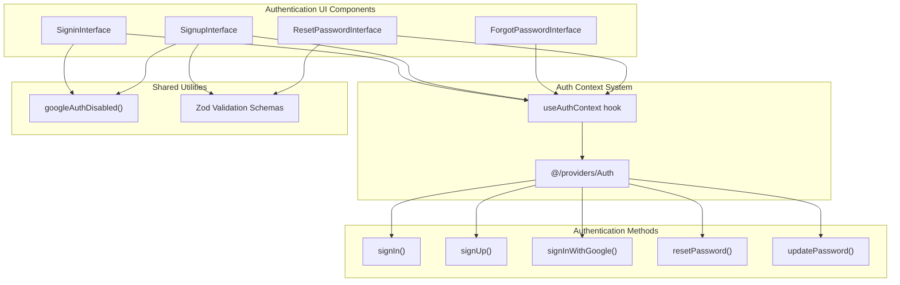
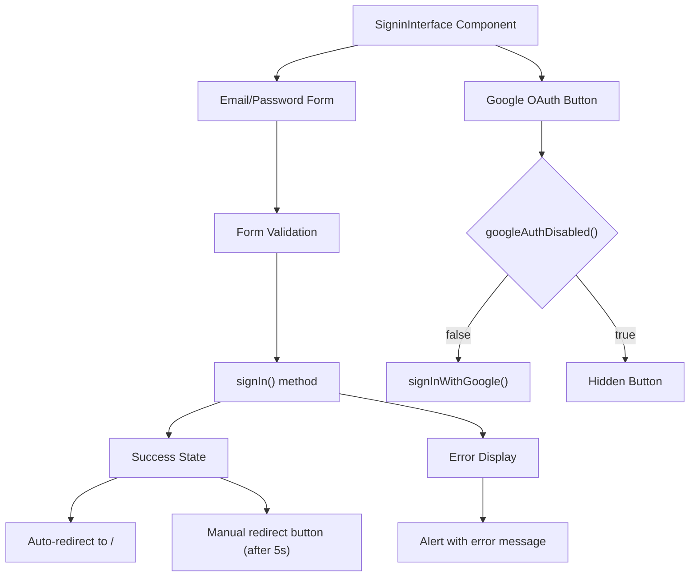
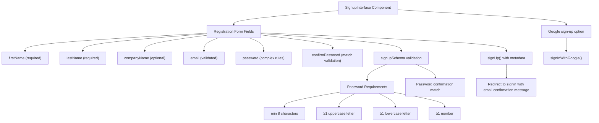
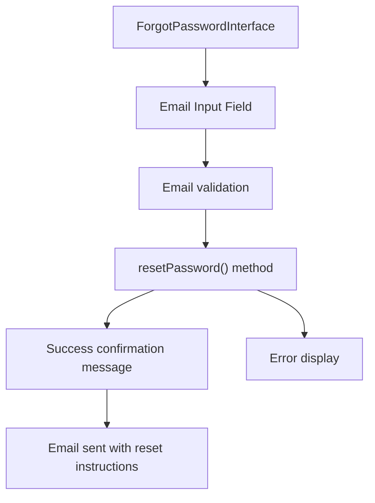
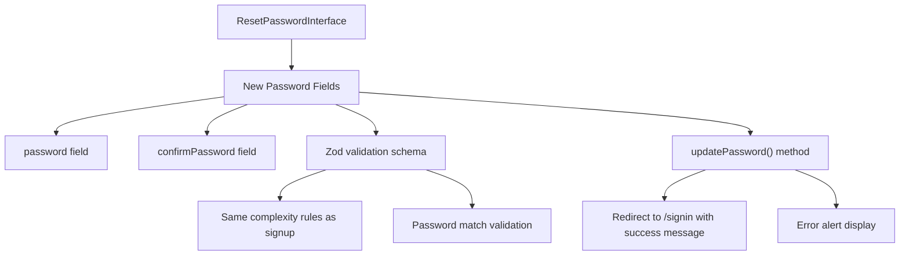
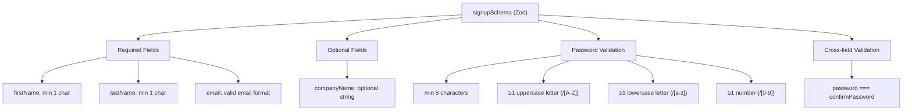
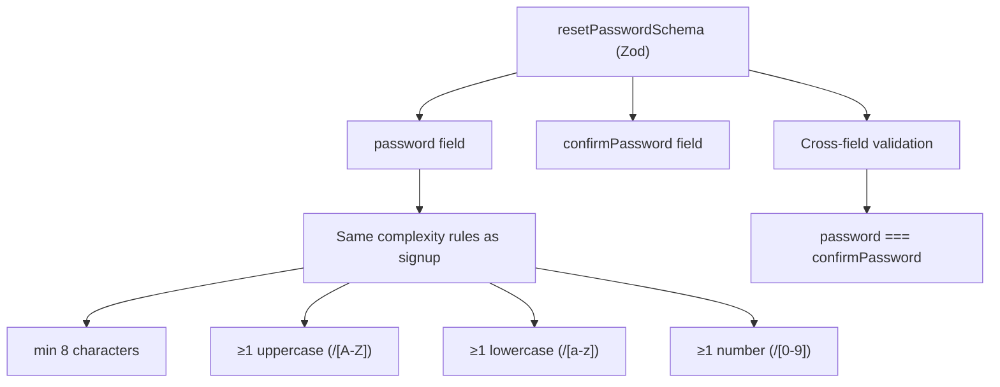
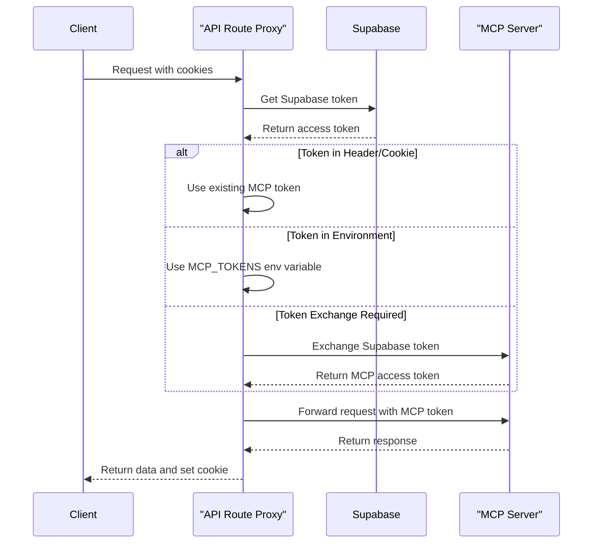

<!-- source: DeepWiki mcp.deepwiki.com · repo langchain-ai/open-agent-platform · page 2.1 Authentication System · fetched 2026-10-26 -->

# Authentication System

<details>
<summary>Relevant source files</summary>

The following files were used as context for generating this wiki page:

- [apps/web/src/features/forgot-password/index.tsx](apps/web/src/features/forgot-password/index.tsx)
- [apps/web/src/features/reset-password/index.tsx](apps/web/src/features/reset-password/index.tsx)
- [apps/web/src/features/signin/index.tsx](apps/web/src/features/signin/index.tsx)
- [apps/web/src/features/signup/index.tsx](apps/web/src/features/signup/index.tsx)
- [apps/web/src/lib/utils.ts](apps/web/src/lib/utils.ts)

</details>


The Authentication System in the Open Agent Platform provides user authentication, session management, and route protection. Built on Supabase Auth, it secures both frontend routes and backend API endpoints while enabling seamless user sign-up, sign-in, and session persistence throughout the application.

## Authentication Architecture Overview

The authentication system consists of four main components:

1. **Auth Provider** - A React context provider that exposes authentication state and methods to components
2. **Authentication UI Components** - React components for sign-in, sign-up, password reset, and account management
3. **Supabase Integration** - Implements authentication using Supabase's auth services
4. **Route Protection** - Controls access to protected routes and manages sessions

### Authentication UI Component Architecture



Sources: 
- [apps/web/src/features/signin/index.tsx:18-23]()
- [apps/web/src/features/signup/index.tsx:19-46]()
- [apps/web/src/features/forgot-password/index.tsx:17-20]()
- [apps/web/src/features/reset-password/index.tsx:16-36]()
- [apps/web/src/lib/utils.ts:8-13]()

## Authentication UI Components

The platform provides four main authentication interfaces, each implementing specific user flows:

### Sign-in Interface

The `SigninInterface` component handles user authentication with email/password and optional Google OAuth:



The component includes:
- Email and password input fields with validation
- "Forgot password?" link to `/forgot-password`
- Google sign-in button (conditionally displayed)
- Loading states and error handling
- Automatic redirect on successful authentication

Sources:
- [apps/web/src/features/signin/index.tsx:22-106]()
- [apps/web/src/features/signin/index.tsx:196-231]()

### Sign-up Interface

The `SignupInterface` component provides user registration with comprehensive form validation:



Key features:
- Comprehensive form validation using Zod schema
- Password complexity requirements
- User metadata collection (first name, last name, company)
- Email confirmation flow
- Google OAuth registration option

Sources:
- [apps/web/src/features/signup/index.tsx:24-41]()
- [apps/web/src/features/signup/index.tsx:99-126]()
- [apps/web/src/features/signup/index.tsx:163-264]()

### Password Reset Flow

The platform implements a two-step password reset process:

#### Forgot Password Interface



#### Reset Password Interface  



Sources:
- [apps/web/src/features/forgot-password/index.tsx:19-55]()
- [apps/web/src/features/reset-password/index.tsx:19-95]()

## Google Authentication Configuration

Google OAuth integration can be disabled via environment configuration:

| Configuration | Environment Variable | Function |
|---------------|---------------------|----------|
| Google Auth Status | `NEXT_PUBLIC_GOOGLE_AUTH_DISABLED` | `googleAuthDisabled()` |
| Disabled Value | `"true"` | Hides Google auth buttons |
| Enabled Value | `undefined` or `"false"` | Shows Google auth buttons |

Sources:
- [apps/web/src/lib/utils.ts:8-13]()
- [apps/web/src/features/signin/index.tsx:196]()
- [apps/web/src/features/signup/index.tsx:281]()

## Authentication Form Validation

The authentication system implements comprehensive client-side validation using Zod schemas:

### Sign-up Validation Schema



### Reset Password Validation Schema



Sources:
- [apps/web/src/features/signup/index.tsx:24-41]()
- [apps/web/src/features/reset-password/index.tsx:20-33]()

## Authentication State Management

All authentication components use the `useAuthContext` hook to access authentication methods:

| Method | Used By | Purpose |
|--------|---------|---------|
| `signIn` | `SigninInterface` | Email/password authentication |
| `signUp` | `SignupInterface` | User registration with metadata |
| `signInWithGoogle` | `SigninInterface`, `SignupInterface` | Google OAuth authentication |
| `resetPassword` | `ForgotPasswordInterface` | Initiate password reset |
| `updatePassword` | `ResetPasswordInterface` | Set new password |
| `isAuthenticated` | `SigninInterface` | Check auth status for redirects |

Sources:
- [apps/web/src/features/signin/index.tsx:23]()
- [apps/web/src/features/signup/index.tsx:46]()
- [apps/web/src/features/forgot-password/index.tsx:20]()
- [apps/web/src/features/reset-password/index.tsx:36]()

## Route Structure

The authentication system uses dedicated routes for each authentication flow:

| Route | Component | Purpose |
|-------|-----------|---------|
| `/signin` | `SigninInterface` | User login |
| `/signup` | `SignupInterface` | User registration |
| `/forgot-password` | `ForgotPasswordInterface` | Password reset initiation |
| `/reset-password` | `ResetPasswordInterface` | Password reset completion |

These routes are publicly accessible and redirect authenticated users to the main application.

Sources:
- [apps/web/src/features/signin/index.tsx:50-55]()
- [apps/web/src/features/signup/index.tsx:117-119]()

## Supabase Auth Provider Implementation

The `SupabaseAuthProvider` class implements the authentication interface, providing methods for user management:

| Method | Purpose |
|--------|---------|
| `signUp` | Register new users with email and password |
| `signIn` | Authenticate existing users |
| `signInWithGoogle` | OAuth sign-in with Google |
| `signOut` | Log users out of the application |
| `getSession` | Retrieve the current session |
| `refreshSession` | Refresh an expiring token |
| `getCurrentUser` | Get the currently authenticated user |
| `updateUser` | Update user profile information |
| `resetPassword` | Initiate password reset flow |
| `updatePassword` | Change user password |
| `onAuthStateChange` | Subscribe to auth state changes |

Sources:
- [apps/web/src/lib/auth/supabase.ts:87-305]()

## Backend API Authentication

The application also handles authentication for backend API requests, particularly to the MCP (Model Control Panel) server:



Sources:
- [apps/web/src/app/api/oap_mcp/proxy-request.ts:90-237]()

### Proxy Authentication Flow

The proxy request handler follows this process:

1. Extracts the target path and constructs the MCP server URL
2. Attempts to obtain an MCP access token through:
   - A cookie (`X-MCP-Access-Token`)
   - Environment variables (`MCP_TOKENS`)
   - Token exchange with Supabase JWT
3. Adds the token to the request via `Authorization: Bearer <token>`
4. Forwards the request to the MCP server
5. Returns the response and sets a cookie for future requests

Sources:
- [apps/web/src/app/api/oap_mcp/proxy-request.ts:43-79]()
- [apps/web/src/app/api/oap_mcp/proxy-request.ts:127-163]()

## Integration Points

The authentication system is integrated at multiple points in the application:

1. **Root Layouts**: Both the main app layout and auth layout wrap their children with the `AuthProvider`
2. **Middleware**: Applied to all routes except static assets and auth API endpoints
3. **Components**: Access auth state using the `useAuthContext` hook
4. **API Routes**: Proxy requests use authentication for backend services

Sources:
- [apps/web/src/app/(app)/layout.tsx:52-56]()
- [apps/web/src/app/(auth)/layout.tsx:43-45]()
- [apps/web/src/middleware.ts:8-26]()

## Debug Utilities

During development, the platform provides an `AuthDebug` component for troubleshooting authentication issues:

```jsx
<AuthDebug />
```

This component displays:
- Current authentication status
- User information
- Full session details (when expanded)
- Sign-out functionality

Sources:
- [apps/web/src/components/auth/debug.tsx:19-99]()

## Conclusion

The Authentication System provides a secure, flexible framework for user authentication throughout the Open Agent Platform. By integrating with Supabase Auth and implementing comprehensive middleware, it ensures that users can only access authorized resources while enabling seamless authentication flows.

---

