<!-- source: DeepWiki mcp.deepwiki.com · repo langchain-ai/open-agent-platform · page 8 UI Components · fetched 2026-10-26 -->

# UI Components

<details>
<summary>Relevant source files</summary>

The following files were used as context for generating this wiki page:

- [apps/web/src/app/(app)/settings/page.tsx](apps/web/src/app/(app)/settings/page.tsx)
- [apps/web/src/components/sidebar/app-sidebar.tsx](apps/web/src/components/sidebar/app-sidebar.tsx)
- [apps/web/src/components/sidebar/nav-main.tsx](apps/web/src/components/sidebar/nav-main.tsx)
- [apps/web/src/components/sidebar/nav-user.tsx](apps/web/src/components/sidebar/nav-user.tsx)
- [apps/web/src/components/sidebar/sidebar-header.tsx](apps/web/src/components/sidebar/sidebar-header.tsx)
- [apps/web/src/components/ui/avatar.tsx](apps/web/src/components/ui/avatar.tsx)
- [apps/web/src/components/ui/breadcrumb.tsx](apps/web/src/components/ui/breadcrumb.tsx)
- [apps/web/src/features/settings/index.tsx](apps/web/src/features/settings/index.tsx)
- [apps/web/src/hooks/use-api-keys.tsx](apps/web/src/hooks/use-api-keys.tsx)

</details>


The Open Agent Platform utilizes a collection of reusable UI components that provide a consistent user experience across the application. This page documents these components, their organization, and how they relate to each other. For information about specific feature interfaces like the Chat Interface, see [Chat Interface](#4) or for Agent Management, see [Agent Management](#3).

## Component Organization

The UI components in the Open Agent Platform are organized into several categories:

1. **Core UI Components**: Basic, reusable UI elements like avatars, breadcrumbs, and form inputs
2. **Navigation Components**: Sidebar navigation and site header components
3. **Feature-Specific Components**: UI elements tailored to specific platform features like settings
4. **Utility Hooks**: Custom hooks that provide reusable functionality

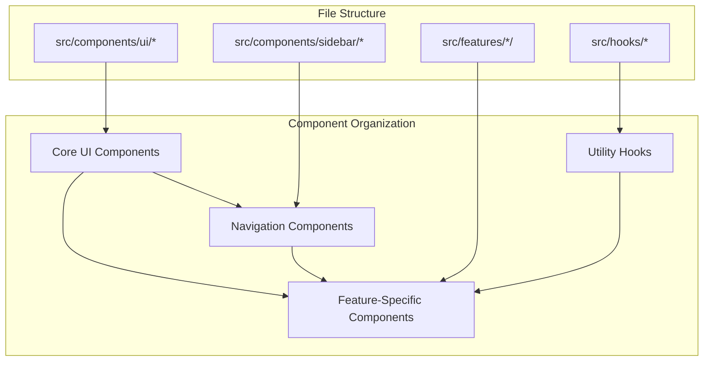

Sources: [apps/web/src/components/ui/avatar.tsx:1-52](), [apps/web/src/components/ui/breadcrumb.tsx:1-116](), [apps/web/src/components/sidebar/app-sidebar.tsx:1-64](), [apps/web/src/hooks/use-api-keys.tsx:1-41]()

## Core UI Components

The platform includes numerous atomic UI components that serve as building blocks. Here are some of the key components:

### Avatar

A customizable avatar component used for user and agent representation:

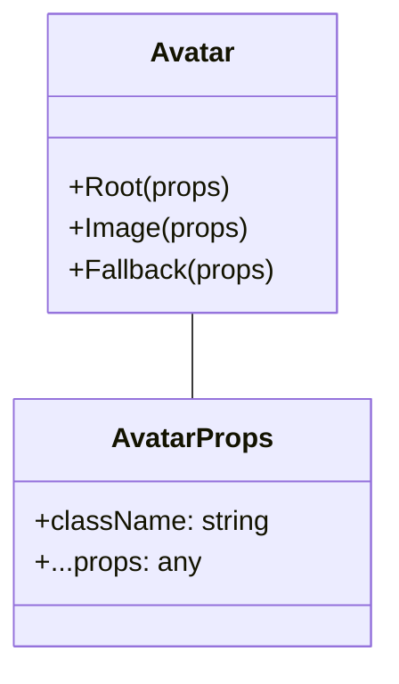

Sources: `apps/web/src/components/ui/avatar.tsx`

### Breadcrumb

Navigation component showing hierarchical page structure:

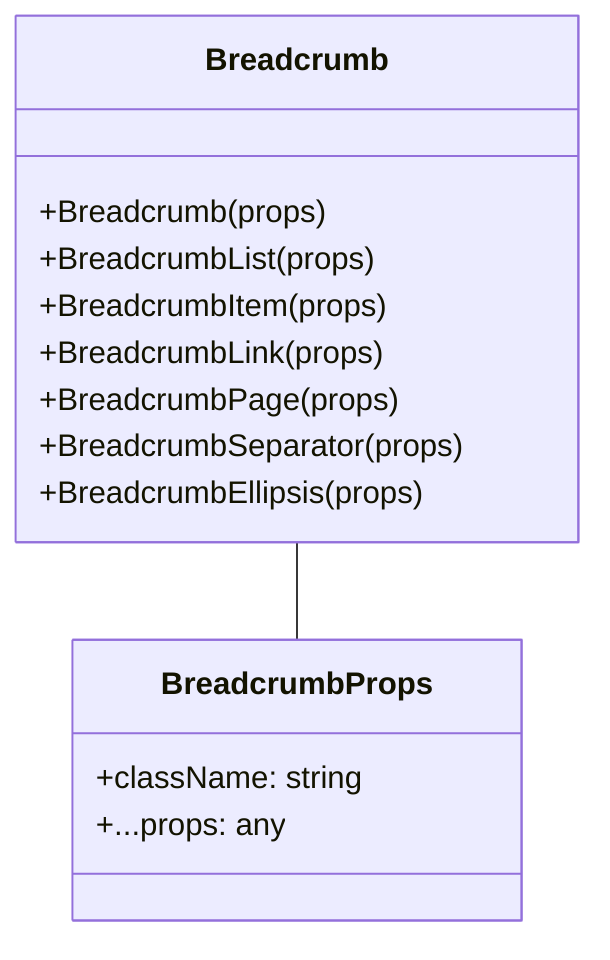

Usage example:
```jsx
<Breadcrumb>
  <BreadcrumbList>
    <BreadcrumbItem>
      <BreadcrumbLink href="/">Chat</BreadcrumbLink>
    </BreadcrumbItem>
  </BreadcrumbList>
</Breadcrumb>
```

Sources: `apps/web/src/components/ui/breadcrumb.tsx`, `apps/web/src/features/chat/components/chat-breadcrumb/index.tsx`

## Navigation Components

The platform provides a comprehensive sidebar navigation system composed of several interconnected components:

### AppSidebar Architecture

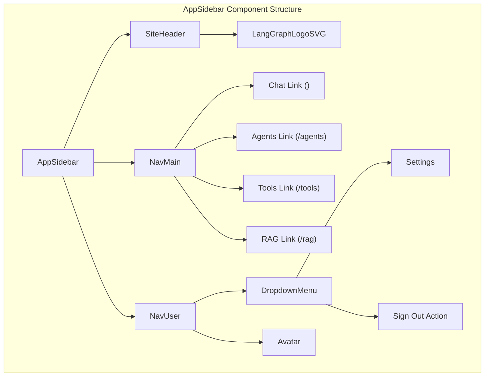

The `AppSidebar` component serves as the main navigation container with these key features:
- Collapsible to icon mode using `collapsible="icon"`
- Three main sections: header, content, and footer
- Integrates with authentication system for user management

Sources: [apps/web/src/components/sidebar/app-sidebar.tsx:47-63]()

### SiteHeader Component

The `SiteHeader` renders the platform branding and main navigation entry point:

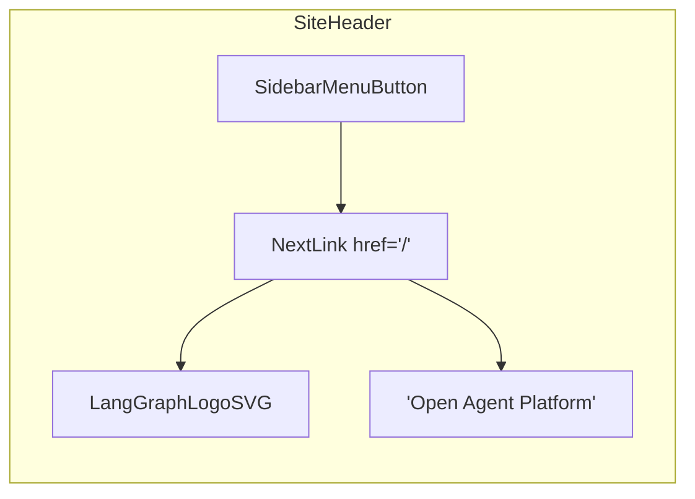

Key implementation details:
- Uses `NextLink` for client-side navigation to home page
- Logo scales with sidebar collapse state
- Text fades out when sidebar is in icon mode using `group-data-[collapsible=icon]:opacity-0`

Sources: [apps/web/src/components/sidebar/sidebar-header.tsx:12-35]()

### NavMain Component

The `NavMain` component renders the primary navigation links:

| Navigation Item | URL | Icon | Purpose |
|---|---|---|---|
| Chat | `/` | `MessageCircle` | Main chat interface |
| Agents | `/agents` | `Bot` | Agent management |
| Tools | `/tools` | `Wrench` | Tools playground |
| RAG | `/rag` | `Brain` | Document management |

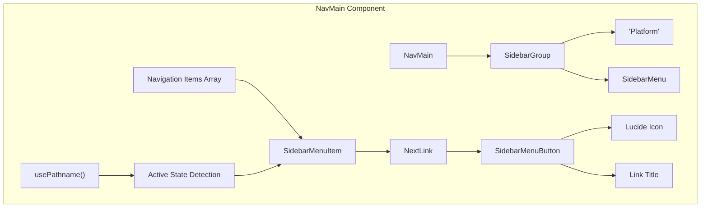

Implementation features:
- Active route highlighting using `usePathname()` comparison
- Dynamic styling with `cn()` utility for active states
- Tooltip support for collapsed sidebar mode

Sources: [apps/web/src/components/sidebar/nav-main.tsx:16-52](), [apps/web/src/components/sidebar/app-sidebar.tsx:17-45]()

### NavUser Component

The `NavUser` component provides user authentication and settings access:

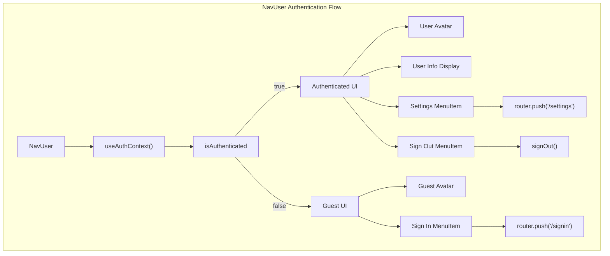

Key functionality:
- Displays user avatar with fallback to initials
- Shows user name, email, and company information when authenticated
- Provides settings access and sign-out functionality
- Includes development-only "Clear local data" option
- Integrates with `useConfigStore` for local state management

Sources: [apps/web/src/components/sidebar/nav-user.tsx:33-192]()

## Settings Interface Components

The platform includes a comprehensive settings interface for managing API keys and user preferences.

### Settings Page Structure

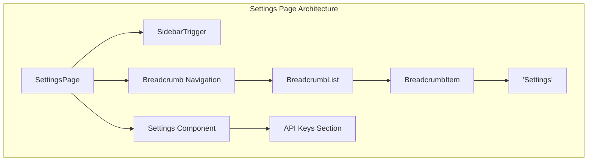

The settings page provides:
- Consistent header with sidebar trigger and breadcrumb navigation
- Suspense boundary for loading states
- Toast notifications through `Toaster` component

Sources: [apps/web/src/app/(app)/settings/page.tsx:14-37]()

### API Keys Management

The settings interface includes a dedicated section for managing API keys:

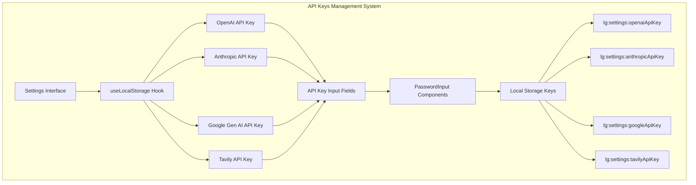

**API Key Storage Pattern:**
- Uses `useLocalStorage` hook for persistent client-side storage
- Each API key has a dedicated storage key with `lg:settings:` prefix
- Password input components hide sensitive information
- Real-time updates as users type

Sources: [apps/web/src/features/settings/index.tsx:13-93](), [apps/web/src/hooks/use-api-keys.tsx:3-29]()

### useApiKeys Hook

The platform provides a utility hook for accessing stored API keys:

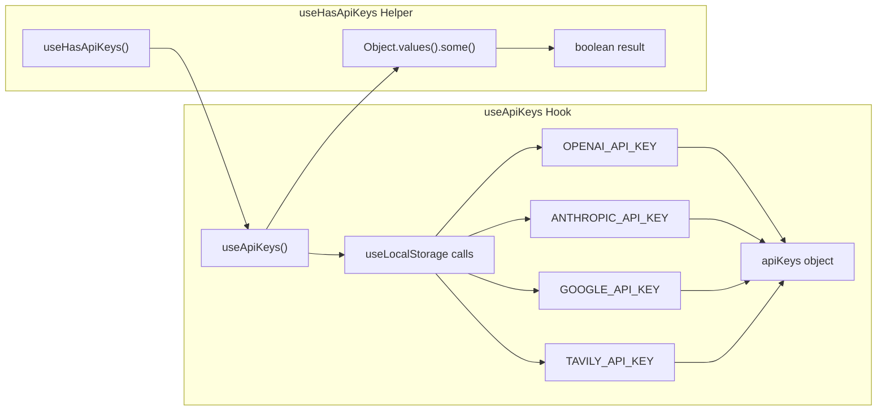

The hook provides:
- Centralized access to all stored API keys
- Consistent key naming convention
- Helper function `useHasApiKeys()` to check if any keys are configured

Sources: [apps/web/src/hooks/use-api-keys.tsx:3-40]()

## Utility Hooks and Patterns

The platform uses several utility hooks that enhance component functionality and provide reusable patterns.

### Local Storage Management

The `useLocalStorage` hook provides persistent client-side storage:

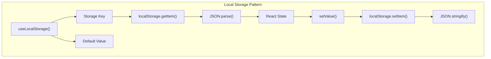

**Usage Pattern:**
```javascript
const [apiKey, setApiKey] = useLocalStorage<string>(
  "lg:settings:openaiApiKey",
  ""
);
```

This pattern is used throughout the settings interface for:
- API key storage and retrieval
- User preference persistence
- Configuration state management

Sources: [apps/web/src/hooks/use-api-keys.tsx:4-17](), [apps/web/src/features/settings/index.tsx:15-30]()

### Authentication Integration

Components integrate with the authentication system through the `useAuthContext()` hook:

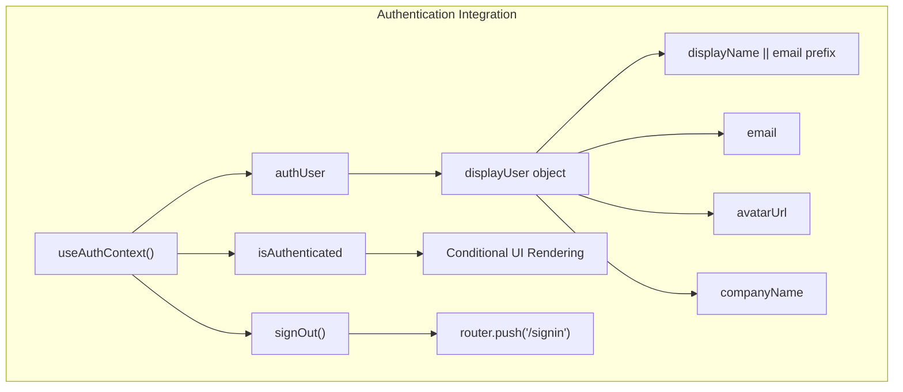

This pattern enables:
- User information display in navigation
- Conditional rendering based on authentication state
- Secure sign-out with navigation handling

Sources: [apps/web/src/components/sidebar/nav-user.tsx:35-76]()

## State Management Patterns

The platform employs several state management patterns for different types of data persistence and sharing.

### Configuration Store Integration

Components integrate with the configuration store for managing user settings:

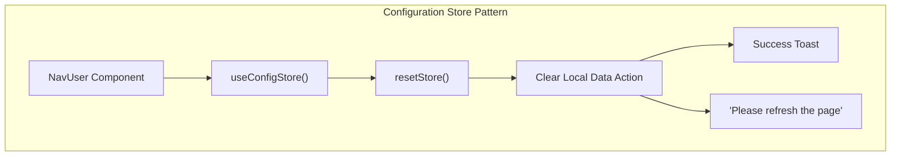

This pattern enables:
- Centralized configuration management
- Development-time data clearing functionality
- User feedback through toast notifications

Sources: [apps/web/src/components/sidebar/nav-user.tsx:31-88]()

### Router Integration

Components use Next.js router for navigation and state management:

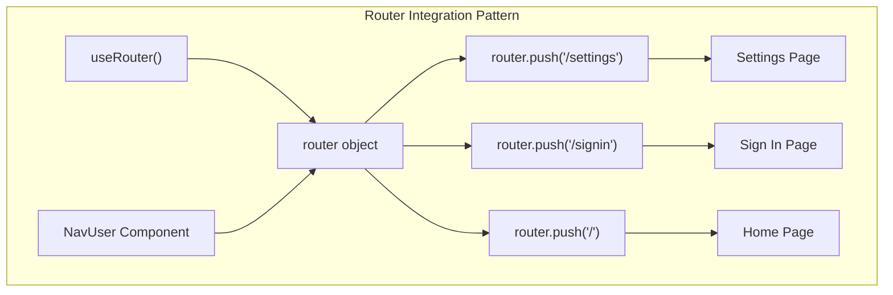

This enables:
- Programmatic navigation from component interactions
- Consistent routing behavior across the application
- Integration with authentication flows

Sources: [apps/web/src/components/sidebar/nav-user.tsx:36-81]()

## Application Layout Architecture

The application employs a consistent layout architecture built around a collapsible sidebar navigation system.

### Overall Layout Structure

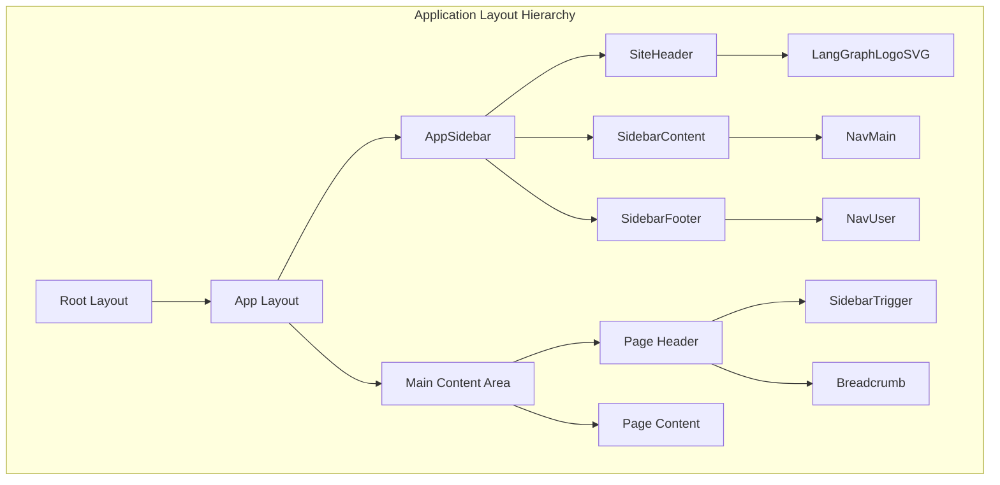

### Layout Features and Behavior

| Feature | Implementation | Purpose |
|---|---|---|
| Collapsible Sidebar | `collapsible="icon"` | Space-efficient navigation |
| Responsive Header | `group-has-[[data-collapsible=icon]]` | Adapts to sidebar state |
| Consistent Spacing | `h-16` header, `gap-2` elements | Visual consistency |
| Rail Component | `SidebarRail` | Resize handle for sidebar |

The layout provides:
- Unified navigation across all platform features
- Responsive design that adapts to sidebar collapse state
- Consistent header and breadcrumb patterns
- User context integration in the sidebar footer

Sources: [apps/web/src/components/sidebar/app-sidebar.tsx:47-63](), [apps/web/src/app/(app)/settings/page.tsx:22-33]()

### Page Header Pattern

Each page follows a consistent header pattern:

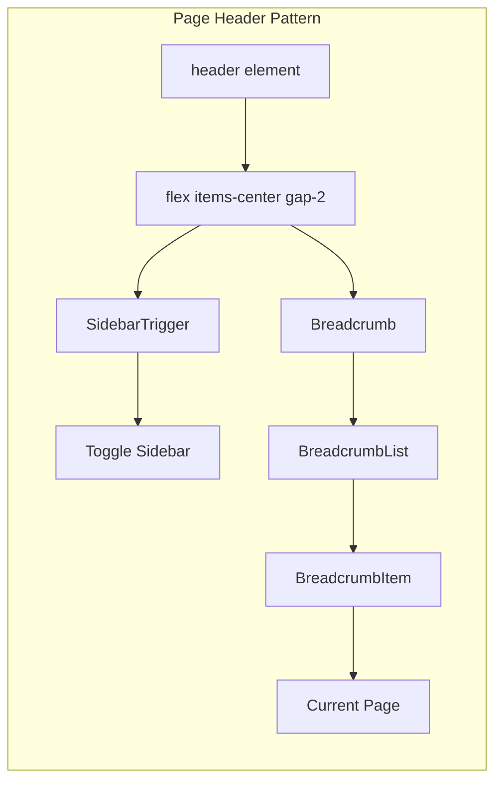

This pattern ensures:
- Consistent sidebar toggle access across all pages
- Clear page location indication through breadcrumbs
- Responsive header sizing that adapts to sidebar state

Sources: [apps/web/src/app/(app)/settings/page.tsx:22-32]()

## Component Integration Patterns

The UI components integrate with various services and state management systems through well-defined patterns.

### Authentication Integration

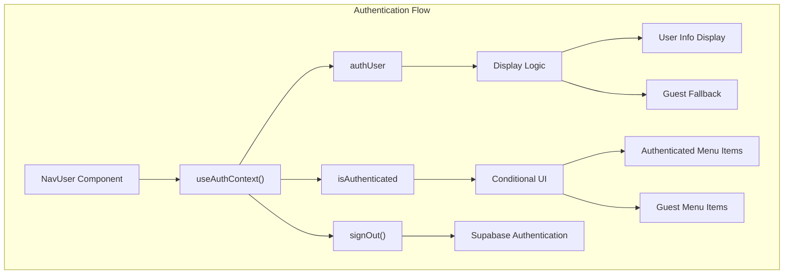

The authentication integration provides:
- User state management through context
- Conditional UI rendering based on authentication status
- Secure sign-out functionality with error handling
- Graceful fallback for unauthenticated users

Sources: [apps/web/src/components/sidebar/nav-user.tsx:35-57]()

### Local Storage Integration

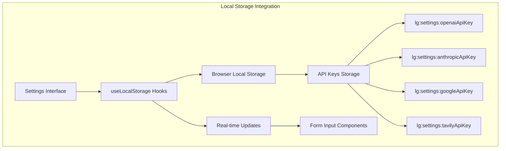

This integration enables:
- Persistent user settings across browser sessions
- Real-time synchronization between storage and UI
- Centralized API key management
- Consistent storage key naming convention

Sources: [apps/web/src/features/settings/index.tsx:15-30](), [apps/web/src/hooks/use-api-keys.tsx:4-17]()

## Usage Patterns and Best Practices

### Component Composition Patterns

UI components follow compositional patterns that promote reusability and maintainability.

#### Breadcrumb Composition
```jsx
<Breadcrumb>
  <BreadcrumbList>
    <BreadcrumbItem>
      <BreadcrumbPage>Settings</BreadcrumbPage>
    </BreadcrumbItem>
  </BreadcrumbList>
</Breadcrumb>
```

#### Sidebar Menu Composition
```jsx
<SidebarMenu>
  <SidebarMenuItem>
    <SidebarMenuButton tooltip="Chat">
      <MessageCircle />
      <span>Chat</span>
    </SidebarMenuButton>
  </SidebarMenuItem>
</SidebarMenu>
```

Sources: [apps/web/src/app/(app)/settings/page.tsx:25-31](), [apps/web/src/components/sidebar/nav-main.tsx:42-45]()

### Hook-Based State Management

Components leverage custom hooks for state management and side effects:

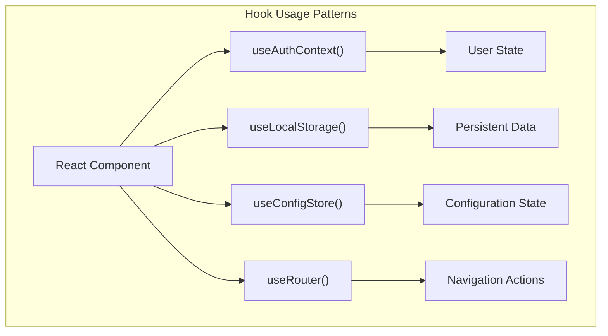

**Common Hook Patterns:**
- `useAuthContext()` for authentication state
- `useLocalStorage()` for persistent user preferences
- `useConfigStore()` for application configuration
- `useRouter()` for programmatic navigation

Sources: [apps/web/src/components/sidebar/nav-user.tsx:35-38](), [apps/web/src/features/settings/index.tsx:15-30]()

### Error Handling and User Feedback

Components implement consistent error handling and user feedback patterns:

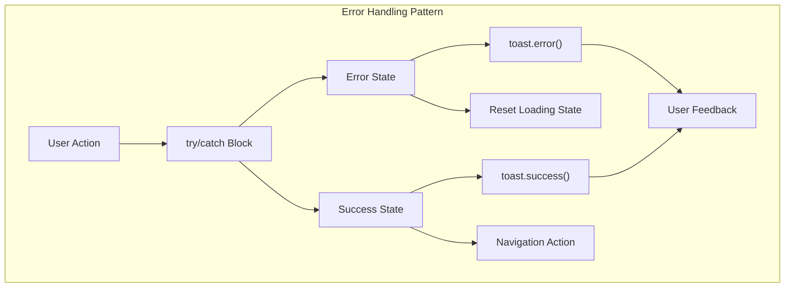

This pattern is used for:
- Sign-out operations with error handling
- Settings updates with success feedback
- Navigation with loading states

Sources: [apps/web/src/components/sidebar/nav-user.tsx:59-77]()

## Component Design Principles

The UI components in the Open Agent Platform follow these design principles:

1. **Composition over Inheritance**: Components are designed to be composed together
2. **Context-Based State Management**: Shared state is provided through React Context
3. **Prop Flexibility**: Components accept className, style, and other standard props
4. **Accessibility**: Components include ARIA attributes for better accessibility
5. **Controlled & Uncontrolled Modes**: Many components support both controlled and uncontrolled operation

These principles make the component library flexible and maintainable as the platform evolves.

---

