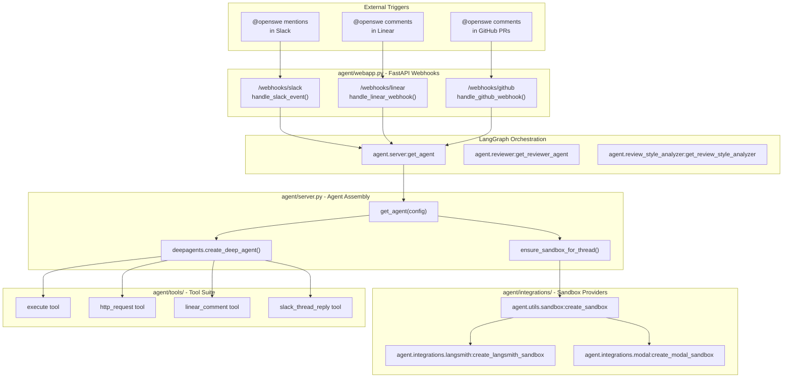
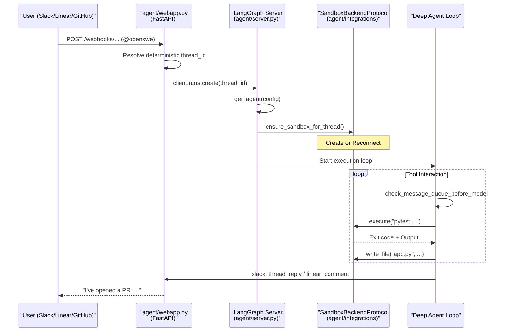

<!-- source: DeepWiki mcp.deepwiki.com · repo langchain-ai/open-swe · page 1 Overview · fetched 2026-10-26 -->

# Overview

Relevant source files

The following files were used as context for generating this wiki page:

- [.dockerignore](.dockerignore)
- [AGENTS.md](AGENTS.md)
- [CLAUDE.md](CLAUDE.md)
- [CUSTOMIZATION.md](CUSTOMIZATION.md)
- [INSTALLATION.md](INSTALLATION.md)
- [README.md](README.md)
- [default_prompt.md](default_prompt.md)

## Purpose and Scope

This page introduces Open SWE as a framework for building organization-specific internal coding agents. It explains the core purpose, design philosophy, and how the system composes on existing frameworks like Deep Agents and LangGraph.

For detailed information about specific aspects of the system, see:
- System architecture details: [System Architecture](#1.1)
- Technology stack components: [Technology Stack](#1.2)
- Framework layering and composition: [Framework Composition](#1.3)

**Sources:** [README.md:1-113](), [AGENTS.md:1-10]()

---

## What is Open SWE?

Open SWE is an open-source framework for building internal coding agents tailored to an organization's specific workflows and codebases. Unlike general-purpose coding assistants, Open SWE is designed to meet engineers where they work—in Slack threads, Linear issues, and GitHub pull requests—with the right context, permissions, and safety boundaries to operate autonomously. [README.md:12-27]()

The framework implements architectural patterns used by elite engineering organizations like Stripe, Ramp, and Coinbase: isolated cloud sandboxes for safe execution, subagent orchestration for parallel work, and real-time message queueing for interactive debugging. [README.md:25-27]()

Open SWE is **not** a fork of an existing agent framework. Instead, it **composes on** the [Deep Agents](https://github.com/langchain-ai/deepagents) framework and LangGraph execution engine. This compositional approach allows Open SWE to inherit upstream improvements while providing domain-specific customizations for software engineering. [README.md:38-50](), [AGENTS.md:7-10]()

**Core Characteristics:**
- **Invocation surfaces:** Slack, Linear, and GitHub webhooks. [README.md:98-107]()
- **Execution environment:** Pluggable cloud sandboxes (LangSmith, Modal, Daytona, Runloop, Local). [README.md:52-63](), [CUSTOMIZATION.md:58-64]()
- **Agent framework:** Deep Agents with curated tools and deterministic middleware. [README.md:38-50](), [AGENTS.md:59-71]()
- **Orchestration:** LangGraph for execution state and multi-agent graphs (Agent, Reviewer, Style Analyzer). [AGENTS.md:26-34]()
- **Context engineering:** Repository-specific guidance via `AGENTS.md` and pre-hydrated source context. [README.md:79-85]()

**Sources:** [README.md:12-27](), [README.md:33-41](), [README.md:79-107](), [AGENTS.md:1-34]()

---

## Design Philosophy

Open SWE follows core architectural principles derived from production-grade internal coding agents:

### 1. Composition Over Forking
The system calls `create_deep_agent()` rather than maintaining a forked agent core. Custom capabilities are added via the `tools`, `middleware`, and `system_prompt` parameters. [README.md:42-50](), [CUSTOMIZATION.md:3-24]()

### 2. Isolation First, Then Full Permissions
Every task runs in its own isolated sandbox—a remote Linux environment with complete shell access. Mistakes are contained within the sandbox boundary. [README.md:52-59]()

### 3. Tool Curation Over Quantity
The framework provides a small, focused toolset. Each tool has a clear purpose: `execute` for shell commands, `fetch_url` for web content, and platform-specific tools like `slack_thread_reply`. [README.md:64-76](), [AGENTS.md:81-86]()

### 4. Context is Pre-Hydrated
Agents start with full context from the invocation source (Linear descriptions, Slack history) rather than discovering it step-by-step. Repository-level conventions are injected via `AGENTS.md` files. [README.md:79-85](), [AGENTS.md:1-4]()

### 5. Deterministic Middleware
Middleware hooks run at deterministic points in the agent loop. For example, `check_message_queue_before_model` injects follow-up messages in real-time before the next LLM call. [README.md:91-96](), [AGENTS.md:59-71]()

### 6. Thread Persistence
Each Linear issue, Slack thread, or GitHub PR gets a deterministic thread ID. Follow-up messages route to the same running agent, and sandboxes can persist across invocations. [README.md:106-107](), [AGENTS.md:46-55]()

**Sources:** [README.md:33-113](), [AGENTS.md:36-76](), [CUSTOMIZATION.md:1-24]()

---

## System at a Glance

The following diagram maps Open SWE's high-level architecture to actual code entities in the repository:

**Key Code Symbols:**
- **`handle_slack_event()`**: [agent/webapp.py]() - Slack webhook handler.
- **`get_agent()`**: [agent/server.py:40]() - Main agent graph factory.
- **`ensure_sandbox_for_thread()`**: [agent/server.py:40]() - Sandbox lifecycle manager.
- **`create_sandbox()`**: [agent/utils/sandbox.py:55]() - Sandbox provider dispatcher.
- **`create_deep_agent()`**: [README.md:43-50]() - Framework assembly call.

**Sources:** [README.md:33-113](), [AGENTS.md:26-55](), [CUSTOMIZATION.md:3-24]()

---

## Request Lifecycle

The following diagram shows how a single request flows through the system, emphasizing the interaction between the FastAPI webhooks and the LangGraph agent:

**Key Functions in Order:**
1. **Webhook Processing**: [agent/webapp.py:43]() - Resolves `thread_id` and triggers runs.
2. **`get_agent(config)`**: [agent/server.py:40]() - Entrypoint that configures the agent instance.
3. **`ensure_sandbox_for_thread()`**: [AGENTS.md:48-55]() - Handles sandbox caching and persistence.
4. **`check_message_queue_before_model`**: [AGENTS.md:66-67]() - Middleware that pulls new messages mid-run.
5. **Tool Execution**: [README.md:70-76]() - Agent performs work inside the sandbox.

**Sources:** [README.md:86-107](), [AGENTS.md:38-71](), [CUSTOMIZATION.md:3-24]()

---

## Core Components

Open SWE consists of four primary layers:

### API Layer ([agent/webapp.py]())
FastAPI application that receives webhooks from Slack, Linear, and GitHub. It manages signature verification and maps platform-specific events to deterministic LangGraph threads. [AGENTS.md:43-44]()

### Orchestration Layer ([agent/server.py]())
Defines the `get_agent()` factory which resolves GitHub tokens, manages sandbox state via `SANDBOX_BACKENDS`, and constructs the system prompt. [AGENTS.md:40]()

### Agent Core (Deep Agents Framework)
The framework providing the `create_deep_agent` assembly, which bundles the LLM, tools, and sandboxes into an execution loop. [README.md:38-50]()

### Execution Layer ([agent/integrations/]())
Implementations of `SandboxBackendProtocol` that provide isolated environments. Providers like LangSmith include a GitHub proxy to safely inject credentials into the sandbox. [CUSTOMIZATION.md:28-52](), [AGENTS.md:55-58]()

**Sources:** [README.md:38-63](), [AGENTS.md:36-58](), [CUSTOMIZATION.md:3-24]()

---

## Key Files and Entry Points

| Concept | Primary File(s) | Key Functions/Classes |
|---------|----------------|----------------------|
| **Webhook Entry** | [agent/webapp.py]() | `handle_slack_event`, `handle_linear_webhook` |
| **Agent Factory** | [agent/server.py]() | `get_agent`, `ensure_sandbox_for_thread` |
| **Reviewer Graph** | [agent/reviewer.py]() | `get_reviewer_agent` |
| **Sandbox Integrations** | [agent/integrations/]() | `create_langsmith_sandbox`, `create_modal_sandbox` |
| **Custom Tools** | [agent/tools/]() | `execute`, `linear_comment`, `slack_thread_reply` |
| **Middleware Hooks** | [agent/middleware/]() | `check_message_queue_before_model`, `ToolErrorMiddleware` |

**Sources:** [AGENTS.md:38-86](), [CUSTOMIZATION.md:58-64]()

---

## What's Next

For deeper dives into specific areas:

- **[System Architecture](#1.1)**: Complete flow from webhooks to tool execution.
- **[Technology Stack](#1.2)**: Python backend, LangGraph orchestration, and deployment.
- **[Framework Composition](#1.3)**: How Open SWE layers on Deep Agents and LangGraph.

**Sources:** [README.md:1-150]()

---

