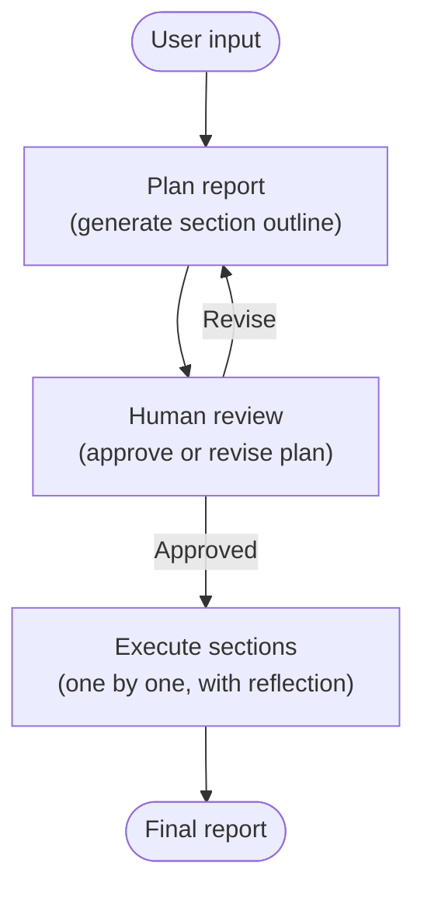
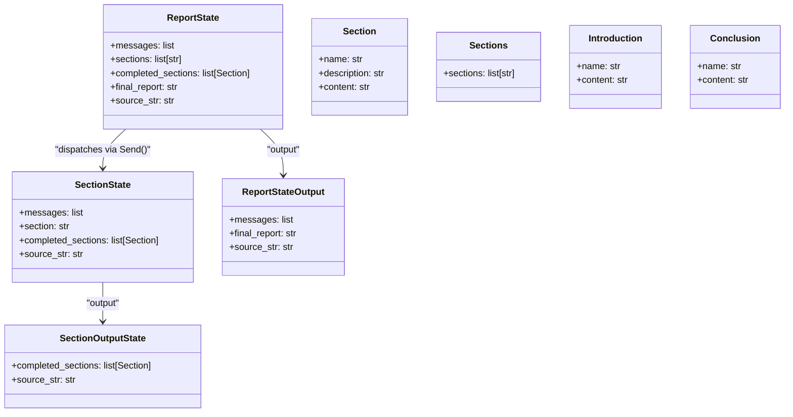
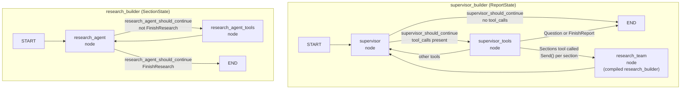
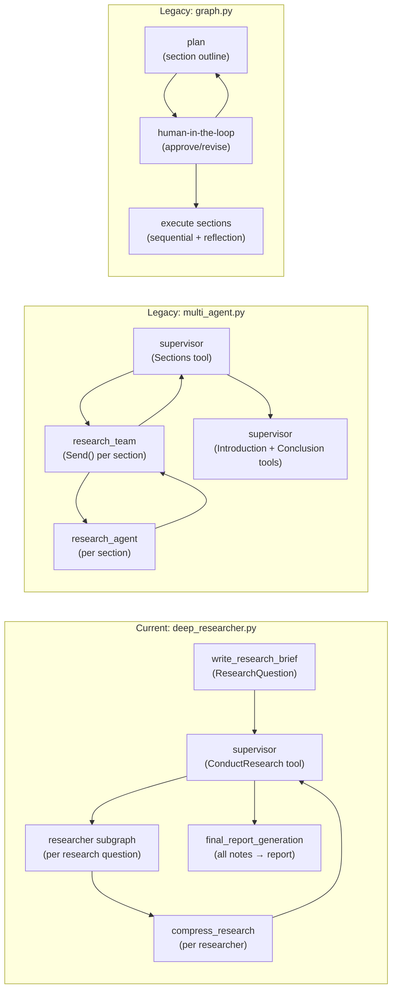

<!-- source: DeepWiki mcp.deepwiki.com · repo langchain-ai/open_deep_research · page 3.6 Legacy Implementations · fetched 2026-10-26 -->

# Legacy Implementations

<details>
<summary>Relevant source files</summary>

The following files were used as context for generating this wiki page:

- [README.md](README.md)
- [src/legacy/multi_agent.py](src/legacy/multi_agent.py)
- [tests/expt_results/deep_research_bench_gpt-5.jsonl](tests/expt_results/deep_research_bench_gpt-5.jsonl)

</details>


This page documents the two older research implementations located in `src/legacy/`. These implementations predate and are architecturally distinct from the current agent described in pages [3.1](3.1) and [3.2](3.2). They are not registered in `langgraph.json` and are not part of the active deployment. They remain in the repository as reference implementations that explore alternative design patterns for automated research.

For the current active architecture, see [Deep Research Agent Workflow](3.1).

---

## Package Layout

The `src/legacy/` directory is a standalone Python package with its own configuration, utilities, and prompt modules. It does not import from `src/open_deep_research/`.

```
src/legacy/
├── __init__.py
├── configuration.py     — MultiAgentConfiguration Pydantic model
├── graph.py             — Plan-and-execute workflow (graph-based)
├── multi_agent.py       — Supervisor + parallel research agents
├── prompts.py           — SUPERVISOR_INSTRUCTIONS, RESEARCH_INSTRUCTIONS
└── utils.py             — tavily_search, duckduckgo_search, get_today_str, get_config_value
```

Sources: [src/legacy/multi_agent.py:1-25]()

---

## Implementation 1: Plan-and-Execute Workflow (`graph.py`)

`src/legacy/graph.py` implements a **plan-and-execute** pattern with human-in-the-loop approval at the planning stage.

### Characteristics

| Property | Description |
|---|---|
| **Strategy** | Plan first, then execute section by section |
| **Parallelism** | None — sections written sequentially |
| **Human interaction** | Supports mid-run feedback and plan approval |
| **Quality mechanism** | Iterative reflection on each section |
| **Search support** | Tavily and DuckDuckGo |

### High-Level Flow

**Diagram: `graph.py` Plan-and-Execute Workflow**



Sources: [README.md:139-143]()

---

## Implementation 2: Multi-Agent Supervisor/Researcher (`multi_agent.py`)

`src/legacy/multi_agent.py` implements a **supervisor + parallel researchers** pattern. The supervisor decomposes the topic into named report sections, then dispatches each section to an independent research agent using LangGraph's `Send()` API for concurrent execution.

### Characteristics

| Property | Description |
|---|---|
| **Strategy** | Section-first decomposition, parallel research |
| **Parallelism** | Yes — one `research_agent` subgraph per section via `Send()` |
| **Human interaction** | Optional clarification via `Question` tool (`ask_for_clarification` flag) |
| **Quality mechanism** | Research loop per section until `FinishResearch` is called |
| **Search support** | Tavily, DuckDuckGo, MCP tools |
| **Report assembly** | Introduction + sorted body sections + Conclusion |

### State Classes

**Diagram: State Classes in `multi_agent.py`**



Sources: [src/legacy/multi_agent.py:51-127]()

### Structured Output / Tool Types

The supervisor and research agents use tool calls driven by Pydantic models rather than free-form text. Each tool signals a specific intent:

| Tool Class | Used by | Purpose |
|---|---|---|
| `Sections` | Supervisor | Declare list of section names to research |
| `Introduction` | Supervisor | Write the report introduction |
| `Conclusion` | Supervisor | Write the report conclusion |
| `Question` | Supervisor | Ask clarifying question (if `ask_for_clarification=True`) |
| `FinishReport` | Supervisor | Signal report is complete |
| `Section` | Researcher | Write the completed section content |
| `FinishResearch` | Researcher | Signal research for this section is done |

Sources: [src/legacy/multi_agent.py:51-100]()

### Graph Structure

Two separate `StateGraph` instances are built and one is compiled into the other as a node.

**Diagram: `multi_agent.py` StateGraph Node Layout**



Sources: [src/legacy/multi_agent.py:460-488]()

### Node Descriptions

**`supervisor`** [src/legacy/multi_agent.py:188-238]()

- Loads `MultiAgentConfiguration` from `RunnableConfig`
- Initializes LLM via `init_chat_model(supervisor_model)`
- If `completed_sections` is populated but `final_report` is not, injects a prompt to write introduction/conclusion
- Binds `supervisor_tool_list` (dynamically assembled) with `tool_choice="any"`
- Applies `SUPERVISOR_INSTRUCTIONS` system prompt; appends `mcp_prompt` if set

**`supervisor_tools`** [src/legacy/multi_agent.py:240-338]()

- Iterates over all tool calls on the last message
- Routes on tool name:
  - `Sections` → dispatches to `research_team` via `Send()` for each section
  - `Introduction` → stores in `final_report` field, prompts for `Conclusion`
  - `Conclusion` → assembles full report (`intro + body + conclusion`), goes to `END`
  - `Question` → returns to `END` (interrupts for user response)
  - `FinishReport` → returns to `END`
  - Search tools → appends to `source_str` if `include_source_str=True`

**`research_agent`** [src/legacy/multi_agent.py:353-394]()

- Loads `MultiAgentConfiguration`, initializes LLM via `init_chat_model(researcher_model)`
- Uses `RESEARCH_INSTRUCTIONS` prompt formatted with `section_description` and `number_of_queries`
- Binds `research_tool_list` with `tool_choice="any"`
- If `messages` is empty, inserts an initial user message to satisfy Anthropic's API requirement

**`research_agent_tools`** [src/legacy/multi_agent.py:396-445]()

- Processes all tool calls from the last message
- If a `Section` tool is called, stores the resulting `Section` object in `completed_sections`
- Search tool output is appended to `source_str` if `include_source_str` is enabled
- Routing is handled by `research_agent_should_continue`: returns to `research_agent` or `END`

### Tool Assembly

Tools are assembled dynamically per invocation via two async factory functions:

**`get_supervisor_tools(config)`** [src/legacy/multi_agent.py:161-173]()  
Returns: `[Sections, Introduction, Conclusion, FinishReport]` + optionally `Question`, a search tool, and MCP tools.

**`get_research_tools(config)`** [src/legacy/multi_agent.py:176-185]()  
Returns: `[Section, FinishResearch]` + optionally a search tool and MCP tools.

**`get_search_tool(config)`** [src/legacy/multi_agent.py:26-49]()  
Reads `search_api` from `MultiAgentConfiguration`. Supports `"tavily"`, `"duckduckgo"`, and `"none"`. Raises `NotImplementedError` for other values with a note to use the main `graph.py` implementation.

MCP tools are loaded via `_load_mcp_tools(config, existing_tool_names)` [src/legacy/multi_agent.py:130-157](), which uses `MultiServerMCPClient` from `langchain_mcp_adapters`. Tools already in the name set are skipped with a warning; tools not in `mcp_tools_to_include` (if set) are filtered out.

Sources: [src/legacy/multi_agent.py:26-185]()

### Configuration: `MultiAgentConfiguration`

Defined in `src/legacy/configuration.py`, imported as:

```python
from legacy.configuration import MultiAgentConfiguration
```

Referenced fields across `multi_agent.py`:

| Field | Type | Usage |
|---|---|---|
| `search_api` | `str` | Selects `tavily`, `duckduckgo`, or `none` |
| `supervisor_model` | `str` | LLM for supervisor node |
| `researcher_model` | `str` | LLM for research_agent node |
| `ask_for_clarification` | `bool` | Whether to add `Question` tool to supervisor |
| `number_of_queries` | `int` | Passed into `RESEARCH_INSTRUCTIONS` prompt |
| `mcp_server_config` | `dict` | Passed to `MultiServerMCPClient` |
| `mcp_tools_to_include` | `list[str]` | Filter for MCP tool names |
| `mcp_prompt` | `str` | Appended to system prompts when set |
| `include_source_str` | `bool` | Controls whether raw search text is accumulated in `source_str` |

Sources: [src/legacy/multi_agent.py:26-29](), [src/legacy/multi_agent.py:161-185](), [src/legacy/multi_agent.py:188-238]()

---

## Architectural Comparison: Legacy vs. Current

**Diagram: Legacy vs. Current — Key Structural Differences**



Sources: [src/legacy/multi_agent.py:460-488](), [README.md:135-150]()

| Dimension | `graph.py` | `multi_agent.py` | Current (`deep_researcher.py`) |
|---|---|---|---|
| Decomposition unit | Sections | Sections | Research questions |
| Parallelism | None | Yes (`Send()` per section) | Yes (`Send()` per research unit) |
| Human-in-the-loop | Yes (plan approval) | Optional (clarification) | Optional (clarification) |
| Research compression | No | No | Yes (`compress_research` node) |
| Final report assembly | From sections | Intro + body + conclusion | Single `final_report_generation` node |
| Search backends | Tavily, DuckDuckGo | Tavily, DuckDuckGo | Tavily, Anthropic native, OpenAI native |
| MCP support | No | Yes | Yes |
| Registered in `langgraph.json` | No | No | Yes |
| Configuration class | Separate | `MultiAgentConfiguration` | `Configuration` |

Sources: [src/legacy/multi_agent.py:26-49](), [README.md:135-150]()

---

## Relevance and Limitations

Both legacy implementations are **not registered** in `langgraph.json` and therefore cannot be launched via `langgraph dev` or the LangGraph Platform without manual modification.

Per the README, they are "less performant than the current implementation" and are preserved as reference material for:

- Studying alternative design patterns (section-first vs. question-first decomposition)
- Understanding the evolution of the system (detailed in the [blog post](https://rlancemartin.github.io/2025/07/30/bitter_lesson) linked from the README)
- Experimenting with human-in-the-loop planning (`graph.py`) or strict section-structured output (`multi_agent.py`)

Notable limitations of `multi_agent.py` specifically:
- Search API selection limited to `tavily`, `duckduckgo`, and `none`. Attempting other values raises `NotImplementedError` at `get_search_tool()` [src/legacy/multi_agent.py:41-45]()
- No research compression step, meaning raw search content can grow unbounded over a research session
- Report structure is fixed (Introduction → Body Sections → Conclusion), whereas the current implementation lets the final report model freely structure content

Sources: [README.md:135-150](), [src/legacy/multi_agent.py:41-45]()

---

