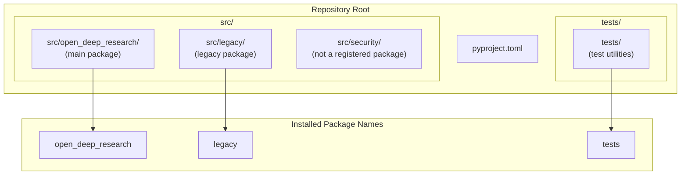
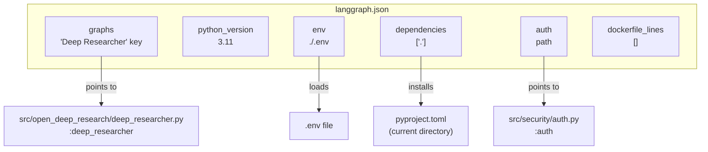
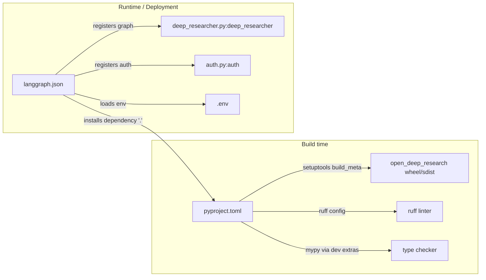

<!-- source: DeepWiki mcp.deepwiki.com · repo langchain-ai/open_deep_research · page 6.2 Project Configuration and Build System · fetched 2026-10-26 -->

# Project Configuration and Build System

<details>
<summary>Relevant source files</summary>

The following files were used as context for generating this wiki page:

- [langgraph.json](langgraph.json)
- [pyproject.toml](pyproject.toml)

</details>


This page covers the two primary configuration files that govern how the `open_deep_research` package is built, linted, and deployed: `pyproject.toml` and `langgraph.json`. The scope here is the **static project-level configuration** — package layout, build tooling, code quality settings, and the LangGraph deployment manifest.

For the full list of runtime dependencies and how to set up the development environment, see [Dependencies and Environment Setup](#6.1). For how to deploy the agent and use `langgraph dev`, see [Deployment Options](#4.4). For CI/CD automation, see [Testing and CI/CD](#6.3).

---

## Package Identity

[pyproject.toml:1-10]()

| Field | Value |
|---|---|
| `name` | `open_deep_research` |
| `version` | `0.0.16` |
| `requires-python` | `>=3.10` |
| `license` | MIT |
| `readme` | `README.md` |

---

## Build System

[pyproject.toml:52-54]()

The project uses **setuptools** as its build backend.

```toml
[build-system]
requires = ["setuptools>=73.0.0", "wheel"]
build-backend = "setuptools.build_meta"
```

This means running `pip install .` or `uv pip install .` invokes `setuptools.build_meta` to produce the distribution. No custom build scripts or hooks are used.

---

## Package Layout

[pyproject.toml:56-65]()

The repository uses a `src/` layout, which means the importable package roots do **not** sit at the repository root. Setuptools is explicitly told how to map package names to directories.

**Package-to-directory mapping diagram:**



The `[tool.setuptools.package-dir]` table declares these mappings explicitly:

| Installed name | Source directory |
|---|---|
| `open_deep_research` | `src/open_deep_research` |
| `legacy` | `src/legacy` |
| `tests` | `tests` |

The `[tool.setuptools.package-data]` entry [pyproject.toml:64-65]() includes `py.typed` markers from all packages, which enables PEP 561 type checking by downstream consumers.

Sources: [pyproject.toml:56-65]()

---

## Optional Development Dependencies

[pyproject.toml:49-50]()

Code quality tools are isolated under the `dev` extras group, keeping them out of the default install:

```toml
[project.optional-dependencies]
dev = ["mypy>=1.11.1", "ruff>=0.6.1"]
```

Install with:

```
pip install ".[dev]"
# or
uv pip install ".[dev]"
```

Sources: [pyproject.toml:49-50]()

---

## Ruff Linting Configuration

[pyproject.toml:67-89]()

[Ruff](https://docs.astral.sh/ruff) is the configured linter. Its rules and exceptions are declared in `[tool.ruff]`.

### Enabled rule sets

| Rule prefix | Ruleset |
|---|---|
| `E` | pycodestyle |
| `F` | pyflakes |
| `I` | isort |
| `D` | pydocstyle (all docstring rules) |
| `D401` | First line in imperative mood |
| `T201` | `print()` usage detection |
| `UP` | pyupgrade |

### Ignored rules

| Rule | Reason |
|---|---|
| `UP006` | Allow older `typing.List`/`Dict` style |
| `UP007` | Allow `Optional[X]` instead of `X \| None` |
| `UP035` | Allow deprecated `typing` imports |
| `D417` | Missing argument descriptions in docstrings |
| `E501` | Line too long (not enforced) |

### Docstring convention

[pyproject.toml:88-89]()

All docstrings follow the **Google** convention (`[tool.ruff.lint.pydocstyle] convention = "google"`).

### Per-file overrides

[pyproject.toml:85-86]()

Files under `tests/*` are exempt from all `D` (docstring) rules and `UP` (pyupgrade) rules, since test utilities prioritize readability over style compliance.

Sources: [pyproject.toml:67-89]()

---

## `langgraph.json` — Deployment Manifest

[langgraph.json:1-14]()

`langgraph.json` is the configuration file read by the `langgraph` CLI (both `langgraph dev` for local development and `langgraph build` for container deployment). It declares which graphs exist in this project, where to find them, and how the runtime should be configured.

**Manifest structure diagram:**



### Field reference

| Field | Value | Effect |
|---|---|---|
| `graphs` | `{"Deep Researcher": "./src/open_deep_research/deep_researcher.py:deep_researcher"}` | Registers the `deep_researcher` compiled graph under the name "Deep Researcher" in the LangGraph server |
| `python_version` | `"3.11"` | Sets the Python version used in the generated Docker image |
| `env` | `"./.env"` | Path to the environment file loaded at startup (API keys, etc.) |
| `dependencies` | `["."]` | Instructs the CLI to install the current directory (`pyproject.toml`) into the runtime environment |
| `auth.path` | `"./src/security/auth.py:auth"` | Registers the `auth` object from `auth.py` as the LangGraph Platform authentication handler |
| `dockerfile_lines` | `[]` | No custom Dockerfile instructions appended |

The `deep_researcher` symbol referenced in the `graphs` entry is the compiled `StateGraph` instance exported from `deep_researcher.py`. The `auth` symbol is an `Auth` instance from `src/security/auth.py`, used when deploying on LangGraph Platform with OAuth.

Sources: [langgraph.json:1-14]()

---

## How the Configuration Files Relate



Sources: [pyproject.toml:1-89](), [langgraph.json:1-14]()

---

