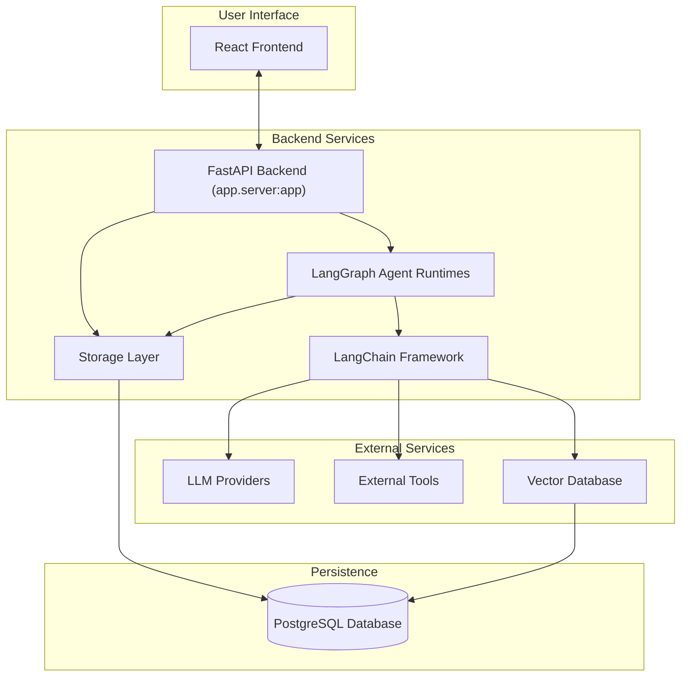
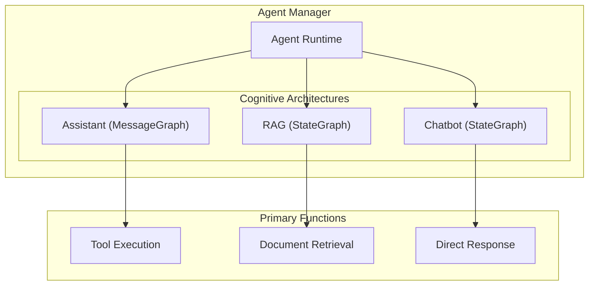
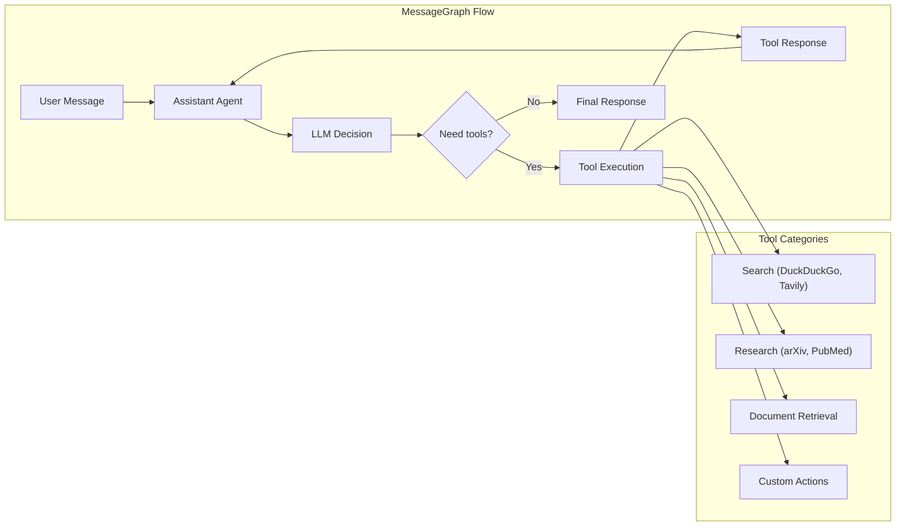
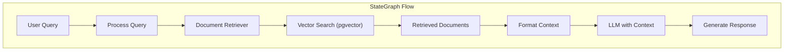
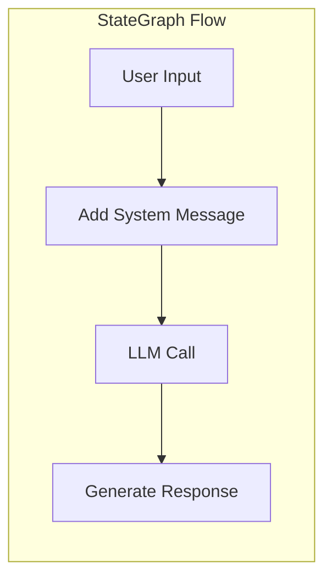
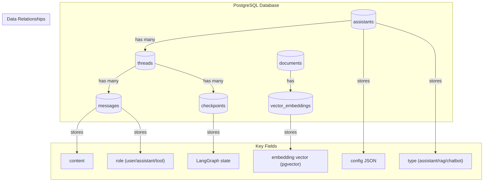
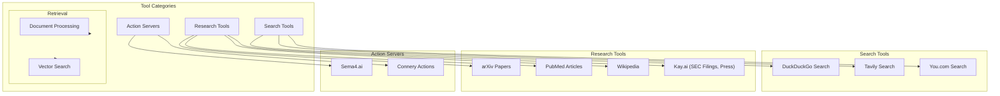
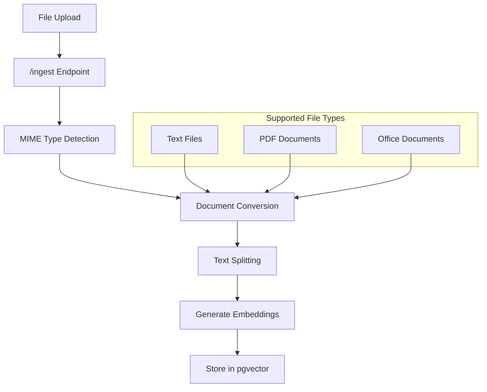
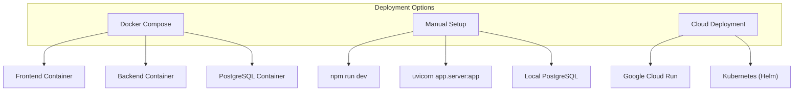

<!-- source: DeepWiki mcp.deepwiki.com · repo langchain-ai/opengpts · page 1 OpenGPTs Overview · fetched 2026-10-26 -->

# OpenGPTs Overview

<details>
<summary>Relevant source files</summary>

The following files were used as context for generating this wiki page:

- [README.md](README.md)

</details>


This page provides a comprehensive technical overview of OpenGPTs, an open-source project that replicates the functionality of OpenAI's GPTs and Assistants API. It covers the system architecture, cognitive approaches, and key components. For API-specific details, see [API and Authentication](#2.5), and for frontend implementation details, see [Frontend System](#3).

## Purpose and Scope

OpenGPTs is built on [LangGraph](https://github.com/langchain-ai/langgraph) for agent runtime management and leverages [LangChain](https://github.com/langchain-ai/langchain), [LangServe](https://github.com/langchain-ai/langserve), and [LangSmith](https://smith.langchain.com). The system gives users control over:

- Language models (60+ LLMs supported through LangChain)
- Prompts (with LangSmith for debugging)
- Tools (100+ built-in plus custom tools)
- Vector databases and retrieval algorithms
- Chat history storage

The project aims to provide an open-source alternative with greater customization options than OpenAI's commercial offering.

Sources: [README.md:1-16](), [backend/pyproject.toml:1-48]()

## System Architecture

OpenGPTs follows a client-server architecture with a React frontend communicating with a Python FastAPI backend. PostgreSQL serves as the persistence layer for storing assistant configurations, threads, messages, and vector data.

**High-Level System Architecture**



### Repository Structure

The codebase is organized as follows:

```
- frontend/               # React frontend code
- backend/                # Python backend code
  - app/                  # FastAPI server and API endpoints
    - agent_types/        # LLM configurations
  - packages/             # Core logic
    - agent-executor/     # Runtime for the agent
    - gizmo-agent/        # Agent configuration
  - migrations/           # PostgreSQL migration scripts
```

Sources: [README.md:264-272](), [Dockerfile:1-49](), [backend/Dockerfile:1-33]()

## Cognitive Architectures

OpenGPTs supports three cognitive architectures, each implemented using LangGraph but following different patterns:

**Cognitive Architecture Comparison**



Sources: [README.md:15-24](), [README.md:280-345]()

### Assistant Architecture

The most flexible architecture that can dynamically decide to use tools based on LLM analysis. This pattern closely resembles human reasoning but requires more capable models (like GPT-4 or Claude).

**Assistant Flow**



The Assistant architecture is implemented with LangGraph's `MessageGraph`, which models state as a list of messages that can be passed to an LLM.

Sources: [README.md:285-311]()

### RAG Architecture

A retrieval-focused architecture optimized for knowledge-based applications. It follows a structured flow where documents are first retrieved and then used to inform the LLM's response.

**RAG Flow**



The RAG architecture is simpler and more predictable than the Assistant architecture, making it work well with a wider variety of models, including open-source ones. It's implemented with LangGraph's `StateGraph`.

Sources: [README.md:313-332]()

### Chatbot Architecture

The simplest architecture - a direct LLM call with a system message for persona/character definition. While limited in capabilities, it's useful for straightforward conversational applications.

**Chatbot Flow**



The Chatbot architecture is also implemented with LangGraph's `StateGraph` but with minimal processing steps.

Sources: [README.md:333-344]()

## Persistence System

OpenGPTs uses PostgreSQL with the pgvector extension for all persistence needs:

**Database Schema**



The system recently transitioned from a pickle-based checkpointing system to a multi-table checkpoint management system with migration version 5, providing better state management for LangGraph agents.

Sources: [README.md:232-238](), [backend/pyproject.toml:38-42](), [backend/Makefile:19-20]()

## Tool Integrations

OpenGPTs supports various tool integrations through LangChain:

**Tool Ecosystem**



Tools can be configured when creating an assistant, with different tools available depending on the chosen cognitive architecture.

Sources: [README.md:392-492](), [backend/pyproject.toml:26-35]()

## File Processing and Vectorization

For knowledge-based applications, OpenGPTs supports file uploads that are processed and stored as vector embeddings:

**File Processing Pipeline**



The file processing pipeline uses LangChain's document loaders and text splitters to convert various file formats into chunks suitable for vector storage.

Sources: [README.md:248-251](), [backend/pyproject.toml:36-39]()

## Deployment Options

OpenGPTs can be deployed in several ways:

**Deployment Methods**



The simplest deployment method is using Docker Compose, which automatically sets up all required components. For production deployments, Cloud Run or Kubernetes options are available.

Sources: [README.md:36-93](), [README.md:493-520](), [Dockerfile:1-49]()

## Summary

OpenGPTs provides an open-source alternative to commercial AI assistant platforms with greater flexibility and customization. By leveraging LangGraph for agent runtimes and LangChain for LLM and tool integrations, it offers a powerful framework for building various types of assistants with different cognitive architectures. The PostgreSQL-based persistence system allows for sophisticated state management and vector search capabilities.

---

