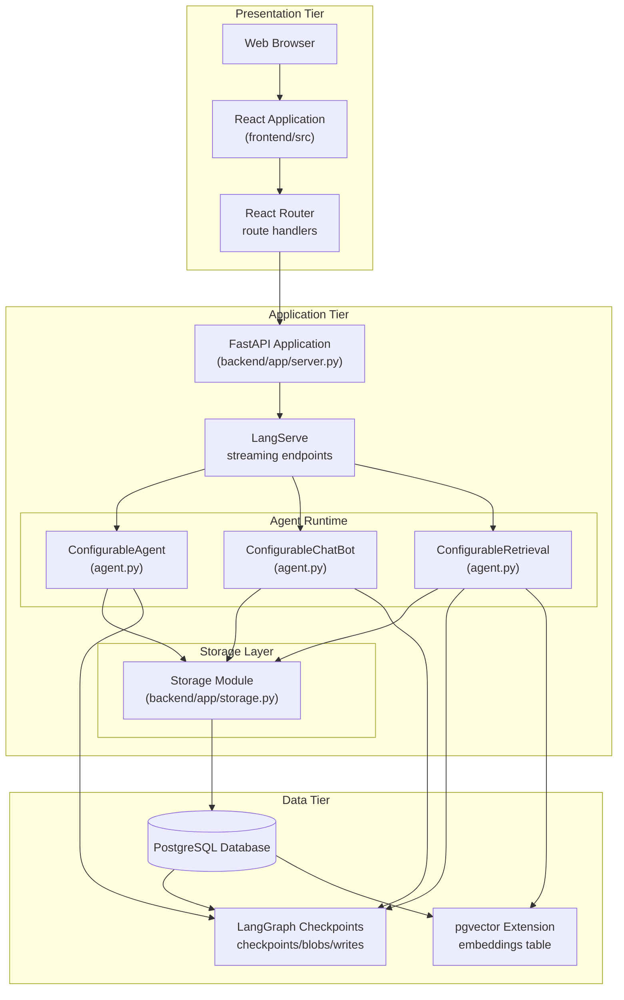
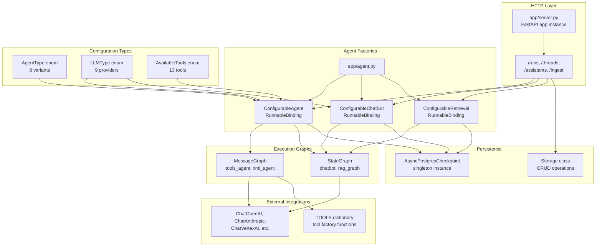
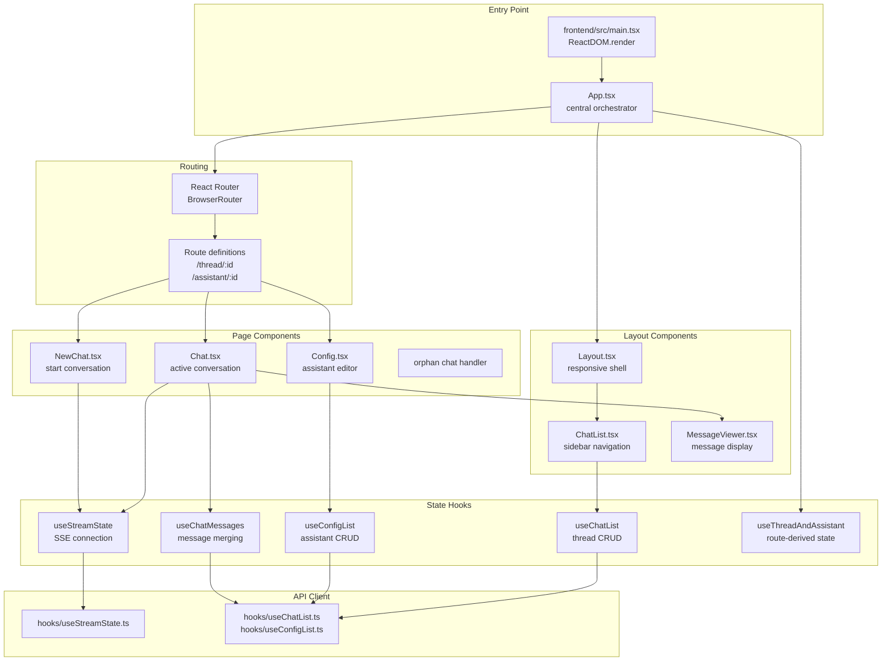
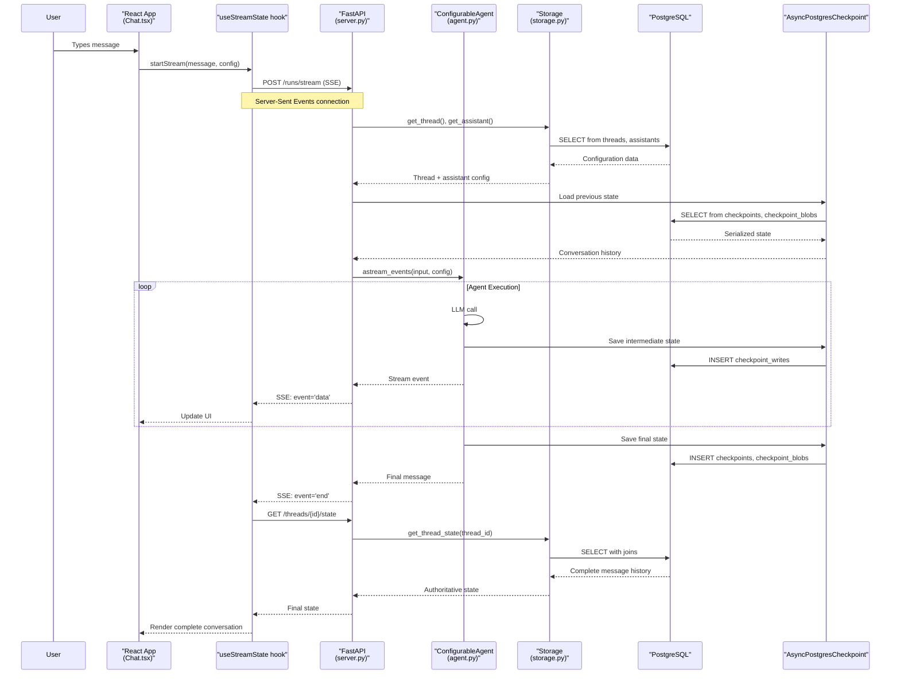

<!-- source: DeepWiki mcp.deepwiki.com · repo langchain-ai/opengpts · page 1.1 System Architecture · fetched 2026-10-26 -->

# System Architecture

<details>
<summary>Relevant source files</summary>

The following files were used as context for generating this wiki page:

- [Dockerfile](Dockerfile)
- [README.md](README.md)
- [backend/Dockerfile](backend/Dockerfile)
- [backend/Makefile](backend/Makefile)
- [backend/poetry.lock](backend/poetry.lock)
- [backend/pyproject.toml](backend/pyproject.toml)

</details>


## Purpose and Scope

This document provides a high-level overview of OpenGPTs' system architecture, including the three-tier design pattern, technology stack, and core component relationships. It focuses on how the major subsystems interact and the flow of data through the system.

For detailed information about individual backend components, see [Backend System](#2). For frontend-specific architecture, see [Frontend System](#3). For deployment configurations and infrastructure setup, see [Deployment and Configuration](#1.2).

## Technology Stack

OpenGPTs is built on a modern Python and JavaScript stack that leverages the LangChain ecosystem for AI agent functionality:

| Layer | Technology | Purpose |
|-------|-----------|---------|
| **Frontend** | React 18+ with TypeScript | Single-page application for user interaction |
| **Routing** | React Router v6 | Client-side navigation and state management |
| **Backend Framework** | FastAPI 0.103+ | Async HTTP server and REST API |
| **Agent Runtime** | LangGraph 0.2.45 | Stateful agent execution graphs |
| **LLM Integration** | LangChain 0.3+ | LLM abstractions and tool integrations |
| **API Serving** | LangServe | LangChain-specific HTTP streaming endpoints |
| **Database** | PostgreSQL 14+ | Persistent storage for threads, assistants, and messages |
| **Vector Store** | pgvector | Semantic search for uploaded documents |
| **Checkpoint Store** | AsyncPostgresCheckpoint | LangGraph state persistence |
| **Dependency Management** | Poetry (backend), npm/yarn (frontend) | Package management |
| **Server** | uvicorn | ASGI server for FastAPI |

**Sources:** [backend/pyproject.toml:1-89](), [backend/poetry.lock:1-100](), [README.md:1-520]()

## Three-Tier Architecture Overview

OpenGPTs follows a classical three-tier architecture with clear separation between presentation, application logic, and data persistence:



**Sources:** [backend/app/server.py](), [backend/app/agent.py](), [backend/app/storage.py](), [README.md:264-272]()

## Backend Core Components

The backend is structured around FastAPI endpoints that serve LangGraph-based agents. The system uses a factory pattern to create configurable agent instances:



**Sources:** [backend/app/server.py](), [backend/app/agent.py](), [backend/app/storage.py](), [README.md:269-272]()

### Key Backend Classes

**ConfigurableAgent, ConfigurableChatBot, ConfigurableRetrieval** ([backend/app/agent.py]())
- Factory functions that return `RunnableBinding` instances
- Accept configuration dictionaries with `agent_type`, `system_message`, `tools`, etc.
- Dynamically construct LangGraph execution graphs based on configuration

**Storage** ([backend/app/storage.py]())
- Provides CRUD operations for `assistants` and `threads` tables
- Methods: `list_assistants()`, `get_assistant()`, `put_assistant()`, `list_threads()`, `get_thread_state()`, etc.
- Uses asyncpg for async PostgreSQL operations

**AsyncPostgresCheckpoint** (from `langgraph-checkpoint-postgres`)
- Singleton instance initialized in [backend/app/agent.py]()
- Manages LangGraph state persistence across conversation turns
- Uses `checkpoints`, `checkpoint_blobs`, and `checkpoint_writes` tables

**Sources:** [backend/app/agent.py](), [backend/app/storage.py]()

## Frontend Core Components

The React frontend is organized around a central routing structure that conditionally renders different UI states:



**Sources:** [frontend/src/main.tsx](), [frontend/src/App.tsx](), [frontend/src/components/]()

### Key Frontend Components

**App.tsx** ([frontend/src/App.tsx]())
- Central routing logic that switches between 6 UI states
- Uses `useThreadAndAssistant` hook to derive current thread/assistant from URL params
- Conditionally renders Chat, NewChat, Config, or OrphanChat components

**useStreamState** ([frontend/src/hooks/useStreamState.ts]())
- Manages Server-Sent Events (SSE) connection to `/runs/stream` endpoint
- Handles streaming updates, file uploads via `/ingest`, and state refreshes
- Returns `startStream()`, `stopStream()`, and current streaming state

**useChatMessages** ([frontend/src/hooks/useChatMessages.ts]())
- Merges streaming messages with authoritative state from `/threads/{id}/state`
- Handles message deduplication and ordering
- Provides unified message list to Chat component

**useThreadAndAssistant** ([frontend/src/hooks/useThreadAndAssistant.ts]())
- Extracts `threadId` and `assistantId` from React Router URL params
- Fetches corresponding thread and assistant configurations
- Returns `currentChat` and `assistantConfig` objects

**Sources:** [frontend/src/App.tsx](), [frontend/src/hooks/useStreamState.ts](), [frontend/src/hooks/useChatMessages.ts](), [frontend/src/hooks/useThreadAndAssistant.ts]()

## Data Flow Architecture

The following diagram illustrates how a typical chat message flows through the system from user input to persistent storage:



**Sources:** [frontend/src/hooks/useStreamState.ts](), [backend/app/server.py](), [backend/app/agent.py](), [backend/app/storage.py]()

## Database Schema

The PostgreSQL database uses several interconnected tables to manage persistent state:

| Table | Purpose | Key Columns |
|-------|---------|-------------|
| `users` | User accounts (if auth enabled) | `user_id`, `sub` |
| `assistants` | Assistant configurations | `assistant_id`, `user_id`, `name`, `config` (JSONB), `public` |
| `threads` | Conversation threads | `thread_id`, `user_id`, `assistant_id`, `name`, `metadata` (JSONB) |
| `checkpoints` | LangGraph checkpoint metadata | `checkpoint_id`, `thread_id`, `parent_checkpoint_id`, `metadata` (JSONB) |
| `checkpoint_blobs` | Serialized checkpoint state | `checkpoint_id`, `channel`, `type`, `blob` (bytea) |
| `checkpoint_writes` | Pending write operations | `checkpoint_id`, `channel`, `task_id`, `blob` (bytea) |
| `langchain_pg_collection` | Vector store collections | `uuid`, `name`, `cmetadata` (JSONB) |
| `langchain_pg_embedding` | Document embeddings | `id`, `collection_id`, `embedding` (vector), `document`, `cmetadata` (JSONB) |

The schema is managed through golang-migrate migrations in [backend/migrations/]().

**Sources:** [backend/migrations/](), [README.md:118-163]()

## API Endpoint Structure

The FastAPI application exposes four primary endpoint groups:

**`/runs` endpoints** ([backend/app/api/runs.py]())
- `POST /runs/stream` - Server-Sent Events stream for agent execution
- Uses LangServe's `astream_events()` to stream intermediate results
- Handles file uploads, configuration merging, and checkpoint management

**`/threads` endpoints** ([backend/app/api/threads.py]())
- `GET /threads` - List user's threads
- `POST /threads` - Create new thread
- `GET /threads/{thread_id}/state` - Get thread message history
- `DELETE /threads/{thread_id}` - Delete thread

**`/assistants` endpoints** ([backend/app/api/assistants.py]())
- `GET /assistants` - List assistants (user's + public)
- `POST /assistants` - Create assistant
- `GET /assistants/{assistant_id}` - Get assistant config
- `PUT /assistants/{assistant_id}` - Update assistant
- `DELETE /assistants/{assistant_id}` - Delete assistant

**`/ingest` endpoints** ([backend/app/api/ingest.py]())
- `POST /ingest` - Upload and process documents
- Handles MIME type detection, chunking, embedding generation
- Stores vectors in `langchain_pg_embedding` table

**Sources:** [backend/app/server.py](), [backend/app/api/]()

## Deployment Configurations

OpenGPTs supports three deployment patterns, each using different Docker configurations:

### Multi-Stage Docker Build

The primary [Dockerfile:1-49]() uses a multi-stage build:

1. **Stage 1 (node:20)**: Builds React frontend
   - Compiles TypeScript and bundles JavaScript
   - Outputs to `frontend/dist/`

2. **Stage 2 (python:3.11)**: Builds backend
   - Installs golang-migrate for database migrations
   - Installs Python dependencies via Poetry
   - Copies compiled frontend to `backend/ui/`
   - Serves both API and static frontend from uvicorn

### Backend-Only Docker

The [backend/Dockerfile:1-33]() provides a backend-only image:
- Includes health check on `/health` endpoint
- Used for Kubernetes deployments where frontend is served separately
- Installs all dependencies (dev + prod)

### Docker Compose

The `docker-compose.yml` orchestrates three services:
- `backend`: Backend API server
- `frontend`: Development frontend (npm run dev)
- `db`: PostgreSQL with pgvector extension

**Sources:** [Dockerfile:1-49](), [backend/Dockerfile:1-33](), [README.md:36-94]()

## Key Integration Points

### LangGraph Checkpoint System

All three cognitive architectures (Agent, RAGBot, ChatBot) use a single `AsyncPostgresCheckpoint` instance ([backend/app/agent.py]()) for state persistence:

- **Checkpoint ID**: Unique identifier for each state snapshot
- **Thread ID**: Associates checkpoints with conversation threads
- **Parent Checkpoint ID**: Creates checkpoint lineage for state history
- **Channels**: Separate state channels (e.g., "messages", "pending_writes")

The checkpoint system enables:
- Conversation resumption across sessions
- State rollback to previous checkpoints
- Human-in-the-loop approval workflows (`interrupt_before_action`)

**Sources:** [backend/app/agent.py](), [README.md:232-238]()

### Vector Storage Integration

Document retrieval uses pgvector with namespace isolation:

```python
# Embeddings filtered by assistant_id and thread_id
cmetadata = {
    "assistant_id": assistant_id,
    "thread_id": thread_id
}
```

The `get_retrieval_tool()` function ([backend/app/agent.py]()) creates per-assistant vector stores that only access documents within their namespace.

**Sources:** [backend/app/agent.py](), [backend/app/api/ingest.py]()

### LangSmith Integration

Optional distributed tracing integration via environment variables:

```bash
LANGCHAIN_TRACING_V2=true
LANGCHAIN_API_KEY=...
```

When enabled, all LangChain/LangGraph operations automatically send traces to LangSmith for debugging and monitoring.

**Sources:** [README.md:199-208](), [backend/pyproject.toml:10-48]()

---

