# Page: OpenGPTs Overview

# OpenGPTs Overview

<details>
<summary>Relevant source files</summary>

The following files were used as context for generating this wiki page:

- [README.md](README.md)

</details>


This page provides a comprehensive technical overview of OpenGPTs, an open-source project that replicates the functionality of OpenAI's GPTs and Assistants API. It covers the system architecture, cognitive approaches, and key components. For API-specific details, see [API and Authentication](#2.5), and for frontend implementation details, see [Frontend System](#3).

## Purpose and Scope

OpenGPTs is built on [LangGraph](https://github.com/langchain-ai/langgraph) for agent runtime management and leverages [LangChain](https://github.com/langchain-ai/langchain), [LangServe](https://github.com/langchain-ai/langserve), and [LangSmith](https://smith.langchain.com). The system gives users control over:

- Language models (60+ LLMs supported through LangChain)
- Prompts (with LangSmith for debugging)
- Tools (100+ built-in plus custom tools)
- Vector databases and retrieval algorithms
- Chat history storage

The project aims to provide an open-source alternative with greater customization options than OpenAI's commercial offering.

Sources: [README.md:1-16](), [backend/pyproject.toml:1-48]()

## System Architecture

OpenGPTs follows a client-server architecture with a React frontend communicating with a Python FastAPI backend. PostgreSQL serves as the persistence layer for storing assistant configurations, threads, messages, and vector data.

**High-Level System Architecture**

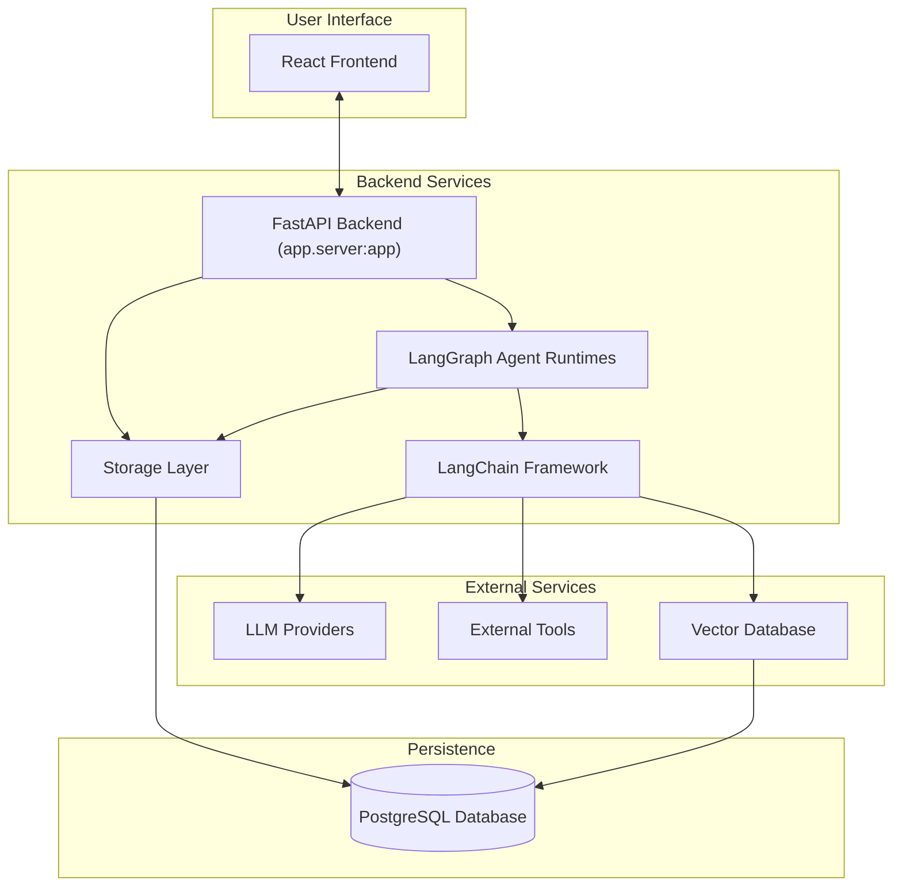

### Repository Structure

The codebase is organized as follows:

```
- frontend/               # React frontend code
- backend/                # Python backend code
  - app/                  # FastAPI server and API endpoints
    - agent_types/        # LLM configurations
  - packages/             # Core logic
    - agent-executor/     # Runtime for the agent
    - gizmo-agent/        # Agent configuration
  - migrations/           # PostgreSQL migration scripts
```

Sources: [README.md:264-272](), [Dockerfile:1-49](), [backend/Dockerfile:1-33]()

## Cognitive Architectures

OpenGPTs supports three cognitive architectures, each implemented using LangGraph but following different patterns:

**Cognitive Architecture Comparison**

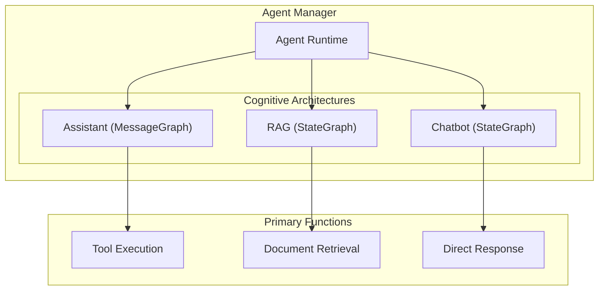

Sources: [README.md:15-24](), [README.md:280-345]()

### Assistant Architecture

The most flexible architecture that can dynamically decide to use tools based on LLM analysis. This pattern closely resembles human reasoning but requires more capable models (like GPT-4 or Claude).

**Assistant Flow**

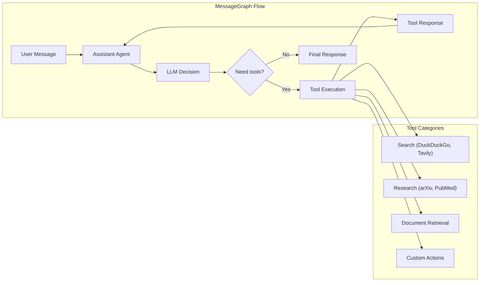

The Assistant architecture is implemented with LangGraph's `MessageGraph`, which models state as a list of messages that can be passed to an LLM.

Sources: [README.md:285-311]()

### RAG Architecture

A retrieval-focused architecture optimized for knowledge-based applications. It follows a structured flow where documents are first retrieved and then used to inform the LLM's response.

**RAG Flow**

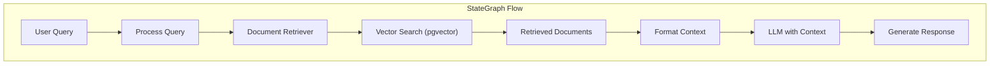

The RAG architecture is simpler and more predictable than the Assistant architecture, making it work well with a wider variety of models, including open-source ones. It's implemented with LangGraph's `StateGraph`.

Sources: [README.md:313-332]()

### Chatbot Architecture

The simplest architecture - a direct LLM call with a system message for persona/character definition. While limited in capabilities, it's useful for straightforward conversational applications.

**Chatbot Flow**

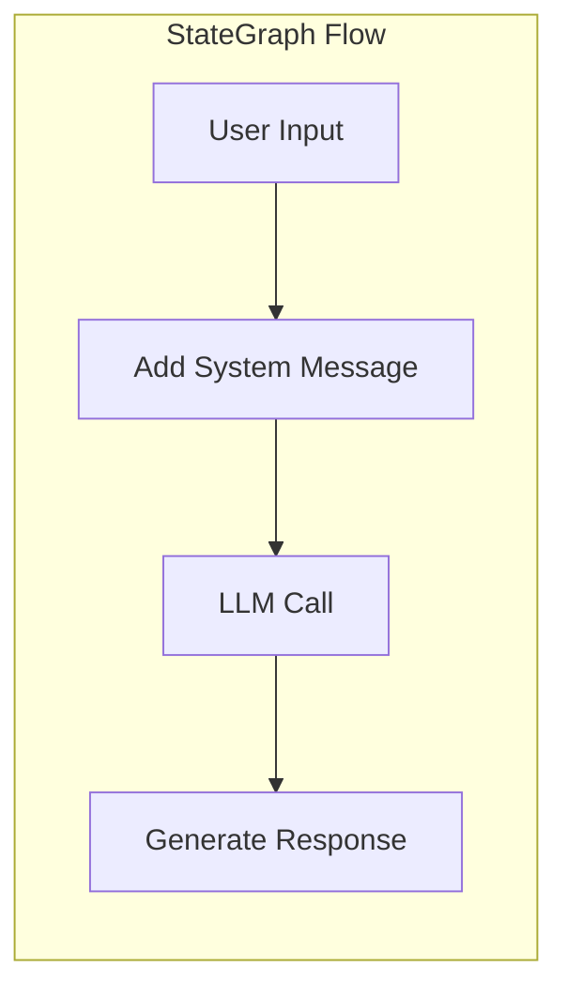

The Chatbot architecture is also implemented with LangGraph's `StateGraph` but with minimal processing steps.

Sources: [README.md:333-344]()

## Persistence System

OpenGPTs uses PostgreSQL with the pgvector extension for all persistence needs:

**Database Schema**

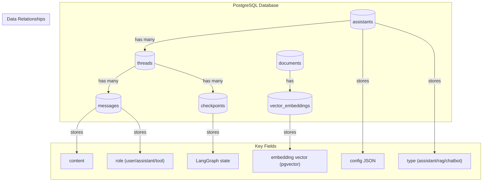

The system recently transitioned from a pickle-based checkpointing system to a multi-table checkpoint management system with migration version 5, providing better state management for LangGraph agents.

Sources: [README.md:232-238](), [backend/pyproject.toml:38-42](), [backend/Makefile:19-20]()

## Tool Integrations

OpenGPTs supports various tool integrations through LangChain:

**Tool Ecosystem**

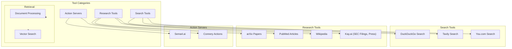

Tools can be configured when creating an assistant, with different tools available depending on the chosen cognitive architecture.

Sources: [README.md:392-492](), [backend/pyproject.toml:26-35]()

## File Processing and Vectorization

For knowledge-based applications, OpenGPTs supports file uploads that are processed and stored as vector embeddings:

**File Processing Pipeline**

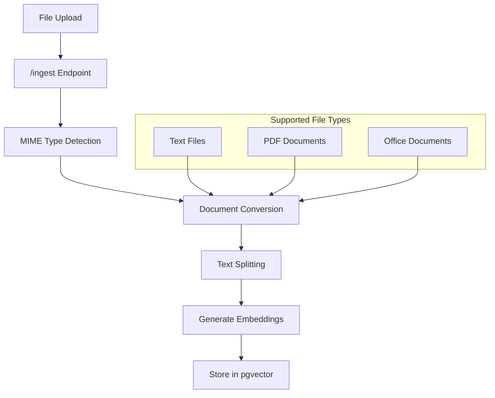

The file processing pipeline uses LangChain's document loaders and text splitters to convert various file formats into chunks suitable for vector storage.

Sources: [README.md:248-251](), [backend/pyproject.toml:36-39]()

## Deployment Options

OpenGPTs can be deployed in several ways:

**Deployment Methods**

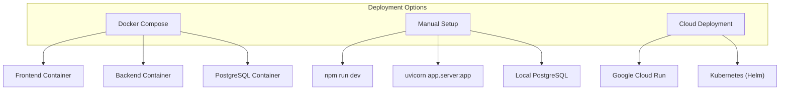

The simplest deployment method is using Docker Compose, which automatically sets up all required components. For production deployments, Cloud Run or Kubernetes options are available.

Sources: [README.md:36-93](), [README.md:493-520](), [Dockerfile:1-49]()

## Summary

OpenGPTs provides an open-source alternative to commercial AI assistant platforms with greater flexibility and customization. By leveraging LangGraph for agent runtimes and LangChain for LLM and tool integrations, it offers a powerful framework for building various types of assistants with different cognitive architectures. The PostgreSQL-based persistence system allows for sophisticated state management and vector search capabilities.

---

# Page: System Architecture

# System Architecture

<details>
<summary>Relevant source files</summary>

The following files were used as context for generating this wiki page:

- [Dockerfile](Dockerfile)
- [README.md](README.md)
- [backend/Dockerfile](backend/Dockerfile)
- [backend/Makefile](backend/Makefile)
- [backend/poetry.lock](backend/poetry.lock)
- [backend/pyproject.toml](backend/pyproject.toml)

</details>


## Purpose and Scope

This document provides a high-level overview of OpenGPTs' system architecture, including the three-tier design pattern, technology stack, and core component relationships. It focuses on how the major subsystems interact and the flow of data through the system.

For detailed information about individual backend components, see [Backend System](#2). For frontend-specific architecture, see [Frontend System](#3). For deployment configurations and infrastructure setup, see [Deployment and Configuration](#1.2).

## Technology Stack

OpenGPTs is built on a modern Python and JavaScript stack that leverages the LangChain ecosystem for AI agent functionality:

| Layer | Technology | Purpose |
|-------|-----------|---------|
| **Frontend** | React 18+ with TypeScript | Single-page application for user interaction |
| **Routing** | React Router v6 | Client-side navigation and state management |
| **Backend Framework** | FastAPI 0.103+ | Async HTTP server and REST API |
| **Agent Runtime** | LangGraph 0.2.45 | Stateful agent execution graphs |
| **LLM Integration** | LangChain 0.3+ | LLM abstractions and tool integrations |
| **API Serving** | LangServe | LangChain-specific HTTP streaming endpoints |
| **Database** | PostgreSQL 14+ | Persistent storage for threads, assistants, and messages |
| **Vector Store** | pgvector | Semantic search for uploaded documents |
| **Checkpoint Store** | AsyncPostgresCheckpoint | LangGraph state persistence |
| **Dependency Management** | Poetry (backend), npm/yarn (frontend) | Package management |
| **Server** | uvicorn | ASGI server for FastAPI |

**Sources:** [backend/pyproject.toml:1-89](), [backend/poetry.lock:1-100](), [README.md:1-520]()

## Three-Tier Architecture Overview

OpenGPTs follows a classical three-tier architecture with clear separation between presentation, application logic, and data persistence:

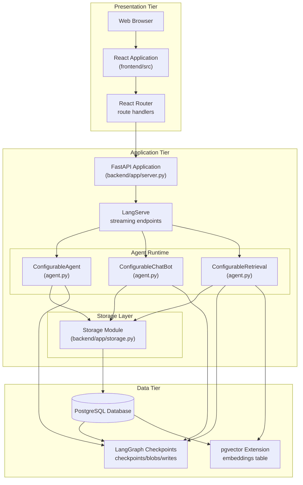

**Sources:** [backend/app/server.py](), [backend/app/agent.py](), [backend/app/storage.py](), [README.md:264-272]()

## Backend Core Components

The backend is structured around FastAPI endpoints that serve LangGraph-based agents. The system uses a factory pattern to create configurable agent instances:

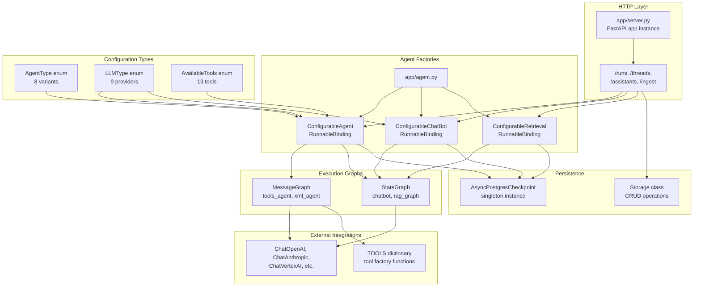

**Sources:** [backend/app/server.py](), [backend/app/agent.py](), [backend/app/storage.py](), [README.md:269-272]()

### Key Backend Classes

**ConfigurableAgent, ConfigurableChatBot, ConfigurableRetrieval** ([backend/app/agent.py]())
- Factory functions that return `RunnableBinding` instances
- Accept configuration dictionaries with `agent_type`, `system_message`, `tools`, etc.
- Dynamically construct LangGraph execution graphs based on configuration

**Storage** ([backend/app/storage.py]())
- Provides CRUD operations for `assistants` and `threads` tables
- Methods: `list_assistants()`, `get_assistant()`, `put_assistant()`, `list_threads()`, `get_thread_state()`, etc.
- Uses asyncpg for async PostgreSQL operations

**AsyncPostgresCheckpoint** (from `langgraph-checkpoint-postgres`)
- Singleton instance initialized in [backend/app/agent.py]()
- Manages LangGraph state persistence across conversation turns
- Uses `checkpoints`, `checkpoint_blobs`, and `checkpoint_writes` tables

**Sources:** [backend/app/agent.py](), [backend/app/storage.py]()

## Frontend Core Components

The React frontend is organized around a central routing structure that conditionally renders different UI states:

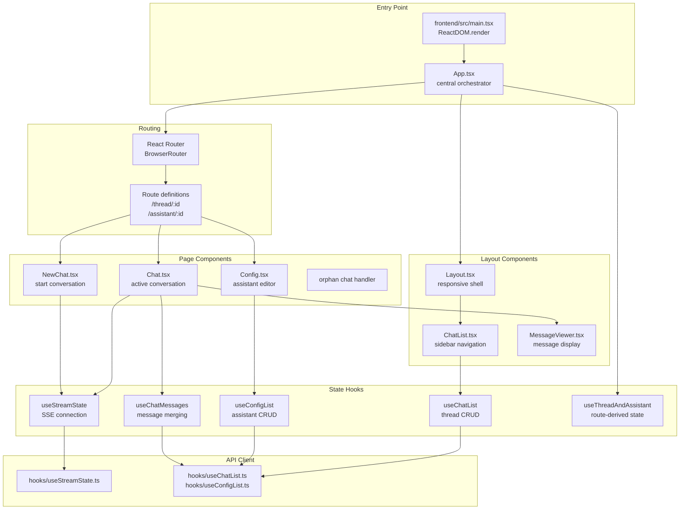

**Sources:** [frontend/src/main.tsx](), [frontend/src/App.tsx](), [frontend/src/components/]()

### Key Frontend Components

**App.tsx** ([frontend/src/App.tsx]())
- Central routing logic that switches between 6 UI states
- Uses `useThreadAndAssistant` hook to derive current thread/assistant from URL params
- Conditionally renders Chat, NewChat, Config, or OrphanChat components

**useStreamState** ([frontend/src/hooks/useStreamState.ts]())
- Manages Server-Sent Events (SSE) connection to `/runs/stream` endpoint
- Handles streaming updates, file uploads via `/ingest`, and state refreshes
- Returns `startStream()`, `stopStream()`, and current streaming state

**useChatMessages** ([frontend/src/hooks/useChatMessages.ts]())
- Merges streaming messages with authoritative state from `/threads/{id}/state`
- Handles message deduplication and ordering
- Provides unified message list to Chat component

**useThreadAndAssistant** ([frontend/src/hooks/useThreadAndAssistant.ts]())
- Extracts `threadId` and `assistantId` from React Router URL params
- Fetches corresponding thread and assistant configurations
- Returns `currentChat` and `assistantConfig` objects

**Sources:** [frontend/src/App.tsx](), [frontend/src/hooks/useStreamState.ts](), [frontend/src/hooks/useChatMessages.ts](), [frontend/src/hooks/useThreadAndAssistant.ts]()

## Data Flow Architecture

The following diagram illustrates how a typical chat message flows through the system from user input to persistent storage:

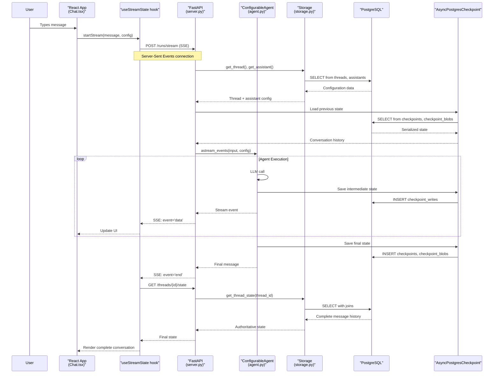

**Sources:** [frontend/src/hooks/useStreamState.ts](), [backend/app/server.py](), [backend/app/agent.py](), [backend/app/storage.py]()

## Database Schema

The PostgreSQL database uses several interconnected tables to manage persistent state:

| Table | Purpose | Key Columns |
|-------|---------|-------------|
| `users` | User accounts (if auth enabled) | `user_id`, `sub` |
| `assistants` | Assistant configurations | `assistant_id`, `user_id`, `name`, `config` (JSONB), `public` |
| `threads` | Conversation threads | `thread_id`, `user_id`, `assistant_id`, `name`, `metadata` (JSONB) |
| `checkpoints` | LangGraph checkpoint metadata | `checkpoint_id`, `thread_id`, `parent_checkpoint_id`, `metadata` (JSONB) |
| `checkpoint_blobs` | Serialized checkpoint state | `checkpoint_id`, `channel`, `type`, `blob` (bytea) |
| `checkpoint_writes` | Pending write operations | `checkpoint_id`, `channel`, `task_id`, `blob` (bytea) |
| `langchain_pg_collection` | Vector store collections | `uuid`, `name`, `cmetadata` (JSONB) |
| `langchain_pg_embedding` | Document embeddings | `id`, `collection_id`, `embedding` (vector), `document`, `cmetadata` (JSONB) |

The schema is managed through golang-migrate migrations in [backend/migrations/]().

**Sources:** [backend/migrations/](), [README.md:118-163]()

## API Endpoint Structure

The FastAPI application exposes four primary endpoint groups:

**`/runs` endpoints** ([backend/app/api/runs.py]())
- `POST /runs/stream` - Server-Sent Events stream for agent execution
- Uses LangServe's `astream_events()` to stream intermediate results
- Handles file uploads, configuration merging, and checkpoint management

**`/threads` endpoints** ([backend/app/api/threads.py]())
- `GET /threads` - List user's threads
- `POST /threads` - Create new thread
- `GET /threads/{thread_id}/state` - Get thread message history
- `DELETE /threads/{thread_id}` - Delete thread

**`/assistants` endpoints** ([backend/app/api/assistants.py]())
- `GET /assistants` - List assistants (user's + public)
- `POST /assistants` - Create assistant
- `GET /assistants/{assistant_id}` - Get assistant config
- `PUT /assistants/{assistant_id}` - Update assistant
- `DELETE /assistants/{assistant_id}` - Delete assistant

**`/ingest` endpoints** ([backend/app/api/ingest.py]())
- `POST /ingest` - Upload and process documents
- Handles MIME type detection, chunking, embedding generation
- Stores vectors in `langchain_pg_embedding` table

**Sources:** [backend/app/server.py](), [backend/app/api/]()

## Deployment Configurations

OpenGPTs supports three deployment patterns, each using different Docker configurations:

### Multi-Stage Docker Build

The primary [Dockerfile:1-49]() uses a multi-stage build:

1. **Stage 1 (node:20)**: Builds React frontend
   - Compiles TypeScript and bundles JavaScript
   - Outputs to `frontend/dist/`

2. **Stage 2 (python:3.11)**: Builds backend
   - Installs golang-migrate for database migrations
   - Installs Python dependencies via Poetry
   - Copies compiled frontend to `backend/ui/`
   - Serves both API and static frontend from uvicorn

### Backend-Only Docker

The [backend/Dockerfile:1-33]() provides a backend-only image:
- Includes health check on `/health` endpoint
- Used for Kubernetes deployments where frontend is served separately
- Installs all dependencies (dev + prod)

### Docker Compose

The `docker-compose.yml` orchestrates three services:
- `backend`: Backend API server
- `frontend`: Development frontend (npm run dev)
- `db`: PostgreSQL with pgvector extension

**Sources:** [Dockerfile:1-49](), [backend/Dockerfile:1-33](), [README.md:36-94]()

## Key Integration Points

### LangGraph Checkpoint System

All three cognitive architectures (Agent, RAGBot, ChatBot) use a single `AsyncPostgresCheckpoint` instance ([backend/app/agent.py]()) for state persistence:

- **Checkpoint ID**: Unique identifier for each state snapshot
- **Thread ID**: Associates checkpoints with conversation threads
- **Parent Checkpoint ID**: Creates checkpoint lineage for state history
- **Channels**: Separate state channels (e.g., "messages", "pending_writes")

The checkpoint system enables:
- Conversation resumption across sessions
- State rollback to previous checkpoints
- Human-in-the-loop approval workflows (`interrupt_before_action`)

**Sources:** [backend/app/agent.py](), [README.md:232-238]()

### Vector Storage Integration

Document retrieval uses pgvector with namespace isolation:

```python
# Embeddings filtered by assistant_id and thread_id
cmetadata = {
    "assistant_id": assistant_id,
    "thread_id": thread_id
}
```

The `get_retrieval_tool()` function ([backend/app/agent.py]()) creates per-assistant vector stores that only access documents within their namespace.

**Sources:** [backend/app/agent.py](), [backend/app/api/ingest.py]()

### LangSmith Integration

Optional distributed tracing integration via environment variables:

```bash
LANGCHAIN_TRACING_V2=true
LANGCHAIN_API_KEY=...
```

When enabled, all LangChain/LangGraph operations automatically send traces to LangSmith for debugging and monitoring.

**Sources:** [README.md:199-208](), [backend/pyproject.toml:10-48]()

---

# Page: Deployment and Configuration

# Deployment and Configuration

<details>
<summary>Relevant source files</summary>

The following files were used as context for generating this wiki page:

- [.env.example](.env.example)
- [.env.gcp.yaml.example](.env.gcp.yaml.example)
- [Dockerfile](Dockerfile)
- [backend/Dockerfile](backend/Dockerfile)
- [backend/Makefile](backend/Makefile)

</details>


## Purpose and Scope

This document covers the deployment and configuration infrastructure for OpenGPTs, including Docker containerization, environment variable management, database setup, and deployment to various platforms. It focuses on the technical mechanics of getting the application running in different environments, from local development to cloud production.

For information about the runtime API endpoints and backend server configuration, see [API Endpoints](#2.5). For database schema and state management details, see [Storage and State Management](#2.3).

---

## Deployment Modes Overview

OpenGPTs supports three primary deployment modes, each optimized for different use cases:

```mermaid
graph TB
    subgraph "Mode 1: Local Development"
        DevMake["make start<br/>(Port 8100)"]
        DevFE["npm run dev<br/>(Port 5173)"]
        DevDB["PostgreSQL<br/>(Local/Docker)"]
        
        DevMake --> DevDB
        DevFE -.proxy to.-> DevMake
    end
    
    subgraph "Mode 2: Docker Compose"
        Compose["docker-compose up"]
        ComposeBackend["Backend Container<br/>(Port 8000)"]
        ComposeFE["Compiled Frontend<br/>(Served from /ui)"]
        ComposeDB["PostgreSQL Container<br/>(Port 5432)"]
        
        Compose --> ComposeBackend
        Compose --> ComposeDB
        ComposeBackend --> ComposeFE
        ComposeBackend --> ComposeDB
    end
    
    subgraph "Mode 3: Production Cloud"
        CloudImage["Multi-stage<br/>Docker Build"]
        K8s["Kubernetes<br/>(Helm Chart)"]
        CloudRun["Google Cloud Run<br/>(Serverless)"]
        ExtDB["External PostgreSQL<br/>(Cloud SQL, RDS, etc)"]
        
        CloudImage --> K8s
        CloudImage --> CloudRun
        K8s --> ExtDB
        CloudRun --> ExtDB
    end
    
    style DevMake fill:#f9f9f9
    style ComposeBackend fill:#f9f9f9
    style CloudImage fill:#f9f9f9
```

**Deployment Mode Comparison**

| Mode | Use Case | Frontend | Backend | Database | Ports |
|------|----------|----------|---------|----------|-------|
| Local Dev | Development with hot reload | Separate Vite server | Poetry + uvicorn | Local PostgreSQL | FE: 5173, BE: 8100 |
| Docker Compose | Local testing, demos | Compiled into backend | Single container | Docker container | Exposed: 8000, 5432 |
| Production Cloud | Scalable deployment | Compiled into backend | Multi-replica | External managed | Load balancer → 8000 |

**Sources:** [Dockerfile:1-49](), [backend/Dockerfile:1-33](), [backend/Makefile:16-20]()

---

## Multi-Stage Docker Build

The production Dockerfile uses a multi-stage build to optimize image size and separate frontend and backend compilation:

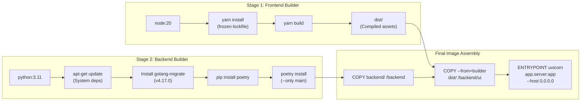

### Stage 1: Frontend Compilation

The frontend build stage uses Node.js 20 to compile the React application:

**Key Steps:**
1. **Dependency Installation**: `yarn install --frozen-lockfile --network-timeout 600000` ensures reproducible builds [Dockerfile:7]()
2. **Environment Cleanup**: Removes `.env` file to prevent accidental inclusion of secrets [Dockerfile:11]()
3. **Production Build**: `yarn build` generates optimized static assets in `dist/` [Dockerfile:13]()

### Stage 2: Backend Setup

The backend stage installs system dependencies and Python packages:

**Key Components:**
- **Base Image**: `python:3.11` provides the runtime environment [Dockerfile:16]()
- **Multi-architecture Support**: Uses `TARGETOS`, `TARGETARCH`, `TARGETVARIANT` build args for cross-platform builds [Dockerfile:18-20]()
- **Migration Tool**: Installs `golang-migrate` v4.17.0 for database schema management [Dockerfile:24-26]()
- **Poetry Configuration**: Disables virtualenv creation and installs only production dependencies (`--only main`) [Dockerfile:39-40]()

### Final Image Assembly

The final image copies both frontend and backend, serving the frontend from the backend:

**File Structure:**
```
/backend/
├── app/
│   └── server.py          # FastAPI application
├── ui/                     # Frontend static assets (from Stage 1)
│   ├── index.html
│   └── assets/
├── migrations/             # Database migration files
└── log_config.json         # Uvicorn logging configuration
```

**Entrypoint:** `uvicorn app.server:app --host 0.0.0.0 --log-config log_config.json` [Dockerfile:48]()

**Sources:** [Dockerfile:1-49]()

---

## Backend-Only Docker Build

The `backend/Dockerfile` provides an alternative build for development and Kubernetes deployments that require health checks:

**Key Differences from Multi-Stage Build:**

| Feature | Multi-Stage Dockerfile | Backend-Only Dockerfile |
|---------|----------------------|------------------------|
| Frontend | Compiled and included | Not included (expects external build) |
| Dependencies | Production only (`--only main`) | All dependencies including dev [backend/Dockerfile:24-25]() |
| Health Check | None | Configured with curl [backend/Dockerfile:30]() |
| Use Case | Cloud Run, standalone deployment | Kubernetes, development |

**Health Check Configuration:**
```dockerfile
HEALTHCHECK --interval=30s --timeout=5s --start-period=10s --start-interval=1s --retries=3 \
  CMD [ "curl", "-f", "http://localhost:8000/health" ]
```

This probes the `/health` endpoint every 30 seconds, allowing Kubernetes to detect and restart unhealthy pods.

**Sources:** [backend/Dockerfile:1-33]()

---

## Environment Configuration

OpenGPTs uses environment variables for all configuration. Two template files document the required variables:

### Configuration Files

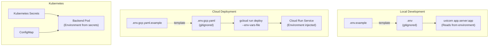

### Environment Variables Reference

**LLM Provider Configuration**

| Variable | Purpose | Required | Example |
|----------|---------|----------|---------|
| `OPENAI_API_KEY` | OpenAI API authentication | For GPT models | `sk-...` |
| `ANTHROPIC_API_KEY` | Anthropic API authentication | For Claude models | `sk-ant-...` |
| `AZURE_OPENAI_DEPLOYMENT_NAME` | Azure OpenAI deployment identifier | For Azure OpenAI | `gpt-4-deployment` |
| `AZURE_OPENAI_API_KEY` | Azure OpenAI authentication | For Azure OpenAI | `...` |
| `AZURE_OPENAI_API_BASE` | Azure OpenAI endpoint URL | For Azure OpenAI | `https://your-resource.openai.azure.com/` |
| `AZURE_OPENAI_API_VERSION` | Azure OpenAI API version | For Azure OpenAI | `2023-05-15` |
| `AZURE_OPENAI_EMBEDDINGS_DEPLOYMENT_NAME` | Embeddings model deployment | For Azure embeddings | `text-embedding-ada-002` |
| `FIREWORKS_API_KEY` | Fireworks.ai API key | For Mixtral models | `...` |
| `AWS_ACCESS_KEY_ID` | AWS credentials for Bedrock | For Bedrock models | `AKIA...` |
| `AWS_SECRET_ACCESS_KEY` | AWS secret key for Bedrock | For Bedrock models | `...` |

**Tool and Service Configuration**

| Variable | Purpose | Required | Example |
|----------|---------|----------|---------|
| `TAVILY_API_KEY` | Tavily search API | For Tavily search tool | `tvly-...` |
| `YDC_API_KEY` | You.com API key | For You.com search tool | `...` |
| `KAY_API_KEY` | Kay.ai API authentication | For SEC filings tool | `...` |
| `CONNERY_RUNNER_URL` | Connery runner endpoint | For Connery actions | `https://your-runner-url` |
| `CONNERY_RUNNER_API_KEY` | Connery authentication | For Connery actions | `...` |
| `PROXY_URL` | HTTP proxy for outbound requests | Optional | `http://proxy:8080` |

**Database Configuration**

| Variable | Purpose | Required | Example |
|----------|---------|----------|---------|
| `POSTGRES_HOST` | PostgreSQL hostname | Yes | `localhost` or `your-db.region.rds.amazonaws.com` |
| `POSTGRES_PORT` | PostgreSQL port | Yes | `5432` |
| `POSTGRES_DB` | Database name | Yes | `opengpts` |
| `POSTGRES_USER` | Database username | Yes | `postgres` |
| `POSTGRES_PASSWORD` | Database password | Yes | `secure_password` |

**Observability Configuration**

| Variable | Purpose | Required | Example |
|----------|---------|----------|---------|
| `LANGCHAIN_TRACING_V2` | Enable LangSmith tracing | Optional | `true` |
| `LANGCHAIN_PROJECT` | LangSmith project name | Optional | `opengpts-production` |
| `LANGCHAIN_API_KEY` | LangSmith API key | Optional | `ls__...` |
| `SCARF_NO_ANALYTICS` | Disable Scarf telemetry | Optional | `true` |

**Sources:** [.env.example:1-17](), [.env.gcp.yaml.example:1-20]()

---

## Local Development Setup

For local development with hot reload capabilities:

### Prerequisites

1. **PostgreSQL Database**: Install locally or run via Docker:
   ```bash
   docker run -d --name opengpts-postgres \
     -e POSTGRES_DB=opengpts \
     -e POSTGRES_USER=postgres \
     -e POSTGRES_PASSWORD=password \
     -p 5432:5432 \
     postgres:15
   ```

2. **Environment Configuration**: Copy and populate `.env.example`:
   ```bash
   cp .env.example .env
   # Edit .env with your API keys and database credentials
   ```

3. **Python Dependencies**: Install via Poetry in the backend directory:
   ```bash
   cd backend
   poetry install
   ```

4. **Frontend Dependencies**: Install via Yarn in the frontend directory:
   ```bash
   cd frontend
   yarn install
   ```

### Starting the Development Servers

**Backend (Port 8100):**
```bash
cd backend
make start
```

This executes: `poetry run uvicorn app.server:app --reload --port 8100 --log-config log_config.json` [backend/Makefile:17]()

**Frontend (Port 5173):**
```bash
cd frontend
yarn dev
```

The frontend development server proxies API requests to `http://localhost:8100`, enabling hot module replacement while maintaining backend connectivity.

**Port Convention Note:** Development uses port 8100 instead of 8000 to avoid conflicts with other services commonly running on port 8000. Production deployments use port 8000.

**Sources:** [backend/Makefile:16-17]()

---

## Database Migrations

OpenGPTs uses `golang-migrate` for schema versioning and migrations.

### Migration Execution

**Programmatic Migration (Recommended):**
The migration occurs automatically when the backend starts, using the embedded migration files in `backend/migrations/`.

**Manual Migration via Makefile:**
```bash
cd backend
make migrate
```

This executes the migration command with environment variables [backend/Makefile:19-20]():
```bash
migrate -database postgres://$(POSTGRES_USER):$(POSTGRES_PASSWORD)@$(POSTGRES_HOST):$(POSTGRES_PORT)/$(POSTGRES_DB)?sslmode=disable \
  -path ./migrations up
```

### Migration Tool Installation

The migration tool is installed during Docker image builds [Dockerfile:24-26]():
```dockerfile
RUN wget -O golang-migrate.deb \
  https://github.com/golang-migrate/migrate/releases/download/v4.17.0/migrate.${TARGETOS}-${TARGETARCH}${TARGETVARIANT}.deb \
  && dpkg -i golang-migrate.deb \
  && rm golang-migrate.deb
```

**Multi-Architecture Support:** The installation URL uses build arguments (`TARGETOS`, `TARGETARCH`, `TARGETVARIANT`) to download the correct binary for ARM64, AMD64, and other architectures.

### Migration Files Structure

Migration files are stored in `backend/migrations/` with paired up/down versions:
```
migrations/
├── 000001_initial.up.sql
├── 000001_initial.down.sql
├── 000002_add_checkpoints.up.sql
├── 000002_add_checkpoints.down.sql
└── ...
```

For details on the database schema created by these migrations, see [Storage and State Management](#2.3).

**Sources:** [backend/Makefile:19-20](), [Dockerfile:24-26](), [backend/Dockerfile:10-12]()

---

## Docker Compose Deployment

For local testing or single-machine deployments, Docker Compose provides a complete stack:

### Service Architecture

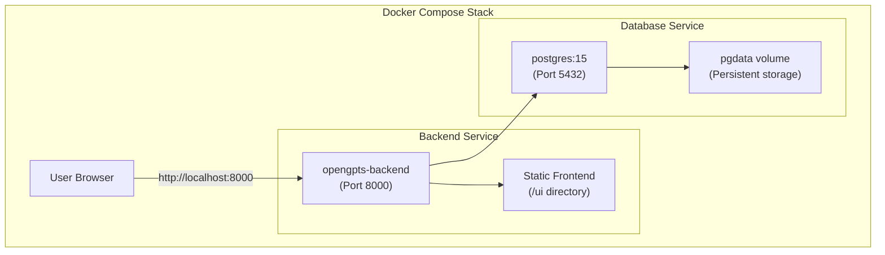

### Starting the Stack

```bash
docker-compose up -d
```

This starts:
1. **PostgreSQL container** with persistent volume
2. **Backend container** built from the multi-stage Dockerfile
3. **Networking** between containers via Docker bridge

### Accessing the Application

- **Web Interface**: `http://localhost:8000`
- **API Documentation**: `http://localhost:8000/docs`
- **Health Check**: `http://localhost:8000/health`
- **PostgreSQL**: `localhost:5432` (for database clients)

### Building the Frontend

Before running Docker Compose, build the frontend if not already done:

```bash
cd backend
make build_ui
```

This executes [backend/Makefile:6-7]():
```bash
cd ../frontend && yarn build && cp -r dist/* ../backend/ui
```

**Sources:** [backend/Makefile:6-7]()

---

## Google Cloud Run Deployment

Cloud Run provides serverless, auto-scaling deployment for OpenGPTs:

### Deployment Flow

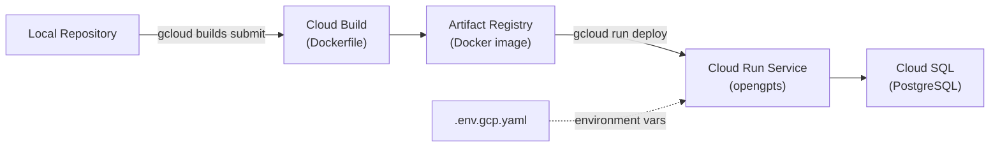

### Deployment Command

```bash
gcloud run deploy opengpts \
  --source . \
  --region us-central1 \
  --env-vars-file .env.gcp.yaml \
  --allow-unauthenticated \
  --max-instances 10 \
  --memory 2Gi \
  --cpu 2 \
  --timeout 300
```

**Configuration Options:**
- **`--source .`**: Builds from the current directory using the root Dockerfile
- **`--env-vars-file .env.gcp.yaml`**: Injects environment variables from YAML file [.env.gcp.yaml.example:1-20]()
- **`--max-instances 10`**: Limits concurrent instances for cost control
- **`--memory 2Gi`**: Allocates sufficient memory for LLM operations
- **`--timeout 300`**: Allows up to 5 minutes for long-running agent executions

### Cloud SQL Connection

For managed PostgreSQL, configure Cloud SQL Proxy or direct VPC connection:

**Environment Variables:**
```yaml
POSTGRES_HOST: /cloudsql/project:region:instance  # Unix socket path
POSTGRES_PORT: 5432
POSTGRES_DB: opengpts
POSTGRES_USER: postgres
POSTGRES_PASSWORD: stored_in_secret_manager
```

**Cloud Run Service Configuration:**
- Add `--add-cloudsql-instances=project:region:instance` to the deploy command
- Ensure the Cloud Run service account has `cloudsql.client` role

**Sources:** [.env.gcp.yaml.example:15-19]()

---

## Kubernetes Deployment

For production environments requiring high availability and control:

### Helm Chart Structure

OpenGPTs provides a Helm chart for Kubernetes deployment in `helm/open-gpts/`:

```
helm/open-gpts/
├── Chart.yaml                 # Chart metadata
├── values.yaml                # Default configuration
├── templates/
│   ├── deployment.yaml        # Backend pods
│   ├── service.yaml           # ClusterIP service
│   ├── ingress.yaml           # HTTP(S) routing
│   ├── configmap.yaml         # Non-sensitive config
│   └── secrets.yaml           # Sensitive credentials
```

### Deployment Architecture

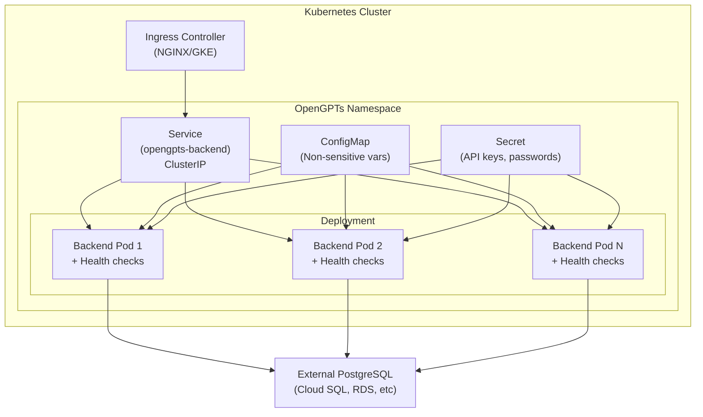

### Installing the Helm Chart

```bash
# Add Helm repository (if published)
helm repo add opengpts https://charts.opengpts.example.com
helm repo update

# Install with custom values
helm install opengpts opengpts/open-gpts \
  --namespace opengpts \
  --create-namespace \
  --values custom-values.yaml
```

### Values Configuration Example

```yaml
# custom-values.yaml
replicaCount: 3

image:
  repository: gcr.io/your-project/opengpts
  tag: "latest"
  pullPolicy: IfNotPresent

service:
  type: ClusterIP
  port: 8000

ingress:
  enabled: true
  className: nginx
  hosts:
    - host: opengpts.example.com
      paths:
        - path: /
          pathType: Prefix
  tls:
    - secretName: opengpts-tls
      hosts:
        - opengpts.example.com

env:
  POSTGRES_HOST: "postgres.database.svc.cluster.local"
  POSTGRES_PORT: "5432"
  POSTGRES_DB: "opengpts"
  LANGCHAIN_TRACING_V2: "true"
  LANGCHAIN_PROJECT: "opengpts-production"

secrets:
  OPENAI_API_KEY: "sk-..."
  ANTHROPIC_API_KEY: "sk-ant-..."
  POSTGRES_PASSWORD: "secure_password"
  LANGCHAIN_API_KEY: "ls__..."

resources:
  requests:
    memory: "1Gi"
    cpu: "500m"
  limits:
    memory: "2Gi"
    cpu: "2000m"

livenessProbe:
  httpGet:
    path: /health
    port: 8000
  initialDelaySeconds: 30
  periodSeconds: 10

readinessProbe:
  httpGet:
    path: /health
    port: 8000
  initialDelaySeconds: 10
  periodSeconds: 5
```

### Health Checks Configuration

The backend Dockerfile includes a health check endpoint [backend/Dockerfile:30]():

**Liveness Probe:** Restarts the pod if `/health` fails for 3 consecutive checks
**Readiness Probe:** Removes pod from service endpoints if `/health` fails

This ensures traffic is only routed to healthy pods and failed pods are automatically recovered.

**Sources:** [backend/Dockerfile:30]()

---

## Configuration Best Practices

### Security Recommendations

1. **Never commit `.env` or `.env.gcp.yaml` files**: These are `.gitignored` to prevent accidental credential exposure
2. **Use secret management systems**: 
   - Google Cloud: Secret Manager
   - AWS: Secrets Manager or Parameter Store
   - Kubernetes: Sealed Secrets or External Secrets Operator
3. **Rotate API keys regularly**: Especially for LLM providers with high usage costs
4. **Enable LANGCHAIN_TRACING_V2**: Helps debug agent execution and detect security issues

### Performance Optimization

1. **Database Connection Pooling**: Configure `asyncpg` pool size based on expected concurrency
2. **Memory Allocation**: Allocate at least 2Gi for LLM operations, especially with embeddings
3. **CPU Limits**: Set realistic CPU limits to prevent throttling during agent execution
4. **Persistent Volumes**: Use SSD-backed storage for PostgreSQL to improve checkpoint read/write performance

### Monitoring and Observability

1. **LangSmith Integration**: Configure `LANGCHAIN_TRACING_V2=true` for execution traces [.env.gcp.yaml.example:2-4]()
2. **Health Checks**: Ensure `/health` endpoint is monitored by load balancers
3. **Logging**: The `log_config.json` file configures structured logging for uvicorn [Dockerfile:48]()
4. **Metrics**: Consider adding Prometheus exporters for custom agent metrics

**Sources:** [.env.gcp.yaml.example:2-4](), [Dockerfile:48]()

---

## Troubleshooting

### Common Issues

**Issue: "ConnectionRefusedError: [Errno 111] Connect call failed"**
- **Cause**: Backend cannot reach PostgreSQL
- **Solution**: Verify `POSTGRES_HOST`, `POSTGRES_PORT`, and database is running
- **Docker Compose**: Ensure services are on the same network

**Issue: "ImportError: cannot import name 'ConfigurableAgent'"**
- **Cause**: Poetry dependencies not installed
- **Solution**: Run `poetry install` in `backend/` directory

**Issue: Frontend shows blank page after Docker build**
- **Cause**: Frontend not copied to `/backend/ui`
- **Solution**: Verify multi-stage build completed and `COPY --from=builder` succeeded [Dockerfile:46]()

**Issue: "migrate: no such file or directory"**
- **Cause**: golang-migrate not installed in Docker image
- **Solution**: Check Dockerfile includes migration tool installation [Dockerfile:24-26]()

**Issue: Health check failing in Kubernetes**
- **Cause**: Pod not fully initialized before first probe
- **Solution**: Increase `initialDelaySeconds` in liveness/readiness probe configuration [backend/Dockerfile:30]()

### Port Conflicts

If port 8100 (development) or 8000 (production) are in use:

**Development:**
```bash
poetry run uvicorn app.server:app --reload --port 8200 --log-config log_config.json
```

**Docker Override:**
```bash
docker-compose up -d -p 8888:8000
```

**Sources:** [Dockerfile:24-26](), [Dockerfile:46](), [backend/Dockerfile:30]()

---

# Page: Backend System

# Backend System

<details>
<summary>Relevant source files</summary>

The following files were used as context for generating this wiki page:

- [backend/poetry.lock](backend/poetry.lock)
- [backend/pyproject.toml](backend/pyproject.toml)

</details>


The Backend System implements the core server-side logic for OpenGPTs using Python, FastAPI, and the LangChain ecosystem. This page provides an overview of the backend architecture, technology stack, application structure, and module organization. For detailed information on specific subsystems, see [Agent System](#2.1), [Cognitive Architectures](#2.2), [Storage and State Management](#2.3), [File Upload and Vector Storage](#2.4), [API Endpoints](#2.5), and [Streaming System](#2.6).

## Technology Stack

The backend is built on the following core technologies:

| Technology | Version | Purpose |
|------------|---------|---------|
| Python | 3.9.0 - 3.11.x | Core runtime environment |
| Poetry | 1.8.3+ | Dependency management and packaging |
| FastAPI | 0.103.2+ | Web framework for API endpoints |
| LangChain | 0.3.x | LLM application framework |
| LangGraph | 0.2.45 | State machine orchestration for agents |
| LangServe | (via LangChain) | Serving LangChain/LangGraph runnables as REST/SSE endpoints |
| asyncpg | 0.29.0+ | Async PostgreSQL driver |
| PostgreSQL + pgvector | - | Persistence and vector storage |

**Sources:** [backend/pyproject.toml:1-89]()

## Dependency Management

Dependencies are managed through Poetry, with the main configuration in `pyproject.toml`. The lockfile `poetry.lock` ensures reproducible builds across environments.

**Key dependency categories:**

- **LLM Providers**: `langchain-openai`, `langchain-anthropic`, `langchain-google-vertexai`, `fireworks-ai`, boto3 (for Bedrock)
- **Tools**: `duckduckgo-search`, `arxiv`, `wikipedia`, `kay` (for SEC filings)
- **Storage**: `asyncpg`, `psycopg2-binary`, `pgvector`, `langgraph-checkpoint-postgres`
- **Document Processing**: `beautifulsoup4`, `pdfminer-six`, `unstructured`, `python-multipart`
- **API Infrastructure**: `fastapi`, `uvicorn`, `sse-starlette`, `httpx`
- **Authentication**: `pyjwt` with crypto extras

**Sources:** [backend/pyproject.toml:9-47]()

## Application Architecture

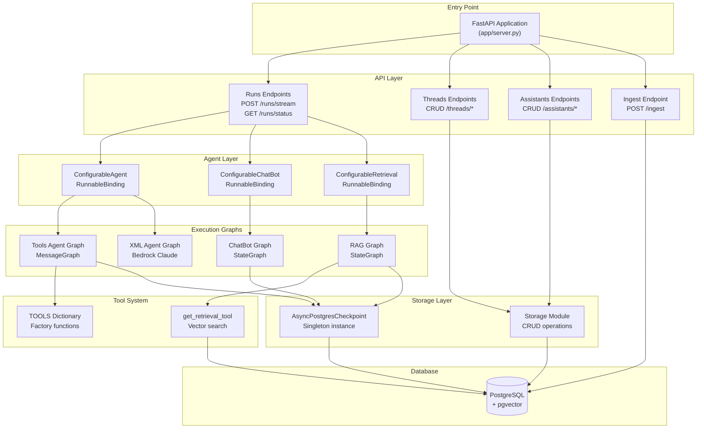

**Core Application Flow:**

1. **Request Ingestion**: FastAPI receives HTTP requests at defined endpoints
2. **Routing**: Requests are routed to appropriate endpoint handlers based on path and method
3. **Agent Selection**: For execution requests, the appropriate agent type (ConfigurableAgent/ChatBot/Retrieval) is selected based on configuration
4. **Graph Execution**: The selected factory instantiates and executes the appropriate LangGraph execution graph
5. **Streaming**: Results are streamed back to the client via Server-Sent Events (SSE)
6. **State Persistence**: All graph state is persisted to PostgreSQL via AsyncPostgresCheckpoint

**Sources:** High-level architecture diagrams (Diagram 1, Diagram 2)

## Core Modules

### Module Structure

```mermaid
graph LR
    subgraph "app/ Directory"
        Server["server.py<br/>FastAPI application"]
        Agent["agent.py<br/>Agent factories"]
        Storage["storage.py<br/>DB operations"]
        Upload["upload.py<br/>File ingestion"]
        Schema["schema.py<br/>Type definitions"]
        Auth["auth/"]
        
        Server --> Agent
        Server --> Storage
        Server --> Upload
        Agent --> Storage
        Upload --> Storage
    end
    
    subgraph "Configuration"
        Env[".env<br/>Environment variables"]
        PyProject["pyproject.toml<br/>Dependencies"]
    end
    
    Env -.-> Server
    PyProject -.-> Server
```

**Sources:** Inferred from high-level architecture and typical FastAPI application structure

### Key Responsibilities by Module

| Module | Primary Responsibilities | Key Classes/Functions |
|--------|-------------------------|----------------------|
| `agent.py` | Agent factory definitions, LLM configuration, tool binding | `ConfigurableAgent`, `ConfigurableChatBot`, `ConfigurableRetrieval`, `AgentType`, `LLMType` |
| `storage.py` | CRUD operations for assistants and threads, checkpoint management | `Storage` class, CRUD functions |
| `upload.py` | File upload handling, MIME detection, document parsing, embedding generation | File processing pipeline functions |
| `server.py` | FastAPI application, endpoint definitions, CORS, authentication | FastAPI app instance, endpoint decorators |
| `schema.py` | Pydantic models for request/response validation | `Assistant`, `Thread`, configuration schemas |

**Sources:** High-level architecture diagrams (Diagram 2, Diagram 5)

## FastAPI Application Structure

### Endpoint Organization

The application exposes four primary endpoint groups:

```mermaid
graph TB
    subgraph "Runs Endpoints"
        RunsStream["POST /runs/stream<br/>Execute agent with SSE streaming"]
        RunsStatus["GET /runs/status<br/>Check execution status"]
    end
    
    subgraph "Threads Endpoints"
        ThreadsList["GET /threads<br/>List user threads"]
        ThreadsGet["GET /threads/{thread_id}<br/>Get thread details"]
        ThreadsCreate["POST /threads<br/>Create new thread"]
        ThreadsUpdate["PUT /threads/{thread_id}<br/>Update thread"]
        ThreadsDelete["DELETE /threads/{thread_id}<br/>Delete thread"]
        ThreadsState["GET /threads/{thread_id}/state<br/>Get conversation state"]
        ThreadsHistory["GET /threads/{thread_id}/history<br/>Get state history"]
    end
    
    subgraph "Assistants Endpoints"
        AssistantsList["GET /assistants<br/>List assistants"]
        AssistantsGet["GET /assistants/{assistant_id}<br/>Get assistant config"]
        AssistantsCreate["POST /assistants<br/>Create assistant"]
        AssistantsUpdate["PUT /assistants/{assistant_id}<br/>Update assistant"]
        AssistantsDelete["DELETE /assistants/{assistant_id}<br/>Delete assistant"]
        AssistantsPublic["GET /assistants/public<br/>List public assistants"]
    end
    
    subgraph "Ingest Endpoint"
        Ingest["POST /ingest<br/>Upload and process files"]
    end
```

**Sources:** High-level architecture diagrams (Diagram 1, Diagram 3)

### Request Flow

```mermaid
sequenceDiagram
    participant Client
    participant FastAPI as "FastAPI App"
    participant Auth as "Auth Middleware"
    participant Endpoint as "Endpoint Handler"
    participant Agent as "Agent/Storage"
    participant DB as "PostgreSQL"
    
    Client->>FastAPI: HTTP Request
    FastAPI->>Auth: Validate JWT token
    Auth->>Auth: Extract user_id from token
    
    alt Authentication failed
        Auth-->>Client: 401 Unauthorized
    else Authentication succeeded
        Auth->>Endpoint: Forward request with user context
        Endpoint->>Agent: Process request
        Agent->>DB: Read/Write data
        DB-->>Agent: Return results
        
        alt Streaming endpoint
            loop For each event
                Agent-->>Client: SSE event
            end
        else Non-streaming endpoint
            Agent-->>Endpoint: Return data
            Endpoint-->>Client: JSON response
        end
    end
```

**Key flow characteristics:**

1. **Authentication**: JWT tokens are validated on each request, extracting `user_id` from the token claims
2. **User Isolation**: Database queries are scoped by `user_id` to ensure data isolation
3. **Streaming**: `/runs/stream` uses Server-Sent Events (SSE) for real-time response streaming
4. **Error Handling**: FastAPI exception handlers provide structured error responses

**Sources:** High-level architecture diagrams (Diagram 3), inferred from authentication patterns

## Configuration and Environment

### Environment Variables

The application is configured through environment variables, typically stored in a `.env` file:

| Variable Category | Example Variables | Purpose |
|------------------|-------------------|---------|
| Database | `POSTGRES_URI`, `CHECKPOINT_POSTGRES_URI` | PostgreSQL connection strings |
| LLM API Keys | `OPENAI_API_KEY`, `ANTHROPIC_API_KEY`, `GOOGLE_API_KEY` | LLM provider authentication |
| Tool API Keys | `TAVILY_API_KEY`, `KAY_API_KEY` | Tool service authentication |
| Authentication | `JWT_SECRET`, `AUTH_TYPE` | JWT signing and auth configuration |
| Observability | `LANGSMITH_API_KEY`, `LANGSMITH_TRACING` | LangSmith tracing configuration |
| Server | `PORT`, `HOST`, `CORS_ORIGINS` | Server binding and CORS |

### Configuration Pattern

The application follows a configurable fields pattern where:

1. **Configuration Objects**: Pydantic models define valid configurations for agents, assistants, and threads
2. **Dynamic LLM Selection**: LLM providers are selected at runtime based on `LLMType` enum values
3. **Tool Selection**: Tools are selected from the `TOOLS` dictionary based on configuration
4. **Checkpointing**: All agents share a singleton `AsyncPostgresCheckpoint` instance for state persistence

**Sources:** High-level architecture diagrams, [backend/pyproject.toml:44]() for JWT crypto dependency

## Server Initialization

### Startup Sequence

```mermaid
graph TB
    Start["Application Start<br/>(uvicorn)"]
    LoadEnv["Load Environment Variables<br/>(.env file)"]
    InitDB["Initialize Database Connection<br/>(asyncpg pool)"]
    InitCheckpoint["Initialize Checkpoint<br/>(AsyncPostgresCheckpoint)"]
    InitStorage["Initialize Storage Layer"]
    InitTools["Initialize Tools Dictionary<br/>(TOOLS)"]
    CreateApp["Create FastAPI App<br/>(with CORS, middleware)"]
    RegisterRoutes["Register Endpoint Routes"]
    ServeUI["Serve Static Frontend<br/>(/ui directory)"]
    Ready["Application Ready<br/>(listening on port)"]
    
    Start --> LoadEnv
    LoadEnv --> InitDB
    InitDB --> InitCheckpoint
    InitCheckpoint --> InitStorage
    InitStorage --> InitTools
    InitTools --> CreateApp
    CreateApp --> RegisterRoutes
    RegisterRoutes --> ServeUI
    ServeUI --> Ready
```

**Startup responsibilities:**

1. **Environment Loading**: Read configuration from environment variables
2. **Database Pool**: Create async connection pool to PostgreSQL
3. **Checkpoint Singleton**: Initialize shared checkpoint instance for LangGraph state persistence
4. **Storage Layer**: Set up CRUD operations with database pool
5. **Tools Registry**: Build dictionary of available tools with their factory functions
6. **FastAPI App**: Create application with middleware (CORS, authentication, logging)
7. **Route Registration**: Mount all endpoint handlers
8. **Static Frontend**: Serve compiled React frontend from `/ui` directory

**Sources:** High-level architecture diagrams (Diagram 1, Diagram 7)

## Key Design Patterns

### Factory Pattern for Agents

The backend uses `RunnableBinding` from LangChain to create configurable agent factories:

- **ConfigurableAgent**: Binds tool-enabled agents with configurable LLM and tool selection
- **ConfigurableChatBot**: Binds simple conversational agents
- **ConfigurableRetrieval**: Binds RAG agents with document retrieval

These factories allow runtime selection of LLM providers, tools, and parameters without code changes.

### Singleton Pattern for Checkpointing

A single `AsyncPostgresCheckpoint` instance is shared across all agent executions to:
- Ensure consistent state serialization
- Pool database connections efficiently
- Maintain schema compatibility

### Streaming Pattern

Server-Sent Events (SSE) streaming is used for agent execution to:
- Provide real-time feedback to users
- Stream partial results as they're generated
- Enable human-in-the-loop workflows with interrupts

**Sources:** High-level architecture diagrams (Diagram 2, Diagram 3, Diagram 6)

## Extension Points

The backend is designed to be extensible at several layers:

1. **New LLM Providers**: Add entries to `LLMType` enum and corresponding initialization logic
2. **New Tools**: Add factory functions to `TOOLS` dictionary
3. **New Agent Types**: Implement new `AgentType` variants with corresponding graph definitions
4. **Custom Endpoints**: Add new FastAPI route handlers
5. **Custom Authentication**: Replace JWT middleware with alternative auth schemes

For detailed information on extending specific subsystems, refer to the relevant sub-sections: [Agent System](#2.1), [Cognitive Architectures](#2.2), [Storage and State Management](#2.3), [File Upload and Vector Storage](#2.4), [API Endpoints](#2.5), [Streaming System](#2.6).

**Sources:** High-level architecture diagrams (Diagram 2, Diagram 6)

---

# Page: Agent System

# Agent System

<details>
<summary>Relevant source files</summary>

The following files were used as context for generating this wiki page:

- [backend/app/agent.py](backend/app/agent.py)
- [backend/app/llms.py](backend/app/llms.py)
- [backend/app/tools.py](backend/app/tools.py)

</details>


## Purpose and Scope

This document describes the Agent System in OpenGPTs, which is responsible for configuring and executing different types of agents that utilize language models and external tools to handle user queries. The Agent System serves as the core execution engine that powers the conversational capabilities of OpenGPTs.

For information about the Retrieval and Chatbot Components that build upon this system, see [Retrieval and Chatbot Components](#2.2). For details about how agent state is stored, see [Storage and Database System](#2.3).

Sources: [backend/app/agent.py:1-31]()

## Architecture Overview

The Agent System provides a flexible framework for creating and configuring different types of agent architectures. It bridges LLM capabilities with tool execution and state management to create conversational agents that can perform tasks.

```mermaid
graph TD
    subgraph "Agent System"
        ConfigurableAgent["ConfigurableAgent"]
        ConfigurableChatBot["ConfigurableChatBot"]
        ConfigurableRetrieval["ConfigurableRetrieval"]
        
        subgraph "Agent Types"
            ToolsAgent["get_tools_agent_executor()"]
            XMLAgent["get_xml_agent_executor()"] 
            ChatBot["get_chatbot_executor()"]
            RAGBot["get_retrieval_executor()"]
        end
        
        subgraph "Agent Configuration"
            AgentType["AgentType Enum"]
            LLMType["LLMType Enum"]
            SystemMessage["system_message"]
            Tools["tools"]
        end
        
        subgraph "State Management"
            CHECKPOINTER["AsyncPostgresCheckpoint"]
        end
    end
    
    ConfigurableAgent --> ToolsAgent
    ConfigurableAgent --> XMLAgent
    ConfigurableChatBot --> ChatBot
    ConfigurableRetrieval --> RAGBot
    
    ConfigurableAgent --> AgentType
    ConfigurableAgent --> Tools
    ConfigurableAgent --> SystemMessage
    ConfigurableChatBot --> LLMType
    ConfigurableRetrieval --> LLMType
    
    ToolsAgent --> CHECKPOINTER
    XMLAgent --> CHECKPOINTER
    ChatBot --> CHECKPOINTER
    RAGBot --> CHECKPOINTER
```

Diagram: Agent System Core Components

Sources: [backend/app/agent.py:127-371](), [backend/app/checkpoint.py:1-119]()

## Agent Types and Configuration

OpenGPTs supports three primary agent architectures, each with different capabilities and interaction patterns:

1. **Tools Agent**: The most flexible architecture that uses tools based on LLM decisions
2. **XML Agent**: A specialized agent that can parse XML-structured responses for tool calls
3. **Simple Chatbot**: The most basic architecture, consisting of direct responses without tool use
4. **RAG Agent**: Retrieval-augmented generation that incorporates document knowledge

The agent type is selected using the `ConfigurableAgent` class, which provides a unified interface for configuring and running different agent architectures.

```mermaid
classDiagram
    class ConfigurableAgent {
        tools: Sequence[Tool]
        agent: AgentType
        system_message: str
        retrieval_description: str
        interrupt_before_action: bool
        assistant_id: Optional[str]
        thread_id: Optional[str]
        user_id: Optional[str]
    }
    
    class AgentType {
        <<enum>>
        GPT_35_TURBO
        GPT_4
        GPT_4O
        AZURE_OPENAI
        CLAUDE2
        BEDROCK_CLAUDE2
        GEMINI
        OLLAMA
    }
    
    class LLMType {
        <<enum>>
        GPT_35_TURBO
        GPT_4
        GPT_4O
        AZURE_OPENAI
        CLAUDE2
        BEDROCK_CLAUDE2
        GEMINI
        MIXTRAL
        OLLAMA
    }
    
    ConfigurableAgent --> AgentType
    ConfigurableChatBot --> LLMType
    ConfigurableRetrieval --> LLMType
```

Diagram: Agent Configuration Classes

Sources: [backend/app/agent.py:62-76](), [backend/app/agent.py:128-147](), [backend/app/agent.py:185-195]()

## LLM Integration

The Agent System supports multiple language model providers through a set of factory functions. Each function creates and configures a specific LLM client with appropriate settings.

| LLM Provider | Function | Models |
|--------------|----------|--------|
| OpenAI | `get_openai_llm()` | GPT-3.5-Turbo, GPT-4, GPT-4o |
| Azure OpenAI | `get_openai_llm(azure=True)` | Depends on Azure deployment |
| Anthropic | `get_anthropic_llm()` | Claude 3 Haiku |
| Amazon Bedrock | `get_anthropic_llm(bedrock=True)` | Claude v2 |
| Google | `get_google_llm()` | Gemini Pro |
| Fireworks | `get_mixtral_fireworks()` | Mixtral 8x7B |
| Ollama | `get_ollama_llm()` | Various local models |

The LLM selection is determined by the `AgentType` or `LLMType` enum value provided during agent configuration.

Sources: [backend/app/agent.py:78-125](), [backend/app/llms.py:1-101]()

## Tool System Architecture

The Agent System includes a comprehensive tool system that allows agents to interact with external services and data sources.

```mermaid
graph TD
    subgraph "Tool System"
        ToolDefinition["Tool Definitions (tools.py)"]
        ToolExecutor["ToolExecutor"]
        ToolInvocation["ToolInvocation"]
        
        subgraph "Available Tools"
            SearchTools["Search Tools (DDG, Tavily)"]
            ResearchTools["Research Tools (Arxiv, PubMed)"]
            RetrievalTool["Retrieval Tool"]
            ActionTools["Action Tools (Connery, ActionServer)"]
            ImageGen["Image Generation (DALL-E)"]
        end
    end
    
    subgraph "Agent Processing"
        ToolsAgent["get_tools_agent_executor()"]
        XMLAgent["get_xml_agent_executor()"]
        call_tool["call_tool() function"]
        should_continue["should_continue() function"]
    end
    
    ToolDefinition --> AvailableTools
    AvailableTools --> TOOLS
    
    ToolsAgent --> ToolExecutor
    XMLAgent --> ToolExecutor
    ToolExecutor --> ToolInvocation
    ToolInvocation --> SearchTools
    ToolInvocation --> ResearchTools
    ToolInvocation --> RetrievalTool
    ToolInvocation --> ActionTools
    ToolInvocation --> ImageGen
    
    ToolsAgent --> call_tool
    ToolsAgent --> should_continue
    XMLAgent --> call_tool
    XMLAgent --> should_continue
```

Diagram: Tool System Architecture

Sources: [backend/app/tools.py:30-325](), [backend/app/agent_types/tools_agent.py:20-128](), [backend/app/agent_types/xml_agent.py:62-159]()

### Available Tools

The system provides a variety of tools that agents can use to accomplish tasks. These tools are defined in the `AvailableTools` enum and implemented as BaseTool classes.

| Tool Type | Description | Examples |
|-----------|-------------|----------|
| Search | Web search capabilities | DuckDuckGo, Tavily |
| Research | Academic and specialized search | Arxiv, PubMed, Wikipedia |
| Retrieval | Document retrieval from uploaded files | Retrieval tool |
| Actions | External action execution | Connery, Action Server |
| Image Generation | AI image creation | DALL-E |

Each tool is defined with a name, description, and configuration options, and can be added to an agent during configuration.

Sources: [backend/app/tools.py:46-205](), [backend/app/tools.py:313-325]()

## Agent Workflow Architecture

The Agent System uses the LangGraph framework to define workflow graphs that control agent execution. These graphs determine how messages flow between the agent and tools.

```mermaid
graph TD
    subgraph "Message Graph Workflow"
        EntryPoint["Entry Point (agent)"]
        AgentNode["Agent Node (LLM)"]
        ActionNode["Action Node (Tools)"]
        EndNode["END"]
        
        EntryPoint --> AgentNode
        AgentNode -->|"should_continue() == 'continue'"| ActionNode
        AgentNode -->|"should_continue() == 'end'"| EndNode
        ActionNode --> AgentNode
    end
    
    subgraph "Agent Execution Flow"
        Input["Human Message"]
        SystemMsg["System Message"]
        LLMCall["LLM Call"]
        ToolCalls["Tool Calls (if any)"]
        ToolExecution["Tool Execution"]
        ToolResults["Tool Results"]
        FinalResponse["Final Response"]
        
        Input --> SystemMsg
        SystemMsg --> LLMCall
        LLMCall --> ToolCalls
        ToolCalls --> ToolExecution
        ToolExecution --> ToolResults
        ToolResults --> LLMCall
        LLMCall --> FinalResponse
    end
```

Diagram: Agent Workflow and Execution Flow

Sources: [backend/app/agent_types/tools_agent.py:50-128](), [backend/app/agent_types/xml_agent.py:84-159]()

### Message Graph Implementation

The agent workflow is implemented using a MessageGraph from LangGraph. This creates a directed graph with nodes for the LLM and tool execution, and edges that determine the flow between them:

1. The agent node processes messages and generates a response
2. The `should_continue` function checks if the response contains tool calls
3. If there are tool calls, control passes to the action node
4. The action node executes the tools and returns the results
5. Control flows back to the agent node to process the tool results
6. This cycle continues until the agent produces a final response with no tool calls

This architecture allows the agent to use tools iteratively to solve complex problems.

Sources: [backend/app/agent_types/tools_agent.py:87-128](), [backend/app/agent_types/xml_agent.py:118-159]()

## Checkpoint System

The Agent System includes a robust checkpointing mechanism that persists agent state in PostgreSQL, allowing conversations to be resumed.

```mermaid
graph TD
    subgraph "Checkpoint System"
        AsyncPostgresCheckpoint["AsyncPostgresCheckpoint (Singleton)"]
        setup["ensure_setup() Method"]
        aput["aput() Method"]
        aget["aget_tuple() Method"]
        
        AsyncPostgresCheckpoint --> setup
        AsyncPostgresCheckpoint --> aput
        AsyncPostgresCheckpoint --> aget
    end
    
    subgraph "Database Storage"
        PostgresPool["AsyncConnectionPool"]
        AsyncPostgresSaver["AsyncPostgresSaver"]
        PostgresDB[("PostgreSQL Database")]
        
        setup --> PostgresPool
        PostgresPool --> PostgresDB
        aput --> AsyncPostgresSaver
        aget --> AsyncPostgresSaver
        AsyncPostgresSaver --> PostgresDB
    end
    
    subgraph "LangGraph Integration"
        MessageGraph["MessageGraph.compile()"]
        checkpointer["checkpointer parameter"]
        
        MessageGraph --> checkpointer
        checkpointer --> AsyncPostgresCheckpoint
    end
```

Diagram: Checkpoint System Architecture

Sources: [backend/app/checkpoint.py:21-119](), [backend/app/agent.py:75-75](), [backend/app/agent_types/tools_agent.py:125-128](), [backend/app/agent_types/xml_agent.py:156-159]()

The checkpoint system is implemented as a singleton to ensure a single instance throughout the application. It connects to PostgreSQL during application startup and provides methods to save and retrieve agent state.

Sources: [backend/app/checkpoint.py:21-43](), [backend/README.md:1-27]()

## Integration in OpenGPTs

The Agent System is integrated into the broader OpenGPTs system through configurable agent instances that are exposed as endpoints in the API. The main configurable agent instance is defined at the end of [backend/app/agent.py]() and serves as the entry point for agent execution.

```python
agent: Pregel = (
    ConfigurableAgent(
        agent=AgentType.GPT_35_TURBO,
        tools=[],
        system_message=DEFAULT_SYSTEM_MESSAGE,
        retrieval_description=RETRIEVAL_DESCRIPTION,
        assistant_id=None,
        thread_id="",
    )
    .configurable_fields(
        agent=ConfigurableField(id="agent_type", name="Agent Type"),
        system_message=ConfigurableField(id="system_message", name="Instructions"),
        interrupt_before_action=ConfigurableField(
            id="interrupt_before_action",
            name="Tool Confirmation",
            description="If Yes, you'll be prompted to continue before each tool is executed.\nIf No, tools will be executed automatically by the agent.",
        ),
        assistant_id=ConfigurableField(
            id="assistant_id", name="Assistant ID", is_shared=True
        ),
        thread_id=ConfigurableField(
            id="thread_id", name="Thread ID", annotation=str, is_shared=True
        ),
        tools=ConfigurableField(id="tools", name="Tools"),
        retrieval_description=ConfigurableField(
            id="retrieval_description", name="Retrieval Description"
        ),
    )
    .configurable_alternatives(
        ConfigurableField(id="type", name="Bot Type"),
        default_key="agent",
        prefix_keys=True,
        chatbot=chatbot,
        chat_retrieval=chat_retrieval,
    )
)
```

This configuration allows users to select between different agent types, configure the system message, choose which tools to include, and set other parameters.

Sources: [backend/app/agent.py:332-371]()

## Summary

The Agent System provides a flexible and powerful framework for creating conversational agents that can use tools to accomplish tasks. It supports multiple agent architectures, integrates with various language model providers, and includes a comprehensive tool system. The use of LangGraph for workflow management and PostgreSQL for state persistence makes it robust and scalable.

The key components of the system are:
1. Configurable agent classes that provide a unified interface
2. LLM integration for various providers
3. Tool definitions and execution mechanisms
4. Workflow graphs that control agent execution
5. Checkpoint system for state persistence

Together, these components form the core execution engine of OpenGPTs, enabling the creation of sophisticated conversational agents.

---

# Page: Cognitive Architectures

# Cognitive Architectures

<details>
<summary>Relevant source files</summary>

The following files were used as context for generating this wiki page:

- [backend/app/agent.py](backend/app/agent.py)
- [backend/app/chatbot.py](backend/app/chatbot.py)
- [backend/app/llms.py](backend/app/llms.py)
- [backend/app/message_types.py](backend/app/message_types.py)
- [backend/app/retrieval.py](backend/app/retrieval.py)
- [backend/app/tools.py](backend/app/tools.py)

</details>


## Purpose and Scope

This document describes the three cognitive architectures implemented in OpenGPTs: **Tools Agent**, **RAG Bot**, and **ChatBot**. Each architecture represents a different execution model for processing user messages, from simple direct LLM invocation to complex tool-enabled agent loops with retrieval capabilities.

This page focuses on the execution graphs, state management, and control flow of each architecture. For information about the agent system's configuration interface and tool definitions, see [Agent System](#2.1). For details about checkpoint persistence and state storage, see [Storage and State Management](#2.3). For the API endpoints that invoke these architectures, see [API Endpoints](#2.5).

## Architecture Overview

OpenGPTs implements three distinct cognitive architectures, each represented as a LangGraph execution graph:

| Architecture | Factory Class | Graph Type | Primary Use Case | Checkpoint Support |
|-------------|---------------|------------|------------------|-------------------|
| **Tools Agent** | `ConfigurableAgent` | MessageGraph | Tool-enabled AI workflows with 13+ tools | ✓ |
| **RAG Bot** | `ConfigurableRetrieval` | StateGraph | Document-based question answering | ✓ |
| **ChatBot** | `ConfigurableChatBot` | StateGraph | Simple conversational AI | ✓ |

All three architectures share a common infrastructure:
- **Unified checkpointing** via `AsyncPostgresCheckpoint` singleton ([backend/app/agent.py:75]())
- **Configurable LLM providers** supporting OpenAI, Anthropic, Google, Fireworks, and Ollama
- **State management** through LangGraph's checkpoint system
- **Streaming support** for incremental response delivery

```mermaid
graph TB
    subgraph "Factory Layer"
        ConfigurableAgent["ConfigurableAgent<br/>(RunnableBinding)"]
        ConfigurableRetrieval["ConfigurableRetrieval<br/>(RunnableBinding)"]
        ConfigurableChatBot["ConfigurableChatBot<br/>(RunnableBinding)"]
    end
    
    subgraph "Execution Layer"
        ToolsAgent["get_tools_agent_executor()<br/>MessageGraph"]
        XMLAgent["get_xml_agent_executor()<br/>MessageGraph"]
        RetrievalGraph["get_retrieval_executor()<br/>StateGraph"]
        ChatbotGraph["get_chatbot_executor()<br/>StateGraph"]
    end
    
    subgraph "Infrastructure"
        CHECKPOINTER["AsyncPostgresCheckpoint<br/>Singleton"]
        LLMs["LLM Provider Functions<br/>get_openai_llm, get_anthropic_llm, etc."]
    end
    
    ConfigurableAgent -->|"dispatches by AgentType"| ToolsAgent
    ConfigurableAgent -->|"BEDROCK_CLAUDE2"| XMLAgent
    ConfigurableRetrieval --> RetrievalGraph
    ConfigurableChatBot --> ChatbotGraph
    
    ToolsAgent --> CHECKPOINTER
    XMLAgent --> CHECKPOINTER
    RetrievalGraph --> CHECKPOINTER
    ChatbotGraph --> CHECKPOINTER
    
    ToolsAgent --> LLMs
    XMLAgent --> LLMs
    RetrievalGraph --> LLMs
    ChatbotGraph --> LLMs
```

**Sources:** [backend/app/agent.py:1-387](), [backend/app/chatbot.py:1-27](), [backend/app/retrieval.py:1-142]()

## Tools Agent Architecture

The Tools Agent is the most sophisticated architecture, implementing an agentic loop where the LLM can repeatedly invoke tools until it reaches a final answer. This architecture is instantiated via `ConfigurableAgent` ([backend/app/agent.py:128-183]()) and dispatched to either `get_tools_agent_executor()` or `get_xml_agent_executor()` based on the selected `AgentType`.

### Graph Structure and Execution Flow

The Tools Agent uses a MessageGraph (referenced but not provided in files) with the following execution pattern:

```mermaid
graph TB
    Entry["Entry Point"]
    
    subgraph "get_agent_executor() Factory"
        Dispatch["Dispatch by AgentType"]
        ToolsAgentExec["get_tools_agent_executor()"]
        XMLAgentExec["get_xml_agent_executor()"]
    end
    
    subgraph "Tools Agent Loop (MessageGraph)"
        CallModel["Call LLM<br/>with tools and messages"]
        CheckResponse{"Response<br/>contains<br/>tool_calls?"}
        InterruptCheck{"interrupt_before_<br/>action=True?"}
        ToolExecution["Execute tool(s)<br/>from TOOLS dict"]
        AppendResult["Append ToolMessage<br/>to state"]
        SaveCheckpoint["Save checkpoint<br/>to AsyncPostgresCheckpoint"]
        FinalResponse["Return final<br/>AIMessage"]
    end
    
    Entry --> Dispatch
    Dispatch -->|"Most agents"| ToolsAgentExec
    Dispatch -->|"BEDROCK_CLAUDE2"| XMLAgentExec
    
    ToolsAgentExec --> CallModel
    XMLAgentExec --> CallModel
    
    CallModel --> CheckResponse
    CheckResponse -->|"Yes"| InterruptCheck
    CheckResponse -->|"No"| FinalResponse
    
    InterruptCheck -->|"Yes"| SaveCheckpoint
    InterruptCheck -->|"No"| ToolExecution
    SaveCheckpoint -->|"Human approval"| ToolExecution
    
    ToolExecution --> AppendResult
    AppendResult --> CallModel
    
    FinalResponse --> End["END"]
```

**Sources:** [backend/app/agent.py:78-126](), [backend/app/agent.py:128-183]()

### Tool Selection and Invocation

The `ConfigurableAgent.__init__()` method processes tool configurations and instantiates tool objects from the `TOOLS` dictionary ([backend/app/agent.py:152-169]()):

1. **Retrieval Tool**: Special handling for `AvailableTools.RETRIEVAL`, requiring both `assistant_id` and `thread_id` to create a scoped retriever ([backend/app/agent.py:155-162]())
2. **Standard Tools**: Fetched from `TOOLS` dict using factory functions ([backend/app/agent.py:164-169]())
3. **Multi-use Tools**: Some tools like Action Server return multiple tool instances

The agent executor is configured with `recursion_limit=50` ([backend/app/agent.py:173]()), allowing up to 50 tool invocations before terminating.

### Human-in-the-Loop Interruption

When `interrupt_before_action=True` ([backend/app/agent.py:133]()), the agent saves a checkpoint before executing any tool. This enables:
- **Approval workflows**: User can review and approve/reject tool executions
- **State persistence**: Conversation state preserved during interruption
- **Resume capability**: Execution continues from exact checkpoint after approval

The interruption is configured via `ConfigurableField` and exposed to the frontend ([backend/app/agent.py:344-348]()).

**Sources:** [backend/app/agent.py:128-183](), [backend/app/tools.py:313-325]()

## RAG Bot Architecture

The RAG (Retrieval-Augmented Generation) Bot implements a two-phase process: retrieve relevant documents, then generate a response based on those documents. This architecture is instantiated via `ConfigurableRetrieval` ([backend/app/agent.py:263-310]()) and executed by `get_retrieval_executor()` ([backend/app/retrieval.py:38-141]()).

### Three-Node Graph Structure

The RAG Bot uses a StateGraph with three sequential nodes:

```mermaid
graph LR
    Entry["Entry Point"]
    
    subgraph "get_retrieval_executor() StateGraph"
        InvokeRetrieval["invoke_retrieval<br/>Generate search query"]
        Retrieve["retrieve<br/>Call retriever.ainvoke()"]
        Response["response<br/>Call LLM with context"]
    end
    
    Entry --> InvokeRetrieval
    InvokeRetrieval -->|"AIMessage with<br/>tool_call"| Retrieve
    Retrieve -->|"LiberalToolMessage<br/>with documents"| Response
    Response -->|"Final AIMessage"| END
```

**State Type**: `AgentState` with `messages: List[BaseMessage]` and `msg_count: int` ([backend/app/retrieval.py:44-46]())

### Node Implementation Details

#### Node 1: invoke_retrieval

Generates a search query from conversation history ([backend/app/retrieval.py:80-114]()):

- **First message**: Uses human input directly as query ([backend/app/retrieval.py:82-97]())
- **Multi-turn**: Invokes `get_search_query` chain to synthesize query from conversation ([backend/app/retrieval.py:99-114]())
- **Output**: Returns `AIMessage` with `tool_calls` containing retrieval parameters

The search query generation uses a prompt template that extracts the search intent from conversation context ([backend/app/retrieval.py:16-28]()).

#### Node 2: retrieve

Executes the actual vector search ([backend/app/retrieval.py:116-125]()):

1. Extracts query from previous node's `tool_calls` ([backend/app/retrieval.py:117-119]())
2. Invokes retriever via `await retriever.ainvoke(query)` ([backend/app/retrieval.py:120]())
3. Serializes documents to dictionaries ([backend/app/retrieval.py:121]())
4. Returns `LiberalToolMessage` containing document list ([backend/app/retrieval.py:122-125]())

The retriever is created with namespace filtering by `assistant_id` and `thread_id` ([backend/app/tools.py:214-217]()).

#### Node 3: response

Generates final answer using retrieved context ([backend/app/retrieval.py:127-130]()):

1. Formats documents into context string via `_get_messages()` ([backend/app/retrieval.py:48-64]())
2. Injects system message with instruction: "Respond to the user using ONLY the context provided below" ([backend/app/retrieval.py:31-35]())
3. Invokes LLM with formatted messages ([backend/app/retrieval.py:129]())
4. Returns final `AIMessage` ([backend/app/retrieval.py:130]())

### Message Formatting

The `_get_messages()` helper extracts chat history and formats retrieval results ([backend/app/retrieval.py:48-64]()):

```python
# Pseudocode showing key logic
def _get_messages(messages):
    chat_history = extract_ai_and_human_messages(messages)
    documents = messages[-1].content  # From retrieve node
    context = join_document_contents(documents)
    
    return [
        SystemMessage(
            content=f"{system_message}\n\nContext:\n{context}"
        )
    ] + chat_history
```

This ensures the LLM receives both conversation context and retrieved documents in a single prompt.

**Sources:** [backend/app/retrieval.py:1-142](), [backend/app/agent.py:263-310](), [backend/app/tools.py:214-227]()

## ChatBot Architecture

The ChatBot implements the simplest cognitive architecture: direct LLM invocation with conversation history. This architecture is instantiated via `ConfigurableChatBot` ([backend/app/agent.py:224-247]()) and executed by `get_chatbot_executor()` ([backend/app/chatbot.py:11-26]()).

### Single-Node Graph Structure

The ChatBot uses a minimal StateGraph with one node:

```mermaid
graph LR
    Entry["Entry Point"]
    
    subgraph "get_chatbot_executor() StateGraph"
        ChatbotNode["chatbot<br/>_get_messages | llm"]
    end
    
    Entry --> ChatbotNode
    ChatbotNode -->|"set_finish_point"| ChatbotNode
```

**State Type**: `Annotated[List[BaseMessage], add_messages_liberal]` ([backend/app/chatbot.py:21]()) - a simple list of messages using liberal message merging.

### Execution Implementation

The entire chatbot logic is expressed as a chain ([backend/app/chatbot.py:16-19]()):

```python
def _get_messages(messages):
    return [SystemMessage(content=system_message)] + messages

chatbot = _get_messages | llm
```

This creates a LangChain chain that:
1. Prepends system message to conversation history
2. Invokes the LLM with combined messages
3. Returns the LLM's response

The StateGraph wrapper provides:
- **Checkpoint integration**: Conversation history persisted to `AsyncPostgresCheckpoint`
- **Streaming support**: Compatible with `astream_events()` interface
- **Message merging**: Uses `add_messages_liberal` for flexible message handling ([backend/app/message_types.py:35-44]())

### Set Finish Point Pattern

The graph uses `set_finish_point("chatbot")` ([backend/app/chatbot.py:24]()), which is equivalent to adding an edge to `END`. This pattern indicates:
- Single execution pass (no loops)
- Node output becomes graph output directly
- Checkpoint saved after node execution

**Sources:** [backend/app/chatbot.py:1-27](), [backend/app/agent.py:224-247](), [backend/app/message_types.py:1-45]()

## Factory Pattern and Configurable Fields

All three architectures use the `RunnableBinding` pattern with `ConfigurableField` to enable dynamic runtime configuration. This pattern is central to OpenGPTs' flexibility.

### ConfigurableAgent Example

The agent factory exposes multiple configurable parameters ([backend/app/agent.py:341-359]()):

| Field | ConfigurableField ID | Type | Shared | Description |
|-------|---------------------|------|--------|-------------|
| `agent` | `agent_type` | `AgentType` | No | LLM provider (GPT-4, Claude, etc.) |
| `system_message` | `system_message` | `str` | No | Instructions prepended to every call |
| `interrupt_before_action` | `interrupt_before_action` | `bool` | No | Enable human-in-the-loop |
| `assistant_id` | `assistant_id` | `str` | Yes | Links to assistant config |
| `thread_id` | `thread_id` | `str` | Yes | Links to conversation thread |
| `tools` | `tools` | `Sequence[Tool]` | No | List of enabled tools |
| `retrieval_description` | `retrieval_description` | `str` | No | Custom retrieval tool description |

**Shared Fields**: Marked with `is_shared=True` ([backend/app/agent.py:349-353]()), these are passed through to checkpoint namespace for data isolation.

### Configurable Alternatives Pattern

The top-level `agent` object uses `configurable_alternatives()` to enable switching between architectures at runtime ([backend/app/agent.py:360-366]()):

```python
agent = (
    ConfigurableAgent(...)
    .configurable_fields(...)
    .configurable_alternatives(
        ConfigurableField(id="type", name="Bot Type"),
        default_key="agent",
        prefix_keys=True,
        chatbot=chatbot,
        chat_retrieval=chat_retrieval,
    )
)
```

This allows the API to route to different architectures by setting `config={"configurable": {"type": "chatbot"}}` or `{"type": "chat_retrieval"}`.

### LLM Provider Dispatch

Both `get_agent_executor()` ([backend/app/agent.py:78-126]()) and `get_chatbot()` ([backend/app/agent.py:197-221]()) implement dispatch logic based on enum values:

```mermaid
graph TB
    AgentType["AgentType enum"]
    LLMType["LLMType enum"]
    
    subgraph "LLM Provider Functions"
        OpenAI["get_openai_llm()"]
        Anthropic["get_anthropic_llm()"]
        Google["get_google_llm()"]
        Fireworks["get_mixtral_fireworks()"]
        Ollama["get_ollama_llm()"]
    end
    
    AgentType -->|"GPT_35_TURBO,<br/>GPT_4, GPT_4O,<br/>AZURE_OPENAI"| OpenAI
    AgentType -->|"CLAUDE2,<br/>BEDROCK_CLAUDE2"| Anthropic
    AgentType -->|"GEMINI"| Google
    AgentType -->|"OLLAMA"| Ollama
    
    LLMType -->|"GPT_35_TURBO,<br/>GPT_4, GPT_4O,<br/>AZURE_OPENAI"| OpenAI
    LLMType -->|"CLAUDE2,<br/>BEDROCK_CLAUDE2"| Anthropic
    LLMType -->|"GEMINI"| Google
    LLMType -->|"MIXTRAL"| Fireworks
    LLMType -->|"OLLAMA"| Ollama
```

All LLM functions use `@lru_cache` for instance reuse ([backend/app/llms.py:17](), [backend/app/llms.py:60](), [backend/app/llms.py:79](), [backend/app/llms.py:86](), [backend/app/llms.py:91]()).

**Sources:** [backend/app/agent.py:332-371](), [backend/app/agent.py:78-126](), [backend/app/agent.py:197-221](), [backend/app/llms.py:1-101]()

## State Management Across Architectures

All three architectures use LangGraph's checkpoint system for state persistence, but with different state schemas:

### State Schema Comparison

```mermaid
graph TB
    subgraph "Tools Agent State"
        ToolsState["AgentState (inferred)<br/>messages: List[BaseMessage]<br/>msg_count: int"]
    end
    
    subgraph "RAG Bot State"
        RAGState["AgentState (explicit)<br/>messages: Annotated[List, add_messages_liberal]<br/>msg_count: Annotated[int, operator.add]"]
    end
    
    subgraph "ChatBot State"
        ChatState["Annotated[List[BaseMessage], add_messages_liberal]"]
    end
    
    subgraph "Checkpoint Layer"
        Checkpoint["AsyncPostgresCheckpoint<br/>Single shared instance"]
        PostgreSQL[("PostgreSQL<br/>checkpoints table<br/>checkpoint_blobs table<br/>checkpoint_writes table")]
    end
    
    ToolsState --> Checkpoint
    RAGState --> Checkpoint
    ChatState --> Checkpoint
    
    Checkpoint --> PostgreSQL
```

### Message Reducer Functions

Both RAG Bot and ChatBot use `add_messages_liberal` ([backend/app/message_types.py:35-44]()), a custom reducer that:

1. Coerces single messages to lists
2. Converts Pydantic dicts to message objects via `_convert_pydantic_dict_to_message()` ([backend/app/message_types.py:21-32]())
3. Delegates to LangGraph's `add_messages()` for deduplication

This enables flexible message handling, including non-standard message types like `LiberalToolMessage` with `content: Any` ([backend/app/message_types.py:17-18]()).

### Checkpoint Singleton Pattern

All architectures share a single `AsyncPostgresCheckpoint` instance ([backend/app/agent.py:75]()):

```python
CHECKPOINTER = AsyncPostgresCheckpoint()
```

This singleton is passed to:
- `get_tools_agent_executor()` ([backend/app/agent.py:87](), [backend/app/agent.py:92](), etc.)
- `get_xml_agent_executor()` ([backend/app/agent.py:112]())
- `get_chatbot_executor()` ([backend/app/agent.py:221]())
- `get_retrieval_executor()` ([backend/app/agent.py:303]())

The checkpointer uses `thread_id` and `assistant_id` from configurable fields to create isolated namespaces for each conversation.

**Sources:** [backend/app/agent.py:75](), [backend/app/agent.py:78-126](), [backend/app/agent.py:197-221](), [backend/app/retrieval.py:44-46](), [backend/app/chatbot.py:21](), [backend/app/message_types.py:1-45]()

## Architecture Selection and Routing

The backend API routes to different architectures based on the `type` configurable field. The top-level `agent` object ([backend/app/agent.py:332-371]()) uses `configurable_alternatives()` to dispatch to:

| Type Value | Architecture | Factory | Use Case |
|-----------|-------------|---------|----------|
| `"agent"` (default) | Tools Agent | `ConfigurableAgent` | Tool-enabled workflows |
| `"chatbot"` | ChatBot | `ConfigurableChatBot` | Simple conversation |
| `"chat_retrieval"` | RAG Bot | `ConfigurableRetrieval` | Document Q&A |

### Type Coercion and Input/Output Types

Each architecture declares its input/output types via `.with_types()` ([backend/app/agent.py:367-370]()):

- **Tools Agent & ChatBot**: `input_type=Messages, output_type=Sequence[AnyMessage]`
- **RAG Bot**: `input_type=Dict[str, Any], output_type=Dict[str, Any]`

This enables LangServe to validate payloads and generate OpenAPI schemas for the API.

### Recursion Limit Configuration

The Tools Agent explicitly sets `recursion_limit=50` ([backend/app/agent.py:173]()), allowing up to 50 iterations of the agent loop. This prevents infinite loops while supporting complex multi-step reasoning.

RAG Bot and ChatBot do not require recursion limits as they execute fixed-length graphs (3 nodes and 1 node respectively).

**Sources:** [backend/app/agent.py:332-371](), [backend/app/agent.py:173]()

## Architecture Comparison Matrix

| Feature | Tools Agent | RAG Bot | ChatBot |
|---------|-------------|---------|---------|
| **Graph Type** | MessageGraph | StateGraph | StateGraph |
| **Node Count** | Variable (loop) | 3 (sequential) | 1 (single) |
| **Tool Support** | 13+ tools | None | None |
| **Retrieval Support** | Optional (as tool) | Built-in (required) | None |
| **Execution Pattern** | Iterative loop | Three-phase pipeline | Single pass |
| **State Schema** | `messages + msg_count` | `messages + msg_count` | `messages` only |
| **Interruption Support** | Yes (configurable) | No | No |
| **Recursion Limit** | 50 iterations | N/A (no recursion) | N/A (no recursion) |
| **Primary Use Cases** | Multi-step reasoning, external APIs, complex workflows | Document Q&A, knowledge base queries | Conversation, simple Q&A |
| **Configuration Complexity** | High (8 fields) | Medium (4 fields) | Low (2 fields) |
| **LLM Variants** | 8 (via AgentType) | 9 (via LLMType) | 9 (via LLMType) |

### When to Use Each Architecture

**Tools Agent**: Choose when you need:
- External data access (search, APIs, databases)
- Multi-step workflows requiring multiple tool calls
- Human-in-the-loop approval for actions
- Complex reasoning over multiple information sources

**RAG Bot**: Choose when you need:
- Question answering over uploaded documents
- Grounded responses with source citations
- Context-aware retrieval with conversation history
- Controlled generation from specific knowledge base

**ChatBot**: Choose when you need:
- Simple conversational AI
- Minimal latency (single LLM call)
- No external dependencies
- Straightforward question-answering

**Sources:** [backend/app/agent.py:1-387](), [backend/app/chatbot.py:1-27](), [backend/app/retrieval.py:1-142]()

---

# Page: Storage and State Management

# Storage and State Management

<details>
<summary>Relevant source files</summary>

The following files were used as context for generating this wiki page:

- [backend/README.md](backend/README.md)
- [backend/app/agent_types/tools_agent.py](backend/app/agent_types/tools_agent.py)
- [backend/app/api/assistants.py](backend/app/api/assistants.py)
- [backend/app/api/threads.py](backend/app/api/threads.py)
- [backend/app/checkpoint.py](backend/app/checkpoint.py)
- [backend/app/storage.py](backend/app/storage.py)
- [tools/redis_to_postgres/migrate_data.py](tools/redis_to_postgres/migrate_data.py)

</details>


This document describes the storage and state management components of OpenGPTs, including the persistence layer for assistants and threads, the `AsyncPostgresCheckpoint` system for LangGraph state persistence, and the checkpoint migration from v4 to v5. For information about file uploads and vector storage, see [File Upload and Vector Storage](#2.4).

## Overview

OpenGPTs uses PostgreSQL as its primary database for storing both structured data (users, assistants, threads) and conversational state (LangGraph checkpoints). The storage system consists of two layers:

1. **Storage Layer** (`app/storage.py`): High-level CRUD operations for assistants and threads
2. **Checkpoint Layer** (`app/checkpoint.py`): LangGraph state persistence using `AsyncPostgresCheckpoint`

The checkpoint system enables conversation continuity, time-travel debugging, and human-in-the-loop workflows by persisting the complete state of agent executions.

**Storage and Checkpoint Architecture Diagram**

```mermaid
flowchart TD
    subgraph "API Layer"
        AssistantsAPI["/assistants API"]
        ThreadsAPI["/threads API"]
        RunsAPI["/runs API"]
    end

    subgraph "Storage Layer"
        StoragePy["app/storage.py\nCRUD operations"]
        CheckpointPy["app/checkpoint.py\nAsyncPostgresCheckpoint"]
    end

    subgraph "Agent Execution"
        AgentPy["app/agent.py\nagent.aget_state()\nagent.aupdate_state()"]
    end

    subgraph "PostgreSQL Database"
        subgraph "Entity Tables"
            UserTable["user"]
            AssistantTable["assistant"]
            ThreadTable["thread"]
        end
        
        subgraph "Checkpoint Tables"
            CheckpointsTable["checkpoints\n(metadata)"]
            CheckpointBlobsTable["checkpoint_blobs\n(serialized state)"]
            CheckpointWritesTable["checkpoint_writes\n(operations)"]
            OldCheckpointsTable["old_checkpoints\n(v4 legacy)"]
        end
    end

    AssistantsAPI --> StoragePy
    ThreadsAPI --> StoragePy
    RunsAPI --> StoragePy
    
    StoragePy --> AgentPy
    AgentPy --> CheckpointPy
    
    StoragePy --> UserTable
    StoragePy --> AssistantTable
    StoragePy --> ThreadTable
    
    CheckpointPy --> CheckpointsTable
    CheckpointPy --> CheckpointBlobsTable
    CheckpointPy --> CheckpointWritesTable
```

Sources: [backend/app/storage.py](), [backend/app/checkpoint.py](), [backend/app/api/assistants.py](), [backend/app/api/threads.py]()

## Data Models

The system uses three primary data models to represent entities in the database:

### User Model

Represents a user of the system.

```mermaid
classDiagram
    class User {
        +UUID user_id
        +String sub
        +DateTime created_at
    }
```

### Assistant Model

Represents an assistant configuration that can be used to power conversations.

```mermaid
classDiagram
    class Assistant {
        +String assistant_id
        +UUID user_id
        +String name
        +Dict config
        +DateTime updated_at
        +Boolean public
    }
```

### Thread Model

Represents a conversation thread between a user and an assistant.

```mermaid
classDiagram
    class Thread {
        +String thread_id
        +UUID user_id
        +String assistant_id
        +String name
        +DateTime updated_at
        +Dict metadata
    }
```

Sources: [backend/app/schema.py:7-43]()

## Database Schema

The database schema consists of two groups: entity tables (users, assistants, threads) and checkpoint tables (for LangGraph state persistence).

**Entity Relationship Diagram**

```mermaid
erDiagram
    "user" ||--o{ "assistant" : "owns"
    "user" ||--o{ "thread" : "owns"
    "assistant" ||--o{ "thread" : "powers"
    "thread" ||--o{ "checkpoints" : "has states"

    "user" {
        UUID user_id PK
        VARCHAR sub UK
        TIMESTAMP created_at
    }

    "assistant" {
        UUID assistant_id PK
        UUID user_id FK
        VARCHAR name
        JSONB config
        TIMESTAMP updated_at
        BOOLEAN public
    }

    "thread" {
        UUID thread_id PK
        UUID user_id FK
        UUID assistant_id FK
        VARCHAR name
        TIMESTAMP updated_at
        JSONB metadata
    }

    "checkpoints" {
        STRING thread_id FK
        STRING checkpoint_id PK
        STRING parent_checkpoint_id FK
        JSONB metadata
        TIMESTAMP created_at
    }

    "checkpoint_blobs" {
        STRING checkpoint_id FK
        STRING channel
        STRING type
        BYTEA blob
    }

    "checkpoint_writes" {
        STRING checkpoint_id FK
        STRING channel
        STRING type
        BYTEA blob
        STRING task_id
    }
    
    "checkpoints" ||--o{ "checkpoint_blobs" : "contains"
    "checkpoints" ||--o{ "checkpoint_writes" : "records"
```

### Checkpoint Tables

The checkpoint system uses three tables for state persistence:

| Table | Purpose |
|-------|---------|
| `checkpoints` | Core metadata (checkpoint ID, parent ID, thread ID, timestamp) |
| `checkpoint_blobs` | Serialized state data organized by channel |
| `checkpoint_writes` | Records of write operations performed during execution |

This multi-table design replaced the single `checkpoints` table (now `old_checkpoints`) in Migration 5. The new architecture aligns with LangGraph's latest checkpoint protocol and improves serialization flexibility.

Sources: [backend/app/checkpoint.py:21-119](), [backend/README.md:5-26]()

## Storage Functions

The storage module (`app/storage.py`) provides functions for interacting with the database:

### Assistant Management

| Function | Description |
|----------|-------------|
| `list_assistants(user_id)` | Lists all assistants for a user |
| `get_assistant(user_id, assistant_id)` | Retrieves a specific assistant |
| `list_public_assistants()` | Lists all public assistants |
| `put_assistant(user_id, assistant_id, name, config, public)` | Creates or updates an assistant |
| `delete_assistant(user_id, assistant_id)` | Deletes an assistant |

### Thread Management

| Function | Description |
|----------|-------------|
| `list_threads(user_id)` | Lists all threads for a user |
| `get_thread(user_id, thread_id)` | Retrieves a specific thread |
| `put_thread(user_id, thread_id, assistant_id, name)` | Creates or updates a thread |
| `delete_thread(user_id, thread_id)` | Deletes a thread |

### Thread State Management

| Function | Description |
|----------|-------------|
| `get_thread_state(user_id, thread_id, assistant)` | Gets the current state for a thread |
| `update_thread_state(config, values, user_id, assistant)` | Updates the state of a thread |
| `get_thread_history(user_id, thread_id, assistant)` | Gets all past states for a thread |

Sources: [backend/app/storage.py:12-268]()

## Checkpoint System Architecture

The checkpoint system provides persistent state management for LangGraph agent executions. It consists of a singleton `AsyncPostgresCheckpoint` instance that all agents share.

**Checkpoint System Lifecycle Diagram**

```mermaid
sequenceDiagram
    participant App as "Application Startup"
    participant Lifespan as "app/lifespan.py"
    participant Checkpoint as "AsyncPostgresCheckpoint"
    participant Pool as "AsyncConnectionPool"
    participant DB as "PostgreSQL"

    App->>Lifespan: lifespan context manager
    Lifespan->>Checkpoint: get_checkpointer()
    Checkpoint->>Checkpoint: __new__() (singleton)
    Checkpoint->>Checkpoint: __init__() (if first call)
    Lifespan->>Checkpoint: ensure_setup()
    Checkpoint->>Pool: AsyncConnectionPool(conninfo)
    Pool->>DB: Connect
    Checkpoint->>Checkpoint: AsyncPostgresSaver(pool)
    Checkpoint->>DB: setup() (create tables)
    DB-->>Checkpoint: Tables created
    Checkpoint-->>Lifespan: Setup complete
```

### AsyncPostgresCheckpoint Implementation

The `AsyncPostgresCheckpoint` class ([backend/app/checkpoint.py:21-119]()) implements a singleton pattern to ensure all agents use the same checkpoint instance:

```python
class AsyncPostgresCheckpoint(BasePostgresSaver):
    """A singleton implementation of AsyncPostgresSaver with separate setup."""
    
    _instance = None
    
    def __new__(cls, *args, **kwargs):
        if not cls._instance:
            cls._instance = super().__new__(cls)
        return cls._instance
```

Key methods:

| Method | Description |
|--------|-------------|
| `ensure_setup()` | Idempotent setup called during application startup |
| `aget_tuple(config)` | Retrieve a specific checkpoint by config |
| `aput(config, checkpoint, metadata, new_versions)` | Save a checkpoint to the database |
| `aput_writes(config, writes, task_id)` | Store intermediate writes for a checkpoint |
| `alist(config, filter, before, limit)` | List checkpoints with optional filtering |

The singleton pattern ensures that:
1. Only one database connection pool is created
2. All agents share the same checkpoint instance
3. Setup operations (table creation) only run once

Sources: [backend/app/checkpoint.py:21-119]()

### Checkpoint Configuration

Checkpoints are identified by a `RunnableConfig` that includes:

```python
{
    "configurable": {
        "thread_id": "<thread_id>",
        "assistant_id": "<assistant_id>",
        # ... other assistant config fields
    }
}
```

This configuration is passed to LangGraph's `agent.aget_state()` and `agent.aupdate_state()` methods to retrieve or modify state.

Sources: [backend/app/storage.py:116-178]()

## Thread State Storage

Thread state (messages and conversation context) is persisted through the checkpoint system. The storage layer provides high-level functions that delegate to LangGraph's state management:

**Thread State Operations Diagram**

```mermaid
flowchart TD
    subgraph "Storage API"
        GetState["storage.get_thread_state()"]
        UpdateState["storage.update_thread_state()"]
        GetHistory["storage.get_thread_history()"]
    end

    subgraph "LangGraph Agent"
        AgetState["agent.aget_state(config)"]
        AupdateState["agent.aupdate_state(config, values)"]
        AgetHistory["agent.aget_state_history(config)"]
    end

    subgraph "AsyncPostgresCheckpoint"
        AgetTuple["aget_tuple()"]
        Aput["aput()"]
        Alist["alist()"]
    end

    subgraph "PostgreSQL"
        CheckpointsTable["checkpoints"]
        BlobsTable["checkpoint_blobs"]
        WritesTable["checkpoint_writes"]
    end

    GetState --> AgetState
    UpdateState --> AupdateState
    GetHistory --> AgetHistory

    AgetState --> AgetTuple
    AupdateState --> Aput
    AgetHistory --> Alist

    AgetTuple --> CheckpointsTable
    AgetTuple --> BlobsTable
    Aput --> CheckpointsTable
    Aput --> BlobsTable
    Aput --> WritesTable
    Alist --> CheckpointsTable
```

### State Structure by Agent Type

Different agent types store state in different formats:

| Agent Type | State Structure | Example |
|------------|----------------|---------|
| Tools Agent | List of messages | `[HumanMessage(...), AIMessage(...), ToolMessage(...)]` |
| Chatbot | List of messages | `[HumanMessage(...), AIMessage(...)]` |
| RAG Agent | Dict with messages + context | `{"messages": [...], "retrieval_context": {...}}` |

The `update_thread_state()` function ([backend/app/storage.py:136-178]()) handles these different formats by inspecting the current state structure:

```python
# Get the current state to determine the format
current_state = await agent.aget_state(config)

# If current state is a dict (retrieval agent), maintain dict structure
if current_state.values and isinstance(current_state.values, dict):
    if isinstance(values, dict):
        state_values = values
    else:
        # Update just the messages in the existing state
        state_values = {**current_state.values, "messages": values}
else:
    # For message-only states (tools_agent, chatbot), just use the messages
    state_values = values
```

Sources: [backend/app/storage.py:116-198]()

### Thread State History

The `get_thread_history()` function ([backend/app/storage.py:180-198]()) retrieves all past states for a thread, enabling time-travel debugging:

```python
async def get_thread_history(*, user_id: str, thread_id: str, assistant: Assistant):
    """Get the history of a thread."""
    return [
        {
            "values": c.values,
            "next": c.next,
            "config": c.config,
            "parent": c.parent_config,
        }
        async for c in agent.aget_state_history(config)
    ]
```

This returns a list of checkpoints in reverse chronological order, each containing:
- `values`: The state at that checkpoint
- `next`: The next node(s) to execute
- `config`: The configuration used
- `parent`: The parent checkpoint config

Sources: [backend/app/storage.py:180-198]()

## Database Connection

The storage system uses an asyncpg connection pool to interact with PostgreSQL:

```mermaid
sequenceDiagram
    participant API as API Endpoint
    participant Storage as Storage Functions
    participant Pool as PG Connection Pool
    participant DB as PostgreSQL

    API->>Storage: Call storage function
    Storage->>Pool: get_pg_pool().acquire()
    Pool->>DB: Establish connection
    DB-->>Pool: Connection established
    Pool-->>Storage: Connection acquired
    Storage->>DB: Execute SQL query
    DB-->>Storage: Return query results
    Storage-->>API: Return processed data
```

The connection pool is initialized during application startup and used throughout the application lifecycle.

Sources: [backend/app/storage.py:14-17](), [backend/tests/unit_tests/conftest.py:63-68]()

## API Integration

The storage system is called from API endpoints to handle data operations:

```mermaid
flowchart TD
    subgraph "API Endpoints"
        AssistantsList["/assistants/\nlist_assistants()"]
        AssistantsGet["/assistants/{aid}\nget_assistant()"]
        AssistantsPut["/assistants/{aid}\nupsert_assistant()"]
        AssistantsDelete["/assistants/{aid}\ndelete_assistant()"]
        
        ThreadsList["/threads/\nlist_threads()"]
        ThreadsGet["/threads/{tid}\nget_thread()"]
        ThreadsPut["/threads/{tid}\nupsert_thread()"]
        ThreadsDelete["/threads/{tid}\ndelete_thread()"]
        
        ThreadState["/threads/{tid}/state\nget_thread_state()"]
        ThreadStateUpdate["/threads/{tid}/state\nadd_thread_state()"]
        ThreadHistory["/threads/{tid}/history\nget_thread_history()"]
    end
    
    subgraph "Storage Functions"
        StorageAssistantsList["storage.list_assistants()"]
        StorageAssistantsGet["storage.get_assistant()"]
        StorageAssistantsPut["storage.put_assistant()"]
        StorageAssistantsDelete["storage.delete_assistant()"]
        
        StorageThreadsList["storage.list_threads()"]
        StorageThreadsGet["storage.get_thread()"]
        StorageThreadsPut["storage.put_thread()"]
        StorageThreadsDelete["storage.delete_thread()"]
        
        StorageThreadState["storage.get_thread_state()"]
        StorageThreadStateUpdate["storage.update_thread_state()"]
        StorageThreadHistory["storage.get_thread_history()"]
    end
    
    AssistantsList --> StorageAssistantsList
    AssistantsGet --> StorageAssistantsGet
    AssistantsPut --> StorageAssistantsPut
    AssistantsDelete --> StorageAssistantsDelete
    
    ThreadsList --> StorageThreadsList
    ThreadsGet --> StorageThreadsGet
    ThreadsPut --> StorageThreadsPut
    ThreadsDelete --> StorageThreadsDelete
    
    ThreadState --> StorageThreadState
    ThreadStateUpdate --> StorageThreadStateUpdate
    ThreadHistory --> StorageThreadHistory
```

Sources: [backend/app/api/assistants.py:27-89](), [backend/app/api/threads.py:32-145]()

## Assistant Configuration Storage

Assistants store their configuration in a JSON/JSONB field in the database. This configuration includes:

1. **Agent Type**: Determines the cognitive architecture (tools_agent, rag, chatbot)
2. **LLM Configuration**: Settings for the language model
3. **Tool Configuration**: Available tools and their settings
4. **Retrieval Configuration**: Document retrieval settings (for RAG)

The configuration structure varies by assistant type but follows this general pattern:

```
{
  "configurable": {
    "type": "<agent_type>",
    "llm": { <llm_config> },
    "tools": [ <tool_configs> ],
    "retrieval": { <retrieval_config> }
  }
}
```

Sources: [backend/app/storage.py:41-83](), [backend/app/storage.py:201-210]()

## Public vs. Private Assistants

The system supports both private assistants (accessible only to their owner) and public assistants (accessible to all users):

```mermaid
flowchart LR
    subgraph "Assistant Access Control"
        User1["User 1"]
        User2["User 2"]
        
        subgraph "User 1's Assistants"
            PrivateAssistant1["Private Assistant\npublic=false"]
            PublicAssistant["Public Assistant\npublic=true"]
        end
        
        subgraph "User 2's Assistants"
            PrivateAssistant2["Private Assistant\npublic=false"]
        end
        
        subgraph "API Functions"
            ListAssistants["list_assistants()"]
            ListPublic["list_public_assistants()"]
            GetAssistant["get_assistant()"]
        end
    end
    
    User1 -->|sees| PrivateAssistant1
    User1 -->|sees| PublicAssistant
    User1 -.->|does not see| PrivateAssistant2
    
    User2 -->|sees| PrivateAssistant2
    User2 -->|sees| PublicAssistant
    User2 -.->|does not see| PrivateAssistant1
    
    ListAssistants -->|"WHERE user_id = $1"| User1
    ListAssistants -->|"WHERE user_id = $1"| User2
    
    ListPublic -->|"WHERE public IS true"| PublicAssistant
    
    GetAssistant -->|"WHERE assistant_id = $1 AND\n(user_id = $2 OR public IS true)"| PrivateAssistant1
    GetAssistant -->|"WHERE assistant_id = $1 AND\n(user_id = $2 OR public IS true)"| PublicAssistant
    GetAssistant -->|"WHERE assistant_id = $1 AND\n(user_id = $2 OR public IS true)"| PrivateAssistant2
```

Sources: [backend/app/storage.py:21-38](), [backend/app/api/assistants.py:33-48]()

## Authentication and User Storage

User records are created automatically through the authentication system. Each user has a unique identifier:

```mermaid
sequenceDiagram
    participant Auth as Authentication
    participant API as API Endpoint
    participant Storage as Storage Layer
    participant DB as PostgreSQL

    Auth->>API: User authenticated (sub=123)
    API->>Storage: get_or_create_user(sub=123)
    Storage->>DB: SELECT * FROM "user" WHERE sub = '123'
    alt User exists
        DB-->>Storage: Return user record
        Storage-->>API: (User, created=False)
    else User doesn't exist
        Storage->>DB: INSERT INTO "user" (sub) VALUES ('123')
        DB-->>Storage: Return new user record
        Storage-->>API: (User, created=True)
    end
    API->>API: Process request with user_id
```

Sources: [backend/app/storage.py:260-268]()

## Thread Metadata

Thread records include a metadata field which stores additional information about the thread, such as the assistant type:

```python
metadata = {"assistant_type": get_assistant_type(assistant.config)}
```

This metadata helps identify the type of conversation architecture used in the thread (chatbot, tools_agent, or rag).

Sources: [backend/app/storage.py:213-246]()

---

# Page: File Upload and Vector Storage

# File Upload and Vector Storage

<details>
<summary>Relevant source files</summary>

The following files were used as context for generating this wiki page:

- [backend/app/server.py](backend/app/server.py)
- [backend/app/upload.py](backend/app/upload.py)
- [backend/tests/unit_tests/agent_executor/test_upload.py](backend/tests/unit_tests/agent_executor/test_upload.py)

</details>


## Purpose and Scope

This document describes the file upload and vector storage subsystem in OpenGPTs, which enables document ingestion and semantic search capabilities. The system processes uploaded files, chunks them, generates embeddings, and stores them in PostgreSQL with pgvector for retrieval-augmented generation (RAG).

For information about how the retrieval tool queries these stored embeddings during agent execution, see [Cognitive Architectures](#2.2). For details on the RAG execution graph that consumes the retrieval tool, see [Agent System](#2.1).

**Sources:** [backend/app/upload.py:1-171](), [backend/app/server.py:28-48]()

---

## Overview

The file upload and vector storage system provides a pipeline that transforms user-uploaded files into searchable vector embeddings. Files can be associated with either an assistant (for all threads using that assistant) or a specific thread (for context local to that conversation).

```mermaid
flowchart TD
    User["User uploads files via frontend"]
    API["/ingest endpoint<br/>FastAPI POST handler"]
    Validate["Validate assistant_id<br/>or thread_id"]
    Convert["convert_ingestion_input_to_blob()<br/>MIME detection"]
    Batch["ingest_runnable.batch()"]
    Parse["ingest_blob()<br/>Document parsing"]
    Chunk["RecursiveCharacterTextSplitter<br/>chunk_size=1000, overlap=200"]
    Embed["OpenAIEmbeddings or<br/>AzureOpenAIEmbeddings"]
    Store["PGVector.add_documents()<br/>with namespace metadata"]
    DB[("PostgreSQL<br/>embeddings table<br/>with pgvector")]
    
    User --> API
    API --> Validate
    Validate --> Convert
    Convert --> Batch
    Batch --> Parse
    Parse --> Chunk
    Chunk --> Embed
    Embed --> Store
    Store --> DB
    
    DB -.retrieved by.-> Retrieval["get_retrieval_tool()<br/>similarity search"]
```

**Key Components:**
- **`/ingest` endpoint**: FastAPI route that receives file uploads
- **`IngestRunnable`**: Core abstraction for the ingestion pipeline
- **`_guess_mimetype()`**: MIME type detection from file extension and byte signatures
- **`PGVector`**: LangChain vector store wrapper for PostgreSQL with pgvector
- **`RecursiveCharacterTextSplitter`**: Text chunking with overlap for context preservation

**Sources:** [backend/app/upload.py:1-171](), [backend/app/server.py:28-48]()

---

## File Ingestion Pipeline

### MIME Type Detection

The system employs a two-stage MIME type detection strategy to handle files robustly:

```mermaid
flowchart LR
    Input["File name + bytes"]
    Stage1["mimetypes.guess_type()<br/>Extension-based"]
    Stage2["Byte signature detection<br/>_guess_mimetype()"]
    Stage3["Content heuristics<br/>UTF-8 decode + pattern match"]
    Fallback["application/octet-stream"]
    Output["MIME type"]
    
    Input --> Stage1
    Stage1 -->|"mime_type != None"| Output
    Stage1 -->|"None"| Stage2
    Stage2 -->|"PDF, DOCX, etc"| Output
    Stage2 -->|"unknown"| Stage3
    Stage3 -->|"CSV, plain text"| Output
    Stage3 -->|"unknown"| Fallback
    Fallback --> Output
```

The `_guess_mimetype()` function [backend/app/upload.py:33-66]() implements the following detection logic:

| Detection Method | MIME Types Detected | Implementation |
|-----------------|---------------------|----------------|
| **Extension-based** | All registered types | `mimetypes.guess_type()` |
| **Byte signatures** | PDF, DOCX, DOC, XLS | Magic number prefixes (e.g., `b"%PDF"`) |
| **Content heuristics** | CSV, plain text | UTF-8 decode + character pattern analysis |
| **Fallback** | `application/octet-stream` | When all methods fail |

**Supported byte signatures:**
- PDF: `b"%PDF"`
- ZIP-based formats (DOCX/XLSX): `b"\x50\x4B\x03\x04"`, `b"\x50\x4B\x05\x06"`, `b"\x50\x4B\x07\x08"`
- Legacy Office: `b"\xd0\xcf\x11\xe0\xa1\xb1\x1a\xe1"` (DOC), `b"\x09\x00\xff\x00\x06\x00"` (XLS)

**Sources:** [backend/app/upload.py:33-66](), [backend/tests/unit_tests/agent_executor/test_upload.py:33-50]()

### Blob Conversion

Files are converted from FastAPI's `UploadFile` objects to LangChain's `Blob` objects:

```python
# backend/app/upload.py:69-83
convert_ingestion_input_to_blob(file: UploadFile) -> Blob
```

The conversion process:
1. Reads file data via `file.file.read()`
2. Validates `file.filename` is a string
3. Detects MIME type using `_guess_mimetype()`
4. Creates `Blob.from_data()` with data, path, and MIME type

**Sources:** [backend/app/upload.py:69-83]()

### Document Parsing and Chunking

After blob conversion, documents are processed through the `ingest_blob()` function [backend/app/ingest.py]() which:

1. **Parses** the blob using `MIMETYPE_BASED_PARSER` [backend/app/parsing.py]() - a dictionary mapping MIME types to parser functions
2. **Chunks** the parsed text using `RecursiveCharacterTextSplitter` with:
   - `chunk_size=1000` characters
   - `chunk_overlap=200` characters for context continuity
3. **Adds metadata** including the namespace (assistant_id or thread_id)

**Sources:** [backend/app/upload.py:134-142]()

### Embedding Generation

The system selects between OpenAI and Azure OpenAI embeddings based on environment variables:

```mermaid
flowchart TD
    Check["_determine_azure_or_openai_embeddings()"]
    OpenAIKey{"OPENAI_API_KEY<br/>set?"}
    AzureKey{"AZURE_OPENAI_API_KEY<br/>set?"}
    OpenAIEmbed["OpenAIEmbeddings()"]
    AzureEmbed["AzureOpenAIEmbeddings()<br/>with azure_endpoint,<br/>azure_deployment,<br/>openai_api_version"]
    Error["ValueError:<br/>No API key found"]
    PGVector["PGVector with<br/>embedding_function"]
    
    Check --> OpenAIKey
    OpenAIKey -->|Yes| OpenAIEmbed
    OpenAIKey -->|No| AzureKey
    AzureKey -->|Yes| AzureEmbed
    AzureKey -->|No| Error
    OpenAIEmbed --> PGVector
    AzureEmbed --> PGVector
```

The `_determine_azure_or_openai_embeddings()` function [backend/app/upload.py:86-107]() creates a `PGVector` instance with:
- `connection_string`: PostgreSQL connection via `PG_CONNECTION_STRING`
- `embedding_function`: Either `OpenAIEmbeddings()` or `AzureOpenAIEmbeddings()`
- `use_jsonb=True`: Enables JSONB storage for metadata

**Sources:** [backend/app/upload.py:86-107](), [backend/app/upload.py:145-153]()

---

## Vector Storage with pgvector

### Storage Architecture

```mermaid
erDiagram
    EMBEDDINGS {
        uuid id PK
        string collection_id
        bytea embedding "1536-float vector"
        string document "Chunked text"
        jsonb cmetadata "Namespace + other metadata"
    }
    
    ASSISTANT {
        string assistant_id PK
    }
    
    THREAD {
        string thread_id PK
    }
    
    EMBEDDINGS ||--o{ ASSISTANT : "filtered by cmetadata"
    EMBEDDINGS ||--o{ THREAD : "filtered by cmetadata"
```

Documents are stored in the `embeddings` table with:
- **Vector field**: `embedding` column with pgvector type for similarity search
- **Document text**: Original chunked text for retrieval
- **Namespace metadata**: JSON field containing `assistant_id` or `thread_id` for filtering

**Sources:** [backend/app/upload.py:88-104]()

### Connection String Setup

The PostgreSQL connection is constructed from environment variables:

```python
# backend/app/upload.py:145-152
PG_CONNECTION_STRING = PGVector.connection_string_from_db_params(
    driver="psycopg2",
    host=os.environ["POSTGRES_HOST"],
    port=int(os.environ["POSTGRES_PORT"]),
    database=os.environ["POSTGRES_DB"],
    user=os.environ["POSTGRES_USER"],
    password=os.environ["POSTGRES_PASSWORD"],
)
```

**Required environment variables:**

| Variable | Purpose |
|----------|---------|
| `POSTGRES_HOST` | Database host address |
| `POSTGRES_PORT` | Database port (typically 5432) |
| `POSTGRES_DB` | Database name |
| `POSTGRES_USER` | Database user |
| `POSTGRES_PASSWORD` | Database password |

**Sources:** [backend/app/upload.py:145-152]()

---

## The IngestRunnable Class

`IngestRunnable` [backend/app/upload.py:110-143]() is a `RunnableSerializable` that orchestrates the ingestion pipeline:

```mermaid
classDiagram
    class RunnableSerializable {
        <<LangChain Base>>
    }
    
    class IngestRunnable {
        +TextSplitter text_splitter
        +VectorStore vectorstore
        +Optional~str~ assistant_id
        +Optional~str~ thread_id
        +str namespace
        +invoke(blob, config) List~str~
    }
    
    class RecursiveCharacterTextSplitter {
        +int chunk_size
        +int chunk_overlap
    }
    
    class PGVector {
        +str connection_string
        +Embeddings embedding_function
        +bool use_jsonb
    }
    
    RunnableSerializable <|-- IngestRunnable
    IngestRunnable --> RecursiveCharacterTextSplitter : uses
    IngestRunnable --> PGVector : uses
```

**Key characteristics:**
- **Type signature**: `RunnableSerializable[BinaryIO, List[str]]` - accepts binary input, returns list of document IDs
- **Namespace enforcement**: Exactly one of `assistant_id` or `thread_id` must be set
- **Configurable fields**: Both IDs are exposed as runtime configuration options

### Namespace Property

The `namespace` property [backend/app/upload.py:124-132]() enforces mutual exclusivity:

```python
@property
def namespace(self) -> str:
    if (self.assistant_id is None and self.thread_id is None) or \
       (self.assistant_id is not None and self.thread_id is not None):
        raise ValueError("Exactly one of assistant_id or thread_id must be provided")
    return self.assistant_id if self.assistant_id is not None else self.thread_id
```

This ensures documents are scoped to either:
- An **assistant** (shared across all threads using that assistant)
- A **thread** (specific to one conversation)

**Sources:** [backend/app/upload.py:110-143]()

---

## API Endpoint

### The `/ingest` Endpoint

The file upload API is exposed at `/ingest` [backend/app/server.py:28-48]():

```mermaid
sequenceDiagram
    participant Client as "Frontend Client"
    participant API as "/ingest endpoint"
    participant Storage as "storage module"
    participant Convert as "convert_ingestion_input_to_blob()"
    participant Runnable as "ingest_runnable.batch()"
    participant DB as "PostgreSQL"
    
    Client->>API: "POST /ingest<br/>files + config JSON"
    API->>API: "Parse config<br/>orjson.loads()"
    
    alt assistant_id provided
        API->>Storage: "get_assistant(user_id, assistant_id)"
        Storage-->>API: "Assistant object or None"
        API->>API: "Raise 404 if None"
    end
    
    alt thread_id provided
        API->>Storage: "get_thread(user_id, thread_id)"
        Storage-->>API: "Thread object or None"
        API->>API: "Raise 404 if None"
    end
    
    loop For each file
        API->>Convert: "UploadFile object"
        Convert-->>API: "Blob with MIME type"
    end
    
    API->>Runnable: "batch(file_blobs, config)"
    Runnable->>DB: "Store embeddings with namespace"
    Runnable-->>API: "List of document IDs"
    API-->>Client: "200 OK"
```

**Endpoint signature:**
```python
@app.post("/ingest", description="Upload files to the given assistant.")
async def ingest_files(
    files: list[UploadFile], 
    user: AuthedUser, 
    config: str = Form(...)
) -> None
```

**Parameters:**
- `files`: List of uploaded files (multipart/form-data)
- `user`: Authenticated user (injected by auth middleware)
- `config`: JSON string containing `configurable.assistant_id` or `configurable.thread_id`

**Validation logic:**
1. Parse config JSON with `orjson.loads()`
2. If `assistant_id` provided: verify assistant exists via `storage.get_assistant()`
3. If `thread_id` provided: verify thread exists via `storage.get_thread()`
4. Return 404 if validation fails
5. Convert all files to blobs
6. Batch process through `ingest_runnable.batch(file_blobs, config)`

**Sources:** [backend/app/server.py:28-48]()

---

## Namespace Isolation

### Configurable Fields Pattern

The `ingest_runnable` instance [backend/app/upload.py:156-170]() uses LangChain's `configurable_fields()` to enable runtime configuration:

```python
ingest_runnable = IngestRunnable(
    text_splitter=RecursiveCharacterTextSplitter(chunk_size=1000, chunk_overlap=200),
    vectorstore=vstore,
).configurable_fields(
    assistant_id=ConfigurableField(
        id="assistant_id",
        annotation=Optional[str],
        name="Assistant ID",
    ),
    thread_id=ConfigurableField(
        id="thread_id",
        annotation=Optional[str],
        name="Thread ID",
    ),
)
```

This pattern allows the frontend to specify which namespace to use at invocation time:

```javascript
// Example frontend config
{
  "configurable": {
    "assistant_id": "asst_abc123"  // OR "thread_id": "thread_xyz789"
  }
}
```

**Sources:** [backend/app/upload.py:156-170]()

### Query-Time Filtering

When documents are retrieved during agent execution, the retrieval tool filters by namespace:

```mermaid
flowchart LR
    Query["User query"]
    Embed["Generate query embedding"]
    Search["PGVector.similarity_search()"]
    Filter["Filter by cmetadata<br/>(assistant_id or thread_id)"]
    Results["Relevant documents"]
    
    Query --> Embed
    Embed --> Search
    Search --> Filter
    Filter --> Results
```

This ensures:
- Agents configured with an assistant only see documents uploaded to that assistant
- Thread-specific uploads are isolated to that conversation
- Users cannot access documents from other users' assistants or threads

**Sources:** [backend/app/upload.py:115-132]()

---

## Configuration and Setup

### Global Instances

Two global instances are created at module load:

```python
# backend/app/upload.py:145-153
PG_CONNECTION_STRING = PGVector.connection_string_from_db_params(...)
vstore = _determine_azure_or_openai_embeddings()
```

These singletons are shared across all ingestion requests for efficiency.

### Environment Variable Dependencies

| Category | Variables | Required |
|----------|-----------|----------|
| **Database** | `POSTGRES_HOST`, `POSTGRES_PORT`, `POSTGRES_DB`, `POSTGRES_USER`, `POSTGRES_PASSWORD` | Yes |
| **OpenAI** | `OPENAI_API_KEY` | One of OpenAI or Azure |
| **Azure OpenAI** | `AZURE_OPENAI_API_KEY`, `AZURE_OPENAI_API_BASE`, `AZURE_OPENAI_EMBEDDINGS_DEPLOYMENT_NAME`, `AZURE_OPENAI_API_VERSION` | One of OpenAI or Azure |

The system will raise a `ValueError` if neither OpenAI nor Azure credentials are configured [backend/app/upload.py:105-107]().

**Sources:** [backend/app/upload.py:86-107](), [backend/app/upload.py:145-153]()

---

## Testing

The upload system includes unit tests at [backend/tests/unit_tests/agent_executor/test_upload.py:1-51]():

### Test Coverage

| Test | Purpose | Key Assertions |
|------|---------|----------------|
| `test_ingestion_runnable()` | End-to-end ingestion | Verifies document IDs returned |
| `test_mimetype_guessing()` | MIME detection accuracy | Validates detection for 7 file types (DOCX, EPUB, HTML, ODT, PDF, RTF, TXT) |

### MIME Type Detection Test Results

The test suite validates detection for sample files with expected MIME types:

```python
assert {
    "sample.docx": "application/vnd.openxmlformats-officedocument.wordprocessingml.document",
    "sample.epub": "application/epub+zip",
    "sample.html": "text/html",
    "sample.odt": "application/vnd.oasis.opendocument.text",
    "sample.pdf": "application/pdf",
    "sample.rtf": "application/rtf",
    "sample.txt": "text/plain",
} == name_to_mime
```

**Sources:** [backend/tests/unit_tests/agent_executor/test_upload.py:11-50]()

---

## Integration with Agent System

The uploaded and embedded documents are consumed by the retrieval tool [backend/app/agent.py]() which is configured in agents of type `AgentType.GPT_4_WITH_RETRIEVAL` or similar RAG-enabled types. The retrieval tool:

1. Accepts the same `assistant_id`/`thread_id` configuration
2. Performs similarity search using the user's query embedding
3. Returns relevant document chunks as context
4. Passes context to the LLM for answer generation

For complete details on how retrieval integrates with the agent execution loop, see [Cognitive Architectures](#2.2).

**Sources:** [backend/app/upload.py:1-171]()

---

# Page: API Endpoints

# API Endpoints

<details>
<summary>Relevant source files</summary>

The following files were used as context for generating this wiki page:

- [backend/app/api/assistants.py](backend/app/api/assistants.py)
- [backend/app/api/runs.py](backend/app/api/runs.py)
- [backend/app/api/threads.py](backend/app/api/threads.py)
- [backend/app/storage.py](backend/app/storage.py)

</details>


## Purpose and Scope

This document describes all HTTP API endpoints exposed by the OpenGPTs FastAPI backend. These endpoints provide the interface for creating and managing assistants, threads (conversations), and executing agent runs. The API follows RESTful conventions for resource management and uses Server-Sent Events (SSE) for streaming agent execution.

For information about the streaming implementation details, see [Streaming System](#2.6). For the storage layer that these endpoints use, see [Storage and State Management](#2.3). For the agent execution logic, see [Agent System](#2.1).

## API Architecture

The OpenGPTs backend exposes four primary API routers, each handling a distinct domain of functionality:

```mermaid
graph TB
    subgraph "FastAPI Application"
        App["FastAPI App<br/>(app/server.py)"]
    end
    
    subgraph "API Routers"
        RunsRouter["runs router<br/>(app/api/runs.py)"]
        ThreadsRouter["threads router<br/>(app/api/threads.py)"]
        AssistantsRouter["assistants router<br/>(app/api/assistants.py)"]
        IngestRouter["ingest router<br/>(app/api/ingest.py)"]
    end
    
    subgraph "Storage Layer"
        Storage["storage module<br/>(app/storage.py)"]
    end
    
    subgraph "Agent Execution"
        Agent["agent<br/>(app/agent.py)"]
        ChatBot["chatbot"]
        ChatRetrieval["chat_retrieval"]
    end
    
    subgraph "PostgreSQL"
        AssistantTable[("assistant table")]
        ThreadTable[("thread table")]
        CheckpointTables[("checkpoint tables")]
        EmbeddingsTable[("embeddings table")]
    end
    
    App --> RunsRouter
    App --> ThreadsRouter
    App --> AssistantsRouter
    App --> IngestRouter
    
    RunsRouter --> Agent
    RunsRouter --> ChatBot
    RunsRouter --> ChatRetrieval
    RunsRouter --> Storage
    
    ThreadsRouter --> Storage
    AssistantsRouter --> Storage
    IngestRouter --> EmbeddingsTable
    
    Storage --> AssistantTable
    Storage --> ThreadTable
    Storage --> CheckpointTables
    
    Agent --> CheckpointTables
    ChatBot --> CheckpointTables
    ChatRetrieval --> CheckpointTables
```

**Sources:** [backend/app/api/runs.py:1-157](), [backend/app/api/threads.py:1-146](), [backend/app/api/assistants.py:1-90](), [backend/app/storage.py:1-269]()

## Runs API

The Runs API handles agent execution, both synchronous and streaming. All endpoints are prefixed with `/runs`.

### Endpoint: POST /runs

Creates a run and executes it in the background.

**Handler:** `create_run` [backend/app/api/runs.py:70-79]()

**Request Model:** `CreateRunPayload` [backend/app/api/runs.py:21-28]()

| Field | Type | Description |
|-------|------|-------------|
| `thread_id` | `str` | ID of the thread to execute against |
| `input` | `Optional[Union[Sequence[AnyMessage], Dict[str, Any]]]` | Input messages or state dict |
| `config` | `Optional[RunnableConfig]` | Optional configuration overrides |

**Response:** `{"status": "ok"}`

**Authentication:** Requires `AuthedUser` dependency

**Behavior:**
1. Validates thread existence via `get_thread` [backend/app/storage.py:103-113]()
2. Fetches assistant configuration via `get_assistant` [backend/app/storage.py:21-31]()
3. Merges assistant config with request config [backend/app/api/runs.py:40-49]()
4. Validates input against the appropriate schema (agent, chatbot, or chat_retrieval) [backend/app/api/runs.py:52-65]()
5. Executes `agent.ainvoke` as background task [backend/app/api/runs.py:78]()

**Sources:** [backend/app/api/runs.py:70-79](), [backend/app/api/runs.py:31-67]()

### Endpoint: POST /runs/stream

Creates a run and streams execution results via Server-Sent Events.

**Handler:** `stream_run` [backend/app/api/runs.py:82-90]()

**Request Model:** `CreateRunPayload` (same as POST /runs)

**Response:** `EventSourceResponse` with SSE stream

**Event Types:**

| Event | Data | Description |
|-------|------|-------------|
| `data` | JSON object | Intermediate agent state updates |
| `metadata` | `{"run_id": "..."}` | Run metadata including LangSmith run ID |
| `error` | Error message | Execution error details |
| `end` | Empty | Stream completion signal |

**Behavior:**
1. Validates thread and assistant (same as POST /runs)
2. Calls `astream_state` to process agent events [backend/app/stream.py]()
3. Converts events to SSE format via `to_sse` [backend/app/stream.py]()
4. Returns `EventSourceResponse` [backend/app/api/runs.py:90]()

**Sources:** [backend/app/api/runs.py:82-90]()

### Endpoint: GET /runs/input_schema

Returns the JSON schema for valid run inputs.

**Handler:** `input_schema` [backend/app/api/runs.py:93-96]()

**Response:** JSON schema object from `agent.get_input_schema()` [backend/app/api/runs.py:96]()

**Sources:** [backend/app/api/runs.py:93-96]()

### Endpoint: GET /runs/output_schema

Returns the JSON schema for run outputs.

**Handler:** `output_schema` [backend/app/api/runs.py:99-102]()

**Response:** JSON schema object from `agent.get_output_schema()` [backend/app/api/runs.py:102]()

**Sources:** [backend/app/api/runs.py:99-102]()

### Endpoint: GET /runs/config_schema

Returns the JSON schema for run configuration.

**Handler:** `config_schema` [backend/app/api/runs.py:105-108]()

**Response:** JSON schema object from `agent.config_schema()` [backend/app/api/runs.py:108]()

**Sources:** [backend/app/api/runs.py:105-108]()

### Endpoint: POST /runs/feedback

Submits feedback for a run to LangSmith. Only available when tracing is enabled.

**Handler:** `create_run_feedback` [backend/app/api/runs.py:134-156]()

**Request Model:** `FeedbackCreateRequest` [backend/app/api/runs.py:114-132]()

| Field | Type | Description |
|-------|------|-------------|
| `run_id` | `UUID` | LangSmith run ID |
| `key` | `str` | Feedback metric name/tag |
| `score` | `Optional[Union[float, int, bool]]` | Numeric score |
| `value` | `Optional[Union[float, int, bool, str, Dict]]` | Display value |
| `comment` | `Optional[str]` | Explanation text |

**Response:** `{"status": "ok"}`

**Behavior:** Calls `langsmith_client.create_feedback` to log feedback [backend/app/api/runs.py:145-154]()

**Sources:** [backend/app/api/runs.py:111-156]()

## Threads API

The Threads API manages conversation threads. All endpoints are prefixed with `/threads`.

### Endpoint: GET /threads

Lists all threads for the authenticated user.

**Handler:** `list_threads` [backend/app/api/threads.py:32-35]()

**Response:** `List[Thread]`

**Thread Model:** `Thread` schema [backend/app/schema.py]()

| Field | Type | Description |
|-------|------|-------------|
| `thread_id` | `str` | Unique thread identifier |
| `user_id` | `str` | Owner user ID |
| `assistant_id` | `str` | Associated assistant ID |
| `name` | `str` | Thread display name |
| `updated_at` | `datetime` | Last modification timestamp |
| `metadata` | `Optional[dict]` | Additional metadata (e.g., `assistant_type`) |

**Behavior:** Calls `storage.list_threads` [backend/app/storage.py:96-100]()

**Sources:** [backend/app/api/threads.py:32-35](), [backend/app/storage.py:96-100]()

### Endpoint: POST /threads

Creates a new thread with a generated UUID.

**Handler:** `create_thread` [backend/app/api/threads.py:109-120]()

**Request Model:** `ThreadPutRequest` [backend/app/api/threads.py:18-22]()

| Field | Type | Description |
|-------|------|-------------|
| `name` | `str` | Thread display name |
| `assistant_id` | `str` | Assistant to associate |

**Response:** `Thread` object

**Behavior:**
1. Generates new UUID via `uuid4()` [backend/app/api/threads.py:117]()
2. Calls `storage.put_thread` [backend/app/storage.py:213-247]()
3. Stores `assistant_type` in metadata extracted from assistant config [backend/app/storage.py:218-221]()

**Sources:** [backend/app/api/threads.py:109-120](), [backend/app/storage.py:213-247]()

### Endpoint: GET /threads/{tid}

Retrieves a specific thread by ID.

**Handler:** `get_thread` [backend/app/api/threads.py:97-106]()

**Path Parameter:** `tid` (ThreadID) [backend/app/api/threads.py:15]()

**Response:** `Thread` object or 404 error

**Behavior:** Calls `storage.get_thread` [backend/app/storage.py:103-113]()

**Sources:** [backend/app/api/threads.py:97-106](), [backend/app/storage.py:103-113]()

### Endpoint: PUT /threads/{tid}

Updates an existing thread or creates one with the specified ID.

**Handler:** `upsert_thread` [backend/app/api/threads.py:123-135]()

**Path Parameter:** `tid` (ThreadID)

**Request Model:** `ThreadPutRequest`

**Response:** `Thread` object

**Behavior:** Calls `storage.put_thread` with explicit thread ID [backend/app/storage.py:213-247]()

**Sources:** [backend/app/api/threads.py:123-135]()

### Endpoint: DELETE /threads/{tid}

Deletes a thread.

**Handler:** `delete_thread` [backend/app/api/threads.py:138-145]()

**Path Parameter:** `tid` (ThreadID)

**Response:** `{"status": "ok"}`

**Behavior:** Calls `storage.delete_thread` [backend/app/storage.py:250-257]()

**Sources:** [backend/app/api/threads.py:138-145](), [backend/app/storage.py:250-257]()

### Endpoint: GET /threads/{tid}/state

Retrieves the current state of a thread.

**Handler:** `get_thread_state` [backend/app/api/threads.py:38-54]()

**Path Parameter:** `tid` (ThreadID)

**Response:**
```json
{
  "values": <state_values>,
  "next": ["next_node_name"]
}
```

**Behavior:**
1. Fetches thread and validates existence [backend/app/api/threads.py:44-49]()
2. Calls `storage.get_thread_state` [backend/app/storage.py:116-133]()
3. Internally calls `agent.aget_state` with merged config [backend/app/storage.py:118-126]()

**State Format:** `values` can be either a list of messages (for tools agent/chatbot) or a dict with `messages` key (for retrieval agent) [backend/app/storage.py:127-128]()

**Sources:** [backend/app/api/threads.py:38-54](), [backend/app/storage.py:116-133]()

### Endpoint: POST /threads/{tid}/state

Adds or updates state for a thread.

**Handler:** `add_thread_state` [backend/app/api/threads.py:57-75]()

**Path Parameter:** `tid` (ThreadID)

**Request Model:** `ThreadPostRequest` [backend/app/api/threads.py:25-29]()

| Field | Type | Description |
|-------|------|-------------|
| `values` | `Union[Sequence[AnyMessage], Dict[str, Any]]` | New state to add |
| `config` | `Optional[Dict[str, Any]]` | Optional config overrides |

**Behavior:**
1. Validates thread and assistant [backend/app/api/threads.py:64-69]()
2. Calls `storage.update_thread_state` [backend/app/storage.py:136-177]()
3. Determines state format from current state [backend/app/storage.py:144-166]()
4. Calls `agent.aupdate_state` [backend/app/storage.py:168-177]()

**Sources:** [backend/app/api/threads.py:57-75](), [backend/app/storage.py:136-177]()

### Endpoint: GET /threads/{tid}/history

Retrieves all historical states for a thread.

**Handler:** `get_thread_history` [backend/app/api/threads.py:78-94]()

**Path Parameter:** `tid` (ThreadID)

**Response:** List of state snapshots with config and parent references

**Response Format:**
```json
[
  {
    "values": <state_values>,
    "next": ["next_node"],
    "config": {<runnable_config>},
    "parent": {<parent_config>}
  },
  ...
]
```

**Behavior:**
1. Validates thread and assistant [backend/app/api/threads.py:84-89]()
2. Calls `storage.get_thread_history` [backend/app/storage.py:180-198]()
3. Internally uses `agent.aget_state_history` async generator [backend/app/storage.py:189-197]()

**Sources:** [backend/app/api/threads.py:78-94](), [backend/app/storage.py:180-198]()

## Assistants API

The Assistants API manages assistant configurations. All endpoints are prefixed with `/assistants`.

### Endpoint: GET /assistants

Lists all assistants owned by the authenticated user.

**Handler:** `list_assistants` [backend/app/api/assistants.py:27-30]()

**Response:** `List[Assistant]`

**Assistant Model:** `Assistant` schema [backend/app/schema.py]()

| Field | Type | Description |
|-------|------|-------------|
| `assistant_id` | `str` | Unique assistant identifier |
| `user_id` | `str` | Owner user ID |
| `name` | `str` | Assistant display name |
| `config` | `dict` | Complete configuration (LLM, tools, prompts) |
| `updated_at` | `datetime` | Last modification timestamp |
| `public` | `bool` | Whether assistant is publicly shareable |

**Behavior:** Calls `storage.list_assistants` [backend/app/storage.py:12-18]()

**Sources:** [backend/app/api/assistants.py:27-30](), [backend/app/storage.py:12-18]()

### Endpoint: GET /assistants/public

Lists all public assistants across all users.

**Handler:** `list_public_assistants` [backend/app/api/assistants.py:33-36]()

**Response:** `List[Assistant]`

**Authentication:** No authentication required

**Behavior:** Calls `storage.list_public_assistants` [backend/app/storage.py:34-38]()

**Sources:** [backend/app/api/assistants.py:33-36](), [backend/app/storage.py:34-38]()

### Endpoint: POST /assistants

Creates a new assistant with a generated UUID.

**Handler:** `create_assistant` [backend/app/api/assistants.py:51-63]()

**Request Model:** `AssistantPayload` [backend/app/api/assistants.py:14-21]()

| Field | Type | Default | Description |
|-------|------|---------|-------------|
| `name` | `str` | - | Assistant display name |
| `config` | `dict` | - | Full assistant configuration |
| `public` | `bool` | `False` | Public sharing flag |

**Response:** `Assistant` object

**Behavior:**
1. Generates new UUID via `uuid4()` [backend/app/api/assistants.py:59]()
2. Calls `storage.put_assistant` [backend/app/storage.py:41-83]()

**Sources:** [backend/app/api/assistants.py:51-63](), [backend/app/storage.py:41-83]()

### Endpoint: GET /assistants/{aid}

Retrieves a specific assistant by ID.

**Handler:** `get_assistant` [backend/app/api/assistants.py:39-48]()

**Path Parameter:** `aid` (AssistantID) [backend/app/api/assistants.py:24]()

**Response:** `Assistant` object or 404 error

**Access Control:** Returns assistant if it belongs to the user OR if `public` is true [backend/app/storage.py:24-28]()

**Behavior:** Calls `storage.get_assistant` [backend/app/storage.py:21-31]()

**Sources:** [backend/app/api/assistants.py:39-48](), [backend/app/storage.py:21-31]()

### Endpoint: PUT /assistants/{aid}

Updates an existing assistant or creates one with the specified ID.

**Handler:** `upsert_assistant` [backend/app/api/assistants.py:66-79]()

**Path Parameter:** `aid` (AssistantID)

**Request Model:** `AssistantPayload`

**Response:** `Assistant` object

**Behavior:**
1. Calls `storage.put_assistant` with explicit assistant ID [backend/app/storage.py:41-83]()
2. Uses `ON CONFLICT ... DO UPDATE` SQL pattern [backend/app/storage.py:60-67]()

**Sources:** [backend/app/api/assistants.py:66-79](), [backend/app/storage.py:41-83]()

### Endpoint: DELETE /assistants/{aid}

Deletes an assistant.

**Handler:** `delete_assistant` [backend/app/api/assistants.py:82-89]()

**Path Parameter:** `aid` (AssistantID)

**Response:** `{"status": "ok"}`

**Behavior:** Calls `storage.delete_assistant` [backend/app/storage.py:86-93]()

**Sources:** [backend/app/api/assistants.py:82-89](), [backend/app/storage.py:86-93]()

## Request/Response Flow

The following diagram illustrates a typical streaming run request flow, showing how API endpoints interact with storage and agent execution:

```mermaid
sequenceDiagram
    participant Client as "Frontend Client"
    participant RunsAPI as "stream_run()<br/>(runs.py)"
    participant Helper as "_run_input_and_config()<br/>(runs.py)"
    participant Storage as "storage module"
    participant Agent as "agent.astream_events()"
    participant StreamHelper as "astream_state()<br/>to_sse()"
    participant DB as "PostgreSQL"
    
    Client->>RunsAPI: "POST /runs/stream"<br/>{thread_id, input, config}
    
    RunsAPI->>Helper: "_run_input_and_config(payload, user_id)"
    
    Helper->>Storage: "get_thread(user_id, thread_id)"
    Storage->>DB: "SELECT FROM thread"
    DB-->>Storage: "Thread record"
    Storage-->>Helper: "Thread object"
    
    Helper->>Storage: "get_assistant(user_id, assistant_id)"
    Storage->>DB: "SELECT FROM assistant"
    DB-->>Storage: "Assistant record"
    Storage-->>Helper: "Assistant object"
    
    Helper->>Helper: "Merge assistant.config with payload.config"
    Helper->>Helper: "Validate input against schema"
    Helper-->>RunsAPI: "input, merged_config"
    
    RunsAPI->>StreamHelper: "to_sse(astream_state(agent, input, config))"
    
    StreamHelper->>Agent: "astream_events(input, config)"
    
    loop "Agent Execution Loop"
        Agent->>DB: "Load/save checkpoint state"
        Agent->>Agent: "Process LLM + tools"
        Agent-->>StreamHelper: "yield event"
        StreamHelper-->>Client: "SSE: data event"
    end
    
    Agent-->>StreamHelper: "Final state + metadata"
    StreamHelper-->>Client: "SSE: metadata event"
    StreamHelper-->>Client: "SSE: end event"
```

**Sources:** [backend/app/api/runs.py:82-90](), [backend/app/api/runs.py:31-67](), [backend/app/storage.py:103-113](), [backend/app/storage.py:21-31]()

## Error Handling

All API endpoints use FastAPI's `HTTPException` for error responses:

| Status Code | Condition | Example Endpoints |
|-------------|-----------|-------------------|
| `404` | Resource not found | Thread/Assistant not found [backend/app/api/threads.py:46](), [backend/app/api/assistants.py:47]() |
| `400` | Invalid request data | Thread has no assistant [backend/app/api/threads.py:49]() |
| `422` | Validation error | Input doesn't match schema [backend/app/api/runs.py:64-65]() |

**Validation Errors:** The `_run_input_and_config` helper validates input against the appropriate schema (agent, chatbot, or chat_retrieval) based on the `type` field in config [backend/app/api/runs.py:52-65](). Invalid inputs raise `RequestValidationError`.

**Authentication:** All endpoints except `GET /assistants/public` require `AuthedUser` dependency, which extracts user identity from the request context.

**Sources:** [backend/app/api/runs.py:31-67](), [backend/app/api/threads.py:38-94](), [backend/app/api/assistants.py:39-48]()

## API Integration Summary

```mermaid
graph LR
    subgraph "Client Actions"
        CreateAssist["Create Assistant"]
        CreateThread["Create Thread"]
        SendMessage["Send Message"]
        ViewHistory["View History"]
    end
    
    subgraph "API Endpoints"
        PostAssist["POST /assistants"]
        PostThread["POST /threads"]
        StreamRun["POST /runs/stream"]
        GetState["GET /threads/{tid}/state"]
        GetHistory["GET /threads/{tid}/history"]
    end
    
    subgraph "Storage Operations"
        PutAssist["put_assistant()"]
        PutThread["put_thread()"]
        GetThread["get_thread()"]
        GetAssist["get_assistant()"]
        GetThreadState["get_thread_state()"]
        GetThreadHist["get_thread_history()"]
    end
    
    subgraph "Agent Execution"
        AgentInvoke["agent.ainvoke()"]
        AgentStream["agent.astream_events()"]
        GetAgentState["agent.aget_state()"]
        GetAgentHistory["agent.aget_state_history()"]
    end
    
    CreateAssist --> PostAssist
    CreateThread --> PostThread
    SendMessage --> StreamRun
    ViewHistory --> GetState
    ViewHistory --> GetHistory
    
    PostAssist --> PutAssist
    PostThread --> PutThread
    StreamRun --> GetThread
    StreamRun --> GetAssist
    GetState --> GetThreadState
    GetHistory --> GetThreadHist
    
    StreamRun --> AgentStream
    GetThreadState --> GetAgentState
    GetThreadHist --> GetAgentHistory
```

**Sources:** [backend/app/api/runs.py:1-157](), [backend/app/api/threads.py:1-146](), [backend/app/api/assistants.py:1-90](), [backend/app/storage.py:1-269]()

---

# Page: Streaming System

# Streaming System

<details>
<summary>Relevant source files</summary>

The following files were used as context for generating this wiki page:

- [backend/app/stream.py](backend/app/stream.py)

</details>


## Purpose and Scope

The Streaming System in OpenGPTs enables real-time delivery of agent outputs to the client through Server-Sent Events (SSE). This component is crucial for providing a responsive user experience as it allows for incremental updates of agent responses, tool executions, and other state changes without requiring multiple client requests. This document covers the server-side implementation of the streaming mechanism, focusing on how agent outputs are captured, transformed, and delivered as an event stream.

For information about the agent system itself, see [Agent System](#2.1). For details on how the frontend consumes these streams, see [Frontend State Management](#3.3).

## Streaming Architecture Overview

The streaming system connects the agent runtime with the client through a specialized API endpoint that transforms agent events into a standardized SSE format.

```mermaid
flowchart TD
    Client["Frontend Client"]
    StreamAPI["/runs/stream Endpoint"]
    AgentRuntime["Agent Runtime"]
    StreamFunctions["Stream Functions"]
    
    Client -->|"POST /runs/stream"| StreamAPI
    StreamAPI -->|"_run_input_and_config()"| StreamAPI
    StreamAPI -->|"to_sse(astream_state())"| StreamFunctions
    StreamFunctions -->|"astream_events()"| AgentRuntime
    AgentRuntime -->|"Event Stream"| StreamFunctions
    StreamFunctions -->|"SSE Formatted Events"| StreamAPI
    StreamAPI -->|"EventSourceResponse"| Client
    
    subgraph "Backend Components"
        StreamAPI
        AgentRuntime
        StreamFunctions
    end
```

Sources: [backend/app/api/runs.py:82-90](), [backend/app/stream.py:14-98]()

## Core Streaming Components

### Message Stream Generation

The `astream_state` function is the core component that captures events from the agent runtime and converts them into a stream of messages.

```mermaid
flowchart TD
    subgraph "astream_state Function"
        Input["Input: Runnable, Input Data, Config"]
        StreamEvents["Stream Events from Runnable"]
        ProcessEvents["Process Events by Type"]
        YieldMessages["Yield Messages"]
    end
    
    subgraph "Event Types"
        ChainStart["on_chain_start"]
        ChainStream["on_chain_stream"]
        ChatModelStream["on_chat_model_stream"]
    end
    
    Input --> StreamEvents
    StreamEvents --> ProcessEvents
    ProcessEvents --> ChainStart
    ProcessEvents --> ChainStream
    ProcessEvents --> ChatModelStream
    ChainStart -->|"Yield run_id"| YieldMessages
    ChainStream -->|"Yield new messages"| YieldMessages
    ChatModelStream -->|"Yield updated message"| YieldMessages
```

The `astream_state` function:
1. Accepts a runnable (agent), input data, and configuration
2. Streams events from the runnable using `astream_events`
3. Processes different event types:
   - `on_chain_start`: Captures and yields the root run ID
   - `on_chain_stream`: Captures new messages in the agent state
   - `on_chat_model_stream`: Captures incremental LLM token updates

Sources: [backend/app/stream.py:14-54]()

### SSE Event Conversion

The `to_sse` function transforms the message stream into standardized SSE events for delivery to the client.

```mermaid
flowchart TD
    MessageStream["Message Stream"]
    ProcessChunk["Process Each Chunk"]
    ConvertToSSE["Convert to SSE Format"]
    
    subgraph "Event Types"
        Metadata["metadata (run_id)"]
        Data["data (messages)"]
        Error["error (exception)"]
        End["end (stream complete)"]
    end
    
    MessageStream --> ProcessChunk
    ProcessChunk -->|"String (run_id)"| Metadata
    ProcessChunk -->|"Message list"| Data
    ProcessChunk -->|"Exception"| Error
    Metadata --> ConvertToSSE
    Data --> ConvertToSSE
    Error --> ConvertToSSE
    ConvertToSSE -->|"Yield each event"| End
```

The `to_sse` function:
1. Accepts a stream of messages or string identifiers
2. Converts each chunk into an appropriate SSE event type:
   - `metadata`: Contains the run ID for client tracking
   - `data`: Contains serialized message objects
   - `error`: Contains error information (when exceptions occur)
   - `end`: Signals the end of the stream

Sources: [backend/app/stream.py:66-98]()

## Event Structure

The streaming system produces several types of events, each with a specific structure:

| Event Type | Data Structure | Purpose |
|------------|----------------|---------|
| `metadata` | `{"run_id": "<uuid>"}` | Identifies the run for client tracking |
| `data` | Array of message objects | Contains actual content updates |
| `error` | `{"status_code": 500, "message": "Internal Server Error"}` | Communicates stream errors |
| `end` | (empty) | Signals stream completion |

Sources: [backend/app/stream.py:66-98]()

## API Integration

The streaming system is exposed through the `/runs/stream` endpoint, which:

1. Processes the client request
2. Validates input against the appropriate schema
3. Sets up the appropriate configuration
4. Returns an `EventSourceResponse` with the stream data

```mermaid
sequenceDiagram
    participant Client
    participant RunsAPI as "/runs/stream Endpoint"
    participant RunInput as "_run_input_and_config()"
    participant Stream as "Stream Functions"
    participant Agent as "Agent Runtime"
    
    Client->>RunsAPI: POST /runs/stream with payload
    RunsAPI->>RunInput: Validate and process input
    RunInput->>RunsAPI: Return input and config
    RunsAPI->>Stream: to_sse(astream_state(agent, input, config))
    Stream->>Agent: astream_events()
    loop For each event
        Agent-->>Stream: Yield event
        Stream-->>RunsAPI: Yield SSE event
        RunsAPI-->>Client: Send SSE event
    end
    Stream-->>RunsAPI: Yield end event
    RunsAPI-->>Client: Send end event
```

Sources: [backend/app/api/runs.py:82-90](), [backend/app/stream.py:14-98]()

## Error Handling

The streaming system includes robust error handling to prevent stream failures from disrupting the client experience:

1. Exceptions during stream processing are caught
2. Error events are sent to the client with a generic message (to avoid exposing sensitive information)
3. The stream is properly terminated after error events

```mermaid
flowchart TD
    TryBlock["Try Block"]
    CatchBlock["Catch Block"]
    YieldError["Yield Error Event"]
    YieldEnd["Yield End Event"]
    
    TryBlock -->|"Exception"| CatchBlock
    CatchBlock -->|"Log warning"| YieldError
    YieldError --> YieldEnd
    TryBlock -->|"Success"| YieldEnd
```

Sources: [backend/app/stream.py:85-95]()

## Message Processing

The system carefully manages message state to ensure that:

1. Messages are correctly identified by their IDs
2. Duplicate messages are filtered out
3. Message chunks are properly aggregated
4. New messages are efficiently yielded to the client

This approach ensures optimal performance and bandwidth usage by only sending incremental updates.

```mermaid
flowchart TD
    subgraph "Message Handling"
        GetEvent["Get Event"]
        CheckType["Check Event Type"]
        ProcessMessage["Process Message"]
        UpdateState["Update Message State"]
        YieldUpdate["Yield Update"]
    end
    
    GetEvent --> CheckType
    CheckType -->|"on_chat_model_stream"| UpdateToken["Update Existing Message"]
    CheckType -->|"on_chain_stream"| ProcessBatch["Process Message Batch"]
    UpdateToken --> UpdateState
    ProcessBatch --> FilterDuplicates["Filter Duplicates"]
    FilterDuplicates --> UpdateState
    UpdateState --> YieldUpdate
```

Sources: [backend/app/stream.py:30-54]()

## Implementation Details

The streaming system leverages several technical components:

1. **Serialization**: Uses `orjson` for efficient JSON serialization with a custom serializer for message objects
2. **Type Annotations**: Defines clear types like `MessagesStream` to aid in development
3. **Event Streaming**: Uses the `astream_events` method from LangChain runnables
4. **SSE Delivery**: Uses `sse_starlette.EventSourceResponse` for SSE protocol implementation

The system is designed to be efficient and robust, with careful handling of different message types and events.

Sources: [backend/app/stream.py:1-12](), [backend/app/api/runs.py:82-90]()

## Client Integration

When a client connects to the streaming endpoint, it should:

1. Make a POST request to `/runs/stream` with the appropriate payload
2. Set up an EventSource connection to receive server events
3. Process different event types:
   - `metadata`: Store the run ID for reference
   - `data`: Update the UI with new message content
   - `error`: Handle and display error states
   - `end`: Close the connection and finalize the UI state

The server handles all the complexities of event generation, allowing the client to focus on rendering the updates.

Sources: [backend/app/api/runs.py:82-90]()

---

# Page: Frontend System

# Frontend System

<details>
<summary>Relevant source files</summary>

The following files were used as context for generating this wiki page:

- [frontend/src/App.tsx](frontend/src/App.tsx)

</details>


## Purpose and Scope

This document describes the React-based frontend application that provides the user interface for OpenGPTs. The frontend is responsible for assistant configuration, conversation management, message display, and real-time streaming of agent responses. It communicates with the backend through REST APIs and Server-Sent Events (SSE).

For information about the backend APIs that the frontend consumes, see [Backend System](#2). For details about the agent execution and streaming mechanisms, see [Streaming System](#2.6).

---

## Technology Stack

The frontend is built with the following technologies:

| Technology | Purpose | Key Features |
|-----------|---------|--------------|
| **React 18** | UI framework | Component-based architecture, hooks |
| **TypeScript** | Type safety | Static typing, interface definitions |
| **React Router** | URL-based routing | Path parameters for threads and assistants |
| **Vite** | Build tool | Fast development server, optimized production builds |
| **Tailwind CSS** | Styling | Utility-first CSS framework |
| **Heroicons** | Icons | React icon components |

The application follows a single-page application (SPA) architecture where all UI state is derived from the URL and backend API responses.

**Sources:** `frontend/package.json`, `frontend/vite.config.ts`

---

## Application Architecture

The frontend uses a centralized orchestration pattern where the `App` component serves as the main hub that:

1. Reads route parameters to determine current context
2. Fetches necessary data through custom hooks
3. Conditionally renders appropriate UI components
4. Manages global state like sidebar visibility

```mermaid
graph TB
    Router["React Router<br/>/thread/:id<br/>/assistant/:id<br/>/assistant/:id/edit<br/>/"]
    
    App["App Component<br/>(App.tsx)"]
    
    subgraph "Custom Hooks Layer"
        UTA["useThreadAndAssistant<br/>Derives state from URL"]
        UCL["useChatList<br/>Thread CRUD"]
        UCFG["useConfigList<br/>Assistant CRUD"]
        USS["useStreamState<br/>SSE streaming"]
        USM["useSchemas<br/>Config schemas"]
    end
    
    subgraph "UI Components"
        Chat["Chat<br/>Active conversation"]
        NewChat["NewChat<br/>Start new conversation"]
        Config["Config<br/>Assistant editor"]
        OrphanChat["OrphanChat<br/>Thread without assistant"]
        Layout["Layout<br/>Shell + sidebar"]
        ChatList["ChatList<br/>Thread/assistant navigation"]
    end
    
    subgraph "Backend APIs"
        ThreadsAPI["/threads"]
        AssistantsAPI["/assistants"]
        RunsAPI["/runs/stream"]
        IngestAPI["/ingest"]
    end
    
    Router --> App
    
    App --> UTA
    App --> UCL
    App --> UCFG
    App --> USS
    App --> USM
    
    App --> Layout
    Layout --> ChatList
    
    App --> Chat
    App --> NewChat
    App --> Config
    App --> OrphanChat
    
    UTA --> ThreadsAPI
    UTA --> AssistantsAPI
    UCL --> ThreadsAPI
    UCFG --> AssistantsAPI
    USS --> RunsAPI
    USS --> IngestAPI
    
    ChatList --> UCL
    ChatList --> UCFG
    Chat --> USS
    NewChat --> USS
```

**Diagram: Frontend Component and Hook Architecture**

The diagram shows how URL routing drives the entire application state. The `useThreadAndAssistant` hook [frontend/src/hooks/useThreadAndAssistant.ts]() extracts route parameters and fetches the corresponding thread and assistant data, which determines which component the `App` renders.

**Sources:** [frontend/src/App.tsx:1-189](), [frontend/src/main.tsx]()

---

## Routing Structure

The application defines four primary routes that determine the UI state:

```mermaid
graph LR
    Root["/"]
    Thread["/thread/:id"]
    Assistant["/assistant/:id"]
    AssistantEdit["/assistant/:id/edit"]
    
    Root -->|"No thread, no assistant"| ConfigCreate["Config Component<br/>(create mode)"]
    Thread -->|"Has thread + assistant"| ChatView["Chat Component"]
    Thread -->|"Has thread, missing assistant"| OrphanView["OrphanChat Component"]
    Assistant -->|"No thread, has assistant"| NewChatView["NewChat Component"]
    AssistantEdit -->|"No thread, has assistant"| ConfigEdit["Config Component<br/>(edit mode)"]
```

**Diagram: URL Routes and Component Rendering Logic**

The routing logic is implemented in [frontend/src/App.tsx:146-184]():

| Condition | Rendered Component | Purpose |
|-----------|-------------------|---------|
| `currentChat && assistantConfig` | `Chat` | Active conversation |
| `currentChat && !assistantConfig` | `OrphanChat` | Thread exists but assistant was deleted |
| `!currentChat && assistantConfig && !props.edit` | `NewChat` | Start new conversation with selected assistant |
| `!currentChat && assistantConfig && props.edit` | `Config` (edit mode) | Modify existing assistant |
| `!currentChat && !assistantConfig && !isLoading` | `Config` (create mode) | Create new assistant |

This conditional rendering ensures that the UI always displays an appropriate view based on the presence or absence of thread and assistant data.

**Sources:** [frontend/src/App.tsx:146-184](), [frontend/src/main.tsx]()

---

## State Management Philosophy

The frontend follows a **URL-as-source-of-truth** pattern where:

1. **URL parameters drive data fetching** - Route params (`:id`) are extracted by `useThreadAndAssistant`
2. **Backend is authoritative** - No local optimistic updates for conversation state
3. **Hooks encapsulate data access** - Each data domain (threads, assistants, schemas) has a dedicated hook
4. **Streaming is separate from persistence** - Real-time updates come via SSE, but final state is fetched from REST endpoints

```mermaid
sequenceDiagram
    participant URL as "URL Change"
    participant UTA as "useThreadAndAssistant"
    participant API as "Backend APIs"
    participant App as "App Component"
    participant UI as "UI Components"
    
    URL->>UTA: Route params change
    UTA->>API: GET /threads/:id
    UTA->>API: GET /assistants/:id
    API-->>UTA: Thread data
    API-->>UTA: Assistant config
    UTA-->>App: {currentChat, assistantConfig, isLoading}
    App->>App: Evaluate conditions
    App->>UI: Render appropriate component
```

**Diagram: State Derivation Flow from URL to UI**

The key insight is that navigation (changing the URL) automatically triggers data fetching through the `useThreadAndAssistant` hook, which then causes the `App` component to re-render with updated data.

**Sources:** [frontend/src/App.tsx:29](), [frontend/src/hooks/useThreadAndAssistant.ts]()

---

## Component Overview

### Core UI Components

| Component | File Path | Purpose |
|-----------|-----------|---------|
| `App` | `frontend/src/App.tsx` | Central orchestrator, routing logic, sidebar management |
| `Chat` | `frontend/src/components/Chat.tsx` | Active conversation interface with message display and input |
| `NewChat` | `frontend/src/components/NewChat.tsx` | Assistant selection and first message interface |
| `Config` | `frontend/src/components/Config.tsx` | Assistant configuration form (create/edit) |
| `OrphanChat` | `frontend/src/components/OrphanChat.tsx` | Display for threads with deleted assistants |
| `Layout` | `frontend/src/components/Layout.tsx` | Page shell with responsive sidebar |
| `ChatList` | `frontend/src/components/ChatList.tsx` | Sidebar navigation for threads and assistants |

### Specialized Display Components

| Component | Purpose |
|-----------|---------|
| `MessageViewer` | Renders individual messages with markdown support |
| `DocumentViewer` | Displays file attachments and document metadata |
| `ToolCallViewer` | Visualizes agent tool invocations and results |

For detailed information about the configuration interface, see [Configuration Interface](#3.2). For chat and messaging components, see [Chat and Messaging](#3.3).

**Sources:** [frontend/src/components/]()

---

## Data Flow: Message Submission

The frontend handles message submission through a multi-phase process:

```mermaid
sequenceDiagram
    participant User
    participant App as "App.startTurn()"
    participant IngestAPI as "/ingest"
    participant USS as "useStreamState"
    participant RunsAPI as "/runs/stream"
    participant Backend as "Backend Agent"
    
    Note over User,Backend: Phase 1: File Upload (if present)
    User->>App: Submit message with files
    App->>App: Extract files from MessageWithFiles
    alt files.length > 0
        App->>IngestAPI: POST multipart/form-data<br/>{files, config}
        IngestAPI->>Backend: Process and embed files
        IngestAPI-->>App: 200 OK
    end
    
    Note over User,Backend: Phase 2: Format Input
    App->>App: Create Message[] array<br/>type: "human"
    alt assistantType === "chat_retrieval"
        App->>App: Wrap in {messages: [...]}
    end
    
    Note over User,Backend: Phase 3: Start Streaming
    App->>USS: startStream(input, thread_id, config)
    USS->>RunsAPI: POST SSE connection
    RunsAPI->>Backend: Execute agent graph
    Backend-->>USS: Stream events
    USS-->>App: Update stream state
    USS-->>User: Display incremental updates
```

**Diagram: Message Submission Flow with File Handling**

The implementation in [frontend/src/App.tsx:31-81]() shows several key details:

1. **File upload is synchronous** - Files are uploaded via `/ingest` endpoint before streaming begins
2. **Input format varies by assistant type** - RAG assistants require `{messages: [...]}` while others accept `Message[]` directly
3. **Human messages have specific structure** - Each message includes `content`, `type`, `additional_kwargs`, and a unique `id`

**Sources:** [frontend/src/App.tsx:31-81]()

---

## Hook Architecture

The frontend uses specialized custom hooks to encapsulate different aspects of state management:

```mermaid
graph TB
    subgraph "Data Domain Hooks"
        UCL["useChatList<br/>Thread operations"]
        UCFG["useConfigList<br/>Assistant operations"]
        USM["useSchemas<br/>Config schemas"]
    end
    
    subgraph "Derived State Hooks"
        UTA["useThreadAndAssistant<br/>URL-based state"]
        UCM["useChatMessages<br/>Message merging"]
    end
    
    subgraph "Streaming Hooks"
        USS["useStreamState<br/>SSE management"]
    end
    
    subgraph "Backend APIs"
        ThreadsAPI["/threads<br/>/threads/:id<br/>/threads/:id/state"]
        AssistantsAPI["/assistants<br/>/assistants/:id"]
        RunsAPI["/runs/stream"]
    end
    
    UCL --> ThreadsAPI
    UCFG --> AssistantsAPI
    USM --> AssistantsAPI
    UTA --> ThreadsAPI
    UTA --> AssistantsAPI
    UCM --> ThreadsAPI
    USS --> RunsAPI
```

**Diagram: Custom Hooks and API Endpoints**

### Hook Responsibilities

| Hook | Responsibility | Key Methods |
|------|---------------|-------------|
| `useChatList` | Thread CRUD operations | `createChat`, `updateChat`, `deleteChat` |
| `useConfigList` | Assistant CRUD operations | `saveConfig`, `deleteConfig` |
| `useStreamState` | SSE connection management | `startStream`, `stopStream` |
| `useSchemas` | Fetch configuration schemas | Returns `configSchema`, `configDefaults` |
| `useThreadAndAssistant` | Derive state from URL | Returns `currentChat`, `assistantConfig`, `isLoading` |
| `useChatMessages` | Merge streaming and persisted messages | Returns deduplicated message list |

For detailed information about these hooks, see [State Management and API Integration](#3.4).

**Sources:** [frontend/src/hooks/]()

---

## Chat Initialization Flow

When starting a new conversation, the frontend performs several coordinated operations:

```mermaid
sequenceDiagram
    participant User
    participant App as "App.startChat()"
    participant UCL as "useChatList"
    participant Router as "React Router"
    participant App2 as "App.startTurn()"
    
    User->>App: Submit first message
    App->>UCL: createChat(message, assistant_id)
    UCL->>Backend: POST /threads<br/>{name, assistant_id}
    Backend-->>UCL: {thread_id, ...}
    UCL-->>App: Created chat object
    App->>Router: navigate(`/thread/${thread_id}`)
    Note over Router: URL changes, triggers re-render
    App->>App2: startTurn(message, thread_id, assistantType)
    App2->>USS: Start streaming execution
```

**Diagram: New Conversation Creation Flow**

The `startChat` callback in [frontend/src/App.tsx:83-91]() demonstrates the coordinated sequence:

1. **Create thread** - Call `createChat` which POSTs to `/threads`
2. **Navigate to thread** - Change URL to `/thread/:id`
3. **Start streaming** - Begin agent execution with the initial message

This separation ensures that the thread exists in the database before any streaming begins, preventing race conditions.

**Sources:** [frontend/src/App.tsx:83-91]()

---

## Sidebar and Navigation

The `ChatList` component provides navigation between threads and assistants:

```mermaid
graph TB
    ChatList["ChatList Component"]
    
    subgraph "Displayed Data"
        ThreadList["Thread List<br/>(from useChatList)"]
        AssistantList["Assistant List<br/>(from useConfigList)"]
    end
    
    subgraph "User Actions"
        SelectThread["Click thread<br/>→ navigate(`/thread/:id`)"]
        SelectAssistant["Click assistant<br/>→ navigate(`/assistant/:id`)"]
        DeleteThread["Delete thread<br/>→ deleteChat()"]
        DeleteAssistant["Delete assistant<br/>→ deleteConfig()"]
    end
    
    ChatList --> ThreadList
    ChatList --> AssistantList
    ChatList --> SelectThread
    ChatList --> SelectAssistant
    ChatList --> DeleteThread
    ChatList --> DeleteAssistant
    
    SelectThread --> Router
    SelectAssistant --> Router
    DeleteThread --> API
    DeleteAssistant --> API
```

**Diagram: ChatList Sidebar Navigation Structure**

The `Layout` component in [frontend/src/components/Layout.tsx]() provides a responsive shell that:
- Displays the `ChatList` in a sidebar
- Handles mobile/desktop sidebar visibility
- Shows the current assistant name in the header
- Contains the main content area where `Chat`, `NewChat`, or `Config` renders

The sidebar state is managed in [frontend/src/App.tsx:23]() with `useState` and can be toggled via the hamburger menu icon.

**Sources:** [frontend/src/App.tsx:120-145](), [frontend/src/components/Layout.tsx](), [frontend/src/components/ChatList.tsx]()

---

## Error Handling and Edge Cases

The frontend handles several edge cases through conditional rendering:

### Orphaned Threads

When a thread exists but its associated assistant has been deleted, the `OrphanChat` component is rendered [frontend/src/App.tsx:149-151](). This component:
- Displays the conversation history
- Allows reassigning the thread to a different assistant
- Updates the thread's `assistant_id` via `updateChat`

### Loading States

While `useThreadAndAssistant` is fetching data, `isLoading` is true and a loading indicator is displayed [frontend/src/App.tsx:184](). This prevents premature rendering of components that depend on loaded data.

### Stream Interruption

When navigating away from an active chat, the `selectChat` callback [frontend/src/App.tsx:93-110]() calls `stopStream?.(true)` to cleanly terminate the SSE connection before changing routes.

### Empty State

When no assistants exist and no thread is selected, the `Config` component is rendered in create mode [frontend/src/App.tsx:174-183](), allowing the user to create their first assistant.

**Sources:** [frontend/src/App.tsx:93-110](), [frontend/src/App.tsx:146-184](), [frontend/src/components/OrphanChat.tsx]()

---

## Build and Deployment

The frontend is built using Vite and can be deployed in two ways:

### Development Mode

```bash
cd frontend
npm run dev  # Starts dev server on port 5173
```

The development server proxies API requests to the backend running on port 8100.

### Production Build

```bash
cd frontend
npm run build  # Outputs to frontend/dist
```

The production build is copied into the backend's `ui/` directory and served as static files by the FastAPI application. This monolithic deployment approach is implemented in the multi-stage Dockerfile [Dockerfile]().

For detailed deployment information, see [Deployment and Configuration](#1.2).

**Sources:** `frontend/package.json`, `frontend/vite.config.ts`, `Dockerfile`

---

## Summary

The OpenGPTs frontend is a React application that:

1. **Uses URL-driven state** via React Router and `useThreadAndAssistant`
2. **Conditionally renders components** based on the presence of thread and assistant data
3. **Encapsulates data access** through specialized custom hooks
4. **Handles file uploads** before streaming begins via the `/ingest` endpoint
5. **Manages real-time updates** through SSE connections in `useStreamState`
6. **Provides navigation** via a responsive sidebar with `ChatList`

The application architecture emphasizes separation of concerns, with the `App` component serving as a thin orchestration layer that delegates to specialized hooks and components.

For component-specific details, refer to:
- [Application Structure](#3.1) - App component orchestration
- [Configuration Interface](#3.2) - Assistant setup and management
- [Chat and Messaging](#3.3) - Message display and interaction
- [State Management and API Integration](#3.4) - Hook implementations

**Sources:** [frontend/src/App.tsx:1-189](), [frontend/src/main.tsx]()

---

# Page: Application Structure

# Application Structure

<details>
<summary>Relevant source files</summary>

The following files were used as context for generating this wiki page:

- [frontend/src/App.tsx](frontend/src/App.tsx)

</details>


## Purpose and Scope

This document describes the frontend application structure, focusing on the `App` component as the central orchestrator of the user interface. It covers:

- URL-driven state management through React Router
- Conditional rendering logic for six distinct UI states
- Component hierarchy and navigation flow
- Integration of custom hooks for data management

For details on specific UI components like the assistant editor, see [Configuration Interface](#3.2). For message display and streaming, see [Chat and Messaging](#3.3). For the implementation of state management hooks, see [State Management and API Integration](#3.4).

---

## App Component as Central Orchestrator

The `App` component ([frontend/src/App.tsx:21-189]()) serves as the root orchestrator of the application. It coordinates multiple subsystems through custom hooks and determines which UI components to render based on the current application state.

### Component Architecture

```mermaid
graph TB
    App["App Component<br/>(Central Orchestrator)"]
    
    subgraph "Layout Structure"
        Layout["Layout Component<br/>(Shell wrapper)"]
        Sidebar["ChatList Sidebar<br/>(Navigation)"]
        Content["Content Area<br/>(Dynamic)"]
    end
    
    subgraph "Content Components"
        Chat["Chat Component<br/>(Active conversation)"]
        NewChat["NewChat Component<br/>(Start conversation)"]
        Config["Config Component<br/>(Edit assistant)"]
        ConfigCreate["Config Component<br/>(Create assistant)"]
        OrphanChat["OrphanChat Component<br/>(Invalid thread)"]
        Loading["Loading State"]
    end
    
    subgraph "Custom Hooks"
        useChatList["useChatList<br/>(Thread CRUD)"]
        useConfigList["useConfigList<br/>(Assistant CRUD)"]
        useStreamState["useStreamState<br/>(SSE streaming)"]
        useSchemas["useSchemas<br/>(Schemas)"]
        useThreadAndAssistant["useThreadAndAssistant<br/>(URL-derived state)"]
    end
    
    App --> Layout
    App --> useChatList
    App --> useConfigList
    App --> useStreamState
    App --> useSchemas
    App --> useThreadAndAssistant
    
    Layout --> Sidebar
    Layout --> Content
    
    Content --> Chat
    Content --> NewChat
    Content --> Config
    Content --> ConfigCreate
    Content --> OrphanChat
    Content --> Loading
    
    Sidebar --> useChatList
    Sidebar --> useConfigList
```

**Sources:** [frontend/src/App.tsx:1-189]()

### Local State Management

The `App` component maintains minimal local state, only tracking `sidebarOpen` for mobile sidebar visibility ([frontend/src/App.tsx:23]()):

```typescript
const [sidebarOpen, setSidebarOpen] = useState(false);
```

All other state is managed through specialized hooks ([frontend/src/App.tsx:24-29]()):

| Hook | Purpose | Returns |
|------|---------|---------|
| `useChatList` | Thread management | `chats`, `createChat`, `updateChat`, `deleteChat` |
| `useConfigList` | Assistant management | `configs`, `saveConfig`, `deleteConfig` |
| `useStreamState` | SSE streaming | `startStream`, `stopStream`, `stream` |
| `useSchemas` | Configuration schemas | `configSchema`, `configDefaults` |
| `useThreadAndAssistant` | URL-derived state | `currentChat`, `assistantConfig`, `isLoading` |

**Sources:** [frontend/src/App.tsx:7-29]()

---

## URL-Driven State Management

The application uses React Router to derive application state from URL parameters. The `useThreadAndAssistant` hook extracts the current thread and assistant IDs from the route and fetches their data from the backend.

### Route Structure

```mermaid
graph LR
    Root["/"]
    Assistant["/assistant/:assistant_id"]
    Thread["/thread/:thread_id"]
    AssistantEdit["/assistant/:assistant_id<br/>(edit=true)"]
    
    Root -->|"Select assistant"| Assistant
    Assistant -->|"Send message"| Thread
    Root -->|"No assistants"| Root
    Thread -->|"New chat"| Assistant
    Assistant -->|"Edit mode"| AssistantEdit
```

### Route Mapping to UI State

The combination of URL parameters determines which component is rendered:

| Route | `currentChat` | `assistantConfig` | `props.edit` | Component Rendered |
|-------|---------------|-------------------|--------------|-------------------|
| `/thread/:id` | ✓ | ✓ | N/A | `Chat` |
| `/thread/:id` | ✓ | ✗ | N/A | `OrphanChat` |
| `/assistant/:id` | ✗ | ✓ | `false` | `NewChat` |
| `/assistant/:id` | ✗ | ✓ | `true` | `Config` (edit) |
| `/` | ✗ | ✗ | N/A | `Config` (create) |
| Any (loading) | — | — | N/A | Loading message |

**Sources:** [frontend/src/App.tsx:29](), [frontend/src/App.tsx:146-185]()

### Navigation Functions

The `App` component provides three navigation functions that modify the URL:

**`selectChat(id: string | null)`** ([frontend/src/App.tsx:93-110]()): Navigates to a thread or returns to assistant selection. Stops any active stream and handles mobile sidebar closure.

**`selectConfig(id: string | null)`** ([frontend/src/App.tsx:112-117]()): Navigates to assistant configuration or root.

**`startChat(config, message)`** ([frontend/src/App.tsx:83-91]()): Creates a new thread via `createChat`, navigates to it, and initiates streaming.

**Sources:** [frontend/src/App.tsx:83-117]()

---

## Conditional Rendering Logic

The `App` component renders different UI components based on the combination of `currentChat`, `assistantConfig`, `isLoading`, and `props.edit` flags.

### Six UI States

```mermaid
stateDiagram-v2
    [*] --> CheckLoading
    
    CheckLoading --> Loading : isLoading == true
    CheckLoading --> CheckChat : isLoading == false
    
    CheckChat --> HasThread : currentChat exists
    CheckChat --> NoThread : currentChat is null
    
    HasThread --> Chat : assistantConfig exists
    HasThread --> OrphanChat : assistantConfig is null
    
    NoThread --> CheckAssistant : check assistantConfig
    
    CheckAssistant --> WithAssistant : assistantConfig exists
    CheckAssistant --> ConfigCreate : assistantConfig is null
    
    WithAssistant --> NewChat : props.edit == false
    WithAssistant --> ConfigEdit : props.edit == true
    
    state "Chat Component" as Chat
    state "OrphanChat Component" as OrphanChat
    state "NewChat Component" as NewChat
    state "Config Component (Edit)" as ConfigEdit
    state "Config Component (Create)" as ConfigCreate
    state "Loading..." as Loading
```

### Rendering Logic Implementation

The conditional rendering is implemented as a series of if-statements ([frontend/src/App.tsx:146-185]()):

**1. Active Chat** (lines 146-148):
```typescript
{currentChat && assistantConfig && (
  <Chat startStream={startTurn} stopStream={stopStream} stream={stream} />
)}
```
Renders when both thread and assistant configuration are loaded. Allows the user to view history and send messages.

**2. Orphaned Chat** (lines 149-151):
```typescript
{currentChat && !assistantConfig && (
  <OrphanChat chat={currentChat} updateChat={updateChat} />
)}
```
Renders when a thread exists but its associated assistant configuration has been deleted. Displays the thread history with an option to reassign to a different assistant.

**3. New Chat** (lines 152-162):
```typescript
{!currentChat && assistantConfig && !props.edit && (
  <NewChat
    startChat={startChat}
    configSchema={configSchema}
    configDefaults={configDefaults}
    configs={configs}
    saveConfig={saveConfig}
    enterConfig={selectConfig}
    deleteConfig={deleteConfig}
  />
)}
```
Renders when an assistant is selected but no thread exists. Displays a form to start a new conversation with that assistant.

**4. Config Edit** (lines 163-173):
```typescript
{!currentChat && assistantConfig && props.edit && (
  <Config
    className="mb-6"
    config={assistantConfig}
    configSchema={configSchema}
    configDefaults={configDefaults}
    saveConfig={saveConfig}
    enterConfig={selectConfig}
    edit={props.edit}
  />
)}
```
Renders when navigating to `/assistant/:id` with edit mode enabled. Shows the assistant configuration editor.

**5. Config Create** (lines 174-183):
```typescript
{!currentChat && !assistantConfig && !isLoading && (
  <Config
    className="mb-6"
    config={null}
    configSchema={configSchema}
    configDefaults={configDefaults}
    saveConfig={saveConfig}
    enterConfig={selectConfig}
  />
)}
```
Renders when at the root path with no assistant selected. Shows the configuration editor for creating a new assistant.

**6. Loading** (line 184):
```typescript
{isLoading && <div>Loading...</div>}
```
Renders while `useThreadAndAssistant` is fetching data from the backend.

**Sources:** [frontend/src/App.tsx:146-185]()

---

## Sidebar Navigation

The sidebar contains the `ChatList` component ([frontend/src/App.tsx:136-144]()), which provides navigation between threads and assistants.

### Sidebar Structure

```mermaid
graph TB
    Layout["Layout Component"]
    Sidebar["ChatList Component"]
    ThreadList["Thread List<br/>(conversations)"]
    ConfigList["Assistant List<br/>(configurations)"]
    
    Layout -->|"sidebar prop"| Sidebar
    Sidebar --> ThreadList
    Sidebar --> ConfigList
    
    ThreadList -->|"enterChat(id)"| SelectChat["selectChat function"]
    ThreadList -->|"deleteChat(id)"| DeleteChat["deleteChat from useChatList"]
    
    ConfigList -->|"enterConfig(id)"| SelectConfig["selectConfig function"]
```

### Sidebar Callbacks

The `ChatList` component receives five callbacks from `App` ([frontend/src/App.tsx:137-143]()):

| Callback | Source Hook | Purpose |
|----------|-------------|---------|
| `enterChat` | `selectChat` (local) | Navigate to thread |
| `deleteChat` | `useChatList` | Delete thread |
| `enterConfig` | `selectConfig` (local) | Navigate to assistant config |
| Data: `chats` | `useChatList` | List of threads |
| Data: `configs` | `useConfigList` | List of assistants |

### Mobile Sidebar Behavior

The sidebar automatically closes on mobile devices when navigating ([frontend/src/App.tsx:105-107]()):

```typescript
if (sidebarOpen) {
  setSidebarOpen(false);
}
```

**Sources:** [frontend/src/App.tsx:136-144](), [frontend/src/App.tsx:23](), [frontend/src/App.tsx:93-110]()

---

## User Interaction Flows

### Starting a New Conversation

```mermaid
sequenceDiagram
    participant User
    participant NewChat
    participant App
    participant useChatList
    participant useStreamState
    participant Backend
    
    User->>NewChat: Enters message + files
    NewChat->>App: startChat(config, message)
    App->>useChatList: createChat(message, assistant_id)
    useChatList->>Backend: POST /threads
    Backend-->>useChatList: {thread_id, ...}
    useChatList-->>App: chat object
    App->>App: navigate(/thread/:thread_id)
    App->>App: startTurn(message, thread_id, assistant_type)
    
    alt Files present
        App->>Backend: POST /ingest (FormData)
        Backend-->>App: Success
    end
    
    App->>useStreamState: startStream(input, thread_id, config)
    useStreamState->>Backend: POST /runs/stream (SSE)
    Backend-->>useStreamState: Streamed events
    useStreamState-->>App: stream updates
    App->>NewChat: Re-renders as Chat component
```

**Sources:** [frontend/src/App.tsx:83-91]()

### File Upload Integration

The `startTurn` function handles file uploads before initiating streaming ([frontend/src/App.tsx:31-81]()):

**File Upload Process** (lines 38-52):
1. Extracts files from `message.files`
2. Creates `FormData` and appends files
3. Includes thread ID in config
4. POSTs to `/ingest` endpoint
5. Waits for completion before starting stream

**Input Format Handling** (lines 55-76):
- For most assistant types: Array of message objects `[{content, type: "human", ...}]`
- For `chat_retrieval` type: Object with `messages` field `{messages: [...]}`

**Stream Initiation** (line 78):
```typescript
await startStream(input, thread_id, config);
```

**Sources:** [frontend/src/App.tsx:31-81]()

### Stream Control

The `App` component provides stream control through callbacks:

**Starting a Stream** ([frontend/src/App.tsx:78]()):
```typescript
await startStream(input, thread_id, config);
```

**Stopping a Stream** ([frontend/src/App.tsx:95-96](), [frontend/src/App.tsx:147]()):
- When navigating away: `stopStream?.(true)` (argument indicates navigation)
- Via Chat component: `stopStream` callback passed down

**Sources:** [frontend/src/App.tsx:26](), [frontend/src/App.tsx:78](), [frontend/src/App.tsx:95-96](), [frontend/src/App.tsx:147]()

---

## Layout Integration

The `Layout` component wraps all content and provides the application shell ([frontend/src/App.tsx:120-145]()):

### Layout Props

| Prop | Value | Purpose |
|------|-------|---------|
| `subtitle` | Assistant name with info icon | Displays current assistant in header |
| `sidebarOpen` | `sidebarOpen` state | Controls sidebar visibility |
| `setSidebarOpen` | `setSidebarOpen` callback | Toggles sidebar |
| `sidebar` | `<ChatList ... />` | Sidebar content |
| `children` | Conditionally rendered component | Main content area |

### Header Subtitle

The header displays the current assistant name when available ([frontend/src/App.tsx:121-133]()):

```typescript
subtitle={
  assistantConfig ? (
    <span className="inline-flex gap-1 items-center">
      {assistantConfig.name}
      <InformationCircleIcon
        className="h-5 w-5 cursor-pointer text-indigo-600"
        onClick={() => {
          selectConfig(assistantConfig.assistant_id);
        }}
      />
    </span>
  ) : null
}
```

Clicking the information icon navigates to the assistant configuration page.

**Sources:** [frontend/src/App.tsx:120-145]()

---

# Page: Configuration Interface

# Configuration Interface

<details>
<summary>Relevant source files</summary>

The following files were used as context for generating this wiki page:

- [frontend/src/components/Config.tsx](frontend/src/components/Config.tsx)
- [frontend/src/hooks/useToolsSchemas.ts](frontend/src/hooks/useToolsSchemas.ts)
- [frontend/src/utils/formTypes.ts](frontend/src/utils/formTypes.ts)
- [frontend/src/utils/simplifySchema.ts](frontend/src/utils/simplifySchema.ts)

</details>


## Purpose and Scope

The Configuration Interface provides a schema-driven form for creating and editing assistant configurations in OpenGPTs. This interface allows users to configure all aspects of an assistant, including agent type, LLM selection, system prompts, tool selection, and file uploads. The interface dynamically renders form fields based on JSON schemas provided by the backend, ensuring that the UI automatically adapts to changes in available configuration options.

For information about how configured assistants execute at runtime, see [Agent System](#2.1) and [Cognitive Architectures](#2.2). For details on the API endpoints that persist assistant configurations, see [API Endpoints](#2.5).

---

## Component Architecture

The Configuration Interface is implemented primarily by the `Config` component, which orchestrates several specialized sub-components to render a complete configuration form.

```mermaid
graph TB
    Config["Config Component<br/>(frontend/src/components/Config.tsx)"]
    
    subgraph "Form Inputs"
        NameInput["Name Input<br/>Assistant name"]
        PublicToggle["PublicToggle<br/>Sharing control"]
        Types["Types Component<br/>Agent type selector"]
    end
    
    subgraph "Dynamic Field Rendering"
        StringField["StringField<br/>Text areas"]
        SingleOptionField["SingleOptionField<br/>Radio buttons"]
        ToolSelectionField["ToolSelectionField<br/>Tool management"]
    end
    
    subgraph "Tool Management"
        ToolDisplay["ToolDisplay<br/>Individual tool config"]
        Combobox["Combobox<br/>Tool search/select"]
    end
    
    subgraph "File Handling"
        FileUploadDropzone["FileUploadDropzone<br/>Drag & drop"]
        useDropzone["useDropzone hook<br/>react-dropzone"]
    end
    
    subgraph "Data Layer"
        useToolsSchemas["useToolsSchemas<br/>Tool schema loader"]
        ConfigSchema["configSchema<br/>Form definition"]
        ConfigDefaults["configDefaults<br/>Initial values"]
    end
    
    Config --> NameInput
    Config --> PublicToggle
    Config --> Types
    Config --> StringField
    Config --> SingleOptionField
    Config --> ToolSelectionField
    Config --> FileUploadDropzone
    
    ToolSelectionField --> ToolDisplay
    ToolSelectionField --> Combobox
    ToolSelectionField --> useToolsSchemas
    
    FileUploadDropzone --> useDropzone
    
    Config --> ConfigSchema
    Config --> ConfigDefaults
    useToolsSchemas --> ConfigSchema
```

**Sources:** [frontend/src/components/Config.tsx:1-752]()

---

## Schema-Driven Form Generation

The Configuration Interface uses a schema-driven approach where the backend provides JSON schemas that define available configuration options. The `Config` component receives three key schema-related props:

| Prop | Type | Purpose |
|------|------|---------|
| `configSchema` | `Schemas["configSchema"]` | Defines structure, types, and constraints for all configuration fields |
| `configDefaults` | `Schemas["configDefaults"]` | Provides default values for new assistants |
| `config` | `ConfigInterface \| null` | Current assistant configuration (for editing) or null (for creation) |

The schema follows a hierarchical structure with conditional fields based on the selected agent type:

```mermaid
graph LR
    Schema["configSchema.properties.configurable"]
    TypeField["type<br/>(Agent type)"]
    ConditionalFields["type==X/field_name<br/>(Conditional fields)"]
    
    Schema --> TypeField
    Schema --> ConditionalFields
    
    TypeField -->|"agent"| AgentFields["type==agent/tools<br/>type==agent/system_message"]
    TypeField -->|"chat_retrieval"| RAGFields["type==chat_retrieval/retrieval_description"]
    TypeField -->|"chatbot"| ChatFields["type==chatbot/llm_type"]
```

**Conditional Field Pattern:** Fields with keys like `"type==agent/tools"` only render when `values.configurable.type === "agent"`. This pattern is implemented in [frontend/src/components/Config.tsx:663-670]().

**Sources:** [frontend/src/components/Config.tsx:503-514](), [frontend/src/components/Config.tsx:656-670](), [frontend/src/hooks/useSchemas.ts]()

---

## Assistant Naming and Visibility Controls

### Name Input and Save Button

The interface provides a text input for naming the assistant and a save button, which are only rendered in edit mode ([frontend/src/components/Config.tsx:566-589]()):

```mermaid
graph LR
    FormSubmit["Form Submit Handler<br/>(line 596-618)"]
    NameInput["Name Input<br/>form.key.value"]
    SaveButton["Save Button<br/>Submit trigger"]
    
    NameInput --> FormSubmit
    SaveButton --> FormSubmit
    FormSubmit --> SaveConfig["saveConfig()<br/>API call"]
    SaveConfig --> EnterConfig["enterConfig()<br/>Navigate to assistant"]
```

The save button displays "Saving..." while the `inflight` state is true, preventing duplicate submissions.

### Public Sharing Toggle

The `PublicToggle` component ([frontend/src/components/Config.tsx:445-473]()) allows users to mark assistants as public, enabling sharing via a copyable link:

| Component | Visibility | Functionality |
|-----------|-----------|---------------|
| `PublicToggle` | Edit mode only | Switch to set `isPublic` state |
| `PublicLink` | Read-only mode with `config.public === true` | Copy button + hyperlink display |

When an assistant is public, the `PublicLink` component ([frontend/src/components/Config.tsx:415-443]()) renders a copy-to-clipboard button and displays the current URL.

**Sources:** [frontend/src/components/Config.tsx:445-473](), [frontend/src/components/Config.tsx:415-443](), [frontend/src/components/Config.tsx:566-592]()

---

## Agent Type Selection

The `Types` component ([frontend/src/components/Config.tsx:27-88]()) renders a tabbed interface for selecting the agent type. On desktop, it displays as horizontal tabs; on mobile, it renders as a dropdown select:

```mermaid
graph TB
    TypeField["typeField<br/>(enum values)"]
    TYPES_CONSTANT["TYPES constant<br/>(frontend/src/constants)"]
    
    TypeField --> Mobile["Mobile View<br/>select dropdown"]
    TypeField --> Desktop["Desktop View<br/>tabbed navigation"]
    
    TYPES_CONSTANT --> TypeDisplay["Type Display<br/>{id, title, description}"]
    
    TypeDisplay --> Mobile
    TypeDisplay --> Desktop
```

Each agent type from `TYPES` includes:
- `id`: The enum value (e.g., "agent", "chatbot", "chat_retrieval")
- `title`: Display name shown in the UI
- `description`: Explanatory text rendered below the type selector ([frontend/src/components/Config.tsx:635-640]())
- `files`: Boolean indicating if file upload is supported for this type

**Type Selection Flow:**
1. User clicks a tab or selects from dropdown
2. `setValue(option.id)` updates `values.configurable.type` ([frontend/src/components/Config.tsx:625-630]())
3. Conditional fields re-render based on new type
4. Form fields specific to the selected type become visible

**Sources:** [frontend/src/components/Config.tsx:27-88](), [frontend/src/components/Config.tsx:516-521](), [frontend/src/constants]()

---

## Dynamic Configuration Fields

The interface renders different field types based on the schema definition. Field rendering logic is implemented in [frontend/src/components/Config.tsx:656-748]():

### Field Rendering Order

Fields are rendered in a specific order defined by the `ORDER` constant ([frontend/src/components/Config.tsx:479-486]()):

```typescript
const ORDER = [
  "system_message",
  "retrieval_description", 
  "interrupt_before_action",
  "tools",
  "llm_type",
  "agent_type",
]
```

Fields are sorted using `orderBy()` with this array to ensure consistent presentation.

### String Fields

`StringField` ([frontend/src/components/Config.tsx:106-133]()) renders multi-line text areas for string configuration values:

- **Used for:** System messages, retrieval descriptions, custom prompts
- **Features:** 4-row textarea, read-only mode support, placeholder text from schema description
- **Update mechanism:** `onChange` event updates local state via `setValue()`

### Enum Fields (Radio Buttons)

`SingleOptionField` ([frontend/src/components/Config.tsx:135-176]()) renders enum values as radio button groups:

- **Used for:** LLM type selection, agent type selection, binary choices
- **Rendering:** Options sorted alphabetically using `orderBy(props.field.enum)`
- **Special handling:** Boolean fields converted to "Yes"/"No" radio buttons ([frontend/src/components/Config.tsx:711-734]())

### Field Visibility Logic

Field visibility is controlled by two mechanisms:

```mermaid
graph TD
    Field["Configuration Field<br/>(key in schema)"]
    
    TypeCheck{"Is key conditional?<br/>(contains '==')"}
    ParentMatch{"Parent value matches?<br/>values.configurable[parent] == expected"}
    
    SpecialCheck{"Is retrieval_description<br/>and files.length == 0?"}
    
    Field --> TypeCheck
    TypeCheck -->|Yes| ParentMatch
    TypeCheck -->|No| Return["return null<br/>(non-conditional fields hidden)"]
    
    ParentMatch -->|Yes| SpecialCheck
    ParentMatch -->|No| Hide["return null"]
    
    SpecialCheck -->|Yes| Hide
    SpecialCheck -->|No| Render["Render field"]
```

**Sources:** [frontend/src/components/Config.tsx:106-176](), [frontend/src/components/Config.tsx:656-748](), [frontend/src/components/Config.tsx:479-486]()

---

## Tool Selection and Configuration System

### Tool Selection Architecture

The `ToolSelectionField` component ([frontend/src/components/Config.tsx:261-413]()) provides a searchable interface for adding and configuring tools:

```mermaid
graph TB
    ToolSelectionField["ToolSelectionField"]
    
    subgraph "Data Loading"
        useToolsSchemas["useToolsSchemas hook"]
        ConfigSchema["configSchema<br/>type==agent/tools.items.anyOf"]
        ToolSchemas["Tool Schemas Array<br/>{name, type, description, config, multiUse}"]
    end
    
    subgraph "UI Components"
        ToolDisplay["ToolDisplay<br/>(selected tools)"]
        Combobox["Combobox<br/>(search/add)"]
        Query["Search Query<br/>filters tools"]
    end
    
    subgraph "State Management"
        SelectedTools["selectedTools<br/>Tool[]"]
        FilteredTools["filteredTools<br/>Available to add"]
    end
    
    useToolsSchemas --> ConfigSchema
    ConfigSchema --> ToolSchemas
    ToolSchemas --> FilteredTools
    
    ToolSelectionField --> SelectedTools
    ToolSelectionField --> FilteredTools
    
    SelectedTools --> ToolDisplay
    FilteredTools --> Combobox
    Query --> FilteredTools
```

### Tool Schema Processing

Tool schemas are extracted from the configuration schema by `useToolsSchemas` ([frontend/src/hooks/useToolsSchemas.ts:29-65]()):

**Schema Path:** `configSchema.properties.configurable.properties["type==agent/tools"].items.anyOf[]`

Each tool schema in the array contains:

```typescript
interface ToolSchema {
  name: string;           // Tool display name (from properties.name.const)
  type: string;           // Tool type identifier (from properties.type.default)
  description: string;    // Tool description (from properties.description.const)
  multiUse: boolean;      // Can be added multiple times (from properties.multi_use.const)
  config: ToolConfigSchema; // Configuration parameters (from properties.config)
}
```

### Tool Instance Data Model

When a tool is added, it is converted to a `Tool` instance ([frontend/src/utils/formTypes.ts:6-12]()):

```typescript
interface Tool {
  id: string;          // UUID (or "retrieval" for special retrieval tool)
  type: string;        // From ToolSchema.type
  name: string;        // From ToolSchema.name
  description: string; // From ToolSchema.description
  config: ToolConfig;  // Initialized with defaults from schema
}
```

### Tool Addition Flow

```mermaid
sequenceDiagram
    participant User
    participant Combobox
    participant handleSelectTool
    participant selectedTools
    participant Config
    
    User->>Combobox: Types search query
    Combobox->>Combobox: Filter by name (case-insensitive)
    Combobox->>Combobox: Exclude already selected (unless multiUse)
    User->>Combobox: Selects tool
    Combobox->>handleSelectTool: toolSchema
    handleSelectTool->>handleSelectTool: Initialize config from schema
    handleSelectTool->>handleSelectTool: Generate UUID (or use "retrieval")
    handleSelectTool->>selectedTools: Add new Tool instance
    selectedTools->>Config: Trigger re-render
    Config->>ToolDisplay: Render new tool
```

**Key Logic:**
- Config initialization ([frontend/src/components/Config.tsx:281-287]()): Each property in `toolSchema.config.properties` is initialized with its `default` value or empty string
- Retrieval tool special handling ([frontend/src/components/Config.tsx:291]()): Uses fixed id `"retrieval"` instead of UUID
- Query clearing ([frontend/src/components/Config.tsx:299]()): Search query resets after selection

### Tool Display and Configuration

The `ToolDisplay` component ([frontend/src/components/Config.tsx:178-259]()) renders each selected tool with:

1. **Expandable Disclosure Panel:**
   - Collapse/expand button if tool has config properties ([frontend/src/components/Config.tsx:196-203]())
   - Rocket icon for tools without config ([frontend/src/components/Config.tsx:204-208]())
   - Default open state in edit mode ([frontend/src/components/Config.tsx:191]())

2. **Tool Metadata:**
   - Name label ([frontend/src/components/Config.tsx:210]())
   - Markdown-rendered description ([frontend/src/components/Config.tsx:211-218]())

3. **Configuration Inputs:**
   - Text input for each config property ([frontend/src/components/Config.tsx:233-251]())
   - Property name as label
   - `onChange` handler updates tool config via `onUpdateToolConfig` callback

4. **Remove Button:**
   - Trash icon button ([frontend/src/components/Config.tsx:220-229]())
   - Hidden in read-only mode
   - Retrieval tool cannot be removed (read-only) ([frontend/src/components/Config.tsx:354]())

### Retrieval Tool Auto-Management

The retrieval tool has special behavior tied to file uploads ([frontend/src/components/Config.tsx:304-320]()):

```mermaid
graph LR
    FilesLength["files.length"]
    RetrievalOn["retrievalOn prop"]
    SelectedTools["selectedTools state"]
    
    FilesLength -->|"> 0"| RetrievalOn
    RetrievalOn -->|"true AND not selected"| AddRetrieval["Add retrieval tool"]
    RetrievalOn -->|"false AND selected"| RemoveRetrieval["Remove retrieval tool"]
    AddRetrieval --> SelectedTools
    RemoveRetrieval --> SelectedTools
```

This `useEffect` ensures that:
- When files are present, retrieval tool is automatically added if not already selected
- When all files are removed, retrieval tool is automatically removed
- The id `"retrieval"` is used as a constant identifier for this tool

**Sources:** [frontend/src/components/Config.tsx:261-413](), [frontend/src/components/Config.tsx:178-259](), [frontend/src/hooks/useToolsSchemas.ts:29-65](), [frontend/src/utils/formTypes.ts:6-16]()

---

## File Upload Integration

### Dropzone Configuration

File uploads use the `react-dropzone` library with configuration defined in `DROPZONE_CONFIG` constant ([frontend/src/constants]()). The interface integrates file handling through:

1. **Dropzone State Management** ([frontend/src/components/Config.tsx:522]()):
   ```typescript
   const dropzone = useDropzone(DROPZONE_CONFIG);
   ```

2. **File State Synchronization** ([frontend/src/components/Config.tsx:554-562]()):
   - Monitors `dropzone.acceptedFiles` for changes
   - Merges new files with existing files (deduplicates by `fileId`)
   - `fileId` computed as `${file.name}-${file.size}-${file.lastModified}` ([frontend/src/components/Config.tsx:475-477]())

3. **Conditional Rendering** ([frontend/src/components/Config.tsx:642-649]()):
   - Only shown when creating new assistant (`!props.config`)
   - Only shown for agent types with `typeSpec.files === true`

### File Upload Component

The `FileUploadDropzone` component renders:
- Drag-and-drop zone for file selection
- List of selected files with remove buttons
- File metadata display (name, size)

### Integration with Retrieval

Files uploaded through this interface are:

1. **Sent to backend** during form submission ([frontend/src/components/Config.tsx:609-615]()):
   ```typescript
   const assistantId = await props.saveConfig(
     key,
     vals!,
     files,  // Files array passed here
     isPublic,
     props.config?.assistant_id,
   );
   ```

2. **Processed by `/ingest` endpoint** (see [File Upload and Vector Storage](#2.4))

3. **Trigger automatic retrieval tool addition** (as described in previous section)

4. **Enable retrieval_description field** ([frontend/src/components/Config.tsx:671-676]()): This field only renders when `files.length > 0`

```mermaid
graph LR
    FileUpload["User uploads files"]
    FilesState["files state array"]
    RetrievalField["retrieval_description field"]
    RetrievalTool["Retrieval tool"]
    SaveConfig["saveConfig()"]
    IngestAPI["/ingest endpoint"]
    
    FileUpload --> FilesState
    FilesState -->|"length > 0"| RetrievalField
    FilesState -->|"length > 0"| RetrievalTool
    FilesState --> SaveConfig
    SaveConfig --> IngestAPI
```

**Sources:** [frontend/src/components/Config.tsx:554-562](), [frontend/src/components/Config.tsx:642-649](), [frontend/src/components/Config.tsx:671-676](), [frontend/src/components/FileUpload.tsx]()

---

## Form Submission and State Management

### State Initialization and Updates

The component maintains configuration state through several `useState` and `useEffect` hooks:

| State Variable | Type | Purpose |
|----------------|------|---------|
| `values` | `ConfigInterface["config"]` | Current form field values |
| `selectedTools` | `Tool[]` | Selected tools with their configurations |
| `files` | `File[]` | Uploaded files awaiting submission |
| `isPublic` | `boolean` | Public sharing toggle state |
| `inflight` | `boolean` | Submission in progress indicator |

**State Initialization Pattern** ([frontend/src/components/Config.tsx:512-514](), [frontend/src/components/Config.tsx:551-553]()):
```typescript
const [values, setValues] = useState(
  assignDefaults(props.config?.config, props.configDefaults)
);

useEffect(() => {
  setValues(assignDefaults(props.config?.config, props.configDefaults));
}, [props.config, props.configDefaults]);
```

The `assignDefaults` function ([frontend/src/components/Config.tsx:488-501]()) merges provided config with defaults to ensure all required fields have values.

### Tools State Synchronization

Tools are synchronized between the schema-based config and the component state ([frontend/src/components/Config.tsx:525-532]()):

```mermaid
graph LR
    ValuesChange["values.configurable changes"]
    ToolsKey["values.configurable['type==agent/tools']"]
    SelectedTools["selectedTools state"]
    
    ValuesChange --> ToolsKey
    ToolsKey -->|"Deep equality check"| UpdateCheck{"Changed?"}
    UpdateCheck -->|"Yes"| SelectedTools
    UpdateCheck -->|"No"| NoUpdate["Skip update"]
```

This prevents unnecessary re-renders while ensuring state stays synchronized.

### Form Submission Flow

The form submission handler ([frontend/src/components/Config.tsx:596-618]()) performs the following operations:

```mermaid
sequenceDiagram
    participant User
    participant Form
    participant Config
    participant saveConfig
    participant API
    
    User->>Form: Clicks "Save" button
    Form->>Config: onSubmit event
    Config->>Config: Prevent default / stop propagation
    Config->>Config: Extract form.key.value (name)
    Config->>Config: Validate name exists
    Config->>Config: Set inflight = true
    Config->>Config: Clone values object
    Config->>Config: Inject selectedTools into values.configurable
    Config->>saveConfig: (name, values, files, isPublic, assistantId)
    saveConfig->>API: POST /assistants (create/update)
    API-->>saveConfig: Returns assistantId
    saveConfig-->>Config: Returns assistantId
    Config->>Config: enterConfig(assistantId) - navigation
    Config->>Config: Set inflight = false
    Config->>Config: Clear selectedTools
```

**Key Operations:**

1. **Name Validation** ([frontend/src/components/Config.tsx:600-601]()): Form cannot submit without a name
2. **State Cloning** ([frontend/src/components/Config.tsx:603-607]()): Deep clone prevents mutation of original state
3. **Tools Injection** ([frontend/src/components/Config.tsx:606]()): Selected tools array is inserted into `values.configurable["type==agent/tools"]`
4. **API Call** ([frontend/src/components/Config.tsx:609-615]()): `saveConfig` handles the HTTP request and file upload
5. **Navigation** ([frontend/src/components/Config.tsx:616]()): `enterConfig` navigates to the newly created/updated assistant

### Read-Only Mode

The interface supports a read-only viewing mode ([frontend/src/components/Config.tsx:564]()):

```typescript
const readonly = !!props.config && !props.edit && !inflight;
```

In read-only mode:
- All form inputs are disabled ([frontend/src/components/Config.tsx:127-128](), [frontend/src/components/Config.tsx:161](), etc.)
- Save controls are replaced with public link display ([frontend/src/components/Config.tsx:590-592]())
- Tool removal buttons are hidden ([frontend/src/components/Config.tsx:220-229]())
- Entire form area has reduced opacity ([frontend/src/components/Config.tsx:650-654]())

**Sources:** [frontend/src/components/Config.tsx:488-501](), [frontend/src/components/Config.tsx:512-532](), [frontend/src/components/Config.tsx:564-618]()

---

## Schema Simplification Pipeline

Before the configuration schema reaches the `Config` component, it undergoes processing through the `simplifySchema` utility ([frontend/src/utils/simplifySchema.ts:6-25]()):

```mermaid
graph TD
    RawSchema["Raw configSchema<br/>(from backend)"]
    JsonRefs["JsonRefs.resolveRefs()<br/>Resolve $ref pointers"]
    ResolvedSchema["Resolved schema<br/>(no $ref)"]
    AllOfTransform["Transform allOf arrays<br/>(single-element)"]
    SimplifiedSchema["Simplified schema<br/>(ready for rendering)"]
    
    RawSchema --> JsonRefs
    JsonRefs --> ResolvedSchema
    ResolvedSchema --> AllOfTransform
    AllOfTransform --> SimplifiedSchema
```

**Purpose:** The jsonforms library (originally considered for this project) doesn't support root `$ref` or certain `allOf` patterns. The simplification process:

1. **Resolves References** ([frontend/src/utils/simplifySchema.ts:7-8]()): Uses `JsonRefs.resolveRefs()` to inline all `$ref` pointers
2. **Flattens Single-Element `allOf`** ([frontend/src/utils/simplifySchema.ts:10-21]()): If a property has `allOf` with one element, merges that element's properties with the parent, preserving `title`, `description`, and `default`

This transformation ensures the schema has a flat, predictable structure that the dynamic field rendering logic can traverse reliably.

**Sources:** [frontend/src/utils/simplifySchema.ts:6-25](), [frontend/src/utils/json-refs.ts]()

---

## Integration with Backend Configuration System

### Configuration Persistence

The Configuration Interface integrates with the backend storage layer through the `saveConfig` function passed as a prop:

```mermaid
graph LR
    ConfigComponent["Config Component"]
    SaveConfig["saveConfig()<br/>(from useConfigList)"]
    AssistantsAPI["/assistants API<br/>(create/update)"]
    IngestAPI["/ingest API<br/>(file upload)"]
    PostgreSQL[("PostgreSQL<br/>assistant table")]
    PGVector[("pgvector<br/>embeddings table")]
    
    ConfigComponent -->|"name, config, files, isPublic, id"| SaveConfig
    SaveConfig -->|"POST/PUT"| AssistantsAPI
    SaveConfig -->|"POST (if files)"| IngestAPI
    AssistantsAPI --> PostgreSQL
    IngestAPI --> PGVector
```

### Configuration Structure Mapping

The form data maps to backend configuration structures:

| Frontend Field Path | Backend Field | Agent Type |
|---------------------|---------------|------------|
| `values.configurable.type` | Top-level agent type routing | All |
| `values.configurable["type==agent/system_message"]` | `ConfigurableAgent` system prompt | agent |
| `values.configurable["type==agent/tools"]` | `ConfigurableAgent` tools list | agent |
| `values.configurable["type==chatbot/llm_type"]` | `ConfigurableChatBot` LLM selection | chatbot |
| `values.configurable["type==chat_retrieval/retrieval_description"]` | `ConfigurableRetrieval` instructions | chat_retrieval |

### Schema Source

The configuration schemas rendered by this interface are generated by the backend's configurable objects:

- `ConfigurableAgent` ([backend/app/agent.py]()) defines the `type==agent/*` fields
- `ConfigurableChatBot` ([backend/app/chatbot.py]()) defines the `type==chatbot/*` fields  
- `ConfigurableRetrieval` ([backend/app/retrieval.py]()) defines the `type==chat_retrieval/*` fields

These objects use LangChain's `RunnableBinding` with `ConfigurableField` and `ConfigurableFieldMultiOption` to declare their schemas, which are automatically exposed via the `/config_schema` endpoint.

**Sources:** [frontend/src/components/Config.tsx:596-618](), [backend/app/agent.py](), [backend/app/chatbot.py](), [backend/app/retrieval.py]()

---

# Page: Chat and Messaging

# Chat and Messaging

<details>
<summary>Relevant source files</summary>

The following files were used as context for generating this wiki page:

- [frontend/src/components/Document.tsx](frontend/src/components/Document.tsx)
- [frontend/src/components/FileUpload.tsx](frontend/src/components/FileUpload.tsx)
- [frontend/src/components/Message.tsx](frontend/src/components/Message.tsx)
- [frontend/src/components/String.tsx](frontend/src/components/String.tsx)
- [frontend/src/hooks/useChatMessages.ts](frontend/src/hooks/useChatMessages.ts)
- [frontend/src/hooks/useStreamState.tsx](frontend/src/hooks/useStreamState.tsx)
- [frontend/src/types.ts](frontend/src/types.ts)

</details>


This page covers the frontend message display and streaming system in OpenGPTs. It documents how messages flow from the backend SSE stream to the UI, how different message types are rendered, and the components responsible for displaying text, documents, and tool calls. For backend streaming implementation, see [2.6](#2.6). For the overall state management architecture, see [3.4](#3.4).

## Message Data Structures

The messaging system uses three primary TypeScript interfaces to represent different aspects of messages:

| Type | Purpose | Key Fields |
|------|---------|------------|
| `Message` | Core message structure | `id`, `type`, `content`, `tool_calls`, `name` |
| `ToolCall` | Tool invocation metadata | `id`, `name`, `args` |
| `MessageDocument` | Document/retrieval results | `page_content`, `metadata` |

The `Message.content` field supports three distinct formats:
- **String**: Plain text or markdown content from LLM responses
- **MessageDocument[]**: Array of retrieved documents from RAG queries
- **Object**: Complex structured data (e.g., Anthropic's content blocks)

The `Message.type` field determines rendering behavior and includes values like `"human"`, `"ai"`, `"tool"`, `"function"`, and `"system"`.

**Sources:** [frontend/src/types.ts:1-29]()

---

## Streaming Architecture

### useStreamState Hook

The `useStreamState` hook manages the SSE connection to the backend and maintains real-time streaming state. It exposes three values:

| Property | Type | Purpose |
|----------|------|---------|
| `stream` | `StreamState \| null` | Current stream status and messages |
| `startStream` | Function | Initiates SSE connection to `/runs/stream` |
| `stopStream` | Function | Aborts connection and finalizes state |

```mermaid
stateDiagram-v2
    [*] --> null: Initial
    null --> inflight: startStream()
    inflight --> inflight: SSE event='data'
    inflight --> inflight: SSE event='metadata'
    inflight --> error: SSE event='error'
    inflight --> done: SSE onclose()
    done --> inflight: startStream()
    error --> inflight: startStream()
    done --> [*]: Component unmount
    error --> [*]: Component unmount
```

**Diagram: StreamState Lifecycle**

The hook processes three SSE event types:

1. **`event='data'`**: Contains incremental message updates. The hook calls `mergeMessagesById()` to merge new messages with existing state [frontend/src/hooks/useStreamState.tsx:42-49]()
2. **`event='metadata'`**: Provides the `run_id` for LangSmith tracing [frontend/src/hooks/useStreamState.tsx:50-56]()
3. **`event='error'`**: Signals backend execution failure [frontend/src/hooks/useStreamState.tsx:57-63]()

The `mergeMessagesById()` function implements the merging strategy:

```mermaid
graph LR
    leftMsgs["Left Messages<br/>(existing state)"]
    rightMsgs["Right Messages<br/>(SSE update)"]
    merged["Merged Array"]
    
    leftMsgs --> slice["merged = left.slice()"]
    slice --> loop["For each msg in right"]
    rightMsgs --> loop
    loop --> find["foundIdx = merged.findIndex(m.id === msg.id)"]
    find --> check{"foundIdx === -1?"}
    check -->|Yes| push["merged.push(msg)"]
    check -->|No| replace["merged[foundIdx] = msg"]
    push --> merged
    replace --> merged
```

**Diagram: Message Merging Algorithm in mergeMessagesById()**

This ensures that messages with matching `id` fields are replaced (updated), while new messages are appended.

**Sources:** [frontend/src/hooks/useStreamState.tsx:1-132]()

---

## Message Fetching and Two-Phase State Management

### useChatMessages Hook

The `useChatMessages` hook implements a two-phase state strategy that combines streaming updates with authoritative backend state fetches:

```mermaid
sequenceDiagram
    participant Component
    participant useChatMessages
    participant useStreamState
    participant Backend
    
    Note over Component,Backend: Phase 1: Initialization
    Component->>useChatMessages: useChatMessages(threadId, stream)
    useChatMessages->>Backend: GET /threads/{threadId}/state
    Backend-->>useChatMessages: {values, next}
    useChatMessages->>useChatMessages: setMessages(values.messages)
    
    Note over Component,Backend: Phase 2: Streaming Updates
    Component->>useStreamState: startStream(input, threadId)
    useStreamState->>Backend: POST /runs/stream (SSE)
    Backend-->>useStreamState: event='data' (incremental)
    useStreamState->>useChatMessages: stream.messages updated
    useChatMessages->>useChatMessages: mergeMessagesById(stored, streamed)
    useChatMessages-->>Component: Merged messages for display
    
    Note over Component,Backend: Phase 3: Stream Completion
    Backend-->>useStreamState: SSE onclose()
    useStreamState->>useStreamState: stream.status = 'done'
    useChatMessages->>Backend: GET /threads/{threadId}/state
    Backend-->>useChatMessages: Authoritative final state
    useChatMessages->>useChatMessages: setMessages(final)
    useChatMessages->>useStreamState: stopStream(clear=true)
```

**Diagram: Two-Phase Message State Management Flow**

The hook uses `usePrevious()` to detect stream completion and triggers a final state fetch [frontend/src/hooks/useChatMessages.ts:51-68](). This ensures consistency between streamed intermediate results and the final backend state.

The `next` array indicates which nodes in the LangGraph are pending execution, enabling the frontend to show "waiting for approval" states for human-in-the-loop workflows.

**Sources:** [frontend/src/hooks/useChatMessages.ts:1-79]()

---

## Message Display System

### MessageViewer Component

The `MessageViewer` component is the primary message rendering container. It handles five message types with distinct visual treatments:

| Message Type | Display Behavior | Component |
|--------------|------------------|-----------|
| `"human"` | User input with edit button | `MessageContent` |
| `"ai"` | LLM response with markdown | `MessageContent` |
| `"tool"` / `"function"` | Collapsible tool result | `ToolResponse` + `MessageContent` |
| `"tool_calls"` | Tool invocation request | `ToolRequest` (from `tool_calls` array) |

```mermaid
graph TB
    MessageViewer["MessageViewer<br/>(Message props)"]
    
    TypeLabel["Type Label<br/>(uppercase, gray)"]
    EditButton["PencilSquareIcon<br/>(conditional)"]
    
    ToolResponse["ToolResponse<br/>(if type=tool/function)"]
    ToolRequest["ToolRequest[]<br/>(if tool_calls exists)"]
    MessageContent["MessageContent<br/>(content field)"]
    LangSmithActions["LangSmithActions<br/>(if runId exists)"]
    
    MessageViewer --> TypeLabel
    MessageViewer --> EditButton
    MessageViewer --> ToolResponse
    MessageViewer --> ToolRequest
    MessageViewer --> MessageContent
    MessageViewer --> LangSmithActions
    
    ToolResponse -.controls visibility of.-> MessageContent
```

**Diagram: MessageViewer Component Structure**

The component implements collapsible tool results through the `open` state [frontend/src/components/Message.tsx:71-78](). Document-type tool results are always expanded (`contentIsDocuments` check), while JSON/text results can be toggled.

**Sources:** [frontend/src/components/Message.tsx:64-124]()

---

### MessageContent Component

The `MessageContent` component routes different content types to specialized renderers:

```mermaid
graph TD
    MessageContent["MessageContent<br/>(props.content)"]
    
    TypeCheck{"Content Type?"}
    
    String["StringViewer<br/>(markdown=true)"]
    Documents["DocumentList<br/>(documents array)"]
    ContentArray["DocumentList<br/>(mapped content blocks)"]
    Fallback["JSON stringified<br/>(prose styling)"]
    
    MessageContent --> TypeCheck
    TypeCheck -->|"typeof string"| String
    TypeCheck -->|"MessageDocument[]"| Documents
    TypeCheck -->|"Array with content fields"| ContentArray
    TypeCheck -->|"Object/Array"| Fallback
    
    ContentArray --> Filter["Filter out type='tool_use'"]
    Filter --> CheckEmpty{"Empty after filter?"}
    CheckEmpty -->|Yes| Null["Return null"]
    CheckEmpty -->|No| Fallback
```

**Diagram: MessageContent Rendering Decision Tree**

The `isDocumentContent()` type guard checks for the `MessageDocument` structure [frontend/src/components/Message.tsx:12-19](), while the second array check handles Anthropic's content block format [frontend/src/components/Message.tsx:29-43]().

Empty content (whitespace-only strings or empty objects) returns `null` to avoid rendering blank message boxes [frontend/src/components/Message.tsx:22-25](), [frontend/src/components/Message.tsx:53-59]().

**Sources:** [frontend/src/components/Message.tsx:12-62]()

---

## Document Display

### DocumentViewer Component

The `DocumentViewer` component renders individual retrieved documents with expandable metadata. It has two states:

**Collapsed State:**
- Shows truncated `page_content` (single line, newlines replaced with spaces)
- `ChevronRightIcon` indicates expandability
- Hover background provides visual feedback

**Expanded State:**
- Full `page_content` with markdown rendering
- `ChevronDownIcon` indicates collapse action
- Metadata displayed as labeled badges below content

```mermaid
graph LR
    subgraph Collapsed
        ChevronRight["ChevronRightIcon"]
        Truncated["Truncated page_content<br/>(single line)"]
    end
    
    subgraph Expanded
        ChevronDown["ChevronDownIcon"]
        Full["Full page_content<br/>(markdown if enabled)"]
        Metadata["Metadata badges<br/>(sorted by size)"]
    end
    
    Collapsed -->|"onClick"| Expanded
    Expanded -->|"onClick"| Collapsed
```

**Diagram: DocumentViewer State Transition**

Metadata is sorted by complexity (line count, then character length) to display simpler values first [frontend/src/components/Document.tsx:26-51](). URL values are automatically converted to clickable links using `isValidHttpUrl()` validation [frontend/src/components/Document.tsx:7-17]().

### DocumentList Component

The `DocumentList` wrapper renders multiple documents in a bordered container with dividers. It's used for:
- RAG tool results (from vector search)
- Anthropic content blocks (after mapping)

**Sources:** [frontend/src/components/Document.tsx:1-131]()

---

## Tool Call Visualization

Tool interactions are displayed using two specialized components defined in `Tool.tsx` (not provided in files but referenced):

| Component | Purpose | Trigger |
|-----------|---------|---------|
| `ToolRequest` | Shows outbound tool invocation | `message.tool_calls` array |
| `ToolResponse` | Shows inbound tool result header | `message.type === "tool"` |

The `ToolResponse` component includes a collapsible header with the tool name and optional expand/collapse functionality [frontend/src/components/Message.tsx:104-110](). When `contentIsDocuments` is true, the toggle is disabled since documents are always expanded.

Each `ToolCall` in the `tool_calls` array is rendered as a separate `ToolRequest` [frontend/src/components/Message.tsx:111-113](), showing the tool name and arguments.

**Sources:** [frontend/src/components/Message.tsx:104-113]()

---

## Markdown Rendering

### StringViewer Component

The `StringViewer` component provides secure markdown-to-HTML rendering using two libraries:

| Library | Purpose | Configuration |
|---------|---------|---------------|
| `marked` | Markdown parsing | GFM enabled, line breaks converted to `<br>` |
| `DOMPurify` | XSS sanitization | Removes dangerous HTML/JS |

```mermaid
graph LR
    Input["Raw string"]
    Marked["marked(value, OPTIONS)"]
    Sanitize["DOMPurify.sanitize()"]
    HTML["Safe HTML output"]
    
    Input --> Check{"markdown prop?"}
    Check -->|Yes| Marked
    Check -->|No| PlainText["Plain text in prose div"]
    Marked --> Sanitize
    Sanitize --> HTML
    HTML --> Render["dangerouslySetInnerHTML"]
```

**Diagram: StringViewer Markdown Processing Pipeline**

The `OPTIONS` configuration enables GitHub Flavored Markdown (GFM) and converts single line breaks to `<br>` tags [frontend/src/components/String.tsx:5-8](). This ensures code blocks, tables, and other GFM features render correctly.

Both markdown and plain text modes apply the `prose` CSS class from Tailwind Typography for consistent styling.

**Sources:** [frontend/src/components/String.tsx:1-28]()

---

## Complete Message Rendering Flow

The following diagram shows how a message flows from the backend stream through hooks and components to final UI rendering:

```mermaid
graph TB
    subgraph Backend
        SSE["/runs/stream<br/>(SSE endpoint)"]
    end
    
    subgraph "useStreamState Hook"
        FetchEventSource["fetchEventSource()"]
        OnMessage["onmessage handler"]
        MergeById["mergeMessagesById()"]
        StreamState["StreamState<br/>{status, messages, run_id}"]
    end
    
    subgraph "useChatMessages Hook"
        GetState["GET /threads/{id}/state"]
        MergeStreamed["mergeMessagesById(stored, streamed)"]
        FinalMessages["Final messages array"]
    end
    
    subgraph "MessageViewer Rendering"
        TypeCheck["Check message.type"]
        ContentRouter["MessageContent component"]
        
        subgraph "Content Renderers"
            StringViewer["StringViewer<br/>(markdown)"]
            DocumentList["DocumentList<br/>(documents)"]
            ToolRequest["ToolRequest<br/>(tool_calls)"]
            ToolResponse["ToolResponse<br/>(tool results)"]
        end
    end
    
    SSE --> FetchEventSource
    FetchEventSource --> OnMessage
    OnMessage --> MergeById
    MergeById --> StreamState
    
    StreamState --> MergeStreamed
    GetState --> MergeStreamed
    MergeStreamed --> FinalMessages
    
    FinalMessages --> MessageViewer
    MessageViewer --> TypeCheck
    TypeCheck --> ContentRouter
    TypeCheck --> ToolRequest
    TypeCheck --> ToolResponse
    
    ContentRouter --> StringViewer
    ContentRouter --> DocumentList
```

**Diagram: End-to-End Message Rendering Pipeline**

Key architectural decisions:

1. **Dual merge points**: Messages are merged once in `useStreamState` (for incremental updates) and again in `useChatMessages` (combining streaming with fetched state)
2. **Type-based routing**: The `message.type` field determines which sub-components render
3. **Content polymorphism**: `MessageContent` inspects the content structure at runtime to choose the appropriate renderer
4. **Collapsible tool results**: Tool messages default to collapsed to reduce visual clutter, except when content is documents

**Sources:** [frontend/src/hooks/useStreamState.tsx:36-82](), [frontend/src/hooks/useChatMessages.ts:70-77](), [frontend/src/components/Message.tsx:64-124](), [frontend/src/components/Message.tsx:21-62]()

---

# Page: State Management and API Integration

# State Management and API Integration

<details>
<summary>Relevant source files</summary>

The following files were used as context for generating this wiki page:

- [frontend/src/App.tsx](frontend/src/App.tsx)
- [frontend/src/hooks/useChatMessages.ts](frontend/src/hooks/useChatMessages.ts)
- [frontend/src/hooks/useStreamState.tsx](frontend/src/hooks/useStreamState.tsx)

</details>


This document details the state management approach and API integration patterns in the OpenGPTs frontend. It covers the custom React hooks that manage application state, their communication with backend REST and SSE endpoints, and data synchronization strategies. For information about the frontend components that use this state, see page 3.3. For backend API implementation details, see page 2.5.

## Overview

The OpenGPTs frontend utilizes a custom hooks-based state management approach rather than external state management libraries. State hooks encapsulate both local state logic and API communication, providing a clean separation between UI components and backend integration.

**Frontend State Management and API Communication Architecture**

```mermaid
flowchart TD
    subgraph "Component Layer"
        App["App.tsx"]
        Chat["Chat Component"]
        Config["Config Component"]
        ChatList["ChatList Component"]
    end

    subgraph "Hooks Layer (State + API)"
        useStreamState["useStreamState"]
        useChatMessages["useChatMessages"]
        useChatList["useChatList"]
        useConfigList["useConfigList"]
        useThreadAndAssistant["useThreadAndAssistant"]
    end

    subgraph "Backend REST API"
        ThreadsAPI["/threads<br/>GET POST PUT DELETE"]
        AssistantsAPI["/assistants<br/>GET POST PUT DELETE"]
        ThreadState["/threads/:id/state<br/>GET"]
        IngestAPI["/ingest<br/>POST multipart/form-data"]
    end

    subgraph "Backend SSE API"
        RunsStream["/runs/stream<br/>POST SSE"]
    end

    App --> useStreamState
    App --> useChatList
    App --> useConfigList
    App --> useThreadAndAssistant
    
    Chat --> useChatMessages
    Chat --> useStreamState
    ChatList --> useChatList
    ChatList --> useConfigList
    Config --> useConfigList
    
    useStreamState --> RunsStream
    useStreamState --> IngestAPI
    useChatMessages --> ThreadState
    useChatList --> ThreadsAPI
    useConfigList --> AssistantsAPI
    useThreadAndAssistant --> ThreadsAPI
    useThreadAndAssistant --> AssistantsAPI
```

Sources: [frontend/src/App.tsx:1-189](), [frontend/src/hooks/useStreamState.tsx](), [frontend/src/hooks/useChatMessages.ts](), [frontend/src/hooks/useChatList.ts](), [frontend/src/hooks/useConfigList.ts](), [frontend/src/hooks/useThreadAndAssistant.ts]()

## Core State Hooks and API Endpoints

The frontend architecture is built around five primary custom hooks that encapsulate both state management and API communication:

| Hook | Purpose | Backend Endpoints | Request Methods | Response Handling |
|------|---------|------------------|----------------|-------------------|
| `useStreamState` | Real-time streaming responses | `/runs/stream`<br/>`/ingest` | POST (SSE)<br/>POST (multipart) | SSE event processing, AbortController |
| `useChatMessages` | Message history for a thread | `/threads/:id/state` | GET | JSON fetch, merge with stream |
| `useChatList` | CRUD for chat threads | `/threads/` | GET, POST, PUT, DELETE | JSON REST operations |
| `useConfigList` | CRUD for assistant configs | `/assistants/` | GET, POST, PUT, DELETE | JSON + multipart for files |
| `useThreadAndAssistant` | Route-based data fetching | `/threads/:id`<br/>`/assistants/:id` | GET | React Router params → API |

Sources: [frontend/src/hooks/useStreamState.tsx:36-82](), [frontend/src/hooks/useChatMessages.ts:5-12](), [frontend/src/hooks/useChatList.ts](), [frontend/src/hooks/useConfigList.ts](), [frontend/src/hooks/useThreadAndAssistant.ts]()

### Hook Dependencies and Data Flow

```mermaid
flowchart TD
    subgraph "State Hook Dependencies"
        direction LR
        US["useStreamState"] --> |"provides stream state"| UCM["useChatMessages"]
        UCM --> |"provides messages"| CH["Chat Component"]
        UCL["useChatList"] --> |"provides chats"| CL["ChatList Component"]
        UCO["useConfigList"] --> |"provides configs"| CC["Config Component"]
        
        US -.-> |"mergeMessagesById"| UCM
    end
    
    classDef default stroke:#333,stroke-width:1px;
```

Sources: [frontend/src/hooks/useChatMessages.ts:73](), [frontend/src/hooks/useStreamState.tsx:114-131]()

## Streaming State and SSE Integration

The `useStreamState` hook manages real-time communication with the backend via Server-Sent Events (SSE), coordinating file uploads and stream lifecycle.

### Stream State Structure

```mermaid
classDiagram
    class StreamState {
        +status: "inflight" | "error" | "done"
        +messages?: Message[] | Record
        +run_id?: string
    }
    
    class StreamStateProps {
        +stream: StreamState | null
        +startStream(input, thread_id, config): Promise
        +stopStream(clear?): void
    }
    
    class useStreamState {
        -current: StreamState | null
        -controller: AbortController | null
        +startStream()
        +stopStream()
    }
    
    StreamStateProps --> StreamState
    useStreamState --> StreamStateProps
    useStreamState --> AbortController
```

Sources: [frontend/src/hooks/useStreamState.tsx:6-20](), [frontend/src/hooks/useStreamState.tsx:22-24]()

### API Communication Flow

**useStreamState API Integration**

```mermaid
sequenceDiagram
    participant Component
    participant useStreamState
    participant IngestAPI as "/ingest API"
    participant RunsStream as "/runs/stream SSE"
    
    Component->>useStreamState: startStream(input, thread_id, config)
    useStreamState->>useStreamState: Create AbortController
    useStreamState->>useStreamState: Set status = "inflight"
    
    useStreamState->>RunsStream: POST /runs/stream
    Note over RunsStream: Content-Type: application/json<br/>Body: {input, thread_id, config}
    
    RunsStream-->>useStreamState: SSE: event="metadata"
    useStreamState->>useStreamState: Set run_id
    
    loop Message Streaming
        RunsStream-->>useStreamState: SSE: event="data"
        useStreamState->>useStreamState: Parse JSON, mergeMessagesById
        useStreamState-->>Component: Updated stream state
    end
    
    alt Stream Error
        RunsStream-->>useStreamState: SSE: event="error"
        useStreamState->>useStreamState: Set status = "error"
    end
    
    RunsStream-->>useStreamState: SSE: connection close
    useStreamState->>useStreamState: Set status = "done"
    useStreamState->>useStreamState: Clear AbortController
```

Sources: [frontend/src/hooks/useStreamState.tsx:26-82]()

### SSE Event Processing

The `useStreamState` hook uses `@microsoft/fetch-event-source` to establish an SSE connection to `/runs/stream`. The request payload includes:

```typescript
POST /runs/stream
Content-Type: application/json
{
  input: Message[] | Record<string, any> | null,
  thread_id: string,
  config?: Record<string, unknown>
}
```

**SSE Event Handlers**

| Event Type | JSON Payload | State Update | Purpose |
|------------|-------------|--------------|---------|
| `data` | `{messages: Message[]}` | Merge into `stream.messages` | Incremental message updates |
| `metadata` | `{run_id: string}` | Set `stream.run_id` | Track execution run |
| `error` | (any) | Set `status = "error"` | Mark stream failure |
| connection close | N/A | Set `status = "done"` | Complete stream |

Sources: [frontend/src/hooks/useStreamState.tsx:42-72]()

### Stream Lifecycle and Abort Control

```mermaid
stateDiagram-v2
    [*] --> null: Initial
    null --> Inflight: startStream()
    note right of Inflight: AbortController created<br/>fetchEventSource called
    
    Inflight --> Inflight: SSE data events
    note right of Inflight: mergeMessagesById()<br/>update messages
    
    Inflight --> Error: SSE error event
    Inflight --> Done: SSE close event
    Inflight --> Done: stopStream(clear=false)
    Inflight --> null: stopStream(clear=true)
    
    Error --> null: Reset
    Done --> null: Reset
    
    note left of Error: Controller aborted<br/>status="error"
    note left of Done: Controller cleared<br/>status="done"
```

Sources: [frontend/src/hooks/useStreamState.tsx:22-105]()

The `AbortController` enables manual stream cancellation. When `stopStream()` is called, the controller aborts the fetch, triggering the `onclose` handler. The `clear` parameter determines whether to preserve or discard messages.

Sources: [frontend/src/hooks/useStreamState.tsx:87-105]()

### Message Merging

A key utility function in the streaming architecture is `mergeMessagesById`, which combines messages from different sources while preserving uniqueness by ID:

```mermaid
flowchart LR
    subgraph "mergeMessagesById"
        I1["Input: Left Messages"] --> M["Merge Process"]
        I2["Input: Right Messages"] --> M
        M --> O["Output: Merged Messages"]
    end
    
    subgraph "Merge Algorithm"
        direction TB
        A["Copy left messages"] --> B["For each right message"]
        B --> C{"Message ID exists\nin left messages?"}
        C -->|"Yes"| D["Replace existing message"]
        C -->|"No"| E["Add new message"]
        D --> F["Return merged array"]
        E --> F
    end
```

Sources: [frontend/src/hooks/useStreamState.tsx:114-131]()

## Message Synchronization with Backend State

The `useChatMessages` hook implements a two-phase synchronization strategy: real-time streaming updates merged with periodic authoritative state fetches.

### API Integration Pattern

**useChatMessages API Communication**

```mermaid
sequenceDiagram
    participant Component
    participant useChatMessages
    participant useStreamState
    participant StateAPI as "/threads/:id/state"
    
    Component->>useChatMessages: Mount with threadId
    useChatMessages->>StateAPI: GET /threads/:id/state
    StateAPI-->>useChatMessages: {values: Message[], next: string[]}
    useChatMessages->>useChatMessages: setMessages(values)
    useChatMessages-->>Component: Initial messages
    
    Note over Component,StateAPI: User sends message
    Component->>useStreamState: startStream()
    
    loop During Stream
        useStreamState-->>useChatMessages: stream.messages (updates)
        useChatMessages->>useChatMessages: mergeMessagesById(stored, streaming)
        useChatMessages-->>Component: Merged messages
    end
    
    Note over useChatMessages: Detect stream complete<br/>(prevStatus="inflight" → "done")
    useChatMessages->>StateAPI: GET /threads/:id/state
    StateAPI-->>useChatMessages: {values: Message[], next: string[]}
    useChatMessages->>useChatMessages: Replace with authoritative state
    useChatMessages->>useStreamState: stopStream(clear=true)
    useChatMessages-->>Component: Final authoritative messages
```

Sources: [frontend/src/hooks/useChatMessages.ts:5-12](), [frontend/src/hooks/useChatMessages.ts:31-68]()

### State API Response Structure

**GET /threads/:id/state Response**

```json
{
  "values": [
    {
      "id": "message-uuid",
      "type": "human" | "ai" | "tool",
      "content": "string",
      "additional_kwargs": {},
      ...
    }
  ],
  "next": ["node_name_1", "node_name_2"]
}
```

The `values` field can be either a flat `Message[]` array or an object with a `messages` property, depending on the assistant type. The `next` array indicates which LangGraph nodes can execute next (used for interrupts).

Sources: [frontend/src/hooks/useChatMessages.ts:5-12](), [frontend/src/hooks/useChatMessages.ts:32-40]()

### Message Merge Logic

The hook uses `mergeMessagesById` to combine stored and streaming messages:

```mermaid
flowchart LR
    subgraph "mergeMessagesById Function"
        Input1["Stored Messages<br/>(from /state API)"]
        Input2["Streaming Messages<br/>(from SSE)"]
        
        Input1 --> Copy["Copy stored array"]
        Input2 --> Loop["For each stream message"]
        
        Copy --> Merge
        Loop --> Check{"ID exists<br/>in stored?"}
        Check -->|Yes| Replace["Replace at index"]
        Check -->|No| Append["Append to array"]
        Replace --> Merge
        Append --> Merge
        
        Merge["Merged Array"] --> Output["Return Message[]"]
    end
```

Sources: [frontend/src/hooks/useStreamState.tsx:114-131]()

This ensures streaming updates overwrite stored messages by ID while preserving messages not yet streamed. After stream completion, a fresh fetch provides the authoritative final state.

Sources: [frontend/src/hooks/useChatMessages.ts:51-68](), [frontend/src/hooks/useChatMessages.ts:70-77]()

## Thread Management and REST CRUD

The `useChatList` hook manages the list of chat threads via REST CRUD operations on the `/threads` endpoint.

### REST API Operations

**useChatList REST API Integration**

| Operation | HTTP Method | Endpoint | Request Body | Response | Local State Update |
|-----------|------------|----------|--------------|----------|-------------------|
| Fetch all | GET | `/threads/` | N/A | `Chat[]` | Replace `chats` array |
| Create | POST | `/threads/` | `{name, assistant_id}` | `Chat` | Prepend to `chats` |
| Update | PUT | `/threads/:id` | `{name, assistant_id}` | `Chat` | Replace in `chats` |
| Delete | DELETE | `/threads/:id` | N/A | 204 No Content | Remove from `chats` |

Sources: [frontend/src/hooks/useChatList.ts:31-97]()

### Thread Data Model

```mermaid
classDiagram
    class Chat {
        +thread_id: string
        +name: string
        +assistant_id: string
        +updated_at: string
        +metadata?: object
    }
    
    class ChatListProps {
        +chats: Chat[] | null
        +createChat(name, assistant_id): Promise~Chat~
        +updateChat(name, thread_id, assistant_id): Promise~Chat~
        +deleteChat(thread_id): Promise~void~
    }
    
    class chatsReducer {
        +setChats(chats: Chat[])
        +addChat(chat: Chat)
        +updateChat(chat: Chat)
        +deleteChat(thread_id: string)
    }
    
    ChatListProps --> Chat
    ChatListProps --> chatsReducer
```

Sources: [frontend/src/hooks/useChatList.ts:1-15](), [frontend/src/hooks/useChatList.ts:16-29]()

The hook uses a reducer pattern to manage state updates. All operations update both the backend via REST API and the local state via reducer dispatch. Chats are automatically sorted by `updated_at` in descending order.

Sources: [frontend/src/hooks/useChatList.ts:31-97]()

## Assistant Configuration and File Upload

The `useConfigList` hook manages assistant configurations with support for multipart file uploads and public sharing.

### REST API Operations with File Support

**useConfigList REST API Integration**

| Operation | HTTP Method | Endpoint | Content-Type | Request Body | Response |
|-----------|------------|----------|--------------|--------------|----------|
| Fetch all | GET | `/assistants/` | application/json | N/A | `Config[]` |
| Create | POST | `/assistants/` | multipart/form-data | `{files, config, public}` | `Config` |
| Update | PUT | `/assistants/:id` | multipart/form-data | `{files, config, public}` | `Config` |
| Delete | DELETE | `/assistants/:id` | application/json | N/A | 204 No Content |

Sources: [frontend/src/hooks/useConfigList.ts:51-124]()

### Configuration Data Model

```mermaid
classDiagram
    class Config {
        +assistant_id: string
        +name: string
        +updated_at: string
        +config: ConfigSchema
        +public: boolean
        +mine?: boolean
    }
    
    class ConfigSchema {
        +configurable: Configurable
    }
    
    class Configurable {
        +type: AgentType
        +llm_type?: LLMType
        +system_message?: string
        +tools?: string[]
        +retrieval_description?: string
    }
    
    class ConfigListProps {
        +configs: Config[] | null
        +saveConfig(key, config, files, isPublic, assistantId?): Promise~string~
        +deleteConfig(assistantId): Promise~void~
    }
    
    Config --> ConfigSchema
    ConfigSchema --> Configurable
    ConfigListProps --> Config
```

Sources: [frontend/src/hooks/useConfigList.ts:5-23]()

### Multipart File Upload Flow

When saving a configuration with files, the hook constructs a `FormData` object:

```mermaid
flowchart TD
    Start["saveConfig(key, config, files, isPublic, assistantId?)"]
    
    Start --> CreateForm["Create FormData()"]
    CreateForm --> AddFiles["Append files[]"]
    AddFiles --> AddConfig["Append config JSON string"]
    AddConfig --> AddPublic["Append public boolean"]
    
    AddPublic --> CheckId{assistantId exists?}
    CheckId -->|Yes| Update["PUT /assistants/:id"]
    CheckId -->|No| Create["POST /assistants/"]
    
    Update --> Parse["Parse response JSON"]
    Create --> Parse
    
    Parse --> UpdateState["Dispatch addConfig/updateConfig"]
    UpdateState --> Return["Return assistant_id"]
```

Sources: [frontend/src/hooks/useConfigList.ts:51-124]()

The backend processes the multipart request, stores files via the ingest pipeline, and returns the updated configuration. The hook then updates local state via the reducer.

Sources: [frontend/src/hooks/useConfigList.ts:51-124]()

## Integration with UI Components

The state hooks are integrated into UI components to provide a reactive user experience. For example, the `ChatList` component uses both `useChatList` and `useConfigList` to display a list of chats and their associated assistant configurations.

```mermaid
flowchart TD
    subgraph "UI Component Integration"
        UCL["useChatList()"] --> CL["ChatList Component"]
        UCO["useConfigList()"] --> CL
        UTA["useThreadAndAssistant()"] --> CL
        
        CL --> LC["List of Chats"]
        CL --> NB["New Bot Button"]
        CL --> NC["New Chat Button"]
        
        Click["User Clicks"] --> CM["Context Menu"]
        CM --> DC["Delete Chat"]
        DC --> UCL
    end
    
    classDef default stroke:#333,stroke-width:1px;
```

Sources: [frontend/src/components/ChatList.tsx:4-7](), [frontend/src/components/ChatList.tsx:9-15]()

## Conclusion

The state management architecture in OpenGPTs provides a clean, modular approach to managing application state using custom React hooks. Each hook is responsible for a specific domain of the application, with clear interfaces and separation of concerns. This approach enables a responsive user experience while maintaining code maintainability.

The key strengths of this architecture include:

1. **Separation of concerns**: Each hook manages a specific part of the application state
2. **Reactivity**: State updates automatically trigger UI updates
3. **Composability**: Hooks can be composed together to build complex features
4. **API integration**: Hooks handle communication with the backend API

For information on how these state hooks are used in UI components, see [Chat Interface](#3.1) and [Configuration Components](#3.2).