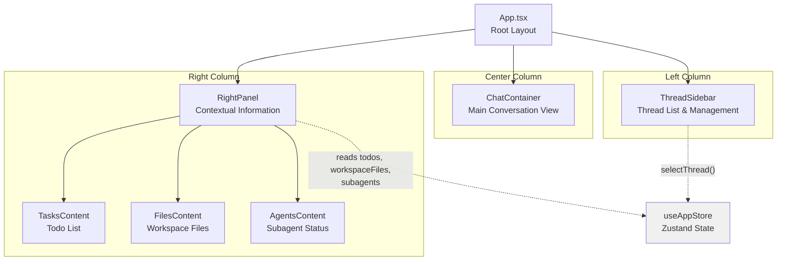
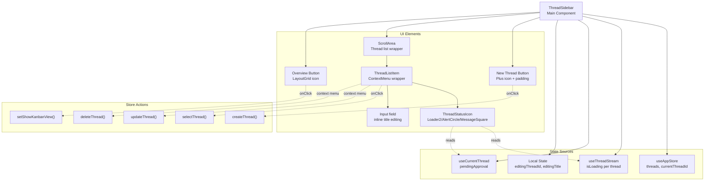
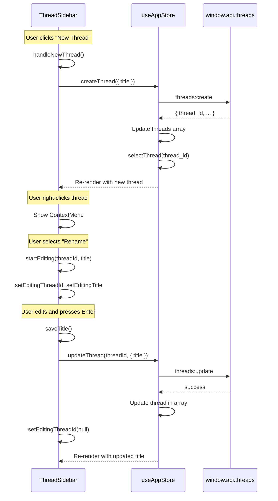
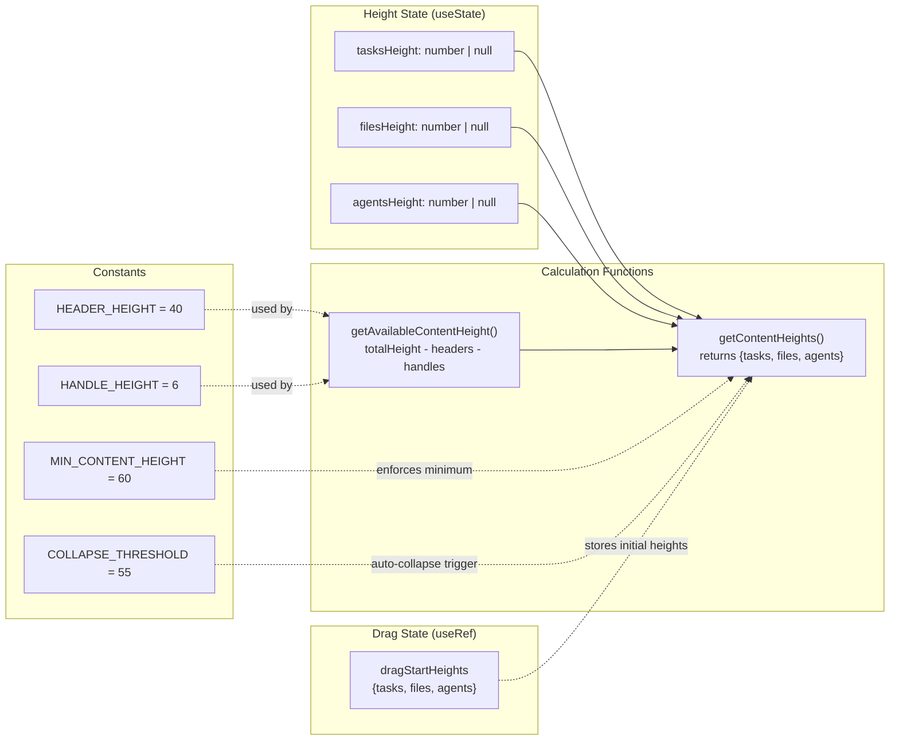
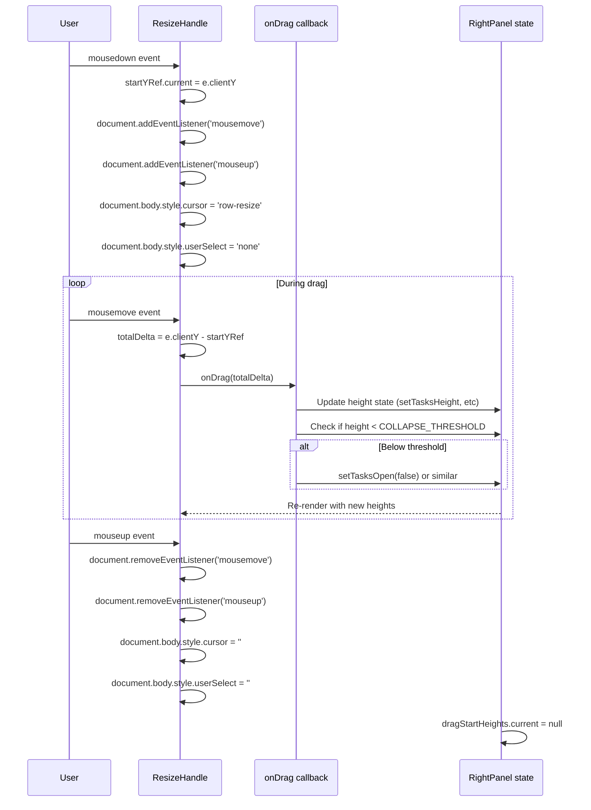
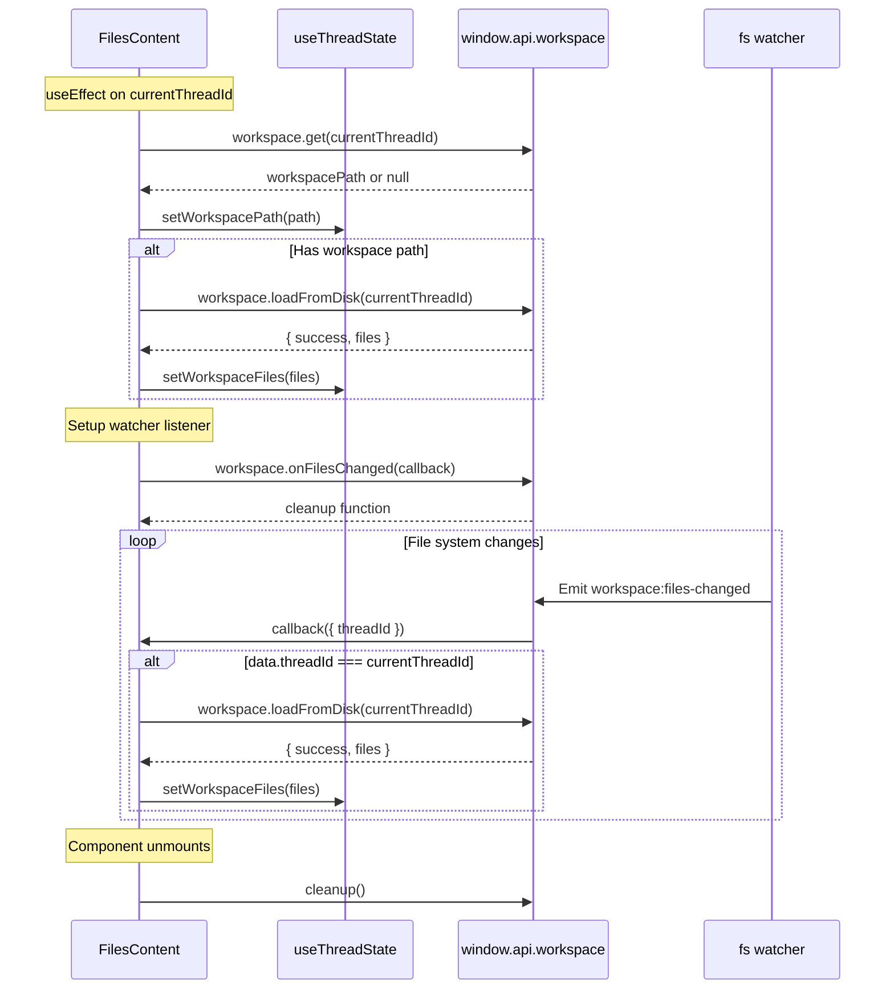
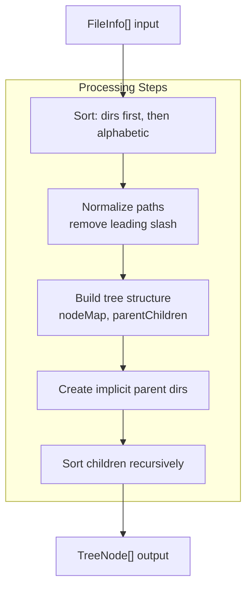

<!-- source: DeepWiki mcp.deepwiki.com · repo langchain-ai/openwork · page 7.3 Side Panels and Navigation · fetched 2026-10-26 -->

# Side Panels and Navigation

<details>
<summary>Relevant source files</summary>

The following files were used as context for generating this wiki page:

- [electron.vite.config.ts](electron.vite.config.ts)
- [src/renderer/src/components/chat/ApiKeyDialog.tsx](src/renderer/src/components/chat/ApiKeyDialog.tsx)
- [src/renderer/src/components/panels/FilesystemPanel.tsx](src/renderer/src/components/panels/FilesystemPanel.tsx)
- [src/renderer/src/components/panels/RightPanel.tsx](src/renderer/src/components/panels/RightPanel.tsx)
- [src/renderer/src/components/panels/TodoPanel.tsx](src/renderer/src/components/panels/TodoPanel.tsx)
- [src/renderer/src/components/sidebar/ThreadSidebar.tsx](src/renderer/src/components/sidebar/ThreadSidebar.tsx)
- [src/renderer/src/lib/thread-context.tsx](src/renderer/src/lib/thread-context.tsx)

</details>


## Purpose and Scope

This document describes the side panel components that provide navigation and contextual information in the OpenWork UI. The left sidebar (`ThreadSidebar`) manages conversation threads, while the right panel (`RightPanel`) displays three collapsible sections for tasks, files, and subagents. For information about the main chat interface, see [Chat Interface](#7.2). For details about the application layout structure, see [Application Layout and Structure](#7.1).

## Overview of Panel Architecture

The OpenWork UI uses a three-column layout with dedicated sidebars for navigation and contextual information.

### Panel Component Hierarchy



**Sources:** [src/renderer/src/components/panels/RightPanel.tsx:1-366](), [src/renderer/src/components/sidebar/ThreadSidebar.tsx:1-151]()

## ThreadSidebar Component

The `ThreadSidebar` component provides the primary navigation interface for managing conversation threads. It displays a list of all threads with metadata, allows creating new threads, and supports thread operations through context menus.

### Component Structure and State Management



**Sources:** [src/renderer/src/components/sidebar/ThreadSidebar.tsx:128-220]()

### Thread List Display and Status Icons

Each thread item displays:
- Thread title (or truncated thread_id if no title via `truncate()`)
- Relative timestamp (via `formatRelativeTime()`)
- Dynamic status icon via `ThreadStatusIcon` component
- Delete button (visible on hover with `group-hover:opacity-100`)

The `ThreadStatusIcon` component provides visual feedback on thread state:

| State | Icon | Styling | Condition |
|-------|------|---------|-----------|
| Loading | `Loader2` | `text-status-info animate-spin` | `isLoading === true` |
| HITL Interrupt | `AlertCircle` | `text-status-warning` | `pendingApproval !== null` |
| Default | `MessageSquare` | `text-muted-foreground` | Neither loading nor interrupted |

The active thread is highlighted with `bg-sidebar-accent text-sidebar-accent-foreground` styling, determined by comparing `currentThreadId` with `thread.thread_id`.

**Key Implementation Details:**

| Feature | Implementation | Line Reference |
|---------|---------------|----------------|
| Status icon | `ThreadStatusIcon` uses `useThreadStream` and `useCurrentThread` | [src/renderer/src/components/sidebar/ThreadSidebar.tsx:18-31]() |
| Thread selection | `onClick={() => { if (!isEditing) onSelect() }}` | [src/renderer/src/components/sidebar/ThreadSidebar.tsx:67-71]() |
| Title editing | Inline `input` with `onBlur`, `onKeyDown` (Enter/Escape) | [src/renderer/src/components/sidebar/ThreadSidebar.tsx:75-88]() |
| Context menu | `ContextMenu` with Pencil icon (Rename) and Trash2 icon (Delete) | [src/renderer/src/components/sidebar/ThreadSidebar.tsx:113-123]() |
| Hover delete | `Button` with `opacity-0 group-hover:opacity-100` | [src/renderer/src/components/sidebar/ThreadSidebar.tsx:100-110]() |

**Sources:** [src/renderer/src/components/sidebar/ThreadSidebar.tsx:18-31](), [src/renderer/src/components/sidebar/ThreadSidebar.tsx:34-125]()

### Thread CRUD Operations

The sidebar integrates with store actions for thread lifecycle management:



**Sources:** [src/renderer/src/components/sidebar/ThreadSidebar.tsx:142-162]()

### Safe Area Padding and Overview Toggle

The sidebar includes zoom compensation for the "New Thread" button to avoid overlap with the window controls:

```typescript
<div className="p-2" style={{ paddingTop: 'calc(8px + var(--sidebar-safe-padding, 0px))' }}>
```

This uses a CSS variable `--sidebar-safe-padding` that is dynamically calculated based on the window zoom level.

At the bottom of the sidebar, an "Overview" button toggles the Kanban view:

```typescript
<Button
  variant="ghost"
  size="sm"
  className="w-full justify-start gap-2"
  onClick={() => setShowKanbanView(true)}
>
  <LayoutGrid className="size-4" />
  Overview
</Button>
```

This calls `setShowKanbanView(true)` to switch the center panel from the thread view to the Kanban board overview.

**Sources:** [src/renderer/src/components/sidebar/ThreadSidebar.tsx:167](), [src/renderer/src/components/sidebar/ThreadSidebar.tsx:207-217]()

## RightPanel Component

The `RightPanel` component displays three vertically stacked sections: TASKS, FILES, and AGENTS. Each section is independently collapsible and features drag-to-resize handles between open sections.

### Three-Section Layout Architecture

```mermaid
graph TB
    RightPanel["RightPanel<br/>Main Component"]
    
    subgraph "Data Sources"
        AppStore["useAppStore<br/>currentThreadId"]
        ThreadState["useThreadState<br/>todos, workspaceFiles, subagents"]
    end
    
    subgraph "Section 1: TASKS"
        TasksHeader["SectionHeader<br/>title='TASKS' icon=ListTodo"]
        TasksContent["TasksContent<br/>Progress bar + todo items"]
        TasksResize["ResizeHandle<br/>onDrag=handleTasksResize"]
    end
    
    subgraph "Section 2: FILES"
        FilesHeader["SectionHeader<br/>title='FILES' icon=FolderTree"]
        FilesContent["FilesContent<br/>FileTree + sync controls"]
        FilesResize["ResizeHandle<br/>onDrag=handleFilesResize"]
    end
    
    subgraph "Section 3: AGENTS"
        AgentsHeader["SectionHeader<br/>title='AGENTS' icon=GitBranch"]
        AgentsContent["AgentsContent<br/>Subagent cards"]
    end
    
    subgraph "State Management"
        OpenState["tasksOpen, filesOpen, agentsOpen"]
        HeightState["tasksHeight, filesHeight, agentsHeight"]
        DragRef["dragStartHeights ref"]
    end
    
    RightPanel --> AppStore
    RightPanel --> ThreadState
    RightPanel --> OpenState
    RightPanel --> HeightState
    RightPanel --> DragRef
    
    RightPanel --> TasksHeader
    RightPanel --> TasksContent
    RightPanel --> TasksResize
    RightPanel --> FilesHeader
    RightPanel --> FilesContent
    RightPanel --> FilesResize
    RightPanel --> AgentsHeader
    RightPanel --> AgentsContent
    
    TasksHeader -.->|"onToggle"| OpenState
    FilesHeader -.->|"onToggle"| OpenState
    AgentsHeader -.->|"onToggle"| OpenState
    
    TasksResize -.->|"updates"| HeightState
    FilesResize -.->|"updates"| HeightState
```



**Sources:** [src/renderer/src/components/panels/RightPanel.tsx:118-370]()

### Section Header Component

The `SectionHeader` component provides a consistent interface for each section:

| Property | Type | Purpose |
|----------|------|---------|
| `title` | `string` | Section name (e.g., "TASKS", "FILES") |
| `icon` | `React.ElementType` | Lucide icon component (ListTodo, FolderTree, GitBranch) |
| `badge` | `number` (optional) | Count of items in section |
| `isOpen` | `boolean` | Current collapsed/expanded state |
| `onToggle` | `() => void` | Callback to toggle section |

The header is implemented as a `button` element with full-width clickable area (height: `HEADER_HEIGHT = 40px`). The chevron icon rotates 90° when expanded:

```typescript
<ChevronRight
  className={cn(
    'size-3.5 text-muted-foreground transition-transform duration-200',
    isOpen && 'rotate-90'
  )}
/>
```

Badge display is conditional: `{badge !== undefined && badge > 0 && <span>...</span>}`, rendering as tabular-nums text.

**Sources:** [src/renderer/src/components/panels/RightPanel.tsx:38-72]()

### Resizable Panel System

The panel implements a sophisticated resize system that allows users to drag handles between sections to adjust content heights.

#### Resize State Management



**Sources:** [src/renderer/src/components/panels/RightPanel.tsx:33-36](), [src/renderer/src/components/panels/RightPanel.tsx:131-177]()

#### Resize Handle Implementation

The `ResizeHandle` component uses mouse events to track drag operations:



**Sources:** [src/renderer/src/components/panels/RightPanel.tsx:74-116]()

#### Resize Logic and Constraints

The resize handlers (`handleTasksResize` and `handleFilesResize`) implement complex logic to:

1. **Initialize drag state**: Store initial heights in `dragStartHeights.current` on first drag
2. **Calculate new heights**: Add `totalDelta` to one section, subtract from adjacent
3. **Enforce minimum heights**: Clamp to `MIN_CONTENT_HEIGHT` (60px)
4. **Respect total space**: Ensure sum doesn't exceed `available - thirdPanelHeight`
5. **Auto-collapse**: Close section if height drops below `COLLAPSE_THRESHOLD` (55px)

**Example from `handleTasksResize`:**

```typescript
if (!dragStartHeights.current) {
  const heights = getContentHeights()
  dragStartHeights.current = { ...heights }
}

const start = dragStartHeights.current
let newTasksHeight = start.tasks + totalDelta
let newOtherHeight = otherStart - totalDelta

// Clamp both to min height
if (newTasksHeight < MIN_CONTENT_HEIGHT) {
  newTasksHeight = MIN_CONTENT_HEIGHT
  newOtherHeight = otherStart + (start.tasks - MIN_CONTENT_HEIGHT)
}

// Auto-collapse if below threshold
if (newTasksHeight < COLLAPSE_THRESHOLD) {
  setTasksOpen(false)
}
```

The `handleMouseUp` effect resets `dragStartHeights.current = null` to ensure the next drag uses fresh starting values.

**Sources:** [src/renderer/src/components/panels/RightPanel.tsx:180-236](), [src/renderer/src/components/panels/RightPanel.tsx:239-287](), [src/renderer/src/components/panels/RightPanel.tsx:290-296]()

## TasksContent Section

The TASKS section displays todos created by the agent, organized by status with a progress indicator.

### Todo Status Configuration

The `STATUS_CONFIG` object maps todo statuses to visual properties:

| Status | Icon | Badge Variant | Label | Color Class |
|--------|------|---------------|-------|-------------|
| `pending` | `Circle` | `outline` | "PENDING" | `text-muted-foreground` |
| `in_progress` | `Clock` | `info` | "IN PROGRESS" | `text-status-info` |
| `completed` | `CheckCircle2` | `nominal` | "DONE" | `text-status-nominal` |
| `cancelled` | `XCircle` | `critical` | "CANCELLED" | `text-muted-foreground` |

**Sources:** [src/renderer/src/components/panels/RightPanel.tsx:375-400]()

### Todo Display Logic

The component filters todos by status and groups them into sections:

```typescript
const inProgress = todos.filter((t) => t.status === "in_progress")
const pending = todos.filter((t) => t.status === "pending")
const completed = todos.filter((t) => t.status === "completed")
const cancelled = todos.filter((t) => t.status === "cancelled")
const doneItems = [...completed, ...cancelled]
```

Display order:

| Section | Todos | Display |
|---------|-------|---------|
| Completed (collapsible) | `completed` + `cancelled` | Collapsed by default with `completedExpanded` state |
| In Progress | `in_progress` | Always visible when present |
| Pending | `pending` | Always visible when present |

**Progress Bar Calculation:**

```typescript
const done = completed.length
const total = todos.length
const progress = total > 0 ? Math.round((done / total) * 100) : 0
```

The progress bar renders as:
- Container: `h-1.5 rounded-full bg-background`
- Fill: `h-full bg-status-nominal transition-all duration-300`
- Width: `style={{ width: \`${progress}%\` }}`

**Sources:** [src/renderer/src/components/panels/RightPanel.tsx:402-488]()

### Task Item Component

Each `TaskItem` displays:
- Status icon (colored according to `STATUS_CONFIG`)
- Todo content text (line-through if completed/cancelled)
- Status badge (label + variant)

```typescript
const config = STATUS_CONFIG[todo.status]
const Icon = config.icon
const isDone = todo.status === "completed" || todo.status === "cancelled"

return (
  <div className={cn(
    "flex items-start gap-3 rounded-sm border border-border p-3",
    isDone && "opacity-50"
  )}>
    <Icon className={cn("size-4 shrink-0 mt-0.5", config.color)} />
    <span className={cn("flex-1 text-sm", isDone && "line-through")}>
      {todo.content}
    </span>
    <Badge variant={config.badge}>{config.label}</Badge>
  </div>
)
```

Done items have 50% opacity and are shown in a collapsible section controlled by `completedExpanded` state with `ChevronRight` (collapsed) or `ChevronDown` (expanded) indicators.

**Sources:** [src/renderer/src/components/panels/RightPanel.tsx:490-509]()

## FilesContent Section

The FILES section displays the workspace file tree and provides folder linking functionality.

### Workspace Integration Flow



**Sources:** [src/renderer/src/components/panels/RightPanel.tsx:522-558]()

### File Tree Structure

The component builds a hierarchical tree from flat file paths using `buildFileTree()`:



**Tree Building Algorithm:**

1. **Sort input**: Directories first using `sort((a, b) => { if (aIsDir && !bIsDir) return -1; ... })`
2. **Normalize paths**: Remove leading slash: `path.startsWith('/') ? path.slice(1) : path`
3. **Build node map**: Create `TreeNode` for each file with `{ name, path, is_dir, size, children: [] }`
4. **Handle nesting**: For multi-level paths, create implicit parent directory nodes
5. **Recursive sort**: Sort children of each node (dirs first, alphabetically)

**TreeNode Interface:**

```typescript
interface TreeNode {
  name: string
  path: string
  is_dir: boolean
  size?: number
  children: TreeNode[]
}
```

**Sources:** [src/renderer/src/components/panels/RightPanel.tsx:659-746]()

### File Tree Node Component

The `FileTreeNode` component is memoized with custom comparison logic and renders recursively:

```typescript
const FileTreeNode = memo(
  function FileTreeNode({ node, depth, expanded, onToggle, openFile }) {
    const handleClick = (): void => {
      if (node.is_dir) {
        onToggle(node.path)
      } else if (openFile) {
        openFile(node.path, node.name)
      }
    }
    // ...
  },
  (prevProps, nextProps) => {
    // Only re-render if node, expansion state, or callbacks changed
    return (
      prevProps.node === nextProps.node &&
      prevProps.expanded.has(prevProps.node.path) === nextProps.expanded.has(nextProps.node.path) &&
      prevProps.openFile === nextProps.openFile &&
      prevProps.onToggle === nextProps.onToggle &&
      prevProps.depth === nextProps.depth
    )
  }
)
```

**Node Display Elements:**

| Element | Condition | Purpose |
|---------|-----------|---------|
| Chevron space | Directory | `w-3.5` container for chevron or empty space |
| `ChevronDown` | Directory, expanded, has children | Collapse indicator |
| `ChevronRight` | Directory, not expanded, has children | Expand indicator |
| File icon | All nodes | `FileIcon` component with extension-based styling |
| Name | All nodes | Truncated filename/dirname with `flex-1` |
| Size | Files only | `formatSize(node.size)` in tabular-nums |

Depth-based indentation: `style={{ paddingLeft }}` where `paddingLeft = 8 + depth * 16`.

**Sources:** [src/renderer/src/components/panels/RightPanel.tsx:783-878]()

### File Icon Mapping

The `FileIcon` component maps file extensions to icons and colors:

| Extension | Icon | Color Class |
|-----------|------|-------------|
| `ts`, `tsx` | `FileCode` | `text-blue-400` |
| `js`, `jsx` | `FileCode` | `text-yellow-400` |
| `json` | `FileJson` | `text-yellow-600` |
| `md`, `mdx` | `FileText` | `text-muted-foreground` |
| `py` | `FileCode` | `text-green-400` |
| `css`, `scss`, `sass` | `FileCode` | `text-pink-400` |
| `html` | `FileCode` | `text-orange-400` |
| `svg`, `png`, `jpg`, `jpeg`, `gif`, `webp` | `Image` | `text-purple-400` |
| `yml`, `yaml` | `FileType` | `text-red-400` |
| default | `File` | `text-muted-foreground` |

Directories use:
- `FolderOpen` with `text-amber-500` when `isOpen === true`
- `Folder` with `text-amber-500` when `isOpen === false`

Extension extraction: `const ext = name.includes('.') ? name.split('.').pop()?.toLowerCase() : ''`

**Sources:** [src/renderer/src/components/panels/RightPanel.tsx:880-934]()

### Workspace Sync Button

The FILES section header includes a sync button with context-aware behavior:

```typescript
<Button
  variant="ghost"
  size="sm"
  onClick={workspaceFiles.length > 0 ? handleSyncToDisk : handleSelectFolder}
  disabled={syncing || !currentThreadId}
  className="h-5 px-1.5 text-[10px]"
/>
```

| State | Button Label | Button Icon | Action |
|-------|--------------|-------------|--------|
| No files, no path | "Link" | `FolderSync` | `handleSelectFolder()` opens picker |
| No files, has path | "Change" | `FolderSync` | `handleSelectFolder()` opens picker |
| Has files | "Sync" | `Download` | `handleSyncToDisk()` (not yet implemented) |
| Syncing | "..." | `Loader2` spinning | Disabled |
| Success | "..." | `Check` green | Shows briefly after sync |

The header also displays the workspace folder name: `workspacePath ? workspacePath.split('/').pop() : 'No folder linked'`

**Sources:** [src/renderer/src/components/panels/RightPanel.tsx:599-635]()

## AgentsContent Section

The AGENTS section displays subagent tasks spawned during agent execution.

### Subagent Display Structure

Each subagent is rendered as a card with:

```typescript
<div key={agent.id} className="p-3 rounded-sm border border-border">
  <div className="flex items-center gap-2 text-sm font-medium">
    <GitBranch className="size-3.5 text-status-info" />
    <span className="flex-1">{agent.name}</span>
    <span className={cn(/* status-based styling *)}>
      {agent.status.toUpperCase()}
    </span>
  </div>
  {agent.description && (
    <p className="text-xs text-muted-foreground mt-1">{agent.description}</p>
  )}
</div>
```

### Status Badge Styling

Each subagent status has unique conditional styling applied via `cn()`:

| Status | Background | Text Color | Example |
|--------|-----------|-----------|---------|
| `pending` | `bg-muted` | `text-muted-foreground` | Gray, not started |
| `running` | `bg-status-info/20` | `text-status-info` | Blue, in progress |
| `completed` | `bg-status-nominal/20` | `text-status-nominal` | Green, finished |
| `failed` | `bg-status-critical/20` | `text-status-critical` | Red, errored |

The status text is displayed in uppercase: `agent.status.toUpperCase()`.

**Sources:** [src/renderer/src/components/panels/RightPanel.tsx:936-977]()

### Empty States

All three sections provide informative empty states when no data is available:

**TasksContent Empty State:**
```typescript
<div className="flex flex-col items-center justify-center text-center text-sm text-muted-foreground py-8 px-4">
  <ListTodo className="size-8 mb-2 opacity-50" />
  <span>No tasks yet</span>
  <span className="text-xs mt-1">Tasks appear when the agent creates them</span>
</div>
```

**FilesContent Empty State:**
```typescript
<div className="flex flex-col items-center justify-center text-center text-sm text-muted-foreground py-8 px-4 flex-1">
  <FolderTree className="size-8 mb-2 opacity-50" />
  <span>No workspace files</span>
  <span className="text-xs mt-1">
    {workspacePath
      ? `Linked to ${workspacePath.split('/').pop()}`
      : 'Click "Link" to set a sync folder'}
  </span>
</div>
```

**AgentsContent Empty State:**
```typescript
<div className="flex flex-col items-center justify-center text-center text-sm text-muted-foreground py-8 px-4">
  <GitBranch className="size-8 mb-2 opacity-50" />
  <span>No subagent tasks</span>
  <span className="text-xs mt-1">Subagents appear when spawned</span>
</div>
```

**Sources:** [src/renderer/src/components/panels/RightPanel.tsx:408-416](), [src/renderer/src/components/panels/RightPanel.tsx:638-647](), [src/renderer/src/components/panels/RightPanel.tsx:941-949]()

## State Management Integration

Panel components integrate with both `useAppStore` (global state) and `useThreadState` (per-thread state via ThreadProvider).

### State Sources by Component

**ThreadSidebar State:**

```typescript
const {
  threads,                // Thread[]
  currentThreadId,        // string | null
  createThread,           // (props) => Promise<void>
  selectThread,           // (id) => void
  deleteThread,           // (id) => Promise<void>
  updateThread,           // (id, updates) => Promise<void>
  setShowKanbanView       // (show: boolean) => void
} = useAppStore()
```

**RightPanel State:**

```typescript
const { currentThreadId } = useAppStore()
const threadState = useThreadState(currentThreadId)
const todos = threadState?.todos ?? []
const workspaceFiles = threadState?.workspaceFiles ?? []
const subagents = threadState?.subagents ?? []
```

**ThreadState Interface (from ThreadProvider):**

| Property | Type | Purpose |
|----------|------|---------|
| `todos` | `Todo[]` | Task list from agent |
| `workspaceFiles` | `FileInfo[]` | Files in workspace |
| `workspacePath` | `string \| null` | Selected workspace folder |
| `subagents` | `Subagent[]` | Spawned subagent tasks |
| `setWorkspacePath` | `(path) => void` | Update workspace path |
| `setWorkspaceFiles` | `(files) => void` | Update file list |
| `openFile` | `(path, name) => void` | Open file in tab |

**Sources:** [src/renderer/src/components/sidebar/ThreadSidebar.tsx:129-137](), [src/renderer/src/components/panels/RightPanel.tsx:119-123](), [src/renderer/src/lib/thread-context.tsx:36-79]()

### IPC Event Subscriptions

The `FilesContent` component subscribes to file change events from the main process:

```typescript
useEffect(() => {
  if (!currentThreadId || !setWorkspaceFiles) return

  const cleanup = window.api.workspace.onFilesChanged(async (data) => {
    // Only reload if the event is for the current thread
    if (data.threadId === currentThreadId) {
      console.log('[FilesContent] Files changed, reloading...', data)
      const result = await window.api.workspace.loadFromDisk(currentThreadId)
      if (result.success && result.files) {
        setWorkspaceFiles(result.files)
      }
    }
  })

  return cleanup
}, [currentThreadId])
```

This ensures the file tree updates in real-time when the workspace watcher (using chokidar in the main process) detects file system changes. The `cleanup` function is returned to unsubscribe when the component unmounts or `currentThreadId` changes.

**Sources:** [src/renderer/src/components/panels/RightPanel.tsx:541-558]()

## FilesystemPanel Component (Alternative)

The codebase also includes a standalone `FilesystemPanel` component that provides similar file browsing functionality but with a different layout and feature set.

### Key Differences from RightPanel's FilesContent

| Feature | RightPanel FilesContent | FilesystemPanel |
|---------|------------------------|-----------------|
| Layout | Part of collapsible sections | Standalone full panel |
| Header | Minimal sync button | Full header with workspace name, refresh, change buttons |
| Empty state | Simple message | Detailed prompt with folder icon |
| File tree | Inline expansion | Full tree with proper directory structure |
| Workspace selection | Integrated in header | Dedicated "Select Folder" screen |

**Sources:** [src/renderer/src/components/panels/FilesystemPanel.tsx:1-322]()

### Tree Building Implementation

The `FilesystemPanel` uses a more sophisticated tree building algorithm:

```typescript
const buildTree = (files: FileInfo[]) => {
  const tree: Map<string, FileInfo[]> = new Map()
  const allDirs = new Set<string>()
  
  // First pass: collect all directories (both explicit and implicit)
  files.forEach(file => {
    let current = getParentPath(normalized)
    while (current !== '/') {
      allDirs.add(current)
      current = getParentPath(current)
    }
  })
  
  // Second pass: add files to parent's children
  // Third pass: add implicit directories
  // Sort children: directories first, then alphabetically
}
```

This approach handles implicit directories (parent directories not explicitly listed in the file array) more robustly than the inline approach in `RightPanel`.

**Sources:** [src/renderer/src/components/panels/FilesystemPanel.tsx:103-168]()

## Summary of Key Components

| Component | Location | Primary Responsibility |
|-----------|----------|----------------------|
| `ThreadSidebar` | [src/renderer/src/components/sidebar/ThreadSidebar.tsx]() | Thread navigation and CRUD operations |
| `RightPanel` | [src/renderer/src/components/panels/RightPanel.tsx]() | Three-section contextual panel with resize |
| `SectionHeader` | [src/renderer/src/components/panels/RightPanel.tsx:45-71]() | Collapsible section header with badge |
| `ResizeHandle` | [src/renderer/src/components/panels/RightPanel.tsx:77-115]() | Drag-to-resize handle between sections |
| `TasksContent` | [src/renderer/src/components/panels/RightPanel.tsx:397-481]() | Todo list with progress tracking |
| `FilesContent` | [src/renderer/src/components/panels/RightPanel.tsx:504-642]() | Workspace file tree with sync |
| `AgentsContent` | [src/renderer/src/components/panels/RightPanel.tsx:907-946]() | Subagent status display |
| `FilesystemPanel` | [src/renderer/src/components/panels/FilesystemPanel.tsx]() | Alternative standalone file browser |

**Sources:** [src/renderer/src/components/panels/RightPanel.tsx:1-953](), [src/renderer/src/components/sidebar/ThreadSidebar.tsx:1-151](), [src/renderer/src/components/panels/FilesystemPanel.tsx:1-322]()

---

