# Page: Overview

# Overview

<details>
<summary>Relevant source files</summary>

The following files were used as context for generating this wiki page:

- [README.md](README.md)
- [package-lock.json](package-lock.json)
- [package.json](package.json)

</details>


## Purpose and Scope

This document provides a comprehensive introduction to the openwork project, explaining its purpose, architecture, and core capabilities. It covers the high-level system design, technology stack, and key components that enable AI agents to interact with filesystems through a desktop interface.

For detailed information about specific subsystems, see:
- Electron process architecture: [Electron Process Model](#2.1)
- Agent execution details: [Agent System](#3)
- UI components: [User Interface](#7)
- Development workflow: [Development and Deployment](#8)

## What is Openwork

Openwork is a desktop interface for [deepagentsjs](https://github.com/langchain-ai/deepagentsjs), providing a tactical environment where AI agents can perform filesystem operations, execute shell commands, and delegate work to subagents. The application gives users direct visibility into agent reasoning through real-time streaming of thoughts, tool calls, and execution results.

**Key characteristics:**
- **Desktop-native**: Built with Electron, runs as a native application on Windows, macOS, and Linux
- **Multi-provider**: Supports Anthropic Claude, OpenAI GPT, and Google Gemini models
- **Safety-first**: Human-in-the-loop approval required for shell commands and file modifications
- **Workspace-oriented**: Each conversation thread operates within a designated filesystem workspace
- **Persistent**: Conversations maintain state across sessions using LangGraph checkpointing

**Distribution**: Openwork is distributed as an npm package and can be run via `npx openwork` or installed globally.

Sources: [package.json:1-109](), [README.md:1-58]()

## Core Capabilities

### Agent Capabilities

| Capability | Description | Safety Mechanism |
|------------|-------------|------------------|
| **Filesystem Planning** | Agents can read, write, and modify files within workspace boundaries | Path validation, HITL approval |
| **Shell Execution** | Execute shell commands for tasks like installing dependencies or running scripts | Mandatory HITL approval |
| **Subagent Delegation** | Spawn child agents to handle subtasks independently | Parent tracks child progress |
| **Multi-turn Reasoning** | Maintain conversation context with checkpointing | Automatic state persistence |
| **Workspace Management** | Associate threads with specific filesystem directories | Per-thread workspace isolation |

### User Capabilities

| Feature | Description |
|---------|-------------|
| **Multi-thread Management** | Create and switch between multiple conversation threads |
| **Real-time Streaming** | View agent reasoning, tool calls, and results as they happen |
| **Task Tracking** | Monitor generated todos and their progress |
| **File Exploration** | Browse workspace files and view changes |
| **Model Switching** | Change LLM provider and model mid-conversation |
| **Kanban View** | Overview of all threads with task progress visualization |

Sources: [README.md:10-16]()

## Technology Stack Overview

### Core Technologies

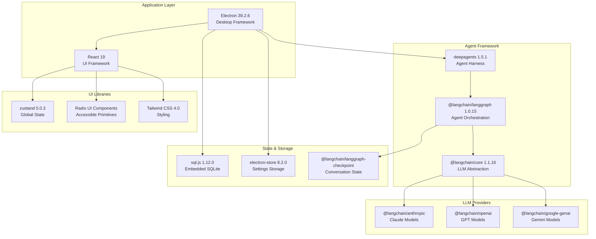

**Supported Models (as of package.json):**

| Provider | Models Available |
|----------|-----------------|
| **Anthropic** | Claude Opus 4.5, Sonnet 4.5, Haiku 4.5, Opus 4.1, Sonnet 4 |
| **OpenAI** | GPT-5.2, 5.1, o3, o3 Mini, o4 Mini, o1, GPT-4.1, 4o |
| **Google** | Gemini 3 Pro Preview, 3 Flash Preview, 2.5 Pro, 2.5 Flash, 2.5 Flash Lite |

**Build System:**
- `electron-vite` for building Electron applications with Vite
- TypeScript for type safety across all processes
- Separate tsconfigs for Node.js (main/preload) and web (renderer) environments

Sources: [package.json:48-84](), [package.json:85-107](), [README.md:43-47]()

## System Architecture

### Three-Process Model

Openwork follows Electron's security-first architecture with three distinct processes:

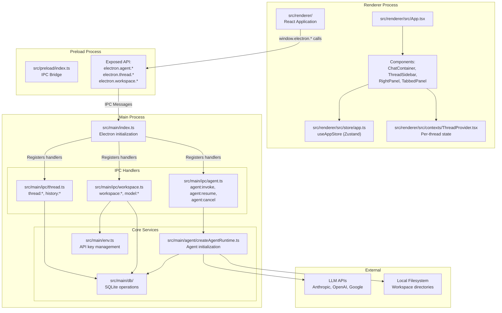

**Process Responsibilities:**

| Process | Security Context | Responsibilities | Technology |
|---------|-----------------|------------------|------------|
| **Main** | Full Node.js access | Agent runtime, database, file I/O, IPC handlers | Node.js, TypeScript |
| **Preload** | Context bridge only | Secure IPC interface exposure | Electron contextBridge |
| **Renderer** | Web sandbox | UI rendering, user interaction, state management | React, Zustand |

For detailed information on process isolation and security, see [Electron Process Model](#2.1).

Sources: [src/main/index.ts](), [src/preload/index.ts](), [src/renderer/src/App.tsx]()

## Key Components and Data Flow

### Application File Structure

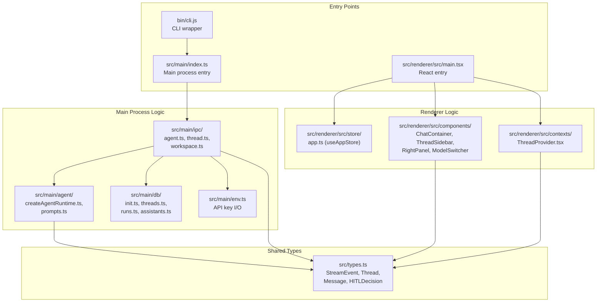

Sources: [bin/cli.js](), [src/main/index.ts](), [src/renderer/src/main.tsx]()

### Agent Execution Flow

```mermaid
sequenceDiagram
    participant User
    participant ChatContainer["ChatContainer<br/>(renderer)"]
    participant ElectronAPI["window.electron.agent<br/>(preload)"]
    participant AgentHandlers["agent.ts IPC handlers<br/>(main)"]
    participant CreateAgentRuntime["createAgentRuntime()<br/>(main)"]
    participant LLM["LLM Provider API"]
    participant LocalSandbox["LocalSandbox<br/>deepagents"]
    
    User->>ChatContainer: "Submit message"
    ChatContainer->>ElectronAPI: "streamAgent(threadId, message)"
    ElectronAPI->>AgentHandlers: "agent:invoke IPC event"
    
    AgentHandlers->>CreateAgentRuntime: "createAgentRuntime(threadId, workspace, modelId)"
    CreateAgentRuntime->>CreateAgentRuntime: "Load checkpoint for thread"
    CreateAgentRuntime->>CreateAgentRuntime: "Initialize LocalSandbox with workspace"
    CreateAgentRuntime-->>AgentHandlers: "Agent runtime instance"
    
    AgentHandlers->>LLM: "Stream request"
    
    loop "Agent Loop"
        LLM-->>AgentHandlers: "Tool calls"
        AgentHandlers->>LocalSandbox: "Execute tool (file read/write/shell)"
        
        alt "Shell command"
            AgentHandlers->>ChatContainer: "StreamEvent: hitl_approval"
            User->>ChatContainer: "Approve/Reject"
            ChatContainer->>ElectronAPI: "respondHITL(decision)"
            ElectronAPI->>AgentHandlers: "agent:hitl IPC event"
        end
        
        LocalSandbox-->>AgentHandlers: "Tool results"
        AgentHandlers->>ChatContainer: "StreamEvent: tool_result"
        AgentHandlers->>LLM: "Continue with results"
    end
    
    LLM-->>AgentHandlers: "Final response"
    AgentHandlers->>CreateAgentRuntime: "Save checkpoint"
    AgentHandlers->>ChatContainer: "StreamEvent: done"
```

**Key Components:**

1. **`createAgentRuntime()`** [src/main/agent/createAgentRuntime.ts](): Factory function that initializes:
   - LangGraph agent with selected model
   - `LocalSandbox` configured with thread's workspace
   - Checkpoint saver for state persistence
   - System prompt with workspace context

2. **IPC Handlers** [src/main/ipc/agent.ts]():
   - `agent:invoke` - Start new agent run
   - `agent:resume` - Continue interrupted run
   - `agent:cancel` - Abort running agent
   - `agent:hitl` - Process HITL approval/rejection

3. **StreamEvent Types** [src/types.ts]():
   - `human_message` - User input
   - `ai_message` - Agent response
   - `tool_call` - Agent invoking tool
   - `tool_result` - Tool execution result
   - `hitl_approval` - Shell command awaiting approval
   - `subagent_start`/`subagent_end` - Subagent lifecycle
   - `token_usage` - Token consumption tracking

For detailed agent execution pipeline, see [Agent Streaming and Execution Pipeline](#3.2).

Sources: [src/main/agent/createAgentRuntime.ts](), [src/main/ipc/agent.ts](), [src/types.ts]()

## State Management Architecture

### Two-Tier State System

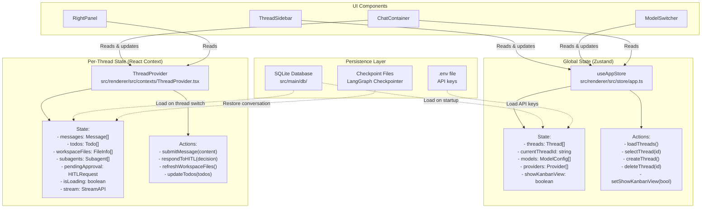

**State Persistence:**

| State Type | Storage Location | Persistence Mechanism | Access Pattern |
|------------|-----------------|----------------------|----------------|
| Thread list | SQLite `threads` table | Auto-save on create/delete | Load once at startup, update on change |
| Thread messages | SQLite `runs` table + checkpoints | Save after each agent turn | Load on thread switch, stream during run |
| API keys | `.env` file in user data directory | Manual save via settings | Load at startup, update on change |
| Workspace path | SQLite `threads.workspace_path` | Save on workspace selection | Load with thread data |
| UI preferences | `electron-store` | Auto-save on change | Load at startup |

For detailed state management patterns, see [State Management Architecture](#2.3).

Sources: [src/renderer/src/store/app.ts](), [src/renderer/src/contexts/ThreadProvider.tsx]()

## Security and Safety Model

### Human-in-the-Loop (HITL) System

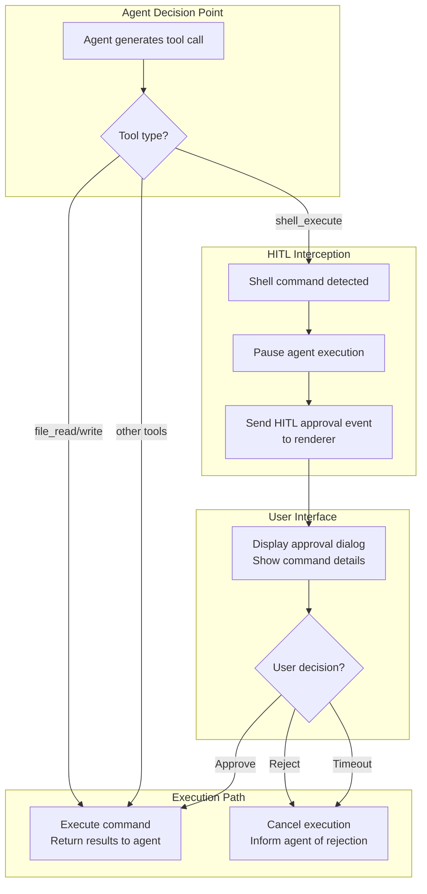

**Security Boundaries:**

| Boundary | Mechanism | Enforcement Point |
|----------|-----------|------------------|
| **Process isolation** | Electron's process model | OS-level |
| **Workspace isolation** | Path validation in `LocalSandbox` | [src/main/agent/createAgentRuntime.ts]() |
| **Shell command approval** | HITL interrupt | [src/main/ipc/agent.ts]() |
| **API key protection** | Main process only | [src/main/env.ts]() |
| **IPC context bridge** | Preload script whitelist | [src/preload/index.ts]() |

**Warning from README:**

> openwork gives AI agents direct access to your filesystem and the ability to execute shell commands. Always review tool calls before approving them, and only run in workspaces you trust.

For detailed HITL implementation, see [Human-in-the-Loop (HITL) System](#3.3).

Sources: [README.md:14-15](), [src/main/ipc/agent.ts](), [src/main/agent/createAgentRuntime.ts]()

## Distribution and Installation

### Package Distribution Model

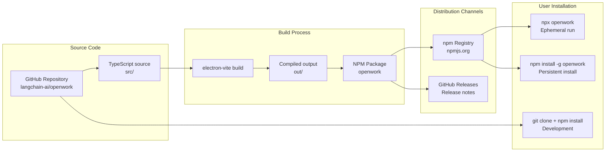

**Installation Methods:**

| Method | Command | Use Case | Electron Handling |
|--------|---------|----------|------------------|
| **npx** | `npx openwork` | One-time run, testing | Auto-downloaded as dependency |
| **Global** | `npm install -g openwork` | Regular use, CLI available | Installed in global node_modules |
| **Source** | `git clone && npm install && npm run dev` | Development, contributing | Dev dependency |

**Binary Entry Point:**
The package defines a CLI entry at [bin/cli.js]() which simply requires the compiled main process entry point [out/main/index.js](). This enables the `openwork` command when installed globally.

**System Requirements:**
- Node.js 18+ [package.json:35-37]()
- Operating System: Windows, macOS, or Linux (via Electron)

For detailed build and release process, see [Build and Release Pipeline](#8.3).

Sources: [package.json:1-14](), [README.md:17-37](), [bin/cli.js]()

## Getting Started

### Quick Start

```bash
# Run immediately without installation
npx openwork

# Or install globally for repeated use
npm install -g openwork
openwork
```

### First-Time Setup

1. **Launch Application**: Run `openwork` command
2. **Configure API Keys**: Click the model switcher and add API keys for desired providers
3. **Create Thread**: Click "New Thread" in the sidebar
4. **Select Workspace**: Choose a directory for the agent to operate in
5. **Start Conversation**: Type a message to begin interacting with the agent

### Development Setup

```bash
# Clone repository
git clone https://github.com/langchain-ai/openwork.git
cd openwork

# Install dependencies
npm install

# Run in development mode with hot reload
npm run dev

# Type checking
npm run typecheck

# Build for production
npm run build
```

For detailed development workflow, see [Project Setup and Configuration](#8.1).

Sources: [README.md:17-37](), [package.json:38-46]()

---

# Page: Architecture

# Architecture

<details>
<summary>Relevant source files</summary>

The following files were used as context for generating this wiki page:

- [bin/cli.js](bin/cli.js)
- [package-lock.json](package-lock.json)
- [package.json](package.json)
- [src/main/index.ts](src/main/index.ts)
- [src/renderer/src/App.tsx](src/renderer/src/App.tsx)

</details>


## Purpose and Scope

This document provides a high-level overview of the openwork system architecture. It explains the overall structure of the application, the primary subsystems, and how they interact to enable AI agent functionality through a desktop interface. 

For detailed information about specific architectural components:
- Process model and security boundaries: see [Electron Process Model](#2.1)
- Inter-process communication mechanisms: see [IPC Communication System](#2.2)  
- Application and thread state management: see [State Management Architecture](#2.3)
- Agent execution and runtime details: see [Agent System](#3)
- User interface structure and components: see [User Interface](#7)

---

## System Overview

openwork is an **Electron-based desktop application** that provides a graphical interface for the `deepagents` library. The application runs as a native desktop process on macOS, Windows, and Linux, packaging a Node.js backend with a React-based frontend into a single executable environment.

The architecture follows Electron's multi-process security model:
- **Main Process**: Node.js environment running the agent runtime, database, and system integrations
- **Preload Script**: Security boundary that exposes controlled IPC channels to the renderer
- **Renderer Process**: Chromium-based web environment running the React UI

The application is distributed as an npm package and launched via a CLI wrapper at [bin/cli.js:1-65]() that spawns the Electron process with [out/main/index.js]() as the entry point.

**Sources**: [package.json:1-109](), [bin/cli.js:1-65](), [src/main/index.ts:1-103]()

---

## Electron Process Architecture

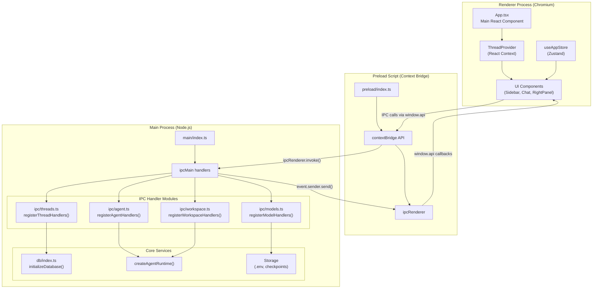

**Three-Process Model**

The application separates concerns across three isolated processes:

| Process | Runtime | Purpose | Entry Point |
|---------|---------|---------|-------------|
| **Main** | Node.js | Backend logic, agent execution, file system access | [src/main/index.ts:1-103]() |
| **Preload** | Node.js (restricted) | Security bridge exposing controlled APIs | [src/preload/index.ts:1-200]() |
| **Renderer** | Chromium (web) | React UI, user interactions | [src/renderer/src/main.tsx:1-20]() |

The main process initializes at [src/main/index.ts:50-96]() by:
1. Creating the `BrowserWindow` with preload script injection
2. Initializing the SQLite database via `initializeDatabase()`
3. Registering IPC handlers for agent, thread, model, and workspace operations
4. Loading the React application into the renderer

The preload script at [src/preload/index.ts:1-200]() exposes a `window.api` object to the renderer via `contextBridge`, providing type-safe access to IPC channels without exposing the full Node.js environment.

**Sources**: [src/main/index.ts:1-103](), [src/preload/index.ts:1-200](), [src/renderer/src/main.tsx:1-20]()

---

## Core Subsystems

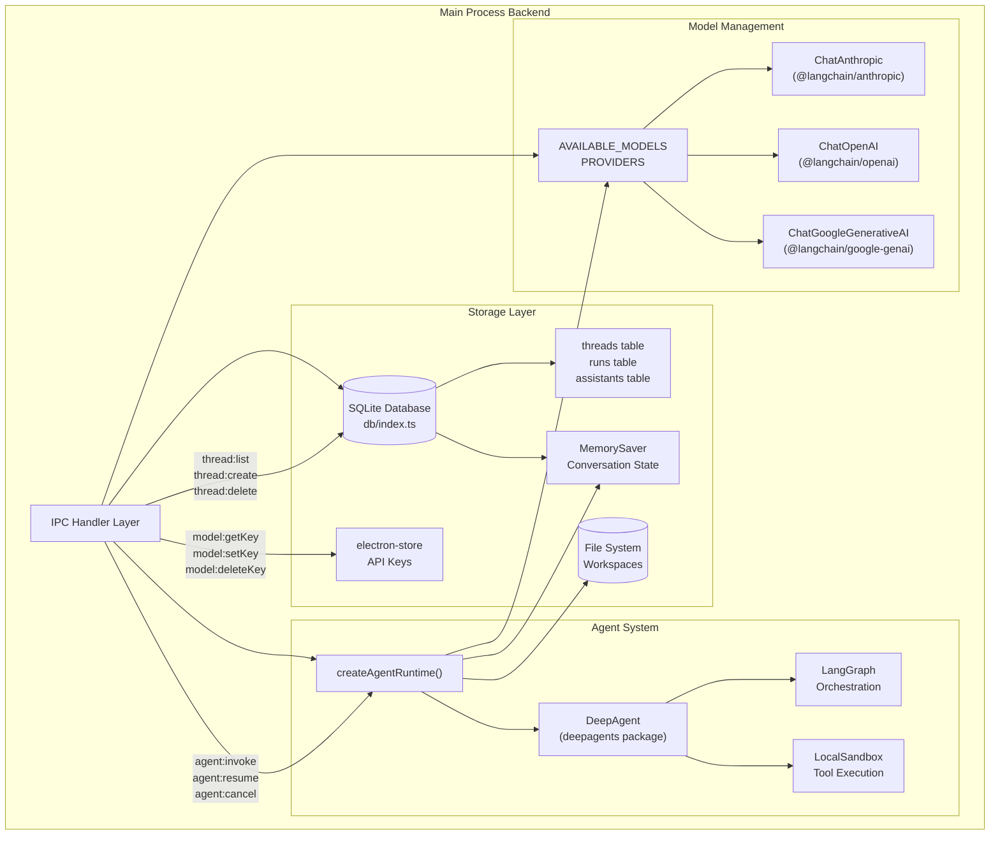

**Agent System**

The agent subsystem provides the core AI functionality. The `createAgentRuntime()` function at [src/main/agent/runtime.ts:100-200]() instantiates a `DeepAgent` with:
- **LLM selection**: Based on `modelId` parameter, creates `ChatAnthropic`, `ChatOpenAI`, or `ChatGoogleGenerativeAI`
- **LocalSandbox**: Provides tool execution environment with file system access restricted to the thread's workspace
- **Checkpointer**: `MemorySaver` instance for conversation state persistence
- **System prompt**: `BASE_SYSTEM_PROMPT` with workspace-specific instructions

Agent execution is initiated via the `agent:invoke` IPC channel at [src/main/ipc/agent.ts:50-150](), which creates a streaming response that flows back to the renderer through `agent:stream:{threadId}` events.

**Storage Layer**

Persistent state is managed across three storage mechanisms:

1. **SQLite Database** ([src/main/db/index.ts:1-200]()): Stores thread metadata, run history, and assistant configurations in the `threads`, `runs`, and `assistants` tables
2. **Checkpointer Files**: Conversation state snapshots written by LangGraph's `MemorySaver` to enable resumption
3. **Environment Store** ([src/main/storage/env.ts:1-100]()): API keys stored in a `.env` file using `electron-store`

The database is initialized via `initializeDatabase()` at [src/main/db/index.ts:20-80](), creating tables if they don't exist.

**Model Management**

Multi-provider LLM support is configured through:
- `AVAILABLE_MODELS` array at [src/shared/constants/models.ts:1-100](): Defines all supported models with display names and context limits
- `PROVIDERS` map at [src/shared/constants/models.ts:100-150](): Maps provider names to configuration and icons
- `getApiKey()` / `setApiKey()` functions at [src/main/storage/env.ts:10-60](): Manage API key storage with environment variable fallback

Model selection occurs in the UI via the `ModelSwitcher` component, which updates thread-specific state and triggers agent runtime reconfiguration.

**Sources**: [src/main/agent/runtime.ts:1-300](), [src/main/ipc/agent.ts:1-200](), [src/main/db/index.ts:1-200](), [src/shared/constants/models.ts:1-150](), [src/main/storage/env.ts:1-100]()

---

## Data Flow: Message Submission to Agent Response

```mermaid
sequenceDiagram
    participant User
    participant ChatContainer["ChatContainer.tsx"]
    participant API["window.api<br/>(preload bridge)"]
    participant AgentIPC["ipc/agent.ts"]
    participant Runtime["createAgentRuntime()"]
    participant DeepAgent
    participant LLM["LLM Provider"]
    participant DB["SQLite DB"]
    participant ThreadState["ThreadProvider"]
    
    User->>ChatContainer: Submit message
    ChatContainer->>API: api.streamAgent(threadId, message)
    API->>AgentIPC: ipcMain.handle("agent:invoke")
    
    AgentIPC->>Runtime: createAgentRuntime(config)
    Runtime->>DB: Load checkpoint
    DB-->>Runtime: Previous state
    Runtime->>DeepAgent: Initialize with MemorySaver
    
    loop Agent Execution Loop
        DeepAgent->>LLM: Stream request
        LLM-->>DeepAgent: AI message + tool_calls
        
        alt Tool requires approval
            DeepAgent->>AgentIPC: Emit HITL interrupt
            AgentIPC->>API: event.sender.send("agent:stream")
            API->>ThreadState: Update pendingApproval
            ThreadState->>User: Display approval UI
            User-->>ThreadState: Approve/Reject
            ThreadState->>API: api.submitDecision()
            API->>AgentIPC: ipcMain.handle("agent:decision")
            AgentIPC->>DeepAgent: Resume with decision
        end
        
        DeepAgent->>DeepAgent: Execute tools
        DeepAgent->>DB: Save checkpoint
        DeepAgent->>AgentIPC: Emit stream events
        AgentIPC->>API: event.sender.send("agent:stream")
        API->>ThreadState: Update messages/todos/subagents
        ThreadState->>ChatContainer: Re-render with updates
    end
    
    DeepAgent-->>AgentIPC: Final response
    AgentIPC->>DB: Save run record
    AgentIPC->>API: Send done event
    API->>ThreadState: Mark complete
    ThreadState->>ChatContainer: Re-render
```

**Event Flow Summary**

1. **User Input**: User submits message through `ChatContainer` at [src/renderer/src/components/chat/ChatContainer.tsx:200-250]()
2. **IPC Invocation**: `window.api.streamAgent()` calls `ipcMain.handle("agent:invoke")` at [src/main/ipc/agent.ts:50-100]()
3. **Runtime Creation**: `createAgentRuntime()` instantiates `DeepAgent` with workspace and model configuration
4. **Streaming Execution**: Agent streams events back via `event.sender.send("agent:stream:{threadId}")` at [src/main/ipc/agent.ts:150-200]()
5. **State Updates**: `ThreadProvider` at [src/renderer/src/lib/thread-context.tsx:100-200]() processes stream events and updates local state
6. **UI Rendering**: React components re-render with updated messages, tasks, and subagent status

The streaming architecture enables real-time UI updates as the agent works, showing token usage, task progress, and file modifications as they occur.

**Sources**: [src/renderer/src/components/chat/ChatContainer.tsx:1-400](), [src/main/ipc/agent.ts:1-300](), [src/renderer/src/lib/thread-context.tsx:1-500](), [src/main/agent/runtime.ts:1-300]()

---

## Application Layout Structure

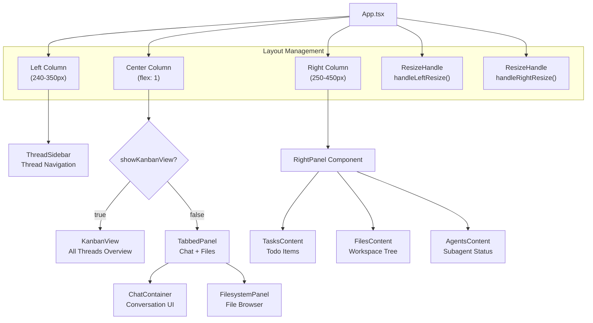

The application implements a three-column layout at [src/renderer/src/App.tsx:122-204]():

| Column | Width | Purpose |
|--------|-------|---------|
| **Left** | 240-350px (resizable) | `ThreadSidebar` for thread navigation |
| **Center** | Flexible (min-w-0) | `TabbedPanel` (chat/files) or `KanbanView` |
| **Right** | 250-450px (resizable) | `RightPanel` with tasks, files, agents sections |

The layout adapts to zoom levels by calculating zoom compensation at [src/renderer/src/App.tsx:30-53]() to maintain consistent spacing around macOS traffic lights. Panel widths are managed via React state with resize handlers at [src/renderer/src/App.tsx:65-85]() that update on drag.

The center panel conditionally renders based on `showKanbanView` from `useAppStore()`:
- **Thread View**: `TabbedPanel` with `ChatContainer` (default tab) and `FilesystemPanel` (files tab)
- **Kanban View**: Full-width `KanbanView` displaying all threads with status columns

**Sources**: [src/renderer/src/App.tsx:1-208](), [src/renderer/src/components/sidebar/ThreadSidebar.tsx:1-200](), [src/renderer/src/components/panels/RightPanel.tsx:1-300]()

---

## Build and Distribution Architecture

The application uses **electron-vite** for building and **npm** for distribution:

| Build Target | Output | Configuration |
|--------------|--------|---------------|
| **Main Process** | `out/main/index.js` | [electron-vite.config.ts]() - Node.js bundle with TypeScript compilation |
| **Preload Script** | `out/preload/index.js` | [electron-vite.config.ts]() - Isolated context bridge bundle |
| **Renderer** | `out/renderer/index.html` + assets | [electron-vite.config.ts]() - React app with Vite bundling and Tailwind CSS |

The build process at [package.json:46]() runs:
1. **Type Checking**: `npm run typecheck` validates TypeScript across all processes
2. **Compilation**: `electron-vite build` creates production bundles in `out/`
3. **Packaging**: Files are packaged as npm module with `bin/cli.js` as entry point

Distribution is handled through npm registry at [.github/workflows/release.yml:1-100](). When a `v*.*.*` tag is pushed, GitHub Actions:
1. Validates version format and secrets
2. Runs `npm ci` and type checking
3. Executes `npm run build`
4. Publishes to npm with public access
5. Creates GitHub Release with installation instructions

Users install via `npm install -g openwork` or run directly with `npx openwork`, which invokes the CLI wrapper at [bin/cli.js:35-60]() to spawn the Electron process.

**Sources**: [package.json:38-46](), [bin/cli.js:1-65](), [electron-vite.config.ts:1-100](), [.github/workflows/release.yml:1-100]()

---

# Page: Electron Process Model

# Electron Process Model

<details>
<summary>Relevant source files</summary>

The following files were used as context for generating this wiki page:

- [bin/cli.js](bin/cli.js)
- [src/main/index.ts](src/main/index.ts)
- [src/preload/index.d.ts](src/preload/index.d.ts)
- [src/preload/index.ts](src/preload/index.ts)

</details>


## Purpose and Scope

This document details the three-process architecture that forms the foundation of openwork's Electron application. It explains the responsibilities of each process (main, preload, renderer), how they are initialized, and the security boundaries enforced between them. For information about the IPC communication mechanisms that enable inter-process communication, see [IPC Communication System](#2.2).

---

## Process Architecture Overview

Openwork follows Electron's multi-process architecture with three distinct processes that execute in isolated contexts:

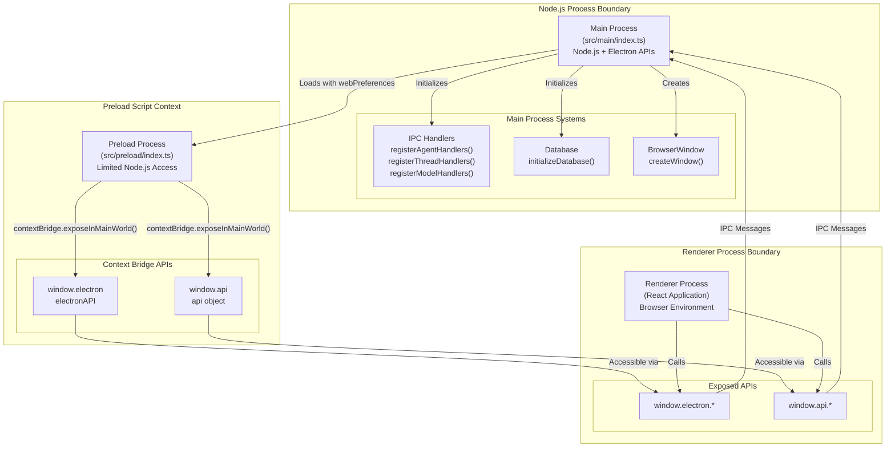

**Sources:** [src/main/index.ts:1-103](), [src/preload/index.ts:1-232]()

---

## Main Process

The main process is the Node.js backend that controls the application lifecycle and manages native operating system interactions. It has full access to Node.js APIs and Electron's main process modules.

### Responsibilities

| Responsibility | Implementation |
|---------------|----------------|
| Application lifecycle | `app.whenReady()`, `app.on('window-all-closed')` |
| Window management | `createWindow()` creates `BrowserWindow` |
| IPC handler registration | `registerAgentHandlers()`, `registerThreadHandlers()`, `registerModelHandlers()` |
| Database initialization | `initializeDatabase()` |
| File system access | Exposed via workspace IPC handlers |
| Native API access | Shell operations, dialog boxes, system notifications |

### Entry Point and Initialization

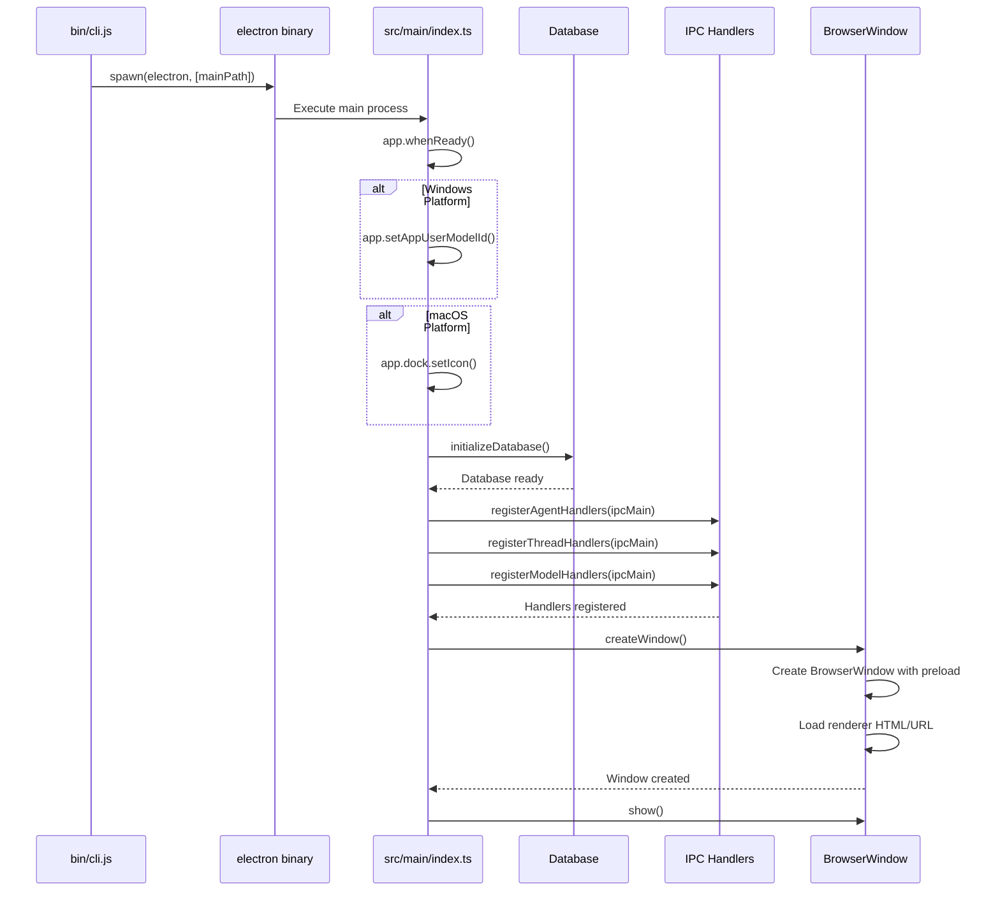

The main process begins execution at [src/main/index.ts:50-96]() when `app.whenReady()` fires. The initialization sequence is:

1. **Platform Configuration** [src/main/index.ts:52-67](): Sets app user model ID on Windows and dock icon on macOS
2. **Database Initialization** [src/main/index.ts:82](): Calls `initializeDatabase()` to prepare SQLite
3. **IPC Handler Registration** [src/main/index.ts:85-87](): Registers handlers for agent, thread, and model operations
4. **Window Creation** [src/main/index.ts:89](): Creates the main `BrowserWindow` with preload configuration

### Window Configuration

The `createWindow()` function [src/main/index.ts:13-48]() configures the `BrowserWindow` with specific security and UI parameters:

```typescript
// Key configuration from src/main/index.ts:14-26
{
  width: 1440,
  height: 900,
  minWidth: 1200,
  minHeight: 700,
  titleBarStyle: "hiddenInset",          // Custom title bar on macOS
  trafficLightPosition: { x: 16, y: 16 }, // macOS window controls
  webPreferences: {
    preload: join(__dirname, "../preload/index.js"),  // Critical for security
    sandbox: false                         // Allows Node.js access in preload
  }
}
```

The `preload` configuration is essential—it specifies the preload script that will execute in a privileged context before the renderer process loads.

**Sources:** [src/main/index.ts:13-48](), [src/main/index.ts:50-96](), [bin/cli.js:1-65]()

---

## Preload Process

The preload script runs in a special isolated context that has access to both Electron's `contextBridge` API and a subset of Node.js APIs. It acts as a security boundary, exposing only authorized APIs to the renderer process.

### Context Isolation Model

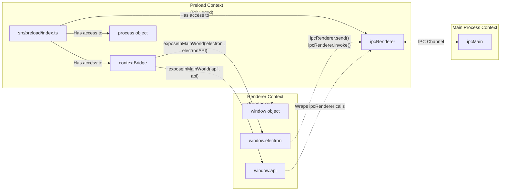

Context isolation is enforced at [src/preload/index.ts:219-231]():

```typescript
if (process.contextIsolated) {
  try {
    contextBridge.exposeInMainWorld("electron", electronAPI)
    contextBridge.exposeInMainWorld("api", api)
  } catch (error) {
    console.error(error)
  }
} else {
  // Fallback for non-isolated contexts
  window.electron = electronAPI
  window.api = api
}
```

The `contextBridge.exposeInMainWorld()` method creates a secure, one-way bridge that prevents the renderer from directly accessing Node.js or Electron APIs.

### Exposed API Surface

The preload script exposes two distinct API namespaces:

#### `window.electron` - Low-Level IPC Interface

[src/preload/index.ts:5-21]() defines `electronAPI`, which provides basic IPC primitives:

| Method | Purpose | Returns |
|--------|---------|---------|
| `ipcRenderer.send()` | Fire-and-forget message to main | `void` |
| `ipcRenderer.on()` | Subscribe to channel events | Cleanup function |
| `ipcRenderer.once()` | Subscribe to single event | `void` |
| `ipcRenderer.invoke()` | Request-response pattern | `Promise<unknown>` |

#### `window.api` - High-Level Domain APIs

[src/preload/index.ts:24-216]() defines the `api` object, which provides domain-specific interfaces:

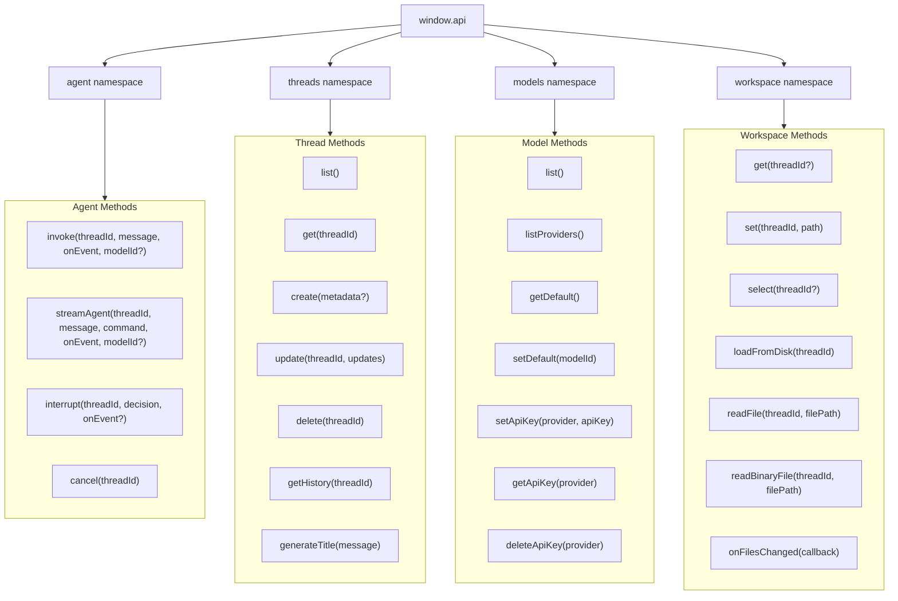

Each method in the `api` object wraps `ipcRenderer` calls with typed parameters and return values defined in [src/preload/index.d.ts:16-95]().

### Stream Event Handling Pattern

The agent streaming methods (`invoke`, `streamAgent`, `interrupt`) implement a subscription pattern [src/preload/index.ts:27-79]():

```typescript
// Pattern used for agent streaming (src/preload/index.ts:32-48)
invoke: (threadId, message, onEvent, modelId?) => {
  const channel = `agent:stream:${threadId}`
  
  const handler = (_, data: StreamEvent) => {
    onEvent(data)
    if (data.type === "done" || data.type === "error") {
      ipcRenderer.removeListener(channel, handler)
    }
  }
  
  ipcRenderer.on(channel, handler)
  ipcRenderer.send("agent:invoke", { threadId, message, modelId })
  
  return () => {
    ipcRenderer.removeListener(channel, handler)
  }
}
```

This pattern:
1. Creates a per-thread channel: `agent:stream:${threadId}`
2. Registers an event listener that forwards `StreamEvent` data to the callback
3. Sends the initial IPC message to start the agent
4. Returns a cleanup function to unsubscribe
5. Auto-unsubscribes when receiving `done` or `error` events

**Sources:** [src/preload/index.ts:1-232](), [src/preload/index.d.ts:1-103]()

---

## Renderer Process

The renderer process is a Chromium-based browser environment that runs the React application. It has no direct access to Node.js or Electron APIs—all system interactions must go through the APIs exposed by the preload script.

### Capabilities and Restrictions

| Capability | Status | Access Method |
|------------|--------|---------------|
| DOM manipulation | ✓ Full access | Direct browser APIs |
| React rendering | ✓ Full access | React 19 framework |
| Network requests | ✓ Full access | `fetch()`, WebSocket |
| Local storage | ✓ Full access | `localStorage`, `sessionStorage` |
| Node.js modules | ✗ No access | Must use `window.api` |
| File system | ✗ No access | Must use `window.api.workspace.*` |
| IPC | ✗ No direct access | Must use `window.electron.ipcRenderer` or `window.api` |
| Process spawning | ✗ No access | Must use agent IPC handlers |

### API Access Pattern

The renderer accesses main process functionality through the type-safe APIs defined in [src/preload/index.d.ts:97-102]():

```typescript
declare global {
  interface Window {
    electron: ElectronAPI
    api: CustomAPI
  }
}
```

Example usage pattern in the renderer:

```typescript
// Creating a new thread
const thread = await window.api.threads.create({ title: "New Chat" })

// Streaming agent responses
const cleanup = window.api.agent.invoke(
  threadId,
  userMessage,
  (event: StreamEvent) => {
    // Handle streaming events
    if (event.type === "message") {
      // Update UI with message
    }
  },
  modelId
)

// Later: cleanup to remove listener
cleanup()
```

The renderer process loads from [src/main/index.ts:39-43]():
- **Development**: Loads from `ELECTRON_RENDERER_URL` (Vite dev server)
- **Production**: Loads from `../renderer/index.html` (built bundle)

**Sources:** [src/preload/index.d.ts:97-102](), [src/main/index.ts:39-43]()

---

## Process Initialization Flow

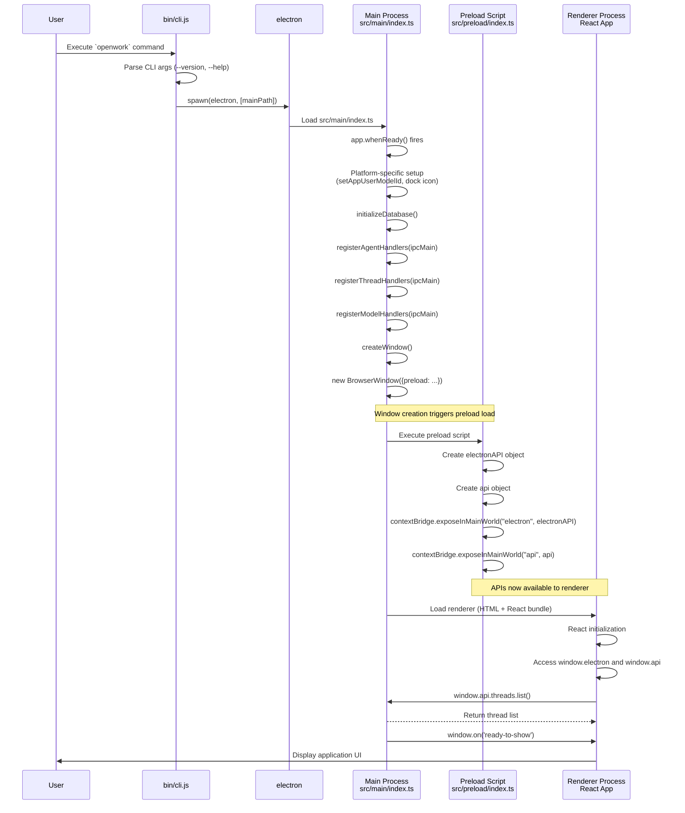

### Startup Sequence Details

1. **CLI Wrapper Execution** [bin/cli.js:35-43]()
   - Resolves Electron binary path
   - Spawns Electron process with `out/main/index.js` as entry point
   - Forwards SIGINT/SIGTERM signals to child process

2. **Main Process Initialization** [src/main/index.ts:50-96]()
   - Sets process title and platform-specific configurations
   - Initializes SQLite database
   - Registers all IPC handlers before window creation
   - Creates `BrowserWindow` with preload configuration

3. **Preload Script Execution** [src/preload/index.ts:219-231]()
   - Executes in isolated context before renderer loads
   - Creates API wrapper objects
   - Uses `contextBridge` to expose APIs to renderer
   - Provides type-safe interfaces via TypeScript definitions

4. **Renderer Process Loading** [src/main/index.ts:39-43]()
   - Loads HTML file and JavaScript bundles
   - React application initializes
   - Components can immediately access `window.api`
   - Makes initial IPC calls to load application state

**Sources:** [bin/cli.js:35-65](), [src/main/index.ts:50-96](), [src/preload/index.ts:219-231]()

---

## Security Model

The three-process architecture enforces strict security boundaries through Electron's context isolation and the preload bridge pattern.

### Security Boundaries

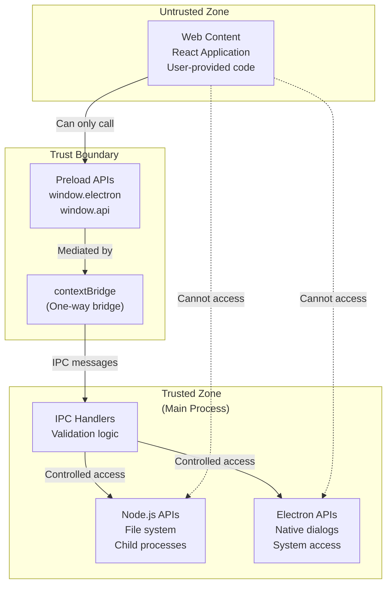

### Key Security Features

| Feature | Implementation | Purpose |
|---------|---------------|---------|
| Context Isolation | `process.contextIsolated` check [src/preload/index.ts:219]() | Prevents renderer from accessing preload globals |
| Context Bridge | `contextBridge.exposeInMainWorld()` [src/preload/index.ts:221-222]() | One-way API exposure with no prototype pollution |
| Sandbox Disabled | `sandbox: false` [src/main/index.ts:25]() | Allows preload to access Node.js (controlled security trade-off) |
| IPC Channel Validation | Handler registration in main process | Only registered channels can be invoked |
| Type Safety | TypeScript definitions [src/preload/index.d.ts]() | Compile-time validation of API usage |

### Why Sandbox is Disabled

The configuration sets `sandbox: false` [src/main/index.ts:25]() to allow the preload script to access Node.js APIs like `path` and `process`. This is a controlled trade-off:

- **Risk**: Preload has more privileges than a sandboxed preload would
- **Mitigation**: Preload script is part of the trusted application code, not user content
- **Benefit**: Enables preload to construct IPC messages with proper type handling and parameter validation

The renderer process itself remains isolated and cannot access Node.js APIs regardless of the sandbox setting—only the preload script has this access.

### IPC Channel Namespacing

The preload script uses consistent channel naming patterns to organize IPC communication:

| Namespace | Pattern | Example |
|-----------|---------|---------|
| Agent operations | `agent:*` | `agent:invoke`, `agent:cancel` |
| Agent streaming | `agent:stream:{threadId}` | `agent:stream:abc123` |
| Thread operations | `threads:*` | `threads:list`, `threads:create` |
| Model operations | `models:*` | `models:list`, `models:setApiKey` |
| Workspace operations | `workspace:*` | `workspace:get`, `workspace:loadFromDisk` |

This namespacing allows the main process to organize IPC handlers into separate modules (see [IPC Communication System](#2.2)) while maintaining a clear separation of concerns.

**Sources:** [src/preload/index.ts:219-231](), [src/main/index.ts:23-26](), [src/preload/index.d.ts:1-103]()

---

# Page: IPC Communication System

# IPC Communication System

<details>
<summary>Relevant source files</summary>

The following files were used as context for generating this wiki page:

- [src/main/ipc/agent.ts](src/main/ipc/agent.ts)
- [src/preload/index.d.ts](src/preload/index.d.ts)
- [src/preload/index.ts](src/preload/index.ts)
- [src/renderer/src/lib/electron-transport.ts](src/renderer/src/lib/electron-transport.ts)

</details>


## Purpose and Scope

The IPC Communication System enables secure communication between OpenWork's renderer process (React UI) and main process (Node.js backend). This system uses Electron's IPC mechanisms to expose privileged operations—such as file system access, database queries, and AI model invocation—to the UI while maintaining process isolation for security.

This document covers the IPC channel architecture, handler registration, and the specialized `ElectronIPCTransport` bridge that adapts LangGraph's streaming SDK to work over Electron IPC. For information about the Electron process architecture itself, see [Electron Process Model](#2.1). For details on state management in the renderer, see [Global State Management](#2.3).

---

## IPC Channel Architecture

OpenWork organizes IPC communication into four primary channel categories, each handling a specific domain of functionality:

| Channel Prefix | Purpose | Handler File |
|---------------|---------|--------------|
| `threads:*` | Thread CRUD operations, history retrieval | `src/main/db.ts` |
| `agent:*` | Agent invocation, streaming, resumption, cancellation | `src/main/ipc/agent.ts` |
| `models:*` | Model listing, API key management, default model selection | `src/main/ipc/models.ts` |
| `workspace:*` | Workspace selection, file operations, directory scanning | `src/main/ipc/models.ts` |

### Channel Naming Convention

IPC channels follow a `domain:action` pattern:
- **Request-response**: `ipcMain.handle('models:list', ...)` → `ipcRenderer.invoke('models:list')`
- **One-way events**: `ipcMain.on('agent:invoke', ...)` → `ipcRenderer.send('agent:invoke', ...)`
- **Response channels**: `agent:stream:${threadId}` for streaming responses back to renderer

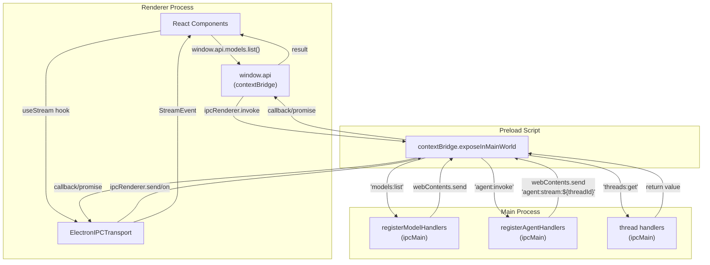

**Sources:** [src/main/ipc/models.ts:192-504](), [src/main/ipc/agent.ts:11-279]()

---

## Handler Registration Patterns

### Request-Response Handlers

Request-response handlers use `ipcMain.handle()` for bidirectional communication with a return value. These are invoked from the renderer using `ipcRenderer.invoke()`.

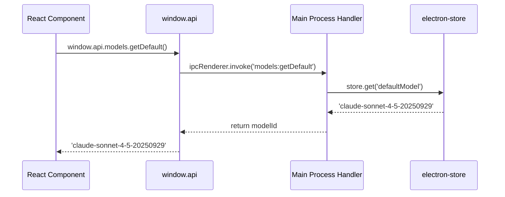

**Example handlers:**
- `models:getDefault` - Returns default model ID from `electron-store` [src/main/ipc/models.ts:203-205]()
- `models:setApiKey` - Stores API key in `.env` file via `setApiKey()` [src/main/ipc/models.ts:213-218]()
- `workspace:select` - Opens native directory picker dialog [src/main/ipc/models.ts:293-323]()
- `agent:cancel` - Aborts active agent stream [src/main/ipc/agent.ts:272-278]()

### Event-Based Streaming Handlers

Streaming handlers use `ipcMain.on()` for one-way event sending, with responses sent back via `webContents.send()` to a specific channel. This pattern supports long-running operations with incremental updates.

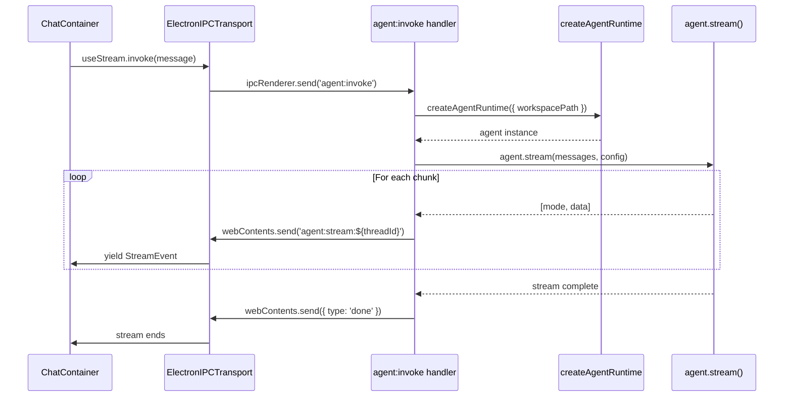

**Key streaming handler:** `agent:invoke` initiates agent execution and streams results back via `agent:stream:${threadId}` channel [src/main/ipc/agent.ts:15-109]()

**Sources:** [src/main/ipc/agent.ts:11-279](), [src/main/ipc/models.ts:192-504]()

---

## Model and Provider Handlers

The `registerModelHandlers` function in [src/main/ipc/models.ts:192]() registers handlers for model configuration and workspace management.

### Model Configuration Handlers

| Handler | Type | Purpose | Return Value |
|---------|------|---------|--------------|
| `models:list` | handle | Lists all available models with API key availability | `ModelConfig[]` |
| `models:getDefault` | handle | Retrieves default model ID | `string` |
| `models:setDefault` | handle | Saves default model ID to `electron-store` | `void` |
| `models:listProviders` | handle | Lists providers with API key status | `Provider[]` |

**Model availability check:** The `models:list` handler augments `AVAILABLE_MODELS` with runtime API key status by calling `hasApiKey(model.provider)` for each model [src/main/ipc/models.ts:194-200]().

```mermaid
graph LR
    subgraph "Static Configuration"
        MODELS["AVAILABLE_MODELS<br/>(23 models)"]
        PROVIDERS["PROVIDERS<br/>(anthropic, openai, google)"]
    end
    
    subgraph "models:list Handler"
        Handler["ipcMain.handle"]
        Check["hasApiKey check"]
    end
    
    subgraph "Storage Layer"
        EnvFile[".env file<br/>~/.openwork/.env"]
    end
    
    MODELS --> Handler
    Handler --> Check
    Check --> EnvFile
    EnvFile -->|"ANTHROPIC_API_KEY<br/>OPENAI_API_KEY<br/>GOOGLE_API_KEY"| Check
    Check -->|"model.available = hasApiKey(provider)"| Handler
    Handler -->|"ModelConfig[]"| UI["Renderer"]
```

### API Key Handlers

| Handler | Type | Purpose | Storage |
|---------|------|---------|---------|
| `models:setApiKey` | handle | Stores API key for provider | `~/.openwork/.env` |
| `models:getApiKey` | handle | Retrieves API key (`.env` or `process.env`) | `~/.openwork/.env` |
| `models:deleteApiKey` | handle | Removes API key from `.env` | `~/.openwork/.env` |

The API key handlers delegate to the `storage` module:
- `setApiKey(provider, apiKey)` writes to `.env` file and `process.env` [src/main/storage.ts:77-87]()
- `getApiKey(provider)` checks `.env` file first, then falls back to `process.env` [src/main/storage.ts:65-75]()
- Environment variable names are mapped via `ENV_VAR_NAMES`: `{ anthropic: 'ANTHROPIC_API_KEY', ... }` [src/main/storage.ts:9-13]()

### Workspace Handlers

| Handler | Type | Purpose | Thread-Specific |
|---------|------|---------|-----------------|
| `workspace:get` | handle | Retrieves workspace path from thread metadata | Yes |
| `workspace:set` | handle | Saves workspace path to thread metadata, starts file watcher | Yes |
| `workspace:select` | handle | Opens directory picker, saves selection | Yes |
| `workspace:loadFromDisk` | handle | Recursively scans directory, returns file tree | Yes |
| `workspace:readFile` | handle | Reads text file content with path validation | Yes |
| `workspace:readBinaryFile` | handle | Reads binary file as base64 | Yes |

**Thread metadata storage:** Workspace paths are stored in the `thread.metadata` JSON field as `{ workspacePath: string }` [src/main/ipc/models.ts:244-257]().

**Security validation:** File read operations validate that resolved paths are within the workspace boundary [src/main/ipc/models.ts:419-424]():
```typescript
const resolvedPath = path.resolve(fullPath)
const resolvedWorkspace = path.resolve(workspacePath)
if (!resolvedPath.startsWith(resolvedWorkspace)) {
  return { success: false, error: 'Access denied: path outside workspace' }
}
```

**Sources:** [src/main/ipc/models.ts:192-504](), [src/main/storage.ts:1-104]()

---

## Agent Handlers

The `registerAgentHandlers` function in [src/main/ipc/agent.ts:11]() manages agent execution lifecycle with streaming support.

### Agent Execution Flow

```mermaid
stateDiagram-v2
    [*] --> Idle
    Idle --> Validating: agent:invoke received
    Validating --> CheckWorkspace: Extract thread metadata
    CheckWorkspace --> Error: No workspace path
    CheckWorkspace --> AbortExisting: Has workspace
    AbortExisting --> CreateRuntime: Abort previous stream
    CreateRuntime --> Streaming: agent.stream() started
    Streaming --> Processing: Yield stream chunks
    Processing --> Streaming: More chunks
    Processing --> Interrupt: __interrupt__ event
    Interrupt --> WaitingApproval: Send interrupt to UI
    WaitingApproval --> Resuming: agent:interrupt received
    Resuming --> Streaming: agent.stream(null) continues
    Processing --> Cleanup: Stream complete
    Cleanup --> Idle: activeRuns.delete()
    Error --> Idle
```

### Active Stream Management

The agent system maintains an `activeRuns` Map to track and cancel concurrent streams [src/main/ipc/agent.ts:9]():

```mermaid
graph TB
    subgraph "Agent Handler State"
        ActiveRuns["activeRuns<br/>Map<string, AbortController>"]
    end
    
    subgraph "agent:invoke Handler"
        CheckExisting["existingController = activeRuns.get(threadId)"]
        Abort["existingController?.abort()"]
        CreateNew["new AbortController()"]
        Register["activeRuns.set(threadId, controller)"]
    end
    
    subgraph "Cleanup"
        WindowClosed["window.on('closed')"]
        StreamDone["stream complete"]
        Delete["activeRuns.delete(threadId)"]
    end
    
    CheckExisting --> ActiveRuns
    ActiveRuns -->|"has existing"| Abort
    Abort --> CreateNew
    CreateNew --> Register
    Register --> ActiveRuns
    
    WindowClosed --> Delete
    StreamDone --> Delete
    Delete --> ActiveRuns
```

**Concurrent stream prevention:** Before starting a new stream, the handler aborts any existing stream for the thread to prevent checkpoint corruption [src/main/ipc/agent.ts:33-38]().

### Stream Event Emission

Agent handlers emit events to a thread-specific channel `agent:stream:${threadId}` [src/main/ipc/agent.ts:18]():

```mermaid
graph LR
    subgraph "Main Process Stream Loop"
        Stream["agent.stream(messages, config)"]
        Chunk["chunk: [mode, data]"]
        Serialize["JSON.parse(JSON.stringify(data))"]
        Send["webContents.send(channel, event)"]
    end
    
    subgraph "Event Types"
        StreamEvent["{ type: 'stream', mode, data }"]
        DoneEvent["{ type: 'done' }"]
        ErrorEvent["{ type: 'error', error }"]
    end
    
    Stream --> Chunk
    Chunk --> Serialize
    Serialize --> Send
    Send --> StreamEvent
    Send --> DoneEvent
    Send --> ErrorEvent
```

**LangGraph streaming modes:** Agent streams use both `'messages'` (for real-time token streaming) and `'values'` (for full state with todos/files/subagents) [src/main/ipc/agent.ts:76]().

### HITL (Human-in-the-Loop) Handlers

| Handler | Purpose | Flow |
|---------|---------|------|
| `agent:interrupt` | Handles user approval/rejection of interrupted operations | Receives `HITLDecision`, resumes stream with `agent.stream(null)` or terminates |
| `agent:resume` | Resumes execution after interrupt with decision | Creates `Command({ resume: { decisions: [...] } })` and streams |

**Interrupt approval flow:** When an interrupt occurs, the main process sends an event with `type: 'interrupt'` to the renderer. The renderer displays an approval dialog, then calls `agent:interrupt` with the user's decision [src/main/ipc/agent.ts:194-268]().

**Sources:** [src/main/ipc/agent.ts:1-279]()

---

## ElectronIPCTransport Bridge

The `ElectronIPCTransport` class in [src/renderer/src/lib/electron-transport.ts:58]() implements the `UseStreamTransport` interface from `@langchain/langgraph-sdk/react`, enabling the LangGraph SDK's `useStream` hook to work over Electron IPC instead of HTTP.

### Transport Interface Implementation

```mermaid
classDiagram
    class UseStreamTransport {
        <<interface>>
        +stream(payload: StreamPayload) AsyncGenerator~StreamEvent~
    }
    
    class ElectronIPCTransport {
        -currentMessageId: string | null
        -activeSubagents: Map~string, Subagent~
        -accumulatedToolCalls: Map~string, AccumulatedToolCall~
        -completedToolCallsByName: Map~string, CompletedToolCall[]~
        +stream(payload: StreamPayload) AsyncGenerator~StreamEvent~
        -createStreamGenerator() AsyncGenerator~StreamEvent~
        -convertToSDKEvents(event: IPCEvent) StreamEvent[]
        -processStreamEvent(event: IPCStreamEvent) StreamEvent[]
        -processToolCallChunks() StreamEvent[]
        -processCompletedToolCalls() StreamEvent[]
        -createSubagentFromTask() Subagent
    }
    
    UseStreamTransport <|.. ElectronIPCTransport
```

### Stream Lifecycle

```mermaid
sequenceDiagram
    participant Hook as useStream hook
    participant Transport as ElectronIPCTransport
    participant IPC as window.api.agent
    participant Main as agent:invoke handler
    
    Hook->>Transport: stream(payload)
    Transport->>Transport: Extract threadId, message
    Transport->>Transport: Reset state (subagents, tool calls)
    Transport->>IPC: streamAgent(threadId, message, command, callback)
    IPC->>Main: ipcRenderer.send('agent:invoke')
    
    Main-->>IPC: webContents.send('agent:stream:${threadId}')
    IPC-->>Transport: callback(ipcEvent)
    
    loop For each IPC event
        Transport->>Transport: convertToSDKEvents(ipcEvent)
        Transport->>Transport: Process 'messages' mode
        Transport->>Transport: Process 'values' mode
        Transport->>Transport: Extract tokens, tool calls, interrupts
        Transport-->>Hook: yield StreamEvent
    end
    
    Main-->>IPC: { type: 'done' }
    IPC-->>Transport: callback({ type: 'done' })
    Transport-->>Hook: generator completes
```

**Key responsibilities:**
1. Convert `StreamPayload` (SDK format) to IPC `agent:invoke` call [src/renderer/src/lib/electron-transport.ts:71-102]()
2. Bridge IPC events to SDK `StreamEvent` format [src/renderer/src/lib/electron-transport.ts:213-359]()
3. Track subagent state from tool call chunks [src/renderer/src/lib/electron-transport.ts:658-700]()
4. Handle message chunk accumulation for streaming tokens [src/renderer/src/lib/electron-transport.ts:60-61]()

### Event Queue Management

The transport uses an event queue with promise-based resolution to bridge synchronous IPC callbacks to asynchronous generator yields [src/renderer/src/lib/electron-transport.ts:118-122]():

```mermaid
graph TB
    subgraph "Event Queue Pattern"
        IPCCallback["IPC Callback<br/>(synchronous)"]
        Queue["eventQueue: StreamEvent[]"]
        Resolver["resolveNext: (value) => void"]
        Generator["AsyncGenerator<br/>(asynchronous)"]
    end
    
    IPCCallback -->|"Has waiting resolver?"| Resolver
    IPCCallback -->|"No resolver"| Queue
    Generator -->|"Queue has events?"| Queue
    Generator -->|"No events"| Wait["new Promise(resolve => {...})"]
    Wait --> Resolver
    Queue --> Generator
    Resolver --> Generator
```

**Abort handling:** The transport respects `AbortSignal` from the payload and cleans up IPC listeners when aborted [src/renderer/src/lib/electron-transport.ts:159-169]().

**Sources:** [src/renderer/src/lib/electron-transport.ts:1-794]()

---

## Stream Event Processing

The transport converts two types of raw stream events from LangGraph into SDK-compatible events:

### LangChain Message Serialization

LangGraph streams messages using LangChain's serialization format with `lc: 1` marker and `kwargs` object [src/renderer/src/lib/electron-transport.ts:11-26]():

```mermaid
graph TB
    subgraph "LangChain Serialized Format"
        Root["{ lc: 1, type: 'constructor' }"]
        ID["id: ['langchain_core', 'messages', 'AIMessageChunk']"]
        Kwargs["kwargs: { content, tool_calls, ... }"]
    end
    
    subgraph "Transport Processing"
        Extract["Extract class name from id array"]
        CheckType["className.includes('AI')?"]
        GetContent["extractContent(kwargs.content)"]
        GetTools["kwargs.tool_calls"]
        Format["{ id, type: 'ai', content, tool_calls }"]
    end
    
    Root --> ID
    Root --> Kwargs
    ID --> Extract
    Extract --> CheckType
    CheckType -->|"Yes"| GetContent
    CheckType -->|"Yes"| GetTools
    GetContent --> Format
    GetTools --> Format
    Format --> SDKEvent["StreamEvent<br/>{ event: 'messages', data: [...] }"]
```

**Message type detection:** The transport determines message type (AI vs Tool) by checking if the class name in `msg.id` array includes 'AI' or 'ToolMessage' [src/renderer/src/lib/electron-transport.ts:374-382]().

### Stream Modes and Event Types

| Stream Mode | Source | Purpose | Emitted Events |
|-------------|--------|---------|----------------|
| `'messages'` | Real-time chunks from LLM | Token-by-token streaming | `messages` events with incremental content |
| `'values'` | Full state snapshots | Todos, files, subagents, interrupts | `values` events, `custom` events for workspace/subagents/interrupts |

**Event conversion table:**

| IPC Event Type | SDK Event Type | Data Transformation |
|----------------|----------------|---------------------|
| `{ type: 'stream', mode: 'messages' }` | `messages` | Extract tokens from `kwargs.content`, accumulate by message ID |
| `{ type: 'stream', mode: 'values' }` | `values` | Extract todos, transform LangChain messages to plain objects |
| `values.__interrupt__` | `custom` (interrupt) | Extract `actionRequests` and `reviewConfigs` from HITL format |
| Task tool calls | `custom` (subagents) | Create `Subagent` objects, track by tool_call_id |
| `{ type: 'done' }` | `done` | Pass through with thread_id |
| `{ type: 'error' }` | `error` | Pass through with error code/message |

### Subagent Tracking

The transport tracks active subagents by maintaining state across stream events:

```mermaid
stateDiagram-v2
    [*] --> Idle: Transport created
    Idle --> Accumulating: Tool call chunk received
    Accumulating --> Accumulating: More chunks (args incomplete)
    Accumulating --> SubagentCreated: Complete args, name='task'
    SubagentCreated --> Running: Subagent in activeSubagents Map
    Running --> Completed: ToolMessage with matching tool_call_id
    Completed --> [*]: Subagent marked completed
```

**Streaming tool call accumulation:** Tool call arguments are streamed incrementally as JSON strings. The transport accumulates these in `accumulatedToolCalls` until valid JSON is parseable [src/renderer/src/lib/electron-transport.ts:658-697]():

```typescript
// Get or create accumulated tool call
let accumulated = this.accumulatedToolCalls.get(chunk.id)
if (!accumulated) {
  accumulated = { id: chunk.id, name: chunk.name || '', args: '' }
}
// Accumulate args
accumulated.args += chunk.args
// Try to parse when complete
const args = JSON.parse(accumulated.args)
```

**Subagent lifecycle events:**
1. **Start:** AIMessage with `tool_calls` where `name === 'task'` creates subagent [src/renderer/src/lib/electron-transport.ts:714-721]()
2. **Completion:** ToolMessage with matching `tool_call_id` marks subagent completed [src/renderer/src/lib/electron-transport.ts:730-742]()

### HITL Interrupt Processing

The transport handles two interrupt formats:

1. **LangChain HITL format** (`__interrupt__` array from values mode) [src/renderer/src/lib/electron-transport.ts:591-629]():
```typescript
state.__interrupt__[0].value = {
  actionRequests: [{ name: string, id: string, args: {...} }],
  reviewConfigs: [{ actionName: string, allowedDecisions: [...] }]
}
```

2. **Legacy format** (direct tool_call property) [src/renderer/src/lib/electron-transport.ts:319-332]():
```typescript
interrupt = {
  id: string,
  tool_call: { id, name, args },
  allowed_decisions: ['approve', 'reject', 'edit']
}
```

**Tool call ID lookup:** For HITL interrupts, the transport looks up the `tool_call.id` from `completedToolCallsByName` since the `actionRequest` doesn't include it [src/renderer/src/lib/electron-transport.ts:603-612]().

**Sources:** [src/renderer/src/lib/electron-transport.ts:209-634]()

---

## Security and Isolation

### contextBridge Isolation

The preload script uses Electron's `contextBridge` to expose a limited, secure API surface to the renderer process. This prevents the renderer from directly accessing Node.js APIs like `fs`, `child_process`, or `require`.

**Key security properties:**
- Renderer cannot access `ipcRenderer` directly; must go through `window.api`
- All privileged operations (file access, database, API keys) are gated by IPC handlers
- No eval or arbitrary code execution from renderer to main

### Path Validation

File operations validate that resolved paths are within the workspace boundary to prevent directory traversal attacks [src/main/ipc/models.ts:419-424]():

```typescript
const resolvedPath = path.resolve(fullPath)
const resolvedWorkspace = path.resolve(workspacePath)
if (!resolvedPath.startsWith(resolvedWorkspace)) {
  return { success: false, error: 'Access denied: path outside workspace' }
}
```

### API Key Storage

API keys are stored in `~/.openwork/.env` file separate from application code [src/main/storage.ts:6]():
- Not included in version control (should be in `.gitignore`)
- Not accessible from renderer process directly
- Only retrievable via IPC handlers that validate requests
- Environment variables (`ANTHROPIC_API_KEY`, `OPENAI_API_KEY`, `GOOGLE_API_KEY`) as fallback [src/main/storage.ts:9-13]()

**Sources:** [src/main/ipc/models.ts:419-424](), [src/main/storage.ts:1-104]()

---

## IPC Communication Patterns Summary

```mermaid
graph TB
    subgraph "Renderer Process"
        UI["React Components<br/>(ChatContainer, ModelSwitcher)"]
        Store["useAppStore<br/>(Zustand)"]
        UseStream["useStream hook<br/>(LangGraph SDK)"]
    end
    
    subgraph "Bridge Layer"
        WindowAPI["window.api<br/>(contextBridge)"]
        Transport["ElectronIPCTransport"]
    end
    
    subgraph "Main Process"
        ModelHandlers["registerModelHandlers<br/>(models:*, workspace:*)"]
        AgentHandlers["registerAgentHandlers<br/>(agent:*)"]
        ThreadHandlers["thread handlers<br/>(threads:*)"]
        Runtime["createAgentRuntime"]
        Storage["storage module<br/>(API keys, paths)"]
        DB["Database<br/>(threads, checkpoints)"]
    end
    
    UI -->|"API calls"| Store
    Store -->|"invoke/handle"| WindowAPI
    UseStream -->|"stream() calls"| Transport
    Transport -->|"send/on"| WindowAPI
    
    WindowAPI -->|"IPC invoke"| ModelHandlers
    WindowAPI -->|"IPC send"| AgentHandlers
    WindowAPI -->|"IPC invoke"| ThreadHandlers
    
    ModelHandlers --> Storage
    ModelHandlers --> DB
    AgentHandlers --> Runtime
    AgentHandlers --> DB
    ThreadHandlers --> DB
    
    AgentHandlers -->|"webContents.send<br/>'agent:stream:${threadId}'"| WindowAPI
    WindowAPI -->|"event callbacks"| Transport
    Transport -->|"yield StreamEvent"| UseStream
    UseStream --> UI
```

**Sources:** [src/main/ipc/models.ts:1-512](), [src/main/ipc/agent.ts:1-279](), [src/renderer/src/lib/electron-transport.ts:1-794]()

---

# Page: State Management Architecture

# State Management Architecture

<details>
<summary>Relevant source files</summary>

The following files were used as context for generating this wiki page:

- [src/renderer/src/App.tsx](src/renderer/src/App.tsx)
- [src/renderer/src/components/chat/ChatContainer.tsx](src/renderer/src/components/chat/ChatContainer.tsx)
- [src/renderer/src/components/panels/FilesystemPanel.tsx](src/renderer/src/components/panels/FilesystemPanel.tsx)
- [src/renderer/src/components/sidebar/ThreadSidebar.tsx](src/renderer/src/components/sidebar/ThreadSidebar.tsx)
- [src/renderer/src/lib/thread-context.tsx](src/renderer/src/lib/thread-context.tsx)

</details>


## Purpose and Scope

This document describes the state management architecture used throughout the openwork application. The system implements a **two-tier approach**: global application state managed by Zustand, and per-thread state managed by React Context. The architecture is designed to handle multiple concurrent threads, real-time streaming updates, and efficient re-render optimization.

For information about thread persistence and checkpointing, see [Thread Persistence and Checkpointing](#6.2). For details about the IPC communication layer that transports state updates, see [IPC Communication System](#2.2).

---

## Two-Tier State Architecture

The application separates concerns between **application-wide state** and **thread-specific state**. This separation enables efficient state updates, prevents unnecessary re-renders, and provides clear ownership boundaries for different types of data.

### Architecture Diagram

```mermaid
graph TB
    subgraph "Global State Layer"
        useAppStore["useAppStore<br/>(Zustand)"]
        GlobalState["Global State<br/>• threads: Thread[]<br/>• currentThreadId<br/>• models: ModelConfig[]<br/>• providers: Provider[]<br/>• showKanbanView"]
    end
    
    subgraph "Thread State Layer"
        ThreadProvider["ThreadProvider<br/>(React Context)"]
        ThreadContext["ThreadContext"]
        
        subgraph "Per-Thread State"
            ThreadState["ThreadState<br/>• messages: Message[]<br/>• todos: Todo[]<br/>• workspaceFiles: FileInfo[]<br/>• pendingApproval: HITLRequest<br/>• error: string<br/>• tokenUsage: TokenUsage"]
        end
        
        subgraph "Stream State"
            StreamData["StreamData<br/>• messages<br/>• isLoading<br/>• stream"]
            ThreadStreamHolder["ThreadStreamHolder<br/>(per thread)"]
        end
    end
    
    subgraph "Persistence Layer"
        SQLite["SQLite Database<br/>(threads table)"]
        Checkpoints["Checkpoint Files<br/>(thread state)"]
        EnvFile[".env File<br/>(settings)"]
    end
    
    subgraph "Consumers"
        ThreadSidebar["ThreadSidebar"]
        ChatContainer["ChatContainer"]
        RightPanel["RightPanel"]
        KanbanView["KanbanView"]
    end
    
    useAppStore --> GlobalState
    ThreadProvider --> ThreadContext
    ThreadContext --> ThreadState
    ThreadContext --> StreamData
    ThreadStreamHolder --> StreamData
    
    GlobalState -.->|"loadThreads()"| SQLite
    GlobalState -.->|"load settings"| EnvFile
    ThreadState -.->|"loadThreadHistory()"| Checkpoints
    
    ThreadSidebar -->|"reads"| GlobalState
    ThreadSidebar -->|"reads"| StreamData
    ChatContainer -->|"reads"| GlobalState
    ChatContainer -->|"reads"| ThreadState
    ChatContainer -->|"reads"| StreamData
    RightPanel -->|"reads"| ThreadState
    KanbanView -->|"reads"| GlobalState
    KanbanView -->|"reads"| ThreadState
```

**Sources:** [src/renderer/src/lib/thread-context.tsx:82-96](), [src/renderer/src/App.tsx:19-21](), Diagram 3 from system architecture

---

## Global Application State

Global state is managed using **Zustand** via the `useAppStore` hook. This store maintains application-wide data that is shared across all threads and UI components.

### Global State Schema

| State Property | Type | Purpose |
|---------------|------|---------|
| `threads` | `Thread[]` | List of all threads with metadata (title, updated_at, etc.) |
| `currentThreadId` | `string \| null` | Currently selected thread ID |
| `models` | `ModelConfig[]` | Available LLM models and configurations |
| `providers` | `Provider[]` | LLM provider settings (Anthropic, OpenAI, Google) |
| `showKanbanView` | `boolean` | Toggle between thread view and kanban overview |

### Global State Actions

```mermaid
graph LR
    useAppStore --> loadThreads["loadThreads()"]
    useAppStore --> createThread["createThread()"]
    useAppStore --> selectThread["selectThread()"]
    useAppStore --> deleteThread["deleteThread()"]
    useAppStore --> updateThread["updateThread()"]
    useAppStore --> setShowKanbanView["setShowKanbanView()"]
    useAppStore --> generateTitle["generateTitleForFirstMessage()"]
    
    loadThreads -->|"IPC"| SQLite["SQLite threads table"]
    createThread -->|"IPC"| SQLite
    deleteThread -->|"IPC"| SQLite
    updateThread -->|"IPC"| SQLite
```

### Usage Pattern

Components access global state by importing `useAppStore`:

```typescript
const { threads, currentThreadId, selectThread, createThread } = useAppStore()
```

**Sources:** [src/renderer/src/components/chat/ChatContainer.tsx:38](), [src/renderer/src/components/sidebar/ThreadSidebar.tsx:129-137](), [src/renderer/src/App.tsx:20]()

---

## Per-Thread State Management

Each thread maintains its own isolated state through the **ThreadProvider** context. This state includes conversation history, task lists, workspace files, and runtime metadata. The provider supports multiple concurrent threads, with each thread's state managed independently.

### ThreadState Interface

```mermaid
graph TB
    ThreadState["ThreadState Interface"]
    
    ThreadState --> messages["messages: Message[]<br/>(conversation history)"]
    ThreadState --> todos["todos: Todo[]<br/>(task list)"]
    ThreadState --> workspaceFiles["workspaceFiles: FileInfo[]<br/>(file tree)"]
    ThreadState --> workspacePath["workspacePath: string | null"]
    ThreadState --> subagents["subagents: Subagent[]<br/>(delegation tracking)"]
    ThreadState --> pendingApproval["pendingApproval: HITLRequest | null<br/>(HITL interrupt)"]
    ThreadState --> error["error: string | null"]
    ThreadState --> currentModel["currentModel: string"]
    ThreadState --> openFiles["openFiles: OpenFile[]<br/>(open tabs)"]
    ThreadState --> activeTab["activeTab: string"]
    ThreadState --> fileContents["fileContents: Record<string, string>"]
    ThreadState --> tokenUsage["tokenUsage: TokenUsage | null"]
    ThreadState --> draftInput["draftInput: string<br/>(unsent message)"]
```

**Sources:** [src/renderer/src/lib/thread-context.tsx:36-50]()

### ThreadProvider Implementation

The `ThreadProvider` component manages a registry of thread states and coordinates their lifecycle:

```mermaid
graph TB
    ThreadProvider["ThreadProvider Component"]
    
    subgraph "Internal State"
        threadStates["threadStates<br/>Record<string, ThreadState>"]
        activeThreadIds["activeThreadIds<br/>Set<string>"]
        loadingStates["loadingStates<br/>Record<string, boolean>"]
        initializedThreads["initializedThreadsRef<br/>Set<string>"]
        actionsCache["actionsCache<br/>Record<string, ThreadActions>"]
    end
    
    subgraph "Stream Management"
        streamDataRef["streamDataRef<br/>Record<string, StreamData>"]
        streamSubscribers["streamSubscribersRef<br/>Record<string, Set<callback>>"]
    end
    
    subgraph "Context API"
        getThreadState["getThreadState(threadId)"]
        getThreadActions["getThreadActions(threadId)"]
        initializeThread["initializeThread(threadId)"]
        cleanupThread["cleanupThread(threadId)"]
        subscribeToStream["subscribeToStream(threadId, callback)"]
    end
    
    ThreadProvider --> threadStates
    ThreadProvider --> activeThreadIds
    ThreadProvider --> streamDataRef
    
    getThreadState --> threadStates
    getThreadActions --> actionsCache
    initializeThread --> activeThreadIds
    initializeThread --> loadThreadHistory
    cleanupThread --> threadStates
    subscribeToStream --> streamSubscribers
    
    loadThreadHistory["loadThreadHistory()"] -->|"IPC"| Checkpoints["Checkpoint Files"]
```

**Sources:** [src/renderer/src/lib/thread-context.tsx:223-260](), [src/renderer/src/lib/thread-context.tsx:685-718]()

### ThreadActions Interface

All state mutations are performed through a standardized `ThreadActions` interface, which provides type-safe methods for updating thread state:

| Action | Signature | Purpose |
|--------|-----------|---------|
| `appendMessage` | `(message: Message) => void` | Add or update a message in history |
| `setMessages` | `(messages: Message[]) => void` | Replace entire message array |
| `setTodos` | `(todos: Todo[]) => void` | Update task list |
| `setWorkspaceFiles` | `(files: FileInfo[] \| updater) => void` | Update workspace file tree |
| `setWorkspacePath` | `(path: string \| null) => void` | Set workspace directory |
| `setSubagents` | `(subagents: Subagent[]) => void` | Update subagent tracking |
| `setPendingApproval` | `(request: HITLRequest \| null) => void` | Set/clear HITL approval request |
| `setError` | `(error: string \| null) => void` | Set error message |
| `clearError` | `() => void` | Clear error state |
| `setCurrentModel` | `(modelId: string) => void` | Change active model |
| `openFile` | `(path: string, name: string) => void` | Open file in tab |
| `closeFile` | `(path: string) => void` | Close file tab |
| `setActiveTab` | `(tab: string) => void` | Switch active tab |
| `setFileContents` | `(path: string, content: string) => void` | Cache file contents |
| `setDraftInput` | `(input: string) => void` | Save draft message |

**Sources:** [src/renderer/src/lib/thread-context.tsx:63-79](), [src/renderer/src/lib/thread-context.tsx:439-537]()

---

## Stream State and Subscription Pattern

Stream state is managed separately from persistent thread state to optimize re-renders. The application uses React's `useSyncExternalStore` to enable components to subscribe to specific stream updates without triggering Provider re-renders.

### Stream Data Architecture

```mermaid
graph TB
    subgraph "Stream Components"
        ThreadStreamHolder["ThreadStreamHolder<br/>(per active thread)"]
        useStream["useStream<DeepAgent><br/>(LangGraph SDK)"]
        ElectronIPCTransport["ElectronIPCTransport"]
    end
    
    subgraph "Stream State Store"
        streamDataRef["streamDataRef<br/>Record<threadId, StreamData>"]
        StreamData["StreamData<br/>• messages (streaming)<br/>• isLoading: boolean<br/>• stream: StreamInstance"]
    end
    
    subgraph "Subscription System"
        streamSubscribersRef["streamSubscribersRef<br/>Record<threadId, Set<callback>>"]
        notifyStreamSubscribers["notifyStreamSubscribers()"]
    end
    
    subgraph "Consumer Hooks"
        useThreadStream["useThreadStream(threadId)"]
        useSyncExternalStore["useSyncExternalStore"]
    end
    
    ThreadStreamHolder --> useStream
    useStream --> ElectronIPCTransport
    useStream -->|"messages, isLoading"| StreamData
    
    ThreadStreamHolder -->|"onStreamUpdate"| streamDataRef
    streamDataRef -->|"changed"| notifyStreamSubscribers
    notifyStreamSubscribers --> streamSubscribersRef
    
    useThreadStream --> useSyncExternalStore
    useSyncExternalStore -->|"subscribe"| streamSubscribersRef
    useSyncExternalStore -->|"getSnapshot"| streamDataRef
```

**Sources:** [src/renderer/src/lib/thread-context.tsx:52-60](), [src/renderer/src/lib/thread-context.tsx:147-221](), [src/renderer/src/lib/thread-context.tsx:769-780]()

### ThreadStreamHolder Component

Each active thread has a corresponding `ThreadStreamHolder` component that manages the LangGraph stream connection:

```mermaid
sequenceDiagram
    participant ThreadProvider
    participant ThreadStreamHolder
    participant useStream
    participant Transport as ElectronIPCTransport
    participant Main as Main Process
    
    ThreadProvider->>ThreadStreamHolder: Render (when thread initialized)
    ThreadStreamHolder->>useStream: useStream({transport, threadId})
    useStream->>Transport: Connect to IPC channel
    Transport->>Main: Subscribe to agent:stream:threadId
    
    loop Stream Updates
        Main->>Transport: Stream event
        Transport->>useStream: Update messages/isLoading
        useStream->>ThreadStreamHolder: stream.messages changed
        ThreadStreamHolder->>ThreadProvider: onStreamUpdate(streamData)
        ThreadProvider->>ThreadProvider: Update streamDataRef
        ThreadProvider->>ThreadProvider: notifyStreamSubscribers(threadId)
    end
    
    Main->>Transport: Custom event (interrupt/workspace/subagents)
    Transport->>useStream: onCustomEvent(data)
    useStream->>ThreadStreamHolder: onCustomEvent callback
    ThreadStreamHolder->>ThreadProvider: onCustomEvent(data)
    ThreadProvider->>ThreadProvider: Update threadState
```

**Sources:** [src/renderer/src/lib/thread-context.tsx:147-221](), [src/renderer/src/lib/thread-context.tsx:242-254](), [src/renderer/src/lib/thread-context.tsx:358-437]()

### Subscription Pattern Usage

Components subscribe to stream updates using `useThreadStream`, which leverages `useSyncExternalStore` for efficient reactivity:

```typescript
// In ChatContainer.tsx
const streamData = useThreadStream(threadId)
const stream = streamData.stream
const isLoading = streamData.isLoading
```

This pattern ensures:
- **No Provider Re-renders**: Stream updates don't trigger ThreadProvider re-renders
- **Selective Subscriptions**: Only components that call `useThreadStream` re-render on stream changes
- **Consistent Snapshots**: `useSyncExternalStore` guarantees tearing-free reads

**Sources:** [src/renderer/src/components/chat/ChatContainer.tsx:61-63](), [src/renderer/src/lib/thread-context.tsx:769-780]()

---

## State Lifecycle

Thread state follows a managed lifecycle from initialization through cleanup, with persistence hooks at key points.

### Lifecycle Diagram

```mermaid
stateDiagram-v2
    [*] --> Uninitialized
    
    Uninitialized --> Initializing: initializeThread(threadId)
    Initializing --> LoadingHistory: Add to activeThreadIds
    LoadingHistory --> LoadingWorkspace: loadThreadHistory()
    LoadingWorkspace --> LoadingCheckpoint: Load thread metadata
    LoadingCheckpoint --> Active: Restore messages, todos, etc.
    
    Active --> Active: State updates via actions
    Active --> StreamingActive: Stream starts
    StreamingActive --> Active: Stream completes
    Active --> Interrupted: HITL interrupt
    Interrupted --> Active: Approval decision
    
    Active --> Cleanup: cleanupThread(threadId)
    Cleanup --> [*]: Remove from activeThreadIds
    
    note right of LoadingHistory
        IPC: threads.get(threadId)
        IPC: threads.getHistory(threadId)
    end note
    
    note right of Active
        All updates go through
        ThreadActions interface
    end note
```

**Sources:** [src/renderer/src/lib/thread-context.tsx:685-701](), [src/renderer/src/lib/thread-context.tsx:539-683](), [src/renderer/src/lib/thread-context.tsx:703-718]()

### Initialization Sequence

```mermaid
sequenceDiagram
    participant Component
    participant useCurrentThread
    participant ThreadProvider
    participant IPC as IPC Bridge
    participant DB as SQLite Database
    
    Component->>useCurrentThread: useCurrentThread(threadId)
    useCurrentThread->>ThreadProvider: initializeThread(threadId)
    
    alt Thread not initialized
        ThreadProvider->>ThreadProvider: Add to activeThreadIds
        ThreadProvider->>ThreadProvider: Create default state
        ThreadProvider->>ThreadProvider: loadThreadHistory(threadId)
        
        ThreadProvider->>IPC: threads.get(threadId)
        IPC->>DB: SELECT * FROM threads WHERE thread_id = ?
        DB-->>IPC: Thread metadata
        IPC-->>ThreadProvider: { metadata: { workspacePath, model } }
        
        ThreadProvider->>IPC: threads.getHistory(threadId)
        IPC->>DB: Get checkpoint from langgraph
        DB-->>IPC: checkpoint.channel_values
        IPC-->>ThreadProvider: { messages, todos, __interrupt__ }
        
        ThreadProvider->>ThreadProvider: setMessages(restored messages)
        ThreadProvider->>ThreadProvider: setTodos(restored todos)
        ThreadProvider->>ThreadProvider: setPendingApproval(restored interrupt)
        
        ThreadProvider->>IPC: workspace.loadFromDisk(threadId)
        IPC-->>ThreadProvider: workspaceFiles
        ThreadProvider->>ThreadProvider: setWorkspaceFiles(files)
    end
    
    ThreadProvider-->>useCurrentThread: ThreadState & ThreadActions
    useCurrentThread-->>Component: Combined state/actions
```

**Sources:** [src/renderer/src/lib/thread-context.tsx:685-701](), [src/renderer/src/lib/thread-context.tsx:539-683]()

### Cleanup Process

When a thread is no longer needed (e.g., thread deleted), cleanup ensures no memory leaks:

1. Remove from `initializedThreadsRef`
2. Delete from `actionsCache`
3. Delete from `streamDataRef`
4. Delete from `streamSubscribersRef`
5. Remove from `activeThreadIds` (unmounts `ThreadStreamHolder`)
6. Remove from `threadStates`

**Sources:** [src/renderer/src/lib/thread-context.tsx:703-718]()

---

## Custom Hooks

The architecture provides several custom hooks for accessing state in different contexts.

### Hook Hierarchy

```mermaid
graph TB
    useThreadContext["useThreadContext()<br/>(base context access)"]
    
    useThreadContext --> useThreadStream["useThreadStream(threadId)<br/>(stream subscription)"]
    useThreadContext --> useCurrentThread["useCurrentThread(threadId)<br/>(state + actions)"]
    useThreadContext --> useThreadState["useThreadState(threadId | null)<br/>(nullable variant)"]
    useThreadContext --> useAllThreadStates["useAllThreadStates()<br/>(for Kanban view)"]
    useThreadContext --> useAllStreamLoadingStates["useAllStreamLoadingStates()<br/>(loading states)"]
    
    useThreadStream --> useSyncExternalStore["useSyncExternalStore<br/>(React 18+)"]
    
    useCurrentThread --> initializeThread["Calls initializeThread()<br/>on mount"]
    useThreadState --> initializeThread
```

### Hook Reference Table

| Hook | Return Type | Purpose | Auto-initializes? |
|------|-------------|---------|-------------------|
| `useThreadContext()` | `ThreadContextValue` | Access raw context API | No |
| `useThreadStream(threadId)` | `StreamData` | Subscribe to stream updates | No |
| `useCurrentThread(threadId)` | `ThreadState & ThreadActions` | Access thread state and actions | Yes |
| `useThreadState(threadId \| null)` | `(ThreadState & ThreadActions) \| null` | Nullable thread state access | Yes |
| `useAllThreadStates()` | `Record<string, ThreadState>` | Get all initialized thread states | No |
| `useAllStreamLoadingStates()` | `Record<string, boolean>` | Get all loading states | No |

**Sources:** [src/renderer/src/lib/thread-context.tsx:762-823]()

### Usage Examples from Codebase

**ChatContainer**: Combines global and thread state
```typescript
const { threads, loadThreads, generateTitleForFirstMessage } = useAppStore()
const { messages, todos, error, workspacePath, tokenUsage, currentModel, 
        setTodos, appendMessage, setError, clearError } = useCurrentThread(threadId)
const streamData = useThreadStream(threadId)
```

**ThreadSidebar**: Reads global state and stream status
```typescript
const { threads, currentThreadId, createThread, selectThread, 
        deleteThread, updateThread } = useAppStore()
// Inside ThreadStatusIcon component:
const { isLoading } = useThreadStream(threadId)
const { pendingApproval } = useCurrentThread(threadId)
```

**FilesystemPanel**: Accesses thread-specific workspace state
```typescript
const { currentThreadId } = useAppStore()
const threadState = useThreadState(currentThreadId)
const workspaceFiles = threadState?.workspaceFiles ?? []
const setWorkspaceFiles = threadState?.setWorkspaceFiles
```

**Sources:** [src/renderer/src/components/chat/ChatContainer.tsx:38-58](), [src/renderer/src/components/sidebar/ThreadSidebar.tsx:18-30](), [src/renderer/src/components/panels/FilesystemPanel.tsx:19-24]()

---

## State Persistence and Restoration

Thread state is persisted to disk through multiple mechanisms, enabling conversation continuity across application restarts.

### Persistence Architecture

```mermaid
graph TB
    subgraph "Runtime State"
        ThreadState["ThreadState<br/>(in-memory)"]
        StreamState["StreamData<br/>(ephemeral)"]
    end
    
    subgraph "Persistence Layer"
        SQLiteDB["SQLite Database<br/>• threads table<br/>• runs table<br/>• assistants table"]
        CheckpointFiles["Checkpoint Files<br/>(LangGraph checkpoints)"]
        EnvFile[".env File<br/>(API keys, settings)"]
    end
    
    subgraph "Persistence Flow"
        OnMessage["On message sent"]
        OnStreamComplete["On stream complete"]
        OnModelChange["On model change"]
        OnWorkspaceChange["On workspace change"]
    end
    
    ThreadState -->|"appendMessage()"| OnMessage
    OnMessage -->|"Agent runtime"| CheckpointFiles
    
    StreamState -->|"stream ends"| OnStreamComplete
    OnStreamComplete -->|"Save messages to checkpoint"| CheckpointFiles
    
    ThreadState -->|"setCurrentModel()"| OnModelChange
    OnModelChange -->|"threads.update(threadId, metadata)"| SQLiteDB
    
    ThreadState -->|"setWorkspacePath()"| OnWorkspaceChange
    OnWorkspaceChange -->|"threads.update(threadId, metadata)"| SQLiteDB
    
    SQLiteDB -.->|"loadThreads()"| GlobalState["useAppStore"]
    CheckpointFiles -.->|"loadThreadHistory()"| ThreadState
```

**Sources:** [src/renderer/src/lib/thread-context.tsx:481-491](), [src/renderer/src/lib/thread-context.tsx:539-683]()

### Checkpoint Restoration

When a thread is initialized, the system restores state from LangGraph checkpoints:

1. **Fetch checkpoint**: Call `threads.getHistory(threadId)` via IPC
2. **Extract channel values**: Parse `checkpoint.channel_values`
3. **Restore messages**: Convert LangChain message format to `Message[]`
4. **Restore todos**: Extract task list from checkpoint
5. **Restore interrupts**: Check for pending HITL approvals in `__interrupt__`
6. **Restore workspace**: Load workspace path from thread metadata
7. **Load workspace files**: Call `workspace.loadFromDisk(threadId)`

**Sources:** [src/renderer/src/lib/thread-context.tsx:565-677]()

### Message Persistence Flow

```mermaid
sequenceDiagram
    participant User
    participant ChatContainer
    participant ThreadActions
    participant Stream
    participant Agent as Agent Runtime
    participant Checkpoint as Checkpointer
    
    User->>ChatContainer: Submit message
    ChatContainer->>ThreadActions: appendMessage(userMessage)
    ChatContainer->>Stream: stream.submit(message)
    
    Stream->>Agent: Execute agent graph
    Agent->>Checkpoint: Save state after each step
    
    loop Tool calls and responses
        Agent->>Checkpoint: checkpoint(messages, todos)
    end
    
    Agent-->>Stream: Complete (final messages)
    Stream-->>ChatContainer: isLoading = false
    
    ChatContainer->>ThreadActions: appendMessage(streamMessages)
    Note over Checkpoint: All messages already<br/>persisted by agent runtime
```

The key insight is that **most persistence happens automatically** through the agent runtime's checkpointing system. The UI layer only persists metadata (model, workspace path) explicitly.

**Sources:** [src/renderer/src/components/chat/ChatContainer.tsx:221-269](), [src/renderer/src/components/chat/ChatContainer.tsx:98-126]()

---

## State Update Patterns

### Optimistic Updates vs Synchronous Updates

The architecture uses different update patterns depending on the data type:

| Data Type | Update Pattern | Reason |
|-----------|---------------|--------|
| Messages | Optimistic (UI first) | Immediate feedback, confirmed by checkpoint |
| Todos | Stream-driven | Agent controls task list during execution |
| Workspace Files | IPC-confirmed | Must reflect actual disk state |
| Pending Approval | Stream event | HITL interrupt requires agent coordination |
| Token Usage | Accumulative | Keep highest values seen during conversation |

### Token Usage Tracking

Token usage updates use a **maximum accumulation** strategy to preserve context window information:

```typescript
// Only update if new input tokens are higher than previous
if (newInputTokens >= prevInputTokens || !prev.tokenUsage) {
  return {
    tokenUsage: {
      inputTokens: newInputTokens,
      outputTokens: data.usage!.outputTokens || 0,
      totalTokens: data.usage!.totalTokens || 0,
      cacheReadTokens: data.usage!.cacheReadTokens,
      cacheCreationTokens: data.usage!.cacheCreationTokens,
      lastUpdated: new Date()
    }
  }
}
```

This prevents the UI from losing accumulated context when tool calls don't report token usage.

**Sources:** [src/renderer/src/lib/thread-context.tsx:400-432]()

### Error Handling and User-Friendly Messages

Errors are parsed into user-friendly messages before being stored in thread state:

```typescript
const parseErrorMessage = (error: Error | string): string => {
  // Context window exceeded: "prompt is too long: X tokens > Y maximum"
  // Rate limit: "rate_limit" or "429"
  // Authentication: "401" or "invalid_api_key"
  // Return user-friendly version
}
```

**Sources:** [src/renderer/src/lib/thread-context.tsx:315-345]()

---

## Integration Points

### Component Integration Pattern

Components follow a consistent pattern when integrating with state:

1. **Access global state**: `useAppStore()` for thread list, current thread ID
2. **Access thread state**: `useCurrentThread(threadId)` for thread-specific data
3. **Subscribe to streams**: `useThreadStream(threadId)` for real-time updates
4. **Perform actions**: Use destructured action methods from `useCurrentThread`

**Example from ChatContainer:**

```typescript
// 1. Global state
const { threads, loadThreads, generateTitleForFirstMessage } = useAppStore()

// 2. Thread state + actions
const { messages, todos, error, workspacePath, tokenUsage,
        setTodos, appendMessage, setError, clearError } = useCurrentThread(threadId)

// 3. Stream subscription
const streamData = useThreadStream(threadId)

// 4. Use actions
const handleSubmit = async (e: React.FormEvent) => {
  appendMessage(userMessage)
  await stream.submit(...)
}
```

**Sources:** [src/renderer/src/components/chat/ChatContainer.tsx:33-96]()

### Display Message Merging

Messages displayed in the UI are merged from two sources:

```typescript
const displayMessages = useMemo(() => {
  const threadMessageIds = new Set(threadMessages.map((m) => m.id))
  
  // Filter streaming messages not yet in persisted history
  const streamingMsgs = streamData.messages
    .filter(m => m.id && !threadMessageIds.has(m.id))
    .map(convertStreamMessage)
  
  return [...threadMessages, ...streamingMsgs]
}, [threadMessages, streamData.messages])
```

This ensures:
- **No duplicates**: Streaming messages disappear once persisted
- **Immediate feedback**: New messages appear instantly from stream
- **Consistent history**: Persisted messages remain stable

**Sources:** [src/renderer/src/components/chat/ChatContainer.tsx:128-152]()

---

## Performance Considerations

### Re-render Optimization

1. **Separate stream state**: Stream updates don't trigger ThreadProvider re-renders
2. **useSyncExternalStore**: Only components subscribed to streams re-render on stream changes
3. **Actions cache**: ThreadActions objects are cached to maintain referential equality
4. **Memoized snapshots**: `getStreamData` and `getThreadState` use cached references

### Memory Management

1. **Cleanup on thread deletion**: `cleanupThread()` removes all references
2. **Stream holder lifecycle**: ThreadStreamHolder unmounts when thread removed from `activeThreadIds`
3. **Subscriber cleanup**: Unsubscribe callbacks properly remove listeners

### State Update Batching

React automatically batches state updates within event handlers and effects. The architecture leverages this by:
- Grouping related updates in single `updateThreadState` calls
- Using functional updaters to avoid intermediate renders
- Deferring non-critical updates to separate effects

**Sources:** [src/renderer/src/lib/thread-context.tsx:242-254](), [src/renderer/src/lib/thread-context.tsx:439-537](), [src/renderer/src/lib/thread-context.tsx:769-780]()

---

# Page: Agent System

# Agent System

<details>
<summary>Relevant source files</summary>

The following files were used as context for generating this wiki page:

- [src/main/agent/runtime.ts](src/main/agent/runtime.ts)
- [src/main/agent/system-prompt.ts](src/main/agent/system-prompt.ts)
- [src/main/ipc/agent.ts](src/main/ipc/agent.ts)
- [src/renderer/src/lib/electron-transport.ts](src/renderer/src/lib/electron-transport.ts)

</details>


## Overview

The Agent System is responsible for creating, configuring, and executing AI agents within OpenWork. This system integrates the deepagentsjs framework with LangGraph orchestration to provide autonomous coding capabilities with human oversight. The system handles agent initialization, streaming execution, event processing, and human-in-the-loop (HITL) approval workflows.

This page covers the agent execution lifecycle from creation to completion. For model configuration and API key management, see [Model and Provider Management](#4). For workspace integration and file operations, see [Workspace and File System](#5). For details on how agents communicate with the UI via IPC, see [IPC Communication System](#2.2).

**Sources:** [src/main/agent/runtime.ts:1-171](), [src/main/ipc/agent.ts:1-280]()

## Core Agent Architecture

The agent system consists of three main layers: the agent runtime layer that creates and configures agents, the IPC handler layer that manages execution lifecycle, and the transport layer that bridges Electron IPC with the LangGraph SDK streaming interface.

```mermaid
graph TB
    subgraph "Renderer Process"
        useStream["useStream Hook<br/>(LangGraph SDK)"]
        Transport["ElectronIPCTransport<br/>electron-transport.ts"]
    end
    
    subgraph "IPC Bridge"
        AgentInvoke["agent:invoke<br/>IPC Channel"]
        AgentStream["agent:stream:{threadId}<br/>IPC Channel"]
        AgentResume["agent:resume<br/>IPC Channel"]
        AgentInterrupt["agent:interrupt<br/>IPC Channel"]
    end
    
    subgraph "Main Process - Agent Runtime"
        IPCHandlers["registerAgentHandlers<br/>ipc/agent.ts"]
        CreateRuntime["createAgentRuntime<br/>agent/runtime.ts"]
        GetCheckpointer["getCheckpointer()<br/>SqlJsSaver"]
        GetModel["getModelInstance()<br/>ChatAnthropic/OpenAI/Google"]
    end
    
    subgraph "Agent Components"
        DeepAgent["createDeepAgent<br/>(deepagentsjs)"]
        LocalSandbox["LocalSandbox<br/>rootDir: workspacePath<br/>virtualMode: false"]
        SystemPrompt["getSystemPrompt()<br/>BASE_SYSTEM_PROMPT"]
    end
    
    subgraph "Execution"
        AgentStream_Method["agent.stream()<br/>LangGraph Streaming"]
        StreamEvents["Stream Events<br/>messages | values"]
        Checkpointer["SqlJsSaver<br/>langgraph.sqlite"]
    end
    
    useStream --> Transport
    Transport --> AgentInvoke
    Transport --> AgentResume
    Transport --> AgentInterrupt
    
    AgentInvoke --> IPCHandlers
    AgentResume --> IPCHandlers
    AgentInterrupt --> IPCHandlers
    
    IPCHandlers --> CreateRuntime
    CreateRuntime --> GetCheckpointer
    CreateRuntime --> GetModel
    CreateRuntime --> LocalSandbox
    CreateRuntime --> SystemPrompt
    
    GetCheckpointer --> DeepAgent
    GetModel --> DeepAgent
    LocalSandbox --> DeepAgent
    SystemPrompt --> DeepAgent
    
    DeepAgent --> AgentStream_Method
    AgentStream_Method --> StreamEvents
    AgentStream_Method --> Checkpointer
    StreamEvents --> AgentStream
    AgentStream --> Transport
```

**Sources:** [src/main/agent/runtime.ts:108-160](), [src/main/ipc/agent.ts:11-109](), [src/renderer/src/lib/electron-transport.ts:58-102]()

## Agent Runtime Components

The `createAgentRuntime` function assembles the complete agent by integrating four essential components:

| Component | Type | Purpose | Configuration |
|-----------|------|---------|---------------|
| **Model** | `ChatAnthropic` / `ChatOpenAI` / `ChatGoogleGenerativeAI` | LLM that powers agent reasoning | Determined by `modelId` parameter or default model setting |
| **Checkpointer** | `SqlJsSaver` | Persists agent state and conversation history | Singleton instance using `langgraph.sqlite` database |
| **Sandbox** | `LocalSandbox` | Provides file system access and tool execution environment | `rootDir: workspacePath`, `virtualMode: false`, `timeout: 120000ms` |
| **System Prompt** | `string` | Defines agent behavior, constraints, and operational guidelines | Generated by `getSystemPrompt()` with workspace-specific paths |

**Sources:** [src/main/agent/runtime.ts:97-160]()

### Model Instance Selection

The `getModelInstance` function determines the appropriate LLM provider based on model ID prefix:

```mermaid
flowchart TD
    Start["getModelInstance(modelId)"]
    GetDefault{"modelId<br/>provided?"}
    Start --> GetDefault
    GetDefault -->|No| UseDefault["modelId = getDefaultModel()"]
    GetDefault -->|Yes| CheckPrefix
    UseDefault --> CheckPrefix
    
    CheckPrefix{"Model ID<br/>Prefix?"}
    CheckPrefix -->|"'claude'"| Anthropic["new ChatAnthropic()<br/>anthropicApiKey: getApiKey('anthropic')"]
    CheckPrefix -->|"'gpt' | 'o1' | 'o3' | 'o4'"| OpenAI["new ChatOpenAI()<br/>openAIApiKey: getApiKey('openai')"]
    CheckPrefix -->|"'gemini'"| Google["new ChatGoogleGenerativeAI()<br/>apiKey: getApiKey('google')"]
    CheckPrefix -->|Other| Default["Return modelId string<br/>(let deepagents handle)"]
    
    Anthropic --> CheckKey1{"API Key<br/>exists?"}
    OpenAI --> CheckKey2{"API Key<br/>exists?"}
    Google --> CheckKey3{"API Key<br/>exists?"}
    
    CheckKey1 -->|No| Error1["throw Error('Anthropic API key not configured')"]
    CheckKey2 -->|No| Error2["throw Error('OpenAI API key not configured')"]
    CheckKey3 -->|No| Error3["throw Error('Google API key not configured')"]
    
    CheckKey1 -->|Yes| Return1[Return ChatAnthropic]
    CheckKey2 -->|Yes| Return2[Return ChatOpenAI]
    CheckKey3 -->|Yes| Return3[Return ChatGoogleGenerativeAI]
```

**Sources:** [src/main/agent/runtime.ts:51-95]()

### Checkpointer Singleton

The checkpointer is managed as a singleton to ensure consistent state persistence across agent invocations:

```typescript
// Singleton pattern at src/main/agent/runtime.ts:40-48
let checkpointer: SqlJsSaver | null = null

export async function getCheckpointer(): Promise<SqlJsSaver> {
  if (!checkpointer) {
    checkpointer = new SqlJsSaver(getCheckpointDbPath())
    await checkpointer.initialize()
  }
  return checkpointer
}
```

The checkpointer stores agent state in the `langgraph.sqlite` database, including conversation messages, todos, files, and subagent information. This enables agent resumption and HITL workflows.

**Sources:** [src/main/agent/runtime.ts:39-48]()

### LocalSandbox Configuration

The `LocalSandbox` provides the agent's execution environment for file operations:

| Configuration | Value | Description |
|---------------|-------|-------------|
| `rootDir` | `workspacePath` | Absolute path to the workspace directory |
| `virtualMode` | `false` | Use absolute system paths (not virtualized relative paths) |
| `timeout` | `120000` | 2 minute timeout for shell commands |
| `maxOutputBytes` | `100000` | ~100KB maximum output size |

Setting `virtualMode: false` means agents receive and operate on fully qualified absolute paths (e.g., `/Users/name/project/src/index.ts`) rather than relative paths. This matches the behavior of shell commands and prevents path ambiguity.

**Sources:** [src/main/agent/runtime.ts:126-131]()

## Agent Invocation Pipeline

The agent invocation flow begins when the user sends a message and continues through streaming execution until completion or interruption.

```mermaid
sequenceDiagram
    participant UI as useStream Hook
    participant Transport as ElectronIPCTransport
    participant IPC as IPC: agent:invoke
    participant Handler as registerAgentHandlers
    participant DB as getThread()
    participant Runtime as createAgentRuntime
    participant Agent as agent.stream()
    participant Stream as Stream Channel
    
    UI->>Transport: stream(payload)
    Transport->>IPC: send('agent:invoke', {threadId, message})
    IPC->>Handler: Event received
    
    Handler->>Handler: Check for existing stream<br/>abort if present
    Handler->>Handler: Create AbortController
    Handler->>DB: getThread(threadId)
    DB-->>Handler: thread metadata
    Handler->>Handler: Extract workspacePath
    
    alt No workspace path
        Handler->>Stream: send({type: 'error', error: 'WORKSPACE_REQUIRED'})
        Stream-->>Transport: Error event
        Transport-->>UI: Yield error
    else Has workspace path
        Handler->>Runtime: createAgentRuntime({workspacePath})
        Runtime-->>Handler: agent instance
        Handler->>Handler: Create HumanMessage(message)
        Handler->>Agent: stream(messages, config)
        
        loop For each chunk
            Agent-->>Handler: chunk: [mode, data]
            Handler->>Handler: JSON.stringify(data)
            Handler->>Stream: send({type: 'stream', mode, data})
            Stream-->>Transport: IPC event
            Transport->>Transport: convertToSDKEvents()
            Transport-->>UI: Yield StreamEvent
        end
        
        Handler->>Stream: send({type: 'done'})
        Stream-->>Transport: Done event
        Transport-->>UI: Yield done
    end
```

**Sources:** [src/main/ipc/agent.ts:14-109](), [src/renderer/src/lib/electron-transport.ts:71-102]()

### Workspace Path Validation

Before agent execution begins, the system validates that a workspace path is configured for the thread. This is a critical requirement since agents cannot perform file operations without a workspace context:

```typescript
// At src/main/ipc/agent.ts:51-63
const thread = getThread(threadId)
const metadata = thread?.metadata ? JSON.parse(thread.metadata) : {}
const workspacePath = metadata.workspacePath as string | undefined

if (!workspacePath) {
  window.webContents.send(channel, {
    type: 'error',
    error: 'WORKSPACE_REQUIRED',
    message: 'Please select a workspace folder before sending messages.'
  })
  return
}
```

**Sources:** [src/main/ipc/agent.ts:51-63]()

### Stream Configuration

The agent stream is configured with multiple stream modes to capture different aspects of execution:

| Parameter | Value | Purpose |
|-----------|-------|---------|
| `configurable.thread_id` | `threadId` | Associates execution with specific conversation thread |
| `signal` | `AbortController.signal` | Enables cancellation of in-flight requests |
| `streamMode` | `['messages', 'values']` | Stream both incremental message tokens and full state snapshots |
| `recursionLimit` | `1000` | Maximum recursion depth for agent loops |

The dual-mode streaming enables real-time UI updates (via `messages`) while also providing complete state synchronization (via `values`).

**Sources:** [src/main/ipc/agent.ts:71-79]()

### Active Stream Management

The system maintains an `activeRuns` map to track and manage concurrent streams:

```typescript
// At src/main/ipc/agent.ts:8-9
const activeRuns = new Map<string, AbortController>()
```

Before starting a new stream, any existing stream for the same thread is aborted to prevent checkpoint corruption:

```typescript
// At src/main/ipc/agent.ts:33-38
const existingController = activeRuns.get(threadId)
if (existingController) {
  console.log('[Agent] Aborting existing stream for thread:', threadId)
  existingController.abort()
  activeRuns.delete(threadId)
}
```

This ensures only one agent execution occurs per thread at a time, maintaining checkpoint consistency.

**Sources:** [src/main/ipc/agent.ts:8-38]()

## Stream Event Processing

The `ElectronIPCTransport` converts raw IPC events from the main process into standardized LangGraph SDK `StreamEvent` objects that the `useStream` hook can consume.

### Event Type Mapping

The transport processes multiple event types from the main process:

| IPC Event Type | SDK Event Type | Purpose | Data Structure |
|----------------|----------------|---------|----------------|
| `stream` | `messages`, `values`, `custom` | Raw LangGraph stream chunks | `{ mode: string, data: unknown }` |
| `token` | `messages` | Legacy token streaming | `{ messageId, token }` |
| `tool_call` | `custom` | Tool call chunks | `{ messageId, tool_calls }` |
| `values` | `values`, `custom` | Full state snapshot | `{ todos, files, subagents, interrupt }` |
| `error` | `error` | Execution error | `{ error: string }` |
| `done` | `done` | Stream completion | `{ thread_id: string }` |

**Sources:** [src/renderer/src/lib/electron-transport.ts:213-359]()

### Stream Mode Processing

The transport distinguishes between two LangGraph stream modes:

#### Messages Mode

Provides real-time token streaming for immediate UI feedback. Messages are serialized LangChain message chunks with the structure:

```typescript
// Serialized message format
{
  lc: 1,
  type: "constructor",
  id: ["langchain_core", "messages", "AIMessageChunk"],
  kwargs: {
    id: string,
    content: string | Array<{type: string, text?: string}>,
    tool_calls?: ToolCall[],
    tool_call_chunks?: ToolCallChunk[]
  }
}
```

The transport extracts message metadata to determine the message type (AI vs Tool) and processes content and tool calls:

```typescript
// At src/renderer/src/lib/electron-transport.ts:368-433
if (mode === 'messages') {
  const [msgChunk, metadata] = data as [SerializedMessageChunk, MessageMetadata]
  const kwargs = msgChunk?.kwargs || {}
  const classId = Array.isArray(msgChunk?.id) ? msgChunk.id : []
  const className = classId[classId.length - 1] || ''
  
  const isAIMessage = className.includes('AI') || className.includes('AIMessageChunk')
  const isToolMessage = className.includes('ToolMessage') && !!kwargs.tool_call_id
  // ... process based on message type
}
```

**Sources:** [src/renderer/src/lib/electron-transport.ts:11-26](), [src/renderer/src/lib/electron-transport.ts:368-433]()

#### Values Mode

Provides full state snapshots containing complete conversation history, todos, files, and interrupt requests:

```typescript
// Values mode state structure
{
  messages?: SerializedMessageChunk[],
  todos?: Array<{id?: string, content?: string, status?: string}>,
  files?: Record<string, unknown> | Array<{path: string, is_dir?: boolean, size?: number}>,
  workspacePath?: string,
  __interrupt__?: Array<{
    value?: {
      actionRequests?: Array<{name: string, id: string, args: Record<string, unknown>}>,
      reviewConfigs?: Array<{actionName: string, allowedDecisions: string[]}>
    }
  }>
}
```

The transport filters out `HumanMessage` instances since user input is already displayed in the UI:

```typescript
// At src/renderer/src/lib/electron-transport.ts:520-546
const transformedMessages = state.messages
  ?.filter((msg) => {
    const classId = Array.isArray(msg.id) ? msg.id : []
    const className = classId[classId.length - 1] || ''
    return !className.includes('Human')
  })
  .map((msg) => {
    // Transform to UI message format
  })
```

**Sources:** [src/renderer/src/lib/electron-transport.ts:461-630]()

### Subagent Detection and Tracking

The transport monitors tool calls to detect when the agent delegates to subagents via the `task` tool:

```mermaid
stateDiagram-v2
    [*] --> Monitoring
    Monitoring --> DetectTaskCall: tool_call with name='task'
    DetectTaskCall --> AccumulateArgs: tool_call_chunks (streaming)
    DetectTaskCall --> CreateSubagent: tool_calls (non-streaming)
    AccumulateArgs --> ParseArgs: Try JSON.parse(args)
    ParseArgs --> CreateSubagent: Success
    ParseArgs --> AccumulateArgs: Incomplete JSON
    CreateSubagent --> Running: Add to activeSubagents
    Running --> Completed: ToolMessage with tool_call_id
    Completed --> EmitEvent: Update status='completed'
    EmitEvent --> [*]
```

The transport maintains two tracking structures:

1. **`accumulatedToolCalls`**: Accumulates streaming tool call chunks until complete
2. **`activeSubagents`**: Maps tool call IDs to `Subagent` objects with status tracking

```typescript
// At src/renderer/src/lib/electron-transport.ts:658-700
private processToolCallChunks(chunks: Array<{id?: string, name?: string, args?: string}>): StreamEvent[] {
  for (const chunk of chunks) {
    let accumulated = this.accumulatedToolCalls.get(chunk.id)
    if (!accumulated) {
      accumulated = { id: chunk.id, name: chunk.name || '', args: '' }
      this.accumulatedToolCalls.set(chunk.id, accumulated)
    }
    accumulated.args += chunk.args
    
    if (accumulated.name === 'task') {
      try {
        const args = JSON.parse(accumulated.args)
        if (!this.activeSubagents.has(chunk.id) && args.subagent_type) {
          const subagent = this.createSubagentFromTask(chunk.id, args)
          this.activeSubagents.set(chunk.id, subagent)
        }
      } catch {
        // Args not complete yet
      }
    }
  }
}
```

**Sources:** [src/renderer/src/lib/electron-transport.ts:39-70](), [src/renderer/src/lib/electron-transport.ts:658-742]()

## Human-in-the-Loop (HITL) System

The HITL system pauses agent execution to request human approval for potentially dangerous operations, primarily shell command execution.

### HITL Configuration

HITL is enabled in the agent configuration via the `interruptOn` parameter:

```typescript
// At src/main/agent/runtime.ts:154-156
const agent = createDeepAgent({
  model,
  checkpointer,
  backend,
  systemPrompt,
  filesystemSystemPrompt,
  interruptOn: { execute: true }  // Require human approval for shell commands
})
```

This configuration causes the agent to pause execution before invoking the `execute` tool (shell commands) and emit an interrupt event.

**Sources:** [src/main/agent/runtime.ts:147-156]()

### Interrupt Event Flow

When the agent requires approval, it emits an interrupt through the checkpoint system:

```mermaid
sequenceDiagram
    participant Agent as agent.stream()
    participant Checkpoint as SqlJsSaver
    participant IPC as agent:stream:{threadId}
    participant Transport as ElectronIPCTransport
    participant UI as useStream Hook
    participant Dialog as Approval Dialog
    
    Agent->>Agent: Invoke tool requiring approval
    Agent->>Checkpoint: Save state with __interrupt__
    Agent->>IPC: values mode chunk with __interrupt__
    IPC->>Transport: {type: 'stream', mode: 'values', data: state}
    Transport->>Transport: Extract __interrupt__ array
    Transport->>Transport: Parse actionRequests & reviewConfigs
    Transport->>UI: {event: 'custom', data: {type: 'interrupt'}}
    UI->>Dialog: Show approval dialog
    
    Dialog->>UI: User decision (approve/reject/edit)
    UI->>Transport: resume() with Command
    Transport->>IPC: send('agent:resume', {command})
    IPC->>Agent: agent.stream(Command({resume: decision}))
    Agent->>Agent: Continue execution based on decision
```

**Sources:** [src/renderer/src/lib/electron-transport.ts:590-630](), [src/main/ipc/agent.ts:111-191]()

### Interrupt Data Structure

The interrupt data follows the LangChain HITL middleware format:

```typescript
// Interrupt structure in values mode at src/renderer/src/lib/electron-transport.ts:470-476
__interrupt__: Array<{
  value?: {
    actionRequests?: Array<{
      name: string,        // Tool name (e.g., 'execute')
      id: string,          // Action request ID
      args: Record<string, unknown>  // Tool arguments
    }>,
    reviewConfigs?: Array<{
      actionName: string,          // Tool name
      allowedDecisions: string[]   // ['approve', 'reject', 'edit']
    }>
  }
}>
```

The transport converts this into a standardized interrupt event:

```typescript
// At src/renderer/src/lib/electron-transport.ts:614-628
{
  event: 'custom',
  data: {
    type: 'interrupt',
    request: {
      id: toolCallId || crypto.randomUUID(),
      tool_call: {
        id: toolCallId,
        name: firstAction.name,
        args: firstAction.args || {}
      },
      allowed_decisions: reviewConfig?.allowedDecisions || ['approve', 'reject', 'edit']
    }
  }
}
```

**Sources:** [src/renderer/src/lib/electron-transport.ts:590-630]()

### Tool Call ID Resolution

The interrupt mechanism requires mapping the action request to the original tool call ID. The transport maintains a `completedToolCallsByName` map to track tool calls:

```typescript
// At src/renderer/src/lib/electron-transport.ts:69
private completedToolCallsByName: Map<string, CompletedToolCall[]> = new Map()

// Track tool calls as they complete (src/renderer/src/lib/electron-transport.ts:424-431)
if (kwargs.tool_calls?.length) {
  for (const tc of kwargs.tool_calls) {
    if (tc.id && tc.name) {
      const existing = this.completedToolCallsByName.get(tc.name) || []
      existing.push({ id: tc.id, name: tc.name, args: tc.args || {} })
      this.completedToolCallsByName.set(tc.name, existing)
    }
  }
}

// Resolve tool call ID during interrupt (src/renderer/src/lib/electron-transport.ts:606-612)
const trackedToolCalls = this.completedToolCallsByName.get(firstAction.name)
if (trackedToolCalls && trackedToolCalls.length > 0) {
  const lastTracked = trackedToolCalls[trackedToolCalls.length - 1]
  toolCallId = lastTracked.id
}
```

**Sources:** [src/renderer/src/lib/electron-transport.ts:424-431](), [src/renderer/src/lib/electron-transport.ts:603-612]()

### Resume and Interrupt Handlers

The system provides two IPC handlers for continuing execution after interruption:

#### agent:resume Handler

Used by the LangGraph SDK's automatic resume mechanism via `Command`:

```typescript
// At src/main/ipc/agent.ts:112-191
ipcMain.on('agent:resume', async (event, {threadId, command}) => {
  const decisionType = command?.resume?.decision || 'approve'
  const resumeValue = { decisions: [{ type: decisionType }] }
  const stream = await agent.stream(new Command({ resume: resumeValue }), config)
  // ... forward stream events
})
```

The `Command` object tells LangGraph to resume from the checkpoint with the specified decision.

**Sources:** [src/main/ipc/agent.ts:111-191]()

#### agent:interrupt Handler

Legacy handler for direct interrupt responses:

```typescript
// At src/main/ipc/agent.ts:194-269
ipcMain.on('agent:interrupt', async (event, {threadId, decision}) => {
  if (decision.type === 'approve') {
    // Resume by streaming with null input (continues from checkpoint)
    const stream = await agent.stream(null, config)
    // ... forward stream events
  } else if (decision.type === 'reject') {
    // Send done event - agent sees no resumption happened
    window.webContents.send(channel, { type: 'done' })
  }
})
```

**Sources:** [src/main/ipc/agent.ts:194-269]()

## System Prompt and Agent Behavior

The agent's behavior is defined by a system prompt that provides operational guidelines, tool usage patterns, and best practices.

### System Prompt Generation

The `getSystemPrompt` function generates a complete system prompt by combining workspace-specific path information with the base operational guidelines:

```typescript
// At src/main/agent/runtime.ts:24-37
function getSystemPrompt(workspacePath: string): string {
  const workingDirSection = `
### File System and Paths

**IMPORTANT - Path Handling:**
- All file paths use fully qualified absolute system paths
- The workspace root is: \`${workspacePath}\`
- Example: \`${workspacePath}/src/index.ts\`, \`${workspacePath}/README.md\`
- To list the workspace root, use \`ls("${workspacePath}")\`
- Always use full absolute paths for all file operations
`
  
  return workingDirSection + BASE_SYSTEM_PROMPT
}
```

This approach ensures the agent always knows the exact workspace path and uses absolute paths consistently with `virtualMode: false`.

**Sources:** [src/main/agent/runtime.ts:16-37]()

### Filesystem Tool Prompt

The agent receives specialized instructions for filesystem operations:

```typescript
// At src/main/agent/runtime.ts:136-145
const filesystemSystemPrompt = `You have access to a filesystem. All file paths use fully qualified absolute system paths.

- ls: list files in a directory (e.g., ls("${workspacePath}"))
- read_file: read a file from the filesystem
- write_file: write to a file in the filesystem
- edit_file: edit a file in the filesystem
- glob: find files matching a pattern (e.g., "**/*.py")
- grep: search for text within files

The workspace root is: ${workspacePath}`
```

This prompt explicitly lists available filesystem tools and reinforces the absolute path requirement.

**Sources:** [src/main/agent/runtime.ts:135-145]()

### Base System Prompt

The `BASE_SYSTEM_PROMPT` constant (imported from `./system-prompt`) defines the agent's:

- Core operational guidelines and best practices
- Tool usage patterns and preferences
- File operation strategies (when to edit vs. rewrite)
- Subagent delegation guidelines
- Error handling and recovery procedures

The exact content is not shown in the provided files but is referenced throughout the runtime configuration.

**Sources:** [src/main/agent/runtime.ts:16]()

## Agent Lifecycle Management

### Cleanup and Resource Management

The runtime provides cleanup functions for proper resource disposal:

```typescript
// At src/main/agent/runtime.ts:165-170
export async function closeRuntime(): Promise<void> {
  if (checkpointer) {
    await checkpointer.close()
    checkpointer = null
  }
}
```

This ensures the SQLite database connection is properly closed when the application shuts down.

**Sources:** [src/main/agent/runtime.ts:164-170]()

### Stream Cancellation

Users can cancel in-flight agent executions via the `agent:cancel` handler:

```typescript
// At src/main/ipc/agent.ts:272-278
ipcMain.handle('agent:cancel', async (_event, {threadId}) => {
  const controller = activeRuns.get(threadId)
  if (controller) {
    controller.abort()
    activeRuns.delete(threadId)
  }
})
```

The `AbortController` signal propagates through the streaming pipeline, cleanly terminating execution and cleanup.

**Sources:** [src/main/ipc/agent.ts:271-279]()

### Window Lifecycle Integration

The system automatically aborts streams when the application window closes to prevent orphaned processes:

```typescript
// At src/main/ipc/agent.ts:44-48
const onWindowClosed = (): void => {
  console.log('[Agent] Window closed, aborting stream for thread:', threadId)
  abortController.abort()
}
window.once('closed', onWindowClosed)

// Cleanup in finally block (src/main/ipc/agent.ts:105-106)
window.removeListener('closed', onWindowClosed)
```

**Sources:** [src/main/ipc/agent.ts:44-48](), [src/main/ipc/agent.ts:104-107]()

## Type Definitions

### Key Type Exports

The runtime exports several type definitions for use throughout the application:

| Type | Definition | Purpose |
|------|------------|---------|
| `AgentRuntime` | `ReturnType<typeof createAgentRuntime>` | Type of the configured agent instance |
| `DeepAgent` | `ReturnType<typeof createDeepAgent>` | Type of the deepagents framework agent |
| `CreateAgentRuntimeOptions` | `{ modelId?: string, workspacePath: string }` | Configuration options for runtime creation |

**Sources:** [src/main/agent/runtime.ts:97-162]()

### Stream Event Types

The transport processes various event types defined in shared type definitions:

```typescript
// StreamEvent types (inferred from src/renderer/src/lib/electron-transport.ts:3)
type StreamEvent = 
  | { event: 'metadata', data: { run_id: string, thread_id: string } }
  | { event: 'messages', data: [Message, MessageMetadata] }
  | { event: 'values', data: Record<string, unknown> }
  | { event: 'custom', data: { type: string, [key: string]: unknown } }
  | { event: 'error', data: { error: string, message?: string } }
  | { event: 'done', data: { thread_id: string } }
```

**Sources:** [src/renderer/src/lib/electron-transport.ts:1-5]()

---

# Page: Agent Runtime and Initialization

# Agent Runtime and Initialization

<details>
<summary>Relevant source files</summary>

The following files were used as context for generating this wiki page:

- [src/main/agent/runtime.ts](src/main/agent/runtime.ts)
- [src/main/agent/system-prompt.ts](src/main/agent/system-prompt.ts)
- [src/main/db/index.ts](src/main/db/index.ts)
- [src/main/storage.ts](src/main/storage.ts)

</details>


This document describes the agent runtime creation and initialization system in openwork. It covers the `createAgentRuntime` function, LLM provider selection, sandbox configuration, and per-thread checkpointing infrastructure. For information about the agent execution pipeline and streaming, see [Agent Streaming and Execution Pipeline](#3.2). For system prompt configuration, see [System Prompts and Agent Behavior](#3.4).

## Purpose and Scope

The agent runtime initialization system is responsible for:

- Creating configured `DeepAgent` instances with appropriate LLM models
- Setting up per-thread checkpointers for conversation state persistence
- Configuring `LocalSandbox` instances for file system operations
- Generating workspace-specific system prompts
- Managing runtime lifecycle and resource cleanup

All runtime creation logic is centralized in [src/main/agent/runtime.ts](). The system ensures each thread has its own isolated checkpoint storage while sharing model and sandbox configuration.

## Runtime Creation Architecture

```mermaid
graph TB
    subgraph "IPC Layer"
        AgentHandler["agent:invoke IPC handler"]
    end
    
    subgraph "Runtime Factory"
        CreateRuntime["createAgentRuntime()"]
        Options["CreateAgentRuntimeOptions<br/>{threadId, modelId?, workspacePath}"]
    end
    
    subgraph "Model Selection"
        GetModel["getModelInstance()"]
        DefaultModel["getDefaultModel()"]
        
        subgraph "Provider Detection"
            ClaudeCheck["model.startsWith('claude')"]
            GPTCheck["model.startsWith('gpt|o1|o3|o4')"]
            GeminiCheck["model.startsWith('gemini')"]
        end
        
        subgraph "Provider Instances"
            ChatAnthropic["new ChatAnthropic()"]
            ChatOpenAI["new ChatOpenAI()"]
            ChatGoogle["new ChatGoogleGenerativeAI()"]
        end
    end
    
    subgraph "Checkpointing"
        GetCheckpointer["getCheckpointer(threadId)"]
        CheckpointerCache["Map<string, SqlJsSaver>"]
        SqlJsSaver["new SqlJsSaver(dbPath)"]
        ThreadPath["getThreadCheckpointPath(threadId)"]
    end
    
    subgraph "Sandbox Setup"
        LocalSandbox["new LocalSandbox()"]
        SandboxConfig["rootDir: workspacePath<br/>virtualMode: false<br/>timeout: 120000<br/>maxOutputBytes: 100000"]
    end
    
    subgraph "Prompt Generation"
        GetSystemPrompt["getSystemPrompt(workspacePath)"]
        BasePrompt["BASE_SYSTEM_PROMPT"]
        WorkspaceSection["workspace path section"]
        FilesystemPrompt["filesystemSystemPrompt"]
    end
    
    subgraph "Agent Creation"
        CreateDeepAgent["createDeepAgent()"]
        AgentConfig["model, checkpointer, backend<br/>systemPrompt, filesystemSystemPrompt<br/>interruptOn: {execute: true}"]
        DeepAgent["DeepAgent instance"]
    end
    
    AgentHandler --> CreateRuntime
    CreateRuntime --> Options
    Options --> GetModel
    Options --> GetCheckpointer
    Options --> LocalSandbox
    Options --> GetSystemPrompt
    
    GetModel --> DefaultModel
    GetModel --> ClaudeCheck
    GetModel --> GPTCheck
    GetModel --> GeminiCheck
    
    ClaudeCheck --> ChatAnthropic
    GPTCheck --> ChatOpenAI
    GeminiCheck --> ChatGoogle
    
    GetCheckpointer --> CheckpointerCache
    CheckpointerCache --> SqlJsSaver
    SqlJsSaver --> ThreadPath
    
    LocalSandbox --> SandboxConfig
    
    GetSystemPrompt --> BasePrompt
    GetSystemPrompt --> WorkspaceSection
    GetSystemPrompt --> FilesystemPrompt
    
    ChatAnthropic --> CreateDeepAgent
    ChatOpenAI --> CreateDeepAgent
    ChatGoogle --> CreateDeepAgent
    SqlJsSaver --> CreateDeepAgent
    LocalSandbox --> CreateDeepAgent
    GetSystemPrompt --> CreateDeepAgent
    FilesystemPrompt --> CreateDeepAgent
    
    CreateDeepAgent --> AgentConfig
    AgentConfig --> DeepAgent
```

**Runtime Creation Flow**: The `createAgentRuntime` function orchestrates initialization by assembling model instances, checkpointers, sandbox configuration, and system prompts into a configured `DeepAgent`. Provider detection happens via string prefix matching on model IDs, API keys are retrieved from storage, and per-thread checkpointers are cached for reuse.

Sources: [src/main/agent/runtime.ts:110-179]()

## CreateAgentRuntime Options

The `createAgentRuntime` function accepts a configuration object with the following structure:

| Field | Type | Required | Description |
|-------|------|----------|-------------|
| `threadId` | `string` | **Yes** | Thread identifier for checkpoint isolation. Each thread gets its own checkpoint database. |
| `modelId` | `string` | No | Model identifier (e.g., `"claude-sonnet-4-5-20250929"`). Defaults to configured default model if not provided. |
| `workspacePath` | `string` | **Yes** | Absolute path to workspace directory. Agent file operations are rooted at this path. |

Both `threadId` and `workspacePath` are mandatory. The function throws descriptive errors if either is missing:

```typescript
if (!threadId) {
  throw new Error("Thread ID is required for checkpointing.")
}

if (!workspacePath) {
  throw new Error(
    "Workspace path is required. Please select a workspace folder before running the agent."
  )
}
```

Sources: [src/main/agent/runtime.ts:110-133]()

## Model Selection and Provider Detection

```mermaid
flowchart TD
    Start["getModelInstance(modelId?)"]
    GetDefault["getDefaultModel()"]
    CheckModelId{modelId provided?}
    
    Start --> CheckModelId
    CheckModelId -->|No| GetDefault
    CheckModelId -->|Yes| UseProvided["use modelId"]
    GetDefault --> UseProvided
    
    UseProvided --> ClaudeCheck{starts with<br/>'claude'?}
    ClaudeCheck -->|Yes| GetAnthropicKey["getApiKey('anthropic')"]
    ClaudeCheck -->|No| GPTCheck{starts with<br/>'gpt|o1|o3|o4'?}
    
    GetAnthropicKey --> AnthropicKeyCheck{API key exists?}
    AnthropicKeyCheck -->|Yes| CreateAnthropic["new ChatAnthropic({<br/>model,<br/>anthropicApiKey<br/>})"]
    AnthropicKeyCheck -->|No| ThrowAnthropicError["throw 'Anthropic API key<br/>not configured'"]
    
    GPTCheck -->|Yes| GetOpenAIKey["getApiKey('openai')"]
    GPTCheck -->|No| GeminiCheck{starts with<br/>'gemini'?}
    
    GetOpenAIKey --> OpenAIKeyCheck{API key exists?}
    OpenAIKeyCheck -->|Yes| CreateOpenAI["new ChatOpenAI({<br/>model,<br/>openAIApiKey<br/>})"]
    OpenAIKeyCheck -->|No| ThrowOpenAIError["throw 'OpenAI API key<br/>not configured'"]
    
    GeminiCheck -->|Yes| GetGoogleKey["getApiKey('google')"]
    GeminiCheck -->|No| DefaultString["return model string"]
    
    GetGoogleKey --> GoogleKeyCheck{API key exists?}
    GoogleKeyCheck -->|Yes| CreateGoogle["new ChatGoogleGenerativeAI({<br/>model,<br/>apiKey<br/>})"]
    GoogleKeyCheck -->|No| ThrowGoogleError["throw 'Google API key<br/>not configured'"]
    
    CreateAnthropic --> Return["return model instance"]
    CreateOpenAI --> Return
    CreateGoogle --> Return
    DefaultString --> Return
```

**Model Provider Resolution**: The `getModelInstance` function determines the LLM provider by examining the model ID prefix. It constructs the appropriate `ChatAnthropic`, `ChatOpenAI`, or `ChatGoogleGenerativeAI` instance with API keys retrieved from storage. If no model ID is provided, `getDefaultModel()` supplies the system default.

Provider detection logic:

| Model Prefix | Provider | Chat Class | API Key Source |
|-------------|----------|------------|----------------|
| `claude` | Anthropic | `ChatAnthropic` | `getApiKey("anthropic")` |
| `gpt`, `o1`, `o3`, `o4` | OpenAI | `ChatOpenAI` | `getApiKey("openai")` |
| `gemini` | Google | `ChatGoogleGenerativeAI` | `getApiKey("google")` |
| Other | Default | String passthrough | None |

API keys are retrieved from the `.env` file at `~/.openwork/.env` with fallback to `process.env`. See [API Key Management](#4.2) for details on storage and retrieval.

Sources: [src/main/agent/runtime.ts:62-108](), [src/main/storage.ts:86-96]()

## Checkpointing Infrastructure

```mermaid
graph TB
    subgraph "Checkpointer Cache"
        CheckpointerMap["Map<threadId, SqlJsSaver><br/>(module-level cache)"]
    end
    
    subgraph "Checkpoint Lifecycle"
        GetCheckpointer["getCheckpointer(threadId)"]
        CacheCheck{cached?}
        GetPath["getThreadCheckpointPath(threadId)"]
        CreateSaver["new SqlJsSaver(dbPath)"]
        Initialize["saver.initialize()"]
        CacheSaver["checkpointers.set(threadId, saver)"]
        ReturnCached["return cached saver"]
        ReturnNew["return new saver"]
    end
    
    subgraph "Storage Layer"
        ThreadDir["~/.openwork/threads/"]
        CheckpointFile["{threadId}.sqlite"]
    end
    
    subgraph "Cleanup"
        CloseCheckpointer["closeCheckpointer(threadId)"]
        CloseRuntime["closeRuntime()"]
        SaverClose["saver.close()"]
        DeleteFromCache["checkpointers.delete(threadId)"]
        CloseAll["close all cached savers"]
    end
    
    GetCheckpointer --> CacheCheck
    CacheCheck -->|Yes| ReturnCached
    CacheCheck -->|No| GetPath
    
    GetPath --> ThreadDir
    ThreadDir --> CheckpointFile
    CheckpointFile --> CreateSaver
    CreateSaver --> Initialize
    Initialize --> CacheSaver
    CacheSaver --> ReturnNew
    
    ReturnCached --> CheckpointerMap
    CacheSaver --> CheckpointerMap
    
    CloseCheckpointer --> CheckpointerMap
    CloseCheckpointer --> SaverClose
    SaverClose --> DeleteFromCache
    
    CloseRuntime --> CloseAll
    CloseAll --> CheckpointerMap
```

**Per-Thread Checkpoint Isolation**: Each thread maintains its own checkpoint database at `~/.openwork/threads/{threadId}.sqlite`. The `getCheckpointer` function implements a module-level cache (`Map<string, SqlJsSaver>`) to avoid repeatedly initializing the same checkpointer. On first access, a new `SqlJsSaver` is created, initialized, and cached. Subsequent calls for the same thread return the cached instance.

Checkpoint paths are generated by `getThreadCheckpointPath(threadId)` which combines the thread directory with the thread ID:

```typescript
export function getThreadCheckpointPath(threadId: string): string {
  return join(getThreadCheckpointDir(), `${threadId}.sqlite`)
}

export function getThreadCheckpointDir(): string {
  const dir = join(getOpenworkDir(), "threads")
  if (!existsSync(dir)) {
    mkdirSync(dir, { recursive: true })
  }
  return dir
}
```

The `SqlJsSaver` class (from `@langchain/langgraph-checkpoint`) persists conversation state including messages, tool calls, and agent memory. See [Thread Persistence and Checkpointing](#6.2) for database schema details.

Resource cleanup is handled by:
- `closeCheckpointer(threadId)`: Closes and removes a specific thread's checkpointer from cache
- `closeRuntime()`: Closes all cached checkpointers and clears the cache

Sources: [src/main/agent/runtime.ts:39-59](), [src/main/agent/runtime.ts:184-188](), [src/main/storage.ts:32-42]()

## LocalSandbox Configuration

The `LocalSandbox` instance provides isolated file system and shell command execution for the agent. It is configured with the following parameters:

```typescript
const backend = new LocalSandbox({
  rootDir: workspacePath,
  virtualMode: false,
  timeout: 120_000,
  maxOutputBytes: 100_000
})
```

| Parameter | Value | Description |
|-----------|-------|-------------|
| `rootDir` | `workspacePath` | Absolute path to workspace directory. All file operations are resolved relative to this root. |
| `virtualMode` | `false` | Disables path virtualization. File operations use fully qualified absolute paths for consistency with shell commands. |
| `timeout` | `120000` (120s) | Maximum execution time for shell commands in milliseconds. Commands exceeding this duration are terminated. |
| `maxOutputBytes` | `100000` (~100KB) | Maximum stdout/stderr output size. Output exceeding this limit is truncated to prevent memory exhaustion. |

The `virtualMode: false` setting is critical for consistency. When disabled, file paths are absolute system paths (e.g., `/Users/name/project/src/file.ts`) rather than workspace-relative paths (e.g., `src/file.ts`). This ensures shell commands and file operations use the same path conventions, preventing confusion when commands like `ls` or `cat` reference files.

The `LocalSandbox` implements the filesystem and shell execution tools that the agent uses. See [Agent Streaming and Execution Pipeline](#3.2) for details on tool call execution. For HITL approval of shell commands, see [Human-in-the-Loop (HITL) System](#3.3).

Sources: [src/main/agent/runtime.ts:145-150]()

## System Prompt Generation

```mermaid
graph LR
    subgraph "Prompt Assembly"
        GetSystemPrompt["getSystemPrompt(workspacePath)"]
        WorkspaceSection["workspace path section"]
        BasePrompt["BASE_SYSTEM_PROMPT<br/>(from system-prompt.ts)"]
        FinalPrompt["concatenated system prompt"]
    end
    
    subgraph "Workspace Section Content"
        PathSection["### File System and Paths<br/><br/>**IMPORTANT - Path Handling:**<br/>- All file paths use fully qualified absolute system paths<br/>- The workspace root is: workspacePath<br/>- Example: workspacePath/src/index.ts<br/>- To list workspace root, use ls(workspacePath)<br/>- Always use full absolute paths"]
    end
    
    subgraph "Filesystem Prompt"
        FilesystemPrompt["filesystemSystemPrompt<br/>(custom prompt for absolute paths)"]
        ToolDescriptions["ls, read_file, write_file,<br/>edit_file, glob, grep<br/>with workspace root examples"]
    end
    
    GetSystemPrompt --> WorkspaceSection
    GetSystemPrompt --> BasePrompt
    WorkspaceSection --> PathSection
    
    WorkspaceSection --> FinalPrompt
    BasePrompt --> FinalPrompt
    
    FinalPrompt --> CreateDeepAgent["createDeepAgent({<br/>systemPrompt: FinalPrompt,<br/>filesystemSystemPrompt: FilesystemPrompt<br/>})"]
    FilesystemPrompt --> CreateDeepAgent
```

**Dynamic Prompt Construction**: The agent receives two system prompts:

1. **Main System Prompt**: Generated by `getSystemPrompt(workspacePath)`, which prepends a workspace path section to `BASE_SYSTEM_PROMPT`. The workspace section emphasizes that all file paths must be fully qualified absolute paths and provides concrete examples using the actual workspace path.

2. **Filesystem System Prompt**: A custom prompt passed as `filesystemSystemPrompt` that describes filesystem tools with absolute path examples matching the workspace root.

Example workspace section for `workspacePath="/Users/alice/myproject"`:

```
### File System and Paths

**IMPORTANT - Path Handling:**
- All file paths use fully qualified absolute system paths
- The workspace root is: `/Users/alice/myproject`
- Example: `/Users/alice/myproject/src/index.ts`, `/Users/alice/myproject/README.md`
- To list the workspace root, use `ls("/Users/alice/myproject")`
- Always use full absolute paths for all file operations
```

The `BASE_SYSTEM_PROMPT` contains behavioral guidelines, tool usage instructions, and best practices. See [System Prompts and Agent Behavior](#3.4) for full prompt content.

Sources: [src/main/agent/runtime.ts:18-37](), [src/main/agent/runtime.ts:152-164]()

## Agent Creation and Configuration

The final step assembles all components into a `DeepAgent` instance:

```typescript
const agent = createDeepAgent({
  model,
  checkpointer,
  backend,
  systemPrompt,
  filesystemSystemPrompt,
  interruptOn: { execute: true }
} as Parameters<typeof createDeepAgent>[0])
```

Configuration breakdown:

| Parameter | Source | Purpose |
|-----------|--------|---------|
| `model` | `getModelInstance(modelId)` | LLM provider instance or model string |
| `checkpointer` | `getCheckpointer(threadId)` | Per-thread `SqlJsSaver` for state persistence |
| `backend` | `new LocalSandbox(...)` | Filesystem and shell execution environment |
| `systemPrompt` | `getSystemPrompt(workspacePath)` | Main behavioral instructions with workspace context |
| `filesystemSystemPrompt` | Custom string | Filesystem tool descriptions with absolute path examples |
| `interruptOn` | `{ execute: true }` | Enables HITL approval for all `execute` (shell command) tool calls |

The `interruptOn: { execute: true }` configuration is critical for security. It ensures every shell command triggers the human-in-the-loop approval flow before execution. See [Human-in-the-Loop (HITL) System](#3.3) for approval handling.

The returned `DeepAgent` instance is typed as `ReturnType<typeof createDeepAgent>` and stored as `AgentRuntime` type alias. This agent object provides methods for streaming execution, which are invoked by the IPC handler. See [Agent Streaming and Execution Pipeline](#3.2) for execution flow.

Sources: [src/main/agent/runtime.ts:166-178]()

## Runtime Type Definitions

The runtime module exports these key types:

```typescript
export type AgentRuntime = ReturnType<typeof createDeepAgent>
export type DeepAgent = ReturnType<typeof createDeepAgent>

export interface CreateAgentRuntimeOptions {
  threadId: string
  modelId?: string
  workspacePath: string
}
```

- `AgentRuntime` and `DeepAgent`: Identical types representing the runtime instance returned by `createDeepAgent`. Used throughout the codebase to type-check agent operations.
- `CreateAgentRuntimeOptions`: Configuration interface for `createAgentRuntime`, documenting required and optional parameters.

These types ensure type safety when passing agent instances between functions and provide IDE autocomplete for agent methods.

Sources: [src/main/agent/runtime.ts:110-121](), [src/main/agent/runtime.ts:181]()

## Resource Cleanup and Lifecycle Management

```mermaid
sequenceDiagram
    participant App
    participant Runtime as runtime.ts
    participant Cache as checkpointers Map
    participant Saver as SqlJsSaver
    participant Disk as Checkpoint SQLite File
    
    Note over App,Disk: Normal Operation
    App->>Runtime: createAgentRuntime(options)
    Runtime->>Runtime: getCheckpointer(threadId)
    Runtime->>Cache: checkpointers.get(threadId)
    alt Not Cached
        Cache-->>Runtime: undefined
        Runtime->>Saver: new SqlJsSaver(dbPath)
        Runtime->>Saver: initialize()
        Saver->>Disk: Load/create checkpoint DB
        Runtime->>Cache: checkpointers.set(threadId, saver)
    else Cached
        Cache-->>Runtime: existing saver
    end
    
    Note over App,Disk: Thread Cleanup
    App->>Runtime: closeCheckpointer(threadId)
    Runtime->>Cache: checkpointers.get(threadId)
    Cache-->>Runtime: saver
    Runtime->>Saver: close()
    Saver->>Disk: Flush changes
    Runtime->>Cache: checkpointers.delete(threadId)
    
    Note over App,Disk: Application Shutdown
    App->>Runtime: closeRuntime()
    Runtime->>Cache: Get all savers
    loop For each saver
        Runtime->>Saver: close()
        Saver->>Disk: Flush changes
    end
    Runtime->>Cache: clear()
```

**Cleanup Functions**:

1. **`closeCheckpointer(threadId)`**: Closes a specific thread's checkpointer and removes it from cache. Use when a thread is deleted or when explicitly closing a conversation.

2. **`closeRuntime()`**: Closes all cached checkpointers and clears the cache. Called during application shutdown to ensure all checkpoint data is flushed to disk.

Both functions ensure checkpoint databases are properly closed, preventing data corruption and releasing file handles. The `SqlJsSaver.close()` method writes any pending changes to the SQLite file before closing the database connection.

Checkpoint cleanup is automatically triggered by the application lifecycle:
- Thread deletion calls `closeCheckpointer(threadId)` and deletes the checkpoint file via `deleteThreadCheckpoint(threadId)`
- Application exit calls `closeRuntime()` to flush all open checkpointers

Sources: [src/main/agent/runtime.ts:53-59](), [src/main/agent/runtime.ts:184-188](), [src/main/storage.ts:44-49]()

---

# Page: Agent Streaming and Execution Pipeline

# Agent Streaming Execution Pipeline

<details>
<summary>Relevant source files</summary>

The following files were used as context for generating this wiki page:

- [src/main/ipc/agent.ts](src/main/ipc/agent.ts)
- [src/renderer/src/components/chat/ChatContainer.tsx](src/renderer/src/components/chat/ChatContainer.tsx)
- [src/renderer/src/lib/electron-transport.ts](src/renderer/src/lib/electron-transport.ts)

</details>


## Purpose and Scope

This document describes the complete execution pipeline for agent invocations, from user message submission through streaming response delivery and UI updates. It covers the IPC communication flow between renderer and main processes, the `ElectronIPCTransport` bridge layer, stream event processing, and real-time state synchronization.

For agent initialization and runtime configuration, see [Agent Runtime and Initialization](#3.1). For human-in-the-loop approval workflows, see [Human-in-the-Loop (HITL) System](#3.3). For workspace validation requirements, see [Workspace Selection and Management](#5.1).

## Execution Flow Overview

The agent streaming pipeline consists of five major stages: **invocation**, **streaming**, **transport**, **event processing**, and **UI update**. The pipeline is asynchronous and bidirectional, allowing real-time token streaming while maintaining conversational state.

```mermaid
flowchart TD
    UserInput["User submits message<br/>ChatContainer.tsx"]
    StreamSubmit["stream.submit() called<br/>useStream hook"]
    Transport["ElectronIPCTransport.stream()<br/>converts to IPC"]
    IPCInvoke["IPC channel: 'agent:invoke'<br/>with threadId + message"]
    
    MainHandler["IPC Handler<br/>agent.ts:registerAgentHandlers"]
    ValidateWS["Validate workspace path<br/>from thread metadata"]
    CreateRuntime["createAgentRuntime()<br/>runtime.ts"]
    StreamAgent["agent.stream()<br/>streamMode: ['messages', 'values']"]
    
    SendChunk["Send chunk to renderer<br/>IPC channel: agent:stream:{threadId}"]
    TransportConvert["Transport converts IPC to SDK<br/>ElectronIPCTransport.convertToSDKEvents"]
    ProcessEvents["useStream processes events<br/>updates messages/values"]
    UpdateUI["UI updates in real-time<br/>ChatContainer re-renders"]
    
    UserInput --> StreamSubmit
    StreamSubmit --> Transport
    Transport --> IPCInvoke
    
    IPCInvoke --> MainHandler
    MainHandler --> ValidateWS
    ValidateWS -->|Valid| CreateRuntime
    ValidateWS -->|Invalid| ErrorEvent["Send error:<br/>WORKSPACE_REQUIRED"]
    CreateRuntime --> StreamAgent
    
    StreamAgent -->|for each chunk| SendChunk
    SendChunk --> TransportConvert
    TransportConvert --> ProcessEvents
    ProcessEvents --> UpdateUI
    UpdateUI -.->|can cancel| StreamAgent
    
    ErrorEvent --> TransportConvert
```

**Sources:** [src/renderer/src/components/chat/ChatContainer.tsx:391-442](), [src/main/ipc/agent.ts:14-109](), [src/renderer/src/lib/electron-transport.ts:71-102]()

## Agent Invocation Process

### User Message Submission

Message submission begins in `ChatContainer` when the user submits the form. The component performs validation checks before initiating the stream:

```mermaid
flowchart TD
    FormSubmit["handleSubmit()<br/>ChatContainer:391"]
    CheckInput{Input trimmed<br/>and not loading?}
    CheckWS{Workspace path<br/>exists?}
    ClearErrors["Clear previous errors<br/>clearThreadError()"]
    AddUserMsg["Create user Message<br/>appendMessage()"]
    GenTitle{First message<br/>in thread?}
    CallSubmit["stream.submit()<br/>with messages array"]
    
    ErrorWS["Set error:<br/>'Please select workspace'"]
    
    FormSubmit --> CheckInput
    CheckInput -->|No| Return[Return early]
    CheckInput -->|Yes| CheckWS
    CheckWS -->|No| ErrorWS
    CheckWS -->|Yes| ClearErrors
    ClearErrors --> AddUserMsg
    AddUserMsg --> GenTitle
    GenTitle -->|Yes| CallGenTitle["generateTitleForFirstMessage()"]
    GenTitle -->|No| CallSubmit
    CallGenTitle --> CallSubmit
```

The `stream.submit()` call is provided by the `useStream` hook from `@langchain/langgraph-sdk/react`, which uses the custom `ElectronIPCTransport` instead of HTTP:

**Sources:** [src/renderer/src/components/chat/ChatContainer.tsx:391-442](), [src/renderer/src/components/chat/ChatContainer.tsx:165-178]()

### Transport Layer Conversion

The `ElectronIPCTransport` implements the `UseStreamTransport` interface and converts SDK calls to Electron IPC:

| SDK Method | IPC Action | Channel |
|------------|-----------|---------|
| `stream(payload)` | Sends `agent:invoke` with message | Creates stream generator |
| `submit(input, opts)` | Routes to `agent:invoke` or `agent:resume` | Based on command presence |

The transport's `stream()` method validates the payload and creates an async generator that bridges IPC events:

```mermaid
flowchart LR
    StreamCall["ElectronIPCTransport.stream()<br/>electron-transport.ts:71"]
    ExtractThreadId["Extract thread_id from<br/>payload.config.configurable"]
    CheckResume{Has resume<br/>command?}
    ExtractMessage["Extract message content<br/>from payload.input.messages"]
    CallGenerator["createStreamGenerator()<br/>returns AsyncGenerator"]
    
    StreamCall --> ExtractThreadId
    ExtractThreadId --> CheckResume
    CheckResume -->|Yes| CallGenerator
    CheckResume -->|No| ExtractMessage
    ExtractMessage --> CallGenerator
```

The generator calls `window.api.agent.streamAgent()`, which sends the IPC message to the main process and sets up a listener on the response channel:

**Sources:** [src/renderer/src/lib/electron-transport.ts:71-102](), [src/renderer/src/lib/electron-transport.ts:111-207]()

### Main Process Handler

The main process receives the invocation on the `agent:invoke` channel and executes the agent:

```mermaid
flowchart TD
    IPCReceive["ipcMain.on('agent:invoke')<br/>agent.ts:15"]
    DefineChannel["channel = agent:stream:{threadId}"]
    AbortExisting{Existing stream<br/>for thread?}
    AbortOld["Abort existing controller<br/>activeRuns.delete()"]
    CreateController["Create new AbortController<br/>activeRuns.set()"]
    
    GetThread["getThread(threadId)<br/>from database"]
    ParseMetadata["Parse metadata JSON<br/>extract workspacePath"]
    ValidateWS{workspacePath<br/>exists?}
    
    ErrorNoWS["Send error event:<br/>WORKSPACE_REQUIRED"]
    
    CreateAgent["createAgentRuntime({workspacePath})<br/>runtime.ts"]
    CreateMsg["new HumanMessage(message)"]
    StreamLoop["agent.stream() with<br/>streamMode: ['messages', 'values']"]
    
    IPCReceive --> DefineChannel
    DefineChannel --> AbortExisting
    AbortExisting -->|Yes| AbortOld
    AbortExisting -->|No| CreateController
    AbortOld --> CreateController
    
    CreateController --> GetThread
    GetThread --> ParseMetadata
    ParseMetadata --> ValidateWS
    ValidateWS -->|No| ErrorNoWS
    ValidateWS -->|Yes| CreateAgent
    CreateAgent --> CreateMsg
    CreateMsg --> StreamLoop
```

The handler uses dual stream modes to capture both real-time message tokens (`messages` mode) and full state updates (`values` mode):

**Sources:** [src/main/ipc/agent.ts:14-109](), [src/main/ipc/agent.ts:50-79]()

## Stream Event Processing

### Dual Stream Mode Architecture

The agent streams with two modes simultaneously, producing tuples of `[mode, data]`:

| Stream Mode | Content | Frequency | Purpose |
|------------|---------|-----------|---------|
| `messages` | Message chunks with tokens | High (per token) | Real-time typing effect |
| `values` | Full state snapshots | Low (per node completion) | State synchronization (todos, files) |

The main process forwards these chunks via IPC as serialized JSON:

**Sources:** [src/main/ipc/agent.ts:70-94]()

### IPC Event Format

Stream chunks are sent to the renderer process on channel `agent:stream:${threadId}` with this structure:

```typescript
// IPC event format
{
  type: 'stream',
  mode: 'messages' | 'values',
  data: JSON.parse(JSON.stringify(chunkData))  // Serialized for IPC transfer
}
```

The `ElectronIPCTransport` receives these IPC events and converts them to SDK-compatible `StreamEvent` objects:

```mermaid
flowchart TD
    IPCEvent["IPC Event received<br/>window.api.agent.streamAgent callback"]
    ConvertCall["convertToSDKEvents(ipcEvent)<br/>electron-transport.ts:213"]
    
    CheckType{Event type?}
    
    ProcessStream["processStreamEvent()<br/>Parse LangChain serialization"]
    ProcessToken["Create 'messages' event<br/>Legacy token streaming"]
    ProcessValues["Extract todos/files/subagents<br/>Create multiple events"]
    ProcessError["Create 'error' event"]
    ProcessDone["Create 'done' event"]
    
    EmitSDK["Emit SDK StreamEvent<br/>to useStream hook"]
    
    IPCEvent --> ConvertCall
    ConvertCall --> CheckType
    CheckType -->|stream| ProcessStream
    CheckType -->|token| ProcessToken
    CheckType -->|values| ProcessValues
    CheckType -->|error| ProcessError
    CheckType -->|done| ProcessDone
    
    ProcessStream --> EmitSDK
    ProcessToken --> EmitSDK
    ProcessValues --> EmitSDK
    ProcessError --> EmitSDK
    ProcessDone --> EmitSDK
```

**Sources:** [src/renderer/src/lib/electron-transport.ts:209-359]()

### LangChain Message Deserialization

LangGraph serializes messages in a special format that must be parsed by the transport:

```typescript
// LangChain serialization format
{
  lc: 1,
  type: "constructor",
  id: ["langchain_core", "messages", "AIMessageChunk"],
  kwargs: {
    id: "msg_123",
    content: "token text",
    tool_calls: [...],
    tool_call_chunks: [...]
  }
}
```

The `processStreamEvent()` method extracts data from this format:

```mermaid
flowchart TD
    ProcessStream["processStreamEvent()<br/>electron-transport.ts:364"]
    CheckMode{Stream mode?}
    
    MessagesMode["mode === 'messages'"]
    ExtractKwargs["Extract kwargs from<br/>SerializedMessageChunk"]
    GetClassName["Get class name from id array<br/>e.g. 'AIMessageChunk'"]
    
    CheckClass{Message class?}
    
    AIMsg["AIMessage/AIMessageChunk"]
    ExtractContent["extractContent(kwargs.content)<br/>Handle string or content blocks"]
    GenMsgId["kwargs.id || currentMessageId<br/>|| crypto.randomUUID()"]
    EmitMessages["Emit 'messages' event"]
    
    HandleToolCallChunks["processToolCallChunks()<br/>Accumulate streaming tool calls"]
    HandleToolCalls["processCompletedToolCalls()<br/>Handle complete tool calls"]
    
    ToolMsg["ToolMessage"]
    HandleCompletion["processToolMessage()<br/>Mark subagent completed"]
    
    ValuesMode["mode === 'values'"]
    ExtractState["Extract todos, files,<br/>workspacePath, __interrupt__"]
    TransformMsgs["Transform messages from<br/>LangChain format"]
    EmitValues["Emit 'values' event"]
    EmitCustom["Emit 'custom' events<br/>for files/subagents/interrupts"]
    
    ProcessStream --> CheckMode
    CheckMode --> MessagesMode
    CheckMode --> ValuesMode
    
    MessagesMode --> ExtractKwargs
    ExtractKwargs --> GetClassName
    GetClassName --> CheckClass
    
    CheckClass --> AIMsg
    AIMsg --> ExtractContent
    ExtractContent --> GenMsgId
    GenMsgId --> EmitMessages
    EmitMessages --> HandleToolCallChunks
    HandleToolCallChunks --> HandleToolCalls
    
    CheckClass --> ToolMsg
    ToolMsg --> HandleCompletion
    
    ValuesMode --> ExtractState
    ExtractState --> TransformMsgs
    TransformMsgs --> EmitValues
    EmitValues --> EmitCustom
```

**Sources:** [src/renderer/src/lib/electron-transport.ts:364-634](), [src/renderer/src/lib/electron-transport.ts:11-26]()

## Real-Time State Updates

### Message Streaming and Display

The `useStream` hook processes `messages` events and updates its internal state. `ChatContainer` combines store messages with streaming messages for display:

```mermaid
flowchart TD
    StreamEvent["SDK StreamEvent:<br/>event: 'messages'"]
    UseStreamUpdate["useStream updates<br/>stream.messages array"]
    
    DisplayMemo["useMemo: displayMessages<br/>ChatContainer.tsx:286"]
    GetStoreIds["Get IDs from storeMessages"]
    FilterStream["Filter stream.messages<br/>exclude IDs in store"]
    MapToMessage["Map to Message objects<br/>determine role from type"]
    Concat["Concat: storeMessages + streamingMsgs"]
    
    Render["MessageBubble components<br/>render with displayMessages"]
    AutoScroll["Auto-scroll viewport<br/>if isAtBottomRef.current"]
    
    StreamEvent --> UseStreamUpdate
    UseStreamUpdate --> DisplayMemo
    DisplayMemo --> GetStoreIds
    GetStoreIds --> FilterStream
    FilterStream --> MapToMessage
    MapToMessage --> Concat
    Concat --> Render
    Render --> AutoScroll
```

The component tracks scroll position to determine whether to auto-scroll on new messages:

**Sources:** [src/renderer/src/components/chat/ChatContainer.tsx:286-322](), [src/renderer/src/components/chat/ChatContainer.tsx:346-380]()

### Todos Synchronization

Todos are synchronized from the `values` stream mode through the `stream.values` property:

```mermaid
flowchart LR
    ValuesEvent["SDK StreamEvent:<br/>event: 'values'<br/>data: { todos: [...] }"]
    UseStreamValues["useStream updates<br/>stream.values object"]
    
    UseEffect["useEffect listener<br/>ChatContainer.tsx:201"]
    CastType["Cast stream.values as<br/>AgentStreamValues"]
    GetTodos["Extract streamTodos<br/>from agentValues?.todos"]
    CheckArray{Array.isArray<br/>(streamTodos)?}
    MapTodos["Map to Todo objects<br/>with id/content/status"]
    SetTodos["setTodos() updates<br/>store.todos"]
    
    TodoPanel["TodoPanel renders<br/>todos from store"]
    ChatTodos["ChatTodos displays<br/>during streaming"]
    
    ValuesEvent --> UseStreamValues
    UseStreamValues --> UseEffect
    UseEffect --> CastType
    CastType --> GetTodos
    GetTodos --> CheckArray
    CheckArray -->|Yes| MapTodos
    MapTodos --> SetTodos
    SetTodos --> TodoPanel
    SetTodos --> ChatTodos
```

The todos array is only set when explicitly provided in the stream to avoid clearing the list with `undefined`:

**Sources:** [src/renderer/src/components/chat/ChatContainer.tsx:198-211](), [src/renderer/src/lib/electron-transport.ts:249-258]()

### Workspace Files Tracking

Files are emitted as custom events and merged with existing workspace state:

```mermaid
flowchart TD
    CustomEvent["SDK StreamEvent:<br/>event: 'custom'<br/>data.type: 'workspace'"]
    OnCustomEvent["onCustomEvent callback<br/>ChatContainer.tsx:170"]
    HandleCustom["handleCustomEvent(data)<br/>ChatContainer.tsx:95"]
    
    CheckType{data.type?}
    
    WorkspaceCase["type === 'workspace'"]
    CheckFiles{Array.isArray<br/>(data.files)?}
    MergeFiles["setWorkspaceFiles((prev) => {})<br/>Create Map, merge by path"]
    SetPath["setWorkspacePath(data.path)<br/>if path provided"]
    
    MessageCase["type === 'message'"]
    AppendMsg["appendMessage(storeMsg)"]
    
    SubagentCase["type === 'subagents'"]
    SetSubagents["setSubagents(mappedArray)"]
    
    InterruptCase["type === 'interrupt'"]
    SetPending["setPendingApproval(request)"]
    
    CustomEvent --> OnCustomEvent
    OnCustomEvent --> HandleCustom
    HandleCustom --> CheckType
    
    CheckType --> WorkspaceCase
    WorkspaceCase --> CheckFiles
    CheckFiles -->|Yes| MergeFiles
    MergeFiles --> SetPath
    
    CheckType --> MessageCase
    MessageCase --> AppendMsg
    
    CheckType --> SubagentCase
    SubagentCase --> SetSubagents
    
    CheckType --> InterruptCase
    InterruptCase --> SetPending
```

The merge strategy uses a Map to avoid duplicate files when multiple events provide the same file path:

**Sources:** [src/renderer/src/components/chat/ChatContainer.tsx:95-163](), [src/renderer/src/components/chat/ChatContainer.tsx:122-140]()

### Subagent Lifecycle Tracking

The transport layer maintains state for active subagents by tracking tool calls and tool messages:

| Event | Action | Transport State |
|-------|--------|-----------------|
| Tool call: `name: 'task'` | Create subagent with status `'running'` | Add to `activeSubagents` Map |
| Tool message with matching `tool_call_id` | Update status to `'completed'` | Update in `activeSubagents` Map |
| Emit to UI | Send custom event `type: 'subagents'` | Array from Map values |

The subagent detection logic handles both streaming (tool call chunks) and non-streaming (complete tool calls):

**Sources:** [src/renderer/src/lib/electron-transport.ts:658-725](), [src/renderer/src/lib/electron-transport.ts:727-742]()

## Stream Completion and Persistence

When the agent finishes execution, the main process sends a `done` event:

```mermaid
flowchart TD
    StreamEnd["for await loop completes<br/>agent.ts:81"]
    SendDone["window.webContents.send(channel,<br/>{ type: 'done' })"]
    Cleanup["Finally block:<br/>activeRuns.delete(threadId)"]
    
    TransportDone["Transport emits:<br/>event: 'done'"]
    UseStreamDone["useStream sets<br/>stream.isLoading = false"]
    
    UseEffectDetect["useEffect watches<br/>stream.isLoading change"]
    PersistMsgs["Persist stream.messages<br/>to store via appendMessage()"]
    LoadThreads["loadThreads() refresh<br/>thread list/metadata"]
    
    StreamEnd --> SendDone
    SendDone --> Cleanup
    SendDone --> TransportDone
    TransportDone --> UseStreamDone
    UseStreamDone --> UseEffectDetect
    UseEffectDetect --> PersistMsgs
    PersistMsgs --> LoadThreads
```

The persistence effect runs when `stream.isLoading` transitions from `true` to `false`, copying all streaming messages to the store:

**Sources:** [src/main/ipc/agent.ts:96-108](), [src/renderer/src/components/chat/ChatContainer.tsx:246-283]()

## Error Handling

Errors can occur at multiple stages of the pipeline:

```mermaid
flowchart TD
    ErrorSources["Error Sources"]
    
    WSValidation["Workspace validation<br/>agent.ts:56"]
    RuntimeCreation["Agent runtime creation<br/>agent.ts:65"]
    StreamExecution["Stream iteration<br/>agent.ts:81"]
    TransportError["Transport conversion<br/>electron-transport.ts"]
    
    ErrorSources --> WSValidation
    ErrorSources --> RuntimeCreation
    ErrorSources --> StreamExecution
    ErrorSources --> TransportError
    
    SendError["Send IPC error event<br/>{ type: 'error', error: message }"]
    ConvertError["Convert to SDK error event<br/>{ event: 'error', data: {...} }"]
    
    OnError["useStream onError callback<br/>ChatContainer.tsx:173"]
    SetThreadError["setThreadError(threadId, message)<br/>store.errorByThread"]
    DisplayError["Display error banner<br/>with dismiss button"]
    
    WSValidation --> SendError
    RuntimeCreation --> SendError
    StreamExecution --> SendError
    TransportError --> ConvertError
    SendError --> ConvertError
    
    ConvertError --> OnError
    OnError --> SetThreadError
    SetThreadError --> DisplayError
```

Error messages are stored per-thread in the store and displayed in the chat UI with a dismiss action:

**Sources:** [src/main/ipc/agent.ts:56-63](), [src/main/ipc/agent.ts:98-103](), [src/renderer/src/components/chat/ChatContainer.tsx:173-177](), [src/renderer/src/components/chat/ChatContainer.tsx:526-546]()

## Stream Cancellation

Users can cancel an active stream by clicking the stop button. Cancellation propagates through multiple layers:

```mermaid
flowchart TD
    StopButton["Stop button clicked<br/>ChatContainer.tsx:569"]
    HandleCancel["handleCancel()<br/>calls stream.stop()"]
    
    TransportAbort["AbortSignal fires<br/>transport cleanup listener"]
    CleanupFn["cleanup() function called<br/>stops IPC listener"]
    SetDone["isDone = true<br/>generator exits"]
    
    IPCCancel["Optional: agent:cancel IPC<br/>sent by transport"]
    MainAbort["activeRuns.get(threadId)<br/>.abort()"]
    DeleteRun["activeRuns.delete(threadId)"]
    
    StreamLoop["Stream loop checks<br/>abortController.signal.aborted"]
    BreakLoop["break from for await loop"]
    
    StopButton --> HandleCancel
    HandleCancel --> TransportAbort
    TransportAbort --> CleanupFn
    CleanupFn --> SetDone
    
    HandleCancel -.-> IPCCancel
    IPCCancel --> MainAbort
    MainAbort --> DeleteRun
    MainAbort --> StreamLoop
    StreamLoop --> BreakLoop
```

The `AbortController` pattern ensures graceful cancellation across the IPC boundary:

**Sources:** [src/renderer/src/components/chat/ChatContainer.tsx:464-466](), [src/renderer/src/lib/electron-transport.ts:159-169](), [src/main/ipc/agent.ts:32-42](), [src/main/ipc/agent.ts:82]()

---

# Page: Human-in-the-Loop (HITL) System

# Human-in-the-Loop (HITL) System

<details>
<summary>Relevant source files</summary>

The following files were used as context for generating this wiki page:

- [src/main/ipc/agent.ts](src/main/ipc/agent.ts)
- [src/renderer/src/components/chat/ChatContainer.tsx](src/renderer/src/components/chat/ChatContainer.tsx)
- [src/renderer/src/lib/electron-transport.ts](src/renderer/src/lib/electron-transport.ts)

</details>


## Purpose and Scope

This document describes the Human-in-the-Loop (HITL) system in OpenWork, which enables agents to pause execution and request explicit human approval before performing potentially dangerous or sensitive operations. The system handles the complete interrupt-approval-resume cycle, from agent-initiated interrupts to user decisions and execution resumption.

For information about agent execution without interrupts, see [Agent Streaming Execution Pipeline](#3.2). For system prompts that guide when agents should request approval, see [System Prompts and Agent Behavior](#3.4).

**Sources:** [src/renderer/src/components/chat/ChatContainer.tsx:1-590](), [src/main/ipc/agent.ts:1-280](), [src/renderer/src/lib/electron-transport.ts:1-794]()

---

## System Overview

The HITL system implements a bidirectional flow where the agent can interrupt its execution to request approval, wait for a human decision, and then resume with that decision. This mechanism is powered by LangGraph's HITL middleware on the backend and a custom approval UI on the frontend.

**Key characteristics:**
- **Blocking execution**: Agent pauses completely until a decision is received
- **Tool call context**: Interrupts include the specific tool call requiring approval
- **Multiple decision types**: Users can approve, reject, or edit the operation
- **State preservation**: Agent state is checkpointed during interrupts

**Sources:** [src/renderer/src/components/chat/ChatContainer.tsx:69-84](), [src/main/ipc/agent.ts:111-191]()

---

## End-to-End Interrupt Flow

```mermaid
sequenceDiagram
    participant Agent as "LangGraph Agent"
    participant MainIPC as "agent:resume Handler"
    participant Transport as "ElectronIPCTransport"
    participant Store as "useAppStore"
    participant ChatContainer as "ChatContainer"
    participant MessageBubble as "MessageBubble"
    participant User as "User"

    Agent->>Agent: "Execute tool call<br/>(e.g., write_file)"
    Agent->>Agent: "HITL middleware checks<br/>reviewConfigs"
    Agent->>Agent: "Set __interrupt__ in state"
    Agent->>MainIPC: "Stream values mode<br/>{ __interrupt__: [...] }"
    MainIPC->>Transport: "IPC: agent:stream<br/>{ mode: 'values', data }"
    Transport->>Transport: "processStreamEvent()<br/>Extract interrupt"
    Transport->>ChatContainer: "onCustomEvent<br/>{ type: 'interrupt', request }"
    ChatContainer->>Store: "setPendingApproval(request)"
    Store-->>MessageBubble: "pendingApproval prop"
    MessageBubble->>User: "Show approval dialog<br/>Approve/Reject/Edit"
    User->>MessageBubble: "Click approve"
    MessageBubble->>ChatContainer: "onApprovalDecision('approve')"
    ChatContainer->>Store: "setPendingApproval(null)"
    ChatContainer->>Transport: "stream.submit(null,<br/>{ command: { resume: { decision } } })"
    Transport->>MainIPC: "IPC: agent:resume<br/>{ command }"
    MainIPC->>Agent: "agent.stream(<br/>Command({ resume: { decisions } }))"
    Agent->>Agent: "Continue execution"
```

**Interrupt Request Flow:**
1. LangGraph HITL middleware intercepts tool calls requiring approval
2. Sets `__interrupt__` array in agent state with action requests
3. Main process streams values mode to renderer via IPC
4. `ElectronIPCTransport` converts to SDK format custom event
5. `ChatContainer` stores in `pendingApproval` state
6. `MessageBubble` displays approval UI for matching tool call

**Resume Flow:**
7. User makes decision (approve/reject/edit)
8. `ChatContainer.handleApprovalDecision` clears pending state
9. Calls `stream.submit` with resume command
10. Transport sends to `agent:resume` IPC handler
11. Main process creates `Command({ resume: ... })` and continues stream
12. Agent processes decision and resumes execution

**Sources:** [src/renderer/src/components/chat/ChatContainer.tsx:95-196](), [src/main/ipc/agent.ts:111-191](), [src/renderer/src/lib/electron-transport.ts:461-631]()

---

## Agent Interrupt Generation

The agent generates interrupts through LangGraph's built-in HITL middleware, which examines tool calls and determines if they require approval based on `reviewConfigs`.

### Interrupt Data Structure

When an interrupt occurs, LangGraph sets the `__interrupt__` field in the agent state:

```typescript
interface AgentState {
  __interrupt__?: Array<{
    value?: {
      actionRequests?: Array<{
        name: string       // Tool name (e.g., "write_file")
        id: string         // Action request ID
        args: Record<string, unknown>  // Tool arguments
      }>
      reviewConfigs?: Array<{
        actionName: string
        allowedDecisions: string[]  // e.g., ["approve", "reject", "edit"]
      }>
    }
  }>
}
```

The interrupt contains:
- **actionRequests**: Array of tool calls requiring approval
- **reviewConfigs**: Configuration for each action including allowed decisions
- **args**: Complete tool call arguments for display/editing

**Sources:** [src/renderer/src/lib/electron-transport.ts:469-476](), [src/renderer/src/lib/electron-transport.ts:590-630]()

### IPC Streaming

The main process streams the interrupt via the `values` stream mode:

| Stream Mode | Purpose | Contains Interrupt |
|-------------|---------|-------------------|
| `messages` | Real-time token streaming | No |
| `values` | Full state snapshots | Yes (in `__interrupt__`) |

The agent runtime uses both modes simultaneously to provide real-time feedback while also transmitting complete state:

```typescript
// In agent:invoke handler
const stream = await agent.stream(
  { messages: [humanMessage] },
  {
    configurable: { thread_id: threadId },
    streamMode: ['messages', 'values'],  // Both modes
    recursionLimit: 1000
  }
)
```

**Sources:** [src/main/ipc/agent.ts:71-79](), [src/main/ipc/agent.ts:159-161]()

---

## Transport Layer Processing

The `ElectronIPCTransport` class bridges IPC events to the LangGraph SDK format, handling interrupt extraction and conversion.

### Interrupt Extraction from Values Mode

```mermaid
flowchart TD
    IPC["IPC Event<br/>{ mode: 'values', data }"]
    Process["processStreamEvent()"]
    Extract["Extract __interrupt__<br/>from state"]
    ActionReq["Get actionRequests[0]"]
    ReviewCfg["Find reviewConfig<br/>for action"]
    ToolCall["Lookup tool_call_id<br/>from completedToolCallsByName"]
    CustomEvent["Emit custom event<br/>{ type: 'interrupt' }"]

    IPC --> Process
    Process --> Extract
    Extract -->|"__interrupt__?.length"| ActionReq
    ActionReq --> ReviewCfg
    ReviewCfg --> ToolCall
    ToolCall --> CustomEvent
    CustomEvent --> ChatContainer["ChatContainer<br/>onCustomEvent"]
```

The transport maintains a mapping of tool calls to match interrupt requests with the actual tool call IDs:

```typescript
// Track completed tool calls for HITL matching
private completedToolCallsByName: Map<string, CompletedToolCall[]> = new Map()

// When processing AI message tool_calls
for (const tc of kwargs.tool_calls) {
  if (tc.id && tc.name) {
    const existing = this.completedToolCallsByName.get(tc.name) || []
    existing.push({ id: tc.id, name: tc.name, args: tc.args || {} })
    this.completedToolCallsByName.set(tc.name, existing)
  }
}

// When processing interrupt
const trackedToolCalls = this.completedToolCallsByName.get(firstAction.name)
const toolCallId = trackedToolCalls?.[trackedToolCalls.length - 1]?.id
```

**Why tracking is needed**: LangGraph's `__interrupt__` provides action requests with `name` and `args` but not the `tool_call_id`. The transport tracks tool calls as they're emitted to match them with interrupt requests.

**Sources:** [src/renderer/src/lib/electron-transport.ts:65-76](), [src/renderer/src/lib/electron-transport.ts:424-431](), [src/renderer/src/lib/electron-transport.ts:590-630]()

### Converting to SDK Format

The transport emits a custom event that the SDK's `onCustomEvent` handler receives:

```typescript
// Custom event emitted by transport
{
  event: 'custom',
  data: {
    type: 'interrupt',
    request: {
      id: toolCallId || crypto.randomUUID(),
      tool_call: {
        id: toolCallId,
        name: firstAction.name,        // e.g., "write_file"
        args: firstAction.args || {}   // e.g., { path: "...", content: "..." }
      },
      allowed_decisions: ['approve', 'reject', 'edit']
    }
  }
}
```

**Sources:** [src/renderer/src/lib/electron-transport.ts:614-628]()

---

## UI Approval Dialog

The approval dialog is rendered by `MessageBubble` when a tool call matches the pending approval request.

### State Management

`ChatContainer` maintains the `pendingApproval` state and passes it down:

```typescript
const {
  pendingApproval,
  setPendingApproval,
  // ... other state
} = useAppStore()

// Handle custom events from stream
const handleCustomEvent = useCallback((data: CustomEventData): void => {
  switch (data.type) {
    case 'interrupt':
      if (data.request) {
        setPendingApproval(data.request as Parameters<typeof setPendingApproval>[0])
      }
      break
    // ... other cases
  }
}, [setPendingApproval, /* ... */])
```

**Sources:** [src/renderer/src/components/chat/ChatContainer.tsx:69-84](), [src/renderer/src/components/chat/ChatContainer.tsx:155-160]()

### Approval Dialog Component Structure

```mermaid
graph TB
    ChatContainer["ChatContainer"]
    MessageBubble["MessageBubble"]
    ToolCallDisplay["Tool Call Display"]
    ApprovalButtons["Approval Buttons"]
    
    ChatContainer -->|"messages prop"| MessageBubble
    ChatContainer -->|"pendingApproval prop"| MessageBubble
    ChatContainer -->|"onApprovalDecision"| MessageBubble
    
    MessageBubble -->|"if matches tool_call_id"| ToolCallDisplay
    ToolCallDisplay --> ApprovalButtons
    
    ApprovalButtons -->|"approve"| Handler["handleApprovalDecision('approve')"]
    ApprovalButtons -->|"reject"| Handler2["handleApprovalDecision('reject')"]
    ApprovalButtons -->|"edit"| Handler3["handleApprovalDecision('edit')"]
    
    Handler --> ChatContainer
    Handler2 --> ChatContainer
    Handler3 --> ChatContainer
```

`MessageBubble` receives:
- **messages**: All messages in the conversation
- **toolResults**: Map of tool call IDs to results
- **pendingApproval**: Current interrupt request (or null)
- **onApprovalDecision**: Callback for user decisions

The component matches pending approval with tool calls:
```typescript
// In MessageBubble (simplified)
message.tool_calls?.forEach(toolCall => {
  const needsApproval = 
    pendingApproval && 
    pendingApproval.tool_call.id === toolCall.id

  if (needsApproval) {
    // Render approval buttons
    <div className="approval-dialog">
      <div>Tool: {toolCall.name}</div>
      <div>Args: {JSON.stringify(toolCall.args)}</div>
      <button onClick={() => onApprovalDecision('approve')}>Approve</button>
      <button onClick={() => onApprovalDecision('reject')}>Reject</button>
    </div>
  }
})
```

**Sources:** [src/renderer/src/components/chat/ChatContainer.tsx:504-512]()

---

## Resume Mechanism

After the user makes a decision, the system resumes agent execution using LangGraph's `Command` API.

### Decision Handling

```mermaid
flowchart LR
    UserClick["User clicks<br/>Approve/Reject/Edit"]
    Handler["handleApprovalDecision"]
    ClearState["setPendingApproval(null)"]
    Submit["stream.submit"]
    Command["{ command: { resume: { decision } } }"]
    
    UserClick --> Handler
    Handler --> ClearState
    ClearState --> Submit
    Submit --> Command
    Command --> Transport["ElectronIPCTransport"]
```

The `handleApprovalDecision` callback:

```typescript
const handleApprovalDecision = useCallback(async (decision: 'approve' | 'reject' | 'edit') => {
  if (!pendingApproval) return

  // Clear pending approval first
  setPendingApproval(null)

  // Submit with a resume command
  try {
    await stream.submit(
      null,  // No message needed for resume
      { command: { resume: { decision } } }
    )
  } catch (err) {
    console.error('[ChatContainer] Resume command failed:', err)
  }
}, [pendingApproval, setPendingApproval, stream])
```

**Key points:**
- Clears `pendingApproval` immediately to hide dialog
- Passes `null` as message (no new input needed)
- Includes `command.resume` with the decision

**Sources:** [src/renderer/src/components/chat/ChatContainer.tsx:181-196]()

### Transport Routing

`ElectronIPCTransport` detects the resume command and routes to the appropriate IPC handler:

```typescript
async stream(payload: StreamPayload): Promise<AsyncGenerator<StreamEvent>> {
  // Check if this is a resume command
  const hasResumeCommand = payload.command?.resume !== undefined
  
  // Extract message content
  const messageContent = /* ... */
  
  // Only require message content if not resuming
  if (!messageContent && !hasResumeCommand) {
    return this.createErrorGenerator('MISSING_MESSAGE', 'Message content is required')
  }

  // Pass command to stream generator
  return this.createStreamGenerator(threadId, messageContent, payload.command, payload.signal)
}
```

The transport checks for `payload.command?.resume` and allows empty message content when resuming.

**Sources:** [src/renderer/src/lib/electron-transport.ts:83-102]()

### IPC Resume Handler

The main process `agent:resume` handler processes the decision and resumes the agent:

```typescript
ipcMain.on('agent:resume', async (event, { threadId, command }) => {
  // Get workspace path from thread metadata
  const thread = getThread(threadId)
  const workspacePath = /* extract from metadata */

  // Create agent runtime
  const agent = await createAgentRuntime({ workspacePath })
  
  // Extract decision and format for LangGraph
  const decisionType = command?.resume?.decision || 'approve'
  const resumeValue = { decisions: [{ type: decisionType }] }
  
  // Stream with Command containing the resume value
  const stream = await agent.stream(
    new Command({ resume: resumeValue }),
    {
      configurable: { thread_id: threadId },
      streamMode: ['messages', 'values'],
      recursionLimit: 1000
    }
  )

  // Forward stream events back to renderer
  for await (const chunk of stream) {
    window.webContents.send(channel, {
      type: 'stream',
      mode,
      data: JSON.parse(JSON.stringify(data))
    })
  }
})
```

**Decision format transformation:**
- UI sends: `{ decision: 'approve' }`
- Handler converts to: `{ decisions: [{ type: 'approve' }] }`
- LangGraph expects array of decision objects

**Sources:** [src/main/ipc/agent.ts:111-191]()

---

## Data Structures and Types

### HITLDecision Type

```typescript
// Main process type
type HITLDecision = {
  type: 'approve' | 'reject' | 'edit'
}
```

**Sources:** [src/main/ipc/agent.ts:6]()

### PendingApproval State

The `pendingApproval` state in the store holds the interrupt request:

```typescript
interface PendingApproval {
  id: string
  tool_call: {
    id: string
    name: string              // e.g., "write_file", "edit_file"
    args: Record<string, unknown>  // Tool-specific arguments
  }
  allowed_decisions: string[]  // e.g., ["approve", "reject", "edit"]
}
```

**State flow:**
1. Set by `setPendingApproval(request)` when interrupt received
2. Passed to `MessageBubble` as prop
3. Cleared by `setPendingApproval(null)` when decision made

**Sources:** [src/renderer/src/components/chat/ChatContainer.tsx:69](), [src/renderer/src/components/chat/ChatContainer.tsx:157]()

### CustomEventData Interface

The transport's custom event interface includes interrupt data:

```typescript
interface CustomEventData {
  type?: string
  message?: MessageEventData
  files?: FileEventData[]
  path?: string
  subagents?: SubagentEventData[]
  request?: unknown  // Interrupt request object
}
```

When `type === 'interrupt'`, the `request` field contains the `PendingApproval` structure.

**Sources:** [src/renderer/src/components/chat/ChatContainer.tsx:52-59]()

---

## Decision Processing Flow

```mermaid
graph TD
    Approve["User Decision"]
    
    ApproveDecision["decision = 'approve'"]
    RejectDecision["decision = 'reject'"]
    EditDecision["decision = 'edit'"]
    
    Approve --> ApproveDecision
    Approve --> RejectDecision
    Approve --> EditDecision
    
    ApproveDecision --> ResumeValue1["resumeValue =<br/>{ decisions: [{ type: 'approve' }] }"]
    RejectDecision --> ResumeValue2["resumeValue =<br/>{ decisions: [{ type: 'reject' }] }"]
    EditDecision --> ResumeValue3["resumeValue =<br/>{ decisions: [{ type: 'edit' }] }"]
    
    ResumeValue1 --> Command["new Command({ resume: resumeValue })"]
    ResumeValue2 --> Command
    ResumeValue3 --> Command
    
    Command --> Stream["agent.stream(command, config)"]
    Stream --> Continue["Agent processes decision<br/>and continues execution"]
```

**Decision effects:**
- **approve**: Tool call executes with original arguments
- **reject**: Tool call is skipped, agent receives error/cancellation
- **edit**: Tool call executes with modified arguments (implementation varies)

**Sources:** [src/main/ipc/agent.ts:163-168]()

---

## Abort and Cleanup

The system handles cleanup when interrupts are abandoned:

### Active Run Tracking

```typescript
// Track active runs for cancellation
const activeRuns = new Map<string, AbortController>()

// On resume
const existingController = activeRuns.get(threadId)
if (existingController) {
  existingController.abort()  // Cancel existing stream
  activeRuns.delete(threadId)
}

const abortController = new AbortController()
activeRuns.set(threadId, abortController)
```

**Cleanup scenarios:**
1. User submits new message before approving → abort existing, start new
2. User switches threads → abort on window close
3. User cancels via stop button → `agent:cancel` handler aborts

**Sources:** [src/main/ipc/agent.ts:8-10](), [src/main/ipc/agent.ts:145-152]()

### Window Close Handling

```typescript
// Abort the stream if the window is closed/destroyed
const onWindowClosed = (): void => {
  console.log('[Agent] Window closed, aborting stream for thread:', threadId)
  abortController.abort()
}
window.once('closed', onWindowClosed)

// Clean up listener when stream completes
finally {
  window.removeListener('closed', onWindowClosed)
  activeRuns.delete(threadId)
}
```

**Sources:** [src/main/ipc/agent.ts:44-106]()

---

## Error Handling

### Interrupt Processing Errors

If interrupt processing fails, the system degrades gracefully:

```typescript
// In transport processStreamEvent
if (state.__interrupt__?.length) {
  const interruptValue = state.__interrupt__[0]?.value
  const actionRequests = interruptValue?.actionRequests

  if (actionRequests?.length) {
    // Try to find tool call ID from tracked calls
    const trackedToolCalls = this.completedToolCallsByName.get(firstAction.name)
    
    // Fallback to generated ID if not found
    const toolCallId = trackedToolCalls?.[trackedToolCalls.length - 1]?.id 
      || crypto.randomUUID()
    
    // Emit event even if tool_call_id is synthetic
    events.push({ event: 'custom', data: { type: 'interrupt', request: { ... } } })
  }
}
```

**Fallback behavior:**
- Missing tool call ID → Generate synthetic UUID
- Missing review config → Default to `['approve', 'reject', 'edit']`
- Empty action requests → No interrupt event emitted

**Sources:** [src/renderer/src/lib/electron-transport.ts:603-628]()

### Resume Errors

Resume failures are caught and logged, with error events sent to the renderer:

```typescript
try {
  const stream = await agent.stream(new Command({ resume: resumeValue }), config)
  // ... stream processing
} catch (error) {
  console.error('[Agent] Resume error:', error)
  window.webContents.send(channel, {
    type: 'error',
    error: error instanceof Error ? error.message : 'Unknown error'
  })
}
```

**Sources:** [src/main/ipc/agent.ts:181-187]()

---

## Integration with Checkpointing

The HITL system relies on LangGraph's checkpoint mechanism to preserve state during interrupts:

1. **Before interrupt**: Agent state is checkpointed with `__interrupt__` set
2. **During pause**: Checkpoint persists in `langgraph.sqlite`
3. **On resume**: `Command({ resume: ... })` loads checkpoint and continues
4. **After completion**: New checkpoint created with cleared `__interrupt__`

The thread ID ensures the correct checkpoint is loaded:

```typescript
const config = {
  configurable: { thread_id: threadId },  // Load checkpoint for this thread
  signal: abortController.signal,
  streamMode: ['messages', 'values'],
  recursionLimit: 1000
}

const stream = await agent.stream(new Command({ resume: resumeValue }), config)
```

**Sources:** [src/main/ipc/agent.ts:156-161]()

---

# Page: System Prompts and Agent Behavior

# System Prompts and Agent Behavior

<details>
<summary>Relevant source files</summary>

The following files were used as context for generating this wiki page:

- [src/main/agent/runtime.ts](src/main/agent/runtime.ts)
- [src/main/agent/system-prompt.ts](src/main/agent/system-prompt.ts)

</details>


This page documents the system prompts that govern agent behavior in OpenWork, including operational guidelines, tool usage patterns, and best practices for file operations and subagent delegation. The system prompt consists of two components:

1. **`BASE_SYSTEM_PROMPT`** - Core behavioral guidelines and tool usage patterns
2. **Workspace-specific prompt** - File system path configuration injected via `getSystemPrompt()`

The base prompt is defined in [src/main/agent/system-prompt.ts:6-114]() and extended by `getSystemPrompt()` in [src/main/agent/runtime.ts:24-37]() before being injected into the agent during runtime initialization.

For information about how agents are created and initialized with this prompt, see page 3.1. For details on how agents execute and stream responses, see page 3.2.

**Sources:** [src/main/agent/system-prompt.ts:1-114](), [src/main/agent/runtime.ts:16](), [src/main/agent/runtime.ts:24-37]()

## System Prompt Architecture

**Diagram: System Prompt Composition and Integration**

```mermaid
graph TB
    BASE_SYSTEM_PROMPT["BASE_SYSTEM_PROMPT<br/>(system-prompt.ts:6-114)"]
    getSystemPrompt["getSystemPrompt(workspacePath)<br/>(runtime.ts:24-37)"]
    filesystemSystemPrompt["filesystemSystemPrompt<br/>(runtime.ts:155-164)"]
    
    BASE_SYSTEM_PROMPT --> Content1["Core Behavior<br/>Task Management<br/>File Reading"]
    BASE_SYSTEM_PROMPT --> Content2["Subagent Delegation<br/>Tool Usage<br/>HITL Behavior"]
    BASE_SYSTEM_PROMPT --> Content3["Todo Management<br/>Code References<br/>Documentation"]
    
    Content1 --> getSystemPrompt
    Content2 --> getSystemPrompt
    Content3 --> getSystemPrompt
    
    getSystemPrompt --> WorkspaceSection["Workspace Path Section<br/>(prepended)"]
    
    WorkspaceSection --> FinalPrompt["systemPrompt parameter<br/>(runtime.ts:170)"]
    
    filesystemSystemPrompt --> FinalPrompt2["filesystemSystemPrompt parameter<br/>(runtime.ts:172)"]
    
    FinalPrompt --> createDeepAgent["createDeepAgent()<br/>(runtime.ts:166-178)"]
    FinalPrompt2 --> createDeepAgent
    
    createDeepAgent --> DeepAgentInstance["DeepAgent instance<br/>with configured behavior"]
```

The system prompt is defined as `BASE_SYSTEM_PROMPT` in [src/main/agent/system-prompt.ts:6-114]() and is adapted from the deepagents-cli default agent prompt. During runtime initialization, the `getSystemPrompt()` function in [src/main/agent/runtime.ts:24-37]() wraps the base prompt with workspace-specific path information, prepending a "File System and Paths" section that specifies the workspace root and provides path examples.

Additionally, a separate `filesystemSystemPrompt` is constructed in [src/main/agent/runtime.ts:155-164]() specifically for the filesystem tools, providing tool-specific instructions for absolute path usage. Both prompts are passed to `createDeepAgent()` at [src/main/agent/runtime.ts:166-178]().

**Sources:** [src/main/agent/system-prompt.ts:6-114](), [src/main/agent/runtime.ts:24-37](), [src/main/agent/runtime.ts:152-164](), [src/main/agent/runtime.ts:166-178]()

## BASE_SYSTEM_PROMPT Content Structure

The `BASE_SYSTEM_PROMPT` constant configures the agent's personality, operational guidelines, tool usage patterns, and interaction protocols across seven major sections:

| Section | Purpose | Key Directives |
|---------|---------|----------------|
| Core Behavior | Establishes conciseness and responsiveness | Answer in < 4 lines; stop after file edits |
| Task Management | Defines when to use `write_todos` | Use for 3+ step tasks only |
| File Reading Best Practices | Prevents context overflow | Paginate files > 500 lines with `limit` parameter |
| Working with Subagents | Patterns for `task` tool delegation | Use filesystem for large I/O; parallelize independent work |
| Tools | Documents all available tools | File tools, shell tool, path requirements |
| Human-in-the-Loop | Rejection handling protocol | Never retry rejected commands |
| Todo List Management | Minimal planning approach | 3-6 items max; ask user approval before starting |

**Sources:** [src/main/agent/system-prompt.ts:6-114]()

## Core Behavioral Guidelines

The system prompt establishes fundamental behavioral patterns that shape all agent interactions:

### Conciseness and Directness

The agent is instructed to be concise and direct, answering in fewer than 4 lines unless detail is explicitly requested. After working on files, the agent should stop without explanation unless asked.

```mermaid
graph LR
    UserMessage["User Message"]
    
    UserMessage -->|"asks question"| ShortAnswer["Agent: Short answer<br/>(< 4 lines)"]
    UserMessage -->|"asks for detail"| DetailedAnswer["Agent: Detailed answer<br/>(expanded)"]
    UserMessage -->|"requests file edit"| FileEdit["Agent: Edit file"]
    
    FileEdit --> Stop["Stop immediately"]
    Stop -.->|"no explanation"| NoOutput["No additional output"]
    
    ShortAnswer -.->|"avoids"| Verbose["Unnecessary<br/>introductions/<br/>conclusions"]
```

**Key Rules:**
- Default to brief responses (< 4 lines)
- Stop after file operations without explaining
- Avoid unnecessary introductions or conclusions
- Only expand when user requests detail

**Sources:** [src/main/agent/system-prompt.ts:8-12]()

### Proactiveness

The agent balances action-taking with user consultation:

| Scenario | Agent Behavior |
|----------|----------------|
| User requests action | Execute immediately without asking |
| User asks "how to approach" | Answer first, then ask before taking action |
| Unrequested action | Do not perform without user consent |
| Command explanation needed | Briefly explain non-trivial bash commands |

**Sources:** [src/main/agent/system-prompt.ts:16-18](), [src/main/agent/system-prompt.ts:14]()

### Following Conventions

The agent must adapt to existing codebase patterns:

1. **Library Detection**: Check existing code before assuming library availability
2. **Style Mimicry**: Match existing code style, naming conventions, and patterns
3. **No Comments**: Never add comments unless explicitly requested

**Sources:** [src/main/agent/system-prompt.ts:20-24]()

## Task Management

The agent uses the `write_todos` tool for task tracking with specific criteria:

```mermaid
graph TD
    TaskRequest["User Task Request"]
    
    TaskRequest --> Evaluate{"Task Complexity?"}
    
    Evaluate -->|"1-2 steps"| DirectExecution["Execute directly<br/>without todos"]
    Evaluate -->|"3+ steps"| CreateTodos["Call write_todos<br/>tool"]
    
    CreateTodos --> MarkInProgress["Mark todo<br/>in_progress"]
    MarkInProgress --> Execute["Execute step"]
    Execute --> MarkCompleted["Mark todo<br/>completed"]
    MarkCompleted --> NextStep{"More steps?"}
    
    NextStep -->|"yes"| MarkInProgress
    NextStep -->|"no"| Done["Task complete"]
    
    DirectExecution --> Done
```

**Todo Creation Criteria:**
- **Use todos for:** Complex multi-step tasks (3+ steps requiring tracking)
- **Skip todos for:** Simple 1-2 step tasks that can be executed directly

**Status Management:**
- Mark task `in_progress` before starting
- Mark task `completed` immediately after finishing

**Sources:** [src/main/agent/system-prompt.ts:25-27]()

## File Reading Best Practices

The system prompt includes sophisticated pagination guidance to prevent context overflow:

### Pagination Pattern

```mermaid
graph TD
    StartRead["Need to read file"]
    
    StartRead --> CheckSize{"File size?"}
    
    CheckSize -->|">500 lines OR<br/>unfamiliar codebase"| ScanFirst["read_file(path,<br/>limit=100)"]
    CheckSize -->|"<500 lines AND<br/>need to edit"| FullRead["read_file(path)<br/>(no limit)"]
    
    ScanFirst --> Evaluate{"Need more<br/>content?"}
    
    Evaluate -->|"yes, specific<br/>section"| TargetedRead["read_file(path,<br/>offset=100,<br/>limit=200)"]
    Evaluate -->|"yes, need<br/>to edit"| FullRead
    Evaluate -->|"no"| Done["Sufficient<br/>information"]
    
    TargetedRead --> Evaluate
    FullRead --> Done
```

### Pagination Rules

| Scenario | Strategy | Parameters |
|----------|----------|------------|
| Initial codebase exploration | Scan first | `limit=100` |
| File > 500 lines | Paginate | `limit=100`, then targeted reads |
| Multiple files in sequence | Paginate each | `limit=100` per file |
| Small file (< 500 lines) | Full read OK | No limit |
| File needing immediate edit | Full read OK | No limit |
| Targeted section read | Offset read | `offset=N, limit=200` |

**Three-Phase Pattern:**
1. **First scan**: `read_file(path, limit=100)` - See structure and key sections
2. **Targeted read**: `read_file(path, offset=100, limit=200)` - Read specific sections
3. **Full read**: `read_file(path)` - Only when necessary for editing

**Sources:** [src/main/agent/system-prompt.ts:29-46]()

## Working with Subagents

The system prompt provides specific patterns for delegating work to subagents using the `task` tool:

### Subagent Delegation Patterns

```mermaid
graph TB
    MainAgent["Main Agent"]
    
    MainAgent --> Evaluate{"Delegation<br/>decision"}
    
    Evaluate -->|"independent tasks"| Parallel["Spawn parallel<br/>subagents"]
    Evaluate -->|"sequential task"| Sequential["Single subagent"]
    Evaluate -->|"large I/O"| FileComm["Use filesystem<br/>for communication"]
    
    Parallel --> Sub1["Subagent 1:<br/>Task A"]
    Parallel --> Sub2["Subagent 2:<br/>Task B"]
    Parallel --> Sub3["Subagent 3:<br/>Task C"]
    
    FileComm --> WriteInput["Main writes<br/>input file"]
    WriteInput --> SubReads["Subagent reads<br/>input file"]
    SubReads --> SubWrites["Subagent writes<br/>output file"]
    SubWrites --> MainReads["Main reads<br/>output file"]
    
    Sub1 --> Synthesize["Main agent<br/>synthesizes results"]
    Sub2 --> Synthesize
    Sub3 --> Synthesize
    MainReads --> Synthesize
```

### Subagent Best Practices

| Pattern | When to Use | Implementation |
|---------|-------------|----------------|
| **Filesystem for large I/O** | Input/output > 500 words | Write to files instead of passing in arguments |
| **Parallelize independent work** | Tasks have no dependencies | Spawn multiple subagents concurrently |
| **Clear specifications** | Any delegation | Provide exact format/structure requirements |
| **Main agent synthesizes** | After subagent completion | Subagents gather/execute, main integrates |

**Sources:** [src/main/agent/system-prompt.ts:47-53]()

## Tool Usage Patterns

The system prompt documents all available tools and their proper usage:

### File Tools

```mermaid
graph LR
    FileOps["File Operations"]
    
    FileOps --> ReadFile["read_file:<br/>Read contents"]
    FileOps --> EditFile["edit_file:<br/>Replace strings"]
    FileOps --> WriteFile["write_file:<br/>Create/overwrite"]
    FileOps --> Ls["ls:<br/>List directory"]
    FileOps --> Glob["glob:<br/>Find by pattern"]
    FileOps --> Grep["grep:<br/>Search contents"]
    
    EditFile -.->|"requires"| MustRead["Must read file first"]
    EditFile -.->|"requires"| UniqueString["Provide unique<br/>old_string"]
    
    ReadFile -.->|"use"| AbsPath["Absolute system paths<br/>/Users/name/project/..."]
    WriteFile -.->|"use"| AbsPath
    EditFile -.->|"use"| AbsPath
```

**File Tool Details:**

| Tool | Purpose | Key Requirements |
|------|---------|------------------|
| `read_file` | Read file contents | Support pagination with `limit` and `offset` |
| `edit_file` | Replace exact strings | Must read file first; provide unique `old_string` |
| `write_file` | Create or overwrite | Use absolute paths |
| `ls` | List directory contents | - |
| `glob` | Find files by pattern | Example: `"**/*.py"` |
| `grep` | Search file contents | Preferred over shell for searching |

**Path Requirement:** All file paths must use fully qualified absolute system paths (e.g., `/Users/name/project/src/file.ts`).

**Sources:** [src/main/agent/system-prompt.ts:56-64]()

### Shell Tool

The `execute` tool runs shell commands directly on the user's machine:

```mermaid
graph TD
    ShellCommand["Shell Command Request"]
    
    ShellCommand --> RequiresApproval["ALL execute commands<br/>require user approval"]
    
    RequiresApproval --> UserDecision{"User approves?"}
    
    UserDecision -->|"approved"| RunCommand["Execute in<br/>workspace root"]
    UserDecision -->|"rejected"| HandleRejection["Follow HITL<br/>rejection protocol"]
    
    RunCommand --> UseCase{"Command type?"}
    
    UseCase -->|"scripts/tests"| Scripts["npm test<br/>python script.py<br/>make"]
    UseCase -->|"git ops"| Git["git status<br/>git diff<br/>git commit"]
    UseCase -->|"dependencies"| Deps["npm install<br/>pip install"]
    UseCase -->|"system"| System["which, env, pwd"]
```

**Execute Tool Guidelines:**

| Guideline | Rule |
|-----------|------|
| **Approval Required** | All commands require user approval before running |
| **Execution Context** | Commands run in workspace root directory |
| **Avoid for File I/O** | Use `read_file` instead of shell for reading |
| **Avoid for Searching** | Use `grep`/`glob` instead of shell commands |
| **Explain Non-Trivial** | Briefly explain what non-trivial commands do |

**Appropriate Use Cases:**
- Running scripts, tests, builds (`npm test`, `python script.py`, `make`)
- Git operations (`git status`, `git diff`, `git commit`)
- Installing dependencies (`npm install`, `pip install`)
- System commands (`which`, `env`, `pwd`)

**Sources:** [src/main/agent/system-prompt.ts:66-81]()

## Human-in-the-Loop Behavior

The system prompt includes specific instructions for handling tool approval rejections:

```mermaid
graph TD
    ToolCall["Agent calls tool<br/>(requires approval)"]
    
    ToolCall --> WaitApproval["Wait for user decision"]
    
    WaitApproval --> Decision{"User decision?"}
    
    Decision -->|"approved"| Execute["Execute tool"]
    Decision -->|"rejected"| RejectProtocol["Rejection Protocol"]
    
    RejectProtocol --> Accept["1. Accept decision<br/>immediately"]
    Accept --> Explain["2. Explain understanding<br/>of rejection"]
    Explain --> Alternative["3. Suggest alternative<br/>or ask clarification"]
    Alternative --> NeverRetry["4. NEVER retry same<br/>rejected command"]
    
    Execute --> Complete["Continue execution"]
    NeverRetry --> Complete
```

### Rejection Handling Protocol

When a tool call is rejected by the user, the agent must:

1. **Accept immediately**: Do NOT retry the same command
2. **Explain understanding**: Acknowledge that the user rejected the action
3. **Suggest alternatives**: Propose a different approach or ask for clarification
4. **Never repeat**: Never attempt the exact same rejected command again

**Core Principle:** Respect the user's decisions and work collaboratively.

**Sources:** [src/main/agent/system-prompt.ts:90-98]()

## Todo List Management

The system prompt provides detailed guidance on creating and managing todo lists:

### Todo List Creation Rules

```mermaid
graph TD
    TaskAssignment["User assigns task"]
    
    TaskAssignment --> Evaluate{"Task complexity?"}
    
    Evaluate -->|"1-2 steps"| SkipTodos["Execute directly<br/>without todos"]
    Evaluate -->|"3+ steps<br/>needs tracking"| CreateMinimal["Create MINIMAL<br/>todo list (3-6 items)"]
    
    CreateMinimal --> AskApproval["Ask user:<br/>'Does this plan<br/>look good?'"]
    
    AskApproval --> UserResponse{"User response?"}
    
    UserResponse -->|"approved"| StartWork["Mark first todo<br/>in_progress"]
    UserResponse -->|"wants changes"| AdjustPlan["Adjust plan<br/>accordingly"]
    
    AdjustPlan --> AskApproval
    
    StartWork --> ExecuteStep["Execute step"]
    ExecuteStep --> MarkComplete["Mark todo<br/>completed"]
    MarkComplete --> MoreSteps{"More todos?"}
    
    MoreSteps -->|"yes"| StartWork
    MoreSteps -->|"no"| Done["Task complete"]
    
    SkipTodos --> Done
```

### Todo Management Guidelines

| Guideline | Rule |
|-----------|------|
| **Minimal Lists** | Aim for 3-6 items maximum |
| **Complexity Threshold** | Only create todos for complex, multi-step tasks needing tracking |
| **Clear Actions** | Break down into actionable items without over-fragmenting |
| **Simple Tasks** | For 1-2 step tasks, execute directly without todos |
| **User Approval** | ALWAYS ask if plan looks good before starting work |
| **Status Updates** | Update todo status promptly as each item completes |

### First-Time Todo Creation Protocol

When creating a todo list for the first time on a task:

1. Create the todos using `write_todos` tool
2. Let the todos render in the UI
3. Ask the user: "Does this plan look good?" or similar
4. **Wait for user's response** before marking first todo as `in_progress`
5. If user wants changes, adjust the plan accordingly
6. Only after approval, begin marking todos as `in_progress` and executing

**Core Principle:** The todo list is a planning tool—use it judiciously to avoid overwhelming the user with excessive task tracking.

**Sources:** [src/main/agent/system-prompt.ts:100-114]()

## Additional Guidelines

### Code References

When referencing code in responses, use the format: `file_path:line_number`

**Sources:** [src/main/agent/system-prompt.ts:82-83]()

### Documentation Creation

The agent is explicitly instructed to avoid creating excessive documentation:

| Rule | Description |
|------|-------------|
| **No excessive markdown** | Do NOT create summary/documentation files after completing work |
| **Focus on work** | Focus on the work itself, not documenting what you did |
| **Only when requested** | Only create documentation when explicitly requested |

**Sources:** [src/main/agent/system-prompt.ts:85-89]()

## System Prompt Integration

The `BASE_SYSTEM_PROMPT` is injected into the agent during runtime initialization in the `createAgentRuntime` function. The prompt becomes part of the agent's configuration and governs all subsequent interactions.

```mermaid
graph LR
    RuntimeInit["createAgentRuntime()"]
    
    RuntimeInit --> ImportPrompt["Import BASE_SYSTEM_PROMPT<br/>from system-prompt.ts"]
    
    ImportPrompt --> CreateAgent["Create DeepAgent<br/>with systemPrompt"]
    
    CreateAgent --> ConfiguredAgent["Agent with<br/>configured behavior"]
    
    ConfiguredAgent --> AllInteractions["All user interactions<br/>follow prompt guidelines"]
    
    AllInteractions --> FileOps["File operations<br/>use pagination"]
    AllInteractions --> ShellExec["Shell execution<br/>requires approval"]
    AllInteractions --> TodoMgmt["Todo management<br/>follows rules"]
    AllInteractions --> SubagentDel["Subagent delegation<br/>uses patterns"]
```

For implementation details on how the system prompt is used during agent initialization, see [Agent Runtime and Initialization](#3.1).

**Sources:** [src/main/agent/system-prompt.ts:1-114]()

---

# Page: Model and Provider Management

# Model and Provider Management

<details>
<summary>Relevant source files</summary>

The following files were used as context for generating this wiki page:

- [src/main/ipc/models.ts](src/main/ipc/models.ts)
- [src/main/types.ts](src/main/types.ts)
- [src/renderer/src/components/chat/ModelSwitcher.tsx](src/renderer/src/components/chat/ModelSwitcher.tsx)
- [src/renderer/src/types.ts](src/renderer/src/types.ts)

</details>


This document covers the system responsible for configuring, storing, and accessing AI language models and their associated providers within OpenWork. The Model and Provider Management system handles three primary concerns: (1) defining the catalog of available models, (2) securely storing and retrieving API credentials, and (3) exposing model selection interfaces to both the UI and agent runtime.

For information about how selected models are instantiated and used during agent execution, see [Agent Runtime and Initialization](#3.1). For workspace-related configuration, see [Workspace Selection and Management](#5.1).

---

## System Architecture

The Model and Provider Management system follows a three-tier architecture: storage (`.env` file and `electron-store`), IPC API layer (handlers in main process), and UI components (renderer process). The storage tier maintains both static model definitions and dynamic runtime state, while the IPC layer enforces separation between renderer and main process privileges.

```mermaid
graph TB
    subgraph "Renderer Process"
        ModelSwitcher["ModelSwitcher Component<br/>(ModelSwitcher.tsx)"]
        ApiKeyDialog["ApiKeyDialog Component"]
        Store["useAppStore<br/>models: ModelConfig[]<br/>providers: Provider[]<br/>currentModel: string"]
    end
    
    subgraph "Main Process IPC Layer"
        ListModels["models:list handler<br/>(models.ts:194-200)"]
        GetDefault["models:getDefault handler<br/>(models.ts:203-205)"]
        SetDefault["models:setDefault handler<br/>(models.ts:208-210)"]
        SetApiKey["models:setApiKey handler<br/>(models.ts:213-218)"]
        GetApiKey["models:getApiKey handler<br/>(models.ts:221-223)"]
        ListProviders["models:listProviders handler<br/>(models.ts:231-236)"]
    end
    
    subgraph "Storage Layer"
        AVAILABLE_MODELS["AVAILABLE_MODELS<br/>Static array (models.ts:23-190)<br/>~23 model definitions"]
        PROVIDERS["PROVIDERS<br/>Static array (models.ts:16-20)<br/>3 providers"]
        EnvFile["~/.openwork/.env<br/>ANTHROPIC_API_KEY<br/>OPENAI_API_KEY<br/>GOOGLE_API_KEY"]
        ElectronStore["electron-store<br/>settings.json<br/>defaultModel"]
    end
    
    subgraph "Storage Module Functions"
        GetApiKeyFn["getApiKey(provider)<br/>(storage.ts:65-75)"]
        SetApiKeyFn["setApiKey(provider, key)<br/>(storage.ts:77-87)"]
        HasApiKeyFn["hasApiKey(provider)<br/>(storage.ts:101-103)"]
    end
    
    subgraph "Agent Runtime"
        GetDefaultModelFn["getDefaultModel()<br/>(models.ts:509-511)"]
        AgentRuntime["createAgentRuntime<br/>Instantiates model client"]
    end
    
    ModelSwitcher --> Store
    ApiKeyDialog --> Store
    
    Store -->|"window.api.models.list()"| ListModels
    Store -->|"window.api.models.setDefault()"| SetDefault
    Store -->|"window.api.models.setApiKey()"| SetApiKey
    Store -->|"window.api.models.getApiKey()"| GetApiKey
    Store -->|"window.api.models.listProviders()"| ListProviders
    
    ListModels --> AVAILABLE_MODELS
    ListModels --> HasApiKeyFn
    GetDefault --> ElectronStore
    SetDefault --> ElectronStore
    SetApiKey --> SetApiKeyFn
    GetApiKey --> GetApiKeyFn
    ListProviders --> PROVIDERS
    ListProviders --> HasApiKeyFn
    
    SetApiKeyFn --> EnvFile
    GetApiKeyFn --> EnvFile
    HasApiKeyFn --> GetApiKeyFn
    
    AgentRuntime --> GetDefaultModelFn
    AgentRuntime --> GetApiKeyFn
    GetDefaultModelFn --> ElectronStore
```

**Sources:** [src/main/ipc/models.ts:1-512](), [src/main/storage.ts:1-104](), [src/renderer/src/components/chat/ModelSwitcher.tsx:1-246]()

---

## Provider Configuration

Providers represent the AI API vendors that supply language models. The system defines three supported providers in the `PROVIDERS` constant, each with an identifier used throughout the codebase.

### Provider Data Structure

The `Provider` type includes runtime API key status:

| Field | Type | Description |
|-------|------|-------------|
| `id` | `ProviderId` | One of: `'anthropic'`, `'openai'`, `'google'`, `'ollama'` |
| `name` | `string` | Human-readable display name |
| `hasApiKey` | `boolean` | Whether an API key is configured (computed at runtime) |

**Sources:** [src/main/types.ts:27-34](), [src/renderer/src/types.ts:27-33]()

### Provider Definitions

The static provider list is defined at [src/main/ipc/models.ts:16-20]():

```typescript
const PROVIDERS: Omit<Provider, 'hasApiKey'>[] = [
  { id: 'anthropic', name: 'Anthropic' },
  { id: 'openai', name: 'OpenAI' },
  { id: 'google', name: 'Google' }
]
```

The `models:listProviders` IPC handler augments this static list with dynamic API key status by calling `hasApiKey(provider.id)` for each provider [src/main/ipc/models.ts:231-236]().

**Sources:** [src/main/ipc/models.ts:16-20](), [src/main/ipc/models.ts:231-236]()

---

## Model Catalog

The model catalog is a hardcoded array of model configurations that defines all models available in OpenWork. Each entry contains metadata about the model and its provider association.

### ModelConfig Structure

| Field | Type | Description |
|-------|------|-------------|
| `id` | `string` | Unique identifier used in code (e.g., `'claude-sonnet-4-5-20250929'`) |
| `name` | `string` | Display name (e.g., `'Claude Sonnet 4.5'`) |
| `provider` | `ProviderId` | Provider identifier (`'anthropic'`, `'openai'`, `'google'`) |
| `model` | `string` | API model identifier passed to the provider's SDK |
| `description` | `string?` | Optional description shown in UI |
| `available` | `boolean` | Computed availability based on API key presence |

**Sources:** [src/main/types.ts:36-44](), [src/renderer/src/types.ts:35-42]()

### AVAILABLE_MODELS Array

The `AVAILABLE_MODELS` constant contains 23 model definitions spanning three model generations (as of January 2026):

```mermaid
graph LR
    subgraph "Anthropic Models"
        Claude45["Claude 4.5 Series<br/>opus-4-5, sonnet-4-5, haiku-4-5"]
        Claude41["Claude 4.1 Series<br/>opus-4-1, sonnet-4"]
    end
    
    subgraph "OpenAI Models"
        GPT5["GPT-5 Series<br/>gpt-5.2, gpt-5.1"]
        O_Series["o-Series Reasoning<br/>o3, o3-mini, o4-mini, o1"]
        GPT4["GPT-4 Series<br/>gpt-4.1, gpt-4.1-mini,<br/>gpt-4.1-nano, gpt-4o, gpt-4o-mini"]
    end
    
    subgraph "Google Models"
        Gemini3["Gemini 3<br/>gemini-3-pro-preview"]
        Gemini25["Gemini 2.5<br/>pro, flash, flash-lite"]
    end
```

The default model is `'claude-sonnet-4-5-20250929'`, chosen for its balance of intelligence, speed, and cost for agent workloads [src/main/ipc/models.ts:204]().

**Example model definition** [src/main/ipc/models.ts:34-40]():

```typescript
{
  id: 'claude-sonnet-4-5-20250929',
  name: 'Claude Sonnet 4.5',
  provider: 'anthropic',
  model: 'claude-sonnet-4-5-20250929',
  description: 'Best balance of intelligence, speed, and cost for agents',
  available: true
}
```

**Sources:** [src/main/ipc/models.ts:23-190]()

---

## API Key Storage and Security

API keys are stored in a dedicated `.env` file located at `~/.openwork/.env`, separate from application configuration to facilitate security practices like `.gitignore` exclusion.

### Storage Module

The `storage.ts` module provides key management functions:

```mermaid
graph TB
    EnvFile["~/.openwork/.env<br/>Plain text key=value format"]
    
    subgraph "storage.ts Functions"
        GetApiKey["getApiKey(provider)<br/>Returns: string | undefined"]
        SetApiKey["setApiKey(provider, apiKey)<br/>Writes to file + process.env"]
        DeleteApiKey["deleteApiKey(provider)<br/>Removes from file + process.env"]
        HasApiKey["hasApiKey(provider)<br/>Returns: boolean"]
    end
    
    subgraph "Environment Variable Mapping"
        EnvVarNames["ENV_VAR_NAMES<br/>anthropic → ANTHROPIC_API_KEY<br/>openai → OPENAI_API_KEY<br/>google → GOOGLE_API_KEY"]
    end
    
    GetApiKey --> EnvVarNames
    GetApiKey --> EnvFile
    GetApiKey -->|"Fallback"| ProcessEnv["process.env"]
    
    SetApiKey --> EnvVarNames
    SetApiKey --> EnvFile
    SetApiKey --> ProcessEnv
    
    DeleteApiKey --> EnvVarNames
    DeleteApiKey --> EnvFile
    DeleteApiKey --> ProcessEnv
    
    HasApiKey --> GetApiKey
```

**Sources:** [src/main/storage.ts:1-104]()

### Key Management Functions

**`getApiKey(provider: string): string | undefined`** [src/main/storage.ts:65-75]()

Retrieves an API key for a provider. First checks the `.env` file via `parseEnvFile()`, then falls back to `process.env`. This allows keys to be provided either through the OpenWork UI or via system environment variables.

**`setApiKey(provider: string, apiKey: string): void`** [src/main/storage.ts:77-87]()

Persists an API key by:
1. Parsing existing `.env` file content
2. Updating the key in the parsed object
3. Writing back to `.env` file via `writeEnvFile()`
4. Setting `process.env[envVarName]` for immediate availability

**`deleteApiKey(provider: string): void`** [src/main/storage.ts:89-99]()

Removes a key from both the `.env` file and `process.env`.

**`hasApiKey(provider: string): boolean`** [src/main/storage.ts:101-103]()

Returns `true` if `getApiKey(provider)` returns a non-empty value.

### Environment Variable Naming

The mapping from provider ID to environment variable name [src/main/storage.ts:9-13]():

| Provider ID | Environment Variable |
|-------------|---------------------|
| `anthropic` | `ANTHROPIC_API_KEY` |
| `openai` | `OPENAI_API_KEY` |
| `google` | `GOOGLE_API_KEY` |

**Sources:** [src/main/storage.ts:9-13](), [src/main/storage.ts:65-103]()

---

## IPC Handler API Reference

The main process exposes six IPC handlers for model and provider operations. All handlers are registered in `registerModelHandlers(ipcMain: IpcMain)` [src/main/ipc/models.ts:192-504]().

### models:list

**Handler:** [src/main/ipc/models.ts:194-200]()

**Request:** None

**Response:** `ModelConfig[]`

Returns the `AVAILABLE_MODELS` array with each model's `available` field set based on whether its provider has an API key configured. Calls `hasApiKey(model.provider)` for each model.

### models:getDefault

**Handler:** [src/main/ipc/models.ts:203-205]()

**Request:** None

**Response:** `string`

Returns the currently selected default model ID from `electron-store`. Defaults to `'claude-sonnet-4-5-20250929'` if not set.

### models:setDefault

**Handler:** [src/main/ipc/models.ts:208-210]()

**Request:** `modelId: string`

**Response:** `void`

Persists the selected model ID to `electron-store` at key `'defaultModel'`.

### models:setApiKey

**Handler:** [src/main/ipc/models.ts:213-218]()

**Request:** `{ provider: string, apiKey: string }`

**Response:** `void`

Delegates to `setApiKey(provider, apiKey)` from the storage module, which writes to `~/.openwork/.env`.

### models:getApiKey

**Handler:** [src/main/ipc/models.ts:221-223]()

**Request:** `provider: string`

**Response:** `string | null`

Retrieves the API key for a provider via `getApiKey(provider)`, returning `null` if not found.

### models:listProviders

**Handler:** [src/main/ipc/models.ts:231-236]()

**Request:** None

**Response:** `Provider[]`

Returns the `PROVIDERS` array with each provider's `hasApiKey` field computed via `hasApiKey(provider.id)`.

**Sources:** [src/main/ipc/models.ts:192-236]()

---

## Model Selection Flow

The model selection flow involves the `ModelSwitcher` component coordinating with the Zustand store to update both local UI state and persisted settings.

```mermaid
sequenceDiagram
    participant User
    participant ModelSwitcher
    participant Store as "useAppStore"
    participant IPC as "IPC Handler"
    participant Storage as "electron-store"
    
    User->>ModelSwitcher: Click model switcher button
    ModelSwitcher->>ModelSwitcher: Set open=true, show popover
    
    Note over ModelSwitcher: User selects provider tab
    User->>ModelSwitcher: Click provider (e.g., "Anthropic")
    ModelSwitcher->>ModelSwitcher: setSelectedProviderId('anthropic')
    ModelSwitcher->>ModelSwitcher: Filter models by provider
    
    Note over ModelSwitcher: User selects model
    User->>ModelSwitcher: Click model (e.g., "claude-sonnet-4-5")
    ModelSwitcher->>Store: setCurrentModel('claude-sonnet-4-5-20250929')
    Store->>IPC: models:setDefault(modelId)
    IPC->>Storage: store.set('defaultModel', modelId)
    Storage-->>IPC: Success
    IPC-->>Store: Success
    Store->>Store: Update currentModel state
    Store-->>ModelSwitcher: State updated
    ModelSwitcher->>ModelSwitcher: Close popover
```

**Sources:** [src/renderer/src/components/chat/ModelSwitcher.tsx:49-245]()

### ModelSwitcher Component

The `ModelSwitcher` component [src/renderer/src/components/chat/ModelSwitcher.tsx:49-245]() presents a two-column popover interface:

1. **Left column:** Provider list with visual indicators
   - Provider icons (SVG components for Anthropic, OpenAI, Google)
   - Warning icon if `hasApiKey === false`
   - Selected provider highlighted with `bg-muted`

2. **Right column:** Model list filtered by selected provider
   - Displays model IDs in monospace font
   - Check icon next to currently selected model
   - "Configure API Key" button if no API key exists
   - "Edit API Key" link at bottom if API key exists

### State Management

The component uses several local state variables:

- `open`: Boolean controlling popover visibility
- `selectedProviderId`: Currently selected provider tab
- `apiKeyDialogOpen`: Boolean for API key dialog
- `apiKeyProvider`: Provider for which to configure API key

It also consumes Zustand store state:

- `models`: Array of `ModelConfig` objects
- `providers`: Array of `Provider` objects with `hasApiKey` status
- `currentModel`: String ID of selected model

**Sources:** [src/renderer/src/components/chat/ModelSwitcher.tsx:49-115]()

### Provider Icons

Provider icons are implemented as inline SVG components [src/renderer/src/components/chat/ModelSwitcher.tsx:11-40]():

```typescript
const PROVIDER_ICONS: Record<ProviderId, React.FC<{ className?: string }>> = {
  anthropic: AnthropicIcon,
  openai: OpenAIIcon,
  google: GoogleIcon,
  ollama: () => null
}
```

Each icon is a simple SVG path element with `currentColor` fill for theming.

**Sources:** [src/renderer/src/components/chat/ModelSwitcher.tsx:11-40]()

---

## Runtime Model Instantiation

When the agent runtime initializes, it retrieves the default model configuration and instantiates the appropriate LangChain chat model client.

```mermaid
graph TB
    InvokeAgent["User invokes agent<br/>(ChatContainer)"]
    
    CreateRuntime["createAgentRuntime()<br/>(agent.ts)"]
    
    GetDefaultModel["getDefaultModel()<br/>(models.ts:509-511)"]
    
    LookupModel["Find ModelConfig<br/>in AVAILABLE_MODELS"]
    
    GetApiKey["getApiKey(provider)<br/>(storage.ts:65-75)"]
    
    InstantiateModel["Instantiate model client"]
    
    subgraph "Model Client Types"
        ChatAnthropic["ChatAnthropic<br/>(langchain/anthropic)"]
        ChatOpenAI["ChatOpenAI<br/>(langchain/openai)"]
        ChatGoogle["ChatGoogleGenerativeAI<br/>(langchain/google-genai)"]
    end
    
    InvokeAgent --> CreateRuntime
    CreateRuntime --> GetDefaultModel
    GetDefaultModel --> LookupModel
    LookupModel --> GetApiKey
    GetApiKey --> InstantiateModel
    
    InstantiateModel --> ChatAnthropic
    InstantiateModel --> ChatOpenAI
    InstantiateModel --> ChatGoogle
    
    ChatAnthropic --> AgentStream["DeepAgent.stream()"]
    ChatOpenAI --> AgentStream
    ChatGoogle --> AgentStream
```

**Sources:** [src/main/ipc/models.ts:509-511](), [src/main/storage.ts:65-75]()

### getDefaultModel Function

The `getDefaultModel()` function [src/main/ipc/models.ts:509-511]() is exported for use by the agent runtime:

```typescript
export function getDefaultModel(): string {
  return store.get('defaultModel', 'claude-sonnet-4-5-20250929') as string
}
```

This function retrieves the persisted model ID from `electron-store`, with a hardcoded default fallback.

### Model Client Instantiation

The agent runtime determines which model client to instantiate based on the `provider` field of the selected model's `ModelConfig`. The API key retrieved via `getApiKey(provider)` is passed to the client constructor along with the `model` field specifying the exact model variant.

The three supported client types are:
- `ChatAnthropic` (from `@langchain/anthropic`)
- `ChatOpenAI` (from `@langchain/openai`)
- `ChatGoogleGenerativeAI` (from `@langchain/google-genai`)

**Sources:** [src/main/ipc/models.ts:509-511](), Inferred from model provider types

---

## API Key Configuration Dialog

The `ApiKeyDialog` component (referenced but not provided in source files) presents a modal for entering, viewing, and deleting API keys. It is triggered from the `ModelSwitcher` component when users click "Configure API Key" or "Edit API Key" [src/renderer/src/components/chat/ModelSwitcher.tsx:102-114]().

### Dialog Lifecycle

```mermaid
sequenceDiagram
    participant User
    participant ModelSwitcher
    participant ApiKeyDialog
    participant IPC
    participant EnvFile as "~/.openwork/.env"
    
    User->>ModelSwitcher: Click "Configure API Key"
    ModelSwitcher->>ModelSwitcher: setApiKeyProvider(provider)
    ModelSwitcher->>ModelSwitcher: setApiKeyDialogOpen(true)
    ModelSwitcher->>ApiKeyDialog: Render with provider
    
    ApiKeyDialog->>IPC: models:getApiKey(provider)
    IPC->>EnvFile: Read existing key
    EnvFile-->>IPC: API key or null
    IPC-->>ApiKeyDialog: Display in masked input
    
    User->>ApiKeyDialog: Enter/modify API key
    User->>ApiKeyDialog: Click "Save"
    ApiKeyDialog->>IPC: models:setApiKey(provider, key)
    IPC->>EnvFile: Write to .env file
    EnvFile-->>IPC: Success
    IPC-->>ApiKeyDialog: Success
    
    ApiKeyDialog->>ApiKeyDialog: onOpenChange(false)
    ApiKeyDialog->>ModelSwitcher: Dialog closes
    ModelSwitcher->>ModelSwitcher: loadProviders() + loadModels()
    ModelSwitcher->>ModelSwitcher: Refresh UI with new availability
```

When the dialog closes, the `ModelSwitcher` refreshes both providers and models lists to reflect the new API key availability [src/renderer/src/components/chat/ModelSwitcher.tsx:107-114]().

**Sources:** [src/renderer/src/components/chat/ModelSwitcher.tsx:102-114](), [src/renderer/src/components/chat/ModelSwitcher.tsx:238-243]()

---

## Extending the Model Catalog

To add new models or providers, developers must modify the static configuration arrays in `src/main/ipc/models.ts`.

### Adding a New Model

1. Add a new `ModelConfig` object to the `AVAILABLE_MODELS` array [src/main/ipc/models.ts:23-190]()
2. Set `provider` to an existing `ProviderId` or add a new provider first
3. Set `model` to the exact string expected by the provider's API
4. Set `available: true` (availability is recomputed based on API keys)

### Adding a New Provider

1. Add the provider ID to the `ProviderId` union type in type definitions [src/main/types.ts:28]()
2. Add a new provider object to the `PROVIDERS` array [src/main/ipc/models.ts:16-20]()
3. Add environment variable mapping in `ENV_VAR_NAMES` [src/main/storage.ts:9-13]()
4. Add an icon component in `ModelSwitcher.tsx` [src/renderer/src/components/chat/ModelSwitcher.tsx:35-40]()
5. Update agent runtime to handle new client type (implementation-specific)

**Sources:** [src/main/ipc/models.ts:16-20](), [src/main/ipc/models.ts:23-190](), [src/main/storage.ts:9-13](), [src/main/types.ts:28]()

---

## Security Considerations

### Credential Isolation

API keys are stored in `~/.openwork/.env` rather than `electron-store`'s `settings.json` to facilitate security practices:

1. The `.env` file can be excluded from backups
2. File permissions can be restricted (e.g., `chmod 600`)
3. The file location is consistent with common development practices

### Process Environment Fallback

The `getApiKey()` function falls back to `process.env` [src/main/storage.ts:74](), allowing users to provide credentials via system environment variables instead of storing them in the `.env` file. This supports scenarios where credential management is handled externally (e.g., enterprise secrets management).

### Renderer Process Isolation

API keys are never exposed to the renderer process. The `models:getApiKey` IPC handler returns the key only when explicitly requested (e.g., for display in the API key dialog), and model instantiation occurs entirely in the main process. The renderer only sees model availability booleans computed via `hasApiKey()`.

**Sources:** [src/main/storage.ts:65-75](), [src/main/ipc/models.ts:221-223]()

---

# Page: Model Configuration System

# Model Configuration System

<details>
<summary>Relevant source files</summary>

The following files were used as context for generating this wiki page:

- [src/main/ipc/models.ts](src/main/ipc/models.ts)
- [src/main/types.ts](src/main/types.ts)
- [src/renderer/src/components/chat/ModelSwitcher.tsx](src/renderer/src/components/chat/ModelSwitcher.tsx)
- [src/renderer/src/types.ts](src/renderer/src/types.ts)

</details>


## Purpose and Scope

This document describes the model configuration system that defines which AI models are available in OpenWork, manages their metadata, and determines runtime availability based on API key configuration. The system maintains a static catalog of supported models and dynamically augments it with availability status.

For information about API key storage and credential management, see [API Key Management](#4.2). For details on how models are instantiated during agent execution, see [Agent Runtime and Initialization](#3.1).

## Overview

The model configuration system provides a centralized registry of supported AI models from multiple providers (Anthropic, OpenAI, Google). It consists of:

- **Static Model Definitions**: Hardcoded array of ~23 model configurations with metadata
- **Provider Registry**: List of supported AI providers
- **Runtime Availability**: Dynamic calculation based on API key presence
- **Default Model Selection**: Persistent storage of user's preferred model
- **IPC Interface**: Handlers for querying and managing model configurations

Sources: [src/main/ipc/models.ts:1-512]()

## Static Model Definitions

### AVAILABLE_MODELS Array

The `AVAILABLE_MODELS` constant defines all supported models. This array is the single source of truth for model metadata and is located in the main process for security reasons (preventing renderer process tampering).

**Location**: [src/main/ipc/models.ts:23-190]()

**Structure**: Each entry in `AVAILABLE_MODELS` is a `ModelConfig` object with the following properties:

| Property | Type | Description |
|----------|------|-------------|
| `id` | `string` | Unique identifier for UI selection |
| `name` | `string` | Human-readable display name |
| `provider` | `ProviderId` | Provider identifier (`'anthropic'`, `'openai'`, `'google'`, `'ollama'`) |
| `model` | `string` | Actual model identifier passed to the LLM API |
| `description` | `string` | Brief capability description |
| `available` | `boolean` | Static availability flag (always `true` in config) |

Sources: [src/main/types.ts:36-44](), [src/renderer/src/types.ts:35-42]()

### Model Catalog by Provider

The configuration includes models from three major providers as of January 2026:

```mermaid
graph TB
    AVAILABLE_MODELS["AVAILABLE_MODELS<br/>(23 models total)"]
    
    Anthropic["Anthropic Models<br/>(8 models)"]
    OpenAI["OpenAI Models<br/>(11 models)"]
    Google["Google Models<br/>(4 models)"]
    
    AVAILABLE_MODELS --> Anthropic
    AVAILABLE_MODELS --> OpenAI
    AVAILABLE_MODELS --> Google
    
    Anthropic --> Claude45["Claude 4.5 Series<br/>opus-4-5, sonnet-4-5, haiku-4-5"]
    Anthropic --> Claude41["Claude 4.1 Series<br/>opus-4-1, sonnet-4"]
    
    OpenAI --> GPT5["GPT-5 Series<br/>gpt-5.2, gpt-5.1"]
    OpenAI --> Oseries["o-series Reasoning<br/>o3, o3-mini, o4-mini, o1"]
    OpenAI --> GPT4["GPT-4 Series<br/>gpt-4.1, gpt-4.1-mini, gpt-4.1-nano<br/>gpt-4o, gpt-4o-mini"]
    
    Google --> Gemini3["Gemini 3<br/>gemini-3-pro-preview"]
    Google --> Gemini25["Gemini 2.5<br/>pro, flash, flash-lite"]
```

Sources: [src/main/ipc/models.ts:23-190]()

**Example Configurations**:

**Claude Sonnet 4.5** (default model):
```typescript
{
  id: 'claude-sonnet-4-5-20250929',
  name: 'Claude Sonnet 4.5',
  provider: 'anthropic',
  model: 'claude-sonnet-4-5-20250929',
  description: 'Best balance of intelligence, speed, and cost for agents',
  available: true
}
```

**GPT-5.2**:
```typescript
{
  id: 'gpt-5.2',
  name: 'GPT-5.2',
  provider: 'openai',
  model: 'gpt-5.2',
  description: 'Latest flagship with enhanced coding and agentic capabilities',
  available: true
}
```

**Gemini 2.5 Flash**:
```typescript
{
  id: 'gemini-2.5-flash',
  name: 'Gemini 2.5 Flash',
  provider: 'google',
  model: 'gemini-2.5-flash',
  description: 'Lightning-fast with balance of intelligence and latency',
  available: true
}
```

Sources: [src/main/ipc/models.ts:34-40](), [src/main/ipc/models.ts:68-74](), [src/main/ipc/models.ts:175-181]()

## Provider Configuration

### PROVIDERS Array

The `PROVIDERS` constant defines supported AI providers. This is a minimal configuration since provider-specific logic (like API key environment variable names) is handled separately.

**Location**: [src/main/ipc/models.ts:16-20]()

```typescript
const PROVIDERS: Omit<Provider, 'hasApiKey'>[] = [
  { id: 'anthropic', name: 'Anthropic' },
  { id: 'openai', name: 'OpenAI' },
  { id: 'google', name: 'Google' }
]
```

The `hasApiKey` property is intentionally omitted from the static configuration and is added at runtime by checking the storage system.

Sources: [src/main/ipc/models.ts:16-20](), [src/main/types.ts:27-34]()

## Runtime Model Availability

### Dynamic Availability Calculation

While all models have `available: true` in the static configuration, the system calculates actual runtime availability by checking for API keys. This happens in the `models:list` IPC handler:

```mermaid
flowchart TD
    ListHandler["models:list Handler"]
    Static["AVAILABLE_MODELS<br/>(static array)"]
    CheckKeys["hasApiKey(provider)<br/>for each model"]
    Storage["storage.ts<br/>getApiKey()"]
    EnvFile["~/.openwork/.env<br/>API Keys"]
    ProcessEnv["process.env<br/>System Variables"]
    
    UI["UI receives augmented<br/>model list"]
    
    ListHandler --> Static
    Static --> CheckKeys
    CheckKeys --> Storage
    Storage --> EnvFile
    Storage --> ProcessEnv
    CheckKeys --> UI
    
    UI --> Available["Models with<br/>available: true"]
    UI --> Unavailable["Models with<br/>available: false"]
```

**Implementation**: [src/main/ipc/models.ts:194-200]()

```typescript
ipcMain.handle('models:list', async () => {
  // Check which models have API keys configured
  return AVAILABLE_MODELS.map((model) => ({
    ...model,
    available: hasApiKey(model.provider)
  }))
})
```

The `hasApiKey()` function checks both the `.env` file in `~/.openwork/` and the system's `process.env` for the appropriate environment variable (`ANTHROPIC_API_KEY`, `OPENAI_API_KEY`, or `GOOGLE_API_KEY`).

Sources: [src/main/ipc/models.ts:194-200](), [src/main/storage.ts:101-103](), [src/main/storage.ts:8-13]()

## Default Model Selection

### Persistent Storage

The system maintains a user's default model selection in the electron-store settings file. The default model is used when creating new threads or when no explicit model is specified.

**Storage Location**: `~/.openwork/settings.json`

**Default Value**: `'claude-sonnet-4-5-20250929'`

```mermaid
graph LR
    GetDefault["getDefaultModel()"]
    Store["electron-store<br/>settings.json"]
    Fallback["Fallback:<br/>'claude-sonnet-4-5-20250929'"]
    
    GetDefault --> Store
    Store -->|"exists"| Value["Stored model ID"]
    Store -->|"not set"| Fallback
    
    SetDefault["models:setDefault<br/>IPC handler"]
    SetDefault --> Store
```

**IPC Handlers**:

**Get Default Model**: [src/main/ipc/models.ts:203-205]()
```typescript
ipcMain.handle('models:getDefault', async () => {
  return store.get('defaultModel', 'claude-sonnet-4-5-20250929') as string
})
```

**Set Default Model**: [src/main/ipc/models.ts:208-210]()
```typescript
ipcMain.handle('models:setDefault', async (_event, modelId: string) => {
  store.set('defaultModel', modelId)
})
```

**Export Function**: [src/main/ipc/models.ts:509-511]()
```typescript
export function getDefaultModel(): string {
  return store.get('defaultModel', 'claude-sonnet-4-5-20250929') as string
}
```

This exported function is used by the agent runtime to determine which model to instantiate when creating an agent.

Sources: [src/main/ipc/models.ts:203-210](), [src/main/ipc/models.ts:509-511]()

## IPC Handler System

### Model Configuration Handlers

The system exposes six IPC handlers for model and provider management, all registered in `registerModelHandlers()`:

**Handler Registration**: [src/main/ipc/models.ts:192-236]()

| Handler | Purpose | Returns |
|---------|---------|---------|
| `models:list` | List all models with runtime availability | `ModelConfig[]` |
| `models:getDefault` | Get user's default model ID | `string` |
| `models:setDefault` | Set user's default model | `void` |
| `models:listProviders` | List providers with API key status | `Provider[]` |
| `models:setApiKey` | Store API key for a provider | `void` |
| `models:getApiKey` | Retrieve API key for a provider | `string \| null` |
| `models:deleteApiKey` | Remove API key for a provider | `void` |

### Handler Data Flow

```mermaid
sequenceDiagram
    participant UI as "ModelSwitcher UI"
    participant IPC as "IPC Channel"
    participant Handler as "registerModelHandlers"
    participant Static as "AVAILABLE_MODELS"
    participant Store as "electron-store"
    participant Storage as "storage module"
    
    UI->>IPC: models:list
    IPC->>Handler: invoke
    Handler->>Static: map models
    Handler->>Storage: hasApiKey(provider)
    Storage-->>Handler: boolean
    Handler-->>IPC: ModelConfig[]
    IPC-->>UI: models with availability
    
    UI->>IPC: models:setDefault(modelId)
    IPC->>Handler: invoke
    Handler->>Store: set('defaultModel', modelId)
    Handler-->>IPC: void
    IPC-->>UI: success
    
    UI->>IPC: models:listProviders
    IPC->>Handler: invoke
    Handler->>Storage: hasApiKey() for each
    Storage-->>Handler: boolean
    Handler-->>IPC: Provider[]
    IPC-->>UI: providers with status
```

Sources: [src/main/ipc/models.ts:192-236]()

## UI Integration

### ModelSwitcher Component

The `ModelSwitcher` component provides the primary UI for model selection. It displays a two-column popover: providers on the left, models on the right.

**Component Architecture**:

```mermaid
graph TB
    ModelSwitcher["ModelSwitcher Component"]
    Popover["Popover<br/>2-column layout"]
    
    ProviderCol["Provider Column<br/>140px width"]
    ModelCol["Model Column<br/>flex-1 width"]
    
    ModelSwitcher --> Popover
    Popover --> ProviderCol
    Popover --> ModelCol
    
    ProviderCol --> ProviderList["Provider buttons<br/>with API key indicators"]
    
    ModelCol --> HasKey{"Provider<br/>has API key?"}
    HasKey -->|Yes| ModelList["Scrollable model list<br/>+ Edit API Key button"]
    HasKey -->|No| KeyPrompt["API key required prompt<br/>+ Configure button"]
    
    KeyPrompt --> ApiKeyDialog["ApiKeyDialog"]
    ModelList --> ApiKeyDialog
```

**State Management**: [src/renderer/src/components/chat/ModelSwitcher.tsx:49-62]()

```typescript
const { 
  models,           // ModelConfig[] from store
  providers,        // Provider[] from store
  currentModel,     // string (model ID)
  loadModels,       // () => Promise<void>
  loadProviders,    // () => Promise<void>
  setCurrentModel   // (modelId: string) => void
} = useAppStore()
```

**Provider Display**: [src/renderer/src/components/chat/ModelSwitcher.tsx:148-169]()

Each provider button shows:
- Provider icon (SVG component)
- Provider name
- Warning indicator if `hasApiKey === false`

**Model Selection**: [src/renderer/src/components/chat/ModelSwitcher.tsx:196-213]()

Models are filtered by selected provider and displayed in a scrollable list with:
- Font-mono styling for technical model IDs
- Checkmark indicator for currently selected model
- Click handler that calls `setCurrentModel(modelId)`

Sources: [src/renderer/src/components/chat/ModelSwitcher.tsx:1-245]()

### Provider Icons

The component defines inline SVG icons for each provider, avoiding external dependencies:

| Provider | Icon Component | Location |
|----------|----------------|----------|
| Anthropic | `AnthropicIcon` | [src/renderer/src/components/chat/ModelSwitcher.tsx:11-17]() |
| OpenAI | `OpenAIIcon` | [src/renderer/src/components/chat/ModelSwitcher.tsx:19-25]() |
| Google | `GoogleIcon` | [src/renderer/src/components/chat/ModelSwitcher.tsx:27-33]() |

These are mapped to provider IDs in the `PROVIDER_ICONS` record:

[src/renderer/src/components/chat/ModelSwitcher.tsx:35-40]()

Sources: [src/renderer/src/components/chat/ModelSwitcher.tsx:11-40]()

## Integration with Agent Runtime

### Model Instantiation Flow

When the agent runtime is created, it uses the model configuration system to instantiate the appropriate LLM client:

```mermaid
flowchart TD
    CreateRuntime["createAgentRuntime()"]
    GetDefault["getDefaultModel()"]
    Store["electron-store<br/>settings.json"]
    GetApiKey["getApiKey(provider)"]
    EnvFile["~/.openwork/.env"]
    
    CreateRuntime --> GetDefault
    GetDefault --> Store
    Store --> ModelId["modelId string<br/>e.g., 'claude-sonnet-4-5-20250929'"]
    
    ModelId --> ParseProvider["Determine provider<br/>from model ID"]
    ParseProvider --> GetApiKey
    GetApiKey --> EnvFile
    EnvFile --> ApiKey["API key string"]
    
    ApiKey --> Instantiate["Instantiate LLM client"]
    ModelId --> Instantiate
    
    Instantiate --> Anthropic["ChatAnthropic<br/>if provider === 'anthropic'"]
    Instantiate --> OpenAI["ChatOpenAI<br/>if provider === 'openai'"]
    Instantiate --> Google["ChatGoogleGenerativeAI<br/>if provider === 'google'"]
```

The agent runtime maps model IDs to their corresponding LangChain chat model classes and initializes them with the retrieved API key. This separation ensures that:

1. Model configuration is managed independently of agent execution
2. API keys are retrieved securely from storage at runtime
3. The UI can present model options before any agent execution occurs

Sources: [src/main/ipc/models.ts:509-511](), [src/main/ipc/models.ts:507]()

## Type Definitions

### ModelConfig Interface

**Main Process**: [src/main/types.ts:36-44]()
**Renderer Process**: [src/renderer/src/types.ts:35-42]()

```typescript
export interface ModelConfig {
  id: string              // Unique identifier (e.g., 'claude-sonnet-4-5-20250929')
  name: string            // Display name (e.g., 'Claude Sonnet 4.5')
  provider: ProviderId    // Provider enum value
  model: string           // Actual model string for API
  description?: string    // Capability description
  available: boolean      // Runtime availability flag
}
```

### Provider Interface

**Main Process**: [src/main/types.ts:27-34]()
**Renderer Process**: [src/renderer/src/types.ts:26-33]()

```typescript
export type ProviderId = 'anthropic' | 'openai' | 'google' | 'ollama'

export interface Provider {
  id: ProviderId
  name: string
  hasApiKey: boolean
}
```

The type definitions are duplicated across main and renderer processes because Electron enforces process isolation. Both definitions must remain synchronized manually.

Sources: [src/main/types.ts:27-44](), [src/renderer/src/types.ts:26-42]()

## Configuration Management Best Practices

### Adding New Models

To add a new model to the system:

1. **Add to AVAILABLE_MODELS**: Insert a new `ModelConfig` entry in [src/main/ipc/models.ts:23-190]()
2. **Specify provider**: Use existing `ProviderId` or add new provider to `PROVIDERS` array
3. **Set metadata**: Include `id`, `name`, `model`, `description`, and `available: true`
4. **Test API key flow**: Ensure the provider's API key environment variable is in `ENV_VAR_NAMES` map at [src/main/storage.ts:8-13]()

### Adding New Providers

To add a new AI provider:

1. **Update ProviderId**: Add to type union in [src/main/types.ts:28]() and [src/renderer/src/types.ts:27]()
2. **Add to PROVIDERS**: Insert entry in [src/main/ipc/models.ts:16-20]()
3. **Add API key mapping**: Update `ENV_VAR_NAMES` in [src/main/storage.ts:8-13]()
4. **Add UI icon**: Create icon component in [src/renderer/src/components/chat/ModelSwitcher.tsx:11-40]()
5. **Update agent runtime**: Add instantiation logic for the new provider's LLM client

Sources: [src/main/ipc/models.ts:16-190](), [src/main/storage.ts:8-13](), [src/main/types.ts:28]()

---

# Page: API Key Management

# API Key Management

<details>
<summary>Relevant source files</summary>

The following files were used as context for generating this wiki page:

- [src/main/db/index.ts](src/main/db/index.ts)
- [src/main/ipc/models.ts](src/main/ipc/models.ts)
- [src/main/storage.ts](src/main/storage.ts)

</details>


## Purpose and Scope

This document describes the API key management system in openwork, which securely stores and retrieves API keys for LLM providers (Anthropic, OpenAI, Google). API keys are persisted to disk in a `.env` file within the user's home directory and are made available to the agent runtime for authenticating with LLM services.

For information about model selection and configuration, see [Model Configuration System](#4.1). For information about how API keys are used during agent execution, see [Agent Runtime and Initialization](#3.1).

---

## Storage Architecture

### Storage Location

API keys are stored in a plain text `.env` file located at `~/.openwork/.env`. The openwork directory is created automatically if it does not exist.

**Key Path Constants:**
- `OPENWORK_DIR`: `~/.openwork` ([src/main/storage.ts:6]())
- `ENV_FILE`: `~/.openwork/.env` ([src/main/storage.ts:7]())

The `getOpenworkDir()` function ensures the directory exists before any file operations [src/main/storage.ts:17-22]().

### Environment Variable Naming

Each provider maps to a specific environment variable name defined in the `ENV_VAR_NAMES` record [src/main/storage.ts:10-15]():

| Provider ID | Environment Variable Name |
|-------------|---------------------------|
| `anthropic` | `ANTHROPIC_API_KEY` |
| `openai` | `OPENAI_API_KEY` |
| `google` | `GOOGLE_API_KEY` |
| `ollama` | *(none - no API key required)* |

### File Format

The `.env` file uses a simple `KEY=VALUE` format with one entry per line:

```
ANTHROPIC_API_KEY=sk-ant-...
OPENAI_API_KEY=sk-...
GOOGLE_API_KEY=AIza...
```

Comments (lines starting with `#`) and empty lines are ignored during parsing [src/main/storage.ts:63-66]().

**Diagram: Storage Architecture**

```mermaid
graph TB
    subgraph "File System"
        HomeDir["~/ (User Home)"]
        OpenworkDir["~/.openwork/"]
        EnvFile["~/.openwork/.env"]
        DbFile["~/.openwork/openwork.sqlite"]
        CheckpointDir["~/.openwork/threads/"]
    end
    
    subgraph "Environment Variables"
        ProcessEnv["process.env"]
        AnthropicKey["ANTHROPIC_API_KEY"]
        OpenAIKey["OPENAI_API_KEY"]
        GoogleKey["GOOGLE_API_KEY"]
    end
    
    subgraph "Storage Module (storage.ts)"
        GetOpenworkDir["getOpenworkDir()"]
        GetEnvFilePath["getEnvFilePath()"]
        ParseEnvFile["parseEnvFile()"]
        WriteEnvFile["writeEnvFile()"]
    end
    
    HomeDir --> OpenworkDir
    OpenworkDir --> EnvFile
    OpenworkDir --> DbFile
    OpenworkDir --> CheckpointDir
    
    GetOpenworkDir --> OpenworkDir
    GetEnvFilePath --> EnvFile
    
    ParseEnvFile --> EnvFile
    WriteEnvFile --> EnvFile
    
    WriteEnvFile --> ProcessEnv
    ParseEnvFile --> AnthropicKey
    ParseEnvFile --> OpenAIKey
    ParseEnvFile --> GoogleKey
```

Sources: [src/main/storage.ts:1-53]()

---

## API Key Retrieval Precedence

The `getApiKey()` function implements a two-tier precedence system [src/main/storage.ts:86-96]():

1. **Primary Source**: Read from `~/.openwork/.env` file
2. **Fallback Source**: Read from `process.env` (system environment variables)

This design allows users to configure API keys persistently via the UI (which writes to the `.env` file) or temporarily via environment variables for development or CI/CD scenarios.

**Diagram: API Key Retrieval Flow**

```mermaid
flowchart TD
    Start["getApiKey(provider)"]
    LookupVar["Lookup ENV_VAR_NAMES[provider]"]
    CheckVar{"ENV variable<br/>name exists?"}
    ParseFile["parseEnvFile()"]
    CheckFile{"Key exists<br/>in .env file?"}
    ReturnFile["Return key from .env"]
    CheckProcess{"Key exists in<br/>process.env?"}
    ReturnProcess["Return key from process.env"]
    ReturnUndefined["Return undefined"]
    
    Start --> LookupVar
    LookupVar --> CheckVar
    CheckVar -->|No| ReturnUndefined
    CheckVar -->|Yes| ParseFile
    ParseFile --> CheckFile
    CheckFile -->|Yes| ReturnFile
    CheckFile -->|No| CheckProcess
    CheckProcess -->|Yes| ReturnProcess
    CheckProcess -->|No| ReturnUndefined
```

Sources: [src/main/storage.ts:86-96]()

---

## Core API Key Operations

### parseEnvFile()

Reads and parses the `.env` file into a key-value object [src/main/storage.ts:56-74]().

**Implementation Details:**
- Returns empty object if file does not exist
- Skips comment lines (starting with `#`) and empty lines
- Parses each line as `KEY=VALUE` by finding the first `=` character
- Trims whitespace from both keys and values

### writeEnvFile()

Writes a key-value object back to the `.env` file [src/main/storage.ts:77-83]().

**Implementation Details:**
- Ensures the openwork directory exists via `getOpenworkDir()`
- Filters out entries with empty/falsy values
- Formats as `KEY=VALUE\n` for each entry
- Overwrites the entire file atomically

### getApiKey()

Retrieves an API key for a given provider with fallback precedence [src/main/storage.ts:86-96]().

**Parameters:**
- `provider` (string): Provider ID (e.g., `"anthropic"`, `"openai"`, `"google"`)

**Returns:**
- `string | undefined`: The API key if found, otherwise `undefined`

**Precedence:**
1. Value from `~/.openwork/.env` (via `parseEnvFile()`)
2. Value from `process.env[ENV_VAR_NAME]`

### setApiKey()

Stores an API key for a provider in both the `.env` file and the current process environment [src/main/storage.ts:98-108]().

**Parameters:**
- `provider` (string): Provider ID
- `apiKey` (string): API key value to store

**Side Effects:**
- Writes to `~/.openwork/.env` file (persisted across sessions)
- Sets `process.env[ENV_VAR_NAME]` (available in current session)

### deleteApiKey()

Removes an API key for a provider from both the `.env` file and process environment [src/main/storage.ts:110-120]().

**Parameters:**
- `provider` (string): Provider ID

**Side Effects:**
- Removes entry from `~/.openwork/.env` file
- Deletes `process.env[ENV_VAR_NAME]`

### hasApiKey()

Checks whether an API key exists for a given provider [src/main/storage.ts:122-124]().

**Parameters:**
- `provider` (string): Provider ID

**Returns:**
- `boolean`: `true` if an API key is available (from either source), `false` otherwise

**Implementation:**
```typescript
return !!getApiKey(provider)
```

Sources: [src/main/storage.ts:56-124]()

---

## IPC Interface

API key operations are exposed to the renderer process via IPC handlers registered in `registerModelHandlers()` [src/main/ipc/models.ts:207-248]().

### models:setApiKey

Sets an API key for a provider.

**Handler:** [src/main/ipc/models.ts:228-230]()

**Parameters:**
- `SetApiKeyParams`:
  - `provider` (string): Provider ID
  - `apiKey` (string): API key value

**Implementation:**
```typescript
ipcMain.handle("models:setApiKey", async (_event, { provider, apiKey }: SetApiKeyParams) => {
  setApiKey(provider, apiKey)
})
```

### models:getApiKey

Retrieves an API key for a provider.

**Handler:** [src/main/ipc/models.ts:233-235]()

**Parameters:**
- `provider` (string): Provider ID

**Returns:**
- `string | null`: API key if available, otherwise `null`

### models:deleteApiKey

Deletes an API key for a provider.

**Handler:** [src/main/ipc/models.ts:238-240]()

**Parameters:**
- `provider` (string): Provider ID

**Implementation:**
```typescript
ipcMain.handle("models:deleteApiKey", async (_event, provider: string) => {
  deleteApiKey(provider)
})
```

### models:listProviders

Lists all providers with their API key availability status.

**Handler:** [src/main/ipc/models.ts:243-248]()

**Returns:**
- `Provider[]`: Array of provider objects with `hasApiKey` boolean flag

**Implementation:**
```typescript
ipcMain.handle("models:listProviders", async () => {
  return PROVIDERS.map((provider) => ({
    ...provider,
    hasApiKey: hasApiKey(provider.id)
  }))
})
```

**Diagram: IPC Handler Flow**

```mermaid
sequenceDiagram
    participant Renderer as "Renderer Process<br/>(React UI)"
    participant Preload as "Preload Script<br/>(IPC Bridge)"
    participant Handler as "models.ts<br/>registerModelHandlers()"
    participant Storage as "storage.ts<br/>API Key Functions"
    participant EnvFile as "~/.openwork/.env"
    participant ProcessEnv as "process.env"
    
    Note over Renderer,ProcessEnv: Setting API Key
    Renderer->>Preload: ipcRenderer.invoke("models:setApiKey", {provider, apiKey})
    Preload->>Handler: models:setApiKey event
    Handler->>Storage: setApiKey(provider, apiKey)
    Storage->>EnvFile: writeEnvFile(env)
    Storage->>ProcessEnv: process.env[VAR] = apiKey
    Storage-->>Handler: void
    Handler-->>Preload: void
    Preload-->>Renderer: void
    
    Note over Renderer,ProcessEnv: Getting API Key
    Renderer->>Preload: ipcRenderer.invoke("models:getApiKey", provider)
    Preload->>Handler: models:getApiKey event
    Handler->>Storage: getApiKey(provider)
    Storage->>EnvFile: parseEnvFile()
    EnvFile-->>Storage: env object
    alt Key in .env file
        Storage-->>Handler: apiKey
    else Key in process.env
        Storage->>ProcessEnv: process.env[VAR]
        ProcessEnv-->>Storage: apiKey
        Storage-->>Handler: apiKey
    else No key found
        Storage-->>Handler: null
    end
    Handler-->>Preload: apiKey | null
    Preload-->>Renderer: apiKey | null
```

Sources: [src/main/ipc/models.ts:207-248](), [src/main/storage.ts:86-120]()

---

## Provider Configuration

### PROVIDERS Array

The `PROVIDERS` constant defines the supported LLM providers [src/main/ipc/models.ts:23-27]():

```typescript
const PROVIDERS: Omit<Provider, "hasApiKey">[] = [
  { id: "anthropic", name: "Anthropic" },
  { id: "openai", name: "OpenAI" },
  { id: "google", name: "Google" }
]
```

**Note:** Ollama is included in `ENV_VAR_NAMES` but not in `PROVIDERS` because it does not require API key configuration (local deployment).

### Model Availability

Model availability is determined by API key presence. The `models:list` IPC handler checks API key status for each model's provider [src/main/ipc/models.ts:209-215]():

```typescript
ipcMain.handle("models:list", async () => {
  return AVAILABLE_MODELS.map((model) => ({
    ...model,
    available: hasApiKey(model.provider)
  }))
})
```

Models belonging to a provider without a configured API key are marked as unavailable in the UI, preventing selection until the user provides credentials.

**Diagram: Provider and Model Relationship**

```mermaid
graph LR
    subgraph "Provider Configuration"
        PROVIDERS["PROVIDERS array<br/>(models.ts:23-27)"]
        Anthropic["Provider: anthropic<br/>name: 'Anthropic'"]
        OpenAI["Provider: openai<br/>name: 'OpenAI'"]
        Google["Provider: google<br/>name: 'Google'"]
    end
    
    subgraph "Environment Variable Mapping"
        ENV_VAR_NAMES["ENV_VAR_NAMES<br/>(storage.ts:10-15)"]
        AnthropicVar["ANTHROPIC_API_KEY"]
        OpenAIVar["OPENAI_API_KEY"]
        GoogleVar["GOOGLE_API_KEY"]
    end
    
    subgraph "API Key Storage"
        EnvFile["~/.openwork/.env"]
        ProcessEnv["process.env"]
    end
    
    subgraph "Model Configuration"
        AVAILABLE_MODELS["AVAILABLE_MODELS array<br/>(models.ts:30-205)"]
        ClaudeModels["Claude models<br/>provider: 'anthropic'"]
        GPTModels["GPT models<br/>provider: 'openai'"]
        GeminiModels["Gemini models<br/>provider: 'google'"]
    end
    
    subgraph "Availability Check"
        hasApiKey["hasApiKey(provider)<br/>(storage.ts:122-124)"]
        ModelsListHandler["models:list handler<br/>(models.ts:209-215)"]
    end
    
    PROVIDERS --> Anthropic
    PROVIDERS --> OpenAI
    PROVIDERS --> Google
    
    Anthropic --> AnthropicVar
    OpenAI --> OpenAIVar
    Google --> GoogleVar
    
    ENV_VAR_NAMES --> AnthropicVar
    ENV_VAR_NAMES --> OpenAIVar
    ENV_VAR_NAMES --> GoogleVar
    
    AnthropicVar --> EnvFile
    AnthropicVar --> ProcessEnv
    OpenAIVar --> EnvFile
    OpenAIVar --> ProcessEnv
    GoogleVar --> EnvFile
    GoogleVar --> ProcessEnv
    
    AVAILABLE_MODELS --> ClaudeModels
    AVAILABLE_MODELS --> GPTModels
    AVAILABLE_MODELS --> GeminiModels
    
    ClaudeModels --> Anthropic
    GPTModels --> OpenAI
    GeminiModels --> Google
    
    ModelsListHandler --> hasApiKey
    hasApiKey --> EnvFile
    hasApiKey --> ProcessEnv
    
    hasApiKey --> ClaudeModels
    hasApiKey --> GPTModels
    hasApiKey --> GeminiModels
```

Sources: [src/main/ipc/models.ts:23-27](), [src/main/ipc/models.ts:209-215](), [src/main/storage.ts:10-15](), [src/main/storage.ts:122-124]()

---

## Integration with Agent Runtime

When the agent runtime is created, it retrieves the appropriate API key for the selected model's provider using `getApiKey()`. This function is re-exported from the models module for use in agent initialization [src/main/ipc/models.ts:519]().

The agent runtime passes the API key to LangChain's provider-specific clients (e.g., `ChatAnthropic`, `ChatOpenAI`, `ChatGoogleGenerativeAI`), which use it to authenticate API requests during agent execution.

**Key Export:**
```typescript
export { getApiKey } from "../storage"
```

For details on how the agent runtime configures LLM clients with API keys, see [Agent Runtime and Initialization](#3.1).

Sources: [src/main/ipc/models.ts:519]()

---

## Security Considerations

### File Permissions

The `.env` file is stored in plain text without encryption. On Unix-like systems, file permissions should be set to restrict access to the owner only (e.g., `chmod 600 ~/.openwork/.env`). This is not enforced by openwork but is recommended for security.

### No Encryption at Rest

API keys are stored unencrypted. This design prioritizes simplicity and compatibility with standard `.env` file conventions. Users working with sensitive production API keys should use environment variables (which are not persisted to disk) or implement additional security measures at the operating system level.

### Precedence for Development

The precedence system (`.env` file first, then `process.env`) allows developers to override persisted API keys by setting environment variables before launching the application, useful for testing with different accounts without modifying the stored configuration.

Sources: [src/main/storage.ts:86-96]()

---

# Page: Workspace and File System

# Workspace and File System

<details>
<summary>Relevant source files</summary>

The following files were used as context for generating this wiki page:

- [electron.vite.config.ts](electron.vite.config.ts)
- [src/main/ipc/models.ts](src/main/ipc/models.ts)
- [src/renderer/src/components/chat/ApiKeyDialog.tsx](src/renderer/src/components/chat/ApiKeyDialog.tsx)
- [src/renderer/src/components/panels/RightPanel.tsx](src/renderer/src/components/panels/RightPanel.tsx)
- [src/renderer/src/components/panels/TodoPanel.tsx](src/renderer/src/components/panels/TodoPanel.tsx)

</details>


## Purpose and Scope

This document describes openwork's workspace and file system architecture, which enables the agent to interact with user-selected directories on disk. Each thread maintains an independent workspace path, and the system provides secure file operations with real-time synchronization to the UI. For agent execution details including how file tools are used during runtime, see [Agent Runtime and Initialization](#3.1). For thread-specific state management including workspace path storage, see [Thread State and Context](#6.1).

---

## Overview

The workspace system manages the association between conversation threads and filesystem directories. Each thread can be linked to a workspace folder, which becomes the agent's working directory for file operations. The system implements security boundaries, file watching, and UI synchronization to provide a safe and responsive development environment.

**Key Capabilities:**
- Per-thread workspace path configuration
- Recursive directory tree loading with filtering
- Secure file read operations (text and binary)
- Real-time file change detection
- Virtual path resolution with security validation

**Sources:** [src/main/ipc/models.ts:255-516]()

---

## Workspace Path Management

### Per-Thread Workspace Association

Each thread stores its workspace path in the thread metadata JSON blob in the SQLite database. This enables different threads to work in different directories simultaneously without interference.

```mermaid
graph LR
    subgraph "Thread Metadata"
        ThreadRecord["Thread Record<br/>(SQLite)"]
        MetadataJSON["metadata: JSON<br/>{workspacePath: string}"]
    end
    
    subgraph "IPC Handlers"
        GetHandler["workspace:get"]
        SetHandler["workspace:set"]
        SelectHandler["workspace:select"]
    end
    
    subgraph "Renderer Process"
        ThreadState["ThreadProvider<br/>workspacePath state"]
        UI["File Tree UI"]
    end
    
    GetHandler -->|"getThread(threadId)"| ThreadRecord
    ThreadRecord --> MetadataJSON
    MetadataJSON -->|"return path"| GetHandler
    
    SetHandler -->|"updateThread(metadata)"| ThreadRecord
    SelectHandler -->|"dialog.showOpenDialog"| SetHandler
    
    ThreadState -->|"workspace.get()"| GetHandler
    ThreadState -->|"workspace.set()"| SetHandler
    UI --> ThreadState
```

**Workspace Path Storage:**
- **Location:** Thread metadata column in SQLite threads table
- **Format:** JSON object with `workspacePath` property
- **Fallback:** Global `workspacePath` in electron-store for backward compatibility
- **Scope:** Thread-specific; each thread maintains independent workspace

**Sources:** [src/main/ipc/models.ts:255-269](), [src/main/ipc/models.ts:272-302]()

### IPC Handler: `workspace:get`

Retrieves the workspace path for a given thread. If no thread ID is provided, falls back to the global workspace setting.

| Parameter | Type | Description |
|-----------|------|-------------|
| `threadId` | `string?` | Optional thread identifier |
| **Returns** | `string \| null` | Absolute path to workspace folder, or null if not set |

**Implementation Flow:**
1. Import `getThread` from database module
2. Retrieve thread record by ID
3. Parse thread metadata JSON
4. Extract `workspacePath` property
5. Return path or null

**Sources:** [src/main/ipc/models.ts:255-269]()

### IPC Handler: `workspace:set`

Updates the workspace path for a thread, storing it in thread metadata and initializing the file watcher.

| Parameter | Type | Description |
|-----------|------|-------------|
| `params.threadId` | `string?` | Thread identifier |
| `params.path` | `string \| null` | New workspace path or null to clear |
| **Returns** | `string \| null` | The updated path value |

**Implementation Details:**
1. Retrieve existing thread record
2. Parse metadata JSON (or initialize empty object)
3. Update `workspacePath` property
4. Save updated metadata to database
5. Start/stop file watcher based on path presence

**File Watcher Integration:**
- `startWatching(threadId, path)` - begins monitoring directory for changes
- `stopWatching(threadId)` - stops monitoring when workspace is cleared

**Sources:** [src/main/ipc/models.ts:272-302]()

### IPC Handler: `workspace:select`

Opens a native directory picker dialog, allowing users to select a workspace folder via the OS file chooser.

| Parameter | Type | Description |
|-----------|------|-------------|
| `threadId` | `string?` | Thread to associate with selected folder |
| **Returns** | `string \| null` | Selected path, or null if dialog was cancelled |

**Dialog Configuration:**
- Properties: `openDirectory`, `createDirectory`
- Title: "Select Workspace Folder"
- Message: "Choose a folder for the agent to work in"

**Post-Selection Actions:**
1. Save selected path to thread metadata
2. Initialize file watcher for the directory
3. Return path to renderer for UI update

**Sources:** [src/main/ipc/models.ts:304-335]()

---

## File System Operations

### Loading Directory Trees

The `workspace:loadFromDisk` handler recursively reads the workspace directory structure and returns a flat list of file/directory entries with metadata.

```mermaid
graph TD
    Renderer["Renderer:<br/>workspace.loadFromDisk()"]
    Handler["IPC Handler:<br/>workspace:loadFromDisk"]
    GetThread["getThread(threadId)"]
    ParseMeta["Parse metadata JSON"]
    ReadDir["Recursive readDir()"]
    Filter["Filter hidden files<br/>& node_modules"]
    Watcher["startWatching()"]
    
    Renderer -->|"threadId"| Handler
    Handler --> GetThread
    GetThread --> ParseMeta
    ParseMeta -->|"workspacePath"| ReadDir
    ReadDir --> Filter
    Filter -->|"files[]"| Watcher
    Watcher -->|"success, files"| Renderer
    
    style Filter fill:#f9f9f9
    style Watcher fill:#f9f9f9
```

**IPC Handler: `workspace:loadFromDisk`**

| Parameter | Type | Description |
|-----------|------|-------------|
| `params.threadId` | `string` | Thread identifier |
| **Returns** | `LoadResult` | Object with success flag, files array, and optional error |

**Return Structure:**
```typescript
{
  success: boolean
  files: Array<{
    path: string        // Virtual path starting with "/"
    is_dir: boolean     // True for directories
    size?: number       // File size in bytes
    modified_at?: string // ISO timestamp
  }>
  workspacePath?: string
  error?: string
}
```

**Filtering Rules:**
- Skip entries starting with `.` (hidden files)
- Skip `node_modules` directory
- Process all other files and directories recursively

**Path Convention:**
- Stored paths are relative to workspace root
- All paths begin with `/` (virtual filesystem root)
- Example: workspace `/Users/bob/project`, file at disk path `/Users/bob/project/src/app.ts` → virtual path `/src/app.ts`

**Sources:** [src/main/ipc/models.ts:337-406]()

### Reading File Contents

The system provides two handlers for reading files: one for text content and one for binary data.

#### IPC Handler: `workspace:readFile`

Reads a text file from the workspace and returns its content as UTF-8 string.

| Parameter | Type | Description |
|-----------|------|-------------|
| `params.threadId` | `string` | Thread identifier |
| `params.filePath` | `string` | Virtual path (starting with `/`) |
| **Returns** | `ReadResult` | Object with success flag, content, and metadata |

**Security Implementation:**
```mermaid
graph LR
    VirtualPath["Virtual Path:<br/>/src/app.ts"]
    StripSlash["Strip leading /<br/>→ src/app.ts"]
    Join["path.join(workspace, relative)"]
    Resolve["path.resolve(fullPath)"]
    Validate["Check if resolved path<br/>starts with workspace"]
    Read["fs.readFile()"]
    
    VirtualPath --> StripSlash
    StripSlash --> Join
    Join --> Resolve
    Resolve --> Validate
    Validate -->|"Valid"| Read
    Validate -->|"Invalid"| Error["Return access denied"]
    
    style Validate fill:#f9f9f9
    style Error fill:#fee
```

**Security Validation:**
1. Convert virtual path to relative path (strip leading `/`)
2. Join with workspace path: `path.join(workspacePath, relativePath)`
3. Resolve both paths to absolute canonical paths
4. Verify resolved file path starts with resolved workspace path
5. Reject access if path escapes workspace boundary

This prevents directory traversal attacks like `../../etc/passwd`.

**Error Conditions:**
- No workspace linked to thread
- Path outside workspace boundary
- Target is a directory (not a file)
- File does not exist or is not readable

**Sources:** [src/main/ipc/models.ts:408-460]()

#### IPC Handler: `workspace:readBinaryFile`

Reads a binary file (images, PDFs, etc.) and returns the content as base64-encoded string.

| Parameter | Type | Description |
|-----------|------|-------------|
| `params.threadId` | `string` | Thread identifier |
| `params.filePath` | `string` | Virtual path |
| **Returns** | `ReadResult` | Object with base64 content |

**Differences from `readFile`:**
- Uses `fs.readFile(fullPath)` without encoding argument (returns Buffer)
- Converts Buffer to base64: `buffer.toString("base64")`
- Same security validation as text file reading

**Use Cases:**
- Displaying images in UI
- Sending binary files to LLM vision models
- Processing compiled artifacts

**Sources:** [src/main/ipc/models.ts:462-515]()

---

## File Watching and Synchronization

### Workspace Watcher Service

The `workspace-watcher` service monitors workspace directories for file changes and emits IPC events to the renderer process, enabling real-time UI updates without polling.

```mermaid
graph TB
    subgraph "Main Process"
        SetWorkspace["workspace:set<br/>IPC Handler"]
        StartWatcher["startWatching()<br/>(threadId, path)"]
        Chokidar["Chokidar<br/>File Watcher"]
        EmitEvent["mainWindow.webContents.send()<br/>workspace:files-changed"]
    end
    
    subgraph "Renderer Process"
        UseEffect["useEffect hook<br/>in FilesContent"]
        OnFilesChanged["onFilesChanged<br/>listener"]
        Reload["workspace.loadFromDisk()"]
        UpdateState["setWorkspaceFiles()"]
    end
    
    SetWorkspace --> StartWatcher
    StartWatcher --> Chokidar
    Chokidar -->|"add, change, unlink"| EmitEvent
    EmitEvent -->|"IPC event"| OnFilesChanged
    OnFilesChanged --> UseEffect
    UseEffect --> Reload
    Reload --> UpdateState
```

**Watcher Lifecycle:**
- **Started:** When workspace path is set via `workspace:set` or `workspace:select`
- **Stopped:** When workspace path is cleared (set to null)
- **Scope:** Per-thread; each thread has independent watcher instance

**Event Format:**
```typescript
{
  threadId: string  // Thread that owns the workspace
  // Event triggered when files added, changed, or removed
}
```

**Sources:** [src/main/ipc/models.ts:13](), [src/main/ipc/models.ts:293-298](), [src/main/ipc/models.ts:327-328](), [src/main/ipc/models.ts:392]()

### UI Integration

The `FilesContent` component subscribes to file change events and reloads the directory tree when changes occur.

**Component Initialization:**
```typescript
// Load workspace path and initial files
useEffect(() => {
  const path = await window.api.workspace.get(currentThreadId)
  setWorkspacePath(path)
  
  if (path) {
    const result = await window.api.workspace.loadFromDisk(currentThreadId)
    if (result.success && result.files) {
      setWorkspaceFiles(result.files)
    }
  }
}, [currentThreadId])
```

**File Change Subscription:**
```typescript
// Listen for real-time file changes
useEffect(() => {
  const cleanup = window.api.workspace.onFilesChanged(async (data) => {
    if (data.threadId === currentThreadId) {
      const result = await window.api.workspace.loadFromDisk(currentThreadId)
      if (result.success && result.files) {
        setWorkspaceFiles(result.files)
      }
    }
  })
  return cleanup
}, [currentThreadId])
```

**Sources:** [src/renderer/src/components/panels/RightPanel.tsx:522-558]()

---

## UI Components

### File Tree Visualization

The `RightPanel` component displays workspace files in a collapsible tree structure with icons, size information, and folder expansion state.

```mermaid
graph TD
    RightPanel["RightPanel"]
    FilesSection["FILES Section"]
    FilesContent["FilesContent"]
    FileTree["FileTree"]
    TreeNodes["FileTreeNode<br/>(recursive)"]
    
    RightPanel --> FilesSection
    FilesSection --> FilesContent
    FilesContent -->|"workspaceFiles[]"| FileTree
    FileTree -->|"buildFileTree()"| TreeNodes
    TreeNodes -->|"children"| TreeNodes
    
    subgraph "State Management"
        ThreadState["useThreadState()"]
        WorkspaceFiles["workspaceFiles: FileInfo[]"]
        ExpandedSet["expanded: Set<string>"]
    end
    
    ThreadState --> WorkspaceFiles
    WorkspaceFiles --> FileTree
    FileTree --> ExpandedSet
```

**Component Hierarchy:**
1. **RightPanel** - Container with three collapsible sections (Tasks, Files, Agents)
2. **FilesContent** - Workspace management and file tree wrapper
3. **FileTree** - Builds tree structure from flat file list
4. **FileTreeNode** - Recursive component for tree rendering

**Sources:** [src/renderer/src/components/panels/RightPanel.tsx:118-370](), [src/renderer/src/components/panels/RightPanel.tsx:511-655]()

### File Tree Data Structure

The `buildFileTree` function transforms a flat list of files into a hierarchical tree structure suitable for UI rendering.

**Input Format:**
```typescript
FileInfo[] = [
  { path: "/src/app.ts", is_dir: false, size: 1234 },
  { path: "/src/lib/utils.ts", is_dir: false, size: 567 },
  { path: "/package.json", is_dir: false, size: 890 }
]
```

**Output Format:**
```typescript
TreeNode[] = [
  {
    name: "src",
    path: "/src",
    is_dir: true,
    children: [
      { name: "app.ts", path: "/src/app.ts", is_dir: false, size: 1234, children: [] },
      {
        name: "lib",
        path: "/src/lib",
        is_dir: true,
        children: [
          { name: "utils.ts", path: "/src/lib/utils.ts", is_dir: false, size: 567, children: [] }
        ]
      }
    ]
  },
  { name: "package.json", path: "/package.json", is_dir: false, size: 890, children: [] }
]
```

**Tree Building Algorithm:**
1. Sort files (directories first, then alphabetically)
2. For each file, split path into parts
3. Create or locate parent directory nodes
4. Attach file/directory to parent's children array
5. Use `nodeMap` to cache nodes by path for efficient lookup
6. Recursively sort children after tree is built

**Sources:** [src/renderer/src/components/panels/RightPanel.tsx:674-746]()

### FileTreeNode Component

Recursive component that renders individual tree nodes with expand/collapse functionality, icons, and interaction handlers.

**Visual Elements:**
- **Chevron:** `ChevronRight` (collapsed) / `ChevronDown` (expanded) for directories
- **Icon:** `FileIcon` component with type-specific icons and colors
- **Name:** Truncated filename
- **Size:** Formatted size badge for files (e.g., "1.2KB", "3.4MB")

**Icon Mapping:**

| File Extension | Icon | Visual Style |
|----------------|------|--------------|
| `.ts`, `.tsx` | `FileCode` | Blue |
| `.js`, `.jsx` | `FileCode` | Yellow |
| `.json` | `FileJson` | Yellow-orange |
| `.py` | `FileCode` | Green |
| `.css`, `.scss` | `FileCode` | Pink |
| `.html` | `FileCode` | Orange |
| `.svg`, `.png`, `.jpg` | `Image` | Purple |
| `.md`, `.mdx` | `FileText` | Muted |
| Directory (open) | `FolderOpen` | Amber |
| Directory (closed) | `Folder` | Amber |
| Default | `File` | Muted |

**Interaction Behavior:**
- **Directory Click:** Toggle expansion state
- **File Click:** Call `openFile(path, name)` to open file in editor tab
- **Hover:** Highlight background with `bg-background-interactive`

**Performance Optimization:**
- Component wrapped in `memo()` with custom comparison function
- Only re-renders when node data or expansion state changes
- Prevents unnecessary re-renders of entire subtree

**Sources:** [src/renderer/src/components/panels/RightPanel.tsx:783-878](), [src/renderer/src/components/panels/RightPanel.tsx:880-934]()

### Workspace Selection UI

The `FilesContent` component header provides workspace management controls.

**Header Layout:**

| Element | Purpose | Conditions |
|---------|---------|------------|
| Folder name | Display current workspace | Shows last path segment or "No folder linked" |
| Link button | Select new workspace | Shown when no files present |
| Change button | Replace workspace | Shown when files exist but user wants different folder |
| Sync button | Save files to disk | Shown when files exist (not yet implemented) |

**Button States:**
- **Syncing:** Shows `Loader2` spinner icon
- **Success:** Shows `Check` icon (green)
- **Link/Change:** Shows `FolderSync` or `Download` icon

**Empty State:**
When no files are loaded, displays centered message:
- Folder icon (8x8, 50% opacity)
- "No workspace files" text
- Hint about linked folder or prompting to click "Link"

**Sources:** [src/renderer/src/components/panels/RightPanel.tsx:596-654]()

---

## Security Model

### Path Validation Architecture

All file operations implement a two-stage security validation to prevent directory traversal attacks and unauthorized file access.

```mermaid
graph TD
    UserInput["User Input:<br/>filePath"]
    StripLeading["Remove leading /<br/>from virtual path"]
    JoinPaths["path.join(workspace, relative)"]
    ResolveFile["path.resolve(fullPath)"]
    ResolveWorkspace["path.resolve(workspacePath)"]
    Validate["resolvedPath.startsWith(resolvedWorkspace)"]
    Allow["Allow Access"]
    Deny["Deny Access:<br/>'path outside workspace'"]
    
    UserInput --> StripLeading
    StripLeading --> JoinPaths
    JoinPaths --> ResolveFile
    ResolveWorkspace --> Validate
    ResolveFile --> Validate
    Validate -->|"True"| Allow
    Validate -->|"False"| Deny
    
    style Validate fill:#f9f9f9
    style Allow fill:#efe
    style Deny fill:#fee
```

**Validation Steps:**

1. **Normalize Virtual Path:** Remove leading `/` from input
2. **Join Paths:** Combine workspace and relative path
3. **Resolve Canonical Paths:** Convert both paths to absolute, canonical form
4. **Prefix Check:** Verify file path starts with workspace path

**Attack Prevention:**

| Attack Vector | Example Input | Validation Result |
|---------------|---------------|-------------------|
| Basic traversal | `"/../../../etc/passwd"` | Rejected - resolves outside workspace |
| Symbolic link escape | `"/symlink-to-root/etc/passwd"` | Rejected - resolved path outside boundary |
| URL encoding | `"/%2e%2e/%2e%2e/etc/passwd"` | Rejected - URL decoding handled by Node.js |
| Null bytes | `"/file.txt\0.jpg"` | Rejected - Node.js path handling |
| Windows drive | `"C:/Windows/System32"` (on Unix) | Rejected - absolute path detection |

**Additional Checks:**
- Verify workspace is set before any file operation
- Ensure target is a file (not directory) for read operations
- Check file exists and is readable

**Sources:** [src/main/ipc/models.ts:427-436](), [src/main/ipc/models.ts:485-490]()

---

## Type Definitions

### Shared Types

Types used across main and renderer processes for workspace operations:

```typescript
// Workspace path operations
interface WorkspaceSetParams {
  threadId?: string
  path: string | null
}

interface WorkspaceLoadParams {
  threadId: string
}

interface WorkspaceFileParams {
  threadId: string
  filePath: string
}

// File information
interface FileInfo {
  path: string           // Virtual path starting with "/"
  is_dir?: boolean       // True for directories
  size?: number          // Size in bytes
  modified_at?: string   // ISO 8601 timestamp
}

// Load result
interface LoadResult {
  success: boolean
  files: FileInfo[]
  workspacePath?: string
  error?: string
}

// Read result
interface ReadResult {
  success: boolean
  content?: string      // UTF-8 for text, base64 for binary
  size?: number
  modified_at?: string
  error?: string
}
```

**Sources:** [src/main/types.ts](), [src/main/ipc/models.ts:5-12]()

---

## Summary

The workspace and file system architecture provides:

1. **Thread-Scoped Workspaces:** Each conversation thread maintains an independent workspace path stored in thread metadata
2. **Secure File Operations:** All file access validated against workspace boundary with canonical path resolution
3. **Real-Time Synchronization:** File watcher service detects changes and updates UI automatically
4. **Rich UI Visualization:** Tree structure with icons, sizes, and interactive navigation
5. **Flexible Management:** Native OS dialogs for folder selection, easy workspace switching

The system balances security, performance, and user experience to enable safe agent interaction with the filesystem while maintaining clear boundaries and real-time feedback.

---

# Page: Workspace Selection and Management

# Workspace Selection and Management

<details>
<summary>Relevant source files</summary>

The following files were used as context for generating this wiki page:

- [src/main/ipc/models.ts](src/main/ipc/models.ts)

</details>


## Purpose and Scope

This document describes how workspace folders are selected, stored, and managed in OpenWork. A workspace is a directory on the user's file system where the agent can read and write files. Each thread can have its own workspace path, or fall back to a global workspace setting. This page covers the storage architecture, selection workflow, IPC APIs, and UI components involved in workspace management.

For information about file system operations (reading, writing, watching files), see [File System Operations](#5.2). For how agents use the workspace path to create the `LocalSandbox`, see [Agent Runtime and Initialization](#3.1).

---

## Storage Architecture

OpenWork uses a dual-storage model for workspace paths:

| Storage Location | Scope | File Location | Data Structure |
|-----------------|-------|---------------|----------------|
| **Thread Metadata** | Per-thread | `~/.openwork/openwork.sqlite` | JSON field in `threads` table |
| **Global Setting** | Application-wide fallback | `~/.openwork/settings.json` | `workspacePath` key in electron-store |

When retrieving a workspace path for a thread, the system first checks the thread's metadata. If no thread-specific path exists, it falls back to the global setting. This allows users to set a default workspace while enabling individual threads to override it for different projects.

**Sources:** [src/main/ipc/models.ts:244-257](), [src/main/storage.ts:15-20]()

### Thread Metadata Structure

Thread metadata is stored as a JSON string in the `threads` table. The workspace path is stored in the `workspacePath` field:

```typescript
{
  "workspacePath": "/Users/username/projects/my-app"
}
```

When a thread is created, it has no metadata initially. The workspace path is added when the user selects a folder via the `WorkspacePicker` component or the `workspace:select` IPC handler.

**Sources:** [src/main/ipc/models.ts:273-279]()

### Workspace Path Retrieval Flow

```mermaid
flowchart TD
    Get["workspace:get(threadId)"] --> HasThread{"threadId<br/>provided?"}
    HasThread -->|No| GlobalStore["Read from<br/>electron-store<br/>'workspacePath'"]
    HasThread -->|Yes| GetThread["getThread(threadId)<br/>from SQLite"]
    
    GetThread --> HasMetadata{"thread.metadata<br/>exists?"}
    HasMetadata -->|No| ReturnNull["Return null"]
    HasMetadata -->|Yes| ParseMeta["JSON.parse(metadata)"]
    
    ParseMeta --> HasPath{"metadata.workspacePath<br/>exists?"}
    HasPath -->|Yes| ReturnPath["Return workspacePath"]
    HasPath -->|No| ReturnNull
    
    GlobalStore --> ReturnGlobal["Return global path<br/>or null"]
    
    ReturnPath --> End["Workspace path"]
    ReturnNull --> End
    ReturnGlobal --> End
```

**Sources:** [src/main/ipc/models.ts:244-257]()

---

## Workspace Selection Flow

The workspace selection process involves multiple components working together to open a folder dialog, persist the selection, start file watching, and load files into the UI.

### Selection Sequence

```mermaid
sequenceDiagram
    participant User
    participant WorkspacePicker
    participant IPC as workspace:select
    participant Dialog as Electron Dialog
    participant DB as Thread DB
    participant Watcher as FileWatcher Service
    participant LoadIPC as workspace:loadFromDisk
    
    User->>WorkspacePicker: Click "Select workspace"
    WorkspacePicker->>IPC: workspace:select(threadId)
    IPC->>Dialog: showOpenDialog({openDirectory})
    Dialog-->>IPC: selectedPath
    
    alt Path selected
        IPC->>DB: getThread(threadId)
        IPC->>DB: updateThread(threadId, metadata)
        Note over DB: metadata.workspacePath = selectedPath
        IPC->>Watcher: startWatching(threadId, selectedPath)
        IPC-->>WorkspacePicker: Return selectedPath
        
        WorkspacePicker->>LoadIPC: workspace:loadFromDisk(threadId)
        LoadIPC->>LoadIPC: Recursively read directory
        LoadIPC-->>WorkspacePicker: {success, files[]}
        WorkspacePicker->>WorkspacePicker: setWorkspaceFiles(files)
    else Cancelled
        IPC-->>WorkspacePicker: Return null
    end
```

**Sources:** [src/main/ipc/models.ts:293-323](), [src/renderer/src/components/chat/WorkspacePicker.tsx:12-36]()

### selectWorkspaceFolder Function

The `selectWorkspaceFolder` helper function in `WorkspacePicker.tsx` encapsulates the selection logic:

```typescript
async function selectWorkspaceFolder(
  currentThreadId: string | null,
  setWorkspacePath: (path: string | null) => void,
  setWorkspaceFiles: (files: any[]) => void,
  setLoading: (loading: boolean) => void,
  setOpen?: (open: boolean) => void
): Promise<void>
```

This function:
1. Calls `window.api.workspace.select(currentThreadId)` to open the folder dialog
2. Updates the store with `setWorkspacePath(path)` if a path was selected
3. Loads files from disk using `window.api.workspace.loadFromDisk(currentThreadId)`
4. Populates the UI with `setWorkspaceFiles(result.files)`
5. Closes the popover if `setOpen` is provided

**Sources:** [src/renderer/src/components/chat/WorkspacePicker.tsx:12-36]()

---

## IPC Handlers

OpenWork provides four IPC handlers for workspace management, all registered in [src/main/ipc/models.ts]():

### workspace:get

Retrieves the workspace path for a given thread.

**Handler:** [src/main/ipc/models.ts:244-257]()

**Signature:**
```typescript
ipcMain.handle('workspace:get', async (_event, threadId?: string): Promise<string | null>
```

**Logic:**
- If no `threadId` is provided, returns the global workspace path from `electron-store`
- If `threadId` is provided, retrieves the thread from the database and extracts `workspacePath` from the thread's metadata JSON
- Returns `null` if no workspace is configured

### workspace:set

Sets the workspace path for a thread and starts/stops the file watcher.

**Handler:** [src/main/ipc/models.ts:260-290]()

**Signature:**
```typescript
ipcMain.handle('workspace:set', async (_event, { threadId, path }: { threadId?: string; path: string | null }): Promise<string | null>
```

**Logic:**
- If no `threadId` is provided, updates the global workspace path in `electron-store`
- If `threadId` is provided, updates the thread's metadata JSON with the new path
- If a path is set, calls `startWatching(threadId, path)` to begin monitoring file changes
- If path is `null`, calls `stopWatching(threadId)` to stop monitoring
- Returns the new path or `null`

### workspace:select

Opens a native folder selection dialog and persists the selected path.

**Handler:** [src/main/ipc/models.ts:293-323]()

**Signature:**
```typescript
ipcMain.handle('workspace:select', async (_event, threadId?: string): Promise<string | null>
```

**Dialog configuration:**
```typescript
{
  properties: ['openDirectory', 'createDirectory'],
  title: 'Select Workspace Folder',
  message: 'Choose a folder for the agent to work in'
}
```

**Logic:**
- Opens an Electron `dialog.showOpenDialog` with directory selection enabled
- If a folder is selected and `threadId` is provided:
  - Updates the thread's metadata with the selected path
  - Starts the file watcher via `startWatching(threadId, selectedPath)`
- If no `threadId` is provided, updates the global setting
- Returns the selected path or `null` if cancelled

### workspace:loadFromDisk

Recursively scans the workspace directory and returns the file tree.

**Handler:** [src/main/ipc/models.ts:326-394]()

**Signature:**
```typescript
ipcMain.handle('workspace:loadFromDisk', async (_event, { threadId }: { threadId: string }): Promise<{
  success: boolean;
  error?: string;
  files: Array<{ path: string; is_dir: boolean; size?: number; modified_at?: string }>;
  workspacePath?: string;
}>
```

**Logic:**
- Retrieves the workspace path from the thread's metadata
- Returns an error if no workspace is configured
- Recursively reads the directory structure, skipping:
  - Hidden files (starting with `.`)
  - `node_modules` directories
- Returns an array of file/directory objects with paths relative to the workspace root (prefixed with `/`)
- Starts the file watcher for the workspace
- Returns success status, file array, and the workspace path

**Sources:** [src/main/ipc/models.ts:326-394]()

---

## UI Components

### WorkspacePicker Component

The `WorkspacePicker` component displays the current workspace and provides a popover for selection.

**Location:** [src/renderer/src/components/chat/WorkspacePicker.tsx:38-135]()

**Component structure:**

```mermaid
graph TB
    Popover["Popover"]
    Trigger["PopoverTrigger<br/>(Button)"]
    Content["PopoverContent"]
    
    Trigger --> FolderIcon["Folder Icon"]
    Trigger --> FolderName["Folder Name or<br/>'Select workspace'"]
    Trigger --> ChevronDown["ChevronDown Icon"]
    
    Content --> Header["'WORKSPACE FOLDER'<br/>section header"]
    Content --> SelectedState["Selected State"]
    Content --> EmptyState["Empty State"]
    
    SelectedState --> CheckIcon["Check Icon"]
    SelectedState --> PathDisplay["Truncated folder name"]
    SelectedState --> Description["Description text"]
    SelectedState --> ChangeButton["'Change Folder' Button"]
    
    EmptyState --> EmptyDesc["Description text"]
    EmptyState --> SelectButton["'Select Folder' Button"]
    
    Popover --> Trigger
    Popover --> Content
```

**Key features:**
- Button text changes color to amber (`text-amber-500`) when no workspace is selected
- Displays the last segment of the path (folder name) for brevity
- Full path shown in tooltip via `title` attribute
- Button disabled when `currentThreadId` is null
- Loading state during folder selection

**Effect hook (lines 44-60):** On mount or when `currentThreadId` changes, the component:
1. Calls `window.api.workspace.get(currentThreadId)` to retrieve the current workspace path
2. Updates the store with `setWorkspacePath(path)`
3. If a path exists, calls `window.api.workspace.loadFromDisk(currentThreadId)` to load files
4. Updates the store with `setWorkspaceFiles(result.files)`

**Sources:** [src/renderer/src/components/chat/WorkspacePicker.tsx:38-135]()

### ChatContainer Integration

The `ChatContainer` component integrates workspace selection in two ways:

#### 1. Validation Before Message Submission

**Location:** [src/renderer/src/components/chat/ChatContainer.tsx:396-399]()

Before submitting a user message, `ChatContainer` checks if a workspace is selected:

```typescript
if (!workspacePath) {
  setThreadError(threadId, 'Please select a workspace folder before sending messages.')
  return
}
```

This prevents the agent from attempting to execute without a workspace, which would result in a `WORKSPACE_REQUIRED` error from the agent runtime.

#### 2. Empty State Prompt

**Location:** [src/renderer/src/components/chat/ChatContainer.tsx:478-501]()

When a thread has no messages and no workspace is selected, `ChatContainer` displays a prominent empty state:

```
NEW THREAD

Select a workspace folder
The agent needs a workspace to create and modify files

[Select workspace] (button)
```

The button calls `handleSelectWorkspaceFromEmptyState`, which invokes `selectWorkspaceFolder` to open the folder dialog.

#### 3. Input Area Integration

**Location:** [src/renderer/src/components/chat/ChatContainer.tsx:578-583]()

The `WorkspacePicker` component is displayed below the message input textarea, alongside the `ModelSwitcher`:

```tsx
<div className="flex items-center gap-2">
  <ModelSwitcher />
  <div className="w-px h-4 bg-border" />
  <WorkspacePicker />
</div>
```

**Sources:** [src/renderer/src/components/chat/ChatContainer.tsx:391-429](), [src/renderer/src/components/chat/ChatContainer.tsx:468-501]()

---

## State Management

Workspace state is managed in the Zustand store (`useAppStore`) with the following properties and actions:

| Property | Type | Description |
|----------|------|-------------|
| `workspacePath` | `string \| null` | Current workspace path for the active thread |
| `workspaceFiles` | `Array<{path, is_dir, size}>` | File tree loaded from workspace |

| Action | Signature | Description |
|--------|-----------|-------------|
| `setWorkspacePath` | `(path: string \| null) => void` | Updates workspace path in store |
| `setWorkspaceFiles` | `(files: Array) => void` | Updates file tree in store |

**Note:** The store holds only the current thread's workspace state. When switching threads, the `WorkspacePicker` component's effect hook loads the new thread's workspace path and files.

**Sources:** [src/renderer/src/lib/store.ts]() (referenced in components)

---

## Thread Switching Behavior

When the user switches threads (changes `currentThreadId`), the following sequence occurs:

```mermaid
sequenceDiagram
    participant Store as useAppStore
    participant Picker as WorkspacePicker
    participant IPC as IPC Handlers
    participant DB as Thread DB
    
    Store->>Store: currentThreadId changes
    Store->>Picker: Re-render with new threadId
    
    Picker->>IPC: workspace:get(newThreadId)
    IPC->>DB: getThread(newThreadId)
    DB-->>IPC: thread.metadata
    IPC->>IPC: Parse metadata.workspacePath
    IPC-->>Picker: Return path or null
    
    Picker->>Store: setWorkspacePath(path)
    
    alt Path exists
        Picker->>IPC: workspace:loadFromDisk(newThreadId)
        IPC->>IPC: Scan workspace directory
        IPC-->>Picker: {success, files[]}
        Picker->>Store: setWorkspaceFiles(files)
    end
    
    Note over Store,DB: UI updates to show new workspace
```

This ensures that each thread's workspace is isolated and correctly restored when switching between threads.

**Sources:** [src/renderer/src/components/chat/WorkspacePicker.tsx:44-60]()

---

## Security Considerations

### Path Validation

When reading files via `workspace:readFile` or `workspace:readBinaryFile`, the handler performs security checks to prevent directory traversal attacks:

**Location:** [src/main/ipc/models.ts:419-424]()

```typescript
const resolvedPath = path.resolve(fullPath)
const resolvedWorkspace = path.resolve(workspacePath)
if (!resolvedPath.startsWith(resolvedWorkspace)) {
  return { success: false, error: 'Access denied: path outside workspace' }
}
```

This ensures that agents and UI components cannot read files outside the selected workspace directory.

### Agent Runtime Integration

The workspace path is passed to the agent runtime when creating a `LocalSandbox` instance. The sandbox uses `virtualMode: false`, meaning agents operate directly on absolute file paths within the workspace. This design requires careful validation to prevent unauthorized file access.

For details on how the agent runtime uses the workspace path, see [Agent Runtime and Initialization](#3.1).

**Sources:** [src/main/ipc/models.ts:419-424]()

---

## Common Patterns

### Loading Workspace on Component Mount

```typescript
useEffect(() => {
  async function loadWorkspace(): Promise<void> {
    if (currentThreadId) {
      const path = await window.api.workspace.get(currentThreadId)
      setWorkspacePath(path)
      
      if (path) {
        const result = await window.api.workspace.loadFromDisk(currentThreadId)
        if (result.success && result.files) {
          setWorkspaceFiles(result.files)
        }
      }
    }
  }
  loadWorkspace()
}, [currentThreadId, setWorkspacePath, setWorkspaceFiles])
```

This pattern is used in `WorkspacePicker` to ensure the workspace state is synchronized when the component mounts or the thread changes.

**Sources:** [src/renderer/src/components/chat/WorkspacePicker.tsx:44-60]()

### Validating Workspace Before Agent Invocation

```typescript
if (!workspacePath) {
  setThreadError(threadId, 'Please select a workspace folder before sending messages.')
  return
}
```

This pattern prevents the agent from being invoked without a workspace, which would result in an error from the agent runtime.

**Sources:** [src/renderer/src/components/chat/ChatContainer.tsx:396-399]()

---

## Summary

Workspace selection and management in OpenWork involves:

1. **Dual-storage architecture**: Thread-specific paths in thread metadata, with global fallback in electron-store
2. **Selection workflow**: Native folder dialog → persistence in database → file watcher startup → file tree loading
3. **IPC API**: Four handlers (`get`, `set`, `select`, `loadFromDisk`) for workspace operations
4. **UI components**: `WorkspacePicker` for selection, `ChatContainer` for validation and empty state handling
5. **Security**: Path validation to prevent directory traversal attacks

Each thread maintains its own workspace context, enabling users to work on multiple projects simultaneously while ensuring agents operate within authorized directories.

---

# Page: File System Operations

# File System Operations

<details>
<summary>Relevant source files</summary>

The following files were used as context for generating this wiki page:

- [electron.vite.config.ts](electron.vite.config.ts)
- [src/main/ipc/models.ts](src/main/ipc/models.ts)
- [src/renderer/src/components/chat/ApiKeyDialog.tsx](src/renderer/src/components/chat/ApiKeyDialog.tsx)
- [src/renderer/src/components/panels/RightPanel.tsx](src/renderer/src/components/panels/RightPanel.tsx)
- [src/renderer/src/components/panels/TodoPanel.tsx](src/renderer/src/components/panels/TodoPanel.tsx)

</details>


## Purpose and Scope

This document describes the file system operations available in openwork for reading workspace files and monitoring file changes. These operations enable the agent runtime to access project files and allow the UI to display a synchronized file tree view of the workspace directory.

For information about workspace selection and thread-workspace association, see [Workspace Selection and Management](#5.1). For agent tool execution that modifies files, see [Agent Runtime and Initialization](#3.1).

**Sources:** [src/main/ipc/models.ts:1-524]()

---

## System Architecture

The file system operations layer provides three primary capabilities:
1. **Directory scanning** - Recursively loading file metadata from disk
2. **File reading** - Retrieving file contents (text or binary)
3. **Change monitoring** - Watching for file system modifications

**File System Operation Flow:**

```mermaid
sequenceDiagram
    participant UI as "FilesContent Component"
    participant IPC as "IPC Bridge"
    participant Handler as "workspace:loadFromDisk Handler"
    participant FS as "fs/promises"
    participant DB as "Thread Database"
    participant Watcher as "workspace-watcher Service"

    UI->>IPC: loadFromDisk(threadId)
    IPC->>Handler: workspace:loadFromDisk
    Handler->>DB: getThread(threadId)
    DB-->>Handler: Thread metadata
    Handler->>Handler: Extract workspacePath
    
    alt No workspace path
        Handler-->>UI: {success: false, error: "No workspace folder linked"}
    else Has workspace path
        Handler->>FS: readdir(workspacePath, recursive)
        
        loop For each entry
            FS-->>Handler: Dirent[]
            Handler->>Handler: Filter hidden/node_modules
            Handler->>FS: stat(fullPath)
            FS-->>Handler: File stats
        end
        
        Handler->>Watcher: startWatching(threadId, workspacePath)
        Handler-->>UI: {success: true, files: FileInfo[]}
        
        Watcher-->>UI: workspace:files-changed events (ongoing)
    end
```

**Sources:** [src/main/ipc/models.ts:337-406](), [src/renderer/src/components/panels/RightPanel.tsx:522-558]()

---

## IPC Handler Registration

The file system operation handlers are registered in the `registerModelHandlers` function. While this function is named for model handlers, it also registers workspace operations for organizational reasons.

| Handler | Purpose | Returns |
|---------|---------|---------|
| `workspace:loadFromDisk` | Recursively scan workspace directory and return file metadata | `{success: boolean, files: FileInfo[], workspacePath?: string, error?: string}` |
| `workspace:readFile` | Read text file contents from workspace | `{success: boolean, content?: string, size?: number, modified_at?: string, error?: string}` |
| `workspace:readBinaryFile` | Read binary file as base64-encoded string | `{success: boolean, content?: string, size?: number, modified_at?: string, error?: string}` |
| `workspace:get` | Get workspace path for thread | `string \| null` |
| `workspace:set` | Set workspace path for thread | `string \| null` |
| `workspace:select` | Open directory picker dialog | `string \| null` |

**Sources:** [src/main/ipc/models.ts:207-516]()

---

## Workspace Directory Loading

The `workspace:loadFromDisk` handler performs a complete scan of the workspace directory associated with a thread.

**Handler Implementation Flow:**

```mermaid
graph TB
    Start["workspace:loadFromDisk(threadId)"]
    GetThread["getThread(threadId)"]
    ParseMeta["Parse thread.metadata JSON"]
    CheckPath{"workspacePath exists?"}
    
    Start --> GetThread
    GetThread --> ParseMeta
    ParseMeta --> CheckPath
    
    CheckPath -->|No| ReturnError["Return {success: false, error: 'No workspace folder linked'}"]
    CheckPath -->|Yes| InitArray["files = []"]
    
    InitArray --> ReadDir["readDir(workspacePath, '')"]
    
    ReadDir --> ForEach["For each entry in directory"]
    ForEach --> CheckHidden{"entry.name starts with '.' OR 'node_modules'?"}
    
    CheckHidden -->|Yes| Skip["Skip entry"]
    CheckHidden -->|No| CheckType{"entry.isDirectory()?"}
    
    CheckType -->|Yes| AddDir["Add to files: {path, is_dir: true}"]
    CheckType -->|No| GetStat["fs.stat(fullPath)"]
    
    AddDir --> Recurse["Recursively call readDir(fullPath)"]
    GetStat --> AddFile["Add to files: {path, is_dir: false, size, modified_at}"]
    
    Recurse --> ForEach
    AddFile --> ForEach
    Skip --> ForEach
    
    ForEach --> StartWatch["startWatching(threadId, workspacePath)"]
    StartWatch --> ReturnSuccess["Return {success: true, files, workspacePath}"]
```

**Sources:** [src/main/ipc/models.ts:338-406]()

### Directory Traversal Logic

The handler uses a recursive `readDir` function to traverse the directory tree:

```typescript
async function readDir(dirPath: string, relativePath: string = ""): Promise<void>
```

**Filtering Rules:**
- Entries starting with `.` (hidden files) are skipped
- `node_modules` directories are skipped
- All other files and directories are included

**Path Structure:**
- Files are stored with a leading slash: `/filename.txt`
- Nested paths preserve directory structure: `/src/components/App.tsx`
- The `relativePath` parameter tracks the current position in the tree

**File Metadata:**
- Directories: `{path: string, is_dir: true}`
- Files: `{path: string, is_dir: false, size: number, modified_at: string (ISO 8601)}`

**Sources:** [src/main/ipc/models.ts:359-389]()

---

## File Reading Operations

### Text File Reading

The `workspace:readFile` handler reads UTF-8 encoded text files from the workspace.

**Implementation Structure:**

```mermaid
graph TB
    Start["workspace:readFile(threadId, filePath)"]
    GetThread["getThread(threadId)"]
    ExtractPath["Extract workspacePath from metadata"]
    
    Start --> GetThread
    GetThread --> ExtractPath
    
    CheckPath{"workspacePath exists?"}
    ExtractPath --> CheckPath
    CheckPath -->|No| ErrorNoWS["Return {success: false, error: 'No workspace folder linked'}"]
    
    CheckPath -->|Yes| NormalizePath["Remove leading slash from filePath"]
    NormalizePath --> JoinPath["fullPath = path.join(workspacePath, relativePath)"]
    JoinPath --> ResolvePath["resolvedPath = path.resolve(fullPath)"]
    ResolvePath --> SecurityCheck{"resolvedPath starts with resolvedWorkspace?"}
    
    SecurityCheck -->|No| ErrorAccess["Return {success: false, error: 'Access denied: path outside workspace'}"]
    SecurityCheck -->|Yes| StatFile["fs.stat(fullPath)"]
    
    StatFile --> CheckDir{"stat.isDirectory()?"}
    CheckDir -->|Yes| ErrorDir["Return {success: false, error: 'Cannot read directory as file'}"]
    CheckDir -->|No| ReadFile["fs.readFile(fullPath, 'utf-8')"]
    
    ReadFile --> ReturnSuccess["Return {success: true, content, size, modified_at}"]
```

**Sources:** [src/main/ipc/models.ts:409-460]()

### Binary File Reading

The `workspace:readBinaryFile` handler reads binary files (images, PDFs, etc.) and returns them as base64-encoded strings.

**Key Differences from Text Reading:**
1. Does not specify encoding in `fs.readFile()` - returns Buffer
2. Converts Buffer to base64: `buffer.toString("base64")`
3. Returns base64 string in `content` field

The security checks and path resolution logic are identical to text file reading.

**Sources:** [src/main/ipc/models.ts:462-515]()

---

## Security Model

All file operations enforce strict security boundaries to prevent path traversal attacks.

**Security Check Implementation:**

```typescript
// Convert virtual path to full disk path
const relativePath = filePath.startsWith("/") ? filePath.slice(1) : filePath
const fullPath = path.join(workspacePath, relativePath)

// Security check: ensure the resolved path is within the workspace
const resolvedPath = path.resolve(fullPath)
const resolvedWorkspace = path.resolve(workspacePath)
if (!resolvedPath.startsWith(resolvedWorkspace)) {
  return { success: false, error: "Access denied: path outside workspace" }
}
```

**Protection Mechanisms:**

| Threat | Protection |
|--------|------------|
| Path traversal (`../../etc/passwd`) | `path.resolve()` canonicalizes path, then prefix check |
| Symbolic link escape | `path.resolve()` follows symlinks, then validates final path |
| Absolute path injection | Path is always joined with workspace root |
| Directory access | Explicit check for `stat.isDirectory()` before reading |

**Sources:** [src/main/ipc/models.ts:427-436](), [src/main/ipc/models.ts:481-490]()

---

## File Watching System

The file watching system monitors the workspace directory for changes and notifies the renderer process in real-time.

**File Watching Flow:**

```mermaid
graph LR
    LoadDisk["workspace:loadFromDisk"]
    SetWS["workspace:set"]
    SelectWS["workspace:select"]
    
    LoadDisk --> StartWatch["startWatching(threadId, workspacePath)"]
    SetWS --> StartWatch
    SelectWS --> StartWatch
    
    StartWatch --> Watcher["workspace-watcher Service"]
    Watcher --> FSWatch["fs.watch or chokidar"]
    
    FSWatch --> DetectChange["File system event"]
    DetectChange --> EmitIPC["mainWindow.webContents.send('workspace:files-changed', {threadId})"]
    
    EmitIPC --> Renderer["Renderer Process"]
    Renderer --> Reload["Reload files via loadFromDisk"]
```

**Sources:** [src/main/ipc/models.ts:13](), [src/main/ipc/models.ts:294-298](), [src/main/ipc/models.ts:392]()

### Watcher Lifecycle

The workspace watcher is started in three scenarios:
1. When `workspace:loadFromDisk` completes successfully
2. When `workspace:set` associates a path with a thread
3. When `workspace:select` dialog returns a path

The watcher is stopped when:
- `workspace:set` is called with `null` or `undefined` path
- `stopWatching(threadId)` is explicitly called

**Sources:** [src/main/ipc/models.ts:294-298]()

---

## UI Integration

The `FilesContent` component in the right panel consumes file system operations to display a live file tree.

**Component Lifecycle:**

```mermaid
sequenceDiagram
    participant Component as "FilesContent"
    participant API as "window.api.workspace"
    participant State as "ThreadState"
    
    Note over Component: Mount / threadId change
    Component->>API: get(threadId)
    API-->>Component: workspacePath
    Component->>State: setWorkspacePath(path)
    
    alt Has workspace path
        Component->>API: loadFromDisk(threadId)
        API-->>Component: {success: true, files: FileInfo[]}
        Component->>State: setWorkspaceFiles(files)
    end
    
    Note over Component: Subscribe to file changes
    Component->>API: onFilesChanged(callback)
    
    loop File system event
        API-->>Component: {threadId}
        Component->>API: loadFromDisk(threadId)
        API-->>Component: {success: true, files: FileInfo[]}
        Component->>State: setWorkspaceFiles(files)
    end
```

**Sources:** [src/renderer/src/components/panels/RightPanel.tsx:522-558]()

### File Tree Construction

The `buildFileTree` function transforms the flat file list into a hierarchical tree structure for rendering.

**File Tree Building Algorithm:**

| Step | Operation | Example |
|------|-----------|---------|
| 1. Normalize paths | Remove leading slashes | `/src/App.tsx` → `src/App.tsx` |
| 2. Split into parts | Tokenize by `/` | `["src", "App.tsx"]` |
| 3. Build hierarchy | Traverse/create parent nodes | Create `src` dir node if needed |
| 4. Add leaf nodes | Insert file/dir at correct level | Add `App.tsx` to `src.children` |
| 5. Sort recursively | Directories first, then alphabetical | Ensures consistent ordering |

**TreeNode Interface:**
```typescript
interface TreeNode {
  name: string         // File/directory name
  path: string         // Full virtual path (with leading )
  is_dir: boolean      // Directory flag
  size?: number        // File size in bytes
  children: TreeNode[] // Child nodes (empty for files)
}
```

**Sources:** [src/renderer/src/components/panels/RightPanel.tsx:674-746]()

### File Icon Mapping

The `FileIcon` component determines icon and color based on file extension:

| Extension | Icon | Color |
|-----------|------|-------|
| `.ts`, `.tsx` | `FileCode` | blue-400 |
| `.js`, `.jsx` | `FileCode` | yellow-400 |
| `.json` | `FileJson` | yellow-600 |
| `.md`, `.mdx` | `FileText` | muted-foreground |
| `.py` | `FileCode` | green-400 |
| `.css`, `.scss`, `.sass` | `FileCode` | pink-400 |
| `.html` | `FileCode` | orange-400 |
| `.svg`, `.png`, `.jpg`, `.jpeg`, `.gif`, `.webp` | `Image` | purple-400 |
| `.yml`, `.yaml` | `FileType` | red-400 |
| Other | `File` | muted-foreground |
| Directory (closed) | `Folder` | amber-500 |
| Directory (open) | `FolderOpen` | amber-500 |

**Sources:** [src/renderer/src/components/panels/RightPanel.tsx:880-934]()

---

## File Operations in Agent Runtime

While this page focuses on reading operations for the UI, the agent runtime uses these same workspace paths to execute file operations via the `LocalSandbox`. The sandbox performs:
- File creation/modification via `write_file` tool
- File reading via `read_file` tool
- Shell command execution in workspace context

These operations are not exposed through the IPC handlers documented here, as they occur entirely within the main process during agent execution.

**Sources:** [src/main/ipc/models.ts:256-269]()

---

# Page: Thread and Conversation Management

# Thread and Conversation Management

<details>
<summary>Relevant source files</summary>

The following files were used as context for generating this wiki page:

- [src/main/db/index.ts](src/main/db/index.ts)
- [src/main/storage.ts](src/main/storage.ts)
- [src/renderer/src/components/panels/FilesystemPanel.tsx](src/renderer/src/components/panels/FilesystemPanel.tsx)
- [src/renderer/src/components/sidebar/ThreadSidebar.tsx](src/renderer/src/components/sidebar/ThreadSidebar.tsx)
- [src/renderer/src/lib/thread-context.tsx](src/renderer/src/lib/thread-context.tsx)

</details>


This page documents the thread and conversation management system, which handles the lifecycle of conversation threads, their persistent storage, and state management. Threads are the primary organizational unit in openwork, each representing an independent conversation with its own workspace, message history, tasks, and agent state.

For information about the UI components that display threads, see [User Interface](#7). For details about state management patterns used across the application, see [State Management Architecture](#2.3). For workspace association with threads, see [Workspace and File System](#5).

---

## Thread Lifecycle

Threads follow a create-update-delete lifecycle managed through both the SQLite database (for metadata) and checkpoint files (for conversation state). Each thread has a unique `thread_id` that serves as the primary identifier across all systems.

### Thread Creation

New threads are created through the `createThread` function in `useAppStore`, which orchestrates both database insertion and state initialization:

```mermaid
sequenceDiagram
    participant UI as "ThreadSidebar"
    participant Store as "useAppStore"
    participant IPC as "window.api.threads"
    participant DB as "SQLite Database"
    participant TP as "ThreadProvider"
    
    UI->>Store: "createThread({ title })"
    Store->>Store: "Generate UUID"
    Store->>IPC: "create(threadId, metadata)"
    IPC->>DB: "INSERT INTO threads"
    DB-->>IPC: "ThreadRow"
    IPC-->>Store: "Thread"
    Store->>Store: "Add to threads array"
    Store->>Store: "setCurrentThreadId(threadId)"
    Store-->>UI: "New thread created"
    
    Note over TP: "Thread initialization happens lazily<br/>when first accessed"
```

**Sources**: [src/renderer/src/components/sidebar/ThreadSidebar.tsx:160-162](), [src/main/db/index.ts:177-198]()

### Thread Metadata Updates

Thread metadata (title, model, workspace path) is stored in the `threads.metadata` JSON column and can be updated independently of conversation state:

| Metadata Field | Type | Purpose |
|---------------|------|---------|
| `title` | `string` | Display name in sidebar |
| `model` | `string` | Model ID for this thread |
| `workspacePath` | `string` | Associated workspace directory |

**Sources**: [src/main/db/index.ts:200-239](), [src/renderer/src/lib/thread-context.tsx:484-491]()

### Thread Deletion

Thread deletion cascades across multiple storage layers:

```mermaid
graph TD
    Delete["deleteThread(threadId)"]
    Store["useAppStore.deleteThread"]
    IPC["window.api.threads.delete"]
    DBDelete["DELETE FROM threads"]
    CheckpointDelete["deleteThreadCheckpoint(threadId)"]
    Cleanup["ThreadProvider.cleanupThread"]
    
    Delete --> Store
    Store --> IPC
    IPC --> DBDelete
    IPC --> CheckpointDelete
    Store --> Cleanup
    
    DBDelete --> RunsDelete["CASCADE to runs table"]
    CheckpointDelete --> FileDelete["unlink threadId.sqlite"]
    Cleanup --> StateDelete["Remove from threadStates"]
    Cleanup --> StreamDelete["Remove stream holders"]
```

**Sources**: [src/main/db/index.ts:241-245](), [src/main/storage.ts:44-49](), [src/renderer/src/lib/thread-context.tsx:703-718]()

---

## Thread State Architecture

The application uses a two-tier state management architecture to separate global thread metadata from per-thread conversation state.

### Global Thread Store (useAppStore)

The Zustand store `useAppStore` maintains the list of all threads and the currently selected thread:

```typescript
// Global state managed by useAppStore
interface AppStore {
  threads: Thread[]           // All threads ordered by updated_at
  currentThreadId: string | null
  createThread(metadata)
  selectThread(threadId)
  deleteThread(threadId)
  updateThread(threadId, updates)
}
```

**Sources**: [src/renderer/src/lib/store.ts]() (referenced in [src/renderer/src/components/sidebar/ThreadSidebar.tsx:129-137]())

### Per-Thread State (ThreadProvider)

The `ThreadProvider` context manages separate state for each active thread, including messages, tasks, workspace files, and streaming status:

```mermaid
graph TB
    subgraph "ThreadProvider Context"
        States["threadStates:<br/>Record&lt;string, ThreadState&gt;"]
        Actions["actionsCache:<br/>Record&lt;string, ThreadActions&gt;"]
        Streams["streamDataRef:<br/>Record&lt;string, StreamData&gt;"]
    end
    
    subgraph "ThreadState"
        Messages["messages: Message[]"]
        Todos["todos: Todo[]"]
        Files["workspaceFiles: FileInfo[]"]
        Workspace["workspacePath: string | null"]
        Subagents["subagents: Subagent[]"]
        Approval["pendingApproval: HITLRequest | null"]
        Error["error: string | null"]
        Model["currentModel: string"]
        Tokens["tokenUsage: TokenUsage | null"]
        Draft["draftInput: string"]
    end
    
    subgraph "StreamData"
        StreamMsgs["messages: Message[]"]
        Loading["isLoading: boolean"]
        StreamObj["stream: StreamInstance"]
    end
    
    States --> Messages
    States --> Todos
    States --> Files
    States --> Workspace
    States --> Subagents
    States --> Approval
    States --> Error
    States --> Model
    States --> Tokens
    States --> Draft
    
    Streams --> StreamMsgs
    Streams --> Loading
    Streams --> StreamObj
```

**Sources**: [src/renderer/src/lib/thread-context.tsx:35-79]()

### State Separation Rationale

Stream messages (`StreamData.messages`) are kept separate from persistent messages (`ThreadState.messages`) to optimize rendering performance. During agent execution, streaming messages update rapidly but are not persisted until the agent completes. This separation prevents unnecessary re-renders of the entire message list.

**Sources**: [src/renderer/src/lib/thread-context.tsx:55-60]()

---

## Thread Persistence Layer

Thread data is persisted across two storage mechanisms: SQLite for metadata and checkpoint files for conversation state.

### Database Schema

The SQLite database defines three core tables for thread management:

```mermaid
erDiagram
    threads ||--o{ runs : "has"
    threads {
        TEXT thread_id PK
        INTEGER created_at
        INTEGER updated_at
        TEXT metadata
        TEXT status
        TEXT thread_values
        TEXT title
    }
    
    runs {
        TEXT run_id PK
        TEXT thread_id FK
        TEXT assistant_id FK
        INTEGER created_at
        INTEGER updated_at
        TEXT status
        TEXT metadata
        TEXT kwargs
    }
    
    assistants {
        TEXT assistant_id PK
        TEXT graph_id
        TEXT name
        TEXT model
        TEXT config
        INTEGER created_at
        INTEGER updated_at
    }
    
    assistants ||--o{ runs : "used_by"
```

**Sources**: [src/main/db/index.ts:73-108]()

### Checkpoint Storage

Conversation state (messages, todos, agent graph state) is stored in per-thread SQLite checkpoint files managed by LangGraph's checkpointing system:

| Storage Location | Purpose | Format |
|-----------------|---------|--------|
| `~/.openwork/threads/{threadId}.sqlite` | LangGraph checkpoint database | SQLite |
| `~/.openwork/openwork.sqlite` | Thread metadata and runs | SQLite |

The checkpoint path is determined by `getThreadCheckpointPath(threadId)`:

**Sources**: [src/main/storage.ts:32-42]()

### Storage Directory Structure

```
~/.openwork/
├── openwork.sqlite          # Thread metadata database
├── langgraph.sqlite         # Legacy checkpoint location (unused)
├── threads/
│   ├── {thread-1}.sqlite   # Thread 1 checkpoints
│   ├── {thread-2}.sqlite   # Thread 2 checkpoints
│   └── ...
└── .env                     # API keys
```

**Sources**: [src/main/storage.ts:6-42]()

---

## ThreadProvider Implementation

The `ThreadProvider` component manages all per-thread state and coordinates between the streaming system, database, and UI components.

### Context Value Structure

```typescript
interface ThreadContextValue {
  getThreadState: (threadId: string) => ThreadState
  getThreadActions: (threadId: string) => ThreadActions
  initializeThread: (threadId: string) => void
  cleanupThread: (threadId: string) => void
  subscribeToStream: (threadId: string, callback: () => void) => () => void
  getStreamData: (threadId: string) => StreamData
  getAllThreadStates: () => Record<string, ThreadState>
  getAllStreamLoadingStates: () => Record<string, boolean>
}
```

**Sources**: [src/renderer/src/lib/thread-context.tsx:82-96]()

### Thread Initialization Flow

Threads are initialized lazily when first accessed through `useCurrentThread` or `useThreadState` hooks:

```mermaid
sequenceDiagram
    participant Hook as "useCurrentThread(threadId)"
    participant Context as "ThreadProvider"
    participant Holder as "ThreadStreamHolder"
    participant History as "loadThreadHistory"
    participant DB as "window.api.threads"
    participant Workspace as "window.api.workspace"
    
    Hook->>Context: "initializeThread(threadId)"
    
    alt "Not initialized"
        Context->>Context: "Add to initializedThreadsRef"
        Context->>Context: "Add to activeThreadIds"
        Context->>Context: "Create default ThreadState"
        
        Note over Context,Holder: "React renders ThreadStreamHolder<br/>for this threadId"
        
        Context->>History: "loadThreadHistory(threadId)"
        
        par "Load thread metadata"
            History->>DB: "threads.get(threadId)"
            DB-->>History: "Thread with metadata"
            History->>History: "Extract workspacePath, model"
        and "Load workspace files"
            History->>Workspace: "workspace.loadFromDisk(threadId)"
            Workspace-->>History: "FileInfo[]"
        and "Load checkpoint history"
            History->>DB: "threads.getHistory(threadId)"
            DB-->>History: "Checkpoint data"
            History->>History: "Parse messages, todos, interrupts"
        end
        
        History->>Context: "Update threadState via actions"
    end
    
    Context-->>Hook: "ThreadState + ThreadActions"
```

**Sources**: [src/renderer/src/lib/thread-context.tsx:685-701](), [src/renderer/src/lib/thread-context.tsx:539-683]()

### ThreadStreamHolder Component

Each active thread has a corresponding `ThreadStreamHolder` component that manages the LangGraph stream instance and forwards events to the `ThreadProvider`:

```typescript
// Key responsibilities of ThreadStreamHolder:
// 1. Creates useStream instance with ElectronIPCTransport
// 2. Forwards stream updates to parent via onStreamUpdate callback
// 3. Forwards custom events (interrupts, workspace changes) via onCustomEvent
// 4. Forwards errors via onError callback
```

**Sources**: [src/renderer/src/lib/thread-context.tsx:147-221]()

---

## Thread State Synchronization

Thread state synchronization occurs through multiple channels to keep the UI responsive and consistent.

### Stream Event Processing

Custom events from the agent runtime update thread state in real-time:

```mermaid
graph LR
    Runtime["Agent Runtime"]
    IPC["IPC: agent:stream:threadId"]
    Holder["ThreadStreamHolder"]
    Context["ThreadProvider.handleCustomEvent"]
    
    subgraph "Event Types"
        Interrupt["type: interrupt<br/>→ setPendingApproval"]
        Workspace["type: workspace<br/>→ setWorkspaceFiles"]
        Subagents["type: subagents<br/>→ setSubagents"]
        Tokens["type: token_usage<br/>→ setTokenUsage"]
    end
    
    Runtime -->|"Custom events"| IPC
    IPC --> Holder
    Holder -->|"onCustomEvent(data)"| Context
    
    Context --> Interrupt
    Context --> Workspace
    Context --> Subagents
    Context --> Tokens
```

**Sources**: [src/renderer/src/lib/thread-context.tsx:358-437]()

### Checkpoint Restoration

When loading thread history, the system parses checkpoint data to restore conversation state:

| Checkpoint Field | Extracted Data | Target State |
|-----------------|---------------|--------------|
| `checkpoint.channel_values.messages` | LangChain message objects | `ThreadState.messages` |
| `checkpoint.channel_values.todos` | Todo items | `ThreadState.todos` |
| `checkpoint.channel_values.__interrupt__` | HITL request data | `ThreadState.pendingApproval` |

The restoration process handles both old and new interrupt formats from LangChain:

```typescript
// New format: actionRequests
if (actionRequests && actionRequests.length > 0) {
  const req = actionRequests[0]
  const hitlRequest: HITLRequest = {
    id: crypto.randomUUID(),
    tool_call: { id: crypto.randomUUID(), name: req.action, args: req.args },
    allowed_decisions: ["approve", "reject", "edit"]
  }
  actions.setPendingApproval(hitlRequest)
}
// Alternative format: reviewConfigs
else if (reviewConfigs && reviewConfigs.length > 0) {
  // Similar construction
}
```

**Sources**: [src/renderer/src/lib/thread-context.tsx:642-676]()

### File System Watching

The workspace file tree is automatically updated when file changes are detected:

```mermaid
sequenceDiagram
    participant FS as "File System"
    participant Watcher as "chokidar Watcher"
    participant Main as "Main Process"
    participant IPC as "workspace:files-changed"
    participant Panel as "FilesystemPanel"
    participant Context as "ThreadProvider"
    
    FS->>Watcher: "File change detected"
    Watcher->>Main: "Event: change/add/unlink"
    Main->>IPC: "emit(workspace:files-changed, { threadId })"
    IPC->>Panel: "onFilesChanged callback"
    Panel->>Main: "workspace.loadFromDisk(threadId)"
    Main-->>Panel: "{ success, files: FileInfo[] }"
    Panel->>Context: "setWorkspaceFiles(files)"
```

**Sources**: [src/renderer/src/components/panels/FilesystemPanel.tsx:48-68]()

---

## Thread Access Hooks

The thread context system provides several React hooks for accessing thread state with different lifecycle semantics.

### useCurrentThread Hook

The primary hook for accessing a specific thread's state and actions. Automatically initializes the thread on first use:

```typescript
function useCurrentThread(threadId: string): ThreadState & ThreadActions {
  const context = useThreadContext()
  
  // Initialize thread if not already initialized
  useEffect(() => {
    context.initializeThread(threadId)
  }, [threadId, context])
  
  const state = context.getThreadState(threadId)
  const actions = context.getThreadActions(threadId)
  
  return { ...state, ...actions }
}
```

**Sources**: [src/renderer/src/lib/thread-context.tsx:783-794]()

### useThreadState Hook

Similar to `useCurrentThread` but accepts nullable thread IDs, useful when no thread is selected:

```typescript
function useThreadState(threadId: string | null): (ThreadState & ThreadActions) | null {
  // Returns null if threadId is null
  // Otherwise behaves like useCurrentThread
}
```

**Sources**: [src/renderer/src/lib/thread-context.tsx:797-810]()

### useThreadStream Hook

Subscribes to streaming updates for a specific thread using `useSyncExternalStore` for optimal reactivity:

```typescript
function useThreadStream(threadId: string): StreamData {
  const context = useThreadContext()
  
  const subscribe = useCallback(
    (callback: () => void) => context.subscribeToStream(threadId, callback),
    [context, threadId]
  )
  
  const getSnapshot = useCallback(
    () => context.getStreamData(threadId),
    [context, threadId]
  )
  
  return useSyncExternalStore(subscribe, getSnapshot, getSnapshot)
}
```

This hook is used by UI components like `ThreadStatusIcon` to show loading spinners and interrupt indicators without re-rendering the entire thread state.

**Sources**: [src/renderer/src/lib/thread-context.tsx:769-780](), [src/renderer/src/components/sidebar/ThreadSidebar.tsx:18-31]()

### useAllThreadStates Hook

Provides access to all initialized thread states, primarily used by the Kanban view to display multiple threads simultaneously:

**Sources**: [src/renderer/src/lib/thread-context.tsx:813-816]()

---

## Thread Actions

Thread actions are memoized per-thread to prevent unnecessary re-renders. Each action updates both the in-memory state and, where appropriate, persists changes to the backend.

### Message Management Actions

```typescript
interface MessageActions {
  appendMessage: (message: Message) => void          // Add or update message
  setMessages: (messages: Message[]) => void         // Replace all messages
}
```

The `appendMessage` action handles both new messages and updates to existing messages (by checking `message.id` for duplicates).

**Sources**: [src/renderer/src/lib/thread-context.tsx:446-454]()

### Workspace Management Actions

```typescript
interface WorkspaceActions {
  setWorkspaceFiles: (files: FileInfo[] | ((prev: FileInfo[]) => FileInfo[])) => void
  setWorkspacePath: (path: string | null) => void
}
```

The `setWorkspacePath` action also persists the path to the thread's metadata in the database.

**Sources**: [src/renderer/src/lib/thread-context.tsx:461-467](), [src/renderer/src/lib/thread-context.tsx:466-468]()

### Model Selection Action

```typescript
interface ModelAction {
  setCurrentModel: (modelId: string) => void
}
```

This action updates both the thread state and persists the model choice to the database metadata for continuity across sessions:

```typescript
setCurrentModel: (modelId: string) => {
  updateThreadState(threadId, () => ({ currentModel: modelId }))
  // Persist to backend
  window.api.threads.get(threadId).then((thread) => {
    if (thread) {
      const metadata = thread.metadata || {}
      window.api.threads.update(threadId, {
        metadata: { ...metadata, model: modelId }
      })
    }
  })
}
```

**Sources**: [src/renderer/src/lib/thread-context.tsx:481-492]()

### File Tab Management Actions

```typescript
interface FileTabActions {
  openFile: (path: string, name: string) => void
  closeFile: (path: string) => void
  setActiveTab: (tab: "agent" | string) => void
  setFileContents: (path: string, content: string) => void
}
```

These actions manage the tabbed interface in the center panel, allowing users to view files alongside the chat interface.

**Sources**: [src/renderer/src/lib/thread-context.tsx:493-530]()

---

## Error Handling and User Feedback

The thread context system includes sophisticated error parsing to provide user-friendly error messages for common failure scenarios.

### Error Message Parsing

The `parseErrorMessage` function detects and reformats common error types:

| Error Pattern | Detected By | User-Friendly Message |
|--------------|-------------|----------------------|
| Context window exceeded | `/prompt is too long: (\d+) tokens > (\d+) maximum/i` | "Context window exceeded (XK / YK tokens). The conversation history is too long. Please start a new thread to continue." |
| Rate limiting | `"rate_limit"` or `"429"` | "Rate limit exceeded. Please wait a moment before sending another message." |
| Authentication failure | `"401"` or `"invalid_api_key"` | "Authentication failed. Please check your API key in settings." |

**Sources**: [src/renderer/src/lib/thread-context.tsx:315-345]()

### Error State Management

Errors are stored per-thread in `ThreadState.error` and can be cleared via the `clearError()` action. The chat interface displays these errors prominently above the input area.

**Sources**: [src/renderer/src/lib/thread-context.tsx:347-355]()

---

## Thread Cleanup and Memory Management

To prevent memory leaks, the thread system implements cleanup mechanisms for threads that are no longer in use.

### Cleanup Process

When a thread is cleaned up (typically on deletion), the following operations occur:

```mermaid
graph TD
    Cleanup["cleanupThread(threadId)"]
    
    Cleanup --> RemoveInit["initializedThreadsRef.delete(threadId)"]
    Cleanup --> RemoveActions["delete actionsCache[threadId]"]
    Cleanup --> RemoveStream["delete streamDataRef[threadId]"]
    Cleanup --> RemoveSubs["delete streamSubscribersRef[threadId]"]
    Cleanup --> RemoveActive["setActiveThreadIds - remove threadId"]
    Cleanup --> RemoveState["setThreadStates - remove threadId"]
    
    RemoveActive --> UnmountHolder["ThreadStreamHolder unmounts"]
    RemoveState --> GarbageCollect["React garbage collection"]
```

**Sources**: [src/renderer/src/lib/thread-context.tsx:703-718]()

### Actions Cache

Thread actions are cached per-thread to prevent creating new action objects on every render. The cache is cleared when a thread is cleaned up:

```typescript
const actionsCache = useRef<Record<string, ThreadActions>>({})

const getThreadActions = useCallback((threadId: string): ThreadActions => {
  if (actionsCache.current[threadId]) {
    return actionsCache.current[threadId]
  }
  
  const actions: ThreadActions = { /* ... */ }
  actionsCache.current[threadId] = actions
  return actions
}, [updateThreadState])
```

**Sources**: [src/renderer/src/lib/thread-context.tsx:228-228](), [src/renderer/src/lib/thread-context.tsx:439-537]()

---

# Page: Thread State and Context

# Thread State and Context

<details>
<summary>Relevant source files</summary>

The following files were used as context for generating this wiki page:

- [src/renderer/src/components/chat/ChatContainer.tsx](src/renderer/src/components/chat/ChatContainer.tsx)
- [src/renderer/src/components/panels/FilesystemPanel.tsx](src/renderer/src/components/panels/FilesystemPanel.tsx)
- [src/renderer/src/components/sidebar/ThreadSidebar.tsx](src/renderer/src/components/sidebar/ThreadSidebar.tsx)
- [src/renderer/src/lib/thread-context.tsx](src/renderer/src/lib/thread-context.tsx)

</details>


This document describes the per-thread state management system implemented by `ThreadProvider` and its associated hooks. It covers how thread-specific data (messages, todos, workspace files, etc.) is maintained separately for each conversation thread, how streaming agent execution integrates with persistent state, and the hook-based API for accessing and modifying thread state.

For information about thread persistence and checkpointing to SQLite, see [Thread Persistence and Checkpointing](#6.2). For the global application state (thread list, model configurations), see [State Management Architecture](#2.3).

## ThreadProvider Architecture

The `ThreadProvider` component manages state for all active conversation threads in the application. It uses React Context to provide thread-specific state and actions to any component that needs them, while keeping each thread's state isolated and independently manageable.

```mermaid
graph TB
    subgraph "React Component Tree"
        App["App Component"]
        ThreadProvider["ThreadProvider<br/>(Context Provider)"]
        ChatContainer["ChatContainer"]
        ThreadSidebar["ThreadSidebar"]
        FilesystemPanel["FilesystemPanel"]
        RightPanel["RightPanel"]
    end
    
    subgraph "ThreadProvider Internal State"
        threadStates["threadStates:<br/>Record&lt;string, ThreadState&gt;"]
        activeThreadIds["activeThreadIds:<br/>Set&lt;string&gt;"]
        streamDataRef["streamDataRef:<br/>Record&lt;string, StreamData&gt;"]
        streamSubscribers["streamSubscribersRef:<br/>Record&lt;string, Set&lt;callback&gt;&gt;"]
        actionsCache["actionsCache:<br/>Record&lt;string, ThreadActions&gt;"]
    end
    
    subgraph "Stream Holders"
        StreamHolder1["ThreadStreamHolder<br/>thread-1"]
        StreamHolder2["ThreadStreamHolder<br/>thread-2"]
        StreamHolder3["ThreadStreamHolder<br/>thread-N"]
    end
    
    App --> ThreadProvider
    ThreadProvider --> ChatContainer
    ThreadProvider --> ThreadSidebar
    ThreadProvider --> FilesystemPanel
    ThreadProvider --> RightPanel
    
    ThreadProvider --> threadStates
    ThreadProvider --> activeThreadIds
    ThreadProvider --> streamDataRef
    ThreadProvider --> streamSubscribers
    ThreadProvider --> actionsCache
    
    ThreadProvider -->|Renders for each<br/>active thread| StreamHolder1
    ThreadProvider -->|Renders for each<br/>active thread| StreamHolder2
    ThreadProvider -->|Renders for each<br/>active thread| StreamHolder3
    
    StreamHolder1 -.->|onStreamUpdate| streamDataRef
    StreamHolder2 -.->|onStreamUpdate| streamDataRef
    StreamHolder3 -.->|onStreamUpdate| streamDataRef
    
    StreamHolder1 -.->|onCustomEvent| threadStates
    StreamHolder2 -.->|onCustomEvent| threadStates
    StreamHolder3 -.->|onCustomEvent| threadStates
    
    ChatContainer -.->|useCurrentThread| threadStates
    ThreadSidebar -.->|useThreadStream| streamDataRef
    FilesystemPanel -.->|useThreadState| threadStates
```

**Sources:** [src/renderer/src/lib/thread-context.tsx:223-260](), [src/renderer/src/lib/thread-context.tsx:746-759]()

The provider maintains several key data structures:

| Data Structure | Type | Purpose |
|---|---|---|
| `threadStates` | `Record<string, ThreadState>` | Persistent state for each thread (messages, todos, workspace) |
| `activeThreadIds` | `Set<string>` | Thread IDs that currently have rendered `ThreadStreamHolder` components |
| `streamDataRef` | `Record<string, StreamData>` | Non-reactive stream data (messages, loading state, stream instance) |
| `streamSubscribersRef` | `Record<string, Set<callback>>` | Subscription callbacks for stream updates per thread |
| `actionsCache` | `Record<string, ThreadActions>` | Cached action objects to prevent recreation on each render |

**Sources:** [src/renderer/src/lib/thread-context.tsx:224-228](), [src/renderer/src/lib/thread-context.tsx:231-232]()

## ThreadState and ThreadActions

Each thread maintains its own independent state captured in the `ThreadState` interface:

```mermaid
graph LR
    ThreadState["ThreadState"]
    
    subgraph "Message State"
        messages["messages: Message[]"]
    end
    
    subgraph "Agent State"
        todos["todos: Todo[]"]
        subagents["subagents: Subagent[]"]
        pendingApproval["pendingApproval: HITLRequest | null"]
        error["error: string | null"]
    end
    
    subgraph "Workspace State"
        workspaceFiles["workspaceFiles: FileInfo[]"]
        workspacePath["workspacePath: string | null"]
    end
    
    subgraph "UI State"
        openFiles["openFiles: OpenFile[]"]
        activeTab["activeTab: 'agent' | string"]
        fileContents["fileContents: Record&lt;string, string&gt;"]
        draftInput["draftInput: string"]
    end
    
    subgraph "Configuration"
        currentModel["currentModel: string"]
        tokenUsage["tokenUsage: TokenUsage | null"]
    end
    
    ThreadState --> messages
    ThreadState --> todos
    ThreadState --> subagents
    ThreadState --> pendingApproval
    ThreadState --> error
    ThreadState --> workspaceFiles
    ThreadState --> workspacePath
    ThreadState --> openFiles
    ThreadState --> activeTab
    ThreadState --> fileContents
    ThreadState --> draftInput
    ThreadState --> currentModel
    ThreadState --> tokenUsage
```

**Sources:** [src/renderer/src/lib/thread-context.tsx:36-50]()

The `ThreadActions` interface provides methods to modify thread state:

| Action Method | Parameters | Purpose |
|---|---|---|
| `appendMessage` | `message: Message` | Add a message to the thread history (or update existing) |
| `setMessages` | `messages: Message[]` | Replace entire message history |
| `setTodos` | `todos: Todo[]` | Update the current task list |
| `setWorkspaceFiles` | `files: FileInfo[] \| (prev) => FileInfo[]` | Update workspace file tree |
| `setWorkspacePath` | `path: string \| null` | Set the workspace directory path |
| `setSubagents` | `subagents: Subagent[]` | Update subagent status list |
| `setPendingApproval` | `request: HITLRequest \| null` | Set/clear HITL approval request |
| `setError` | `error: string \| null` | Set an error message |
| `clearError` | - | Clear the current error |
| `setCurrentModel` | `modelId: string` | Change the LLM model for this thread |
| `openFile` | `path: string, name: string` | Open a file in the file editor tabs |
| `closeFile` | `path: string` | Close a file tab |
| `setActiveTab` | `tab: 'agent' \| string` | Switch to a different tab |
| `setFileContents` | `path: string, content: string` | Cache file contents for editor |
| `setDraftInput` | `input: string` | Save draft message input |

**Sources:** [src/renderer/src/lib/thread-context.tsx:63-79](), [src/renderer/src/lib/thread-context.tsx:445-531]()

Actions are cached per thread to prevent object recreation on every render, improving performance when components consume thread context.

## Stream Management with ThreadStreamHolder

The `ThreadStreamHolder` component is a key architectural element that separates streaming state from persistent state to optimize re-renders. For each active thread, the provider renders a `ThreadStreamHolder` component that manages the LangGraph SDK streaming connection.

```mermaid
sequenceDiagram
    participant Provider as ThreadProvider
    participant Holder as ThreadStreamHolder
    participant LGStream as useStream hook<br/>(LangGraph SDK)
    participant Transport as ElectronIPCTransport
    participant Subscribers as Component Subscribers
    
    Provider->>Provider: initializeThread(threadId)
    Provider->>Provider: Add to activeThreadIds
    Provider->>Holder: Render ThreadStreamHolder
    
    Holder->>Transport: new ElectronIPCTransport()
    Holder->>LGStream: useStream({<br/>  transport,<br/>  threadId,<br/>  onCustomEvent,<br/>  onError<br/>})
    
    loop On Stream Changes
        LGStream->>Holder: stream.messages changed
        LGStream->>Holder: stream.isLoading changed
        Holder->>Holder: Detect changes via refs
        Holder->>Provider: onStreamUpdate(StreamData)
        Provider->>Provider: Update streamDataRef
        Provider->>Provider: notifyStreamSubscribers()
        Provider->>Subscribers: Execute callbacks
        Subscribers->>Subscribers: useSyncExternalStore triggers re-render
    end
    
    loop On Custom Events
        LGStream->>Holder: onCustomEvent(data)
        Holder->>Provider: onCustomEvent(threadId, data)
        Provider->>Provider: updateThreadState() based on event type
    end
    
    loop On Errors
        LGStream->>Holder: onError(error)
        Holder->>Provider: onError(threadId, error)
        Provider->>Provider: setError(parsed message)
    end
```

**Sources:** [src/renderer/src/lib/thread-context.tsx:147-221](), [src/renderer/src/lib/thread-context.tsx:242-254]()

The holder component:
1. Creates an `ElectronIPCTransport` instance to communicate with the main process
2. Calls the LangGraph SDK's `useStream` hook with the transport and thread ID
3. Tracks stream state changes using refs to detect actual changes
4. Notifies the provider when stream data changes (messages, loading state)
5. Forwards custom events (interrupts, workspace updates, token usage) to the provider
6. Forwards errors to the provider for user-friendly display

This architecture ensures that:
- Stream updates don't cause the entire provider to re-render
- Components can subscribe to specific stream updates using `useSyncExternalStore`
- Multiple components can efficiently observe the same stream
- Stream state is kept separate from persistent thread state

**Sources:** [src/renderer/src/lib/thread-context.tsx:157-182](), [src/renderer/src/lib/thread-context.tsx:191-218]()

## Hook API

The context provides several hooks for accessing thread state and streaming data:

### useCurrentThread

The primary hook for accessing both state and actions for a specific thread. It automatically initializes the thread on mount and provides the full `ThreadState & ThreadActions` interface.

```mermaid
graph LR
    Component["Component<br/>(e.g. ChatContainer)"]
    useCurrentThread["useCurrentThread(threadId)"]
    ThreadContext["ThreadContext"]
    
    Component -->|"Call with threadId"| useCurrentThread
    useCurrentThread -->|"initializeThread()"| ThreadContext
    useCurrentThread -->|"getThreadState()"| ThreadContext
    useCurrentThread -->|"getThreadActions()"| ThreadContext
    ThreadContext -->|"ThreadState &<br/>ThreadActions"| useCurrentThread
    useCurrentThread -->|"Combined object"| Component
```

**Sources:** [src/renderer/src/lib/thread-context.tsx:782-794]()

Usage example from `ChatContainer`:

```typescript
const {
  messages: threadMessages,
  pendingApproval,
  todos,
  error: threadError,
  workspacePath,
  tokenUsage,
  currentModel,
  draftInput: input,
  setTodos,
  setWorkspaceFiles,
  setWorkspacePath,
  setPendingApproval,
  appendMessage,
  setError,
  clearError,
  setDraftInput: setInput
} = useCurrentThread(threadId)
```

**Sources:** [src/renderer/src/components/chat/ChatContainer.tsx:41-58]()

### useThreadStream

Subscribes to streaming updates for a thread using `useSyncExternalStore` for optimal reactivity. Returns a `StreamData` object containing:

| Property | Type | Description |
|---|---|---|
| `messages` | `StreamInstance['messages']` | Streaming messages from LangGraph SDK |
| `isLoading` | `boolean` | Whether the agent is currently processing |
| `stream` | `StreamInstance \| null` | The stream instance with `submit()`, `stop()`, `values` |

**Sources:** [src/renderer/src/lib/thread-context.tsx:56-60](), [src/renderer/src/lib/thread-context.tsx:769-780]()

Usage example from `ChatContainer`:

```typescript
const streamData = useThreadStream(threadId)
const stream = streamData.stream
const isLoading = streamData.isLoading

// Submit a message
await stream.submit(
  { messages: [{ type: "human", content: message }] },
  { config: { configurable: { thread_id: threadId, model_id: currentModel } } }
)

// Stop streaming
await stream.stop()
```

**Sources:** [src/renderer/src/components/chat/ChatContainer.tsx:61-63](), [src/renderer/src/components/chat/ChatContainer.tsx:259-268](), [src/renderer/src/components/chat/ChatContainer.tsx:291-293]()

The hook uses `useSyncExternalStore` which only triggers re-renders when subscribed data actually changes, preventing unnecessary updates when the provider's internal state changes.

**Sources:** [src/renderer/src/lib/thread-context.tsx:256-266](), [src/renderer/src/lib/thread-context.tsx:772-779]()

### useThreadState

A nullable variant of `useCurrentThread` that returns `null` if no thread ID is provided. Useful for optional thread contexts.

**Sources:** [src/renderer/src/lib/thread-context.tsx:797-810]()

Usage example from `FilesystemPanel`:

```typescript
const threadState = useThreadState(currentThreadId)
const workspaceFiles = threadState?.workspaceFiles ?? []
const workspacePath = threadState?.workspacePath ?? null
const setWorkspacePath = threadState?.setWorkspacePath
```

**Sources:** [src/renderer/src/components/panels/FilesystemPanel.tsx:20-24]()

### useAllThreadStates and useAllStreamLoadingStates

These hooks provide access to all initialized thread states and loading states, primarily used by the Kanban overview to display status for all threads simultaneously.

**Sources:** [src/renderer/src/lib/thread-context.tsx:813-822]()

## State Initialization and History Loading

When a thread is first accessed via `useCurrentThread` or `useThreadState`, the provider calls `initializeThread()` to set up the thread's state management:

```mermaid
sequenceDiagram
    participant Hook as useCurrentThread
    participant Context as ThreadProvider
    participant State as threadStates
    participant Active as activeThreadIds
    participant Load as loadThreadHistory
    participant API as window.api.threads
    participant DB as SQLite Database
    
    Hook->>Context: initializeThread(threadId)
    
    alt Already initialized
        Context->>Context: Check initializedThreadsRef
        Context-->>Hook: Return (no-op)
    else First initialization
        Context->>State: Create default ThreadState
        Context->>Active: Add to activeThreadIds
        Note over Context,Active: This triggers render of<br/>ThreadStreamHolder
        Context->>Load: loadThreadHistory(threadId)
        
        Load->>API: threads.get(threadId)
        API->>DB: Query thread metadata
        DB-->>API: Thread with metadata
        API-->>Load: Thread data
        
        Load->>Load: Extract workspacePath, model from metadata
        Load->>State: setWorkspacePath()
        Load->>State: setCurrentModel()
        
        alt workspacePath exists
            Load->>API: workspace.loadFromDisk(threadId)
            API-->>Load: FileInfo[]
            Load->>State: setWorkspaceFiles()
        end
        
        Load->>API: threads.getHistory(threadId)
        API->>DB: Query checkpoints
        DB-->>API: Checkpoint history
        API-->>Load: Latest checkpoint
        
        Load->>Load: Parse channel_values<br/>(messages, todos, interrupts)
        Load->>State: setMessages()
        Load->>State: setTodos()
        
        alt Interrupt present in checkpoint
            Load->>Load: Convert to HITLRequest
            Load->>State: setPendingApproval()
        end
    end
```

**Sources:** [src/renderer/src/lib/thread-context.tsx:685-701](), [src/renderer/src/lib/thread-context.tsx:539-683]()

The initialization process:

1. **Default State Creation**: Creates a `ThreadState` with empty arrays and default values
2. **Thread Activation**: Adds thread to `activeThreadIds`, triggering render of `ThreadStreamHolder`
3. **Metadata Loading**: Fetches thread metadata from SQLite to restore workspace path and model selection
4. **Workspace Restoration**: If a workspace path exists, loads the file tree from disk
5. **History Restoration**: Loads the latest checkpoint from the database
6. **Message Parsing**: Converts LangChain message objects to the application's `Message` format
7. **State Parsing**: Extracts todos and other state from `channel_values`
8. **Interrupt Restoration**: If the agent was interrupted (HITL), recreates the `HITLRequest` for UI display

**Sources:** [src/renderer/src/lib/thread-context.tsx:544-562](), [src/renderer/src/lib/thread-context.tsx:565-680]()

### Checkpoint Data Structure

The checkpoint data loaded from the database has the following structure:

```typescript
checkpoint: {
  channel_values: {
    messages: Array<LangChainMessage>  // Conversation history
    todos: Array<{id, content, status}>  // Task list
    __interrupt__: Array<{  // HITL approval state
      value: {
        actionRequests: Array<{action, args}>
        reviewConfigs: Array<{toolName, toolArgs}>
      }
    }>
  }
}
```

**Sources:** [src/renderer/src/lib/thread-context.tsx:568-596]()

## Real-Time Updates and Custom Events

The `ThreadStreamHolder` receives custom events from the LangGraph SDK and forwards them to the provider's `handleCustomEvent` callback. This enables real-time synchronization of agent state with the UI.

```mermaid
graph TB
    subgraph "Main Process"
        AgentRuntime["Agent Runtime"]
        IPC["IPC Event Emitter"]
    end
    
    subgraph "Renderer Process"
        Transport["ElectronIPCTransport"]
        Stream["useStream hook"]
        Holder["ThreadStreamHolder"]
        Provider["ThreadProvider"]
    end
    
    subgraph "Event Types"
        Interrupt["interrupt:<br/>HITLRequest"]
        Workspace["workspace:<br/>files[], path"]
        Subagents["subagents:<br/>status[]"]
        TokenUsage["token_usage:<br/>usage metrics"]
    end
    
    AgentRuntime -->|Emit events| IPC
    IPC -->|agent:stream:threadId| Transport
    Transport -->|Parse| Stream
    Stream -->|onCustomEvent| Holder
    Holder -->|onCustomEvent callback| Provider
    
    Provider -->|Update threadStates| Interrupt
    Provider -->|Update threadStates| Workspace
    Provider -->|Update threadStates| Subagents
    Provider -->|Update threadStates| TokenUsage
```

**Sources:** [src/renderer/src/lib/thread-context.tsx:358-437]()

### Event Type: interrupt

When the agent requires human approval (HITL), it sends an interrupt event containing the action request details:

```typescript
{
  type: "interrupt",
  request: {
    id: string,
    tool_call: { id: string, name: string, args: Record<string, unknown> },
    allowed_decisions: ["approve", "reject", "edit"]
  }
}
```

The provider updates `pendingApproval` in the thread state, triggering UI components to display the approval dialog.

**Sources:** [src/renderer/src/lib/thread-context.tsx:362-370]()

### Event Type: workspace

Updates workspace file information when the agent creates or modifies files:

```typescript
{
  type: "workspace",
  files: Array<{ path: string, is_dir?: boolean, size?: number }>,
  path?: string  // New workspace path
}
```

The provider merges new files with existing `workspaceFiles`, preventing duplicates while preserving metadata.

**Sources:** [src/renderer/src/lib/thread-context.tsx:372-385]()

### Event Type: subagents

Tracks delegated subagent tasks and their execution status:

```typescript
{
  type: "subagents",
  subagents: Array<{
    id?: string,
    name?: string,
    description?: string,
    status?: "pending" | "running" | "completed" | "failed",
    startedAt?: Date,
    completedAt?: Date
  }>
}
```

**Sources:** [src/renderer/src/lib/thread-context.tsx:386-398]()

### Event Type: token_usage

Provides real-time context window monitoring by tracking token consumption:

```typescript
{
  type: "token_usage",
  usage: {
    inputTokens: number,
    outputTokens: number,
    totalTokens: number,
    cacheReadTokens?: number,
    cacheCreationTokens?: number
  }
}
```

The provider only updates token usage if the new input tokens are greater than or equal to previous values, ensuring the displayed count represents the accumulated context across the conversation.

**Sources:** [src/renderer/src/lib/thread-context.tsx:400-433]()

## Message Merging Strategy

The provider maintains separate state for persistent messages (from database) and streaming messages (from active execution). Components use `useMemo` to merge these efficiently:

```mermaid
graph LR
    ThreadMessages["threadMessages<br/>(Persistent State)"]
    StreamMessages["streamData.messages<br/>(Streaming State)"]
    DisplayMessages["displayMessages<br/>(Merged View)"]
    
    ThreadMessages -->|"Filter out duplicates"| DisplayMessages
    StreamMessages -->|"Include only new IDs"| DisplayMessages
    
    subgraph "ChatContainer Merge Logic"
        Check["Create Set of<br/>threadMessage IDs"]
        Filter["Filter stream messages<br/>not in Set"]
        Concat["Concat arrays:<br/>[...persistent, ...streaming]"]
    end
    
    ThreadMessages --> Check
    Check --> Filter
    StreamMessages --> Filter
    Filter --> Concat
    Concat --> DisplayMessages
```

**Sources:** [src/renderer/src/components/chat/ChatContainer.tsx:128-152]()

When streaming completes (`isLoading` transitions to `false`), the `ChatContainer` persists streaming messages by calling `appendMessage()` for each message. The `appendMessage` action checks for existing IDs to prevent duplicates.

**Sources:** [src/renderer/src/components/chat/ChatContainer.tsx:97-126](), [src/renderer/src/lib/thread-context.tsx:446-453]()

This strategy ensures:
- Real-time UI updates during agent execution without database writes
- Automatic persistence of messages when streaming completes
- No duplicate messages in the UI or database
- Efficient re-rendering only when display messages actually change

---

# Page: Thread Persistence and Checkpointing

# Thread Persistence and Checkpointing

<details>
<summary>Relevant source files</summary>

The following files were used as context for generating this wiki page:

- [src/main/agent/runtime.ts](src/main/agent/runtime.ts)
- [src/main/agent/system-prompt.ts](src/main/agent/system-prompt.ts)
- [src/main/db/index.ts](src/main/db/index.ts)
- [src/main/storage.ts](src/main/storage.ts)

</details>


This document describes the persistence layer for thread conversations in openwork, including the SQLite database schema for thread metadata and the LangGraph checkpoint system for conversation state. Thread persistence enables conversation continuity across application sessions and provides a foundation for resuming interrupted agent executions.

For thread state management in the UI layer, see [Thread State and Context](#6.1). For the overall agent runtime initialization that uses these persistence mechanisms, see [Agent Runtime and Initialization](#3.1).

---

## Overview of Persistence Architecture

openwork uses a two-tier persistence strategy:

1. **SQLite Database** (`openwork.sqlite`) - Stores thread metadata, run history, and assistant configurations
2. **LangGraph Checkpoints** (per-thread SQLite files) - Stores complete conversation state including messages, tool calls, and intermediate agent state

The database tracks which threads exist and when they were last modified, while checkpoint files contain the full conversational history required to resume agent execution at any point.

**Storage Location**: All persistent data resides in `~/.openwork/` directory [src/main/storage.ts:6]()

Sources: [src/main/storage.ts:1-125](), [src/main/db/index.ts:1-246](), [src/main/agent/runtime.ts:39-59]()

---

## File System Layout

```mermaid
graph TB
    HomeDir["~/ (User Home Directory)"]
    OpenworkDir[".openwork/"]
    DbFile["openwork.sqlite<br/>(Thread Metadata)"]
    EnvFile[".env<br/>(API Keys)"]
    ThreadsDir["threads/"]
    Thread1["thread-id-1.sqlite<br/>(Checkpoint)"]
    Thread2["thread-id-2.sqlite<br/>(Checkpoint)"]
    Thread3["thread-id-3.sqlite<br/>(Checkpoint)"]
    
    HomeDir --> OpenworkDir
    OpenworkDir --> DbFile
    OpenworkDir --> EnvFile
    OpenworkDir --> ThreadsDir
    ThreadsDir --> Thread1
    ThreadsDir --> Thread2
    ThreadsDir --> Thread3
    
    style HomeDir fill:#f9f9f9
    style OpenworkDir fill:#e8e8e8
    style DbFile fill:#d0d0d0
    style ThreadsDir fill:#e8e8e8
```

**Directory Structure**

| Path | Purpose | Created By |
|------|---------|------------|
| `~/.openwork/` | Root storage directory | `getOpenworkDir()` [src/main/storage.ts:17-22]() |
| `~/.openwork/openwork.sqlite` | Thread metadata database | `initializeDatabase()` [src/main/db/index.ts:53-118]() |
| `~/.openwork/.env` | API key storage | `setApiKey()` [src/main/storage.ts:98-108]() |
| `~/.openwork/threads/` | Checkpoint directory | `getThreadCheckpointDir()` [src/main/storage.ts:32-38]() |
| `~/.openwork/threads/{threadId}.sqlite` | Per-thread checkpoint | `getCheckpointer()` [src/main/agent/runtime.ts:42-51]() |

Sources: [src/main/storage.ts:6-49]()

---

## SQLite Database Schema

### Database Initialization

The main database is initialized using `sql.js`, an in-memory SQLite implementation that periodically flushes to disk [src/main/db/index.ts:53-118](). The database file is loaded into memory on startup and saved with debounced writes.

```mermaid
erDiagram
    threads ||--o{ runs : "has"
    runs }o--|| assistants : "uses"
    
    threads {
        TEXT thread_id PK
        INTEGER created_at
        INTEGER updated_at
        TEXT metadata
        TEXT status
        TEXT thread_values
        TEXT title
    }
    
    runs {
        TEXT run_id PK
        TEXT thread_id FK
        TEXT assistant_id FK
        INTEGER created_at
        INTEGER updated_at
        TEXT status
        TEXT metadata
        TEXT kwargs
    }
    
    assistants {
        TEXT assistant_id PK
        TEXT graph_id
        TEXT name
        TEXT model
        TEXT config
        INTEGER created_at
        INTEGER updated_at
    }
```

Sources: [src/main/db/index.ts:73-108]()

### Threads Table

The `threads` table stores thread-level metadata and status.

**Schema Definition** [src/main/db/index.ts:73-83]()

| Column | Type | Purpose |
|--------|------|---------|
| `thread_id` | TEXT PRIMARY KEY | UUID identifier for the thread |
| `created_at` | INTEGER | Unix timestamp (milliseconds) of creation |
| `updated_at` | INTEGER | Unix timestamp (milliseconds) of last modification |
| `metadata` | TEXT | JSON-encoded metadata object |
| `status` | TEXT | Thread status: `'idle'`, `'running'`, etc. |
| `thread_values` | TEXT | JSON-encoded thread state values |
| `title` | TEXT | User-visible thread title |

**Indexes**: 
- `idx_threads_updated_at` on `updated_at` for efficient sorting [src/main/db/index.ts:110]()

Sources: [src/main/db/index.ts:73-83](), [src/main/db/index.ts:138-147]()

### Runs Table

The `runs` table tracks individual agent execution runs within a thread.

**Schema Definition** [src/main/db/index.ts:85-96]()

| Column | Type | Purpose |
|--------|------|---------|
| `run_id` | TEXT PRIMARY KEY | Unique identifier for the run |
| `thread_id` | TEXT REFERENCES threads | Parent thread (with CASCADE delete) |
| `assistant_id` | TEXT | Associated assistant configuration |
| `created_at` | INTEGER | Run start timestamp |
| `updated_at` | INTEGER | Run last update timestamp |
| `status` | TEXT | Run status |
| `metadata` | TEXT | JSON-encoded run metadata |
| `kwargs` | TEXT | JSON-encoded run arguments |

**Indexes**:
- `idx_runs_thread_id` on `thread_id` for filtering by thread [src/main/db/index.ts:111]()
- `idx_runs_status` on `status` for filtering by status [src/main/db/index.ts:112]()

Sources: [src/main/db/index.ts:85-96]()

### Assistants Table

The `assistants` table stores assistant configurations (model, system prompt settings, etc.).

**Schema Definition** [src/main/db/index.ts:98-108]()

| Column | Type | Purpose |
|--------|------|---------|
| `assistant_id` | TEXT PRIMARY KEY | Unique identifier |
| `graph_id` | TEXT | Associated LangGraph graph ID |
| `name` | TEXT | Assistant display name |
| `model` | TEXT | Default model (e.g., `'claude-sonnet-4-5-20250929'`) |
| `config` | TEXT | JSON-encoded configuration |
| `created_at` | INTEGER | Creation timestamp |
| `updated_at` | INTEGER | Last update timestamp |

Sources: [src/main/db/index.ts:98-108]()

---

## Database Operations

### Save Mechanism

The database uses a debounced save strategy to optimize disk writes while maintaining durability [src/main/db/index.ts:13-29]().

```mermaid
sequenceDiagram
    participant Code as "Application Code"
    participant DB as "sql.js Database"
    participant Timer as "Save Timer"
    participant Disk as "File System"
    
    Code->>DB: "db.run(INSERT/UPDATE)"
    DB->>Timer: "Set dirty flag"
    Timer->>Timer: "Schedule save (100ms)"
    
    Note over Timer: Additional writes reset timer
    
    Code->>DB: "db.run(UPDATE)"
    Timer->>Timer: "Reset timer (100ms)"
    
    Timer->>DB: "Timer expires"
    DB->>DB: "db.export()"
    DB->>Disk: "writeFileSync()"
    DB->>Timer: "Clear dirty flag"
```

**Debounced Save Implementation** [src/main/db/index.ts:13-29]()

1. Database modifications set `dirty = true`
2. Timer is set/reset to 100ms in the future
3. When timer expires, database exports to buffer and writes to disk
4. `flush()` forces immediate save [src/main/db/index.ts:34-44]()

Sources: [src/main/db/index.ts:6-44]()

### Thread CRUD Operations

#### getAllThreads()

Returns all threads ordered by `updated_at` descending [src/main/db/index.ts:149-160]().

```typescript
const threads = getAllThreads()
// Returns: ThreadRow[] sorted by most recently updated
```

#### getThread(threadId)

Retrieves a single thread by ID [src/main/db/index.ts:162-175]().

```typescript
const thread = getThread("thread-abc-123")
// Returns: ThreadRow | null
```

#### createThread(threadId, metadata)

Creates a new thread with initial metadata [src/main/db/index.ts:177-198]().

```typescript
const thread = createThread("thread-abc-123", { 
  workspace: "/path/to/project" 
})
// Returns: ThreadRow with created_at = updated_at = now
```

#### updateThread(threadId, updates)

Updates thread fields and refreshes `updated_at` [src/main/db/index.ts:200-239]().

```typescript
updateThread("thread-abc-123", {
  status: "running",
  title: "Implement feature X"
})
// Sets updated_at to current timestamp
```

#### deleteThread(threadId)

Deletes thread and cascades to runs [src/main/db/index.ts:241-245]().

```typescript
deleteThread("thread-abc-123")
// Triggers CASCADE DELETE on runs table
```

Sources: [src/main/db/index.ts:136-246]()

---

## LangGraph Checkpoint System

### Checkpoint Architecture

Each thread has a dedicated SQLite checkpoint file managed by `SqlJsSaver` from `@langchain/langgraph-checkpoint`. This file stores the complete conversation state required by LangGraph to resume agent execution.

```mermaid
graph TB
    subgraph "Per-Thread Checkpoint"
        CheckpointFile["threads/{threadId}.sqlite"]
        
        subgraph "SqlJsSaver"
            LGSchema["LangGraph Schema<br/>(checkpoints table)"]
            StateData["Conversation State:<br/>- Messages<br/>- Tool calls<br/>- Intermediate values"]
        end
    end
    
    subgraph "Agent Runtime"
        CreateRuntime["createAgentRuntime()"]
        GetCheckpointer["getCheckpointer(threadId)"]
        CheckpointerCache["Map<threadId, SqlJsSaver>"]
    end
    
    subgraph "DeepAgent"
        AgentGraph["LangGraph Agent"]
        Execute["agent.stream()"]
    end
    
    CreateRuntime --> GetCheckpointer
    GetCheckpointer --> CheckpointerCache
    CheckpointerCache --> CheckpointFile
    CheckpointFile --> LGSchema
    LGSchema --> StateData
    
    CreateRuntime --> AgentGraph
    AgentGraph --> Execute
    Execute -.->|"Saves state after each step"| LGSchema
```

Sources: [src/main/agent/runtime.ts:39-59](), [src/main/agent/runtime.ts:122-178]()

### Checkpointer Lifecycle

#### Initialization and Caching

Checkpointers are lazily initialized and cached per-thread [src/main/agent/runtime.ts:39-51]():

```mermaid
sequenceDiagram
    participant Runtime as "createAgentRuntime()"
    participant Cache as "checkpointers Map"
    participant GetCP as "getCheckpointer()"
    participant Storage as "getThreadCheckpointPath()"
    participant SQLS as "SqlJsSaver"
    
    Runtime->>GetCP: "getCheckpointer(threadId)"
    GetCP->>Cache: "checkpointers.get(threadId)"
    
    alt "Checkpointer exists"
        Cache-->>GetCP: "Return cached SqlJsSaver"
    else "First access"
        GetCP->>Storage: "getThreadCheckpointPath(threadId)"
        Storage-->>GetCP: "~/.openwork/threads/{threadId}.sqlite"
        GetCP->>SQLS: "new SqlJsSaver(dbPath)"
        SQLS->>SQLS: "initialize()"
        GetCP->>Cache: "checkpointers.set(threadId, instance)"
        Cache-->>GetCP: "Return new SqlJsSaver"
    end
    
    GetCP-->>Runtime: "SqlJsSaver instance"
```

**Implementation** [src/main/agent/runtime.ts:39-51]():

```typescript
const checkpointers = new Map<string, SqlJsSaver>()

export async function getCheckpointer(threadId: string): Promise<SqlJsSaver> {
  let checkpointer = checkpointers.get(threadId)
  if (!checkpointer) {
    const dbPath = getThreadCheckpointPath(threadId)
    checkpointer = new SqlJsSaver(dbPath)
    await checkpointer.initialize()
    checkpointers.set(threadId, checkpointer)
  }
  return checkpointer
}
```

Sources: [src/main/agent/runtime.ts:39-51](), [src/main/storage.ts:40-42]()

#### Integration with Agent Runtime

When creating an agent runtime, the checkpointer is passed to `createDeepAgent()` [src/main/agent/runtime.ts:122-178]():

```typescript
export async function createAgentRuntime(options: CreateAgentRuntimeOptions) {
  const { threadId, modelId, workspacePath } = options
  
  // Get or create checkpointer for this thread
  const checkpointer = await getCheckpointer(threadId)
  
  // Create agent with checkpointing enabled
  const agent = createDeepAgent({
    model,
    checkpointer,  // LangGraph uses this to save/restore state
    backend,
    systemPrompt,
    filesystemSystemPrompt,
    interruptOn: { execute: true }
  })
  
  return agent
}
```

The checkpointer is then used by LangGraph internally to:
1. Load previous conversation state when resuming a thread
2. Save agent state after each execution step
3. Enable conversation continuity across sessions

Sources: [src/main/agent/runtime.ts:122-178]()

#### Cleanup

Checkpointers can be explicitly closed to release resources [src/main/agent/runtime.ts:53-59]():

```typescript
export async function closeCheckpointer(threadId: string): Promise<void> {
  const checkpointer = checkpointers.get(threadId)
  if (checkpointer) {
    await checkpointer.close()
    checkpointers.delete(threadId)
  }
}
```

All checkpointers are closed during application shutdown [src/main/agent/runtime.ts:184-188]():

```typescript
export async function closeRuntime(): Promise<void> {
  const closePromises = Array.from(checkpointers.values()).map((cp) => cp.close())
  await Promise.all(closePromises)
  checkpointers.clear()
}
```

Sources: [src/main/agent/runtime.ts:53-59](), [src/main/agent/runtime.ts:184-188]()

---

## Checkpoint File Management

### File Path Resolution

```mermaid
graph LR
    ThreadID["thread-id"]
    GetDir["getThreadCheckpointDir()"]
    CheckpointDir["~/.openwork/threads/"]
    GetPath["getThreadCheckpointPath(threadId)"]
    FilePath["~/.openwork/threads/thread-id.sqlite"]
    
    ThreadID --> GetPath
    GetPath --> GetDir
    GetDir --> CheckpointDir
    GetPath --> FilePath
    
    style FilePath fill:#e0e0e0
```

**Path Construction** [src/main/storage.ts:32-42]():

```typescript
export function getThreadCheckpointDir(): string {
  const dir = join(getOpenworkDir(), "threads")
  if (!existsSync(dir)) {
    mkdirSync(dir, { recursive: true })
  }
  return dir
}

export function getThreadCheckpointPath(threadId: string): string {
  return join(getThreadCheckpointDir(), `${threadId}.sqlite`)
}
```

Sources: [src/main/storage.ts:32-42]()

### Checkpoint Deletion

When a thread is deleted, both the metadata and checkpoint file are removed [src/main/storage.ts:44-49]():

```typescript
export function deleteThreadCheckpoint(threadId: string): void {
  const path = getThreadCheckpointPath(threadId)
  if (existsSync(path)) {
    unlinkSync(path)
  }
}
```

**Deletion Flow**:

1. Thread metadata deleted from `openwork.sqlite` via `deleteThread(threadId)` [src/main/db/index.ts:241-245]()
2. Checkpoint file deleted from `threads/{threadId}.sqlite` via `deleteThreadCheckpoint(threadId)` [src/main/storage.ts:44-49]()
3. Checkpointer removed from cache via `closeCheckpointer(threadId)` [src/main/agent/runtime.ts:53-59]()

Sources: [src/main/storage.ts:44-49](), [src/main/db/index.ts:241-245]()

---

## State Restoration Flow

When a user opens an existing thread, the system restores both metadata and conversational state:

```mermaid
sequenceDiagram
    participant UI as "User Interface"
    participant IPC as "IPC Handler"
    participant DB as "Database (openwork.sqlite)"
    participant Runtime as "createAgentRuntime()"
    participant CP as "getCheckpointer()"
    participant LG as "LangGraph Agent"
    
    UI->>IPC: "Select existing thread"
    IPC->>DB: "getThread(threadId)"
    DB-->>IPC: "ThreadRow (metadata, title, status)"
    IPC-->>UI: "Thread metadata"
    
    Note over UI: User submits message
    
    UI->>IPC: "agent:invoke"
    IPC->>Runtime: "createAgentRuntime({ threadId, ... })"
    Runtime->>CP: "getCheckpointer(threadId)"
    CP->>CP: "Load threads/{threadId}.sqlite"
    CP-->>Runtime: "SqlJsSaver with history"
    Runtime->>LG: "createDeepAgent({ checkpointer, ... })"
    LG->>CP: "Load previous state"
    CP-->>LG: "Messages, tool calls, context"
    LG-->>Runtime: "Agent with restored state"
    Runtime-->>IPC: "agent.stream()"
    
    Note over LG: Agent continues from last checkpoint
```

**Key Points**:

1. **Metadata First**: Thread metadata (title, status, workspace) is loaded from `openwork.sqlite`
2. **Lazy Checkpoint Loading**: Checkpoint file is only accessed when agent runtime is created
3. **Automatic State Restoration**: LangGraph automatically loads previous state from checkpointer
4. **Seamless Continuation**: Agent resumes as if the previous session never ended

Sources: [src/main/db/index.ts:162-175](), [src/main/agent/runtime.ts:122-178](), [src/main/agent/runtime.ts:42-51]()

---

## Persistence Guarantees

### Database Durability

**Debounced Writes**: Database changes are batched and written every 100ms [src/main/db/index.ts:13-29]()

**Forced Flush**: Critical operations can force immediate save via `flush()` [src/main/db/index.ts:34-44]()

**Shutdown Safety**: On application exit, pending changes are synchronously written [src/main/db/index.ts:120-134]()

### Checkpoint Durability

**Per-Step Persistence**: LangGraph's `SqlJsSaver` persists after each agent execution step

**Transaction Safety**: SQLite provides ACID guarantees for checkpoint writes

**Corruption Recovery**: Invalid checkpoint files result in fresh conversation start (no data loss in main database)

Sources: [src/main/db/index.ts:13-44](), [src/main/db/index.ts:120-134]()

---

## Summary

The persistence layer provides robust, two-tier storage for thread conversations:

| Layer | Storage | Purpose | Implementation |
|-------|---------|---------|----------------|
| **Metadata** | `openwork.sqlite` | Thread list, titles, workspace paths | `sql.js` with debounced saves |
| **Conversation State** | `threads/{threadId}.sqlite` | Full conversation history for agent | `SqlJsSaver` (LangGraph checkpointing) |

This architecture ensures:
- **Fast UI Loading**: Metadata loads instantly without full conversation state
- **Conversation Continuity**: Agents resume exactly where they left off
- **Durability**: Debounced writes balance performance with data safety
- **Isolation**: Each thread's checkpoint is independent, preventing cross-thread corruption

Sources: [src/main/db/index.ts:1-246](), [src/main/storage.ts:1-125](), [src/main/agent/runtime.ts:39-188]()

---

# Page: User Interface

# User Interface

<details>
<summary>Relevant source files</summary>

The following files were used as context for generating this wiki page:

- [src/renderer/src/App.tsx](src/renderer/src/App.tsx)
- [src/renderer/src/components/chat/ChatContainer.tsx](src/renderer/src/components/chat/ChatContainer.tsx)

</details>


## Purpose and Scope

This page provides an overview of OpenWork's user interface architecture, including the React renderer process structure, component hierarchy, layout system, and state management patterns. The UI is built as an Electron renderer process using React, styled with Tailwind CSS, and manages state through Zustand.

For detailed information about specific UI subsystems, see:
- Application layout and resizable panels: [Application Layout and Structure](#7.1)
- Chat and message display: [Chat Interface](#7.2)
- Thread sidebar and right panel: [Side Panels and Navigation](#7.3)
- Model selection and settings dialogs: [Model Switcher and Settings](#7.4)
- TypeScript type definitions: [Type Definitions and Shared Interfaces](#7.5)

For information about how the UI communicates with the main process, see [IPC Communication System](#2.2). For state management details, see [Global State Management](#2.3).

## Renderer Process Architecture

OpenWork's UI runs in an Electron renderer process, isolated from Node.js APIs for security. The renderer communicates with the main process exclusively through IPC channels exposed via the preload script.

```mermaid
graph TB
    subgraph "Renderer Process (Browser Context)"
        App["App.tsx<br/>Root Component"]
        Store["useAppStore<br/>Zustand Store"]
        Components["UI Components<br/>ChatContainer<br/>ThreadSidebar<br/>RightPanel"]
        Transport["ElectronIPCTransport<br/>LangGraph SDK Bridge"]
    end
    
    subgraph "IPC Bridge"
        WindowAPI["window.api<br/>contextBridge API"]
        IPCChannels["IPC Channels<br/>threads:*<br/>agent:*<br/>models:*<br/>workspace:*"]
    end
    
    subgraph "Main Process"
        Handlers["IPC Handlers"]
        Runtime["Agent Runtime"]
        DB["SQLite Databases"]
    end
    
    App --> Store
    App --> Components
    Components --> Store
    Components --> Transport
    
    Store --> WindowAPI
    Transport --> IPCChannels
    WindowAPI --> IPCChannels
    
    IPCChannels --> Handlers
    Handlers --> Runtime
    Handlers --> DB
    
    style App fill:#e1f5ff
    style Store fill:#f0e1ff
    style WindowAPI fill:#fff4e1
```

**Key Architectural Properties:**

- **Process Isolation**: Renderer has no direct Node.js access; all privileged operations go through IPC
- **Single Source of Truth**: `useAppStore` manages all UI state using Zustand
- **Streaming Integration**: `ElectronIPCTransport` adapts LangGraph's streaming SDK to Electron IPC
- **Type Safety**: TypeScript types are shared between renderer and main processes via `src/types.ts`

**Sources:** [src/renderer/src/App.tsx:1-186](), [src/renderer/src/components/chat/ChatContainer.tsx:1-91]()

## Component Hierarchy

The UI is organized as a hierarchy of specialized components, each responsible for a specific domain.

### Component Tree Structure

```mermaid
graph TD
    App["App.tsx<br/>Root Layout"]
    
    App --> Badge["app-badge<br/>Fixed Position Badge"]
    App --> TitleBar["Titlebar Row<br/>Traffic Light + Tabs"]
    App --> MainArea["Main Content Area"]
    
    TitleBar --> TabBar["TabBar<br/>Thread Tabs"]
    
    MainArea --> LeftSide["Left Column"]
    MainArea --> Center["Center Column"]
    MainArea --> RightSide["Right Column"]
    
    LeftSide --> ThreadSidebar["ThreadSidebar<br/>Thread List + CRUD"]
    
    Center --> TabbedPanel["TabbedPanel<br/>Content Router"]
    TabbedPanel --> ChatTab["Chat Tab"]
    TabbedPanel --> FileTab["File Viewer Tab"]
    
    ChatTab --> ChatContainer["ChatContainer<br/>Messages + Input"]
    ChatContainer --> MessageBubble["MessageBubble[]<br/>Message Display"]
    ChatContainer --> ChatTodos["ChatTodos<br/>Inline Todo Display"]
    ChatContainer --> ModelSwitcher["ModelSwitcher<br/>Model Selection"]
    ChatContainer --> WorkspacePicker["WorkspacePicker<br/>Folder Selection"]
    
    RightSide --> RightPanel["RightPanel<br/>Status Panels"]
    RightPanel --> TodoPanel["TodoPanel<br/>Task List"]
    RightPanel --> FilesystemPanel["FilesystemPanel<br/>File Browser"]
    RightPanel --> SubagentsPanel["SubagentsPanel<br/>Subagent Status"]
    
    style App fill:#e1f5ff
    style ChatContainer fill:#e1f5ff
    style RightPanel fill:#ffe1e1
```

**Sources:** [src/renderer/src/App.tsx:17-186](), [src/renderer/src/components/chat/ChatContainer.tsx:61-590]()

### Component Responsibilities

| Component | File | Primary Responsibility |
|-----------|------|------------------------|
| `App.tsx` | [src/renderer/src/App.tsx]() | Root layout, zoom compensation, resizable column management |
| `ThreadSidebar` | [src/renderer/src/components/sidebar/ThreadSidebar.tsx]() | Thread list display, create/delete/select operations |
| `TabbedPanel` | [src/renderer/src/components/tabs/TabbedPanel.tsx]() | Content routing between chat and file viewer |
| `ChatContainer` | [src/renderer/src/components/chat/ChatContainer.tsx]() | Message display, input handling, agent streaming integration |
| `MessageBubble` | [src/renderer/src/components/chat/MessageBubble.tsx]() | Individual message rendering, tool call display, approval UI |
| `RightPanel` | [src/renderer/src/components/panels/RightPanel.tsx]() | Status panel container with tabs for tasks/files/agents |
| `WorkspacePicker` | [src/renderer/src/components/chat/WorkspacePicker.tsx]() | Workspace folder selection and display |
| `ModelSwitcher` | [src/renderer/src/components/chat/ModelSwitcher.tsx]() | Model/provider selection UI |

**Sources:** [src/renderer/src/App.tsx:1-186](), [src/renderer/src/components/chat/ChatContainer.tsx:1-590](), [src/renderer/src/components/chat/WorkspacePicker.tsx:1-136]()

## Three-Column Layout System

The application uses a fixed three-column layout with resizable panels:

```mermaid
graph LR
    subgraph "Screen Layout"
        Left["Left Column<br/>ThreadSidebar<br/>240-350px<br/>(resizable)"]
        Center["Center Column<br/>TabbedPanel<br/>(fluid)"]
        Right["Right Column<br/>RightPanel<br/>250-450px<br/>(resizable)"]
    end
    
    Left -->|ResizeHandle| Center
    Center -->|ResizeHandle| Right
    
    subgraph "Resize State"
        LeftWidth["leftWidth<br/>useState"]
        RightWidth["rightWidth<br/>useState"]
        DragStart["dragStartWidths<br/>useRef"]
    end
    
    Left -.->|width| LeftWidth
    Right -.->|width| RightWidth
    ResizeHandle -.->|tracks| DragStart
```

**Layout Constants:**

[src/renderer/src/App.tsx:8-15]() defines the panel size constraints:

```typescript
const BADGE_MIN_SCREEN_WIDTH = 235
const LEFT_MAX = 350
const LEFT_DEFAULT = 240
const RIGHT_MIN = 250
const RIGHT_MAX = 450
const RIGHT_DEFAULT = 320
```

**Zoom Compensation:**

The layout implements zoom-aware rendering for macOS traffic light buttons. As users zoom the UI, the titlebar height (36px CSS) shrinks in screen pixels, potentially overlapping the fixed-position traffic lights. The app calculates extra padding dynamically:

[src/renderer/src/App.tsx:28-46]() implements the compensation logic:

1. Detect zoom level by comparing `window.outerWidth / window.innerWidth`
2. Calculate titlebar height in screen pixels: `36px * zoomLevel`
3. Add extra padding if titlebar is shorter than 40 screen pixels (traffic light clearance)
4. Store padding in CSS custom property `--sidebar-safe-padding`

**Sources:** [src/renderer/src/App.tsx:8-92]()

## State Management and Data Flow

### Zustand Store Structure

The UI uses a single Zustand store (`useAppStore`) as the source of truth for all application state. The store is defined in [src/renderer/src/lib/store.ts]() and consumed by components via the `useAppStore` hook.

```mermaid
graph TB
    subgraph "useAppStore State Properties"
        Threads["threads: Thread[]<br/>All threads metadata"]
        CurrentThread["currentThreadId: string | null<br/>Active thread"]
        Messages["messages: Message[]<br/>Current conversation"]
        Todos["todos: Todo[]<br/>Agent task list"]
        Subagents["subagents: Subagent[]<br/>Subagent status"]
        WorkspacePath["workspacePath: string | null<br/>Active workspace"]
        WorkspaceFiles["workspaceFiles: FileItem[]<br/>File tree"]
        PendingApproval["pendingApproval: object | null<br/>HITL request"]
        ErrorByThread["errorByThread: Record<string, string><br/>Thread errors"]
        TabState["tabStateByThread: Record<string, TabState><br/>Per-thread UI state"]
    end
    
    subgraph "Store Actions"
        CreateThread["createThread()<br/>IPC: threads:create"]
        LoadThreads["loadThreads()<br/>IPC: threads:list"]
        AppendMessage["appendMessage(msg)<br/>Add to messages[]"]
        SetTodos["setTodos(todos)<br/>Update todos[]"]
        SetWorkspacePath["setWorkspacePath(path)<br/>Update workspace"]
        SetPendingApproval["setPendingApproval(req)<br/>Trigger HITL dialog"]
    end
    
    subgraph "IPC Communication"
        WindowAPI["window.api.*"]
    end
    
    CreateThread --> WindowAPI
    LoadThreads --> WindowAPI
    
    style Threads fill:#f0e1ff
    style Actions fill:#e1f5ff
```

**Store Update Sources:**

1. **Direct IPC Calls**: Actions like `createThread` call `window.api.threads.create()` and update state
2. **Stream Events**: `ChatContainer` receives events from `ElectronIPCTransport` and calls store actions
3. **User Interactions**: UI components call store actions in response to clicks, form submissions

**Sources:** [src/renderer/src/components/chat/ChatContainer.tsx:67-84]()

### IPC Communication Pattern

Components never directly invoke IPC; they go through the store for consistency:

```mermaid
sequenceDiagram
    participant Component as "UI Component"
    participant Store as "useAppStore"
    participant WindowAPI as "window.api"
    participant Main as "Main Process"
    
    Component->>Store: Call action (e.g., loadThreads)
    Store->>WindowAPI: window.api.threads.list()
    WindowAPI->>Main: IPC: threads:list
    Main-->>WindowAPI: Return threads data
    WindowAPI-->>Store: Resolve promise
    Store->>Store: Update threads state
    Store-->>Component: Re-render with new state
```

**Example: Thread Creation Flow**

[src/renderer/src/components/chat/ChatContainer.tsx:391-442]() shows the submit flow:

1. User submits message via form
2. `handleSubmit` checks workspace path (required)
3. Calls `appendMessage` to add user message to store
4. Calls `generateTitleForFirstMessage` if first message
5. Invokes `stream.submit()` to start agent execution
6. Stream events trigger store updates via `handleCustomEvent`

**Sources:** [src/renderer/src/components/chat/ChatContainer.tsx:391-442]()

## Agent Streaming Integration

The chat interface integrates with LangGraph's streaming agent execution through `ElectronIPCTransport`.

### ElectronIPCTransport Bridge

```mermaid
graph LR
    subgraph "Renderer Side"
        useStream["useStream hook<br/>@langchain/langgraph-sdk/react"]
        Transport["ElectronIPCTransport<br/>Custom Transport"]
        ChatContainer["ChatContainer<br/>Component"]
    end
    
    subgraph "IPC Channel"
        AgentInvoke["agent:invoke<br/>Start stream"]
        AgentResume["agent:resume<br/>Resume after HITL"]
        AgentStop["agent:stop<br/>Cancel stream"]
    end
    
    subgraph "Main Process"
        Handler["Agent IPC Handler"]
        Runtime["Agent Runtime"]
    end
    
    ChatContainer --> useStream
    useStream --> Transport
    Transport --> AgentInvoke
    Transport --> AgentResume
    Transport --> AgentStop
    
    AgentInvoke --> Handler
    AgentResume --> Handler
    AgentStop --> Handler
    
    Handler --> Runtime
    Runtime -.->|Stream chunks| Handler
    Handler -.->|IPC events| Transport
    Transport -.->|Custom events| useStream
    useStream -.->|State updates| ChatContainer
    
    style Transport fill:#fff4e1
    style useStream fill:#e1f5ff
```

**Stream Event Processing:**

[src/renderer/src/components/chat/ChatContainer.tsx:165-178]() configures the stream hook:

```typescript
const stream = useStream<DeepAgent>({
  transport,
  threadId,
  messagesKey: 'messages',
  onCustomEvent: (data) => { handleCustomEvent(data) },
  onError: (error) => { setThreadError(threadId, errorMessage) }
})
```

[src/renderer/src/components/chat/ChatContainer.tsx:95-163]() processes custom events:

- `type: 'message'`: Append message to store
- `type: 'workspace'`: Update workspace files list
- `type: 'subagents'`: Update subagent status
- `type: 'interrupt'`: Trigger HITL approval dialog

**Sources:** [src/renderer/src/components/chat/ChatContainer.tsx:92-196]()

### Real-Time UI Updates

As the agent streams responses, the UI updates incrementally:

| Stream Event | UI Update | Store Action |
|--------------|-----------|--------------|
| Message chunk | Append to `stream.messages` | None (streaming state) |
| Tool call | Display in `MessageBubble` | None until stream completes |
| Values update (todos) | Update `ChatTodos` inline | `setTodos()` |
| Interrupt | Show approval dialog | `setPendingApproval()` |
| Stream complete | Persist to store | `appendMessage()` for each message |

[src/renderer/src/components/chat/ChatContainer.tsx:199-211]() syncs todos from stream values:

```typescript
const agentValues = stream.values as AgentStreamValues | undefined
const streamTodos = agentValues?.todos
useEffect(() => {
  if (Array.isArray(streamTodos)) {
    setTodos(streamTodos.map(t => ({ ... })))
  }
}, [streamTodos, setTodos])
```

**Display Messages Merging:**

[src/renderer/src/components/chat/ChatContainer.tsx:286-322]() combines store messages with streaming messages to provide a unified display:

1. Get IDs of messages already in store
2. Filter streaming messages to exclude duplicates
3. Map streaming message types to store message format
4. Return concatenated array: `[...storeMessages, ...streamingMsgs]`

**Sources:** [src/renderer/src/components/chat/ChatContainer.tsx:199-322]()

## Workspace Integration

The workspace system provides both UI display and agent file access. The UI components for workspace management are in `WorkspacePicker` and `FilesystemPanel`.

### WorkspacePicker Component

```mermaid
graph TB
    Picker["WorkspacePicker<br/>Popover Button"]
    
    Picker --> CheckWS{"workspacePath<br/>exists?"}
    CheckWS -->|No| SelectBtn["'Select workspace'<br/>Button (amber)"]
    CheckWS -->|Yes| ShowFolder["Show folder name<br/>+ 'Change Folder' button"]
    
    SelectBtn --> OpenDialog["window.api.workspace.select()"]
    ShowFolder --> OpenDialog
    
    OpenDialog --> SetPath["setWorkspacePath(path)"]
    OpenDialog --> LoadFiles["window.api.workspace.loadFromDisk()"]
    LoadFiles --> SetFiles["setWorkspaceFiles(files)"]
    
    style Picker fill:#e1f5ff
    style OpenDialog fill:#fff4e1
```

**Key Functions:**

[src/renderer/src/components/chat/WorkspacePicker.tsx:12-36]() exports `selectWorkspaceFolder`, a shared utility for workspace selection:

1. Call `window.api.workspace.select(threadId)` to open native folder dialog
2. Update store with `setWorkspacePath(path)`
3. Call `window.api.workspace.loadFromDisk(threadId)` to scan directory
4. Update store with `setWorkspaceFiles(result.files)`

[src/renderer/src/components/chat/WorkspacePicker.tsx:44-60]() loads workspace on thread switch:

```typescript
useEffect(() => {
  async function loadWorkspace() {
    if (currentThreadId) {
      const path = await window.api.workspace.get(currentThreadId)
      setWorkspacePath(path)
      if (path) {
        const result = await window.api.workspace.loadFromDisk(currentThreadId)
        if (result.success && result.files) {
          setWorkspaceFiles(result.files)
        }
      }
    }
  }
  loadWorkspace()
}, [currentThreadId, setWorkspacePath, setWorkspaceFiles])
```

**Workspace Requirement:**

[src/renderer/src/components/chat/ChatContainer.tsx:395-399]() blocks message submission without a workspace:

```typescript
if (!workspacePath) {
  setThreadError(threadId, 'Please select a workspace folder before sending messages.')
  return
}
```

**Sources:** [src/renderer/src/components/chat/WorkspacePicker.tsx:1-136](), [src/renderer/src/components/chat/ChatContainer.tsx:395-399]()

## Task Display and Progress Tracking

The `TodoPanel` displays agent-generated tasks with status indicators and progress tracking.

### Todo Status Visualization

```mermaid
graph LR
    subgraph "Todo Sources"
        StreamValues["stream.values.todos<br/>Real-time from agent"]
        StoreState["useAppStore().todos<br/>Persisted state"]
    end
    
    subgraph "TodoPanel Display"
        Progress["Progress Bar<br/>done / total"]
        Collapsed["Completed Section<br/>(collapsible)"]
        InProgress["In Progress Items"]
        Pending["Pending Items"]
    end
    
    StreamValues --> StoreState
    StoreState --> Progress
    StoreState --> Collapsed
    StoreState --> InProgress
    StoreState --> Pending
    
    style StreamValues fill:#ffe1e1
    style TodoPanel fill:#e1f5ff
```

**Status Configuration:**

[src/renderer/src/components/panels/TodoPanel.tsx:9-34]() defines status metadata:

| Status | Icon | Badge Color | Label |
|--------|------|-------------|-------|
| `pending` | Circle | outline | PENDING |
| `in_progress` | Clock | info | IN PROGRESS |
| `completed` | CheckCircle2 | nominal | DONE |
| `cancelled` | XCircle | critical | CANCELLED |

**Grouping Logic:**

[src/renderer/src/components/panels/TodoPanel.tsx:40-47]() groups todos by status:

```typescript
const inProgress = todos.filter((t) => t.status === 'in_progress')
const pending = todos.filter((t) => t.status === 'pending')
const completed = todos.filter((t) => t.status === 'completed')
const cancelled = todos.filter((t) => t.status === 'cancelled')
const doneItems = [...completed, ...cancelled]
```

Display order: Completed (collapsible) → In Progress → Pending

**Progress Calculation:**

[src/renderer/src/components/panels/TodoPanel.tsx:49-52]() computes progress percentage:

```typescript
const total = todos.length
const done = completed.length
const progress = total > 0 ? Math.round((done / total) * 100) : 0
```

**Sources:** [src/renderer/src/components/panels/TodoPanel.tsx:1-161]()

## Auto-Scrolling and Viewport Management

The chat container implements intelligent auto-scrolling that preserves user scroll position while still scrolling for new messages when appropriate.

### Scroll Behavior Logic

```mermaid
graph TD
    NewMessage["New Message<br/>or Stream Update"]
    
    NewMessage --> CheckBottom{"isAtBottomRef<br/>= true?"}
    CheckBottom -->|Yes| AutoScroll["Scroll viewport<br/>to bottom"]
    CheckBottom -->|No| Preserve["Preserve current<br/>scroll position"]
    
    UserScroll["User Scrolls"] --> UpdateRef["Update isAtBottomRef<br/>based on position"]
    
    ThreadSwitch["Thread Switch"] --> ForceScroll["Force scroll to bottom<br/>Set isAtBottomRef = true"]
    
    style NewMessage fill:#e1f5ff
    style CheckBottom fill:#fff4e1
```

**Implementation Details:**

[src/renderer/src/components/chat/ChatContainer.tsx:339-354]() tracks scroll position:

```typescript
const handleScroll = useCallback(() => {
  const viewport = getViewport()
  if (!viewport) return
  
  const { scrollTop, scrollHeight, clientHeight } = viewport
  const threshold = 50  // Consider "at bottom" if within 50px
  isAtBottomRef.current = scrollHeight - scrollTop - clientHeight < threshold
}, [getViewport])
```

[src/renderer/src/components/chat/ChatContainer.tsx:366-371]() implements conditional auto-scroll:

```typescript
useEffect(() => {
  const viewport = getViewport()
  if (viewport && isAtBottomRef.current) {
    viewport.scrollTop = viewport.scrollHeight
  }
}, [displayMessages, stream.isLoading, getViewport])
```

[src/renderer/src/components/chat/ChatContainer.tsx:374-380]() forces scroll on thread switch:

```typescript
useEffect(() => {
  const viewport = getViewport()
  if (viewport) {
    viewport.scrollTop = viewport.scrollHeight
    isAtBottomRef.current = true
  }
}, [threadId, getViewport])
```

**Radix ScrollArea Integration:**

The component uses Radix UI's `ScrollArea` which wraps the content in a viewport. [src/renderer/src/components/chat/ChatContainer.tsx:339-343]() queries the actual viewport element:

```typescript
const getViewport = useCallback(() => {
  return scrollRef.current?.querySelector(
    '[data-radix-scroll-area-viewport]'
  ) as HTMLDivElement | null
}, [])
```

**Sources:** [src/renderer/src/components/chat/ChatContainer.tsx:339-380]()

## Error Handling and Display

The UI displays errors at two levels: thread-specific errors and global errors.

### Thread-Specific Error Display

```mermaid
graph TB
    Sources["Error Sources"]
    Sources --> StreamError["stream.error<br/>useStream hook"]
    Sources --> CustomError["Manual<br/>setThreadError() calls"]
    
    StreamError --> Store["errorByThread[threadId]<br/>In useAppStore"]
    CustomError --> Store
    
    Store --> Display["Error Banner<br/>in ChatContainer"]
    
    Display --> Content["AlertCircle icon<br/>Error message<br/>Dismiss button"]
    
    User["User Action"] --> Dismiss["clearThreadError(threadId)"]
    Dismiss --> Store
    
    style Store fill:#f0e1ff
    style Display fill:#ffe1e1
```

**Error Tracking:**

[src/renderer/src/components/chat/ChatContainer.tsx:222-243]() syncs stream errors to the store:

```typescript
const lastErrorRef = useRef<unknown>(null)

useEffect(() => {
  const isNewError = stream.error && stream.error !== lastErrorRef.current
  
  if (isNewError) {
    lastErrorRef.current = stream.error
    const errorMessage = stream.error instanceof Error 
      ? stream.error.message 
      : String(stream.error)
    setThreadError(threadId, errorMessage)
  } else if (!stream.error) {
    lastErrorRef.current = null
  }
}, [stream.error, threadId, setThreadError])
```

The `lastErrorRef` prevents stale errors from being synced when switching threads.

**Error Display:**

[src/renderer/src/components/chat/ChatContainer.tsx:526-546]() renders error banner:

- Only displays when `threadError` exists and `!stream.isLoading`
- Shows AlertCircle icon, error message, and dismiss button
- Positioned below messages, above input
- Red/destructive color scheme

**Sources:** [src/renderer/src/components/chat/ChatContainer.tsx:86-88](), [src/renderer/src/components/chat/ChatContainer.tsx:222-243](), [src/renderer/src/components/chat/ChatContainer.tsx:526-546]()

## Styling and Theming

OpenWork uses Tailwind CSS with a custom design system defined in theme configuration.

### Theme Architecture

The application uses CSS custom properties for theming, defined in `src/renderer/src/index.css`. Key color tokens include:

- **Backgrounds**: `--background`, `--background-secondary`, `--sidebar`
- **Borders**: `--border`, `--border-strong`
- **Text**: `--foreground`, `--muted-foreground`
- **Status**: `--status-nominal`, `--status-info`, `--status-critical`
- **Interactive**: `--accent`, `--ring`

### Spacing and Typography

The design system uses consistent spacing and typography conventions:

| Class | Usage | Example |
|-------|-------|---------|
| `.text-section-header` | Section labels | "PROGRESS", "TASKS" |
| `.text-data` | Data values | Counters, timestamps |
| `.app-drag-region` | Draggable titlebar | Enables window dragging |
| `.app-badge` | Fixed app badge | "OPENWORK v0.1.0" |

### Component-Specific Styling

**Message Bubbles**: Use role-based styling (user messages align right with blue background, assistant messages align left with gray background)

**Status Indicators**: Use semantic color coding (nominal/green for success, critical/red for errors, info/blue for in-progress)

**Panels**: Consistent border-t/border-b separators, ScrollArea for overflow, padding-4 for content

**Sources:** [src/renderer/src/App.tsx:122-136]()

---

# Page: Application Layout and Structure

# Application Layout and Structure

<details>
<summary>Relevant source files</summary>

The following files were used as context for generating this wiki page:

- [src/renderer/src/App.tsx](src/renderer/src/App.tsx)

</details>


## Purpose and Scope

This document describes the root application layout and visual structure of OpenWork. It covers the `App` component in [src/renderer/src/App.tsx](), which implements:
- Two distinct layout modes (Thread view and Kanban view)
- Three-column resizable panel system for Thread view
- Zoom compensation logic for macOS traffic lights
- Titlebar integration with drag regions

For details on specific UI components within the panels, see [Chat Interface](#7.2) and [Side Panels and Navigation](#7.3). For global state management that coordinates UI updates, see [State Management Architecture](#2.3).

---

## Root Component Architecture

The application is rendered through the `App` function component defined in [src/renderer/src/App.tsx:17](). This component serves as the layout container and coordinates:

- **Initialization**: Loading threads from storage on startup
- **Layout Management**: Three resizable columns with fixed constraints
- **Zoom Handling**: Compensating for browser zoom levels
- **State Coordination**: Connecting UI panels to the Zustand store

### Component Hierarchy

```mermaid
graph TB
    App["App<br/>Function Component"]
    
    App --> LoadingState["Loading State<br/>'Initializing...'"]
    App --> ThreadProvider["ThreadProvider<br/>Context Wrapper"]
    
    ThreadProvider --> MainLayout["Main Layout Container<br/>flex h-screen"]
    
    MainLayout --> AppBadge["app-badge<br/>Fixed Position"]
    MainLayout --> LeftCenterGroup["Left + Center Column<br/>flex flex-col flex-1"]
    MainLayout --> ConditionalRight{{"showKanbanView?"}}
    
    LeftCenterGroup --> TitlebarRow["Titlebar Row<br/>h-9 app-drag-region"]
    LeftCenterGroup --> ContentRow["Content Row<br/>flex flex-1"]
    
    TitlebarRow --> LeftSpacer["Left Spacer<br/>width: leftWidth"]
    TitlebarRow --> TitlebarContent{{"showKanbanView?"}}
    
    TitlebarContent -->|true| KanbanHeader["KanbanHeader"]
    TitlebarContent -->|false| TabBar["TabBar"]
    
    ContentRow --> ThreadSidebarContainer["ThreadSidebar Container<br/>width: leftWidth"]
    ContentRow --> ResizeHandleLeft["ResizeHandle<br/>onDrag: handleLeftResize"]
    ContentRow --> CenterContent{{"showKanbanView?"}}
    
    CenterContent -->|true| KanbanView["KanbanView<br/>Full Width"]
    CenterContent -->|false| TabbedPanel["TabbedPanel<br/>flex-1"]
    
    ConditionalRight -->|false| ResizeHandleRight["ResizeHandle<br/>onDrag: handleRightResize"]
    ConditionalRight -->|false| RightPanelContainer["RightPanel Container<br/>width: rightWidth"]
    
    ThreadSidebarContainer --> ThreadSidebar["ThreadSidebar"]
    RightPanelContainer --> RightPanel["RightPanel"]
```

**Sources**: [src/renderer/src/App.tsx:19-205]()

---

## Layout Modes: Thread View vs Kanban View

The application supports two distinct layout modes, controlled by the `showKanbanView` boolean from `useAppStore` [src/renderer/src/App.tsx:20]():

### Thread View Mode (`showKanbanView = false`)

Three-column layout for focused conversation with a single thread:

| Column | Component | Purpose | Default Width | Constraints |
|--------|-----------|---------|---------------|-------------|
| Left | `ThreadSidebar` | Thread list and management | 240px | 235px (zoom-dependent) - 350px |
| Center | `TabbedPanel` | Chat interface and file viewer | Flexible (fills remaining space) | No explicit constraints |
| Right | `RightPanel` | Tasks, files, and agents status | 320px | 250px - 450px |

### Kanban View Mode (`showKanbanView = true`)

Two-column layout for overview of all threads:

| Column | Component | Purpose | Width |
|--------|-----------|---------|-------|
| Left | `ThreadSidebar` | Thread list (same as Thread view) | 240px (with same constraints) |
| Center | `KanbanView` | Full-width Kanban board showing all threads | Flexible (fills remaining space) |

The right panel and its resize handle are completely hidden in Kanban view [src/renderer/src/App.tsx:192-201]().

The left and center columns are grouped together in a flex container [src/renderer/src/App.tsx:142-190](), which spans the full height. The titlebar sits above the content area and spans both columns.

### Thread View Layout Diagram

```mermaid
graph TB
    subgraph Screen["Full Screen Container (h-screen, overflow-hidden)"]
        AppBadge["app-badge<br/>Absolute Position<br/>Zoom Compensated"]
        
        subgraph LeftCenterGroup["Left + Center Column Group<br/>(flex flex-col flex-1 min-w-0)"]
            subgraph TitlebarRow["Titlebar Row<br/>(flex h-9 app-drag-region)"]
                LeftSpacer["Left Spacer<br/>(width: leftWidth)<br/>bg-sidebar"]
                ResizeSpacer1["1px Spacer"]
                TabBarArea["TabBar<br/>(flex-1 min-w-0)<br/>border-b"]
            end
            
            subgraph ContentRow["Content Row<br/>(flex flex-1 overflow-hidden)"]
                ThreadSidebarDiv["ThreadSidebar<br/>(width: leftWidth)"]
                ResizeHandleLeft["ResizeHandle<br/>onDrag: handleLeftResize"]
                TabbedPanelMain["TabbedPanel<br/>(flex-1 min-w-0)<br/>showTabBar: false"]
            end
        end
        
        ResizeHandleRight["ResizeHandle<br/>onDrag: handleRightResize"]
        RightPanelDiv["RightPanel<br/>(width: rightWidth)"]
    end
```

**Sources**: [src/renderer/src/App.tsx:124-201]()

### Kanban View Layout Diagram

```mermaid
graph TB
    subgraph Screen["Full Screen Container (h-screen, overflow-hidden)"]
        AppBadge["app-badge<br/>Absolute Position<br/>Zoom Compensated"]
        
        subgraph LeftCenterGroup["Left + Center Column Group<br/>(flex flex-col flex-1 min-w-0)"]
            subgraph TitlebarRow["Titlebar Row<br/>(flex h-9 app-drag-region)"]
                LeftSpacer["Left Spacer<br/>(width: leftWidth)<br/>bg-sidebar"]
                ResizeSpacer1["1px Spacer"]
                KanbanHeaderArea["KanbanHeader<br/>(flex-1 min-w-0)<br/>border-b"]
            end
            
            subgraph ContentRow["Content Row<br/>(flex flex-1 overflow-hidden)"]
                ThreadSidebarDiv["ThreadSidebar<br/>(width: leftWidth)"]
                ResizeHandleLeft["ResizeHandle<br/>onDrag: handleLeftResize"]
                KanbanViewMain["KanbanView<br/>(flex-1 min-w-0)<br/>Full Width"]
            end
        end
        
        Note["Right Panel and Resize Handle<br/>Not Rendered in Kanban View"]
    end
```

**Sources**: [src/renderer/src/App.tsx:124-190](), [src/renderer/src/App.tsx:192-201]()

---

## Panel Sizing and Constraints

Panel widths are controlled by React state variables and enforced through constraint constants:

### Left Panel (ThreadSidebar)

- **State Variable**: `leftWidth` [src/renderer/src/App.tsx:20]()
- **Default**: `LEFT_DEFAULT = 240` [src/renderer/src/App.tsx:11]()
- **Maximum**: `LEFT_MAX = 350` [src/renderer/src/App.tsx:10]()
- **Minimum**: Dynamically calculated based on zoom level [src/renderer/src/App.tsx:54]()
  - Formula: `Math.ceil(BADGE_MIN_SCREEN_WIDTH / zoomLevel)`
  - `BADGE_MIN_SCREEN_WIDTH = 235` ensures the app badge always displays [src/renderer/src/App.tsx:9]()

### Right Panel

- **State Variable**: `rightWidth` [src/renderer/src/App.tsx:21]()
- **Default**: `RIGHT_DEFAULT = 320` [src/renderer/src/App.tsx:15]()
- **Minimum**: `RIGHT_MIN = 250` [src/renderer/src/App.tsx:13]()
- **Maximum**: `RIGHT_MAX = 450` [src/renderer/src/App.tsx:14]()

The center panel (`TabbedPanel`) receives no explicit width—it uses `flex-1` to fill remaining space [src/renderer/src/App.tsx:164]().

**Sources**: [src/renderer/src/App.tsx:8-15](), [src/renderer/src/App.tsx:20-21](), [src/renderer/src/App.tsx:54]()

---

## Resizable Panel System

Panels are resizable through `ResizeHandle` components that implement drag-based width adjustments.

### Resize Handle Mechanism

```mermaid
sequenceDiagram
    participant User
    participant ResizeHandle
    participant App
    participant DOM
    
    User->>ResizeHandle: mousedown on handle
    ResizeHandle->>App: capture dragStartWidths
    Note over App: dragStartWidths.current = {left, right}
    
    User->>ResizeHandle: mousemove (drag)
    ResizeHandle->>App: onDrag(totalDelta)
    App->>App: calculate new width
    App->>App: apply constraints (min/max)
    App->>DOM: update width state
    DOM->>User: visual update
    
    User->>ResizeHandle: mouseup
    App->>App: reset dragStartWidths.current = null
```

### Left Panel Resize Logic

The `handleLeftResize` callback [src/renderer/src/App.tsx:63-72]() implements:

1. **Capture Initial State**: On first drag event, stores current widths in `dragStartWidths.current`
2. **Calculate New Width**: `newWidth = dragStartWidths.current.left + totalDelta`
3. **Apply Constraints**: `Math.min(LEFT_MAX, Math.max(leftMinWidth, newWidth))`
4. **Update State**: `setLeftWidth(newWidth)`

The `leftMinWidth` is zoom-compensated to ensure the badge always fits.

### Right Panel Resize Logic

The `handleRightResize` callback [src/renderer/src/App.tsx:74-83]() follows similar logic but inverts the delta:

- **Calculate New Width**: `newWidth = dragStartWidths.current.right - totalDelta` (negative because dragging right decreases the panel width)
- **Constraints**: `Math.min(RIGHT_MAX, Math.max(RIGHT_MIN, newWidth))`

### Drag State Reset

A global `mouseup` listener [src/renderer/src/App.tsx:86-92]() resets `dragStartWidths.current` to ensure the next drag starts from the current width rather than accumulating deltas.

**Sources**: [src/renderer/src/App.tsx:24-25](), [src/renderer/src/App.tsx:63-92]()

---

## Zoom Compensation System

OpenWork implements comprehensive zoom compensation to ensure the app badge and titlebar remain properly positioned when the browser zoom level changes. This is critical because macOS positions traffic light controls at a fixed screen location.

### Zoom Detection Mechanism

The `updateZoom` function [src/renderer/src/App.tsx:29-46]() detects zoom level by comparing outer and inner window dimensions:

```javascript
const detectedZoom = Math.round((window.outerWidth / window.innerWidth) * 100) / 100
```

This value is stored in the `zoomLevel` state [src/renderer/src/App.tsx:22]() and triggers recalculations.

### Zoom Compensation Flow

```mermaid
flowchart TD
    WindowResize["window resize event"]
    DetectZoom["Calculate Zoom<br/>outerWidth / innerWidth"]
    ValidateZoom{"Zoom between<br/>0.5 and 3.0?"}
    UpdateState["setZoomLevel(detectedZoom)"]
    
    CalculatePadding["Calculate titlebar padding<br/>for traffic lights clearance"]
    SetCSSVar["Set --sidebar-safe-padding<br/>CSS custom property"]
    
    CompensateBadge["Update app badge position<br/>and scale"]
    CompensateMinWidth["Recalculate leftMinWidth<br/>= 235 / zoomLevel"]
    EnforceMinWidth{"leftWidth <<br/>leftMinWidth?"}
    AdjustWidth["setLeftWidth(leftMinWidth)"]
    
    WindowResize --> DetectZoom
    DetectZoom --> ValidateZoom
    ValidateZoom -->|Yes| UpdateState
    ValidateZoom -->|No| WindowResize
    
    UpdateState --> CalculatePadding
    CalculatePadding --> SetCSSVar
    UpdateState --> CompensateBadge
    UpdateState --> CompensateMinWidth
    CompensateMinWidth --> EnforceMinWidth
    EnforceMinWidth -->|Yes| AdjustWidth
    EnforceMinWidth -->|No| WindowResize
```

### Titlebar Padding Calculation

At high zoom levels, the CSS titlebar height (36px) becomes smaller in screen pixels than the traffic light controls. The system calculates extra padding [src/renderer/src/App.tsx:38-44]():

```
TRAFFIC_LIGHT_BOTTOM_SCREEN = 40  // Fixed screen pixels
TITLEBAR_HEIGHT_CSS = 36
titlebarScreenHeight = 36 * detectedZoom
extraPaddingScreen = max(0, 40 - titlebarScreenHeight)
extraPaddingCss = extraPaddingScreen / detectedZoom
```

This extra padding is applied via the CSS custom property `--sidebar-safe-padding` [src/renderer/src/App.tsx:44]().

### App Badge Compensation

The app badge uses inverse scaling to maintain constant screen size [src/renderer/src/App.tsx:125-132]():

- **Position**: Top and left values are divided by zoom (`14 / zoomLevel`, `82 / zoomLevel`)
- **Scale**: `transform: scale(1 / zoomLevel)` with `transformOrigin: 'top left'`

This ensures the badge appears at a fixed screen position (14px from top, 82px from left) regardless of zoom.

### Minimum Width Enforcement

The `leftMinWidth` calculation [src/renderer/src/App.tsx:54]() ensures the left panel always contains the badge:

```javascript
const leftMinWidth = Math.ceil(BADGE_MIN_SCREEN_WIDTH / zoomLevel)
```

A `useEffect` [src/renderer/src/App.tsx:57-61]() enforces this minimum whenever the zoom changes.

**Sources**: [src/renderer/src/App.tsx:22](), [src/renderer/src/App.tsx:28-61](), [src/renderer/src/App.tsx:123-136]()

---

## Titlebar Integration

The titlebar occupies 36px height (`h-9` class) [src/renderer/src/App.tsx:144]() and integrates three elements:

### Titlebar Structure

| Section | Width | Purpose |
|---------|-------|---------|
| Left Spacer | `leftWidth` | Aligns with ThreadSidebar, provides space for traffic lights and badge |
| Resize Handle Spacer | 1px | Maintains visual alignment with resize handle below |
| Center Content | `flex-1` | Displays `TabBar` or `KanbanHeader` based on view mode |

The left spacer matches the ThreadSidebar width [src/renderer/src/App.tsx:146]() to maintain vertical alignment. The `app-drag-region` class [src/renderer/src/App.tsx:144]() enables window dragging on macOS by allowing the titlebar to respond to drag events.

### Conditional Titlebar Content

The center section conditionally renders based on `showKanbanView` [src/renderer/src/App.tsx:152-158]():

```javascript
{showKanbanView ? (
  <KanbanHeader className="h-full" />
) : (
  currentThreadId && <TabBar className="h-full border-b-0" />
)}
```

- **Kanban View**: Displays `KanbanHeader` component
- **Thread View**: Displays `TabBar` component (only when `currentThreadId` is set)

**Sources**: [src/renderer/src/App.tsx:144-159]()

---

## Initialization Flow

The `App` component initializes the application state through a `useEffect` hook [src/renderer/src/App.tsx:94-110]():

```mermaid
sequenceDiagram
    participant App
    participant useAppStore
    participant IPC["IPC (threads:list)"]
    participant UI
    
    App->>App: useEffect (mount)
    App->>useAppStore: loadThreads()
    useAppStore->>IPC: Request thread list
    IPC-->>useAppStore: Return threads array
    
    useAppStore->>App: Check threads.length
    
    alt threads.length === 0
        App->>useAppStore: createThread()
        useAppStore->>IPC: threads:create
        IPC-->>useAppStore: New thread created
    end
    
    App->>App: setIsLoading(false)
    App->>UI: Render main layout
```

### Initialization Steps

1. **Loading State**: Display "Initializing..." message [src/renderer/src/App.tsx:112-118]()
2. **Load Threads**: Call `loadThreads()` action from store [src/renderer/src/App.tsx:97]()
3. **Create Default Thread**: If no threads exist, create one [src/renderer/src/App.tsx:99-102]()
4. **Render Layout**: Transition from loading state to main layout [src/renderer/src/App.tsx:106]()

### Error Handling

Initialization errors are caught and logged but do not prevent the app from rendering [src/renderer/src/App.tsx:103-104](). The loading flag is cleared in the `finally` block to ensure the UI always becomes interactive.

**Sources**: [src/renderer/src/App.tsx:94-118]()

---

## CSS Classes and Styling

The layout uses several notable CSS classes:

| Class | Purpose | Location |
|-------|---------|----------|
| `app-drag-region` | Enables titlebar dragging on macOS | [src/renderer/src/App.tsx:141]() |
| `app-badge` | Styles the fixed app badge with zoom compensation | [src/renderer/src/App.tsx:124]() |
| `h-screen` | Full viewport height container | [src/renderer/src/App.tsx:121]() |
| `flex-1` | Flexible sizing for center panel | [src/renderer/src/App.tsx:139]() |

The `--sidebar-safe-padding` CSS custom property [src/renderer/src/App.tsx:44]() is dynamically set to adjust for traffic light clearance at different zoom levels.

**Sources**: [src/renderer/src/App.tsx:121-183]()

---

# Page: Chat Interface

# Chat Interface

<details>
<summary>Relevant source files</summary>

The following files were used as context for generating this wiki page:

- [src/renderer/src/components/chat/ChatContainer.tsx](src/renderer/src/components/chat/ChatContainer.tsx)

</details>


This document describes the chat interface components and mechanisms that enable users to interact with AI agents through a conversational UI. The `ChatContainer` component serves as the primary interface for displaying messages, handling user input, and managing real-time streaming updates from agent execution.

For information about side panel components (RightPanel, ThreadSidebar, FilesystemPanel), see [Side Panels and Navigation](#7.3). For the overall application layout structure, see [Application Layout and Structure](#7.1). For agent execution details, see [Agent Streaming Execution Pipeline](#3.2).

## Component Architecture

The chat interface is built around the `ChatContainer` component, which orchestrates message display, user input, streaming updates, and workspace management. The component integrates several specialized sub-components to provide a complete conversational experience.

```mermaid
graph TB
    ChatContainer["ChatContainer<br/>(threadId)"]
    
    subgraph "State Management"
        Store["useAppStore<br/>(Zustand)"]
        StreamHook["useStream<DeepAgent><br/>(LangGraph SDK)"]
    end
    
    subgraph "Display Components"
        MessageBubble["MessageBubble<br/>(per message)"]
        ChatTodos["ChatTodos<br/>(inline during streaming)"]
        ErrorDisplay["Error Display<br/>(thread-specific errors)"]
        EmptyState["Empty State<br/>(new thread prompt)"]
    end
    
    subgraph "Input Components"
        TextArea["textarea<br/>(auto-resizing)"]
        SubmitButton["Submit Button<br/>(Send/Square)"]
        ModelSwitcher["ModelSwitcher"]
        WorkspacePicker["WorkspacePicker"]
    end
    
    subgraph "Transport Layer"
        Transport["ElectronIPCTransport"]
        IPCHandlers["Main Process<br/>IPC Handlers"]
    end
    
    ChatContainer --> Store
    ChatContainer --> StreamHook
    ChatContainer --> MessageBubble
    ChatContainer --> ChatTodos
    ChatContainer --> ErrorDisplay
    ChatContainer --> EmptyState
    ChatContainer --> TextArea
    ChatContainer --> SubmitButton
    ChatContainer --> ModelSwitcher
    ChatContainer --> WorkspacePicker
    
    StreamHook --> Transport
    Transport --> IPCHandlers
    
    Store -.->|"messages, todos,<br/>workspacePath"| ChatContainer
    StreamHook -.->|"stream.messages,<br/>stream.isLoading,<br/>stream.values"| ChatContainer
```

**Sources:** [src/renderer/src/components/chat/ChatContainer.tsx:1-590]()

## Message Display System

The chat interface displays messages through a computed list that merges persisted store messages with in-flight streaming messages. This ensures users see real-time updates during agent execution while maintaining consistency with the stored conversation history.

### Display Messages Composition

The `displayMessages` array is computed from two sources:

1. **Store Messages** (`storeMessages`): Persisted messages loaded from the thread's checkpoint database
2. **Streaming Messages** (`stream.messages`): Temporary messages being received during active agent execution

The composition logic filters out streaming messages that are already in the store to prevent duplicates:

[src/renderer/src/components/chat/ChatContainer.tsx:286-322]()

### Message Role Mapping

Messages are normalized into a consistent format with roles (`user`, `assistant`, `tool`, `system`). The streaming messages use LangGraph's type conventions (`human`, `ai`, `tool`), which are mapped to the internal role system:

| LangGraph Type | Internal Role | Display Context |
|----------------|---------------|-----------------|
| `human` | `user` | User-submitted messages |
| `ai` | `assistant` | Agent responses |
| `tool` | `tool` | Tool execution results |
| (default) | `system` | System notifications |

### Tool Results Display

Tool execution results are tracked in a map structure (`toolResults`) that associates tool call IDs with their outputs. This enables `MessageBubble` components to display tool calls alongside their results:

[src/renderer/src/components/chat/ChatContainer.tsx:324-336]()

**Sources:** [src/renderer/src/components/chat/ChatContainer.tsx:286-336]()

## Streaming Integration

The chat interface uses the `useStream` hook from `@langchain/langgraph-sdk/react` with a custom `ElectronIPCTransport` to enable real-time streaming over Electron IPC channels.

```mermaid
graph LR
    subgraph "Renderer Process"
        ChatContainer["ChatContainer"]
        useStream["useStream hook"]
        Transport["ElectronIPCTransport"]
    end
    
    subgraph "IPC Bridge"
        PreloadAPI["window.api"]
        IPCChannel["IPC Channels<br/>(agent:invoke,<br/>agent:resume,<br/>agent:stop)"]
    end
    
    subgraph "Main Process"
        IPCHandlers["IPC Handlers"]
        AgentRuntime["Agent Runtime"]
    end
    
    ChatContainer -->|"stream = useStream"| useStream
    useStream -->|"transport: ElectronIPCTransport"| Transport
    Transport -->|"window.api.agent.*"| PreloadAPI
    PreloadAPI --> IPCChannel
    IPCChannel --> IPCHandlers
    IPCHandlers --> AgentRuntime
    
    AgentRuntime -.->|"stream chunks"| IPCHandlers
    IPCHandlers -.-> IPCChannel
    IPCChannel -.-> PreloadAPI
    PreloadAPI -.->|"event callbacks"| Transport
    Transport -.->|"onCustomEvent,<br/>onError"| useStream
    useStream -.->|"messages,<br/>values,<br/>isLoading"| ChatContainer
```

### Stream Hook Configuration

The `useStream` hook is configured with custom event handlers:

[src/renderer/src/components/chat/ChatContainer.tsx:166-178]()

Key configuration properties:
- `transport`: `ElectronIPCTransport` instance (memoized)
- `threadId`: Current thread identifier
- `messagesKey`: `'messages'` - key to extract messages from stream values
- `onCustomEvent`: Handler for custom event types (workspace, subagents, interrupt)
- `onError`: Handler for stream errors

### Custom Event Handling

The chat interface processes five types of custom events emitted during agent execution:

| Event Type | Data Structure | State Updates |
|------------|----------------|---------------|
| `message` | `MessageEventData` | Appends message to store |
| `workspace` | `files[]`, `path` | Updates workspace files and path |
| `subagents` | `subagents[]` | Updates subagent list |
| `interrupt` | `request` | Sets pending approval state |
| (stream messages) | (LangGraph messages) | Handled by `useStream` directly |

The custom event handler implementation:

[src/renderer/src/components/chat/ChatContainer.tsx:95-163]()

**Sources:** [src/renderer/src/components/chat/ChatContainer.tsx:92-178]()

## Input and Submission

The chat interface provides a textarea-based input system with auto-resizing, keyboard shortcuts, and workspace validation before submission.

```mermaid
graph TB
    TextArea["textarea<br/>(inputRef)"]
    Form["form<br/>(onSubmit)"]
    
    subgraph "Validation Checks"
        InputTrim["input.trim()<br/>!= empty"]
        NotLoading["!stream.isLoading"]
        WorkspaceExists["workspacePath<br/>!= null"]
    end
    
    subgraph "Submission Flow"
        ClearError["clearThreadError"]
        ClearApproval["setPendingApproval(null)"]
        CreateUserMsg["Create Message<br/>(id, role, content)"]
        AppendToStore["appendMessage"]
        CheckFirstMsg["storeMessages.length == 0"]
        GenTitle["generateTitleForFirstMessage"]
        StreamSubmit["stream.submit"]
    end
    
    TextArea -->|"Enter key<br/>(no Shift)"| Form
    Form --> InputTrim
    InputTrim --> NotLoading
    NotLoading --> WorkspaceExists
    
    WorkspaceExists -->|"FAIL"| SetError["setThreadError:<br/>'Select workspace'"]
    WorkspaceExists -->|"PASS"| ClearError
    
    ClearError --> ClearApproval
    ClearApproval --> CreateUserMsg
    CreateUserMsg --> AppendToStore
    AppendToStore --> CheckFirstMsg
    CheckFirstMsg -->|"true"| GenTitle
    CheckFirstMsg -->|"false"| StreamSubmit
    GenTitle --> StreamSubmit
    
    StreamSubmit -.->|"IPC to<br/>main process"| AgentRuntime["Agent Runtime"]
```

### Workspace Validation

Before submitting a message, the interface validates that a workspace path is configured. Without a workspace, agents cannot perform file operations:

[src/renderer/src/components/chat/ChatContainer.tsx:391-410]()

### Textarea Auto-Resize

The textarea automatically adjusts its height based on content, capped at 200px maximum:

[src/renderer/src/components/chat/ChatContainer.tsx:451-462]()

### Keyboard Shortcuts

- **Enter**: Submit message (if not holding Shift)
- **Shift+Enter**: Insert newline without submitting

[src/renderer/src/components/chat/ChatContainer.tsx:444-449]()

### First Message Title Generation

When a user sends the first message in a thread, the interface triggers asynchronous title generation:

[src/renderer/src/components/chat/ChatContainer.tsx:415-429]()

**Sources:** [src/renderer/src/components/chat/ChatContainer.tsx:391-462]()

## Scroll Management

The chat interface implements intelligent scroll behavior that auto-scrolls to new messages when the user is already at the bottom, but preserves the scroll position when the user has scrolled up to review history.

```mermaid
graph TB
    Viewport["Viewport Element<br/>(Radix ScrollArea)"]
    ScrollListener["scroll event listener"]
    isAtBottomRef["isAtBottomRef<br/>(useRef)"]
    
    subgraph "Auto-Scroll Triggers"
        NewMessage["displayMessages<br/>changes"]
        LoadingChange["stream.isLoading<br/>changes"]
        ThreadSwitch["threadId<br/>changes"]
    end
    
    subgraph "Scroll Logic"
        CheckThreshold["scrollHeight - scrollTop<br/>- clientHeight < 50px"]
        UpdateRef["isAtBottomRef.current<br/>= true/false"]
    end
    
    subgraph "Auto-Scroll Decision"
        IsAtBottom{"isAtBottomRef<br/>== true"}
        ScrollToBottom["viewport.scrollTop<br/>= viewport.scrollHeight"]
    end
    
    Viewport --> ScrollListener
    ScrollListener --> CheckThreshold
    CheckThreshold --> UpdateRef
    
    NewMessage --> IsAtBottom
    LoadingChange --> IsAtBottom
    IsAtBottom -->|"yes"| ScrollToBottom
    IsAtBottom -->|"no"| PreserveScroll["Preserve<br/>scroll position"]
    
    ThreadSwitch -.->|"always scroll<br/>to bottom"| ScrollToBottom
```

### Scroll Position Tracking

The interface tracks whether the user is "at bottom" using a 50-pixel threshold. This ref is updated on every scroll event:

[src/renderer/src/components/chat/ChatContainer.tsx:346-363]()

### Conditional Auto-Scroll

New messages and loading state changes only trigger auto-scroll if `isAtBottomRef.current` is true:

[src/renderer/src/components/chat/ChatContainer.tsx:366-371]()

### Thread Switch Behavior

When switching threads, the interface always scrolls to the bottom and resets the tracking ref:

[src/renderer/src/components/chat/ChatContainer.tsx:374-380]()

**Sources:** [src/renderer/src/components/chat/ChatContainer.tsx:339-380]()

## Error Handling

The chat interface displays thread-specific errors in a dismissible banner above the input area. Errors are tracked per-thread in the store's `errorByThread` map, allowing each conversation to maintain its own error state.

### Error Display Component

When an error exists for the current thread and streaming is not active, the interface renders an error banner:

[src/renderer/src/components/chat/ChatContainer.tsx:526-546]()

### Error State Management

Errors are set from two sources:
1. **Workspace validation failures** during message submission
2. **Stream errors** from the `useStream` hook

Stream errors are synchronized to the store with deduplication logic to prevent stale errors from affecting new threads:

[src/renderer/src/components/chat/ChatContainer.tsx:222-243]()

### Error Clearing

Errors are cleared automatically when:
- User submits a new message [src/renderer/src/components/chat/ChatContainer.tsx:402-404]()
- User clicks the dismiss button [src/renderer/src/components/chat/ChatContainer.tsx:387-389]()

**Sources:** [src/renderer/src/components/chat/ChatContainer.tsx:86-88, 222-243, 387-389, 402-404, 526-546]()

## Loading States and Indicators

The chat interface displays multiple loading indicators during agent execution, providing real-time feedback on agent activity.

### Loading State Synchronization

The `stream.isLoading` state is synchronized to the store's `loadingThreadId` property, enabling the ThreadSidebar to show loading indicators:

[src/renderer/src/components/chat/ChatContainer.tsx:214-220]()

### Streaming Indicator

During active streaming, the interface displays a loading indicator with animated spinner and inline todos:

[src/renderer/src/components/chat/ChatContainer.tsx:515-523]()

### Input Disabling

The textarea and submit button are disabled during streaming to prevent concurrent submissions:

[src/renderer/src/components/chat/ChatContainer.tsx:562, 568-576]()

**Sources:** [src/renderer/src/components/chat/ChatContainer.tsx:214-220, 515-523, 562, 568-576]()

## Workspace Integration

The chat interface integrates workspace selection directly into the input area through the `WorkspacePicker` component, and enforces workspace selection before allowing message submission.

```mermaid
graph TB
    ChatContainer["ChatContainer"]
    WorkspacePicker["WorkspacePicker<br/>component"]
    Store["useAppStore"]
    
    subgraph "Empty State"
        NoMessages["displayMessages.length == 0"]
        NoWorkspace["workspacePath == null"]
        EmptyPrompt["Empty state prompt:<br/>'Select workspace folder'"]
        SelectButton["'Select workspace'<br/>button"]
    end
    
    subgraph "WorkspacePicker Component"
        PickerButton["Button with<br/>folder icon"]
        Popover["Popover menu"]
        CurrentPath["Display current<br/>workspace name"]
        SelectDialog["window.api.workspace.select"]
        LoadFiles["window.api.workspace.loadFromDisk"]
    end
    
    subgraph "Submission Validation"
        SubmitHandler["handleSubmit"]
        ValidateWS["Check workspacePath"]
        ErrorMsg["setThreadError:<br/>'Select workspace'"]
    end
    
    ChatContainer --> WorkspacePicker
    ChatContainer --> NoMessages
    NoMessages --> NoWorkspace
    NoWorkspace --> EmptyPrompt
    EmptyPrompt --> SelectButton
    
    WorkspacePicker --> PickerButton
    PickerButton --> Popover
    Popover --> CurrentPath
    Popover --> SelectDialog
    SelectDialog --> LoadFiles
    LoadFiles -.-> Store
    
    ChatContainer --> SubmitHandler
    SubmitHandler --> ValidateWS
    ValidateWS -->|"null"| ErrorMsg
    
    SelectButton -.->|"calls selectWorkspaceFolder"| SelectDialog
```

### WorkspacePicker Component

The `WorkspacePicker` component renders a button below the input textarea, displaying either the current workspace folder name or prompting to select one:

[src/renderer/src/components/chat/WorkspacePicker.tsx:38-135]()

### Empty State Workspace Prompt

When a thread has no messages and no workspace, the chat interface displays a centered empty state with a workspace selection prompt:

[src/renderer/src/components/chat/ChatContainer.tsx:478-501]()

### Workspace Selection Flow

The `selectWorkspaceFolder` function orchestrates the workspace selection process:

1. Opens native folder selection dialog via `window.api.workspace.select(threadId)`
2. If a path is selected, updates the store with `setWorkspacePath(path)`
3. Loads directory contents via `window.api.workspace.loadFromDisk(threadId)`
4. Updates the store with `setWorkspaceFiles(files)`

[src/renderer/src/components/chat/WorkspacePicker.tsx:12-36]()

### Thread-Specific Workspace Persistence

The workspace path is loaded when the thread changes, pulling from either thread-specific metadata or global settings:

[src/renderer/src/components/chat/WorkspacePicker.tsx:44-60]()

**Sources:** [src/renderer/src/components/chat/ChatContainer.tsx:478-501](), [src/renderer/src/components/chat/WorkspacePicker.tsx:12-135]()

## Human-in-the-Loop Approval UI

The chat interface handles agent interrupts by displaying approval dialogs within message bubbles. When an agent requests human approval (e.g., for file operations), the `pendingApproval` state triggers UI elements in the relevant `MessageBubble`.

### Approval State Management

The pending approval state is set when a custom event with type `'interrupt'` is received:

[src/renderer/src/components/chat/ChatContainer.tsx:155-159]()

### Approval Decision Handler

When the user approves or rejects an operation, the handler submits a resume command to the stream:

[src/renderer/src/components/chat/ChatContainer.tsx:181-196]()

The resume command is sent to the `agent:resume` IPC channel via the `ElectronIPCTransport`, which communicates the decision back to the agent runtime.

### MessageBubble Integration

The `pendingApproval` state and `handleApprovalDecision` callback are passed to each `MessageBubble`:

[src/renderer/src/components/chat/ChatContainer.tsx:505-511]()

For detailed information about the approval UI and workflow, see [Human-in-the-Loop (HITL) System](#3.3).

**Sources:** [src/renderer/src/components/chat/ChatContainer.tsx:155-159, 181-196, 505-511]()

## Message Persistence and Stream Completion

When an agent execution completes, the chat interface persists streaming messages to the store and refreshes the thread list to update metadata (last message timestamp, etc.).

### Stream Completion Detection

The interface detects stream completion by tracking changes to `stream.isLoading`:

[src/renderer/src/components/chat/ChatContainer.tsx:246-283]()

### Persistence Logic

When streaming completes (`prevLoadingRef.current && !stream.isLoading`):

1. Iterate through `stream.messages`
2. Map LangGraph message types to internal roles
3. Call `appendMessage(storeMsg)` for each message
4. Call `loadThreads()` to refresh thread metadata

This ensures all streamed content is persisted to the checkpoint database and reflected in the thread list.

**Sources:** [src/renderer/src/components/chat/ChatContainer.tsx:246-283]()

## Inline Todos Display

During active streaming, the chat interface displays todos inline within the message area, providing real-time visibility into the agent's task breakdown. This differs from the persistent todos shown in the RightPanel.

### Streaming Todos Synchronization

The `stream.values` object contains the agent's current state, including todos. The interface syncs these to the store:

[src/renderer/src/components/chat/ChatContainer.tsx:199-211]()

### Inline Display During Streaming

When `stream.isLoading` is true and todos exist, they are displayed below the "Agent is thinking..." indicator:

[src/renderer/src/components/chat/ChatContainer.tsx:515-523]()

The `ChatTodos` component renders a compact, inline view of the todos. For the persistent todos panel in the right sidebar, see [Side Panels and Navigation](#7.3).

**Sources:** [src/renderer/src/components/chat/ChatContainer.tsx:199-211, 515-523]()

---

# Page: Side Panels and Navigation

# Side Panels and Navigation

<details>
<summary>Relevant source files</summary>

The following files were used as context for generating this wiki page:

- [electron.vite.config.ts](electron.vite.config.ts)
- [src/renderer/src/components/chat/ApiKeyDialog.tsx](src/renderer/src/components/chat/ApiKeyDialog.tsx)
- [src/renderer/src/components/panels/FilesystemPanel.tsx](src/renderer/src/components/panels/FilesystemPanel.tsx)
- [src/renderer/src/components/panels/RightPanel.tsx](src/renderer/src/components/panels/RightPanel.tsx)
- [src/renderer/src/components/panels/TodoPanel.tsx](src/renderer/src/components/panels/TodoPanel.tsx)
- [src/renderer/src/components/sidebar/ThreadSidebar.tsx](src/renderer/src/components/sidebar/ThreadSidebar.tsx)
- [src/renderer/src/lib/thread-context.tsx](src/renderer/src/lib/thread-context.tsx)

</details>


## Purpose and Scope

This document describes the side panel components that provide navigation and contextual information in the OpenWork UI. The left sidebar (`ThreadSidebar`) manages conversation threads, while the right panel (`RightPanel`) displays three collapsible sections for tasks, files, and subagents. For information about the main chat interface, see [Chat Interface](#7.2). For details about the application layout structure, see [Application Layout and Structure](#7.1).

## Overview of Panel Architecture

The OpenWork UI uses a three-column layout with dedicated sidebars for navigation and contextual information.

### Panel Component Hierarchy

```mermaid
graph TB
    App["App.tsx<br/>Root Layout"]
    
    subgraph "Left Column"
        ThreadSidebar["ThreadSidebar<br/>Thread List & Management"]
    end
    
    subgraph "Center Column"
        ChatContainer["ChatContainer<br/>Main Conversation View"]
    end
    
    subgraph "Right Column"
        RightPanel["RightPanel<br/>Contextual Information"]
        TasksSection["TasksContent<br/>Todo List"]
        FilesSection["FilesContent<br/>Workspace Files"]
        AgentsSection["AgentsContent<br/>Subagent Status"]
    end
    
    App --> ThreadSidebar
    App --> ChatContainer
    App --> RightPanel
    
    RightPanel --> TasksSection
    RightPanel --> FilesSection
    RightPanel --> AgentsSection
    
    ThreadSidebar -.->|"selectThread()"| Store["useAppStore<br/>Zustand State"]
    RightPanel -.->|"reads todos, workspaceFiles,<br/>subagents"| Store
    
    style Store fill:#f0f0f0
```

**Sources:** [src/renderer/src/components/panels/RightPanel.tsx:1-366](), [src/renderer/src/components/sidebar/ThreadSidebar.tsx:1-151]()

## ThreadSidebar Component

The `ThreadSidebar` component provides the primary navigation interface for managing conversation threads. It displays a list of all threads with metadata, allows creating new threads, and supports thread operations through context menus.

### Component Structure and State Management

```mermaid
graph TB
    ThreadSidebar["ThreadSidebar<br/>Main Component"]
    
    subgraph "State Sources"
        Store["useAppStore<br/>threads, currentThreadId"]
        StreamHook["useThreadStream<br/>isLoading per thread"]
        CurrentThread["useCurrentThread<br/>pendingApproval"]
        LocalState["Local State<br/>editingThreadId, editingTitle"]
    end
    
    subgraph "UI Elements"
        NewButton["New Thread Button<br/>Plus icon + padding"]
        ScrollArea["ScrollArea<br/>Thread list wrapper"]
        ThreadListItem["ThreadListItem<br/>ContextMenu wrapper"]
        StatusIcon["ThreadStatusIcon<br/>Loader2/AlertCircle/MessageSquare"]
        EditInput["Input field<br/>inline title editing"]
        OverviewBtn["Overview Button<br/>LayoutGrid icon"]
    end
    
    subgraph "Store Actions"
        CreateThread["createThread()"]
        SelectThread["selectThread()"]
        UpdateThread["updateThread()"]
        DeleteThread["deleteThread()"]
        SetKanban["setShowKanbanView()"]
    end
    
    ThreadSidebar --> Store
    ThreadSidebar --> StreamHook
    ThreadSidebar --> CurrentThread
    ThreadSidebar --> LocalState
    
    ThreadSidebar --> NewButton
    ThreadSidebar --> ScrollArea
    ThreadSidebar --> OverviewBtn
    ScrollArea --> ThreadListItem
    ThreadListItem --> StatusIcon
    ThreadListItem --> EditInput
    
    NewButton -.->|"onClick"| CreateThread
    ThreadListItem -.->|"onClick"| SelectThread
    ThreadListItem -.->|"context menu"| UpdateThread
    ThreadListItem -.->|"context menu"| DeleteThread
    OverviewBtn -.->|"onClick"| SetKanban
    
    StatusIcon -.->|"reads"| StreamHook
    StatusIcon -.->|"reads"| CurrentThread
```

**Sources:** [src/renderer/src/components/sidebar/ThreadSidebar.tsx:128-220]()

### Thread List Display and Status Icons

Each thread item displays:
- Thread title (or truncated thread_id if no title via `truncate()`)
- Relative timestamp (via `formatRelativeTime()`)
- Dynamic status icon via `ThreadStatusIcon` component
- Delete button (visible on hover with `group-hover:opacity-100`)

The `ThreadStatusIcon` component provides visual feedback on thread state:

| State | Icon | Styling | Condition |
|-------|------|---------|-----------|
| Loading | `Loader2` | `text-status-info animate-spin` | `isLoading === true` |
| HITL Interrupt | `AlertCircle` | `text-status-warning` | `pendingApproval !== null` |
| Default | `MessageSquare` | `text-muted-foreground` | Neither loading nor interrupted |

The active thread is highlighted with `bg-sidebar-accent text-sidebar-accent-foreground` styling, determined by comparing `currentThreadId` with `thread.thread_id`.

**Key Implementation Details:**

| Feature | Implementation | Line Reference |
|---------|---------------|----------------|
| Status icon | `ThreadStatusIcon` uses `useThreadStream` and `useCurrentThread` | [src/renderer/src/components/sidebar/ThreadSidebar.tsx:18-31]() |
| Thread selection | `onClick={() => { if (!isEditing) onSelect() }}` | [src/renderer/src/components/sidebar/ThreadSidebar.tsx:67-71]() |
| Title editing | Inline `input` with `onBlur`, `onKeyDown` (Enter/Escape) | [src/renderer/src/components/sidebar/ThreadSidebar.tsx:75-88]() |
| Context menu | `ContextMenu` with Pencil icon (Rename) and Trash2 icon (Delete) | [src/renderer/src/components/sidebar/ThreadSidebar.tsx:113-123]() |
| Hover delete | `Button` with `opacity-0 group-hover:opacity-100` | [src/renderer/src/components/sidebar/ThreadSidebar.tsx:100-110]() |

**Sources:** [src/renderer/src/components/sidebar/ThreadSidebar.tsx:18-31](), [src/renderer/src/components/sidebar/ThreadSidebar.tsx:34-125]()

### Thread CRUD Operations

The sidebar integrates with store actions for thread lifecycle management:

```mermaid
sequenceDiagram
    participant UI as ThreadSidebar
    participant Store as useAppStore
    participant IPC as window.api.threads
    
    Note over UI: User clicks "New Thread"
    UI->>UI: handleNewThread()
    UI->>Store: createThread({ title })
    Store->>IPC: threads:create
    IPC-->>Store: { thread_id, ... }
    Store->>Store: Update threads array
    Store->>Store: selectThread(thread_id)
    Store-->>UI: Re-render with new thread
    
    Note over UI: User right-clicks thread
    UI->>UI: Show ContextMenu
    Note over UI: User selects "Rename"
    UI->>UI: startEditing(threadId, title)
    UI->>UI: setEditingThreadId, setEditingTitle
    
    Note over UI: User edits and presses Enter
    UI->>UI: saveTitle()
    UI->>Store: updateThread(threadId, { title })
    Store->>IPC: threads:update
    IPC-->>Store: success
    Store->>Store: Update thread in array
    UI->>UI: setEditingThreadId(null)
    Store-->>UI: Re-render with updated title
```

**Sources:** [src/renderer/src/components/sidebar/ThreadSidebar.tsx:142-162]()

### Safe Area Padding and Overview Toggle

The sidebar includes zoom compensation for the "New Thread" button to avoid overlap with the window controls:

```typescript
<div className="p-2" style={{ paddingTop: 'calc(8px + var(--sidebar-safe-padding, 0px))' }}>
```

This uses a CSS variable `--sidebar-safe-padding` that is dynamically calculated based on the window zoom level.

At the bottom of the sidebar, an "Overview" button toggles the Kanban view:

```typescript
<Button
  variant="ghost"
  size="sm"
  className="w-full justify-start gap-2"
  onClick={() => setShowKanbanView(true)}
>
  <LayoutGrid className="size-4" />
  Overview
</Button>
```

This calls `setShowKanbanView(true)` to switch the center panel from the thread view to the Kanban board overview.

**Sources:** [src/renderer/src/components/sidebar/ThreadSidebar.tsx:167](), [src/renderer/src/components/sidebar/ThreadSidebar.tsx:207-217]()

## RightPanel Component

The `RightPanel` component displays three vertically stacked sections: TASKS, FILES, and AGENTS. Each section is independently collapsible and features drag-to-resize handles between open sections.

### Three-Section Layout Architecture

```mermaid
graph TB
    RightPanel["RightPanel<br/>Main Component"]
    
    subgraph "Data Sources"
        AppStore["useAppStore<br/>currentThreadId"]
        ThreadState["useThreadState<br/>todos, workspaceFiles, subagents"]
    end
    
    subgraph "Section 1: TASKS"
        TasksHeader["SectionHeader<br/>title='TASKS' icon=ListTodo"]
        TasksContent["TasksContent<br/>Progress bar + todo items"]
        TasksResize["ResizeHandle<br/>onDrag=handleTasksResize"]
    end
    
    subgraph "Section 2: FILES"
        FilesHeader["SectionHeader<br/>title='FILES' icon=FolderTree"]
        FilesContent["FilesContent<br/>FileTree + sync controls"]
        FilesResize["ResizeHandle<br/>onDrag=handleFilesResize"]
    end
    
    subgraph "Section 3: AGENTS"
        AgentsHeader["SectionHeader<br/>title='AGENTS' icon=GitBranch"]
        AgentsContent["AgentsContent<br/>Subagent cards"]
    end
    
    subgraph "State Management"
        OpenState["tasksOpen, filesOpen, agentsOpen"]
        HeightState["tasksHeight, filesHeight, agentsHeight"]
        DragRef["dragStartHeights ref"]
    end
    
    RightPanel --> AppStore
    RightPanel --> ThreadState
    RightPanel --> OpenState
    RightPanel --> HeightState
    RightPanel --> DragRef
    
    RightPanel --> TasksHeader
    RightPanel --> TasksContent
    RightPanel --> TasksResize
    RightPanel --> FilesHeader
    RightPanel --> FilesContent
    RightPanel --> FilesResize
    RightPanel --> AgentsHeader
    RightPanel --> AgentsContent
    
    TasksHeader -.->|"onToggle"| OpenState
    FilesHeader -.->|"onToggle"| OpenState
    AgentsHeader -.->|"onToggle"| OpenState
    
    TasksResize -.->|"updates"| HeightState
    FilesResize -.->|"updates"| HeightState
```

**Sources:** [src/renderer/src/components/panels/RightPanel.tsx:118-370]()

### Section Header Component

The `SectionHeader` component provides a consistent interface for each section:

| Property | Type | Purpose |
|----------|------|---------|
| `title` | `string` | Section name (e.g., "TASKS", "FILES") |
| `icon` | `React.ElementType` | Lucide icon component (ListTodo, FolderTree, GitBranch) |
| `badge` | `number` (optional) | Count of items in section |
| `isOpen` | `boolean` | Current collapsed/expanded state |
| `onToggle` | `() => void` | Callback to toggle section |

The header is implemented as a `button` element with full-width clickable area (height: `HEADER_HEIGHT = 40px`). The chevron icon rotates 90° when expanded:

```typescript
<ChevronRight
  className={cn(
    'size-3.5 text-muted-foreground transition-transform duration-200',
    isOpen && 'rotate-90'
  )}
/>
```

Badge display is conditional: `{badge !== undefined && badge > 0 && <span>...</span>}`, rendering as tabular-nums text.

**Sources:** [src/renderer/src/components/panels/RightPanel.tsx:38-72]()

### Resizable Panel System

The panel implements a sophisticated resize system that allows users to drag handles between sections to adjust content heights.

#### Resize State Management

```mermaid
graph LR
    subgraph "Height State (useState)"
        TasksHeight["tasksHeight: number | null"]
        FilesHeight["filesHeight: number | null"]
        AgentsHeight["agentsHeight: number | null"]
    end
    
    subgraph "Calculation Functions"
        GetAvailable["getAvailableContentHeight()<br/>totalHeight - headers - handles"]
        GetContentHeights["getContentHeights()<br/>returns {tasks, files, agents}"]
    end
    
    subgraph "Constants"
        HeaderH["HEADER_HEIGHT = 40"]
        HandleH["HANDLE_HEIGHT = 6"]
        MinH["MIN_CONTENT_HEIGHT = 60"]
        CollapseH["COLLAPSE_THRESHOLD = 55"]
    end
    
    subgraph "Drag State (useRef)"
        DragStart["dragStartHeights<br/>{tasks, files, agents}"]
    end
    
    TasksHeight --> GetContentHeights
    FilesHeight --> GetContentHeights
    AgentsHeight --> GetContentHeights
    
    GetAvailable --> GetContentHeights
    
    HeaderH -.->|"used by"| GetAvailable
    HandleH -.->|"used by"| GetAvailable
    MinH -.->|"enforces minimum"| GetContentHeights
    CollapseH -.->|"auto-collapse trigger"| GetContentHeights
    
    DragStart -.->|"stores initial heights"| GetContentHeights
```

**Sources:** [src/renderer/src/components/panels/RightPanel.tsx:33-36](), [src/renderer/src/components/panels/RightPanel.tsx:131-177]()

#### Resize Handle Implementation

The `ResizeHandle` component uses mouse events to track drag operations:

```mermaid
sequenceDiagram
    participant User
    participant Handle as ResizeHandle
    participant Callback as onDrag callback
    participant State as RightPanel state
    
    User->>Handle: mousedown event
    Handle->>Handle: startYRef.current = e.clientY
    Handle->>Handle: document.addEventListener('mousemove')
    Handle->>Handle: document.addEventListener('mouseup')
    Handle->>Handle: document.body.style.cursor = 'row-resize'
    Handle->>Handle: document.body.style.userSelect = 'none'
    
    loop During drag
        User->>Handle: mousemove event
        Handle->>Handle: totalDelta = e.clientY - startYRef
        Handle->>Callback: onDrag(totalDelta)
        Callback->>State: Update height state (setTasksHeight, etc)
        Callback->>State: Check if height < COLLAPSE_THRESHOLD
        alt Below threshold
            Callback->>State: setTasksOpen(false) or similar
        end
        State-->>Handle: Re-render with new heights
    end
    
    User->>Handle: mouseup event
    Handle->>Handle: document.removeEventListener('mousemove')
    Handle->>Handle: document.removeEventListener('mouseup')
    Handle->>Handle: document.body.style.cursor = ''
    Handle->>Handle: document.body.style.userSelect = ''
    State->>State: dragStartHeights.current = null
```

**Sources:** [src/renderer/src/components/panels/RightPanel.tsx:74-116]()

#### Resize Logic and Constraints

The resize handlers (`handleTasksResize` and `handleFilesResize`) implement complex logic to:

1. **Initialize drag state**: Store initial heights in `dragStartHeights.current` on first drag
2. **Calculate new heights**: Add `totalDelta` to one section, subtract from adjacent
3. **Enforce minimum heights**: Clamp to `MIN_CONTENT_HEIGHT` (60px)
4. **Respect total space**: Ensure sum doesn't exceed `available - thirdPanelHeight`
5. **Auto-collapse**: Close section if height drops below `COLLAPSE_THRESHOLD` (55px)

**Example from `handleTasksResize`:**

```typescript
if (!dragStartHeights.current) {
  const heights = getContentHeights()
  dragStartHeights.current = { ...heights }
}

const start = dragStartHeights.current
let newTasksHeight = start.tasks + totalDelta
let newOtherHeight = otherStart - totalDelta

// Clamp both to min height
if (newTasksHeight < MIN_CONTENT_HEIGHT) {
  newTasksHeight = MIN_CONTENT_HEIGHT
  newOtherHeight = otherStart + (start.tasks - MIN_CONTENT_HEIGHT)
}

// Auto-collapse if below threshold
if (newTasksHeight < COLLAPSE_THRESHOLD) {
  setTasksOpen(false)
}
```

The `handleMouseUp` effect resets `dragStartHeights.current = null` to ensure the next drag uses fresh starting values.

**Sources:** [src/renderer/src/components/panels/RightPanel.tsx:180-236](), [src/renderer/src/components/panels/RightPanel.tsx:239-287](), [src/renderer/src/components/panels/RightPanel.tsx:290-296]()

## TasksContent Section

The TASKS section displays todos created by the agent, organized by status with a progress indicator.

### Todo Status Configuration

The `STATUS_CONFIG` object maps todo statuses to visual properties:

| Status | Icon | Badge Variant | Label | Color Class |
|--------|------|---------------|-------|-------------|
| `pending` | `Circle` | `outline` | "PENDING" | `text-muted-foreground` |
| `in_progress` | `Clock` | `info` | "IN PROGRESS" | `text-status-info` |
| `completed` | `CheckCircle2` | `nominal` | "DONE" | `text-status-nominal` |
| `cancelled` | `XCircle` | `critical` | "CANCELLED" | `text-muted-foreground` |

**Sources:** [src/renderer/src/components/panels/RightPanel.tsx:375-400]()

### Todo Display Logic

The component filters todos by status and groups them into sections:

```typescript
const inProgress = todos.filter((t) => t.status === "in_progress")
const pending = todos.filter((t) => t.status === "pending")
const completed = todos.filter((t) => t.status === "completed")
const cancelled = todos.filter((t) => t.status === "cancelled")
const doneItems = [...completed, ...cancelled]
```

Display order:

| Section | Todos | Display |
|---------|-------|---------|
| Completed (collapsible) | `completed` + `cancelled` | Collapsed by default with `completedExpanded` state |
| In Progress | `in_progress` | Always visible when present |
| Pending | `pending` | Always visible when present |

**Progress Bar Calculation:**

```typescript
const done = completed.length
const total = todos.length
const progress = total > 0 ? Math.round((done / total) * 100) : 0
```

The progress bar renders as:
- Container: `h-1.5 rounded-full bg-background`
- Fill: `h-full bg-status-nominal transition-all duration-300`
- Width: `style={{ width: \`${progress}%\` }}`

**Sources:** [src/renderer/src/components/panels/RightPanel.tsx:402-488]()

### Task Item Component

Each `TaskItem` displays:
- Status icon (colored according to `STATUS_CONFIG`)
- Todo content text (line-through if completed/cancelled)
- Status badge (label + variant)

```typescript
const config = STATUS_CONFIG[todo.status]
const Icon = config.icon
const isDone = todo.status === "completed" || todo.status === "cancelled"

return (
  <div className={cn(
    "flex items-start gap-3 rounded-sm border border-border p-3",
    isDone && "opacity-50"
  )}>
    <Icon className={cn("size-4 shrink-0 mt-0.5", config.color)} />
    <span className={cn("flex-1 text-sm", isDone && "line-through")}>
      {todo.content}
    </span>
    <Badge variant={config.badge}>{config.label}</Badge>
  </div>
)
```

Done items have 50% opacity and are shown in a collapsible section controlled by `completedExpanded` state with `ChevronRight` (collapsed) or `ChevronDown` (expanded) indicators.

**Sources:** [src/renderer/src/components/panels/RightPanel.tsx:490-509]()

## FilesContent Section

The FILES section displays the workspace file tree and provides folder linking functionality.

### Workspace Integration Flow

```mermaid
sequenceDiagram
    participant UI as FilesContent
    participant ThreadState as useThreadState
    participant IPC as window.api.workspace
    participant Watcher as fs watcher
    
    Note over UI: useEffect on currentThreadId
    UI->>IPC: workspace.get(currentThreadId)
    IPC-->>UI: workspacePath or null
    UI->>ThreadState: setWorkspacePath(path)
    
    alt Has workspace path
        UI->>IPC: workspace.loadFromDisk(currentThreadId)
        IPC-->>UI: { success, files }
        UI->>ThreadState: setWorkspaceFiles(files)
    end
    
    Note over UI: Setup watcher listener
    UI->>IPC: workspace.onFilesChanged(callback)
    IPC-->>UI: cleanup function
    
    loop File system changes
        Watcher->>IPC: Emit workspace:files-changed
        IPC->>UI: callback({ threadId })
        alt data.threadId === currentThreadId
            UI->>IPC: workspace.loadFromDisk(currentThreadId)
            IPC-->>UI: { success, files }
            UI->>ThreadState: setWorkspaceFiles(files)
        end
    end
    
    Note over UI: Component unmounts
    UI->>IPC: cleanup()
```

**Sources:** [src/renderer/src/components/panels/RightPanel.tsx:522-558]()

### File Tree Structure

The component builds a hierarchical tree from flat file paths using `buildFileTree()`:

```mermaid
graph TB
    Input["FileInfo[] input"]
    
    subgraph "Processing Steps"
        Sort["Sort: dirs first, then alphabetic"]
        Normalize["Normalize paths<br/>remove leading slash"]
        BuildTree["Build tree structure<br/>nodeMap, parentChildren"]
        CreateImplicit["Create implicit parent dirs"]
        SortChildren["Sort children recursively"]
    end
    
    Output["TreeNode[] output"]
    
    Input --> Sort
    Sort --> Normalize
    Normalize --> BuildTree
    BuildTree --> CreateImplicit
    CreateImplicit --> SortChildren
    SortChildren --> Output
```

**Tree Building Algorithm:**

1. **Sort input**: Directories first using `sort((a, b) => { if (aIsDir && !bIsDir) return -1; ... })`
2. **Normalize paths**: Remove leading slash: `path.startsWith('/') ? path.slice(1) : path`
3. **Build node map**: Create `TreeNode` for each file with `{ name, path, is_dir, size, children: [] }`
4. **Handle nesting**: For multi-level paths, create implicit parent directory nodes
5. **Recursive sort**: Sort children of each node (dirs first, alphabetically)

**TreeNode Interface:**

```typescript
interface TreeNode {
  name: string
  path: string
  is_dir: boolean
  size?: number
  children: TreeNode[]
}
```

**Sources:** [src/renderer/src/components/panels/RightPanel.tsx:659-746]()

### File Tree Node Component

The `FileTreeNode` component is memoized with custom comparison logic and renders recursively:

```typescript
const FileTreeNode = memo(
  function FileTreeNode({ node, depth, expanded, onToggle, openFile }) {
    const handleClick = (): void => {
      if (node.is_dir) {
        onToggle(node.path)
      } else if (openFile) {
        openFile(node.path, node.name)
      }
    }
    // ...
  },
  (prevProps, nextProps) => {
    // Only re-render if node, expansion state, or callbacks changed
    return (
      prevProps.node === nextProps.node &&
      prevProps.expanded.has(prevProps.node.path) === nextProps.expanded.has(nextProps.node.path) &&
      prevProps.openFile === nextProps.openFile &&
      prevProps.onToggle === nextProps.onToggle &&
      prevProps.depth === nextProps.depth
    )
  }
)
```

**Node Display Elements:**

| Element | Condition | Purpose |
|---------|-----------|---------|
| Chevron space | Directory | `w-3.5` container for chevron or empty space |
| `ChevronDown` | Directory, expanded, has children | Collapse indicator |
| `ChevronRight` | Directory, not expanded, has children | Expand indicator |
| File icon | All nodes | `FileIcon` component with extension-based styling |
| Name | All nodes | Truncated filename/dirname with `flex-1` |
| Size | Files only | `formatSize(node.size)` in tabular-nums |

Depth-based indentation: `style={{ paddingLeft }}` where `paddingLeft = 8 + depth * 16`.

**Sources:** [src/renderer/src/components/panels/RightPanel.tsx:783-878]()

### File Icon Mapping

The `FileIcon` component maps file extensions to icons and colors:

| Extension | Icon | Color Class |
|-----------|------|-------------|
| `ts`, `tsx` | `FileCode` | `text-blue-400` |
| `js`, `jsx` | `FileCode` | `text-yellow-400` |
| `json` | `FileJson` | `text-yellow-600` |
| `md`, `mdx` | `FileText` | `text-muted-foreground` |
| `py` | `FileCode` | `text-green-400` |
| `css`, `scss`, `sass` | `FileCode` | `text-pink-400` |
| `html` | `FileCode` | `text-orange-400` |
| `svg`, `png`, `jpg`, `jpeg`, `gif`, `webp` | `Image` | `text-purple-400` |
| `yml`, `yaml` | `FileType` | `text-red-400` |
| default | `File` | `text-muted-foreground` |

Directories use:
- `FolderOpen` with `text-amber-500` when `isOpen === true`
- `Folder` with `text-amber-500` when `isOpen === false`

Extension extraction: `const ext = name.includes('.') ? name.split('.').pop()?.toLowerCase() : ''`

**Sources:** [src/renderer/src/components/panels/RightPanel.tsx:880-934]()

### Workspace Sync Button

The FILES section header includes a sync button with context-aware behavior:

```typescript
<Button
  variant="ghost"
  size="sm"
  onClick={workspaceFiles.length > 0 ? handleSyncToDisk : handleSelectFolder}
  disabled={syncing || !currentThreadId}
  className="h-5 px-1.5 text-[10px]"
/>
```

| State | Button Label | Button Icon | Action |
|-------|--------------|-------------|--------|
| No files, no path | "Link" | `FolderSync` | `handleSelectFolder()` opens picker |
| No files, has path | "Change" | `FolderSync` | `handleSelectFolder()` opens picker |
| Has files | "Sync" | `Download` | `handleSyncToDisk()` (not yet implemented) |
| Syncing | "..." | `Loader2` spinning | Disabled |
| Success | "..." | `Check` green | Shows briefly after sync |

The header also displays the workspace folder name: `workspacePath ? workspacePath.split('/').pop() : 'No folder linked'`

**Sources:** [src/renderer/src/components/panels/RightPanel.tsx:599-635]()

## AgentsContent Section

The AGENTS section displays subagent tasks spawned during agent execution.

### Subagent Display Structure

Each subagent is rendered as a card with:

```typescript
<div key={agent.id} className="p-3 rounded-sm border border-border">
  <div className="flex items-center gap-2 text-sm font-medium">
    <GitBranch className="size-3.5 text-status-info" />
    <span className="flex-1">{agent.name}</span>
    <span className={cn(/* status-based styling *)}>
      {agent.status.toUpperCase()}
    </span>
  </div>
  {agent.description && (
    <p className="text-xs text-muted-foreground mt-1">{agent.description}</p>
  )}
</div>
```

### Status Badge Styling

Each subagent status has unique conditional styling applied via `cn()`:

| Status | Background | Text Color | Example |
|--------|-----------|-----------|---------|
| `pending` | `bg-muted` | `text-muted-foreground` | Gray, not started |
| `running` | `bg-status-info/20` | `text-status-info` | Blue, in progress |
| `completed` | `bg-status-nominal/20` | `text-status-nominal` | Green, finished |
| `failed` | `bg-status-critical/20` | `text-status-critical` | Red, errored |

The status text is displayed in uppercase: `agent.status.toUpperCase()`.

**Sources:** [src/renderer/src/components/panels/RightPanel.tsx:936-977]()

### Empty States

All three sections provide informative empty states when no data is available:

**TasksContent Empty State:**
```typescript
<div className="flex flex-col items-center justify-center text-center text-sm text-muted-foreground py-8 px-4">
  <ListTodo className="size-8 mb-2 opacity-50" />
  <span>No tasks yet</span>
  <span className="text-xs mt-1">Tasks appear when the agent creates them</span>
</div>
```

**FilesContent Empty State:**
```typescript
<div className="flex flex-col items-center justify-center text-center text-sm text-muted-foreground py-8 px-4 flex-1">
  <FolderTree className="size-8 mb-2 opacity-50" />
  <span>No workspace files</span>
  <span className="text-xs mt-1">
    {workspacePath
      ? `Linked to ${workspacePath.split('/').pop()}`
      : 'Click "Link" to set a sync folder'}
  </span>
</div>
```

**AgentsContent Empty State:**
```typescript
<div className="flex flex-col items-center justify-center text-center text-sm text-muted-foreground py-8 px-4">
  <GitBranch className="size-8 mb-2 opacity-50" />
  <span>No subagent tasks</span>
  <span className="text-xs mt-1">Subagents appear when spawned</span>
</div>
```

**Sources:** [src/renderer/src/components/panels/RightPanel.tsx:408-416](), [src/renderer/src/components/panels/RightPanel.tsx:638-647](), [src/renderer/src/components/panels/RightPanel.tsx:941-949]()

## State Management Integration

Panel components integrate with both `useAppStore` (global state) and `useThreadState` (per-thread state via ThreadProvider).

### State Sources by Component

**ThreadSidebar State:**

```typescript
const {
  threads,                // Thread[]
  currentThreadId,        // string | null
  createThread,           // (props) => Promise<void>
  selectThread,           // (id) => void
  deleteThread,           // (id) => Promise<void>
  updateThread,           // (id, updates) => Promise<void>
  setShowKanbanView       // (show: boolean) => void
} = useAppStore()
```

**RightPanel State:**

```typescript
const { currentThreadId } = useAppStore()
const threadState = useThreadState(currentThreadId)
const todos = threadState?.todos ?? []
const workspaceFiles = threadState?.workspaceFiles ?? []
const subagents = threadState?.subagents ?? []
```

**ThreadState Interface (from ThreadProvider):**

| Property | Type | Purpose |
|----------|------|---------|
| `todos` | `Todo[]` | Task list from agent |
| `workspaceFiles` | `FileInfo[]` | Files in workspace |
| `workspacePath` | `string \| null` | Selected workspace folder |
| `subagents` | `Subagent[]` | Spawned subagent tasks |
| `setWorkspacePath` | `(path) => void` | Update workspace path |
| `setWorkspaceFiles` | `(files) => void` | Update file list |
| `openFile` | `(path, name) => void` | Open file in tab |

**Sources:** [src/renderer/src/components/sidebar/ThreadSidebar.tsx:129-137](), [src/renderer/src/components/panels/RightPanel.tsx:119-123](), [src/renderer/src/lib/thread-context.tsx:36-79]()

### IPC Event Subscriptions

The `FilesContent` component subscribes to file change events from the main process:

```typescript
useEffect(() => {
  if (!currentThreadId || !setWorkspaceFiles) return

  const cleanup = window.api.workspace.onFilesChanged(async (data) => {
    // Only reload if the event is for the current thread
    if (data.threadId === currentThreadId) {
      console.log('[FilesContent] Files changed, reloading...', data)
      const result = await window.api.workspace.loadFromDisk(currentThreadId)
      if (result.success && result.files) {
        setWorkspaceFiles(result.files)
      }
    }
  })

  return cleanup
}, [currentThreadId])
```

This ensures the file tree updates in real-time when the workspace watcher (using chokidar in the main process) detects file system changes. The `cleanup` function is returned to unsubscribe when the component unmounts or `currentThreadId` changes.

**Sources:** [src/renderer/src/components/panels/RightPanel.tsx:541-558]()

## FilesystemPanel Component (Alternative)

The codebase also includes a standalone `FilesystemPanel` component that provides similar file browsing functionality but with a different layout and feature set.

### Key Differences from RightPanel's FilesContent

| Feature | RightPanel FilesContent | FilesystemPanel |
|---------|------------------------|-----------------|
| Layout | Part of collapsible sections | Standalone full panel |
| Header | Minimal sync button | Full header with workspace name, refresh, change buttons |
| Empty state | Simple message | Detailed prompt with folder icon |
| File tree | Inline expansion | Full tree with proper directory structure |
| Workspace selection | Integrated in header | Dedicated "Select Folder" screen |

**Sources:** [src/renderer/src/components/panels/FilesystemPanel.tsx:1-322]()

### Tree Building Implementation

The `FilesystemPanel` uses a more sophisticated tree building algorithm:

```typescript
const buildTree = (files: FileInfo[]) => {
  const tree: Map<string, FileInfo[]> = new Map()
  const allDirs = new Set<string>()
  
  // First pass: collect all directories (both explicit and implicit)
  files.forEach(file => {
    let current = getParentPath(normalized)
    while (current !== '/') {
      allDirs.add(current)
      current = getParentPath(current)
    }
  })
  
  // Second pass: add files to parent's children
  // Third pass: add implicit directories
  // Sort children: directories first, then alphabetically
}
```

This approach handles implicit directories (parent directories not explicitly listed in the file array) more robustly than the inline approach in `RightPanel`.

**Sources:** [src/renderer/src/components/panels/FilesystemPanel.tsx:103-168]()

## Summary of Key Components

| Component | Location | Primary Responsibility |
|-----------|----------|----------------------|
| `ThreadSidebar` | [src/renderer/src/components/sidebar/ThreadSidebar.tsx]() | Thread navigation and CRUD operations |
| `RightPanel` | [src/renderer/src/components/panels/RightPanel.tsx]() | Three-section contextual panel with resize |
| `SectionHeader` | [src/renderer/src/components/panels/RightPanel.tsx:45-71]() | Collapsible section header with badge |
| `ResizeHandle` | [src/renderer/src/components/panels/RightPanel.tsx:77-115]() | Drag-to-resize handle between sections |
| `TasksContent` | [src/renderer/src/components/panels/RightPanel.tsx:397-481]() | Todo list with progress tracking |
| `FilesContent` | [src/renderer/src/components/panels/RightPanel.tsx:504-642]() | Workspace file tree with sync |
| `AgentsContent` | [src/renderer/src/components/panels/RightPanel.tsx:907-946]() | Subagent status display |
| `FilesystemPanel` | [src/renderer/src/components/panels/FilesystemPanel.tsx]() | Alternative standalone file browser |

**Sources:** [src/renderer/src/components/panels/RightPanel.tsx:1-953](), [src/renderer/src/components/sidebar/ThreadSidebar.tsx:1-151](), [src/renderer/src/components/panels/FilesystemPanel.tsx:1-322]()

---

# Page: Model Switcher and Configuration UI

# Model Switcher and Settings

<details>
<summary>Relevant source files</summary>

The following files were used as context for generating this wiki page:

- [electron.vite.config.ts](electron.vite.config.ts)
- [src/main/types.ts](src/main/types.ts)
- [src/renderer/src/components/chat/ApiKeyDialog.tsx](src/renderer/src/components/chat/ApiKeyDialog.tsx)
- [src/renderer/src/components/chat/ModelSwitcher.tsx](src/renderer/src/components/chat/ModelSwitcher.tsx)
- [src/renderer/src/components/panels/RightPanel.tsx](src/renderer/src/components/panels/RightPanel.tsx)
- [src/renderer/src/components/panels/TodoPanel.tsx](src/renderer/src/components/panels/TodoPanel.tsx)
- [src/renderer/src/types.ts](src/renderer/src/types.ts)

</details>


## Purpose and Scope

This page documents the UI components and workflows for selecting AI models and configuring provider API keys in OpenWork. The system provides a dropdown interface (`ModelSwitcher`) for choosing models from different providers (Anthropic, OpenAI, Google), and a dialog (`ApiKeyDialog`) for managing API credentials.

For information about how models are consumed by the agent runtime, see [Agent Runtime and Initialization](#3.1). For details on how model configurations are defined and stored in the main process, see [Model Configuration System](#4.1) and [API Key Management](#4.2).

## Component Architecture

The model switching interface consists of two primary React components that work together to provide model selection and credential management:

```mermaid
graph TB
    subgraph "Renderer UI Components"
        ModelSwitcher["ModelSwitcher<br/>(ModelSwitcher.tsx)"]
        ApiKeyDialog["ApiKeyDialog<br/>(ApiKeyDialog.tsx)"]
        Popover["Popover<br/>(shadcn/ui)"]
        Dialog["Dialog<br/>(shadcn/ui)"]
    end
    
    subgraph "State Management"
        useAppStore["useAppStore<br/>(Zustand)"]
        StoreState["State:<br/>models: ModelConfig[]<br/>providers: Provider[]<br/>currentModel: string"]
        StoreActions["Actions:<br/>loadModels()<br/>loadProviders()<br/>setCurrentModel(id)<br/>setApiKey(provider, key)<br/>deleteApiKey(provider)"]
    end
    
    subgraph "IPC Layer"
        ModelsIPC["models:list<br/>models:listProviders<br/>models:setApiKey<br/>models:getApiKey<br/>models:setDefault"]
    end
    
    ModelSwitcher -->|"renders"| Popover
    ModelSwitcher -->|"opens on configure"| ApiKeyDialog
    ApiKeyDialog -->|"renders"| Dialog
    
    ModelSwitcher -->|"reads"| StoreState
    ModelSwitcher -->|"calls"| StoreActions
    ApiKeyDialog -->|"calls"| StoreActions
    
    StoreActions -->|"invokes via window.api"| ModelsIPC
    
    ModelsIPC -.->|"returns data"| StoreActions
```

**Sources:** [src/renderer/src/components/chat/ModelSwitcher.tsx:1-246](), [src/renderer/src/components/chat/ApiKeyDialog.tsx:1-159](), [src/renderer/src/lib/store.ts]()

### ModelSwitcher Component

The `ModelSwitcher` component provides a button that opens a popover for selecting models. The component structure follows a two-column layout:

| Column | Purpose | Width | Contents |
|--------|---------|-------|----------|
| **Provider Column** | Select AI provider | 140px | List of providers with API key status indicators |
| **Model Column** | Select specific model | ~280px | Filtered list of models for selected provider, or API key prompt |

The component maintains internal state for the popover open/close state, selected provider, and API key dialog visibility:

```typescript
// Component state (lines 50-53)
const [open, setOpen] = useState(false)
const [selectedProviderId, setSelectedProviderId] = useState<ProviderId | null>(null)
const [apiKeyDialogOpen, setApiKeyDialogOpen] = useState(false)
const [apiKeyProvider, setApiKeyProvider] = useState<Provider | null>(null)
```

**Sources:** [src/renderer/src/components/chat/ModelSwitcher.tsx:49-62](), [src/renderer/src/components/chat/ModelSwitcher.tsx:116-244]()

### Provider Icons

Provider branding is displayed using inline SVG components defined within the file. The system supports four providers with corresponding icon components:

```mermaid
graph LR
    PROVIDER_ICONS["PROVIDER_ICONS<br/>Record&lt;ProviderId, Component&gt;"]
    
    PROVIDER_ICONS --> AnthropicIcon["AnthropicIcon<br/>(lines 11-17)"]
    PROVIDER_ICONS --> OpenAIIcon["OpenAIIcon<br/>(lines 19-25)"]
    PROVIDER_ICONS --> GoogleIcon["GoogleIcon<br/>(lines 27-33)"]
    PROVIDER_ICONS --> OllamaIcon["ollama: null<br/>(no icon)"]
```

**Sources:** [src/renderer/src/components/chat/ModelSwitcher.tsx:10-40]()

## Provider Management

### Provider Data Structure

Providers are represented by the `Provider` interface, which tracks both identity and credential status:

```typescript
interface Provider {
  id: ProviderId                    // 'anthropic' | 'openai' | 'google' | 'ollama'
  name: string                      // Display name (e.g., "Anthropic")
  hasApiKey: boolean                // Whether API key is configured
}
```

**Sources:** [src/renderer/src/types.ts:26-33](), [src/main/types.ts:27-34]()

### Provider Loading and Fallback

The component loads providers on mount via the `loadProviders()` action. If providers haven't loaded yet (e.g., during initial render), a fallback array is used to prevent UI flicker:

```typescript
// Fallback providers (lines 43-47)
const FALLBACK_PROVIDERS: Provider[] = [
  { id: 'anthropic', name: 'Anthropic', hasApiKey: false },
  { id: 'openai', name: 'OpenAI', hasApiKey: false },
  { id: 'google', name: 'Google', hasApiKey: false }
]

// Use fallback if none loaded (line 71)
const displayProviders = providers.length > 0 ? providers : FALLBACK_PROVIDERS
```

**Sources:** [src/renderer/src/components/chat/ModelSwitcher.tsx:42-71]()

### Provider Selection and API Key Indicators

Providers are displayed in the left column with visual indicators for missing API keys. The `AlertCircle` icon appears when `hasApiKey` is false:

```mermaid
flowchart TD
    ProviderButton["Provider Button<br/>(lines 151-167)"]
    
    ProviderButton --> CheckHasKey{hasApiKey?}
    CheckHasKey -->|false| ShowAlert["Show AlertCircle<br/>warning icon"]
    CheckHasKey -->|true| NoIndicator["No indicator"]
    
    ProviderButton --> CheckSelected{selectedProviderId<br/>matches?}
    CheckSelected -->|true| HighlightBg["bg-muted<br/>text-foreground"]
    CheckSelected -->|false| MutedBg["text-muted-foreground<br/>hover:bg-muted/50"]
```

**Sources:** [src/renderer/src/components/chat/ModelSwitcher.tsx:148-169]()

## Model Selection

### Model Data Structure

Models are represented by the `ModelConfig` interface, which includes provider association and availability:

```typescript
interface ModelConfig {
  id: string                        // Model identifier (e.g., "claude-3-5-sonnet-20241022")
  name: string                      // Display name
  provider: ProviderId              // Associated provider
  model: string                     // API-specific model string
  description?: string              // Optional description
  available: boolean                // Whether model is available for use
}
```

**Sources:** [src/renderer/src/types.ts:35-42](), [src/main/types.ts:36-44]()

### Model Filtering and Display

The right column displays models filtered by the selected provider. The filtering logic is straightforward:

```typescript
// Filter models by selected provider (lines 88-90)
const filteredModels = selectedProviderId 
  ? models.filter(m => m.provider === selectedProviderId)
  : []
```

Models are displayed in a scrollable list with checkmarks indicating the current selection:

**Sources:** [src/renderer/src/components/chat/ModelSwitcher.tsx:87-91](), [src/renderer/src/components/chat/ModelSwitcher.tsx:194-219]()

### Model Selection Flow

```mermaid
sequenceDiagram
    participant User
    participant ModelSwitcher
    participant Store as useAppStore
    participant IPC as models:setDefault
    participant Storage as electron-store
    
    User->>ModelSwitcher: Click model in list
    ModelSwitcher->>ModelSwitcher: handleModelSelect(modelId)
    ModelSwitcher->>Store: setCurrentModel(modelId)
    Store->>IPC: window.api.models.setDefault(modelId)
    IPC->>Storage: settings.set('defaultModel', modelId)
    Storage-->>IPC: Success
    IPC-->>Store: Success
    Store-->>ModelSwitcher: State updated
    ModelSwitcher->>ModelSwitcher: setOpen(false)
    Note over ModelSwitcher: Popover closes
```

**Sources:** [src/renderer/src/components/chat/ModelSwitcher.tsx:97-100]()

### No API Key State

When a provider is selected but lacks an API key, the model list is replaced with a prompt to configure credentials:

```mermaid
graph TD
    RenderColumn["Render Model Column<br/>(lines 173-233)"]
    
    RenderColumn --> CheckKey{selectedProvider<br/>hasApiKey?}
    CheckKey -->|false| ShowPrompt["Show API Key Prompt<br/>(lines 179-191)"]
    CheckKey -->|true| ShowModels["Show Model List<br/>(lines 194-231)"]
    
    ShowPrompt --> KeyIcon["Key icon"]
    ShowPrompt --> Message["'API key required for...'"]
    ShowPrompt --> ConfigButton["'Configure API Key' button"]
    
    ConfigButton --> OpenDialog["handleConfigureApiKey()"]
    OpenDialog --> SetProvider["setApiKeyProvider(provider)"]
    OpenDialog --> SetOpen["setApiKeyDialogOpen(true)"]
```

**Sources:** [src/renderer/src/components/chat/ModelSwitcher.tsx:178-191](), [src/renderer/src/components/chat/ModelSwitcher.tsx:102-105]()

## API Key Management

### ApiKeyDialog Component

The `ApiKeyDialog` provides a modal interface for entering, updating, or removing API keys. The component accepts three props:

| Prop | Type | Purpose |
|------|------|---------|
| `open` | `boolean` | Controls dialog visibility |
| `onOpenChange` | `(open: boolean) => void` | Callback when dialog closes |
| `provider` | `Provider \| null` | Provider being configured |

**Sources:** [src/renderer/src/components/chat/ApiKeyDialog.tsx:15-19]()

### Provider-Specific Configuration

The dialog adapts its UI based on the provider, using the `PROVIDER_INFO` constant:

```typescript
const PROVIDER_INFO: Record<string, { placeholder: string; envVar: string }> = {
  anthropic: { placeholder: 'sk-ant-...', envVar: 'ANTHROPIC_API_KEY' },
  openai: { placeholder: 'sk-...', envVar: 'OPENAI_API_KEY' },
  google: { placeholder: 'AIza...', envVar: 'GOOGLE_API_KEY' }
}
```

This information is displayed to guide users on:
- Expected key format (via placeholder)
- Environment variable name (shown below input field)

**Sources:** [src/renderer/src/components/chat/ApiKeyDialog.tsx:21-25](), [src/renderer/src/components/chat/ApiKeyDialog.tsx:94-116]()

### API Key Input and Visibility Toggle

The API key is entered in a password-style input with a visibility toggle button:

```mermaid
graph TB
    InputField["Input Field<br/>(lines 96-112)"]
    
    InputField --> TypeState{showKey state}
    TypeState -->|true| TextType["type='text'<br/>(visible)"]
    TypeState -->|false| PasswordType["type='password'<br/>(hidden)"]
    
    InputField --> ToggleButton["Toggle Button"]
    ToggleButton --> ShowIcon{showKey?}
    ShowIcon -->|true| EyeOffIcon["EyeOff icon"]
    ShowIcon -->|false| EyeIcon["Eye icon"]
    
    ToggleButton --> ToggleState["setShowKey(!showKey)"]
```

**Sources:** [src/renderer/src/components/chat/ApiKeyDialog.tsx:96-112]()

### Save and Delete Operations

```mermaid
sequenceDiagram
    participant User
    participant Dialog as ApiKeyDialog
    participant Store as useAppStore
    participant SaveIPC as models:setApiKey
    participant DeleteIPC as models:deleteApiKey
    participant EnvFile as .env File
    
    alt Save API Key
        User->>Dialog: Click "Save"
        Dialog->>Dialog: handleSave()
        Dialog->>Store: saveApiKey(provider.id, apiKey)
        Store->>SaveIPC: window.api.models.setApiKey(provider, key)
        SaveIPC->>EnvFile: Write API key
        EnvFile-->>SaveIPC: Success
        SaveIPC-->>Store: Success
        Store-->>Dialog: Success
        Dialog->>Dialog: onOpenChange(false)
    else Delete API Key
        User->>Dialog: Click "Remove Key"
        Dialog->>Dialog: handleDelete()
        Dialog->>Store: deleteApiKey(provider.id)
        Store->>DeleteIPC: window.api.models.deleteApiKey(provider)
        DeleteIPC->>EnvFile: Remove API key
        EnvFile-->>DeleteIPC: Success
        DeleteIPC-->>Store: Success
        Store-->>Dialog: Success
        Dialog->>Dialog: onOpenChange(false)
    end
    
    Note over Dialog: Dialog refreshes providers<br/>and models on close
```

**Sources:** [src/renderer/src/components/chat/ApiKeyDialog.tsx:49-77]()

### Post-Save Provider Refresh

After saving or deleting an API key, the dialog triggers a refresh of both providers and models to update the `hasApiKey` flags:

```typescript
// Refresh after dialog closes (lines 107-114)
function handleApiKeyDialogClose(isOpen: boolean) {
  setApiKeyDialogOpen(isOpen)
  if (!isOpen) {
    // Refresh providers after dialog closes
    loadProviders()
    loadModels()
  }
}
```

**Sources:** [src/renderer/src/components/chat/ModelSwitcher.tsx:107-114]()

## State Management and Persistence

### Zustand Store Integration

The model switcher components interact with the global Zustand store through several state properties and actions:

```mermaid
graph TB
    subgraph "Store State"
        models["models: ModelConfig[]<br/>(loaded from IPC)"]
        providers["providers: Provider[]<br/>(loaded from IPC)"]
        currentModel["currentModel: string<br/>(selected model ID)"]
    end
    
    subgraph "Store Actions"
        loadModels["loadModels()<br/>models:list IPC"]
        loadProviders["loadProviders()<br/>models:listProviders IPC"]
        setCurrentModel["setCurrentModel(id)<br/>models:setDefault IPC"]
        setApiKey["setApiKey(provider, key)<br/>models:setApiKey IPC"]
        deleteApiKey["deleteApiKey(provider)<br/>models:deleteApiKey IPC"]
    end
    
    subgraph "Persistence Layer"
        EnvFile[".env File<br/>(API keys)"]
        ElectronStore["electron-store<br/>(defaultModel)"]
    end
    
    loadModels --> models
    loadProviders --> providers
    setCurrentModel --> currentModel
    
    setApiKey --> EnvFile
    deleteApiKey --> EnvFile
    setCurrentModel --> ElectronStore
```

**Sources:** [src/renderer/src/components/chat/ModelSwitcher.tsx:55-62]()

### IPC Channel Summary

The model switcher system uses five IPC channels for communication with the main process:

| IPC Channel | Direction | Purpose | Storage Target |
|-------------|-----------|---------|----------------|
| `models:list` | Main → Renderer | Fetch available models with API key status | N/A (read-only) |
| `models:listProviders` | Main → Renderer | Fetch providers with API key status | N/A (read-only) |
| `models:setApiKey` | Renderer → Main | Store API key for provider | `.env` file |
| `models:getApiKey` | Main → Renderer | Retrieve API key for provider | `.env` file |
| `models:setDefault` | Renderer → Main | Set default model selection | `electron-store` |

**Sources:** Diagram 4 in system architecture

### Storage Architecture

```mermaid
graph LR
    subgraph "Runtime State"
        ZustandStore["Zustand Store<br/>(in-memory)"]
    end
    
    subgraph "Main Process Storage"
        EnvModule["storage.ts<br/>getApiKey()<br/>setApiKey()"]
        ElectronStoreModule["electron-store<br/>settings.json"]
    end
    
    subgraph "Filesystem"
        EnvFile["~/.openwork/.env<br/>ANTHROPIC_API_KEY=...<br/>OPENAI_API_KEY=...<br/>GOOGLE_API_KEY=..."]
        SettingsFile["~/Library/Application Support/<br/>OpenWork/settings.json<br/>{ defaultModel: '...' }"]
    end
    
    ZustandStore -->|"IPC: models:setApiKey"| EnvModule
    ZustandStore -->|"IPC: models:setDefault"| ElectronStoreModule
    
    EnvModule --> EnvFile
    ElectronStoreModule --> SettingsFile
    
    EnvFile -.->|"Read on startup"| EnvModule
    SettingsFile -.->|"Read on startup"| ElectronStoreModule
```

API keys are stored in a `.env` file to enable `.gitignore` exclusion and manual editing. The default model preference is stored in `electron-store` as structured JSON configuration.

**Sources:** Referenced in Diagram 4 of system architecture

## Complete Data Flow

The following diagram illustrates the end-to-end data flow from user interaction to persistence and agent runtime consumption:

```mermaid
flowchart TB
    subgraph "User Interaction"
        UserSelectModel["User selects model<br/>in ModelSwitcher"]
        UserConfigKey["User enters API key<br/>in ApiKeyDialog"]
    end
    
    subgraph "UI Components"
        ModelSwitcher["ModelSwitcher Component"]
        ApiKeyDialog["ApiKeyDialog Component"]
    end
    
    subgraph "State Layer"
        StoreActions["useAppStore Actions:<br/>setCurrentModel()<br/>setApiKey()"]
    end
    
    subgraph "IPC Layer"
        SetDefaultIPC["models:setDefault"]
        SetKeyIPC["models:setApiKey"]
    end
    
    subgraph "Main Process Handlers"
        ModelHandlers["registerModelHandlers<br/>(ipc/models.ts)"]
        StorageModule["storage.ts"]
    end
    
    subgraph "Persistence"
        ElectronStore["electron-store<br/>settings.json"]
        EnvFile[".env file<br/>API keys"]
    end
    
    subgraph "Runtime Consumption"
        AgentRuntime["createAgentRuntime()<br/>reads defaultModel<br/>and API key"]
        ModelInstance["ChatAnthropic<br/>ChatOpenAI<br/>ChatGoogleGenerativeAI"]
    end
    
    UserSelectModel --> ModelSwitcher
    UserConfigKey --> ApiKeyDialog
    
    ModelSwitcher --> StoreActions
    ApiKeyDialog --> StoreActions
    
    StoreActions --> SetDefaultIPC
    StoreActions --> SetKeyIPC
    
    SetDefaultIPC --> ModelHandlers
    SetKeyIPC --> ModelHandlers
    
    ModelHandlers --> ElectronStore
    ModelHandlers --> StorageModule
    StorageModule --> EnvFile
    
    ElectronStore -.->|"Read during<br/>agent creation"| AgentRuntime
    EnvFile -.->|"Read during<br/>agent creation"| AgentRuntime
    
    AgentRuntime --> ModelInstance
```

**Sources:** [src/renderer/src/components/chat/ModelSwitcher.tsx:97-114](), [src/renderer/src/components/chat/ApiKeyDialog.tsx:49-77]()

## Component Lifecycle and Initialization

### ModelSwitcher Mount Behavior

On mount, the `ModelSwitcher` loads both models and providers:

```typescript
// Load models and providers on mount (lines 65-68)
useEffect(() => {
  loadModels()
  loadProviders()
}, [loadModels, loadProviders])
```

The component also initializes the selected provider based on the current model, or defaults to the first provider if no model is selected:

```typescript
// Set initial selected provider (lines 74-85)
useEffect(() => {
  if (!selectedProviderId && currentModel) {
    const model = models.find(m => m.id === currentModel)
    if (model) {
      setSelectedProviderId(model.provider)
    }
  }
  // Default to first provider if none selected
  if (!selectedProviderId && displayProviders.length > 0) {
    setSelectedProviderId(displayProviders[0].id)
  }
}, [currentModel, models, selectedProviderId, displayProviders])
```

**Sources:** [src/renderer/src/components/chat/ModelSwitcher.tsx:64-85]()

### ApiKeyDialog Mount Behavior

When the dialog opens, it checks whether the provider already has an API key configured and resets the input field:

```typescript
// Check for existing key on open (lines 37-43)
useEffect(() => {
  if (open && provider) {
    setHasExistingKey(provider.hasApiKey)
    setApiKey('')
    setShowKey(false)
  }
}, [open, provider])
```

This allows the UI to adapt its messaging and button labels based on whether the user is adding a new key or updating an existing one.

**Sources:** [src/renderer/src/components/chat/ApiKeyDialog.tsx:36-43]()

## Integration with Chat Interface

The `ModelSwitcher` is rendered in the chat interface header, providing contextual access to model selection while composing messages. The current model is displayed in the button trigger with the provider icon and model ID:

```typescript
// Button trigger display (lines 125-133)
{selectedModel ? (
  <>
    {PROVIDER_ICONS[selectedModel.provider]?.({ className: 'size-3.5' })}
    <span className="font-mono">{selectedModel.id}</span>
  </>
) : (
  <span>Select model</span>
)}
```

**Sources:** [src/renderer/src/components/chat/ModelSwitcher.tsx:119-134]()

---

# Page: Type Definitions and Shared Interfaces

# Type Definitions and Shared Interfaces

<details>
<summary>Relevant source files</summary>

The following files were used as context for generating this wiki page:

- [src/main/types.ts](src/main/types.ts)
- [src/preload/index.d.ts](src/preload/index.d.ts)
- [src/renderer/src/components/chat/ModelSwitcher.tsx](src/renderer/src/components/chat/ModelSwitcher.tsx)
- [src/renderer/src/types.ts](src/renderer/src/types.ts)

</details>


This document catalogs the TypeScript type definitions and interfaces that form the data contracts throughout OpenWork. These types define the shape of data exchanged between the renderer and main processes via IPC, stored in databases, and passed to/from the agent system. The types are intentionally duplicated between [src/renderer/src/types.ts]() and [src/main/types.ts]() to maintain strict process boundaries in the Electron architecture.

For information about how these types are used in IPC communication, see [IPC Communication System](#2.2). For details on state management patterns using these types, see [Global State Management](#2.3).

## Type Organization and Duplication Strategy

OpenWork maintains parallel type definitions in both the renderer and main processes rather than sharing a single source. This architectural decision enforces the separation of concerns inherent in Electron's multi-process model and prevents accidental coupling between processes.

**Three-Layer Type Architecture:**

```mermaid
graph TB
    subgraph "src/preload/index.d.ts"
        ElectronAPI["ElectronAPI<br/>ipcRenderer, process"]
        CustomAPI["CustomAPI<br/>agent, threads, models, workspace"]
        WindowGlobal["window.electron<br/>window.api"]
    end
    
    subgraph "src/renderer/src/types.ts"
        RendererTypes["Thread, Message, StreamEvent<br/>Provider, ModelConfig<br/>Subagent, Todo, FileInfo<br/>HITLRequest, HITLDecision"]
    end
    
    subgraph "src/main/types.ts"
        MainTypes["Thread, Message, StreamEvent<br/>Provider, ModelConfig<br/>Subagent, Todo, FileInfo<br/>HITLRequest, HITLDecision"]
        IPCParams["AgentInvokeParams<br/>ThreadUpdateParams<br/>WorkspaceSetParams<br/>SetApiKeyParams"]
    end
    
    subgraph "Renderer Process Usage"
        useAppStore["useAppStore"]
        ThreadProvider["ThreadProvider"]
        ChatContainer["ChatContainer"]
    end
    
    subgraph "Main Process Usage"
        AgentHandlers["agent-handlers.ts"]
        ThreadHandlers["thread-handlers.ts"]
        ModelHandlers["model-handlers.ts"]
    end
    
    MainTypes -->|"re-exported"| ElectronAPI
    ElectronAPI -->|"contextBridge.exposeInMainWorld"| WindowGlobal
    WindowGlobal -->|"accessed by"| useAppStore
    WindowGlobal -->|"accessed by"| ThreadProvider
    WindowGlobal -->|"accessed by"| ChatContainer
    
    RendererTypes -->|"imported by"| useAppStore
    RendererTypes -->|"imported by"| ThreadProvider
    
    MainTypes -->|"imported by"| AgentHandlers
    MainTypes -->|"imported by"| ThreadHandlers
    MainTypes -->|"imported by"| ModelHandlers
    IPCParams -->|"parameter types"| AgentHandlers
    IPCParams -->|"parameter types"| ThreadHandlers
```

**Sources:** [src/preload/index.d.ts:1-103](), [src/renderer/src/types.ts:1-134](), [src/main/types.ts:1-187]()

The preload script at [src/preload/index.d.ts]() acts as the type bridge, defining the `window.electron` and `window.api` interfaces available in the renderer. It imports types from `src/main/types.ts` to ensure consistency in method signatures ([src/preload/index.d.ts:1]()).

The duplication between `src/renderer/src/types.ts` and `src/main/types.ts` is intentional (both ~130-180 lines) and provides clear isolation. Any changes requiring coordination between processes become explicit through type changes on both sides of the IPC boundary.

## Preload API Type Definitions

The preload layer defines the complete IPC API surface exposed to the renderer via `window.api` and `window.electron`.

**Interface Structure:**

```mermaid
graph TB
    Window["window (global)"]
    
    Window --> electron["electron: ElectronAPI"]
    Window --> api["api: CustomAPI"]
    
    electron --> ipcRenderer["ipcRenderer<br/>send, on, once, invoke"]
    electron --> process["process<br/>platform, versions"]
    
    api --> agent["agent<br/>invoke, streamAgent, interrupt, cancel"]
    api --> threads["threads<br/>list, get, create, update, delete<br/>getHistory, generateTitle"]
    api --> models["models<br/>list, listProviders, getDefault<br/>setDefault, setApiKey, getApiKey, deleteApiKey"]
    api --> workspace["workspace<br/>get, set, select<br/>loadFromDisk, readFile, readBinaryFile<br/>onFilesChanged"]
```

**Sources:** [src/preload/index.d.ts:3-102]()

### ElectronAPI Interface

The `ElectronAPI` interface ([src/preload/index.d.ts:3-14]()) provides low-level Electron primitives:

| Member | Type | Purpose |
|--------|------|---------|
| `ipcRenderer.send` | `(channel: string, ...args: unknown[]) => void` | One-way message to main |
| `ipcRenderer.on` | `(channel: string, listener: (...args: unknown[]) => void) => () => void` | Subscribe to events, returns cleanup |
| `ipcRenderer.once` | `(channel: string, listener: (...args: unknown[]) => void) => void` | One-time event listener |
| `ipcRenderer.invoke` | `(channel: string, ...args: unknown[]) => Promise<unknown>` | Request-response IPC |
| `process.platform` | `NodeJS.Platform` | OS platform identifier |
| `process.versions` | `NodeJS.ProcessVersions` | Node/Chrome version info |

### CustomAPI Interface

The `CustomAPI` interface ([src/preload/index.d.ts:16-95]()) groups domain-specific operations:

**Agent Operations** ([src/preload/index.d.ts:17-37]()):
- `invoke(threadId, message, onEvent, modelId?)`: Start agent execution with callback
- `streamAgent(threadId, message, command, onEvent, modelId?)`: Resume with command
- `interrupt(threadId, decision, onEvent?)`: Send HITL decision
- `cancel(threadId)`: Abort running agent

**Thread Operations** ([src/preload/index.d.ts:38-46]()):
- `list()`: Returns `Thread[]`
- `get(threadId)`: Returns `Thread | null`
- `create(metadata?)`: Returns new `Thread`
- `update(threadId, updates)`: Returns updated `Thread`
- `delete(threadId)`: Removes thread
- `getHistory(threadId)`: Returns message history
- `generateTitle(message)`: Auto-generates thread title

**Model Operations** ([src/preload/index.d.ts:47-55]()):
- `list()`: Returns `ModelConfig[]`
- `listProviders()`: Returns `Provider[]`
- `getDefault()`: Returns default model ID
- `setDefault(modelId)`: Sets default model
- `setApiKey(provider, apiKey)`: Stores API key
- `getApiKey(provider)`: Retrieves API key
- `deleteApiKey(provider)`: Removes API key

**Workspace Operations** ([src/preload/index.d.ts:56-94]()):
- `get(threadId?)`: Returns workspace path
- `set(threadId, path)`: Associates workspace with thread
- `select(threadId?)`: Opens file picker dialog
- `loadFromDisk(threadId)`: Returns file tree structure
- `readFile(threadId, filePath)`: Returns text file content
- `readBinaryFile(threadId, filePath)`: Returns base64-encoded binary
- `onFilesChanged(callback)`: File watcher subscription

**Sources:** [src/preload/index.d.ts:1-103]()

## IPC Handler Parameter Types

The main process defines structured parameter types for IPC handlers, ensuring type safety for incoming requests ([src/main/types.ts:5-56]()).

**Parameter Type Mapping:**

| IPC Handler | Parameter Type | Fields |
|-------------|----------------|--------|
| `agent:invoke` | `AgentInvokeParams` | `threadId`, `message`, `modelId?` |
| `agent:resume` | `AgentResumeParams` | `threadId`, `command`, `modelId?` |
| `agent:interrupt` | `AgentInterruptParams` | `threadId`, `decision` |
| `agent:cancel` | `AgentCancelParams` | `threadId` |
| `thread:update` | `ThreadUpdateParams` | `threadId`, `updates` |
| `workspace:set` | `WorkspaceSetParams` | `threadId?`, `path` |
| `workspace:loadFromDisk` | `WorkspaceLoadParams` | `threadId` |
| `workspace:readFile` | `WorkspaceFileParams` | `threadId`, `filePath` |
| `models:setApiKey` | `SetApiKeyParams` | `provider`, `apiKey` |

**Example Type Definition:**

```typescript
// From src/main/types.ts:9-13
export interface AgentInvokeParams {
  threadId: string
  message: string
  modelId?: string
}
```

These parameter interfaces are used by IPC handlers to destructure and validate incoming requests. The `modelId?` optional field allows per-invocation model override, falling back to thread or global defaults.

**Sources:** [src/main/types.ts:5-56]()

## Core Type Categories

### Thread and Run Types

These types represent conversation threads and execution runs, forming the organizational spine of the application.

| Type | Purpose | Key Fields |
|------|---------|------------|
| `Thread` | Persistent conversation context | `thread_id`, `status`, `metadata`, `title` |
| `ThreadStatus` | Thread execution state | `'idle' \| 'busy' \| 'interrupted' \| 'error'` |
| `Run` | Single agent execution | `run_id`, `thread_id`, `status` |
| `RunStatus` | Run execution state | `'pending' \| 'running' \| 'error' \| 'success' \| 'interrupted'` |

```typescript
// From src/renderer/src/types.ts and src/main/types.ts
export type ThreadStatus = 'idle' | 'busy' | 'interrupted' | 'error'

export interface Thread {
  thread_id: string
  created_at: Date
  updated_at: Date
  metadata?: Record<string, unknown>
  status: ThreadStatus
  thread_values?: Record<string, unknown>
  title?: string
}
```

The `metadata` field stores thread-specific configuration like workspace paths ([src/renderer/src/types.ts:8]()). The `thread_values` field holds LangGraph checkpoint data. Thread titles are auto-generated by the `threads:generateTitle` IPC handler.

**Sources:** [src/renderer/src/types.ts:2-12](), [src/main/types.ts:2-12]()

### Model and Provider Types

These types define the AI model configuration system, supporting multiple LLM providers with distinct API authentication requirements.

**Type Hierarchy and Usage:**

```mermaid
graph TB
    ProviderId["ProviderId<br/>'anthropic' | 'openai' | 'google' | 'ollama'"]
    Provider["Provider"]
    ModelConfig["ModelConfig"]
    
    ProviderId -->|"constrains"| Provider
    ProviderId -->|"constrains"| ModelConfig
    
    Provider -->|"id: ProviderId"| ProviderId
    Provider -->|"name: string"| ProviderName["e.g., 'Anthropic'"]
    Provider -->|"hasApiKey: boolean"| ApiKeyStatus["Runtime computed"]
    
    ModelConfig -->|"id: string"| ModelId["e.g., 'claude-3-5-sonnet-20241022'"]
    ModelConfig -->|"provider: ProviderId"| ProviderId
    ModelConfig -->|"model: string"| ProviderModel["Provider-specific ID"]
    ModelConfig -->|"available: boolean"| Availability["Computed from hasApiKey"]
    
    PROVIDER_ICONS["PROVIDER_ICONS<br/>Record<ProviderId, React.FC>"] -->|"maps provider to icon"| ProviderId
    ModelSwitcher["ModelSwitcher.tsx"] -->|"uses"| PROVIDER_ICONS
    ModelSwitcher -->|"filters by"| ProviderId
```

**Sources:** [src/renderer/src/types.ts:27-42](), [src/main/types.ts:82-99](), [src/renderer/src/components/chat/ModelSwitcher.tsx:36-41]()

**Type Definitions:**

| Type | Purpose | Definition |
|------|---------|------------|
| `ProviderId` | Union of supported providers | `'anthropic' \| 'openai' \| 'google' \| 'ollama'` |
| `Provider` | Provider metadata with API key status | `{id: ProviderId, name: string, hasApiKey: boolean}` |
| `ModelConfig` | Model specification | `{id: string, name: string, provider: ProviderId, model: string, description?: string, available: boolean}` |

The `ModelConfig.available` field is computed at runtime by checking whether the provider has a configured API key ([src/renderer/src/types.ts:41]()). The `model` field contains the provider-specific model identifier (e.g., `"claude-3-5-sonnet-20241022"`) used in LLM API calls.

The `ModelSwitcher` component ([src/renderer/src/components/chat/ModelSwitcher.tsx:36-41]()) defines a `PROVIDER_ICONS` mapping that associates each `ProviderId` with its respective SVG icon component (`AnthropicIcon`, `OpenAIIcon`, `GoogleIcon`).

**Sources:** [src/renderer/src/types.ts:27-42](), [src/main/types.ts:82-99](), [src/renderer/src/components/chat/ModelSwitcher.tsx:36-41]()

### Message and Communication Types

Messages form the conversational history and support multiple content formats including text, tool uses, and structured content blocks.

**Message Structure and Relationships:**

```mermaid
graph TB
    Message["Message<br/>{id, role, content, tool_calls?, tool_call_id?, name?, created_at}"]
    ContentBlock["ContentBlock<br/>{type, text?, tool_use_id?, name?, input?, content?}"]
    ToolCall["ToolCall<br/>{id, name, args}"]
    ToolResult["ToolResult<br/>{tool_call_id, content, is_error?}"]
    
    Message -->|"content:<br/>string | ContentBlock[]"| ContentBlock
    Message -->|"tool_calls?:<br/>ToolCall[]"| ToolCall
    Message -->|"tool_call_id?:<br/>string"| ToolCallRef["References ToolCall.id"]
    Message -->|"name?:<br/>string"| ToolName["Tool name for role='tool'"]
    
    ToolCall -->|"id: string"| ToolCallId["UUID for correlation"]
    ToolResult -->|"tool_call_id:<br/>string"| ToolCallId
    
    ContentBlock -->|"type:<br/>'text' | 'image' |<br/>'tool_use' | 'tool_result'"| ContentType["Discriminates fields"]
```

**Sources:** [src/renderer/src/types.ts:70-101](), [src/main/types.ts:124-151]()

**Message Interface:**

The `Message` interface ([src/renderer/src/types.ts:70-80]()) represents a single conversational turn:

```typescript
export interface Message {
  id: string                         // Unique message identifier
  role: 'user' | 'assistant' | 'system' | 'tool'
  content: string | ContentBlock[]   // Text or structured content
  tool_calls?: ToolCall[]            // Tools invoked by assistant
  tool_call_id?: string              // For tool messages: links to originating call
  name?: string                      // For tool messages: tool name
  created_at: Date
}
```

Messages with `role: 'tool'` represent tool execution results and use `tool_call_id` to correlate with their originating `ToolCall` ([src/renderer/src/types.ts:76-78]()). This linking is critical for the agent to match tool outputs with their invocations.

**ContentBlock Interface:**

The `ContentBlock` type ([src/renderer/src/types.ts:82-89]()) supports Anthropic's message format where a single message may contain multiple blocks of different types:

```typescript
export interface ContentBlock {
  type: 'text' | 'image' | 'tool_use' | 'tool_result'
  text?: string           // For type='text'
  tool_use_id?: string    // For type='tool_use'
  name?: string           // For type='tool_use'
  input?: unknown         // For type='tool_use'
  content?: string        // For type='tool_result'
}
```

**ToolCall and ToolResult:**

```typescript
// From src/renderer/src/types.ts:91-101
export interface ToolCall {
  id: string                        // UUID for correlation
  name: string                      // Tool function name
  args: Record<string, unknown>     // Tool arguments
}

export interface ToolResult {
  tool_call_id: string              // Correlates with ToolCall.id
  content: string | unknown         // Tool output
  is_error?: boolean                // Indicates execution failure
}
```

The `ToolCall.id` field links to `ToolResult.tool_call_id` and `Message.tool_call_id`, establishing a three-way correlation for tool execution tracking.

**Sources:** [src/renderer/src/types.ts:70-101](), [src/main/types.ts:124-151]()

### Human-in-the-Loop (HITL) Types

HITL types enable the agent interruption and approval workflow, allowing users to review and modify potentially dangerous operations before execution.

**HITL Request-Response Flow:**

```mermaid
graph TB
    Agent["Agent Runtime"]
    InterruptEvent["StreamEvent<br/>type: 'interrupt'<br/>request: HITLRequest"]
    HITLRequest["HITLRequest<br/>{id, tool_call, allowed_decisions}"]
    ToolCall["ToolCall<br/>{id, name, args}"]
    
    UI["UI Approval Dialog"]
    HITLDecision["HITLDecision<br/>{type, tool_call_id, edited_args?, feedback?}"]
    
    AgentInterrupt["window.api.agent.interrupt(threadId, decision)"]
    AgentInterruptParams["AgentInterruptParams<br/>{threadId, decision}"]
    
    Agent -->|"emits"| InterruptEvent
    InterruptEvent -->|"contains"| HITLRequest
    HITLRequest -->|"embeds"| ToolCall
    HITLRequest -->|"constrains choices via<br/>allowed_decisions[]"| AllowedChoices["['approve', 'reject', 'edit']"]
    
    InterruptEvent -->|"triggers"| UI
    UI -->|"user submits"| HITLDecision
    HITLDecision -->|"via"| AgentInterrupt
    AgentInterrupt -->|"typed by"| AgentInterruptParams
    AgentInterruptParams -->|"resumes"| Agent
    
    HITLDecision -->|"tool_call_id matches"| ToolCall
    HITLDecision -->|"type: 'edit'<br/>provides"| EditedArgs["edited_args: Record<string, unknown>"]
    HITLDecision -->|"optionally includes"| Feedback["feedback: string"]
```

**Sources:** [src/renderer/src/types.ts:103-114](), [src/main/types.ts:153-165](), [src/main/types.ts:21-24]()

**Type Definitions:**

```typescript
// From src/renderer/src/types.ts:103-114
export interface HITLRequest {
  id: string                                  // Unique request identifier
  tool_call: ToolCall                         // The tool call requiring approval
  allowed_decisions: HITLDecision['type'][]   // Permitted response types
}

export interface HITLDecision {
  type: 'approve' | 'reject' | 'edit'
  tool_call_id: string                        // Correlates with HITLRequest.tool_call.id
  edited_args?: Record<string, unknown>       // Modified arguments when type='edit'
  feedback?: string                           // User explanation for agent context
}
```

The `allowed_decisions` array constrains which approval actions are permitted for a specific tool call ([src/renderer/src/types.ts:106]()). For example, file deletion operations might only allow `['approve', 'reject']` while file writes permit `['approve', 'reject', 'edit']`.

When `type: 'edit'`, the `edited_args` field contains the modified tool arguments ([src/renderer/src/types.ts:112]()). The optional `feedback` field allows users to provide explanatory text that the agent can use to refine subsequent operations.

The `AgentInterruptParams` interface ([src/main/types.ts:21-24]()) wraps the decision for IPC transmission:

```typescript
export interface AgentInterruptParams {
  threadId: string
  decision: HITLDecision
}
```

**Sources:** [src/renderer/src/types.ts:103-114](), [src/main/types.ts:153-165](), [src/main/types.ts:21-24]()

### Agent State Types

These types represent the runtime state of agent execution, including tasks, spawned subagents, and file system information.

**Agent State Type Relationships:**

```mermaid
graph TB
    StreamEvent["StreamEvent"]
    
    StreamEvent -->|"type: 'todos'"| TodosEvent["TodosEvent<br/>{type, todos: Todo[]}"]
    StreamEvent -->|"type: 'subagents'"| SubagentsEvent["SubagentsEvent<br/>{type, subagents: Subagent[]}"]
    StreamEvent -->|"type: 'workspace'"| WorkspaceEvent["WorkspaceEvent<br/>{type, files: FileInfo[], path}"]
    
    TodosEvent --> Todo["Todo<br/>{id, content, status}"]
    SubagentsEvent --> Subagent["Subagent<br/>{id, name, description, status,<br/>startedAt?, completedAt?,<br/>toolCallId?, subagentType?}"]
    WorkspaceEvent --> FileInfo["FileInfo<br/>{path, is_dir?, size?, modified_at?}"]
    
    Todo -->|"status"| TodoStatus["'pending' | 'in_progress' |<br/>'completed' | 'cancelled'"]
    Subagent -->|"status"| SubagentStatus["'pending' | 'running' |<br/>'completed' | 'failed'"]
    Subagent -->|"toolCallId?"| ToolCallCorrelation["Matches task tool call"]
    Subagent -->|"subagentType?"| SubagentTypes["'general-purpose' |<br/>'correctness-checker' |<br/>'final-reviewer'"]
    
    FileInfo -->|"is_dir?: boolean"| DirFlag["Distinguishes files/dirs"]
    
    GrepMatch["GrepMatch<br/>{path, line, text}"]
```

**Sources:** [src/renderer/src/types.ts:44-128](), [src/main/types.ts:101-181]()

#### Todo Type

Tracks agent-generated tasks and their completion status:

```typescript
// From src/renderer/src/types.ts:116-120
export interface Todo {
  id: string
  content: string
  status: 'pending' | 'in_progress' | 'completed' | 'cancelled'
}
```

Todos are maintained in the agent's state graph and persisted to the LangGraph checkpoint database. The UI displays them in the `RightPanel`'s TASKS section, updated via `StreamEvent` with `type: 'todos'`.

**Sources:** [src/renderer/src/types.ts:116-120](), [src/main/types.ts:167-171]()

#### Subagent Type

Represents spawned subagent tasks with lifecycle tracking:

```typescript
// From src/renderer/src/types.ts:44-56
export interface Subagent {
  id: string
  name: string
  description: string
  status: 'pending' | 'running' | 'completed' | 'failed'
  startedAt?: Date
  completedAt?: Date
  toolCallId?: string     // Correlates with task tool call response
  subagentType?: string   // e.g., 'general-purpose', 'correctness-checker'
}
```

The `toolCallId` field links the subagent to the `task` tool call that spawned it ([src/renderer/src/types.ts:53]()). This enables the UI to match subagent completion events with their originating tool calls.

The `subagentType` discriminator determines the UI presentation, with specific icons and badges for types like `'correctness-checker'` and `'final-reviewer'`.

**Sources:** [src/renderer/src/types.ts:44-56](), [src/main/types.ts:101-109]()

#### File System Types

Support workspace file operations and display:

```typescript
// From src/renderer/src/types.ts:122-133
export interface FileInfo {
  path: string
  is_dir?: boolean
  size?: number
  modified_at?: string
}

export interface GrepMatch {
  path: string
  line: number
  text: string
}
```

`FileInfo` represents files and directories in the workspace file tree. The `is_dir` flag distinguishes directories from files ([src/renderer/src/types.ts:124]()). Returned by `workspace:loadFromDisk` IPC handler.

`GrepMatch` structures the results from the agent's `grep` tool, providing line-level search results with file path, line number, and matching text.

**Sources:** [src/renderer/src/types.ts:122-133](), [src/main/types.ts:174-185]()

### Stream Event Types

The `StreamEvent` discriminated union defines all possible events emitted during agent execution streaming. This is the primary data structure for real-time agent-to-UI communication.

**StreamEvent Type Hierarchy:**

```mermaid
graph TB
    StreamEvent["StreamEvent<br/>(discriminated union)"]
    
    StreamEvent -->|"type: 'message'"| MessageEvent["message: Message"]
    StreamEvent -->|"type: 'tool_call'"| ToolCallEvent["toolCall: ToolCall"]
    StreamEvent -->|"type: 'tool_result'"| ToolResultEvent["toolResult: ToolResult"]
    StreamEvent -->|"type: 'interrupt'"| InterruptEvent["request: HITLRequest"]
    StreamEvent -->|"type: 'token'"| TokenEvent["token: string"]
    StreamEvent -->|"type: 'todos'"| TodosEvent["todos: Todo[]"]
    StreamEvent -->|"type: 'workspace'"| WorkspaceEvent["files: FileInfo[]<br/>path: string"]
    StreamEvent -->|"type: 'subagents'"| SubagentsEvent["subagents: Subagent[]"]
    StreamEvent -->|"type: 'done'"| DoneEvent["result: unknown"]
    StreamEvent -->|"type: 'error'"| ErrorEvent["error: string"]
    
    ElectronIPCTransport["ElectronIPCTransport"] -->|"processes"| StreamEvent
    ThreadProvider["ThreadProvider"] -->|"consumes"| StreamEvent
    ChatContainer["ChatContainer"] -->|"renders based on"| StreamEvent
    RightPanel["RightPanel"] -->|"updates from"| StreamEvent
```

**Sources:** [src/renderer/src/types.ts:58-68](), [src/main/types.ts:112-122]()

**Full Type Definition:**

```typescript
// From src/renderer/src/types.ts:58-68
export type StreamEvent =
  | { type: 'message'; message: Message }
  | { type: 'tool_call'; toolCall: ToolCall }
  | { type: 'tool_result'; toolResult: ToolResult }
  | { type: 'interrupt'; request: HITLRequest }
  | { type: 'token'; token: string }
  | { type: 'todos'; todos: Todo[] }
  | { type: 'workspace'; files: FileInfo[]; path: string }
  | { type: 'subagents'; subagents: Subagent[] }
  | { type: 'done'; result: unknown }
  | { type: 'error'; error: string }
```

**Event Type Semantics:**

| Event Type | Purpose | UI Handler | Key Fields |
|------------|---------|------------|------------|
| `message` | Complete message added to conversation | Appends to message list | `message: Message` |
| `tool_call` | Agent invoked a tool | Displays tool execution indicator | `toolCall: ToolCall` |
| `tool_result` | Tool execution completed | Shows tool result | `toolResult: ToolResult` |
| `interrupt` | Agent requesting HITL approval | Opens approval dialog | `request: HITLRequest` |
| `token` | Single token from streaming response | Accumulates for typewriter effect | `token: string` |
| `todos` | Agent state update with new task list | Updates RightPanel TASKS | `todos: Todo[]` |
| `workspace` | Workspace files changed | Refreshes RightPanel FILES | `files: FileInfo[], path: string` |
| `subagents` | Subagent spawned/updated | Updates RightPanel SUBAGENTS | `subagents: Subagent[]` |
| `done` | Stream completed successfully | Finalizes UI state | `result: unknown` |
| `error` | Stream failed with error | Displays error banner | `error: string` |

The `token` event type enables character-by-character streaming display of assistant responses ([src/renderer/src/types.ts:63]()). The `ThreadProvider` accumulates tokens in `streamData` state and merges them with persistent messages for display.

The `workspace` event signals that the agent modified files, prompting the UI to reload the file tree ([src/renderer/src/types.ts:65]()). The included `path` field identifies the workspace directory for verification.

**Sources:** [src/renderer/src/types.ts:58-68](), [src/main/types.ts:112-122]()

## Type Usage Patterns

### IPC Boundary Type Safety

The type definitions establish a contract for IPC communication. Handlers in the main process return types that match the expectations of renderer callers:

```typescript
// Pattern: Renderer calls with typed response
const threads = await window.api.threads.list()  // Returns: Thread[]
const model = await window.api.models.getDefault()  // Returns: string | null
```

The `window.api` object exposed via preload is fully typed using the shared type definitions, providing end-to-end type safety across the IPC boundary.

### Discriminated Union Pattern

`StreamEvent` exemplifies TypeScript's discriminated union pattern. The `type` field acts as a discriminator, allowing type narrowing:

```typescript
// Pattern: Type-safe event handling
for await (const event of stream) {
  if (event.type === 'token') {
    // TypeScript knows event.token exists
    accumulateToken(event.token)
  } else if (event.type === 'interrupt') {
    // TypeScript knows event.request exists
    await handleHITL(event.request)
  }
}
```

This pattern ensures compile-time verification that all event types are handled correctly and prevents accessing fields that don't exist on a particular event variant.

### Optional Field Convention

Many types use optional fields (`?`) to represent data that may not always be present:

```typescript
interface Thread {
  thread_id: string       // Always present
  metadata?: Record<...>  // Optional - may not be set
  title?: string          // Optional - auto-generated asynchronously
}
```

This convention distinguishes between required identifying information (like `thread_id`) and supplementary data that's populated conditionally or asynchronously (like `title`).

**Sources:** [src/renderer/src/types.ts:1-134](), [src/main/types.ts:1-132]()

---

# Page: Development and Deployment

# Development and Deployment

<details>
<summary>Relevant source files</summary>

The following files were used as context for generating this wiki page:

- [.github/workflows/release.yml](.github/workflows/release.yml)
- [package-lock.json](package-lock.json)
- [package.json](package.json)
- [src/renderer/index.html](src/renderer/index.html)

</details>


This document covers the development environment setup, build processes, and deployment workflows for OpenWork. It explains how to configure the project, use development scripts, build distributable artifacts, and publish releases through automated CI/CD pipelines.

For information about the application's runtime architecture, see [Architecture](#2). For details on setting up the UI development environment, see [User Interface](#7).

---

## Development Environment Setup

OpenWork is an Electron-based desktop application that requires Node.js 18 or higher. The project uses `electron-vite` as its build tool and `pnpm` as its package manager.

### Package Manager and Node Version

The project specifies a package manager constraint in [package.json:107]():

```
"packageManager": "pnpm@10.28.0+sha512..."
```

And requires Node.js 18 or higher per [package.json:35-37]():

```json
"engines": {
  "node": ">=18"
}
```

### Core Dependencies

OpenWork's dependency structure consists of three main categories:

| Category | Key Packages | Purpose |
|----------|-------------|---------|
| **Electron Runtime** | `electron@^39.2.6` | Desktop application framework |
| **AI/Agent Framework** | `deepagents@^1.4.1`, `@langchain/langgraph@^1.0.15`, `@langchain/langgraph-sdk@^1.5.3` | Agent execution and orchestration |
| **LLM Providers** | `@langchain/anthropic@^1.3.10`, `@langchain/openai@^1.2.2`, `@langchain/google-genai@^2.1.10` | Model provider integrations |
| **UI Framework** | `react@^19.2.1`, `react-dom@^19.2.1` | Renderer process UI |
| **UI Components** | `@radix-ui/*`, `lucide-react@^0.469.0`, `tailwindcss@^4.0.0` | Component library and styling |
| **State Management** | `zustand@^5.0.3` | Application state store |
| **Storage** | `electron-store@^8.2.0`, `sql.js@^1.12.0` | Settings and database persistence |

Sources: [package.json:48-83]()

### Development Dependencies

The development toolchain uses:

| Tool | Package | Purpose |
|------|---------|---------|
| **Build System** | `electron-vite@^5.0.0`, `vite@^7.2.6` | Electron-specific Vite configuration |
| **TypeScript** | `typescript@^5.9.3`, `@electron-toolkit/tsconfig@^2.0.0` | Type checking and compilation |
| **Linting** | `eslint@^9.39.1`, `@electron-toolkit/eslint-config-ts@^3.1.0` | Code quality enforcement |
| **Formatting** | `prettier@^3.7.4`, `@electron-toolkit/eslint-config-prettier@^3.0.0` | Code formatting |
| **React Tooling** | `@vitejs/plugin-react@^5.1.1`, `eslint-plugin-react@^7.37.5` | React development support |

Sources: [package.json:84-106]()

---

## Development Scripts

OpenWork defines six primary npm scripts in [package.json:38-46]():

### Script Reference Table

| Script | Command | Description |
|--------|---------|-------------|
| `format` | `prettier --write .` | Format all files using Prettier |
| `lint` | `eslint --cache .` | Lint codebase with ESLint caching |
| `typecheck:node` | `tsc --noEmit -p tsconfig.node.json --composite false` | Type-check main process code |
| `typecheck:web` | `tsc --noEmit -p tsconfig.web.json --composite false` | Type-check renderer process code |
| `typecheck` | `npm run typecheck:node && npm run typecheck:web` | Type-check both processes |
| `start` | `electron-vite preview` | Run production preview build |
| `dev` | `electron-vite dev` | Start development server with hot reload |
| `build` | `npm run typecheck && electron-vite build` | Type-check and build production artifacts |

### Development Workflow

```mermaid
flowchart TD
    Install["npm ci<br/>(Install dependencies)"]
    Dev["npm run dev<br/>(electron-vite dev)"]
    TypeCheck["npm run typecheck<br/>(Validate types)"]
    Lint["npm run lint<br/>(Check code quality)"]
    Format["npm run format<br/>(Format code)"]
    Build["npm run build<br/>(electron-vite build)"]
    
    Install --> Dev
    Install --> TypeCheck
    Install --> Lint
    Install --> Format
    
    Dev -->|"Hot reload"| DevServer["Development Server<br/>Main + Renderer"]
    
    TypeCheck --> TypeCheckNode["tsc --noEmit<br/>tsconfig.node.json"]
    TypeCheck --> TypeCheckWeb["tsc --noEmit<br/>tsconfig.web.json"]
    
    TypeCheckNode --> MainProcess["Validate Main Process<br/>src/main/**"]
    TypeCheckWeb --> RendererProcess["Validate Renderer Process<br/>src/renderer/**"]
    
    Lint --> ESLintCache["eslint --cache<br/>Check all files"]
    Format --> Prettier["prettier --write<br/>Format all files"]
    
    Build --> BuildCheck["Run typecheck"]
    BuildCheck --> ElectronViteBuild["electron-vite build"]
    ElectronViteBuild --> OutputMain["out/main/index.js"]
    ElectronViteBuild --> OutputPreload["out/preload/index.js"]
    ElectronViteBuild --> OutputRenderer["out/renderer/index.html"]
```

Sources: [package.json:38-46]()

---

## CLI Entry Point and Execution Model

### Binary Configuration

OpenWork is distributed as an npm package with a command-line executable. The [package.json:13-15]() defines:

```json
"bin": {
  "openwork": "./bin/cli.js"
}
```

This makes the `openwork` command available globally when installed via `npm install -g openwork` or via `npx openwork`.

### Application Entry Flow

```mermaid
flowchart LR
    CLI["bin/cli.js<br/>(CLI entry point)"]
    Spawn["spawn electron process"]
    Main["out/main/index.js<br/>(Main process)"]
    CreateWindow["app.whenReady()<br/>createWindow()"]
    Preload["out/preload/index.js<br/>(Preload script)"]
    Renderer["out/renderer/index.html<br/>(Renderer process)"]
    
    CLI -->|"Executes"| Spawn
    Spawn -->|"Starts"| Main
    Main -->|"Initializes"| CreateWindow
    CreateWindow -->|"Loads with"| Preload
    CreateWindow -->|"Opens"| Renderer
    
    Preload -->|"contextBridge.exposeInMainWorld"| API["window.api"]
    Renderer -->|"Uses"| API
```

### Package Distribution Structure

The [package.json:6-12]() specifies which files are included in the npm package:

```json
"files": [
  "out/",
  "bin/",
  "resources/",
  "LICENSE",
  "README.md"
]
```

| Directory/File | Contents | Purpose |
|----------------|----------|---------|
| `out/` | Built JavaScript and assets | Compiled application code |
| `bin/` | `cli.js` executable | Command-line entry point |
| `resources/` | Application resources | Icons, assets, etc. |
| `LICENSE` | MIT license | Legal terms |
| `README.md` | Documentation | User-facing documentation |

The [package.json:5]() sets the main entry point:

```json
"main": "./out/main/index.js"
```

This points to the compiled Electron main process entry file after build.

Sources: [package.json:5-15]()

---

## Build Process

### Build Pipeline Overview

The build process orchestrated by `npm run build` follows this pipeline:

```mermaid
flowchart TD
    Start["npm run build"]
    TypeCheck["npm run typecheck"]
    ElectronVite["electron-vite build"]
    
    Start --> TypeCheck
    TypeCheck --> CheckNode["typecheck:node<br/>tsc --noEmit -p tsconfig.node.json"]
    TypeCheck --> CheckWeb["typecheck:web<br/>tsc --noEmit -p tsconfig.web.json"]
    
    CheckNode --> NodeValid{"Type errors?"}
    CheckWeb --> WebValid{"Type errors?"}
    
    NodeValid -->|"Yes"| Fail1["❌ Build fails"]
    WebValid -->|"Yes"| Fail2["❌ Build fails"]
    
    NodeValid -->|"No"| Proceed
    WebValid -->|"No"| Proceed
    
    Proceed[/"Type checking passed"/] --> ElectronVite
    
    ElectronVite --> ViteMain["Vite build<br/>Main Process"]
    ElectronVite --> VitePreload["Vite build<br/>Preload Script"]
    ElectronVite --> ViteRenderer["Vite build<br/>Renderer Process"]
    
    ViteMain --> OutMain["out/main/index.js<br/>+ dependencies"]
    VitePreload --> OutPreload["out/preload/index.js"]
    ViteRenderer --> OutRenderer["out/renderer/index.html<br/>+ assets/chunks"]
    
    OutMain --> Success["✅ Build complete"]
    OutPreload --> Success
    OutRenderer --> Success
```

### Build Configuration Structure

OpenWork uses separate TypeScript configurations for different Electron processes:

| Config File | Target | Scope |
|-------------|--------|-------|
| `tsconfig.node.json` | Main process and preload | Node.js environment, Electron main APIs |
| `tsconfig.web.json` | Renderer process | Browser environment, React, DOM APIs |

The composite build ensures type safety across process boundaries while allowing appropriate environment-specific APIs in each context.

Sources: [package.json:38-46]()

---

## Automated Release Pipeline

### Release Workflow Architecture

The GitHub Actions release pipeline in [.github/workflows/release.yml]() automates version management, building, and publishing to npm and GitHub Releases.

```mermaid
flowchart TD
    TagPush["Git tag push<br/>v*"]
    Trigger["Workflow trigger<br/>on: push.tags"]
    
    TagPush --> Trigger
    
    Trigger --> ExtractVersion["Extract version from tag<br/>GITHUB_REF#refs/tags/v"]
    ExtractVersion --> VersionOutput["Set output<br/>version=$VERSION"]
    
    VersionOutput --> ValidateFormat["Validate version format<br/>regex: ^[0-9]+.[0-9]+.[0-9]+"]
    ValidateFormat --> FormatOK{"Valid format?"}
    FormatOK -->|"No"| FailFormat["❌ Exit 1<br/>Invalid version format"]
    FormatOK -->|"Yes"| ValidateSecrets
    
    ValidateSecrets["Validate secrets<br/>Check NPM_TOKEN"]
    ValidateSecrets --> SecretsOK{"Secrets exist?"}
    SecretsOK -->|"No"| FailSecrets["❌ Exit 1<br/>Missing NPM_TOKEN"]
    SecretsOK -->|"Yes"| SetupNode
    
    SetupNode["Setup Node.js 22<br/>actions/setup-node@v4<br/>registry: npmjs.org"]
    SetupNode --> InstallDeps["Install dependencies<br/>npm ci"]
    
    InstallDeps --> SetVersion["Set version in package.json<br/>npm version $VERSION<br/>--no-git-tag-version"]
    SetVersion --> Build["Build<br/>npm run build"]
    
    Build --> Publish["Publish to npm<br/>npm publish --access public<br/>NODE_AUTH_TOKEN=$NPM_TOKEN"]
    
    Publish --> CreateRelease["Create GitHub Release<br/>softprops/action-gh-release@v2"]
    CreateRelease --> ReleaseMetadata["Set release metadata<br/>name: v$VERSION<br/>body: Installation instructions<br/>prerelease: contains('-')"]
    
    ReleaseMetadata --> Success["✅ Release published<br/>npm + GitHub"]
```

### Release Trigger and Version Extraction

The workflow is triggered on git tag pushes matching the pattern `v*` as defined in [.github/workflows/release.yml:3-6]():

```yaml
on:
  push:
    tags:
      - "v*"
```

Version extraction occurs in [.github/workflows/release.yml:23-28]():

```bash
VERSION=${GITHUB_REF#refs/tags/v}
echo "version=$VERSION" >> $GITHUB_OUTPUT
```

This strips the `v` prefix from tags like `v0.1.0` to produce `0.1.0`.

### Version Validation

The pipeline validates version format using regex in [.github/workflows/release.yml:30-38]():

```bash
if [[ ! "$VERSION" =~ ^[0-9]+\.[0-9]+\.[0-9]+(-[a-zA-Z0-9.]+)?$ ]]; then
  echo "❌ Invalid version format: $VERSION"
  exit 1
fi
```

Valid formats:
- `X.Y.Z` (e.g., `1.0.0`)
- `X.Y.Z-prerelease` (e.g., `1.0.0-beta.1`)

Sources: [.github/workflows/release.yml:23-38]()

### Secret Validation

The pipeline requires an `NPM_TOKEN` secret for publishing, validated in [.github/workflows/release.yml:40-48]():

```bash
if [ -z "$NPM_TOKEN" ]; then
  echo "::error::Missing required secret: NPM_TOKEN"
  exit 1
fi
```

This token must have publish permissions for the `openwork` package on npm.

Sources: [.github/workflows/release.yml:40-48]()

### Build and Publish Steps

The release job executes these steps sequentially:

| Step | Command | Purpose |
|------|---------|---------|
| **Setup Node** | `actions/setup-node@v4` with Node 22 | Configure npm registry authentication |
| **Install** | `npm ci` | Install exact dependency versions from package-lock.json |
| **Set Version** | `npm version $VERSION --no-git-tag-version --allow-same-version` | Update package.json version without creating git tag |
| **Build** | `npm run build` | Type-check and compile application |
| **Publish** | `npm publish --access public` | Upload to npm registry |

The publish step uses the `NODE_AUTH_TOKEN` environment variable set to `${{ secrets.NPM_TOKEN }}` per [.github/workflows/release.yml:67-70]():

```yaml
- name: Publish to npm
  run: npm publish --access public
  env:
    NODE_AUTH_TOKEN: ${{ secrets.NPM_TOKEN }}
```

Sources: [.github/workflows/release.yml:50-70]()

### GitHub Release Creation

After npm publishing, the workflow creates a GitHub Release using `softprops/action-gh-release@v2` in [.github/workflows/release.yml:72-99]():

```yaml
- name: Create GitHub Release
  uses: softprops/action-gh-release@v2
  with:
    name: v${{ steps.version.outputs.version }}
    body: |
      ## openwork v${{ steps.version.outputs.version }}
      
      ### Installation
      
      ```bash
      # Run directly
      npx openwork
      
      # Or install globally
      npm install -g openwork
      openwork
      ```
      
      Requires Node.js 18+. Electron is installed automatically as a dependency.
    draft: false
    prerelease: ${{ contains(steps.version.outputs.version, '-') }}
```

The `prerelease` flag is automatically set based on whether the version contains a hyphen (e.g., `1.0.0-beta` would be marked as prerelease).

Sources: [.github/workflows/release.yml:72-99]()

### Concurrency Control

The workflow uses concurrency control to prevent simultaneous releases in [.github/workflows/release.yml:8-11]():

```yaml
concurrency:
  group: release
  cancel-in-progress: false
```

This ensures only one release runs at a time, but does not cancel in-progress releases when a new tag is pushed.

Sources: [.github/workflows/release.yml:8-11]()

---

## Release Process Overview

### Manual Release Steps

To create a new release:

1. **Update version** (if not already done):
   ```bash
   npm version patch  # or minor, or major
   ```

2. **Create and push git tag**:
   ```bash
   git tag v0.1.0
   git push origin v0.1.0
   ```

3. **Automated pipeline executes**:
   - Validates version format
   - Validates secrets
   - Installs dependencies
   - Builds application
   - Publishes to npm
   - Creates GitHub Release

4. **Verify release**:
   - Check npm: `https://www.npmjs.com/package/openwork`
   - Check GitHub: `https://github.com/langchain-ai/openwork/releases`

### Release Artifact Distribution

```mermaid
flowchart LR
    ReleaseTag["Git Tag<br/>v0.1.0"]
    Pipeline["GitHub Actions<br/>release.yml"]
    
    ReleaseTag -->|"Triggers"| Pipeline
    
    Pipeline --> Build["Build Process<br/>npm run build"]
    Build --> Artifacts["Build Artifacts<br/>out/ directory"]
    
    Pipeline --> NPMPublish["npm publish"]
    Artifacts --> NPMPublish
    
    NPMPublish --> NPMRegistry["npm Registry<br/>npmjs.com/package/openwork"]
    
    Pipeline --> GHRelease["GitHub Release<br/>softprops/action-gh-release"]
    
    NPMRegistry --> Install1["npx openwork"]
    NPMRegistry --> Install2["npm install -g openwork"]
    
    GHRelease --> ReleaseNotes["Release Notes<br/>Installation instructions"]
    
    Install1 --> Runtime["Electron Runtime<br/>Application execution"]
    Install2 --> Runtime
```

Sources: [.github/workflows/release.yml](), [package.json:13-15]()

---

## Contributing and Development Best Practices

### Code Quality Enforcement

Before committing changes, run:

```bash
npm run format      # Auto-format code
npm run lint        # Check for linting issues
npm run typecheck   # Validate TypeScript types
```

All three checks must pass before the `build` script succeeds.

### Local Testing

To test the application locally before release:

```bash
npm run dev         # Development mode with hot reload
npm run build       # Production build
npm start           # Preview production build
```

### Issue Reporting

For bug reports and feature requests, use the GitHub Issues page defined in [package.json:23-25]():

```json
"bugs": {
  "url": "https://github.com/langchain-ai/openwork/issues"
}
```

Sources: [package.json:23-25](), [package.json:38-46]()

---

## Package Metadata and Registry Information

### Package Identification

| Field | Value |
|-------|-------|
| **Name** | `openwork` |
| **Description** | "A tactical agent interface for deepagentsjs" |
| **License** | MIT |
| **Author** | LangChain |
| **Homepage** | https://github.com/langchain-ai/openwork |
| **Repository** | git+https://github.com/langchain-ai/openwork.git |

### Keywords for Discoverability

The package is tagged with keywords for npm search in [package.json:26-34]():

```json
"keywords": [
  "ai",
  "agent",
  "electron",
  "deepagents",
  "langchain",
  "langgraph",
  "desktop"
]
```

These keywords make the package discoverable when users search for AI agent tools, Electron applications, or LangChain-related projects.

Sources: [package.json:1-34]()

---

# Page: Project Setup and Configuration

# Project Setup and Configuration

<details>
<summary>Relevant source files</summary>

The following files were used as context for generating this wiki page:

- [electron.vite.config.ts](electron.vite.config.ts)
- [package-lock.json](package-lock.json)
- [package.json](package.json)
- [src/renderer/src/components/chat/ApiKeyDialog.tsx](src/renderer/src/components/chat/ApiKeyDialog.tsx)
- [src/renderer/src/components/panels/RightPanel.tsx](src/renderer/src/components/panels/RightPanel.tsx)
- [src/renderer/src/components/panels/TodoPanel.tsx](src/renderer/src/components/panels/TodoPanel.tsx)

</details>


## Purpose and Scope

This document covers the `package.json` configuration, project dependencies, npm scripts, and development environment requirements for OpenWork. It explains how the project is structured for development and distribution, including runtime dependencies, build tooling, and script workflows.

For information about running the application and command-line entry points, see [CLI and Application Entry Points](#8.2). For build automation and CI/CD, see [Build and Release Pipeline](#8.3).

---

## Package Metadata

OpenWork is published as an npm package with the identifier `openwork`. The package configuration defines core metadata used by npm, GitHub, and the Electron application itself.

| Property | Value | Purpose |
|----------|-------|---------|
| `name` | `"openwork"` | Package identifier for npm registry |
| `version` | `"0.1.0"` | Semantic version number |
| `description` | `"A tactical agent interface for deepagentsjs"` | One-line description of the application |
| `author` | `"LangChain"` | Package author/maintainer |
| `license` | `"MIT"` | Open source license type |
| `homepage` | `https://github.com/langchain-ai/openwork` | Project website/documentation |
| `repository.url` | `git+https://github.com/langchain-ai/openwork.git` | Git repository location |
| `bugs.url` | `https://github.com/langchain-ai/openwork/issues` | Issue tracking URL |

The `keywords` array [package.json:26-34]() enables discovery on npm:
```json
["ai", "agent", "electron", "deepagents", "langchain", "langgraph", "desktop"]
```

**Sources:** [package.json:1-34]()

---

## Node.js Version Requirements

OpenWork requires Node.js version 18 or higher, specified in the `engines` field [package.json:35-37]():

```json
"engines": {
  "node": ">=18"
}
```

This requirement ensures compatibility with:
- Modern JavaScript features (ES2022+)
- Electron 39.x internal Node.js version
- LangChain SDK async/await patterns
- Native module compatibility

**Sources:** [package.json:35-37]()

---

## Package Manager Configuration

OpenWork uses **pnpm** (version 10.28.0) as its package manager, with the configuration locked via the `packageManager` field [package.json:107]():

```json
"packageManager": "pnpm@10.28.0+sha512.05df71d1421f21399e053fde567cea34d446fa02c76571441bfc1c7956e98e363088982d940465fd34480d4d90a0668bc12362f8aa88000a64e83d0b0e47be48"
```

This ensures:
- Consistent dependency resolution across development environments
- Faster installation via pnpm's content-addressable store
- Strict lockfile enforcement with SHA-512 integrity hash

Developers must have pnpm installed or use Corepack to automatically use the correct version.

**Sources:** [package.json:107]()

---

## Runtime Dependencies

### Dependency Architecture

The following diagram shows how runtime dependencies are organized by functional category:

```mermaid
graph TB
    subgraph "Electron Platform"
        electron["electron<br/>^39.2.6"]
    end
    
    subgraph "LangChain/LangGraph Stack"
        anthropic["@langchain/anthropic<br/>^1.3.10"]
        openai["@langchain/openai<br/>^1.2.2"]
        google["@langchain/google-genai<br/>^2.1.10"]
        core["@langchain/core<br/>1.1.15"]
        langgraph["@langchain/langgraph<br/>^1.0.15"]
        checkpoint["@langchain/langgraph-checkpoint<br/>^1.0.0"]
        sdk["@langchain/langgraph-sdk<br/>^1.5.3"]
    end
    
    subgraph "Agent Framework"
        deepagents["deepagents<br/>^1.4.1"]
    end
    
    subgraph "UI Framework"
        react["react<br/>^19.2.1"]
        reactdom["react-dom<br/>^19.2.1"]
        radix["@radix-ui/*<br/>15 packages"]
        lucide["lucide-react<br/>^0.469.0"]
        markdown["react-markdown<br/>^10.1.0"]
        shiki["shiki<br/>^3.21.0"]
    end
    
    subgraph "State & Storage"
        zustand["zustand<br/>^5.0.3"]
        electronstore["electron-store<br/>^8.2.0"]
        sqljs["sql.js<br/>^1.12.0"]
    end
    
    subgraph "Utilities"
        uuid["uuid<br/>^11.0.5"]
        clsx["clsx + tailwind-merge"]
        resizable["react-resizable-panels<br/>^4.4.0"]
        remarkgfm["remark-gfm<br/>^4.0.1"]
    end
    
    electron --> electron
    
    anthropic --> core
    openai --> core
    google --> core
    langgraph --> core
    checkpoint --> langgraph
    sdk --> langgraph
    
    deepagents --> langgraph
    deepagents --> anthropic
    deepagents --> openai
    
    radix --> react
    lucide --> react
    markdown --> react
    
    zustand -.->|"state management"| react
    electronstore -.->|"settings persistence"| electron
    sqljs -.->|"checkpoint storage"| checkpoint
```

**Sources:** [package.json:48-83]()

### Key Dependencies by Category

#### Electron Platform
- **`electron`** (^39.2.6): Desktop application runtime, provides Node.js and Chromium integration

#### LangChain/LangGraph Stack
- **`@langchain/core`** (1.1.16): Core abstractions for LLM interactions
- **`@langchain/langgraph`** (^1.0.15): State graph orchestration framework for agents
- **`@langchain/langgraph-checkpoint`** (^1.0.0): State persistence and checkpointing
- **`@langchain/langgraph-sdk`** (^1.5.3): Client SDK for LangGraph streaming
- **`@langchain/anthropic`** (^1.3.11): Claude model integration
- **`@langchain/openai`** (^1.2.3): GPT model integration
- **`@langchain/google-genai`** (^2.1.12): Gemini model integration

#### Agent Framework
- **`deepagents`** (^1.5.1): Core agent framework providing `DeepAgent` class, `LocalSandbox`, and file tools

#### UI Framework (React Ecosystem)
- **`react`** (^19.2.1) / **`react-dom`** (^19.2.1): UI rendering library
- **`@radix-ui/*`** (15 packages): Unstyled, accessible UI primitives including:
  - `react-context-menu`, `react-dialog`, `react-dropdown-menu`
  - `react-label`, `react-popover`, `react-progress`
  - `react-scroll-area`, `react-select`, `react-separator`
  - `react-slot`, `react-switch`, `react-tabs`, `react-tooltip`
- **`lucide-react`** (^0.469.0): Icon library
- **`react-markdown`** (^10.1.0): Markdown rendering in chat messages
- **`remark-gfm`** (^4.0.1): GitHub Flavored Markdown support
- **`shiki`** (^3.21.0): Syntax highlighting for code blocks
- **`react-resizable-panels`** (^4.4.0): Resizable panel layout system

#### State & Storage
- **`zustand`** (^5.0.3): Global state management store (`useAppStore`)
- **`electron-store`** (^8.2.0): Persistent settings storage (default model, workspace path)
- **`sql.js`** (^1.12.0): In-memory SQLite for LangGraph checkpoints

#### Utilities
- **`uuid`** (^11.0.5): Thread ID generation
- **`clsx`** (^2.1.1) / **`tailwind-merge`** (^2.6.0): Conditional className composition
- **`class-variance-authority`** (^0.7.1): Component variant styling

**Sources:** [package.json:48-83]()

---

## Development Dependencies

Development dependencies provide tooling for TypeScript compilation, linting, formatting, and Electron build processes:

### TypeScript Toolchain
| Package | Version | Purpose |
|---------|---------|---------|
| `typescript` | ^5.9.3 | TypeScript compiler |
| `@electron-toolkit/tsconfig` | ^2.0.0 | Base TypeScript configurations for Electron projects |
| `@types/node` | ^22.19.1 | Node.js type definitions |
| `@types/react` | ^19.2.7 | React type definitions |
| `@types/react-dom` | ^19.2.3 | React DOM type definitions |
| `@types/uuid` | ^10.0.0 | UUID library type definitions |

### Build Tooling
| Package | Version | Purpose |
|---------|---------|---------|
| `electron-vite` | ^5.0.0 | Vite-based build system optimized for Electron |
| `vite` | ^7.2.6 | Build tool and dev server |
| `@vitejs/plugin-react` | ^5.1.1 | React Fast Refresh and JSX transformation |
| `@tailwindcss/vite` | ^4.0.0 | Tailwind CSS integration via Vite |
| `tailwindcss` | ^4.0.0 | Utility-first CSS framework |

### Code Quality Tools
| Package | Version | Purpose |
|---------|---------|---------|
| `eslint` | ^9.39.1 | JavaScript/TypeScript linter |
| `@electron-toolkit/eslint-config-ts` | ^3.1.0 | Electron-specific ESLint rules for TypeScript |
| `@electron-toolkit/eslint-config-prettier` | ^3.0.0 | Prettier integration for ESLint |
| `eslint-plugin-react` | ^7.37.5 | React-specific linting rules |
| `eslint-plugin-react-hooks` | ^7.0.1 | Enforce React Hooks rules |
| `eslint-plugin-react-refresh` | ^0.4.24 | React Fast Refresh compatibility checks |
| `prettier` | ^3.7.4 | Code formatter |

**Sources:** [package.json:84-106]()

---

## npm Scripts

### Script Workflow Diagram

```mermaid
graph LR
    subgraph "Development Scripts"
        dev["npm run dev"]
        start["npm run start"]
    end
    
    subgraph "Type Checking"
        typecheck["npm run typecheck"]
        typecheck_node["npm run typecheck:node"]
        typecheck_web["npm run typecheck:web"]
    end
    
    subgraph "Code Quality"
        lint["npm run lint"]
        format["npm run format"]
    end
    
    subgraph "Build Pipeline"
        build["npm run build"]
    end
    
    dev -->|"electron-vite dev"| ElectronViteDev["Electron Vite Dev Server<br/>Hot reload enabled"]
    start -->|"electron-vite preview"| ElectronVitePreview["Electron Vite Preview<br/>Production-like build"]
    
    typecheck --> typecheck_node
    typecheck --> typecheck_web
    typecheck_node -->|"tsc --noEmit -p tsconfig.node.json"| TSCNode["TypeScript Check<br/>Main Process"]
    typecheck_web -->|"tsc --noEmit -p tsconfig.web.json"| TSCWeb["TypeScript Check<br/>Renderer Process"]
    
    lint -->|"eslint --cache ."| ESLint["ESLint Analysis<br/>Cache results"]
    format -->|"prettier --write ."| Prettier["Format All Files"]
    
    build --> typecheck
    typecheck --> |"electron-vite build"| ElectronViteBuild["Production Build<br/>out/ directory"]
```

**Sources:** [package.json:38-46]()

### Script Definitions

#### Development Scripts
- **`npm run dev`** [package.json:45]()
  - Command: `electron-vite dev`
  - Starts development server with hot module replacement (HMR)
  - Launches Electron app in development mode
  - Watches for file changes and automatically recompiles

- **`npm run start`** [package.json:44]()
  - Command: `electron-vite preview`
  - Builds and previews production-like build without full optimization
  - Useful for testing production behavior without creating distributable

#### Type Checking Scripts
- **`npm run typecheck`** [package.json:43]()
  - Command: `npm run typecheck:node && npm run typecheck:web`
  - Runs both Node.js and web type checks sequentially
  - **Required** before production builds

- **`npm run typecheck:node`** [package.json:41]()
  - Command: `tsc --noEmit -p tsconfig.node.json --composite false`
  - Type checks main process code (Node.js environment)
  - Uses [tsconfig.node.json]() configuration
  - `--noEmit` prevents file generation (check only)
  - `--composite false` disables project references for standalone checking

- **`npm run typecheck:web`** [package.json:42]()
  - Command: `tsc --noEmit -p tsconfig.web.json --composite false`
  - Type checks renderer process code (browser environment)
  - Uses [tsconfig.web.json]() configuration

#### Code Quality Scripts
- **`npm run lint`** [package.json:40]()
  - Command: `eslint --cache .`
  - Lints all JavaScript/TypeScript files
  - Uses ESLint cache (`.eslintcache`) to speed up subsequent runs
  - Catches common code issues and enforces style rules

- **`npm run format`** [package.json:39]()
  - Command: `prettier --write .`
  - Formats all files according to Prettier configuration
  - Modifies files in-place to match style rules

#### Build Script
- **`npm run build`** [package.json:46]()
  - Command: `npm run typecheck && electron-vite build`
  - **Production build pipeline:**
    1. Runs `typecheck` (fails if type errors exist)
    2. Runs `electron-vite build` to compile production-optimized code
  - Output directory: `out/` [package.json:7]()
  - Creates minified, optimized bundles for distribution

**Sources:** [package.json:38-46]()

---

## Entry Points and File Distribution

### Application Entry Points

OpenWork defines two primary entry points:

#### Main Process Entry Point
- **Field:** `main` [package.json:5]()
- **Value:** `"./out/main/index.js"`
- **Purpose:** Electron's main process entry point (Node.js environment)
- **Runtime:** Runs when Electron application launches
- **Responsibilities:** IPC handlers, agent runtime, database access, file system operations

#### CLI Entry Point
- **Field:** `bin` [package.json:13-15]()
- **Value:** `{ "openwork": "./bin/cli.js" }`
- **Purpose:** Command-line executable installed via npm
- **Usage:** Users run `npx openwork` or globally installed `openwork` command
- **Functionality:** Spawns Electron process with proper environment setup
- For detailed information about CLI implementation, see [CLI and Application Entry Points](#8.2)

### Distributed Files

The `files` array [package.json:6-12]() specifies which files/directories are included when the package is published to npm:

```json
"files": [
  "out/",
  "bin/",
  "resources/",
  "LICENSE",
  "README.md"
]
```

#### File Distribution Mapping

```mermaid
graph LR
    subgraph "Source Code"
        src_main["src/main/<br/>TypeScript"]
        src_renderer["src/renderer/<br/>TypeScript + React"]
        src_preload["src/preload/<br/>TypeScript"]
        bin_cli["bin/cli.js"]
        resources["resources/<br/>Icons, assets"]
    end
    
    subgraph "Build Process"
        electron_vite_build["electron-vite build"]
    end
    
    subgraph "Distribution (npm package)"
        out_main["out/main/<br/>Compiled main process"]
        out_renderer["out/renderer/<br/>Compiled renderer"]
        out_preload["out/preload/<br/>Compiled preload"]
        dist_bin["bin/cli.js<br/>(unchanged)"]
        dist_resources["resources/<br/>(unchanged)"]
        license["LICENSE"]
        readme["README.md"]
    end
    
    src_main -->|"TypeScript compilation"| electron_vite_build
    src_renderer -->|"TypeScript + React build"| electron_vite_build
    src_preload -->|"TypeScript compilation"| electron_vite_build
    
    electron_vite_build --> out_main
    electron_vite_build --> out_renderer
    electron_vite_build --> out_preload
    
    bin_cli -.->|"copied as-is"| dist_bin
    resources -.->|"copied as-is"| dist_resources
    
    out_main --> NPM["npm publish"]
    out_renderer --> NPM
    out_preload --> NPM
    dist_bin --> NPM
    dist_resources --> NPM
    license --> NPM
    readme --> NPM
```

**Directory Purposes:**

| Directory | Purpose | Build Status |
|-----------|---------|--------------|
| `out/` | Compiled JavaScript output from TypeScript source | Generated by `electron-vite build` |
| `bin/` | CLI entry point script | Included as-is (already JavaScript) |
| `resources/` | Application icons, images, and static assets | Included as-is |
| `LICENSE` | MIT license text | Included as-is |
| `README.md` | Project documentation | Included as-is |

**Important:** The `src/` directory is **not** included in npm distributions. Only the compiled `out/` directory is distributed, ensuring package size efficiency and preventing source code exposure.

**Sources:** [package.json:5-15]()

---

## Build Configuration (electron-vite.config.ts)

### Overview

The `electron-vite.config.ts` file configures how the application is built for different Electron processes. It uses `electron-vite` (a Vite-based build tool optimized for Electron) to bundle the main process, preload script, and renderer process separately.

**Build Configuration Architecture:**

```mermaid
graph TB
    subgraph "electron-vite.config.ts"
        config["defineConfig()"]
        
        subgraph "main"
            main_entry["entry: src/main/index.ts"]
            main_format["format: cjs"]
            main_external["external: electron"]
            main_plugin["plugin: copyResources()"]
        end
        
        subgraph "preload"
            preload_config["Default config"]
        end
        
        subgraph "renderer"
            renderer_define["define: __APP_VERSION__"]
            renderer_alias["alias: @ → src/renderer/src"]
            renderer_react["plugin: react()"]
            renderer_tailwind["plugin: tailwindcss()"]
        end
    end
    
    subgraph "Build Outputs"
        out_main["out/main/index.js<br/>(CommonJS bundle)"]
        out_preload["out/preload/index.js"]
        out_renderer["out/renderer/<br/>(HTML + JS + CSS)"]
        out_resources["out/resources/icon.png"]
    end
    
    config --> main_entry
    config --> preload_config
    config --> renderer_define
    
    main_entry -->|"rollup"| out_main
    main_plugin -->|"copyFileSync"| out_resources
    preload_config -->|"rollup"| out_preload
    renderer_react -->|"vite build"| out_renderer
    renderer_tailwind -->|"vite build"| out_renderer
```

**Sources:** [electron.vite.config.ts:1-56]()

### Main Process Configuration

The main process configuration [electron.vite.config.ts:29-40]() specifies how the Node.js backend is built:

```typescript
main: {
  build: {
    lib: {
      entry: "src/main/index.ts",
      formats: ["cjs"]
    },
    rollupOptions: {
      external: ["electron"],
      plugins: [copyResources()]
    }
  }
}
```

**Key Settings:**

| Setting | Value | Purpose |
|---------|-------|---------|
| `entry` | `"src/main/index.ts"` | Main process entry point |
| `formats` | `["cjs"]` | Output as CommonJS (required by Electron) |
| `external` | `["electron"]` | Don't bundle `electron` module (provided by runtime) |
| `plugins` | `[copyResources()]` | Custom plugin to copy icon assets |

**Custom `copyResources()` Plugin:**

The `copyResources()` function [electron.vite.config.ts:10-26]() is a custom Vite plugin that copies application icons to the output directory:

```typescript
function copyResources() {
  return {
    name: "copy-resources",
    closeBundle() {
      const srcIcon = resolve("resources/icon.png")
      const destDir = resolve("out/resources")
      const destIcon = resolve("out/resources/icon.png")
      
      if (existsSync(srcIcon)) {
        if (!existsSync(destDir)) {
          mkdirSync(destDir, { recursive: true })
        }
        copyFileSync(srcIcon, destIcon)
      }
    }
  }
}
```

This ensures `resources/icon.png` is available in the built application for the system tray icon and window icons.

**Sources:** [electron.vite.config.ts:10-40]()

### Preload Script Configuration

The preload script uses default configuration [electron.vite.config.ts:42]():

```typescript
preload: {}
```

Electron Vite automatically configures the preload script with:
- Entry point: `src/preload/index.ts`
- Output: `out/preload/index.js`
- Context isolation-compatible bundling
- No Node.js polyfills (native Node.js APIs available)

**Sources:** [electron.vite.config.ts:42]()

### Renderer Process Configuration

The renderer process configuration [electron.vite.config.ts:43-54]() sets up the React-based UI build:

```typescript
renderer: {
  define: {
    __APP_VERSION__: JSON.stringify(pkg.version)
  },
  resolve: {
    alias: {
      "@": resolve("src/renderer/src"),
      "@renderer": resolve("src/renderer/src")
    }
  },
  plugins: [react(), tailwindcss()]
}
```

**Key Settings:**

| Setting | Purpose |
|---------|---------|
| `define.__APP_VERSION__` | Injects package version as compile-time constant |
| `alias."@"` | Enables `@/` imports to resolve to `src/renderer/src` |
| `alias."@renderer"` | Alternative alias for renderer source |
| `plugins.react()` | Enables React Fast Refresh and JSX transformation |
| `plugins.tailwindcss()` | Integrates Tailwind CSS processing via Vite |

**Import Alias Example:**

With the `@` alias configured, renderer code can import with short paths:

```typescript
// Instead of:
import { useAppStore } from "../../../lib/store"

// Use:
import { useAppStore } from "@/lib/store"
```

**Version Injection:**

The `__APP_VERSION__` constant [electron.vite.config.ts:7,45]() is derived from `package.json` and can be accessed in renderer code:

```typescript
declare const __APP_VERSION__: string
console.log(`OpenWork version: ${__APP_VERSION__}`)
```

**Sources:** [electron.vite.config.ts:1-56]()

---

## TypeScript Configuration

OpenWork uses separate TypeScript configurations for different Electron processes, specified via the `typecheck:node` and `typecheck:web` scripts [package.json:41-42]().

### Configuration Files

| File | Purpose | Environment |
|------|---------|-------------|
| `tsconfig.node.json` | Main process and Node.js utilities | Node.js 18+ |
| `tsconfig.web.json` | Renderer process and React components | Browser (Chromium) |

### Type Checking Workflow

```mermaid
graph LR
    subgraph "Source Code"
        src_main["src/main/**/*.ts<br/>(Node.js)"]
        src_preload["src/preload/**/*.ts<br/>(Node.js bridge)"]
        src_renderer["src/renderer/**/*.tsx<br/>(React/Browser)"]
    end
    
    subgraph "Type Checking"
        typecheck_node["npm run typecheck:node<br/>tsc --noEmit -p tsconfig.node.json"]
        typecheck_web["npm run typecheck:web<br/>tsc --noEmit -p tsconfig.web.json"]
    end
    
    subgraph "Results"
        node_result["✓ Main + Preload<br/>type safety"]
        web_result["✓ Renderer<br/>type safety"]
    end
    
    src_main --> typecheck_node
    src_preload --> typecheck_node
    src_renderer --> typecheck_web
    
    typecheck_node --> node_result
    typecheck_web --> web_result
    
    node_result --> build["npm run build<br/>(blocked on errors)"]
    web_result --> build
```

**Sources:** [package.json:41-43]()

### Base Configuration

Both configurations extend `@electron-toolkit/tsconfig`, which provides baseline settings optimized for Electron projects [package.json:88]():

- ES2022 target for modern JavaScript features
- Module resolution: `node16` or `bundler`
- Strict type checking enabled
- Declaration generation disabled (runtime code only)

### Node.js Configuration (tsconfig.node.json)

Expected settings for main process and preload scripts:

```json
{
  "extends": "@electron-toolkit/tsconfig/node.json",
  "compilerOptions": {
    "composite": false,
    "types": ["node"]
  },
  "include": [
    "src/main/**/*",
    "src/preload/**/*",
    "electron.vite.config.ts"
  ]
}
```

**Key aspects:**
- `types: ["node"]`: Node.js built-in module types (fs, path, etc.)
- Includes main process, preload script, and build configuration
- No DOM types (server-side only)

### Web Configuration (tsconfig.web.json)

Expected settings for renderer process:

```json
{
  "extends": "@electron-toolkit/tsconfig/web.json",
  "compilerOptions": {
    "composite": false,
    "baseUrl": ".",
    "paths": {
      "@/*": ["src/renderer/src/*"],
      "@renderer/*": ["src/renderer/src/*"]
    },
    "types": ["vite/client"],
    "jsx": "react-jsx"
  },
  "include": ["src/renderer/**/*"]
}
```

**Key aspects:**
- `jsx: "react-jsx"`: Modern JSX transform (no `import React` needed)
- `types: ["vite/client"]`: Vite-specific types for HMR and imports
- Path aliases match `electron.vite.config.ts` resolver
- Includes DOM types (browser environment)

**Sources:** [package.json:41-42](), [electron.vite.config.ts:48-51]()

### Type Checking Commands

**Check All Code:**
```bash
npm run typecheck
```
Runs both `typecheck:node` and `typecheck:web` sequentially. This is executed automatically before production builds.

**Check Main Process Only:**
```bash
npm run typecheck:node
```
Validates TypeScript in `src/main/` and `src/preload/` against Node.js types.

**Check Renderer Only:**
```bash
npm run typecheck:web
```
Validates TypeScript in `src/renderer/` against browser/React types.

**Sources:** [package.json:41-43]()

---

## Development Environment Setup

### Quick Start

1. **Install pnpm** (if not already installed):
   ```bash
   npm install -g pnpm
   # or use corepack
   corepack enable
   ```

2. **Clone repository and install dependencies:**
   ```bash
   git clone https://github.com/langchain-ai/openwork.git
   cd openwork
   pnpm install
   ```

3. **Run development server:**
   ```bash
   pnpm dev
   ```

### Configuration Files

The project uses several configuration files (referenced but not shown in provided files):
- `tsconfig.node.json`: TypeScript configuration for main process (Node.js environment)
- `tsconfig.web.json`: TypeScript configuration for renderer process (web environment)
- `.prettierrc` or `prettier.config.js`: Prettier formatting rules
- `.eslintrc` or `eslint.config.js`: ESLint linting rules
- `electron-vite.config.ts`: Electron Vite build configuration

**Sources:** [package.json:1-108]()

---

# Page: CLI and Application Entry Points

# CLI and Application Entry Points

<details>
<summary>Relevant source files</summary>

The following files were used as context for generating this wiki page:

- [.github/workflows/release.yml](.github/workflows/release.yml)
- [bin/cli.js](bin/cli.js)
- [src/main/index.ts](src/main/index.ts)
- [src/renderer/index.html](src/renderer/index.html)

</details>


## Purpose and Scope

This document explains how OpenWork is launched from the command line and how the application entry points are structured. It covers the `bin/cli.js` script, command-line argument handling, Electron process spawning, and the initialization sequence from CLI invocation to application startup.

For information about the Electron process model after initialization, see [Electron Process Model](#2.1). For build and release processes that package these entry points, see [Build and Release Pipeline](#8.3).

## Overview

OpenWork uses a CLI wrapper script at `bin/cli.js` that serves as the primary entry point for the application. This script is configured as a Node.js executable via the shebang line and is registered in `package.json` as the `bin` entry point. When users run the `openwork` command, this script spawns an Electron process with the compiled main process code.

The entry point architecture follows a two-stage initialization pattern:

1. **CLI Layer** (`bin/cli.js`): Handles command-line arguments, version/help display, and Electron process spawning
2. **Main Process Layer** (`out/main/index.js`): Electron's main process that initializes windows, IPC handlers, and the application runtime

Sources: [bin/cli.js:1-64]()

## CLI Script Architecture

```mermaid
flowchart TD
    User["User executes 'openwork' command"] --> Shebang["#!/usr/bin/env node<br/>Node.js interprets bin/cli.js"]
    
    Shebang --> SetTitle["process.title = 'openwork'<br/>Sets Activity Monitor name"]
    SetTitle --> ParseArgs["args = process.argv.slice(2)<br/>Extract command-line arguments"]
    
    ParseArgs --> CheckVersion{"args includes<br/>--version or -v?"}
    CheckVersion -->|Yes| PrintVersion["require('../package.json').version<br/>console.log version<br/>process.exit(0)"]
    
    CheckVersion -->|No| CheckHelp{"args includes<br/>--help or -h?"}
    CheckHelp -->|Yes| PrintHelp["console.log usage instructions<br/>process.exit(0)"]
    
    CheckHelp -->|No| RequireElectron["electron = require('electron')<br/>Get Electron executable path"]
    RequireElectron --> BuildPath["mainPath = path.join(__dirname, '..', 'out', 'main', 'index.js')<br/>Resolve compiled main process"]
    
    BuildPath --> SpawnElectron["spawn(electron, [mainPath, ...args], {stdio: 'inherit'})<br/>Launch Electron process"]
    SpawnElectron --> AttachHandlers["Attach signal handlers<br/>SIGINT, SIGTERM<br/>+ close/error event handlers"]
    
    AttachHandlers --> RunningElectron["Electron Main Process<br/>out/main/index.js"]
    
    style Shebang fill:#f9f9f9
    style SpawnElectron fill:#f9f9f9
    style RunningElectron fill:#e1f5ff
```

**CLI Script Execution Flow**

The CLI script executes through a series of validation and initialization steps before spawning the Electron process.

Sources: [bin/cli.js:1-64]()

## Process Configuration and Identity

The CLI script sets the process title to `'openwork'` immediately upon execution [bin/cli.js:11](). This title appears in system process managers like Activity Monitor on macOS or Task Manager on Windows, making it easy to identify the running application.

The script is marked as executable through the shebang line `#!/usr/bin/env node` [bin/cli.js:1](), which instructs the operating system to use the Node.js interpreter. The `package.json` configuration maps the `openwork` command to this script via the `bin` field.

Sources: [bin/cli.js:1-11]()

## Command-Line Argument Handling

The script supports three invocation modes, determined by inspecting command-line arguments:

| Argument | Aliases | Behavior | Exit Code |
|----------|---------|----------|-----------|
| `--version` | `-v` | Prints application version from `package.json` | 0 |
| `--help` | `-h` | Displays usage instructions | 0 |
| (none) | | Spawns Electron application | Inherited from child |

### Version Display

When the user passes `--version` or `-v`, the script reads the version string from `package.json` and prints it in the format `openwork v{version}` [bin/cli.js:16-20]():

```javascript
if (args.includes('--version') || args.includes('-v')) {
  const { version } = require('../package.json')
  console.log(`openwork v${version}`)
  process.exit(0)
}
```

### Help Display

The `--help` or `-h` flag triggers display of a usage message that describes the available commands [bin/cli.js:23-33]():

```
openwork - A tactical agent interface for deepagentsjs

Usage:
  openwork              Launch the application
  openwork --version    Show version
  openwork --help       Show this help
```

Sources: [bin/cli.js:13-33]()

## Electron Process Spawning

If no help or version flags are present, the script proceeds to spawn the Electron application. This involves three key operations:

### 1. Electron Executable Resolution

The script uses `require('electron')` to obtain the path to the Electron binary [bin/cli.js:36](). The `electron` package provides the executable as its main export when required in Node.js.

### 2. Main Process Path Construction

The script constructs the path to the compiled main process using `path.join(__dirname, '..', 'out', 'main', 'index.js')` [bin/cli.js:39](). This resolves to the TypeScript-compiled JavaScript output from the build process.

**Path Resolution:**
- `__dirname` points to `bin/`
- `..` navigates to repository root
- `out/main/index.js` is the compiled Electron main process entry point

### 3. Child Process Creation

The script spawns Electron using Node.js's `child_process.spawn()` [bin/cli.js:41-43]():

```javascript
const child = spawn(electron, [mainPath, ...args], {
  stdio: 'inherit'
})
```

Key configuration:
- **First argument** (`electron`): Path to Electron executable
- **Second argument** (`[mainPath, ...args]`): Array with main process path followed by any user-provided CLI arguments
- **`stdio: 'inherit'`**: Connects child process stdin/stdout/stderr to parent process, enabling console output visibility

Sources: [bin/cli.js:36-43]()

## Signal Handling and Process Management

The CLI script establishes robust process lifecycle management to ensure clean shutdown and proper exit code propagation.

```mermaid
flowchart LR
    subgraph "Parent Process (CLI)"
        ParentSIGINT["Receives SIGINT<br/>(Ctrl+C)"]
        ParentSIGTERM["Receives SIGTERM<br/>(kill command)"]
        ChildClose["Child 'close' event<br/>code = child exit code"]
        ChildError["Child 'error' event<br/>spawn failure"]
    end
    
    subgraph "Child Process (Electron)"
        ElectronPID["child.pid<br/>Electron process"]
    end
    
    ParentSIGINT -->|"forwardSignal('SIGINT')"| ElectronPID
    ParentSIGTERM -->|"forwardSignal('SIGTERM')"| ElectronPID
    
    ElectronPID -->|"Exits with code"| ChildClose
    ChildClose -->|"process.exit(code ?? 0)"| ParentExit["Parent exits<br/>same code"]
    
    ElectronPID -->|"Spawn fails"| ChildError
    ChildError -->|"console.error + process.exit(1)"| ParentError["Parent exits<br/>code 1"]
    
    style ParentSIGINT fill:#f9f9f9
    style ParentSIGTERM fill:#f9f9f9
    style ElectronPID fill:#e1f5ff
```

**Signal Forwarding and Exit Code Propagation**

### Signal Forwarding

The script forwards `SIGINT` (Ctrl+C) and `SIGTERM` signals from the parent process to the Electron child process [bin/cli.js:46-53]():

```javascript
function forwardSignal(signal) {
  if (child.pid) {
    process.kill(child.pid, signal)
  }
}

process.on('SIGINT', () => forwardSignal('SIGINT'))
process.on('SIGTERM', () => forwardSignal('SIGTERM'))
```

This ensures that when a user presses Ctrl+C or sends a termination signal, the Electron application receives it and can perform graceful shutdown.

### Exit Code Propagation

The script listens to the child process's `close` event and exits with the same code [bin/cli.js:56-58]():

```javascript
child.on('close', (code) => {
  process.exit(code ?? 0)
})
```

If `code` is `null` (rare edge case), the script defaults to exit code `0`.

### Spawn Error Handling

If Electron fails to spawn (e.g., corrupt installation, missing dependencies), the script catches the error and exits with code `1` [bin/cli.js:60-63]():

```javascript
child.on('error', (err) => {
  console.error('Failed to start openwork:', err.message)
  process.exit(1)
})
```

Sources: [bin/cli.js:46-63]()

## Application Initialization Sequence

Once the Electron process spawns successfully, execution transitions from the CLI layer to the Electron application layers.

```mermaid
sequenceDiagram
    participant User
    participant CLI as "bin/cli.js<br/>(Node.js Process)"
    participant Electron as "Electron Binary"
    participant Main as "out/main/index.js<br/>(Main Process)"
    participant Preload as "Preload Script<br/>(contextBridge)"
    participant Renderer as "Renderer Process<br/>(React UI)"
    
    User->>CLI: Execute 'openwork' command
    CLI->>CLI: Parse arguments<br/>Check --version/--help
    CLI->>CLI: require('electron')<br/>Resolve electron binary
    CLI->>CLI: Build mainPath<br/>out/main/index.js
    CLI->>Electron: spawn(electron, [mainPath, ...args])
    
    Electron->>Main: Load and execute<br/>out/main/index.js
    Main->>Main: Initialize app<br/>Register IPC handlers<br/>Setup databases
    Main->>Main: app.on('ready')<br/>Create BrowserWindow
    Main->>Preload: Load preload script<br/>Expose window.api
    Main->>Renderer: Load index.html<br/>Initialize React app
    
    Renderer->>Preload: window.api.* calls
    Preload->>Main: IPC messages
    Main->>Renderer: IPC responses
    
    Renderer->>User: Application UI displayed
```

**End-to-End Initialization Sequence**

### Stage 1: CLI Execution
1. User runs `openwork` command
2. Node.js executes `bin/cli.js` via shebang
3. Script validates arguments and resolves Electron binary path
4. Script spawns Electron process with `out/main/index.js` as entry point

### Stage 2: Main Process Initialization
Once Electron starts:
1. Loads and executes `out/main/index.js` (compiled from TypeScript source)
2. Initializes IPC handlers for threads, models, workspace, and agent operations
3. Connects to SQLite databases for threads and LangGraph checkpoints
4. Waits for Electron's `ready` event

### Stage 3: Window and Renderer Creation
After Electron is ready:
1. Main process creates `BrowserWindow` with preload script configuration
2. Preload script executes in isolated context, exposing `window.api` via `contextBridge`
3. Main process loads `index.html` which bootstraps the React application
4. Renderer process initializes Zustand store and React component tree

### Stage 4: Application Ready
1. React UI renders (ThreadSidebar, ChatContainer, RightPanel components)
2. UI makes initial IPC calls to populate threads, models, and workspace state
3. Application is fully operational and responsive to user input

For detailed information about the IPC communication established during initialization, see [IPC Communication System](#2.2). For details on the state management initialized in the renderer, see [Global State Management](#2.3).

Sources: [bin/cli.js:1-64]()

## Summary Table: CLI Script Components

| Component | Location | Purpose |
|-----------|----------|---------|
| Shebang line | [bin/cli.js:1]() | Makes script executable via Node.js |
| Process title | [bin/cli.js:11]() | Sets process name to `'openwork'` for system monitors |
| Argument parser | [bin/cli.js:13]() | Extracts command-line arguments using `process.argv.slice(2)` |
| Version handler | [bin/cli.js:16-20]() | Prints version from `package.json` on `--version` flag |
| Help handler | [bin/cli.js:23-33]() | Displays usage instructions on `--help` flag |
| Electron resolver | [bin/cli.js:36]() | Resolves Electron binary path via `require('electron')` |
| Main path builder | [bin/cli.js:39]() | Constructs path to `out/main/index.js` |
| Process spawner | [bin/cli.js:41-43]() | Spawns Electron child process with `stdio: 'inherit'` |
| Signal forwarder | [bin/cli.js:46-53]() | Forwards SIGINT/SIGTERM to child process |
| Exit handler | [bin/cli.js:56-58]() | Exits parent with same code as child |
| Error handler | [bin/cli.js:60-63]() | Catches spawn failures and exits with code 1 |

Sources: [bin/cli.js:1-64]()

---

# Page: Build and Release Pipeline

# Build and Release Pipeline

<details>
<summary>Relevant source files</summary>

The following files were used as context for generating this wiki page:

- [.github/workflows/release.yml](.github/workflows/release.yml)
- [README.md](README.md)
- [src/renderer/index.html](src/renderer/index.html)

</details>


The release pipeline automates version management, building, npm publishing, and GitHub release creation via GitHub Actions. Triggered by version tags matching `v*.*.*` pattern.

References [Project Setup and Configuration](#8.1) for `package.json` scripts and [CLI and Application Entry Points](#8.2) for the published CLI wrapper.

**Sources:** [.github/workflows/release.yml:1-100]()

---

## Pipeline Architecture

The pipeline is triggered by git tags matching `v*` and executes in `.github/workflows/release.yml`. The workflow validates version format, builds using `electron-vite build`, publishes to npm registry, and creates GitHub releases.

### Complete Pipeline Flow

```mermaid
flowchart TD
    Push["git push origin v1.2.3"] --> Trigger["on:<br/>push:<br/>tags: v*"]
    Trigger --> Job["job: release<br/>runs-on: ubuntu-latest"]
    Job --> Checkout["actions/checkout@v4"]
    Checkout --> Extract["Extract Version<br/>GITHUB_REF#refs/tags/v"]
    Extract --> ValidFormat["Validate Format<br/>^[0-9]+\.[0-9]+\.[0-9]+(-[a-zA-Z0-9.]+)?$"]
    
    ValidFormat -->|fail| Fail1["exit 1"]
    ValidFormat -->|pass| ValidSecret["Check NPM_TOKEN<br/>env: NPM_TOKEN"]
    
    ValidSecret -->|missing| Fail2["exit 1"]
    ValidSecret -->|present| Setup["actions/setup-node@v4<br/>node: 22<br/>registry: npmjs.org"]
    
    Setup --> CI["npm ci"]
    CI --> Version["npm version X.Y.Z<br/>--no-git-tag-version"]
    Version --> Build["npm run build<br/>→ electron-vite build"]
    Build --> Publish["npm publish<br/>--access public<br/>NODE_AUTH_TOKEN"]
    Publish --> Release["softprops/action-gh-release@v2<br/>name: vX.Y.Z<br/>prerelease: auto-detect"]
    Release --> Done["Package on npmjs.org<br/>Release on GitHub"]
    
    Fail1 --> Done
    Fail2 --> Done
```

**Sources:** [.github/workflows/release.yml:1-100]()

---

## GitHub Actions Workflow Configuration

The release workflow is defined in `.github/workflows/release.yml` and uses several GitHub Actions features to ensure reliable releases.

### Workflow Configuration

| Property | Value | Purpose |
|----------|-------|---------|
| `name` | `Release` | Workflow identifier |
| `on.push.tags` | `v*` | Trigger pattern |
| `concurrency.group` | `release` | Mutex for releases |
| `concurrency.cancel-in-progress` | `false` | Queue instead of cancel |
| `permissions.contents` | `write` | GitHub release creation |
| `runs-on` | `ubuntu-latest` | Runner OS |

The `concurrency.group: release` with `cancel-in-progress: false` creates a mutex. Simultaneous tag pushes queue rather than cancel the active job.

**Sources:** [.github/workflows/release.yml:9-11]()

---

## Version Extraction and Validation

The workflow performs strict validation to ensure version tags are properly formatted before proceeding with the release.

### Version Extraction and Validation

```mermaid
flowchart LR
    Ref["GITHUB_REF<br/>refs/tags/v1.2.3"] --> Extract["steps.version<br/>id: version"]
    Extract --> Strip["VERSION=$GITHUB_REF#refs/tags/v<br/>→ 1.2.3"]
    Strip --> Output["echo version=1.2.3<br/>→ GITHUB_OUTPUT"]
    Output --> Access["steps.version.outputs.version"]
    Access --> Validate["Validate step<br/>regex check"]
    Validate --> Pattern["^[0-9]+\.[0-9]+\.[0-9]+<br/>(-[a-zA-Z0-9.]+)?$"]
    Pattern -->|match| Continue["Continue to build"]
    Pattern -->|no match| Exit["exit 1"]
```

Bash parameter expansion strips `refs/tags/v`: `VERSION=${GITHUB_REF#refs/tags/v}`. Output written to `$GITHUB_OUTPUT` makes the version available as `steps.version.outputs.version` in subsequent steps.

The regex `^[0-9]+\.[0-9]+\.[0-9]+(-[a-zA-Z0-9.]+)?$` validates semver format:

| Valid | Invalid |
|-------|---------|
| `1.2.3` | `v1.2.3` (prefix) |
| `1.0.0-beta.1` | `1.2` (missing patch) |
| `2.3.4-alpha` | `1.2.3.4` (extra component) |

The workflow checks for `NPM_TOKEN` in environment before build. Missing token causes immediate `exit 1`.

**Sources:** [.github/workflows/release.yml:23-48]()

---

## Build Execution

### Build Environment Configuration

```mermaid
graph LR
    Setup["actions/setup-node@v4"] --> Node22["node-version: 22"]
    Setup --> Registry["registry-url:<br/>https://registry.npmjs.org"]
    Registry --> NPMrc[".npmrc created"]
    Node22 --> CI["npm ci"]
    CI --> Lock["package-lock.json<br/>reproducible dependencies"]
    Lock --> Version["npm version X.Y.Z<br/>--no-git-tag-version<br/>--allow-same-version"]
    Version --> PackageJSON["package.json updated"]
    PackageJSON --> Build["npm run build"]
    Build --> Script["build script in package.json"]
    Script --> Vite["electron-vite build"]
    Vite --> Dist["out/ directory<br/>main + preload + renderer"]
```

The `npm ci` command installs exact versions from `package-lock.json`. The `npm version` command updates `package.json` version field without creating git commits (`--no-git-tag-version`) and allows rerunning on same version (`--allow-same-version`).

The `npm run build` executes the `build` script from `package.json`, which invokes `electron-vite build` to compile:
- Main process (Node.js/TypeScript)
- Preload script (context bridge)
- Renderer process (React/TypeScript)

Output artifacts are written to `out/` directory. See [Project Setup and Configuration](#8.1) for build script details.

**Sources:** [.github/workflows/release.yml:50-65]()

---

## npm Publishing

After a successful build, the workflow publishes the package to the npm registry.

### npm Publishing

```mermaid
flowchart LR
    Artifacts["out/ directory<br/>package.json<br/>bin/cli.js"] --> Publish["npm publish<br/>--access public"]
    Secret["secrets.NPM_TOKEN"] --> Env["env:<br/>NODE_AUTH_TOKEN"]
    Env --> Publish
    NPMRC[".npmrc<br/>registry.npmjs.org"] --> Publish
    Publish --> Registry["npmjs.org<br/>package: openwork"]
```

The `npm publish --access public` command publishes the package. Authentication uses `NODE_AUTH_TOKEN` environment variable set to `secrets.NPM_TOKEN`. The `.npmrc` file (created by `actions/setup-node@v4`) configures registry URL.

Published artifacts include:
- `out/` directory (compiled Electron bundles)
- `package.json` (with updated version)
- `bin/cli.js` (CLI entry point)

**Sources:** [.github/workflows/release.yml:50-70]()

---

## GitHub Release Creation

After npm publishing succeeds, the workflow creates a corresponding GitHub release with installation instructions and metadata.

### GitHub Release Creation

The `softprops/action-gh-release@v2` action creates GitHub releases:

| Input | Value | Logic |
|-------|-------|-------|
| `name` | `v${{ steps.version.outputs.version }}` | Release title |
| `body` | Markdown template | Installation instructions |
| `draft` | `false` | Publish immediately |
| `prerelease` | `${{ contains(steps.version.outputs.version, '-') }}` | Detects `-beta`, `-alpha`, etc. |

The `prerelease` field uses `contains()` to detect hyphens: `1.2.3-beta.1` → `true`, `1.2.3` → `false`.

Release body template:

```markdown
## openwork v{version}

### Installation

npx openwork
# or
npm install -g openwork
openwork

Requires Node.js 18+. Electron is installed automatically.

### Links
- Documentation: github.com/langchain-ai/openwork
- npm package: npmjs.com/package/openwork
```

The release references the CLI wrapper at `bin/cli.js` (see [CLI and Application Entry Points](#8.2)).

**Sources:** [.github/workflows/release.yml:72-99]()

---

## Step Dependency Graph

```mermaid
flowchart TD
    subgraph Validation["Validation Phase"]
        S1["actions/checkout@v4"]
        S2["Extract Version<br/>id: version<br/>→ outputs.version"]
        S3["Validate Format<br/>regex check"]
        S4["Check NPM_TOKEN<br/>env validation"]
    end
    
    subgraph Build["Build Phase"]
        S5["actions/setup-node@v4<br/>node: 22<br/>registry: npmjs.org"]
        S6["npm ci<br/>package-lock.json"]
        S7["npm version X.Y.Z<br/>--no-git-tag-version"]
        S8["npm run build<br/>→ electron-vite build<br/>→ out/"]
    end
    
    subgraph Publish["Publish Phase"]
        S9["npm publish<br/>--access public<br/>env: NODE_AUTH_TOKEN"]
        S10["softprops/action-gh-release@v2<br/>name: vX.Y.Z<br/>prerelease: auto"]
    end
    
    S1 --> S2
    S2 --> S3
    S3 --> S4
    S4 --> S5
    S5 --> S6
    S6 --> S7
    S7 --> S8
    S8 --> S9
    S9 --> S10
    
    S2 -.->|steps.version.outputs.version| S7
    S2 -.->|steps.version.outputs.version| S10
```

**Sources:** [.github/workflows/release.yml:20-99]()

---

## Release Trigger Mechanism

### Tag Creation Methods

```bash
# Method 1: npm version (updates package.json + creates tag)
npm version patch  # or minor, major
git push --follow-tags

# Method 2: Manual tag creation
git tag v1.2.3
git push origin v1.2.3
```

### Tag Pattern Matching

The workflow trigger uses `on.push.tags: v*`:

| Pattern | Matches |
|---------|---------|
| `v*` | `v1.0.0`, `v2.3.4-beta`, `v1.0.0-alpha.1` |
| Does not match | `1.0.0` (no `v`), `release-1.0` (wrong prefix) |

### Release Output Artifacts

```mermaid
graph LR
    Tag["git tag v1.2.3"] --> Workflow["release.yml workflow"]
    Workflow --> NPM["npmjs.org/package/openwork"]
    Workflow --> GH["github.com/.../releases/v1.2.3"]
    NPM --> User1["npx openwork"]
    NPM --> User2["npm install -g openwork"]
```

Successful releases create:
- npm package at `npmjs.org/package/openwork`
- GitHub release at repository `/releases` page
- Git tag in repository history

Monitor via GitHub Actions tab → Release workflow.

**Sources:** [.github/workflows/release.yml:3-6]()

---

## Error Handling and Failure Scenarios

The workflow includes several validation gates that cause early failure if conditions are not met.

### Error Conditions and Exit Codes

| Failure Step | Condition | Exit Code | Output |
|--------------|-----------|-----------|--------|
| Validate Format | `$VERSION` doesn't match regex | 1 | `Invalid version format: $VERSION` |
| Validate Secrets | `$NPM_TOKEN` is empty | 1 | `::error::Missing required secret: NPM_TOKEN` |
| Build | `electron-vite build` fails | Non-zero | TypeScript/build errors |
| Publish | Package exists or auth fails | Non-zero | npm error output |
| Release | No `contents: write` permission | Non-zero | GitHub API error |

Validation scripts:

```bash
# Version format check
if [[ ! "$VERSION" =~ ^[0-9]+\.[0-9]+\.[0-9]+(-[a-zA-Z0-9.]+)?$ ]]; then
  exit 1
fi

# Secret check
if [ -z "$NPM_TOKEN" ]; then
  exit 1
fi
```

**Sources:** [.github/workflows/release.yml:30-48]()

---

## Security Considerations

The release pipeline handles sensitive credentials and requires proper security configuration.

### Secret Management

- **NPM_TOKEN:** Stored as a GitHub repository secret [.github/workflows/release.yml:48]()
  - Required for publishing to npm registry
  - Should have publish permissions for the `openwork` package
  - Exposed as `NODE_AUTH_TOKEN` environment variable only in the publish step [.github/workflows/release.yml:70]()

- **GITHUB_TOKEN:** Automatically provided by GitHub Actions [.github/workflows/release.yml:99]()
  - Used for creating GitHub releases
  - Scoped to the workflow's `contents: write` permission [.github/workflows/release.yml:14]()

### Permission Boundaries

The workflow operates with minimal required permissions:

- **Write access:** Only `contents` (for creating releases)
- **Read access:** Implicit read access to repository code
- **No access:** Issues, pull requests, packages, or other resources

### Concurrency Protection

The concurrency configuration prevents race conditions during simultaneous tag pushes [.github/workflows/release.yml:9-11]():

```yaml
concurrency:
  group: release
  cancel-in-progress: false
```

This ensures:
- Only one release runs at a time
- Queued releases wait rather than canceling the active release
- No version conflicts in npm or GitHub releases

**Sources:** [.github/workflows/release.yml:9-14,48,70,99]()