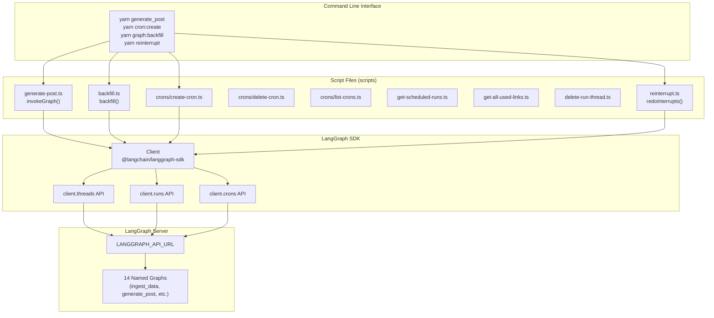
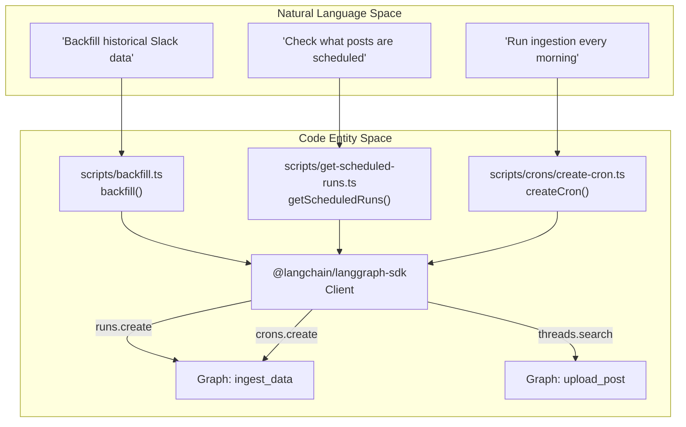

<!-- source: DeepWiki mcp.deepwiki.com · repo langchain-ai/social-media-agent · page 5.3 Scripts and Automation · fetched 2026-10-26 -->

# Scripts and Automation

<details>
<summary>Relevant source files</summary>

The following files were used as context for generating this wiki page:

- [scripts/README.md](scripts/README.md)
- [scripts/backfill.ts](scripts/backfill.ts)
- [scripts/crons/create-cron.ts](scripts/crons/create-cron.ts)
- [scripts/crons/delete-cron.ts](scripts/crons/delete-cron.ts)
- [scripts/crons/list-crons.ts](scripts/crons/list-crons.ts)
- [scripts/delete-run-thread.ts](scripts/delete-run-thread.ts)
- [scripts/get-all-used-links.ts](scripts/get-all-used-links.ts)
- [scripts/get-scheduled-runs.ts](scripts/get-scheduled-runs.ts)
- [scripts/reinterrupt.ts](scripts/reinterrupt.ts)
- [scripts/repurposer/create-cron.ts](scripts/repurposer/create-cron.ts)
- [src/agents/ingest-data/nodes/ingest-slack.ts](src/agents/ingest-data/nodes/ingest-slack.ts)
- [src/agents/ingest-repurposed-data/nodes/ingest-slack.ts](src/agents/ingest-repurposed-data/nodes/ingest-slack.ts)
- [src/tests/slack.int.test.ts](src/tests/slack.int.test.ts)

</details>


This document covers the utility scripts and automation capabilities provided for operational tasks in the social media agent system. These scripts enable manual post generation, cron job management, data backfilling, and other administrative operations.

For information about setting up the development environment, see [Setup and Installation](#5.1). For testing workflows, see [Testing](#5.2).

---

## Overview

The system provides a collection of command-line scripts accessible through `yarn` commands. These scripts interact with the LangGraph server to trigger workflows, manage scheduled executions, and perform data operations. All scripts are defined in [package.json:11-36]() and implemented in the `scripts/` directory.

**Sources:** [package.json:11-36](), [scripts/README.md:1-92]()

---

## Script Categories

The available scripts fall into five main categories:

| Category | Scripts | Purpose |
|----------|---------|---------|
| **Post Generation** | `generate_post` | Manually trigger post generation for specific URLs |
| **Cron Management** | `cron:create`, `cron:delete`, `cron:list` | Manage scheduled recurring workflows |
| **Data Management** | `graph:backfill` | Backfill historical data from Slack or direct links |
| **Query Utilities** | `get:scheduled_runs`, `get:used_links` | Query system state and scheduled operations |
| **Maintenance** | `graph:delete:run_thread`, `reinterrupt` | Cleanup threads or refresh expired image URLs |

**Sources:** [package.json:26-33](), [scripts/README.md:27-92]()

---

## Script Architecture



**Script Execution Flow**

All scripts follow a similar pattern:
1. Import environment configuration from `.env` [scripts/backfill.ts:1]()
2. Initialize `Client` with `LANGGRAPH_API_URL` [scripts/backfill.ts:28-30]()
3. Create thread or access existing resources [scripts/backfill.ts:32]()
4. Invoke graph with configuration parameters [scripts/backfill.ts:33-43]()
5. Handle errors and log results [scripts/backfill.ts:48]()

**Sources:** [scripts/backfill.ts:1-76](), [scripts/reinterrupt.ts:75-118](), [scripts/README.md:1-25]()

---

## Data Ingestion Automation

### Data Backfill Script

The backfill script performs bulk data ingestion for historical content. This is useful for initial setup or recovering from missed ingestion periods.

#### Usage
```bash
yarn graph:backfill
```

#### Ingestion Sources
1. **Slack Ingestion**: The `backfill()` function at [scripts/backfill.ts:27-46]() targets a Slack channel (default `C06BU7XF5S7`) and looks back up to 60 days. It triggers the `ingest_data` graph.
2. **Direct Link Ingestion**: The `backfillWithLinks()` function at [scripts/backfill.ts:53-73]() accepts a hardcoded array of URLs and sets `skipIngest: true` to bypass Slack.

#### Implementation Detail: Ingest Nodes
The `ingest_data` graph uses nodes like `ingestSlackData` to fetch messages. It calculates history based on `maxDaysHistory` from the config [src/agents/ingest-data/nodes/ingest-slack.ts:12-47]().

**Sources:** [scripts/backfill.ts:27-76](), [src/agents/ingest-data/nodes/ingest-slack.ts:29-34]()

### Cron Management

The system manages recurring ingestion via LangGraph's native cron support.

| Script | Command | Purpose |
|----------|---------|---------|
| **Create** | `yarn cron:create` | Sets up a daily job (e.g., 8:00 AM UTC) for `ingest_data` [scripts/crons/create-cron.ts:30-41]() |
| **List** | `yarn cron:list` | Displays all active schedules [scripts/crons/list-crons.ts:20-28]() |
| **Delete** | `yarn cron:delete` | Removes a schedule by ID [scripts/crons/delete-cron.ts:26-38]() |

**Sources:** [scripts/crons/create-cron.ts:25-48](), [scripts/crons/delete-cron.ts:26-41]()

---

## Operational Monitoring Scripts

### Get Scheduled Runs
The `get-scheduled-runs.ts` script monitors the `upload_post` graph for "busy" threads, which represent posts waiting for their scheduled time [scripts/get-scheduled-runs.ts:18-29]().

- **Data Flow**: It iterates through threads, extracts the post content and image URL from the run's `kwargs.input` [scripts/get-scheduled-runs.ts:32-48]().
- **Output**: Formats a report with PST times and sends it to Slack via `SlackClient` if `SLACK_CHANNEL_ID` is configured [scripts/get-scheduled-runs.ts:57-88]().

**Sources:** [scripts/get-scheduled-runs.ts:18-91]()

### Get Used Links
To prevent duplicate content, `get-all-used-links.ts` aggregates URLs from two sources:
1. **Interrupted Threads**: Links currently awaiting human review in the `generate_post` graph [scripts/get-all-used-links.ts:5-20]().
2. **Scheduled Posts**: Links extracted from posts already in the `upload_post` queue [scripts/get-all-used-links.ts:22-48]().

**Sources:** [scripts/get-all-used-links.ts:1-57]()

---

## Maintenance and Recovery

### Reinterrupt and Image URL Refresh
The `reinterrupt.ts` script is a specialized utility for handling long-lived interrupts where Supabase image URLs might have expired.

- **`updateImageUrls`**: Detects Supabase storage URLs and generates new signed URLs with a 180-day expiry [scripts/reinterrupt.ts:14-73]().
- **`redoInterrupts`**: Searches for threads with `status: "interrupted"`, updates their state with fresh image URLs, and uses `client.runs.create` with a `command` to move the graph to `humanNode` [scripts/reinterrupt.ts:75-115]().

**Sources:** [scripts/reinterrupt.ts:6-118]()

### Cleanup Utilities
The `getAllRuns` function in `reinterrupt.ts` (currently commented out) provides a template for bulk deleting all interrupted threads and their associated runs to clear the system state [scripts/reinterrupt.ts:120-135]().

**Sources:** [scripts/reinterrupt.ts:120-138]()

---

## Programmatic Automation Mapping

This diagram maps the script entities to the underlying code functions and LangGraph entities.



**Sources:** [scripts/backfill.ts:27-46](), [scripts/get-scheduled-runs.ts:18-29](), [scripts/crons/create-cron.ts:25-41]()

---

## Integration with Slack

Many automation scripts leverage the `SlackClient` from `src/clients/slack/client.js` for both data ingestion and reporting.

- **Ingestion**: `ingestSlackData` uses `client.getChannelMessages` to pull content [src/agents/ingest-data/nodes/ingest-slack.ts:28-34]().
- **Reporting**: `getScheduledRuns` uses `slackClient.sendMessage` to post summaries of the queue [scripts/get-scheduled-runs.ts:80-85]().
- **Repurposing**: The repurposer cron specifically targets a different channel via `repurposerSlackChannelId` [scripts/repurposer/create-cron.ts:26-35]().

**Sources:** [src/agents/ingest-data/nodes/ingest-slack.ts:28-34](), [scripts/get-scheduled-runs.ts:80-85](), [scripts/repurposer/create-cron.ts:26-35]()

---

