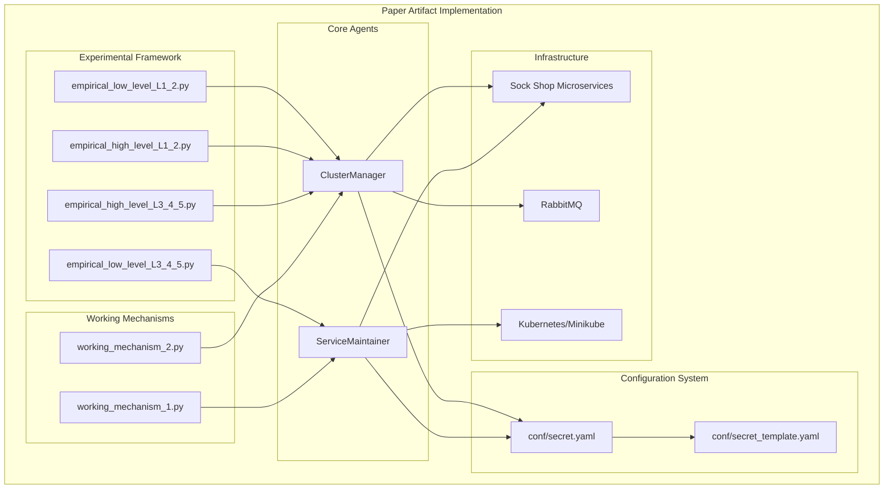
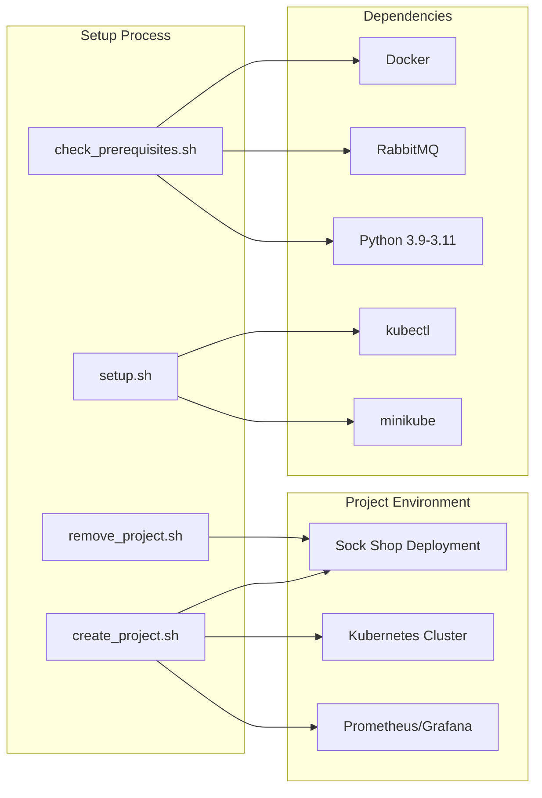
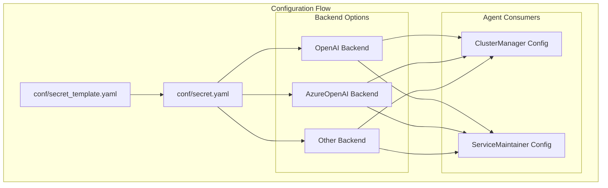
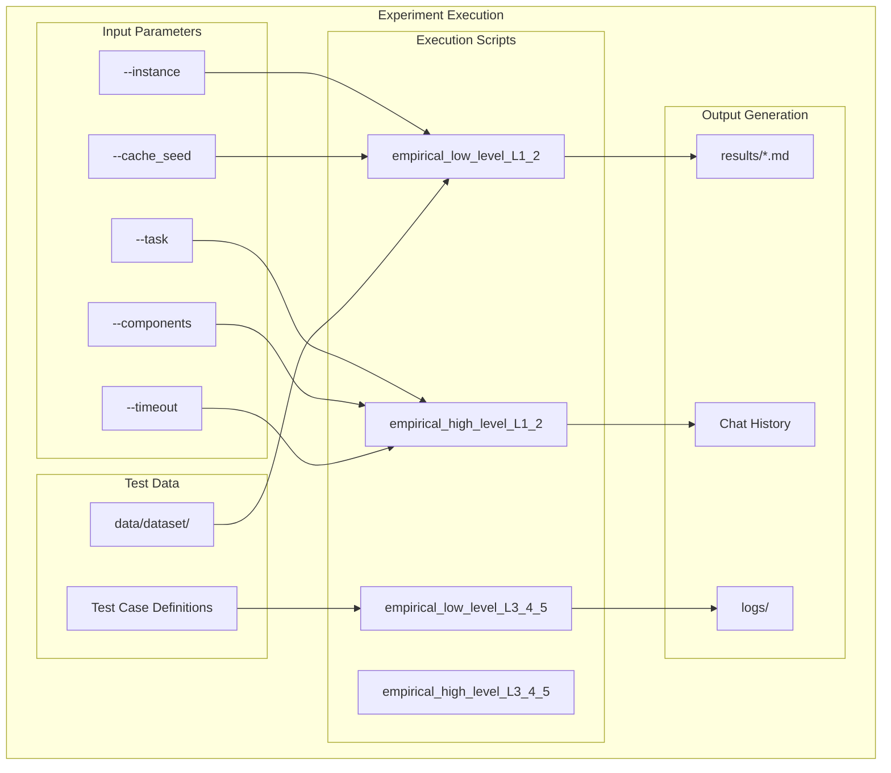
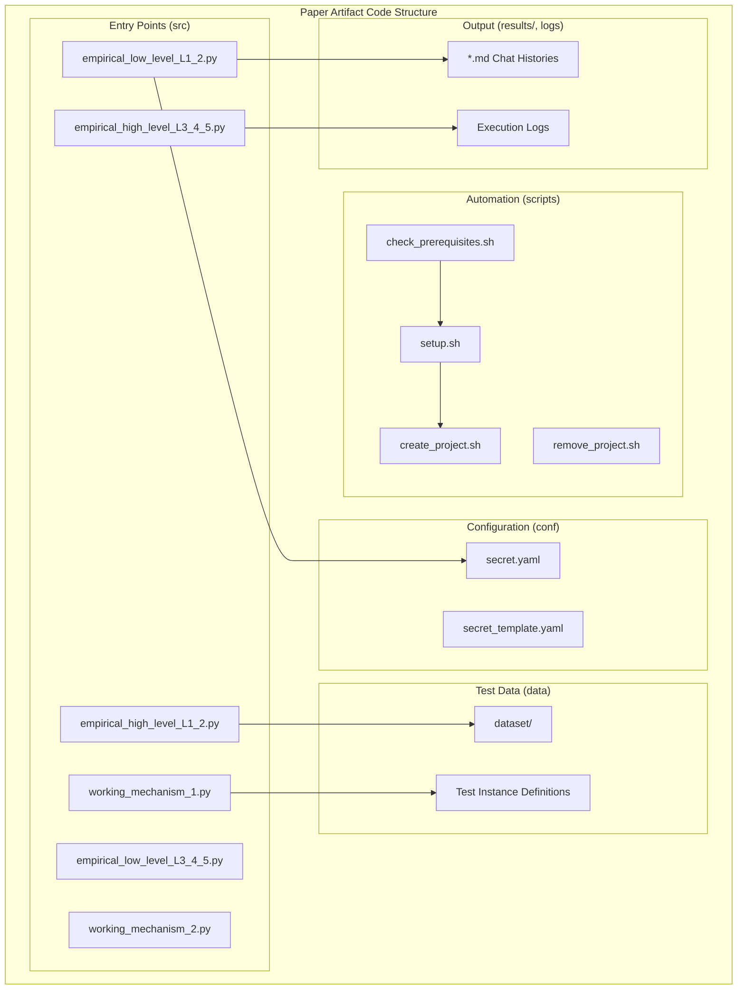

<!-- source: DeepWiki mcp.deepwiki.com · repo microsoft/ACV · page 2.1 Paper Artifact Implementation · fetched 2026-10-26 -->

# Paper Artifact Implementation

<details>
<summary>Relevant source files</summary>

The following files were used as context for generating this wiki page:

- [README.md](README.md)
- [self_managing_systems/microservice/README.md](self_managing_systems/microservice/README.md)
- [self_managing_systems/microservice/paper_artifact_arXiv_2407_14402/README.md](self_managing_systems/microservice/paper_artifact_arXiv_2407_14402/README.md)

</details>


## Purpose and Scope

This document covers the implementation of the research artifact for arXiv paper 2407.14402 "The Vision of Autonomic Computing: Can LLMs Make It a Reality?". The artifact provides experimental validation of LLM-based agents for microservice self-management using the Sock Shop microservice demo project. For information about the general AutoKube tool built upon this research, see [AutoKube System](#2.2). For broader agent architecture details, see [Agent Architecture](#2.3).

Sources: [README.md:11-13](), [self_managing_systems/microservice/paper_artifact_arXiv_2407_14402/README.md:1-15]()

## Research Context and Implementation Overview

The paper artifact implements a two-level architecture for microservice self-management, consisting of low-level autonomic agents (`ServiceMaintainer`) and high-level group managers (`ClusterManager`). The implementation validates the autonomic computing vision through five levels of management tasks (L1-L5) ranging from basic monitoring to complex failure recovery scenarios.

The artifact specifically targets the Sock Shop microservice demo environment and provides reproducible experiments demonstrating self-configuration, self-optimization, self-healing, and self-protection capabilities using GPT-4 and Azure OpenAI models.

### Paper Artifact Architecture



Sources: [self_managing_systems/microservice/paper_artifact_arXiv_2407_14402/README.md:17-20](), [self_managing_systems/microservice/paper_artifact_arXiv_2407_14402/README.md:88-123]()

## Experimental Environment Setup

The paper artifact requires a specific environment setup including Linux, Docker, RabbitMQ, and Kubernetes. The setup process is automated through several shell scripts that handle prerequisite checking, software installation, and environment configuration.

### Environment Setup Flow



The installation follows this sequence:
1. Prerequisites verification via `check_prerequisites.sh`
2. Software installation via `setup.sh` (Ubuntu-specific)
3. Python dependencies via `requirements.txt`
4. Project environment creation via `create_project.sh`

Sources: [self_managing_systems/microservice/paper_artifact_arXiv_2407_14402/README.md:24-45](), [self_managing_systems/microservice/paper_artifact_arXiv_2407_14402/README.md:131-161]()

## LLM Configuration System

The artifact supports multiple LLM backends through a YAML-based configuration system. The `conf/secret.yaml` file (created from `conf/secret_template.yaml`) defines the LLM endpoint configuration used by both `ClusterManager` and `ServiceMaintainer` agents.

### LLM Backend Configuration

| Backend Type | Configuration Parameters | Supported Models |
|--------------|-------------------------|------------------|
| OpenAI | `api_key`, `model` | gpt-4, gpt-3.5-turbo |
| AzureOpenAI | `api_key`, `base_url`, `api_version`, `model` | Azure OpenAI deployments |
| Other | `base_url`, `api_key`, `model` | Local/custom endpoints |

### Configuration Mapping



Sources: [self_managing_systems/microservice/paper_artifact_arXiv_2407_14402/README.md:47-76]()

## Experiment Types and Execution

The paper artifact implements two main experimental categories with different task complexity levels (L1-L5). Each experiment type validates specific autonomic computing capabilities through reproducible test scenarios.

### Experimental Structure

| Experiment Type | Script | Agent Level | Task Levels | Purpose |
|-----------------|--------|-------------|-------------|---------|
| Low-level L1-L2 | `empirical_low_level_L1_2.py` | ServiceMaintainer | Basic monitoring, configuration | Validation of self-configuration |
| Low-level L3-L5 | `empirical_low_level_L3_4_5.py` | ServiceMaintainer | Failure handling, optimization | Validation of self-healing |
| High-level L1-L2 | `empirical_high_level_L1_2.py` | ClusterManager | Multi-component optimization | Validation of self-optimization |
| High-level L3-L5 | `empirical_high_level_L3_4_5.py` | ClusterManager | Complex failure scenarios | Validation of self-protection |

### Experiment Execution Flow



### Working Mechanisms

The artifact also provides two working mechanisms for custom task exploration:

- **Working Mechanism 1** (`working_mechanism_1.py`): Single-component tasks using ServiceMaintainer
- **Working Mechanism 2** (`working_mechanism_2.py`): Multi-component tasks using ClusterManager

Sources: [self_managing_systems/microservice/paper_artifact_arXiv_2407_14402/README.md:88-156]()

## Code Structure and Entry Points

The paper artifact follows a modular structure with clear separation between experimental validation scripts and core agent implementations. The main entry points are located in the `src/` directory with supporting configuration and data in dedicated folders.

### Module Organization



### Quick Trial Execution

The artifact provides a quick trial command for immediate validation:

```bash
python -m src.empirical_low_level_L1_2 \
--instance metric_collection_1 \
--suffix stable \
--cache_seed 42
```

This generates chat history in `results/metric_collection_1-stable.md` and execution logs in `logs/` directory.

Sources: [self_managing_systems/microservice/paper_artifact_arXiv_2407_14402/README.md:78-86](), [self_managing_systems/microservice/paper_artifact_arXiv_2407_14402/README.md:125-126]()

---

