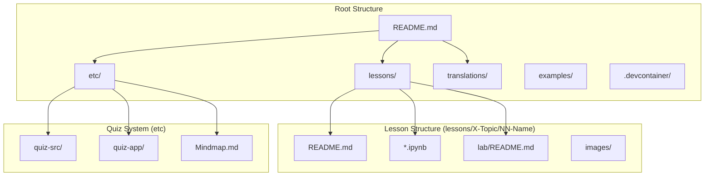
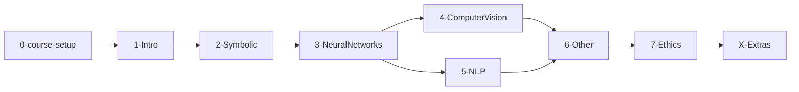
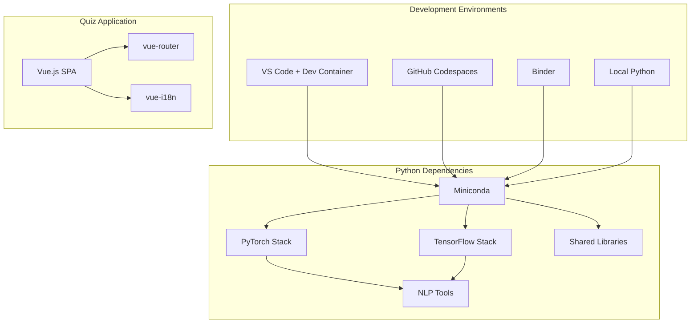
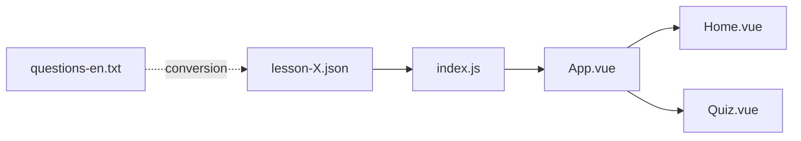
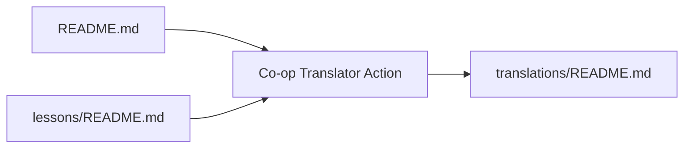

<!-- source: DeepWiki mcp.deepwiki.com · repo microsoft/AI-For-Beginners · page 1 Overview · fetched 2026-10-26 -->

# Overview

Relevant source files

The following files were used as context for generating this wiki page:

- [.gitignore](.gitignore)
- [README.md](README.md)
- [etc/CODE_OF_CONDUCT.md](etc/CODE_OF_CONDUCT.md)
- [etc/Mindmap.html](etc/Mindmap.html)
- [etc/Mindmap.md](etc/Mindmap.md)
- [etc/Mindmap.svg](etc/Mindmap.svg)
- [etc/SUPPORT.md](etc/SUPPORT.md)
- [etc/TRANSLATIONS.md](etc/TRANSLATIONS.md)
- [index.html](index.html)
- [lessons/1-Intro/README.md](lessons/1-Intro/README.md)
- [lessons/1-Intro/translations/README.ja.md](lessons/1-Intro/translations/README.ja.md)
- [lessons/4-ComputerVision/11-ObjectDetection/README.md](lessons/4-ComputerVision/11-ObjectDetection/README.md)
- [lessons/4-ComputerVision/11-ObjectDetection/lab/README.md](lessons/4-ComputerVision/11-ObjectDetection/lab/README.md)
- [lessons/5-NLP/15-LanguageModeling/CBoW-TF.ipynb](lessons/5-NLP/15-LanguageModeling/CBoW-TF.ipynb)
- [lessons/5-NLP/15-LanguageModeling/README.md](lessons/5-NLP/15-LanguageModeling/README.md)
- [lessons/5-NLP/15-LanguageModeling/lab/README.md](lessons/5-NLP/15-LanguageModeling/lab/README.md)
- [lessons/5-NLP/20-LangModels/GPT-PyTorch.ipynb](lessons/5-NLP/20-LangModels/GPT-PyTorch.ipynb)
- [lessons/5-NLP/20-LangModels/README.md](lessons/5-NLP/20-LangModels/README.md)
- [lessons/6-Other/22-DeepRL/README.md](lessons/6-Other/22-DeepRL/README.md)

The AI-For-Beginners repository (`https://github.com/microsoft/AI-For-Beginners`) is a comprehensive, open-source educational curriculum designed to teach artificial intelligence fundamentals through a structured 12-week, 24-lesson program [README.md:15-21](). The repository combines theoretical content with hands-on implementation exercises using industry-standard frameworks (`PyTorch` and `TensorFlow`), assessment tools, and extensive internationalization support [README.md:15-21]().

This overview covers the high-level architecture, core components, and organizational structure of the repository. For detailed information about the curriculum breakdown, see [Curriculum Structure](#1.1). For details on quizzes, labs, and pedagogical delivery, see [Learning Approach](#1.2).

**Sources:** [README.md:15-21]()

## Purpose and Target Audience

The curriculum targets beginners with no prior AI experience, guiding them from foundational concepts through advanced topics. The repository emphasizes practical implementation with executable Jupyter notebooks and progressive skill-building through labs and quizzes [README.md:15-21]().

The content excludes business-focused AI education, classic machine learning (covered separately in `ML-For-Beginners`), cloud-specific frameworks, and advanced mathematical foundations—instead focusing on conceptual understanding and hands-on coding [README.md:61-75]().

**Sources:** [README.md:15-21](), [README.md:61-75]()

## Repository Architecture

The repository follows a hierarchical structure organized by topic domains (`1-Intro`, `2-Symbolic`, `3-NeuralNetworks`, `4-ComputerVision`, `5-NLP`, `6-Other`, `7-Ethics`, `X-Extras`). Each lesson directory contains Markdown content, dual-framework Jupyter notebooks, supporting images, and optional lab assignments [README.md:15-75](), [etc/Mindmap.md:1-68]().

**Sources:** [README.md:15-75](), [etc/Mindmap.md:1-68]()

## Core Content Organization

### Lesson Taxonomy

For a comprehensive week-by-week breakdown and topic progression, see [Curriculum Structure](#1.1).

**Sources:** [README.md:61-75](), [etc/Mindmap.md:1-68]()

### Dual-Framework Implementation

Each technical lesson provides parallel implementations in both frameworks:

| Framework | Notebook Patterns | Example Files |
|-----------|------------------|---------------|
| **PyTorch** | `*PyTorch.ipynb` | `lessons/3-NeuralNetworks/05-Frameworks/IntroPyTorch.ipynb` [etc/Mindmap.md:23-23]() |
| **TensorFlow/Keras** | `*TF.ipynb`, `*Keras.ipynb` | `lessons/3-NeuralNetworks/05-Frameworks/IntroKerasTF.md` [etc/Mindmap.md:24-24]() |

For details on how frameworks are utilized across lessons, see [Curriculum Structure](#1.1) and [Learning Approach](#1.2).

**Sources:** [README.md:61-75](), [etc/Mindmap.md:19-25]()

## Technology Stack

The development environment supports four entry points (VS Code Dev Containers, GitHub Codespaces, Binder, local setup) converging on standardized configurations. The Python stack maintains parallel PyTorch and TensorFlow ecosystems with a shared foundation (`numpy`, `scikit-learn`, `opencv`, etc.) [README.md:10-10]().

**Sources:** [README.md:10-10](), [index.html:1-29]()

## Lesson Structure Pattern

For details on the pedagogical approach involving pre/post quizzes, Jupyter notebooks, hands-on labs, and Microsoft Learn integration, see [Learning Approach](#1.2).

**Sources:** [README.md:15-75]()

## Quiz Assessment System

The quiz system is a standalone Vue.js single-page application deployed independently from the main curriculum:

Quizzes are identified by numeric IDs: pre-lecture quizzes use IDs 1-24, post-lecture quizzes use IDs 25-48 [lessons/1-Intro/README.md:7-7](), [lessons/5-NLP/15-LanguageModeling/README.md:5-33]().

**Sources:** [lessons/1-Intro/README.md:7-7](), [lessons/5-NLP/15-LanguageModeling/README.md:5-33]()

## Internationalization Architecture

The Co-op Translator service automatically generates and maintains translations across 50+ languages [README.md:24-52]().

**Sources:** [README.md:24-52]()

## Key Design Patterns

### Pedagogical Code Duplication
The repository intentionally duplicates utility code across lessons to maintain lesson independence. For example, `torchnlp.py` appears identically across multiple NLP lessons rather than being centralized, prioritizing lesson portability and self-containment [lessons/5-NLP/15-LanguageModeling/README.md:1-43]().

### Framework Parity
Most lessons maintain strict parity between PyTorch and TensorFlow implementations, covering identical concepts with framework-specific syntax [README.md:61-75]().

**Sources:** [README.md:61-75](), [lessons/5-NLP/15-LanguageModeling/README.md:1-43]()

## Community and Support Resources

| Resource | Purpose | Link Pattern |
|----------|---------|--------------|
| **Microsoft Foundry Discord** | Learner community, Q&A | `discord.gg/nTYy5BXMWG` [README.md:13-13]() |
| **Microsoft Learn Collections** | Supplementary learning paths | `learn.microsoft.com/en-us/collections/...` [README.md:74-74]() |

**Sources:** [README.md:13-13](), [README.md:74-74]()

## Repository Statistics
- **Total Lessons:** 24 lessons across 12 weeks [README.md:15-21]()
- **Languages:** 50+ translations via automated GitHub Actions [README.md:24-52]()
- **License:** MIT [README.md:1-1]()

**Sources:** [README.md:1-1](), [README.md:15-21](), [README.md:24-52]()

---

