<!-- source: DeepWiki mcp.deepwiki.com · repo microsoft/AI-For-Beginners · page 3.2 Symbolic AI · fetched 2026-10-26 -->

# Symbolic AI

<details>
<summary>Relevant source files</summary>

The following files were used as context for generating this wiki page:

- [lessons/2-Symbolic/Animals.ipynb](lessons/2-Symbolic/Animals.ipynb)
- [lessons/2-Symbolic/FamilyOntology.ipynb](lessons/2-Symbolic/FamilyOntology.ipynb)
- [lessons/2-Symbolic/MSConceptGraph.ipynb](lessons/2-Symbolic/MSConceptGraph.ipynb)
- [lessons/2-Symbolic/README.md](lessons/2-Symbolic/README.md)
- [lessons/3-NeuralNetworks/03-Perceptron/README.md](lessons/3-NeuralNetworks/03-Perceptron/README.md)
- [lessons/3-NeuralNetworks/04-OwnFramework/README.md](lessons/3-NeuralNetworks/04-OwnFramework/README.md)
- [lessons/3-NeuralNetworks/05-Frameworks/README.md](lessons/3-NeuralNetworks/05-Frameworks/README.md)
- [lessons/4-ComputerVision/07-ConvNets/CNN_Architectures.md](lessons/4-ComputerVision/07-ConvNets/CNN_Architectures.md)
- [lessons/4-ComputerVision/07-ConvNets/README.md](lessons/4-ComputerVision/07-ConvNets/README.md)
- [lessons/4-ComputerVision/08-TransferLearning/README.md](lessons/4-ComputerVision/08-TransferLearning/README.md)
- [lessons/4-ComputerVision/08-TransferLearning/TransferLearningTF.ipynb](lessons/4-ComputerVision/08-TransferLearning/TransferLearningTF.ipynb)
- [lessons/4-ComputerVision/09-Autoencoders/AutoEncodersPyTorch.ipynb](lessons/4-ComputerVision/09-Autoencoders/AutoEncodersPyTorch.ipynb)
- [lessons/4-ComputerVision/09-Autoencoders/AutoencodersTF.ipynb](lessons/4-ComputerVision/09-Autoencoders/AutoencodersTF.ipynb)
- [lessons/4-ComputerVision/09-Autoencoders/README.md](lessons/4-ComputerVision/09-Autoencoders/README.md)
- [lessons/4-ComputerVision/10-GANs/README.md](lessons/4-ComputerVision/10-GANs/README.md)
- [translations/et/.co-op-translator.json](translations/et/.co-op-translator.json)
- [translations/et/README.md](translations/et/README.md)
- [translations/et/lessons/2-Symbolic/MSConceptGraph.ipynb](translations/et/lessons/2-Symbolic/MSConceptGraph.ipynb)
- [translations/kn/README.md](translations/kn/README.md)
- [translations/kn/lessons/2-Symbolic/MSConceptGraph.ipynb](translations/kn/lessons/2-Symbolic/MSConceptGraph.ipynb)
- [translations/ml/README.md](translations/ml/README.md)
- [translations/ml/lessons/2-Symbolic/MSConceptGraph.ipynb](translations/ml/lessons/2-Symbolic/MSConceptGraph.ipynb)
- [translations/pcm/.co-op-translator.json](translations/pcm/.co-op-translator.json)
- [translations/pcm/README.md](translations/pcm/README.md)
- [translations/pcm/lessons/2-Symbolic/MSConceptGraph.ipynb](translations/pcm/lessons/2-Symbolic/MSConceptGraph.ipynb)
- [translations/te/.co-op-translator.json](translations/te/.co-op-translator.json)
- [translations/te/README.md](translations/te/README.md)
- [translations/te/lessons/2-Symbolic/MSConceptGraph.ipynb](translations/te/lessons/2-Symbolic/MSConceptGraph.ipynb)

</details>


This document provides a technical overview of the Symbolic AI approach in the AI-For-Beginners curriculum. While modern AI is often associated with neural networks and machine learning, symbolic AI represents an important historical and practical approach that focuses on explicit knowledge representation and reasoning. For information about neural network approaches, see [Neural Networks Foundations](#3.3).

## Purpose and Scope

This page explains Symbolic AI concepts and techniques, which represent a top-down approach to artificial intelligence based on explicit knowledge representation and logical reasoning. The core topics covered include:

- **DIKW Pyramid**: Framework for understanding data, information, knowledge, and wisdom
- **Knowledge Representation**: Techniques for encoding human knowledge in machine-readable formats
- **Production Rules**: If-then rule systems for automated reasoning
- **Expert Systems**: Computer systems that emulate human expert decision-making
- **Ontologies**: Formal specifications of domain knowledge and relationships
- **Semantic Web**: Internet-scale knowledge representation using RDF, RDFS, and OWL
- **Curriculum Notebooks**: Practical implementations in `Animals.ipynb`, `FamilyOntology.ipynb`, and `MSConceptGraph.ipynb`

Sources: [lessons/2-Symbolic/README.md:1-15]()

## The DIKW Pyramid

The DIKW (Data-Information-Knowledge-Wisdom) Pyramid provides a foundational framework for understanding how raw data transforms into actionable knowledge:

**DIKW Hierarchy**

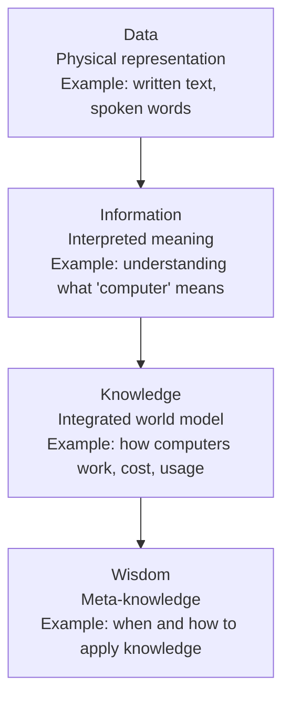

| Level | Definition | Example |
|-------|-----------|---------|
| **Data** | Something represented in physical media, exists independently of humans | Text "computer" in a book |
| **Information** | Interpretation of data in human mind | Understanding the concept of a computer |
| **Knowledge** | Information integrated into world model | Network of concepts: how computers work, their cost, applications |
| **Wisdom** | Meta-knowledge about when and how to use knowledge | Knowing when computer automation is appropriate |

Sources: [lessons/2-Symbolic/README.md:16-31]()

## Knowledge Representation Spectrum

Knowledge can be represented along a spectrum from computer-friendly to human-friendly formats:

**Knowledge Representation Complexity Spectrum**

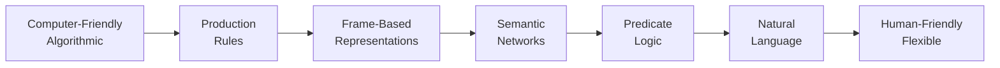

The goal of knowledge representation is to find effective ways to represent knowledge in computer-readable form while maintaining sufficient expressiveness for the problem domain.

Sources: [lessons/2-Symbolic/README.md:32-42]()

## Knowledge Representation Methods

Symbolic AI systems use several distinct approaches to represent knowledge:

**Knowledge Representation Taxonomy**

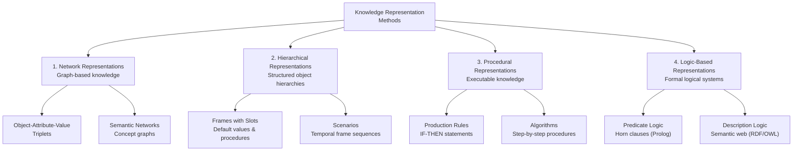

Sources: [lessons/2-Symbolic/README.md:44-83]()

### Object-Attribute-Value Triplets

The simplest network representation uses triplets to express relationships. Example for programming languages:

| Object | Attribute | Value |
|--------|-----------|-------|
| Python | is | Untyped-Language |
| Python | invented-by | Guido van Rossum |
| Python | block-syntax | indentation |
| Untyped-Language | doesn't have | type definitions |

Sources: [lessons/2-Symbolic/README.md:50-58]()

### Frame Representations

Frames represent objects or classes as structured entities with slots. Example frame for Python:

| Slot | Value | Default Value | Interval |
|------|-------|---------------|----------|
| Name | Python | | |
| Is-A | Untyped-Language | | |
| Variable Case | | CamelCase | |
| Program Length | | | 5-5000 lines |
| Block Syntax | Indent | | |

Sources: [lessons/2-Symbolic/README.md:62-75]()

### Production Rules

Production rules are if-then statements that enable automated reasoning. They form the basis of expert systems. Example:

```
IF the animal eats meat
OR (animal has sharp teeth
    AND animal has claws
    AND animal has forward-looking eyes) 
THEN the animal is a carnivore
```

The working memory contains Object-Attribute-Value triplets representing the current problem state. A rules engine identifies applicable rules and applies them to derive new knowledge.

Sources: [lessons/2-Symbolic/README.md:76-83]()

## Expert Systems

Expert systems were one of the early successes of symbolic AI. They consist of a knowledge base extracted from human experts and an inference engine that performs reasoning based on this knowledge.

### Architecture

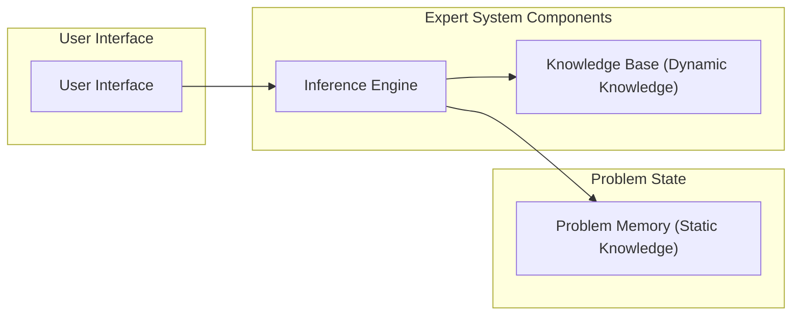

The architecture parallels human reasoning:

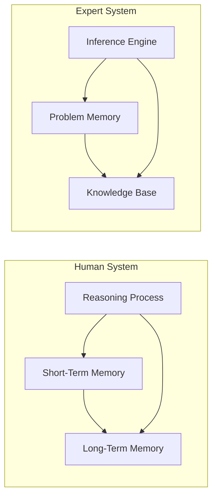

Sources: [lessons/2-Symbolic/README.md:84-97]()

### Inference Mechanisms

Expert systems employ two fundamental reasoning strategies:

**Forward Inference (Data-Driven Reasoning)**

Forward inference begins with known facts and applies rules to derive conclusions:

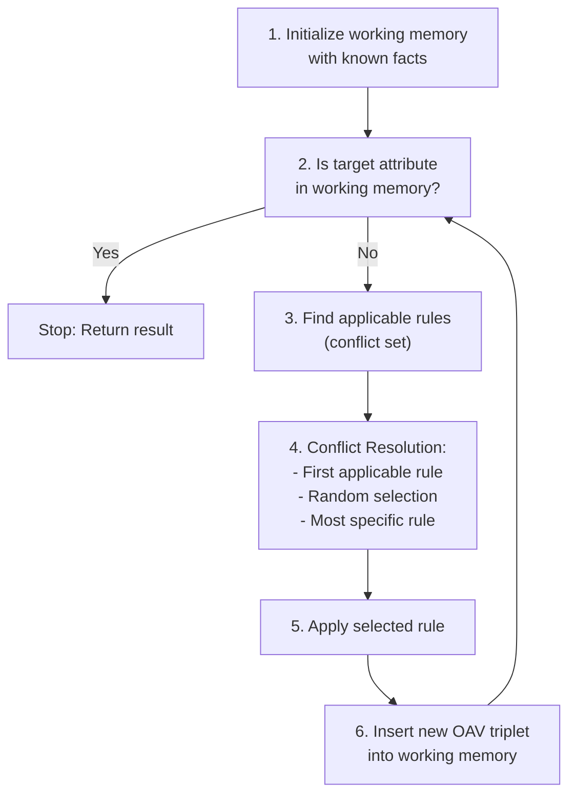

**Backward Inference (Goal-Driven Reasoning)**

Backward inference starts with a goal and works backward to determine required facts:

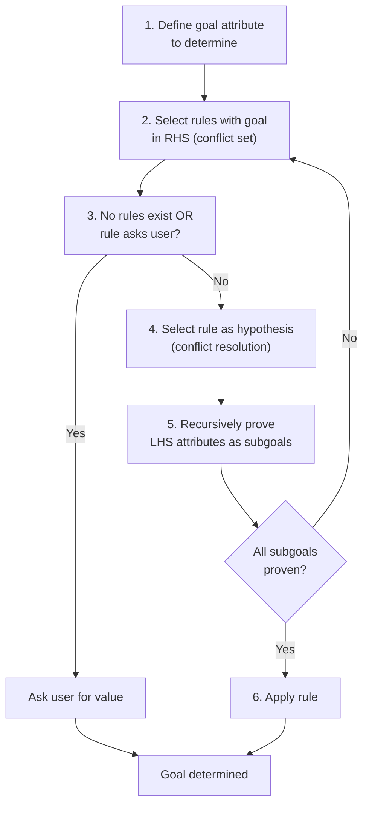

The `Animals.ipynb` notebook implements both inference methods, demonstrating how the same rule base can be used for both data-driven and goal-driven reasoning via the `KnowledgeBase.get()` and `KnowledgeBase.eval()` classes [lessons/2-Symbolic/Animals.ipynb:119-151]().

Sources: [lessons/2-Symbolic/README.md:119-142](), [lessons/2-Symbolic/Animals.ipynb:119-151]()

### AND-OR Tree Example: Animal Classification

The repository demonstrates production rules through an expert system that identifies animals based on physical characteristics. The knowledge is represented as an AND-OR tree:

**Animal Classification AND-OR Tree (`Animals.ipynb`)**

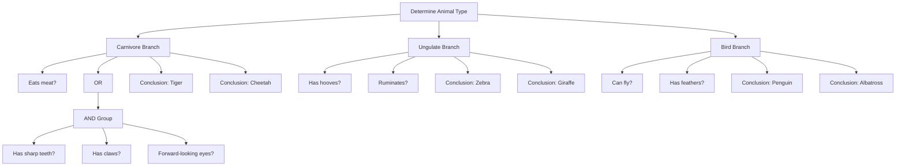

The `Animals.ipynb` notebook implements this using a Python rules engine that supports both forward inference (data-driven) and backward inference (goal-driven) reasoning [lessons/2-Symbolic/Animals.ipynb:38-151]().

Sources: [lessons/2-Symbolic/README.md:98-116](), [lessons/2-Symbolic/Animals.ipynb:38-151]()

## Ontologies and the Semantic Web

An **ontology** is an explicit specification of a conceptualization—a formal definition of concepts, relationships, and rules within a domain. The Semantic Web applies ontological principles to enable machine-readable knowledge representation across the internet.

### Core Technologies

The Semantic Web relies on three key technologies:

1. **Description Logics (DL)**: A family of formal knowledge representation systems based on logical semantics. Similar to frame representations but with formal inference capabilities. Different DL variants balance expressiveness against computational complexity.

2. **Distributed Knowledge**: All concepts identified by global URIs (Uniform Resource Identifiers), enabling knowledge hierarchies that span the internet.

3. **XML-Based Languages**:
   - **RDF** (Resource Description Framework): Basic triplet format
   - **RDFS** (RDF Schema): Adds class hierarchies and property definitions
   - **OWL** (Ontology Web Language): Full ontological reasoning capabilities

Sources: [lessons/2-Symbolic/README.md:158-164]()

### RDF Triplet Representation

The fundamental unit of Semantic Web knowledge is the RDF triplet (Subject-Predicate-Object):

**RDF Triplet Structure**

```mermaid
graph LR
    Subject["Subject<br/>(Resource URI)"] 
    -->|"Predicate<br/>(Property URI)"| 
    Object["Object<br/>(Resource URI or Literal)"]
```

**Example: AI-For-Beginners Curriculum Metadata**

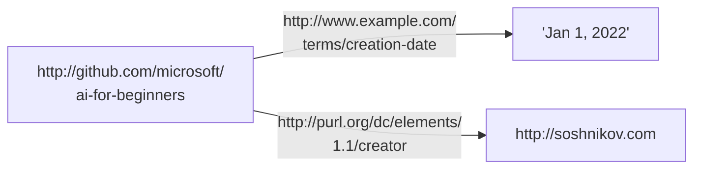

RDF triplets can represent complex structures using blank nodes and collections to express lists and nested relationships.

Sources: [lessons/2-Symbolic/README.md:167-182]()

### Querying with SPARQL

Ontologies can be queried using SPARQL, a query language for RDF data. Example query from WikiData:

```sparql
#defaultView:BubbleChart
SELECT ?eyeColorLabel (COUNT(?human) AS ?count)
WHERE
{
  ?human wdt:P31 wd:Q5.       # human instance-of homo sapiens
  ?human wdt:P1340 ?eyeColor. # human eye-color ?eyeColor
  SERVICE wikibase:label { bd:serviceParam wikibase:language "en". }
}
GROUP BY ?eyeColorLabel
```

This query finds the distribution of eye colors among humans in the WikiData knowledge base.

Sources: [lessons/2-Symbolic/README.md:186-198]()

### Ontology Development Tools

The curriculum recommends **Protégé**, a visual ontology editor available at [https://protege.stanford.edu/](https://protege.stanford.edu). Protégé enables:
- Visual creation and editing of ontologies
- Class hierarchy management
- Property definition and constraints
- Reasoning and consistency checking
- Export to OWL/RDF formats

Sources: [lessons/2-Symbolic/README.md:202-206]()

### Implementation: Family Ontology

The `FamilyOntology.ipynb` notebook demonstrates Semantic Web reasoning applied to family relationships:

**Family Ontology Processing Pipeline (`FamilyOntology.ipynb`)**

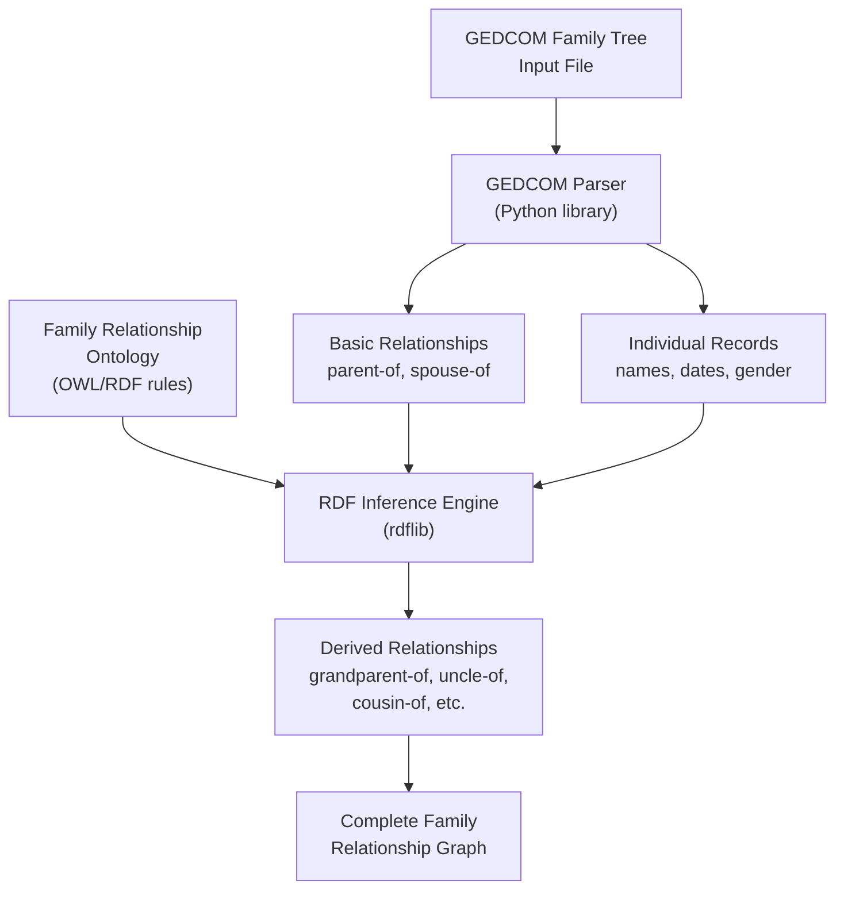

The system uses RDF inference to automatically derive extended family relationships (grandparents, aunts, uncles, cousins) from basic parent and spouse relationships defined in the GEDCOM file.

Sources: [lessons/2-Symbolic/README.md:208-212]()

## Microsoft Concept Graph

Unlike manually-created ontologies, the **Microsoft Concept Graph** is mined from unstructured natural language text. It provides a large-scale knowledge base of entities with probabilistic "is-a" relationships.

### Concept Graph Structure

**Microsoft Concept Graph Query System (`MSConceptGraph.ipynb`)**

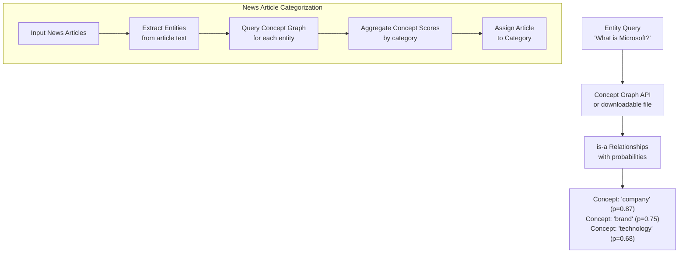

### API Access

The Microsoft Concept Graph is available through:
- **REST API**: Real-time queries for entity concepts
- **Downloadable Dataset**: Complete entity-concept pairs for offline processing

The `MSConceptGraph.ipynb` notebook demonstrates using the Concept Graph to automatically categorize news articles based on the entities mentioned within them.

Sources: [lessons/2-Symbolic/README.md:214-226]()

## Implementation Examples & Code Entity Mappings

The curriculum provides three Jupyter notebooks demonstrating Symbolic AI techniques:

**Symbolic AI Notebook Implementations**

| Notebook | Technique | Key Concepts | Code Entities |
|----------|-----------|--------------|---------------|
| `Animals.ipynb` | Expert System | Production rules, forward/backward inference, AND-OR trees | `Ask`, `Content`, `If`, `AND`, `OR`, `KnowledgeBase` |
| `FamilyOntology.ipynb` | Semantic Web | RDF triplets, OWL ontology, inference reasoning | `rdflib`, GEDCOM parser, graph reasoner |
| `MSConceptGraph.ipynb` | Mined Ontology | Entity extraction, probabilistic concepts, classification | Concept Graph API, entity-concept mappings |

Below are two diagrams bridging **Natural Language Space** to **Code Entity Space**, mapping high-level symbolic concepts and user-facing notebooks to actual implementation classes and functions across the codebase.

### Diagram 1: Expert Systems Natural Language to Code Entity Mapping (`Animals.ipynb`)

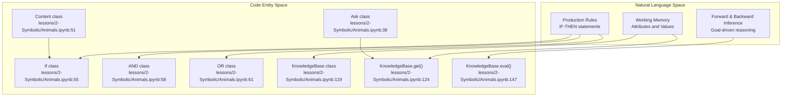

Sources: [lessons/2-Symbolic/Animals.ipynb:38-151]()

### Diagram 2: Semantic Web & Mined Ontology Natural Language to Code Entity Mapping (`FamilyOntology.ipynb` & `MSConceptGraph.ipynb`)

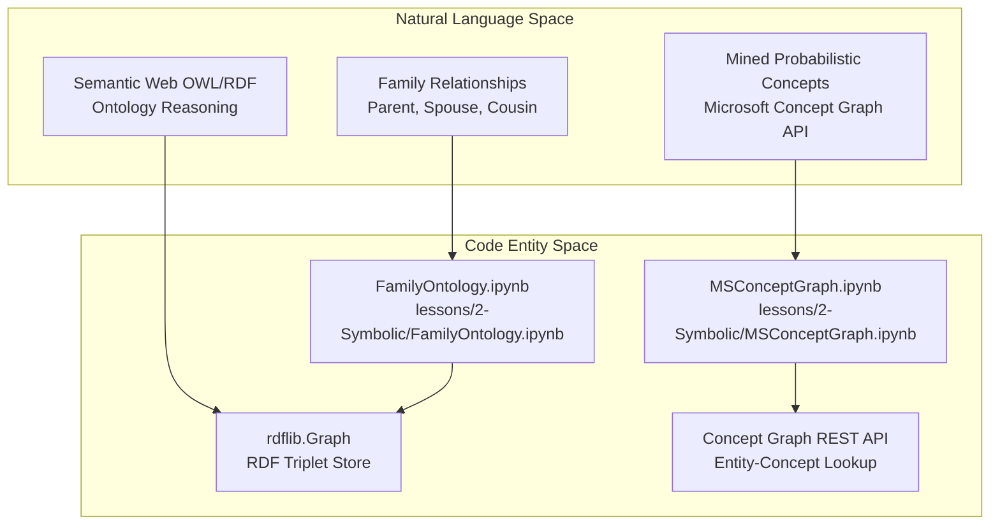

Sources: [lessons/2-Symbolic/FamilyOntology.ipynb:1-50](), [lessons/2-Symbolic/MSConceptGraph.ipynb:1-50]()

## Conclusion and Modern Relevance

While modern AI often focuses on neural networks and machine learning, symbolic AI continues to be valuable in scenarios requiring:

1. Explicit reasoning with explanations
2. Controlled system behavior modification
3. Integration with rule-based systems
4. Human-readable knowledge representation

The approaches described in this document provide foundations for knowledge representation and reasoning that complement statistical and neural approaches in hybrid systems.

Sources: [lessons/2-Symbolic/README.md:227-229]()

---

