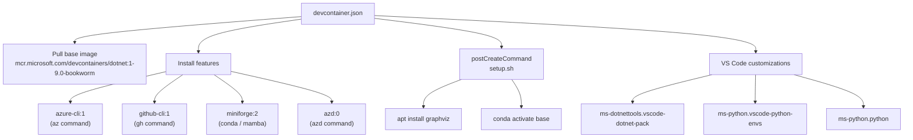
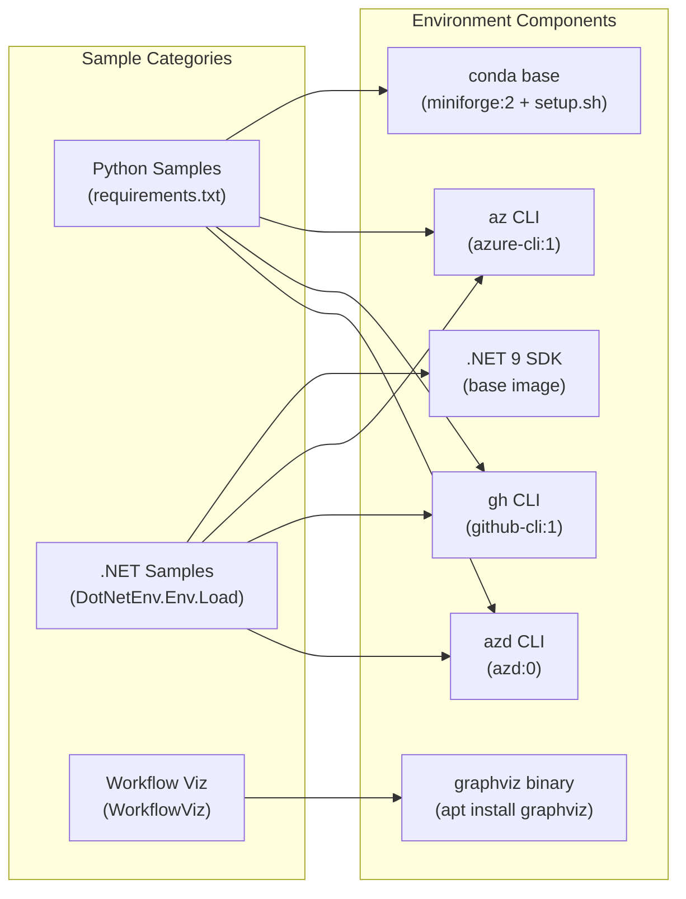

<!-- source: DeepWiki mcp.deepwiki.com · repo microsoft/Agent-Framework-Samples · page 2.1 Development Environment Setup · fetched 2026-10-26 -->

# Development Environment Setup

<details>
<summary>Relevant source files</summary>

The following files were used as context for generating this wiki page:

- [.devcontainer/devcontainer.json](.devcontainer/devcontainer.json)
- [.devcontainer/setup.sh](.devcontainer/setup.sh)
- [.github/dependabot.yml](.github/dependabot.yml)
- [.gitignore](.gitignore)
- [.vscode/settings.json](.vscode/settings.json)
- [00.ForBeginners/04-tool-use/code_samples/dotnet-agent-framework-ghmodels-tool/Program.cs](00.ForBeginners/04-tool-use/code_samples/dotnet-agent-framework-ghmodels-tool/Program.cs)
- [Installation/requirements.txt](Installation/requirements.txt)

</details>


This page describes the pre-configured development environment for the Agent-Framework-Samples repository, covering the dev container definition, system-level dependencies, CLI tooling, and VS Code configuration. The goal is to let contributors open the repository and run any sample without manual dependency installation.

For information on credentials and environment variables required after the environment is running, see [Configuration Reference]().

---

## Dev Container Overview

The repository ships a [Dev Containers](https://containers.dev) configuration under `.devcontainer/`. Opening the repository in VS Code (or GitHub Codespaces) automatically provisions a fully configured Linux environment.

**Base image:** `mcr.microsoft.com/devcontainers/dotnet:1-9.0-bookworm`

This is a Debian Bookworm image with .NET 9 SDK pre-installed, which satisfies the .NET sample requirements without any additional SDK setup.

Sources: [.devcontainer/devcontainer.json:6-6]()

---

## Installed Features

The dev container installs four feature bundles at container creation time. Each feature is pulled from a versioned OCI registry reference.

| Feature Reference | What It Provides |
|---|---|
| `ghcr.io/devcontainers/features/azure-cli:1` | `az` CLI for Azure authentication and resource management |
| `ghcr.io/devcontainers/features/github-cli:1` | `gh` CLI for GitHub Models authentication (`GITHUB_TOKEN` workflows) |
| `ghcr.io/rocker-org/devcontainer-features/miniforge:2` | Conda package manager (`conda` / `mamba`) for Python environment management |
| `ghcr.io/azure/azure-dev/azd:0` | Azure Developer CLI (`azd`) for Azure resource provisioning |

Sources: [.devcontainer/devcontainer.json:8-13]()

---

## Post-Create Setup Script

After the container is built, the `postCreateCommand` runs [.devcontainer/setup.sh](), which performs the following system-level configurations:

```bash
sudo apt update
sudo apt install graphviz -y
conda activate base
```

**`graphviz`** is a system-level dependency required by the workflow visualization utilities (`WorkflowViz`) used in the workflow orchestration samples. Without it, Graphviz-format diagram exports will fail at runtime.

**`conda activate base`** ensures that the Conda `base` environment is active in all subsequent terminal sessions, so Python samples can be run immediately from the integrated terminal.

Sources: [.devcontainer/setup.sh:1-3](), [.devcontainer/devcontainer.json:7-7]()

---

## Dev Container Provisioning Flow

The diagram below maps the provisioning sequence to the concrete files and registry references involved.

### Provisioning Logic to Code Entity Map


Sources: [.devcontainer/devcontainer.json:1-43](), [.devcontainer/setup.sh:1-3]()

---

## Python Environment and Dependencies

Python samples rely on a specific set of packages from the `agent-framework` ecosystem. These are defined in `Installation/requirements.txt` and include core, foundry, and UI components.

The environment is pinned to specific OpenTelemetry versions to ensure compatibility across the stack, specifically using `opentelemetry-api==1.40.0` and `opentelemetry-sdk==1.40.0`.

### Python Package Stack
| Package | Source |
|---|---|
| `agent-framework-core` | `python/packages/core` |
| `agent-framework-foundry` | `python/packages/foundry` |
| `agent-framework-devui` | `python/packages/devui` |
| `agent-framework-orchestrations`| `python/packages/orchestrations` |

Sources: [Installation/requirements.txt:1-14](), [Installation/requirements.txt:24-25]()

---

## VS Code Configuration

### Extensions
Three extensions are auto-installed into the dev container when VS Code attaches:
1. `ms-dotnettools.vscode-dotnet-pack`: .NET support.
2. `ms-python.vscode-python-envs`: Python environment management.
3. `ms-python.python`: Python language support.

Sources: [.devcontainer/devcontainer.json:16-20]()

### Workspace Settings
The `.vscode/settings.json` file configures Conda as the default Python environment manager and package manager. It also defines `chat.agentSkillsLocations` for Copilot and Agent skills.

| Setting Key | Value |
|---|---|
| `python-envs.defaultEnvManager` | `ms-python.python:conda` |
| `python-envs.defaultPackageManager` | `ms-python.python:conda` |
| `FSharp.suggestGitignore` | `false` |

Sources: [.vscode/settings.json:1-6]()

---

## Dependency Map: Language Runtime to Environment Component

The following diagram shows which runtime each category of samples depends on, and which environment component provides it.

### Language Runtime to Code Entity Map


Sources: [.devcontainer/devcontainer.json:1-43](), [.devcontainer/setup.sh:1-3](), [Installation/requirements.txt:1-11](), [00.ForBeginners/04-tool-use/code_samples/dotnet-agent-framework-ghmodels-tool/Program.cs:10-10]()

---

## Dependabot

The `.github/dependabot.yml` file configures weekly automated version-bump pull requests for the `devcontainers` ecosystem, targeting the `devcontainer.json` at the repository root. This keeps the feature bundle versions current without manual intervention.

Sources: [.github/dependabot.yml:1-12]()

---

## Quick Reference: What Each Tool Is Used For

| Tool | Command | Used By |
|---|---|---|
| Azure CLI | `az` | Authentication for Azure OpenAI, Foundry, and Bing samples |
| GitHub CLI | `gh` | Obtaining `GITHUB_TOKEN` for GitHub Models samples |
| Azure Developer CLI | `azd` | Provisioning Azure infrastructure for case study deployments |
| Conda | `conda` | Managing Python interpreter and packages for Python samples |
| Graphviz | `dot` | Rendering workflow diagrams from `WorkflowViz` |
| .NET 9 SDK | `dotnet` | Building and running all C# samples |

For how these tools are used with specific credentials and environment variables, see [Configuration Reference]().

---

