# Page: Microsoft 365 Agents SDK Overview

# Microsoft 365 Agents SDK Overview

<details>
<summary>Relevant source files</summary>

The following files were used as context for generating this wiki page:

- [MCSandAgentsEcosystemLinks.md](MCSandAgentsEcosystemLinks.md)
- [README.md](README.md)

</details>


## Purpose and Scope

This document provides a comprehensive overview of the Microsoft 365 Agents SDK, explaining its purpose as an AI-agnostic framework for building conversational agents that deploy across Microsoft 365 Copilot, Microsoft Teams, and web applications. It covers the SDK's architecture, language implementations, deployment channels, and integration ecosystem.

For detailed information on specific topics, refer to:
- Core SDK concepts and terminology: [Core Concepts](#1.1)
- Technical architecture details: [System Architecture](#1.2)
- Language-specific development: [.NET Development](#7.2), [Node.js Development](#7.1), [Python Development](#7.3)
- Building your first agent: [Building Agents](#2)

**Sources**: [README.md:1-15]()

## What is the Microsoft 365 Agents SDK?

The Microsoft 365 Agents SDK is a multi-language framework that enables developers to create conversational agents with the following characteristics:

- **AI-Agnostic Architecture**: Choose any AI service, model, or orchestration framework (Semantic Kernel, Azure AI Foundry, LangChain, etc.)
- **Multi-Channel Deployment**: Build once, deploy to Microsoft 365 Copilot, Microsoft Teams, Web & Custom Apps, and more
- **Agent Container Pattern**: Pre-built scaffolding for state management, storage, and activity/event handling
- **Protocol-Based**: Built on standardized Activity Protocol ensuring interoperability across channels

The SDK is not prescriptive about AI implementation. Developers implement agentic patterns using the AI services of their choice, selecting one or more services, models, or agents to meet their specific requirements.

**Sources**: [README.md:1-11]()

## Key Capabilities

The SDK provides the following core capabilities:

| Capability | Description | Reference |
|------------|-------------|-----------|
| **Agent Container** | Manage state, storage, activities, and events | [AgentApplication Class](#2.1) |
| **Activity Processing** | Handle incoming messages, events, and invoke responses | [Activity Processing](#2.2) |
| **State Management** | Conversation, user, and turn-scoped state with storage backends | [Managing State](#2.3) |
| **Authentication** | Bot authentication, user OAuth flows, OBO token exchange | [Authentication and Authorization](#3) |
| **Rich Messaging** | Adaptive Cards, Hero Cards, media attachments | [Creating Messages and Cards](#2.4) |
| **Streaming** | Real-time AI response streaming | [Streaming Responses](#2.5) |
| **Multi-turn Dialogs** | Stateful conversation flows | [Multi-turn Dialogs](#2.6) |

**Sources**: [README.md:7-11]()

## Repository Structure and Language Implementations

The Microsoft 365 Agents SDK is implemented across three language-specific repositories. This repository serves as the entry point and contains cross-cutting documentation, specifications, and samples.

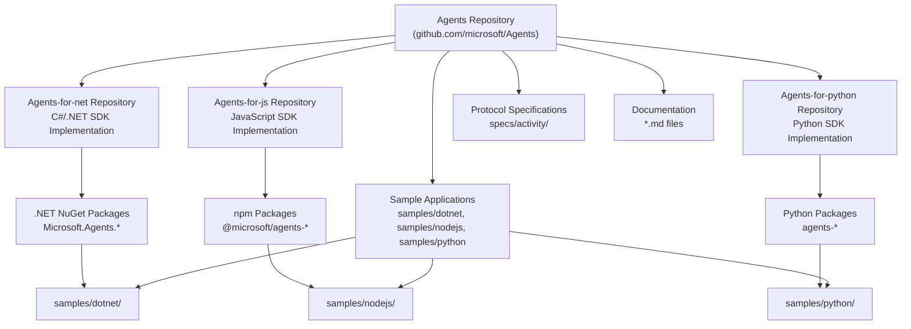

### Repository Links

| Language | Repository | Documentation | Primary Packages |
|----------|------------|---------------|------------------|
| **General** | [Agents Repository](https://github.com/microsoft/Agents) | [M365 Agents SDK Docs](https://aka.ms/M365-Agents-SDK-Docs) | Specifications, Samples |
| **C# / .NET** | [Agents-for-net](https://github.com/microsoft/Agents-for-net) | [.NET API Docs](https://learn.microsoft.com/dotnet/api/?view=m365-agents-sdk) | `Microsoft.Agents.*` |
| **JavaScript** | [Agents-for-js](https://github.com/microsoft/Agents-for-js) | [JS API Docs](https://learn.microsoft.com/javascript/api/overview/agents-overview) | `@microsoft/agents-*` |
| **Python** | [Agents-for-python](https://github.com/microsoft/Agents-for-python) | [Python API Docs](https://learn.microsoft.com/python/api/agent-sdk-python/agents-overview) | `agents-*` |

Language-specific issues should be opened in the corresponding repository. Cross-cutting issues can be opened in the main Agents repository.

**Sources**: [README.md:19-28](), [MCSandAgentsEcosystemLinks.md:47-57]()

## Four-Layer Architecture

The Microsoft 365 Agents SDK follows a four-layer architecture that separates protocol specifications, core SDK abstractions, hosting implementations, and AI service integrations.

### Architecture Diagram

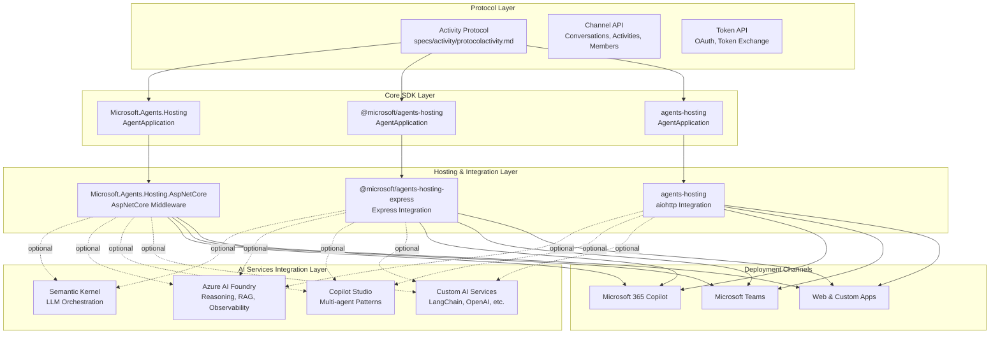

### Layer Descriptions

**Protocol Layer**: Defines the Activity Protocol specification, Channel API (RESTful interfaces for conversations, activities, members, attachments), and Token API (OAuth and token exchange). These specifications are AI-agnostic and implementation-independent.

**Core SDK Layer**: Implements the `AgentApplication` class in each language, providing the agent container abstraction with state management, activity routing, event handlers, and storage interfaces.

**Hosting & Integration Layer**: Provides language-specific hosting frameworks:
- .NET: AspNetCore middleware and MSAL authentication
- JavaScript: Express.js integration and MSAL-node authentication  
- Python: aiohttp hosting and MSAL authentication

**AI Services Integration Layer**: Optional integrations with AI orchestration frameworks and services. Developers choose which services to integrate based on their requirements.

**Sources**: [README.md:1-11]()

## Deployment Channels

Agents built with the SDK can deploy to multiple channels without code changes. Each channel may expose channel-specific features that agents can optionally leverage.

### Supported Channels

| Channel | Description | Special Features |
|---------|-------------|------------------|
| **Microsoft 365 Copilot** | Enterprise AI assistant integrated across M365 apps | Enterprise data access, context-aware invocation |
| **Microsoft Teams** | Collaboration platform | Teams-specific cards, channel conversations, adaptive cards |
| **Web & Custom Apps** | Browser-based interfaces | WebChat control, custom UI integration |
| **Custom Channels** | Third-party platforms | Custom adapter implementation |

### Channel Architecture

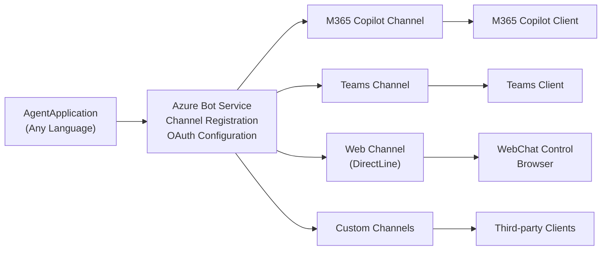

Channel-specific implementation details are covered in:
- [Microsoft Teams Integration](#5.1)
- [Microsoft 365 Copilot Integration](#5.2)
- [Azure Bot Service Integration](#4.1)

**Sources**: [README.md:3-4]()

## Integration Ecosystem

The Microsoft 365 Agents SDK integrates with a rich ecosystem of AI services, agent platforms, and Microsoft services. The SDK's AI-agnostic design allows developers to select the services that best fit their requirements.

### Related SDKs and Services

| Service | Purpose | Integration Level |
|---------|---------|-------------------|
| **Semantic Kernel** | LLM orchestration with plugins and function chaining | Optional - integrate via agent handlers |
| **Azure AI Foundry** | Reasoning engines, RAG, observability, agent services | Optional - provides backend capabilities |
| **Copilot Studio** | Low-code agent builder, multi-agent orchestration | Bidirectional - build skills for or consume from |
| **Microsoft Graph** | M365 data access (files, mail, calendar, users) | Via authentication and API calls |
| **Azure Bot Service** | Channel registration, OAuth connections | Required for channel deployment |

### Integration Pattern

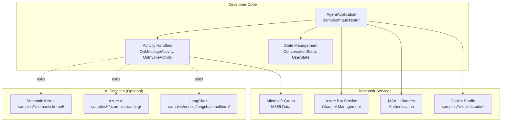

**Sources**: [README.md:34-50](), [MCSandAgentsEcosystemLinks.md:1-119]()

## Sample Applications

The repository includes sample applications organized by functionality and complexity. Samples exist for all three languages and demonstrate specific patterns and integrations.

### Sample Categories

| Category | Examples | Purpose |
|----------|----------|---------|
| **Getting Started** | `samples/*/quickstart/` | Basic echo agent in each language |
| **AI Integration** | `samples/*/azureaistreaming/`<br/>`samples/dotnet/semantickernel/`<br/>`samples/nodejs/langchainmultiturn/` | AI service integration patterns |
| **Authentication** | `samples/*/oboauthorization/`<br/>`samples/nodejs/autosignin/` | OAuth flows and token exchange |
| **Copilot Studio** | `samples/*/copilotstudioclient/`<br/>`samples/*/copilotstudioskill/`<br/>`samples/nodejs/copilotstudiowebchat/` | Copilot Studio integration |
| **Advanced** | `samples/dotnet/cards/`<br/>`samples/dotnet/genesyshandoff/`<br/>`samples/dotnet/retrievalbot/` | Complex scenarios |

Complete sample documentation is available at [Sample Applications](#6).

**Sources**: [README.md:13-17]()

## Development Tools and Environment

The SDK supports modern development workflows with recommended tooling for each language.

### Recommended VS Code Extensions

The repository includes a VS Code workspace configuration with recommended extensions:

| Extension | Purpose |
|-----------|---------|
| **ESLint** | JavaScript/TypeScript code quality |
| **C# Dev Kit** | .NET development and testing |
| **GitHub Copilot Chat** | AI-assisted development |
| **GitHub Codespaces** | Cloud-based development environments |
| **Adaptive Card Previewer** | Preview Adaptive Cards in real-time |

These extensions are listed in [.vscode/extensions.json]() and VS Code will prompt for installation when opening the workspace.

### Local Development Setup

For local development setup including dev tunnel configuration and the Agents Playground testing tool, see [Local Development](#4.2).

**Sources**: [README.md:74-86]()

## Authentication and Identity

The SDK implements a sophisticated authentication architecture supporting both bot authentication and user authorization flows.

### Authentication Components

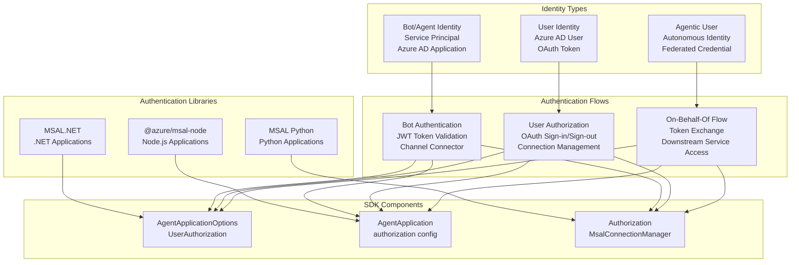

**Key Authentication Concepts:**

- **Bot Authentication**: Validates incoming activities from channels using JWT tokens
- **User Authorization**: OAuth flows enabling agents to access user data with consent
- **On-Behalf-Of (OBO)**: Exchange user tokens for service tokens to access downstream APIs
- **Agentic Identity**: Three-tier architecture for autonomous agent operation

For comprehensive authentication documentation, see:
- [Authentication and Authorization](#3)
- [Bot Authentication](#3.1)
- [User Authentication](#3.2)
- [On-Behalf-Of (OBO) Authorization](#3.3)
- [Agentic Identity](#3.4)

**Sources**: [README.md:1-106]()

## Getting Started

To begin building with the Microsoft 365 Agents SDK:

1. **Choose Your Language**: Select .NET, JavaScript, or Python based on your team's expertise
2. **Review Quickstart Sample**: Navigate to `samples/<language>/quickstart/` for a basic echo agent
3. **Understand Core Concepts**: Read [Core Concepts](#1.1) and [System Architecture](#1.2)
4. **Set Up Development Environment**: Install recommended VS Code extensions and configure local environment
5. **Explore Advanced Samples**: Review samples matching your use case from [Sample Applications](#6)

### No M365 Copilot Subscription Required

A Microsoft 365 Copilot subscription is **not required** to start development. The SDK supports multiple channels, and local development can use the Agents Playground testing tool. M365 Copilot subscriptions are only needed for deploying to that specific channel.

**Sources**: [README.md:13-17]()

## Contributing

This project welcomes contributions and suggestions. Most contributions require agreeing to a Contributor License Agreement (CLA).

### For Microsoft Internal Developers

Internal Microsoft developers should join the Core Identity group [Agents SDK Contrib](https://coreidentity.microsoft.com/manage/Entitlement/entitlement/agentssdkint-upyj).

### For External Contributors

When submitting a pull request, a CLA bot will automatically determine if a CLA is needed and provide instructions. This is a one-time requirement across all Microsoft repositories using the CLA.

This project has adopted the [Microsoft Open Source Code of Conduct](https://opensource.microsoft.com/codeofconduct).

**Sources**: [README.md:56-72]()

## Additional Resources

| Resource | Description |
|----------|-------------|
| [Official Documentation](https://aka.ms/M365-Agents-SDK-Docs) | Complete SDK documentation on Microsoft Learn |
| [M365 Agents and Copilot Studio Ecosystem](MCSandAgentsEcosystemLinks.md) | Related repositories, samples, and documentation |
| [Protocol Specifications](specs/activity) | Activity Protocol, Channel API, Token API specifications |
| [Copilot Studio Samples](https://github.com/microsoft/CopilotStudioSamples) | Additional integration examples |
| [WebChat Samples](https://github.com/microsoft/BotFramework-WebChat/tree/main/samples) | Browser-based chat control customization |

**Sources**: [README.md:30-32](), [MCSandAgentsEcosystemLinks.md:1-119]()

---

# Page: Core Concepts

# Core Concepts

<details>
<summary>Relevant source files</summary>

The following files were used as context for generating this wiki page:

- [MCSandAgentsEcosystemLinks.md](MCSandAgentsEcosystemLinks.md)
- [README.md](README.md)
- [specs/activity/protocol-activity.md](specs/activity/protocol-activity.md)
- [specs/activity/protocol-cards.md](specs/activity/protocol-cards.md)
- [specs/channel-api/ChannelAPI-OpenAPI.yaml](specs/channel-api/ChannelAPI-OpenAPI.yaml)
- [specs/channel-api/TokenAPI-OpenAPI.yaml](specs/channel-api/TokenAPI-OpenAPI.yaml)
- [specs/manifest/bot-manifest.md](specs/manifest/bot-manifest.md)
- [specs/manifest/example.man](specs/manifest/example.man)
- [specs/manifest/manifest.json](specs/manifest/manifest.json)
- [specs/manifest/schemas/SchemaManifestTests/SchemaManifestTests.csproj](specs/manifest/schemas/SchemaManifestTests/SchemaManifestTests.csproj)
- [specs/manifest/schemas/SchemaManifestTests/SchemaManifestTests.sln](specs/manifest/schemas/SchemaManifestTests/SchemaManifestTests.sln)
- [specs/manifest/schemas/SchemaManifestTests/ValidateSchemaTests.cs](specs/manifest/schemas/SchemaManifestTests/ValidateSchemaTests.cs)
- [specs/manifest/schemas/readme.md](specs/manifest/schemas/readme.md)

</details>


This document explains the fundamental concepts of the Microsoft 365 Agents SDK, including agent containers, activity processing, technology-agnostic architecture, and channel deployment patterns. For specific implementation details in different languages, see [Node.js Development](#7.1), [.NET Development](#7.2), and [Python Development](#7.3). For detailed activity processing patterns, see [Activity Processing](#2.2).

## Agent Containers

The Microsoft 365 Agents SDK provides a standardized "container" architecture for building conversational agents. An agent container encapsulates the core functionality needed to handle conversational interactions, manage state, and integrate with various AI services.

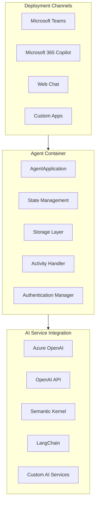

The agent container provides:
- **Unified API**: Consistent interface across C#, JavaScript, and Python implementations
- **State Management**: Built-in conversation and user state persistence
- **Activity Processing**: Structured handling of incoming messages and events
- **Authentication**: Integrated user and service authentication patterns
- **Channel Abstraction**: Deploy to multiple channels without code changes

**Sources:** [README.md:7-12]()

## Activity Protocol

The Activity Protocol is the core communication schema used by the Microsoft 365 Agents SDK. Activities represent conversational actions made by humans, agents, and automated software.

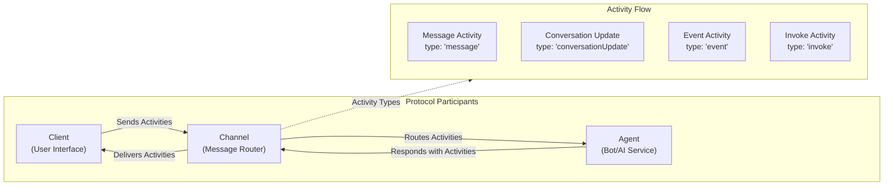

### Activity Structure

Each activity contains standardized fields defined in the Activity Protocol specification:

| Field | Type | Purpose |
|-------|------|---------|
| `type` | string | Activity type (message, conversationUpdate, etc.) |
| `id` | string | Unique identifier assigned by channel |
| `timestamp` | datetime | UTC time when activity occurred |
| `from` | ChannelAccount | Sender information |
| `recipient` | ChannelAccount | Recipient information |
| `conversation` | ConversationAccount | Conversation context |
| `text` | string | Message text content |
| `attachments` | Attachment[] | Rich content attachments |

**Sources:** [specs/activity/protocol-activity.md:40-114](), [specs/activity/protocol-activity.md:335-490]()

## Technology-Agnostic Architecture

The SDK is designed to be technology-agnostic, allowing developers to integrate any AI service or framework without being locked into specific technologies.

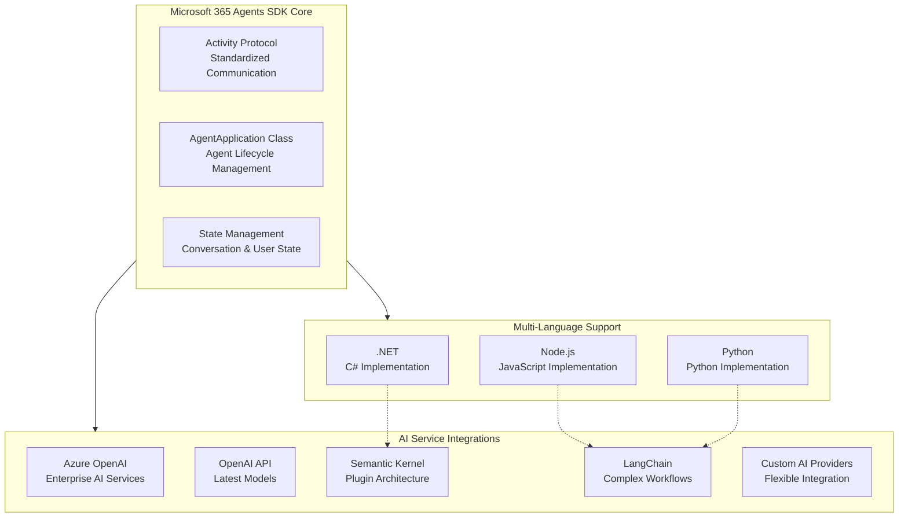

This architecture enables:
- **AI Flexibility**: Choose from Azure OpenAI, OpenAI, Semantic Kernel, LangChain, or custom AI services
- **Language Freedom**: Implement agents in C#, JavaScript, or Python
- **Provider Agnostic**: Switch AI providers without changing core agent logic
- **Custom Integration**: Build adapters for proprietary AI services

**Sources:** [README.md:5-11](), [README.md:28-44]()

## Channel Deployment

Agents built with the SDK can be deployed across multiple channels using the same codebase, with channel-specific customizations handled through configuration.

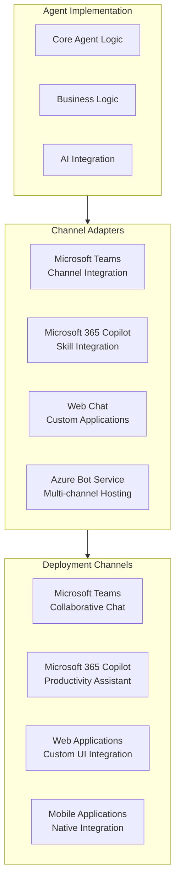

**Deployment Patterns:**
- **Single Codebase**: One agent implementation deploys to multiple channels
- **Channel Customization**: Adapt behavior for specific channel capabilities
- **Unified Management**: Central configuration and monitoring across channels
- **Scalable Architecture**: Automatic scaling based on channel demands

**Sources:** [README.md:9-11]()

## State and Storage Management

The SDK provides built-in state management capabilities for maintaining conversation context and user information across interactions.

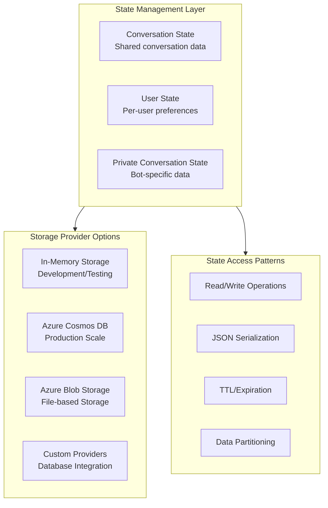

**State Types:**
- **Conversation State**: Shared across all participants in a conversation
- **User State**: Persistent per-user data across conversations
- **Private Conversation State**: Agent-specific data not shared with users

**Sources:** [README.md:9]()

## Authentication Patterns

The SDK supports multiple authentication patterns for both agent authentication and user authentication scenarios.

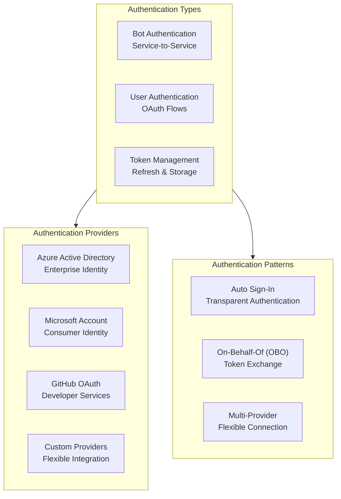

**Authentication Scenarios:**
- **Bot Authentication**: Service principal authentication for Azure Bot Service
- **User Sign-In**: OAuth flows for accessing user data (Microsoft Graph, GitHub, etc.)
- **Token Exchange**: On-behalf-of patterns for service-to-service calls
- **Multi-Provider**: Support for multiple authentication providers simultaneously

**Sources:** [specs/channel-api/TokenAPI-OpenAPI.yaml:13-489](), [specs/manifest/example.man:7-17]()

## Manifest System

Agents are described using structured manifest files that define capabilities, authentication connections, and deployment configuration.

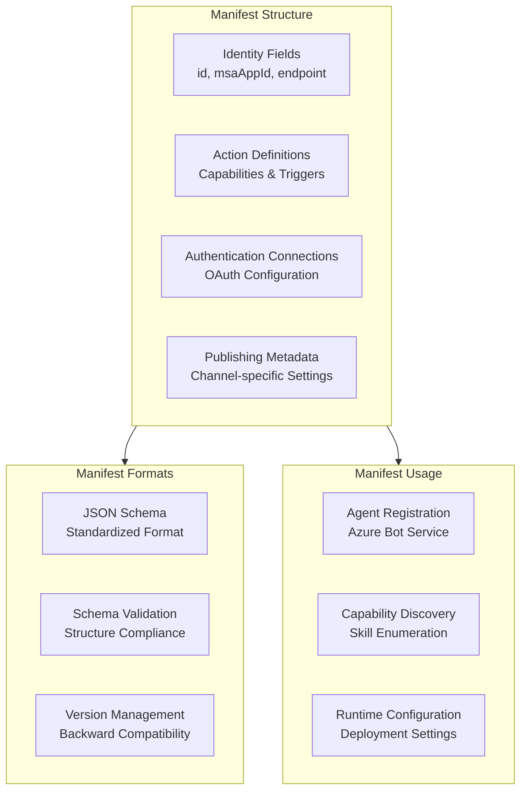

**Manifest Components:**
- **Identity**: Unique identifiers and endpoint configuration
- **Actions**: Advertised capabilities and trigger definitions
- **Authentication**: OAuth connections and service provider configuration
- **Publishing**: Channel-specific metadata and discovery information

**Sources:** [specs/manifest/example.man:1-48](), [specs/manifest/bot-manifest.md:1-460]()

---

# Page: System Architecture

# System Architecture

<details>
<summary>Relevant source files</summary>

The following files were used as context for generating this wiki page:

- [MCSandAgentsEcosystemLinks.md](MCSandAgentsEcosystemLinks.md)
- [README.md](README.md)
- [specs/activity/protocol-activity.md](specs/activity/protocol-activity.md)
- [specs/activity/protocol-cards.md](specs/activity/protocol-cards.md)
- [specs/channel-api/ChannelAPI-OpenAPI.yaml](specs/channel-api/ChannelAPI-OpenAPI.yaml)
- [specs/channel-api/TokenAPI-OpenAPI.yaml](specs/channel-api/TokenAPI-OpenAPI.yaml)
- [specs/manifest/bot-manifest.md](specs/manifest/bot-manifest.md)
- [specs/manifest/example.man](specs/manifest/example.man)
- [specs/manifest/manifest.json](specs/manifest/manifest.json)
- [specs/manifest/schemas/SchemaManifestTests/SchemaManifestTests.csproj](specs/manifest/schemas/SchemaManifestTests/SchemaManifestTests.csproj)
- [specs/manifest/schemas/SchemaManifestTests/SchemaManifestTests.sln](specs/manifest/schemas/SchemaManifestTests/SchemaManifestTests.sln)
- [specs/manifest/schemas/SchemaManifestTests/ValidateSchemaTests.cs](specs/manifest/schemas/SchemaManifestTests/ValidateSchemaTests.cs)
- [specs/manifest/schemas/readme.md](specs/manifest/schemas/readme.md)

</details>


This document describes the overall system architecture of the Microsoft 365 Agents SDK, including its multi-language implementation strategy, core protocol specifications, and integration patterns with the Microsoft ecosystem. This covers the foundational architectural decisions that enable technology-agnostic agent development across different programming languages and deployment targets.

For information about building specific agents, see [Building Agents](#2). For deployment-specific configurations, see [Deployment and Hosting](#4).

## Multi-Language SDK Architecture

The Microsoft 365 Agents SDK employs a distributed architecture where a central specification repository defines common protocols and standards, while language-specific implementations provide native developer experiences.

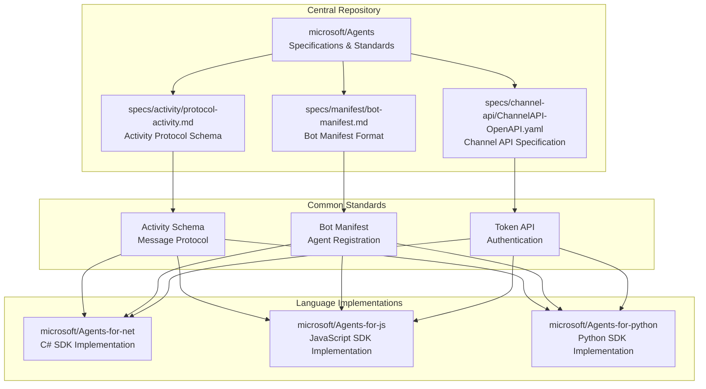

Sources: [README.md:13-22](), [specs/activity/protocol-activity.md:1-10](), [specs/manifest/bot-manifest.md:1-10]()

The architecture enables consistent behavior across languages while allowing each implementation to follow language-specific conventions and patterns. Each language repository contains native SDK libraries, sample applications, and language-specific documentation.

## Activity Protocol Foundation

The Activity Protocol serves as the core communication schema that enables interoperability between agents, channels, and clients across the entire ecosystem.

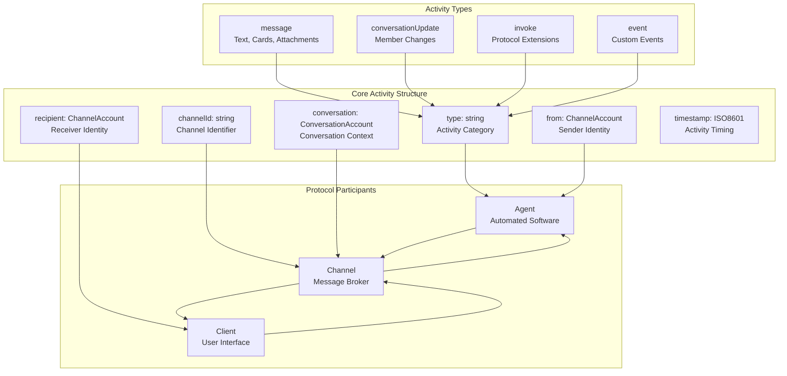

Sources: [specs/activity/protocol-activity.md:115-180](), [specs/activity/protocol-activity.md:335-500]()

The protocol defines numbered requirements using markers like `A2001` through `A3135` that specify mandatory and optional behaviors for senders and receivers. This ensures consistent implementation across different language SDKs and channel integrations.

## Agent Container Architecture

Each agent implementation follows a container pattern that provides state management, storage capabilities, and activity processing infrastructure.

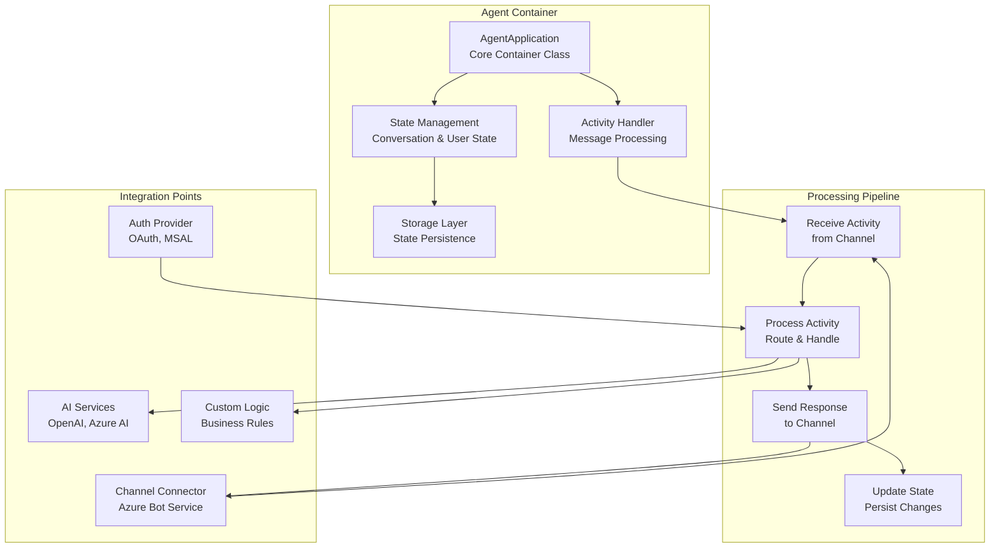

Sources: [README.md:7-12](), [specs/activity/protocol-activity.md:106-114]()

The container architecture abstracts common agent functionality while allowing developers to focus on implementing business logic specific to their use cases. For detailed implementation patterns, see [AgentApplication Class](#2.1).

## Microsoft Ecosystem Integration

The SDK integrates with multiple Microsoft services through standardized APIs and authentication patterns.

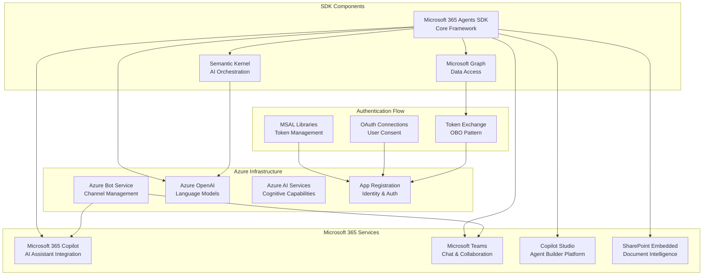

Sources: [README.md:28-44](), [specs/channel-api/TokenAPI-OpenAPI.yaml:13-489]()

Integration follows Microsoft's security and compliance standards, with OAuth 2.0 flows for user authentication and service-to-service authentication patterns for backend integrations. For specific authentication implementations, see [Authentication](#3).

## Bot Manifest and Registration

The bot manifest format provides a standardized way to describe agent capabilities, authentication requirements, and deployment configurations.

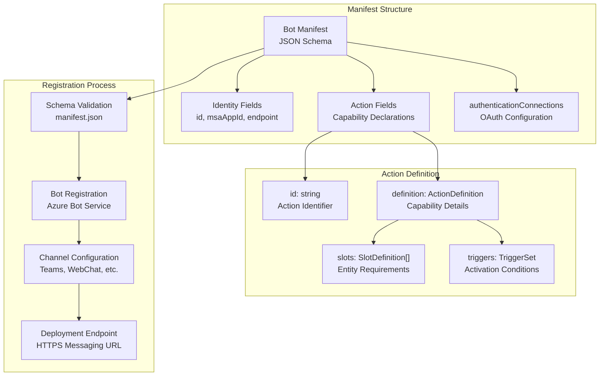

Sources: [specs/manifest/bot-manifest.md:130-170](), [specs/manifest/example.man:1-48](), [specs/manifest/manifest.json:1-64]()

The manifest supports both inline action definitions and references to globally defined actions, enabling reusable agent capabilities across the ecosystem. The schema includes versioning and extensibility mechanisms for future enhancements.

## Authentication Architecture

The SDK implements a comprehensive authentication system supporting both user and service authentication patterns.

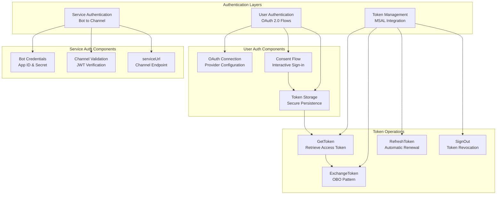

Sources: [specs/channel-api/TokenAPI-OpenAPI.yaml:80-282](), [specs/activity/protocol-activity.md:288-311]()

The authentication system supports multiple identity providers and implements secure token handling patterns including automatic refresh and proper token lifecycle management. For implementation details, see [Bot Authentication](#3.1) and [User Authentication](#3.2).

## Channel API Integration

The Channel API provides the transport layer for activity exchange between agents and Microsoft services.

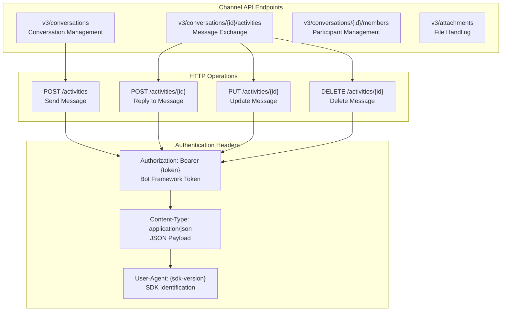

Sources: [specs/channel-api/ChannelAPI-OpenAPI.yaml:143-188](), [specs/channel-api/ChannelAPI-OpenAPI.yaml:284-333]()

The API follows OpenAPI 3.0.3 specification and provides comprehensive error handling with structured error responses. All endpoints require proper authentication tokens and support both synchronous and asynchronous operation patterns.

## Development and Testing Infrastructure

The SDK provides comprehensive tooling for local development, testing, and continuous integration.

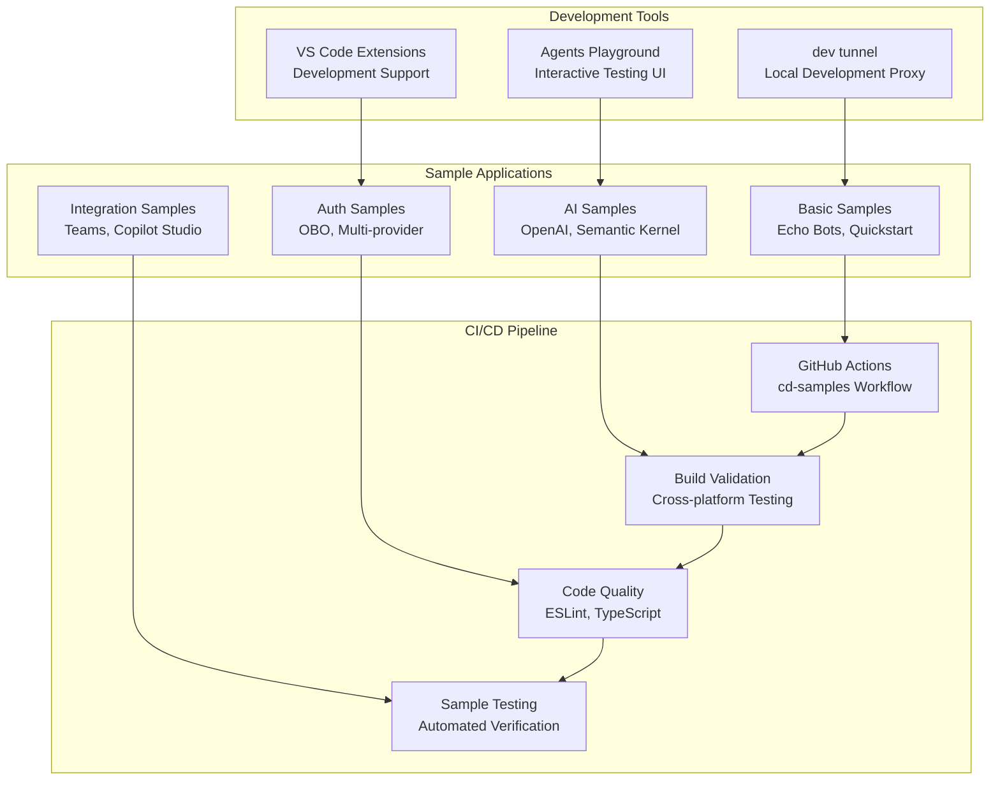

Sources: [README.md:64-76](), [README.md:50-62]()

The development infrastructure supports multiple hosting patterns including ASP.NET Core for .NET, Express.js for Node.js, and aiohttp for Python, ensuring developers can work within their preferred technology stacks while maintaining consistency across the ecosystem.

---

# Page: SDK Language Implementations

# SDK Language Implementations

<details>
<summary>Relevant source files</summary>

The following files were used as context for generating this wiki page:

- [.github/scripts/updatenode.sh](.github/scripts/updatenode.sh)
- [MCSandAgentsEcosystemLinks.md](MCSandAgentsEcosystemLinks.md)
- [README.md](README.md)
- [samples/dotnet/Agent Framework/AgentFrameworkWeather.csproj](samples/dotnet/Agent Framework/AgentFrameworkWeather.csproj)
- [samples/dotnet/GenesysHandoff/GenesysHandoff.csproj](samples/dotnet/GenesysHandoff/GenesysHandoff.csproj)
- [samples/dotnet/RetrievalBot/RetrievalBot.csproj](samples/dotnet/RetrievalBot/RetrievalBot.csproj)
- [samples/dotnet/auto-signin/AutoSignIn.csproj](samples/dotnet/auto-signin/AutoSignIn.csproj)
- [samples/dotnet/azure-ai-streaming/StreamingMessageAgent.csproj](samples/dotnet/azure-ai-streaming/StreamingMessageAgent.csproj)
- [samples/dotnet/copilotstudio-client/CopilotStudioClient.csproj](samples/dotnet/copilotstudio-client/CopilotStudioClient.csproj)
- [samples/dotnet/copilotstudio-skill/CopilotStudioEchoSkill.csproj](samples/dotnet/copilotstudio-skill/CopilotStudioEchoSkill.csproj)
- [samples/dotnet/obo-authorization/OBOAuthorization.csproj](samples/dotnet/obo-authorization/OBOAuthorization.csproj)
- [samples/dotnet/quickstart/QuickStart.csproj](samples/dotnet/quickstart/QuickStart.csproj)
- [samples/dotnet/semantic-kernel-multiturn/SemanticKernelMultiturn.csproj](samples/dotnet/semantic-kernel-multiturn/SemanticKernelMultiturn.csproj)
- [samples/nodejs/auto-signin/package-lock.json](samples/nodejs/auto-signin/package-lock.json)
- [samples/nodejs/azure-ai-streaming/package-lock.json](samples/nodejs/azure-ai-streaming/package-lock.json)
- [samples/nodejs/cards/package-lock.json](samples/nodejs/cards/package-lock.json)
- [samples/nodejs/copilotstudio-client/package-lock.json](samples/nodejs/copilotstudio-client/package-lock.json)
- [samples/nodejs/copilotstudio-webchat-react/package-lock.json](samples/nodejs/copilotstudio-webchat-react/package-lock.json)
- [samples/nodejs/langchain-multiturn/package-lock.json](samples/nodejs/langchain-multiturn/package-lock.json)
- [samples/nodejs/multi-turn-prompt/package-lock.json](samples/nodejs/multi-turn-prompt/package-lock.json)
- [samples/nodejs/obo-authorization/package-lock.json](samples/nodejs/obo-authorization/package-lock.json)
- [samples/nodejs/quickstart/package-lock.json](samples/nodejs/quickstart/package-lock.json)
- [samples/python/README.md](samples/python/README.md)
- [samples/python/obo-authorization/README.md](samples/python/obo-authorization/README.md)
- [samples/python/obo-authorization/env.TEMPLATE](samples/python/obo-authorization/env.TEMPLATE)
- [samples/python/obo-authorization/requirements.txt](samples/python/obo-authorization/requirements.txt)
- [samples/python/obo-authorization/src/agent.py](samples/python/obo-authorization/src/agent.py)
- [samples/python/obo-authorization/src/main.py](samples/python/obo-authorization/src/main.py)
- [samples/python/obo-authorization/src/start_server.py](samples/python/obo-authorization/src/start_server.py)

</details>


## Purpose and Scope

This document describes the three language implementations of the Microsoft 365 Agents SDK: .NET, JavaScript/TypeScript, and Python. It explains the package structure, architectural patterns, and language-specific hosting approaches used by each implementation while maintaining protocol-level compatibility. For information about the overall system architecture, see [System Architecture](#1.2). For language-specific development guides, see [Node.js Development](#7.1), [.NET Development](#7.2), and [Python Development](#7.3).

## Architectural Consistency Across Languages

All three SDK implementations adhere to the same Activity Protocol specification and provide consistent abstractions for agent development while leveraging language-specific idioms and frameworks.

```mermaid
graph TB
    subgraph "Protocol Layer"
        PROTOCOL["Activity Protocol Specification<br/>17+ Activity Types<br/>Cards, Bot Manifest"]
    end
    
    subgraph ".NET Implementation"
        DOTNET_PKG["NuGet Packages<br/>Microsoft.Agents.*"]
        DOTNET_HOST["Microsoft.Agents.Hosting.AspNetCore"]
        DOTNET_AUTH["Microsoft.Agents.Authentication.Msal"]
        DOTNET_RUNTIME[".NET 8.0 Runtime<br/>AspNetCore Hosting"]
        
        DOTNET_PKG --> DOTNET_HOST
        DOTNET_PKG --> DOTNET_AUTH
        DOTNET_HOST --> DOTNET_RUNTIME
    end
    
    subgraph "JavaScript Implementation"
        JS_ACTIVITY["@microsoft/agents-activity<br/>Activity Types + Zod Schemas"]
        JS_HOSTING["@microsoft/agents-hosting<br/>AgentApplication Core"]
        JS_EXPRESS["@microsoft/agents-hosting-express<br/>Express Integration"]
        JS_RUNTIME["Node.js 20+ Runtime<br/>Express v5 Hosting"]
        
        JS_ACTIVITY --> JS_HOSTING
        JS_HOSTING --> JS_EXPRESS
        JS_EXPRESS --> JS_RUNTIME
    end
    
    subgraph "Python Implementation"
        PY_ACTIVITY["microsoft-agents-activity<br/>Activity Types"]
        PY_HOSTING["microsoft-agents-hosting-core<br/>AgentApplication Core"]
        PY_AIOHTTP["microsoft-agents-hosting-aiohttp<br/>aiohttp Integration"]
        PY_RUNTIME["Python 3.9+ Runtime<br/>aiohttp Hosting"]
        
        PY_ACTIVITY --> PY_HOSTING
        PY_HOSTING --> PY_AIOHTTP
        PY_AIOHTTP --> PY_RUNTIME
    end
    
    PROTOCOL -.defines.-> DOTNET_PKG
    PROTOCOL -.defines.-> JS_ACTIVITY
    PROTOCOL -.defines.-> PY_ACTIVITY
```

**Sources:** [README.md:19-28](), [samples/nodejs/azure-ai-streaming/package-lock.json:154-220](), [samples/python/obo-authorization/requirements.txt]()

### Common Architectural Layers

All implementations provide a layered architecture with separation of concerns:

| Layer | .NET | JavaScript | Python | Purpose |
|-------|------|------------|--------|---------|
| **Activity Protocol** | `Microsoft.Agents.Activity` | `@microsoft/agents-activity` | `microsoft-agents-activity` | Activity types, validation, schemas |
| **Core Hosting** | `Microsoft.Agents.Hosting` | `@microsoft/agents-hosting` | `microsoft-agents-hosting-core` | AgentApplication, TurnContext, state management |
| **Web Framework** | `Microsoft.Agents.Hosting.AspNetCore` | `@microsoft/agents-hosting-express` | `microsoft-agents-hosting-aiohttp` | HTTP server integration |
| **Authentication** | `Microsoft.Agents.Authentication.Msal` | MSAL integrated in hosting | `microsoft-agents-authentication-msal` | OAuth, MSAL, token management |
| **Extensions** | Various packages | `@microsoft/agents-hosting-dialogs`<br/>`@microsoft/agents-copilotstudio-client` | `microsoft-agents-copilotstudio-client` | Dialogs, Copilot Studio client |

**Sources:** [samples/nodejs/azure-ai-streaming/package-lock.json:154-220](), [samples/dotnet/quickstart/QuickStart.csproj:10-13](), [samples/python/obo-authorization/requirements.txt]()

## .NET SDK Structure

The .NET implementation targets .NET 8.0 and uses AspNetCore for hosting. Packages are distributed via NuGet with the `Microsoft.Agents.*` namespace.

```mermaid
graph LR
    subgraph "Core Packages"
        CORE["Microsoft.Agents.Hosting.AspNetCore"]
        AUTH["Microsoft.Agents.Authentication.Msal"]
    end
    
    subgraph "Extension Packages"
        AI["Microsoft.Agents.AI"]
        M365["Microsoft.Agents.M365Copilot.Beta"]
    end
    
    subgraph "Dependencies"
        MSAL["@azure/msal-node"]
        SK["Microsoft.SemanticKernel.*"]
        OPENAI["Azure.AI.OpenAI"]
        GRAPH["Microsoft.Graph"]
    end
    
    CORE --> AUTH
    AI -.optional.-> CORE
    M365 -.optional.-> CORE
    
    AUTH --> MSAL
    AI --> SK
    AI --> OPENAI
    M365 --> GRAPH
```

**Sources:** [samples/dotnet/quickstart/QuickStart.csproj:10-13](), [samples/dotnet/semantic-kernel-multiturn/SemanticKernelMultiturn.csproj:19-28](), [samples/dotnet/Agent Framework/AgentFrameworkWeather.csproj:14-23]()

### Package Versioning Pattern

.NET packages use a wildcard versioning pattern for SDK packages:

```csharp
// From QuickStart.csproj
<PackageReference Include="Microsoft.Agents.Authentication.Msal" Version="1.4.*-*" />
<PackageReference Include="Microsoft.Agents.Hosting.AspNetCore" Version="1.4.*-*" />
```

This allows automatic minor version updates while maintaining major version compatibility. External dependencies like `Azure.AI.OpenAI` and `Microsoft.SemanticKernel.*` use fixed version constraints.

**Sources:** [samples/dotnet/quickstart/QuickStart.csproj:11-12](), [samples/dotnet/semantic-kernel-multiturn/SemanticKernelMultiturn.csproj:26-27]()

### .NET Hosting Configuration

The .NET SDK uses AspNetCore's dependency injection and configuration system:

```mermaid
graph TB
    STARTUP["Program.cs / Startup.cs"]
    CONFIG["IConfiguration<br/>appsettings.json"]
    DI["IServiceCollection<br/>Dependency Injection"]
    
    MIDDLEWARE["AgentApplicationMiddleware"]
    ADAPTER["CloudAdapter"]
    STORAGE["IStorage<br/>MemoryStorage / CosmosDB"]
    
    STARTUP --> CONFIG
    STARTUP --> DI
    
    DI --> MIDDLEWARE
    DI --> ADAPTER
    DI --> STORAGE
    
    MIDDLEWARE --> ASPNETCORE["AspNetCore Pipeline"]
```

The SDK integrates with AspNetCore's middleware pipeline for request processing and authentication validation.

**Sources:** [samples/dotnet/quickstart/QuickStart.csproj:4](), [samples/dotnet/semantic-kernel-multiturn/SemanticKernelMultiturn.csproj:4]()

## JavaScript/TypeScript SDK Structure

The JavaScript implementation uses TypeScript and npm packages under the `@microsoft` scope. It requires Node.js 20.0.0 or higher and integrates with Express v5.

```mermaid
graph TB
    subgraph "Core Packages"
        ACTIVITY["@microsoft/agents-activity<br/>Activity types, Zod schemas<br/>uuid, debug"]
        HOSTING["@microsoft/agents-hosting<br/>AgentApplication, TurnContext<br/>axios, @azure/msal-node"]
    end
    
    subgraph "Web Hosting Packages"
        EXPRESS["@microsoft/agents-hosting-express<br/>Express v5 integration<br/>startServer function"]
    end
    
    subgraph "Extension Packages"
        DIALOGS["@microsoft/agents-hosting-dialogs<br/>Dialog management<br/>Multi-turn conversations"]
        COPILOT["@microsoft/agents-copilotstudio-client<br/>CopilotClient, streaming<br/>eventsource-client, rxjs"]
    end
    
    ACTIVITY --> HOSTING
    HOSTING --> EXPRESS
    HOSTING --> DIALOGS
    
    COPILOT -.independent.-> ACTIVITY
```

**Sources:** [samples/nodejs/azure-ai-streaming/package-lock.json:154-220](), [samples/nodejs/multi-turn-prompt/package-lock.json:12-13]()

### Package Dependency Graph

The Node.js packages have a clear dependency hierarchy:

| Package | Version | Key Dependencies | Purpose |
|---------|---------|------------------|---------|
| `@microsoft/agents-activity` | 1.1.1 | `zod@3.25.75`, `uuid@11.1.0`, `debug@4.4.3` | Protocol implementation with validation |
| `@microsoft/agents-hosting` | 1.1.1 | `@azure/msal-node@3.8.4`, `axios@1.13.2`, `jsonwebtoken@9.0.2` | Core hosting logic, auth, HTTP client |
| `@microsoft/agents-hosting-express` | 1.1.1 | `express@5.1.0`, `@microsoft/agents-hosting@1.1.1` | Express integration layer |
| `@microsoft/agents-hosting-dialogs` | 1.1.1 | `@microsoft/agents-hosting@1.1.1` | Dialog state management |
| `@microsoft/agents-copilotstudio-client` | 1.1.1 | `eventsource-client@1.2.0`, `rxjs@7.8.2` | Copilot Studio streaming client |

**Sources:** [samples/nodejs/azure-ai-streaming/package-lock.json:154-220](), [samples/nodejs/obo-authorization/package-lock.json:85-159](), [samples/nodejs/multi-turn-prompt/package-lock.json:12-13]()

### TypeScript and Zod Validation

The JavaScript SDK uses Zod for runtime type validation of Activity Protocol messages:

```typescript
// From @microsoft/agents-activity package
// Provides Zod schemas for activity validation
// See package-lock.json lines 154-189
```

Activities are validated using Zod schemas defined in `@microsoft/agents-activity`, ensuring type safety at runtime for protocol compliance.

**Sources:** [samples/nodejs/azure-ai-streaming/package-lock.json:154-189]()

### Express Hosting Integration

The `@microsoft/agents-hosting-express` package provides the `startServer` function that configures Express v5 with agent middleware:

```mermaid
graph LR
    CLIENT["HTTP Client"] --> EXPRESS["Express v5 Server"]
    EXPRESS --> JWT["JWT Validation<br/>jwks-rsa"]
    JWT --> MIDDLEWARE["AgentApplication<br/>Middleware"]
    MIDDLEWARE --> HANDLER["Event Handlers<br/>onMessage, onMembersAdded"]
    HANDLER --> RESPONSE["HTTP Response"]
```

The middleware handles JWT validation, activity deserialization, turn context creation, and event handler dispatch.

**Sources:** [samples/nodejs/azure-ai-streaming/package-lock.json:208-220](), [samples/nodejs/quickstart/package-lock.json:129-141]()

## Python SDK Structure

The Python implementation uses pip packages under the `microsoft-agents-*` namespace and requires Python 3.9 or higher. It uses aiohttp for async HTTP handling.

```mermaid
graph TB
    subgraph "Core Packages"
        PY_ACTIVITY["microsoft-agents-activity<br/>Activity types and validation"]
        PY_HOSTING["microsoft-agents-hosting-core<br/>AgentApplication, TurnContext<br/>Authorization, MemoryStorage"]
    end
    
    subgraph "Web Hosting"
        PY_AIOHTTP["microsoft-agents-hosting-aiohttp<br/>CloudAdapter, start_agent_process<br/>jwt_authorization_middleware"]
    end
    
    subgraph "Authentication"
        PY_MSAL["microsoft-agents-authentication-msal<br/>MsalConnectionManager"]
    end
    
    subgraph "Extensions"
        PY_COPILOT["microsoft-agents-copilotstudio-client<br/>CopilotClient, ConnectionSettings"]
    end
    
    PY_ACTIVITY --> PY_HOSTING
    PY_HOSTING --> PY_AIOHTTP
    PY_HOSTING --> PY_MSAL
    
    PY_COPILOT -.uses.-> PY_ACTIVITY
```

**Sources:** [samples/python/obo-authorization/requirements.txt](), [samples/python/obo-authorization/src/agent.py:8-24](), [samples/python/obo-authorization/src/start_server.py:1-8]()

### Python Package Dependencies

The Python SDK has the following package structure:

```python
# From requirements.txt
python-dotenv
aiohttp
microsoft-agents-activity
microsoft-agents-hosting-core
microsoft-agents-hosting-aiohttp
microsoft-agents-authentication-msal
microsoft-agents-copilotstudio-client
```

**Sources:** [samples/python/obo-authorization/requirements.txt]()

### Async/Await Pattern

Python SDK uses async/await throughout for non-blocking I/O:

```mermaid
graph LR
    AIOHTTP["aiohttp.web.Application"] --> MIDDLEWARE["jwt_authorization_middleware"]
    MIDDLEWARE --> ADAPTER["CloudAdapter<br/>async process_activity"]
    ADAPTER --> APP["AgentApplication<br/>async event handlers"]
    APP --> CONTEXT["TurnContext<br/>async send_activity"]
```

All agent handlers and activity processing methods are async coroutines, enabling efficient handling of concurrent requests.

**Sources:** [samples/python/obo-authorization/src/start_server.py:1-8](), [samples/python/obo-authorization/src/agent.py:8-24]()

### aiohttp Server Configuration

The Python SDK provides `start_agent_process` helper for server setup:

```python
# From samples/python/obo-authorization/src/start_server.py:10-19
def start_server(
    agent_app: AgentApplication,
    agent_config: AgentAuthConfiguration,
    connection_manager: MsalConnectionManager,
    port: int = 3978,
):
    adapter = CloudAdapter(agent_config, connection_manager)
    # Creates aiohttp.web.Application with JWT middleware
```

The function creates an `aiohttp.web.Application`, configures the `CloudAdapter`, and registers JWT validation middleware automatically.

**Sources:** [samples/python/obo-authorization/src/start_server.py:10-19]()

## Implementation Patterns Across Languages

### AgentApplication Pattern

All three implementations use a central `AgentApplication` class for registering event handlers:

| Language | Class/Function | Event Handler Registration | State Access |
|----------|----------------|---------------------------|--------------|
| **.NET** | `AgentApplication` | `.OnMessage(handler)`<br/>`.OnMembersAdded(handler)` | `TurnContext.TurnState` |
| **JavaScript** | `AgentApplication` | `.onMessage(handler)`<br/>`.onMembersAdded(handler)` | `TurnContext.turnState` |
| **Python** | `AgentApplication` | `.on_message(handler)`<br/>`.on_members_added(handler)` | `TurnContext.turn_state` |

Event handlers receive a `TurnContext` object providing access to the incoming activity, conversation state, and methods to send responses.

**Sources:** [samples/python/obo-authorization/src/agent.py:31-60]()

### TurnContext and TurnState

```mermaid
graph TB
    subgraph "TurnContext"
        ACTIVITY["activity: Activity<br/>Incoming message/event"]
        STATE["turn_state: TurnState<br/>Per-turn temporary storage"]
        CONV["conversation_state<br/>Persisted conversation data"]
        USER["user_state<br/>Persisted user data"]
        
        SEND["send_activity(activity)<br/>Send response"]
        UPDATE["update_activity(activity)<br/>Update existing message"]
    end
    
    subgraph "TurnState Access"
        DOTNET_STATE[".NET: context.TurnState['key']"]
        JS_STATE["JS: context.turnState.get('key')"]
        PY_STATE["Python: context.turn_state['key']"]
    end
    
    STATE --> DOTNET_STATE
    STATE --> JS_STATE
    STATE --> PY_STATE
```

The `TurnState` object provides temporary storage for the duration of a turn, while conversation and user state persist across turns via configured storage providers.

**Sources:** [samples/python/obo-authorization/src/agent.py:31-60]()

### Storage Abstraction

All implementations provide storage abstractions with identical interfaces:

| Storage Type | .NET | JavaScript | Python | Use Case |
|--------------|------|------------|--------|----------|
| **Memory** | `MemoryStorage` | `MemoryStorage` | `MemoryStorage` | Development, testing |
| **Cosmos DB** | `CosmosDbPartitionedStorage` | `CosmosDbPartitionedStorage` | `CosmosDbPartitionedStorage` | Production state |
| **Blob Storage** | `BlobStorage` | `BlobStorage` | `BlobStorage` | Large attachments |

Storage is injected into `AgentApplication` during initialization and accessed via `TurnContext.conversationState` and `TurnContext.userState`.

**Sources:** [samples/python/obo-authorization/src/agent.py:31-32]()

### Authentication and Authorization

```mermaid
graph TB
    subgraph ".NET Authentication"
        DOTNET_MSAL["Microsoft.Agents.Authentication.Msal<br/>MsalConnectionManager"]
        DOTNET_CONFIG["AgentApplicationOptions<br/>UserAuthorization config"]
    end
    
    subgraph "JavaScript Authentication"
        JS_MSAL["@azure/msal-node<br/>Built into hosting"]
        JS_CONFIG["AgentApplication options<br/>authorization property"]
    end
    
    subgraph "Python Authentication"
        PY_MSAL["microsoft-agents-authentication-msal<br/>MsalConnectionManager"]
        PY_CONFIG["Authorization class<br/>connection_manager"]
    end
    
    AUTH_PATTERN["Common Pattern:<br/>1. JWT validation<br/>2. Connection manager for OAuth<br/>3. Token provider for user auth"]
    
    DOTNET_MSAL --> AUTH_PATTERN
    JS_MSAL --> AUTH_PATTERN
    PY_MSAL --> AUTH_PATTERN
```

All implementations use MSAL for OAuth token management and provide connection managers for handling user authorization flows.

**Sources:** [samples/python/obo-authorization/src/agent.py:18](), [samples/nodejs/azure-ai-streaming/package-lock.json:131-153](), [samples/dotnet/quickstart/QuickStart.csproj:11]()

## Version Requirements and Runtime Compatibility

### Language Runtime Requirements

| Language | Minimum Version | Recommended | Notes |
|----------|----------------|-------------|-------|
| **.NET** | .NET 8.0 | .NET 8.0 | Uses modern C# features, nullable reference types |
| **JavaScript** | Node.js 20.0.0 | Node.js 22+ | Requires ES modules support |
| **Python** | Python 3.9 | Python 3.11+ | Uses async/await, type hints |

**Sources:** [samples/dotnet/quickstart/QuickStart.csproj:4](), [samples/nodejs/azure-ai-streaming/package-lock.json:165](), [samples/python/obo-authorization/README.md:10]()

### Web Framework Versions

| Language | Framework | Version | Key Features Used |
|----------|-----------|---------|-------------------|
| **.NET** | AspNetCore | 8.0 | Middleware pipeline, dependency injection, minimal APIs |
| **JavaScript** | Express | 5.1.0+ | Modern routing, async handlers, middleware |
| **Python** | aiohttp | Latest | Async request handling, middleware support |

Express v5 is specifically required for the JavaScript SDK, providing improved async support and modern JavaScript features.

**Sources:** [samples/nodejs/azure-ai-streaming/package-lock.json:680-722](), [samples/nodejs/obo-authorization/package-lock.json:593-634]()

### Cross-Platform Development

All three implementations support cross-platform development:

```mermaid
graph LR
    subgraph "Development Platforms"
        WINDOWS["Windows<br/>Visual Studio, VS Code"]
        MACOS["macOS<br/>VS Code, terminal"]
        LINUX["Linux<br/>VS Code, terminal"]
    end
    
    subgraph "Common Tools"
        DEVTUNNEL["dev tunnel<br/>Local development"]
        PLAYGROUND["Agents Playground<br/>@microsoft/m365agentsplayground"]
        VSCODE["VS Code Extensions<br/>ESLint, C# Dev Kit"]
    end
    
    WINDOWS --> DEVTUNNEL
    MACOS --> DEVTUNNEL
    LINUX --> DEVTUNNEL
    
    DEVTUNNEL --> PLAYGROUND
```

The `@microsoft/m365agentsplayground` npm package provides a testing tool available across all platforms, and dev tunnel enables local HTTPS endpoints for bot service connectivity.

**Sources:** [README.md:74-86](), [samples/nodejs/azure-ai-streaming/package-lock.json:221-230]()

## Repository and Package Distribution

### Source Code Repositories

Each language implementation maintains its own repository:

| Language | Repository | Distribution |
|----------|-----------|--------------|
| **.NET** | [Agents-for-net](https://github.com/Microsoft/Agents-for-net) | NuGet.org |
| **JavaScript** | [Agents-for-js](https://github.com/Microsoft/Agents-for-js) | npmjs.com |
| **Python** | [Agents-for-python](https://github.com/Microsoft/Agents-for-python) | PyPI |
| **General** | [Agents](https://github.com/Microsoft/Agents) | Samples, documentation |

The main [Agents](https://github.com/Microsoft/Agents) repository contains cross-cutting samples and documentation, while language-specific issues should be filed in the corresponding language repository.

**Sources:** [README.md:19-28](), [MCSandAgentsEcosystemLinks.md:16-38]()

### Package Naming Conventions

```mermaid
graph TB
    subgraph ".NET Naming"
        DOTNET_BASE["Microsoft.Agents.*"]
        DOTNET_HOST["Microsoft.Agents.Hosting.AspNetCore"]
        DOTNET_AUTH["Microsoft.Agents.Authentication.Msal"]
    end
    
    subgraph "JavaScript Naming"
        JS_BASE["@microsoft/agents-*"]
        JS_HOST["@microsoft/agents-hosting-express"]
        JS_ACTIVITY["@microsoft/agents-activity"]
    end
    
    subgraph "Python Naming"
        PY_BASE["microsoft-agents-*"]
        PY_HOST["microsoft-agents-hosting-aiohttp"]
        PY_ACTIVITY["microsoft-agents-activity"]
    end
    
    CONVENTION["Naming Convention:<br/>namespace.agents.component.platform"]
    
    DOTNET_BASE --> CONVENTION
    JS_BASE --> CONVENTION
    PY_BASE --> CONVENTION
```

All packages follow a consistent naming pattern with language-specific conventions: PascalCase with dot separators for .NET, kebab-case with @ scope for JavaScript, and kebab-case with hyphen separators for Python.

**Sources:** [samples/dotnet/quickstart/QuickStart.csproj:11-12](), [samples/nodejs/azure-ai-streaming/package-lock.json:154-220](), [samples/python/obo-authorization/requirements.txt]()

---

# Page: Building Agents

# Building Agents

<details>
<summary>Relevant source files</summary>

The following files were used as context for generating this wiki page:

- [samples/nodejs/quickstart/README.md](samples/nodejs/quickstart/README.md)
- [samples/nodejs/quickstart/env.TEMPLATE](samples/nodejs/quickstart/env.TEMPLATE)
- [samples/nodejs/quickstart/package.json](samples/nodejs/quickstart/package.json)
- [samples/nodejs/quickstart/src/index.ts](samples/nodejs/quickstart/src/index.ts)
- [samples/nodejs/quickstart/tsconfig.json](samples/nodejs/quickstart/tsconfig.json)

</details>


This document provides a comprehensive guide to building agents using the Microsoft 365 Agents SDK across .NET, Node.js, and Python. It covers the core `AgentApplication` class, activity processing patterns, message handling, and multi-language implementation approaches. For deployment information, see [Deployment and Hosting](#4). For authentication patterns, see [Authentication](#3).

## Multi-Language Agent Architecture

The Microsoft 365 Agents SDK provides consistent architecture across .NET, Node.js, and Python implementations, centered around the `AgentApplication` class as the main container for agent logic and event handling.

### Cross-Platform Architecture Overview

```mermaid
graph TB
    subgraph "Language Implementations"
        DotNet[".NET Implementation<br/>AgentApplication<br/>ASP.NET Core"]
        NodeJS["Node.js Implementation<br/>AgentApplication<br/>Express.js"]
        Python["Python Implementation<br/>AgentApplication<br/>aiohttp"]
    end
    
    subgraph "HTTP Endpoints"
        ApiMessages["/api/messages<br/>POST endpoint"]
        ProcessAsync["ProcessAsync()<br/>Request handling"]
    end
    
    subgraph "Agent Core"
        AgentApplication["AgentApplication<br/>Main container"]
        TurnContext["TurnContext<br/>Request context"]
        TurnState["TurnState<br/>Conversation state"]
    end
    
    subgraph "Activity Processing"
        OnMessage["@AGENT_APP.message<br/>onMessage()<br/>message handlers"]
        OnConversationUpdate["@AGENT_APP.conversation_update<br/>onConversationUpdate()<br/>member events"]
        OnActivity["@AGENT_APP.activity<br/>onActivity()<br/>activity handlers"]
    end
    
    subgraph "Storage & State"
        MemoryStorage["MemoryStorage<br/>In-memory state"]
        Authorization["Authorization<br/>Auth handlers"]
        CloudAdapter["CloudAdapter<br/>Bot Framework"]
    end
    
    DotNet --> ApiMessages
    NodeJS --> ApiMessages
    Python --> ApiMessages
    
    ApiMessages --> ProcessAsync
    ProcessAsync --> AgentApplication
    AgentApplication --> TurnContext
    TurnContext --> TurnState
    
    AgentApplication --> OnMessage
    AgentApplication --> OnConversationUpdate
    AgentApplication --> OnActivity
    
    AgentApplication --> MemoryStorage
    AgentApplication --> Authorization
    AgentApplication --> CloudAdapter
```

Sources: [samples/dotnet/auto-signin/README.md:1-134](), [samples/nodejs/langchain-multiturn/README.md:1-80](), [samples/python/auto-signin/src/agent.py:1-139](), [samples/python/cards/src/agent.py:1-78]()

### Language-Specific Hosting Patterns

| Language | Hosting Framework | Entry Point | Agent Registration |
|----------|------------------|-------------|-------------------|
| .NET | ASP.NET Core | `Program.cs` | `AddAgent<T>()` |
| Node.js | Express.js | `agent.ts` | `startServer(agent)` |
| Python | aiohttp | `main.py` | `start_server()` |

Sources: [samples/dotnet/quickstart/README.md:1-98](), [samples/nodejs/azure-ai-streaming/src/agent.ts:1-70](), [samples/python/auto-signin/src/start_server.py:1-32]()

## Core Components

### AgentApplication Class Across Languages

The `AgentApplication` class serves as the primary container for agent functionality across all language implementations, with language-specific patterns for configuration and handler registration.

#### .NET Implementation

```mermaid
graph TB
    subgraph ".NET Agent Setup"
        WebApplicationBuilder["WebApplicationBuilder.CreateBuilder()"]
        AddAgentApplicationOptions["builder.Services.AddAgentApplicationOptions()"]
        AddAgent["builder.Services.AddAgent<T>()"]
        BuildApp["builder.Build()"]
    end
    
    subgraph "Agent Configuration"
        AppSettings["appsettings.json<br/>AgentApplication section"]
        ServiceCollection["ServiceCollection<br/>DI container"]
        AgentApplicationOptions["AgentApplicationOptions<br/>Configuration binding"]
    end
    
    subgraph "Handler Registration"
        OnActivityMethod["agent.OnActivity()<br/>Activity type routing"]
        MessageHandler["ActivityTypes.Message<br/>Text processing"]
        ConversationUpdateHandler["ActivityTypes.ConversationUpdate<br/>Member events"]
    end
    
    WebApplicationBuilder --> AddAgentApplicationOptions
    AddAgentApplicationOptions --> AddAgent
    AddAgent --> BuildApp
    
    AppSettings --> ServiceCollection
    ServiceCollection --> AgentApplicationOptions
    AgentApplicationOptions --> OnActivityMethod
    OnActivityMethod --> MessageHandler
    OnActivityMethod --> ConversationUpdateHandler
```

#### Node.js Implementation

```mermaid
graph TB
    subgraph "Node.js Agent Setup"
        AgentConstructor["new AgentApplication<TurnState>()"]
        StartServer["startServer(agent)<br/>Express.js hosting"]
        ExpressApp["Express app<br/>Port 3978"]
    end
    
    subgraph "Handler Registration"
        OnMessage["agent.onMessage()<br/>Text message routing"]
        OnConversationUpdate["agent.onConversationUpdate()<br/>Member events"]
        OnActivity["agent.onActivity()<br/>Activity routing"]
    end
    
    subgraph "Configuration"
        EnvFile[".env file<br/>Environment variables"]
        PackageJson["package.json<br/>Dependencies"]
        StartScript["npm start<br/>Launch script"]
    end
    
    AgentConstructor --> StartServer
    StartServer --> ExpressApp
    
    OnMessage --> AgentConstructor
    OnConversationUpdate --> AgentConstructor
    OnActivity --> AgentConstructor
    
    EnvFile --> StartScript
    PackageJson --> StartScript
    StartScript --> ExpressApp
```

#### Python Implementation

```mermaid
graph TB
    subgraph "Python Agent Setup"
        AgentApplicationClass["AgentApplication[TurnState]<br/>Type-annotated container"]
        StartServer["start_server()<br/>aiohttp hosting"]
        AiohttpApp["aiohttp.Application<br/>Port 3978"]
    end
    
    subgraph "Handler Registration"
        MessageDecorator["@AGENT_APP.message<br/>Regex pattern matching"]
        ConversationUpdateDecorator["@AGENT_APP.conversation_update<br/>Member events"]
        ActivityDecorator["@AGENT_APP.activity<br/>Activity type routing"]
    end
    
    subgraph "Configuration"
        LoadDotenv["load_dotenv()<br/>Environment loading"]
        LoadConfiguration["load_configuration_from_env()<br/>SDK configuration"]
        MemoryStorageInit["MemoryStorage()<br/>State management"]
    end
    
    AgentApplicationClass --> StartServer
    StartServer --> AiohttpApp
    
    MessageDecorator --> AgentApplicationClass
    ConversationUpdateDecorator --> AgentApplicationClass
    ActivityDecorator --> AgentApplicationClass
    
    LoadDotenv --> LoadConfiguration
    LoadConfiguration --> MemoryStorageInit
    MemoryStorageInit --> AgentApplicationClass
```

Sources: [samples/dotnet/auto-signin/README.md:18-97](), [samples/nodejs/azure-ai-streaming/src/agent.ts:7-69](), [samples/python/auto-signin/src/agent.py:28-52](), [samples/python/cards/src/agent.py:23-37]()

### HTTP Endpoint Configuration

All agent implementations expose an HTTP POST endpoint at `/api/messages` to receive Bot Framework activities. The endpoint configuration varies by language but follows the same processing pattern.

#### Language-Specific Endpoint Setup

| Language | Framework | Endpoint Registration | Adapter Class |
|----------|-----------|----------------------|---------------|
| .NET | ASP.NET Core | `app.MapPost("/api/messages")` | `IAgentHttpAdapter` |
| Node.js | Express.js | `startServer(agent)` | Built into hosting |
| Python | aiohttp | `APP.router.add_post("/api/messages")` | `CloudAdapter` |

#### Request Processing Flow

```mermaid
graph TB
    subgraph "HTTP Layer"
        IncomingRequest["HTTP POST<br/>/api/messages<br/>Bot Framework Activity"]
    end
    
    subgraph ".NET Processing"
        DotNetAdapter["IAgentHttpAdapter<br/>ProcessAsync()"]
        DotNetAgent["IAgent implementation<br/>OnActivity handlers"]
    end
    
    subgraph "Node.js Processing"
        NodeAdapter["Built-in adapter<br/>Express middleware"]
        NodeAgent["AgentApplication<br/>onMessage/onActivity"]
    end
    
    subgraph "Python Processing"
        PythonAdapter["CloudAdapter<br/>start_agent_process()"]
        PythonAgent["AgentApplication<br/>@decorators"]
    end
    
    subgraph "Common Processing"
        TurnContext["TurnContext<br/>Request context"]
        ActivityProcessing["Activity processing<br/>Handler execution"]
        ResponseGeneration["Response generation<br/>HTTP 200/activity"]
    end
    
    IncomingRequest --> DotNetAdapter
    IncomingRequest --> NodeAdapter
    IncomingRequest --> PythonAdapter
    
    DotNetAdapter --> DotNetAgent
    NodeAdapter --> NodeAgent
    PythonAdapter --> PythonAgent
    
    DotNetAgent --> TurnContext
    NodeAgent --> TurnContext
    PythonAgent --> TurnContext
    
    TurnContext --> ActivityProcessing
    ActivityProcessing --> ResponseGeneration
```

Sources: [samples/nodejs/azure-ai-streaming/src/agent.ts:69-70](), [samples/python/auto-signin/src/start_server.py:13-31](), [samples/python/cards/src/start_server.py:13-32]()

## Agent Lifecycle and Processing

The agent processing lifecycle follows a structured pattern from HTTP request to response, with turn-based processing and activity handling.

```mermaid
graph TD
    subgraph "Request Processing"
        IncomingRequest["Incoming HTTP Request"]
        ProcessAsync["adapter.ProcessAsync()"]
        ActivityExtraction["Extract Activity from request"]
    end
    
    subgraph "Turn Processing"
        TurnContext["Create TurnContext"]
        TurnState["Initialize TurnState"]
        ActivityType["Determine ActivityType"]
        HandlerLookup["Find OnActivity handler"]
    end
    
    subgraph "Handler Execution"
        MessageHandler["Execute Message handler"]
        ConversationUpdateHandler["Execute ConversationUpdate handler"]
        CustomHandler["Execute Custom handler"]
        BusinessLogic["Execute business logic"]
    end
    
    subgraph "Response Generation"
        MessageFactory["MessageFactory.Text()"]
        SendActivityAsync["turnContext.SendActivityAsync()"]
        ResponseGeneration["Generate HTTP response"]
    end
    
    IncomingRequest --> ProcessAsync
    ProcessAsync --> ActivityExtraction
    ActivityExtraction --> TurnContext
    TurnContext --> TurnState
    TurnState --> ActivityType
    ActivityType --> HandlerLookup
    HandlerLookup --> MessageHandler
    HandlerLookup --> ConversationUpdateHandler
    HandlerLookup --> CustomHandler
    MessageHandler --> BusinessLogic
    ConversationUpdateHandler --> BusinessLogic
    CustomHandler --> BusinessLogic
    BusinessLogic --> MessageFactory
    MessageFactory --> SendActivityAsync
    SendActivityAsync --> ResponseGeneration
```

Sources: [docs/managingturns.md:1-30](), [docs/usingactivities.md:1-94](), [samples/basic/weather-agent/dotnet/Program.cs:69-72]()

## Activity Handling Patterns

Activities are the core communication units in the SDK. Each language implementation provides different patterns for registering handlers for various activity types.

### Activity Types and Constants

| Activity Type | .NET | Node.js | Python | Purpose |
|---------------|------|---------|---------|---------|
| Message | `ActivityTypes.Message` | `'message'` | `ActivityTypes.message` | Text, media, rich content |
| ConversationUpdate | `ActivityTypes.ConversationUpdate` | `'conversationUpdate'` | `ActivityTypes.conversation_update` | Member events |
| Typing | `ActivityTypes.Typing` | `'typing'` | `ActivityTypes.typing` | Typing indicators |
| Invoke | `ActivityTypes.Invoke` | `'invoke'` | `ActivityTypes.invoke` | Action invocations |

### Language-Specific Handler Registration

#### .NET Handler Pattern

```mermaid
graph TB
    subgraph ".NET Activity Handlers"
        OnActivity["agent.OnActivity(ActivityTypes.Message, handler)"]
        HandlerMethod["async Task Handler(ITurnContext, TurnState, CancellationToken)"]
        ExtractActivity["turnContext.Activity.Text"]
        SendResponse["turnContext.SendActivityAsync(MessageFactory.Text())"]
    end
    
    OnActivity --> HandlerMethod
    HandlerMethod --> ExtractActivity
    ExtractActivity --> SendResponse
```

#### Node.js Handler Pattern

```mermaid
graph TB
    subgraph "Node.js Activity Handlers"
        OnMessage["agent.onMessage('text', handler)"]
        OnConversationUpdate["agent.onConversationUpdate('membersAdded', handler)"]
        OnActivity["agent.onActivity('invoke', handler)"]
        HandlerFunction["async (context: TurnContext, state: TurnState) => {}"]
        ContextSendActivity["context.sendActivity('response')"]
    end
    
    OnMessage --> HandlerFunction
    OnConversationUpdate --> HandlerFunction
    OnActivity --> HandlerFunction
    HandlerFunction --> ContextSendActivity
```

#### Python Decorator Pattern

```mermaid
graph TB
    subgraph "Python Activity Handlers"
        MessageDecorator["@AGENT_APP.message(regex_pattern)"]
        ConversationDecorator["@AGENT_APP.conversation_update('membersAdded')"]
        ActivityDecorator["@AGENT_APP.activity(ActivityTypes.invoke)"]
        HandlerFunction["async def handler(context: TurnContext, state: TurnState)"]
        SendActivity["await context.send_activity(MessageFactory.text())"]
    end
    
    MessageDecorator --> HandlerFunction
    ConversationDecorator --> HandlerFunction
    ActivityDecorator --> HandlerFunction
    HandlerFunction --> SendActivity
```

### Practical Handler Examples

#### Message Handler with Pattern Matching

```mermaid
graph LR
    subgraph "Pattern Matching Examples"
        RegexPattern["re.compile(r'^/(me|profile)$')"]
        StringMatch["'/logout'"]
        ConversationEvent["'membersAdded'"]
    end
    
    subgraph "Handler Logic"
        AuthCheck["auth_handlers=['GRAPH']"]
        TokenRetrieval["await AGENT_APP.auth.get_token()"]
        BusinessLogic["Process user request"]
        ResponseCard["MessageFactory.attachment(card)"]
    end
    
    RegexPattern --> AuthCheck
    StringMatch --> TokenRetrieval
    ConversationEvent --> BusinessLogic
    AuthCheck --> BusinessLogic
    TokenRetrieval --> BusinessLogic
    BusinessLogic --> ResponseCard
```

Sources: [samples/python/auto-signin/src/agent.py:55-93](), [samples/nodejs/azure-ai-streaming/src/agent.ts:9-23](), [samples/python/cards/src/agent.py:40-77]()

## Message Creation and Response Patterns

The SDK provides `MessageFactory` and `CardFactory` classes across all languages for creating different types of messages and responses. Each language implementation follows consistent patterns with language-specific syntax.

### MessageFactory Methods Across Languages

| Message Type | .NET | Node.js | Python | Purpose |
|--------------|------|---------|---------|---------|
| Text | `MessageFactory.Text()` | `context.sendActivity()` | `MessageFactory.text()` | Simple text messages |
| Attachment | `MessageFactory.Attachment()` | `MessageFactory.attachment()` | `MessageFactory.attachment()` | Cards and media |
| Adaptive Card | `CardFactory.AdaptiveCard()` | `CardFactory.adaptiveCard()` | `CardFactory.adaptive_card()` | Rich interactive cards |

### Language-Specific Message Creation

#### .NET Message Creation

```mermaid
graph TB
    subgraph ".NET Response Pattern"
        MessageFactoryText["MessageFactory.Text(string)"]
        MessageFactoryAttachment["MessageFactory.Attachment(attachment)"]
        SendActivityAsync["turnContext.SendActivityAsync(activity, cancellationToken)"]
        IMessageActivity["IMessageActivity result"]
    end
    
    MessageFactoryText --> SendActivityAsync
    MessageFactoryAttachment --> SendActivityAsync
    SendActivityAsync --> IMessageActivity
```

#### Node.js Message Creation

```mermaid
graph TB
    subgraph "Node.js Response Pattern"
        ContextSendActivity["context.sendActivity('text message')"]
        MessageFactoryAttachment["MessageFactory.attachment(cardAttachment)"]
        StreamingResponse["context.streamingResponse.queueTextChunk()"]
        DirectResponse["Direct context method"]
    end
    
    ContextSendActivity --> DirectResponse
    MessageFactoryAttachment --> ContextSendActivity
    StreamingResponse --> DirectResponse
```

#### Python Message Creation

```mermaid
graph TB
    subgraph "Python Response Pattern"
        MessageFactoryText["MessageFactory.text(text_content)"]
        MessageFactoryAttachment["MessageFactory.attachment(attachment)"]
        ContextSendActivity["await context.send_activity(activity)"]
        ActivityResult["Activity delivery"]
    end
    
    MessageFactoryText --> ContextSendActivity
    MessageFactoryAttachment --> ContextSendActivity
    ContextSendActivity --> ActivityResult
```

### Card Creation Examples

#### Adaptive Card Creation

```mermaid
graph TB
    subgraph "Adaptive Card Creation"
        CardDefinition["JSON card definition<br/>adaptive_card.json"]
        CardFactoryCall["CardFactory.adaptive_card(card_json)"]
        AttachmentCreation["Attachment object"]
        MessageWithCard["MessageFactory.attachment(card)"]
        SendToUser["context.send_activity(message)"]
    end
    
    CardDefinition --> CardFactoryCall
    CardFactoryCall --> AttachmentCreation
    AttachmentCreation --> MessageWithCard
    MessageWithCard --> SendToUser
```

#### Hero Card Creation

```mermaid
graph TB
    subgraph "Hero Card Creation"
        HeroCardClass["HeroCard(title, images, buttons)"]
        CardFactoryHero["CardFactory.hero_card(hero_card)"]
        AttachmentGeneration["Attachment with hero card"]
        ActivityCreation["Activity with attachment"]
        ResponseDelivery["Deliver to client"]
    end
    
    HeroCardClass --> CardFactoryHero
    CardFactoryHero --> AttachmentGeneration
    AttachmentGeneration --> ActivityCreation
    ActivityCreation --> ResponseDelivery
```

### Practical Message Examples

#### Text Response Pattern

```mermaid
graph LR
    subgraph "Simple Text Response"
        UserInput["User: 'hello'"]
        ContextActivity["context.activity.text"]
        ResponseText["f'You said: {context.activity.text}'"]
        SendActivity["context.send_activity(MessageFactory.text(response))"]
    end
    
    UserInput --> ContextActivity
    ContextActivity --> ResponseText
    ResponseText --> SendActivity
```

#### Profile Card Response Pattern

```mermaid
graph LR
    subgraph "Profile Card Response"
        AuthToken["user_token_response.token"]
        ApiCall["get_user_info(token)"]
        ProfileCard["create_profile_card(user_info)"]
        AttachmentActivity["MessageFactory.attachment(card)"]
        SendCard["context.send_activity(activity)"]
    end
    
    AuthToken --> ApiCall
    ApiCall --> ProfileCard
    ProfileCard --> AttachmentActivity
    AttachmentActivity --> SendCard
```

Sources: [samples/python/auto-signin/src/agent.py:83-93](), [samples/python/cards/src/card_messages.py:22-200](), [samples/nodejs/azure-ai-streaming/src/agent.ts:9-11](), [samples/python/auto-signin/src/cards.py:1-98]()

## Configuration Patterns Across Languages

Agent configuration varies by language but follows consistent patterns for authentication, AI services, and application settings. Each implementation uses language-appropriate configuration management.

### Configuration File Patterns

| Language | Config File | Loading Method | Example Variables |
|----------|-------------|----------------|-------------------|
| .NET | `appsettings.json` | `IConfiguration` binding | `AgentApplication:*` |
| Node.js | `.env` | `process.env.*` | `clientId`, `tenantId` |
| Python | `.env` | `load_dotenv()` | Environment variables |

### Language-Specific Configuration

#### .NET Configuration Structure

```mermaid
graph TB
    subgraph ".NET Configuration"
        AppSettingsJson["appsettings.json<br/>Structured configuration"]
        AgentApplicationSection["AgentApplication<br/>Core settings"]
        UserAuthorizationSection["UserAuthorization<br/>OAuth settings"]
        AIServicesSection["AIServices<br/>OpenAI/Azure configuration"]
        TokenValidationSection["TokenValidation<br/>JWT validation"]
    end
    
    subgraph "Configuration Binding"
        IConfiguration["IConfiguration interface"]
        AgentApplicationOptions["AgentApplicationOptions binding"]
        DependencyInjection["ServiceCollection registration"]
    end
    
    AppSettingsJson --> AgentApplicationSection
    AppSettingsJson --> UserAuthorizationSection
    AppSettingsJson --> AIServicesSection
    AppSettingsJson --> TokenValidationSection
    
    AgentApplicationSection --> IConfiguration
    IConfiguration --> AgentApplicationOptions
    AgentApplicationOptions --> DependencyInjection
```

#### Node.js Configuration Structure

```mermaid
graph TB
    subgraph "Node.js Configuration"
        EnvFile[".env file<br/>Key-value pairs"]
        ProcessEnv["process.env.*<br/>Environment access"]
        PackageJson["package.json<br/>Dependencies & scripts"]
    end
    
    subgraph "Configuration Usage"
        ClientId["process.env.clientId"]
        TenantId["process.env.tenantId"]
        AzureOpenAI["process.env.AZURE_OPENAI_API_KEY"]
        AgentConstruction["new AgentApplication(config)"]
    end
    
    EnvFile --> ProcessEnv
    ProcessEnv --> ClientId
    ProcessEnv --> TenantId
    ProcessEnv --> AzureOpenAI
    ClientId --> AgentConstruction
    TenantId --> AgentConstruction
    AzureOpenAI --> AgentConstruction
```

#### Python Configuration Structure

```mermaid
graph TB
    subgraph "Python Configuration"
        EnvFile[".env file<br/>Environment variables"]
        LoadDotenv["load_dotenv()<br/>Environment loading"]
        LoadConfigurationFromEnv["load_configuration_from_env(environ)"]
    end
    
    subgraph "Agent Setup"
        AgentsSdkConfig["agents_sdk_config dictionary"]
        MemoryStorageInit["MemoryStorage()"]
        ConnectionManagerInit["MsalConnectionManager(**config)"]
        CloudAdapterInit["CloudAdapter(connection_manager)"]
        AuthorizationInit["Authorization(storage, connection_manager, **config)"]
        AgentApplicationInit["AgentApplication[TurnState](storage, adapter, authorization, **config)"]
    end
    
    EnvFile --> LoadDotenv
    LoadDotenv --> LoadConfigurationFromEnv
    LoadConfigurationFromEnv --> AgentsSdkConfig
    
    AgentsSdkConfig --> MemoryStorageInit
    AgentsSdkConfig --> ConnectionManagerInit
    AgentsSdkConfig --> CloudAdapterInit
    AgentsSdkConfig --> AuthorizationInit
    AgentsSdkConfig --> AgentApplicationInit
```

### Authentication Configuration Examples

#### OAuth Connection Configuration

```mermaid
graph TB
    subgraph "OAuth Configuration Pattern"
        AzureBotService["Azure Bot Service<br/>OAuth connections"]
        ConnectionNames["Connection names<br/>graph_connectionName<br/>github_connectionName"]
        AuthHandlers["Authorization handlers<br/>GRAPH, GITHUB"]
    end
    
    subgraph "Language-Specific Setup"
        DotNetHandlers["appsettings.json<br/>UserAuthorization.Handlers"]
        NodeJSHandlers[".env variables<br/>graph_connectionName="]
        PythonHandlers["Environment variables<br/>Auth handler names"]
    end
    
    AzureBotService --> ConnectionNames
    ConnectionNames --> AuthHandlers
    
    AuthHandlers --> DotNetHandlers
    AuthHandlers --> NodeJSHandlers
    AuthHandlers --> PythonHandlers
```

### AI Service Configuration

#### Azure OpenAI Configuration

```mermaid
graph LR
    subgraph "AI Configuration Variables"
        AzureEndpoint["AZURE_OPENAI_API_INSTANCE_NAME"]
        ApiKey["AZURE_OPENAI_API_KEY"]
        DeploymentName["AZURE_OPENAI_API_DEPLOYMENT_NAME"]
        ModelId["Model ID (gpt-4o-mini)"]
    end
    
    subgraph "Service Initialization"
        AzureClient["Azure OpenAI client"]
        SemanticKernel["Semantic Kernel integration"]
        LangChain["LangChain integration"]
        StreamingResponse["Streaming response setup"]
    end
    
    AzureEndpoint --> AzureClient
    ApiKey --> AzureClient
    DeploymentName --> AzureClient
    ModelId --> AzureClient
    
    AzureClient --> SemanticKernel
    AzureClient --> LangChain
    AzureClient --> StreamingResponse
```

Sources: [samples/dotnet/auto-signin/README.md:39-67](), [samples/nodejs/langchain-multiturn/README.md:16-28](), [samples/python/auto-signin/src/agent.py:28-52](), [samples/nodejs/azure-ai-streaming/README.md:14-21]()

## Storage and State Management

The SDK supports stateless and stateful agent patterns through the `IStorage` interface. State management includes conversation state, user state, and private state.

### Storage Implementations

| Storage Type | Class | Use Case |
|--------------|-------|----------|
| Memory | `MemoryStorage` | Development and testing |
| Blob | `BlobStorage` | Production persistence |
| Cosmos | `CosmosStorage` | Distributed scenarios |
| Custom | `IStorage` implementation | Specialized requirements |

### State Management Pattern

```mermaid
graph LR
    subgraph "State Types"
        ConversationState["Conversation State"]
        UserState["User State"]
        PrivateState["Private State"]
    end
    
    subgraph "Storage Layer"
        IStorage["IStorage interface"]
        MemoryStorage["MemoryStorage"]
        BlobStorage["BlobStorage"]
        CosmosStorage["CosmosStorage"]
    end
    
    subgraph "State Access"
        TurnState["TurnState"]
        StateAccessor["State accessors"]
        StateModification["State modification"]
    end
    
    ConversationState --> IStorage
    UserState --> IStorage
    PrivateState --> IStorage
    IStorage --> MemoryStorage
    IStorage --> BlobStorage
    IStorage --> CosmosStorage
    TurnState --> StateAccessor
    StateAccessor --> StateModification
    StateModification --> IStorage
```

Sources: [docs/managingturns.md:22-30](), [samples/basic/weather-agent/dotnet/Program.cs:57-60](), [samples/basic/azureai-streaming-poem-agent/dotnet/Program.cs:37-41]()

---

# Page: AgentApplication Class

# AgentApplication Class

<details>
<summary>Relevant source files</summary>

The following files were used as context for generating this wiki page:

- [samples/nodejs/cards/env.TEMPLATE](samples/nodejs/cards/env.TEMPLATE)
- [samples/nodejs/copilotstudio-skill/env.TEMPLATE](samples/nodejs/copilotstudio-skill/env.TEMPLATE)
- [samples/nodejs/copilotstudio-skill/package-lock.json](samples/nodejs/copilotstudio-skill/package-lock.json)
- [samples/nodejs/copilotstudio-skill/package.json](samples/nodejs/copilotstudio-skill/package.json)
- [samples/nodejs/copilotstudio-skill/src/agent.ts](samples/nodejs/copilotstudio-skill/src/agent.ts)
- [samples/nodejs/multi-turn-prompt/env.TEMPLATE](samples/nodejs/multi-turn-prompt/env.TEMPLATE)
- [samples/nodejs/obo-authorization/env.TEMPLATE](samples/nodejs/obo-authorization/env.TEMPLATE)
- [samples/nodejs/obo-authorization/src/index.ts](samples/nodejs/obo-authorization/src/index.ts)
- [samples/nodejs/quickstart/README.md](samples/nodejs/quickstart/README.md)
- [samples/nodejs/quickstart/env.TEMPLATE](samples/nodejs/quickstart/env.TEMPLATE)
- [samples/nodejs/quickstart/package.json](samples/nodejs/quickstart/package.json)
- [samples/nodejs/quickstart/src/index.ts](samples/nodejs/quickstart/src/index.ts)
- [samples/nodejs/quickstart/tsconfig.json](samples/nodejs/quickstart/tsconfig.json)
- [samples/python/README.md](samples/python/README.md)
- [samples/python/obo-authorization/README.md](samples/python/obo-authorization/README.md)
- [samples/python/obo-authorization/env.TEMPLATE](samples/python/obo-authorization/env.TEMPLATE)
- [samples/python/obo-authorization/requirements.txt](samples/python/obo-authorization/requirements.txt)
- [samples/python/obo-authorization/src/agent.py](samples/python/obo-authorization/src/agent.py)
- [samples/python/obo-authorization/src/main.py](samples/python/obo-authorization/src/main.py)
- [samples/python/obo-authorization/src/start_server.py](samples/python/obo-authorization/src/start_server.py)

</details>


The `AgentApplication` class is the central orchestration point for building conversational agents using the Microsoft 365 Agents SDK. It provides the core framework for processing activities, managing state, handling authentication, and routing messages.

For activity processing patterns, see page [2.2]. For state management, see page [2.3]. For authentication, see section [3].

## Overview

`AgentApplication` serves as the primary entry point for agent functionality across Node.js, .NET, and Python. It coordinates the agent lifecycle including initialization, activity routing, middleware execution, and response generation.

**AgentApplication Core Components**
```mermaid
graph TB
    AgentApp["AgentApplication"]
    
    AgentApp --> Storage["storage: IStorage"]
    AgentApp --> Adapter["adapter: CloudAdapter"]
    AgentApp --> Auth["authorization: Authorization"]
    AgentApp --> FileDownloaders["fileDownloaders: AttachmentDownloader[]"]
    
    AgentApp --> onActivity["onActivity(type, handler, authHandlers?)"]
    AgentApp --> onMessage["onMessage(route, handler, authHandlers?)"]
    AgentApp --> onConversationUpdate["onConversationUpdate(event, handler)"]
    
    Storage --> MemoryStorage["MemoryStorage"]
    Storage --> CosmosDbStorage["CosmosDbStorage"]
    Storage --> BlobStorage["BlobStorage"]
    
    Adapter --> CloudAdapter1["CloudAdapter"]
    Adapter --> ExpressIntegration["Express/ASP.NET/aiohttp"]
```

Sources: [samples/nodejs/quickstart/src/index.ts:23-26](), [samples/nodejs/obo-authorization/src/index.ts:7-14](), [samples/python/obo-authorization/src/agent.py:31-38]()
</thinking>

## Class Instantiation Patterns

### Node.js Direct Instantiation

The simplest Node.js pattern creates `AgentApplication` directly with options:

```typescript
const agentApp = new AgentApplication<ApplicationTurnState>({
  storage,
  fileDownloaders: [downloader]
})
```

Sources: [samples/nodejs/quickstart/src/index.ts:23-26]()

### Node.js Subclassing Pattern

For complex agents, extend `AgentApplication` and configure in the constructor:

```typescript
class OboApp extends AgentApplication<TurnState> {
  constructor () {
    super({
      storage: new MemoryStorage(),
      authorization: {
        graph: { text: 'Sign in with Microsoft Graph', title: 'Graph Sign In' }
      }
    })
    this.onConversationUpdate('membersAdded', this._status)
    this.authorization.onSignInSuccess(this._singinSuccess)
  }
}
```

Sources: [samples/nodejs/obo-authorization/src/index.ts:7-20]()

### Python Component Assembly Pattern

Python requires explicit assembly of components before instantiation:

```python
STORAGE = MemoryStorage()
CONNECTION_MANAGER = MsalConnectionManager(**agents_sdk_config)
ADAPTER = CloudAdapter(connection_manager=CONNECTION_MANAGER)
AUTHORIZATION = Authorization(STORAGE, CONNECTION_MANAGER, **agents_sdk_config)

AGENT_APP = AgentApplication[TurnState](
    storage=STORAGE, 
    adapter=ADAPTER, 
    authorization=AUTHORIZATION, 
    **agents_sdk_config
)
```

Sources: [samples/python/obo-authorization/src/agent.py:31-38]()

## Configuration Options

### Node.js AgentApplicationOptions

`AgentApplication` accepts an options object with the following properties:

| Property | Type | Purpose | Required |
|----------|------|---------|----------|
| `storage` | `IStorage` | State persistence implementation | No |
| `fileDownloaders` | `IFileDownloader[]` | Attachment download handlers | No |
| `authorization` | `AuthorizationConfig` | User authentication configuration | No |
| `adapter` | `CloudAdapter` | Platform communication adapter | No |

**AgentApplicationOptions Type Structure**
```mermaid
graph TD
    Options["AgentApplicationOptions<TState>"]
    
    Options --> storage["storage?: IStorage"]
    Options --> fileDownloaders["fileDownloaders?: IFileDownloader[]"]
    Options --> authorization["authorization?: AuthorizationConfig"]
    Options --> adapter["adapter?: CloudAdapter"]
    
    storage --> MemoryStorage["MemoryStorage"]
    storage --> CosmosDbStorage["CosmosDbStorage"]
    
    fileDownloaders --> AttachmentDownloader["AttachmentDownloader"]
    
    authorization --> handlers["handlers: Record<string, AuthHandlerConfig>"]
    handlers --> graph["graph: { text, title }"]
    handlers --> custom["custom: { text, title }"]
```

Sources: [samples/nodejs/quickstart/src/index.ts:23-26](), [samples/nodejs/obo-authorization/src/index.ts:9-14]()

### Python Configuration Dictionary

Python uses keyword arguments unpacked from configuration:

```python
agents_sdk_config = load_configuration_from_env(environ)

AGENT_APP = AgentApplication[TurnState](
    storage=STORAGE,
    adapter=ADAPTER,
    authorization=AUTHORIZATION,
    **agents_sdk_config  # Unpacked configuration
)
```

Configuration includes token validation, agent settings, and connection mappings loaded from environment variables.

Sources: [samples/python/obo-authorization/src/agent.py:28-38]()

## Event Handler Registration

### Node.js Handler Methods

Node.js provides multiple methods for registering handlers:

**Handler Registration Methods**
```mermaid
graph TD
    AgentApp["AgentApplication"]
    
    AgentApp --> onActivity["onActivity(activityType, handler, authHandlers?)"]
    AgentApp --> onMessage["onMessage(route, handler, authHandlers?)"]
    AgentApp --> onConversationUpdate["onConversationUpdate(event, handler)"]
    
    onActivity --> ActivityTypes["ActivityTypes.Message"]
    onActivity --> InvokeActivity["ActivityTypes.Invoke"]
    
    onMessage --> RoutePattern["string | RegExp pattern"]
    onMessage --> AuthRequired["authHandlers: string[]"]
    
    onConversationUpdate --> MembersAdded["'membersAdded'"]
    onConversationUpdate --> MembersRemoved["'membersRemoved'"]
```

**Example: Activity Handler Registration**
```typescript
// Welcome message on member added
agentApp.onConversationUpdate('membersAdded', async (context: TurnContext, state: ApplicationTurnState) => {
  await context.sendActivity('Hello and Welcome!')
})

// Message handler with route pattern
agentApp.onMessage('/status', this._status)

// Activity handler with authentication
agentApp.onActivity('message', this._message, ['graph'])
```

Sources: [samples/nodejs/quickstart/src/index.ts:29-31](), [samples/nodejs/obo-authorization/src/index.ts:15-19]()

### Python Decorator Pattern

Python uses decorators to register handlers:

**Decorator-Based Handler Registration**
```mermaid
graph TD
    Decorators["Python Decorators"]
    
    Decorators --> message["@AGENT_APP.message(pattern, auth_handlers?)"]
    Decorators --> activity["@AGENT_APP.activity(type, auth_handlers?)"]
    Decorators --> conversation["@AGENT_APP.conversation_update(event)"]
    
    message --> RegexPattern["re.compile(r'.*')"]
    message --> StringRoute["'/signout'"]
    message --> AuthHandlers["auth_handlers=['MCS']"]
    
    activity --> ActivityType["ActivityTypes.message"]
    
    conversation --> Event["'membersAdded'"]
```

**Example: Decorator-Based Registration**
```python
@AGENT_APP.message("/signout")
async def signout(context: TurnContext, state: TurnState):
    await AGENT_APP.auth.sign_out(context)
    await context.send_activity("You have signed out")

@AGENT_APP.message(re.compile(r".*"), auth_handlers=["MCS"])
async def default_handler(context: TurnContext, _state: TurnState):
    # Process authenticated message
    pass
```

Sources: [samples/python/obo-authorization/src/agent.py:64-70](), [samples/python/obo-authorization/src/agent.py:77-78]()

## Handler Execution Flow

### Node.js Execution Pipeline

**Activity Processing Pipeline**
```mermaid
graph TD
    Incoming["Incoming Activity"]
    
    Incoming --> Adapter["CloudAdapter.processActivity()"]
    Adapter --> AgentApp["AgentApplication.run()"]
    
    AgentApp --> LoadState["Load TurnState from storage"]
    LoadState --> RouteActivity["Route to handler based on activity type"]
    
    RouteActivity --> ConvUpdate["onConversationUpdate handlers"]
    RouteActivity --> MessageRoute["onMessage route matching"]
    RouteActivity --> ActivityType["onActivity type handlers"]
    
    MessageRoute --> AuthCheck["Check auth_handlers requirements"]
    AuthCheck --> GetToken["authorization.getToken()"]
    GetToken --> ExecuteHandler["Execute handler(context, state)"]
    
    ExecuteHandler --> SaveState["Save TurnState to storage"]
    SaveState --> Response["Send response activities"]
```

Sources: [samples/nodejs/quickstart/src/index.ts:29-41](), [samples/nodejs/obo-authorization/src/index.ts:15-19]()

### Authentication Handler Integration

Handlers can specify required authentication:

```typescript
// Node.js: Require 'graph' auth handler
agentApp.onActivity('message', this._message, ['graph'])

// Python: Require 'MCS' auth handler
@AGENT_APP.message(re.compile(r".*"), auth_handlers=["MCS"])
async def default_handler(context: TurnContext, _state: TurnState):
    pass
```

When auth handlers are specified, `AgentApplication` automatically:
1. Validates user is signed in
2. Acquires tokens via the Authorization component
3. Prompts for sign-in if required
4. Passes authenticated context to handler

Sources: [samples/nodejs/obo-authorization/src/index.ts:19](), [samples/python/obo-authorization/src/agent.py:77]()

## TurnState and Type Safety

### Type Parameters

`AgentApplication` supports generic type parameters for custom conversation state:

**Node.js TurnState Typing**
```typescript
interface ConversationState {
  count: number;
}
type ApplicationTurnState = TurnState<ConversationState>

const agentApp = new AgentApplication<ApplicationTurnState>({
  storage,
  fileDownloaders: [downloader]
})

// Handler receives typed state
agentApp.onActivity(ActivityTypes.Message, async (context: TurnContext, state: ApplicationTurnState) => {
  let count = state.conversation.count ?? 0
  state.conversation.count = ++count
  await context.sendActivity(`[${count}] You said: ${context.activity.text}`)
})
```

**Python TurnState Typing**
```python
AGENT_APP = AgentApplication[TurnState](
    storage=STORAGE,
    adapter=ADAPTER,
    authorization=AUTHORIZATION,
    **agents_sdk_config
)

@AGENT_APP.message("/status")
async def status_handler(context: TurnContext, state: TurnState):
    # Access typed state
    pass
```

Sources: [samples/nodejs/quickstart/src/index.ts:10-13](), [samples/nodejs/quickstart/src/index.ts:34-40](), [samples/python/obo-authorization/src/agent.py:36-38]()

### State Management

State is automatically loaded before handlers and saved after:

**State Lifecycle in Handlers**
```mermaid
graph LR
    BeforeHandler["Before Handler"]
    Handler["Handler Execution"]
    AfterHandler["After Handler"]
    
    BeforeHandler --> LoadConv["state.conversation loaded from storage"]
    BeforeHandler --> LoadUser["state.user loaded from storage"]
    
    LoadConv --> Handler
    LoadUser --> Handler
    
    Handler --> Modify["Modify state.conversation.count"]
    
    Modify --> AfterHandler
    AfterHandler --> SaveConv["state.conversation saved to storage"]
    AfterHandler --> SaveUser["state.user saved to storage"]
```

Sources: [samples/nodejs/quickstart/src/index.ts:34-40]()

## Server Integration Patterns

Each language implementation provides specific patterns for integrating the `AgentApplication` with web servers:

### Python + aiohttp Integration

```mermaid
graph TD
    StartServer["start_server()"] --> EntryPoint["entry_point()"]
    EntryPoint --> AgentProcess["start_agent_process()"]
    
    Request["aiohttp Request"] --> AgentApp["agent_app"]
    Request --> Adapter["CloudAdapter"]
    
    AgentApp --> AgentProcess
    Adapter --> AgentProcess
    
    JWTMiddleware["jwt_authorization_middleware"] --> Application["aiohttp.Application"]
    Application --> RunApp["run_app()"]
```

Sources: [samples/python/auto-signin/src/start_server.py:10-31](), [samples/python/cards/src/start_server.py:11-31]()

### Node.js + Express Integration

The Node.js implementation uses the `@microsoft/agents-hosting-express` package for Express.js integration, automatically handling the web server setup and routing.

Sources: [samples/nodejs/azure-ai-streaming/package-lock.json:220-230](), [samples/nodejs/quickstart/package-lock.json:12-14]()

### .NET + ASP.NET Core Integration

The .NET implementation integrates directly with ASP.NET Core through the `Microsoft.Agents.Hosting.AspNetCore` package, using standard .NET dependency injection patterns.

Sources: [samples/dotnet/quickstart/QuickStart.csproj:11-12]()

---

# Page: Activity Processing

# Activity Processing

<details>
<summary>Relevant source files</summary>

The following files were used as context for generating this wiki page:

- [samples/nodejs/quickstart/README.md](samples/nodejs/quickstart/README.md)
- [samples/nodejs/quickstart/env.TEMPLATE](samples/nodejs/quickstart/env.TEMPLATE)
- [samples/nodejs/quickstart/package.json](samples/nodejs/quickstart/package.json)
- [samples/nodejs/quickstart/src/index.ts](samples/nodejs/quickstart/src/index.ts)
- [samples/nodejs/quickstart/tsconfig.json](samples/nodejs/quickstart/tsconfig.json)
- [specs/activity/protocol-activity.md](specs/activity/protocol-activity.md)
- [specs/activity/protocol-cards.md](specs/activity/protocol-cards.md)
- [specs/channel-api/ChannelAPI-OpenAPI.yaml](specs/channel-api/ChannelAPI-OpenAPI.yaml)
- [specs/channel-api/TokenAPI-OpenAPI.yaml](specs/channel-api/TokenAPI-OpenAPI.yaml)
- [specs/manifest/bot-manifest.md](specs/manifest/bot-manifest.md)
- [specs/manifest/example.man](specs/manifest/example.man)
- [specs/manifest/manifest.json](specs/manifest/manifest.json)
- [specs/manifest/schemas/SchemaManifestTests/SchemaManifestTests.csproj](specs/manifest/schemas/SchemaManifestTests/SchemaManifestTests.csproj)
- [specs/manifest/schemas/SchemaManifestTests/SchemaManifestTests.sln](specs/manifest/schemas/SchemaManifestTests/SchemaManifestTests.sln)
- [specs/manifest/schemas/SchemaManifestTests/ValidateSchemaTests.cs](specs/manifest/schemas/SchemaManifestTests/ValidateSchemaTests.cs)
- [specs/manifest/schemas/readme.md](specs/manifest/schemas/readme.md)

</details>


This document details how activities are processed, routed, and handled within agents built using the Microsoft 365 Agents SDK. It covers the activity routing system, handler registration patterns, and the processing flow from activity receipt to response generation.

For information about the core `AgentApplication` class and initialization, see [AgentApplication Class](#2.1). For details about state management across turns, see [Managing State](#2.3).

## Activity Types and Protocol

The Microsoft 365 Agents SDK processes activities conforming to the Activity Protocol specification, which defines a comprehensive schema for conversational interactions. Activities represent actions taken by humans, automated agents, or channels within chat applications.

```mermaid
graph TB
    ActivityProtocol["Activity Protocol Schema"]
    
    subgraph "Core Activity Types"
        MessageActivity["message<br/>Text, attachments, cards"]
        ConversationUpdate["conversationUpdate<br/>Member joins/leaves"]
        InvokeActivity["invoke<br/>Direct API calls"]
        EventActivity["event<br/>System events"]
        EndConversation["endOfConversation<br/>Session termination"]
    end
    
    subgraph "Specialized Activities"
        MessageDelete["messageDelete<br/>Content removal"]
        MessageUpdate["messageUpdate<br/>Content modification"]
        MessageReaction["messageReaction<br/>User reactions"]
        TypingActivity["typing<br/>Typing indicators"]
    end
    
    ActivityProtocol --> MessageActivity
    ActivityProtocol --> ConversationUpdate
    ActivityProtocol --> InvokeActivity
    ActivityProtocol --> EventActivity
    ActivityProtocol --> EndConversation
    ActivityProtocol --> MessageDelete
    ActivityProtocol --> MessageUpdate
    ActivityProtocol --> MessageReaction
    ActivityProtocol --> TypingActivity
```

**Sources:** [specs/activity/protocol-activity.md:1-570]()

## Activity Routing Architecture

The SDK provides a decorator-based routing system that maps incoming activities to handler functions based on activity type, content patterns, and conditions. The routing system operates through the `AgentApplication` class and its associated decorators.

```mermaid
graph TB
    IncomingActivity["Incoming Activity<br/>{type, text, from, conversation}"]
    
    subgraph "AgentApplication Routing Engine"
        ActivityAnalyzer["Activity Analyzer<br/>Examines type and content"]
        RouterMatcher["Route Matcher<br/>Matches decorators and patterns"]
        HandlerSelector["Handler Selector<br/>Selects appropriate handler"]
    end
    
    subgraph "Registered Handlers"
        MessageHandlers["@AGENT_APP.message()<br/>Text pattern handlers"]
        ActivityHandlers["@AGENT_APP.activity()<br/>Type-specific handlers"]
        ConversationHandlers["@AGENT_APP.conversation_update()<br/>Membership handlers"]
        InvokeHandlers["@AGENT_APP.invoke()<br/>Direct call handlers"]
    end
    
    subgraph "Handler Execution"
        TurnContextCreation["TurnContext Creation<br/>context: TurnContext"]
        HandlerExecution["Handler Function Execution<br/>async def handler(context, state)"]
        ResponseGeneration["Response Generation<br/>context.send_activity()"]
    end
    
    IncomingActivity --> ActivityAnalyzer
    ActivityAnalyzer --> RouterMatcher
    RouterMatcher --> HandlerSelector
    HandlerSelector --> MessageHandlers
    HandlerSelector --> ActivityHandlers
    HandlerSelector --> ConversationHandlers
    HandlerSelector --> InvokeHandlers
    
    MessageHandlers --> TurnContextCreation
    ActivityHandlers --> TurnContextCreation
    ConversationHandlers --> TurnContextCreation
    InvokeHandlers --> TurnContextCreation
    
    TurnContextCreation --> HandlerExecution
    HandlerExecution --> ResponseGeneration
```

**Sources:** [samples/python/auto-signin/src/agent.py:55-139](), [samples/python/cards/src/agent.py:40-77]()

## Handler Registration Patterns

The SDK supports multiple registration patterns for different activity types and matching criteria. Each pattern uses decorators that examine activity properties and route to appropriate handlers.

### Message Activity Handlers

Message handlers process text-based activities and support pattern matching through regular expressions or string comparisons.

```mermaid
graph LR
    subgraph "Message Handler Patterns"
        RegexHandler["@AGENT_APP.message(re.compile(r'^/status', re.IGNORECASE))<br/>Pattern: /status command"]
        StringHandler["@AGENT_APP.message('/logout')<br/>Exact match: logout command"]
        AuthHandler["@AGENT_APP.message(pattern, auth_handlers=['GRAPH'])<br/>Authentication required"]
        DefaultHandler["@AGENT_APP.activity(ActivityTypes.message)<br/>Fallback message handler"]
    end
    
    subgraph "Handler Functions"
        StatusFunction["async def status(context: TurnContext, state: TurnState)"]
        LogoutFunction["async def logout(context: TurnContext, state: TurnState)"]
        ProfileFunction["async def profile_request(context: TurnContext, state: TurnState)"]
        MessageFunction["async def message(context: TurnContext, state: TurnState)"]
    end
    
    RegexHandler --> StatusFunction
    StringHandler --> LogoutFunction
    AuthHandler --> ProfileFunction
    DefaultHandler --> MessageFunction
```

**Sources:** [samples/python/auto-signin/src/agent.py:55-93](), [samples/python/auto-signin/src/agent.py:134-138]()

### Activity Type Handlers

Type-specific handlers process activities based on their `type` field, providing specialized processing for different activity categories.

```mermaid
graph TB
    subgraph "Activity Type Registration"
        InvokeDecorator["@AGENT_APP.activity(ActivityTypes.invoke)"]
        MessageDecorator["@AGENT_APP.activity(ActivityTypes.message)"]
        ConversationDecorator["@AGENT_APP.conversation_update('membersAdded')"]
    end
    
    subgraph "Handler Implementation"
        InvokeHandler["async def invoke(context: TurnContext, state: TurnState)<br/>Process invoke activities"]
        MessageHandler["async def on_message(context: TurnContext, state: TurnState)<br/>Process message activities"]
        MembersAddedHandler["async def on_members_added(context: TurnContext, state: TurnState)<br/>Handle member additions"]
    end
    
    subgraph "Activity Processing"
        InvokeResponse["context.send_activity(MessageFactory.text('Invoke received'))"]
        MessageResponse["context.send_activity(MessageFactory.text(f'You said: {text}'))"]
        WelcomeResponse["CardMessages.send_intro_card(context)"]
    end
    
    InvokeDecorator --> InvokeHandler
    MessageDecorator --> MessageHandler
    ConversationDecorator --> MembersAddedHandler
    
    InvokeHandler --> InvokeResponse
    MessageHandler --> MessageResponse
    MembersAddedHandler --> WelcomeResponse
```

**Sources:** [samples/python/auto-signin/src/agent.py:129-138](), [samples/python/cards/src/agent.py:40-77]()

## Activity Processing Flow

The activity processing flow represents the complete lifecycle from activity receipt through handler execution to response generation. The system uses the `TurnContext` class to provide access to activity data and response methods.

```mermaid
sequenceDiagram
    participant Channel as "Channel/Client"
    participant Adapter as "CloudAdapter"
    participant AgentApp as "AgentApplication"
    participant Handler as "Handler Function"
    participant Context as "TurnContext"
    
    Channel->>Adapter: HTTP POST /api/messages<br/>{activity}
    Adapter->>AgentApp: process_activity(activity)
    AgentApp->>AgentApp: analyze_activity_type()
    AgentApp->>AgentApp: match_registered_handlers()
    AgentApp->>Context: create TurnContext(activity)
    AgentApp->>Handler: handler(context, state)
    Handler->>Context: context.activity.text
    Handler->>Context: context.send_activity(response)
    Context->>Adapter: queue_response(response)
    Adapter->>Channel: HTTP Response<br/>{responses}
```

**Sources:** [samples/python/auto-signin/src/start_server.py:13-31](), [samples/python/cards/src/start_server.py:14-32]()

## TurnContext and Activity Access

The `TurnContext` class provides the primary interface for accessing activity data and generating responses within handler functions. It encapsulates the current activity and provides methods for response generation.

| Property/Method | Purpose | Example Usage |
|---|---|---|
| `context.activity` | Access current activity | `context.activity.text` |
| `context.activity.from_property` | Activity sender | `context.activity.from_property.id` |
| `context.activity.recipient` | Activity recipient | `context.activity.recipient.id` |
| `context.activity.conversation` | Conversation context | `context.activity.conversation.id` |
| `context.send_activity()` | Send response | `await context.send_activity(message)` |

```mermaid
graph TB
    subgraph "TurnContext Structure"
        TurnContext["TurnContext"]
        Activity["activity: Activity<br/>{type, text, from, recipient, conversation}"]
        ResponseQueue["Response Queue<br/>Outgoing activities"]
    end
    
    subgraph "Handler Access Patterns"
        TextAccess["text = context.activity.text<br/>Access message content"]
        SenderAccess["sender_id = context.activity.from_property.id<br/>Identify sender"]
        ResponseSend["await context.send_activity(MessageFactory.text(reply))<br/>Send response"]
    end
    
    TurnContext --> Activity
    TurnContext --> ResponseQueue
    Activity --> TextAccess
    Activity --> SenderAccess
    ResponseQueue --> ResponseSend
```

**Sources:** [samples/python/auto-signin/src/agent.py:61-92](), [samples/python/cards/src/agent.py:46-76]()

## Authentication Integration

Activity processing can include authentication requirements through the `auth_handlers` parameter in decorators. This enables handlers to access authenticated user tokens for external API calls.

```mermaid
graph TB
    subgraph "Authentication Flow Integration"
        HandlerRegistration["@AGENT_APP.message(pattern, auth_handlers=['GRAPH'])"]
        AuthCheck["AGENT_APP.auth.get_token(context, 'GRAPH')"]
        TokenValidation["user_token_response.token is not None"]
        AuthenticatedHandler["Execute handler with valid token"]
        AuthFailure["Begin authentication flow"]
    end
    
    HandlerRegistration --> AuthCheck
    AuthCheck --> TokenValidation
    TokenValidation -->|Valid Token| AuthenticatedHandler
    TokenValidation -->|No Token| AuthFailure
    
    subgraph "Handler Implementation Example"
        ProfileHandler["async def profile_request(context, state):<br/>    token = await AGENT_APP.auth.get_token(context, 'GRAPH')<br/>    if token:<br/>        user_info = await get_user_info(token.token)<br/>        await context.send_activity(card_response)"]
    end
    
    AuthenticatedHandler --> ProfileHandler
```

**Sources:** [samples/python/auto-signin/src/agent.py:80-93](), [samples/python/auto-signin/src/agent.py:95-127]()

## Response Generation Patterns

Handlers generate responses through the `TurnContext.send_activity()` method, supporting text messages, rich cards, and attachments. The system uses `MessageFactory` for creating different response types.

| Response Type | Factory Method | Use Case |
|---|---|---|
| Text Message | `MessageFactory.text(text)` | Simple text responses |
| Card Attachment | `MessageFactory.attachment(card)` | Rich interactive content |
| Multiple Attachments | `MessageFactory.attachment_layout(attachments, layout)` | Multiple cards/files |

**Sources:** [samples/python/cards/src/card_messages.py:198-200](), [samples/python/auto-signin/src/agent.py:87-88]()

---

# Page: Managing State

# Managing State

<details>
<summary>Relevant source files</summary>

The following files were used as context for generating this wiki page:

- [.github/scripts/updatenode.sh](.github/scripts/updatenode.sh)
- [AgentErrorCodes.md](AgentErrorCodes.md)
- [samples/nodejs/auto-signin/package-lock.json](samples/nodejs/auto-signin/package-lock.json)
- [samples/nodejs/azure-ai-streaming/package-lock.json](samples/nodejs/azure-ai-streaming/package-lock.json)
- [samples/nodejs/cards/package-lock.json](samples/nodejs/cards/package-lock.json)
- [samples/nodejs/copilotstudio-client/package-lock.json](samples/nodejs/copilotstudio-client/package-lock.json)
- [samples/nodejs/copilotstudio-webchat-react/package-lock.json](samples/nodejs/copilotstudio-webchat-react/package-lock.json)
- [samples/nodejs/langchain-multiturn/package-lock.json](samples/nodejs/langchain-multiturn/package-lock.json)
- [samples/nodejs/multi-turn-prompt/package-lock.json](samples/nodejs/multi-turn-prompt/package-lock.json)
- [samples/nodejs/obo-authorization/package-lock.json](samples/nodejs/obo-authorization/package-lock.json)
- [samples/nodejs/quickstart/package-lock.json](samples/nodejs/quickstart/package-lock.json)

</details>


This document covers state management in the Microsoft 365 Agents SDK, including turn state, conversation state, user state, and storage options. State management enables agents to maintain context across multiple turns in a conversation and persist information between interactions.

For information about activity processing within a single turn, see [Activity Processing](#2.2). For creating and managing multi-turn dialog flows, see [Multi-turn Dialogs](#2.6).

## State Architecture Overview

The Microsoft 365 Agents SDK provides a turn-based state management system. By default, agents are stateless, but the SDK supports optional state persistence through pluggable storage backends. The SDK provides three storage implementations:

- **MemoryStorage**: In-memory storage for development and testing
- **CosmosDB Storage**: Production-grade distributed storage with partitioning support
- **Blob Storage**: Azure Blob Storage for conversation state and attachments

### Core State Management Components

**State Management Architecture**

```mermaid
graph TB
    subgraph "Core_Classes"
        AgentApplication["AgentApplication[TurnState]"]
        TurnContext["TurnContext"]
        TurnState_Generic["TurnState"]
    end
    
    subgraph "Storage_Interface"
        IStorage["IStorage"]
        Storage_Python["Storage (Python)"]
    end
    
    subgraph "Storage_Implementations"
        MemoryStorage["MemoryStorage"]
        CosmosDBStorage["CosmosDbPartitionedStorage"]
        BlobStorage["BlobsStorage"]
    end
    
    subgraph "Configuration"
        AgentApplicationOptions["AgentApplicationOptions"]
        storage_param["storage: IStorage"]
        adapter_param["adapter: CloudAdapter"]
        authorization_param["authorization: Authorization"]
    end
    
    subgraph "State_Operations"
        get_value["state.get_value(key, factory, target_cls)"]
        GetValue["turnState.GetValue(key, factory)"]
        StateLoad["state.load()"]
        StateSave["state.save_changes()"]
    end
    
    AgentApplication --> TurnState_Generic
    AgentApplication --> TurnContext
    AgentApplicationOptions --> storage_param
    AgentApplicationOptions --> adapter_param
    AgentApplicationOptions --> authorization_param
    
    storage_param --> IStorage
    storage_param --> Storage_Python
    IStorage --> MemoryStorage
    IStorage --> CosmosDBStorage
    IStorage --> BlobStorage
    Storage_Python --> MemoryStorage
    Storage_Python --> CosmosDBStorage
    Storage_Python --> BlobStorage
    
    TurnState_Generic --> get_value
    TurnState_Generic --> GetValue
    TurnState_Generic --> StateLoad
    TurnState_Generic --> StateSave
```

Sources: [AgentErrorCodes.md:26-32](), [samples/python/semantic-kernel-multiturn/src/app.py:26-29](), [samples/python/semantic-kernel-multiturn/src/app.py:44-46](), [samples/dotnet/semantic-kernel-multiturn/MyAgent.cs:19-31](), [samples/dotnet/semantic-kernel-multiturn/Program.cs:60]()

## Turn State Management

`TurnState` is the primary state container that manages state data for a single conversation turn. It provides methods to get and set values that persist across conversation turns.

### Turn State Lifecycle

```mermaid
graph LR
    subgraph "Turn Processing"
        IncomingActivity["Incoming Activity"]
        ActivityHandler["on_message()"]
        StateAccess["state.get_value()"]
        ProcessLogic["Agent Processing"]
        ResponseSent["Response Sent"]
    end
    
    subgraph "State Operations"
        get_value_method["get_value(key, factory_func, target_cls)"]
        GetValue_method["GetValue(key, factory_func)"]
        automatic_persistence["Automatic State Persistence"]
    end
    
    IncomingActivity --> ActivityHandler
    ActivityHandler --> StateAccess
    StateAccess --> ProcessLogic
    ProcessLogic --> ResponseSent
    ResponseSent --> automatic_persistence
    
    StateAccess --> get_value_method
    StateAccess --> GetValue_method
```

### Python Implementation

The Python SDK uses `state.get_value()` to access conversation state with factory functions for initialization:

```python
# Access conversation state with ChatHistory
chat_history = state.get_value(
    "ConversationState.chatHistory", 
    lambda: ChatHistory(), 
    target_cls=ChatHistory
)
```

### .NET Implementation

The .NET SDK uses `turnState.GetValue()` to access conversation state:

```csharp
// Access conversation state with ChatHistory
ChatHistory chatHistory = turnState.GetValue("conversation.chatHistory", () => new ChatHistory());
```

Sources: [samples/python/semantic-kernel-multiturn/src/app.py:64-66](), [samples/dotnet/semantic-kernel-multiturn/MyAgent.cs:45]()

## Storage Implementations

The SDK provides three storage backend implementations, each suited for different deployment scenarios.

### MemoryStorage

In-memory storage for development and testing. State is not persisted between application restarts.

**MemoryStorage Configuration**

```mermaid
graph TB
    subgraph "Development_Storage"
        MemoryStorage_Class["MemoryStorage"]
        InMemory_Data["In-Memory Dictionary"]
        No_Persistence["No Persistence"]
    end
    
    subgraph "Agent_Setup"
        STORAGE["STORAGE = MemoryStorage()"]
        AGENT_APP["AgentApplication[TurnState]"]
    end
    
    subgraph "Characteristics"
        Fast["Fast Access"]
        Ephemeral["Ephemeral State"]
        Single_Instance["Single Instance Only"]
    end
    
    MemoryStorage_Class --> InMemory_Data
    InMemory_Data --> No_Persistence
    STORAGE --> MemoryStorage_Class
    AGENT_APP --> STORAGE
    
    MemoryStorage_Class --> Fast
    MemoryStorage_Class --> Ephemeral
    MemoryStorage_Class --> Single_Instance
```

### CosmosDB Storage

Production-grade distributed storage with partition key support for multi-tenant scenarios.

**CosmosDB Storage Architecture**

```mermaid
graph TB
    subgraph "CosmosDB_Components"
        CosmosDbPartitionedStorage["CosmosDbPartitionedStorage"]
        CosmosDB_Endpoint["Cosmos DB Endpoint"]
        Database_Name["Database Name"]
        Container_Name["Container Name"]
        Partition_Key["Partition Key: channelId"]
    end
    
    subgraph "Configuration_Python"
        cosmos_db_config["cosmos_db_config"]
        endpoint["endpoint"]
        database_name["database_name"]
        container_name["container_name"]
        credential["credential"]
    end
    
    subgraph "State_Partitioning"
        Channel_Partition["Channel-based Partitioning"]
        Conversation_Partition["Conversation Isolation"]
        Scalability["Horizontal Scalability"]
    end
    
    CosmosDbPartitionedStorage --> CosmosDB_Endpoint
    CosmosDbPartitionedStorage --> Database_Name
    CosmosDbPartitionedStorage --> Container_Name
    CosmosDbPartitionedStorage --> Partition_Key
    
    cosmos_db_config --> endpoint
    cosmos_db_config --> database_name
    cosmos_db_config --> container_name
    cosmos_db_config --> credential
    
    Partition_Key --> Channel_Partition
    Channel_Partition --> Conversation_Partition
    Conversation_Partition --> Scalability
```

CosmosDB storage uses `channelId` as the default partition key for efficient state distribution across conversations.

### Blob Storage

Azure Blob Storage for persisting conversation state and handling large attachments.

**Blob Storage Architecture**

```mermaid
graph TB
    subgraph "Blob_Components"
        BlobsStorage["BlobsStorage"]
        Storage_Account["Storage Account"]
        Container_Name_Blob["Container Name"]
        Connection_String["Connection String"]
    end
    
    subgraph "Configuration_Python"
        blob_config["blob_config"]
        container_name["container_name"]
        connection_string["connection_string"]
        blob_client["BlobServiceClient"]
    end
    
    subgraph "Use_Cases"
        Conversation_State["Conversation State"]
        Attachments["Large Attachments"]
        Transcripts["Conversation Transcripts"]
    end
    
    BlobsStorage --> Storage_Account
    BlobsStorage --> Container_Name_Blob
    BlobsStorage --> Connection_String
    
    blob_config --> container_name
    blob_config --> connection_string
    blob_config --> blob_client
    
    BlobsStorage --> Conversation_State
    BlobsStorage --> Attachments
    BlobsStorage --> Transcripts
```

Sources: [AgentErrorCodes.md:26-32](), [AgentErrorCodes.md:93-123]()

## Storage Configuration

Storage is configured when creating the `AgentApplication` instance. The SDK supports pluggable storage backends through the `IStorage` interface (C#) or `Storage` base class (Python).

### Python Storage Configuration

**MemoryStorage Configuration (Development)**

```python
# In-memory storage for development
from microsoft.agents.storage import MemoryStorage

STORAGE = MemoryStorage()
CONNECTION_MANAGER = MsalConnectionManager(**agents_sdk_config)
ADAPTER = CloudAdapter(connection_manager=CONNECTION_MANAGER)
AUTHORIZATION = Authorization(STORAGE, CONNECTION_MANAGER, **agents_sdk_config)

AGENT_APP = AgentApplication[TurnState](
    storage=STORAGE, 
    adapter=ADAPTER, 
    authorization=AUTHORIZATION, 
    **agents_sdk_config
)
```

**CosmosDB Storage Configuration (Production)**

```python
# CosmosDB storage for production
from microsoft.agents.storage.cosmos_db import CosmosDbPartitionedStorage
from azure.cosmos import CosmosClient

cosmos_client = CosmosClient(
    url=environ["COSMOS_DB_ENDPOINT"],
    credential=environ["COSMOS_DB_KEY"]
)

STORAGE = CosmosDbPartitionedStorage(
    cosmos_db_config={
        "client": cosmos_client,
        "database_name": environ["COSMOS_DB_DATABASE"],
        "container_name": environ["COSMOS_DB_CONTAINER"]
    }
)

AGENT_APP = AgentApplication[TurnState](
    storage=STORAGE,
    adapter=ADAPTER,
    authorization=AUTHORIZATION,
    **agents_sdk_config
)
```

**Blob Storage Configuration**

```python
# Blob storage for state and attachments
from microsoft.agents.storage.blobs import BlobsStorage
from azure.storage.blob import BlobServiceClient

blob_client = BlobServiceClient.from_connection_string(
    environ["AZURE_STORAGE_CONNECTION_STRING"]
)

STORAGE = BlobsStorage(
    blob_config={
        "client": blob_client,
        "container_name": environ["BLOB_CONTAINER_NAME"]
    }
)

AGENT_APP = AgentApplication[TurnState](
    storage=STORAGE,
    adapter=ADAPTER,
    authorization=AUTHORIZATION,
    **agents_sdk_config
)
```

### .NET Storage Configuration

**MemoryStorage Configuration (Development)**

```csharp
// In-memory storage for development
using Microsoft.Agents.Storage;

builder.Services.AddSingleton<IStorage, MemoryStorage>();
builder.AddAgent<MyAgent>();
```

**CosmosDB Storage Configuration (Production)**

```csharp
// CosmosDB storage for production
using Microsoft.Agents.Storage.CosmosDb;
using Microsoft.Azure.Cosmos;

var cosmosClient = new CosmosClient(
    configuration["CosmosDb:Endpoint"],
    configuration["CosmosDb:Key"]
);

builder.Services.AddSingleton<IStorage>(sp => 
    new CosmosDbPartitionedStorage(
        cosmosClient,
        configuration["CosmosDb:DatabaseName"],
        configuration["CosmosDb:ContainerName"]
    )
);

builder.AddAgent<MyAgent>();
```

**Blob Storage Configuration**

```csharp
// Blob storage for state and attachments
using Microsoft.Agents.Storage.Blobs;
using Azure.Storage.Blobs;

var blobServiceClient = new BlobServiceClient(
    configuration["AzureStorage:ConnectionString"]
);

builder.Services.AddSingleton<IStorage>(sp =>
    new BlobsStorage(
        blobServiceClient,
        configuration["AzureStorage:ContainerName"]
    )
);

builder.AddAgent<MyAgent>();
```

### JavaScript/TypeScript Storage Configuration

**MemoryStorage Configuration (Development)**

```typescript
// In-memory storage for development
import { MemoryStorage } from '@microsoft/agents-hosting';

const storage = new MemoryStorage();
const adapter = new CloudAdapter(connectionManager);
const authorization = new Authorization(storage, connectionManager, agentConfig);

const app = new AgentApplication({
    storage,
    adapter,
    authorization,
    ...agentConfig
});
```

**Storage Configuration Reference**

| Storage Type | Use Case | Persistence | Scalability | Configuration Complexity |
|-------------|----------|-------------|-------------|-------------------------|
| `MemoryStorage` | Development/Testing | None | Single Instance | Low |
| `CosmosDbPartitionedStorage` | Production Multi-tenant | Distributed | Horizontal | Medium |
| `BlobsStorage` | Large State/Attachments | Durable | Horizontal | Medium |

Sources: [samples/python/semantic-kernel-multiturn/src/app.py:26-46](), [samples/dotnet/semantic-kernel-multiturn/Program.cs:56-61](), [samples/nodejs/azure-ai-streaming/package-lock.json:190-207](), [AgentErrorCodes.md:93-123]()

## Conversation State Operations

Conversation state persists information for the duration of a conversation between the agent and user. The SDK provides methods for accessing and storing conversation-scoped data like chat history.

### State Access Patterns

```mermaid
graph TB
    subgraph "State Key Patterns"
        ConversationState_chatHistory["ConversationState.chatHistory"]
        conversation_chatHistory["conversation.chatHistory"]
        Custom_Keys["Custom State Keys"]
    end
    
    subgraph "Factory Functions"
        ChatHistory_Factory["lambda: ChatHistory()"]
        ChatHistory_Constructor["() => new ChatHistory()"]
        Custom_Factory["Custom Initializers"]
    end
    
    subgraph "Type Safety"
        target_cls_param["target_cls=ChatHistory"]
        Generic_Type["ChatHistory chatHistory"]
    end
    
    ConversationState_chatHistory --> ChatHistory_Factory
    conversation_chatHistory --> ChatHistory_Constructor
    Custom_Keys --> Custom_Factory
    
    ChatHistory_Factory --> target_cls_param
    ChatHistory_Constructor --> Generic_Type
```

### Python State Operations

```python
# Access chat history from conversation state
chat_history = state.get_value(
    "ConversationState.chatHistory", 
    lambda: ChatHistory(), 
    target_cls=ChatHistory
)

# Use the chat history in agent processing
forecast_response = await AGENT.invoke_agent(context.activity.text, chat_history)
```

### .NET State Operations

```csharp
// Access chat history from conversation state
ChatHistory chatHistory = turnState.GetValue("conversation.chatHistory", () => new ChatHistory());

// Use the chat history in agent processing
WeatherForecastAgentResponse forecastResponse = await _weatherAgent.InvokeAgentAsync(turnContext.Activity.Text, chatHistory);
```

Sources: [samples/python/semantic-kernel-multiturn/src/app.py:64-68](), [samples/dotnet/semantic-kernel-multiturn/MyAgent.cs:45-49]()

## Semantic Kernel Integration

The Microsoft 365 Agents SDK integrates with Semantic Kernel to provide AI-powered conversation capabilities with persistent state management.

### Agent and State Integration

```mermaid
graph TB
    subgraph "Semantic Kernel Components"
        WeatherForecastAgent_Class["WeatherForecastAgent"]
        ChatCompletionAgent_Class["ChatCompletionAgent"]
        ChatHistory_Class["ChatHistory"]
        Kernel_Instance["Kernel"]
    end
    
    subgraph "State Management"
        TurnState_conversation["state.get_value()"]
        turnState_conversation["turnState.GetValue()"]
        chatHistory_key["'ConversationState.chatHistory'"]
    end
    
    subgraph "Agent Processing"
        invoke_agent["invoke_agent(input, chat_history)"]
        InvokeAgentAsync["InvokeAgentAsync(input, chatHistory)"]
        agent_response["WeatherForecastAgentResponse"]
    end
    
    WeatherForecastAgent_Class --> ChatCompletionAgent_Class
    ChatCompletionAgent_Class --> ChatHistory_Class
    ChatHistory_Class --> Kernel_Instance
    
    TurnState_conversation --> chatHistory_key
    turnState_conversation --> chatHistory_key
    chatHistory_key --> ChatHistory_Class
    
    ChatHistory_Class --> invoke_agent
    ChatHistory_Class --> InvokeAgentAsync
    invoke_agent --> agent_response
    InvokeAgentAsync --> agent_response
```

### Python Semantic Kernel State Pattern

```python
# Initialize Semantic Kernel agent
AGENT = WeatherForecastAgent(
    AzureChatCompletion(
        api_version=environ["AZURE_OPENAI_API_VERSION"],
        endpoint=environ["AZURE_OPENAI_ENDPOINT"],
        ad_token_provider=token_provider,
        deployment_name=environ.get("AZURE_OPENAI_DEPLOYMENT_NAME", "gpt-4o"),
    )
)

# In message handler, retrieve chat history from state
@AGENT_APP.activity("message")
async def on_message(context: TurnContext, state: TurnState):
    chat_history = state.get_value(
        "ConversationState.chatHistory", lambda: ChatHistory(), target_cls=ChatHistory
    )
    
    forecast_response = await AGENT.invoke_agent(context.activity.text, chat_history)
```

### .NET Semantic Kernel State Pattern

```csharp
public class MyAgent : AgentApplication
{
    private WeatherForecastAgent? _weatherAgent;
    private readonly Kernel _kernel;

    protected async Task MessageActivityAsync(ITurnContext turnContext, ITurnState turnState, CancellationToken cancellationToken)
    {
        // Retrieve chat history from turn state
        ChatHistory chatHistory = turnState.GetValue("conversation.chatHistory", () => new ChatHistory());
        _weatherAgent = new WeatherForecastAgent(_kernel, serviceCollection.BuildServiceProvider());

        // Invoke agent with chat history
        WeatherForecastAgentResponse forecastResponse = await _weatherAgent.InvokeAgentAsync(turnContext.Activity.Text, chatHistory);
    }
}
```

Sources: [samples/python/semantic-kernel-multiturn/src/app.py:35-42](), [samples/python/semantic-kernel-multiturn/src/app.py:64-68](), [samples/dotnet/semantic-kernel-multiturn/MyAgent.cs:21-49]()

## State Persistence Across Turns

The SDK automatically handles state persistence between turns when using the configured storage backend. The `ChatHistory` maintained in conversation state allows for continuity across multiple conversation turns.

### Automatic State Persistence

```mermaid
graph LR
    subgraph "Turn 1"
        T1_Input["User Input"]
        T1_GetState["get_value('ConversationState.chatHistory')"]
        T1_EmptyHistory["ChatHistory() - Empty"]
        T1_AddMessage["add_user_message(input)"]
        T1_Response["Agent Response"]
    end
    
    subgraph "Turn 2"
        T2_Input["User Input"]
        T2_GetState["get_value('ConversationState.chatHistory')"]
        T2_ExistingHistory["ChatHistory - Previous Messages"]
        T2_AddMessage["add_user_message(input)"]
        T2_Response["Agent Response"]
    end
    
    T1_Input --> T1_GetState
    T1_GetState --> T1_EmptyHistory
    T1_EmptyHistory --> T1_AddMessage
    T1_AddMessage --> T1_Response
    
    T1_Response -.-> T2_Input
    T2_Input --> T2_GetState
    T2_GetState --> T2_ExistingHistory
    T2_ExistingHistory --> T2_AddMessage
    T2_AddMessage --> T2_Response
```

### Python Multi-Turn State Example

```python
@AGENT_APP.activity("message")
async def on_message(context: TurnContext, state: TurnState):
    # Retrieve existing chat history or create new one
    chat_history = state.get_value(
        "ConversationState.chatHistory", lambda: ChatHistory(), target_cls=ChatHistory
    )
    
    # Agent automatically adds user message to chat history and processes
    forecast_response = await AGENT.invoke_agent(context.activity.text, chat_history)
    
    # Chat history is automatically persisted with state
```

### .NET Multi-Turn State Example

```csharp
protected async Task MessageActivityAsync(ITurnContext turnContext, ITurnState turnState, CancellationToken cancellationToken)
{
    // Retrieve existing chat history or create new one
    ChatHistory chatHistory = turnState.GetValue("conversation.chatHistory", () => new ChatHistory());
    
    // Agent processes with chat history context
    WeatherForecastAgentResponse forecastResponse = await _weatherAgent.InvokeAgentAsync(turnContext.Activity.Text, chatHistory);
    
    // Chat history is automatically persisted with turn state
}
```

Sources: [samples/python/semantic-kernel-multiturn/src/app.py:58-68](), [samples/dotnet/semantic-kernel-multiturn/MyAgent.cs:33-49]()

## Production Storage Considerations

### CosmosDB Partition Key Strategy

CosmosDB storage uses partition keys to distribute state across the database for optimal performance and cost.

**Partition Key Architecture**

```mermaid
graph TB
    subgraph "Partition_Strategy"
        channelId["Partition Key: channelId"]
        Conversation_1["Conversation A<br/>channelId: msteams"]
        Conversation_2["Conversation B<br/>channelId: msteams"]
        Conversation_3["Conversation C<br/>channelId: directline"]
    end
    
    subgraph "Physical_Partitions"
        Partition_1["Physical Partition 1<br/>msteams conversations"]
        Partition_2["Physical Partition 2<br/>directline conversations"]
    end
    
    subgraph "Benefits"
        Efficient_Queries["Efficient Cross-Conversation Queries"]
        Cost_Optimization["Cost Optimization"]
        Scale_Out["Automatic Scale-Out"]
    end
    
    channelId --> Conversation_1
    channelId --> Conversation_2
    channelId --> Conversation_3
    
    Conversation_1 --> Partition_1
    Conversation_2 --> Partition_1
    Conversation_3 --> Partition_2
    
    Partition_1 --> Efficient_Queries
    Partition_2 --> Efficient_Queries
    Efficient_Queries --> Cost_Optimization
    Cost_Optimization --> Scale_Out
```

Default partition key is `channelId`, but custom partition strategies can be implemented by extending `CosmosDbPartitionedStorage`.

### Storage Error Handling

The SDK provides specific error codes for storage-related failures.

**Common Storage Error Codes (Python)**

| Error Code | Error Name | Description |
|-----------|-----------|-------------|
| -61012 | Failed to Read State | Cosmos DB read operation failed |
| -61013 | Failed to Write State | Cosmos DB write operation failed |
| -61014 | Invalid Partition Key | Partition key configuration error |
| -61101 | Blob Container Not Found | Blob storage container missing |
| -61102 | Failed to Upload Blob | Blob write operation failed |
| -61103 | Failed to Download Blob | Blob read operation failed |

**Storage Error Handling Pattern (Python)**

```python
from microsoft.agents.exceptions import AgentException

try:
    chat_history = state.get_value(
        "ConversationState.chatHistory", 
        lambda: ChatHistory(), 
        target_cls=ChatHistory
    )
except AgentException as e:
    if e.error_code == -61012:
        # Handle read failure - possibly reinitialize state
        logger.error(f"Failed to read state: {e.message}")
        chat_history = ChatHistory()
    elif e.error_code == -61013:
        # Handle write failure - retry or alert
        logger.error(f"Failed to write state: {e.message}")
        raise
```

### Advanced State Scenarios

**Semantic Kernel Agent State Management**

The WeatherForecastAgent demonstrates how to integrate Semantic Kernel agents with persistent conversation state.

**Python Agent State Integration**

```python
class WeatherForecastAgent:
    async def invoke_agent(self, input: str, chat_history: ChatHistory) -> dict[str, Any]:
        # Add user input to existing chat history
        chat_history.add_user_message(input)
        
        # Create agent thread and kernel
        thread = ChatHistoryAgentThread()
        kernel = Kernel()
        
        # Create ChatCompletionAgent with plugins
        agent = ChatCompletionAgent(
            service=self.client,
            name=WeatherForecastAgent.agent_name,
            instructions=WeatherForecastAgent.agent_instructions,
            kernel=kernel,
        )
        
        # Process with chat history context
        async for chat in agent.invoke(chat_history, thread=thread):
            chat_history.add_message(chat.content)
            resp += chat.content.content
```

**C# Agent State Integration**

```csharp
public class WeatherForecastAgent
{
    public async Task<WeatherForecastAgentResponse> InvokeAgentAsync(string input, ChatHistory chatHistory)
    {
        // Add user message to existing chat history
        ChatMessageContent message = new(AuthorRole.User, input);
        chatHistory.Add(message);
        
        // Create agent thread
        AgentThread thread = new ChatHistoryAgentThread();
        
        // Process with chat history context
        await foreach (ChatMessageContent response in this._agent.InvokeAsync(chatHistory, thread: thread))
        {
            chatHistory.Add(response);
            sb.Append(response.Content);
        }
    }
}
```

### Custom Storage Implementation

Developers can implement custom storage backends by implementing the `IStorage` interface (C#) or extending the `Storage` base class (Python).

**Custom Storage Interface (C#)**

```csharp
public interface IStorage
{
    Task<IDictionary<string, object>> ReadAsync(string[] keys, CancellationToken cancellationToken = default);
    Task WriteAsync(IDictionary<string, object> changes, CancellationToken cancellationToken = default);
    Task DeleteAsync(string[] keys, CancellationToken cancellationToken = default);
}
```

**Custom Storage Base Class (Python)**

```python
from microsoft.agents.storage import Storage

class CustomStorage(Storage):
    async def read(self, keys: List[str]) -> Dict[str, Any]:
        # Implement read logic
        pass
    
    async def write(self, changes: Dict[str, Any]) -> None:
        # Implement write logic
        pass
    
    async def delete(self, keys: List[str]) -> None:
        # Implement delete logic
        pass
```

Sources: [samples/python/semantic-kernel-multiturn/src/agent.py:54-84](), [samples/dotnet/semantic-kernel-multiturn/Agents/WeatherForecastAgent.cs:70-82](), [AgentErrorCodes.md:93-123]()

## Dialog State Management

For complex multi-turn scenarios, the SDK provides dialog-specific state management through the `@microsoft/agents-hosting-dialogs` package:

```mermaid
graph TB
    subgraph "Dialog State Components"
        DialogSet_Class["DialogSet"]
        ComponentDialog_Class["ComponentDialog"]
        WaterfallDialog_Class["WaterfallDialog"]
        DialogContext["DialogContext"]
    end
    
    subgraph "State Accessors"
        AgentStatePropertyAccessor_Dialog["AgentStatePropertyAccessor"]
        DialogState["DialogState"]
        UserProfile_State["UserProfile"]
    end
    
    subgraph "Dialog Flow"
        BeginDialog["dialogContext.beginDialog()"]
        ContinueDialog["dialogContext.continueDialog()"]
        EndDialog["stepContext.endDialog()"]
    end
    
    DialogSet_Class --> DialogContext
    ComponentDialog_Class --> AgentStatePropertyAccessor_Dialog
    WaterfallDialog_Class --> ComponentDialog_Class
    
    AgentStatePropertyAccessor_Dialog --> DialogState
    AgentStatePropertyAccessor_Dialog --> UserProfile_State
    
    DialogContext --> BeginDialog
    DialogContext --> ContinueDialog
    DialogContext --> EndDialog
```

Example dialog state management:

```typescript
public async run (turnContext: TurnContext, accessor: AgentStatePropertyAccessor) {
  const dialogSet = new DialogSet(accessor)
  dialogSet.add(this)

  const dialogContext = await dialogSet.createContext(turnContext)
  const results = await dialogContext.continueDialog()
  if (results.status === DialogTurnStatus.empty) {
    await dialogContext.beginDialog(this.id)
  }
}
```

Sources: [samples/compat/multi-turn-prompt/nodejs/src/userProfileDialog.ts:62-71](), [samples/compat/multi-turn-prompt/nodejs/package.json:22]()

---

# Page: Creating Messages and Cards

# Creating Messages and Cards

<details>
<summary>Relevant source files</summary>

The following files were used as context for generating this wiki page:

- [samples/nodejs/cards/env.TEMPLATE](samples/nodejs/cards/env.TEMPLATE)
- [samples/nodejs/copilotstudio-skill/env.TEMPLATE](samples/nodejs/copilotstudio-skill/env.TEMPLATE)
- [samples/nodejs/copilotstudio-skill/package-lock.json](samples/nodejs/copilotstudio-skill/package-lock.json)
- [samples/nodejs/copilotstudio-skill/package.json](samples/nodejs/copilotstudio-skill/package.json)
- [samples/nodejs/copilotstudio-skill/src/agent.ts](samples/nodejs/copilotstudio-skill/src/agent.ts)
- [samples/nodejs/multi-turn-prompt/env.TEMPLATE](samples/nodejs/multi-turn-prompt/env.TEMPLATE)
- [samples/nodejs/obo-authorization/env.TEMPLATE](samples/nodejs/obo-authorization/env.TEMPLATE)
- [samples/nodejs/obo-authorization/src/index.ts](samples/nodejs/obo-authorization/src/index.ts)
- [specs/activity/protocol-activity.md](specs/activity/protocol-activity.md)
- [specs/activity/protocol-cards.md](specs/activity/protocol-cards.md)
- [specs/channel-api/ChannelAPI-OpenAPI.yaml](specs/channel-api/ChannelAPI-OpenAPI.yaml)
- [specs/channel-api/TokenAPI-OpenAPI.yaml](specs/channel-api/TokenAPI-OpenAPI.yaml)
- [specs/manifest/bot-manifest.md](specs/manifest/bot-manifest.md)
- [specs/manifest/example.man](specs/manifest/example.man)
- [specs/manifest/manifest.json](specs/manifest/manifest.json)
- [specs/manifest/schemas/SchemaManifestTests/SchemaManifestTests.csproj](specs/manifest/schemas/SchemaManifestTests/SchemaManifestTests.csproj)
- [specs/manifest/schemas/SchemaManifestTests/SchemaManifestTests.sln](specs/manifest/schemas/SchemaManifestTests/SchemaManifestTests.sln)
- [specs/manifest/schemas/SchemaManifestTests/ValidateSchemaTests.cs](specs/manifest/schemas/SchemaManifestTests/ValidateSchemaTests.cs)
- [specs/manifest/schemas/readme.md](specs/manifest/schemas/readme.md)

</details>


This document explains how to create and send messages using the Microsoft 365 Agents SDK, including text messages, rich cards, and attachments. Messages are sent as Activity objects with type `message` and can contain text content, interactive cards, multimedia, and suggested actions.

For information about streaming responses in real-time, see [Streaming Responses](#2.5). For multi-turn conversation patterns, see [Multi-turn Dialogs](#2.6).

## Message Creation Overview

Messages in the Agents SDK are created using the `MessageFactory` helper class (or equivalent in each language) and sent via the `TurnContext.sendActivity()` method. The underlying protocol is defined by the Activity Protocol, which represents messages as Activity objects with `type: "message"`.

### Message Creation and Delivery Flow

```mermaid
graph TB
    subgraph "Application Code"
        MF["MessageFactory"]
        MT["MessageFactory.text()"]
        MA["MessageFactory.attachment()"]
        MAC["MessageFactory.carousel()"]
    end
    
    subgraph "Activity Object"
        ACT["Activity<br/>type: 'message'"]
        TXT["text: string"]
        ATT["attachments: Attachment[]"]
        LAYOUT["attachmentLayout: 'list'|'carousel'"]
    end
    
    subgraph "TurnContext"
        TC["TurnContext"]
        SEND["sendActivity()"]
    end
    
    subgraph "Channel Delivery"
        CHAN["Channel API"]
        CONV["Conversation"]
    end
    
    MF --> MT
    MF --> MA
    MF --> MAC
    
    MT --> ACT
    MA --> ACT
    MAC --> ACT
    
    ACT --> TXT
    ACT --> ATT
    ACT --> LAYOUT
    
    TC --> SEND
    SEND --> ACT
    SEND --> CHAN
    CHAN --> CONV
```

**Sources:** [specs/activity/protocol-activity.md:335-485](), [samples/nodejs/copilotstudio-skill/src/agent.ts:1-26]()

## Basic Text Messages

The simplest message type contains only text content. The `MessageFactory.text()` method creates a text-only message activity.

### Creating Text Messages

```mermaid
graph LR
    subgraph "Code Pattern"
        APP["Application"]
        MFT["MessageFactory.text(text, speak)"]
        CTX["context.sendActivity(activity)"]
    end
    
    subgraph "Activity Fields"
        TYPE["type: 'message'"]
        TXT["text: string"]
        SPK["speak: string (optional)"]
        TXTFMT["textFormat: 'plain'|'markdown'|'xml'"]
    end
    
    APP --> MFT
    MFT --> CTX
    
    MFT --> TYPE
    MFT --> TXT
    MFT --> SPK
    MFT --> TXTFMT
```

**Example Usage:**

The quickstart samples demonstrate basic text message creation:

[samples/nodejs/copilotstudio-skill/src/agent.ts:9-10]()
```typescript
const welcomeText = `Hello from echo bot, running on version ${pjson.version}`
await context.sendActivity(MessageFactory.text(welcomeText, welcomeText))
```

[samples/nodejs/copilotstudio-skill/src/agent.ts:14-16]()
```typescript
const text = context.activity.text
const replyText = `Echo: ${text}`
await context.sendActivity(MessageFactory.text(replyText, replyText))
```

**Sources:** [samples/nodejs/copilotstudio-skill/src/agent.ts:1-26](), [samples/nodejs/obo-authorization/src/index.ts:22-45](), [specs/activity/protocol-activity.md:335-369]()

## Message Properties

Message activities support various properties to control formatting, speech synthesis, and user input expectations.

### Message Property Mapping

| Property | Type | Purpose | Default |
|----------|------|---------|---------|
| `text` | string | Text content for display | - |
| `textFormat` | string | Format type: `plain`, `markdown`, `xml` | `plain` |
| `speak` | string | Text-to-speech content (SSML or plain text) | - |
| `locale` | string | IETF BCP-47 language tag | - |
| `inputHint` | string | Expected input state: `accepting`, `expecting`, `ignoring` | `accepting` |
| `summary` | string | Fallback text for channels that don't support attachments | - |
| `importance` | string | Message priority: `low`, `normal`, `high` | `normal` |
| `expiration` | string | ISO 8601 timestamp for message expiration | - |

**Sources:** [specs/activity/protocol-activity.md:341-462]()

### Text Formatting

The `textFormat` field controls how the `text` field is interpreted:

- **`plain`**: Plain text without formatting (default)
- **`markdown`**: Markdown-formatted text with emphasis, lists, links, etc.
- **`xml`**: XML-formatted text (channel-specific support)

Channels that support markdown will render formatting appropriately and gracefully degrade on channels that don't support it.

**Sources:** [specs/activity/protocol-activity.md:349-369]()

### Speech Synthesis

The `speak` field provides content for text-to-speech systems using either plain text or SSML (Speech Synthesis Markup Language). When present, it replaces default speech rendering of the `text` field.

```typescript
// Example with speak field
await context.sendActivity({
  type: 'message',
  text: 'Hello!',
  speak: '<speak>Hello <emphasis>there</emphasis>!</speak>'
})
```

**Sources:** [specs/activity/protocol-activity.md:377-391]()

### Input Hints

The `inputHint` field indicates whether the agent expects user input:

- **`accepting`** (default): Agent is ready to accept input
- **`expecting`**: Agent is actively waiting for input (may display visual indicators)
- **`ignoring`**: Agent is not expecting input (may disable input controls)

Input hints are primarily used in channels with modal interfaces like voice assistants.

**Sources:** [specs/activity/protocol-activity.md:391-401]()

## Attachments and Cards

Attachments enable rich content delivery including cards, images, files, and multimedia. Each attachment has a `contentType` that identifies its format and a `content` object containing the attachment data.

### Attachment Structure

```mermaid
graph TB
    subgraph "Activity Object"
        MSG["Activity<br/>type: 'message'"]
        ATTS["attachments: Attachment[]"]
        LAYOUT["attachmentLayout"]
    end
    
    subgraph "Attachment Object"
        ATT["Attachment"]
        CTYPE["contentType: string"]
        CONTENT["content: object"]
        NAME["name: string"]
        URL["contentUrl: string"]
        THUMB["thumbnailUrl: string"]
    end
    
    subgraph "Content Types"
        HERO["application/vnd.microsoft.card.hero"]
        THUMB_CARD["application/vnd.microsoft.card.thumbnail"]
        ADAPTIVE["application/vnd.microsoft.card.adaptive"]
        VIDEO["application/vnd.microsoft.card.video"]
        AUDIO["application/vnd.microsoft.card.audio"]
        ANIM["application/vnd.microsoft.card.animation"]
        RECEIPT["application/vnd.microsoft.card.receipt"]
        SIGNIN["application/vnd.microsoft.card.signin"]
    end
    
    MSG --> ATTS
    MSG --> LAYOUT
    ATTS --> ATT
    ATT --> CTYPE
    ATT --> CONTENT
    ATT --> NAME
    ATT --> URL
    ATT --> THUMB
    
    CTYPE -.references.-> HERO
    CTYPE -.references.-> THUMB_CARD
    CTYPE -.references.-> ADAPTIVE
    CTYPE -.references.-> VIDEO
    CTYPE -.references.-> AUDIO
    CTYPE -.references.-> ANIM
    CTYPE -.references.-> RECEIPT
    CTYPE -.references.-> SIGNIN
```

**Attachment Fields:**

| Field | Type | Description |
|-------|------|-------------|
| `contentType` | string | MIME type or card type identifier |
| `content` | object | The card or content object |
| `contentUrl` | string | URL to downloadable content |
| `name` | string | Name of the attachment |
| `thumbnailUrl` | string | URL to thumbnail image |

**Sources:** [specs/activity/protocol-activity.md:401-412](), [specs/activity/protocol-cards.md:1-52]()

### Attachment Layout

The `attachmentLayout` field controls how multiple attachments are displayed:

- **`list`** (default): Attachments displayed vertically in sequence
- **`carousel`**: Attachments displayed horizontally, allowing users to swipe/navigate

```typescript
// Carousel layout example
await context.sendActivity({
  type: 'message',
  attachmentLayout: 'carousel',
  attachments: [card1, card2, card3]
})
```

**Sources:** [specs/activity/protocol-activity.md:413-421]()

## Card Types

The Agents SDK supports multiple card types defined by the Activity Protocol Cards specification. Each card type has a specific `contentType` identifier and content schema.

### Card Type Taxonomy

```mermaid
graph TB
    CARDS["Activity Protocol Cards"]
    
    BASIC["Basic Cards"]
    MEDIA["Media Cards"]
    TRANS["Transaction Cards"]
    AUTH["Authentication Cards"]
    ADAPT["Adaptive Cards"]
    
    HERO["Hero Card<br/>application/vnd.microsoft.card.hero"]
    THUMB["Thumbnail Card<br/>application/vnd.microsoft.card.thumbnail"]
    
    VIDEO["Video Card<br/>application/vnd.microsoft.card.video"]
    AUDIO["Audio Card<br/>application/vnd.microsoft.card.audio"]
    ANIM["Animation Card<br/>application/vnd.microsoft.card.animation"]
    
    RECEIPT["Receipt Card<br/>application/vnd.microsoft.card.receipt"]
    SIGNIN["Signin Card<br/>application/vnd.microsoft.card.signin"]
    
    ADAPTIVE["Adaptive Card<br/>application/vnd.microsoft.card.adaptive"]
    
    CARDS --> BASIC
    CARDS --> MEDIA
    CARDS --> TRANS
    CARDS --> AUTH
    CARDS --> ADAPT
    
    BASIC --> HERO
    BASIC --> THUMB
    
    MEDIA --> VIDEO
    MEDIA --> AUDIO
    MEDIA --> ANIM
    
    TRANS --> RECEIPT
    AUTH --> SIGNIN
    
    ADAPT --> ADAPTIVE
```

**Sources:** [specs/activity/protocol-cards.md:1-52](), [specs/activity/protocol-cards.md:149-302]()

## Basic Cards

Basic cards (Hero and Thumbnail) present a combination of text, images, and interactive buttons. They differ primarily in image presentation style.

### Basic Card Structure

```mermaid
graph TB
    subgraph "Card Object"
        CARD["Hero/Thumbnail Card"]
        TITLE["title: string"]
        SUBTITLE["subtitle: string"]
        TEXT["text: string"]
        IMAGES["images: CardImage[]"]
        BUTTONS["buttons: CardAction[]"]
        TAP["tap: CardAction"]
    end
    
    subgraph "CardImage"
        IMG["CardImage"]
        IMGURL["url: string"]
        IMGALT["alt: string"]
        IMGTAP["tap: CardAction"]
    end
    
    subgraph "CardAction"
        ACT["CardAction"]
        ACTTYPE["type: string"]
        ACTTITLE["title: string"]
        ACTVALUE["value: any"]
        ACTURL["url: string"]
    end
    
    CARD --> TITLE
    CARD --> SUBTITLE
    CARD --> TEXT
    CARD --> IMAGES
    CARD --> BUTTONS
    CARD --> TAP
    
    IMAGES --> IMG
    IMG --> IMGURL
    IMG --> IMGALT
    IMG --> IMGTAP
    
    BUTTONS --> ACT
    TAP --> ACT
    ACT --> ACTTYPE
    ACT --> ACTTITLE
    ACT --> ACTVALUE
    ACT --> ACTURL
```

### Hero Card vs Thumbnail Card

| Feature | Hero Card | Thumbnail Card |
|---------|-----------|----------------|
| `contentType` | `application/vnd.microsoft.card.hero` | `application/vnd.microsoft.card.thumbnail` |
| Image Display | Large banner format | Small thumbnail format |
| Image Position | Prominent, typically full-width | Typically alongside text |
| Common Usage | Feature highlights, promotions | List items, compact displays |

**Common Fields:**

- **`title`**: Card title (string)
- **`subtitle`**: Card subtitle (string)
- **`text`**: Card body text (string)
- **`images`**: Array of `CardImage` objects
- **`buttons`**: Array of `CardAction` objects (interactive buttons)
- **`tap`**: `CardAction` triggered when card body is tapped

**Sources:** [specs/activity/protocol-cards.md:149-187]()

### Card Buttons (CardAction)

Buttons on cards are represented as `CardAction` objects with various action types:

| Action Type | Description | Uses `value` | Uses `url` |
|-------------|-------------|--------------|------------|
| `openUrl` | Opens a URL in browser | - | Yes |
| `imBack` | Sends message to bot (visible to user) | Yes | - |
| `postBack` | Sends message to bot (hidden from user) | Yes | - |
| `call` | Initiates phone call | - | Yes (tel: URL) |
| `playAudio` | Plays audio | - | Yes |
| `playVideo` | Plays video | - | Yes |
| `showImage` | Displays image | - | Yes |
| `downloadFile` | Downloads file | - | Yes |
| `signin` | Initiates OAuth sign-in flow | Yes | Yes |
| `messageBack` | Sends message with display text | Yes (object) | - |

**Sources:** [specs/activity/protocol-cards.md:129-144]()

## Media Cards

Media cards (Animation, Audio, Video) deliver rich multimedia content with playback controls.

### Media Card Properties

All media cards share these common properties:

| Property | Type | Description |
|----------|------|-------------|
| `title` | string | Media title |
| `subtitle` | string | Media subtitle |
| `text` | string | Descriptive text |
| `image` | object | Placeholder thumbnail with `url` field |
| `media` | array | Array of media source objects with `url` and `profile` fields |
| `buttons` | array | Interactive buttons (should not include playback controls) |
| `autoloop` | boolean | Whether to automatically restart (default: `true`) |
| `autostart` | boolean | Whether to start playing automatically (default: `true`) |
| `shareable` | boolean | Whether content can be shared (default: `true`) |
| `duration` | string | ISO 8601 duration format (e.g., "PT1M30S") |
| `aspect` | string | Aspect ratio: `16:9` or `4:3` |
| `value` | object | Programmatic payload |

### Media Card Types

```mermaid
graph LR
    subgraph "Animation Card"
        ANIM["application/vnd.microsoft.card.animation"]
        ANIM_DESC["Animated content<br/>typically without sound<br/>minimal transport controls"]
    end
    
    subgraph "Audio Card"
        AUDIO["application/vnd.microsoft.card.audio"]
        AUDIO_DESC["Audio-only content<br/>standard playback controls"]
    end
    
    subgraph "Video Card"
        VIDEO["application/vnd.microsoft.card.video"]
        VIDEO_DESC["Video content with/without audio<br/>full transport controls"]
    end
    
    ANIM --> ANIM_DESC
    AUDIO --> AUDIO_DESC
    VIDEO --> VIDEO_DESC
```

**Animation Card** (`application/vnd.microsoft.card.animation`):
- Optimized for animated GIFs, short loops, visual effects
- Minimal or no transport controls
- Typically silent content

**Audio Card** (`application/vnd.microsoft.card.audio`):
- Audio-only content
- Should not contain video in the `media` array
- Standard audio playback controls

**Video Card** (`application/vnd.microsoft.card.video`):
- Video content with optional audio
- Full transport controls (play/pause/seek/volume)
- May include subtitles or captions

**Sources:** [specs/activity/protocol-cards.md:186-302]()

## Transaction and Authentication Cards

### Receipt Card

Receipt cards display purchase receipts or invoices with itemized lists and totals.

**Content Type:** `application/vnd.microsoft.card.receipt`

**Key Fields:**

| Field | Type | Description |
|-------|------|-------------|
| `title` | string | Receipt title |
| `facts` | array | Key-value pairs (e.g., Order ID, Date) |
| `items` | array | Line items with title, subtitle, text, image, price |
| `tap` | object | Action when card is tapped |
| `total` | string | Total amount |
| `tax` | string | Tax amount |
| `vat` | string | VAT amount |
| `buttons` | array | Action buttons |

The `items` array contains `receiptItem` objects, and `facts` contains simple key-value pairs for metadata display.

**Sources:** [specs/activity/protocol-cards.md:302-360]()

### Signin Card

Signin cards prompt users to authenticate via OAuth or other authentication mechanisms.

**Content Type:** `application/vnd.microsoft.card.signin`

**Key Fields:**

| Field | Type | Description |
|-------|------|-------------|
| `text` | string | Description text prompting sign-in |
| `buttons` | array | Sign-in buttons (typically one with `signin` action type) |

The button's action should have `type: "signin"` with the authentication URL in the `value` field.

**Sources:** [specs/activity/protocol-cards.md:360-400]()

## Adaptive Cards

Adaptive Cards are cross-platform, templated cards with advanced layout and interactive capabilities. They use their own schema defined at [adaptivecards.io](https://adaptivecards.io).

**Content Type:** `application/vnd.microsoft.card.adaptive`

Adaptive Cards are the recommended format for new card content due to their flexibility and broad platform support.

### Adaptive Card Structure

```mermaid
graph TB
    subgraph "Adaptive Card"
        ADAPT["Adaptive Card Object"]
        TYPE["type: 'AdaptiveCard'"]
        VERSION["version: '1.x'"]
        BODY["body: []"]
        ACTIONS["actions: []"]
        SCHEMA["$schema"]
    end
    
    subgraph "Body Elements"
        TXT["TextBlock"]
        IMG["Image"]
        IMGSET["ImageSet"]
        MEDIA["Media"]
        FACT["FactSet"]
        COLSET["ColumnSet"]
        CONT["Container"]
    end
    
    subgraph "Actions"
        OPEN["Action.OpenUrl"]
        SUBMIT["Action.Submit"]
        SHOW["Action.ShowCard"]
        TOGGLE["Action.ToggleVisibility"]
        EXECUTE["Action.Execute"]
    end
    
    ADAPT --> TYPE
    ADAPT --> VERSION
    ADAPT --> BODY
    ADAPT --> ACTIONS
    ADAPT --> SCHEMA
    
    BODY --> TXT
    BODY --> IMG
    BODY --> IMGSET
    BODY --> MEDIA
    BODY --> FACT
    BODY --> COLSET
    BODY --> CONT
    
    ACTIONS --> OPEN
    ACTIONS --> SUBMIT
    ACTIONS --> SHOW
    ACTIONS --> TOGGLE
    ACTIONS --> EXECUTE
```

Adaptive Cards support:
- Flexible layout with containers, columns, and factsets
- Rich text with markdown
- Image galleries and media
- Input controls (text, number, date, toggle, choice sets)
- Multiple action types
- Conditional visibility and data binding
- Templating with data separation

**Sources:** [specs/activity/protocol-cards.md:36-42](), [specs/activity/protocol-activity.md:52]()

## Suggested Actions

Suggested actions provide quick-reply buttons that appear temporarily in the conversation, typically disappearing after selection.

### Suggested Actions Structure

```mermaid
graph TB
    subgraph "Activity"
        MSG["Activity<br/>type: 'message'"]
        SA["suggestedActions"]
    end
    
    subgraph "SuggestedActions Object"
        SUGG["SuggestedActions"]
        TO["to: string[]"]
        ACTIONS["actions: CardAction[]"]
    end
    
    subgraph "CardAction"
        ACT["CardAction"]
        TYPE["type: 'imBack'|'postBack'|etc."]
        TITLE["title: string"]
        VALUE["value: any"]
        IMAGE["image: string"]
        TEXT["text: string"]
        DISPLAY["displayText: string"]
    end
    
    MSG --> SA
    SA --> SUGG
    SUGG --> TO
    SUGG --> ACTIONS
    ACTIONS --> ACT
    ACT --> TYPE
    ACT --> TITLE
    ACT --> VALUE
    ACT --> IMAGE
    ACT --> TEXT
    ACT --> DISPLAY
```

**Fields:**

- **`to`**: Array of recipient IDs (optional, for targeting specific users)
- **`actions`**: Array of `CardAction` objects representing the quick-reply buttons

Suggested actions differ from card buttons in that they:
- Appear in a dedicated suggested actions area (not part of message content)
- Typically disappear after user selects one
- Are channel-dependent in behavior and appearance

**Example:**

```typescript
await context.sendActivity({
  type: 'message',
  text: 'What would you like to do?',
  suggestedActions: {
    actions: [
      { type: 'imBack', title: 'Option 1', value: 'option1' },
      { type: 'imBack', title: 'Option 2', value: 'option2' },
      { type: 'imBack', title: 'Option 3', value: 'option3' }
    ]
  }
})
```

**Sources:** [specs/activity/protocol-activity.md:431-433]()

## Message Expiration and Importance

### Message Expiration

The `expiration` field specifies when a message should be considered expired and should not be displayed. The value is an ISO 8601 datetime in UTC.

```typescript
// Message expires in 1 hour
const expirationTime = new Date(Date.now() + 3600000).toISOString()
await context.sendActivity({
  type: 'message',
  text: 'This offer expires soon!',
  expiration: expirationTime
})
```

Channels may hide or remove expired messages from conversation history.

**Sources:** [specs/activity/protocol-activity.md:445-450]()

### Message Importance

The `importance` field indicates message priority: `low`, `normal`, or `high` (default: `normal`). Channels may use this to adjust visual presentation or notification behavior.

```typescript
await context.sendActivity({
  type: 'message',
  text: 'Critical system alert',
  importance: 'high'
})
```

**Sources:** [specs/activity/protocol-activity.md:451-458]()

## Summary

Creating messages and cards in the Microsoft 365 Agents SDK involves:

1. **MessageFactory** for creating Activity objects with message content
2. **Activity properties** (`text`, `textFormat`, `speak`, `inputHint`, etc.) for controlling message behavior
3. **Attachments** array for delivering cards and rich content
4. **Card types** (Hero, Thumbnail, Media, Receipt, Signin, Adaptive) each with specific `contentType` and content schema
5. **CardAction objects** for interactive buttons with various action types
6. **SuggestedActions** for quick-reply buttons
7. **TurnContext.sendActivity()** for delivering messages to the channel

All message and card structures adhere to the Activity Protocol specification, ensuring consistent behavior across Microsoft 365 Copilot, Teams, and web channels.

**Sources:** [specs/activity/protocol-activity.md:335-485](), [specs/activity/protocol-cards.md:1-400](), [samples/nodejs/copilotstudio-skill/src/agent.ts:1-26]()

---

# Page: Streaming Responses

# Streaming Responses

<details>
<summary>Relevant source files</summary>

The following files were used as context for generating this wiki page:

- [.github/scripts/updatenode.sh](.github/scripts/updatenode.sh)
- [samples/dotnet/Agent Framework/AgentFrameworkWeather.csproj](samples/dotnet/Agent Framework/AgentFrameworkWeather.csproj)
- [samples/dotnet/GenesysHandoff/GenesysHandoff.csproj](samples/dotnet/GenesysHandoff/GenesysHandoff.csproj)
- [samples/dotnet/RetrievalBot/RetrievalBot.csproj](samples/dotnet/RetrievalBot/RetrievalBot.csproj)
- [samples/dotnet/auto-signin/AutoSignIn.csproj](samples/dotnet/auto-signin/AutoSignIn.csproj)
- [samples/dotnet/azure-ai-streaming/StreamingMessageAgent.csproj](samples/dotnet/azure-ai-streaming/StreamingMessageAgent.csproj)
- [samples/dotnet/copilotstudio-client/CopilotStudioClient.csproj](samples/dotnet/copilotstudio-client/CopilotStudioClient.csproj)
- [samples/dotnet/copilotstudio-skill/CopilotStudioEchoSkill.csproj](samples/dotnet/copilotstudio-skill/CopilotStudioEchoSkill.csproj)
- [samples/dotnet/obo-authorization/OBOAuthorization.csproj](samples/dotnet/obo-authorization/OBOAuthorization.csproj)
- [samples/dotnet/quickstart/QuickStart.csproj](samples/dotnet/quickstart/QuickStart.csproj)
- [samples/dotnet/semantic-kernel-multiturn/SemanticKernelMultiturn.csproj](samples/dotnet/semantic-kernel-multiturn/SemanticKernelMultiturn.csproj)
- [samples/nodejs/auto-signin/package-lock.json](samples/nodejs/auto-signin/package-lock.json)
- [samples/nodejs/azure-ai-streaming/package-lock.json](samples/nodejs/azure-ai-streaming/package-lock.json)
- [samples/nodejs/cards/package-lock.json](samples/nodejs/cards/package-lock.json)
- [samples/nodejs/copilotstudio-client/package-lock.json](samples/nodejs/copilotstudio-client/package-lock.json)
- [samples/nodejs/copilotstudio-webchat-react/package-lock.json](samples/nodejs/copilotstudio-webchat-react/package-lock.json)
- [samples/nodejs/langchain-multiturn/package-lock.json](samples/nodejs/langchain-multiturn/package-lock.json)
- [samples/nodejs/multi-turn-prompt/package-lock.json](samples/nodejs/multi-turn-prompt/package-lock.json)
- [samples/nodejs/obo-authorization/package-lock.json](samples/nodejs/obo-authorization/package-lock.json)
- [samples/nodejs/quickstart/package-lock.json](samples/nodejs/quickstart/package-lock.json)

</details>


## Purpose and Scope

This document describes the streaming response architecture in the Microsoft 365 Agents SDK, which enables real-time AI-powered responses delivered incrementally to users. Streaming allows agents to send partial responses as they are generated, providing a more responsive user experience for AI-powered interactions.

For information about multi-turn conversation patterns and dialog management, see [Multi-turn Dialogs](#2.6). For general message creation and sending, see [Creating Messages and Cards](#2.4). For AI service integration patterns, see [AI Services Integration](#5.4).

## Streaming Architecture Overview

The SDK supports streaming responses through integration with AI providers that implement Server-Sent Events (SSE) protocol. Streaming enables tokens to be delivered progressively as the AI model generates them, rather than waiting for the complete response.

The streaming architecture consists of three primary layers:

```mermaid
graph TB
    subgraph "Client Layer"
        USER[User Interface]
        WEBCHAT[WebChat Control]
        TEAMS[Teams Client]
    end
    
    subgraph "Agent Container Layer"
        NODE_APP["AgentApplication<br/>(Node.js)"]
        DOTNET_APP["AgentApplication<br/>(.NET)"]
        STREAM_HANDLER[Streaming Handler]
    end
    
    subgraph "AI Integration Layer"
        AI_SDK["AI SDK<br/>@ai-sdk/azure"]
        EXTENSIONS_AI["Microsoft.Extensions.AI"]
        PROVIDER_UTILS["@ai-sdk/provider-utils"]
    end
    
    subgraph "Protocol Layer"
        SSE_PARSER["eventsource-parser<br/>SSE Protocol"]
        STREAM_PROTOCOL[Streaming Protocol]
    end
    
    subgraph "AI Services"
        AZURE_OPENAI["Azure OpenAI<br/>Streaming Endpoint"]
        OPENAI["OpenAI API<br/>Streaming Endpoint"]
    end
    
    USER --> WEBCHAT
    USER --> TEAMS
    WEBCHAT --> NODE_APP
    TEAMS --> NODE_APP
    TEAMS --> DOTNET_APP
    
    NODE_APP --> AI_SDK
    DOTNET_APP --> EXTENSIONS_AI
    
    AI_SDK --> PROVIDER_UTILS
    PROVIDER_UTILS --> SSE_PARSER
    
    AI_SDK --> STREAM_PROTOCOL
    EXTENSIONS_AI --> STREAM_PROTOCOL
    
    STREAM_PROTOCOL --> AZURE_OPENAI
    STREAM_PROTOCOL --> OPENAI
    
    AZURE_OPENAI --> STREAM_HANDLER
    OPENAI --> STREAM_HANDLER
    STREAM_HANDLER --> NODE_APP
    STREAM_HANDLER --> DOTNET_APP
```

**Sources:** [samples/nodejs/azure-ai-streaming/package-lock.json:1-679](), [samples/dotnet/azure-ai-streaming/StreamingMessageAgent.csproj:1-18](), [samples/dotnet/Agent Framework/AgentFrameworkWeather.csproj:10-12]()

## Server-Sent Events Protocol

Streaming responses use the Server-Sent Events (SSE) protocol to deliver incremental updates from AI services to the agent container. The `eventsource-parser` package (v3.0.6) handles parsing SSE streams in Node.js implementations.

```mermaid
sequenceDiagram
    participant Client
    participant Agent
    participant AI_Provider as AI Provider Utils
    participant SSE_Parser as eventsource-parser
    participant Azure_OpenAI as Azure OpenAI API
    
    Client->>Agent: Send message activity
    Agent->>AI_Provider: streamText() request
    AI_Provider->>Azure_OpenAI: POST /chat/completions<br/>stream=true
    
    loop Streaming Tokens
        Azure_OpenAI-->>SSE_Parser: data: {"choices":[{"delta":{"content":"token"}}]}
        SSE_Parser-->>AI_Provider: Parsed token event
        AI_Provider-->>Agent: Token chunk
        Agent-->>Client: Partial response activity
    end
    
    Azure_OpenAI-->>SSE_Parser: data: [DONE]
    SSE_Parser-->>AI_Provider: Stream complete
    AI_Provider-->>Agent: Final result
    Agent-->>Client: Complete response activity
```

The protocol layer ensures proper handling of:
- Incremental token delivery via `data:` prefixed lines
- Connection keep-alive with periodic heartbeats
- Error propagation through SSE error events
- Stream termination with `[DONE]` marker

**Sources:** [samples/nodejs/azure-ai-streaming/package-lock.json:672-679](), [samples/nodejs/azure-ai-streaming/package-lock.json:75-90]()

## Node.js Streaming Implementation

Node.js agents implement streaming through the AI SDK (`ai` package v5.0.52) with Azure provider integration (`@ai-sdk/azure` v2.0.30).

### Key Dependencies

| Package | Version | Purpose |
|---------|---------|---------|
| `ai` | 5.0.52 | Core AI SDK with streaming abstractions |
| `@ai-sdk/azure` | 2.0.30 | Azure OpenAI provider implementation |
| `@ai-sdk/provider` | 2.0.0 | Provider interface definitions |
| `@ai-sdk/provider-utils` | 3.0.9 | Utility functions including SSE parsing |
| `eventsource-parser` | 3.0.6 | SSE protocol parser |

### Streaming Flow in Node.js

```mermaid
graph LR
    subgraph "Agent Application"
        TURN_CONTEXT["TurnContext<br/>context.activity"]
        STREAM_HANDLER["Streaming<br/>Activity Handler"]
    end
    
    subgraph "AI SDK Layer"
        AI_STREAM["streamText()<br/>from 'ai' package"]
        AZURE_PROVIDER["createAzure()<br/>@ai-sdk/azure"]
        OPENAI_PROVIDER["@ai-sdk/openai"]
    end
    
    subgraph "Provider Utils"
        PROVIDER_UTILS["@ai-sdk/provider-utils<br/>Version 3.0.9"]
        EVENT_PARSER["eventsource-parser<br/>parseStream()"]
    end
    
    subgraph "Backend Services"
        AZURE_API["Azure.AI.OpenAI<br/>Streaming API"]
    end
    
    TURN_CONTEXT --> STREAM_HANDLER
    STREAM_HANDLER --> AI_STREAM
    AI_STREAM --> AZURE_PROVIDER
    AZURE_PROVIDER --> OPENAI_PROVIDER
    OPENAI_PROVIDER --> PROVIDER_UTILS
    PROVIDER_UTILS --> EVENT_PARSER
    EVENT_PARSER --> AZURE_API
    
    AZURE_API -.Token Stream.-> EVENT_PARSER
    EVENT_PARSER -.Parsed Events.-> PROVIDER_UTILS
    PROVIDER_UTILS -.Text Chunks.-> AI_STREAM
    AI_STREAM -.Streaming Updates.-> STREAM_HANDLER
    STREAM_HANDLER -.Activity Updates.-> TURN_CONTEXT
```

The Node.js implementation uses async iterators to consume streaming responses:

```typescript
// Conceptual flow - actual implementation in samples
const stream = await streamText({
  model: azure('gpt-4'),
  messages: conversationHistory
});

for await (const chunk of stream.textStream) {
  // Send partial response to client
  await context.sendActivity({
    type: 'message',
    text: chunk
  });
}
```

**Sources:** [samples/nodejs/azure-ai-streaming/package-lock.json:401-418](), [samples/nodejs/azure-ai-streaming/package-lock.json:17-32](), [samples/nodejs/azure-ai-streaming/package-lock.json:49-63](), [samples/nodejs/azure-ai-streaming/package-lock.json:64-90]()

## .NET Streaming Implementation

.NET agents implement streaming through `Microsoft.Extensions.AI.OpenAI` (v9.10.0-preview.1.25513.3) with Azure OpenAI integration (`Azure.AI.OpenAI` v2.1.0).

### Key Dependencies

| Package | Version | Purpose |
|---------|---------|---------|
| `Microsoft.Extensions.AI.OpenAI` | 9.10.0-preview | Unified AI abstractions with streaming |
| `Azure.AI.OpenAI` | 2.1.0 | Azure OpenAI SDK with streaming support |
| `Azure.Identity` | 1.17.1 | Authentication for Azure services |

### Streaming Configuration

The Agent Framework sample uses conditional compilation to enable streaming:

```xml
<PropertyGroup Condition="'$(Configuration)|$(Platform)'=='Debug|AnyCPU'">
  <DefineConstants>$(DefineConstants);UseStreaming</DefineConstants>
</PropertyGroup>
```

### .NET Streaming Architecture

```mermaid
graph TB
    subgraph "ASP.NET Core Host"
        AGENT_APP["AgentApplication<br/>Microsoft.Agents.Hosting.AspNetCore"]
        ACTIVITY_HANDLER["Activity Handler<br/>OnMessageActivityAsync"]
    end
    
    subgraph "Extensions.AI Layer"
        ICHAT_CLIENT["IChatClient<br/>Microsoft.Extensions.AI"]
        STREAMING_EXT["Streaming Extensions<br/>GetStreamingChatMessageAsync"]
    end
    
    subgraph "Azure SDK Layer"
        AZURE_OPENAI["AzureOpenAIClient<br/>Azure.AI.OpenAI"]
        CHAT_CLIENT["ChatClient<br/>WithStreaming = true"]
    end
    
    subgraph "Authentication"
        AZURE_IDENTITY["DefaultAzureCredential<br/>Azure.Identity"]
        TOKEN_PROVIDER["Token Provider"]
    end
    
    AGENT_APP --> ACTIVITY_HANDLER
    ACTIVITY_HANDLER --> ICHAT_CLIENT
    ICHAT_CLIENT --> STREAMING_EXT
    STREAMING_EXT --> AZURE_OPENAI
    AZURE_OPENAI --> CHAT_CLIENT
    
    AZURE_IDENTITY --> TOKEN_PROVIDER
    TOKEN_PROVIDER --> AZURE_OPENAI
    
    CHAT_CLIENT -.IAsyncEnumerable<br/>StreamingChatCompletionUpdate.-> STREAMING_EXT
    STREAMING_EXT -.Text Deltas.-> ACTIVITY_HANDLER
    ACTIVITY_HANDLER -.Activity Updates.-> AGENT_APP
```

The .NET implementation uses `IAsyncEnumerable<T>` for consuming streams:

```csharp
// Conceptual flow - actual implementation in samples
await foreach (var update in chatClient.GetStreamingChatMessageAsync(messages))
{
    if (update.ContentUpdate != null)
    {
        // Send partial response
        await turnContext.SendActivityAsync(
            new Activity { Type = ActivityTypes.Message, Text = update.ContentUpdate }
        );
    }
}
```

**Sources:** [samples/dotnet/azure-ai-streaming/StreamingMessageAgent.csproj:10-16](), [samples/dotnet/Agent Framework/AgentFrameworkWeather.csproj:10-12](), [samples/dotnet/Agent Framework/AgentFrameworkWeather.csproj:16-17](), [samples/dotnet/semantic-kernel-multiturn/SemanticKernelMultiturn.csproj:20-24]()

## Copilot Studio Streaming Integration

The `@microsoft/agents-copilotstudio-client` package (v1.1.1) provides streaming support for Copilot Studio agent communication using `eventsource-client` (v1.2.0) and RxJS observables (v7.8.2).

```mermaid
graph TB
    subgraph "Client Application"
        CLI_CLIENT["CLI Client Application"]
        WEBCHAT_REACT["WebChat React Client"]
    end
    
    subgraph "CopilotStudio Client Package"
        COPILOT_CLIENT["CopilotClient<br/>@microsoft/agents-copilotstudio-client"]
        STREAMING_MGR["Streaming Manager"]
        RXJS["RxJS Observable<br/>Version 7.8.2"]
    end
    
    subgraph "Transport Layer"
        EVENT_CLIENT["eventsource-client<br/>Version 1.2.0"]
        SSE_STREAM["SSE Stream Handler"]
    end
    
    subgraph "Activity Protocol"
        ACTIVITY_STREAM["Activity Stream<br/>@microsoft/agents-activity"]
        ACTIVITY_PARSER["Activity Parser"]
    end
    
    CLI_CLIENT --> COPILOT_CLIENT
    WEBCHAT_REACT --> COPILOT_CLIENT
    COPILOT_CLIENT --> STREAMING_MGR
    STREAMING_MGR --> RXJS
    RXJS --> EVENT_CLIENT
    EVENT_CLIENT --> SSE_STREAM
    SSE_STREAM --> ACTIVITY_STREAM
    ACTIVITY_STREAM --> ACTIVITY_PARSER
    
    ACTIVITY_PARSER -.Activity Events.-> ACTIVITY_STREAM
    ACTIVITY_STREAM -.Observable<Activity>.-> RXJS
    RXJS -.Activity Updates.-> STREAMING_MGR
    STREAMING_MGR -.Streaming Response.-> COPILOT_CLIENT
```

The client package supports streaming through RxJS observables, allowing reactive consumption of activity streams from Copilot Studio agents.

**Sources:** [samples/nodejs/copilotstudio-client/package-lock.json:70-84](), [samples/nodejs/copilotstudio-webchat-react/package-lock.json:1-27]()

## Streaming Response Patterns

### Progressive Token Delivery

Streaming enables progressive delivery of AI-generated content, providing immediate feedback to users:

```mermaid
stateDiagram-v2
    [*] --> Receiving_Request
    Receiving_Request --> Initiating_Stream: User message received
    Initiating_Stream --> Streaming_Tokens: AI service connected
    
    state Streaming_Tokens {
        [*] --> Token_Received
        Token_Received --> Send_Partial_Activity
        Send_Partial_Activity --> Token_Received: More tokens
        Send_Partial_Activity --> [*]: Stream complete
    }
    
    Streaming_Tokens --> Finalizing_Response: All tokens delivered
    Finalizing_Response --> [*]: Send completion activity
```

### Error Handling in Streams

Streaming implementations must handle connection interruptions, timeout scenarios, and partial failures:

- **Connection Loss**: Gracefully terminate stream and send error activity
- **Timeout**: Apply timeouts to prevent indefinite waiting
- **Partial Response**: Preserve already-delivered tokens even if stream fails
- **Retry Logic**: Implement retry with exponential backoff for transient failures

**Sources:** [samples/nodejs/azure-ai-streaming/package-lock.json:75-90](), [samples/dotnet/azure-ai-streaming/StreamingMessageAgent.csproj:1-18]()

## Sample Implementations

### Node.js Azure AI Streaming Sample

Located at [samples/nodejs/azure-ai-streaming](), this sample demonstrates:
- Integration with `@ai-sdk/azure` provider
- Token-by-token streaming to clients
- Error handling and stream completion
- Environment configuration for Azure OpenAI endpoints

Key dependencies installed via [samples/nodejs/azure-ai-streaming/package-lock.json:6-11]():
- `@ai-sdk/azure` ^2.0.30
- `@microsoft/agents-hosting-express` ^1.1.0
- `ai` ^5.0.52

### .NET Azure AI Streaming Sample

Located at [samples/dotnet/azure-ai-streaming](), this sample demonstrates:
- Integration with `Microsoft.Extensions.AI.OpenAI`
- Async enumerable streaming pattern
- Azure identity-based authentication
- ASP.NET Core hosting integration

Key dependencies from [samples/dotnet/azure-ai-streaming/StreamingMessageAgent.csproj:10-16]():
- `Microsoft.Extensions.AI.OpenAI` 9.1.0-preview.1.25064.3
- `Azure.AI.OpenAI` 2.1.0
- `Azure.Identity` 1.17.1

### Agent Framework with Streaming

The Agent Framework sample at [samples/dotnet/Agent Framework]() includes conditional streaming support enabled through the `UseStreaming` compilation symbol defined in [samples/dotnet/Agent Framework/AgentFrameworkWeather.csproj:10-12]().

This demonstrates:
- Conditional compilation for streaming features
- Integration with Semantic Kernel streaming capabilities
- Weather agent with real-time AI responses

**Sources:** [samples/nodejs/azure-ai-streaming/package-lock.json:1-16](), [samples/dotnet/azure-ai-streaming/StreamingMessageAgent.csproj:1-18](), [samples/dotnet/Agent Framework/AgentFrameworkWeather.csproj:10-23]()

## Integration with Agent Container

Streaming responses integrate with the core `AgentApplication` class from `@microsoft/agents-hosting` (Node.js) or `Microsoft.Agents.Hosting.AspNetCore` (.NET):

```mermaid
graph LR
    subgraph "Agent Container"
        AGENT_APP["AgentApplication"]
        TURN_STATE["TurnState<br/>Conversation Context"]
        ACTIVITY_MGR["Activity Manager"]
    end
    
    subgraph "Streaming Handler"
        STREAM_INIT["Initialize Stream"]
        TOKEN_PROCESSOR["Process Token Chunks"]
        UPDATE_SENDER["Send Activity Updates"]
    end
    
    subgraph "AI Provider"
        STREAM_API["Streaming API<br/>streamText() / GetStreamingAsync()"]
        TOKEN_STREAM["Token Stream<br/>IAsyncEnumerable / AsyncIterator"]
    end
    
    AGENT_APP --> TURN_STATE
    TURN_STATE --> STREAM_INIT
    STREAM_INIT --> STREAM_API
    STREAM_API --> TOKEN_STREAM
    TOKEN_STREAM --> TOKEN_PROCESSOR
    TOKEN_PROCESSOR --> UPDATE_SENDER
    UPDATE_SENDER --> ACTIVITY_MGR
    ACTIVITY_MGR --> AGENT_APP
```

The agent container manages streaming lifecycle:
1. **Initialization**: Configure streaming options in `AgentApplicationOptions`
2. **Turn Processing**: Begin stream on incoming message activity
3. **Token Handling**: Process tokens and create partial activities
4. **Completion**: Finalize response and update conversation state

**Sources:** [samples/nodejs/azure-ai-streaming/package-lock.json:190-207](), [samples/dotnet/azure-ai-streaming/StreamingMessageAgent.csproj:14-16]()

---

# Page: Multi-turn Dialogs

# Multi-turn Dialogs

<details>
<summary>Relevant source files</summary>

The following files were used as context for generating this wiki page:

- [samples/dotnet/Agent Framework/AgentFrameworkWeather.csproj](samples/dotnet/Agent Framework/AgentFrameworkWeather.csproj)
- [samples/dotnet/GenesysHandoff/GenesysHandoff.csproj](samples/dotnet/GenesysHandoff/GenesysHandoff.csproj)
- [samples/dotnet/RetrievalBot/RetrievalBot.csproj](samples/dotnet/RetrievalBot/RetrievalBot.csproj)
- [samples/dotnet/auto-signin/AutoSignIn.csproj](samples/dotnet/auto-signin/AutoSignIn.csproj)
- [samples/dotnet/azure-ai-streaming/StreamingMessageAgent.csproj](samples/dotnet/azure-ai-streaming/StreamingMessageAgent.csproj)
- [samples/dotnet/copilotstudio-client/CopilotStudioClient.csproj](samples/dotnet/copilotstudio-client/CopilotStudioClient.csproj)
- [samples/dotnet/copilotstudio-skill/CopilotStudioEchoSkill.csproj](samples/dotnet/copilotstudio-skill/CopilotStudioEchoSkill.csproj)
- [samples/dotnet/obo-authorization/OBOAuthorization.csproj](samples/dotnet/obo-authorization/OBOAuthorization.csproj)
- [samples/dotnet/quickstart/QuickStart.csproj](samples/dotnet/quickstart/QuickStart.csproj)
- [samples/dotnet/semantic-kernel-multiturn/SemanticKernelMultiturn.csproj](samples/dotnet/semantic-kernel-multiturn/SemanticKernelMultiturn.csproj)
- [samples/nodejs/cards/env.TEMPLATE](samples/nodejs/cards/env.TEMPLATE)
- [samples/nodejs/copilotstudio-skill/env.TEMPLATE](samples/nodejs/copilotstudio-skill/env.TEMPLATE)
- [samples/nodejs/copilotstudio-skill/package-lock.json](samples/nodejs/copilotstudio-skill/package-lock.json)
- [samples/nodejs/copilotstudio-skill/package.json](samples/nodejs/copilotstudio-skill/package.json)
- [samples/nodejs/copilotstudio-skill/src/agent.ts](samples/nodejs/copilotstudio-skill/src/agent.ts)
- [samples/nodejs/multi-turn-prompt/env.TEMPLATE](samples/nodejs/multi-turn-prompt/env.TEMPLATE)
- [samples/nodejs/obo-authorization/env.TEMPLATE](samples/nodejs/obo-authorization/env.TEMPLATE)
- [samples/nodejs/obo-authorization/src/index.ts](samples/nodejs/obo-authorization/src/index.ts)

</details>


This document explains multi-turn conversation patterns and dialog management in the Microsoft Agents SDK. Multi-turn dialogs enable agents to maintain contextual conversations that span multiple message exchanges, such as collecting user information through a series of prompts, guiding users through complex workflows, or managing branching conversation paths.

**Scope**: This page covers dialog state management, dialog flow control, and patterns for implementing multi-turn conversations. For general state management across all activities, see [Managing State](#2.3). For basic message handling and activity processing, see [Activity Processing](#2.2).

## Core Concepts

### Turns vs Dialogs

A **turn** represents a single exchange in a conversation: the user sends a message, the agent processes it, and responds. Each activity received by the agent triggers a new turn.

A **dialog** is a stateful abstraction that spans multiple turns, maintaining context and controlling conversation flow. Dialogs track their position in a conversation sequence and persist state between turns.

```mermaid
sequenceDiagram
    participant User
    participant Agent
    participant DialogStack
    participant ConversationState
    
    User->>Agent: "I want to book a flight"
    Agent->>DialogStack: Push BookingDialog
    Agent->>ConversationState: Save dialog state
    Agent->>User: "Where are you flying from?"
    
    User->>Agent: "Seattle"
    Agent->>DialogStack: Resume BookingDialog
    Agent->>ConversationState: Update dialog state
    Agent->>User: "Where are you flying to?"
    
    User->>Agent: "New York"
    Agent->>DialogStack: Continue BookingDialog
    Agent->>ConversationState: Update dialog state
    Agent->>User: "Flight booked!"
    Agent->>DialogStack: Pop BookingDialog
    Agent->>ConversationState: Clear dialog state
```

**Diagram: Turn-based Dialog Flow**

A dialog maintains its state across these three turns, remembering the departure city while collecting the destination city.

Sources: [samples/nodejs/multi-turn-prompt/env.TEMPLATE:1-10]()

## Dialog Architecture

### Node.js Dialog System

The Node.js SDK provides dialog management through the `@microsoft/agents-hosting-dialogs` package, which builds on top of the core `@microsoft/agents-hosting` package.

```mermaid
graph TB
    AgentApplication["AgentApplication"]
    TurnContext["TurnContext"]
    TurnState["TurnState"]
    DialogManager["DialogManager"]
    DialogSet["DialogSet"]
    DialogContext["DialogContext"]
    ComponentDialog["ComponentDialog"]
    WaterfallDialog["WaterfallDialog"]
    ConversationState["ConversationState"]
    
    AgentApplication-->TurnContext
    AgentApplication-->TurnState
    TurnState-->ConversationState
    DialogManager-->DialogSet
    DialogManager-->DialogContext
    DialogSet-->ComponentDialog
    DialogSet-->WaterfallDialog
    DialogContext-->TurnContext
    DialogContext-->TurnState
    ConversationState-->DialogManager
    
    subgraph "Dialog Hosting"
        AgentApplication
        TurnContext
        TurnState
    end
    
    subgraph "Dialog Management"
        DialogManager
        DialogSet
        DialogContext
    end
    
    subgraph "Dialog Types"
        ComponentDialog
        WaterfallDialog
    end
```

**Diagram: Dialog Architecture Components**

Sources: [samples/nodejs/copilotstudio-skill/package-lock.json:118-135](), [samples/nodejs/copilotstudio-skill/src/agent.ts:1-26]()

### .NET Dialog System

The .NET SDK integrates dialogs through the Microsoft.Agents.Hosting.AspNetCore package with support for both legacy Bot Framework dialogs and modern dialog patterns.

```mermaid
graph TB
    AgentApplicationOptions["AgentApplicationOptions"]
    IAgent["IAgent"]
    ITurnContext["ITurnContext"]
    DialogSet["DialogSet"]
    DialogContext["DialogContext"]
    ComponentDialog["ComponentDialog"]
    WaterfallDialog["WaterfallDialog"]
    IStorage["IStorage"]
    ConversationState["ConversationState"]
    UserState["UserState"]
    
    AgentApplicationOptions-->IAgent
    IAgent-->ITurnContext
    ITurnContext-->DialogContext
    DialogSet-->ComponentDialog
    DialogSet-->WaterfallDialog
    DialogContext-->DialogSet
    ConversationState-->IStorage
    UserState-->IStorage
    ConversationState-->DialogContext
    UserState-->DialogContext
```

**Diagram: .NET Dialog Architecture**

Sources: [samples/dotnet/semantic-kernel-multiturn/SemanticKernelMultiturn.csproj:1-31](), [samples/dotnet/Agent Framework/AgentFrameworkWeather.csproj:1-26]()

## Dialog State Management

### State Scopes

Dialog state is stored in `ConversationState`, which persists data across turns within a conversation. The dialog state is separate from other state scopes:

| State Scope | Lifetime | Purpose |
|-------------|----------|---------|
| `TurnState` | Single turn | Request-scoped data, not persisted |
| `ConversationState` | Entire conversation | Dialog stack, conversation-level data |
| `UserState` | All conversations with user | User preferences, profile data |

### Persisting Dialog State

Dialog state must be explicitly saved at the end of each turn. The `ConversationState` object manages serialization and storage.

**Node.js Pattern:**

```mermaid
sequenceDiagram
    participant Handler as Activity Handler
    participant DialogManager
    participant DialogContext
    participant ConversationState
    participant Storage as MemoryStorage/CosmosDB
    
    Handler->>DialogManager: Continue/Begin Dialog
    DialogManager->>ConversationState: Load dialog state
    ConversationState->>Storage: Read state
    Storage-->>ConversationState: Return state data
    ConversationState-->>DialogManager: Dialog state
    DialogManager->>DialogContext: Execute dialog step
    DialogContext-->>DialogManager: Dialog result
    DialogManager->>ConversationState: Save dialog state
    ConversationState->>Storage: Write state
    Storage-->>ConversationState: Confirm
```

**Diagram: Dialog State Persistence Flow**

Sources: [samples/nodejs/obo-authorization/src/index.ts:7-14](), [samples/dotnet/quickstart/QuickStart.csproj:10-12]()

### Storage Implementation

Dialog state is stored using the same storage abstractions as general state management:

- **Development**: `MemoryStorage` - in-memory, non-persistent
- **Production**: `CosmosDB` with blob storage for attachments
- **Custom**: Implement `IStorage` interface

The storage layer automatically handles:
- State serialization/deserialization
- Optimistic concurrency with eTags
- Partition key management

Sources: [samples/nodejs/obo-authorization/src/index.ts:10]()

## Dialog Types

### Component Dialogs

Component dialogs are reusable, self-contained dialog units that encapsulate specific conversation logic. They can contain child dialogs and manage their own dialog state.

**Characteristics:**
- Reusable across different parts of the agent
- Can be nested within other dialogs
- Maintain isolated state
- Define entry points and completion handlers

### Waterfall Dialogs

Waterfall dialogs execute a series of steps sequentially, ideal for linear conversation flows like forms or wizards.

```mermaid
graph LR
    Start["Start"]
    Step1["Step 1:<br/>Ask for name"]
    Step2["Step 2:<br/>Ask for email"]
    Step3["Step 3:<br/>Confirm"]
    Step4["Step 4:<br/>Save data"]
    End["End"]
    
    Start-->Step1
    Step1-->Step2
    Step2-->Step3
    Step3-->Step4
    Step4-->End
    
    Step3-.Cancel.->End
```

**Diagram: Waterfall Dialog Flow**

Each step:
1. Executes logic (e.g., prompt user)
2. Returns control to the dialog system
3. Waits for user response
4. Continues to next step on next turn

### Prompt Dialogs

Prompt dialogs are specialized dialogs for collecting user input with built-in validation:

- **TextPrompt**: Collects text input
- **NumberPrompt**: Validates numeric input
- **ConfirmPrompt**: Yes/no confirmation
- **ChoicePrompt**: Multiple choice selection
- **DateTimePrompt**: Date/time input with parsing
- **AttachmentPrompt**: File uploads

Sources: [samples/nodejs/multi-turn-prompt/env.TEMPLATE:1-10]()

## Implementing Multi-turn Conversations

### Basic Dialog Pattern (Node.js)

```mermaid
graph TB
    AgentApplication["AgentApplication"]
    onMessage["onMessage handler"]
    DialogManager["DialogManager.beginDialog"]
    DialogContext["DialogContext"]
    ConversationState["ConversationState.saveChanges"]
    
    AgentApplication-->onMessage
    onMessage-->DialogManager
    DialogManager-->DialogContext
    DialogContext-->ConversationState
```

**Diagram: Basic Dialog Implementation**

Implementation steps:
1. Initialize `AgentApplication` with storage
2. Create dialog set and add dialogs
3. In message handler, create dialog context
4. Continue or begin dialog based on state
5. Save conversation state at end of turn

Sources: [samples/nodejs/copilotstudio-skill/src/agent.ts:1-26](), [samples/nodejs/obo-authorization/src/index.ts:7-20]()

### Dialog with Authentication

For dialogs requiring user authentication, integrate with the authorization system:

```mermaid
graph TB
    Message["User Message"]
    CheckAuth["Check Token"]
    SignIn["Sign-in Flow"]
    BeginDialog["Begin Dialog"]
    ExecuteStep["Execute Dialog Step"]
    SaveState["Save State"]
    
    Message-->CheckAuth
    CheckAuth-->|No Token|SignIn
    CheckAuth-->|Has Token|BeginDialog
    SignIn-->BeginDialog
    BeginDialog-->ExecuteStep
    ExecuteStep-->SaveState
```

**Diagram: Authenticated Dialog Flow**

The dialog can access tokens through the `TurnContext` and use them in dialog steps to call protected APIs.

Sources: [samples/nodejs/obo-authorization/src/index.ts:19-20](), [samples/nodejs/obo-authorization/env.TEMPLATE:1-21]()

### Handling Dialog Interruptions

Multi-turn dialogs must handle interruptions like:
- User typing "cancel" or "help"
- Session timeout
- Authentication expiry
- Context switching

**Pattern:**
1. Check for global commands before continuing dialog
2. Implement cancellation handlers
3. Save partial state for resumption
4. Provide clear feedback about dialog state

### Dialog Stack Management

The dialog system maintains a stack of active dialogs. Child dialogs are pushed onto the stack and popped when complete.

```mermaid
graph TB
    subgraph "Dialog Stack"
        direction TB
        D3["ChildDialog (Active)"]
        D2["ParentDialog"]
        D1["RootDialog"]
    end
    
    Push["Push: Start child dialog"]
    Pop["Pop: Child dialog complete"]
    Replace["Replace: Switch dialogs"]
    
    Push-->D3
    D3-->Pop
    Pop-->D2
```

**Diagram: Dialog Stack Operations**

Operations:
- **Push**: Start new dialog (child)
- **Pop**: Complete current dialog
- **Replace**: Switch to different dialog
- **Clear**: End all dialogs

Sources: [samples/dotnet/semantic-kernel-multiturn/SemanticKernelMultiturn.csproj:1-31]()

## Integration Patterns

### Dialogs with AI Services

Multi-turn dialogs often integrate with AI services for intelligent conversation management:

**Semantic Kernel Integration (.NET):**
- Use `Microsoft.SemanticKernel.Agents.Core` for AI-powered dialog agents
- Combine dialog state with semantic kernel's conversation history
- Enable LLM-driven dialog branching

Sources: [samples/dotnet/semantic-kernel-multiturn/SemanticKernelMultiturn.csproj:23-25](), [samples/dotnet/RetrievalBot/RetrievalBot.csproj:26-29]()

**Azure AI Integration:**
- Stream AI responses within dialog steps
- Maintain conversation context across AI calls
- Use dialog state to augment AI prompts

Sources: [samples/dotnet/azure-ai-streaming/StreamingMessageAgent.csproj:11-12](), [samples/dotnet/Agent Framework/AgentFrameworkWeather.csproj:16-21]()

### Dialogs with Adaptive Cards

Multi-turn dialogs can present rich UI through Adaptive Cards:

```mermaid
sequenceDiagram
    participant Dialog
    participant TurnContext
    participant User
    
    Dialog->>TurnContext: Send Adaptive Card
    TurnContext->>User: Display card
    User->>TurnContext: Submit card action
    TurnContext->>Dialog: Continue with card data
    Dialog->>Dialog: Process input
    Dialog->>TurnContext: Next dialog step
```

**Diagram: Adaptive Card Dialog Interaction**

The dialog receives card submissions as activity values and processes them as dialog input.

Sources: [samples/dotnet/semantic-kernel-multiturn/SemanticKernelMultiturn.csproj:21](), [samples/dotnet/RetrievalBot/RetrievalBot.csproj:25]()

### Cross-Agent Dialogs

For multi-agent scenarios using Copilot Studio:

- Main agent initiates dialog
- Dialog step invokes skill agent
- Skill agent returns result
- Main agent continues dialog with result

Sources: [samples/dotnet/GenesysHandoff/GenesysHandoff.csproj:12](), [samples/dotnet/copilotstudio-client/CopilotStudioClient.csproj:12]()

## Best Practices

### State Management
- Always save `ConversationState` at the end of each turn
- Use appropriate state scope for data lifetime
- Implement state cleanup for completed dialogs
- Consider state size for serialization performance

### Dialog Design
- Keep individual dialog steps focused and atomic
- Implement timeout handling for long-running dialogs
- Provide clear progress indicators to users
- Allow users to cancel or restart dialogs

### Error Handling
- Implement error dialogs for recoverable failures
- Log dialog state transitions for debugging
- Provide fallback options when dialogs fail
- Clear dialog state on unrecoverable errors

### Testing
- Test dialog flows end-to-end
- Verify state persistence across turns
- Test interruption and cancellation scenarios
- Validate dialog stack operations

Sources: [samples/nodejs/copilotstudio-skill/package-lock.json:118-135](), [samples/dotnet/semantic-kernel-multiturn/SemanticKernelMultiturn.csproj:1-31]()

## Package Dependencies

### Node.js
- `@microsoft/agents-hosting`: Core agent runtime with `TurnContext` and `TurnState`
- `@microsoft/agents-hosting-dialogs`: Dialog management system
- `@microsoft/agents-activity`: Activity protocol types

Sources: [samples/nodejs/copilotstudio-skill/package-lock.json:118-135]()

### .NET
- `Microsoft.Agents.Hosting.AspNetCore`: Core hosting with dialog support
- `Microsoft.Agents.Authentication.Msal`: Authentication for secured dialogs
- `Microsoft.SemanticKernel.Agents.Core`: AI-powered dialog agents (optional)

Sources: [samples/dotnet/semantic-kernel-multiturn/SemanticKernelMultiturn.csproj:26-27](), [samples/dotnet/quickstart/QuickStart.csproj:11-12](), [samples/dotnet/obo-authorization/OBOAuthorization.csproj:10-12]()

---

# Page: Authentication and Authorization

# Authentication

<details>
<summary>Relevant source files</summary>

The following files were used as context for generating this wiki page:

- [.github/scripts/updatenode.sh](.github/scripts/updatenode.sh)
- [AgentErrorCodes.md](AgentErrorCodes.md)
- [samples/nodejs/auto-signin/package-lock.json](samples/nodejs/auto-signin/package-lock.json)
- [samples/nodejs/azure-ai-streaming/package-lock.json](samples/nodejs/azure-ai-streaming/package-lock.json)
- [samples/nodejs/cards/package-lock.json](samples/nodejs/cards/package-lock.json)
- [samples/nodejs/copilotstudio-client/package-lock.json](samples/nodejs/copilotstudio-client/package-lock.json)
- [samples/nodejs/copilotstudio-webchat-react/package-lock.json](samples/nodejs/copilotstudio-webchat-react/package-lock.json)
- [samples/nodejs/langchain-multiturn/package-lock.json](samples/nodejs/langchain-multiturn/package-lock.json)
- [samples/nodejs/multi-turn-prompt/package-lock.json](samples/nodejs/multi-turn-prompt/package-lock.json)
- [samples/nodejs/obo-authorization/package-lock.json](samples/nodejs/obo-authorization/package-lock.json)
- [samples/nodejs/quickstart/package-lock.json](samples/nodejs/quickstart/package-lock.json)

</details>


This document covers authentication and authorization patterns in the Microsoft 365 Agents SDK, including bot service authentication, user OAuth flows, and On-Behalf-Of (OBO) token exchange patterns. 

For information about building agents and message handling, see [Building Agents](#2). For deployment configuration, see [Deployment and Hosting](#4).

## Authentication Architecture Overview

The Microsoft 365 Agents SDK implements a multi-layered authentication system that handles both service authentication (bot-to-service) and user authentication (OAuth flows). The architecture supports multiple authentication handlers, automatic token acquisition, and token exchange patterns.

```mermaid
graph TB
    subgraph "Agent Application Layer"
        AgentApp["AgentApplication"]
        Auth["Authorization"]
        Storage["MemoryStorage/BlobStorage"]
    end
    
    subgraph "Connection Management"
        ConnMgr["MsalConnectionManager"]
        Adapter["CloudAdapter"]
        Middleware["jwt_authorization_middleware"]
    end
    
    subgraph "Authentication Handlers"
        AutoHandler["Auto SignIn Handler"]
        GraphHandler["GRAPH Handler"] 
        GitHubHandler["GITHUB Handler"]
        MCSHandler["MCS Handler (OBO)"]
    end
    
    subgraph "Azure Services"
        BotService["Azure Bot Service"]
        AppReg["App Registration"]
        OAuthConn["OAuth Connections"]
    end
    
    subgraph "Target APIs"
        MSGraph["Microsoft Graph"]
        GitHub["GitHub API"]
        CopilotStudio["Copilot Studio"]
    end
    
    AgentApp --> Auth
    Auth --> ConnMgr
    Auth --> Storage
    ConnMgr --> Adapter
    Adapter --> Middleware
    
    Auth --> AutoHandler
    Auth --> GraphHandler
    Auth --> GitHubHandler
    Auth --> MCSHandler
    
    ConnMgr --> BotService
    BotService --> AppReg
    BotService --> OAuthConn
    
    GraphHandler --> MSGraph
    GitHubHandler --> GitHub
    MCSHandler --> CopilotStudio
```

Sources: [samples/python/obo-authorization/src/agent.py:1-38](), [samples/python/auto-signin/src/agent.py:28-52](), [samples/dotnet/auto-signin/README.md:40-67]()

## Bot Service Authentication

Bot service authentication establishes the identity of the agent itself when communicating with Azure Bot Service and other Microsoft services. This is configured through connection settings that specify client credentials, tenant information, and authentication methods.

### Configuration Structure

The bot authentication configuration uses a hierarchical settings structure for different connection types:

```mermaid
graph LR
    subgraph "Configuration Hierarchy"
        Connections["CONNECTIONS"]
        ServiceConn["SERVICE_CONNECTION"]
        Settings["SETTINGS"]
    end
    
    subgraph "Authentication Types"
        ClientSecret["Client Secret"]
        FedCreds["Federated Credentials"]
        ManagedId["Managed Identity"]
    end
    
    subgraph "Required Settings"
        ClientId["CLIENTID"]
        TenantId["TENANTID"] 
        Secret["CLIENTSECRET"]
    end
    
    Connections --> ServiceConn
    ServiceConn --> Settings
    Settings --> ClientId
    Settings --> TenantId
    Settings --> Secret
    
    Settings --> ClientSecret
    Settings --> FedCreds
    Settings --> ManagedId
```

| Setting | Purpose | Example |
|---------|---------|---------|
| `CONNECTIONS__SERVICE_CONNECTION__SETTINGS__CLIENTID` | Application ID from Azure App Registration | `12345678-1234-1234-1234-123456789012` |
| `CONNECTIONS__SERVICE_CONNECTION__SETTINGS__CLIENTSECRET` | Client secret for authentication | `your-secret-value` |
| `CONNECTIONS__SERVICE_CONNECTION__SETTINGS__TENANTID` | Azure Active Directory tenant ID | `87654321-4321-4321-4321-210987654321` |

Sources: [samples/python/obo-authorization/env.TEMPLATE:1-4](), [samples/python/obo-authorization/README.md:27-31]()

### Connection Manager Implementation

The `MsalConnectionManager` handles bot service authentication by managing MSAL (Microsoft Authentication Library) connections and providing authentication configurations to the agent application.

```mermaid
graph TB
    subgraph "Agent Initialization"
        LoadConfig["load_configuration_from_env"]
        CreateConnMgr["MsalConnectionManager"]
        CreateAuth["Authorization"]
        CreateApp["AgentApplication"]
    end
    
    subgraph "Runtime Authentication"
        GetToken["get_token()"]
        ExchangeToken["exchange_token()"]
        SignOut["sign_out()"]
    end
    
    LoadConfig --> CreateConnMgr
    CreateConnMgr --> CreateAuth
    CreateAuth --> CreateApp
    
    CreateApp --> GetToken
    CreateApp --> ExchangeToken  
    CreateApp --> SignOut
```

Sources: [samples/python/obo-authorization/src/agent.py:27-38](), [samples/python/auto-signin/src/agent.py:34-52]()

## User Authentication Patterns

User authentication in the SDK supports multiple OAuth providers and authentication flows, including automatic sign-in, per-route authorization, and multi-provider scenarios.

### Auto Sign-In Pattern

Auto sign-in automatically acquires user tokens for all incoming activities when `AutoSignIn` is enabled in the agent configuration. This pattern is useful when agents need the same token for most functionality.

```mermaid
graph TB
    subgraph "Auto Sign-In Flow"
        IncomingMsg["Incoming Message"]
        AutoCheck["Auto SignIn Enabled?"]
        GetToken["Automatically Get Token"]
        Handler["Message Handler"]
        TokenAvailable["Token Available in Handler"]
    end
    
    subgraph "Configuration"
        AppSettings["AgentApplication:UserAuthorization:AutoSignIn: true"]
        DefaultHandler["DefaultHandlerName: 'auto'"]
    end
    
    IncomingMsg --> AutoCheck
    AutoCheck -->|Yes| GetToken
    GetToken --> Handler
    Handler --> TokenAvailable
    
    AppSettings --> AutoCheck
    DefaultHandler --> GetToken
```

The auto sign-in pattern is configured through agent application settings:

| Setting | Purpose | Value |
|---------|---------|-------|
| `AgentApplication:UserAuthorization:AutoSignIn` | Enable automatic token acquisition | `true` |
| `AgentApplication:UserAuthorization:DefaultHandlerName` | Default auth handler to use | `"auto"` |

Sources: [samples/dotnet/auto-signin/README.md:6-9](), [samples/dotnet/auto-signin/README.md:40-67]()

### Per-Route Authorization

Per-route authorization allows specific message handlers to request authentication with particular OAuth connections. This is implemented using the `auth_handlers` parameter in message decorators.

```mermaid
graph LR
    subgraph "Message Routing"
        IncomingMsg["@AGENT_APP.message()"]
        RouteCheck["auth_handlers=['GRAPH']"]
        TokenAcq["Acquire GRAPH Token"]
        Handler["Handler Execution"]
    end
    
    subgraph "Handler Examples"
        ProfileRoute["@AGENT_APP.message('/me', auth_handlers=['GRAPH'])"]
        PRRoute["@AGENT_APP.message('/prs', auth_handlers=['GITHUB'])"]
        OBORoute["@AGENT_APP.message(regex, auth_handlers=['MCS'])"]
    end
    
    IncomingMsg --> RouteCheck
    RouteCheck --> TokenAcq
    TokenAcq --> Handler
    
    ProfileRoute --> Handler
    PRRoute --> Handler
    OBORoute --> Handler
```

Implementation example from Python agent:

```python
@AGENT_APP.message(re.compile(r"^/(me|profile)$", re.IGNORECASE), auth_handlers=["GRAPH"])
async def profile_request(context: TurnContext, state: TurnState) -> None:
    user_token_response = await AGENT_APP.auth.get_token(context, "GRAPH")
```

Sources: [samples/python/auto-signin/src/agent.py:80-92](), [samples/python/auto-signin/src/agent.py:95-127]()

### Multi-Provider Authentication

The SDK supports multiple OAuth providers simultaneously, allowing agents to authenticate with different services using separate handlers.

| Handler Name | Provider | Scopes | Purpose |
|--------------|----------|--------|---------|
| `GRAPH` | Microsoft Graph | `User.Read` | User profile and Office 365 data |
| `GITHUB` | GitHub API | `repo, user` | Repository and user data |
| `MCS` | Copilot Studio | `CopilotStudio.Copilots.Invoke` | OBO token exchange |

Sources: [samples/python/auto-signin/src/agent.py:55-72](), [samples/python/obo-authorization/README.md:39-43]()

## On-Behalf-Of (OBO) Authorization

OBO authorization enables token exchange scenarios where an agent receives a user token and exchanges it for tokens to access other services on behalf of the user. This is commonly used for accessing Microsoft Copilot Studio agents and other Microsoft services.

### OBO Flow Architecture

```mermaid
sequenceDiagram
    participant User
    participant Agent
    participant "Azure Bot Service"
    participant "Azure AD"
    participant "Copilot Studio"
    
    User->>Agent: "Send Message"
    Agent->>Agent: "Check Auth Handler (MCS)"
    Agent->>"Azure Bot Service": "Get User Token"
    "Azure Bot Service"->>Agent: "User Token"
    Agent->>"Azure AD": "Exchange Token (OBO)"
    Note over Agent,"Azure AD": "Scope: CopilotStudio.Copilots.Invoke"
    "Azure AD"->>Agent: "Service Token"
    Agent->>"Copilot Studio": "API Call with Service Token"
    "Copilot Studio"->>Agent: "Response"
    Agent->>User: "Forward Response"
```

### OBO Configuration

OBO flows require additional OAuth connection setup with specific API permissions and scope configurations.

**Required API Permissions:**
- `Dynamics CRM` with `user_impersonation`
- `Microsoft Graph` with `User.Read`
- `Power Platform API` with `CopilotStudio.Copilots.Invoke`

**Configuration Structure:**

```mermaid
graph TB
    subgraph "OBO Handler Configuration"
        MCSHandler["MCS Handler"]
        OBOConn["OBOCONNECTIONNAME=MCS"]
        AzureBotConn["AZUREBOTOAUTHCONNECTIONNAME"]
    end
    
    subgraph "Azure Bot OAuth Connection"
        ServiceProvider["Service Provider: Azure Active Directory v2"]
        Scopes["Scopes: api://botid-{{appid}}/defaultScope"]
        ClientCreds["Client ID + Secret"]
    end
    
    subgraph "App Registration Setup"
        ExposeAPI["Expose an API"]
        AppIdURI["Application ID URI: api://botid-{{appid}}"]
        DefaultScope["Scope Name: defaultScope"]
    end
    
    MCSHandler --> OBOConn
    MCSHandler --> AzureBotConn
    AzureBotConn --> ServiceProvider
    ServiceProvider --> Scopes
    ServiceProvider --> ClientCreds
    
    Scopes --> ExposeAPI
    ExposeAPI --> AppIdURI
    AppIdURI --> DefaultScope
```

Sources: [samples/python/obo-authorization/README.md:32-68](), [samples/python/obo-authorization/env.TEMPLATE:5-10]()

### OBO Implementation Pattern

The OBO pattern in the SDK uses the `exchange_token` method to convert user tokens into service tokens:

```python
async def get_client(context: TurnContext) -> CopilotClient:
    settings = ConnectionSettings(
        environment_id=environ.get("COPILOTSTUDIOAGENT__ENVIRONMENTID"),
        agent_identifier=environ.get("COPILOTSTUDIOAGENT__SCHEMANAME"),
        cloud=PowerPlatformCloud.PROD
    )
    
    scope = PowerPlatformEnvironment.get_token_audience(settings)
    token_response = await AGENT_APP.auth.exchange_token(context, [scope], "MCS")
    mcs_client = CopilotClient(settings, token_response.token)
    return mcs_client
```

Sources: [samples/python/obo-authorization/src/agent.py:45-61]()

## JWT Token Validation

JWT token validation provides security by verifying incoming tokens from Azure Bot Service. This is typically disabled during local development and enabled in production environments.

### Validation Configuration

```json
{
  "TokenValidation": {
    "Enabled": true,
    "Audiences": ["{{ClientId}}"],
    "TenantId": "{{TenantId}}"
  }
}
```

### Middleware Integration

The Python SDK uses `jwt_authorization_middleware` to handle token validation:

```python
APP = Application(middlewares=[jwt_authorization_middleware])
APP["agent_configuration"] = auth_configuration
```

Sources: [samples/python/obo-authorization/src/start_server.py:22-24](), [samples/dotnet/auto-signin/README.md:117-128]()

## Authentication Handler Lifecycle

The authentication system follows a consistent lifecycle for token acquisition, validation, and management across different authentication patterns.

```mermaid
stateDiagram-v2
    [*] --> Initialize
    Initialize --> CheckAutoSignIn
    CheckAutoSignIn --> AcquireToken : Auto SignIn Enabled
    CheckAutoSignIn --> RouteCheck : Auto SignIn Disabled
    RouteCheck --> CheckPerRoute : Message Received
    CheckPerRoute --> AcquireToken : Handler Requires Auth
    CheckPerRoute --> ExecuteHandler : No Auth Required
    AcquireToken --> ValidateToken
    ValidateToken --> CacheToken : Valid
    ValidateToken --> RetryAuth : Invalid
    RetryAuth --> AcquireToken
    CacheToken --> ExecuteHandler
    ExecuteHandler --> [*]
    
    note right of AcquireToken
        Uses MsalConnectionManager
        Supports multiple providers
    end note
    
    note right of ValidateToken
        JWT validation if enabled
        Scope verification
    end note
```

Sources: [samples/python/auto-signin/src/agent.py:55-139](), [samples/python/obo-authorization/src/agent.py:64-92]()

## Configuration Reference

### Environment Variables

| Variable Pattern | Purpose | Example |
|------------------|---------|---------|
| `CONNECTIONS__SERVICE_CONNECTION__SETTINGS__*` | Bot service authentication | Client ID, Secret, Tenant |
| `CONNECTIONS__{PROVIDER}__SETTINGS__*` | OAuth provider configuration | GRAPH, GITHUB, MCS settings |
| `AGENTAPPLICATION__USERAUTHORIZATION__*` | User auth configuration | Handler settings, connection names |

### Handler Registration

Authentication handlers are registered in the agent application configuration and referenced by name in message decorators:

```python
# Handler configuration in environment
AGENTAPPLICATION__USERAUTHORIZATION__HANDLERS__MCS__SETTINGS__OBOCONNECTIONNAME=MCS
AGENTAPPLICATION__USERAUTHORIZATION__HANDLERS__MCS__SETTINGS__AZUREBOTOAUTHCONNECTIONNAME=MyOAuthConnection

# Handler usage in code
@AGENT_APP.message(regex_pattern, auth_handlers=["MCS"])
async def handler(context: TurnContext, state: TurnState):
    token_response = await AGENT_APP.auth.exchange_token(context, [scope], "MCS")
```

Sources: [samples/python/obo-authorization/env.TEMPLATE:9-10](), [samples/python/obo-authorization/src/agent.py:77-91]()

---

# Page: Bot Authentication

# Bot Authentication

<details>
<summary>Relevant source files</summary>

The following files were used as context for generating this wiki page:

- [.github/scripts/updatenode.sh](.github/scripts/updatenode.sh)
- [AgentErrorCodes.md](AgentErrorCodes.md)
- [samples/dotnet/Agent Framework/.gitignore](samples/dotnet/Agent Framework/.gitignore)
- [samples/dotnet/Agent Framework/AspNetExtensions.cs](samples/dotnet/Agent Framework/AspNetExtensions.cs)
- [samples/dotnet/Agent Framework/appsettings.Playground.json](samples/dotnet/Agent Framework/appsettings.Playground.json)
- [samples/dotnet/Agent Framework/appsettings.json](samples/dotnet/Agent Framework/appsettings.json)
- [samples/dotnet/Samples.sln](samples/dotnet/Samples.sln)
- [samples/nodejs/auto-signin/package-lock.json](samples/nodejs/auto-signin/package-lock.json)
- [samples/nodejs/azure-ai-streaming/package-lock.json](samples/nodejs/azure-ai-streaming/package-lock.json)
- [samples/nodejs/cards/package-lock.json](samples/nodejs/cards/package-lock.json)
- [samples/nodejs/copilotstudio-client/package-lock.json](samples/nodejs/copilotstudio-client/package-lock.json)
- [samples/nodejs/copilotstudio-webchat-react/package-lock.json](samples/nodejs/copilotstudio-webchat-react/package-lock.json)
- [samples/nodejs/langchain-multiturn/package-lock.json](samples/nodejs/langchain-multiturn/package-lock.json)
- [samples/nodejs/multi-turn-prompt/package-lock.json](samples/nodejs/multi-turn-prompt/package-lock.json)
- [samples/nodejs/obo-authorization/package-lock.json](samples/nodejs/obo-authorization/package-lock.json)
- [samples/nodejs/quickstart/package-lock.json](samples/nodejs/quickstart/package-lock.json)

</details>


Bot authentication establishes the service identity of your agent and enables secure communication with Azure Bot Service. This page documents JWT token validation, connection configuration, and authentication provider setup.

Bot authentication is distinct from user authentication. For user OAuth flows, see [User Authentication](#3.2). For token exchange patterns, see [On-Behalf-Of (OBO) Authorization](#3.3). For agentic identity patterns, see [Agentic Identity](#3.4).

## Core Authentication Components

Bot authentication in the SDK relies on these key packages and classes:

### Node.js Components

| Package | Key Classes/Functions | Purpose |
|---------|----------------------|---------|
| `@azure/msal-node` | `ConfidentialClientApplication`, `ManagedIdentityClient` | Token acquisition from Microsoft Entra ID |
| `jsonwebtoken` | `verify()`, `decode()` | JWT signature verification |
| `jwks-rsa` | `JwksClient` | JSON Web Key Set retrieval for validation |
| `@microsoft/agents-hosting` | `AgentApplication`, `CloudAdapter` | Core hosting and adapter functionality |

Sources: [samples/nodejs/azure-ai-streaming/package-lock.json:140-153](), [samples/nodejs/obo-authorization/package-lock.json:88-101]()

### .NET Components

| Namespace | Key Classes | Purpose |
|-----------|------------|---------|
| `Microsoft.Agents.Authentication` | `MsalConnectionManager`, `AuthTypes` | Connection management and authentication type enumeration |
| `Microsoft.AspNetCore.Authentication.JwtBearer` | `JwtBearerOptions`, `TokenValidationParameters` | JWT validation middleware |
| `Microsoft.IdentityModel.Protocols.OpenIdConnect` | `OpenIdConnectConfiguration`, `ConfigurationManager` | OpenID metadata retrieval |
| `Microsoft.IdentityModel.Tokens` | `SecurityKey`, `TokenValidationParameters` | Cryptographic validation |

Sources: [samples/dotnet/Agent Framework/AspNetExtensions.cs:4-13]()

### Authentication Type Configuration

Bot Authentication Flow with Code Entities

```mermaid
graph TB
    subgraph "Incoming Request"
        Request["HTTP POST /api/messages"]
        AuthHeader["Authorization: Bearer {jwt}"]
    end
    
    subgraph "JWT Validation Layer"
        JwtMiddleware["JwtBearerAuthentication"]
        JwksClient["jwks-rsa.JwksClient"]
        TokenValidation["TokenValidationParameters"]
        OpenIdConfig["OpenIdConnectConfiguration"]
    end
    
    subgraph "Agent Processing"
        CloudAdapter["CloudAdapter"]
        AgentApp["AgentApplication"]
        TurnContext["TurnContext"]
    end
    
    subgraph "Outbound Authentication"
        MsalConnMgr["MsalConnectionManager"]
        ConfidentialClient["ConfidentialClientApplication"]
        ManagedIdClient["ManagedIdentityClient"]
        AccessToken["Access Token"]
    end
    
    Request --> AuthHeader
    AuthHeader --> JwtMiddleware
    JwtMiddleware --> JwksClient
    JwtMiddleware --> TokenValidation
    TokenValidation --> OpenIdConfig
    
    JwtMiddleware --> CloudAdapter
    CloudAdapter --> AgentApp
    AgentApp --> TurnContext
    
    CloudAdapter --> MsalConnMgr
    MsalConnMgr --> ConfidentialClient
    MsalConnMgr --> ManagedIdClient
    ConfidentialClient --> AccessToken
    ManagedIdClient --> AccessToken
```

Sources: [samples/dotnet/Agent Framework/AspNetExtensions.cs:25-30](), [samples/nodejs/obo-authorization/package-lock.json:88-101](), [samples/nodejs/azure-ai-streaming/package-lock.json:140-153]()

### Authentication Type Enum Values

The SDK supports multiple authentication patterns configured via `AuthType` property:

| AuthType Value | .NET Enum | Use Case |
|---------------|-----------|----------|
| `ClientSecret` | `AuthTypes.ClientSecret` | Development and production with stored secret |
| `ClientCertificate` | `AuthTypes.ClientCertificate` | Certificate-based authentication |
| `UserManagedIdentity` | `AuthTypes.UserManagedIdentity` | Azure user-assigned managed identity |
| `SystemManagedIdentity` | `AuthTypes.SystemManagedIdentity` | Azure system-assigned managed identity |

Sources: [samples/dotnet/Agent Framework/appsettings.json:27](), [AgentErrorCodes.md:64]()

## Azure Bot Service Integration

Azure Bot Service acts as the messaging endpoint that routes activities to your agent. The service validates your bot's identity using Microsoft Entra ID (formerly Azure AD) application credentials.

### Bot Registration Requirements

Azure Bot Service Registration Configuration

```mermaid
graph TB
    subgraph "Azure Bot Service"
        BotResource["Azure Bot Resource"]
        MessagingEndpoint["Messaging Endpoint<br/>/api/messages"]
        MsAppId["Microsoft App ID<br/>(Bot Client ID)"]
    end
    
    subgraph "Microsoft Entra ID"
        AppRegistration["App Registration"]
        ClientId["Client ID"]
        ClientSecret["Client Secret"]
        TenantId["Tenant ID"]
        FederatedCreds["Federated Credentials"]
    end
    
    subgraph "Agent Configuration"
        ConnectionsConfig["Connections Section"]
        BotServiceConnection["BotServiceConnection"]
        SettingsNode["Settings"]
        AuthTypeField["AuthType"]
        ClientIdField["ClientId"]
        ClientSecretField["ClientSecret"]
        AuthorityEndpoint["AuthorityEndpoint"]
    end
    
    BotResource --> MessagingEndpoint
    BotResource --> MsAppId
    
    MsAppId --> ClientId
    AppRegistration --> ClientId
    AppRegistration --> ClientSecret
    AppRegistration --> TenantId
    AppRegistration --> FederatedCreds
    
    ClientId --> ClientIdField
    ClientSecret --> ClientSecretField
    TenantId --> AuthorityEndpoint
    
    ConnectionsConfig --> BotServiceConnection
    BotServiceConnection --> SettingsNode
    SettingsNode --> AuthTypeField
    SettingsNode --> ClientIdField
    SettingsNode --> ClientSecretField
    SettingsNode --> AuthorityEndpoint
```

Sources: [samples/dotnet/Agent Framework/appsettings.json:24-35]()

### Messaging Endpoint Configuration

The messaging endpoint must be configured to route requests to your agent's `/api/messages` endpoint:

- **Local development with dev tunnel**: `https://{tunnel-id}.{region}.devtunnels.ms/api/messages`
- **Azure App Service**: `https://{app-name}.azurewebsites.net/api/messages`
- **Azure Container Apps**: `https://{container-app}.{region}.azurecontainerapps.io/api/messages`

The endpoint receives HTTP POST requests with Bot Framework activities in the request body, authenticated via JWT bearer tokens in the Authorization header.

Sources: [samples/dotnet/Agent Framework/appsettings.json:8-11]()

## Connection Configuration Structure

Bot authentication uses a hierarchical configuration structure under the `Connections` section. Each connection maps to a service URL pattern and contains authentication settings.

### .NET appsettings.json Structure

Configuration Schema for Bot Authentication

```mermaid
graph TB
    subgraph "appsettings.json"
        Root["Configuration Root"]
        Connections["Connections"]
        BotServiceConn["BotServiceConnection"]
        Settings["Settings"]
    end
    
    subgraph "Authentication Settings"
        AuthType["AuthType:<br/>ClientSecret|UserManagedIdentity"]
        ClientId["ClientId:<br/>App Registration Client ID"]
        ClientSecret["ClientSecret:<br/>Secret Value"]
        AuthEndpoint["AuthorityEndpoint:<br/>login.microsoftonline.com/{tenant}"]
        Scopes["Scopes:<br/>['api.botframework.com/.default']"]
    end
    
    subgraph "Connection Mapping"
        ConnectionsMap["ConnectionsMap"]
        ServiceUrl["ServiceUrl: '*'"]
        Connection["Connection: BotServiceConnection"]
    end
    
    Root --> Connections
    Connections --> BotServiceConn
    BotServiceConn --> Settings
    Settings --> AuthType
    Settings --> ClientId
    Settings --> ClientSecret
    Settings --> AuthEndpoint
    Settings --> Scopes
    
    Root --> ConnectionsMap
    ConnectionsMap --> ServiceUrl
    ConnectionsMap --> Connection
```

Sources: [samples/dotnet/Agent Framework/appsettings.json:24-41]()

Example configuration with client secret authentication:

```json
{
  "Connections": {
    "BotServiceConnection": {
      "Settings": {
        "AuthType": "ClientSecret",
        "AuthorityEndpoint": "https://login.microsoftonline.com/{{BOT_TENANT_ID}}",
        "ClientId": "{{BOT_ID}}",
        "ClientSecret": "{{CLIENT_SECRET}}",
        "Scopes": [
          "https://api.botframework.com/.default"
        ]
      }
    }
  },
  "ConnectionsMap": [
    {
      "ServiceUrl": "*",
      "Connection": "BotServiceConnection"
    }
  ]
}
```

The `ConnectionsMap` section maps Bot Framework service URLs to named connections. Using `"*"` as the service URL creates a default connection for all service endpoints.

Sources: [samples/dotnet/Agent Framework/appsettings.json:24-41]()

### Node.js Environment Configuration

Node.js agents typically load configuration from environment variables. The `@microsoft/agents-hosting` package reads these variables to configure authentication:

| Environment Variable | Configuration Property | Purpose |
|---------------------|----------------------|---------|
| `BOT_ID` | `ClientId` | Application (client) ID from App Registration |
| `CLIENT_SECRET` | `ClientSecret` | Client secret value |
| `BOT_TENANT_ID` | `TenantId` | Directory (tenant) ID |

The hosting package constructs the authority endpoint as `https://login.microsoftonline.com/{BOT_TENANT_ID}`.

Sources: [samples/nodejs/azure-ai-streaming/package-lock.json:140-153](), [samples/nodejs/obo-authorization/package-lock.json:129-145]()

### Configuration Loading in MsalConnectionManager

The `MsalConnectionManager` class (or `ConnectionManager` in Node.js) loads configuration and creates MSAL clients:

```mermaid
graph LR
    subgraph "Configuration Loading"
        Config["Configuration"]
        ConnectionsSection["Connections Section"]
        ConnectionName["Connection Name"]
        Settings["Settings Object"]
    end
    
    subgraph "MsalConnectionManager"
        Manager["MsalConnectionManager"]
        ParseAuthType["Parse AuthType"]
        CreateClient["Create MSAL Client"]
    end
    
    subgraph "MSAL Clients"
        ConfidentialClient["ConfidentialClientApplication"]
        ManagedIdentity["ManagedIdentityClient"]
    end
    
    Config --> ConnectionsSection
    ConnectionsSection --> ConnectionName
    ConnectionName --> Settings
    
    Settings --> Manager
    Manager --> ParseAuthType
    ParseAuthType --> CreateClient
    
    CreateClient --> ConfidentialClient
    CreateClient --> ManagedIdentity
```

Sources: [samples/dotnet/Agent Framework/appsettings.json:24-35](), [samples/nodejs/azure-ai-streaming/package-lock.json:140-153]()

## JWT Token Validation

Incoming requests to the `/api/messages` endpoint must be validated to ensure they originate from Azure Bot Service. The SDK provides JWT bearer token validation using OpenID Connect discovery.

### JWT Validation Architecture

JWT Token Validation Flow with Code Components

```mermaid
graph TB
    subgraph "Incoming Request"
        HttpPost["HTTP POST /api/messages"]
        AuthHeader["Authorization: Bearer {jwt_token}"]
        ActivityPayload["Activity JSON Payload"]
    end
    
    subgraph "JWT Validation Components"
        JwtBearerMiddleware["JwtBearerAuthentication<br/>Middleware"]
        OpenIdConfigMgr["ConfigurationManager<br/>OpenIdConnectConfiguration"]
        JwksClient["JwksClient<br/>(jwks-rsa)"]
        TokenValidationParams["TokenValidationParameters"]
    end
    
    subgraph "Validation Parameters"
        ValidateAudience["ValidateAudience: true<br/>Audience: ClientId"]
        ValidateIssuer["ValidateIssuer: true<br/>Issuers: BotService URLs"]
        ValidateLifetime["ValidateLifetime: true"]
        IssuerSigningKeys["IssuerSigningKeys: JWKS"]
    end
    
    subgraph "OpenID Metadata"
        OIDCEndpoint["https://login.botframework.com/v1/.well-known/openidconfiguration"]
        JwksUri["jwks_uri endpoint"]
        SigningKeys["Public Signing Keys"]
    end
    
    HttpPost --> AuthHeader
    AuthHeader --> JwtBearerMiddleware
    JwtBearerMiddleware --> TokenValidationParams
    
    TokenValidationParams --> ValidateAudience
    TokenValidationParams --> ValidateIssuer
    TokenValidationParams --> ValidateLifetime
    TokenValidationParams --> IssuerSigningKeys
    
    JwtBearerMiddleware --> OpenIdConfigMgr
    OpenIdConfigMgr --> OIDCEndpoint
    OIDCEndpoint --> JwksUri
    JwksUri --> JwksClient
    JwksClient --> SigningKeys
    SigningKeys --> IssuerSigningKeys
```

Sources: [samples/dotnet/Agent Framework/AspNetExtensions.cs:19-95]()

### .NET TokenValidation Configuration

The `TokenValidation` section in `appsettings.json` controls JWT validation behavior:

```json
{
  "TokenValidation": {
    "Enabled": true,
    "Audiences": [
      "{{ClientId}}"
    ],
    "TenantId": "{{TenantId}}",
    "ValidIssuers": [
      "https://api.botframework.com"
    ],
    "IsGov": false
  }
}
```

Configuration keys:

| Key | Type | Purpose |
|-----|------|---------|
| `Enabled` | boolean | Enable/disable JWT validation (disable only for local testing) |
| `Audiences` | string[] | Expected audience values (typically the bot's client ID) |
| `TenantId` | string | Azure AD tenant ID for tenant-specific validation |
| `ValidIssuers` | string[] | Allowed issuer URLs (defaults to Azure Bot Service) |
| `IsGov` | boolean | Use government cloud endpoints |

Sources: [samples/dotnet/Agent Framework/appsettings.json:8-12](), [samples/dotnet/Agent Framework/AspNetExtensions.cs:31-50]()

### OpenID Connect Metadata Retrieval

The SDK uses `ConfigurationManager<OpenIdConnectConfiguration>` to retrieve and cache OpenID Connect metadata:

- **Public Cloud**: `https://login.botframework.com/v1/.well-known/openidconfiguration`
- **Government Cloud**: `https://login.botframework.azure.us/v1/.well-known/openidconfiguration`

The metadata endpoint provides:
- `issuer`: The token issuer identifier
- `jwks_uri`: Endpoint for JSON Web Key Set
- `token_endpoint`: Token endpoint URL

The `jwks_uri` contains public keys used to verify JWT signatures. The SDK caches these keys and refreshes them automatically.

Sources: [samples/dotnet/Agent Framework/AspNetExtensions.cs:51-95]()

### Node.js JWT Validation

Node.js agents use the `jsonwebtoken` and `jwks-rsa` packages for validation:

```javascript
import jwt from 'jsonwebtoken';
import jwksClient from 'jwks-rsa';

const client = jwksClient({
  jwksUri: 'https://login.botframework.com/v1/.well-known/keys'
});

function getKey(header, callback) {
  client.getSigningKey(header.kid, (err, key) => {
    const signingKey = key.publicKey || key.rsaPublicKey;
    callback(null, signingKey);
  });
}

jwt.verify(token, getKey, {
  audience: process.env.BOT_ID,
  issuer: 'https://api.botframework.com'
}, (err, decoded) => {
  // Handle validation result
});
```

The `@microsoft/agents-hosting` package provides built-in middleware that performs this validation automatically.

Sources: [samples/nodejs/azure-ai-streaming/package-lock.json:986-1002](), [samples/nodejs/obo-authorization/package-lock.json:986-1002]()

### Validation Error Codes

JWT validation failures result in specific error codes:

| Error Code | Description |
|------------|-------------|
| -60012 | Failed to acquire token from MSAL |
| -60013 | Invalid instance URL format |
| -40000 | MSAL authentication module configuration error |
| -40001 | Authentication connection not found |

See [AgentErrorCodes.md](#) for complete error documentation.

Sources: [AgentErrorCodes.md:73-96]()

## Local Development Setup

Local development requires exposing your agent to Azure Bot Service using a tunneling solution. The SDK supports development with dev tunnels and playground tools.

### Dev Tunnel Configuration

The `devtunnel` CLI creates secure tunnels to localhost:

```bash
# Create and start a tunnel on port 3978
devtunnel host -p 3978 --allow-anonymous

# Example output:
# Your tunnel is ready!
# Connect via: https://abc123-3978.usw3.devtunnels.ms
```

Update the Azure Bot Service messaging endpoint to: `https://abc123-3978.usw3.devtunnels.ms/api/messages`

### Agents Playground

The `@microsoft/m365agentsplayground` package provides a local testing environment that bypasses JWT validation:

| Package | Version | Purpose |
|---------|---------|---------|
| `@microsoft/m365agentsplayground` | 0.2.18 | Local testing tool with UI |

Usage:
```bash
npm install --save-dev @microsoft/m365agentsplayground
npx agentsplayground
```

The playground runs a local web interface and acts as a Bot Framework channel emulator without requiring Azure Bot Service configuration.

Sources: [samples/nodejs/azure-ai-streaming/package-lock.json:221-230](), [samples/nodejs/quickstart/package-lock.json:142-151]()

### Authentication Configuration for Development

Development environments should disable JWT validation or configure it appropriately:

```json
{
  "TokenValidation": {
    "Enabled": false
  }
}
```

For production-like local testing with JWT validation enabled, configure the `appsettings.Playground.json` profile:

```json
{
  "TokenValidation": {
    "Enabled": true,
    "Audiences": ["{{ClientId}}"],
    "TenantId": "{{TenantId}}"
  },
  "Connections": {
    "ServiceConnection": {
      "Settings": {
        "AuthType": "ClientSecret",
        "ClientId": "{{ClientId}}",
        "ClientSecret": "{{ClientSecret}}",
        "AuthorityEndpoint": "https://login.microsoftonline.com/{{TenantId}}"
      }
    }
  }
}
```

Sources: [samples/dotnet/Agent Framework/appsettings.Playground.json:2-7]()

### Authentication Type Support Matrix

| Authentication Type | Local Development | Azure Deployment | Configuration Complexity |
|-------------------|-------------------|------------------|------------------------|
| `ClientSecret` | ✅ Supported | ✅ Supported | Low |
| `ClientCertificate` | ✅ Supported | ✅ Supported | Medium |
| `UserManagedIdentity` | ❌ Not supported | ✅ Supported | Low (production) |
| `SystemManagedIdentity` | ❌ Not supported | ✅ Supported | Low (production) |

Managed Identity authentication requires Azure infrastructure and cannot be emulated locally. Use client secret or certificate authentication for local development.

Sources: [samples/dotnet/Agent Framework/appsettings.json:27](), [samples/dotnet/Agent Framework/appsettings.Playground.json:11-13]()

## Production Deployment

### Azure App Service Configuration

Production deployments require updating the Azure Bot messaging endpoint to point to your deployed service:

- **App Service**: `https://{{appServiceDomain}}/api/messages`
- **Container Apps**: `https://{{containerAppDomain}}/api/messages`

### Managed Identity Benefits

Managed Identity authentication eliminates the need for stored secrets:

```mermaid
graph LR
    subgraph "Traditional Authentication"
        ClientSecret["Client Secret"]
        Storage["Secret Storage"]
        Rotation["Manual Rotation"]
    end
    
    subgraph "Managed Identity"
        ManagedId["Managed Identity"]
        AutoRotation["Automatic Rotation"]
        NoSecrets["No Stored Secrets"]
    end
    
    subgraph "Azure Services"
        AppService["App Service"]
        KeyVault["Key Vault"]
        BotService["Bot Service"]
    end
    
    ClientSecret --> Storage
    Storage --> Rotation
    
    ManagedId --> AutoRotation
    ManagedId --> NoSecrets
    
    AppService --> ManagedId
    AppService --> ClientSecret
    
    KeyVault --> Storage
    BotService --> ManagedId
    BotService --> ClientSecret
```

Sources: [samples/dotnet/quickstart/README.md:84-86](), [samples/dotnet/auto-signin/README.md:84-86](), [samples/dotnet/semantic-kernel-multiturn/README.md:77-79]()

---

# Page: User Authentication

# User Authentication

<details>
<summary>Relevant source files</summary>

The following files were used as context for generating this wiki page:

- [samples/nodejs/auto-signin/README.md](samples/nodejs/auto-signin/README.md)
- [samples/nodejs/auto-signin/env.TEMPLATE](samples/nodejs/auto-signin/env.TEMPLATE)
- [samples/nodejs/auto-signin/src/index.ts](samples/nodejs/auto-signin/src/index.ts)
- [samples/nodejs/auto-signin/src/userGraphClient.ts](samples/nodejs/auto-signin/src/userGraphClient.ts)
- [samples/nodejs/cards/env.TEMPLATE](samples/nodejs/cards/env.TEMPLATE)
- [samples/nodejs/copilotstudio-skill/env.TEMPLATE](samples/nodejs/copilotstudio-skill/env.TEMPLATE)
- [samples/nodejs/copilotstudio-skill/package-lock.json](samples/nodejs/copilotstudio-skill/package-lock.json)
- [samples/nodejs/copilotstudio-skill/package.json](samples/nodejs/copilotstudio-skill/package.json)
- [samples/nodejs/copilotstudio-skill/src/agent.ts](samples/nodejs/copilotstudio-skill/src/agent.ts)
- [samples/nodejs/multi-turn-prompt/env.TEMPLATE](samples/nodejs/multi-turn-prompt/env.TEMPLATE)
- [samples/nodejs/obo-authorization/env.TEMPLATE](samples/nodejs/obo-authorization/env.TEMPLATE)
- [samples/nodejs/obo-authorization/src/index.ts](samples/nodejs/obo-authorization/src/index.ts)

</details>


## Purpose and Scope

This document describes how to implement user authentication in agents built with the Microsoft 365 Agents SDK. It covers configuring authentication settings, setting up OAuth connections in Azure Bot Service, implementing different authentication flows, and using tokens to access resources on behalf of users.

For information about authenticating the agent/bot itself (service-to-service authentication), see [Bot Authentication](#3.1).

## Authentication Overview

User authentication in the Agents SDK enables agents to access protected resources (like Microsoft Graph APIs) on behalf of users. The SDK uses Azure Bot Service's OAuth capabilities for authentication, which provides secure token management and standardized authentication flows through the `Authorization` class and `MsalConnectionManager`.

## Authentication Flow Sequence

```mermaid
sequenceDiagram
    participant "User"
    participant "AgentApplication" as "AgentApplication"
    participant "Authorization" as "Authorization Class"
    participant "MsalConnectionManager" as "MsalConnectionManager"
    participant "AzureBot" as "Azure Bot Service"
    participant "Entra" as "Microsoft Entra ID"
    participant "Resource" as "Protected Resource"
    
    User->>AgentApplication: "Send message"
    AgentApplication->>Authorization: "get_token(context, handler_name)"
    
    alt "Token Available"
        Authorization->>AgentApplication: "Return cached token"
    else "No Token - Auto SignIn"
        Authorization->>MsalConnectionManager: "Request token"
        MsalConnectionManager->>AzureBot: "OAuth request"
        AzureBot->>User: "Present OAuth card"
        User->>Entra: "Authenticate"
        Entra->>AzureBot: "Return token"
        AzureBot->>Authorization: "Store token"
        Authorization->>AgentApplication: "Return token"
    else "Manual SignIn Required"
        Authorization->>AgentApplication: "Return None"
        AgentApplication->>Authorization: "begin_or_continue_flow()"
        Authorization->>User: "Request authentication"
    end
    
    AgentApplication->>Resource: "API call with token"
    Resource->>AgentApplication: "Return data"
    AgentApplication->>User: "Display result"
```

Sources:
- [samples/python/auto-signin/src/agent.py:36-48]()
- [samples/python/auto-signin/src/agent.py:62-92]()
- [samples/dotnet/auto-signin/README.md:5-9]()

## Authentication Methods

The SDK supports multiple authentication methods for different scenarios:

### 1. Automatic Sign-In

With automatic sign-in enabled, the `Authorization` class automatically attempts to get tokens when handlers are executed. Set `AutoSignIn: true` in configuration and tokens are acquired transparently.

**.NET Configuration:**
```json
"AgentApplication": {
  "UserAuthorization": {
    "DefaultHandlerName": "auto",
    "AutoSignIn": true,
    "Handlers": {
      "auto": {
        "Settings": {
          "AzureBotOAuthConnectionName": "{{connection_name}}",
          "Title": "SignIn for Sample",
          "Text": "Please sign in and send the 6-digit code"
        }
      }
    }
  }
}
```

**Python Implementation:**
```python
# Authorization handles automatic token acquisition
user_token_response = await AGENT_APP.auth.get_token(context, "GRAPH")
if user_token_response and user_token_response.token is not None:
    # Token available, proceed with API calls
    user_info = await get_user_info(user_token_response.token)
```

### 2. Per-Route Authentication

Use decorators or route-specific handlers to require authentication only for specific commands. This provides fine-grained control over when users need to authenticate.

**Python Per-Route Example:**
```python
@AGENT_APP.message(
    re.compile(r"^/(me|profile)$", re.IGNORECASE), 
    auth_handlers=["GRAPH"]
)
async def profile_request(context: TurnContext, state: TurnState) -> None:
    # Authentication handled automatically by decorator
    user_token_response = await AGENT_APP.auth.get_token(context, "GRAPH")
```

### 3. Multi-Provider Authentication

Configure multiple authentication handlers for accessing different services (e.g., Microsoft Graph and GitHub) within the same agent.

**Multi-Handler Configuration:**
```json
"Handlers": {
  "auto": {
    "Settings": {
      "AzureBotOAuthConnectionName": "graph_connection",
      "Title": "SignIn for Graph"
    }
  },
  "me": {
    "Settings": {
      "AzureBotOAuthConnectionName": "github_connection",
      "Title": "SignIn for GitHub"
    }
  }
}
```

**Multi-Provider Usage:**
```python
# Get different tokens for different services
graph_token = await AGENT_APP.auth.get_token(context, "GRAPH")
github_token = await AGENT_APP.auth.get_token(context, "GITHUB")
```

Sources:
- [samples/dotnet/auto-signin/README.md:40-67]()
- [samples/python/auto-signin/src/agent.py:80-92]()
- [samples/python/auto-signin/src/agent.py:95-126]()

## Authentication Components

The key classes and components involved in user authentication are:

## SDK Authentication Architecture

```mermaid
graph TD
    subgraph "Agent Application Layer"
        AgentApplication["AgentApplication"]
        TurnContext["TurnContext"]
        TurnState["TurnState"]
        MessageDecorator["@message decorator with auth_handlers"]
    end
    
    subgraph "Authentication Layer"
        Authorization["Authorization Class"]
        MsalConnectionManager["MsalConnectionManager"]
        get_token["get_token(context, handler_name)"]
        begin_or_continue_flow["begin_or_continue_flow()"]
        sign_out["sign_out()"]
    end
    
    subgraph "Configuration Layer"
        agents_sdk_config["agents_sdk_config"]
        DefaultHandlerName["DefaultHandlerName"]
        AutoSignIn["AutoSignIn"]
        Handlers["Handlers"]
        AzureBotOAuthConnectionName["AzureBotOAuthConnectionName"]
    end
    
    subgraph "Azure Integration"
        CloudAdapter["CloudAdapter"]
        MemoryStorage["MemoryStorage"]
        TokenService["Bot Framework Token Service"]
        OAuthConnection["OAuth Connection Settings"]
    end
    
    AgentApplication -->|"Uses"| Authorization
    MessageDecorator -->|"Requires"| Authorization
    TurnContext -->|"Passed to"| get_token
    Authorization -->|"Creates"| MsalConnectionManager
    Authorization -->|"Provides"| get_token
    Authorization -->|"Provides"| begin_or_continue_flow
    Authorization -->|"Provides"| sign_out
    agents_sdk_config -->|"Configures"| Authorization
    DefaultHandlerName -->|"Part of"| agents_sdk_config
    AutoSignIn -->|"Part of"| agents_sdk_config
    Handlers -->|"Part of"| agents_sdk_config
    AzureBotOAuthConnectionName -->|"References"| OAuthConnection
    MsalConnectionManager -->|"Uses"| CloudAdapter
    Authorization -->|"Uses"| MemoryStorage
    MsalConnectionManager -->|"Communicates with"| TokenService
```

## Core Authentication Classes

| Class | Purpose | Key Methods |
|-------|---------|-------------|
| `Authorization` | Main authentication coordinator | `get_token()`, `begin_or_continue_flow()`, `sign_out()` |
| `MsalConnectionManager` | Manages MSAL connections to Azure | Token acquisition and management |
| `CloudAdapter` | Handles communication with Bot Service | Activity processing and OAuth flows |
| `AgentApplication` | Main application container | Exposes `auth` property for authentication |

Sources:
- [samples/python/auto-signin/src/agent.py:32-52]()
- [samples/python/cards/src/agent.py:29-37]()
- [samples/python/copilotstudio-skill/src/agent.py:22-29]()

## Configuring User Authentication

### 1. Agent Configuration

Authentication settings are configured in the agent's configuration file:

## Configuration Structure

| Section | Description |
|---------|-------------|
| `AgentApplication.UserAuthorization.DefaultHandlerName` | The default handler name for authentication |
| `AgentApplication.UserAuthorization.AutoSignIn` | Whether to automatically trigger sign-in |
| `AgentApplication.UserAuthorization.Handlers` | Named authentication handler configurations |
| `AgentApplication.UserAuthorization.Handlers.{name}.Settings.AzureBotOAuthConnectionName` | References Azure Bot Service OAuth connection |

## .NET Configuration Example

```json
"AgentApplication": {
  "UserAuthorization": {
    "DefaultHandlerName": "auto",
    "AutoSignIn": true,
    "Handlers": {
      "auto": {
        "Settings": {
          "AzureBotOAuthConnectionName": "{{auto_connection_name}}",
          "Title": "SignIn for Sample",
          "Text": "Please sign in and send the 6-digit code"
        }
      },
      "me": {
        "Settings": {
          "AzureBotOAuthConnectionName": "{{me_connection_name}}",
          "Title": "SignIn for Me",
          "Text": "Please sign in and send the 6-digit code"
        }
      }
    }
  }
}
```

## Python Configuration Loading

```python
# Load configuration from environment
load_dotenv()
agents_sdk_config = load_configuration_from_env(environ)

# Create authorization components
STORAGE = MemoryStorage()
CONNECTION_MANAGER = MsalConnectionManager(**agents_sdk_config)
AUTHORIZATION = Authorization(STORAGE, CONNECTION_MANAGER, **agents_sdk_config)

# Pass to AgentApplication
AGENT_APP = AgentApplication[TurnState](
    storage=STORAGE, 
    adapter=ADAPTER, 
    authorization=AUTHORIZATION, 
    **agents_sdk_config
)
```

Sources:
- [samples/dotnet/auto-signin/README.md:39-67]()
- [samples/python/auto-signin/src/agent.py:28-52]()
- [samples/python/cards/src/agent.py:24-37]()

### 2. Azure Bot Service Setup

To enable authentication, you need to:

1. Register an application in Microsoft Entra ID
2. Create an OAuth connection in Azure Bot Service
3. (Optional) Set up Federated Identity Credentials for enhanced security

#### Microsoft Entra ID App Registration

1. Create an app registration in the Microsoft Entra ID portal
2. Configure supported account types (Single tenant is required for FIC)
3. Set the redirect URL to the appropriate OAuth redirect URL

| Data Residency | Cloud | OAuth URL | OAuth Redirect URL |
|----------------|-------|-----------|-------------------|
| None | Public | https://token.botframework.com | https://token.botframework.com/.auth/web/redirect |
| Europe | Public | https://europe.token.botframework.com | https://europe.token.botframework.com/.auth/web/redirect |
| United States | Public | https://unitedstates.token.botframework.com | https://unitedstates.token.botframework.com/.auth/web/redirect |
| India | Public | https://india.token.botframework.com | https://india.token.botframework.com/.auth/web/redirect |
| None | Azure Government | https://token.botframework.azure.us | https://token.botframework.azure.us/.auth/web/redirect |
| None | Azure operated by 21Vianet | https://token.botframework.azure.cn | https://token.botframework.azure.cn/.auth/web/redirect |

4. Configure API permissions (e.g., Graph API permissions like `openid`, `profile`, `User.Read`, `User.ReadBasic.All`)

#### Federated Identity Credentials Setup

For enhanced security, configure Federated Identity Credentials:

1. Navigate to **Certificates & secrets** > **Federated Credentials**
2. Click **Add Credentials**
3. Choose **Other Issuer** scenario
4. Configure the connection:
   - **Issuer**: `https://login.microsoftonline.com/{customer-tenant-ID}/v2.0`
   - **Subject Identifier**: `/eid1/c/pub/t/{base64-encoded-tenant-ID}/a/{base64-encoded-app-ID}/{unique-identifier}`
   - **Audience**: `api://AzureADTokenExchange`

**Base64url Encoded Application IDs:**
| Encoded Value | Description |
|---------------|-------------|
| `9ExAW52n_ky4ZiS_jhpJIQ` | Bot Service Token Store |
| `ND1y8_Vv60yhSNmdzSUR_A` | Bot Framework Dev Portal |

Sources:
- [docs/HowTo/azurebot-user-authentication-fic.md:56-114]()

#### OAuth Connection Settings

In the Azure Bot Service:

1. Navigate to Configuration > OAuth Connection Settings
2. Create a new connection with the following settings:

| Setting | Value | Description |
|---------|-------|-------------|
| **Name** | `graph` (example) | Connection name referenced in agent code |
| **Service Provider** | `AAD v2 with Federated Credentials` | For enhanced security |
| **Client ID** | App registration client ID | Single tenant applications only for FIC |
| **Client Secret** | Leave empty for FIC | Not required when using federated credentials |
| **Unique Identifier** | Custom identifier | Used in federated credentials subject identifier |
| **Token Exchange URL** | `api://botid-{appId}` | For Teams SSO, otherwise leave blank |
| **Tenant ID** | Directory tenant ID | Use actual tenant ID for single tenant |
| **Scopes** | `openid profile User.Read User.ReadBasic.All` | Space-separated, case-sensitive list |

**Important Notes:**
- For Teams SSO, the Token Exchange URL format is **required**: `api://botid-{appId}`
- For Azure Bot Service, the default `api://{appid}` format is acceptable
- Scopes are case-sensitive and space-separated
- Single tenant applications are required for Federated Identity Credentials

Sources:
- [docs/HowTo/azurebot-user-authentication-fic.md:207-230]()

Sources:
- [docs/HowTo/azurebot-user-authentication-fic.md:25-161]()
- [samples/basic/authorization/README.md:15-99]()

## Using Authentication in Code

The `AgentApplication.auth` property provides the `Authorization` instance for working with user authentication:

### Key Methods

| Method | Description | Return Type |
|--------|-------------|-------------|
| `get_token(context, handler_name)` | Gets the token for the specified handler | `TokenResponse` or `None` |
| `begin_or_continue_flow(context, state, handler_name)` | Initiates or continues OAuth flow | `TokenResponse` or `None` |
| `sign_out(context)` | Signs out the user | `None` |

### Python Authentication Usage

## Basic Token Retrieval
```python
@AGENT_APP.message("/status")
async def status(context: TurnContext, state: TurnState) -> bool:
    # Get tokens for configured handlers
    tok_graph = await AGENT_APP.auth.get_token(context, "GRAPH")
    tok_github = await AGENT_APP.auth.get_token(context, "GITHUB")
    
    status_graph = tok_graph.token is not None
    status_github = tok_github.token is not None
    
    await context.send_activity(
        MessageFactory.text(
            f"Graph status: {'Connected' if status_graph else 'Not connected'}\n"
            f"GitHub status: {'Connected' if status_github else 'Not connected'}"
        )
    )
```

## Per-Route Authentication
```python
@AGENT_APP.message(
    re.compile(r"^/(me|profile)$", re.IGNORECASE), 
    auth_handlers=["GRAPH"]
)
async def profile_request(context: TurnContext, state: TurnState) -> None:
    user_token_response = await AGENT_APP.auth.get_token(context, "GRAPH")
    if user_token_response and user_token_response.token is not None:
        user_info = await get_user_info(user_token_response.token)
        activity = MessageFactory.attachment(create_profile_card(user_info))
        await context.send_activity(activity)
    else:
        await context.send_activity(
            MessageFactory.text('Token not available. Enter "login" to sign in.')
        )
```

## Manual Sign-Out Implementation
```python
@AGENT_APP.message("/logout")
async def logout(context: TurnContext, state: TurnState) -> None:
    await AGENT_APP.auth.sign_out(context)
    await context.send_activity(MessageFactory.text("You have been logged out."))
```

## Manual Authentication Flow
```python
async def pull_requests(context: TurnContext, state: TurnState) -> None:
    user_token_response = await AGENT_APP.auth.get_token(context, "GITHUB")
    if user_token_response and user_token_response.token is not None:
        # Use token to access GitHub API
        prs = await get_pull_requests("octocat", "Hello-World", user_token_response.token)
    else:
        # Initiate authentication flow
        token_response = await AGENT_APP.auth.begin_or_continue_flow(
            context, state, "GITHUB"
        )
```

Sources:
- [samples/python/auto-signin/src/agent.py:55-92]()
- [samples/python/auto-signin/src/agent.py:95-127]()
- [samples/python/auto-signin/src/agent.py:74-77]()

## Implementing Authentication Flows

### Automatic Sign-In Implementation

The automatic sign-in flow works by setting `AutoSignIn: true` and using route-specific authentication handlers:

**Per-Route Handler Configuration:**
```python
@AGENT_APP.message(
    re.compile(r"^/(me|profile)$", re.IGNORECASE), 
    auth_handlers=["GRAPH"]
)
async def profile_request(context: TurnContext, state: TurnState) -> None:
    # Authentication handled automatically by auth_handlers decorator
    user_token_response = await AGENT_APP.auth.get_token(context, "GRAPH")
    if user_token_response and user_token_response.token is not None:
        # Token available, proceed with API calls
        user_info = await get_user_info(user_token_response.token)
        activity = MessageFactory.attachment(create_profile_card(user_info))
        await context.send_activity(activity)
```

**Global Auto-SignIn Check:**
```python
@AGENT_APP.activity(ActivityTypes.message)
async def message(context: TurnContext, state: TurnState) -> None:
    # When AutoSignIn is enabled, tokens should be available automatically
    # This is the fallback handler for unmatched messages
    await context.send_activity(
        MessageFactory.text(f"You said: {context.activity.text}")
    )
```

### Manual Authentication Flow Implementation

For scenarios requiring explicit user consent or when `AutoSignIn` is disabled:

**Explicit Authentication Request:**
```python
async def pull_requests(context: TurnContext, state: TurnState) -> None:
    user_token_response = await AGENT_APP.auth.get_token(context, "GITHUB")
    if user_token_response and user_token_response.token is not None:
        # Token available, use it
        gh_prof = await get_current_profile(user_token_response.token)
        await context.send_activity(MessageFactory.attachment(create_profile_card(gh_prof)))
    else:
        # Token not available, initiate authentication flow
        token_response = await AGENT_APP.auth.begin_or_continue_flow(
            context, state, "GITHUB"
        )
        if token_response and token_response.token is not None:
            await context.send_activity(
                MessageFactory.text(f"GitHub token acquired, length: {len(token_response.token)}")
            )
        else:
            await context.send_activity(
                MessageFactory.text("Failed to obtain GitHub token.")
            )
```

### Authentication Status Check

Implement status checking to verify authentication state across multiple handlers:

**Multi-Handler Status:**
```python
@AGENT_APP.message(re.compile(r"^/(status|auth status|check status)", re.IGNORECASE))
async def status(context: TurnContext, state: TurnState) -> bool:
    await context.send_activity(MessageFactory.text("Welcome to the auto-signin demo"))
    
    # Check multiple authentication handlers
    tok_graph = await AGENT_APP.auth.get_token(context, "GRAPH")
    tok_github = await AGENT_APP.auth.get_token(context, "GITHUB")
    
    status_graph = tok_graph.token is not None
    status_github = tok_github.token is not None
    
    await context.send_activity(
        MessageFactory.text(
            f"Graph status: {'Connected' if status_graph else 'Not connected'}\n"
            f"GitHub status: {'Connected' if status_github else 'Not connected'}"
        )
    )
```

Sources:
- [samples/python/auto-signin/src/agent.py:80-92]()
- [samples/python/auto-signin/src/agent.py:95-127]()
- [samples/python/auto-signin/src/agent.py:55-71]()
- [samples/python/auto-signin/src/agent.py:134-139]()

## Troubleshooting

### Common Issues

1. **No token available**: 
   - Verify OAuth connection is properly configured in Azure Bot Service
   - Check that `AzureBotOAuthConnectionName` in agent configuration matches the connection name
   - Ensure the connection is using the correct service provider type

2. **Token permissions**: 
   - Verify app registration has necessary API permissions
   - Check that scopes are correctly configured (case-sensitive, space-separated)
   - Ensure admin consent has been granted for required permissions

3. **Federated Identity Credentials errors**:
   - Verify subject identifier format: `/eid1/c/pub/t/{base64-tenant}/a/{base64-app}/{unique-id}`
   - Check that audience is set to `api://AzureADTokenExchange`
   - Ensure issuer URL format is correct: `https://login.microsoftonline.com/{tenant-id}/v2.0`

4. **Single tenant restrictions**:
   - Federated Identity Credentials only support single tenant applications
   - Use specific tenant ID instead of "common" for FIC scenarios

5. **Local development issues**:
   - Managed Identity cannot be used for local development
   - Switch to Client Secret or Client Certificate for local testing
   - Consider separate bot registrations for development and production environments

6. **Teams SSO specific issues**:
   - Token Exchange URL must use format `api://botid-{appId}`
   - Ensure authorized client applications are configured with correct Microsoft 365 client IDs

### Testing Authentication

You can test your authentication configuration in Azure Bot Service:

1. Go to your bot resource
2. Navigate to Configuration > OAuth Connection Settings
3. Select your connection
4. Click "Test Connection" to verify it works correctly
5. First-time access will require user consent for the requested permissions
6. Successful test should show "Test Connection to your-connection-name Succeeded"

### Local Development Considerations

When developing locally, there are important authentication considerations:

**Development Tunneling:**
- Use `dev tunnels` for local development with external clients
- Requires `ClientSecret` or `Certificate` authentication
- **Federated Credentials and Managed Identity will not work via tunnel**
- Update Azure Bot messaging endpoint to `{tunnel-url}/api/messages`

**Local Testing Setup:**
```bash
# Start dev tunnel for local agent testing
devtunnel host -p 3978 --allow-anonymous
```

**Python Local Server Setup:**
```python
def start_server(
    agent_application: AgentApplication, 
    auth_configuration: AgentAuthConfiguration
):
    async def entry_point(req: Request) -> Response:
        agent: AgentApplication = req.app["agent_app"]
        adapter: CloudAdapter = req.app["adapter"]
        return await start_agent_process(req, agent, adapter)

    APP = Application(middlewares=[jwt_authorization_middleware])
    APP.router.add_post("/api/messages", entry_point)
    APP["agent_app"] = agent_application
    APP["adapter"] = agent_application.adapter

    run_app(APP, host="localhost", port=environ.get("PORT", 3978))
```

**Authentication Type Constraints:**
- **Local Development:** Client Secret or Certificate only
- **Deployed Agents:** All authentication types supported
- **Production:** Federated Credentials recommended for enhanced security

Sources:
- [samples/dotnet/auto-signin/README.md:70-82]()
- [samples/python/auto-signin/src/start_server.py:10-32]()
- [samples/python/cards/src/start_server.py:11-33]()

## Conclusion

User authentication in the Microsoft 365 Agents SDK provides a flexible way to access protected resources on behalf of users. By leveraging Azure Bot Service's OAuth capabilities, agents can securely authenticate users and access APIs like Microsoft Graph without handling sensitive credentials.

For complete examples, refer to the sample applications:
- AutoSignIn: Demonstrates automatic authentication
- ManualSignIn: Shows on-demand authentication

---

# Page: On-Behalf-Of (OBO) Authorization

# On-Behalf-Of (OBO) Authorization

<details>
<summary>Relevant source files</summary>

The following files were used as context for generating this wiki page:

- [samples/nodejs/cards/env.TEMPLATE](samples/nodejs/cards/env.TEMPLATE)
- [samples/nodejs/copilotstudio-skill/env.TEMPLATE](samples/nodejs/copilotstudio-skill/env.TEMPLATE)
- [samples/nodejs/copilotstudio-skill/package-lock.json](samples/nodejs/copilotstudio-skill/package-lock.json)
- [samples/nodejs/copilotstudio-skill/package.json](samples/nodejs/copilotstudio-skill/package.json)
- [samples/nodejs/copilotstudio-skill/src/agent.ts](samples/nodejs/copilotstudio-skill/src/agent.ts)
- [samples/nodejs/multi-turn-prompt/env.TEMPLATE](samples/nodejs/multi-turn-prompt/env.TEMPLATE)
- [samples/nodejs/obo-authorization/env.TEMPLATE](samples/nodejs/obo-authorization/env.TEMPLATE)
- [samples/nodejs/obo-authorization/src/index.ts](samples/nodejs/obo-authorization/src/index.ts)
- [samples/python/README.md](samples/python/README.md)
- [samples/python/obo-authorization/README.md](samples/python/obo-authorization/README.md)
- [samples/python/obo-authorization/env.TEMPLATE](samples/python/obo-authorization/env.TEMPLATE)
- [samples/python/obo-authorization/requirements.txt](samples/python/obo-authorization/requirements.txt)
- [samples/python/obo-authorization/src/agent.py](samples/python/obo-authorization/src/agent.py)
- [samples/python/obo-authorization/src/main.py](samples/python/obo-authorization/src/main.py)
- [samples/python/obo-authorization/src/start_server.py](samples/python/obo-authorization/src/start_server.py)

</details>


## Purpose and Scope

This document details the On-Behalf-Of (OBO) token exchange flow for accessing downstream services on behalf of authenticated users in Microsoft 365 Agents. The OBO pattern enables agents to obtain tokens for downstream services (such as Microsoft Graph, Power Platform APIs, or Copilot Studio) using the user's identity context while maintaining proper security boundaries.

For information about initial user authentication and sign-in flows, see [User Authentication](#3.2). For details about agentic identity architecture and service principals, see [Agentic Identity](#3.4).

---

## Overview

The OBO authorization flow allows an agent to exchange a user token obtained through OAuth for a new token that can access a different service. This is essential when an agent needs to call downstream APIs on behalf of the user while maintaining the user's permissions and identity context.

**Key Characteristics:**
- Exchanges a user-delegated token for a service-specific token
- Maintains user identity and permissions across service boundaries
- Requires specific Azure AD application permissions and scopes
- Commonly used for accessing Microsoft Graph, Power Platform, and Copilot Studio APIs

Sources: [samples/python/obo-authorization/README.md:1-8](), [samples/nodejs/obo-authorization/src/index.ts:1-48]()

---

## Token Exchange Flow

```mermaid
sequenceDiagram
    participant User
    participant Agent
    participant AzureBot as "Azure Bot Service<br/>OAuth Connection"
    participant AAD as "Azure AD"
    participant Downstream as "Downstream Service<br/>(Graph/MCS/API)"
    
    User->>Agent: "Send Message"
    Agent->>Agent: "Check authentication<br/>via auth_handlers"
    
    alt User not authenticated
        Agent->>User: "Send OAuthCard"
        User->>AzureBot: "Sign In"
        AzureBot->>AAD: "OAuth Authorization"
        AAD->>User: "Consent & Auth Code"
        User->>AzureBot: "Auth Code"
        AzureBot->>AAD: "Exchange for Token"
        AAD->>AzureBot: "User Token"
        AzureBot->>Agent: "Token Event"
    end
    
    Agent->>Agent: "authorization.getToken(context, connectionName)"
    Agent->>Agent: "authorization.exchangeToken(context, scopes, connectionName)"
    Agent->>AAD: "OBO Token Request<br/>(User Token + Target Scopes)"
    AAD->>AAD: "Validate User Token<br/>Check Permissions"
    AAD->>Agent: "OBO Token for Downstream Service"
    Agent->>Downstream: "API Call with OBO Token"
    Downstream->>Agent: "Response"
    Agent->>User: "Reply"
```

**OBO Token Exchange Process**

The sequence above illustrates the complete OBO flow:

1. **Initial Authentication**: User authenticates through Azure Bot Service OAuth connection, obtaining a user token
2. **Token Acquisition**: Agent retrieves the user token via `authorization.getToken()`
3. **OBO Exchange**: Agent calls `authorization.exchangeToken()` with target service scopes
4. **Token Validation**: Azure AD validates the user token and checks delegated permissions
5. **New Token Issuance**: Azure AD issues a new token for the downstream service
6. **Service Access**: Agent uses the OBO token to call the downstream service

Sources: [samples/nodejs/obo-authorization/src/index.ts:22-32](), [samples/python/obo-authorization/src/agent.py:45-61]()

---

## Configuration Architecture

```mermaid
graph TB
    subgraph "Azure Active Directory"
        BotApp["Bot Identity App Registration<br/>ClientId: CLIENTID<br/>ClientSecret: CLIENTSECRET<br/>TenantId: TENANTID"]
        
        OboApp["OBO App Registration<br/>ClientId: OBO_CLIENTID<br/>ClientSecret: OBO_CLIENTSECRET<br/>Exposes API: api://botid-{appid}"]
        
        BotApp -.uses.-> OboApp
    end
    
    subgraph "Azure Bot Service"
        BotResource["Bot Resource<br/>Messaging Endpoint"]
        
        OAuthConn["OAuth Connection Settings<br/>Name: connectionName<br/>Provider: Azure AD v2<br/>Client Credentials from OBO App<br/>Scopes: api://botid-{appid}/defaultScope"]
        
        BotResource --> OAuthConn
    end
    
    subgraph "Agent Configuration"
        ServiceConn["connections__serviceConnection__settings<br/>clientId: Bot App ClientId<br/>clientSecret: Bot App Secret<br/>tenantId: Tenant"]
        
        OboConn["connections__oboConnection__settings<br/>clientId: OBO App ClientId<br/>clientSecret: OBO App Secret<br/>tenantId: Tenant"]
        
        AuthHandler["agentApplication__userAuthorization__handlers<br/>azureBotOAuthConnectionName: connectionName<br/>oboConnectionName: oboConnection<br/>scopes: https://service/.default"]
    end
    
    subgraph "SDK Components"
        MsalMgr["MsalConnectionManager<br/>Manages credentials"]
        
        Auth["Authorization<br/>getToken()<br/>exchangeToken()"]
        
        AgentApp["AgentApplication<br/>authorization property"]
        
        MsalMgr --> Auth
        Auth --> AgentApp
    end
    
    BotApp -.authenticates.-> ServiceConn
    OboApp -.provides credentials.-> OboConn
    OAuthConn -.validates against.-> OboApp
    
    ServiceConn --> MsalMgr
    OboConn --> MsalMgr
    AuthHandler --> Auth
    
    style BotApp fill:#f9f9f9
    style OboApp fill:#f9f9f9
    style OAuthConn fill:#f9f9f9
```

**Configuration Component Mapping**

The diagram above shows the relationship between Azure resources and SDK configuration:

| Component | Configuration Key | Purpose |
|-----------|------------------|---------|
| Bot Identity | `connections__serviceConnection__settings__clientId` | Authenticates agent with Azure Bot Service |
| OBO App | `connections__oboConnection__settings__clientId` | Provides credentials for token exchange |
| OAuth Connection | `agentApplication__userAuthorization__handlers__*__azureBotOAuthConnectionName` | Links to Azure Bot Service OAuth settings |
| OBO Connection Name | `agentApplication__userAuthorization__handlers__*__oboConnectionName` | References local connection configuration |
| Target Scopes | Used in `exchangeToken()` call | Specifies downstream service permissions |

Sources: [samples/python/obo-authorization/env.TEMPLATE:1-13](), [samples/nodejs/obo-authorization/env.TEMPLATE:1-21](), [samples/python/obo-authorization/README.md:24-68]()

---

## SDK Implementation

### Node.js Implementation

The Node.js SDK provides OBO functionality through the `Authorization` class configured in `AgentApplication`:

```mermaid
graph LR
    AgentApp["AgentApplication<br/>{authorization: config}"]
    Auth["authorization.getToken(context, 'graph')"]
    Exchange["authorization.exchangeToken(context, 'graph',<br/>{scopes: ['https://graph.microsoft.com/.default']})"]
    
    AgentApp --> Auth
    Auth --> Exchange
```

**Key Methods and Usage:**

| Method | Parameters | Returns | Purpose |
|--------|------------|---------|---------|
| `authorization.getToken(context, connectionName)` | `TurnContext`, connection name string | `TokenResponse` | Retrieves initial user token |
| `authorization.exchangeToken(context, connectionName, options)` | `TurnContext`, connection name, `{scopes: string[]}` | `TokenResponse` with OBO token | Exchanges user token for service token |

**Implementation Example:**

[samples/nodejs/obo-authorization/src/index.ts:7-20]() shows the agent configuration:
```typescript
class OboApp extends AgentApplication<TurnState> {
  constructor () {
    super({
      storage: new MemoryStorage(),
      authorization: {
        graph: { text: 'Sign in with Microsoft Graph', title: 'Graph Sign In' }
      }
    })
```

[samples/nodejs/obo-authorization/src/index.ts:22-32]() demonstrates token acquisition:
```typescript
private _status = async (context: TurnContext, state: TurnState): Promise<void> => {
  const tresp = await this.authorization.getToken(context, 'graph')
  // ... use token
  const oboToken = await this.authorization.exchangeToken(
    context, 
    'graph', 
    { scopes: ['https://graph.microsoft.com/.default'] }
  )
  // ... use OBO token
}
```

[samples/nodejs/obo-authorization/src/index.ts:19]() shows protected route registration with `auth_handlers`:
```typescript
this.onActivity('message', this._message, ['graph'])
```

Sources: [samples/nodejs/obo-authorization/src/index.ts:7-48]()

---

### Python Implementation

The Python SDK implements OBO through the `Authorization` class and `MsalConnectionManager`:

```mermaid
graph TB
    Config["load_configuration_from_env(environ)"]
    MsalMgr["MsalConnectionManager(**config)"]
    Auth["Authorization(storage, connection_manager, **config)"]
    AgentApp["AgentApplication(authorization=auth)"]
    
    ExchangeCall["auth.exchange_token(context, [scope], 'MCS')"]
    TokenResp["TokenResponse.token"]
    
    Config --> MsalMgr
    MsalMgr --> Auth
    Auth --> AgentApp
    AgentApp --> ExchangeCall
    ExchangeCall --> TokenResp
```

**Configuration Pattern:**

[samples/python/obo-authorization/src/agent.py:26-38]() shows initialization:
```python
agents_sdk_config = load_configuration_from_env(environ)
STORAGE = MemoryStorage()
CONNECTION_MANAGER = MsalConnectionManager(**agents_sdk_config)
AUTHORIZATION = Authorization(STORAGE, CONNECTION_MANAGER, **agents_sdk_config)
AGENT_APP = AgentApplication[TurnState](
    storage=STORAGE, 
    adapter=ADAPTER, 
    authorization=AUTHORIZATION, 
    **agents_sdk_config
)
```

**Token Exchange Implementation:**

[samples/python/obo-authorization/src/agent.py:45-61]() demonstrates the OBO exchange for Copilot Studio access:
```python
async def get_client(context: TurnContext) -> CopilotClient:
    settings = ConnectionSettings(
        environment_id=environ.get("COPILOTSTUDIOAGENT__ENVIRONMENTID"),
        agent_identifier=environ.get("COPILOTSTUDIOAGENT__SCHEMANAME"),
        cloud=PowerPlatformCloud.PROD,
    )
    scope = PowerPlatformEnvironment.get_token_audience(settings)
    token_response = await AGENT_APP.auth.exchange_token(context, [scope], "MCS")
    mcs_client = CopilotClient(settings, token_response.token)
    return mcs_client
```

**Protected Message Handler:**

[samples/python/obo-authorization/src/agent.py:77]() shows authentication enforcement via decorator:
```python
@AGENT_APP.message(re.compile(r".*"), auth_handlers=["MCS"])
async def default_handler(context: TurnContext, _state: TurnState):
    # Token already available via exchange_token
```

Sources: [samples/python/obo-authorization/src/agent.py:1-92]()

---

## Common Use Cases

### Accessing Microsoft Copilot Studio

The most common OBO use case in the samples is accessing Copilot Studio agents:

**Required Scopes:**
- `CopilotStudio.Copilots.Invoke` (Power Platform API permission)
- Computed dynamically via `PowerPlatformEnvironment.get_token_audience(settings)`

**Configuration Requirements:**
- App Registration with Dynamics CRM `user_impersonation` permission
- App Registration with Power Platform API `CopilotStudio.Copilots.Invoke` permission
- OAuth connection in Azure Bot Service with scope `api://botid-{appid}/defaultScope`

Sources: [samples/python/obo-authorization/README.md:32-60](), [samples/python/obo-authorization/src/agent.py:45-61]()

---

### Accessing Microsoft Graph

Another common scenario is accessing Microsoft Graph APIs:

**Required Scopes:**
- `https://graph.microsoft.com/.default` (includes all consented Graph permissions)
- Or specific scopes like `User.Read`, `Mail.Read`, etc.

**Implementation Pattern:**

Node.js example [samples/nodejs/obo-authorization/src/index.ts:30-31]():
```typescript
const oboToken = await this.authorization.exchangeToken(
  context, 
  'graph', 
  { scopes: ['https://graph.microsoft.com/.default'] }
)
```

Sources: [samples/nodejs/obo-authorization/src/index.ts:30-31](), [samples/python/obo-authorization/README.md:40-41]()

---

## Configuration Requirements

### Azure AD App Registrations

Two separate app registrations are required for OBO:

**1. Bot Identity App Registration:**
- Used for agent-to-Bot Service authentication
- Configured with client secret
- Referenced in `connections__serviceConnection__settings`

**2. OBO App Registration:**
- Used for user authentication and token exchange
- Requires specific configuration:
  - **Authentication**: 
    - Web platform: `https://token.botframework.com/.auth/web/redirect`
    - Mobile platform: `http://localhost`
  - **API Permissions**:
    - Dynamics CRM: `user_impersonation`
    - Microsoft Graph: `User.Read`
    - Power Platform API: `CopilotStudio.Copilots.Invoke`
    - Admin consent granted for tenant
  - **Expose an API**:
    - Application ID URI: `api://botid-{appid}`
    - Scope: `defaultScope` (Admins and users can consent)
  - **Client Secret**: Create and record for configuration

Sources: [samples/python/obo-authorization/README.md:32-51]()

---

### Azure Bot Service OAuth Connection

The OAuth connection bridges the agent and Azure AD:

```mermaid
graph LR
    BotConfig["Azure Bot Resource<br/>Configuration Tab"]
    OAuthSettings["Add OAuth Connection Settings"]
    
    Settings["Name: connectionName<br/>Service Provider: Azure AD v2<br/>Client id: OBO App ClientId<br/>Client Secret: OBO App Secret<br/>Tenant ID: Directory Tenant<br/>Scopes: api://botid-{appid}/defaultScope"]
    
    BotConfig --> OAuthSettings
    OAuthSettings --> Settings
```

**Configuration Steps:**

1. Navigate to Azure Bot resource → Configuration tab
2. Click "Add OAuth Connection Settings"
3. Configure:
   - **Name**: Used as `azureBotOAuthConnectionName` in agent config
   - **Service Provider**: `Azure Active Directory v2`
   - **Client id**: From OBO App Registration
   - **Client Secret**: From OBO App Registration
   - **Tenant ID**: Azure AD tenant identifier
   - **Scopes**: `api://botid-{appid}/defaultScope` where `{appid}` is OBO App ClientId

Sources: [samples/python/obo-authorization/README.md:53-60]()

---

### Agent Configuration Mapping

**Environment Variables Structure:**

| Configuration Area | Variable Pattern | Example |
|-------------------|------------------|---------|
| Bot Service Connection | `connections__serviceConnection__settings__*` | `CONNECTIONS__SERVICE_CONNECTION__SETTINGS__CLIENTID` |
| OBO Connection | `connections__oboConnection__settings__*` | `CONNECTIONS__MCS__SETTINGS__CLIENTID` |
| Connection Mapping | `connectionsMap__N__connection` / `serviceUrl` | Maps connection to service URL patterns |
| Auth Handler | `agentApplication__userAuthorization__handlers__*` | Specifies OAuth and OBO connection names |

**Python Configuration Example:**

[samples/python/obo-authorization/env.TEMPLATE:1-13]():
```bash
CONNECTIONS__SERVICE_CONNECTION__SETTINGS__CLIENTID=
CONNECTIONS__SERVICE_CONNECTION__SETTINGS__CLIENTSECRET=
CONNECTIONS__SERVICE_CONNECTION__SETTINGS__TENANTID=

CONNECTIONS__MCS__SETTINGS__CLIENTID=
CONNECTIONS__MCS__SETTINGS__CLIENTSECRET=
CONNECTIONS__MCS__SETTINGS__TENANTID=

AGENTAPPLICATION__USERAUTHORIZATION__HANDLERS__MCS__SETTINGS__AZUREBOTOAUTHCONNECTIONNAME=
AGENTAPPLICATION__USERAUTHORIZATION__HANDLERS__MCS__SETTINGS__OBOCONNECTIONNAME=MCS
```

**Node.js Configuration Example:**

[samples/nodejs/obo-authorization/env.TEMPLATE:1-21]():
```bash
connections__serviceConnection__settings__clientId=
connections__serviceConnection__settings__clientSecret=
connections__serviceConnection__settings__tenantId=

connections__oboConnection__settings__clientId=
connections__oboConnection__settings__clientSecret=
connections__oboConnection__settings__tenantId=

connectionsMap__0__connection=serviceConnection
connectionsMap__0__serviceUrl=*
connectionsMap__1__connection=oboConnection
connectionsMap__1__serviceUrl=obo

graph_connectionName=
graph_obo_connectionName=
graph_obo_connection=oboConnection
graph_obo_scopes=https://graph.microsoft.com/.default
```

Sources: [samples/python/obo-authorization/env.TEMPLATE:1-13](), [samples/nodejs/obo-authorization/env.TEMPLATE:1-21]()

---

## Security Considerations

### Token Scope Minimization

Always request the minimum required scopes for the downstream service. Avoid using overly broad scopes like `.default` unless necessary for the application's functionality.

### Token Caching

The SDK implementations handle token caching automatically, but developers should be aware:
- Tokens are cached per user and connection name
- OBO tokens may have shorter expiration times than initial user tokens
- The `exchange_token` method performs the exchange on each call (developers may implement additional caching logic)

[samples/python/obo-authorization/src/agent.py:57]() shows a note about token exchange frequency:
```python
# where are exchanging the token every time. You can be smarter about this.
token_response = await AGENT_APP.auth.exchange_token(context, [scope], "MCS")
```

### Admin Consent Requirements

OBO flows often require admin consent for the following permissions:
- Delegated permissions to downstream services (Graph, Power Platform, etc.)
- Application API permissions on the OBO App Registration

Ensure admin consent is granted before deploying to production environments.

Sources: [samples/python/obo-authorization/src/agent.py:57-59](), [samples/python/obo-authorization/README.md:40-43]()

---

## Authentication Handler Registration

Both Node.js and Python support declarative authentication enforcement through handler registration:

**Node.js Pattern:**

[samples/nodejs/obo-authorization/src/index.ts:19]() shows the third parameter specifying required auth handlers:
```typescript
this.onActivity('message', this._message, ['graph'])
```

**Python Pattern:**

[samples/python/obo-authorization/src/agent.py:77]() uses the `auth_handlers` parameter:
```python
@AGENT_APP.message(re.compile(r".*"), auth_handlers=["MCS"])
async def default_handler(context: TurnContext, _state: TurnState):
```

When authentication handlers are specified, the SDK automatically:
1. Checks for existing user token
2. Initiates sign-in flow if token not present
3. Only invokes the handler after successful authentication

Sources: [samples/nodejs/obo-authorization/src/index.ts:19](), [samples/python/obo-authorization/src/agent.py:77]()

---

## Complete OBO Setup Workflow

```mermaid
graph TB
    Start["Start OBO Configuration"]
    
    CreateBot["Create Bot Identity App Registration<br/>Record ClientId, Secret, TenantId"]
    
    CreateObo["Create OBO App Registration<br/>Set Application ID URI: api://botid-{appid}<br/>Add Scope: defaultScope<br/>Configure Authentication Redirects"]
    
    SetPerms["Configure OBO App Permissions<br/>Dynamics CRM: user_impersonation<br/>Graph: User.Read<br/>Power Platform: CopilotStudio.Copilots.Invoke<br/>Grant Admin Consent"]
    
    CreateBotRes["Create Azure Bot Resource<br/>Set Messaging Endpoint"]
    
    AddOAuth["Add OAuth Connection<br/>Name: connectionName<br/>Provider: Azure AD v2<br/>Credentials: OBO App<br/>Scopes: api://botid-{appid}/defaultScope"]
    
    ConfigAgent["Configure Agent Environment<br/>Bot Connection: serviceConnection<br/>OBO Connection: oboConnection<br/>Auth Handler: azureBotOAuthConnectionName<br/>Target Scopes: service-specific"]
    
    ImplCode["Implement Agent Code<br/>authorization.getToken()<br/>authorization.exchangeToken()<br/>Register auth_handlers"]
    
    Test["Test Token Flow<br/>User signs in<br/>Agent exchanges token<br/>Access downstream service"]
    
    Start --> CreateBot
    CreateBot --> CreateObo
    CreateObo --> SetPerms
    SetPerms --> CreateBotRes
    CreateBotRes --> AddOAuth
    AddOAuth --> ConfigAgent
    ConfigAgent --> ImplCode
    ImplCode --> Test
```

**Step-by-Step Checklist:**

1. ✅ Create Bot Identity App Registration with client secret
2. ✅ Create OBO App Registration with:
   - Application ID URI: `api://botid-{appid}`
   - Scope: `defaultScope`
   - Authentication platforms configured
3. ✅ Configure API Permissions on OBO App (Dynamics CRM, Graph, Power Platform)
4. ✅ Grant admin consent for tenant
5. ✅ Create Azure Bot Resource
6. ✅ Add OAuth Connection Settings linking to OBO App
7. ✅ Configure agent environment variables for both connections
8. ✅ Implement `exchangeToken()` calls in agent code
9. ✅ Register authentication handlers on protected routes
10. ✅ Test complete authentication and token exchange flow

Sources: [samples/python/obo-authorization/README.md:14-85]()

---

# Page: Agentic Identity

# Agentic Identity

<details>
<summary>Relevant source files</summary>

The following files were used as context for generating this wiki page:

- [AgentErrorCodes.md](AgentErrorCodes.md)

</details>


## Purpose and Scope

This document explains the three-tier agentic identity architecture used by the Microsoft 365 Agents SDK to enable autonomous agents that can act like users within the Microsoft 365 ecosystem. The architecture consists of Agent ID Blueprints, Agent Identities, and Agentic Users, each serving a specific role in the authentication and authorization chain.

This page covers identity concepts specific to autonomous agent operations. For general bot authentication, see [Bot Authentication](#3.1). For user authentication and OAuth flows, see [User Authentication](#3.2). For On-Behalf-Of token exchange, see [OBO Authorization](#3.3).

## Overview: Three-Tier Identity Architecture

The Microsoft 365 Agents SDK implements a hierarchical identity model that allows autonomous agents to operate with user-like privileges while maintaining clear authorization boundaries. This model consists of three distinct identity layers, each with specific capabilities and restrictions.

### Identity Hierarchy

```mermaid
graph TB
    AAD["Azure Active Directory<br/>Tenant"]
    
    AAD --> Blueprint["Agent ID Blueprint<br/>Application Registration<br/>Manages Child Identities"]
    
    Blueprint --> AI1["Agent Identity<br/>Service Principal<br/>Agent Instance 1"]
    Blueprint --> AI2["Agent Identity<br/>Service Principal<br/>Agent Instance 2"]
    Blueprint --> AIN["Agent Identity<br/>Service Principal<br/>Agent Instance N"]
    
    AI1 --> AU1["Agentic User<br/>Autonomous Identity<br/>User-like Capabilities"]
    AI2 --> AU2["Agentic User<br/>Autonomous Identity<br/>User-like Capabilities"]
    AIN --> AUN["Agentic User<br/>Autonomous Identity<br/>User-like Capabilities"]
    
    Blueprint -.."FIC Impersonation"..-> TokenProvider["IAgenticTokenProvider<br/>Token Acquisition"]
    
    TokenProvider --> InstanceToken["Agentic Instance Token<br/>Agent Instance Auth"]
    TokenProvider --> UserToken["Agentic User Token<br/>User Delegation"]
```

**Sources:** [AgentErrorCodes.md:47-61]()

The hierarchy operates as follows:

| Layer | Type | Scope | Purpose |
|-------|------|-------|---------|
| **Agent ID Blueprint** | Application Registration | Single application across tenants | Defines agent logic, creates and manages child Agent Identities |
| **Agent Identity** | Service Principal | Single tenant, multiple per Blueprint | Represents agent instances, derived from Blueprint |
| **Agentic User** | Autonomous Identity | Single tenant, tied to specific Agent Identity | Acts like user account with mailbox, chat participation, etc. |

## Agent ID Blueprint

The Agent ID Blueprint is the top-level application registration in Azure Active Directory that represents the agent's business logic and orchestration capabilities. It serves as the parent identity that can create and manage multiple Agent Identities.

### Blueprint Characteristics

**Application Type:** The Blueprint is registered as a standard Azure AD application, typically matching the Agent ID configured in Azure Bot Service [AgentErrorCodes.md:52-54]().

**Multi-Tenant vs Single-Tenant:** While the Blueprint application registration can be configured for multi-tenant scenarios, each Agent Identity it creates is single-tenant, existing only in the tenant where the Blueprint is installed [AgentErrorCodes.md:56-57]().

**Management Capabilities:** The Blueprint has exclusive rights to create, configure, and manage its child Agent Identities. This parent-child relationship is enforced at the Azure AD level, preventing unauthorized identity creation [AgentErrorCodes.md:52-53]().

### Blueprint Configuration

Configuration typically involves setting the Blueprint's client ID in the agent's authentication settings:

```mermaid
graph LR
    Config["AgentAuthConfiguration<br/>CLIENT_ID"]
    Blueprint["Agent ID Blueprint<br/>Application Registration"]
    BotService["Azure Bot Service<br/>Bot Registration"]
    
    Config --> Blueprint
    Blueprint -.."Should Match"..-> BotService
```

**Sources:** [AgentErrorCodes.md:54](), [AgentErrorCodes.md:636-647]()

The `CLIENT_ID` in `AgentAuthConfiguration` should match the application ID of the Blueprint. This identifier is used throughout authentication flows to establish the Blueprint's identity when creating tokens for child Agent Identities.

## Agent Identity

Agent Identities are service principals derived from the Agent ID Blueprint. Each Agent Identity represents a specific instance of an autonomous agent and exists as an app-like identity within a single tenant.

### Identity Creation and Management

Agent Identities are created by their parent Blueprint through Azure AD APIs. The Blueprint uses its credentials to create service principals that inherit from its definition but operate as independent identities [AgentErrorCodes.md:56-57]().

```mermaid
graph TB
    Blueprint["Agent ID Blueprint<br/>Application Registration"]
    
    Blueprint -->|"Creates & Manages"| SP1["Service Principal 1<br/>Agent Instance ID: abc123"]
    Blueprint -->|"Creates & Manages"| SP2["Service Principal 2<br/>Agent Instance ID: def456"]
    Blueprint -->|"Creates & Manages"| SPN["Service Principal N<br/>Agent Instance ID: xyz789"]
    
    SP1 --> Context1["Agent Context<br/>Tenant: contoso.com<br/>Instance: abc123"]
    SP2 --> Context2["Agent Context<br/>Tenant: fabrikam.com<br/>Instance: def456"]
    SPN --> ContextN["Agent Context<br/>Tenant: northwind.com<br/>Instance: xyz789"]
```

**Sources:** [AgentErrorCodes.md:56-57]()

### Agent Instance ID

Each Agent Identity is associated with a unique Agent Application Instance ID, which serves as its identifier within the agent system [AgentErrorCodes.md:136-145]().

**Error -60017:** "Agent application instance Id must be provided" - This error occurs when attempting agentic token acquisition without providing the instance ID [AgentErrorCodes.md:136-145]().

The instance ID is required for:
- Acquiring agentic instance tokens [AgentErrorCodes.md:148-159]()
- Acquiring agentic user tokens [AgentErrorCodes.md:162-171]()
- Identifying the specific agent in multi-agent scenarios

### Federated Identity Credential (FIC) Impersonation

The Blueprint acquires tokens for its child Agent Identities through FIC impersonation. This mechanism allows the Blueprint to obtain tokens on behalf of Agent Identities without requiring separate credential management for each identity [AgentErrorCodes.md:56]().

```mermaid
sequenceDiagram
    participant Blueprint as "Agent ID Blueprint"
    participant AAD as "Azure AD Token Endpoint"
    participant FIC as "FIC Mechanism"
    participant TokenProvider as "IAgenticTokenProvider"
    
    Blueprint->>TokenProvider: "get_agentic_instance_token(instance_id)"
    TokenProvider->>FIC: "Request FIC assertion<br/>for instance_id"
    FIC->>AAD: "Token request with FIC<br/>Scope: api://AzureADTokenExchange/.default"
    AAD->>AAD: "Validate FIC"
    AAD->>TokenProvider: "Agentic Instance Token"
    TokenProvider->>Blueprint: "Return token"
```

**Sources:** [AgentErrorCodes.md:56](), [AgentErrorCodes.md:1486-1494]()

The FIC impersonation flow requires proper configuration of federated identity credentials in Azure AD, typically with the scope `api://AzureAdTokenExchange/.default` [AgentErrorCodes.md:1492]().

## Agentic User

Agentic Users are autonomous identities that act like user accounts within Microsoft 365. Each Agentic User is tied to a specific Agent Identity (its parent) and inherits authorization from the parent Agent Identity's Blueprint.

### User-Like Capabilities

Agentic Users support the features of normal user accounts with some restrictions for security [AgentErrorCodes.md:47-51]():

- **Mailboxes:** Can have email mailboxes
- **Chat Participation:** Can participate in Teams chats and channels
- **Presence:** May have presence indicators
- **Identity:** Appears in user directories and rosters

**Restrictions:** Security policies limit certain capabilities to prevent abuse. The specific restrictions depend on tenant configuration and compliance policies.

### Agentic User Identity

Each Agentic User is identified by a user principal name (UPN) and is associated with:
- A parent Agent Identity (via Agent Instance ID)
- A role within the agent system
- A tenant context [AgentErrorCodes.md:1486]()

```mermaid
graph TB
    AgentIdentity["Agent Identity<br/>Instance ID: abc123"]
    
    AgentIdentity --> AU1["Agentic User 1<br/>UPN: agent1@contoso.com<br/>Role: assistant"]
    AgentIdentity --> AU2["Agentic User 2<br/>UPN: agent2@contoso.com<br/>Role: coordinator"]
    
    AU1 --> Mailbox1["Mailbox<br/>agent1@contoso.com"]
    AU1 --> TeamsPresence1["Teams Presence<br/>Available/Busy"]
    
    AU2 --> Mailbox2["Mailbox<br/>agent2@contoso.com"]
    AU2 --> TeamsPresence2["Teams Presence<br/>Available/Busy"]
```

**Sources:** [AgentErrorCodes.md:47-51](), [AgentErrorCodes.md:1486]()

## Token Acquisition Flows

The SDK provides three distinct token types for agentic operations, each serving a specific authentication scenario. These tokens are acquired through the `IAgenticTokenProvider` interface.

### Token Provider Interface

```mermaid
graph TB
    IAgenticTokenProvider["IAgenticTokenProvider<br/>Token Acquisition Interface"]
    
    IAgenticTokenProvider --> AgentToken["Agent Token<br/>Blueprint-level auth"]
    IAgenticTokenProvider --> InstanceToken["Agentic Instance Token<br/>get_agentic_instance_token()"]
    IAgenticTokenProvider --> UserToken["Agentic User Token<br/>get_agentic_user_token()"]
    
    InstanceToken --> InstanceParams["Parameters:<br/>- tenant_id<br/>- agent_app_instance_id"]
    UserToken --> UserParams["Parameters:<br/>- tenant_id<br/>- agent_app_instance_id<br/>- agentic_user_id<br/>- role"]
```

**Sources:** [AgentErrorCodes.md:1473-1480](), [AgentErrorCodes.md:136-184]()

**Error -50023:** "An instance of IAgenticTokenProvider not found or not supported" - This error occurs when a connection does not implement `IAgenticTokenProvider` or the provider is unavailable [AgentErrorCodes.md:1473-1480]().

### Agentic Instance Token Acquisition

Agentic instance tokens authenticate a specific agent instance (Agent Identity) for agent-to-agent communication or service access.

```mermaid
sequenceDiagram
    participant App as "Agent Application"
    participant Provider as "IAgenticTokenProvider"
    participant MSAL as "MSAL Auth Client"
    participant AAD as "Azure AD"
    
    App->>Provider: "get_agentic_instance_token(instance_id)"
    
    Note over Provider: Validate instance_id not None
    
    Provider->>Provider: "get_agentic_application_token()<br/>Acquire agent token first"
    Provider->>MSAL: "Acquire token with FIC"
    MSAL->>AAD: "Token request"
    AAD->>MSAL: "Agent token"
    
    Provider->>MSAL: "Exchange for instance token"
    MSAL->>AAD: "Token exchange request<br/>for instance_id"
    AAD->>Provider: "Instance token"
    
    Provider->>App: "Return instance token"
```

**Sources:** [AgentErrorCodes.md:148-159](), [AgentErrorCodes.md:176-184]()

**Error -60018:** "Failed to acquire agentic instance token or agent token for agent_app_instance_id {instance_id}" - This error occurs when the multi-step token acquisition process fails [AgentErrorCodes.md:148-159]().

The acquisition flow requires:
1. A valid agent application instance ID [AgentErrorCodes.md:136-145]()
2. Proper FIC configuration in Azure AD
3. Successful agent token acquisition as a prerequisite [AgentErrorCodes.md:176-184]()

### Agentic User Token Acquisition

Agentic user tokens authenticate operations performed on behalf of an Agentic User, enabling user-delegated permissions.

```mermaid
sequenceDiagram
    participant App as "Agent Application"
    participant Provider as "IAgenticTokenProvider"
    participant MSAL as "MSAL Auth Client"
    participant AAD as "Azure AD"
    
    App->>Provider: "get_agentic_user_token(instance_id, user_id, role)"
    
    Note over Provider: Validate instance_id and user_id not None
    
    Provider->>Provider: "get_agentic_instance_token()<br/>Acquire instance token first"
    Provider->>MSAL: "Multi-step acquisition"
    MSAL->>AAD: "Agent token + Instance token"
    AAD->>Provider: "Tokens acquired"
    
    Provider->>MSAL: "Exchange for user token<br/>with user_id and role"
    MSAL->>AAD: "User token request"
    AAD->>Provider: "Agentic user token"
    
    Provider->>App: "Return user token"
```

**Sources:** [AgentErrorCodes.md:162-184]()

**Error -60019:** "Agent application instance Id and agentic user Id must be provided" - Both identifiers are required for user token acquisition [AgentErrorCodes.md:162-171]().

**Error -60020:** "Failed to acquire instance token or agent token for agent_app_instance_id {instance_id} and agentic_user_id {user_id}" - This error occurs when prerequisite tokens cannot be acquired [AgentErrorCodes.md:176-184]().

The user token acquisition requires:
1. Valid agent application instance ID
2. Valid agentic user ID
3. Role specification [AgentErrorCodes.md:1486]()
4. Successful instance token acquisition as a prerequisite

### Token Provider Configuration Error

**Error -50024:** "Unable to get Agentic token for Tenant '{0}', InstanceId '{1}', UPN '{2}', Role '{3}'" - This comprehensive error provides context about all parameters when agentic token acquisition fails [AgentErrorCodes.md:1486-1494]().

**Likely causes:**
- Misconfigured federated identity credentials
- Missing API permissions for `api://AzureAdTokenExchange/.default`
- Invalid agent instance registration
- Incorrect tenant ID, UPN, or role values

## Configuration

### Python Configuration

In Python implementations, agentic authentication is configured through the `MsalAuth` and `AgentAuthConfiguration` classes:

```mermaid
graph TB
    Config["AgentAuthConfiguration<br/>CLIENT_ID, CLIENT_SECRET<br/>TENANT_ID, AUTH_TYPE"]
    
    MsalAuth["MsalAuth<br/>Authentication Client<br/>Implements IAgenticTokenProvider"]
    
    Methods["Token Acquisition Methods"]
    
    Config --> MsalAuth
    
    MsalAuth --> Methods
    
    Methods --> M1["get_agentic_application_token()<br/>Blueprint-level token"]
    Methods --> M2["get_agentic_instance_token()<br/>instance_id"]
    Methods --> M3["get_agentic_user_token()<br/>instance_id, user_id, role"]
```

**Sources:** [AgentErrorCodes.md:136-184]()

The `MsalAuth` class validates authentication type and configuration before attempting token acquisition [AgentErrorCodes.md:124-132]().

### C# Configuration

In .NET implementations, agentic identity is configured through `AgentApplicationOptions` and the connections system:

```mermaid
graph TB
    Options["AgentApplicationOptions<br/>Connections"]
    
    Connections["IConnections<br/>Connection Registry"]
    
    TokenProvider["IAgenticTokenProvider<br/>Token Provider Instance"]
    
    AgentClient["HttpAgentClient<br/>Agent-to-Agent Communication"]
    
    Options --> Connections
    Connections --> TokenProvider
    TokenProvider --> AgentClient
```

**Sources:** [AgentErrorCodes.md:1473-1480](), [AgentErrorCodes.md:1995-2002]()

**Error -90006:** "Token Provider '{0}' for Agent '{1}' not found" - This error occurs when an agent's configured token provider cannot be found in the connections registry [AgentErrorCodes.md:1995-2002]().

Configuration must ensure:
1. Token providers are registered in `IConnections` [AgentErrorCodes.md:1193-1207]()
2. Agent connection settings reference valid provider names [AgentErrorCodes.md:1995-2002]()
3. Providers implement `IAgenticTokenProvider` for agentic scenarios [AgentErrorCodes.md:1473-1480]()

### JavaScript Configuration

JavaScript/TypeScript implementations configure agentic identity through the authorization system in the `@microsoft/agents-hosting` package. The configuration follows similar patterns to Python and .NET, with token providers configured in the agent application options.

**Sources:** High-level diagrams indicate JavaScript support, though specific configuration details are primarily documented in Python and .NET sections.

## Agentic Request Detection

The SDK provides mechanisms to detect whether an incoming request is an agentic request, allowing handlers to apply appropriate logic and authorization checks.

```mermaid
graph TB
    Activity["Incoming Activity"]
    
    Detection["Agentic Request Detection<br/>TurnContext.IsAgenticRequest()"]
    
    Activity --> Detection
    
    Detection --> IsAgentic{"Is Agentic?"}
    
    IsAgentic -->|Yes| AgenticHandler["Agentic Request Handler<br/>Special authorization<br/>Agent-to-agent logic"]
    IsAgentic -->|No| StandardHandler["Standard Request Handler<br/>User-facing logic"]
    
    AgenticHandler --> AgenticOps["Agentic Operations<br/>Instance token usage<br/>User token delegation"]
```

**Sources:** [AgentErrorCodes.md:1498-1506]()

**Error -50025:** "Invalid operation '{0}' on a non-Agentic request" - This error occurs when code attempts agentic-specific operations on non-agentic requests [AgentErrorCodes.md:1498-1506]().

**Best Practice:** Always check if a request is agentic before calling agentic-specific APIs:

```
Check: turnContext.IsAgenticRequest()
Then: Call agentic token providers or agentic-specific methods
Otherwise: Handle as standard bot conversation
```

## Authentication Type Restrictions

Not all authentication types support agentic token acquisition. The SDK validates authentication configuration and raises errors when incompatible authentication methods are used.

### Managed Identity Limitations

**Error -60014:** "On-behalf-of flow is not supported with Managed Identity authentication" - Managed Identity cannot be used for OBO flows [AgentErrorCodes.md:99-108]().

**Error -60015:** "On-behalf-of flow is not supported with the current authentication type: {auth_type}" - Only Confidential Client Application supports OBO [AgentErrorCodes.md:112-121]().

**Supported Authentication Types:**

| Authentication Type | Agentic Tokens | OBO Support | FIC Support |
|---------------------|----------------|-------------|-------------|
| Client Secret (ConfidentialClientApplication) | ✓ | ✓ | ✓ |
| Client Certificate (ConfidentialClientApplication) | ✓ | ✓ | ✓ |
| Managed Identity (System) | Limited | ✗ | ✗ |
| Managed Identity (User) | Limited | ✗ | ✗ |

**Sources:** [AgentErrorCodes.md:99-132]()

**Error -60016:** "Authentication Type Not Supported" - This error indicates an unsupported or unrecognized authentication type [AgentErrorCodes.md:124-132]().

Agentic identity features require Confidential Client Application authentication (client secret or certificate) to support the full range of token exchange operations including FIC impersonation and OBO flows.

## Error Handling and Troubleshooting

### Common Agentic Identity Errors

```mermaid
graph TB
    Error["Agentic Identity Error"]
    
    Error --> Cat1["Configuration Errors<br/>-60017, -60019, -50023, -90006"]
    Error --> Cat2["Token Acquisition Errors<br/>-60018, -60020, -50024"]
    Error --> Cat3["Request Context Errors<br/>-50025"]
    Error --> Cat4["Auth Type Errors<br/>-60014, -60015, -60016"]
    
    Cat1 --> Fix1["Verify instance ID, user ID<br/>Check token provider registration<br/>Validate connection configuration"]
    
    Cat2 --> Fix2["Check FIC configuration<br/>Verify Azure AD permissions<br/>Validate tenant ID, UPN, role<br/>Review authentication logs"]
    
    Cat3 --> Fix3["Check IsAgenticRequest()<br/>before agentic operations<br/>Route agentic vs standard requests"]
    
    Cat4 --> Fix4["Use ConfidentialClientApplication<br/>Configure client secret/certificate<br/>Avoid Managed Identity for OBO"]
```

**Sources:** [AgentErrorCodes.md:136-184](), [AgentErrorCodes.md:1473-1506](), [AgentErrorCodes.md:99-132]()

### Missing Instance ID

When you see **Error -60017**: "Agent application instance Id must be provided" [AgentErrorCodes.md:136-145]():

1. Verify instance ID is passed to token acquisition methods
2. Check agent registration in Microsoft 365 platform
3. Ensure instance ID is correctly extracted from agent context
4. Validate configuration includes instance ID mapping

### Token Acquisition Failures

When you see **Error -60018** or **-60020** [AgentErrorCodes.md:148-184]():

1. Enable detailed authentication logging
2. Verify FIC configuration in Azure AD app registration
3. Check that `api://AzureAdTokenExchange/.default` scope is configured
4. Confirm agent instance ID is registered and valid
5. Review Azure AD authentication logs for specific token request failures
6. Verify tenant ID matches where agent is deployed

### Provider Not Found

When you see **Error -50023** or **-90006** [AgentErrorCodes.md:1473-1480](), [AgentErrorCodes.md:1995-2002]():

1. Check `IConnections` configuration includes required providers
2. Verify token provider names in agent connection settings
3. Ensure providers implement `IAgenticTokenProvider`
4. Review dependency injection registration for connections
5. Validate configuration loading at application startup

### Invalid Agentic Operations

When you see **Error -50025**: "Invalid operation '{0}' on a non-Agentic request" [AgentErrorCodes.md:1498-1506]():

1. Add `turnContext.IsAgenticRequest()` check before agentic operations
2. Implement separate routing for agentic vs standard requests
3. Review activity properties to understand request type
4. Ensure agentic-specific handlers only execute for agentic contexts

### Token Acquisition Failed with Details

When you see **Error -50024** with full parameter context [AgentErrorCodes.md:1486-1494]():

**Check Tenant ID:** Verify the tenant ID matches the deployment environment

**Check Instance ID:** Confirm the agent instance is properly registered

**Check UPN:** Validate the Agentic User principal name is correct

**Check Role:** Ensure the role is properly defined in the agent system

**Check FIC:** Review federated identity credential configuration in Azure AD

**Check Permissions:** Verify API permissions are granted and consented for `api://AzureAdTokenExchange/.default`

## Security Considerations

### Authorization Boundaries

The three-tier architecture enforces clear authorization boundaries:

**Blueprint Level:** Controls creation and management of Agent Identities. Only the Blueprint can create or modify its child identities.

**Agent Identity Level:** Scoped to single tenant. Cannot operate across tenant boundaries without proper cross-tenant configuration.

**Agentic User Level:** Subject to same compliance and security policies as regular users, with additional restrictions to prevent abuse.

### Token Scope and Lifetime

Agentic tokens have specific scope and lifetime characteristics:

**Instance Tokens:** Short-lived, intended for immediate agent-to-agent communication or service calls. Should not be cached beyond their expiration.

**User Tokens:** Follow user token lifetime policies but are issued to autonomous identities. Subject to token refresh and revocation policies.

**Token Validation:** All agentic tokens include claims identifying the Blueprint, Agent Identity, and Agentic User (if applicable) for fine-grained authorization decisions.

### FIC Security

Federated Identity Credential (FIC) impersonation is a privileged operation:

**Configuration:** FIC must be explicitly configured in Azure AD for the Blueprint application
**Scope Restrictions:** Typically limited to `api://AzureAdTokenExchange/.default`
**Audit:** FIC token issuance is logged in Azure AD audit logs
**Rotation:** FIC credentials should be rotated according to security policies

**Sources:** [AgentErrorCodes.md:56](), [AgentErrorCodes.md:1486-1494]()

---

# Page: Deployment and Hosting

# Deployment and Hosting

<details>
<summary>Relevant source files</summary>

The following files were used as context for generating this wiki page:

- [MCSandAgentsEcosystemLinks.md](MCSandAgentsEcosystemLinks.md)
- [README.md](README.md)
- [samples/nodejs/quickstart/README.md](samples/nodejs/quickstart/README.md)
- [samples/nodejs/quickstart/env.TEMPLATE](samples/nodejs/quickstart/env.TEMPLATE)
- [samples/nodejs/quickstart/package.json](samples/nodejs/quickstart/package.json)
- [samples/nodejs/quickstart/src/index.ts](samples/nodejs/quickstart/src/index.ts)
- [samples/nodejs/quickstart/tsconfig.json](samples/nodejs/quickstart/tsconfig.json)

</details>


This document covers the deployment and hosting architecture for Microsoft 365 Agents SDK applications. It explains runtime environments, local development setup, Azure Bot Service integration, cloud deployment options, and storage configuration.

For information about the underlying Activity Protocol and Channel APIs that agents communicate through, see [Activity Protocol Specification](#8.2). For CI/CD pipeline details and automated build processes, see [CI/CD and Build Pipeline](#4.3). For local development workflows using the Agents Playground, see [Local Development](#4.2).

## Deployment Architecture Overview

Agents built with the Microsoft 365 Agents SDK follow a flexible deployment model that supports both local development and production hosting across multiple environments. All implementations share a common architecture regardless of language or hosting platform.

```mermaid
graph TB
    subgraph "Development"
        DEV_CODE["Agent Code<br/>.NET / Node.js / Python"]
        VSCODE["VS Code IDE"]
        DEVTUNNEL["dev tunnel<br/>Local Endpoint Exposure"]
        
        VSCODE --> DEV_CODE
        DEV_CODE --> DEVTUNNEL
    end
    
    subgraph "Azure Bot Service"
        BOT_REG["Bot Registration<br/>App ID + Secret"]
        OAUTH["OAuth Connections"]
        CHANNELS["Channel Configuration"]
        MSG_ENDPOINT["Messaging Endpoint"]
        
        BOT_REG --> OAUTH
        BOT_REG --> CHANNELS
        BOT_REG --> MSG_ENDPOINT
    end
    
    subgraph "Hosting Environments"
        ANON["Anonymous Mode<br/>localhost:3978"]
        AZURE["Azure App Service<br/>Cloud Hosting"]
        CONTAINER["Container Hosting<br/>Docker / Kubernetes"]
        ONPREM["On-Premises<br/>Self-Hosted"]
        
        ANON -.dev only.-> PLAYGROUND["Agents Playground"]
    end
    
    subgraph "State Storage"
        MEM["MemoryStorage<br/>Development"]
        COSMOS["CosmosDB<br/>Production State"]
        BLOB["Blob Storage<br/>Attachments"]
    end
    
    subgraph "Client Channels"
        TEAMS["Microsoft Teams"]
        M365["M365 Copilot"]
        WEBCHAT["WebChat Control"]
        CUSTOM["Custom Channels"]
    end
    
    DEVTUNNEL --> MSG_ENDPOINT
    MSG_ENDPOINT --> ANON
    MSG_ENDPOINT --> AZURE
    MSG_ENDPOINT --> CONTAINER
    MSG_ENDPOINT --> ONPREM
    
    ANON --> MEM
    AZURE --> COSMOS
    AZURE --> BLOB
    CONTAINER --> COSMOS
    CONTAINER --> BLOB
    ONPREM --> COSMOS
    
    BOT_REG --> TEAMS
    BOT_REG --> M365
    BOT_REG --> WEBCHAT
    BOT_REG --> CUSTOM
    
    TEAMS -.activities.-> MSG_ENDPOINT
    M365 -.activities.-> MSG_ENDPOINT
    WEBCHAT -.activities.-> MSG_ENDPOINT
    CUSTOM -.activities.-> MSG_ENDPOINT
```

**Sources**: [README.md:1-106](), [samples/nodejs/quickstart/README.md:1-104]()

## Runtime Environments

The Microsoft 365 Agents SDK supports three language runtimes, each with specific version requirements and hosting integrations.

### Runtime Requirements

| Language | Minimum Version | Hosting Framework | Package Manager |
|----------|----------------|-------------------|-----------------|
| .NET | 8.0 | ASP.NET Core | NuGet |
| Node.js | 20+ (22 recommended) | Express.js v5 | npm |
| Python | 3.8+ | aiohttp | pip |

### Node.js Runtime Configuration

Node.js agents use the Express.js framework for HTTP hosting. The `@microsoft/agents-hosting-express` package provides the integration layer.

```mermaid
graph LR
    INDEX["index.ts<br/>Agent Entry Point"]
    APP["AgentApplication<br/>Core Agent Logic"]
    STORAGE["MemoryStorage<br/>IStorage implementation"]
    DOWNLOADER["AttachmentDownloader<br/>File handling"]
    SERVER["startServer<br/>Express Integration"]
    EXPRESS["Express.js v5<br/>HTTP Server"]
    
    INDEX --> APP
    INDEX --> STORAGE
    INDEX --> DOWNLOADER
    INDEX --> SERVER
    APP --> STORAGE
    APP --> DOWNLOADER
    SERVER --> APP
    SERVER --> EXPRESS
    EXPRESS --> PORT["Port 3978<br/>HTTP Endpoint"]
```

The basic agent initialization pattern is shown in [samples/nodejs/quickstart/src/index.ts:1-44]():

- Line 19: `MemoryStorage` is instantiated for development
- Line 21: `AttachmentDownloader` handles file downloads
- Lines 23-26: `AgentApplication` is created with storage and downloader configuration
- Line 43: `startServer` from `@microsoft/agents-hosting-express` starts the HTTP server

**Sources**: [samples/nodejs/quickstart/src/index.ts:1-44](), [samples/nodejs/quickstart/package.json:1-30]()

## Local Development Setup

Local development requires configuring the agent to run on `localhost` and exposing it for testing with client applications.

### Anonymous Mode Operation

Anonymous mode allows agents to run without Azure Bot Service authentication, suitable for initial development and testing with the Agents Playground.

```mermaid
graph TB
    START["npm run start:anon"]
    BUILD["npm run build<br/>TypeScript compilation"]
    NODE["node ./dist/index.js<br/>Start agent"]
    LISTEN["localhost:3978<br/>Listening for activities"]
    
    PLAYGROUND["agentsplayground<br/>npm run test-tool"]
    BROWSER["Web Browser<br/>Test Interface"]
    
    START --> BUILD
    BUILD --> NODE
    NODE --> LISTEN
    
    PLAYGROUND --> BROWSER
    BROWSER -.HTTP POST.-> LISTEN
    LISTEN -.Activity Response.-> BROWSER
```

The anonymous mode is configured via npm scripts in [samples/nodejs/quickstart/package.json:1-30]():

- Line 14: `start:anon` runs the agent without environment variables
- Line 15: `start` uses `--env-file .env` for authenticated mode
- Line 16: `test-tool` launches the Agents Playground
- Line 17: `test` runs both agent and test tool in parallel

**Sources**: [samples/nodejs/quickstart/package.json:1-30](), [samples/nodejs/quickstart/README.md:26-66]()

### Dev Tunnel for External Access

Dev tunnel exposes the local agent endpoint to external services like Azure Bot Service for testing with real channels.

```mermaid
graph LR
    AGENT["Agent Process<br/>localhost:3978"]
    DEVTUNNEL["dev tunnel<br/>devtunnel host"]
    PUBLIC["Public URL<br/>https://*.devtunnels.ms"]
    ABS["Azure Bot Service<br/>Messaging Endpoint"]
    TEAMS["Teams Client"]
    
    AGENT --> DEVTUNNEL
    DEVTUNNEL --> PUBLIC
    ABS --> PUBLIC
    TEAMS --> ABS
    PUBLIC -.forwards.-> AGENT
```

Dev tunnel setup as described in [samples/nodejs/quickstart/README.md:80-88]():

1. Install dev tunnel: `https://learn.microsoft.com/en-us/azure/developer/dev-tunnels/get-started`
2. Run: `devtunnel host -p 3978 --allow-anonymous`
3. Note the URL shown after "Connect via browser:"
4. Configure Azure Bot Service messaging endpoint to `{tunnel-url}/api/messages`

**Sources**: [samples/nodejs/quickstart/README.md:70-95]()

## Azure Bot Service Configuration

Azure Bot Service provides bot registration, channel management, and OAuth connection configuration. All production agents require an Azure Bot Service registration.

### Bot Registration Components

```mermaid
graph TB
    subgraph "Azure Active Directory"
        APPREG["App Registration<br/>Application ID"]
        SECRET["Client Secret<br/>Secret Value"]
        TENANT["Tenant ID"]
    end
    
    subgraph "Azure Bot Service"
        BOTREG["Bot Resource<br/>Bot Handle"]
        SETTINGS["Bot Settings<br/>Configuration"]
        MSGENDPOINT["Messaging Endpoint<br/>/api/messages"]
        OAUTHCONN["OAuth Connections<br/>User Auth"]
        CHANNELS["Channels<br/>Teams, WebChat, etc"]
    end
    
    subgraph "Agent Configuration"
        ENVFILE[".env File"]
        CLIENTID["clientId"]
        CLIENTSECRET["clientSecret"]
        TENANTID["tenantId"]
    end
    
    APPREG --> BOTREG
    APPREG --> CLIENTID
    SECRET --> CLIENTSECRET
    TENANT --> TENANTID
    
    BOTREG --> SETTINGS
    SETTINGS --> MSGENDPOINT
    SETTINGS --> OAUTHCONN
    SETTINGS --> CHANNELS
    
    CLIENTID --> ENVFILE
    CLIENTSECRET --> ENVFILE
    TENANTID --> ENVFILE
    
    ENVFILE -.configures.-> AGENT["AgentApplication<br/>Runtime"]
    MSGENDPOINT -.routes to.-> AGENT
```

Configuration template is provided in [samples/nodejs/quickstart/env.TEMPLATE:1-10]():

- Line 2: `connections__serviceConnection__settings__clientId` - Application ID from App Registration
- Line 3: `connections__serviceConnection__settings__clientSecret` - Secret value from App Registration
- Line 4: `connections__serviceConnection__settings__tenantId` - Tenant ID where app is registered
- Lines 6-7: Connection mapping for service URLs
- Line 9: Debug logging configuration

**Sources**: [samples/nodejs/quickstart/env.TEMPLATE:1-10](), [samples/nodejs/quickstart/README.md:70-95]()

### Service Connection Configuration Pattern

The hierarchical configuration structure uses double underscores (`__`) to denote nested configuration objects:

```
connections__serviceConnection__settings__clientId
└─┬─────┘ └────────┬──────────┘ └───┬────┘ └───┬───┘
  │               │                  │          │
  Root         Connection       Settings    Property
               Name              Group        Name
```

The `connectionsMap` array maps connection names to service URLs:
- `connectionsMap__0__connection=serviceConnection` - Connection name
- `connectionsMap__0__serviceUrl=*` - Wildcard matches all service URLs

**Sources**: [samples/nodejs/quickstart/env.TEMPLATE:1-10]()

## Cloud Deployment Options

Production agents deploy to Azure App Services, container platforms, or on-premises infrastructure with production-grade storage backends.

### Azure App Service Deployment

```mermaid
graph TB
    subgraph "Source Control"
        REPO["Git Repository<br/>Agent Code"]
    end
    
    subgraph "Build Pipeline"
        CICD["CI/CD Pipeline<br/>GitHub Actions / Azure DevOps"]
        BUILD["Build Step<br/>npm ci / dotnet build"]
        TEST["Test Step<br/>Unit Tests"]
    end
    
    subgraph "Azure Resources"
        APPSERVICE["App Service<br/>Linux / Windows"]
        APPSETTINGS["Application Settings<br/>Environment Variables"]
        SLOTS["Deployment Slots<br/>Staging / Production"]
    end
    
    subgraph "Dependencies"
        COSMOS["CosmosDB<br/>Conversation State"]
        BLOB["Blob Storage<br/>Attachments"]
        KEYVAULT["Key Vault<br/>Secrets"]
    end
    
    subgraph "Bot Service"
        BOTCONFIG["Bot Registration<br/>Messaging Endpoint"]
    end
    
    REPO --> CICD
    CICD --> BUILD
    BUILD --> TEST
    TEST --> APPSERVICE
    
    KEYVAULT --> APPSETTINGS
    APPSETTINGS --> APPSERVICE
    
    APPSERVICE --> COSMOS
    APPSERVICE --> BLOB
    
    BOTCONFIG -.points to.-> APPSERVICE
```

Deployment configuration requirements:

1. **Runtime Configuration**: Node.js 20+, .NET 8.0, or Python 3.8+ runtime
2. **Application Settings**: Environment variables from `.env` template
3. **Messaging Endpoint**: `https://{app-service-name}.azurewebsites.net/api/messages`
4. **Storage Connection Strings**: CosmosDB and Blob Storage connection strings
5. **Authentication Secrets**: Client ID, Client Secret, Tenant ID from Key Vault

**Sources**: [README.md:1-106](), [samples/nodejs/quickstart/README.md:96-98]()

### Container Deployment

Agents can be containerized using Docker and deployed to Kubernetes or Azure Container Instances:

```mermaid
graph LR
    DOCKERFILE["Dockerfile<br/>Multi-stage build"]
    IMAGE["Container Image<br/>Registry"]
    
    subgraph "Orchestration"
        K8S["Kubernetes<br/>Pods + Services"]
        ACI["Azure Container<br/>Instances"]
    end
    
    CONFIG["ConfigMaps<br/>Secrets"]
    STORAGE["Storage<br/>CosmosDB / Blob"]
    
    DOCKERFILE --> IMAGE
    IMAGE --> K8S
    IMAGE --> ACI
    
    CONFIG --> K8S
    CONFIG --> ACI
    
    K8S --> STORAGE
    ACI --> STORAGE
```

Container deployment considerations:
- Base image should include Node.js 20+, .NET 8.0, or Python 3.8+
- Multi-stage builds reduce final image size
- Environment variables injected via Kubernetes ConfigMaps or Secrets
- Health check endpoints for container orchestration
- Horizontal scaling requires stateless design with external storage

**Sources**: [README.md:1-106]()

## State and Storage Configuration

Agents require state storage for maintaining conversation context and blob storage for attachment handling.

### Storage Architecture

```mermaid
graph TB
    subgraph "Agent Runtime"
        APP["AgentApplication"]
        TURNSTATE["TurnState<br/>Conversation State"]
        STORAGE_INT["IStorage Interface"]
    end
    
    subgraph "Development Storage"
        MEMORY["MemoryStorage<br/>In-memory only"]
    end
    
    subgraph "Production Storage"
        COSMOS["CosmosDbPartitionedStorage<br/>Persistent State"]
        COSDB[("CosmosDB<br/>Document Database")]
        
        BLOB["BlobsStorage<br/>Attachment Storage"]
        BLOBSTORE[("Azure Blob Storage<br/>Object Store")]
    end
    
    APP --> TURNSTATE
    TURNSTATE --> STORAGE_INT
    
    STORAGE_INT -.dev mode.-> MEMORY
    STORAGE_INT -.production.-> COSMOS
    STORAGE_INT -.attachments.-> BLOB
    
    COSMOS --> COSDB
    BLOB --> BLOBSTORE
```

The `MemoryStorage` implementation shown in [samples/nodejs/quickstart/src/index.ts:15-19]():

```typescript
// Line 19: MemoryStorage instantiation for development
const storage = new MemoryStorage()
```

For production deployments:
- Replace `MemoryStorage` with `CosmosDbPartitionedStorage` for state persistence
- Configure `BlobsStorage` for attachment handling
- State survives agent restarts and supports clustered deployments
- CosmosDB provides partition key strategies for scaling

**Sources**: [samples/nodejs/quickstart/src/index.ts:15-19](), [samples/nodejs/quickstart/README.md:1-104]()

### MemoryStorage vs Production Storage

| Feature | MemoryStorage | CosmosDB + Blob |
|---------|---------------|-----------------|
| **Persistence** | None (lost on restart) | Persistent across restarts |
| **Scalability** | Single instance only | Horizontal scaling support |
| **Use Case** | Development and testing | Production deployments |
| **Configuration** | No configuration needed | Connection strings required |
| **Cost** | Free | Pay per usage |
| **Attachments** | In-memory | Blob Storage |

**Sources**: [samples/nodejs/quickstart/src/index.ts:15-26]()

## Environment Configuration Management

Configuration for deployed agents follows a hierarchical structure supporting both development and production scenarios.

### Configuration Hierarchy

```mermaid
graph TB
    subgraph "Configuration Sources"
        ENVFILE[".env File<br/>Local Development"]
        APPSETTINGS["App Settings<br/>Azure App Service"]
        KEYVAULT["Key Vault<br/>Secrets"]
        CONFIGMAP["ConfigMap<br/>Kubernetes"]
    end
    
    subgraph "Configuration Categories"
        BOTAUTH["Bot Authentication<br/>clientId, clientSecret, tenantId"]
        CONNMAP["Connection Mappings<br/>serviceUrl patterns"]
        STORAGE["Storage Config<br/>CosmosDB, Blob"]
        DEBUG["Debug Settings<br/>Log levels"]
    end
    
    subgraph "Runtime"
        PROCESS["process.env<br/>Node.js"]
        CONFIG["Configuration<br/>Object"]
        AGENT["AgentApplication<br/>Initialization"]
    end
    
    ENVFILE --> PROCESS
    APPSETTINGS --> PROCESS
    KEYVAULT --> APPSETTINGS
    CONFIGMAP --> PROCESS
    
    PROCESS --> CONFIG
    CONFIG --> BOTAUTH
    CONFIG --> CONNMAP
    CONFIG --> STORAGE
    CONFIG --> DEBUG
    
    BOTAUTH --> AGENT
    CONNMAP --> AGENT
    STORAGE --> AGENT
```

Configuration loading in Node.js uses the `--env-file` flag as shown in [samples/nodejs/quickstart/package.json:15]():

```json
"start": "node --env-file .env ./dist/index.js"
```

This loads environment variables from `.env` file before starting the agent process.

**Sources**: [samples/nodejs/quickstart/package.json:1-30](), [samples/nodejs/quickstart/env.TEMPLATE:1-10]()

### Secret Management Best Practices

1. **Never commit secrets to source control**: Use `.env` for local development, add to `.gitignore`
2. **Azure Key Vault for production**: Store `clientSecret` and connection strings in Key Vault
3. **App Service Configuration**: Reference Key Vault secrets in App Settings: `@Microsoft.KeyVault(SecretUri=...)`
4. **Managed Identity**: Use system-assigned or user-assigned managed identities to access Key Vault
5. **Least privilege**: Grant only necessary permissions to service principals

**Sources**: [samples/nodejs/quickstart/env.TEMPLATE:1-10](), [README.md:1-106]()

## Port and Endpoint Configuration

Agents expose HTTP endpoints for receiving activities from Azure Bot Service and other channels.

### Standard Endpoint Configuration

```mermaid
graph LR
    subgraph "HTTP Server"
        PORT["Port 3978<br/>Default Listening Port"]
        ROUTE["/api/messages<br/>Activity Endpoint"]
    end
    
    subgraph "Express.js Routes"
        EXPRESS["Express Router"]
        MIDDLEWARE["Middleware Pipeline"]
        HANDLER["Activity Handler"]
    end
    
    subgraph "Agent Processing"
        APP["AgentApplication"]
        CONTEXT["TurnContext"]
        HANDLERS["Event Handlers"]
    end
    
    PORT --> ROUTE
    ROUTE --> EXPRESS
    EXPRESS --> MIDDLEWARE
    MIDDLEWARE --> HANDLER
    HANDLER --> APP
    APP --> CONTEXT
    CONTEXT --> HANDLERS
```

The `startServer` function from `@microsoft/agents-hosting-express` automatically:
- Starts Express.js server on port 3978
- Configures `/api/messages` route
- Sets up activity handling middleware
- Initializes JWT validation for bot authentication

Standard messaging endpoint format:
- **Local**: `http://localhost:3978/api/messages`
- **Dev Tunnel**: `https://{tunnel-id}.devtunnels.ms/api/messages`
- **Azure App Service**: `https://{app-name}.azurewebsites.net/api/messages`
- **Custom Domain**: `https://{custom-domain}/api/messages`

**Sources**: [samples/nodejs/quickstart/src/index.ts:43](), [samples/nodejs/quickstart/README.md:38-94]()

## Deployment Checklist

Before deploying an agent to production, verify the following:

### Pre-Deployment Requirements

| Category | Requirement | Verification |
|----------|-------------|--------------|
| **Bot Registration** | Azure Bot Service created | Azure Portal |
| **App Registration** | App ID and Secret generated | Azure AD |
| **Storage** | CosmosDB provisioned | Connection string tested |
| **Blob Storage** | Storage account created | Container exists |
| **Secrets** | Key Vault configured | Managed Identity assigned |
| **Endpoint** | Messaging endpoint configured | Bot Service settings |
| **Channels** | Required channels enabled | Teams, WebChat, etc. |

### Post-Deployment Validation

1. **Health Check**: Verify agent responds to health endpoint
2. **WebChat Test**: Test via Bot Service WebChat
3. **Teams Test**: Send message in Teams if enabled
4. **Authentication**: Verify OAuth flow completes
5. **State Persistence**: Confirm conversation state saves between messages
6. **Logging**: Check Application Insights for telemetry
7. **Error Handling**: Test error scenarios and verify graceful failure

**Sources**: [samples/nodejs/quickstart/README.md:70-104](), [README.md:1-106]()

## Multi-Environment Deployment Strategy

Production agent deployments typically follow a multi-environment strategy for safe releases.

```mermaid
graph LR
    DEV["Development<br/>localhost + dev tunnel"]
    TEST["Test Environment<br/>Azure App Service"]
    STAGE["Staging<br/>Deployment Slot"]
    PROD["Production<br/>Main Slot"]
    
    DEV -->|"Manual Deploy"| TEST
    TEST -->|"CI/CD Pipeline"| STAGE
    STAGE -->|"Slot Swap"| PROD
    
    STAGE -.shares.-> RESOURCES["Shared Resources<br/>CosmosDB, Blob"]
    PROD -.shares.-> RESOURCES
```

Environment-specific considerations:
- **Development**: Anonymous mode, MemoryStorage, dev tunnel
- **Test**: Azure Bot Service, test App ID, MemoryStorage or CosmosDB
- **Staging**: Production Bot Service, staging slot, production storage
- **Production**: Production slot, production secrets, monitoring enabled

Deployment slots enable:
- Zero-downtime deployments via slot swapping
- A/B testing with traffic splitting
- Quick rollback to previous version
- Independent configuration per slot

**Sources**: [README.md:1-106](), [samples/nodejs/quickstart/README.md:1-104]()

---

# Page: Azure Bot Service Integration

# Azure Bot Service Integration

<details>
<summary>Relevant source files</summary>

The following files were used as context for generating this wiki page:

- [MCSandAgentsEcosystemLinks.md](MCSandAgentsEcosystemLinks.md)
- [README.md](README.md)
- [samples/nodejs/quickstart/README.md](samples/nodejs/quickstart/README.md)
- [samples/nodejs/quickstart/env.TEMPLATE](samples/nodejs/quickstart/env.TEMPLATE)
- [samples/nodejs/quickstart/package.json](samples/nodejs/quickstart/package.json)
- [samples/nodejs/quickstart/src/index.ts](samples/nodejs/quickstart/src/index.ts)
- [samples/nodejs/quickstart/tsconfig.json](samples/nodejs/quickstart/tsconfig.json)

</details>


This page covers how to configure and deploy Microsoft 365 Agents through Azure Bot Service, including bot resource creation, authentication setup, messaging endpoint configuration, and OAuth connections. This integration enables agents to receive messages from various channels like Microsoft Teams, WebChat, and Microsoft 365 Copilot.

For information about local development with dev tunnels, see [Local Development](#4.2). For CI/CD and deployment automation, see [CI/CD and Build Pipeline](#4.3).

## Azure Bot Service Overview

Azure Bot Service routes messages between channels (Teams, WebChat, M365 Copilot) and agent applications. The service handles JWT authentication, message serialization, and channel-specific protocol translation.

**Azure Bot Service Message Flow**

```mermaid
graph TB
    subgraph "Channels"
        Teams["Microsoft Teams"]
        WebChat["WebChat"]
        M365["M365 Copilot"]
    end
    
    subgraph "Azure Bot Service"
        BotResource["Bot Resource<br/>(App Registration)"]
        JWTValidation["JWT Validation"]
        MessageRouter["Message Router"]
        OAuthService["OAuth Service"]
    end
    
    subgraph "Agent Hosting"
        MessagingEndpoint["/api/messages<br/>HTTP POST"]
        startServer["startServer()<br/>Express/AspNetCore/aiohttp"]
        AgentApplication["AgentApplication<TurnState>"]
    end
    
    Teams --> BotResource
    WebChat --> BotResource
    M365 --> BotResource
    
    BotResource --> JWTValidation
    JWTValidation --> MessageRouter
    MessageRouter --> OAuthService
    
    MessageRouter --> MessagingEndpoint
    MessagingEndpoint --> startServer
    startServer --> AgentApplication
```

The agent receives Activity objects via POST to `/api/messages`. Node.js agents use `startServer()` from `@microsoft/agents-hosting-express` [samples/nodejs/quickstart/src/index.ts:43](), .NET agents use `AspNetCore`, and Python agents use `aiohttp`.

Sources: [samples/nodejs/quickstart/src/index.ts:3-43](), [samples/nodejs/quickstart/README.md:69-94]()

## Bot Resource Creation

Azure Bot Service requires a bot resource with associated App Registration for identity and authentication. The SDK supports three primary authentication methods, each with different deployment capabilities.

### Authentication Methods

| Authentication Type | Local Development | Azure Deployment | Token Source |
|-------------------|------------------|------------------|--------------|
| SingleTenant Client Secret | ✅ | ✅ | Client Secret |
| SingleTenant Federated Credentials | ❌ | ✅ | Federated Identity |
| User Assigned Managed Identity | ❌ | ✅ | Azure Managed Identity |

```mermaid
graph TB
    subgraph "Authentication Flow"
        AppReg["App Registration"]
        BotResource["Azure Bot Resource"]
        Identity["Bot Identity"]
    end
    
    subgraph "Authentication Types"
        ClientSecret["Client Secret<br/>Local + Azure"]
        FederatedCreds["Federated Credentials<br/>Azure Only"]
        ManagedIdentity["Managed Identity<br/>Azure Only"]
    end
    
    subgraph "Configuration"
        ClientId["CLIENT_ID"]
        TenantId["TENANT_ID"]
        Secret["CLIENT_SECRET"]
    end
    
    AppReg --> Identity
    BotResource --> Identity
    
    Identity --> ClientSecret
    Identity --> FederatedCreds
    Identity --> ManagedIdentity
    
    ClientSecret --> ClientId
    ClientSecret --> TenantId
    ClientSecret --> Secret
    
    FederatedCreds --> ClientId
    FederatedCreds --> TenantId
    
    ManagedIdentity --> ClientId
    ManagedIdentity --> TenantId
```

Sources: [samples/dotnet/auto-signin/README.md:26-34](), [samples/dotnet/quickstart/README.md:32-39](), [samples/python/obo-authorization/README.md:24-26]()

## Messaging Endpoint Configuration

The messaging endpoint is the URL where Azure Bot Service sends incoming activities to your agent. This endpoint must be publicly accessible and handle POST requests to `/api/messages`.

### Endpoint Configuration Patterns

```mermaid
graph LR
    subgraph "Development Environment"
        LocalAgent["Agent Application<br/>localhost:3978"]
        DevTunnel["dev tunnel<br/>Public URL"]
    end
    
    subgraph "Production Environment"
        AppService["Azure App Service<br/>https://app.azurewebsites.net"]
        Container["Container Apps<br/>https://container.app"]
    end
    
    subgraph "Azure Bot Service"
        MessagingEndpoint["Messaging Endpoint<br/>Configuration"]
    end
    
    LocalAgent --> DevTunnel
    DevTunnel --> MessagingEndpoint
    AppService --> MessagingEndpoint
    Container --> MessagingEndpoint
    
    MessagingEndpoint --> MessageRoute["/api/messages"]
```

### Development Endpoint Setup

Local development requires a public URL to receive messages from Azure Bot Service. The `dev tunnel` utility creates this endpoint:

```bash
devtunnel host -p 3978 --allow-anonymous
```

Configure the Bot Resource messaging endpoint to `{tunnel-url}/api/messages`. The agent application listens on port 3978 by default [samples/nodejs/quickstart/src/index.ts:43]().

**Dev Tunnel Message Flow**

```mermaid
graph LR
    AzureBotService["Azure Bot Service"] --> DevTunnel["dev tunnel<br/>Public HTTPS URL"]
    DevTunnel --> LocalHost["localhost:3978<br/>/api/messages"]
    LocalHost --> startServer["startServer(agentApp)"]
    startServer --> AgentApplication["AgentApplication"]
```

### Production Endpoint Setup

Production deployments configure the messaging endpoint to the hosting service URL:

| Hosting Platform | Messaging Endpoint Format |
|-----------------|---------------------------|
| Azure App Service | `https://{app-service}.azurewebsites.net/api/messages` |
| Azure Container Apps | `https://{container-app}.{region}.azurecontainerapps.io/api/messages` |
| Custom Domain | `https://{domain}/api/messages` |

Sources: [samples/nodejs/quickstart/README.md:80-92](), [samples/nodejs/quickstart/src/index.ts:43]()

## Agent Application Configuration

Agent applications configure Azure Bot Service integration through environment variables (Node.js, Python) or configuration files (.NET).

### Node.js Configuration

Node.js agents use the `.env` file with hierarchical configuration keys [samples/nodejs/quickstart/env.TEMPLATE:1-9]():

```bash
# Bot Authentication
connections__serviceConnection__settings__clientId=<app-registration-id>
connections__serviceConnection__settings__clientSecret=<client-secret>
connections__serviceConnection__settings__tenantId=<tenant-id>

# Service URL Mapping
connectionsMap__0__connection=serviceConnection
connectionsMap__0__serviceUrl=*
```

**Node.js Agent Initialization**

```mermaid
graph TB
    EnvFile[".env"] --> ProcessEnv["process.env"]
    ProcessEnv --> AgentApplication["new AgentApplication<br/>{storage, fileDownloaders}"]
    
    MemoryStorage["new MemoryStorage()"] --> AgentApplication
    AttachmentDownloader["new AttachmentDownloader()"] --> AgentApplication
    
    AgentApplication --> EventHandlers["onConversationUpdate<br/>onActivity"]
    AgentApplication --> startServer["startServer(agentApp)"]
    
    startServer --> ExpressServer["Express HTTP Server<br/>Port 3978"]
```

The `AgentApplication` class [samples/nodejs/quickstart/src/index.ts:23-26]() initializes with:
- `storage`: `MemoryStorage` for development, CosmosDB/Blob for production
- `fileDownloaders`: Array of attachment downloaders for file handling

### .NET Configuration

.NET agents use `appsettings.json` with structured connection configuration:

```json
{
  "Connections": {
    "ServiceConnection": {
      "Settings": {
        "ClientId": "{{bot-app-id}}",
        "ClientSecret": "{{bot-secret}}",
        "TenantId": "{{tenant-id}}"
      }
    }
  }
}
```

### Python Configuration

Python agents use `load_configuration_from_env()` to parse environment variables into configuration dictionaries:

```python
agents_sdk_config = load_configuration_from_env(environ)
storage = MemoryStorage()
connection_manager = MsalConnectionManager(**agents_sdk_config)
cloud_adapter = CloudAdapter(connection_manager=connection_manager)
```

Sources: [samples/nodejs/quickstart/env.TEMPLATE:1-9](), [samples/nodejs/quickstart/src/index.ts:4-26]()

## OAuth Connection Setup

Azure Bot Service OAuth connections manage user tokens for Microsoft Graph, Dynamics 365, and custom APIs. Connections are configured at the Bot Resource level and referenced by connection name in agent code.

### OAuth Connection Flow

```mermaid
sequenceDiagram
    participant User
    participant AgentApplication["AgentApplication"]
    participant BotService["Azure Bot Service<br/>OAuth Service"]
    participant AAD["Azure AD"]
    participant GraphAPI["Microsoft Graph"]
    
    User->>AgentApplication: "Message Activity"
    AgentApplication->>BotService: "GetUserTokenAsync<br/>(connectionName)"
    
    alt "Token cached and valid"
        BotService->>AgentApplication: "Return access token"
    else "Token missing or expired"
        BotService->>AAD: "OAuth authorization request"
        AAD->>User: "Consent prompt<br/>(sign-in card)"
        User->>AAD: "Grant consent"
        AAD->>BotService: "Authorization code"
        BotService->>AAD: "Exchange for access token"
        AAD->>BotService: "Access token + refresh token"
        BotService->>AgentApplication: "Return access token"
    end
    
    AgentApplication->>GraphAPI: "API call with bearer token"
    GraphAPI->>AgentApplication: "API response"
    AgentApplication->>User: "Response message"
```

### OAuth Connection Configuration

OAuth connections require specific configuration for different scenarios:

| Connection Type | Use Case | Required Scopes |
|----------------|----------|-----------------|
| **Auto SignIn** | Automatic token for all messages | `User.Read`, custom scopes |
| **Per-Route Auth** | Token for specific handlers | Handler-specific scopes |
| **OBO Exchange** | Service-to-service calls | `api://botid-{appid}/defaultScope` |

For OBO authorization scenarios, connections require additional setup as shown in [samples/python/obo-authorization/README.md:32-67]():

1. **App Registration configuration**:
   - Redirect URI: `https://token.botframework.com/.auth/web/redirect`
   - API permissions: `Dynamics CRM`, `Graph`, `Power Platform API`
   - Exposed API scope: `api://botid-{{appid}}/defaultScope`

2. **Azure Bot OAuth connection**:
   - Service Provider: `Azure Active Directory v2`
   - Client credentials from App Registration
   - Scopes: `api://botid-{{appid}}/defaultScope`

Sources: [samples/python/obo-authorization/README.md:32-67](), [samples/dotnet/auto-signin/README.md:35-67]()

## JWT Token Validation

Production agents validate JWT tokens in incoming requests to verify the message originates from Azure Bot Service. Token validation verifies signature, audience, and tenant claims.

### Token Validation Configuration

**.NET Configuration** (`appsettings.json`):
```json
{
  "TokenValidation": {
    "Enabled": true,
    "Audiences": ["{{ClientId}}"],
    "TenantId": "{{TenantId}}"
  }
}
```

**Node.js Configuration**: Authentication is handled automatically by `startServer()` when `clientId` and `clientSecret` are configured in `.env` [samples/nodejs/quickstart/env.TEMPLATE:2-4]().

**Python Configuration**: `jwt_authorization_middleware` validates tokens using MSAL and JWT libraries in the aiohttp request pipeline.

### JWT Validation Flow

```mermaid
graph LR
    HTTPRequest["HTTP POST<br/>/api/messages"] --> ExtractAuthHeader["Extract Authorization:<br/>Bearer {jwt}"]
    ExtractAuthHeader --> ValidateSignature["Validate JWT signature<br/>using Azure AD keys"]
    ValidateSignature --> CheckAudience["Verify audience claim<br/>matches clientId"]
    CheckAudience --> CheckTenant["Verify tenant claim<br/>matches tenantId"]
    CheckTenant --> InvokeHandler["Invoke AgentApplication<br/>message handler"]
```

**Anonymous Mode**: Local development can run without authentication by omitting `clientId` configuration. The agent starts in anonymous mode [samples/nodejs/quickstart/README.md:26-39](), allowing testing without Azure Bot Service registration.

Sources: [samples/nodejs/quickstart/env.TEMPLATE:2-4](), [samples/nodejs/quickstart/README.md:26-39]()

## Channel Integration

Azure Bot Service enables agents to work across multiple Microsoft channels without code changes. Each channel may have specific capabilities and requirements.

### Supported Channels

```mermaid
graph TB
    subgraph "Azure Bot Service"
        BotResource["Bot Resource"]
        ChannelConfig["Channel Configuration"]
    end
    
    subgraph "Microsoft Channels"
        Teams["Microsoft Teams<br/>Rich cards, SSO"]
        WebChat["WebChat<br/>Embedded chat"]
        M365["Microsoft 365 Copilot<br/>Enterprise context"]
        DirectLine["DirectLine<br/>Custom clients"]
    end
    
    subgraph "Agent Features"
        RichCards["Adaptive Cards"]
        Authentication["SSO & OAuth"]
        Streaming["Streaming Responses"]
        MultiTurn["Multi-turn Dialogs"]
    end
    
    BotResource --> ChannelConfig
    
    ChannelConfig --> Teams
    ChannelConfig --> WebChat
    ChannelConfig --> M365
    ChannelConfig --> DirectLine
    
    Teams --> RichCards
    Teams --> Authentication
    WebChat --> Streaming
    M365 --> MultiTurn
```

### Teams Integration

Microsoft Teams provides the richest integration experience with features like:
- **Single Sign-On (SSO)**: Automatic user authentication
- **Rich UI**: Adaptive cards, message extensions
- **App manifest**: Deployment through Microsoft Admin Portal

Teams integration requires updating the app manifest as shown in [samples/dotnet/auto-signin/README.md:94-109]():
1. Replace `<<AAD_APP_CLIENT_ID>>` with bot's App ID
2. Replace `<<BOT_DOMAIN>>` with agent's public URL
3. Create `manifest.zip` with manifest, icons
4. Upload through Microsoft Admin Portal

Sources: [samples/dotnet/auto-signin/README.md:94-109](), [samples/dotnet/quickstart/README.md:64-81](), [samples/dotnet/semantic-kernel-multiturn/README.md:85-102]()

---

# Page: Local Development

# Local Development

<details>
<summary>Relevant source files</summary>

The following files were used as context for generating this wiki page:

- [.github/workflows/cd-samples.yml](.github/workflows/cd-samples.yml)
- [eslint.config.js](eslint.config.js)
- [samples/nodejs/copilotstudio-webclient/web/index.html](samples/nodejs/copilotstudio-webclient/web/index.html)
- [samples/nodejs/quickstart/README.md](samples/nodejs/quickstart/README.md)
- [samples/nodejs/quickstart/env.TEMPLATE](samples/nodejs/quickstart/env.TEMPLATE)
- [samples/nodejs/quickstart/package.json](samples/nodejs/quickstart/package.json)
- [samples/nodejs/quickstart/src/index.ts](samples/nodejs/quickstart/src/index.ts)
- [samples/nodejs/quickstart/tsconfig.json](samples/nodejs/quickstart/tsconfig.json)

</details>


This page covers setting up and running Microsoft 365 Agents locally during development. It explains the tools, configuration, and workflows needed to develop, test, and debug agents on your local machine before deploying to production environments.

For information about deploying agents to production environments, see [Azure Bot Service Integration](#4.1). For details about the automated build and deployment processes, see [CI/CD and Build Pipeline](#4.3).

## Development Environment Overview

Local development of Microsoft 365 Agents involves running the `AgentApplication` on your local machine (typically on port 3978) while connecting to external services through dev tunnel. The agent application processes incoming `Activity` objects through the `/api/messages` endpoint and returns responses using the `TurnContext` API.

**Local Development Architecture**

```mermaid
graph TB
    subgraph LocalMachine["Local Development Machine"]
        IDE["IDE/Editor<br/>Visual Studio / VS Code"]
        AgentApp["AgentApplication Instance<br/>localhost:3978/api/messages"]
        Config["Configuration Files<br/>.env / appsettings.json"]
        Storage["MemoryStorage<br/>Development State"]
        TestTool["Test Tools<br/>agentsplayground<br/>@microsoft/m365agentsplayground"]
    end
    
    subgraph TunnelInfra["Tunneling Infrastructure"]
        DevTunnel["devtunnel host -p 3978<br/>--allow-anonymous"]
        PublicURL["Public Tunnel URL<br/>https://xxx.devtunnels.ms"]
    end
    
    subgraph AzureServices["Azure Services"]
        AzureBot["Azure Bot Service<br/>Messaging Endpoint Config"]
        AppReg["App Registration<br/>clientId / clientSecret / tenantId"]
        OAuth["OAuth Connections<br/>Token API"]
    end
    
    subgraph TestClients["Test Clients"]
        WebChat["WebChat<br/>Test in WebChat"]
        Playground["Agents Playground Browser<br/>http://localhost:5173"]
        Teams["Microsoft Teams<br/>Sideloaded App"]
    end
    
    IDE --> AgentApp
    Config --> AgentApp
    AgentApp --> Storage
    AgentApp --> DevTunnel
    DevTunnel --> PublicURL
    PublicURL --> AzureBot
    AzureBot --> AppReg
    AzureBot --> OAuth
    
    TestTool --> Playground
    Playground --> AgentApp
    WebChat --> AzureBot
    Teams --> AzureBot
```

**Sources:** [samples/nodejs/quickstart/README.md:35-41](), [samples/nodejs/quickstart/src/index.ts:19-26](), [samples/nodejs/quickstart/env.TEMPLATE:1-9]()

## Development Tools and Architecture

The local development environment uses specific npm scripts, configuration files, and runtime components to orchestrate the agent lifecycle.

**Development Command Flow**

```mermaid
graph TB
    subgraph DevCommands["Development Commands"]
        npmstart["npm start<br/>package.json scripts.start"]
        npmtest["npm test<br/>scripts.test"]
        npmrunbuild["npm run build<br/>scripts.build"]
        agentsplaygroundcmd["agentsplayground<br/>CLI Tool"]
        devtunnelhost["devtunnel host -p 3978<br/>--allow-anonymous"]
    end
    
    subgraph ConfigFiles["Configuration Files"]
        envfile[".env<br/>clientId<br/>clientSecret<br/>tenantId<br/>DEBUG=agents:*:error"]
        packagejson["package.json<br/>main: ./dist/index.js<br/>dependencies"]
        tsconfig["tsconfig.json<br/>outDir: dist<br/>rootDir: src"]
    end
    
    subgraph RuntimeComponents["Runtime Components"]
        startServer["startServer(agentApp)<br/>@microsoft/agents-hosting-express"]
        AgentApplication["AgentApplication<ApplicationTurnState><br/>@microsoft/agents-hosting"]
        TurnContext["TurnContext.sendActivity()<br/>Activity Processing"]
        MemoryStorage["MemoryStorage<br/>IStorage Implementation"]
    end
    
    subgraph TestingTools["Testing Infrastructure"]
        m365playground["@microsoft/m365agentsplayground<br/>Browser UI on port 5173"]
        npmrunall["npm-run-all -p -r<br/>Parallel Execution"]
    end
    
    npmrunbuild --> tsconfig
    npmstart --> envfile
    npmstart --> startServer
    npmtest --> npmrunall
    npmrunall --> npmstart
    npmrunall --> agentsplaygroundcmd
    
    packagejson --> npmstart
    envfile --> AgentApplication
    
    startServer --> AgentApplication
    AgentApplication --> TurnContext
    AgentApplication --> MemoryStorage
    
    agentsplaygroundcmd --> m365playground
    m365playground --> TurnContext
    devtunnelhost --> startServer
```

**Sources:** [samples/nodejs/quickstart/package.json:8-18](), [samples/nodejs/quickstart/src/index.ts:3-6](), [samples/nodejs/quickstart/src/index.ts:19-26](), [samples/nodejs/quickstart/tsconfig.json:1-20]()

## Setting Up Local Development

### Prerequisites by Language

**Node.js Development:**
- Node.js version 20 or higher (verified with `node --version`)
- npm package manager
- TypeScript compiler (`typescript` package in devDependencies)
- dev tunnel tool

**Sources:** [samples/nodejs/quickstart/README.md:9-14](), [samples/nodejs/quickstart/package.json:26]()

**.NET Development:**
- .NET 8.0 SDK
- Visual Studio or Visual Studio Code
- dev tunnel tool
- Microsoft 365 Agents Toolkit (optional)

**Sources:** [samples/nodejs/quickstart/README.md:9-14]()

### Installing Dev Tunnel

Dev tunnel is essential for local development as it exposes your local agent to external services:

```bash
# Install dev tunnel (if not already installed)
# Follow: https://learn.microsoft.com/azure/developer/dev-tunnels/get-started

# Host tunnel with anonymous access on port 3978
devtunnel host -p 3978 --allow-anonymous
```

**Sources:** [samples/dotnet/auto-signin/README.md:74-78](), [samples/nodejs/langchain-multiturn/README.md:66-70]()

### Configuration Files

**Node.js Configuration (.env):**

The `.env` file configures the agent application through environment variables. The SDK uses a hierarchical configuration system with double-underscore separators:

```env
# Bot Identity Configuration
connections__serviceConnection__settings__clientId= # App ID from App Registration
connections__serviceConnection__settings__clientSecret= # Secret Value from App Registration
connections__serviceConnection__settings__tenantId= # Tenant ID

# Connection Mapping
connectionsMap__0__connection=serviceConnection
connectionsMap__0__serviceUrl=*

# Debug Logging
DEBUG=agents:*:error
```

The `connections__serviceConnection__settings__*` keys configure the MSAL authentication provider, while `connectionsMap__*` maps connection names to service URLs for the `AgentApplication` constructor.

**Sources:** [samples/nodejs/quickstart/env.TEMPLATE:1-9](), [samples/nodejs/quickstart/README.md:75-78]()

**.NET Configuration (appsettings.json):**

For .NET agents, `appsettings.json` configures the `AgentApplication` and token validation:

```json
{
  "AgentApplication": {
    "UserAuthorization": {
      "DefaultHandlerName": "auto",
      "AutoSignIn": true,
      "Handlers": {
        "auto": {
          "Settings": {
            "AzureBotOAuthConnectionName": "{{connection_name}}",
            "Title": "Sign In for Sample",
            "Text": "Please sign in and send the 6-digit code"
          }
        }
      }
    }
  },
  "TokenValidation": {
    "Enabled": false  // Disabled for local debugging
  }
}
```

The `TokenValidation.Enabled` setting must be `false` for local development with dev tunnel.

**Sources:** [samples/nodejs/quickstart/README.md:74-78]()

## Running Agents Locally

### Quick Start with Agents Playground

The Agents Playground (`@microsoft/m365agentsplayground`) provides a browser-based test client that connects directly to your local agent on port 3978.

**Agent Startup and Test Flow**

```mermaid
sequenceDiagram
    participant Dev as "Developer Terminal"
    participant Build as "tsc --build<br/>TypeScript Compiler"
    participant Agent as "startServer(agentApp)<br/>localhost:3978"
    participant Playground as "@microsoft/m365agentsplayground<br/>localhost:5173"
    
    Dev->>Build: npm run build
    Build->>Build: Compile src/*.ts to dist/*.js
    Dev->>Agent: node --env-file .env ./dist/index.js
    Agent->>Agent: AgentApplication initialization
    Agent->>Agent: Listen on port 3978
    Dev->>Playground: agentsplayground
    Playground->>Playground: Start Vite dev server on port 5173
    Playground->>Agent: POST http://localhost:3978/api/messages
    Agent->>Agent: TurnContext.activity processing
    Agent->>Playground: Activity response (JSON)
    Playground->>Dev: Web Chat Interface
```

**Node.js Workflow:**

```bash
# Install dependencies (first time)
npm install

# Build TypeScript
npm run build

# Start the agent (Terminal 1)
npm start
# Output: "Server listening to port 3978 for appId  debug undefined"

# Start test tool (Terminal 2)
npm run test-tool
# OR
agentsplayground
# Opens browser at http://localhost:5173

# Alternative: Run both with single command
npm test
# Uses npm-run-all to run in parallel
```

The `npm test` script (defined in `package.json` as `npm-run-all -p -r start:anon test-tool`) starts both the agent and playground simultaneously.

**Sources:** [samples/nodejs/quickstart/package.json:13-17](), [samples/nodejs/quickstart/README.md:23-64](), [samples/nodejs/quickstart/src/index.ts:43]()

**.NET Workflow:**

```bash
# Install Agents Playground (one time)
winget install agentsplayground

# Start agent in VS/VS Code debug mode (F5)
# Agent starts on http://localhost:3978

# In separate command prompt:
agentsplayground
# Opens browser at http://localhost:5173
```

The .NET agent must be running (via `dotnet run` or Visual Studio debug) before starting the playground tool.

**Sources:** [samples/nodejs/quickstart/README.md:43-64]()

### Testing with Azure Bot Service

For testing with authentication, OAuth connections, and external integrations, you must configure an Azure Bot Service and use dev tunnel to expose your local agent.

**Azure Bot Integration Architecture**

```mermaid
graph TB
    subgraph LocalEnv["Local Environment"]
        AgentApp["AgentApplication<br/>localhost:3978/api/messages"]
        Tunnel["devtunnel host -p 3978<br/>--allow-anonymous"]
        EnvFile[".env<br/>clientId, clientSecret, tenantId"]
    end
    
    subgraph AzureConfig["Azure Configuration"]
        BotService["Azure Bot Service<br/>Bot Registration"]
        MessagingEndpoint["Messaging Endpoint<br/>https://xxx.devtunnels.ms/api/messages"]
        AppReg["App Registration<br/>Client Secret"]
    end
    
    subgraph TestClients["Test Clients"]
        WebChatTest["Test in WebChat<br/>Azure Portal"]
        TeamsTest["Microsoft Teams<br/>Sideload App"]
    end
    
    EnvFile --> AgentApp
    AgentApp --> Tunnel
    Tunnel --> MessagingEndpoint
    MessagingEndpoint --> BotService
    AppReg --> BotService
    AppReg --> EnvFile
    BotService --> WebChatTest
    BotService --> TeamsTest
```

**Setup Workflow:**

1. Create Azure Bot Resource (see page 4.1 for details)
2. Record `clientId`, `clientSecret`, and `tenantId` from App Registration
3. Configure `.env` file with these values
4. Start dev tunnel:
   ```bash
   devtunnel host -p 3978 --allow-anonymous
   ```
5. Note the tunnel URL displayed after `Connect via browser:` (e.g., `https://abc123.devtunnels.ms`)
6. Update Azure Bot **Messaging endpoint** to `{tunnel-url}/api/messages`
7. Start agent:
   ```bash
   npm start
   ```
8. Test via **Test in WebChat** in Azure Portal

**Sources:** [samples/nodejs/quickstart/README.md:69-93](), [samples/nodejs/quickstart/env.TEMPLATE:2-4]()

## Authentication Considerations for Local Development

### Authentication Type Constraints

Dev tunnel imposes specific constraints on authentication mechanisms. The tunnel infrastructure does not support Azure's advanced identity features that require callback URLs or platform verification.

| Authentication Type | Local Dev (dev tunnel) | Production (Azure App Service) |
|-------------------|----------------------|----------------------------|
| Client Secret | ✅ Supported | ✅ Supported |
| Certificate | ✅ Supported | ✅ Supported |
| Federated Credentials | ❌ Not Supported | ✅ Supported |
| Managed Identity | ❌ Not Supported | ✅ Supported |

For local development, you must configure a client secret in your App Registration and populate `connections__serviceConnection__settings__clientSecret` in `.env`.

**Sources:** [samples/nodejs/quickstart/env.TEMPLATE:3]()

### Token Validation Settings

The `AgentApplication` includes JWT token validation that verifies incoming requests are from Azure Bot Service. For local development with dev tunnel, this validation must be disabled.

**.env Configuration (Node.js):**
```env
# Token validation is implicitly disabled when using dev tunnel
# The SDK detects localhost/tunnel environments
DEBUG=agents:*:error
```

**.NET Configuration (appsettings.json):**
```json
{
  "TokenValidation": {
    "Enabled": false  // Must be false for dev tunnel
  }
}
```

**Production Configuration (.NET):**
```json
{
  "TokenValidation": {
    "Enabled": true,
    "Audiences": ["{{ClientId}}"],
    "TenantId": "{{TenantId}}"
  }
}
```

When `TokenValidation.Enabled` is `true`, the SDK validates the JWT token's audience, issuer, and signature against Azure AD endpoints.

**Sources:** [samples/nodejs/quickstart/env.TEMPLATE:9]()

## Testing Tools and Workflows

### Agents Playground Features

The `@microsoft/m365agentsplayground` package provides a Vite-based web interface for testing agents locally without Azure Bot Service configuration.

**Playground Architecture**

```mermaid
graph LR
    subgraph PlaygroundFeatures["Agents Playground Features"]
        WebUI["Web Chat UI<br/>Vite Dev Server<br/>localhost:5173"]
        DirectConn["Direct HTTP Connection<br/>POST to localhost:3978/api/messages"]
        NoAuth["Anonymous Mode<br/>No JWT Validation"]
        ActivityInspect["Activity Inspector<br/>View Request/Response JSON"]
    end
    
    subgraph NPMIntegration["npm Scripts Integration"]
        testscript["npm run test-tool<br/>Executes: agentsplayground"]
        npmtest["npm test<br/>Executes: npm-run-all -p -r start:anon test-tool"]
        startanon["npm run start:anon<br/>Executes: node ./dist/index.js"]
    end
    
    subgraph Prerequisites["Prerequisites"]
        buildscript["npm run build<br/>tsc --build"]
        distfiles["dist/index.js<br/>Compiled Output"]
    end
    
    buildscript --> distfiles
    distfiles --> startanon
    startanon --> DirectConn
    testscript --> WebUI
    npmtest --> startanon
    npmtest --> testscript
    WebUI --> DirectConn
```

**Package.json Configuration:**

```json
{
  "scripts": {
    "start": "node --env-file .env ./dist/index.js",
    "start:anon": "node ./dist/index.js",
    "test-tool": "agentsplayground",
    "build": "tsc --build",
    "test": "npm-run-all -p -r start:anon test-tool"
  },
  "devDependencies": {
    "@microsoft/m365agentsplayground": "^0.2.16",
    "npm-run-all": "^4.1.5"
  }
}
```

The `start:anon` script runs the agent without loading `.env`, enabling anonymous testing. The `test` script uses `npm-run-all` with `-p` (parallel) and `-r` (race) flags to start both processes and terminate all when either exits.

**Sources:** [samples/nodejs/quickstart/package.json:8-17](), [samples/nodejs/quickstart/package.json:22-26]()

### Testing Workflow Patterns

The SDK supports two distinct testing modes based on configuration:

**Anonymous Mode (Agents Playground):**
- No `.env` file or Azure Bot Service required
- Agent runs with no `clientId` configuration
- Direct HTTP POST to `localhost:3978/api/messages`
- JWT token validation disabled automatically
- Suitable for testing message handling, state management, and basic agent logic
- Launched with: `npm run start:anon` + `agentsplayground`

**Azure-Connected Mode (WebChat):**
- Requires Azure Bot Service registration
- `.env` file with `clientId`, `clientSecret`, `tenantId`
- Dev tunnel exposes local agent with public URL
- Enables OAuth connection testing and user authentication flows
- Supports Teams integration and channel-specific features
- Launched with: `npm start` + `devtunnel host -p 3978`

The quickstart sample's `package.json` demonstrates both patterns through the `start:anon` and `start` scripts.

**Sources:** [samples/nodejs/quickstart/package.json:13-15](), [samples/nodejs/quickstart/README.md:26-64]()

## Common Development Commands

### Node.js Development Commands

The npm scripts follow a consistent pattern across all Node.js samples:

```bash
# Install dependencies
npm install
# Installs @microsoft/agents-hosting-express and devDependencies

# Build TypeScript to JavaScript
npm run build
# Executes: tsc --build
# Compiles src/*.ts to dist/*.js using tsconfig.json

# Start agent with environment variables
npm start
# Executes: node --env-file .env ./dist/index.js
# Requires .env file with clientId, clientSecret, tenantId

# Start agent in anonymous mode (no .env)
npm run start:anon
# Executes: node ./dist/index.js
# For testing without Azure Bot Service

# Start test tool (requires agent running)
npm run test-tool
# Executes: agentsplayground
# Opens browser at http://localhost:5173

# Combined test (parallel execution)
npm test
# Executes: npm-run-all -p -r start:anon test-tool
# Starts both agent and playground simultaneously
```

**Build Chain:**

The `package.json` includes pre-hooks that ensure proper build order:
- `prestart`: runs `npm run build` before `npm start`
- `prebuild`: runs `npm ci` before `npm run build`

**Sources:** [samples/nodejs/quickstart/package.json:9-17](), [samples/nodejs/quickstart/package.json:8]()

### .NET Development Commands

```bash
# Restore NuGet packages
dotnet restore

# Build application
dotnet build
# Compiles C# source and resolves Microsoft.Agents.* dependencies

# Run application
dotnet run
# Starts agent on http://localhost:3978

# Start in debug mode (Visual Studio)
# F5 or Debug > Start Debugging
# Enables breakpoint debugging in TurnContext handlers
```

The CI/CD workflow builds all .NET samples with a single command from the `samples/dotnet` directory: `dotnet build`.

**Sources:** [.github/workflows/cd-samples.yml:25-28]()

### Dev Tunnel Commands

```bash
# Host tunnel with anonymous access
devtunnel host -p 3978 --allow-anonymous

# Host tunnel with authentication (alternative)
devtunnel host -a -p 3978
```

**Sources:** [samples/nodejs/copilotstudio-skill/README.md:21-23](), [samples/dotnet/auto-signin/README.md:74-78]()

## Port and Endpoint Configuration

All sample agents use consistent port and endpoint patterns:

- **Standard Port:** 3978
- **Messaging Endpoint:** `/api/messages`
- **Local URL:** `http://localhost:3978`
- **Tunnel URL Pattern:** `https://{tunnel-id}.devtunnels.ms`
- **Full Endpoint:** `{base-url}/api/messages`

**Sources:** [samples/dotnet/auto-signin/README.md:80](), [samples/nodejs/langchain-multiturn/README.md:72]()

---

# Page: CI/CD and Build Pipeline

# CI/CD and Build Pipeline

<details>
<summary>Relevant source files</summary>

The following files were used as context for generating this wiki page:

- [.github/workflows/cd-samples.yml](.github/workflows/cd-samples.yml)
- [eslint.config.js](eslint.config.js)
- [samples/nodejs/copilotstudio-webclient/web/index.html](samples/nodejs/copilotstudio-webclient/web/index.html)

</details>


## Purpose and Scope

This document covers the automated Continuous Integration and Continuous Deployment (CI/CD) pipeline that builds, tests, and validates the Microsoft 365 Agents SDK sample applications. The pipeline ensures code quality through linting, builds all sample applications across multiple programming languages, and validates that examples remain functional.

For information about local development setup and testing, see [Local Development](#4.2). For deployment strategies to production environments, see [Azure Bot Service Integration](#4.1).

## Pipeline Overview

The CI/CD system is implemented using GitHub Actions with a single workflow file that orchestrates the entire build and validation process. The pipeline runs on every pull request to the main branch and can be manually triggered via workflow dispatch.

```mermaid
flowchart TD
    trigger["Trigger Events"]
    checkout["actions/checkout@v4"]
    node_setup["actions/setup-node@v4"]
    npm_install["npm ci"]
    dotnet_build["dotnet build"]
    lint["npm run lint"]
    samples["Sample Builds"]
    
    trigger --> checkout
    checkout --> node_setup
    node_setup --> npm_install
    npm_install --> dotnet_build
    dotnet_build --> lint
    lint --> samples
    
    trigger -.-> |"pull_request: main"| checkout
    trigger -.-> |"workflow_dispatch"| checkout
    
    node_setup --> |"Node.js 22"| npm_install
    dotnet_build --> |"./samples/dotnet"| lint
    
    samples --> copilotstudio_client["copilotstudio-client"]
    samples --> webchat_react["copilotstudio-webchat-react"]
    samples --> quickstart["quickstart"]
    samples --> cards["cards"]
    samples --> skill["copilotstudio-skill"]
    samples --> langchain["langchain-multiturn"]
    samples --> streaming["azure-ai-streaming"]
    samples --> signin["auto-signin"]
    samples --> obo["obo-authorization"]
```

**Pipeline Workflow: cd-samples Build Process**

Sources: [.github/workflows/cd-samples.yml:1-86]()

## Workflow Triggers and Configuration

The pipeline is configured to run automatically on specific events and can be manually triggered when needed.

| Trigger Type | Configuration | Purpose |
|--------------|---------------|---------|
| `pull_request` | Targets `main` branch | Validates changes before merge |
| `workflow_dispatch` | Manual trigger | On-demand builds and testing |

The workflow runs on `ubuntu-latest` runners and sets up a consistent environment with Node.js 22 for all build operations.

Sources: [.github/workflows/cd-samples.yml:3-11]()

## Build Environment Setup

The pipeline establishes a standardized build environment with the required runtime dependencies:

```mermaid
flowchart LR
    ubuntu["ubuntu-latest"]
    nodejs["Node.js 22"]
    npm_deps["npm ci"]
    dotnet["dotnet SDK"]
    
    ubuntu --> nodejs
    nodejs --> npm_deps
    ubuntu --> dotnet
    
    npm_deps --> |"Root dependencies"| global_lint["Global Linting Tools"]
    dotnet --> |"./samples/dotnet"| dotnet_samples["All .NET Samples"]
```

**Build Environment Components**

The environment setup includes:
- **Node.js 22**: Primary runtime for JavaScript/TypeScript samples and build tools
- **npm ci**: Clean installation of exact dependency versions from package-lock.json
- **.NET SDK**: Included in ubuntu-latest runner for C# sample builds

Sources: [.github/workflows/cd-samples.yml:17-23]()

## Code Quality and Linting

The pipeline enforces code quality standards through automated linting using ESLint with the neostandard configuration.

```mermaid
flowchart TD
    lint_config["eslint.config.js"]
    neostandard["neostandard"]
    typescript["TypeScript Support"]
    ignores["Ignore Patterns"]
    
    lint_step["npm run lint"]
    
    lint_config --> neostandard
    neostandard --> typescript
    neostandard --> ignores
    
    lint_step --> lint_config
    
    ignores --> |"node_modules"| excluded1["Dependency Files"]
    ignores --> |"**/dist/**"| excluded2["Build Artifacts"]
    
    typescript --> |"{ ts: true }"| ts_files["TypeScript Files"]
```

**Linting Configuration and Execution**

The linting process uses:
- **neostandard**: ESLint configuration with TypeScript support
- **Ignore patterns**: Excludes `node_modules` and `**/dist/**` directories
- **Pipeline integration**: Runs after dependency installation but before sample builds

Sources: [.github/workflows/cd-samples.yml:30-31](), [eslint.config.js:1-3]()

## Sample Application Builds

The pipeline builds each sample application individually to ensure they compile successfully and dependencies are resolved correctly. Each sample follows a consistent build pattern with language-specific variations.

```mermaid
flowchart TD
    dotnet_samples["dotnet build"]
    node_samples["Node.js Samples"]
    
    dotnet_samples --> |"./samples/dotnet"| dotnet_all["All .NET Projects"]
    
    node_samples --> copilotstudio_client["copilotstudio-client"]
    node_samples --> webchat_react["copilotstudio-webchat-react"]
    node_samples --> quickstart["quickstart"]
    node_samples --> cards["cards"]
    node_samples --> skill["copilotstudio-skill"]
    node_samples --> langchain["langchain-multiturn"]
    node_samples --> streaming["azure-ai-streaming"]
    node_samples --> signin["auto-signin"]
    node_samples --> obo["obo-authorization"]
    
    copilotstudio_client --> client_steps["npm ci<br/>npm run build"]
    webchat_react --> react_steps["npm ci<br/>npm run build"]
    quickstart --> quick_steps["npm ci<br/>npm run build"]
    cards --> cards_steps["npm ci<br/>npm run build"]
    skill --> skill_steps["npm ci<br/>npm run build"]
    langchain --> lang_steps["npm ci<br/>npm run build"]
    streaming --> stream_steps["npm ci<br/>npm run build"]
    signin --> signin_steps["npm ci<br/>npm run build"]
    obo --> obo_steps["npm ci<br/>npm run build"]
```

**Individual Sample Build Process**

### .NET Sample Builds

The .NET samples are built collectively using a single `dotnet build` command in the `./samples/dotnet` directory, which automatically discovers and builds all C# projects.

### Node.js Sample Builds

Each Node.js sample is built individually with a consistent two-step process:
1. **`npm ci`**: Clean dependency installation using exact versions from package-lock.json
2. **`npm run build`**: TypeScript compilation and build artifact generation

| Sample Directory | Purpose | Build Commands |
|------------------|---------|----------------|
| `copilotstudio-client` | Copilot Studio integration client | `npm ci && npm run build` |
| `copilotstudio-webchat-react` | React-based web chat interface | `npm ci && npm run build` |
| `quickstart` | Basic agent quickstart example | `npm ci && npm run build` |
| `cards` | Rich card and UI demonstrations | `npm ci && npm run build` |
| `copilotstudio-skill` | Copilot Studio skill implementation | `npm ci && npm run build` |
| `langchain-multiturn` | LangChain multi-turn conversations | `npm ci && npm run build` |
| `azure-ai-streaming` | Streaming response demonstrations | `npm ci && npm run build` |
| `auto-signin` | Automatic sign-in authentication | `npm ci && npm run build` |
| `obo-authorization` | On-behalf-of authorization flow | `npm ci && npm run build` |

Sources: [.github/workflows/cd-samples.yml:25-86]()

## Build Failure Detection and Validation

The pipeline is configured to fail fast if any step encounters errors, ensuring that broken samples are detected immediately rather than silently ignored.

```mermaid
flowchart TD
    step_failure["Build Step Failure"]
    workflow_failure["Workflow Failure"]
    pr_block["PR Merge Blocked"]
    
    step_failure --> workflow_failure
    workflow_failure --> pr_block
    
    lint_fail["Linting Errors"] --> step_failure
    dotnet_fail[".NET Build Errors"] --> step_failure
    node_fail["Node.js Build Errors"] --> step_failure
    
    npm_ci_fail["npm ci failures"] --> node_fail
    npm_build_fail["npm run build failures"] --> node_fail
    typescript_fail["TypeScript compilation errors"] --> node_fail
```

**Build Validation and Error Handling**

Each build step must complete successfully for the workflow to pass:
- **Linting failures**: Code style violations prevent merge
- **Dependency installation failures**: Missing or incompatible packages detected
- **Compilation failures**: TypeScript or .NET build errors caught early
- **Missing build scripts**: Ensures all samples have proper build configuration

The pipeline's fail-fast approach ensures that the main branch maintains build stability and all sample applications remain functional for developers.

Sources: [.github/workflows/cd-samples.yml:30-86]()

---

# Page: Integration Options

# Integration Options

<details>
<summary>Relevant source files</summary>

The following files were used as context for generating this wiki page:

- [MCSandAgentsEcosystemLinks.md](MCSandAgentsEcosystemLinks.md)
- [README.md](README.md)

</details>


This document provides a comprehensive guide to the various integration options available for agents built with the Microsoft 365 Agents SDK. The SDK enables developers to build intelligent agents that can be surfaced in multiple Microsoft platforms including Microsoft Teams, Microsoft 365 Copilot, and Copilot Studio. This page focuses on the requirements, configurations, and best practices for each integration scenario.

For information about building agents, see [Building Agents](#2). For deployment and hosting details, see [Deployment and Hosting](#4).

## Integration Overview

The Microsoft 365 Agents SDK provides a unified programming model that allows your agent to be integrated with multiple platforms while maintaining a single codebase. The SDK supports deployment to channels of your choice, with scaffolding to handle the required communication patterns.

**Key Integration Target Platforms**:
- Microsoft Teams
- Microsoft 365 Copilot
- Copilot Studio
- Web & Custom Apps

### Agent Integration Architecture

```mermaid
flowchart TD
    subgraph "Agent Implementation"
        AgentApplication["AgentApplication"]
        ActivityHandlers["Activity Handlers"]
        TurnState["Turn State"]
    end

    subgraph "Integration Platforms"
        Teams["Microsoft Teams"]
        M365Copilot["Microsoft 365 Copilot"]
        CopilotStudio["Copilot Studio"]
        WebCustomApps["Web & Custom Apps"]
    end

    subgraph "Client Libraries"
        CopilotStudioClient["@microsoft/agents-copilotstudio-client"]
        BotFrameworkWebChat["botframework-webchat"]
        MSALBrowser["@azure/msal-browser"]
    end

    AgentApplication --> ActivityHandlers
    AgentApplication --> TurnState
    
    AgentApplication --> Teams
    AgentApplication --> M365Copilot
    AgentApplication --> CopilotStudio
    AgentApplication --> WebCustomApps
    
    CopilotStudio --> CopilotStudioClient
    WebCustomApps --> BotFrameworkWebChat
    CopilotStudioClient --> MSALBrowser
```

Sources:
- [README.md:3-11]()
- [samples/basic/copilotstudio-webchat-react/package.json:17-18]()
- [samples/basic/copilotstudio-webchat-react/src/Chat.tsx:9]()

## Integration Requirements Common to All Platforms

Regardless of the target platform, all integrations with the Microsoft 365 Agents SDK share certain common requirements:

1. **Azure Active Directory App Registration**: Your agent requires an app registration in Azure AD with the appropriate permissions
2. **HTTPS Endpoint**: Your agent must be accessible over HTTPS at `/api/messages`
3. **Authentication Configuration**: Your agent needs proper authentication configured to validate incoming requests
4. **Client Library Integration**: Platform-specific client libraries handle the communication protocols

### Common Integration Components

```mermaid
graph TD
    subgraph "Common Integration Requirements"
        AppReg["Azure AD App Registration"]
        Endpoint["HTTPS Endpoint\n/api/messages"]
        Auth["Authentication Configuration"]
        ClientLibs["Client Libraries"]
    end

    subgraph "Authentication Flow"
        MSALInstance["PublicClientApplication"]
        TokenAcquisition["acquireTokenSilent"]
        LoginPopup["loginPopup"]
        PowerPlatformScope["api.powerplatform.com/.default"]
    end

    subgraph "Platform-Specific Clients"
        CopilotStudioClient["CopilotStudioClient"]
        CopilotStudioWebChat["CopilotStudioWebChat"]
        BotFrameworkWebChat["BasicWebChat"]
    end

    AppReg --> Auth
    AppReg --> MSALInstance
    MSALInstance --> TokenAcquisition
    MSALInstance --> LoginPopup
    TokenAcquisition --> PowerPlatformScope
    LoginPopup --> PowerPlatformScope
    
    Auth --> CopilotStudioClient
    CopilotStudioClient --> CopilotStudioWebChat
    CopilotStudioWebChat --> BotFrameworkWebChat
```

Sources:
- [samples/basic/copilotstudio-webchat-react/src/acquireToken.ts:8-40]()
- [samples/basic/copilotstudio-webchat-react/src/Chat.tsx:37-39]()
- [samples/basic/copilotstudio-webchat-react/src/settings.EXAMPLE.js:8-34]()

## Microsoft Teams Integration

Microsoft Teams integration allows your agent to be available as a bot within the Teams environment. Users can interact with your agent in personal chats, group chats, or channels. The SDK provides scaffolding to handle the required communication patterns for Teams integration.

### Teams Integration Architecture

```mermaid
graph TD
    subgraph "Teams Platform"
        TeamsClient["Teams Client"]
        TeamsAPI["Teams API"]
        BotFramework["Bot Framework"]
    end

    subgraph "Agent Implementation"
        AgentApplication["AgentApplication"]
        ActivityHandlers["Activity Handlers"]
        TeamsSpecificHandlers["Teams-specific Handlers"]
    end

    subgraph "Authentication"
        EntraID["Microsoft Entra ID"]
        AppRegistration["App Registration"]
        BotToken["Bot Token"]
    end

    TeamsClient --> TeamsAPI
    TeamsAPI --> BotFramework
    BotFramework --> AgentApplication
    AgentApplication --> ActivityHandlers
    ActivityHandlers --> TeamsSpecificHandlers
    
    EntraID --> AppRegistration
    AppRegistration --> BotToken
    BotToken --> BotFramework
```

### Teams Integration Requirements

| Requirement | Description |
|-------------|-------------|
| **App Registration** | Azure AD app registration with Bot Framework permissions |
| **Bot Framework Registration** | Register the bot with Azure Bot Service |
| **Teams App Package** | Teams app manifest with bot configuration |
| **HTTPS Endpoint** | Publicly accessible endpoint at `/api/messages` |
| **Authentication** | Bot-to-bot authentication with Microsoft services |

Sources:
- [README.md:3-11]()

## Microsoft 365 Copilot Integration

Microsoft 365 Copilot integration allows your agent to be accessed as a plugin within the Microsoft 365 Copilot experience. This enables users to interact with your agent in the context of their Microsoft 365 work, leveraging the unified programming model provided by the SDK.

### Copilot Integration Architecture

```mermaid
graph TD
    subgraph "Microsoft 365 Copilot"
        CopilotUI["Copilot UI"]
        CopilotEngine["Copilot Engine"]
        PluginSystem["Plugin System"]
    end

    subgraph "Agent Implementation"
        AgentApplication["AgentApplication"]
        ActivityHandlers["Activity Handlers"]
        CopilotSpecificHandlers["Copilot-specific Handlers"]
    end

    subgraph "Integration Layer"
        BotFramework["Bot Framework"]
        ActivityProtocol["Activity Protocol"]
        ChannelManagement["Channel Management"]
    end

    CopilotUI --> CopilotEngine
    CopilotEngine --> PluginSystem
    PluginSystem --> BotFramework
    BotFramework --> ActivityProtocol
    ActivityProtocol --> ChannelManagement
    ChannelManagement --> AgentApplication
    AgentApplication --> ActivityHandlers
    ActivityHandlers --> CopilotSpecificHandlers
```

### Copilot Integration Requirements

| Requirement | Description |
|-------------|-------------|
| **App Registration** | Azure AD app registration with Microsoft 365 permissions |
| **Plugin Manifest** | Copilot-specific manifest for plugin registration |
| **Activity Protocol** | Implementation of activity protocol for Copilot communication |
| **Context Awareness** | Agent must handle Microsoft 365 context and data |
| **Authentication** | Support for both bot and user authentication flows |

Sources:
- [README.md:3-11]()

## Copilot Studio Integration

Copilot Studio integration allows your agent to be used as a skill within Copilot Studio, enabling no-code or low-code orchestration and extension of your agent's capabilities. The SDK provides both agent and client integration patterns for Copilot Studio.

### Copilot Studio Integration Architecture

```mermaid
graph TD
    subgraph "Copilot Studio Service"
        CopilotStudioAPI["Copilot Studio API"]
        PowerPlatformAPI["Power Platform API"]
        DirectLineAPI["Direct Line API"]
    end
    
    subgraph "Client Integration"
        CopilotStudioClient["CopilotStudioClient"]
        CopilotStudioWebChat["CopilotStudioWebChat"]
        ConnectionSettings["ConnectionSettings"]
    end
    
    subgraph "Agent Implementation"
        AgentApplication["AgentApplication"]
        ActivityHandlers["Activity Handlers"]
        MessagesEndpoint["/api/messages"]
    end
    
    subgraph "Web Chat Components"
        BasicWebChat["BasicWebChat"]
        FluentThemeProvider["FluentThemeProvider"]
        Composer["Composer"]
    end

    CopilotStudioAPI --> PowerPlatformAPI
    PowerPlatformAPI --> DirectLineAPI
    DirectLineAPI --> CopilotStudioClient
    CopilotStudioClient --> CopilotStudioWebChat
    CopilotStudioWebChat --> ConnectionSettings
    CopilotStudioWebChat --> BasicWebChat
    BasicWebChat --> FluentThemeProvider
    FluentThemeProvider --> Composer
    
    DirectLineAPI --> MessagesEndpoint
    MessagesEndpoint --> AgentApplication
    AgentApplication --> ActivityHandlers
```

### Copilot Studio Client Configuration

The `ConnectionSettings` interface defines the required configuration for Copilot Studio integration:

| Setting | Description |
|---------|-------------|
| `appClientId` | App ID of the App Registration for authentication |
| `tenantId` | Tenant ID of the App Registration |
| `environmentId` | Environment ID of the Copilot Studio environment |
| `agentIdentifier` | Schema name of the Copilot to use |
| `directConnectUrl` | URL for direct connection to Copilot Studio service |

### Copilot Studio Integration Implementation

```mermaid
sequenceDiagram
    participant User
    participant WebChat as "BasicWebChat"
    participant Client as "CopilotStudioClient"
    participant MSAL as "PublicClientApplication"
    participant CopilotStudio as "Copilot Studio API"
    participant Agent as "AgentApplication"

    User->>WebChat: Send message
    WebChat->>Client: Create connection
    Client->>MSAL: acquireToken
    MSAL->>Client: Return access token
    Client->>CopilotStudio: Establish connection
    CopilotStudio->>Agent: Send activity to /api/messages
    Agent->>CopilotStudio: Return response
    CopilotStudio->>Client: Return response
    Client->>WebChat: Display response
    WebChat->>User: Show message
```

Sources:
- [samples/basic/copilotstudio-webchat-react/src/Chat.tsx:9-53]()
- [samples/basic/copilotstudio-webchat-react/src/settings.EXAMPLE.js:8-34]()
- [samples/basic/copilotstudio-webchat-react/src/acquireToken.ts:8-40]()

## Web Chat Integration

The Microsoft 365 Agents SDK can be integrated with web-based chat interfaces, allowing your agent to be embedded in web applications. The SDK provides React components and client libraries for building custom web chat experiences.

### Web Chat Integration Components

```mermaid
graph TD
    subgraph "React Web Application"
        ReactApp["React App"]
        ChatComponent["Chat Component"]
        AcquireTokenModule["acquireToken module"]
    end
    
    subgraph "Bot Framework WebChat"
        BasicWebChat["BasicWebChat"]
        Composer["Composer"]
        FluentThemeProvider["FluentThemeProvider"]
    end
    
    subgraph "Authentication"
        PublicClientApplication["PublicClientApplication"]
        MSALBrowser["@azure/msal-browser"]
        PowerPlatformScope["api.powerplatform.com/.default"]
    end
    
    subgraph "Copilot Studio Integration"
        CopilotStudioClient["CopilotStudioClient"]
        CopilotStudioWebChat["CopilotStudioWebChat"]
        CopilotStudioWebChatConnection["CopilotStudioWebChatConnection"]
    end

    ReactApp --> ChatComponent
    ChatComponent --> AcquireTokenModule
    AcquireTokenModule --> PublicClientApplication
    PublicClientApplication --> MSALBrowser
    MSALBrowser --> PowerPlatformScope
    
    ChatComponent --> CopilotStudioClient
    CopilotStudioClient --> CopilotStudioWebChat
    CopilotStudioWebChat --> CopilotStudioWebChatConnection
    CopilotStudioWebChatConnection --> Composer
    Composer --> BasicWebChat
    BasicWebChat --> FluentThemeProvider
```

### Web Chat Implementation Pattern

The web chat integration follows a standard React pattern with authentication and connection management:

| Component | Responsibility |
|-----------|---------------|
| **Chat.tsx** | Main component orchestrating authentication and WebChat setup |
| **acquireToken.ts** | Handles Azure AD authentication flow using MSAL |
| **CopilotStudioClient** | Manages connection to Copilot Studio service |
| **BasicWebChat** | Renders the conversation UI with Bot Framework WebChat |
| **FluentThemeProvider** | Applies Fluent UI styling to the chat interface |

Sources:
- [samples/basic/copilotstudio-webchat-react/src/Chat.tsx:15-53]()
- [samples/basic/copilotstudio-webchat-react/src/acquireToken.ts:8-40]()
- [samples/basic/copilotstudio-webchat-react/package.json:15-21]()

## Integration Authentication Flow

Authentication is a critical aspect of agent integration. The following diagram illustrates the authentication flow when an agent is integrated with different platforms, specifically showing the MSAL-based authentication pattern used in web chat scenarios:

```mermaid
sequenceDiagram
    participant User
    participant WebApp as "Web Application"
    participant MSAL as "PublicClientApplication"
    participant EntraID as "Microsoft Entra ID"
    participant PowerPlatform as "Power Platform API"
    participant Agent as "AgentApplication"
    
    User->>WebApp: Access chat interface
    WebApp->>MSAL: Initialize with clientId/tenantId
    MSAL->>MSAL: Check for existing accounts
    
    alt Silent token acquisition
        MSAL->>EntraID: acquireTokenSilent
        EntraID->>MSAL: Return access token
    else Interactive authentication required
        MSAL->>User: loginPopup
        User->>EntraID: Authenticate
        EntraID->>MSAL: Return access token
    end
    
    MSAL->>WebApp: Provide token for api.powerplatform.com
    WebApp->>PowerPlatform: Create connection with token
    PowerPlatform->>Agent: Send activity to /api/messages
    Agent->>PowerPlatform: Return response
    PowerPlatform->>WebApp: Stream response
    WebApp->>User: Display chat response
```

Sources:
- [samples/basic/copilotstudio-webchat-react/src/acquireToken.ts:8-40]()
- [samples/basic/copilotstudio-webchat-react/src/Chat.tsx:35-41]()

## Integration Comparison

The following table summarizes the key differences between the integration options:

| Feature | Microsoft Teams | Microsoft 365 Copilot | Copilot Studio | Web Chat |
|---------|----------------|----------------------|----------------|----------|
| **Client Library** | Bot Framework | Bot Framework | `@microsoft/agents-copilotstudio-client` | `botframework-webchat` |
| **Authentication** | Bot Framework Token | Bot Framework Token | MSAL + Power Platform API | MSAL + Direct Line |
| **Primary Scope** | Teams channels/chats | Microsoft 365 context | Copilot Studio flows | Custom web applications |
| **Main Use Case** | Team collaboration | M365 work integration | No/low-code orchestration | Custom branded interfaces |
| **Deployment** | Teams App Store | Microsoft 365 Admin | Copilot Studio portal | Web hosting |
| **UI Framework** | Teams UI | Microsoft 365 UI | Copilot Studio UI | `botframework-webchat` |

### Integration Technology Stack

| Platform | Key Technologies |
|----------|-----------------|
| **Web Chat** | React, esbuild, MSAL Browser, Bot Framework WebChat |
| **Copilot Studio** | CopilotStudioClient, Power Platform API, Direct Line |
| **Authentication** | Microsoft Entra ID, MSAL, Power Platform API scopes |
| **Agent Runtime** | AgentApplication, Activity Handlers, Turn State |

Sources:
- [samples/basic/copilotstudio-webchat-react/package.json:15-21]()
- [samples/basic/copilotstudio-webchat-react/src/acquireToken.ts:17-19]()
- [README.md:3-11]()

## Best Practices for Integration

When integrating your agent across multiple platforms, consider these best practices:

1. **Maintain a single codebase**:
   - Leverage the Microsoft 365 Agents SDK's unified programming model
   - Use conditional logic for platform-specific features

2. **Design for cross-platform compatibility**:
   - Use adaptive cards that work across all platforms
   - Avoid platform-specific UI elements when possible

3. **Manage manifests properly**:
   - Use placeholders for common values
   - Implement a manifest generation process to avoid duplicated settings

4. **Test across all target platforms**:
   - Ensure consistent behavior and appearance
   - Verify authentication flows on each platform

5. **Monitor and debug**:
   - Implement comprehensive logging
   - Track usage patterns across different integration points

## Conclusion

The Microsoft 365 Agents SDK provides flexible integration options that allow your agent to be surfaced across multiple Microsoft platforms while maintaining a single codebase. By understanding the requirements and configurations for each integration option, you can maximize the reach and utility of your agent.

For specific implementation details on each integration option, refer to the respective subpages:
- [Microsoft Teams Integration](#5.1)
- [Microsoft 365 Copilot Integration](#5.2)
- [Copilot Studio Integration](#5.3)

---

# Page: Microsoft Teams Integration

# Microsoft Teams Integration

<details>
<summary>Relevant source files</summary>

The following files were used as context for generating this wiki page:

- [.github/scripts/updatenode.sh](.github/scripts/updatenode.sh)
- [MCSandAgentsEcosystemLinks.md](MCSandAgentsEcosystemLinks.md)
- [README.md](README.md)
- [samples/nodejs/auto-signin/package-lock.json](samples/nodejs/auto-signin/package-lock.json)
- [samples/nodejs/azure-ai-streaming/package-lock.json](samples/nodejs/azure-ai-streaming/package-lock.json)
- [samples/nodejs/cards/package-lock.json](samples/nodejs/cards/package-lock.json)
- [samples/nodejs/copilotstudio-client/package-lock.json](samples/nodejs/copilotstudio-client/package-lock.json)
- [samples/nodejs/copilotstudio-webchat-react/package-lock.json](samples/nodejs/copilotstudio-webchat-react/package-lock.json)
- [samples/nodejs/langchain-multiturn/package-lock.json](samples/nodejs/langchain-multiturn/package-lock.json)
- [samples/nodejs/multi-turn-prompt/package-lock.json](samples/nodejs/multi-turn-prompt/package-lock.json)
- [samples/nodejs/obo-authorization/package-lock.json](samples/nodejs/obo-authorization/package-lock.json)
- [samples/nodejs/quickstart/package-lock.json](samples/nodejs/quickstart/package-lock.json)

</details>


## Purpose and Scope

This page documents how agents built with the Microsoft 365 Agents SDK integrate with Microsoft Teams as a deployment channel. It covers the Teams-specific architecture, activity protocols, channel features, and configuration requirements. For information about deploying to M365 Copilot, see [Microsoft 365 Copilot Integration](#5.2). For general deployment and hosting concepts, see [Azure Bot Service Integration](#4.1).

Sources: [README.md:1-11]()

---

## Integration Overview

Microsoft Teams serves as one of the primary deployment channels for agents built with the M365 Agents SDK. The SDK provides a channel-agnostic architecture where the same agent code can deploy to Teams, M365 Copilot, WebChat, and custom applications without modification. Teams integration occurs through Azure Bot Service, which acts as the messaging gateway between Teams clients and agent endpoints.

The SDK's `AgentApplication` class processes Teams messages using the Activity Protocol, a channel-independent message format that abstracts Teams-specific wire protocols. This allows developers to build once and deploy everywhere while optionally customizing behavior for Teams-specific features.

```mermaid
graph TB
    subgraph "Teams Client Layer"
        TEAMS_USER["Teams User Interface"]
        TEAMS_CLIENT["Teams Client<br/>(Desktop/Mobile/Web)"]
    end
    
    subgraph "Microsoft Cloud Services"
        TEAMS_SERVICE["Teams Service"]
        BOT_CONNECTOR["Bot Framework Connector<br/>Channel Service"]
        ABS["Azure Bot Service<br/>Bot Registration"]
    end
    
    subgraph "Agent Runtime"
        EXPRESS["Express Server<br/>HTTP Endpoint"]
        HOSTING["@microsoft/agents-hosting-express<br/>startServer()"]
        APP["AgentApplication<br/>TurnContext Processing"]
        HANDLERS["Event Handlers<br/>onMessage, onInvoke"]
    end
    
    subgraph "Agent Logic"
        BUSINESS["Agent Logic<br/>Message Processing"]
        CARDS["Adaptive Cards<br/>Rich UI"]
        AUTH["Authentication<br/>OAuth/SSO"]
    end
    
    TEAMS_USER -->|"User Message"| TEAMS_CLIENT
    TEAMS_CLIENT -->|"Teams Protocol"| TEAMS_SERVICE
    TEAMS_SERVICE -->|"Activity JSON"| BOT_CONNECTOR
    BOT_CONNECTOR -->|"HTTPS POST"| ABS
    ABS -->|"Authenticated Request"| EXPRESS
    EXPRESS --> HOSTING
    HOSTING --> APP
    APP --> HANDLERS
    HANDLERS --> BUSINESS
    BUSINESS --> CARDS
    BUSINESS --> AUTH
    
    BUSINESS -->|"Response Activity"| APP
    APP --> HOSTING
    HOSTING --> EXPRESS
    EXPRESS -->|"HTTP 200 + Activity"| ABS
    ABS --> BOT_CONNECTOR
    BOT_CONNECTOR --> TEAMS_SERVICE
    TEAMS_SERVICE --> TEAMS_CLIENT
    TEAMS_CLIENT --> TEAMS_USER
```

**Teams Integration Architecture**

Sources: [README.md:3-11](), Diagram 1 from context

---

## Activity Protocol and Teams

### Activity Types

Teams communicates with agents using the Activity Protocol, which defines 17+ activity types. The `@microsoft/agents-activity` package provides Zod schema validation for all activity types, ensuring type-safe message handling.

| Activity Type | Teams Usage | SDK Handler |
|--------------|-------------|-------------|
| `message` | User sends text or rich message | `onMessage` |
| `conversationUpdate` | User joins/leaves channel or chat | `onConversationUpdate` |
| `messageReaction` | User adds reaction to message | `onMessageReaction` |
| `invoke` | Teams-specific invoke actions | `onInvoke` |
| `event` | System events and notifications | `onEvent` |
| `typing` | User typing indicator | `onTyping` |

### Activity Flow Pattern

```mermaid
sequenceDiagram
    participant U as Teams User
    participant T as Teams Service
    participant B as Bot Connector
    participant A as Agent Endpoint
    participant H as AgentApplication
    
    U->>T: Send Message
    T->>B: Activity JSON
    Note over B: Adds channelId: "msteams"<br/>serviceUrl<br/>conversation data
    B->>A: POST /api/messages
    Note over A: JWT Validation<br/>from Bot Connector
    A->>H: createContext(activity)
    H->>H: onMessage handler
    Note over H: Process TurnContext<br/>Access Teams data
    H->>A: Response Activity
    A->>B: HTTP 200 + Activity
    B->>T: Forward Response
    T->>U: Display Message
```

**Teams Activity Flow Through SDK**

Sources: [samples/nodejs/azure-ai-streaming/package-lock.json:154-167](), [samples/nodejs/quickstart/package-lock.json:84-128]()

---

## Teams-Specific Features

### Channel Data

Teams includes additional metadata in the `channelData` property of activities. The SDK exposes this through `TurnContext`:

```typescript
// Accessing Teams-specific channel data
const channelData = context.activity.channelData;
// Contains: tenant, team, channel, meeting information
```

**Teams Channel Data Properties:**

| Property | Description | Availability |
|----------|-------------|-------------|
| `tenant.id` | Azure AD tenant identifier | All contexts |
| `team.id` | Team identifier | Team channels only |
| `channel.id` | Channel identifier | Team channels only |
| `meeting.id` | Meeting identifier | Meeting contexts |
| `teamsChannelId` | Explicit Teams channel ID | All contexts |
| `teamsTeamId` | Explicit Teams team ID | Team contexts |

### Adaptive Cards

Teams supports Adaptive Cards for rich UI elements. The SDK uses the Activity Protocol's `attachments` array to send cards:

```typescript
// Example card structure (not actual code from files)
const card = {
  contentType: "application/vnd.microsoft.card.adaptive",
  content: {
    type: "AdaptiveCard",
    version: "1.4",
    body: [/* card elements */]
  }
};
```

Sources: [samples/nodejs/cards/package-lock.json:1-14](), [samples/nodejs/auto-signin/package-lock.json:14-15]()

### Authentication

Teams supports OAuth authentication flows through Azure Bot Service. The SDK's authentication handlers (`onUserAuthorization`) manage sign-in and token exchange.

```mermaid
graph LR
    subgraph "Teams Client"
        USER["User"]
        SIGNIN_CARD["Sign-in Card"]
    end
    
    subgraph "Azure Bot Service"
        OAUTH["OAuth Connection"]
        TOKEN_SERVICE["Token Service"]
    end
    
    subgraph "Agent"
        AUTH_HANDLER["onUserAuthorization<br/>Handler"]
        MSAL["@azure/msal-node<br/>Token Provider"]
    end
    
    subgraph "Identity Provider"
        AAD["Azure AD / OAuth Provider"]
    end
    
    USER -->|"Click Sign In"| SIGNIN_CARD
    SIGNIN_CARD -->|"Invoke Activity"| AUTH_HANDLER
    AUTH_HANDLER -->|"GetSignInUrl"| OAUTH
    OAUTH --> AAD
    AAD -->|"Auth Code"| OAUTH
    OAUTH -->|"TokenExchangeInvoke"| AUTH_HANDLER
    AUTH_HANDLER --> MSAL
    MSAL -->|"Get Token"| TOKEN_SERVICE
    TOKEN_SERVICE --> AAD
    AAD -->|"Access Token"| MSAL
```

**Teams OAuth Flow**

Sources: [samples/nodejs/obo-authorization/package-lock.json:11-13](), [samples/nodejs/auto-signin/package-lock.json:12-13]()

---

## Configuration and Deployment

### Azure Bot Service Registration

Teams integration requires an Azure Bot Service registration that connects the Teams channel to the agent endpoint:

**Required Configuration:**

| Setting | Purpose | Location |
|---------|---------|----------|
| Microsoft App ID | Bot identity in Azure AD | Bot registration |
| Messaging Endpoint | HTTPS URL for agent | Bot settings |
| Teams Channel | Enable Teams connectivity | Channel configuration |
| OAuth Connections | Authentication providers | Bot connections |

### Bot Manifest

The bot manifest (`manifest.json`) defines the agent's capabilities and identity within Teams:

**Key Manifest Sections:**

```json
{
  "manifestVersion": "1.x",
  "id": "<app-id>",
  "bots": [{
    "botId": "<microsoft-app-id>",
    "scopes": ["personal", "team", "groupchat"],
    "supportsFiles": true,
    "isNotificationOnly": false
  }],
  "permissions": ["identity", "messageTeamMembers"],
  "validDomains": ["token.botframework.com"]
}
```

Sources: README context about Bot Manifest

### Local Development with Teams

```mermaid
graph TB
    subgraph "Development Environment"
        VSCODE["VS Code"]
        DEVTUNNEL["dev tunnel<br/>Local Exposure"]
        AGENT["Local Agent<br/>localhost:3978"]
    end
    
    subgraph "Azure"
        BOT_REG["Bot Registration<br/>Messaging Endpoint"]
    end
    
    subgraph "Teams Client"
        TEAMS["Teams Desktop/Web"]
    end
    
    VSCODE -->|"Launch"| AGENT
    AGENT -->|"Expose via"| DEVTUNNEL
    DEVTUNNEL -->|"HTTPS URL"| BOT_REG
    BOT_REG -->|"Forward Messages"| DEVTUNNEL
    DEVTUNNEL --> AGENT
    TEAMS -->|"Connect to"| BOT_REG
```

**Local Development Architecture**

Sources: [README.md:74-86](), Diagram 6 from context

---

## Development Patterns

### Teams-Aware Agent Implementation

Agents use the same `AgentApplication` class regardless of deployment channel, with optional Teams-specific logic:

**Node.js Implementation:**

```typescript
// Reference implementation pattern from samples
// Uses @microsoft/agents-hosting-express
// File: samples/nodejs/*/index.ts pattern

import { startServer } from '@microsoft/agents-hosting-express';

const app = startServer({
  // AgentApplication configuration
});

// Event handlers are channel-agnostic
app.onMessage(async (context) => {
  // Check if running in Teams
  const isTeams = context.activity.channelId === 'msteams';
  
  if (isTeams) {
    // Access Teams-specific data
    const teamsData = context.activity.channelData;
  }
  
  // Standard message processing
  await context.sendActivity({ text: 'Response' });
});
```

Sources: [samples/nodejs/quickstart/package-lock.json:11-13](), [samples/nodejs/azure-ai-streaming/package-lock.json:8-10]()

### Conversation Types

Teams supports three conversation scopes that agents must handle:

```mermaid
graph TB
    subgraph "Personal Chat"
        PERSONAL["1:1 Conversation<br/>conversationType: personal"]
    end
    
    subgraph "Group Chat"
        GROUP["Group Conversation<br/>conversationType: groupChat"]
    end
    
    subgraph "Team Channel"
        CHANNEL["Channel Conversation<br/>conversationType: channel"]
        MENTIONS["@Mentions Required"]
    end
    
    PERSONAL -->|"Direct messaging"| HANDLER["AgentApplication<br/>Message Handler"]
    GROUP -->|"Proactive in group"| HANDLER
    CHANNEL -->|"Requires mention"| MENTIONS
    MENTIONS --> HANDLER
```

**Teams Conversation Scopes**

Sources: README.md context about Teams customization

### Invoke Activities

Teams uses `invoke` activities for rich interactions like task modules, messaging extensions, and adaptive card actions:

| Invoke Name | Purpose | Response Required |
|------------|---------|-------------------|
| `signin/verifyState` | OAuth verification | Synchronous |
| `task/fetch` | Task module request | Task module response |
| `task/submit` | Task module submission | Optional continuation |
| `composeExtension/query` | Messaging extension search | Search results |
| `adaptiveCard/action` | Card button action | Card update or message |

Sources: Activity Protocol specification from context

---

## Dependency and Package Structure

### Node.js Teams Agent Stack

```mermaid
graph TB
    subgraph "Application Layer"
        APP["Agent Implementation<br/>index.ts"]
    end
    
    subgraph "SDK Hosting Layer"
        EXPRESS_PKG["@microsoft/agents-hosting-express<br/>v1.1.1"]
        HOSTING_PKG["@microsoft/agents-hosting<br/>v1.1.1"]
    end
    
    subgraph "Protocol Layer"
        ACTIVITY_PKG["@microsoft/agents-activity<br/>Activity Types + Zod"]
    end
    
    subgraph "Infrastructure"
        EXPRESS["express v5.1.0"]
        MSAL["@azure/msal-node<br/>Authentication"]
        AXIOS["axios<br/>HTTP Client"]
        JWT["jsonwebtoken + jwks-rsa<br/>JWT Validation"]
    end
    
    APP --> EXPRESS_PKG
    EXPRESS_PKG --> HOSTING_PKG
    EXPRESS_PKG --> EXPRESS
    HOSTING_PKG --> ACTIVITY_PKG
    HOSTING_PKG --> MSAL
    HOSTING_PKG --> AXIOS
    HOSTING_PKG --> JWT
```

**Node.js Teams Agent Dependencies**

Sources: [samples/nodejs/quickstart/package-lock.json:111-141](), [samples/nodejs/azure-ai-streaming/package-lock.json:208-220]()

### Key Package Responsibilities

| Package | Version | Role |
|---------|---------|------|
| `@microsoft/agents-hosting-express` | 1.1.1 | Express.js integration, server startup |
| `@microsoft/agents-hosting` | 1.1.1 | Core AgentApplication, TurnContext, event handlers |
| `@microsoft/agents-activity` | 1.1.1 | Activity protocol types, Zod validation |
| `express` | 5.1.0+ | HTTP server for bot endpoint |
| `@azure/msal-node` | 3.8.4+ | OAuth token acquisition |
| `jsonwebtoken` | 9.0.0+ | JWT creation and verification |
| `jwks-rsa` | 3.2.0+ | JWT public key retrieval |

Sources: [samples/nodejs/quickstart/package-lock.json:84-141](), [samples/nodejs/cards/package-lock.json:112-142]()

---

## Testing and Debugging

### Agents Playground

The `@microsoft/m365agentsplayground` package provides local testing capabilities that simulate Teams messaging:

```bash
# Install playground
npm install --save-dev @microsoft/m365agentsplayground

# Run agent with playground
npm run start
```

Sources: [samples/nodejs/quickstart/package-lock.json:142-151](), [README.md:74-86]()

### Teams App Tester

The playground CLI includes a Teams app testing mode:

```bash
# Command from package
teamsapptester
```

This simulates Teams-specific activities including conversation updates, mentions, and invoke patterns.

Sources: [samples/nodejs/cards/package-lock.json:143-152]()

---

## Deployment Checklist

**Pre-deployment Requirements:**

1. ✓ Azure Bot Service registration created
2. ✓ Microsoft App ID and password configured
3. ✓ Teams channel enabled in bot registration
4. ✓ Messaging endpoint set to agent HTTPS URL
5. ✓ Bot manifest created with correct App ID
6. ✓ OAuth connections configured (if using authentication)
7. ✓ Agent deployed to Azure App Service or container
8. ✓ Environment variables set (App ID, Password, endpoint)

**Teams-Specific Validation:**

- Test in personal chat scope
- Test in group chat scope
- Test in team channel scope (with @mentions)
- Verify Adaptive Cards render correctly
- Test OAuth sign-in flow
- Validate file upload/download (if supported)
- Test messaging extensions (if implemented)
- Verify task modules (if implemented)

Sources: [README.md:1-50](), Diagram 6 from context

---

## Cross-Reference

- For general hosting concepts: [Local Development](#4.2)
- For Azure deployment: [Azure Bot Service Integration](#4.1)
- For authentication patterns: [User Authentication](#3.2) and [On-Behalf-Of Authorization](#3.3)
- For M365 Copilot specifics: [Microsoft 365 Copilot Integration](#5.2)
- For sample implementations: [Quickstart Samples](#6.1) and [Cards and Rich UI Samples](#6.3)

Sources: README.md table of contents

---

# Page: Microsoft 365 Copilot Integration

# Microsoft 365 Copilot Integration

<details>
<summary>Relevant source files</summary>

The following files were used as context for generating this wiki page:

- [MCSandAgentsEcosystemLinks.md](MCSandAgentsEcosystemLinks.md)
- [README.md](README.md)
- [samples/dotnet/Agent Framework/AgentFrameworkWeather.csproj](samples/dotnet/Agent Framework/AgentFrameworkWeather.csproj)
- [samples/dotnet/GenesysHandoff/GenesysHandoff.csproj](samples/dotnet/GenesysHandoff/GenesysHandoff.csproj)
- [samples/dotnet/RetrievalBot/RetrievalBot.csproj](samples/dotnet/RetrievalBot/RetrievalBot.csproj)
- [samples/dotnet/auto-signin/AutoSignIn.csproj](samples/dotnet/auto-signin/AutoSignIn.csproj)
- [samples/dotnet/azure-ai-streaming/StreamingMessageAgent.csproj](samples/dotnet/azure-ai-streaming/StreamingMessageAgent.csproj)
- [samples/dotnet/copilotstudio-client/CopilotStudioClient.csproj](samples/dotnet/copilotstudio-client/CopilotStudioClient.csproj)
- [samples/dotnet/copilotstudio-skill/CopilotStudioEchoSkill.csproj](samples/dotnet/copilotstudio-skill/CopilotStudioEchoSkill.csproj)
- [samples/dotnet/obo-authorization/OBOAuthorization.csproj](samples/dotnet/obo-authorization/OBOAuthorization.csproj)
- [samples/dotnet/quickstart/QuickStart.csproj](samples/dotnet/quickstart/QuickStart.csproj)
- [samples/dotnet/semantic-kernel-multiturn/SemanticKernelMultiturn.csproj](samples/dotnet/semantic-kernel-multiturn/SemanticKernelMultiturn.csproj)

</details>


This page explains how to deploy agents built with the Microsoft 365 Agents SDK to Microsoft 365 Copilot, focusing on M365 Copilot-specific features including enterprise data integration via the Retrieval API.

For information about integrating with Microsoft Teams, see page 5.1. For Copilot Studio integration patterns, see page 5.3. For general deployment concepts, see page 4.1.

## Integration Overview

Microsoft 365 Copilot is a deployment channel for agents built with the Microsoft 365 Agents SDK. The SDK provides channel management capabilities that allow agents to be deployed to M365 Copilot, Teams, and other channels without requiring platform-specific code changes in the core agent logic.

**Note**: A Microsoft 365 Copilot subscription is not required to develop with the SDK unless specifically targeting the M365 Copilot channel for deployment.

### M365 Copilot-Specific Capabilities

The primary M365 Copilot-specific feature is the **Microsoft 365 Copilot Retrieval API**, which enables agents to:
- Ground responses using organizational data from Microsoft 365
- Query SharePoint documents and other enterprise content
- Filter results by SharePoint paths and metadata
- Return structured retrieval results to AI orchestration layers

The standard SDK features work uniformly across all channels:
- Receiving activities from users through the Activity Protocol
- Processing user interactions via the `AgentApplication` class
- Authentication flows for Microsoft 365 services via `UserAuthorization`
- Conversation state management through storage providers

Sources: [README.md:3-11](), [README.md:17]()

## Microsoft 365 Copilot Retrieval API Integration

The `Microsoft.Agents.M365Copilot.Beta` package provides beta support for the Microsoft 365 Copilot Retrieval API. This enables agents to query organizational data from Microsoft 365 and ground AI responses using enterprise content.

### Retrieval API Architecture

The following diagram shows the component flow for accessing the M365 Copilot Retrieval API:

```mermaid
graph TB
    subgraph "Agent_Layer"
        RetrievalApp["Retrieval : AgentApplication"]
        BuildRetrievalPlugin["BuildRetrievalPlugin.BuildRetrievalAsync()"]
        UserAuth["_app.UserAuthorization"]
    end
    
    subgraph "M365_Copilot_Beta_Client"
        BaseM365CopilotClient["BaseM365CopilotClient"]
        RetrievalPostRequestBody["RetrievalPostRequestBody"]
        HttpClientRequestAdapter["HttpClientRequestAdapter"]
    end
    
    subgraph "Authentication_Layer"
        GetTurnToken["GetTurnToken('graph')"]
        StaticTokenProvider["new StaticTokenProvider()"]
        BaseBearerTokenAuthenticationProvider["BaseBearerTokenAuthenticationProvider"]
    end
    
    subgraph "Microsoft_Graph_Beta"
        GraphEndpoint["graph.microsoft.com/beta"]
        CopilotRetrievalPost["Copilot.Retrieval.PostAsync()"]
    end
    
    RetrievalApp --> BuildRetrievalPlugin
    BuildRetrievalPlugin --> UserAuth
    UserAuth --> GetTurnToken
    GetTurnToken --> StaticTokenProvider
    StaticTokenProvider --> BaseBearerTokenAuthenticationProvider
    BaseBearerTokenAuthenticationProvider --> HttpClientRequestAdapter
    HttpClientRequestAdapter --> BaseM365CopilotClient
    BaseM365CopilotClient --> RetrievalPostRequestBody
    RetrievalPostRequestBody --> CopilotRetrievalPost
    CopilotRetrievalPost --> GraphEndpoint
```

### RetrievalPostRequestBody Configuration

The `RetrievalPostRequestBody` class supports the following properties for querying enterprise data:

| Property | Type | Description |
|----------|------|-------------|
| `QueryString` | `string` | User query for retrieval |
| `FilterExpression` | `string` | SharePoint path filter (e.g., tenant-specific paths) |
| `ResourceMetadata` | `string[]` | Additional metadata for filtering |
| `MaximumNumberOfResults` | `int` | Maximum number of results to return |

The RetrievalBot sample demonstrates this configuration in [samples/dotnet/RetrievalBot/Plugins/BuildRetrievalPlugin.cs:59-65]().

Sources: [samples/dotnet/RetrievalBot/Plugins/BuildRetrievalPlugin.cs:45-74](), [samples/dotnet/RetrievalBot/RetrievalBot.csproj:34]()

## Technical Architecture for M365 Copilot Integration

The RetrievalBot sample demonstrates a complete M365 Copilot integration including enterprise data retrieval. The following diagram shows the request flow from M365 Copilot through the agent to the Retrieval API:

```mermaid
graph TB
    subgraph "M365_Copilot_Environment"
        M365Copilot["Microsoft 365 Copilot"]
        M365User["M365 User"]
    end
    
    subgraph "ASP.NET_Core_Hosting"
        ApiMessagesEndpoint["POST /api/messages"]
        IAgentHttpAdapter["IAgentHttpAdapter.ProcessAsync()"]
    end
    
    subgraph "Agent_Implementation"
        RetrievalApp["Retrieval : AgentApplication"]
        MessageActivityAsync["[Route(ActivityTypes.Message)]<br/>MessageActivityAsync()"]
        ITurnContext["ITurnContext"]
    end
    
    subgraph "AI_Orchestration"
        RetrievalAgent["new RetrievalAgent(_kernel, this)"]
        InvokeAgentAsync["InvokeAgentAsync(text)"]
        SemanticKernel["Semantic Kernel ChatCompletionAgent"]
    end
    
    subgraph "M365_Retrieval_Integration"
        BuildRetrievalPlugin["BuildRetrievalPlugin.BuildRetrievalAsync()"]
        BaseM365CopilotClient["BaseM365CopilotClient"]
        CopilotRetrievalPost["Copilot.Retrieval.PostAsync()"]
        GraphBeta["Microsoft Graph Beta"]
    end
    
    M365User --> M365Copilot
    M365Copilot --> ApiMessagesEndpoint
    ApiMessagesEndpoint --> IAgentHttpAdapter
    IAgentHttpAdapter --> RetrievalApp
    RetrievalApp --> ITurnContext
    ITurnContext --> MessageActivityAsync
    MessageActivityAsync --> RetrievalAgent
    RetrievalAgent --> InvokeAgentAsync
    InvokeAgentAsync --> SemanticKernel
    SemanticKernel --> BuildRetrievalPlugin
    BuildRetrievalPlugin --> BaseM365CopilotClient
    BaseM365CopilotClient --> CopilotRetrievalPost
    CopilotRetrievalPost --> GraphBeta
```

The integration follows the standard Activity Protocol pattern where M365 Copilot interactions are received as `Activity` objects at the `/api/messages` endpoint. The agent processes these uniformly regardless of the channel, with M365 Copilot-specific features (like the Retrieval API) accessed via specialized plugins.

Sources: [samples/dotnet/RetrievalBot/Program.cs:75-78](), [samples/dotnet/RetrievalBot/RetrievalBot.cs:25-31](), [samples/dotnet/RetrievalBot/Plugins/BuildRetrievalPlugin.cs:35-74]()

## Agent Configuration for M365 Copilot

Agents targeting M365 Copilot use the same `AgentApplication` base class and configuration patterns as other channels. The agent-specific logic determines which M365 Copilot features to use.

### Service Registration and Endpoint Configuration

The following diagram shows the service registration and HTTP endpoint setup for M365 Copilot agents:

```mermaid
graph TB
    subgraph "Program.cs_Configuration"
        AddAgentApplicationOptions["builder.Services.AddAgentApplicationOptions()"]
        AddAgentAspNetAuthentication["builder.Services.AddAgentAspNetAuthentication()"]
        AddAgent["builder.Services.AddAgent<Retrieval>()"]
        AddKernel["builder.Services.AddKernel()"]
    end
    
    subgraph "HTTP_Endpoint_Mapping"
        MapPost["app.MapPost('/api/messages')"]
        IAgentHttpAdapter["IAgentHttpAdapter"]
        ProcessAsync["ProcessAsync(httpContext)"]
    end
    
    subgraph "Agent_Implementation"
        RetrievalClass["Retrieval : AgentApplication"]
        MessageActivityAsync["[Route(ActivityTypes.Message)]<br/>MessageActivityAsync()"]
    end
    
    AddAgentApplicationOptions --> AddAgentAspNetAuthentication
    AddAgentAspNetAuthentication --> AddAgent
    AddKernel --> AddAgent
    AddAgent --> RetrievalClass
    
    MapPost --> IAgentHttpAdapter
    IAgentHttpAdapter --> ProcessAsync
    ProcessAsync --> RetrievalClass
    RetrievalClass --> MessageActivityAsync
```

### Package Dependencies for M365 Copilot Features

Agents using M365 Copilot-specific features require these package references:

| Package | Purpose | RetrievalBot Reference |
|---------|---------|----------------------|
| `Microsoft.Agents.Authentication.Msal` | MSAL-based authentication | [samples/dotnet/RetrievalBot/RetrievalBot.csproj:30]() |
| `Microsoft.Agents.Hosting.AspNetCore` | ASP.NET Core hosting | [samples/dotnet/RetrievalBot/RetrievalBot.csproj:31]() |
| `Microsoft.Agents.M365Copilot.Beta` | M365 Copilot Retrieval API | [samples/dotnet/RetrievalBot/RetrievalBot.csproj:34]() |
| `Microsoft.Graph` | Microsoft Graph API | [samples/dotnet/RetrievalBot/RetrievalBot.csproj:22]() |
| `Microsoft.SemanticKernel.*` | AI orchestration (optional) | [samples/dotnet/RetrievalBot/RetrievalBot.csproj:26-29]() |

The standard agent packages (`Microsoft.Agents.Authentication.Msal`, `Microsoft.Agents.Hosting.AspNetCore`) are required for all agent implementations. The `Microsoft.Agents.M365Copilot.Beta` package is only needed when using the Retrieval API.

Sources: [samples/dotnet/RetrievalBot/Program.cs:58-64](), [samples/dotnet/RetrievalBot/Program.cs:75-78](), [samples/dotnet/RetrievalBot/RetrievalBot.csproj:22-34]()

## Activity Processing with Retrieval API

M365 Copilot interactions are processed through the standard Activity Protocol. The agent receives `Activity` objects with `ActivityTypes.Message` for user messages and processes them identically to other channels. The M365 Copilot-specific functionality (Retrieval API) is accessed through plugins during processing.

### Message Processing Flow

The RetrievalBot sample demonstrates the complete message processing flow with Retrieval API integration:

```mermaid
graph TB
    subgraph "Activity_Reception"
        M365CopilotMessage["M365 Copilot Message"]
        ActivityObject["Activity object"]
        ITurnContext["ITurnContext"]
    end
    
    subgraph "RetrievalBot_Handler"
        RouteAttribute["[Route(ActivityTypes.Message)]"]
        MessageActivityAsync["MessageActivityAsync()"]
        SendTyping["SendActivityAsync(Typing indicator)"]
        GetChatHistory["TurnState.GetValue('conversation.chatHistory')"]
    end
    
    subgraph "AI_Agent_Creation"
        NewRetrievalAgent["new RetrievalAgent(_kernel, this)"]
        InvokeAgentAsync["InvokeAgentAsync(Activity.Text)"]
        ChatCompletionAgent["Semantic Kernel ChatCompletionAgent"]
    end
    
    subgraph "Retrieval_Plugin_Execution"
        BuildRetrievalPlugin["BuildRetrievalPlugin.BuildRetrievalAsync()"]
        BaseM365CopilotClient["BaseM365CopilotClient"]
        RetrievalResults["Retrieval results from M365"]
    end
    
    subgraph "Response_Generation"
        JsonDeserialize["JsonSerializer.Deserialize<RetrievalAgentResponse>()"]
        ContentTypeSwitch["switch (response.ContentType)"]
        MessageFactory["MessageFactory.Attachment() or .Text()"]
        SendResponse["turnContext.SendActivityAsync()"]
    end
    
    M365CopilotMessage --> ActivityObject
    ActivityObject --> ITurnContext
    ITurnContext --> RouteAttribute
    RouteAttribute --> MessageActivityAsync
    MessageActivityAsync --> SendTyping
    SendTyping --> GetChatHistory
    GetChatHistory --> NewRetrievalAgent
    NewRetrievalAgent --> InvokeAgentAsync
    InvokeAgentAsync --> ChatCompletionAgent
    ChatCompletionAgent --> BuildRetrievalPlugin
    BuildRetrievalPlugin --> BaseM365CopilotClient
    BaseM365CopilotClient --> RetrievalResults
    RetrievalResults --> JsonDeserialize
    JsonDeserialize --> ContentTypeSwitch
    ContentTypeSwitch --> MessageFactory
    MessageFactory --> SendResponse
```

### Processing Steps with Code References

The message processing follows these steps in the RetrievalBot implementation:

1. **Activity Reception**: M365 Copilot sends message as `Activity` to `/api/messages` endpoint [samples/dotnet/RetrievalBot/Program.cs:75-78]()
2. **Routing**: `[Route(ActivityTypes.Message)]` attribute routes to `MessageActivityAsync()` [samples/dotnet/RetrievalBot/RetrievalBot.cs:25]()
3. **Typing Indicator**: Send typing activity for user feedback [samples/dotnet/RetrievalBot/RetrievalBot.cs:27-28]()
4. **Chat History Retrieval**: Get conversation history from `TurnState` [samples/dotnet/RetrievalBot/RetrievalBot.cs:30]()
5. **Agent Invocation**: Create `RetrievalAgent` and invoke with user query [samples/dotnet/RetrievalBot/RetrievalBot.cs:32-34]()
6. **Retrieval Plugin**: Semantic Kernel calls `BuildRetrievalAsync()` during AI processing [samples/dotnet/RetrievalBot/Plugins/BuildRetrievalPlugin.cs:35-74]()
7. **Response Formatting**: Parse JSON response and create appropriate message type [samples/dotnet/RetrievalBot/RetrievalBot.cs:43-51]()

Sources: [samples/dotnet/RetrievalBot/RetrievalBot.cs:25-55](), [samples/dotnet/RetrievalBot/Plugins/BuildRetrievalPlugin.cs:35-74](), [samples/dotnet/RetrievalBot/Program.cs:75-78]()

## Authentication for M365 Copilot APIs

M365 Copilot Retrieval API access requires authentication via Microsoft Graph. The SDK's `UserAuthorization` component handles token acquisition, and the `BuildRetrievalPlugin` demonstrates setting up authentication for the M365 Copilot client.

### Authentication Token Flow

The following diagram shows the authentication chain for accessing the M365 Copilot Retrieval API:

```mermaid
graph TB
    subgraph "Agent_Context"
        BuildRetrievalPlugin["BuildRetrievalPlugin.BuildRetrievalAsync()"]
        AppUserAuthorization["_app.UserAuthorization"]
        GetTurnToken["GetTurnToken('graph')"]
    end
    
    subgraph "Token_Provider_Chain"
        AccessToken["string accessToken"]
        StaticTokenProvider["new StaticTokenProvider(...)"]
        BaseBearerTokenAuthenticationProvider["new BaseBearerTokenAuthenticationProvider(...)"]
        HttpClientRequestAdapter["new HttpClientRequestAdapter(...)"]
    end
    
    subgraph "M365_Copilot_Client"
        BaseM365CopilotClient["new BaseM365CopilotClient(requestAdapter)"]
        CopilotRetrievalPostAsync["Copilot.Retrieval.PostAsync(body)"]
        GraphBetaEndpoint["graph.microsoft.com/beta"]
    end
    
    BuildRetrievalPlugin --> AppUserAuthorization
    AppUserAuthorization --> GetTurnToken
    GetTurnToken --> AccessToken
    AccessToken --> StaticTokenProvider
    StaticTokenProvider --> BaseBearerTokenAuthenticationProvider
    BaseBearerTokenAuthenticationProvider --> HttpClientRequestAdapter
    HttpClientRequestAdapter --> BaseM365CopilotClient
    BaseM365CopilotClient --> CopilotRetrievalPostAsync
    CopilotRetrievalPostAsync --> GraphBetaEndpoint
```

### Authentication Implementation

The authentication implementation in `BuildRetrievalPlugin` follows this sequence (from [samples/dotnet/RetrievalBot/Plugins/BuildRetrievalPlugin.cs:50-56]()):

1. **Token Acquisition**: Call `_app.UserAuthorization.GetTurnToken("graph")` to get the user's Graph API access token
2. **Token Provider**: Create `StaticTokenProvider` with the acquired token
3. **Bearer Authentication**: Wrap provider in `BaseBearerTokenAuthenticationProvider`
4. **HTTP Adapter**: Create `HttpClientRequestAdapter` with authentication and Graph Beta base URL
5. **Client Initialization**: Instantiate `BaseM365CopilotClient` with the configured adapter
6. **API Call**: Use `Copilot.Retrieval.PostAsync()` to query organizational data

The `GetTurnToken("graph")` method uses the configured MSAL authentication to retrieve a token scoped to Microsoft Graph on behalf of the user.

Sources: [samples/dotnet/RetrievalBot/Plugins/BuildRetrievalPlugin.cs:50-56]()

## Message Types and Response Formatting

M365 Copilot supports standard Activity Protocol message types. The `MessageFactory` class creates messages with different content types including text and Adaptive Cards. The RetrievalBot sample demonstrates AI-driven response formatting.

### Supported Message Types

| Message Type | Factory Method | Usage in RetrievalBot |
|--------------|---------------|---------------------|
| Text | `MessageFactory.Text(string)` | Default response format |
| Adaptive Cards | `MessageFactory.Attachment(Attachment)` | Structured data visualization |
| Typing Indicators | `Activity` with `ActivityTypes.Typing` | User feedback during processing |

### Response Generation Pattern

The RetrievalBot demonstrates dynamic response formatting based on AI-generated content type:

```mermaid
graph TB
    subgraph "AI_Response_Generation"
        SemanticKernelAgent["Semantic Kernel Agent"]
        JsonString["JSON string response"]
        JsonSerializerDeserialize["JsonSerializer.Deserialize<RetrievalAgentResponse>()"]
        RetrievalAgentResponse["RetrievalAgentResponse object"]
    end
    
    subgraph "Content_Type_Decision"
        SwitchContentType["switch (response.ContentType)"]
        AdaptiveCardCase["RetrievalAgentResponseContentType.AdaptiveCard"]
        DefaultTextCase["_ (default)"]
    end
    
    subgraph "Message_Factory_Usage"
        MessageFactoryAttachment["MessageFactory.Attachment(attachment)"]
        AdaptiveCardAttachment["ContentType: 'application/vnd.microsoft.card.adaptive'"]
        MessageFactoryText["MessageFactory.Text(response.Content)"]
        IActivityResponse["IActivity"]
    end
    
    SemanticKernelAgent --> JsonString
    JsonString --> JsonSerializerDeserialize
    JsonSerializerDeserialize --> RetrievalAgentResponse
    RetrievalAgentResponse --> SwitchContentType
    SwitchContentType --> AdaptiveCardCase
    SwitchContentType --> DefaultTextCase
    AdaptiveCardCase --> MessageFactoryAttachment
    MessageFactoryAttachment --> AdaptiveCardAttachment
    AdaptiveCardAttachment --> IActivityResponse
    DefaultTextCase --> MessageFactoryText
    MessageFactoryText --> IActivityResponse
```

### RetrievalAgentResponse Schema

The AI agent returns responses in JSON format with this structure (defined in [samples/dotnet/RetrievalBot/Agents/RetrievalAgent.cs:38-44]()):

```json
{
    "contentType": "Text or AdaptiveCard only",
    "content": "The content of the response, may be plain text, or JSON based adaptive card"
}
```

The `ContentType` property determines whether to use `MessageFactory.Attachment()` for Adaptive Cards or `MessageFactory.Text()` for plain text responses. This is implemented in [samples/dotnet/RetrievalBot/RetrievalBot.cs:43-51]().

Sources: [samples/dotnet/RetrievalBot/RetrievalBot.cs:27-28,43-51](), [samples/dotnet/RetrievalBot/Agents/RetrievalAgent.cs:38-44]()

## Deployment to M365 Copilot

Deploying agents to M365 Copilot requires Azure Bot Service registration, M365 Copilot licensing (for Retrieval API access), and tenant-level configuration.

### Deployment Architecture

```mermaid
graph TB
    subgraph "Local_Development"
        VisualStudio["Visual Studio / dotnet run"]
        AspNetCoreApp["ASP.NET Core app on localhost:3978"]
        DevTunnelCLI["devtunnel host -p 3978 --allow-anonymous"]
        PublicEndpoint["Public HTTPS endpoint"]
    end
    
    subgraph "Azure_Bot_Service"
        BotRegistration["Azure Bot Service Registration"]
        MessagingEndpoint["Messaging endpoint: {tunnel}/api/messages"]
        BotOAuth["Bot OAuth configuration"]
        WebChatChannel["Web Chat channel (testing)"]
    end
    
    subgraph "M365_Copilot_Channel"
        CopilotLicenses["M365 Copilot licenses"]
        AdminCenter["admin.microsoft.com"]
        AppUpload["Upload app package (.zip)"]
        M365CopilotClient["Microsoft 365 Copilot"]
    end
    
    subgraph "Agent_Runtime"
        ApiMessagesEndpoint["POST /api/messages endpoint"]
        IAgentHttpAdapter["IAgentHttpAdapter.ProcessAsync()"]
        RetrievalApp["Retrieval : AgentApplication"]
    end
    
    VisualStudio --> AspNetCoreApp
    AspNetCoreApp --> DevTunnelCLI
    DevTunnelCLI --> PublicEndpoint
    PublicEndpoint --> BotRegistration
    BotRegistration --> MessagingEndpoint
    BotRegistration --> BotOAuth
    BotRegistration --> WebChatChannel
    
    CopilotLicenses --> AdminCenter
    AdminCenter --> AppUpload
    AppUpload --> M365CopilotClient
    M365CopilotClient --> MessagingEndpoint
    
    MessagingEndpoint --> ApiMessagesEndpoint
    ApiMessagesEndpoint --> IAgentHttpAdapter
    IAgentHttpAdapter --> RetrievalApp
```

### Deployment Prerequisites

| Requirement | Details |
|-------------|---------|
| **M365 Copilot Licenses** | Required for users to access agents via M365 Copilot and for Retrieval API functionality |
| **Tenant Administrator** | Required to upload app package via [admin.microsoft.com](https://admin.microsoft.com) |
| **Azure Bot Service** | Bot registration with ClientId, ClientSecret, TenantId configured |
| **Dev Tunnel (Local)** | `devtunnel host -p 3978 --allow-anonymous` for local development |
| **SharePoint Content** | Documents must be indexed (allow 2+ hours after upload) |
| **AI Service Keys** | Azure OpenAI or OpenAI keys configured via `dotnet user-secrets` or environment variables |

### Local Development Setup Steps

1. **Configure Authentication**: Set Azure Bot Service credentials in `appsettings.json` or user secrets (ClientId, ClientSecret, TenantId)
2. **Configure AI Services**: Set OpenAI/Azure OpenAI keys via `dotnet user-secrets set "OpenAI:Key" "your-key"`
3. **Start Dev Tunnel**: Run `devtunnel host -p 3978 --allow-anonymous` to expose local agent
4. **Update Bot Registration**: Set Azure Bot messaging endpoint to `{tunnel-url}/api/messages`
5. **Configure Retrieval Filter**: Update `FilterExpression` in [samples/dotnet/RetrievalBot/Plugins/BuildRetrievalPlugin.cs:59-65]() with tenant-specific SharePoint path
6. **Run Agent**: Execute `dotnet run` in the project directory
7. **Test via Web Chat**: Use Azure Bot Service Web Chat channel before deploying to M365 Copilot

### Production Deployment

For production, deploy the ASP.NET Core application to Azure App Service or Azure Container Instances instead of using dev tunnel, and update the Azure Bot messaging endpoint accordingly.

Sources: [samples/dotnet/RetrievalBot/Program.cs:75-85](), [samples/dotnet/RetrievalBot/Plugins/BuildRetrievalPlugin.cs:59-65]()

## Turn Management and State

M365 Copilot interactions follow the SDK's turn-based processing model, where each user interaction represents a complete turn cycle.

### Turn Processing Flow

```mermaid
graph TB
    subgraph "M365 Copilot Turn Cycle"
        CopilotInput["M365 Copilot Input"]
        IncomingActivity["Incoming Activity"]
        TurnContext["TurnContext"]
        TurnState["TurnState"]
    end
    
    subgraph "Agent Processing"
        ActivityHandler["Activity Handler"]
        BusinessLogic["Business Logic"]
        AIIntegration["AI Integration"]
        ResponseGeneration["Response Generation"]
    end
    
    subgraph "Response Delivery"
        SendActivity["SendActivityAsync()"]
        OutgoingActivity["Outgoing Activity"]
        CopilotOutput["M365 Copilot Output"]
    end
    
    CopilotInput --> IncomingActivity
    IncomingActivity --> TurnContext
    TurnContext --> TurnState
    TurnState --> ActivityHandler
    ActivityHandler --> BusinessLogic
    BusinessLogic --> AIIntegration
    AIIntegration --> ResponseGeneration
    ResponseGeneration --> SendActivity
    SendActivity --> OutgoingActivity
    OutgoingActivity --> CopilotOutput
```

Agents remain stateless by default, with optional state management available through the SDK's storage providers.

Sources: [docs/managingturns.md:8-14](), [docs/managingturns.md:22-27]()

---

# Page: Copilot Studio Integration

# Copilot Studio Integration

<details>
<summary>Relevant source files</summary>

The following files were used as context for generating this wiki page:

- [.vscode/settings.json](.vscode/settings.json)
- [samples/nodejs/auto-signin/package.json](samples/nodejs/auto-signin/package.json)
- [samples/nodejs/azure-ai-streaming/package.json](samples/nodejs/azure-ai-streaming/package.json)
- [samples/nodejs/cards/env.TEMPLATE](samples/nodejs/cards/env.TEMPLATE)
- [samples/nodejs/cards/package.json](samples/nodejs/cards/package.json)
- [samples/nodejs/cards/src/index.ts](samples/nodejs/cards/src/index.ts)
- [samples/nodejs/copilotstudio-client/package.json](samples/nodejs/copilotstudio-client/package.json)
- [samples/nodejs/copilotstudio-client/src/index.ts](samples/nodejs/copilotstudio-client/src/index.ts)
- [samples/nodejs/copilotstudio-skill/env.TEMPLATE](samples/nodejs/copilotstudio-skill/env.TEMPLATE)
- [samples/nodejs/copilotstudio-skill/package-lock.json](samples/nodejs/copilotstudio-skill/package-lock.json)
- [samples/nodejs/copilotstudio-skill/package.json](samples/nodejs/copilotstudio-skill/package.json)
- [samples/nodejs/copilotstudio-skill/src/agent.ts](samples/nodejs/copilotstudio-skill/src/agent.ts)
- [samples/nodejs/copilotstudio-webchat-react/package.json](samples/nodejs/copilotstudio-webchat-react/package.json)
- [samples/nodejs/copilotstudio-webchat-react/public/index.html](samples/nodejs/copilotstudio-webchat-react/public/index.html)
- [samples/nodejs/langchain-multiturn/package.json](samples/nodejs/langchain-multiturn/package.json)
- [samples/nodejs/multi-turn-prompt/env.TEMPLATE](samples/nodejs/multi-turn-prompt/env.TEMPLATE)
- [samples/nodejs/multi-turn-prompt/package.json](samples/nodejs/multi-turn-prompt/package.json)
- [samples/nodejs/obo-authorization/env.TEMPLATE](samples/nodejs/obo-authorization/env.TEMPLATE)
- [samples/nodejs/obo-authorization/package.json](samples/nodejs/obo-authorization/package.json)
- [samples/nodejs/obo-authorization/src/index.ts](samples/nodejs/obo-authorization/src/index.ts)

</details>


This document covers integration between the Microsoft 365 Agents SDK and Microsoft Copilot Studio, focusing on three integration patterns: building skills that Copilot Studio agents can invoke, creating clients that interact with Copilot Studio agents, and embedding WebChat interfaces in web applications. For broader Microsoft 365 ecosystem integration, see [Microsoft 365 Copilot Integration](#5.2).

## Integration Patterns

The Microsoft 365 Agents SDK supports three primary integration patterns with Copilot Studio:

**Integration Patterns Overview**

```mermaid
graph TB
    subgraph "Pattern 1: Skills"
        CS1["Copilot Studio Agent"]
        Skill["AgentApplication Skill<br/>@microsoft/agents-hosting-express"]
        Manifest["/manifest/echoskill-manifest-1.0.json"]
        
        CS1 -->|"1. Discover via manifest URL"| Manifest
        CS1 -->|"2. POST /api/messages"| Skill
        Skill -->|"3. Activity responses"| CS1
    end
    
    subgraph "Pattern 2: Clients"
        ClientApp["Client Application"]
        CSClient["CopilotStudioClient<br/>@microsoft/agents-copilotstudio-client"]
        CS2["Copilot Studio Agent"]
        
        ClientApp -->|"startConversationStreaming()"| CSClient
        ClientApp -->|"sendActivityStreaming()"| CSClient
        CSClient -->|"Power Platform API"| CS2
    end
    
    subgraph "Pattern 3: WebChat"
        Browser["Browser Application"]
        WebChat["botframework-webchat<br/>React Component"]
        DirectLine["Direct Line API"]
        CS3["Copilot Studio Agent"]
        
        Browser -->|"React.render()"| WebChat
        WebChat -->|"Direct Line Protocol"| DirectLine
        DirectLine -->|"Activities"| CS3
    end
    
    subgraph "Authentication Layer"
        MSAL["@azure/msal-node / @azure/msal-browser"]
        BotService["Azure Bot Service"]
        PowerPlatform["Power Platform API"]
    end
    
    Skill --> BotService
    CSClient --> MSAL
    CSClient --> PowerPlatform
    WebChat --> MSAL
```

| Pattern | Package | Use Case | Authentication |
|---------|---------|----------|----------------|
| Skills | `@microsoft/agents-hosting-express` | Extend Copilot Studio with custom logic | Azure Bot Service |
| Clients | `@microsoft/agents-copilotstudio-client` | Programmatically invoke Copilot Studio agents | MSAL + Power Platform API |
| WebChat | `botframework-webchat` + `@microsoft/agents-copilotstudio-client` | Embed conversational UI in web apps | MSAL + Direct Line |

Sources: [samples/nodejs/copilotstudio-skill/src/agent.ts:1-26](), [samples/nodejs/copilotstudio-client/src/index.ts:1-140](), [samples/nodejs/copilotstudio-webchat-react/package.json:14-20]()

## Building Skills for Copilot Studio

### Skill Architecture

Skills are standard `AgentApplication` instances from `@microsoft/agents-hosting` that expose additional metadata through manifest files. The skill implementation uses the same agent hosting patterns as any other Microsoft 365 agent.

**Skill Implementation Structure**

```mermaid
graph TB
    subgraph "Skill Code Structure"
        AgentApp["AgentApplication<br/>(from @microsoft/agents-hosting)"]
        StartServer["startServer()<br/>(from @microsoft/agents-hosting-express)"]
        ExpressApp["Express.js v5<br/>HTTP Server"]
        StaticFiles["express.static('public')<br/>Serves manifest files"]
        
        AgentApp -->|"onConversationUpdate('membersAdded')"| WelcomeHandler["Welcome Handler"]
        AgentApp -->|"onActivity('message')"| MessageHandler["Message Handler"]
        
        StartServer -->|"Creates"| ExpressApp
        ExpressApp -->|"Mounts"| AgentApp
        ExpressApp -->|"Serves"| StaticFiles
        
        StaticFiles -->|"GET /manifest/*"| ManifestJSON["echoskill-manifest-1.0.json"]
    end
    
    subgraph "Runtime Flow"
        CopilotStudio["Copilot Studio"]
        BotService["Azure Bot Service"]
        
        CopilotStudio -->|"1. Fetch manifest"| ManifestJSON
        CopilotStudio -->|"2. POST /api/messages"| ExpressApp
        ExpressApp -->|"3. Route to"| MessageHandler
        MessageHandler -->|"4. sendActivity()"| BotService
        BotService -->|"5. Activity response"| CopilotStudio
    end
```

**Sample Skill Implementation**

The echo skill demonstrates the minimal implementation pattern:

[samples/nodejs/copilotstudio-skill/src/agent.ts:1-26]()

Key implementation details:
- `skillAgent = new AgentApplication()` creates the core agent instance
- `onConversationUpdate('membersAdded')` handles initial welcome messages
- `onActivity('message')` processes incoming messages
- `startServer(skillAgent)` creates the Express server and mounts the agent
- `server.use(express.static('public'))` serves the manifest from the public directory

### Skill Manifest Configuration

Skills expose capabilities through a JSON manifest served as a static file. The manifest must be publicly accessible for Copilot Studio discovery.

**Manifest File Structure**

| Property | Description | Required |
|----------|-------------|----------|
| `$schema` | Bot Framework schema URL | Yes |
| `$id` | Unique skill identifier | Yes |
| `name` | Skill display name | Yes |
| `version` | Skill version (e.g., "1.0") | Yes |
| `description` | Skill description | Yes |
| `publisherName` | Publisher/organization name | Yes |
| `privacyUrl` | Privacy policy URL | Yes |
| `copyright` | Copyright notice | No |
| `license` | License information | No |
| `iconUrl` | Skill icon URL (PNG/JPG) | Yes |
| `tags` | Searchable tags array | No |
| `endpoints` | Array of bot endpoints | Yes |
| `endpoints[].name` | Endpoint name (e.g., "default") | Yes |
| `endpoints[].protocol` | Always "BotFrameworkV3" | Yes |
| `endpoints[].description` | Endpoint description | No |
| `endpoints[].endpointUrl` | Bot messaging endpoint URL | Yes |
| `endpoints[].msAppId` | Azure Bot App Registration ID | Yes |
| `activities` | Supported activity types | No |

**Manifest Hosting Requirements**

1. Manifest must be served from `{host-url}/manifest/echoskill-manifest-1.0.json`
2. Must be accessible via HTTPS in production
3. Must return `Content-Type: application/json`
4. Must be publicly accessible (no authentication required)

### Environment Configuration

Skills require Azure Bot Service connection settings:

[samples/nodejs/copilotstudio-skill/env.TEMPLATE:1-10]()

Configuration is loaded via hierarchical environment variable syntax:
- `connections__serviceConnection__settings__clientId` - App Registration Client ID
- `connections__serviceConnection__settings__clientSecret` - Client Secret
- `connections__serviceConnection__settings__tenantId` - Tenant ID
- `connectionsMap__0__connection` - Connection name mapping
- `connectionsMap__0__serviceUrl` - Service URL pattern (use `*` for all)

### Registering Skills in Copilot Studio

**Registration Process**

1. Deploy the skill agent to an accessible endpoint (Azure App Service, local with dev tunnel)
2. Verify manifest accessibility at `https://{your-endpoint}/manifest/echoskill-manifest-1.0.json`
3. In Copilot Studio: Settings → Skills → Add a skill
4. Enter the manifest URL
5. Copilot Studio validates:
   - Manifest JSON structure
   - Endpoint accessibility
   - Bot Framework protocol compatibility
6. Create topics with "Call an action" nodes referencing the skill

**Skill Invocation**

When Copilot Studio invokes a skill:
1. Sends a `message` activity to the skill's `/api/messages` endpoint
2. Skill processes via registered `onActivity('message')` handlers
3. Skill responds with one or more activities
4. Conversation continues until skill or Copilot Studio terminates

Sources: [samples/nodejs/copilotstudio-skill/src/agent.ts:1-26](), [samples/nodejs/copilotstudio-skill/package.json:15-18](), [samples/nodejs/copilotstudio-skill/env.TEMPLATE:1-10]()

## Creating Copilot Studio Clients

### Client Architecture

The `@microsoft/agents-copilotstudio-client` package provides the `CopilotStudioClient` class for programmatically invoking Copilot Studio agents via the Power Platform API. The client handles authentication, connection management, and activity streaming.

**Client Code Structure**

```mermaid
graph TB
    subgraph "Client Application Flow"
        Main["main()<br/>Entry point"]
        CreateClient["createClient()<br/>Initialize CopilotStudioClient"]
        LoadSettings["loadCopilotStudioConnectionSettingsFromEnv()<br/>Load agent metadata"]
        AcquireToken["acquireToken()<br/>MSAL authentication"]
        
        Main -->|"1. await"| CreateClient
        CreateClient -->|"2. Load config"| LoadSettings
        CreateClient -->|"3. Authenticate"| AcquireToken
        CreateClient -->|"4. new CopilotStudioClient(settings, token)"| ClientInstance["CopilotStudioClient instance"]
        
        Main -->|"5. await"| StartConv["startConversationStreaming(true)"]
        StartConv -->|"Yields"| Activities1["Activity stream (welcome message)"]
        
        Main -->|"6. await"| AskQuestion["askQuestion()"]
        AskQuestion -->|"7. new Activity('message')"| MessageAct["Activity with text"]
        AskQuestion -->|"8. sendActivityStreaming(activity)"| SendAct["Client sends activity"]
        SendAct -->|"Yields"| Activities2["Activity stream (responses)"]
    end
    
    subgraph "Authentication Components"
        MSAL["PublicClientApplication<br/>@azure/msal-node"]
        CachePlugin["MsalCachePlugin<br/>Token cache persistence"]
        TokenCache["mcssample.tockencache.json<br/>os.tmpdir()"]
        
        MSAL -->|"acquireTokenInteractive()"| BrowserAuth["Browser-based OAuth"]
        MSAL -->|"acquireTokenSilent()"| CachePlugin
        CachePlugin -->|"Reads/writes"| TokenCache
    end
    
    subgraph "Power Platform API"
        PPApi["Power Platform API<br/>https://api.powerplatform.com"]
        CSAgent["Copilot Studio Agent"]
        
        ClientInstance -->|"HTTPS requests"| PPApi
        PPApi -->|"Routes to"| CSAgent
    end
```

**Core Client API Methods**

The `CopilotStudioClient` provides two primary methods for interaction:

| Method | Parameters | Returns | Description |
|--------|------------|---------|-------------|
| `startConversationStreaming()` | `enableGreeting: boolean` | `AsyncIterableIterator<Activity>` | Initiates a conversation, optionally requesting a welcome message |
| `sendActivityStreaming()` | `activity: Activity` | `AsyncIterableIterator<Activity>` | Sends an activity and streams back response activities |

Both methods return async iterators that yield `Activity` objects as they arrive from the Copilot Studio agent.

### Authentication Implementation

**MSAL Configuration**

The client uses MSAL for acquiring Power Platform API tokens:

[samples/nodejs/copilotstudio-client/src/index.ts:17-61]()

Key authentication components:
- `PublicClientApplication` from `@azure/msal-node` handles OAuth flows
- `MsalCachePlugin` persists tokens to avoid repeated authentication prompts
- `acquireTokenInteractive()` launches browser for user authentication
- `acquireTokenSilent()` retrieves cached tokens for subsequent calls
- Token scope: `https://api.powerplatform.com/.default`

**Required Entra ID App Registration Settings**

| Setting | Value | Notes |
|---------|-------|-------|
| Platform | Public client/native | Mobile & desktop apps |
| Redirect URI | `http://localhost` | HTTP not HTTPS |
| Account types | Single tenant | Organization directory only |
| API Permissions | `CopilotStudio.Copilots.Invoke` (delegated) | Power Platform API |
| API Permissions | `user_impersonation` (delegated) | Dynamics CRM |

### Connection Settings

Copilot Studio agent metadata is loaded from environment variables:

```typescript
interface ConnectionSettings {
  environmentId: string;  // From Copilot Studio Settings → Advanced → Metadata
  schemaName: string;     // Agent's internal schema name
  tenantId: string;       // Azure AD tenant ID
  appClientId: string;    // App Registration client ID
}
```

The `loadCopilotStudioConnectionSettingsFromEnv()` function reads hierarchical environment variables following the pattern:
- `COPILOTSTUDIOAGENT__ENVIRONMENTID`
- `COPILOTSTUDIOAGENT__SCHEMANAME`
- `COPILOTSTUDIOAGENT__TENANTID`
- `COPILOTSTUDIOAGENT__AGENTAPPID`

### Streaming Conversation Pattern

**Console Client Implementation**

The sample client demonstrates streaming conversation patterns:

[samples/nodejs/copilotstudio-client/src/index.ts:129-139]()

Conversation flow:
1. `createClient()` initializes authenticated `CopilotStudioClient`
2. `startConversationStreaming(true)` requests initial greeting
3. Loop over activity stream to collect conversation ID
4. `askQuestion()` prompts user for input via `readline`
5. Create `Activity('message')` with user text and conversation ID
6. `sendActivityStreaming(activity)` sends message and streams responses
7. `printActivity()` displays responses as they arrive
8. Repeat until user types "exit" or receives `ActivityTypes.EndOfConversation`

**Activity Processing**

The client handles multiple activity types:

[samples/nodejs/copilotstudio-client/src/index.ts:106-127]()

Supported activity types:
- `ActivityTypes.Message` - Text responses with optional `suggestedActions`
- `ActivityTypes.Typing` - Typing indicator from agent
- `ActivityTypes.Event` - Custom event notifications
- `ActivityTypes.EndOfConversation` - Conversation termination signal

Sources: [samples/nodejs/copilotstudio-client/src/index.ts:1-140](), [samples/nodejs/copilotstudio-client/package.json:16-19]()

## WebChat Integration

### WebChat Architecture

The WebChat integration combines `botframework-webchat` React component with `@microsoft/agents-copilotstudio-client` to create browser-based conversational interfaces for Copilot Studio agents.

**WebChat Component Stack**

```mermaid
graph TB
    subgraph "React Application"
        ReactRoot["React.render()<br/>Public/index.html"]
        AppComponent["App Component<br/>src/index.tsx"]
        MSALProvider["MsalProvider<br/>@azure/msal-browser"]
        ReactWebChat["ReactWebChat<br/>botframework-webchat"]
        
        ReactRoot -->|"Mounts"| AppComponent
        AppComponent -->|"Wraps"| MSALProvider
        MSALProvider -->|"Provides auth context to"| ReactWebChat
    end
    
    subgraph "WebChat SDK Layer"
        WebChatSDK["botframework-webchat<br/>v4.18.1"]
        FluentTheme["botframework-webchat-fluent-theme<br/>Fluent UI styling"]
        DirectLineFactory["createDirectLine()<br/>Direct Line adapter"]
        
        ReactWebChat -->|"Uses"| WebChatSDK
        WebChatSDK -->|"Applies"| FluentTheme
        WebChatSDK -->|"Connects via"| DirectLineFactory
    end
    
    subgraph "Backend Communication"
        CSClient["@microsoft/agents-copilotstudio-client<br/>Token acquisition"]
        DirectLineAPI["Direct Line API<br/>Bot Framework protocol"]
        CSAgent["Copilot Studio Agent"]
        
        DirectLineFactory -->|"Authenticated with"| CSClient
        DirectLineFactory -->|"Protocol adapter for"| DirectLineAPI
        DirectLineAPI -->|"Routes to"| CSAgent
    end
```

**Package Dependencies**

[samples/nodejs/copilotstudio-webchat-react/package.json:14-20]()

Key dependencies:
- `@azure/msal-browser` - Browser-based MSAL authentication
- `@microsoft/agents-copilotstudio-client` - Copilot Studio client SDK
- `botframework-webchat` - WebChat React component (v4.18.1-main branch)
- `botframework-webchat-fluent-theme` - Fluent UI theming for WebChat
- `react` v16.8.6 - React library (WebChat compatible version)
- `react-dom` v16.8.6 - React DOM rendering

### Build and Development

**Build Configuration**

The WebChat sample uses `esbuild` for bundling:

[samples/nodejs/copilotstudio-webchat-react/package.json:10-12]()

Build commands:
- `npm run build` - Bundle TypeScript/React to `public/dist/index.js`
- `npm start` - Watch mode with local dev server on `localhost:3000`

Build parameters:
- `--bundle` - Bundle all dependencies into single output file
- `--platform=browser` - Target browser environment
- `--target=esnext` - Use latest JavaScript features
- `--jsx=automatic` - Enable React 17+ automatic JSX transform
- `--servedir=./public` - Serve static files from public directory

### HTML Integration

The WebChat is embedded in a minimal HTML page:

[samples/nodejs/copilotstudio-webchat-react/public/index.html:1-15]()

Integration points:
- `<div id="root"></div>` - React mount point for WebChat component
- `<script src="./dist/index.js"></script>` - Loads bundled application
- `<link rel="stylesheet" href="index.css">` - Custom styling

### Authentication Flow

WebChat uses browser-based MSAL authentication:

1. `@azure/msal-browser` provides `PublicClientApplication` for browser OAuth
2. `MsalProvider` wraps the React component tree with authentication context
3. User authentication redirects to Azure AD login page
4. After successful login, MSAL acquires tokens for Power Platform API
5. Tokens are used to initialize Direct Line connection to Copilot Studio agent
6. WebChat component establishes Direct Line connection and renders UI

This enables authenticated conversations with Copilot Studio agents directly in web browsers.

Sources: [samples/nodejs/copilotstudio-webchat-react/package.json:1-27](), [samples/nodejs/copilotstudio-webchat-react/public/index.html:1-15]()

## Configuration Examples

### .NET Skill Configuration

**appsettings.json**
```json
{
  "CopilotStudioAgent": {
    "EnvironmentId": "your-environment-id",
    "SchemaName": "your-schema-name"
  }
}
```

### Python Client Configuration

**Environment Variables (.env)**
```bash
COPILOTSTUDIOAGENT__ENVIRONMENTID="12345678-1234-1234-1234-123456789012"
COPILOTSTUDIOAGENT__SCHEMANAME="cr123_copilot_name"  
COPILOTSTUDIOAGENT__TENANTID="87654321-4321-4321-4321-210987654321"
COPILOTSTUDIOAGENT__AGENTAPPID="11111111-2222-3333-4444-555555555555"
```

### Token Caching

The Python client implementation automatically caches authentication tokens in `.local_token_cache.json` to reduce authentication prompts during development and testing.

Sources: [samples/dotnet/obo-authorization/README.md:21-26](), [samples/python/copilotstudio-client/README.md:68-73](), [samples/python/copilotstudio-client/README.md:23]()

---

# Page: AI Services Integration

# AI Services Integration

<details>
<summary>Relevant source files</summary>

The following files were used as context for generating this wiki page:

- [.github/scripts/updatenode.sh](.github/scripts/updatenode.sh)
- [MCSandAgentsEcosystemLinks.md](MCSandAgentsEcosystemLinks.md)
- [README.md](README.md)
- [samples/dotnet/Agent Framework/AgentFrameworkWeather.csproj](samples/dotnet/Agent Framework/AgentFrameworkWeather.csproj)
- [samples/dotnet/GenesysHandoff/GenesysHandoff.csproj](samples/dotnet/GenesysHandoff/GenesysHandoff.csproj)
- [samples/dotnet/RetrievalBot/RetrievalBot.csproj](samples/dotnet/RetrievalBot/RetrievalBot.csproj)
- [samples/dotnet/auto-signin/AutoSignIn.csproj](samples/dotnet/auto-signin/AutoSignIn.csproj)
- [samples/dotnet/azure-ai-streaming/StreamingMessageAgent.csproj](samples/dotnet/azure-ai-streaming/StreamingMessageAgent.csproj)
- [samples/dotnet/copilotstudio-client/CopilotStudioClient.csproj](samples/dotnet/copilotstudio-client/CopilotStudioClient.csproj)
- [samples/dotnet/copilotstudio-skill/CopilotStudioEchoSkill.csproj](samples/dotnet/copilotstudio-skill/CopilotStudioEchoSkill.csproj)
- [samples/dotnet/obo-authorization/OBOAuthorization.csproj](samples/dotnet/obo-authorization/OBOAuthorization.csproj)
- [samples/dotnet/quickstart/QuickStart.csproj](samples/dotnet/quickstart/QuickStart.csproj)
- [samples/dotnet/semantic-kernel-multiturn/SemanticKernelMultiturn.csproj](samples/dotnet/semantic-kernel-multiturn/SemanticKernelMultiturn.csproj)
- [samples/nodejs/auto-signin/package-lock.json](samples/nodejs/auto-signin/package-lock.json)
- [samples/nodejs/azure-ai-streaming/package-lock.json](samples/nodejs/azure-ai-streaming/package-lock.json)
- [samples/nodejs/cards/package-lock.json](samples/nodejs/cards/package-lock.json)
- [samples/nodejs/copilotstudio-client/package-lock.json](samples/nodejs/copilotstudio-client/package-lock.json)
- [samples/nodejs/copilotstudio-webchat-react/package-lock.json](samples/nodejs/copilotstudio-webchat-react/package-lock.json)
- [samples/nodejs/langchain-multiturn/package-lock.json](samples/nodejs/langchain-multiturn/package-lock.json)
- [samples/nodejs/multi-turn-prompt/package-lock.json](samples/nodejs/multi-turn-prompt/package-lock.json)
- [samples/nodejs/obo-authorization/package-lock.json](samples/nodejs/obo-authorization/package-lock.json)
- [samples/nodejs/quickstart/package-lock.json](samples/nodejs/quickstart/package-lock.json)

</details>


## Purpose and Scope

This document explains how to integrate AI services and LLM providers into agents built with the Microsoft 365 Agents SDK. The SDK is designed to be AI-agnostic, allowing developers to select and integrate the AI services that best meet their requirements. This page covers integration with Semantic Kernel, Azure AI Foundry, LangChain, and direct integration with various LLM providers including Azure OpenAI and OpenAI.

For deployment of AI-powered agents to specific channels, see [Microsoft Teams Integration](#5.1), [Microsoft 365 Copilot Integration](#5.2), and [Copilot Studio Integration](#5.3). For advanced patterns and best practices, see [AI Integration Patterns](#8.1).

## Integration Architecture Overview

The Microsoft 365 Agents SDK provides a flexible architecture where AI services integrate at the application layer, above the core agent container but within the activity processing pipeline. The SDK handles the conversational infrastructure while developers bring their choice of AI orchestration framework or direct LLM integration.

```mermaid
graph TB
    subgraph "Agent Application Layer"
        AppLogic["Agent Application Logic<br/>TurnContext Processing"]
        
        subgraph "AI Service Integration Options"
            SK["Semantic Kernel<br/>Microsoft.SemanticKernel.*"]
            AZAI["Azure AI SDK<br/>Microsoft.Extensions.AI<br/>Azure.AI.OpenAI"]
            LC["LangChain<br/>@langchain/*"]
            Direct["Direct LLM Integration<br/>openai package"]
        end
    end
    
    subgraph "Agents SDK Core"
        AgentApp["AgentApplication<br/>@microsoft/agents-hosting<br/>Microsoft.Agents.Hosting"]
        TurnState["TurnState Management"]
        ActivityProc["Activity Processing"]
    end
    
    subgraph "LLM Providers"
        AzureOAI["Azure OpenAI Service"]
        OpenAI["OpenAI API"]
        AzureAI["Azure AI Foundry"]
    end
    
    AppLogic --> SK
    AppLogic --> AZAI
    AppLogic --> LC
    AppLogic --> Direct
    
    SK --> AzureOAI
    SK --> OpenAI
    
    AZAI --> AzureOAI
    AZAI --> AzureAI
    
    LC --> OpenAI
    LC --> AzureOAI
    
    Direct --> OpenAI
    Direct --> AzureOAI
    
    AppLogic --> AgentApp
    AgentApp --> TurnState
    AgentApp --> ActivityProc
```

**Sources:** [README.md:1-50](), [samples/dotnet/Agent Framework/AgentFrameworkWeather.csproj:1-26](), [samples/nodejs/azure-ai-streaming/package-lock.json:1-50]()

## Semantic Kernel Integration

Semantic Kernel is Microsoft's SDK for LLM orchestration that integrates Large Language Models with conventional programming languages. The SDK supports multi-turn conversations, plugin chaining, and agent orchestration patterns.

### .NET Semantic Kernel Integration

The .NET samples demonstrate Semantic Kernel integration through the following package structure:

```mermaid
graph LR
    subgraph ".NET Semantic Kernel Packages"
        SKCore["Microsoft.SemanticKernel.Agents.Core"]
        SKAzureAI["Microsoft.SemanticKernel.Agents.AzureAI"]
        SKOpenAI["Microsoft.SemanticKernel.Agents.OpenAI"]
        SKConnAzure["Microsoft.SemanticKernel.Connectors.AzureOpenAI"]
        SKConnOpenAI["Microsoft.SemanticKernel.Connectors.OpenAI"]
    end
    
    subgraph "Agent Implementation"
        MultiturnApp["SemanticKernelMultiturn<br/>samples/dotnet/semantic-kernel-multiturn"]
        RetrievalApp["RetrievalBot<br/>samples/dotnet/RetrievalBot"]
    end
    
    subgraph "Hosting"
        AspNetCore["Microsoft.Agents.Hosting.AspNetCore"]
        MSAL["Microsoft.Agents.Authentication.Msal"]
    end
    
    MultiturnApp --> SKCore
    MultiturnApp --> SKAzureAI
    MultiturnApp --> SKConnAzure
    MultiturnApp --> SKConnOpenAI
    
    RetrievalApp --> SKCore
    RetrievalApp --> SKOpenAI
    RetrievalApp --> SKConnAzure
    RetrievalApp --> SKConnOpenAI
    
    MultiturnApp --> AspNetCore
    MultiturnApp --> MSAL
    
    RetrievalApp --> AspNetCore
    RetrievalApp --> MSAL
```

The Semantic Kernel integration enables:
- **Agent Orchestration**: Using `Microsoft.SemanticKernel.Agents.Core` for multi-agent patterns
- **Azure AI Integration**: Through `Microsoft.SemanticKernel.Agents.AzureAI` for Azure AI Foundry features
- **OpenAI Integration**: Via `Microsoft.SemanticKernel.Agents.OpenAI` for direct OpenAI API access
- **Model Connectors**: Using `Microsoft.SemanticKernel.Connectors.AzureOpenAI` and `Microsoft.SemanticKernel.Connectors.OpenAI`

**Sources:** [samples/dotnet/semantic-kernel-multiturn/SemanticKernelMultiturn.csproj:1-31](), [samples/dotnet/RetrievalBot/RetrievalBot.csproj:1-43]()

### Semantic Kernel Package Versions

| Package | Semantic Kernel Multiturn | RetrievalBot |
|---------|---------------------------|--------------|
| Microsoft.SemanticKernel.Agents.Core | 1.45.0 | 1.29.0-alpha |
| Microsoft.SemanticKernel.Agents.AzureAI | 1.45.0-preview | - |
| Microsoft.SemanticKernel.Agents.OpenAI | - | 1.29.0-alpha |
| Microsoft.SemanticKernel.Connectors.AzureOpenAI | 1.45.0 | 1.29.0 |
| Microsoft.SemanticKernel.Connectors.OpenAI | 1.45.0 | 1.29.0 |

**Sources:** [samples/dotnet/semantic-kernel-multiturn/SemanticKernelMultiturn.csproj:20-28](), [samples/dotnet/RetrievalBot/RetrievalBot.csproj:26-32]()

## Azure AI Foundry Integration

Azure AI Foundry provides comprehensive backend agent functionality including reasoning, retrieval augmented generation (RAG), and observability. The SDK integrates with Azure AI Foundry through the `Microsoft.Extensions.AI` abstraction layer and direct Azure SDK integration.

```mermaid
graph TB
    subgraph ".NET Azure AI Integration"
        ExtAI["Microsoft.Extensions.AI.OpenAI<br/>9.10.0-preview.1.25513.3"]
        AzureOpenAI["Azure.AI.OpenAI<br/>2.1.0"]
        AzureIdentity["Azure.Identity<br/>1.17.1"]
        AgentsAI["Microsoft.Agents.AI<br/>1.0.0-preview.251009.1"]
    end
    
    subgraph "Node.js Azure AI Integration"
        AISDK["ai<br/>^5.0.52"]
        AISDKAzure["@ai-sdk/azure<br/>^2.0.30"]
        AISDKOpenAI["@ai-sdk/openai<br/>2.0.30"]
        AISDKProvider["@ai-sdk/provider<br/>2.0.0"]
        AISDKUtils["@ai-sdk/provider-utils<br/>3.0.9"]
    end
    
    subgraph "Sample Implementations"
        DotNetStream["azure-ai-streaming<br/>.NET Sample"]
        DotNetFramework["Agent Framework<br/>.NET Sample"]
        NodeStream["azure-ai-streaming<br/>Node.js Sample"]
    end
    
    DotNetStream --> ExtAI
    DotNetStream --> AzureOpenAI
    DotNetStream --> AzureIdentity
    
    DotNetFramework --> ExtAI
    DotNetFramework --> AzureOpenAI
    DotNetFramework --> AzureIdentity
    DotNetFramework --> AgentsAI
    
    NodeStream --> AISDK
    NodeStream --> AISDKAzure
```

### .NET Azure AI SDK Integration

The .NET integration uses two primary approaches:

1. **Microsoft.Extensions.AI.OpenAI**: The unified AI abstraction layer providing model-agnostic interfaces
2. **Azure.AI.OpenAI**: Direct Azure OpenAI service integration

Key features:
- **Streaming Support**: Real-time response streaming through `IChatClient` interfaces
- **Azure Identity**: Managed identity and OAuth token-based authentication via `Azure.Identity`
- **Agent Framework**: Enhanced capabilities through `Microsoft.Agents.AI` preview package

**Sources:** [samples/dotnet/azure-ai-streaming/StreamingMessageAgent.csproj:1-19](), [samples/dotnet/Agent Framework/AgentFrameworkWeather.csproj:1-26]()

### Node.js AI SDK Integration

The Node.js integration leverages the Vercel AI SDK (`ai` package) with Azure-specific connectors:

```mermaid
graph LR
    subgraph "AI SDK Core"
        aiPkg["ai@5.0.52"]
        gateway["@ai-sdk/gateway"]
        provider["@ai-sdk/provider"]
        providerUtils["@ai-sdk/provider-utils"]
    end
    
    subgraph "Azure Connectors"
        azureSDK["@ai-sdk/azure@2.0.30"]
        openaiSDK["@ai-sdk/openai@2.0.30"]
    end
    
    subgraph "Agents SDK"
        hosting["@microsoft/agents-hosting-express"]
        activity["@microsoft/agents-activity"]
    end
    
    azureSDK --> openaiSDK
    azureSDK --> provider
    azureSDK --> providerUtils
    
    aiPkg --> gateway
    aiPkg --> provider
    aiPkg --> providerUtils
    
    hosting --> activity
```

The Node.js AI SDK provides:
- **Unified API**: Consistent interface across Azure OpenAI and OpenAI models through the `ai` package
- **Provider Abstraction**: Model-agnostic interfaces via `@ai-sdk/provider`
- **Streaming**: Built-in streaming support through `@ai-sdk/provider-utils` with `eventsource-parser`
- **Azure Integration**: Native Azure OpenAI support via `@ai-sdk/azure`

**Sources:** [samples/nodejs/azure-ai-streaming/package-lock.json:1-100](), [samples/nodejs/azure-ai-streaming/package-lock.json:401-418]()

## LangChain Integration

LangChain provides comprehensive tools for building LLM-powered applications with graph-based orchestration. The Node.js SDK integrates with LangChain through the LangGraph framework.

```mermaid
graph TB
    subgraph "LangChain Package Structure"
        langgraph["@langchain/langgraph<br/>^0.3.11"]
        openai["@langchain/openai<br/>^0.5.10"]
        core["@langchain/core<br/>>=0.3.58 <0.4.0<br/>(peer dependency)"]
    end
    
    subgraph "LangGraph Dependencies"
        checkpoint["@langchain/langgraph-checkpoint<br/>~0.0.18"]
        sdk["@langchain/langgraph-sdk<br/>~0.0.102"]
    end
    
    subgraph "Core LangChain Features"
        jsonSchema["@cfworker/json-schema"]
        tiktoken["js-tiktoken<br/>Token counting"]
        langsmith["langsmith<br/>Observability"]
        pqueue["p-queue<br/>Concurrency control"]
        zod["zod<br/>Schema validation"]
    end
    
    subgraph "Application"
        app["langchain-multiturn<br/>samples/nodejs/langchain-multiturn"]
        express["express@^5.1.0"]
        hosting["@microsoft/agents-hosting-express"]
    end
    
    langgraph --> checkpoint
    langgraph --> sdk
    
    openai --> core
    
    core --> jsonSchema
    core --> tiktoken
    core --> langsmith
    core --> pqueue
    core --> zod
    
    app --> langgraph
    app --> openai
    app --> express
    app --> hosting
```

### LangChain Integration Features

The LangChain integration provides:

1. **Graph-Based Orchestration**: Using `@langchain/langgraph` for complex, stateful conversation flows
2. **OpenAI Integration**: Through `@langchain/openai` with support for Azure OpenAI
3. **State Management**: Via `@langchain/langgraph-checkpoint` for conversation state persistence
4. **Type Safety**: Using `zod` for schema validation and `@cfworker/json-schema` for JSON schema support
5. **Observability**: Built-in tracing and monitoring through `langsmith`
6. **Token Management**: Using `js-tiktoken` for accurate token counting

**Key Package Versions:**

| Package | Version | Purpose |
|---------|---------|---------|
| @langchain/langgraph | 0.3.12 | Graph orchestration framework |
| @langchain/openai | 0.5.18 | OpenAI/Azure OpenAI connector |
| @langchain/core | 0.3.80 (peer) | Core abstractions and utilities |
| @langchain/langgraph-checkpoint | 0.0.18 | State persistence |
| @langchain/langgraph-sdk | 0.0.112 | SDK utilities |

**Sources:** [samples/nodejs/langchain-multiturn/package-lock.json:1-250]()

## Direct LLM Provider Integration

For scenarios requiring direct control over LLM interactions, the SDK supports direct integration with LLM provider APIs without intermediate orchestration frameworks.

```mermaid
graph TB
    subgraph "Direct OpenAI Integration"
        openaiPkg["openai@^5.3.0"]
        tiktoken["js-tiktoken@^1.0.12"]
    end
    
    subgraph ".NET Direct Integration"
        azureOpenAI["Azure.AI.OpenAI@2.1.0"]
        azureIdentity["Azure.Identity@1.17.1"]
    end
    
    subgraph "Agent Application"
        turnHandler["Turn Handler<br/>Activity Processing"]
        stateManagement["TurnState Management"]
        streamResponse["Response Streaming"]
    end
    
    subgraph "Authentication"
        msal["@azure/msal-node<br/>Microsoft.Identity.Client"]
        auth["Token Management"]
    end
    
    openaiPkg --> turnHandler
    tiktoken --> turnHandler
    
    azureOpenAI --> turnHandler
    azureIdentity --> auth
    
    turnHandler --> stateManagement
    turnHandler --> streamResponse
    
    msal --> auth
```

### Node.js Direct Integration

Direct OpenAI integration in Node.js uses:
- **openai** package (v5.3.0+) for API access
- **js-tiktoken** for token counting and management
- Manual conversation state management through `TurnState`

### .NET Direct Integration

Direct integration in .NET uses:
- **Azure.AI.OpenAI** (v2.1.0) for typed Azure OpenAI client
- **Azure.Identity** (v1.17.1) for managed identity authentication
- `IChatClient` abstraction from `Microsoft.Extensions.AI` for model-agnostic code

**Sources:** [samples/nodejs/langchain-multiturn/package-lock.json:202-217](), [samples/dotnet/azure-ai-streaming/StreamingMessageAgent.csproj:10-16]()

## Integration Pattern Comparison

The following table compares key characteristics of each integration approach:

| Feature | Semantic Kernel | Azure AI SDK | LangChain | Direct Integration |
|---------|----------------|--------------|-----------|-------------------|
| **Language Support** | .NET, Python | .NET, Node.js | Node.js, Python | All |
| **Primary Use Case** | Agent orchestration, plugin chaining | Streaming, Azure AI features | Graph-based workflows | Full control, simple scenarios |
| **State Management** | Built-in | Manual with TurnState | Built-in checkpointing | Manual with TurnState |
| **Token Counting** | Built-in | Via extensions | js-tiktoken | Manual |
| **Observability** | Limited | Azure Monitor integration | LangSmith | Manual |
| **Streaming Support** | Yes | Native | Yes | Yes |
| **Multi-Agent** | Native support | Manual orchestration | Native support | Manual orchestration |
| **Learning Curve** | Medium | Low | Medium-High | Low |

**Sources:** [README.md:34-50](), [samples/dotnet/semantic-kernel-multiturn/SemanticKernelMultiturn.csproj:1-31](), [samples/nodejs/azure-ai-streaming/package-lock.json:1-100](), [samples/nodejs/langchain-multiturn/package-lock.json:1-250]()

## Common Integration Dependencies

All AI service integrations share common dependencies for agent hosting and authentication:

```mermaid
graph TB
    subgraph ".NET Common Dependencies"
        AspNetCore["Microsoft.Agents.Hosting.AspNetCore<br/>1.4.*"]
        MSAL_NET["Microsoft.Agents.Authentication.Msal<br/>1.4.*"]
    end
    
    subgraph "Node.js Common Dependencies"
        Express["@microsoft/agents-hosting-express<br/>^1.1.0"]
        Hosting["@microsoft/agents-hosting<br/>1.1.1"]
        Activity["@microsoft/agents-activity<br/>1.1.1"]
        MSAL_Node["@azure/msal-node<br/>^3.8.4"]
    end
    
    subgraph "Shared Authentication"
        AzureAuth["@azure/core-auth<br/>1.10.1"]
        JWT["jsonwebtoken<br/>^9.0.2"]
        JWKS["jwks-rsa<br/>^3.2.0"]
    end
    
    Express --> Hosting
    Hosting --> Activity
    Hosting --> MSAL_Node
    Hosting --> AzureAuth
    Hosting --> JWT
    Hosting --> JWKS
```

### Shared Components

All integration patterns utilize:

1. **Agent Hosting**: Platform-specific hosting packages
   - .NET: `Microsoft.Agents.Hosting.AspNetCore`
   - Node.js: `@microsoft/agents-hosting-express`

2. **Authentication**: MSAL-based authentication
   - .NET: `Microsoft.Agents.Authentication.Msal`
   - Node.js: `@azure/msal-node` (integrated in `@microsoft/agents-hosting`)

3. **Activity Processing**: Core activity protocol handling
   - .NET: Built into hosting package
   - Node.js: `@microsoft/agents-activity`

4. **Token Management**: JWT validation and key management
   - `jsonwebtoken` for token parsing
   - `jwks-rsa` for key rotation support

**Sources:** [samples/dotnet/semantic-kernel-multiturn/SemanticKernelMultiturn.csproj:26-27](), [samples/nodejs/azure-ai-streaming/package-lock.json:190-207](), [samples/nodejs/quickstart/package-lock.json:111-128]()

## Sample Implementation Reference

The repository provides sample implementations for each integration approach:

| Sample | Language | AI Service | Location | Key Features |
|--------|----------|-----------|----------|--------------|
| Azure AI Streaming | .NET | Microsoft.Extensions.AI | samples/dotnet/azure-ai-streaming | Streaming responses, Azure Identity |
| Azure AI Streaming | Node.js | ai SDK | samples/nodejs/azure-ai-streaming | Vercel AI SDK, streaming |
| Agent Framework | .NET | Microsoft.Agents.AI | samples/dotnet/Agent Framework | Weather API integration, adaptive cards |
| Semantic Kernel Multiturn | .NET | Semantic Kernel | samples/dotnet/semantic-kernel-multiturn | Multi-turn conversations, agents |
| RetrievalBot | .NET | Semantic Kernel | samples/dotnet/RetrievalBot | RAG, Microsoft Graph integration |
| LangChain Multiturn | Node.js | LangChain | samples/nodejs/langchain-multiturn | Graph orchestration, stateful flows |

**Sources:** [samples/dotnet/azure-ai-streaming/StreamingMessageAgent.csproj:1-19](), [samples/nodejs/azure-ai-streaming/package-lock.json:1-50](), [samples/dotnet/Agent Framework/AgentFrameworkWeather.csproj:1-26](), [samples/dotnet/semantic-kernel-multiturn/SemanticKernelMultiturn.csproj:1-31](), [samples/dotnet/RetrievalBot/RetrievalBot.csproj:1-43](), [samples/nodejs/langchain-multiturn/package-lock.json:1-50]()

---

# Page: External Service Integration

# External Service Integration

<details>
<summary>Relevant source files</summary>

The following files were used as context for generating this wiki page:

- [samples/dotnet/GenesysHandoff/Genesys/GenesysConnectionSetting.cs](samples/dotnet/GenesysHandoff/Genesys/GenesysConnectionSetting.cs)
- [samples/dotnet/GenesysHandoff/Genesys/GenesysService.cs](samples/dotnet/GenesysHandoff/Genesys/GenesysService.cs)
- [samples/dotnet/GenesysHandoff/Genesys/IGenesysConnectionSettings.cs](samples/dotnet/GenesysHandoff/Genesys/IGenesysConnectionSettings.cs)
- [samples/dotnet/GenesysHandoff/GenesysHandoffAgent.cs](samples/dotnet/GenesysHandoff/GenesysHandoffAgent.cs)
- [samples/dotnet/GenesysHandoff/Program.cs](samples/dotnet/GenesysHandoff/Program.cs)
- [samples/dotnet/GenesysHandoff/README.md](samples/dotnet/GenesysHandoff/README.md)
- [samples/dotnet/GenesysHandoff/appsettings.json](samples/dotnet/GenesysHandoff/appsettings.json)

</details>


## Purpose and Scope

This document describes patterns and practices for integrating Microsoft Agents with external third-party services such as contact center platforms, CRM systems, custom APIs, and other external systems beyond the Microsoft ecosystem. 

For integration with Microsoft services, see [Microsoft Teams Integration](#5.1), [Microsoft 365 Copilot Integration](#5.2), and [Copilot Studio Integration](#5.3). For AI service integration patterns, see [AI Services Integration](#5.4).

This page focuses on the architectural patterns, authentication mechanisms, message flow, and implementation details required to build bidirectional integrations with external services, using the Genesys Cloud contact center integration as a concrete example.

---

## Integration Architecture Overview

External service integrations typically follow a bidirectional message flow pattern where the agent acts as an intermediary between users and the external service. The integration must handle authentication with the external service, maintain conversation state mappings, and route messages in both directions.

### High-Level Architecture

```mermaid
graph TB
    subgraph "User Channel"
        USER["User<br/>(Teams/M365)"]
    end
    
    subgraph "Agent SDK Runtime"
        AGENT["AgentApplication<br/>(Custom Agent Class)"]
        ADAPTER["IChannelAdapter<br/>(Message Processing)"]
        STORAGE["IStorage<br/>(Conversation Mapping)"]
        SERVICECLASS["External Service Client<br/>(API Integration)"]
    end
    
    subgraph "External Service"
        EXTAPI["External Service API<br/>(REST/GraphQL)"]
        WEBHOOK["Webhook Endpoint<br/>(Inbound Messages)"]
        EXTUSER["External Service User<br/>(Agent/System)"]
    end
    
    USER -->|"Activity"| AGENT
    AGENT -->|"Process Activity"| SERVICECLASS
    SERVICECLASS -->|"OAuth/API Auth"| EXTAPI
    SERVICECLASS -->|"Store Mapping"| STORAGE
    
    EXTAPI -->|"Route to User"| EXTUSER
    EXTUSER -->|"Response"| WEBHOOK
    WEBHOOK -->|"HTTP POST"| SERVICECLASS
    SERVICECLASS -->|"Retrieve Mapping"| STORAGE
    SERVICECLASS -->|"ProcessProactiveAsync"| ADAPTER
    ADAPTER -->|"Reply Activity"| USER
    
    style AGENT fill:#e1f5ff
    style SERVICECLASS fill:#ffe1e1
    style STORAGE fill:#f0f0f0
```

**Sources:** [samples/dotnet/GenesysHandoff/README.md:505-512](), [samples/dotnet/GenesysHandoff/GenesysHandoffAgent.cs:1-192](), [samples/dotnet/GenesysHandoff/Genesys/GenesysService.cs:1-384]()

---

## Authentication Patterns

External service integrations require two distinct authentication mechanisms: agent-to-service authentication and webhook security validation.

### OAuth Client Credentials Flow

Most external service APIs use OAuth 2.0 Client Credentials flow for machine-to-machine authentication. The agent obtains an access token using client credentials and includes it in API requests.

| Component | Responsibility |
|-----------|----------------|
| **Client ID** | Identifies the application to the external service |
| **Client Secret** | Authenticates the application's identity |
| **OAuth Token URL** | Endpoint for obtaining access tokens |
| **Token Caching** | Reuses valid tokens to minimize authentication requests |

The `GenesysService` class implements OAuth authentication with token caching at [samples/dotnet/GenesysHandoff/Genesys/GenesysService.cs:150-180]():

```
AuthenticateAsync() acquires and caches tokens
- Checks cached token validity
- Requests new token if expired
- Uses semaphore for thread safety
- Caches token with 60-second expiry buffer
```

### Webhook Signature Validation

Inbound webhooks from external services must be validated to prevent unauthorized requests. HMAC-SHA256 signature validation ensures webhook authenticity.

```mermaid
graph LR
    EXT["External Service"]
    WEBHOOK["Webhook Endpoint<br/>/api/outbound"]
    VALIDATION["ValidateWebhookSignature()"]
    HANDLER["RetrieveMessageFromGenesysAsync()"]
    
    EXT -->|"POST + X-Hub-Signature-256"| WEBHOOK
    WEBHOOK -->|"Read Body"| VALIDATION
    VALIDATION -->|"Valid"| HANDLER
    VALIDATION -->|"Invalid"| REJECT["401 Unauthorized"]
    
    style VALIDATION fill:#ffe1e1
    style REJECT fill:#ffcccc
```

The signature validation implementation at [samples/dotnet/GenesysHandoff/Genesys/GenesysService.cs:351-382]() performs:
- Extracts signature from `X-Hub-Signature-256` header
- Computes HMAC-SHA256 hash using configured secret
- Uses constant-time comparison to prevent timing attacks
- Returns 401 Unauthorized for invalid signatures

**Sources:** [samples/dotnet/GenesysHandoff/Genesys/GenesysService.cs:150-223](), [samples/dotnet/GenesysHandoff/Genesys/GenesysService.cs:351-382](), [samples/dotnet/GenesysHandoff/README.md:182-194]()

---

## Message Flow Patterns

External service integrations implement bidirectional message flow: outbound messages (user to external service) and inbound messages (external service to user).

### Outbound Message Flow

When a user sends a message during an escalated conversation, the agent forwards it to the external service API.

```mermaid
sequenceDiagram
    participant User
    participant AgentApplication
    participant GenesysService
    participant Storage
    participant GenesysAPI
    
    User->>AgentApplication: Activity (Message)
    AgentApplication->>GenesysService: SendMessageToGenesysAsync()
    GenesysService->>GenesysService: AuthenticateAsync()
    GenesysService->>Storage: StoreConversationReferenceAsync()
    Note over Storage: Maps mcsConversationId to ConversationReference
    GenesysService->>GenesysAPI: POST /api/v2/conversations/messages/{integrationId}/inbound/open/message
    GenesysAPI-->>GenesysService: 200 OK
    GenesysService-->>AgentApplication: Success
```

The outbound flow is implemented in [samples/dotnet/GenesysHandoff/Genesys/GenesysService.cs:41-46]() and processes:
1. OAuth token acquisition
2. Conversation reference storage
3. Message payload construction
4. API request to external service

### Inbound Message Flow (Proactive Messaging)

When an external service user (e.g., live agent) sends a message, the external service posts to a webhook endpoint. The agent retrieves the conversation reference and sends a proactive message to the user.

```mermaid
sequenceDiagram
    participant ExternalAgent
    participant WebhookEndpoint
    participant GenesysService
    participant Storage
    participant IChannelAdapter
    participant User
    
    ExternalAgent->>WebhookEndpoint: POST /api/outbound
    Note over WebhookEndpoint: X-Hub-Signature-256 header
    WebhookEndpoint->>GenesysService: RetrieveMessageFromGenesysAsync()
    GenesysService->>GenesysService: ValidateWebhookSignature()
    GenesysService->>Storage: ReadAsync(c2ConversationId)
    Storage-->>GenesysService: ConversationReference
    GenesysService->>IChannelAdapter: ProcessProactiveAsync()
    IChannelAdapter->>User: Send Activity
    Note over User: [Live Agent] - message content
```

The inbound flow implementation at [samples/dotnet/GenesysHandoff/Genesys/GenesysService.cs:48-138]() handles:
1. Webhook signature validation
2. Payload deserialization (`GenesysOutboundPayload`)
3. Conversation reference retrieval from storage
4. Proactive message delivery via `IChannelAdapter.ProcessProactiveAsync()`

**Sources:** [samples/dotnet/GenesysHandoff/Genesys/GenesysService.cs:41-138](), [samples/dotnet/GenesysHandoff/README.md:505-512]()

---

## Genesys Integration Case Study

The Genesys Cloud integration demonstrates a complete external service integration pattern for human handoff scenarios, where conversations escalate from an automated agent to a live human agent in an external contact center.

### Integration Components

```mermaid
graph TB
    subgraph "Agent SDK Components"
        AGENT["GenesysHandoffAgent<br/>samples/dotnet/GenesysHandoff/GenesysHandoffAgent.cs"]
        GENSVC["GenesysService<br/>samples/dotnet/GenesysHandoff/Genesys/GenesysService.cs"]
        SETTINGS["IGenesysConnectionSettings<br/>OAuth, API URLs, Integration ID"]
        STORAGE["IStorage<br/>MemoryStorage/CosmosDB"]
    end
    
    subgraph "Copilot Studio"
        TOPIC["Escalation Topic<br/>Event: GenesysHandoff"]
        CSCLIENT["CopilotClient<br/>StartConversationAsync()<br/>AskQuestionAsync()"]
    end
    
    subgraph "Genesys Cloud"
        OAUTH["OAuth Client<br/>Client Credentials"]
        OMAPI["Open Messaging API<br/>/api/v2/conversations/messages"]
        WEBHOOK["Outbound Webhook<br/>Sends to /api/outbound"]
        QUEUE["ACD Queue<br/>Routes to Human Agents"]
    end
    
    AGENT -->|"Uses"| GENSVC
    AGENT -->|"Queries"| CSCLIENT
    GENSVC -->|"Configured by"| SETTINGS
    GENSVC -->|"Stores mappings"| STORAGE
    
    TOPIC -->|"Triggers Event"| AGENT
    AGENT -->|"Detects GenesysHandoff"| GENSVC
    
    GENSVC -->|"Authenticates"| OAUTH
    GENSVC -->|"Sends Messages"| OMAPI
    OMAPI -->|"Routes to"| QUEUE
    WEBHOOK -->|"Posts to"| GENSVC
    
    style AGENT fill:#e1f5ff
    style GENSVC fill:#ffe1e1
    style STORAGE fill:#f0f0f0
```

### Event-Driven Escalation

The escalation flow is triggered by a Copilot Studio event. The agent detects the event and initiates the handoff to Genesys.

At [samples/dotnet/GenesysHandoff/GenesysHandoffAgent.cs:110-118](), the agent:
1. Detects `ActivityTypes.Event` with name `"GenesysHandoff"`
2. Extracts conversation summary from `activity.Value`
3. Sets `IsEscalated` flag in conversation state
4. Sends initial message to Genesys with context

### Conversation State Management

The agent maintains state to track whether a conversation is escalated:

| State Property | Type | Purpose |
|----------------|------|---------|
| `MCSConversationId` | `string` | Maps to Copilot Studio conversation ID |
| `IsEscalated` | `bool` | Indicates if conversation is handled by external agent |

At [samples/dotnet/GenesysHandoff/GenesysHandoffAgent.cs:81-86](), the agent checks `IsEscalated` to determine message routing:
- If `true`, forwards messages to Genesys via `SendMessageToGenesysAsync()`
- If `false`, processes messages through Copilot Studio

### Session Reset Pattern

Because external services may not provide conversation end notifications, the agent implements a manual reset command. At [samples/dotnet/GenesysHandoff/GenesysHandoffAgent.cs:149-164](), the `-reset` command:
1. Retrieves `MCSConversationId` from conversation state
2. Deletes conversation reference from storage via `DeleteConversationReferenceAsync()`
3. Clears `MCSConversationId` and `IsEscalated` from state
4. Notifies user of reset

**Sources:** [samples/dotnet/GenesysHandoff/GenesysHandoffAgent.cs:1-192](), [samples/dotnet/GenesysHandoff/Genesys/GenesysService.cs:1-384](), [samples/dotnet/GenesysHandoff/README.md:1-512]()

---

## Implementation Components

### GenesysService Class Structure

The `GenesysService` class at [samples/dotnet/GenesysHandoff/Genesys/GenesysService.cs:22-384]() encapsulates all external service interaction logic:

| Method | Purpose | Key Operations |
|--------|---------|----------------|
| `SendMessageToGenesysAsync()` | Outbound message flow | Authenticate, store reference, send message |
| `RetrieveMessageFromGenesysAsync()` | Inbound webhook handler | Validate signature, retrieve reference, send proactive |
| `AuthenticateAsync()` | OAuth token management | Token caching, semaphore locking, expiry handling |
| `DeleteConversationReferenceAsync()` | Cleanup | Remove mapping from storage |
| `ValidateWebhookSignature()` | Security | HMAC-SHA256 signature verification |

### Service Registration and Dependency Injection

The external service client is registered as a singleton at [samples/dotnet/GenesysHandoff/Program.cs:34-40]():

```csharp
builder.Services.AddSingleton(sp =>
{
    var settings = new GenesysConnectionSetting(builder.Configuration.GetSection("Genesys"));
    genesysService = new GenesysService(settings, sp.GetService<IHttpClientFactory>()!, sp.GetService<IStorage>()!);
    return genesysService;
});
```

Dependencies:
- `IGenesysConnectionSettings`: Configuration values from `appsettings.json`
- `IHttpClientFactory`: For HTTP requests to external API
- `IStorage`: For conversation reference persistence

### Webhook Endpoint Registration

The webhook endpoint for inbound messages is registered at [samples/dotnet/GenesysHandoff/Program.cs:65-77]():

```csharp
app.MapPost("/api/outbound", async (HttpRequest request, HttpResponse response, IChannelAdapter channelAdapter, CancellationToken cancellationToken) =>
{
    await genesysService.RetrieveMessageFromGenesysAsync(request, channelAdapter, cancellationToken);
    response.StatusCode = StatusCodes.Status200OK;
    await response.WriteAsync("Proactive message sent.", cancellationToken);
});
```

This endpoint:
- Accepts HTTP POST requests from the external service
- Delegates to `GenesysService.RetrieveMessageFromGenesysAsync()`
- Requires `IChannelAdapter` for proactive messaging
- Returns 200 OK on successful processing

**Sources:** [samples/dotnet/GenesysHandoff/Genesys/GenesysService.cs:22-384](), [samples/dotnet/GenesysHandoff/Program.cs:1-91]()

---

## Configuration

External service integrations require configuration for API endpoints, authentication credentials, and integration identifiers.

### Configuration Schema

The Genesys configuration section in [samples/dotnet/GenesysHandoff/appsettings.json:57-64]() demonstrates the typical pattern:

```json
"Genesys": {
  "OauthUrl": "https://login.<region>.pure.cloud/oauth/token",
  "ApiUrl": "https://api.<region>.pure.cloud",
  "IntegrationId": "<GUID>",
  "ClientId": "<OAuth Client ID>",
  "ClientSecret": "<OAuth Client Secret>",
  "WebhookSignatureSecret": "<Webhook Secret>" // Optional but recommended
}
```

### IGenesysConnectionSettings Interface

The settings interface at [samples/dotnet/GenesysHandoff/Genesys/IGenesysConnectionSettings.cs:3-39]() defines required configuration properties:

| Property | Type | Purpose |
|----------|------|---------|
| `OauthUrl` | `string?` | OAuth token endpoint URL |
| `ApiUrl` | `string?` | Base API URL for service requests |
| `IntegrationId` | `string?` | Unique identifier for the integration instance |
| `ClientId` | `string?` | OAuth client identifier |
| `ClientSecret` | `string?` | OAuth client secret for authentication |
| `WebhookSignatureSecret` | `string?` | HMAC secret for webhook validation |

### Configuration Loading

The `GenesysConnectionSetting` implementation at [samples/dotnet/GenesysHandoff/Genesys/GenesysConnectionSetting.cs:64-75]() loads values from an `IConfigurationSection`:

```csharp
public GenesysConnectionSetting(IConfigurationSection config)
{
    if (config != null && config.Exists())
    {
        OauthUrl = config.GetValue<string>("OauthUrl");
        ApiUrl = config.GetValue<string>("ApiUrl");
        IntegrationId = config.GetValue<string>("IntegrationId");
        ClientId = config.GetValue<string>("ClientId");
        ClientSecret = config.GetValue<string>("ClientSecret");
        WebhookSignatureSecret = config.GetValue<string>("WebhookSignatureSecret");
    }
}
```

**Sources:** [samples/dotnet/GenesysHandoff/appsettings.json:57-64](), [samples/dotnet/GenesysHandoff/Genesys/IGenesysConnectionSettings.cs:3-39](), [samples/dotnet/GenesysHandoff/Genesys/GenesysConnectionSetting.cs:14-76]()

---

## Webhook Security

Webhook signature validation prevents unauthorized requests from reaching the agent. The validation process ensures that inbound webhooks originate from the trusted external service.

### HMAC-SHA256 Validation Flow

```mermaid
graph LR
    WEBHOOK["Webhook Request"]
    EXTRACT["Extract Signature<br/>X-Hub-Signature-256"]
    COMPUTE["Compute HMAC-SHA256<br/>using WebhookSignatureSecret"]
    COMPARE["Constant-Time<br/>Comparison"]
    ACCEPT["Process Request"]
    REJECT["401 Unauthorized"]
    
    WEBHOOK --> EXTRACT
    EXTRACT --> COMPUTE
    COMPUTE --> COMPARE
    COMPARE -->|"Match"| ACCEPT
    COMPARE -->|"Mismatch"| REJECT
    
    style COMPARE fill:#ffe1e1
    style REJECT fill:#ffcccc
```

### Implementation Details

The validation implementation at [samples/dotnet/GenesysHandoff/Genesys/GenesysService.cs:351-382]() performs these steps:

1. **Extract Signature**: Reads `X-Hub-Signature-256` header from request
2. **Read Request Body**: Stores raw body for hash computation
3. **Compute Expected Hash**: 
   - Converts `WebhookSignatureSecret` to bytes
   - Computes HMAC-SHA256 hash of request body
   - Encodes result as Base64 with `sha256=` prefix
4. **Compare**: Uses `CryptographicOperations.FixedTimeEquals()` for timing-attack resistant comparison

### Configuration Considerations

| Setting | Behavior |
|---------|----------|
| `WebhookSignatureSecret` is set | Signature validation is enforced; invalid signatures return 401 |
| `WebhookSignatureSecret` is null/empty | Signature validation is skipped (development only) |

At [samples/dotnet/GenesysHandoff/Genesys/GenesysService.cs:60-66](), the service checks if validation is configured:

```csharp
if (!string.IsNullOrEmpty(_setting.WebhookSignatureSecret))
{
    if (!ValidateWebhookSignature(request, requestBody))
    {
        throw new UnauthorizedAccessException("Webhook signature validation failed. Request rejected.");
    }
}
```

**Production recommendation**: Always configure `WebhookSignatureSecret` to prevent unauthorized webhook requests.

**Sources:** [samples/dotnet/GenesysHandoff/Genesys/GenesysService.cs:48-138](), [samples/dotnet/GenesysHandoff/Genesys/GenesysService.cs:351-382](), [samples/dotnet/GenesysHandoff/README.md:182-194]()

---

## Storage and State Management

External service integrations require persistent storage to maintain bidirectional conversation mappings. The storage layer maps external service conversation identifiers to agent conversation references.

### Storage Architecture

```mermaid
graph TB
    subgraph "Outbound Flow"
        OUT_MSG["User Message"]
        OUT_STORE["StoreConversationReferenceAsync()"]
        OUT_KEY["Key: mcsConversationId"]
        OUT_VALUE["Value: ConversationReference"]
    end
    
    subgraph "IStorage Implementation"
        STORAGE["IStorage Interface"]
        MEMORY["MemoryStorage<br/>(Development)"]
        COSMOS["CosmosDbPartitionedStorage<br/>(Production)"]
    end
    
    subgraph "Inbound Flow"
        IN_WEBHOOK["Webhook from External Service"]
        IN_READ["ReadAsync(c2ConversationId)"]
        IN_REF["Retrieved: ConversationReference"]
        IN_PROACTIVE["ProcessProactiveAsync()"]
    end
    
    OUT_MSG --> OUT_STORE
    OUT_STORE -->|"WriteAsync()"| STORAGE
    OUT_KEY --> OUT_STORE
    OUT_VALUE --> OUT_STORE
    
    STORAGE --> MEMORY
    STORAGE --> COSMOS
    
    IN_WEBHOOK --> IN_READ
    IN_READ -->|"ReadAsync()"| STORAGE
    STORAGE --> IN_REF
    IN_REF --> IN_PROACTIVE
    
    style STORAGE fill:#f0f0f0
    style MEMORY fill:#ffffcc
    style COSMOS fill:#ffe1e1
```

### Conversation Reference Storage

The `StoreConversationReferenceAsync()` method at [samples/dotnet/GenesysHandoff/Genesys/GenesysService.cs:234-245]() stores the mapping:

```csharp
private async Task StoreConversationReferenceAsync(IActivity activity, string mcsConversationId, CancellationToken cancellationToken)
{
    var conversationReference = activity.GetConversationReference();
    
    await _storage.WriteAsync(
        new Dictionary<string, object>
        {
            { mcsConversationId, conversationReference }
        },
        cancellationToken
    );
}
```

The key is the external service conversation ID, and the value is a `ConversationReference` object containing:
- `Agent`: Agent identity information
- `Conversation`: Conversation ID and properties
- `User`: User identity
- `ChannelId`: Channel identifier
- `ServiceUrl`: Service endpoint URL

### Conversation Reference Retrieval

The `RetrieveMessageFromGenesysAsync()` method at [samples/dotnet/GenesysHandoff/Genesys/GenesysService.cs:76-81]() retrieves the mapping:

```csharp
var c2ConversationId = payload.Channel.To.Id;
var state = await _storage.ReadAsync([c2ConversationId], cancellationToken);

if (!state.TryGetValue(c2ConversationId, out var referenceObj) || referenceObj is not ConversationReference conversationReference)
{
    return; // No mapping found; message cannot be delivered
}
```

### Storage Implementation Selection

At [samples/dotnet/GenesysHandoff/Program.cs:27](), the sample uses `MemoryStorage` for development:

```csharp
builder.Services.AddSingleton<IStorage, MemoryStorage>();
```

For production deployments, the README at [samples/dotnet/GenesysHandoff/README.md:449-473]() recommends replacing with `CosmosDbPartitionedStorage`:

```csharp
builder.Services.AddSingleton<IStorage>(sp =>
{
    var cosmosDbStorageOptions = new CosmosDbPartitionedStorageOptions
    {
        CosmosDbEndpoint = "<your-cosmos-endpoint>",
        AuthKey = "<your-cosmos-auth-key>",
        DatabaseId = "<your-database-id>",
        ContainerId = "<your-container-id>"
    };
    return new CosmosDbPartitionedStorage(cosmosDbStorageOptions);
});
```

### Cleanup Operations

The `DeleteConversationReferenceAsync()` method at [samples/dotnet/GenesysHandoff/Genesys/GenesysService.cs:140-148]() removes mappings:

```csharp
public async Task DeleteConversationReferenceAsync(string mcsConversationId, CancellationToken cancellationToken)
{
    if (string.IsNullOrEmpty(mcsConversationId))
    {
        return;
    }
    
    await _storage.DeleteAsync([mcsConversationId], cancellationToken);
}
```

This is invoked during the `-reset` command to clean up completed conversations.

**Sources:** [samples/dotnet/GenesysHandoff/Genesys/GenesysService.cs:140-148](), [samples/dotnet/GenesysHandoff/Genesys/GenesysService.cs:234-245](), [samples/dotnet/GenesysHandoff/README.md:443-486](), [samples/dotnet/GenesysHandoff/Program.cs:23-27]()

---

## Message Payload Construction

External services often require specific message payload formats. The agent must transform SDK activities into the external service's expected structure.

### Outbound Payload Structure

The `BuildMessagePayload()` method at [samples/dotnet/GenesysHandoff/Genesys/GenesysService.cs:270-278]() constructs the outbound message:

```json
{
  "channel": {
    "messageId": "<activity.Id>",
    "from": {
      "nickname": "<activity.From.Name>",
      "id": "<mcsConversationId>",
      "idType": "Opaque"
    },
    "time": "2024-01-15T10:30:00.000Z"
  },
  "text": "<activity.Text>",
  "content": [/* attachments */]
}
```

### Channel Information

The `BuildChannelInfo()` method at [samples/dotnet/GenesysHandoff/Genesys/GenesysService.cs:280-293]() constructs metadata:
- `messageId`: SDK activity ID for deduplication
- `from.nickname`: User display name
- `from.id`: External service conversation identifier
- `from.idType`: Always "Opaque" for Open Messaging
- `time`: ISO 8601 timestamp

### Attachment Handling

The `BuildAttachmentContent()` method at [samples/dotnet/GenesysHandoff/Genesys/GenesysService.cs:295-311]() transforms SDK attachments:
- Filters out `text/html` attachments (adaptive cards may not be supported)
- Maps content types to media types (Image, Video, Audio, File)
- Includes `url`, `mime`, `fileName` metadata

The `DetermineMediaType()` method at [samples/dotnet/GenesysHandoff/Genesys/GenesysService.cs:328-338]() performs type mapping:

| Content Type | Media Type |
|--------------|------------|
| `image/png`, `image/jpeg`, `image/jpg`, `image/gif` | `Image` |
| `video/mp4`, `video/mpeg` | `Video` |
| `audio/mpeg`, `audio/wav` | `Audio` |
| `application/pdf` or other | `File` |

### Inbound Payload Processing

The inbound webhook payload is deserialized into a `GenesysOutboundPayload` object at [samples/dotnet/GenesysHandoff/Genesys/GenesysService.cs:68]():

```csharp
var payload = JsonSerializer.Deserialize<GenesysOutboundPayload>(requestBody);
```

The service extracts:
- `payload.Channel.To.Id`: External service conversation ID (used as storage key)
- `payload.Text`: Message text to send to user
- `payload.ContentData`: Attachments collection

At [samples/dotnet/GenesysHandoff/Genesys/GenesysService.cs:116-132](), attachments are transformed into SDK `Attachment` objects:

```csharp
foreach (var content in payload.ContentData)
{
    if (content.Attachment != null && !string.IsNullOrEmpty(content.Attachment.Mime) && !string.IsNullOrEmpty(content.Attachment.Url))
    {
        attachments.Add(new Attachment
        {
            ContentType = content.Attachment.Mime,
            ContentUrl = content.Attachment.Url,
            Name = content.Attachment.FileName
        });
    }
}
```

**Sources:** [samples/dotnet/GenesysHandoff/Genesys/GenesysService.cs:270-338](), [samples/dotnet/GenesysHandoff/Genesys/GenesysService.cs:68-137]()

---

## Best Practices

### Security Hardening

| Practice | Implementation |
|----------|----------------|
| **Webhook Signature Validation** | Always configure `WebhookSignatureSecret` in production to prevent unauthorized webhook requests |
| **Credential Storage** | Store OAuth credentials in Azure Key Vault or environment variables, never in source code |
| **HTTPS Enforcement** | Use HTTPS for all webhook endpoints; external services should POST to `https://` URLs only |
| **IP Allowlisting** | Consider restricting webhook endpoint access to external service IP ranges via Azure NSG or WAF |

### Production Storage

The sample uses `MemoryStorage` for development, which loses state on restart. Production deployments should use:
- **Azure Cosmos DB** via `CosmosDbPartitionedStorage` for globally distributed, highly available state
- **Azure Blob Storage** via `BlobsStorage` for simpler scenarios
- Implement appropriate partitioning strategies for scale

See [samples/dotnet/GenesysHandoff/README.md:443-486]() for migration instructions.

### Error Handling

At [samples/dotnet/GenesysHandoff/Genesys/GenesysService.cs:165-166](), the OAuth authentication ensures success:

```csharp
var response = await client.SendAsync(request, cancellationToken);
response.EnsureSuccessStatusCode();
```

Consider implementing:
- Retry logic with exponential backoff for transient failures
- Circuit breaker patterns for sustained external service outages
- Fallback messages when external service is unavailable
- Logging and telemetry for troubleshooting integration issues

### Conversation Lifecycle Management

External services may not provide explicit conversation end notifications. Implement:
- **Manual Reset Command**: Allow users to end escalated sessions (e.g., `-reset`)
- **Timeout Handling**: Detect inactive conversations and clean up mappings
- **User Notifications**: Inform users when escalation begins and ends

At [samples/dotnet/GenesysHandoff/GenesysHandoffAgent.cs:149-164](), the `-reset` command provides explicit lifecycle control.

### Token Caching

The `AuthenticateAsync()` method at [samples/dotnet/GenesysHandoff/Genesys/GenesysService.cs:150-180]() implements token caching:
- Stores token with expiry timestamp
- Subtracts 60-second buffer to refresh before expiration
- Uses `SemaphoreSlim` to prevent concurrent token requests
- Reduces authentication overhead and rate limiting issues

### Message Formatting

At [samples/dotnet/GenesysHandoff/Genesys/GenesysService.cs:112-114](), the service adds an agent prefix:

```csharp
var agentPrefix = "[Live Agent]";
var fullMessage = $"{agentPrefix} - {payload.Text}";
var replyActivity = MessageFactory.Text(fullMessage);
```

This clarifies message source to users. Consider:
- Adding timestamps for message ordering
- Including agent name/identifier if available
- Implementing typing indicators during agent response delays

### Testing and Validation

For comprehensive testing guidance, see [samples/dotnet/GenesysHandoff/README.md:325-410](). Key considerations:
- Use dev tunnels for local development and webhook testing
- Configure test queues and test agents in external service
- Verify webhook signature validation with valid and invalid signatures
- Test conversation reset and cleanup operations
- Validate attachment handling for various content types

**Sources:** [samples/dotnet/GenesysHandoff/README.md:424-494](), [samples/dotnet/GenesysHandoff/Genesys/GenesysService.cs:150-180](), [samples/dotnet/GenesysHandoff/GenesysHandoffAgent.cs:149-164]()

---

## Extension Patterns

The Genesys integration pattern can be extended to support other external services by:

1. **Creating Service-Specific Client**: Implement a service class similar to `GenesysService` with OAuth and API logic
2. **Defining Configuration Interface**: Create an interface for service-specific settings (URLs, credentials, identifiers)
3. **Implementing Message Transformation**: Map SDK activities to/from external service payloads
4. **Registering Webhook Endpoint**: Add a route to receive inbound messages from the external service
5. **Integrating with AgentApplication**: Detect service-specific events or commands to trigger handoff

This architecture supports integration with:
- **CRM Systems**: Salesforce, Dynamics 365, custom CRMs
- **Ticketing Systems**: ServiceNow, Jira, Zendesk
- **Contact Centers**: Five9, Twilio Flex, Amazon Connect
- **Custom APIs**: Internal enterprise systems, partner integrations

The core pattern remains consistent: authenticate to external API, maintain conversation reference mappings in storage, route messages bidirectionally, and validate inbound webhooks for security.

**Sources:** [samples/dotnet/GenesysHandoff/README.md:487-494](), [samples/dotnet/GenesysHandoff/Genesys/GenesysService.cs:1-384]()

---

# Page: Sample Applications

# Sample Applications

<details>
<summary>Relevant source files</summary>

The following files were used as context for generating this wiki page:

- [samples/README.md](samples/README.md)

</details>


This section provides a comprehensive guide to the sample applications included in the Microsoft 365 Agents SDK repository. The samples demonstrate various SDK capabilities, patterns, and integration scenarios across .NET, JavaScript, and Python implementations.

For detailed information about building agents using the core SDK classes, see [Building Agents](#2). For specific authentication implementation patterns, see [Authentication](#3). For deployment and hosting configurations, see [Deployment and Hosting](#4).

## Sample Categories and Structure

The sample applications are organized into multiple categories based on complexity and use case, distributed across three language implementations:

```mermaid
graph TB
    subgraph "Sample Organization"
        SamplesRoot["samples/"]
        DotNetSamples["samples/dotnet/"]
        NodeSamples["samples/nodejs/"]
        PythonSamples["samples/python/"]
    end
    
    subgraph "Basic Patterns"
        QuickStart["quickstart/"]
        Empty["Empty Agent"]
        Echo["Echo Bot"]
    end
    
    subgraph "Authentication Patterns"
        AutoSignIn["auto-signin/"]
        OBO["obo-authorization/"]
        MultiProvider["Multi-Provider OAuth"]
    end
    
    subgraph "AI Integration Patterns"
        SemanticKernel["semantic-kernel-multiturn/"]
        LangChain["langchain-multiturn/"]
        Streaming["azure-ai-streaming/"]
    end
    
    subgraph "Platform Integration"
        CopilotStudioSkill["copilotstudio-skill/"]
        CopilotStudioClient["copilotstudio-client/"]
        Cards["cards/"]
        WebChat["copilotstudio-webchat-react/"]
    end
    
    subgraph "Advanced Features"
        Retrieval["RetrievalBot/"]
        MultiTurn["multi-turn-prompt/"]
        ReactWebChat["copilotstudio-webchat-react/"]
    end
    
    SamplesRoot --> DotNetSamples
    SamplesRoot --> NodeSamples
    SamplesRoot --> PythonSamples
    
    DotNetSamples --> QuickStart
    DotNetSamples --> AutoSignIn
    DotNetSamples --> SemanticKernel
    DotNetSamples --> Streaming
    DotNetSamples --> CopilotStudioSkill
    DotNetSamples --> Retrieval
    
    NodeSamples --> Empty
    NodeSamples --> AutoSignIn
    NodeSamples --> LangChain
    NodeSamples --> Streaming
    NodeSamples --> Cards
    NodeSamples --> MultiTurn
    NodeSamples --> WebChat
```

Sources: [samples/README.md:1-9](), [samples/dotnet/README.md:1-12](), [samples/nodejs/README.md:1-15]()

## Sample Inventory by Language

The following table provides a comprehensive view of available samples across all supported languages:

| Category | .NET | JavaScript | Python | Description |
|----------|------|------------|--------|-------------|
| **Basic** | `quickstart` | Empty Agent | TBD | Simple echo functionality |
| **Authentication** | `auto-signin` | `auto-signin` | TBD | OAuth integration patterns |
| **Authentication** | `obo-authorization` | `obo-authorization` | TBD | On-Behalf-Of token exchange |
| **AI Integration** | `semantic-kernel-multiturn` | `langchain-multiturn` | TBD | Multi-turn AI conversations |
| **AI Integration** | `azure-ai-streaming` | `azure-ai-streaming` | TBD | Streaming AI responses |
| **Platform Integration** | `copilotstudio-skill` | `copilotstudio-skill` | TBD | Copilot Studio skills |
| **Platform Integration** | `copilotstudio-client` | `copilotstudio-client` | TBD | Copilot Studio clients |
| **Rich UI** | N/A | `cards` | TBD | Rich card interactions |
| **Dialog Management** | N/A | `multi-turn-prompt` | TBD | Multi-turn prompts |
| **Web Integration** | N/A | `copilotstudio-webchat-react` | TBD | React WebChat integration |
| **Data Retrieval** | `RetrievalBot` | N/A | TBD | Semantic Kernel retrieval |

Sources: [samples/dotnet/README.md:3-12](), [samples/nodejs/README.md:3-15]()

## Development and Testing Workflow

All samples follow a consistent development and testing workflow that supports both local development and cloud deployment:

```mermaid
graph TB
    subgraph "Local Development"
        IDE["Visual Studio Code<br/>Visual Studio"]
        DevTunnel["dev tunnel --allow-anonymous<br/>Port 3978"]
        LocalAgent["npm start<br/>dotnet run<br/>python -m src.main"]
    end
    
    subgraph "Testing Methods"
        Playground["agentsplayground<br/>Microsoft 365 Agents Playground"]
        WebChat["Azure Bot Service<br/>Test in WebChat"]
        Teams["Microsoft Teams<br/>App Manifest Upload"]
    end
    
    subgraph "Azure Configuration"
        BotService["Azure Bot Service<br/>Bot Registration"]
        AppReg["Entra ID App Registration<br/>Client Credentials"]
        OAuth["OAuth Connections<br/>Identity Providers"]
    end
    
    subgraph "Cloud Deployment"
        AppService["Azure App Service<br/>ASP.NET Core / Node.js"]
        ContainerApps["Azure Container Apps<br/>Docker Deployment"]
        CICD["GitHub Actions<br/>cd-samples Workflow"]
    end
    
    IDE --> LocalAgent
    LocalAgent --> DevTunnel
    DevTunnel --> Playground
    DevTunnel --> WebChat
    DevTunnel --> Teams
    
    BotService --> AppReg
    BotService --> OAuth
    AppReg --> OAuth
    
    LocalAgent --> AppService
    LocalAgent --> ContainerApps
    CICD --> AppService
    CICD --> ContainerApps
    
    AppService --> WebChat
    ContainerApps --> WebChat
    AppService --> Teams
    ContainerApps --> Teams
```

Sources: [samples/dotnet/quickstart/README.md:13-27](), [samples/nodejs/langchain-multiturn/README.md:32-38](), [samples/dotnet/auto-signin/README.md:69-83]()

## Authentication Sample Patterns

The authentication samples demonstrate different OAuth and authorization patterns used across the Microsoft 365 ecosystem:

```mermaid
graph TB
    subgraph "Authentication Types"
        ClientSecret["ClientSecret Authentication<br/>appsettings.json<br/>.env files"]
        FederatedCreds["Federated Credentials<br/>Certificate-based"]
        ManagedIdentity["User Assigned Managed Identity<br/>Azure-native auth"]
    end
    
    subgraph "Auto Sign-In Pattern"
        AutoSignInConfig["AgentApplication:UserAuthorization:AutoSignIn: true<br/>Default handler configuration"]
        PerRoute["Per-Route Authorization<br/>onMessage('/me', handler, ['graph'])"]
        TokenAvailability["Multiple tokens available<br/>Auto + Per-Route"]
    end
    
    subgraph "OBO Pattern"
        InitialToken["Initial User Token<br/>Graph API access"]
        TokenExchange["OBO Token Exchange<br/>Custom scope acquisition"]
        ServiceAccess["Service API Access<br/>CopilotStudio.Copilots.Invoke"]
    end
    
    subgraph "Multi-Provider Pattern"
        GraphProvider["Microsoft Graph Provider<br/>Azure AD v2"]
        GitHubProvider["GitHub Provider<br/>OAuth App Configuration"]
        MultiAuth["Combined Authentication<br/>graph_connectionName<br/>github_connectionName"]
    end
    
    ClientSecret --> AutoSignInConfig
    ClientSecret --> PerRoute
    ClientSecret --> InitialToken
    
    AutoSignInConfig --> TokenAvailability
    PerRoute --> TokenAvailability
    
    InitialToken --> TokenExchange
    TokenExchange --> ServiceAccess
    
    GraphProvider --> MultiAuth
    GitHubProvider --> MultiAuth
```

Sources: [samples/dotnet/auto-signin/README.md:6-9](), [samples/nodejs/auto-signin/README.md:5-12](), [samples/nodejs/obo-authorization/README.md:5-7]()

## AI Integration Architecture

The AI-powered samples showcase integration with various AI services and frameworks:

```mermaid
graph TB
    subgraph "AI Service Providers"
        AzureOpenAI["Azure OpenAI<br/>AZURE_OPENAI_DEPLOYMENT_NAME<br/>AZURE_OPENAI_API_KEY"]
        OpenAI["OpenAI API<br/>OPENAI_MODEL<br/>OPENAI_API_KEY"]
    end
    
    subgraph "AI Framework Integration"
        SemanticKernelImpl["Semantic Kernel<br/>semantic-kernel-multiturn<br/>Chat Completion Agents"]
        LangChainImpl["LangChain<br/>langchain-multiturn<br/>streamText from ai package"]
        AzureAISDK["@ai-sdk/azure<br/>azure-ai-streaming<br/>Stream Integration"]
    end
    
    subgraph "Streaming Implementation"
        StreamingResponse["context.streamingResponse<br/>setFeedbackLoop(true)<br/>setGeneratedByAILabel(true)"]
        TextChunking["queueTextChunk(part.textDelta)<br/>queueInformativeUpdate()"]
        StreamManagement["endStream()<br/>Error handling"]
    end
    
    subgraph "Multi-turn Conversation"
        StateManagement["TurnState management<br/>Conversation context"]
        WeatherAgent["Weather forecast requests<br/>JSON output from model"]
        AdaptiveCards["Adaptive Card responses<br/>Rich formatting"]
    end
    
    AzureOpenAI --> SemanticKernelImpl
    AzureOpenAI --> LangChainImpl
    AzureOpenAI --> AzureAISDK
    OpenAI --> LangChainImpl
    OpenAI --> AzureAISDK
    
    AzureAISDK --> StreamingResponse
    StreamingResponse --> TextChunking
    TextChunking --> StreamManagement
    
    SemanticKernelImpl --> StateManagement
    LangChainImpl --> StateManagement
    StateManagement --> WeatherAgent
    WeatherAgent --> AdaptiveCards
```

Sources: [samples/nodejs/azure-ai-streaming/src/agent.ts:1-70](), [samples/nodejs/langchain-multiturn/README.md:1-8](), [samples/dotnet/semantic-kernel-multiturn/README.md:1-8]()

## Copilot Studio Integration Patterns

The Copilot Studio samples demonstrate different integration approaches for skills and clients:

```mermaid
graph TB
    subgraph "Skill Development"
        SkillManifest["wwwroot/manifest/echoskill-manifest-1.0.json<br/>Skill capability description"]
        SkillEndpoint["/api/messages<br/>Activity processing"]
        SkillConversation["Multi-turn conversation<br/>Success/Error indication"]
    end
    
    subgraph "Client Development"
        CopilotStudioClient["CopilotStudioClient<br/>Agent invocation"]
        OBOTokenExchange["OBO Token Exchange<br/>CopilotStudio.Copilots.Invoke"]
        EnvironmentConfig["EnvironmentId<br/>SchemaName configuration"]
    end
    
    subgraph "WebChat Integration"
        ReactWebChat["copilotstudio-webchat-react<br/>React component integration"]
        WebChatClient["Web-based chat interface<br/>Browser deployment"]
        UIComponents["Interactive UI elements<br/>Rich conversation"]
    end
    
    subgraph "Copilot Studio Configuration"
        AgentSettings["Agent Settings > Skills<br/>Skill registration"]
        TopicTriggers["Topic configuration<br/>Call an Action nodes"]
        ManifestValidation["Manifest URL validation<br/>Capability verification"]
    end
    
    SkillManifest --> SkillEndpoint
    SkillEndpoint --> SkillConversation
    SkillConversation --> AgentSettings
    AgentSettings --> TopicTriggers
    AgentSettings --> ManifestValidation
    
    EnvironmentConfig --> CopilotStudioClient
    CopilotStudioClient --> OBOTokenExchange
    OBOTokenExchange --> SkillEndpoint
    
    ReactWebChat --> WebChatClient
    WebChatClient --> UIComponents
    UIComponents --> CopilotStudioClient
```

Sources: [samples/dotnet/copilotstudio-skill/README.md:10-18](), [samples/nodejs/copilotstudio-skill/README.md:1-4](), [samples/dotnet/obo-authorization/README.md:5-7]()

## Sample Configuration Patterns

Each sample follows consistent configuration patterns for different deployment scenarios:

| Configuration Type | .NET Implementation | JavaScript Implementation | Purpose |
|-------------------|-------------------|--------------------------|---------|
| **Bot Authentication** | `appsettings.json` | `.env` file | Client credentials and tenant configuration |
| **AI Service Configuration** | `AIServices` section | Environment variables | Azure OpenAI/OpenAI endpoint configuration |
| **OAuth Configuration** | `UserAuthorization` section | Connection name prefixes | Identity provider connections |
| **JWT Validation** | `TokenValidation` section | Not implemented | Production security validation |
| **Development Settings** | Debug mode defaults | Anonymous mode support | Local development configuration |

Sources: [samples/dotnet/auto-signin/README.md:39-67](), [samples/nodejs/auto-signin/README.md:34-61](), [samples/dotnet/semantic-kernel-multiturn/README.md:17-32]()

## Development Tools and Testing

The samples utilize several development tools and testing approaches:

```mermaid
graph LR
    subgraph "Development Tools"
        VSCode["Visual Studio Code<br/>Cross-platform development"]
        VS["Visual Studio<br/>.NET development"]
        DevTunnels["dev tunnel<br/>Local to cloud bridging"]
    end
    
    subgraph "Testing Tools"
        AgentsPlayground["agentsplayground<br/>winget install agentsplayground<br/>Local testing UI"]
        TestTool["npm run test-tool<br/>@microsoft/m365agentsplayground"]
        WebChatTest["Test in WebChat<br/>Azure Portal integration"]
    end
    
    subgraph "Package Management"
        NPM["npm start<br/>Node.js package management"]
        NuGet["dotnet run<br/>.NET package management"]
        Python["python -m src.main<br/>pip package management"]
    end
    
    subgraph "CI/CD Pipeline"
        GitHubActions["GitHub Actions<br/>cd-samples workflow"]
        Linting["ESLint (neostandard)<br/>TypeScript checking"]
        BuildTest["Build & Test<br/>Automated validation"]
    end
    
    VSCode --> DevTunnels
    VS --> DevTunnels
    DevTunnels --> AgentsPlayground
    DevTunnels --> WebChatTest
    
    NPM --> TestTool
    NPM --> AgentsPlayground
    NuGet --> AgentsPlayground
    Python --> AgentsPlayground
    
    GitHubActions --> Linting
    GitHubActions --> BuildTest
    Linting --> BuildTest
```

Sources: [samples/dotnet/quickstart/README.md:13-27](), [samples/nodejs/azure-ai-streaming/package.json:10-15](), [samples/nodejs/cards/README.md:45-63]()

---

# Page: Quickstart Samples

# Quickstart Samples

<details>
<summary>Relevant source files</summary>

The following files were used as context for generating this wiki page:

- [samples/dotnet/Agent Framework/AgentFrameworkWeather.csproj](samples/dotnet/Agent Framework/AgentFrameworkWeather.csproj)
- [samples/dotnet/GenesysHandoff/GenesysHandoff.csproj](samples/dotnet/GenesysHandoff/GenesysHandoff.csproj)
- [samples/dotnet/RetrievalBot/RetrievalBot.csproj](samples/dotnet/RetrievalBot/RetrievalBot.csproj)
- [samples/dotnet/auto-signin/AutoSignIn.csproj](samples/dotnet/auto-signin/AutoSignIn.csproj)
- [samples/dotnet/azure-ai-streaming/StreamingMessageAgent.csproj](samples/dotnet/azure-ai-streaming/StreamingMessageAgent.csproj)
- [samples/dotnet/copilotstudio-client/CopilotStudioClient.csproj](samples/dotnet/copilotstudio-client/CopilotStudioClient.csproj)
- [samples/dotnet/copilotstudio-skill/CopilotStudioEchoSkill.csproj](samples/dotnet/copilotstudio-skill/CopilotStudioEchoSkill.csproj)
- [samples/dotnet/obo-authorization/OBOAuthorization.csproj](samples/dotnet/obo-authorization/OBOAuthorization.csproj)
- [samples/dotnet/quickstart/QuickStart.csproj](samples/dotnet/quickstart/QuickStart.csproj)
- [samples/dotnet/semantic-kernel-multiturn/SemanticKernelMultiturn.csproj](samples/dotnet/semantic-kernel-multiturn/SemanticKernelMultiturn.csproj)
- [samples/nodejs/quickstart/README.md](samples/nodejs/quickstart/README.md)
- [samples/nodejs/quickstart/env.TEMPLATE](samples/nodejs/quickstart/env.TEMPLATE)
- [samples/nodejs/quickstart/package.json](samples/nodejs/quickstart/package.json)
- [samples/nodejs/quickstart/src/index.ts](samples/nodejs/quickstart/src/index.ts)
- [samples/nodejs/quickstart/tsconfig.json](samples/nodejs/quickstart/tsconfig.json)

</details>


The quickstart samples provide minimal echo agent implementations across all three SDK languages (.NET, Node.js, Python) demonstrating the fundamental patterns for creating and running M365 agents. These samples serve as starting points for developers new to the SDK and as templates for building custom agents.

For AI-integrated agents using Semantic Kernel or Azure AI, see [AI-Powered Agent Samples](#6.2). For authentication patterns beyond basic service authentication, see [Authentication Samples](#6.5).

## Overview

Each quickstart sample implements the same basic functionality: an echo agent that receives messages, maintains conversation state with a message counter, and responds by echoing the user's input prefixed with the count. The samples demonstrate:

- **AgentApplication initialization** with minimal configuration
- **Activity handler registration** for processing incoming messages
- **Conversation state management** using in-memory storage
- **Anonymous and authenticated modes** for local development and Azure deployment
- **Basic testing workflows** using the Teams App Test Tool or Azure Bot Service WebChat

All quickstart samples support two execution modes:
1. **Anonymous mode**: No authentication, suitable for local testing with the Teams App Test Tool
2. **Authenticated mode**: Uses MSAL for bot service authentication, required for Azure Bot Service integration

## Sample Organization

```mermaid
graph TB
    subgraph "Quickstart Samples Structure"
        NODEJS["samples/nodejs/quickstart/"]
        DOTNET["samples/dotnet/quickstart/"]
        PYTHON["samples/python/quickstart/"]
        
        NODEJS --> NODEJS_SRC["src/index.ts"]
        NODEJS --> NODEJS_PKG["package.json"]
        NODEJS --> NODEJS_ENV["env.TEMPLATE"]
        NODEJS --> NODEJS_TS["tsconfig.json"]
        
        DOTNET --> DOTNET_PROG["Program.cs"]
        DOTNET --> DOTNET_PROJ["QuickStart.csproj"]
        DOTNET --> DOTNET_APP["appsettings.json"]
        
        PYTHON --> PYTHON_MAIN["app.py"]
        PYTHON --> PYTHON_REQ["requirements.txt"]
        PYTHON --> PYTHON_ENV["env.template"]
    end
    
    subgraph "Core Dependencies"
        NODEJS_PKG --> HOSTING_EXP["@microsoft/agents-hosting-express"]
        NODEJS_PKG --> PLAYGROUND["@microsoft/m365agentsplayground"]
        
        DOTNET_PROJ --> HOSTING_ASPNET["Microsoft.Agents.Hosting.AspNetCore"]
        DOTNET_PROJ --> AUTH_MSAL["Microsoft.Agents.Authentication.Msal"]
    end
    
    subgraph "Execution Modes"
        ANON["Anonymous Mode<br/>npm run start:anon / dotnet run"]
        AUTH["Authenticated Mode<br/>npm start / dotnet run with config"]
        
        ANON --> TESTTOOL["Teams App Test Tool<br/>localhost:3978"]
        AUTH --> DEVTUNNEL["dev tunnel"]
        DEVTUNNEL --> AZUREBOT["Azure Bot Service<br/>WebChat"]
    end
    
    NODEJS_SRC -.runs in.-> ANON
    NODEJS_SRC -.runs in.-> AUTH
    DOTNET_PROG -.runs in.-> ANON
    DOTNET_PROG -.runs in.-> AUTH
```

**Purpose**: This diagram shows the file structure of quickstart samples across languages and their relationship to core dependencies and execution modes.

**Sources**: [samples/nodejs/quickstart/package.json:1-29](), [samples/nodejs/quickstart/src/index.ts:1-44](), [samples/dotnet/quickstart/QuickStart.csproj:1-15](), [samples/nodejs/quickstart/README.md:1-104]()

## Key Components Demonstrated

### AgentApplication Initialization

All quickstart samples initialize an `AgentApplication` instance with minimal configuration:

| Component | Purpose | Configuration |
|-----------|---------|---------------|
| **Storage** | Persist conversation state | `MemoryStorage` for development; production should use CosmosDB or Blob storage |
| **FileDownloaders** | Handle attachment downloads | `AttachmentDownloader` instance (Node.js only in provided samples) |
| **TurnState** | Type-safe state management | Custom interface defining conversation properties (e.g., `count`) |

### Event Handlers

The samples demonstrate two primary activity handler patterns:

1. **Conversation Update Handler**: `onConversationUpdate('membersAdded')` - Sends welcome message when users join
2. **Message Handler**: `onActivity(ActivityTypes.Message)` - Processes all incoming text messages

### State Management

Each sample maintains a `ConversationState` with a `count` property that increments with each message. This demonstrates:
- State access via `state.conversation` property
- State mutation and automatic persistence
- Default value handling (e.g., `count ?? 0`)

**Sources**: [samples/nodejs/quickstart/src/index.ts:8-26](), [samples/nodejs/quickstart/README.md:1-104]()

## Node.js Quickstart Architecture

```mermaid
graph TB
    subgraph "index.ts - Main Application"
        IMPORT["Import Statements<br/>startServer, AgentApplication<br/>TurnContext, TurnState, MemoryStorage"]
        
        INTERFACE["ConversationState Interface<br/>count: number"]
        TURNSTATE["ApplicationTurnState Type<br/>TurnState&lt;ConversationState&gt;"]
        
        STORAGE["MemoryStorage Instance<br/>const storage = new MemoryStorage()"]
        DOWNLOADER["AttachmentDownloader Instance<br/>const downloader = new AttachmentDownloader()"]
        
        AGENTAPP["AgentApplication Instance<br/>new AgentApplication&lt;ApplicationTurnState&gt;"]
        
        HANDLER1["onConversationUpdate Handler<br/>'membersAdded' event"]
        HANDLER2["onActivity Handler<br/>ActivityTypes.Message"]
        
        SERVER["startServer Function<br/>startServer(agentApp)"]
    end
    
    IMPORT --> INTERFACE
    INTERFACE --> TURNSTATE
    TURNSTATE --> AGENTAPP
    STORAGE --> AGENTAPP
    DOWNLOADER --> AGENTAPP
    
    AGENTAPP --> HANDLER1
    AGENTAPP --> HANDLER2
    AGENTAPP --> SERVER
    
    subgraph "Handler Logic"
        HANDLER1 --> WELCOME["context.sendActivity<br/>'Hello and Welcome!'"]
        
        HANDLER2 --> COUNT["state.conversation.count<br/>Increment counter"]
        COUNT --> ECHO["context.sendActivity<br/>'[count] You said: text'"]
    end
    
    subgraph "Package Scripts"
        NPM_BUILD["npm run build<br/>tsc --build"]
        NPM_STARTANON["npm run start:anon<br/>node ./dist/index.js"]
        NPM_START["npm start<br/>node --env-file .env ./dist/index.js"]
        NPM_TEST["npm test<br/>npm-run-all -p -r start:anon test-tool"]
        NPM_TESTTOOL["npm run test-tool<br/>agentsplayground"]
    end
    
    NPM_BUILD -.compiles.-> SERVER
    NPM_STARTANON -.runs.-> SERVER
    NPM_START -.runs.-> SERVER
    NPM_TEST -.runs.-> SERVER
    NPM_TEST -.launches.-> NPM_TESTTOOL
```

**Purpose**: This diagram maps the Node.js quickstart code entities to their functional roles in the application lifecycle.

**Sources**: [samples/nodejs/quickstart/src/index.ts:1-44](), [samples/nodejs/quickstart/package.json:1-29]()

### Node.js Implementation Details

The Node.js quickstart at [samples/nodejs/quickstart/src/index.ts:1-44]() demonstrates:

1. **Type Safety**: Custom `ConversationState` interface [samples/nodejs/quickstart/src/index.ts:10-12]() with type parameter `ApplicationTurnState` [samples/nodejs/quickstart/src/index.ts:13]()

2. **Storage Configuration**: `MemoryStorage` instance [samples/nodejs/quickstart/src/index.ts:19]() passed to `AgentApplication` constructor [samples/nodejs/quickstart/src/index.ts:23-26]()

3. **Welcome Handler**: `onConversationUpdate('membersAdded')` [samples/nodejs/quickstart/src/index.ts:29-31]() sends greeting when users join conversation

4. **Message Processing**: `onActivity(ActivityTypes.Message)` [samples/nodejs/quickstart/src/index.ts:34-41]() handler:
   - Accesses state: `state.conversation.count ?? 0` [samples/nodejs/quickstart/src/index.ts:36]()
   - Increments counter: `state.conversation.count = ++count` [samples/nodejs/quickstart/src/index.ts:37]()
   - Sends response: `context.sendActivity()` [samples/nodejs/quickstart/src/index.ts:40]()

5. **Server Initialization**: `startServer(agentApp)` [samples/nodejs/quickstart/src/index.ts:43]() from `@microsoft/agents-hosting-express` package

### Node.js Dependencies

The [samples/nodejs/quickstart/package.json:1-29]() specifies minimal dependencies:

| Package | Version | Purpose |
|---------|---------|---------|
| `@microsoft/agents-hosting-express` | ^1.1.0 | Express.js hosting integration with `startServer` function |
| `@microsoft/m365agentsplayground` | ^0.2.16 | Teams App Test Tool for local testing (dev dependency) |
| `typescript` | ^5.8.3 | TypeScript compiler (dev dependency) |
| `@types/node` | ^22.15.18 | Node.js type definitions (dev dependency) |

**Sources**: [samples/nodejs/quickstart/src/index.ts:1-44](), [samples/nodejs/quickstart/package.json:1-29]()

## .NET Quickstart Architecture

```mermaid
graph TB
    subgraph ".NET Project Structure"
        CSPROJ["QuickStart.csproj<br/>TargetFramework: net8.0"]
        PROGRAM["Program.cs<br/>Main entry point"]
        APPSETTINGS["appsettings.json<br/>Configuration"]
    end
    
    subgraph "NuGet Dependencies"
        HOSTING["Microsoft.Agents.Hosting.AspNetCore<br/>Version 1.4.*-*"]
        AUTH["Microsoft.Agents.Authentication.Msal<br/>Version 1.4.*-*"]
    end
    
    CSPROJ --> HOSTING
    CSPROJ --> AUTH
    
    subgraph "Program.cs Components"
        BUILDER["WebApplicationBuilder<br/>builder.Services.AddAgentApplication"]
        STORAGE_REG["IStorage Registration<br/>MemoryStorage or CosmosDB"]
        AUTH_CONFIG["Authentication Configuration<br/>MSAL settings"]
        
        APP["WebApplication<br/>app.UseAgentApplication"]
        HANDLERS["Event Handlers<br/>OnMessage, OnConversationUpdate"]
        RUN["app.Run()<br/>Start Kestrel server"]
    end
    
    PROGRAM --> BUILDER
    BUILDER --> STORAGE_REG
    BUILDER --> AUTH_CONFIG
    BUILDER --> APP
    APP --> HANDLERS
    APP --> RUN
    
    APPSETTINGS --> AUTH_CONFIG
```

**Purpose**: This diagram illustrates the .NET quickstart's dependency injection and configuration patterns using AspNetCore.

**Sources**: [samples/dotnet/quickstart/QuickStart.csproj:1-15]()

### .NET Implementation Details

The .NET quickstart at [samples/dotnet/quickstart/QuickStart.csproj:1-15]() demonstrates AspNetCore hosting patterns:

1. **Target Framework**: .NET 8.0 [samples/dotnet/quickstart/QuickStart.csproj:4]()

2. **Language Settings**: 
   - Latest C# version [samples/dotnet/quickstart/QuickStart.csproj:5]()
   - Disabled implicit usings [samples/dotnet/quickstart/QuickStart.csproj:6]()
   - Nullable reference types enabled [samples/dotnet/quickstart/QuickStart.csproj:7]()

3. **Core Packages**:
   - `Microsoft.Agents.Hosting.AspNetCore` [samples/dotnet/quickstart/QuickStart.csproj:11]() provides AspNetCore integration
   - `Microsoft.Agents.Authentication.Msal` [samples/dotnet/quickstart/QuickStart.csproj:11]() provides MSAL-based authentication

The .NET implementation follows standard AspNetCore patterns with dependency injection for `IStorage`, `AgentApplication`, and authentication services. The `Program.cs` file (not in provided sources but referenced in other samples) would register services using `builder.Services.AddAgentApplication()` and configure middleware with `app.UseAgentApplication()`.

**Sources**: [samples/dotnet/quickstart/QuickStart.csproj:1-15]()

## Running Quickstart Samples

### Anonymous Mode (Local Development)

Anonymous mode runs the agent without authentication, suitable for local testing with the Teams App Test Tool.

#### Node.js Anonymous Mode

```bash
# Install dependencies
npm install

# Build TypeScript
npm run build

# Start in anonymous mode
npm run start:anon
```

The agent listens on `localhost:3978` with no `appId` configured. Expected output:
```
Server listening to port 3978 for appId  debug undefined
```

To run with the test tool in a single command:
```bash
npm test
```

This executes `npm-run-all -p -r start:anon test-tool` [samples/nodejs/quickstart/package.json:17](), which starts both the agent and the `agentsplayground` test tool [samples/nodejs/quickstart/package.json:16]() in parallel.

**Sources**: [samples/nodejs/quickstart/README.md:26-62](), [samples/nodejs/quickstart/package.json:9-17]()

### Authenticated Mode (Azure Bot Service)

Authenticated mode requires Azure Bot Service registration and MSAL configuration for production deployments.

#### Configuration Steps

1. **Create Azure Bot**: Follow [Azure Bot Service setup](https://learn.microsoft.com/en-us/microsoft-365/agents-sdk/azure-bot-create-single-secret) to obtain:
   - Application ID (Client ID)
   - Tenant ID
   - Client Secret

2. **Configure Environment Variables**:

   Node.js uses [samples/nodejs/quickstart/env.TEMPLATE:1-10]():
   
   ```
   connections__serviceConnection__settings__clientId=<App ID>
   connections__serviceConnection__settings__clientSecret=<Client Secret>
   connections__serviceConnection__settings__tenantId=<Tenant ID>
   
   connectionsMap__0__connection=serviceConnection
   connectionsMap__0__serviceUrl=*
   ```

   Rename `env.TEMPLATE` to `.env` and populate values [samples/nodejs/quickstart/README.md:75-78]().

3. **Configure Dev Tunnel**:
   
   ```bash
   devtunnel host -p 3978 --allow-anonymous
   ```
   
   Note the tunnel URL displayed after `Connect via browser:` [samples/nodejs/quickstart/README.md:81-87]().

4. **Update Azure Bot Endpoint**:
   
   Set **Messaging endpoint** in Azure portal to `{tunnel-url}/api/messages` [samples/nodejs/quickstart/README.md:89]().

5. **Start Agent**:
   
   ```bash
   npm start
   ```
   
   This runs `node --env-file .env ./dist/index.js` [samples/nodejs/quickstart/package.json:15](), loading environment variables from `.env`.

6. **Test in WebChat**: Access **Test in WebChat** from Azure portal [samples/nodejs/quickstart/README.md:93]().

**Sources**: [samples/nodejs/quickstart/README.md:69-94](), [samples/nodejs/quickstart/env.TEMPLATE:1-10](), [samples/nodejs/quickstart/package.json:15]()

## Testing and Interaction

### Teams App Test Tool

The Teams App Test Tool (`@microsoft/m365agentsplayground`) provides a browser-based interface for testing agents in anonymous mode.

**Launch test tool**:
```bash
npm run test-tool
```

This executes the `agentsplayground` CLI [samples/nodejs/quickstart/package.json:16](), which opens a web browser with the test interface connected to `localhost:3978`.

**Important**: The test tool only supports anonymous mode (no `clientId` configured) [samples/nodejs/quickstart/README.md:47-48]().

**Expected Behavior**:
1. Tool displays Teams-like chat interface
2. Agent sends welcome message: `Hello and Welcome!` [samples/nodejs/quickstart/README.md:66]()
3. User sends message
4. Agent responds with: `[1] You said: <message text>`
5. Counter increments with each message

Refresh the browser to start a new conversation and reset the counter [samples/nodejs/quickstart/README.md:64]().

**Sources**: [samples/nodejs/quickstart/README.md:43-65](), [samples/nodejs/quickstart/package.json:16]()

### Azure Bot Service WebChat

For authenticated testing, use Azure Bot Service's WebChat:

1. Complete authenticated mode configuration (see above)
2. Navigate to Azure portal > Bot resource > **Test in WebChat**
3. Send messages through the WebChat interface

This mode tests:
- Bot service authentication with MSAL
- JWT token validation
- Production-like message routing through Azure Bot Service
- Service-to-service authentication flows

**Sources**: [samples/nodejs/quickstart/README.md:69-94]()

## Sample Comparison

The following table compares implementation details across language samples:

| Aspect | Node.js | .NET | Python |
|--------|---------|------|--------|
| **Primary Package** | `@microsoft/agents-hosting-express` | `Microsoft.Agents.Hosting.AspNetCore` | `agents-hosting-aiohttp` |
| **Runtime** | Node.js 20+ | .NET 8.0 | Python 3.8+ |
| **Server Framework** | Express.js | AspNetCore Kestrel | aiohttp |
| **Config File** | `.env` (renamed from `env.TEMPLATE`) | `appsettings.json` | `.env` |
| **Build Command** | `npm run build` (TypeScript) | `dotnet build` | N/A (interpreted) |
| **Anonymous Run** | `npm run start:anon` | `dotnet run` | `python app.py` |
| **Authenticated Run** | `npm start` (loads `.env`) | `dotnet run` (loads `appsettings.json`) | `python app.py` |
| **Test Tool** | `agentsplayground` via `npm run test-tool` | Agents Playground (separate install) | Agents Playground (separate install) |
| **State Type Safety** | TypeScript interfaces | C# classes | Python type hints |
| **Storage Default** | `MemoryStorage` | `MemoryStorage` | `MemoryStorage` |

**Sources**: [samples/nodejs/quickstart/package.json:1-29](), [samples/dotnet/quickstart/QuickStart.csproj:1-15](), [samples/nodejs/quickstart/README.md:1-104]()

## Next Steps

After running a quickstart sample, developers can explore:

- **AI Integration**: Add LLM capabilities using samples in [AI-Powered Agent Samples](#6.2)
- **Rich UI**: Implement Adaptive Cards and interactive elements via [Cards and Rich UI Samples](#6.3)
- **Streaming**: Enable real-time responses through [Streaming and Real-time Samples](#6.4)
- **Authentication**: Implement user OAuth flows using [Authentication Samples](#6.5)
- **Multi-turn Dialogs**: Build complex conversation flows documented in [Managing State](#2.3) and [Multi-turn Dialogs](#2.6)
- **Production Deployment**: Configure persistent storage and deploy to Azure using [Deployment and Hosting](#4)

**Sources**: [samples/nodejs/quickstart/README.md:101-103]()

---

# Page: AI-Powered Agent Samples

# AI-Powered Agent Samples

<details>
<summary>Relevant source files</summary>

The following files were used as context for generating this wiki page:

- [.github/scripts/updatenode.sh](.github/scripts/updatenode.sh)
- [samples/dotnet/Agent Framework/AgentFrameworkWeather.csproj](samples/dotnet/Agent Framework/AgentFrameworkWeather.csproj)
- [samples/dotnet/GenesysHandoff/GenesysHandoff.csproj](samples/dotnet/GenesysHandoff/GenesysHandoff.csproj)
- [samples/dotnet/RetrievalBot/RetrievalBot.csproj](samples/dotnet/RetrievalBot/RetrievalBot.csproj)
- [samples/dotnet/auto-signin/AutoSignIn.csproj](samples/dotnet/auto-signin/AutoSignIn.csproj)
- [samples/dotnet/azure-ai-streaming/StreamingMessageAgent.csproj](samples/dotnet/azure-ai-streaming/StreamingMessageAgent.csproj)
- [samples/dotnet/copilotstudio-client/CopilotStudioClient.csproj](samples/dotnet/copilotstudio-client/CopilotStudioClient.csproj)
- [samples/dotnet/copilotstudio-skill/CopilotStudioEchoSkill.csproj](samples/dotnet/copilotstudio-skill/CopilotStudioEchoSkill.csproj)
- [samples/dotnet/obo-authorization/OBOAuthorization.csproj](samples/dotnet/obo-authorization/OBOAuthorization.csproj)
- [samples/dotnet/quickstart/QuickStart.csproj](samples/dotnet/quickstart/QuickStart.csproj)
- [samples/dotnet/semantic-kernel-multiturn/SemanticKernelMultiturn.csproj](samples/dotnet/semantic-kernel-multiturn/SemanticKernelMultiturn.csproj)
- [samples/nodejs/auto-signin/package-lock.json](samples/nodejs/auto-signin/package-lock.json)
- [samples/nodejs/azure-ai-streaming/package-lock.json](samples/nodejs/azure-ai-streaming/package-lock.json)
- [samples/nodejs/cards/package-lock.json](samples/nodejs/cards/package-lock.json)
- [samples/nodejs/copilotstudio-client/package-lock.json](samples/nodejs/copilotstudio-client/package-lock.json)
- [samples/nodejs/copilotstudio-webchat-react/package-lock.json](samples/nodejs/copilotstudio-webchat-react/package-lock.json)
- [samples/nodejs/langchain-multiturn/package-lock.json](samples/nodejs/langchain-multiturn/package-lock.json)
- [samples/nodejs/multi-turn-prompt/package-lock.json](samples/nodejs/multi-turn-prompt/package-lock.json)
- [samples/nodejs/obo-authorization/package-lock.json](samples/nodejs/obo-authorization/package-lock.json)
- [samples/nodejs/quickstart/package-lock.json](samples/nodejs/quickstart/package-lock.json)

</details>


This page covers advanced agent samples that integrate artificial intelligence services and frameworks to create sophisticated conversational experiences. These samples demonstrate how to build agents that leverage large language models (LLMs), AI frameworks like Semantic Kernel and LangChain, and advanced features such as streaming responses and multi-turn conversations.

For basic agent functionality without AI integration, see [Basic Agent Samples](#6.1). For authentication patterns used with AI-powered agents, see [Authentication Samples](#6.5). For streaming capabilities without AI focus, see [Streaming and Real-time Samples](#6.4).

## Sample Categories by AI Integration

The AI-powered samples are organized by the AI frameworks and capabilities they demonstrate:

| Category | Languages | Key Features | Sample Names |
|----------|-----------|--------------|--------------|
| LangChain Integration | Node.js | Multi-turn conversations, JSON output | `langchain-multiturn` |
| Semantic Kernel Integration | .NET, Python | Plugin architecture, function calling | `semantic-kernel-multiturn` |  
| Streaming AI Responses | Node.js | Real-time content generation, feedback loops | `azure-ai-streaming` |

## AI-Powered Agent Architecture

```mermaid
graph TB
    subgraph "Agent Application Layer"
        AgentApp["AgentApplication<TurnState>"]
        TurnContext["TurnContext"]
        StreamingResponse["StreamingResponse"]
    end
    
    subgraph "AI Framework Layer"
        LangChain["LangChain<br/>ChatCompletionAgent<br/>Multi-turn workflows"]
        SemanticKernel["Semantic Kernel<br/>ChatCompletionAgent<br/>Plugin system"]
        AzureAISDK["@ai-sdk/azure<br/>streamText function<br/>Real-time streaming"]
    end
    
    subgraph "AI Service Layer"
        AzureOpenAI["Azure OpenAI<br/>AzureChatCompletion<br/>GPT models"]
        OpenAI["OpenAI API<br/>Direct integration<br/>Model endpoints"]
    end
    
    subgraph "Custom Plugins and Tools"
        WeatherPlugin["WeatherForecastPlugin<br/>GetForecastForDate"]
        DateTimePlugin["DateTimePlugin<br/>Today, Now functions"]
        AdaptiveCardPlugin["AdaptiveCardPlugin<br/>Card generation"]
    end
    
    AgentApp --> TurnContext
    TurnContext --> StreamingResponse
    
    AgentApp --> LangChain
    AgentApp --> SemanticKernel
    AgentApp --> AzureAISDK
    
    LangChain --> AzureOpenAI
    SemanticKernel --> AzureOpenAI
    AzureAISDK --> AzureOpenAI
    
    LangChain --> OpenAI
    SemanticKernel --> OpenAI
    
    SemanticKernel --> WeatherPlugin
    SemanticKernel --> DateTimePlugin
    SemanticKernel --> AdaptiveCardPlugin
```

Sources: [samples/nodejs/langchain-multiturn/README.md:1-80](), [samples/python/semantic-kernel-multiturn/src/app.py:1-86](), [samples/dotnet/semantic-kernel-multiturn/MyAgent.cs:1-87](), [samples/nodejs/azure-ai-streaming/src/agent.ts:1-70]()

## LangChain Integration Pattern

The LangChain sample demonstrates advanced multi-turn conversation handling with structured JSON responses:

```mermaid
graph TB
    subgraph "LangChain Weather Agent Flow"
        UserInput["User Message<br/>Weather request"]
        LangAgent["LangChain Agent<br/>Multi-turn processing"]
        JSONOutput["Structured JSON Response<br/>contentType + content"]
        AdaptiveCard["Adaptive Card<br/>Weather visualization"]
    end
    
    subgraph "Configuration Components"
        EnvConfig[".env Configuration<br/>AZURE_OPENAI_API_*<br/>OPENAI_*"]
        ModelConfig["Model Requirements<br/>gpt-4o-mini<br/>JSON output capability"]
    end
    
    subgraph "Response Processing"
        ContentType["Response Type Check<br/>Text vs AdaptiveCard"]
        StreamingQueue["StreamingResponse<br/>queueTextChunk<br/>setAttachments"]
    end
    
    UserInput --> LangAgent
    LangAgent --> JSONOutput
    JSONOutput --> ContentType
    ContentType --> AdaptiveCard
    ContentType --> StreamingQueue
    
    EnvConfig --> LangAgent
    ModelConfig --> LangAgent
```

### Key Implementation Details

The LangChain sample uses specific configuration patterns for reliable JSON output:

- **Model Requirements**: Requires `gpt-4o-mini` or newer for consistent JSON formatting [samples/nodejs/langchain-multiturn/README.md:7-7]()
- **Environment Variables**: Supports both Azure OpenAI and OpenAI configurations [samples/nodejs/langchain-multiturn/README.md:16-28]()
- **Structured Responses**: Implements JSON schema validation for response consistency

Sources: [samples/nodejs/langchain-multiturn/README.md:1-80]()

## Semantic Kernel Integration Pattern

Both Python and .NET implementations use Semantic Kernel's plugin architecture for extensible AI functionality:

```mermaid
graph TB
    subgraph "WeatherForecastAgent Architecture"
        Agent["WeatherForecastAgent<br/>ChatCompletionAgent"]
        Kernel["Semantic Kernel<br/>Plugin registry"]
        ChatHistory["ChatHistory<br/>Conversation state"]
    end
    
    subgraph "Plugin Ecosystem"
        DateTimePlugin["DateTimePlugin<br/>today(), now()"]
        WeatherPlugin["WeatherForecastPlugin<br/>get_forecast_for_date"]
        CardPlugin["AdaptiveCardPlugin<br/>get_adaptive_card_for_data"]
    end
    
    subgraph "Execution Settings"
        FunctionChoice["FunctionChoiceBehavior.Auto()"]
        JSONFormat["ResponseFormat: json_object"]
        Temperature["Temperature: 0"]
    end
    
    subgraph "Response Flow"
        InvokeAgent["InvokeAgentAsync<br/>invoke_agent"]
        ResponseParsing["JSON Response Parsing<br/>WeatherForecastAgentResponse"]
        ErrorRetry["Error Handling<br/>Recursive retry"]
    end
    
    Agent --> Kernel
    Kernel --> DateTimePlugin
    Kernel --> WeatherPlugin  
    Kernel --> CardPlugin
    
    Agent --> ChatHistory
    Agent --> FunctionChoice
    Agent --> JSONFormat
    Agent --> Temperature
    
    Agent --> InvokeAgent
    InvokeAgent --> ResponseParsing
    ResponseParsing --> ErrorRetry
```

### Plugin Implementation Examples

**Python Implementation**:
- `WeatherForecastPlugin.get_forecast_for_date()` [samples/python/semantic-kernel-multiturn/src/plugins/weather_forecast_plugin.py:9-26]()
- `DateTimePlugin.today()` and `DateTimePlugin.now()` [samples/python/semantic-kernel-multiturn/src/plugins/date_time_plugin.py:8-31]()
- `AdaptiveCardPlugin.get_adaptive_card_for_data()` [samples/python/semantic-kernel-multiturn/src/plugins/adaptive_card_plugin.py:8-31]()

**.NET Implementation**:
- `WeatherForecastPlugin.GetForecastForDate()` [samples/dotnet/semantic-kernel-multiturn/Plugins/WeatherForecastPlugin.cs:21-37]()
- `DateTimePlugin.Today()` and `DateTimePlugin.Now()` [samples/dotnet/semantic-kernel-multiturn/Plugins/DateTimePlugin.cs:22-53]()
- `AdaptiveCardPlugin.GetAdaptiveCardForData()` [samples/dotnet/semantic-kernel-multiturn/Plugins/AdaptiveCardPlugin.cs:18-32]()

Sources: [samples/python/semantic-kernel-multiturn/src/agent.py:1-102](), [samples/dotnet/semantic-kernel-multiturn/Agents/WeatherForecastAgent.cs:1-101](), [samples/python/semantic-kernel-multiturn/src/plugins/weather_forecast_plugin.py:1-27](), [samples/dotnet/semantic-kernel-multiturn/Plugins/WeatherForecastPlugin.cs:1-38]()

## Streaming AI Response Pattern

The Azure AI streaming sample demonstrates real-time content generation with advanced streaming features:

```mermaid
graph TB
    subgraph "Streaming Agent Configuration"
        Agent["AgentApplication<TurnState>"]
        StreamingContext["StreamingResponse<br/>setFeedbackLoop(true)<br/>setGeneratedByAILabel(true)"]
        SensitivityLabel["setSensitivityLabel<br/>CreativeWork metadata"]
    end
    
    subgraph "AI SDK Integration"
        AzureSDK["@ai-sdk/azure<br/>azure() model provider"]
        StreamText["streamText()<br/>fullStream generator"]
        ModelConfig["gpt-4o-mini deployment<br/>System prompt configuration"]
    end
    
    subgraph "Streaming Flow Control"
        InformativeUpdate["queueInformativeUpdate<br/>'starting a poem...'"]
        TextDelta["text-delta events<br/>queueTextChunk()"]
        ErrorHandling["error events<br/>Exception handling"]
        EndStream["endStream()<br/>Completion signal"]
    end
    
    subgraph "Response Processing Loop"
        FullStream["for await fullStream"]
        PartType["part.type switch<br/>'text-delta' | 'error'"]
        ChunkQueue["queueTextChunk<br/>part.textDelta"]
    end
    
    Agent --> StreamingContext
    StreamingContext --> SensitivityLabel
    
    Agent --> AzureSDK
    AzureSDK --> StreamText
    StreamText --> ModelConfig
    
    StreamingContext --> InformativeUpdate
    InformativeUpdate --> FullStream
    FullStream --> PartType
    PartType --> TextDelta
    PartType --> ErrorHandling
    TextDelta --> ChunkQueue
    ChunkQueue --> EndStream
```

### Streaming Implementation Details

The streaming agent implements several advanced features:

- **Feedback Loop**: Enables user feedback collection with `context.streamingResponse.setFeedbackLoop(true)` [samples/nodejs/azure-ai-streaming/src/agent.ts:26-26]()
- **AI Generation Labels**: Sets AI-generated content labels with `setGeneratedByAILabel(true)` [samples/nodejs/azure-ai-streaming/src/agent.ts:27-27]()
- **Content Sensitivity**: Applies sensitivity metadata for compliance [samples/nodejs/azure-ai-streaming/src/agent.ts:28-28]()
- **Error Recovery**: Implements comprehensive error handling for streaming failures [samples/nodejs/azure-ai-streaming/src/agent.ts:60-66]()

Sources: [samples/nodejs/azure-ai-streaming/src/agent.ts:1-70](), [samples/nodejs/azure-ai-streaming/README.md:1-71]()

## Configuration Patterns for AI Services

All AI-powered samples follow consistent configuration patterns for service integration:

```mermaid
graph TB
    subgraph "Azure OpenAI Configuration"
        AzureConfig["AZURE_OPENAI_*<br/>API_INSTANCE_NAME<br/>API_DEPLOYMENT_NAME<br/>API_KEY<br/>API_VERSION"]
        AzureEndpoint["AZURE_OPENAI_ENDPOINT<br/>Deployment endpoint"]
        UseAzure["USE_AZURE_OPENAI_API=true<br/>Service selection flag"]
    end
    
    subgraph "OpenAI Configuration"
        OpenAIConfig["OPENAI_*<br/>MODEL<br/>API_KEY"]
        ModelSelection["Model selection<br/>gpt-4o-mini preferred"]
    end
    
    subgraph "Authentication Options"
        APIKey["API Key Authentication<br/>Direct service auth"]
        ManagedIdentity["Azure Managed Identity<br/>DefaultAzureCredential"]
        TokenProvider["get_bearer_token_provider<br/>Cognitive Services scope"]
    end
    
    subgraph "Service Registration"
        DotNetServices[".NET Services<br/>AddAzureOpenAIChatCompletion<br/>AddOpenAIChatCompletion"]
        PythonServices["Python Services<br/>AzureChatCompletion<br/>ad_token_provider"]
        NodeServices["Node.js Services<br/>@ai-sdk/azure<br/>azure() provider"]
    end
    
    AzureConfig --> UseAzure
    AzureEndpoint --> UseAzure
    OpenAIConfig --> ModelSelection
    
    UseAzure --> APIKey
    UseAzure --> ManagedIdentity
    ManagedIdentity --> TokenProvider
    
    APIKey --> DotNetServices
    APIKey --> PythonServices
    APIKey --> NodeServices
    
    TokenProvider --> PythonServices
    ManagedIdentity --> DotNetServices
```

### Environment Configuration Examples

**Node.js LangChain Sample**:
```
AZURE_OPENAI_API_INSTANCE_NAME=
AZURE_OPENAI_API_DEPLOYMENT_NAME=
AZURE_OPENAI_API_KEY=
USE_AZURE_OPENAI_API=true
```

**Python Semantic Kernel Sample**:
- Uses `DefaultAzureCredential` for managed identity authentication [samples/python/semantic-kernel-multiturn/src/app.py:31-33]()
- Configures `AzureChatCompletion` with token provider [samples/python/semantic-kernel-multiturn/src/app.py:35-42]()

**.NET Semantic Kernel Sample**:
- Supports both Azure OpenAI and OpenAI through configuration [samples/dotnet/semantic-kernel-multiturn/Program.cs:29-47]()
- Uses dependency injection for service registration [samples/dotnet/semantic-kernel-multiturn/Program.cs:25-27]()

Sources: [samples/nodejs/langchain-multiturn/README.md:16-28](), [samples/python/semantic-kernel-multiturn/src/app.py:31-42](), [samples/dotnet/semantic-kernel-multiturn/Program.cs:29-47]()

## Multi-turn Conversation State Management

AI-powered agents require sophisticated state management for maintaining conversation context across multiple turns:

```mermaid
graph TB
    subgraph "State Management Components"
        TurnState["TurnState<br/>Conversation state container"]
        ChatHistory["ChatHistory<br/>Message history preservation"]
        MemoryStorage["MemoryStorage<br/>Development storage"]
        StateKeys["State Keys<br/>'ConversationState.chatHistory'<br/>'conversation.chatHistory'"]
    end
    
    subgraph "State Operations"
        GetValue["state.get_value()<br/>getValue() with defaults"]
        SetValue["State persistence<br/>Automatic turn completion"]
        StateFactory["Lambda factories<br/>() => new ChatHistory()"]
    end
    
    subgraph "Framework Integration"
        PythonState["Python: ChatHistory<br/>target_cls=ChatHistory"]
        DotNetState[".NET: ChatHistory<br/>Generic type safety"]
        NodeState["Node.js: TurnState<br/>JavaScript objects"]
    end
    
    TurnState --> ChatHistory
    TurnState --> StateKeys
    ChatHistory --> MemoryStorage
    
    TurnState --> GetValue
    GetValue --> SetValue
    SetValue --> StateFactory
    
    GetValue --> PythonState
    GetValue --> DotNetState
    GetValue --> NodeState
```

### State Management Implementation

**Python Implementation**:
- Uses `state.get_value()` with lambda factory for initialization [samples/python/semantic-kernel-multiturn/src/app.py:64-66]()
- Specifies `target_cls=ChatHistory` for type safety [samples/python/semantic-kernel-multiturn/src/app.py:64-66]()

**.NET Implementation**:
- Uses generic `turnState.GetValue<ChatHistory>()` with factory function [samples/dotnet/semantic-kernel-multiturn/MyAgent.cs:45-45]()
- Provides compile-time type safety for state objects

Sources: [samples/python/semantic-kernel-multiturn/src/app.py:64-66](), [samples/dotnet/semantic-kernel-multiturn/MyAgent.cs:45-45]()

## Response Format Handling

AI-powered agents implement structured response processing to handle different content types:

```mermaid
graph TB
    subgraph "Response Type System"
        ResponseModel["WeatherForecastAgentResponse<br/>contentType + content"]
        ContentTypes["ContentType enum<br/>Text | AdaptiveCard"]
        JSONSchema["JSON Schema validation<br/>Structured responses"]
    end
    
    subgraph "Response Processing"
        ParseJSON["JSON.parse()<br/>JsonNode.Parse()"]
        ValidateResponse["Response validation<br/>Model validation"]
        TypeSwitch["Content type switch<br/>Text vs AdaptiveCard"]
        RetryLogic["Error retry<br/>Recursive reinvocation"]
    end
    
    subgraph "Output Rendering"
        TextChunk["queueTextChunk()<br/>Text streaming"]
        AdaptiveCard["setAttachments()<br/>FinalMessage card"]
        StreamingEnd["endStream()<br/>Response completion"]
    end
    
    ResponseModel --> ContentTypes
    ResponseModel --> JSONSchema
    
    ResponseModel --> ParseJSON
    ParseJSON --> ValidateResponse
    ValidateResponse --> TypeSwitch
    ValidateResponse --> RetryLogic
    
    TypeSwitch --> TextChunk
    TypeSwitch --> AdaptiveCard
    TextChunk --> StreamingEnd
    AdaptiveCard --> StreamingEnd
```

### Response Type Definitions

**Python Response Model**:
```python
class WeatherForecastAgentResponse(BaseModel):
    contentType: str = Literal["Text", "AdaptiveCard"]
    content: Union[dict, str]
```

**.NET Response Model**:
```csharp
public class WeatherForecastAgentResponse
{
    public WeatherForecastAgentResponseContentType ContentType { get; set; }
    public string? Content { get; set; }
}
```

The response processing includes error handling that reinvokes the agent when JSON parsing fails, ensuring reliable structured outputs.

Sources: [samples/python/semantic-kernel-multiturn/src/agent.py:19-22](), [samples/dotnet/semantic-kernel-multiturn/Agents/WeatherForecastAgentResponse.cs:18-27](), [samples/python/semantic-kernel-multiturn/src/agent.py:96-101](), [samples/dotnet/semantic-kernel-multiturn/Agents/WeatherForecastAgent.cs:96-99]()

---

# Page: Cards and Rich UI Samples

# Cards and Rich UI Samples

<details>
<summary>Relevant source files</summary>

The following files were used as context for generating this wiki page:

- [samples/dotnet/Agent Framework/AgentFrameworkWeather.csproj](samples/dotnet/Agent Framework/AgentFrameworkWeather.csproj)
- [samples/dotnet/GenesysHandoff/GenesysHandoff.csproj](samples/dotnet/GenesysHandoff/GenesysHandoff.csproj)
- [samples/dotnet/RetrievalBot/RetrievalBot.csproj](samples/dotnet/RetrievalBot/RetrievalBot.csproj)
- [samples/dotnet/auto-signin/AutoSignIn.csproj](samples/dotnet/auto-signin/AutoSignIn.csproj)
- [samples/dotnet/azure-ai-streaming/StreamingMessageAgent.csproj](samples/dotnet/azure-ai-streaming/StreamingMessageAgent.csproj)
- [samples/dotnet/copilotstudio-client/CopilotStudioClient.csproj](samples/dotnet/copilotstudio-client/CopilotStudioClient.csproj)
- [samples/dotnet/copilotstudio-skill/CopilotStudioEchoSkill.csproj](samples/dotnet/copilotstudio-skill/CopilotStudioEchoSkill.csproj)
- [samples/dotnet/obo-authorization/OBOAuthorization.csproj](samples/dotnet/obo-authorization/OBOAuthorization.csproj)
- [samples/dotnet/quickstart/QuickStart.csproj](samples/dotnet/quickstart/QuickStart.csproj)
- [samples/dotnet/semantic-kernel-multiturn/SemanticKernelMultiturn.csproj](samples/dotnet/semantic-kernel-multiturn/SemanticKernelMultiturn.csproj)
- [samples/nodejs/cards/env.TEMPLATE](samples/nodejs/cards/env.TEMPLATE)
- [samples/nodejs/copilotstudio-skill/env.TEMPLATE](samples/nodejs/copilotstudio-skill/env.TEMPLATE)
- [samples/nodejs/copilotstudio-skill/package-lock.json](samples/nodejs/copilotstudio-skill/package-lock.json)
- [samples/nodejs/copilotstudio-skill/package.json](samples/nodejs/copilotstudio-skill/package.json)
- [samples/nodejs/copilotstudio-skill/src/agent.ts](samples/nodejs/copilotstudio-skill/src/agent.ts)
- [samples/nodejs/multi-turn-prompt/env.TEMPLATE](samples/nodejs/multi-turn-prompt/env.TEMPLATE)
- [samples/nodejs/obo-authorization/env.TEMPLATE](samples/nodejs/obo-authorization/env.TEMPLATE)
- [samples/nodejs/obo-authorization/src/index.ts](samples/nodejs/obo-authorization/src/index.ts)

</details>


## Purpose and Scope

This document describes the cards sample application and demonstrates how to create and send rich UI elements including Adaptive Cards, Hero Cards, and other card types in Microsoft 365 Agents. The focus is on practical implementation patterns shown in the sample applications, particularly the Node.js cards sample and the use of the `AdaptiveCards` package in .NET samples.

For general information about message and card creation APIs, see [Creating Messages and Cards](#2.4). For AI-powered agents that may use cards as part of their responses, see [AI-Powered Agent Samples](#6.2).

## Cards Sample Overview

The primary cards sample is a Node.js application located in the `samples/nodejs/cards/` directory. This sample demonstrates various card types and interactive UI patterns that work across Microsoft Teams, M365 Copilot, and WebChat channels.

The sample uses the standard agent hosting architecture:
- `@microsoft/agents-hosting-express` for Express.js integration
- `@microsoft/agents-hosting` for core agent functionality
- `@microsoft/agents-activity` for Activity Protocol types

### Configuration

The cards sample requires standard agent authentication configuration:

| Configuration Key | Purpose |
|------------------|---------|
| `connections__serviceConnection__settings__clientId` | App Registration client ID |
| `connections__serviceConnection__settings__clientSecret` | App Registration client secret |
| `connections__serviceConnection__settings__tenantId` | Azure AD tenant ID |
| `connectionsMap__0__connection` | Connection name mapping |
| `connectionsMap__0__serviceUrl` | Service URL pattern |

**Sources:** [samples/nodejs/cards/env.TEMPLATE:1-10]()

## Card Types and SDK Integration

```mermaid
graph TB
    subgraph "Activity Protocol Layer"
        ActivitySchema["Activity Schema<br/>activityType: 'message'"]
        AttachmentSchema["Attachment Schema<br/>contentType: card type"]
    end
    
    subgraph "Card Content Types"
        AdaptiveCard["Adaptive Card<br/>application/vnd.microsoft.card.adaptive"]
        HeroCard["Hero Card<br/>application/vnd.microsoft.card.hero"]
        ThumbnailCard["Thumbnail Card<br/>application/vnd.microsoft.card.thumbnail"]
        ReceiptCard["Receipt Card<br/>application/vnd.microsoft.card.receipt"]
        SigninCard["Signin Card<br/>application/vnd.microsoft.card.signin"]
    end
    
    subgraph "SDK Integration"
        MessageFactory["MessageFactory<br/>@microsoft/agents-hosting"]
        ActivityAttachment["Activity.attachments[]<br/>Attachment objects"]
        AdaptiveCardsLib["AdaptiveCards Package<br/>Version 3.1.0"]
    end
    
    subgraph "Sample Implementations"
        NodeCardsApp["Cards Sample<br/>samples/nodejs/cards/"]
        WeatherAgent["Agent Framework Weather<br/>Uses AdaptiveCards 3.1.0"]
        RetrievalBot["Retrieval Bot<br/>Uses AdaptiveCards 3.1.0"]
        SKMultiturn["SK Multiturn<br/>Uses AdaptiveCards 3.1.0"]
    end
    
    ActivitySchema --> AttachmentSchema
    AttachmentSchema --> AdaptiveCard
    AttachmentSchema --> HeroCard
    AttachmentSchema --> ThumbnailCard
    AttachmentSchema --> ReceiptCard
    AttachmentSchema --> SigninCard
    
    MessageFactory --> ActivityAttachment
    ActivityAttachment --> AdaptiveCard
    ActivityAttachment --> HeroCard
    
    AdaptiveCard --> AdaptiveCardsLib
    
    AdaptiveCardsLib --> WeatherAgent
    AdaptiveCardsLib --> RetrievalBot
    AdaptiveCardsLib --> SKMultiturn
    
    MessageFactory --> NodeCardsApp
```

**Sources:** [samples/nodejs/cards/env.TEMPLATE:1-10](), [samples/dotnet/Agent Framework/AgentFrameworkWeather.csproj:15](), [samples/dotnet/RetrievalBot/RetrievalBot.csproj:25](), [samples/dotnet/semantic-kernel-multiturn/SemanticKernelMultiturn.csproj:21]()

## Adaptive Cards Package Integration

Multiple .NET samples demonstrate Adaptive Cards integration using the `AdaptiveCards` NuGet package version 3.1.0. This library provides strongly-typed card construction and rendering capabilities.

### .NET Samples Using Adaptive Cards

| Sample | Purpose | Card Usage |
|--------|---------|------------|
| Agent Framework Weather | AI-powered weather agent with streaming | Weather data display cards |
| Retrieval Bot | Semantic Kernel retrieval agent | Search result formatting |
| Semantic Kernel Multiturn | Multi-turn conversational agent | Conversation state display |

The package is consistently referenced across samples:

```xml
<PackageReference Include="AdaptiveCards" Version="3.1.0" />
```

**Sources:** [samples/dotnet/Agent Framework/AgentFrameworkWeather.csproj:15](), [samples/dotnet/RetrievalBot/RetrievalBot.csproj:25](), [samples/dotnet/semantic-kernel-multiturn/SemanticKernelMultiturn.csproj:21]()

## Message and Card Creation Flow

```mermaid
graph LR
    subgraph "Agent Event Handler"
        OnMessage["onMessage()<br/>onConversationUpdate()"]
        TurnContext["TurnContext<br/>context.sendActivity()"]
    end
    
    subgraph "Message Creation"
        MessageFactory["MessageFactory<br/>.text()<br/>.attachment()"]
        Activity["Activity Object<br/>type: 'message'<br/>attachments: []"]
    end
    
    subgraph "Card Construction"
        CardBuilder["Card Builder<br/>AdaptiveCard<br/>HeroCard"]
        CardContent["Card JSON<br/>$schema<br/>body[]<br/>actions[]"]
        Attachment["Attachment<br/>contentType<br/>content"]
    end
    
    subgraph "Channel Delivery"
        ChannelConnector["Channel Connector<br/>Teams, M365, WebChat"]
        RenderedCard["Rendered Card UI<br/>Interactive Elements"]
    end
    
    OnMessage --> TurnContext
    TurnContext --> MessageFactory
    
    MessageFactory --> Activity
    CardBuilder --> CardContent
    CardContent --> Attachment
    Attachment --> Activity
    
    Activity --> ChannelConnector
    ChannelConnector --> RenderedCard
```

**Sources:** [samples/nodejs/copilotstudio-skill/src/agent.ts:8-20]()

## Card Actions and Interactive Elements

Cards support various action types for user interaction:

| Action Type | Purpose | Usage |
|-------------|---------|-------|
| `Action.Submit` | Submit data to agent | Form submission, button clicks |
| `Action.OpenUrl` | Open external URL | Documentation links, external resources |
| `Action.ShowCard` | Expand inline card | Progressive disclosure |
| `Action.Execute` | Universal action | Invoke agent functionality |

### Action Handling Pattern

When a user interacts with a card action, the agent receives an `invoke` activity type that must be handled:

```typescript
skillAgent.onActivity('message', async (context) => {
  const text = context.activity.text
  const replyText = `Echo: ${text}`
  await context.sendActivity(MessageFactory.text(replyText, replyText))
})
```

**Sources:** [samples/nodejs/copilotstudio-skill/src/agent.ts:13-20]()

## Adaptive Card Schema Structure

Adaptive Cards follow a JSON schema with these key elements:

| Element | Description | Required |
|---------|-------------|----------|
| `$schema` | Schema version URL | Yes |
| `type` | Must be "AdaptiveCard" | Yes |
| `version` | Card version (e.g., "1.5") | Yes |
| `body[]` | Array of card elements | No |
| `actions[]` | Array of card actions | No |

### Common Card Elements

| Element Type | Purpose |
|--------------|---------|
| `TextBlock` | Display text with formatting |
| `Image` | Display images |
| `ColumnSet` | Multi-column layout |
| `Container` | Group elements |
| `Input.Text` | Text input field |
| `Input.ChoiceSet` | Dropdown or radio buttons |

## Sample Project Dependencies

### Node.js Cards Sample

The cards sample uses a minimal dependency set focused on core agent functionality:

| Package | Version | Purpose |
|---------|---------|---------|
| `@microsoft/agents-hosting-express` | ^1.1.0 | Express server hosting |
| `express` | ^5.1.0 | HTTP server framework |

**Sources:** [samples/nodejs/copilotstudio-skill/package.json:15-18](), [samples/nodejs/copilotstudio-skill/package-lock.json:12-14]()

### .NET Samples with Cards

.NET samples include additional dependencies for AI and semantic capabilities alongside Adaptive Cards:

**Agent Framework Weather Sample:**
- `AdaptiveCards` 3.1.0 - Card construction
- `Azure.AI.OpenAI` 2.1.0 - AI integration
- `Microsoft.Extensions.AI.OpenAI` - AI abstractions
- `OpenWeatherMapSharp` 4.1.0 - Weather data

**Retrieval Bot Sample:**
- `AdaptiveCards` 3.1.0 - Card construction
- `Microsoft.SemanticKernel.Agents.Core` 1.29.0-alpha - SK agents
- `Microsoft.SemanticKernel.Agents.OpenAI` 1.29.0-alpha - OpenAI integration
- `Microsoft.Graph` 5.99.0 - Graph API access

**Semantic Kernel Multiturn Sample:**
- `AdaptiveCards` 3.1.0 - Card construction
- `Microsoft.SemanticKernel.Agents.AzureAI` 1.45.0-preview - Azure AI integration
- `Microsoft.SemanticKernel.Agents.Core` 1.45.0 - SK agents
- `Azure.Identity` 1.17.1 - Azure authentication

**Sources:** [samples/dotnet/Agent Framework/AgentFrameworkWeather.csproj:14-23](), [samples/dotnet/RetrievalBot/RetrievalBot.csproj:21-32](), [samples/dotnet/semantic-kernel-multiturn/SemanticKernelMultiturn.csproj:19-28]()

## Cross-Channel Card Rendering

Cards render consistently across deployment channels:

```mermaid
graph TB
    subgraph "Card Definition"
        CardJSON["Adaptive Card JSON<br/>or Hero Card JSON"]
    end
    
    subgraph "Agent Runtime"
        AgentApp["AgentApplication<br/>TurnContext"]
        Activity["Activity<br/>attachments[0]"]
    end
    
    subgraph "Channel Connectors"
        TeamsConn["Teams Connector<br/>Native card rendering"]
        M365Conn["M365 Copilot Connector<br/>Copilot UI adaptation"]
        WebChatConn["WebChat Connector<br/>Browser rendering"]
    end
    
    subgraph "Rendered Output"
        TeamsUI["Teams Card UI<br/>Native Teams styling"]
        M365UI["M365 Copilot Card<br/>Copilot styling"]
        WebUI["WebChat Card<br/>Web component"]
    end
    
    CardJSON --> Activity
    AgentApp --> Activity
    
    Activity --> TeamsConn
    Activity --> M365Conn
    Activity --> WebChatConn
    
    TeamsConn --> TeamsUI
    M365Conn --> M365UI
    WebChatConn --> WebUI
```

**Sources:** [samples/nodejs/cards/env.TEMPLATE:1-10](), [samples/nodejs/copilotstudio-skill/src/agent.ts:1-26]()

## Authentication Integration with Cards

Some samples combine cards with OAuth authentication flows. The OBO Authorization sample demonstrates how cards can be used with sign-in flows:

```typescript
class OboApp extends AgentApplication<TurnState> {
  constructor () {
    super({
      storage: new MemoryStorage(),
      authorization: {
        graph: { text: 'Sign in with Microsoft Graph', title: 'Graph Sign In' }
      }
    })
  }
}
```

The `authorization` configuration creates a sign-in card automatically when authentication is required.

**Sources:** [samples/nodejs/obo-authorization/src/index.ts:7-20]()

## Additional Samples Using Cards

Beyond the dedicated cards sample, several other samples demonstrate card usage:

### Copilot Studio Skill Sample

Uses cards to display welcome messages and version information:

```typescript
skillAgent.onConversationUpdate('membersAdded', async (context) => {
  const welcomeText = `Hello from echo bot, running on version ${pjson.version}`
  await context.sendActivity(MessageFactory.text(welcomeText, welcomeText))
})
```

**Sources:** [samples/nodejs/copilotstudio-skill/src/agent.ts:8-11]()

### Genesys Handoff Sample

Includes card-based UI for handoff scenarios to Genesys contact center:

**Dependencies:**
- `Microsoft.Agents.CopilotStudio.Client` 1.4.*-* - Client integration
- Can integrate cards for handoff status display

**Sources:** [samples/dotnet/GenesysHandoff/GenesysHandoff.csproj:10-12]()

## Environment Configuration

All card samples require the same basic environment configuration pattern used across agent samples:

```
connections__serviceConnection__settings__clientId=<app-id>
connections__serviceConnection__settings__clientSecret=<secret>
connections__serviceConnection__settings__tenantId=<tenant-id>
connectionsMap__0__connection=serviceConnection
connectionsMap__0__serviceUrl=*
DEBUG=agents:*:error
```

**Sources:** [samples/nodejs/cards/env.TEMPLATE:1-10](), [samples/nodejs/multi-turn-prompt/env.TEMPLATE:1-10](), [samples/nodejs/copilotstudio-skill/env.TEMPLATE:1-10]()

## Building and Running Card Samples

### Node.js Build Process

The cards sample follows the standard Node.js build pattern:

```json
"scripts": {
  "prebuild": "npm ci",
  "build": "tsc --build",
  "prestart": "npm run build",
  "start": "node --env-file .env dist/agent.js"
}
```

This ensures TypeScript compilation before running the agent with environment variables loaded from `.env`.

**Sources:** [samples/nodejs/copilotstudio-skill/package.json:5-10]()

### .NET Build Process

.NET samples use standard MSBuild with the following common properties:

| Property | Value | Purpose |
|----------|-------|---------|
| `TargetFramework` | net8.0 | Target .NET 8.0 runtime |
| `LangVersion` | latest | Use latest C# features |
| `Nullable` | enable | Enable nullable reference types |
| `ImplicitUsings` | disable/enable | Control implicit using directives |

**Sources:** [samples/dotnet/quickstart/QuickStart.csproj:3-8](), [samples/dotnet/auto-signin/AutoSignIn.csproj:3-7](), [samples/dotnet/copilotstudio-skill/CopilotStudioEchoSkill.csproj:3-7]()

---

# Page: Streaming and Real-time Samples

# Streaming and Real-time Samples

<details>
<summary>Relevant source files</summary>

The following files were used as context for generating this wiki page:

- [.github/scripts/updatenode.sh](.github/scripts/updatenode.sh)
- [samples/dotnet/Agent Framework/AgentFrameworkWeather.csproj](samples/dotnet/Agent Framework/AgentFrameworkWeather.csproj)
- [samples/dotnet/GenesysHandoff/GenesysHandoff.csproj](samples/dotnet/GenesysHandoff/GenesysHandoff.csproj)
- [samples/dotnet/RetrievalBot/RetrievalBot.csproj](samples/dotnet/RetrievalBot/RetrievalBot.csproj)
- [samples/dotnet/auto-signin/AutoSignIn.csproj](samples/dotnet/auto-signin/AutoSignIn.csproj)
- [samples/dotnet/azure-ai-streaming/StreamingMessageAgent.csproj](samples/dotnet/azure-ai-streaming/StreamingMessageAgent.csproj)
- [samples/dotnet/copilotstudio-client/CopilotStudioClient.csproj](samples/dotnet/copilotstudio-client/CopilotStudioClient.csproj)
- [samples/dotnet/copilotstudio-skill/CopilotStudioEchoSkill.csproj](samples/dotnet/copilotstudio-skill/CopilotStudioEchoSkill.csproj)
- [samples/dotnet/obo-authorization/OBOAuthorization.csproj](samples/dotnet/obo-authorization/OBOAuthorization.csproj)
- [samples/dotnet/quickstart/QuickStart.csproj](samples/dotnet/quickstart/QuickStart.csproj)
- [samples/dotnet/semantic-kernel-multiturn/SemanticKernelMultiturn.csproj](samples/dotnet/semantic-kernel-multiturn/SemanticKernelMultiturn.csproj)
- [samples/nodejs/auto-signin/package-lock.json](samples/nodejs/auto-signin/package-lock.json)
- [samples/nodejs/azure-ai-streaming/package-lock.json](samples/nodejs/azure-ai-streaming/package-lock.json)
- [samples/nodejs/cards/package-lock.json](samples/nodejs/cards/package-lock.json)
- [samples/nodejs/copilotstudio-client/package-lock.json](samples/nodejs/copilotstudio-client/package-lock.json)
- [samples/nodejs/copilotstudio-webchat-react/package-lock.json](samples/nodejs/copilotstudio-webchat-react/package-lock.json)
- [samples/nodejs/langchain-multiturn/package-lock.json](samples/nodejs/langchain-multiturn/package-lock.json)
- [samples/nodejs/multi-turn-prompt/package-lock.json](samples/nodejs/multi-turn-prompt/package-lock.json)
- [samples/nodejs/obo-authorization/package-lock.json](samples/nodejs/obo-authorization/package-lock.json)
- [samples/nodejs/quickstart/package-lock.json](samples/nodejs/quickstart/package-lock.json)

</details>


This document covers the streaming and real-time capabilities within the Microsoft 365 Agents SDK, focusing on progressive content delivery and live response streaming from AI services. The samples demonstrate how to implement streaming responses that provide immediate feedback to users while content is being generated.

For information about basic agent message handling, see [Basic Agent Samples](#6.1). For AI integration patterns without streaming, see [AI-Powered Agent Samples](#6.2).

## Overview

Streaming samples showcase real-time content delivery patterns where agents can send partial responses to users as content becomes available, rather than waiting for complete responses. This is particularly valuable for AI-powered agents that generate lengthy responses or perform time-consuming operations.

The SDK supports streaming through progressive message updates, allowing agents to:
- Stream AI-generated content as it's produced
- Provide real-time status updates during long operations
- Deliver chunked responses for better user experience
- Maintain conversation flow without blocking

Sources: [samples/dotnet/azure-ai-streaming/README.md:1-60](), [samples/dotnet/README.md:9]()

## Streaming Architecture

```mermaid
graph TB
    subgraph "Client Layer"
        WebChat["WebChat Client"]
        Teams["Microsoft Teams"]
        Playground["Agents Playground"]
    end
    
    subgraph "Agent Application"
        AgentApp["AgentApplication"]
        StreamHandler["Streaming Handler"]
        MessageBuilder["Message Builder"]
    end
    
    subgraph "AI Services"
        AzureOpenAI["Azure OpenAI"]
        OpenAI["OpenAI API"]
        AIStreaming["AI Streaming Response"]
    end
    
    subgraph "SDK Components"
        HostingExpress["@microsoft/agents-hosting-express"]
        HostingCore["Microsoft.Bot.Builder"]
        ActivityProtocol["Activity Protocol"]
    end
    
    WebChat --> AgentApp
    Teams --> AgentApp
    Playground --> AgentApp
    
    AgentApp --> StreamHandler
    StreamHandler --> MessageBuilder
    StreamHandler --> AzureOpenAI
    StreamHandler --> OpenAI
    
    AzureOpenAI --> AIStreaming
    OpenAI --> AIStreaming
    AIStreaming --> StreamHandler
    
    AgentApp --> HostingExpress
    AgentApp --> HostingCore
    StreamHandler --> ActivityProtocol
```

Sources: [samples/nodejs/azure-ai-streaming/package-lock.json:8-10](), [samples/dotnet/azure-ai-streaming/README.md:36-39]()

## Language-Specific Streaming Implementations

### Node.js Streaming Pattern

```mermaid
graph LR
    subgraph "Node.js Stack"
        Express["express@5.1.0"]
        HostingExpress["@microsoft/agents-hosting-express"]
        AISDKAzure["@ai-sdk/azure@1.3.24"]
        AICore["ai@4.3.17"]
    end
    
    subgraph "Stream Processing"
        StreamHandler["Stream Handler"]
        ChunkProcessor["Chunk Processor"]
        MessageUpdater["Message Updater"]
    end
    
    Express --> HostingExpress
    HostingExpress --> StreamHandler
    AISDKAzure --> StreamHandler
    AICore --> ChunkProcessor
    StreamHandler --> ChunkProcessor
    ChunkProcessor --> MessageUpdater
```

The Node.js implementation leverages the `@ai-sdk/azure` package for streaming Azure OpenAI responses and the `ai` package for stream processing utilities.

Sources: [samples/nodejs/azure-ai-streaming/package-lock.json:7-10]()

### .NET Streaming Pattern

```mermaid
graph LR
    subgraph "ASP.NET Core Stack"
        AspNetCore["ASP.NET Core 8.0"]
        AgentsSDK["Microsoft 365 Agents SDK"]
        AzureOpenAI["Azure OpenAI Client"]
    end
    
    subgraph "Streaming Components"
        StreamingHandler["Streaming Message Handler"]
        ResponseBuilder["Response Builder"]
        ActivityUpdater["Activity Updater"]
    end
    
    AspNetCore --> AgentsSDK
    AgentsSDK --> StreamingHandler
    AzureOpenAI --> StreamingHandler
    StreamingHandler --> ResponseBuilder
    ResponseBuilder --> ActivityUpdater
```

The .NET implementation uses Azure OpenAI client libraries with the Microsoft 365 Agents SDK to handle streaming responses within ASP.NET Core applications.

Sources: [samples/dotnet/azure-ai-streaming/README.md:1-60](), [samples/dotnet/README.md:9]()

## Development Patterns

### Local Development Setup

```mermaid
graph TB
    subgraph "Development Environment"
        DevTunnel["dev tunnel --allow-anonymous"]
        LocalAgent["Local Agent Instance"]
        PlaygroundTool["agentsplayground CLI"]
    end
    
    subgraph "Configuration"
        AppSettings["appsettings.json / .env"]
        AIConfig["AI Service Configuration"]
        BotConfig["Bot Registration"]
    end
    
    subgraph "Testing Tools"
        WebBrowser["Web Browser"]
        PlaygroundUI["Agents Playground UI"]
        WebChat["Azure Bot WebChat"]
    end
    
    DevTunnel --> LocalAgent
    LocalAgent --> PlaygroundTool
    PlaygroundTool --> WebBrowser
    WebBrowser --> PlaygroundUI
    
    AppSettings --> LocalAgent
    AIConfig --> LocalAgent
    BotConfig --> LocalAgent
    
    LocalAgent --> WebChat
```

Both Node.js and .NET streaming samples support local development using dev tunnels and the Agents Playground for testing streaming capabilities.

Sources: [samples/dotnet/azure-ai-streaming/README.md:17-26](), [samples/nodejs/azure-ai-streaming/package-lock.json:232-240]()

### Configuration Requirements

| Component | Node.js | .NET |
|-----------|---------|------|
| **AI Service Config** | `.env` file with API keys | `appsettings.json` AzureOpenAI section |
| **Hosting** | `@microsoft/agents-hosting-express` | ASP.NET Core with Agents SDK |
| **Development Tool** | `@microsoft/m365agentsplayground` | Agents Playground via winget |
| **Tunnel Port** | Default port (varies) | Port 3978 |

Sources: [samples/dotnet/azure-ai-streaming/README.md:45-53](), [samples/nodejs/azure-ai-streaming/package-lock.json:12-14]()

## Testing and Deployment

### Playground Integration

The streaming samples integrate with the Microsoft 365 Agents Playground for local testing and development. The playground provides a web-based interface for interacting with streaming agents and observing real-time response behavior.

```mermaid
sequenceDiagram
    participant Dev as Developer
    participant CLI as agentsplayground CLI
    participant Browser as Web Browser  
    participant Agent as Local Agent
    participant AI as AI Service
    
    Dev->>CLI: agentsplayground
    CLI->>Browser: Open Playground UI
    Browser->>Agent: Send Message
    Agent->>AI: Request Streaming Response
    AI-->>Agent: Stream Chunk 1
    Agent-->>Browser: Update Message
    AI-->>Agent: Stream Chunk 2  
    Agent-->>Browser: Update Message
    AI-->>Agent: Final Chunk
    Agent-->>Browser: Complete Response
```

Sources: [samples/nodejs/azure-ai-streaming/package-lock.json:232-240](), [samples/dotnet/azure-ai-streaming/README.md:17-26]()

### Production Deployment

Streaming samples can be deployed to Azure App Service or container environments, maintaining streaming capabilities in production scenarios. The deployment process follows standard agent deployment patterns with additional considerations for AI service connectivity and streaming performance.

Sources: [samples/dotnet/azure-ai-streaming/README.md:84-86]()

---

# Page: Authentication Samples

# Authentication Samples

<details>
<summary>Relevant source files</summary>

The following files were used as context for generating this wiki page:

- [samples/nodejs/auto-signin/README.md](samples/nodejs/auto-signin/README.md)
- [samples/nodejs/auto-signin/env.TEMPLATE](samples/nodejs/auto-signin/env.TEMPLATE)
- [samples/nodejs/auto-signin/src/index.ts](samples/nodejs/auto-signin/src/index.ts)
- [samples/nodejs/auto-signin/src/userGraphClient.ts](samples/nodejs/auto-signin/src/userGraphClient.ts)
- [samples/nodejs/cards/env.TEMPLATE](samples/nodejs/cards/env.TEMPLATE)
- [samples/nodejs/copilotstudio-skill/env.TEMPLATE](samples/nodejs/copilotstudio-skill/env.TEMPLATE)
- [samples/nodejs/copilotstudio-skill/package-lock.json](samples/nodejs/copilotstudio-skill/package-lock.json)
- [samples/nodejs/copilotstudio-skill/package.json](samples/nodejs/copilotstudio-skill/package.json)
- [samples/nodejs/copilotstudio-skill/src/agent.ts](samples/nodejs/copilotstudio-skill/src/agent.ts)
- [samples/nodejs/multi-turn-prompt/env.TEMPLATE](samples/nodejs/multi-turn-prompt/env.TEMPLATE)
- [samples/nodejs/obo-authorization/env.TEMPLATE](samples/nodejs/obo-authorization/env.TEMPLATE)
- [samples/nodejs/obo-authorization/src/index.ts](samples/nodejs/obo-authorization/src/index.ts)
- [samples/python/README.md](samples/python/README.md)
- [samples/python/obo-authorization/README.md](samples/python/obo-authorization/README.md)
- [samples/python/obo-authorization/env.TEMPLATE](samples/python/obo-authorization/env.TEMPLATE)
- [samples/python/obo-authorization/requirements.txt](samples/python/obo-authorization/requirements.txt)
- [samples/python/obo-authorization/src/agent.py](samples/python/obo-authorization/src/agent.py)
- [samples/python/obo-authorization/src/main.py](samples/python/obo-authorization/src/main.py)
- [samples/python/obo-authorization/src/start_server.py](samples/python/obo-authorization/src/start_server.py)

</details>


## Purpose and Scope

This page documents the authentication sample applications that demonstrate various user authentication and authorization patterns in the Microsoft 365 Agents SDK. These samples show how to implement OAuth flows, On-Behalf-Of (OBO) token exchange, and automatic sign-in capabilities.

For general authentication concepts and architecture, see [Authentication and Authorization](#3). For bot service authentication, see [Bot Authentication](#3.1). For user authentication fundamentals, see [User Authentication](#3.2).

## Sample Overview

The SDK provides authentication samples across multiple languages demonstrating different authentication scenarios:

| Sample | Languages | Authentication Pattern | Key Features |
|--------|-----------|----------------------|--------------|
| Auto Sign-In | Node.js | OAuth with automatic sign-in | Graph API integration, silent token acquisition |
| OBO Authorization | Node.js, Python | On-Behalf-Of token exchange | Copilot Studio integration, downstream service access |

**Sources:** [samples/nodejs/auto-signin/README.md:1-96](), [samples/nodejs/obo-authorization/src/index.ts:1-49](), [samples/python/obo-authorization/README.md:1-122](), [samples/python/README.md:1-44]()

## Authentication Sample Architecture

```mermaid
graph TB
    subgraph "Auto Sign-In Sample"
        AS_APP["AutoSignInDemo<br/>AgentApplication&lt;TurnState&gt;"]
        AS_AUTH["authorization config<br/>graph: {text, title}"]
        AS_HANDLERS["onMessage handlers<br/>'-me', '-logout'"]
        AS_TOKEN["getToken(context, 'graph')"]
        AS_GRAPH["getUserInfo(token)<br/>Microsoft Graph Client"]
        
        AS_APP --> AS_AUTH
        AS_APP --> AS_HANDLERS
        AS_HANDLERS --> AS_TOKEN
        AS_TOKEN --> AS_GRAPH
    end
    
    subgraph "OBO Authorization Sample (Node.js)"
        OBO_APP["OboApp<br/>AgentApplication&lt;TurnState&gt;"]
        OBO_AUTH["authorization config<br/>graph: {text, title}"]
        OBO_HANDLERS["onActivity('message')<br/>auth_handlers: ['graph']"]
        OBO_GET["getToken(context, 'graph')"]
        OBO_EXCHANGE["exchangeToken(context, 'graph')<br/>scopes: ['graph/.default']"]
        
        OBO_APP --> OBO_AUTH
        OBO_APP --> OBO_HANDLERS
        OBO_HANDLERS --> OBO_GET
        OBO_HANDLERS --> OBO_EXCHANGE
    end
    
    subgraph "OBO Authorization Sample (Python)"
        PY_APP["AGENT_APP<br/>AgentApplication[TurnState]"]
        PY_AUTH["AUTHORIZATION<br/>Authorization instance"]
        PY_HANDLER["@AGENT_APP.message<br/>auth_handlers=['MCS']"]
        PY_EXCHANGE["auth.exchange_token<br/>(context, [scope], 'MCS')"]
        PY_CLIENT["CopilotClient<br/>(settings, token)"]
        
        PY_APP --> PY_AUTH
        PY_APP --> PY_HANDLER
        PY_HANDLER --> PY_EXCHANGE
        PY_EXCHANGE --> PY_CLIENT
    end
    
    subgraph "Shared Infrastructure"
        MSAL["@azure/msal-node<br/>MSAL Authentication"]
        ABS_OAUTH["Azure Bot Service<br/>OAuth Connections"]
        GRAPH_API["Microsoft Graph API"]
        CS_API["Copilot Studio API"]
    end
    
    AS_TOKEN --> MSAL
    OBO_GET --> MSAL
    PY_EXCHANGE --> MSAL
    
    MSAL --> ABS_OAUTH
    
    AS_GRAPH --> GRAPH_API
    OBO_EXCHANGE --> GRAPH_API
    PY_CLIENT --> CS_API
```

**Sources:** [samples/nodejs/auto-signin/src/index.ts:10-48](), [samples/nodejs/obo-authorization/src/index.ts:7-48](), [samples/python/obo-authorization/src/agent.py:36-92]()

## Auto Sign-In Sample (Node.js)

### Overview

The auto sign-in sample demonstrates automatic user authentication with Microsoft Graph without explicit sign-in prompts. This pattern is particularly useful for Teams environments with SSO enabled.

### Key Components

```mermaid
graph LR
    subgraph "AutoSignInDemo Class"
        CONSTRUCTOR["constructor()"]
        CONFIG["AgentApplication config"]
        AUTH_CONFIG["authorization: {<br/>graph: {...}<br/>}"]
        HANDLERS["Message Handlers"]
    end
    
    subgraph "Authorization Methods"
        GET_TOKEN["authorization.getToken<br/>(context, 'graph')"]
        SIGN_OUT["authorization.signOut<br/>(context, state)"]
        ON_FAILURE["onSignInFailure<br/>event handler"]
    end
    
    subgraph "Message Routes"
        ME_ROUTE["onMessage('-me')<br/>auth_handlers: ['graph']"]
        LOGOUT_ROUTE["onMessage('-logout')"]
        DEFAULT_ROUTE["onActivity<br/>(ActivityTypes.Message)"]
    end
    
    subgraph "Graph Integration"
        GET_USER["getUserInfo(token)"]
        GRAPH_CLIENT["Microsoft Graph Client"]
        USER_CARD["Adaptive Card<br/>User Profile"]
    end
    
    CONSTRUCTOR --> CONFIG
    CONFIG --> AUTH_CONFIG
    CONFIG --> HANDLERS
    
    HANDLERS --> ME_ROUTE
    HANDLERS --> LOGOUT_ROUTE
    HANDLERS --> DEFAULT_ROUTE
    
    ME_ROUTE --> GET_TOKEN
    GET_TOKEN --> GET_USER
    GET_USER --> GRAPH_CLIENT
    GRAPH_CLIENT --> USER_CARD
    
    LOGOUT_ROUTE --> SIGN_OUT
```

**Sources:** [samples/nodejs/auto-signin/src/index.ts:10-48](), [samples/nodejs/auto-signin/src/userGraphClient.ts:1-36]()

### Configuration Structure

The auto sign-in sample requires specific environment configuration:

```mermaid
graph TB
    subgraph "Service Connection (Bot Identity)"
        SC_CLIENT["connections__serviceConnection<br/>__settings__clientId"]
        SC_SECRET["connections__serviceConnection<br/>__settings__clientSecret"]
        SC_TENANT["connections__serviceConnection<br/>__settings__tenantId"]
    end
    
    subgraph "Connection Mapping"
        MAP_0["connectionsMap__0__connection<br/>= serviceConnection"]
        MAP_URL["connectionsMap__0__serviceUrl<br/>= *"]
    end
    
    subgraph "Graph OAuth Connection"
        GRAPH_CONN["graph_connectionName<br/>= OAuth connection name"]
    end
    
    subgraph "AgentApplication"
        APP_AUTH["authorization: {<br/>graph: {...}<br/>}"]
    end
    
    SC_CLIENT --> MAP_0
    SC_SECRET --> MAP_0
    SC_TENANT --> MAP_0
    
    MAP_0 --> APP_AUTH
    MAP_URL --> APP_AUTH
    GRAPH_CONN --> APP_AUTH
```

**Configuration Keys:**
- `connections__serviceConnection__settings__clientId`: Bot identity App ID
- `connections__serviceConnection__settings__clientSecret`: Bot client secret
- `connections__serviceConnection__settings__tenantId`: Azure AD tenant ID
- `graph_connectionName`: Name of OAuth connection in Azure Bot Service

**Sources:** [samples/nodejs/auto-signin/env.TEMPLATE:1-12](), [samples/nodejs/auto-signin/README.md:34-57]()

### Message Handler Registration

The sample demonstrates registering message handlers with authentication requirements:

```typescript
// Handler requiring authentication
this.onMessage('-me', this._profileRequest, ['graph'])

// Handler without authentication
this.onMessage('-logout', this._logout)
```

The third parameter `['graph']` specifies that the `graph` auth handler must successfully authenticate before the handler executes.

**Sources:** [samples/nodejs/auto-signin/src/index.ts:19-20]()

### Graph API Integration

The sample retrieves user information from Microsoft Graph:

**User Profile Retrieval Flow:**
1. `getUserInfo(token)` creates a `Client` with `CachedAuthProvider`
2. Calls `/me` endpoint to retrieve user profile
3. Attempts to retrieve user photo from `/me/photo/$value`
4. Returns formatted user data for Adaptive Card display

**Sources:** [samples/nodejs/auto-signin/src/userGraphClient.ts:12-33]()

## OBO Authorization Sample (Node.js)

### Overview

The OBO (On-Behalf-Of) authorization sample demonstrates token exchange patterns where an agent acquires a token on behalf of the authenticated user to access downstream services like Microsoft Graph or Copilot Studio.

### OBO Token Exchange Flow

```mermaid
sequenceDiagram
    participant User
    participant Agent as "OboApp<br/>AgentApplication"
    participant Auth as "Authorization"
    participant ABS as "Azure Bot Service<br/>OAuth Connection"
    participant AAD as "Azure AD"
    participant Graph as "Microsoft Graph"
    
    User->>Agent: Send message
    Agent->>Auth: getToken(context, 'graph')
    Auth->>ABS: Request user token
    ABS->>AAD: OAuth flow
    AAD-->>ABS: User access token
    ABS-->>Auth: User token
    Auth-->>Agent: TokenResponse
    
    Agent->>Auth: exchangeToken(context, 'graph',<br/>{scopes: ['graph/.default']})
    Auth->>AAD: OBO token exchange
    AAD-->>Auth: OBO access token
    Auth-->>Agent: OBO TokenResponse
    
    Agent->>Graph: API call with OBO token
    Graph-->>Agent: Response
    Agent->>User: Reply with data
```

**Sources:** [samples/nodejs/obo-authorization/src/index.ts:22-32]()

### Key Methods

The OBO sample uses three primary authorization methods:

| Method | Purpose | Parameters |
|--------|---------|------------|
| `getToken(context, 'graph')` | Acquire user's OAuth token | context, handler name |
| `exchangeToken(context, 'graph', {...})` | Exchange for OBO token | context, handler name, options with scopes |
| `signOut(context, state)` | Sign out user | context, turn state |

**Handler Registration with Authentication:**
```typescript
this.onActivity('message', this._message, ['graph'])
```

The `['graph']` parameter ensures authentication completes before message processing.

**Sources:** [samples/nodejs/obo-authorization/src/index.ts:7-46]()

### OBO Configuration Structure

The OBO sample requires two separate OAuth connections:

```mermaid
graph TB
    subgraph "Service Connection (Bot Identity)"
        SC["connections__serviceConnection<br/>settings: {clientId, clientSecret, tenantId}"]
    end
    
    subgraph "OBO Connection (Token Exchange)"
        OBO["connections__oboConnection<br/>settings: {clientId, clientSecret, tenantId}"]
    end
    
    subgraph "Connection Mappings"
        MAP1["connectionsMap__0<br/>connection: serviceConnection<br/>serviceUrl: *"]
        MAP2["connectionsMap__1<br/>connection: oboConnection<br/>serviceUrl: obo"]
    end
    
    subgraph "Graph Handler Configuration"
        GRAPH_CONN["graph_connectionName<br/>Azure Bot OAuth connection"]
        GRAPH_OBO_CONN["graph_obo_connectionName<br/>OBO OAuth connection"]
        GRAPH_OBO_CONNECTION["graph_obo_connection<br/>= oboConnection"]
        GRAPH_OBO_SCOPES["graph_obo_scopes<br/>= graph/.default"]
    end
    
    SC --> MAP1
    OBO --> MAP2
    
    MAP1 --> GRAPH_CONN
    MAP2 --> GRAPH_OBO_CONN
    GRAPH_OBO_CONN --> GRAPH_OBO_CONNECTION
    GRAPH_OBO_CONNECTION --> GRAPH_OBO_SCOPES
```

**Sources:** [samples/nodejs/obo-authorization/env.TEMPLATE:1-21]()

## OBO Authorization Sample (Python)

### Overview

The Python OBO sample demonstrates token exchange to access a Copilot Studio agent on behalf of the authenticated user.

### Python-Specific Architecture

```mermaid
graph TB
    subgraph "Initialization"
        DOTENV["load_dotenv()"]
        CONFIG["load_configuration_from_env(environ)"]
        STORAGE["MemoryStorage()"]
        CONN_MGR["MsalConnectionManager<br/>(**agents_sdk_config)"]
        ADAPTER["CloudAdapter<br/>(connection_manager)"]
        AUTH["Authorization<br/>(storage, connection_manager)"]
    end
    
    subgraph "AgentApplication Setup"
        APP["AGENT_APP = AgentApplication[TurnState]<br/>(storage, adapter, authorization)"]
        HANDLER["@AGENT_APP.message(regex)<br/>auth_handlers=['MCS']"]
    end
    
    subgraph "CopilotClient Integration"
        GET_CLIENT["get_client(context)"]
        SETTINGS["ConnectionSettings<br/>(environment_id, agent_identifier)"]
        TOKEN_EXCHANGE["auth.exchange_token<br/>(context, [scope], 'MCS')"]
        CLIENT["CopilotClient<br/>(settings, token)"]
    end
    
    subgraph "Conversation Flow"
        START["client.start_conversation()"]
        ASK["client.ask_question<br/>(text, conversation_id)"]
    end
    
    DOTENV --> CONFIG
    CONFIG --> CONN_MGR
    CONN_MGR --> ADAPTER
    STORAGE --> AUTH
    CONN_MGR --> AUTH
    
    STORAGE --> APP
    ADAPTER --> APP
    AUTH --> APP
    
    APP --> HANDLER
    HANDLER --> GET_CLIENT
    GET_CLIENT --> SETTINGS
    GET_CLIENT --> TOKEN_EXCHANGE
    TOKEN_EXCHANGE --> CLIENT
    
    CLIENT --> START
    CLIENT --> ASK
```

**Sources:** [samples/python/obo-authorization/src/agent.py:1-92](), [samples/python/obo-authorization/src/main.py:1-18]()

### Authentication Handler Configuration

Python samples use a different configuration structure:

**Environment Variables:**
```
CONNECTIONS__SERVICE_CONNECTION__SETTINGS__CLIENTID
CONNECTIONS__SERVICE_CONNECTION__SETTINGS__CLIENTSECRET
CONNECTIONS__SERVICE_CONNECTION__SETTINGS__TENANTID

CONNECTIONS__MCS__SETTINGS__CLIENTID
CONNECTIONS__MCS__SETTINGS__CLIENTSECRET
CONNECTIONS__MCS__SETTINGS__TENANTID

AGENTAPPLICATION__USERAUTHORIZATION__HANDLERS__MCS__SETTINGS__AZUREBOTOAUTHCONNECTIONNAME
AGENTAPPLICATION__USERAUTHORIZATION__HANDLERS__MCS__SETTINGS__OBOCONNECTIONNAME=MCS
```

**Handler Registration:**
```python
@AGENT_APP.message(re.compile(r".*"), auth_handlers=["MCS"])
async def default_handler(context: TurnContext, _state: TurnState):
    # Handler code
```

The `auth_handlers=["MCS"]` parameter ensures the MCS authentication handler completes token acquisition before execution.

**Sources:** [samples/python/obo-authorization/env.TEMPLATE:1-13](), [samples/python/obo-authorization/src/agent.py:77-92]()

### Copilot Studio Integration

The Python sample demonstrates proxying messages to a Copilot Studio agent:

**Token Exchange and Client Creation:**
1. `get_client(context)` function creates `ConnectionSettings` with environment and agent identifiers
2. Determines token scope using `PowerPlatformEnvironment.get_token_audience(settings)`
3. Exchanges token: `auth.exchange_token(context, [scope], "MCS")`
4. Creates `CopilotClient(settings, token_response.token)`

**Conversation Management:**
```python
async for reply in mcs_client.start_conversation():
    if reply.type == ActivityTypes.message:
        await context.send_activity(reply.text)

async for reply in mcs_client.ask_question(context.activity.text, conversation_id):
    if reply.type == ActivityTypes.message:
        await context.send_activity(reply.text)
```

**Sources:** [samples/python/obo-authorization/src/agent.py:45-92]()

## Common Authentication Patterns

### Authorization Configuration Object

All authentication samples configure the `authorization` parameter in `AgentApplication`:

**Node.js Pattern:**
```typescript
new AgentApplication({
  storage: new MemoryStorage(),
  authorization: {
    graph: { text: 'Sign in with Microsoft Graph', title: 'Graph Sign In' }
  }
})
```

**Python Pattern:**
```python
AUTHORIZATION = Authorization(STORAGE, CONNECTION_MANAGER, **agents_sdk_config)

AGENT_APP = AgentApplication[TurnState](
    storage=STORAGE, 
    adapter=ADAPTER, 
    authorization=AUTHORIZATION, 
    **agents_sdk_config
)
```

The authorization configuration key (e.g., `graph`, `MCS`) must match:
1. The environment variable prefix (e.g., `graph_connectionName`)
2. The auth handler name in route registration
3. The handler name in `getToken()` and `exchangeToken()` calls

**Sources:** [samples/nodejs/auto-signin/src/index.ts:12-16](), [samples/nodejs/obo-authorization/src/index.ts:9-14](), [samples/python/obo-authorization/src/agent.py:34-38]()

### Sign-Out Implementation

All samples provide sign-out functionality:

**Node.js:**
```typescript
private _logout = async (context: TurnContext, state: TurnState): Promise<void> => {
  await this.authorization.signOut(context, state)
  await context.sendActivity(MessageFactory.text('user logged out'))
}
```

**Python:**
```python
@AGENT_APP.message("/signout")
async def signout(context: TurnContext, state: TurnState):
    await AGENT_APP.auth.sign_out(context)
    await context.send_activity("You have signed out")
```

**Sources:** [samples/nodejs/auto-signin/src/index.ts:24-27](), [samples/nodejs/obo-authorization/src/index.ts:34-37](), [samples/python/obo-authorization/src/agent.py:64-70]()

## Azure Bot Service Configuration

### OAuth Connection Setup

All authentication samples require OAuth connections configured in Azure Bot Service:

```mermaid
graph TB
    subgraph "App Registration 1 (Bot Identity)"
        BOT_REG["Azure AD App Registration"]
        BOT_CLIENT["Client ID"]
        BOT_SECRET["Client Secret"]
    end
    
    subgraph "App Registration 2 (User Auth)"
        USER_REG["Azure AD App Registration"]
        USER_CLIENT["Client ID"]
        USER_SECRET["Client Secret"]
        REDIRECT["Redirect URI:<br/>token.botframework.com/.auth/web/redirect"]
        SCOPES["API Permissions:<br/>- Dynamics CRM user_impersonation<br/>- Graph User.Read<br/>- Power Platform CopilotStudio.Copilots.Invoke"]
        EXPOSE["Exposed API:<br/>api://botid-{appid}"]
    end
    
    subgraph "Azure Bot Service"
        BOT_SVC["Bot Resource"]
        OAUTH_CONN["OAuth Connection Settings"]
        CONN_NAME["Connection Name"]
        PROVIDER["Service Provider:<br/>Azure Active Directory v2"]
        CONFIG["Client ID, Secret, Tenant ID"]
        OAUTH_SCOPES["Scopes:<br/>api://botid-{appid}/defaultScope"]
    end
    
    BOT_REG --> BOT_CLIENT
    BOT_REG --> BOT_SECRET
    BOT_CLIENT --> BOT_SVC
    BOT_SECRET --> BOT_SVC
    
    USER_REG --> USER_CLIENT
    USER_REG --> USER_SECRET
    USER_REG --> REDIRECT
    USER_REG --> SCOPES
    USER_REG --> EXPOSE
    
    USER_CLIENT --> OAUTH_CONN
    USER_SECRET --> OAUTH_CONN
    OAUTH_CONN --> CONN_NAME
    OAUTH_CONN --> PROVIDER
    OAUTH_CONN --> CONFIG
    OAUTH_CONN --> OAUTH_SCOPES
    
    BOT_SVC --> OAUTH_CONN
```

**Sources:** [samples/nodejs/auto-signin/README.md:20-65](), [samples/python/obo-authorization/README.md:24-68]()

### Required API Permissions

For OBO scenarios with Copilot Studio access, the user authentication app registration requires:

| API | Permission | Type |
|-----|-----------|------|
| Dynamics CRM | user_impersonation | Delegated |
| Microsoft Graph | User.Read | Delegated |
| Power Platform API | CopilotStudio.Copilots.Invoke | Delegated |

Admin consent must be granted for these permissions.

**Sources:** [samples/python/obo-authorization/README.md:39-43]()

## Local Development Setup

### Dev Tunnel Configuration

All authentication samples require a publicly accessible endpoint for OAuth callbacks:

**Starting Dev Tunnel:**
```bash
devtunnel host -p 3978 --allow-anonymous
```

**Azure Bot Configuration:**
1. Copy the tunnel URL from `Connect via browser:` output
2. Update bot's Messaging endpoint to `{tunnel-url}/api/messages`

**Sources:** [samples/nodejs/auto-signin/README.md:59-65](), [samples/python/obo-authorization/README.md:76-84]()

### Running the Samples

**Node.js:**
```bash
npm install
npm start
```

Application starts on `http://localhost:3978` and processes messages at `/api/messages`.

**Python:**
```bash
pip install -r requirements.txt
python -m src.main
```

Application starts with aiohttp serving on `localhost:3978`.

**Sources:** [samples/nodejs/auto-signin/README.md:67-69](), [samples/python/obo-authorization/README.md:86-111]()

## Testing Authentication Flows

### WebChat Testing

Access Azure Bot Service's "Test in WebChat" feature to verify authentication:

**Auto Sign-In Flow:**
1. Agent greets user with welcome message
2. Send `-me` to trigger profile request
3. If SSO is configured, token acquired silently
4. User profile displayed in Adaptive Card
5. Send `-logout` to sign out

**OBO Flow:**
1. Send `/status` to check token acquisition
2. Agent displays user token length
3. Agent displays OBO token length from exchange
4. Send any message to interact with downstream service
5. Send `/logout` or `/signout` to clear session

**Sources:** [samples/nodejs/auto-signin/README.md:87-91](), [samples/python/obo-authorization/README.md:114-117]()

## Dependencies

### Node.js Authentication Dependencies

```mermaid
graph LR
    subgraph "Core Packages"
        HOSTING["@microsoft/agents-hosting"]
        HOSTING_EXP["@microsoft/agents-hosting-express"]
    end
    
    subgraph "Authentication"
        MSAL["@azure/msal-node"]
        JWT["jsonwebtoken"]
        JWKS["jwks-rsa"]
    end
    
    subgraph "Integration"
        GRAPH["@microsoft/microsoft-graph-client"]
        CARDS["adaptivecards-templating"]
    end
    
    HOSTING --> MSAL
    HOSTING --> JWT
    HOSTING --> JWKS
    
    HOSTING_EXP --> HOSTING
    
    GRAPH --> MSAL
```

**Key Dependencies:**
- `@azure/msal-node`: MSAL authentication provider
- `jsonwebtoken` and `jwks-rsa`: JWT validation
- `@microsoft/microsoft-graph-client`: Graph API calls

**Sources:** [samples/nodejs/copilotstudio-skill/package-lock.json:60-82](), [samples/nodejs/copilotstudio-skill/package-lock.json:911-932](), [samples/nodejs/copilotstudio-skill/package-lock.json:944-960]()

### Python Authentication Dependencies

```python
microsoft-agents-activity
microsoft-agents-hosting-core
microsoft-agents-hosting-aiohttp
microsoft-agents-authentication-msal
microsoft-agents-copilotstudio-client
```

**Key Packages:**
- `microsoft-agents-authentication-msal`: MSAL authentication for Python
- `microsoft-agents-hosting-core`: Core hosting with authorization support
- `microsoft-agents-copilotstudio-client`: Copilot Studio integration

**Sources:** [samples/python/obo-authorization/requirements.txt:1-7]()

## Related Resources

- For general authentication concepts, see [Authentication and Authorization](#3)
- For OBO flow details, see [On-Behalf-Of (OBO) Authorization](#3.3)
- For agentic identity architecture, see [Agentic Identity](#3.4)
- For Azure Bot Service setup, see [Azure Bot Service Integration](#4.1)
- For Copilot Studio integration, see [Copilot Studio Integration](#5.3)
- For all sample applications, see [Sample Applications](#6)

---

# Page: Copilot Studio Integration Samples

# Copilot Studio Integration Samples

<details>
<summary>Relevant source files</summary>

The following files were used as context for generating this wiki page:

- [.vscode/settings.json](.vscode/settings.json)
- [samples/nodejs/auto-signin/package.json](samples/nodejs/auto-signin/package.json)
- [samples/nodejs/azure-ai-streaming/package.json](samples/nodejs/azure-ai-streaming/package.json)
- [samples/nodejs/cards/env.TEMPLATE](samples/nodejs/cards/env.TEMPLATE)
- [samples/nodejs/cards/package.json](samples/nodejs/cards/package.json)
- [samples/nodejs/cards/src/index.ts](samples/nodejs/cards/src/index.ts)
- [samples/nodejs/copilotstudio-client/package.json](samples/nodejs/copilotstudio-client/package.json)
- [samples/nodejs/copilotstudio-client/src/index.ts](samples/nodejs/copilotstudio-client/src/index.ts)
- [samples/nodejs/copilotstudio-skill/env.TEMPLATE](samples/nodejs/copilotstudio-skill/env.TEMPLATE)
- [samples/nodejs/copilotstudio-skill/package-lock.json](samples/nodejs/copilotstudio-skill/package-lock.json)
- [samples/nodejs/copilotstudio-skill/package.json](samples/nodejs/copilotstudio-skill/package.json)
- [samples/nodejs/copilotstudio-skill/src/agent.ts](samples/nodejs/copilotstudio-skill/src/agent.ts)
- [samples/nodejs/copilotstudio-webchat-react/package.json](samples/nodejs/copilotstudio-webchat-react/package.json)
- [samples/nodejs/copilotstudio-webchat-react/public/index.html](samples/nodejs/copilotstudio-webchat-react/public/index.html)
- [samples/nodejs/langchain-multiturn/package.json](samples/nodejs/langchain-multiturn/package.json)
- [samples/nodejs/multi-turn-prompt/env.TEMPLATE](samples/nodejs/multi-turn-prompt/env.TEMPLATE)
- [samples/nodejs/multi-turn-prompt/package.json](samples/nodejs/multi-turn-prompt/package.json)
- [samples/nodejs/obo-authorization/env.TEMPLATE](samples/nodejs/obo-authorization/env.TEMPLATE)
- [samples/nodejs/obo-authorization/package.json](samples/nodejs/obo-authorization/package.json)
- [samples/nodejs/obo-authorization/src/index.ts](samples/nodejs/obo-authorization/src/index.ts)

</details>


This document describes three sample applications demonstrating integration patterns between the Microsoft 365 Agents SDK and Copilot Studio. These samples show how to build agents that can be called by Copilot Studio (skills), how to programmatically interact with Copilot Studio agents (clients), and how to embed Copilot Studio agents in web applications (WebChat).

For general information about Copilot Studio as an AI service, see [Copilot Studio Integration](#5.3). For authentication patterns used in these samples, see [Authentication and Authorization](#3).

---

## Integration Patterns Overview

The Copilot Studio integration samples demonstrate three distinct architectural patterns:

```mermaid
graph TB
    subgraph "Pattern 1: Copilot Studio Skill"
        CS1["Copilot Studio Agent"]
        SKILL["Agent Application<br/>@microsoft/agents-hosting-express<br/>Echo Skill"]
        CS1 -->|"HTTP POST /api/messages"| SKILL
        SKILL -->|"Activity Response"| CS1
    end
    
    subgraph "Pattern 2: Copilot Studio Client"
        CLI["CLI Application<br/>CopilotStudioClient"]
        CS2["Copilot Studio Agent"]
        MSAL_CLI["MSAL Node<br/>PublicClientApplication"]
        
        CLI --> MSAL_CLI
        MSAL_CLI -->|"Access Token"| CLI
        CLI -->|"sendActivityStreaming()<br/>startConversationStreaming()"| CS2
        CS2 -->|"Activity Stream"| CLI
    end
    
    subgraph "Pattern 3: WebChat React"
        BROWSER["Browser React App"]
        WEBCHAT["BotFramework WebChat<br/>botframework-webchat"]
        CS3["Copilot Studio Agent"]
        MSAL_BROWSER["MSAL Browser<br/>PublicClientApplication"]
        
        BROWSER --> MSAL_BROWSER
        MSAL_BROWSER -->|"Access Token"| BROWSER
        BROWSER --> WEBCHAT
        WEBCHAT -->|"Direct Line Protocol"| CS3
    end
    
    style SKILL fill:#f9f9f9
    style CLI fill:#f9f9f9
    style BROWSER fill:#f9f9f9
```

**Pattern 1: Skill** - An agent built with the SDK that Copilot Studio invokes as an external skill. The skill receives Activities via HTTP and responds synchronously.

**Pattern 2: Client** - A standalone application that communicates with Copilot Studio programmatically. Used for CLI tools, backend integrations, or testing.

**Pattern 3: WebChat** - A browser-based UI that embeds Copilot Studio using the WebChat control with MSAL authentication for direct browser-to-Copilot Studio communication.

**Sources:** [samples/nodejs/copilotstudio-skill/src/agent.ts:1-26](), [samples/nodejs/copilotstudio-client/src/index.ts:1-140](), [samples/nodejs/copilotstudio-webchat-react/package.json:1-28]()

---

## Copilot Studio Skill Sample

The Copilot Studio Skill sample demonstrates how to create an agent that can be registered as a skill in Copilot Studio and invoked by Copilot Studio agents.

### Skill Architecture

```mermaid
graph TB
    subgraph "Copilot Studio"
        CS_AGENT["Copilot Studio Agent"]
        SKILL_MANIFEST["Skill Manifest<br/>/manifest/manifest.json"]
    end
    
    subgraph "Skill Agent Runtime"
        EXPRESS["Express Server<br/>port 3978"]
        ROUTE["/api/messages endpoint"]
        AGENT_APP["AgentApplication<br/>skillAgent"]
        
        HANDLER_CONV["onConversationUpdate<br/>membersAdded"]
        HANDLER_MSG["onActivity<br/>message"]
        MSG_FACTORY["MessageFactory<br/>text()"]
        
        EXPRESS --> ROUTE
        ROUTE --> AGENT_APP
        AGENT_APP --> HANDLER_CONV
        AGENT_APP --> HANDLER_MSG
        HANDLER_CONV --> MSG_FACTORY
        HANDLER_MSG --> MSG_FACTORY
    end
    
    subgraph "Static Files"
        PUBLIC["express.static('public')"]
        EXPRESS --> PUBLIC
    end
    
    CS_AGENT -->|"GET /manifest/manifest.json"| SKILL_MANIFEST
    CS_AGENT -->|"POST /api/messages<br/>Activity JSON"| ROUTE
    ROUTE -->|"Activity Response"| CS_AGENT
```

The skill is implemented as a standard `AgentApplication` hosted via Express. Copilot Studio discovers the skill via a manifest file served from static content and communicates using the Activity Protocol.

**Sources:** [samples/nodejs/copilotstudio-skill/src/agent.ts:1-26]()

### Skill Implementation

The skill implementation uses the `AgentApplication` class to handle incoming Activities:

| Component | Type | Purpose |
|-----------|------|---------|
| `skillAgent` | `AgentApplication` | Core agent container receiving Activities from Copilot Studio |
| `startServer()` | Function | Starts Express server with automatic `/api/messages` endpoint |
| `onConversationUpdate()` | Event Handler | Responds when new members join conversation |
| `onActivity('message')` | Event Handler | Processes incoming message Activities |
| `MessageFactory.text()` | Factory Method | Creates text message Activities for responses |
| `express.static('public')` | Middleware | Serves manifest and other static files |

The core implementation is in [samples/nodejs/copilotstudio-skill/src/agent.ts:6-26]():

- Line 6: Creates `AgentApplication` instance
- Lines 8-11: Handles conversation member additions with welcome message
- Lines 13-20: Echoes received messages back to caller
- Line 22: Starts Express server with agent
- Line 25: Adds static file serving for manifest

**Sources:** [samples/nodejs/copilotstudio-skill/src/agent.ts:1-26]()

### Skill Configuration

The skill requires service connection credentials configured via environment variables:

| Environment Variable | Purpose |
|---------------------|---------|
| `connections__serviceConnection__settings__clientId` | App Registration client ID for bot authentication |
| `connections__serviceConnection__settings__clientSecret` | Client secret for bot authentication |
| `connections__serviceConnection__settings__tenantId` | Azure AD tenant ID |
| `connectionsMap__0__connection` | Maps connection name to service connection |
| `connectionsMap__0__serviceUrl` | Service URL pattern (`*` for all) |

These credentials authenticate the skill when receiving Activities from Copilot Studio via Azure Bot Service.

**Sources:** [samples/nodejs/copilotstudio-skill/env.TEMPLATE:1-10]()

### Skill Dependencies

The skill sample uses minimal dependencies:

```
@microsoft/agents-hosting-express@1.1.0
  └── @microsoft/agents-hosting@1.1.1
      └── @microsoft/agents-activity@1.1.1
express@5.1.0
@microsoft/microsoft-graph-client@3.0.7 (optional, for Graph integration)
```

The `@microsoft/agents-hosting-express` package provides the `startServer()` function that automatically configures Express with the `/api/messages` endpoint and JWT validation middleware.

**Sources:** [samples/nodejs/copilotstudio-skill/package.json:1-23](), [samples/nodejs/copilotstudio-skill/package-lock.json:136-148]()

---

## Copilot Studio Client Sample

The Copilot Studio Client sample demonstrates programmatic interaction with Copilot Studio agents using the `CopilotStudioClient` class. This pattern is used for CLI tools, backend integrations, or automated testing.

### Client Architecture

```mermaid
graph TB
    subgraph "CLI Application"
        MAIN["main()<br/>index.ts"]
        CREATE["createClient()"]
        ASK["askQuestion()"]
        PRINT["printActivity()"]
        READLINE["readline interface"]
    end
    
    subgraph "Authentication Layer"
        MSAL_CONFIG["msalConfig<br/>clientId, authority"]
        PCA["PublicClientApplication"]
        CACHE_PLUGIN["MsalCachePlugin<br/>token caching"]
        ACQ_TOKEN["acquireToken()"]
        
        ACQ_TOKEN --> PCA
        PCA --> CACHE_PLUGIN
        MSAL_CONFIG --> PCA
    end
    
    subgraph "Copilot Studio SDK"
        SETTINGS["ConnectionSettings<br/>loadFromEnv()"]
        CLIENT["CopilotStudioClient"]
        START_CONV["startConversationStreaming()"]
        SEND_ACT["sendActivityStreaming()"]
        
        CLIENT --> START_CONV
        CLIENT --> SEND_ACT
    end
    
    subgraph "Copilot Studio Service"
        CS_API["Copilot Studio API<br/>https://api.powerplatform.com"]
    end
    
    MAIN --> CREATE
    CREATE --> ACQ_TOKEN
    CREATE --> SETTINGS
    ACQ_TOKEN -->|"Access Token"| CREATE
    SETTINGS --> CLIENT
    CREATE --> CLIENT
    
    MAIN --> START_CONV
    START_CONV -->|"async generator"| MAIN
    MAIN --> PRINT
    
    MAIN --> READLINE
    READLINE --> ASK
    ASK --> SEND_ACT
    SEND_ACT -->|"async generator"| ASK
    ASK --> PRINT
    
    CLIENT -->|"HTTP with Bearer token"| CS_API
```

The client follows a pattern of authentication → client creation → streaming interaction. All communication with Copilot Studio uses async generators for real-time response streaming.

**Sources:** [samples/nodejs/copilotstudio-client/src/index.ts:1-140]()

### Authentication Flow

The client implements interactive MSAL authentication with token caching:

```mermaid
sequenceDiagram
    participant CLI as CLI Application
    participant ACQ as acquireToken()
    participant PCA as PublicClientApplication
    participant CACHE as MsalCachePlugin
    participant BROWSER as User Browser
    participant AAD as Azure AD
    
    CLI->>ACQ: Request token
    ACQ->>PCA: getAllAccounts()
    
    alt Cached Account Exists
        PCA->>CACHE: Read token cache
        PCA->>PCA: acquireTokenSilent()
        PCA->>ACQ: Return cached token
    else No Cached Account
        PCA->>BROWSER: acquireTokenInteractive()
        BROWSER->>AAD: User authentication
        AAD->>BROWSER: Authorization code
        BROWSER->>PCA: Return code
        PCA->>AAD: Exchange code for token
        AAD->>PCA: Access token
        PCA->>CACHE: Store token
        PCA->>ACQ: Return new token
    end
    
    ACQ->>CLI: Access token
```

The authentication implementation is in [samples/nodejs/copilotstudio-client/src/index.ts:17-61]():

- Lines 18-37: MSAL configuration with cache plugin
- Lines 38-44: Token request scopes and browser opening
- Lines 46-59: Token acquisition logic with silent refresh

The `MsalCachePlugin` stores tokens in `mcssample.tockencache.json` in the system temp directory for reuse across sessions.

**Sources:** [samples/nodejs/copilotstudio-client/src/index.ts:17-61]()

### Client Interaction Flow

The main interaction loop uses async generators for streaming:

| Function | Purpose | Lines |
|----------|---------|-------|
| `createClient()` | Creates authenticated `CopilotStudioClient` instance | 63-69 |
| `main()` | Entry point, starts conversation and interaction loop | 129-137 |
| `askQuestion()` | Prompts user input and sends to Copilot Studio | 76-99 |
| `printActivity()` | Formats and displays received Activities | 106-127 |

**Key implementation details:**

1. **Starting a conversation** [samples/nodejs/copilotstudio-client/src/index.ts:132-135]():
   - Calls `startConversationStreaming(true)` to begin new conversation
   - Iterates async generator to receive initial Activities
   - Extracts `conversationId` for subsequent messages

2. **Sending messages** [samples/nodejs/copilotstudio-client/src/index.ts:83-96]():
   - Creates Activity with `type: 'message'` and user text
   - Includes conversation ID in subsequent turns
   - Uses `sendActivityStreaming()` for real-time responses
   - Iterates async generator until `EndOfConversation` received

3. **Activity handling** [samples/nodejs/copilotstudio-client/src/index.ts:107-126]():
   - Processes `Message`, `Typing`, and `Event` activity types
   - Displays markdown-formatted text
   - Shows suggested actions when present

**Sources:** [samples/nodejs/copilotstudio-client/src/index.ts:63-140]()

### Client Configuration

The client requires Copilot Studio connection settings loaded from environment:

| Setting Property | Environment Variable | Purpose |
|-----------------|---------------------|---------|
| `appClientId` | App Registration for interactive auth | `COPILOT_STUDIO_APP_CLIENT_ID` |
| `tenantId` | Azure AD tenant | `COPILOT_STUDIO_TENANT_ID` |
| `botId` | Copilot Studio bot identifier | `COPILOT_STUDIO_BOT_ID` |
| `environmentId` | Power Platform environment | `COPILOT_STUDIO_ENVIRONMENT_ID` |
| `tokenEndpoint` | Optional custom token endpoint | `COPILOT_STUDIO_TOKEN_ENDPOINT` |

The `loadCopilotStudioConnectionSettingsFromEnv()` function (from `@microsoft/agents-copilotstudio-client`) reads these values and validates required fields.

**Sources:** [samples/nodejs/copilotstudio-client/src/index.ts:64]()

### Client Dependencies

```
@microsoft/agents-copilotstudio-client@1.1.0
  └── @microsoft/agents-activity@1.1.1
@azure/msal-node@3.5.3
  └── @azure/msal-common@15.13.3
open@10.1.2 (opens browser for auth)
```

The `@microsoft/agents-copilotstudio-client` package provides the `CopilotStudioClient` class, which internally uses the Activity Protocol to communicate with Copilot Studio's Power Platform API.

**Sources:** [samples/nodejs/copilotstudio-client/package.json:1-27]()

---

## WebChat React Integration Sample

The WebChat React sample demonstrates browser-based integration with Copilot Studio using the BotFramework WebChat control and MSAL browser authentication.

### WebChat Architecture

```mermaid
graph TB
    subgraph "Browser Application"
        HTML["index.html<br/>root div"]
        REACT_APP["React Application"]
        MSAL_PROVIDER["MSAL Browser Provider"]
        WEBCHAT_COMP["WebChat Component<br/>botframework-webchat"]
        FLUENT["Fluent Theme"]
    end
    
    subgraph "Build Pipeline"
        ESBUILD["esbuild"]
        SRC["src/index.tsx"]
        BUNDLE["public/dist/index.js"]
        
        ESBUILD --> SRC
        SRC --> BUNDLE
    end
    
    subgraph "Runtime Dependencies"
        MSAL_BROWSER["@azure/msal-browser"]
        CS_CLIENT["@microsoft/agents-copilotstudio-client"]
        WEBCHAT_PKG["botframework-webchat@4.18.1"]
        FLUENT_PKG["botframework-webchat-fluent-theme"]
    end
    
    subgraph "Copilot Studio"
        CS_DL["Direct Line Channel"]
        CS_AGENT["Copilot Studio Agent"]
    end
    
    HTML --> BUNDLE
    BUNDLE --> REACT_APP
    REACT_APP --> MSAL_PROVIDER
    REACT_APP --> WEBCHAT_COMP
    WEBCHAT_COMP --> FLUENT
    
    MSAL_PROVIDER --> MSAL_BROWSER
    REACT_APP --> CS_CLIENT
    WEBCHAT_COMP --> WEBCHAT_PKG
    FLUENT --> FLUENT_PKG
    
    MSAL_BROWSER -->|"acquireTokenPopup()"| MSAL_PROVIDER
    WEBCHAT_COMP -->|"Direct Line Protocol<br/>WebSocket"| CS_DL
    CS_DL --> CS_AGENT
```

The WebChat sample uses a standard React application pattern with esbuild for bundling. MSAL Browser handles authentication in the browser, and the WebChat control establishes a WebSocket connection to Copilot Studio via Direct Line.

**Sources:** [samples/nodejs/copilotstudio-webchat-react/package.json:1-28](), [samples/nodejs/copilotstudio-webchat-react/public/index.html:1-15]()

### WebChat Components

| Package | Version | Purpose |
|---------|---------|---------|
| `@microsoft/agents-copilotstudio-client` | 1.1.0 | Copilot Studio connection utilities |
| `@azure/msal-browser` | 4.13.1 | Browser-based MSAL authentication |
| `botframework-webchat` | 4.18.1-main.20251101.54e519d | WebChat control for bot UI |
| `botframework-webchat-fluent-theme` | 4.18.1-main.20251101.54e519d | Fluent Design theme for WebChat |
| `react` | 16.8.6 | React framework |
| `react-dom` | 16.8.6 | React DOM rendering |

The sample uses specific pre-release versions of WebChat with Fluent theme support for modern Microsoft 365 UI consistency.

**Sources:** [samples/nodejs/copilotstudio-webchat-react/package.json:14-21]()

### WebChat Build Process

The build configuration uses esbuild for fast bundling:

```
npm run build
  └── esbuild src/index.tsx --bundle --platform=browser --target=esnext --outdir=public/dist --jsx=automatic

npm start  
  └── npm run build -- --watch --serve=localhost:3000 --servedir=./public
```

Build parameters:
- `--bundle`: Creates single bundle file
- `--platform=browser`: Targets browser environment
- `--target=esnext`: Uses latest JavaScript features
- `--jsx=automatic`: Automatic React JSX transform (React 17+)
- `--watch`: Rebuilds on file changes
- `--serve=localhost:3000`: Development server
- `--servedir=./public`: Serves from public directory

The built application is served from [samples/nodejs/copilotstudio-webchat-react/public/index.html:1-15]() with the bundle loaded from `./dist/index.js`.

**Sources:** [samples/nodejs/copilotstudio-webchat-react/package.json:10-13]()

---

## Common Configuration Patterns

### Connection Settings Structure

All Copilot Studio samples use hierarchical configuration via environment variables. The pattern follows a nested structure:

```
connections__<connectionName>__settings__<property>
```

For service connections:
```bash
connections__serviceConnection__settings__clientId=<app-id>
connections__serviceConnection__settings__clientSecret=<secret>
connections__serviceConnection__settings__tenantId=<tenant-id>
```

For connection mapping:
```bash
connectionsMap__0__connection=serviceConnection
connectionsMap__0__serviceUrl=*
```

This hierarchical configuration is parsed by the SDK into connection objects used by authentication middleware.

**Sources:** [samples/nodejs/copilotstudio-skill/env.TEMPLATE:1-10](), [samples/nodejs/obo-authorization/env.TEMPLATE:1-21]()

### Debug Logging

All samples support debug logging via the `DEBUG` environment variable:

```bash
DEBUG=agents:*:error,agents:*:info,agents:*:warn
```

Available namespaces:
- `agents:*:error` - Error messages
- `agents:*:info` - Informational messages  
- `agents:*:warn` - Warning messages
- `agents:*:debug` - Detailed debug traces

The wildcard `*` matches all components within the agents packages.

**Sources:** [samples/nodejs/copilotstudio-skill/env.TEMPLATE:9](), [samples/nodejs/obo-authorization/env.TEMPLATE:20]()

### Package Versioning

All three samples use aligned versions of the agents packages:

| Package | Version | Used By |
|---------|---------|---------|
| `@microsoft/agents-activity` | 1.1.1 | All (transitive) |
| `@microsoft/agents-hosting` | 1.1.1 | Skill (transitive) |
| `@microsoft/agents-hosting-express` | 1.1.0 | Skill |
| `@microsoft/agents-copilotstudio-client` | 1.1.0 | Client, WebChat |

Version alignment ensures consistent Activity Protocol behavior across skill and client scenarios.

**Sources:** [samples/nodejs/copilotstudio-skill/package.json:15-18](), [samples/nodejs/copilotstudio-client/package.json:16-19](), [samples/nodejs/copilotstudio-webchat-react/package.json:14-17]()

---

## Sample Comparison Matrix

| Feature | Copilot Studio Skill | Copilot Studio Client | WebChat React |
|---------|---------------------|----------------------|---------------|
| **Direction** | Receives from CS | Sends to CS | Sends to CS |
| **Runtime** | Node.js server | Node.js CLI | Browser |
| **Authentication** | Service Principal | MSAL Interactive | MSAL Browser |
| **Protocol** | Activity via HTTP POST | Activity via SDK | Direct Line WebSocket |
| **Use Case** | Extend CS with custom logic | Programmatic CS interaction | Embed CS in web app |
| **Hosting** | Express server | Local process | Static web hosting |
| **Key Package** | `agents-hosting-express` | `agents-copilotstudio-client` | `botframework-webchat` |
| **State Management** | AgentApplication | Stateless | WebChat internal |
| **UI** | None (headless) | CLI readline | WebChat control |

**Sources:** [samples/nodejs/copilotstudio-skill/package.json:1-23](), [samples/nodejs/copilotstudio-client/package.json:1-27](), [samples/nodejs/copilotstudio-webchat-react/package.json:1-28]()

---

# Page: Advanced Integration Samples

# Advanced Integration Samples

<details>
<summary>Relevant source files</summary>

The following files were used as context for generating this wiki page:

- [samples/dotnet/Agent Framework/AgentFrameworkWeather.csproj](samples/dotnet/Agent Framework/AgentFrameworkWeather.csproj)
- [samples/dotnet/GenesysHandoff/Genesys/GenesysConnectionSetting.cs](samples/dotnet/GenesysHandoff/Genesys/GenesysConnectionSetting.cs)
- [samples/dotnet/GenesysHandoff/Genesys/GenesysService.cs](samples/dotnet/GenesysHandoff/Genesys/GenesysService.cs)
- [samples/dotnet/GenesysHandoff/Genesys/IGenesysConnectionSettings.cs](samples/dotnet/GenesysHandoff/Genesys/IGenesysConnectionSettings.cs)
- [samples/dotnet/GenesysHandoff/GenesysHandoff.csproj](samples/dotnet/GenesysHandoff/GenesysHandoff.csproj)
- [samples/dotnet/GenesysHandoff/GenesysHandoffAgent.cs](samples/dotnet/GenesysHandoff/GenesysHandoffAgent.cs)
- [samples/dotnet/GenesysHandoff/Program.cs](samples/dotnet/GenesysHandoff/Program.cs)
- [samples/dotnet/GenesysHandoff/README.md](samples/dotnet/GenesysHandoff/README.md)
- [samples/dotnet/GenesysHandoff/appsettings.json](samples/dotnet/GenesysHandoff/appsettings.json)
- [samples/dotnet/RetrievalBot/RetrievalBot.csproj](samples/dotnet/RetrievalBot/RetrievalBot.csproj)
- [samples/dotnet/auto-signin/AutoSignIn.csproj](samples/dotnet/auto-signin/AutoSignIn.csproj)
- [samples/dotnet/azure-ai-streaming/StreamingMessageAgent.csproj](samples/dotnet/azure-ai-streaming/StreamingMessageAgent.csproj)
- [samples/dotnet/copilotstudio-client/CopilotStudioClient.csproj](samples/dotnet/copilotstudio-client/CopilotStudioClient.csproj)
- [samples/dotnet/copilotstudio-skill/CopilotStudioEchoSkill.csproj](samples/dotnet/copilotstudio-skill/CopilotStudioEchoSkill.csproj)
- [samples/dotnet/obo-authorization/OBOAuthorization.csproj](samples/dotnet/obo-authorization/OBOAuthorization.csproj)
- [samples/dotnet/quickstart/QuickStart.csproj](samples/dotnet/quickstart/QuickStart.csproj)
- [samples/dotnet/semantic-kernel-multiturn/SemanticKernelMultiturn.csproj](samples/dotnet/semantic-kernel-multiturn/SemanticKernelMultiturn.csproj)

</details>


This document covers advanced integration samples within the Microsoft 365 Agents SDK that demonstrate complex multi-service orchestration patterns. These samples show how to integrate agents with external contact center platforms, Microsoft 365 services, and sophisticated AI frameworks to build production-ready solutions.

For general AI integration patterns, see [AI Integration Patterns](#8.1). For authentication setup required by these samples, see [Authentication and Authorization](#3).

## Overview

The advanced integration samples demonstrate complex scenarios that go beyond basic agent functionality:

| Sample | Integration Type | Key Technologies | Use Case |
|--------|-----------------|------------------|----------|
| **GenesysHandoff** | Third-party contact center | Genesys Cloud Open Messaging API, Copilot Studio | Live agent handoff with conversation context preservation |
| **RetrievalBot** | Microsoft 365 data retrieval | M365 Copilot Retrieval API, Semantic Kernel, SharePoint | Knowledge grounding with enterprise data |
| **Agent Framework** | Advanced AI orchestration | Azure OpenAI, Microsoft.Extensions.AI, Custom Plugins | Multi-plugin weather agent with streaming |

These samples represent production-grade integration patterns suitable for enterprise deployments.

Sources: [samples/dotnet/GenesysHandoff/README.md:1-17](), [samples/dotnet/RetrievalBot/README.md:1-8](), [samples/dotnet/Agent Framework/AgentFrameworkWeather.csproj]()

## GenesysHandoff Sample

The **GenesysHandoff** sample demonstrates seamless conversation handoff from a Microsoft Copilot Studio agent to a live agent in Genesys Cloud. This pattern is essential for contact center integrations where automated agents handle routine queries but can escalate complex issues to human agents while preserving full conversation context.

### Integration Architecture

The GenesysHandoff sample implements bidirectional message flow between Microsoft Teams users, the Agent SDK, and Genesys Cloud agents:

```mermaid
graph TB
    subgraph "User Interface"
        TeamsUser["Microsoft Teams User"]
    end
    
    subgraph "Microsoft Services"
        AzureBotService["Azure Bot Service<br/>/api/messages endpoint"]
        CopilotStudioAgent["Copilot Studio Agent<br/>Escalate Topic"]
    end
    
    subgraph "Agent SDK (GenesysHandoffAgent)"
        AgentApp["GenesysHandoffAgent<br/>AgentApplication"]
        HandleAllActivities["HandleAllActivities<br/>Route messages"]
        GenesysService["GenesysService<br/>API integration"]
        ConversationStorage["IStorage<br/>ConversationReference mapping"]
    end
    
    subgraph "Genesys Cloud Platform"
        OpenMessaging["Open Messaging Integration<br/>IntegrationId"]
        GenesysOAuth["OAuth API<br/>Client Credentials"]
        InboundFlow["Architect Inbound Message Flow<br/>Transfer to ACD"]
        GenesysQueue["Queue<br/>Human agents"]
        OutboundWebhook["Outbound Webhook<br/>/api/outbound endpoint"]
    end
    
    TeamsUser -->|"1. User message"| AzureBotService
    AzureBotService -->|"2. Activity"| AgentApp
    AgentApp -->|"3. CopilotClient.AskQuestionAsync"| CopilotStudioAgent
    CopilotStudioAgent -->|"4. Event: GenesysHandoff"| HandleAllActivities
    HandleAllActivities -->|"5. SendMessageToGenesysAsync"| GenesysService
    GenesysService -->|"6. Store mapping"| ConversationStorage
    GenesysService -->|"7. POST /inbound/open/message"| OpenMessaging
    OpenMessaging -->|"8. Route to flow"| InboundFlow
    InboundFlow -->|"9. Transfer to queue"| GenesysQueue
    GenesysQueue -->|"10. Agent responds"| OutboundWebhook
    OutboundWebhook -->|"11. POST /api/outbound"| GenesysService
    GenesysService -->|"12. Lookup reference"| ConversationStorage
    GenesysService -->|"13. ProcessProactiveAsync"| AzureBotService
    AzureBotService -->|"14. Reply activity"| TeamsUser
    
    GenesysService -.->|"Auth"| GenesysOAuth
```

Sources: [samples/dotnet/GenesysHandoff/README.md:505-512](), [samples/dotnet/GenesysHandoff/GenesysHandoffAgent.cs:1-192](), [samples/dotnet/GenesysHandoff/Genesys/GenesysService.cs:1-384]()

### Key Components

#### GenesysHandoffAgent Class

The `GenesysHandoffAgent` extends `AgentApplication` and coordinates the handoff flow:

```mermaid
graph TB
    subgraph "GenesysHandoffAgent Class"
        Constructor["GenesysHandoffAgent(options, httpClientFactory, configuration, genesysService)"]
        
        subgraph "Event Handlers"
            OnMessageReset["OnMessage('-reset', HandleResetMessage)"]
            OnMessageSignout["OnMessage('-signout', HandleSignOut)"]
            OnActivityAll["OnActivity(HandleAllActivities)<br/>autoSignInHandlers: ['mcs']"]
        end
        
        subgraph "State Properties"
            MCSConversationPropertyName["MCSConversationId<br/>Copilot Studio conversation ID"]
            IsEscalatedPropertyName["IsEscalated<br/>Handoff status flag"]
        end
        
        subgraph "Core Methods"
            HandleAllActivities_Method["HandleAllActivities<br/>Message routing logic"]
            HandleResetMessage_Method["HandleResetMessage<br/>Session cleanup"]
            GetCopilotClient["GetCopilotClient<br/>OAuth token exchange"]
        end
    end
    
    Constructor --> OnMessageReset
    Constructor --> OnMessageSignout
    Constructor --> OnActivityAll
    
    HandleAllActivities_Method --> MCSConversationPropertyName
    HandleAllActivities_Method --> IsEscalatedPropertyName
    HandleAllActivities_Method --> GetCopilotClient
    
    OnActivityAll --> HandleAllActivities_Method
    OnMessageReset --> HandleResetMessage_Method
```

Sources: [samples/dotnet/GenesysHandoff/GenesysHandoffAgent.cs:16-192]()

The agent maintains conversation state using two key properties stored in `turnState.Conversation`:

| Property | Type | Purpose |
|----------|------|---------|
| `MCSConversationId` | `string` | Maps to Copilot Studio conversation ID and Genesys conversation ID |
| `IsEscalated` | `bool` | Tracks whether conversation has been handed off to Genesys |

Sources: [samples/dotnet/GenesysHandoff/GenesysHandoffAgent.cs:25-26]()

#### GenesysService Integration

The `GenesysService` class handles all Genesys Cloud API interactions:

```mermaid
graph TB
    subgraph "GenesysService Public Methods"
        SendMessageToGenesysAsync["SendMessageToGenesysAsync<br/>Forward user messages to Genesys"]
        RetrieveMessageFromGenesysAsync["RetrieveMessageFromGenesysAsync<br/>Handle webhook from Genesys"]
        DeleteConversationReferenceAsync["DeleteConversationReferenceAsync<br/>Cleanup on reset"]
    end
    
    subgraph "Authentication"
        AuthenticateAsync["AuthenticateAsync<br/>OAuth Client Credentials"]
        TokenCaching["_cachedToken, _tokenExpiryTime<br/>Token caching with 60s buffer"]
        GetEncodedCredentials["GetEncodedCredentials<br/>Base64(ClientId:ClientSecret)"]
    end
    
    subgraph "Message Processing"
        CreateMessageRequest["CreateMessageRequest<br/>Build POST payload"]
        BuildMessagePayload["BuildMessagePayload<br/>channel, text, content"]
        BuildChannelInfo["BuildChannelInfo<br/>messageId, from, time"]
        BuildAttachmentContent["BuildAttachmentContent<br/>Handle file attachments"]
    end
    
    subgraph "Storage Operations"
        StoreConversationReferenceAsync["StoreConversationReferenceAsync<br/>IStorage.WriteAsync"]
        ConversationReferenceMapping["Key: mcsConversationId<br/>Value: ConversationReference"]
    end
    
    subgraph "Webhook Security"
        ValidateWebhookSignature["ValidateWebhookSignature<br/>HMAC-SHA256 validation"]
        ConstantTimeComparison["CryptographicOperations.FixedTimeEquals<br/>Timing attack prevention"]
    end
    
    SendMessageToGenesysAsync --> AuthenticateAsync
    SendMessageToGenesysAsync --> StoreConversationReferenceAsync
    SendMessageToGenesysAsync --> CreateMessageRequest
    
    CreateMessageRequest --> BuildMessagePayload
    BuildMessagePayload --> BuildChannelInfo
    BuildMessagePayload --> BuildAttachmentContent
    
    RetrieveMessageFromGenesysAsync --> ValidateWebhookSignature
    ValidateWebhookSignature --> ConstantTimeComparison
    RetrieveMessageFromGenesysAsync --> ConversationReferenceMapping
    
    AuthenticateAsync --> TokenCaching
    AuthenticateAsync --> GetEncodedCredentials
```

Sources: [samples/dotnet/GenesysHandoff/Genesys/GenesysService.cs:22-384]()

### Configuration Requirements

The GenesysHandoff sample requires extensive configuration across multiple platforms:

#### Genesys Cloud Configuration

```mermaid
graph TB
    subgraph "Genesys Admin Portal Setup"
        direction TB
        
        OAuthClient["1. OAuth Client<br/>Admin > Integrations > OAuth<br/>Grant Type: Client Credentials<br/>Role: Admin"]
        
        PlatformConfig["2. Platform Config<br/>Admin > Message > Platform Configs<br/>Create platform-specific config"]
        
        OpenMessagingIntegration["3. Open Messaging Integration<br/>Admin > Message > Platforms<br/>Outbound Webhook URL: /api/outbound<br/>Copy Integration GUID"]
        
        InboundMessageFlow["4. Inbound Message Flow<br/>Admin > Architect > Inbound Messages<br/>Transfer to ACD action<br/>Select target Queue"]
        
        MessageRouting["5. Message Routing<br/>Admin > Routing > Message Routing<br/>Link Platform Config + Inbound Flow"]
    end
    
    subgraph "Configuration Values"
        IntegrationId["IntegrationId<br/>From Open Messaging URL"]
        ClientId_Secret["ClientId + ClientSecret<br/>From OAuth Client"]
        OAuthUrl["OauthUrl<br/>https://login.region.pure.cloud/oauth/token"]
        ApiUrl["ApiUrl<br/>https://api.region.pure.cloud"]
        WebhookSecret["WebhookSignatureSecret<br/>Optional HMAC validation"]
    end
    
    OAuthClient --> ClientId_Secret
    OAuthClient --> OAuthUrl
    OpenMessagingIntegration --> IntegrationId
    OpenMessagingIntegration --> WebhookSecret
    
    IntegrationId --> ApiUrl
```

Sources: [samples/dotnet/GenesysHandoff/README.md:114-195]()

#### Application Configuration

The `appsettings.json` structure for GenesysHandoff:

```mermaid
graph TB
    subgraph "appsettings.json Structure"
        direction TB
        
        TokenValidation["TokenValidation<br/>Enabled: true<br/>Audiences: [ClientID]<br/>TenantId"]
        
        AgentApplication["AgentApplication<br/>StartTypingTimer: true<br/>UserAuthorization config"]
        
        UserAuthorization["UserAuthorization<br/>DefaultHandlerName: 'mcs'<br/>AutoSignIn: true"]
        
        OAuthHandler["Handlers.mcs<br/>AzureBotOAuthConnectionName<br/>OBOConnectionName: 'MCSConnection'"]
        
        CopilotStudioAgent["CopilotStudioAgent<br/>EnvironmentId<br/>SchemaName"]
        
        Connections["Connections<br/>ServiceConnection (Bot Framework)<br/>MCSConnection (Token Exchange)"]
        
        ServiceConnection["ServiceConnection.Settings<br/>AuthType: ClientSecret<br/>ClientId, ClientSecret<br/>Scopes: [botframework.com/.default]"]
        
        MCSConnection["MCSConnection.Settings<br/>AuthType: ClientSecret<br/>ClientId, ClientSecret"]
        
        Genesys["Genesys<br/>OauthUrl, ApiUrl<br/>IntegrationId<br/>ClientId, ClientSecret<br/>WebhookSignatureSecret"]
    end
    
    AgentApplication --> UserAuthorization
    UserAuthorization --> OAuthHandler
    Connections --> ServiceConnection
    Connections --> MCSConnection
```

Sources: [samples/dotnet/GenesysHandoff/appsettings.json:1-72]()

### Message Flow and State Management

The conversation state transitions through distinct phases:

```mermaid
stateDiagram-v2
    [*] --> Initial: User starts chat
    Initial --> CopilotStudio: StartConversationAsync()<br/>Store MCSConversationId
    CopilotStudio --> CopilotStudio: User messages routed to<br/>CopilotClient.AskQuestionAsync
    CopilotStudio --> EscalationTriggered: Event: GenesysHandoff<br/>Set IsEscalated = true
    EscalationTriggered --> GenesysActive: SendMessageToGenesysAsync()<br/>Store ConversationReference
    GenesysActive --> GenesysActive: User messages forwarded<br/>to Genesys via API
    GenesysActive --> GenesysActive: Agent messages received<br/>via /api/outbound webhook
    GenesysActive --> Reset: User sends "-reset"<br/>DeleteConversationReferenceAsync
    Reset --> [*]: Clear MCSConversationId<br/>Clear IsEscalated
```

Sources: [samples/dotnet/GenesysHandoff/GenesysHandoffAgent.cs:63-123](), [samples/dotnet/GenesysHandoff/README.md:414-420]()

### Security Considerations

The sample implements HMAC-SHA256 webhook signature validation:

```mermaid
graph TB
    subgraph "Webhook Security Flow"
        IncomingRequest["Incoming POST /api/outbound<br/>from Genesys"]
        
        CheckSecret["WebhookSignatureSecret<br/>configured?"]
        
        ExtractHeader["Extract X-Hub-Signature-256<br/>Format: sha256=base64hash"]
        
        ComputeHMAC["Compute HMAC-SHA256<br/>Key: WebhookSignatureSecret<br/>Data: Request body"]
        
        ConstantTimeCompare["CryptographicOperations.FixedTimeEquals<br/>Prevent timing attacks"]
        
        ValidSignature["Signature Valid<br/>Process message"]
        
        InvalidSignature["Signature Invalid<br/>Return 401 Unauthorized"]
    end
    
    IncomingRequest --> CheckSecret
    CheckSecret -->|"Yes"| ExtractHeader
    CheckSecret -->|"No"| ValidSignature
    ExtractHeader --> ComputeHMAC
    ComputeHMAC --> ConstantTimeCompare
    ConstantTimeCompare -->|"Match"| ValidSignature
    ConstantTimeCompare -->|"Mismatch"| InvalidSignature
```

Sources: [samples/dotnet/GenesysHandoff/Genesys/GenesysService.cs:340-382](), [samples/dotnet/GenesysHandoff/README.md:182-195]()

### Deployment Considerations

The sample supports both local development and Azure deployment:

| Environment | Endpoint Configuration | Storage Recommendation |
|-------------|------------------------|------------------------|
| **Local Development** | Dev tunnel URL (e.g., `https://abc123.devtunnels.ms`) | `MemoryStorage` (default) |
| **Azure Production** | App Service URL (e.g., `https://youragent.azurewebsites.net`) | `CosmosDbPartitionedStorage` |

**Important**: `MemoryStorage` does not persist across restarts. For production deployments, configure `CosmosDbPartitionedStorage` to maintain conversation mappings during application restarts.

Sources: [samples/dotnet/GenesysHandoff/README.md:443-486](), [samples/dotnet/GenesysHandoff/Program.cs:23-27]()

## RetrievalBot Sample

The **RetrievalBot** sample demonstrates retrieval-augmented generation (RAG) patterns using the Microsoft 365 Copilot Retrieval API. This sample creates an intelligent agent that can search and retrieve information from SharePoint sites and present it in a conversational format with Semantic Kernel orchestration.

### Architecture Overview

The RetrievalBot follows a layered architecture that integrates Semantic Kernel with the Microsoft 365 Copilot Retrieval API:

```mermaid
graph TB
    subgraph "User Interface Layer"
        WebChat["WebChat Interface"]
        Teams["Microsoft Teams"]
    end
    
    subgraph "Agent Application Layer"
        RetrievalBot["RetrievalBot : AgentApplication"]
        MessageActivity["MessageActivityAsync"]
        WelcomeMessage["WelcomeMessageAsync"]
    end
    
    subgraph "Agent Processing Layer"
        RetrievalAgent["RetrievalAgent"]
        ChatHistory["ChatHistory"]
        InvokeAgentAsync["InvokeAgentAsync"]
    end
    
    subgraph "Semantic Kernel Layer"
        ChatCompletionAgent["ChatCompletionAgent"]
        KernelPlugins["Kernel Plugins"]
        FunctionChoiceBehavior["FunctionChoiceBehavior.Auto()"]
    end
    
    subgraph "Plugin Layer"
        BuildRetrievalPlugin["BuildRetrievalPlugin"]
        DateTimePlugin["DateTimePlugin"]
        AdaptiveCardPlugin["AdaptiveCardPlugin"]
    end
    
    subgraph "Microsoft 365 Integration"
        CopilotRetrievalAPI["Microsoft.Agents.M365Copilot.Beta"]
        RetrievalPostRequestBody["RetrievalPostRequestBody"]
        BaseM365CopilotClient["BaseM365CopilotClient"]
    end
    
    subgraph "Data Sources"
        SharePoint["SharePoint Sites"]
        BuildDocuments["Build Conference Documents"]
    end
    
    WebChat --> RetrievalBot
    Teams --> RetrievalBot
    
    RetrievalBot --> MessageActivity
    RetrievalBot --> WelcomeMessage
    
    MessageActivity --> RetrievalAgent
    RetrievalAgent --> InvokeAgentAsync
    InvokeAgentAsync --> ChatCompletionAgent
    
    ChatCompletionAgent --> KernelPlugins
    KernelPlugins --> BuildRetrievalPlugin
    KernelPlugins --> DateTimePlugin
    KernelPlugins --> AdaptiveCardPlugin
    
    BuildRetrievalPlugin --> CopilotRetrievalAPI
    CopilotRetrievalAPI --> BaseM365CopilotClient
    BaseM365CopilotClient --> SharePoint
    SharePoint --> BuildDocuments
```

Sources: [samples/dotnet/RetrievalBot/RetrievalBot.cs:16-69](), [samples/dotnet/RetrievalBot/Agents/RetrievalAgent.cs:18-114](), [samples/dotnet/RetrievalBot/Plugins/BuildRetrievalPlugin.cs:35-76]()

## Core Components

### RetrievalBot AgentApplication

The `RetrievalBot` class extends `AgentApplication` and serves as the main entry point for handling conversational activities:

```mermaid
graph LR
    subgraph "RetrievalBot Class Structure"
        RetrievalBot_Class["Retrieval : AgentApplication"]
        Kernel["_kernel : Kernel"]
        
        subgraph "Route Handlers"
            MessageRoute["[Route(RouteType.Activity, ActivityTypes.Message)]"]
            MessageActivityAsync["MessageActivityAsync()"]
            ConversationRoute["[Route(RouteType.Conversation, MembersAdded)]"]
            WelcomeMessageAsync["WelcomeMessageAsync()"]
        end
        
        subgraph "Processing Flow"
            SendTyping["SendActivityAsync(Typing)"]
            GetChatHistory["turnState.GetValue('conversation.chatHistory')"]
            CreateAgent["new RetrievalAgent(_kernel, this)"]
            InvokeAgent["InvokeAgentAsync(text, chatHistory)"]
            ProcessResponse["Process RetrievalAgentResponse"]
        end
    end
    
    RetrievalBot_Class --> Kernel
    MessageRoute --> MessageActivityAsync
    ConversationRoute --> WelcomeMessageAsync
    
    MessageActivityAsync --> SendTyping
    SendTyping --> GetChatHistory
    GetChatHistory --> CreateAgent
    CreateAgent --> InvokeAgent
    InvokeAgent --> ProcessResponse
```

Sources: [samples/dotnet/RetrievalBot/RetrievalBot.cs:16-69]()

### RetrievalAgent Processing

The `RetrievalAgent` class orchestrates the AI processing using Semantic Kernel's `ChatCompletionAgent`:

```mermaid
graph TB
    subgraph "RetrievalAgent Initialization"
        Constructor["RetrievalAgent(Kernel, AgentApplication)"]
        AgentConfig["ChatCompletionAgent Configuration"]
        Instructions["AgentInstructions (BuildGenie)"]
        PluginRegistration["Plugin Registration"]
    end
    
    subgraph "Semantic Kernel Configuration"
        OpenAISettings["OpenAIPromptExecutionSettings"]
        FunctionChoice["FunctionChoiceBehavior.Auto()"]
        ResponseFormat["ResponseFormat = 'json_object'"]
    end
    
    subgraph "Registered Plugins"
        DateTimePlugin_Reg["KernelPluginFactory.CreateFromType<DateTimePlugin>()"]
        AdaptiveCardPlugin_Reg["KernelPluginFactory.CreateFromType<AdaptiveCardPlugin>()"]
        BuildRetrievalPlugin_Reg["AddFromObject(new BuildRetrievalPlugin(app))"]
    end
    
    subgraph "Invocation Process"
        InvokeAgentAsync["InvokeAgentAsync(input, chatHistory)"]
        AddUserMessage["chatHistory.Add(UserMessage)"]
        AgentInvoke["_agent.InvokeAsync(chatHistory)"]
        ResponseProcessing["JSON Response Processing"]
        RetryLogic["Retry on JsonException"]
    end
    
    Constructor --> AgentConfig
    AgentConfig --> Instructions
    AgentConfig --> OpenAISettings
    OpenAISettings --> FunctionChoice
    OpenAISettings --> ResponseFormat
    
    PluginRegistration --> DateTimePlugin_Reg
    PluginRegistration --> AdaptiveCardPlugin_Reg
    PluginRegistration --> BuildRetrievalPlugin_Reg
    
    InvokeAgentAsync --> AddUserMessage
    AddUserMessage --> AgentInvoke
    AgentInvoke --> ResponseProcessing
    ResponseProcessing --> RetryLogic
```

Sources: [samples/dotnet/RetrievalBot/Agents/RetrievalAgent.cs:18-114]()

### BuildRetrievalPlugin Integration

The `BuildRetrievalPlugin` is the core component that integrates with the Microsoft 365 Copilot Retrieval API:

```mermaid
graph TB
    subgraph "BuildRetrievalPlugin Structure"
        PluginClass["BuildRetrievalPlugin(AgentApplication)"]
        AgentApp["_app : AgentApplication"]
        KernelFunction["[KernelFunction] BuildRetrievalAsync"]
        Description["[Description] Retrieval API Description"]
    end
    
    subgraph "Authentication Flow"
        GetToken["_app.UserAuthorization.GetTurnToken('graph')"]
        TokenProvider["StaticTokenProvider(accessToken)"]
        AuthProvider["BaseBearerTokenAuthenticationProvider"]
        RequestAdapter["HttpClientRequestAdapter(authProvider)"]
    end
    
    subgraph "API Client Setup"
        BaseUrl["BaseUrl = 'https://graph.microsoft.com/beta'"]
        ApiClient["BaseM365CopilotClient(requestAdapter)"]
    end
    
    subgraph "Retrieval Request"
        RequestBody["RetrievalPostRequestBody"]
        QueryString["QueryString = userquery"]
        FilterExpression["FilterExpression (SharePoint path filter)"]
        MaxResults["MaximumNumberOfResults = 1"]
        PostAsync["apiClient.Copilot.Retrieval.PostAsync()"]
    end
    
    subgraph "Response Processing"
        JsonSerialize["JsonSerializer.Serialize(response)"]
        ExceptionHandling["Exception handling and debugging"]
    end
    
    PluginClass --> AgentApp
    KernelFunction --> GetToken
    GetToken --> TokenProvider
    TokenProvider --> AuthProvider
    AuthProvider --> RequestAdapter
    
    RequestAdapter --> BaseUrl
    RequestAdapter --> ApiClient
    
    ApiClient --> RequestBody
    RequestBody --> QueryString
    RequestBody --> FilterExpression
    RequestBody --> MaxResults
    RequestBody --> PostAsync
    
    PostAsync --> JsonSerialize
    PostAsync --> ExceptionHandling
```

Sources: [samples/dotnet/RetrievalBot/Plugins/BuildRetrievalPlugin.cs:35-76]()

## Authentication and Data Access

The retrieval samples require specific authentication configuration to access Microsoft 365 Copilot Retrieval API:

| Requirement | Configuration | Purpose |
|-------------|---------------|---------|
| **Copilot Licenses** | Tenant-level Copilot licensing | Required for Retrieval API access |
| **Graph Token** | `_app.UserAuthorization.GetTurnToken("graph")` | Authenticates API calls |
| **SharePoint Access** | User permissions to SharePoint sites | Data source access |
| **Filter Expression** | `(path:"https://<tenantname>.sharepoint.com/sites/")` | Scopes retrieval to specific sites |

The authentication flow uses the agent's `UserAuthorization` to obtain Graph tokens and creates a `BaseBearerTokenAuthenticationProvider` for the M365 Copilot client.

Sources: [samples/dotnet/RetrievalBot/Plugins/BuildRetrievalPlugin.cs:50-56]()

## Configuration Requirements

### Prerequisites

The RetrievalBot sample requires the following setup:

```mermaid
graph LR
    subgraph "Technical Prerequisites"
        DotNet[".NET 8.0"]
        DevTunnels["Dev Tunnels"]
        VisualStudio["Visual Studio 2022"]
        Git["Git"]
    end
    
    subgraph "Azure Services"
        AzureBot["Azure Bot Service"]
        EntraApp["Entra ID Application"]
        ClientSecret["Client Secret"]
    end
    
    subgraph "Microsoft 365 Services"
        CopilotLicense["Copilot Licenses"]
        SharePointAdmin["SharePoint Administrator"]
        SharePointSite["SharePoint Site with Documents"]
        DocumentIndexing["Document Indexing (2+ hours)"]
    end
    
    subgraph "AI Service Configuration"
        AzureOpenAI["Azure OpenAI / OpenAI"]
        GPTModel["GPT-4o-mini (recommended)"]
        ModelEndpoint["Model Endpoint & API Key"]
    end
    
    DotNet --> AzureBot
    AzureBot --> EntraApp
    EntraApp --> ClientSecret
    
    CopilotLicense --> SharePointAdmin
    SharePointAdmin --> SharePointSite
    SharePointSite --> DocumentIndexing
    
    AzureOpenAI --> GPTModel
    GPTModel --> ModelEndpoint
```

Sources: [samples/dotnet/RetrievalBot/README.md:9-21]()

### Application Settings

The sample uses standard ASP.NET Core configuration patterns with the following key settings:

```mermaid
graph TB
    subgraph "Configuration Structure"
        AppSettings["appsettings.json"]
        UserSecrets["User Secrets (Development)"]
        EnvVariables["Environment Variables (Production)"]
    end
    
    subgraph "AI Services Configuration"
        AIServices["AIServices Section"]
        UseAzureOpenAI["UseAzureOpenAI : boolean"]
        AzureOpenAIConfig["AzureOpenAI Configuration"]
        OpenAIConfig["OpenAI Configuration"]
    end
    
    subgraph "Authentication Configuration"
        TokenValidation["TokenValidation Section"]
        Audiences["Audiences : [ClientId]"]
        TenantId["TenantId"]
        ServiceConnection["ServiceConnection"]
    end
    
    subgraph "Bot Service Integration"
        ClientId["ClientId (Bot App ID)"]
        ClientSecret["ClientSecret"]
        AuthorityEndpoint["AuthorityEndpoint"]
        BotFrameworkScopes["Scopes: [https://api.botframework.com/.default]"]
    end
    
    AppSettings --> AIServices
    UserSecrets --> AIServices
    EnvVariables --> AIServices
    
    AIServices --> UseAzureOpenAI
    UseAzureOpenAI --> AzureOpenAIConfig
    UseAzureOpenAI --> OpenAIConfig
    
    AppSettings --> TokenValidation
    TokenValidation --> Audiences
    TokenValidation --> TenantId
    TokenValidation --> ServiceConnection
    
    ServiceConnection --> ClientId
    ServiceConnection --> ClientSecret
    ServiceConnection --> AuthorityEndpoint
    ServiceConnection --> BotFrameworkScopes
```

Sources: [samples/dotnet/RetrievalBot/README.md:78-110](), [samples/dotnet/RetrievalBot/Program.cs:33-51]()

## Sample Queries and Use Cases

The RetrievalBot is designed for Microsoft Build conference preparation and supports various query patterns:

| Query Type | Example Query | Handled By |
|------------|---------------|------------|
| **Greetings** | "Hey there!" | `WelcomeMessageAsync` |
| **Build Sessions** | "Can you give me a snapshot of all the sessions that Contoso is doing at Build 2025?" | `BuildRetrievalPlugin.BuildRetrievalAsync` |
| **Date Calculations** | "How many days till Build 2025?" | `DateTimePlugin.DaysToBuild` |
| **Email Requests** | "Can you send a mail to Adele Vance requesting for a Demo run this Friday?" | Future Graph API integration |

The agent responds with either plain text or Adaptive Cards based on the `RetrievalAgentResponse.ContentType`:

```mermaid
graph LR
    subgraph "Response Processing Flow"
        AgentResponse["RetrievalAgentResponse"]
        ContentType["ContentType Check"]
        
        subgraph "Response Types"
            TextResponse["Text Response"]
            AdaptiveCardResponse["AdaptiveCard Response"]
        end
        
        subgraph "Message Factory"
            MessageFactoryText["MessageFactory.Text()"]
            MessageFactoryAttachment["MessageFactory.Attachment()"]
            AdaptiveCardAttachment["ContentType: 'application/vnd.microsoft.card.adaptive'"]
        end
    end
    
    AgentResponse --> ContentType
    ContentType --> TextResponse
    ContentType --> AdaptiveCardResponse
    
    TextResponse --> MessageFactoryText
    AdaptiveCardResponse --> MessageFactoryAttachment
    MessageFactoryAttachment --> AdaptiveCardAttachment
```

## Agent Framework Sample

The **Agent Framework** sample (located in `samples/dotnet/Agent Framework/`) demonstrates advanced AI orchestration patterns using Azure OpenAI with the `Microsoft.Extensions.AI` abstraction layer. This sample showcases streaming responses, custom plugin development, and multi-service integration.

### Technology Stack

The Agent Framework sample uses the following NuGet packages:

| Package | Version | Purpose |
|---------|---------|---------|
| `Microsoft.Agents.AI` | 1.0.0-preview | Core agent AI abstractions |
| `Microsoft.Extensions.AI.OpenAI` | 9.10.0-preview | Extensions.AI integration with OpenAI |
| `Azure.AI.OpenAI` | 2.1.0 | Azure OpenAI client SDK |
| `Azure.Identity` | 1.17.1 | Azure authentication |
| `AdaptiveCards` | 3.1.0 | Rich UI card rendering |
| `OpenWeatherMapSharp` | 4.1.0 | Weather API integration |

Sources: [samples/dotnet/Agent Framework/AgentFrameworkWeather.csproj:14-23]()

### Streaming Configuration

The project uses conditional compilation to enable streaming responses:

```mermaid
graph LR
    subgraph "Build Configuration"
        DebugConfig["Debug Configuration"]
        DefineConstants["DefineConstants"]
        UseStreaming["UseStreaming symbol"]
        StreamingBehavior["Enable streaming responses<br/>in agent implementation"]
    end
    
    DebugConfig --> DefineConstants
    DefineConstants --> UseStreaming
    UseStreaming --> StreamingBehavior
```

Sources: [samples/dotnet/Agent Framework/AgentFrameworkWeather.csproj:10-12]()

This pattern demonstrates conditional feature enablement for streaming AI responses, which is particularly useful for real-time conversational experiences.

## Common Integration Patterns

Across all advanced integration samples, several common patterns emerge:

### Authentication and Token Management

All samples use the `Microsoft.Agents.Authentication.Msal` package for authentication:

```mermaid
graph TB
    subgraph "Authentication Patterns"
        MSALPackage["Microsoft.Agents.Authentication.Msal"]
        
        subgraph "Bot Authentication"
            ServiceConnection["ServiceConnection<br/>Bot Framework authentication"]
            ClientCredentials["AuthType: ClientSecret<br/>ClientId + ClientSecret"]
        end
        
        subgraph "User Authentication"
            UserAuthorization["UserAuthorization<br/>AgentApplication configuration"]
            OAuthConnections["Azure Bot OAuth Connections"]
            AutoSignIn["AutoSignIn: true<br/>Seamless token acquisition"]
        end
        
        subgraph "Token Exchange"
            GetTurnToken["GetTurnToken(handlerName)<br/>Current conversation token"]
            ExchangeTurnTokenAsync["ExchangeTurnTokenAsync<br/>OBO token exchange"]
            TargetScopes["Target service scopes<br/>(Graph, Copilot Studio, etc.)"]
        end
    end
    
    MSALPackage --> ServiceConnection
    MSALPackage --> UserAuthorization
    
    ServiceConnection --> ClientCredentials
    UserAuthorization --> OAuthConnections
    UserAuthorization --> AutoSignIn
    
    OAuthConnections --> GetTurnToken
    GetTurnToken --> ExchangeTurnTokenAsync
    ExchangeTurnTokenAsync --> TargetScopes
```

Sources: [samples/dotnet/GenesysHandoff/GenesysHandoffAgent.cs:42](), [samples/dotnet/GenesysHandoff/GenesysHandoffAgent.cs:187](), [samples/dotnet/RetrievalBot/Plugins/BuildRetrievalPlugin.cs:50]()

### State Management

All samples use the `IStorage` abstraction for conversation state:

| Sample | State Keys | Storage Type | Purpose |
|--------|-----------|--------------|---------|
| **GenesysHandoff** | `MCSConversationId`, `IsEscalated`, `{conversationId}` (mapping) | `MemoryStorage` (dev), `CosmosDbPartitionedStorage` (prod) | Track handoff state and conversation mappings |
| **RetrievalBot** | `conversation.chatHistory` | `MemoryStorage` | Maintain multi-turn conversation context |
| **Agent Framework** | Turn-based state | `MemoryStorage` | Session-scoped agent state |

Sources: [samples/dotnet/GenesysHandoff/Program.cs:23-27](), [samples/dotnet/GenesysHandoff/Genesys/GenesysService.cs:234-245]()

### HTTP Client Management

All samples use `IHttpClientFactory` for HTTP operations:

```mermaid
graph TB
    subgraph "HTTP Client Factory Pattern"
        IHttpClientFactory["IHttpClientFactory<br/>Dependency injection"]
        
        subgraph "Sample Implementations"
            GenesysService["GenesysService(IHttpClientFactory)<br/>OAuth + API calls"]
            CopilotClient["CopilotClient(IHttpClientFactory)<br/>Copilot Studio API"]
            M365CopilotClient["HttpClientRequestAdapter<br/>M365 Copilot Retrieval API"]
        end
        
        subgraph "Benefits"
            ConnectionPooling["Connection pooling"]
            ProperDisposal["Proper HttpClient disposal"]
            Resilience["Integration with Polly<br/>for retry policies"]
        end
    end
    
    IHttpClientFactory --> GenesysService
    IHttpClientFactory --> CopilotClient
    IHttpClientFactory --> M365CopilotClient
    
    IHttpClientFactory --> ConnectionPooling
    IHttpClientFactory --> ProperDisposal
    IHttpClientFactory --> Resilience
```

Sources: [samples/dotnet/GenesysHandoff/GenesysHandoffAgent.cs:22](), [samples/dotnet/GenesysHandoff/Program.cs:18](), [samples/dotnet/RetrievalBot/Plugins/BuildRetrievalPlugin.cs:52-56]()

## Best Practices for Advanced Integrations

Based on the advanced integration samples, the following best practices are recommended:

### Security

1. **Webhook Signature Validation**: Always validate webhook signatures using HMAC-SHA256 with constant-time comparison to prevent timing attacks
2. **Token Caching**: Implement token caching with appropriate expiration buffers (60 seconds recommended) to reduce authentication overhead
3. **Secret Management**: Use Azure Key Vault or User Secrets for development; never commit secrets to source control

Sources: [samples/dotnet/GenesysHandoff/Genesys/GenesysService.cs:340-382](), [samples/dotnet/GenesysHandoff/Genesys/GenesysService.cs:150-180]()

### State Management

1. **Persistent Storage**: Use `CosmosDbPartitionedStorage` for production deployments to survive application restarts
2. **State Cleanup**: Implement cleanup handlers (e.g., `-reset` command) to allow users to clear session state
3. **Conversation Mapping**: Store bidirectional mappings between internal conversation IDs and external system IDs

Sources: [samples/dotnet/GenesysHandoff/README.md:443-486](), [samples/dotnet/GenesysHandoff/GenesysHandoffAgent.cs:149-164]()

### Error Handling

1. **Exception Logging**: Log full exception details including stack traces for debugging external API integrations
2. **Graceful Degradation**: Provide meaningful error messages to users when external services are unavailable
3. **Retry Logic**: Implement appropriate retry policies for transient failures in external API calls

Sources: [samples/dotnet/RetrievalBot/Plugins/BuildRetrievalPlugin.cs:68-75](), [samples/dotnet/GenesysHandoff/GenesysHandoffAgent.cs:43-46]()

### Configuration Management

1. **Structured Configuration**: Use nested configuration sections with clear naming conventions
2. **Environment-Specific Settings**: Support different configurations for development, staging, and production
3. **Connection Mapping**: Use `ConnectionsMap` to support multiple service endpoints per environment

Sources: [samples/dotnet/GenesysHandoff/appsettings.json:1-72](), [samples/dotnet/RetrievalBot/README.md:78-110]()

Sources: [samples/dotnet/RetrievalBot/README.md:125-129](), [samples/dotnet/RetrievalBot/RetrievalBot.cs:42-54](), [samples/dotnet/GenesysHandoff/README.md:423-495]()

## Integration with Microsoft 365 Copilot API

The sample demonstrates the Beta version of the Microsoft 365 Copilot Retrieval API through the `Microsoft.Agents.M365Copilot.Beta` package:

```mermaid
graph TB
    subgraph "M365 Copilot Integration Layer"
        BetaClient["Microsoft.Agents.M365Copilot.Beta"]
        BaseM365CopilotClient["BaseM365CopilotClient"]
        RetrievalEndpoint["Copilot.Retrieval.PostAsync()"]
    end
    
    subgraph "Request Structure"
        RetrievalPostRequestBody_Detailed["RetrievalPostRequestBody"]
        QueryString_Field["QueryString : string"]
        FilterExpression_Field["FilterExpression : string"]
        ResourceMetadata_Field["ResourceMetadata : string[]"]
        MaxResults_Field["MaximumNumberOfResults : int"]
    end
    
    subgraph "Authentication Chain"
        StaticTokenProvider_Auth["StaticTokenProvider(accessToken)"]
        BaseBearerTokenAuthenticationProvider_Auth["BaseBearerTokenAuthenticationProvider"]
        HttpClientRequestAdapter_Auth["HttpClientRequestAdapter"]
        GraphBaseUrl["BaseUrl = 'https://graph.microsoft.com/beta'"]
    end
    
    subgraph "Response Handling"
        APIResponse["API Response"]
        JsonSerialization["System.Text.Json.JsonSerializer.Serialize()"]
        ExceptionHandling_Detailed["Exception Handling with StackTrace"]
    end
    
    BetaClient --> BaseM365CopilotClient
    BaseM365CopilotClient --> RetrievalEndpoint
    
    RetrievalEndpoint --> RetrievalPostRequestBody_Detailed
    RetrievalPostRequestBody_Detailed --> QueryString_Field
    RetrievalPostRequestBody_Detailed --> FilterExpression_Field
    RetrievalPostRequestBody_Detailed --> ResourceMetadata_Field
    RetrievalPostRequestBody_Detailed --> MaxResults_Field
    
    StaticTokenProvider_Auth --> BaseBearerTokenAuthenticationProvider_Auth
    BaseBearerTokenAuthenticationProvider_Auth --> HttpClientRequestAdapter_Auth
    HttpClientRequestAdapter_Auth --> GraphBaseUrl
    GraphBaseUrl --> BaseM365CopilotClient
    
    RetrievalEndpoint --> APIResponse
    APIResponse --> JsonSerialization
    APIResponse --> ExceptionHandling_Detailed
```

Sources: [samples/dotnet/RetrievalBot/Plugins/BuildRetrievalPlugin.cs:52-73](), [samples/dotnet/RetrievalBot/RetrievalBot.csproj:34]()

---

# Page: Language-Specific Guides

# Language-Specific Guides

<details>
<summary>Relevant source files</summary>

The following files were used as context for generating this wiki page:

- [MCSandAgentsEcosystemLinks.md](MCSandAgentsEcosystemLinks.md)
- [README.md](README.md)

</details>


This document provides detailed guides for developing agents using the Microsoft 365 Agents SDK across different programming languages. It covers language-specific patterns, hosting frameworks, configuration approaches, and development workflows for Node.js, .NET, and Python implementations.

For general agent building concepts, see [Building Agents](#2). For platform-specific deployment information, see [Deployment and Hosting](#4).

## Multi-Language Architecture Overview

The Microsoft 365 Agents SDK provides consistent functionality across three primary programming languages, each with language-specific hosting and configuration patterns.

### Language Implementation Comparison

```mermaid
graph TB
    subgraph "Node.js Implementation"
        NodeSDK["@microsoft/agents-hosting-express"]
        NodeFramework["Express.js Framework"]
        NodeConfig[".env Configuration"]
        NodePkg["npm Package Manager"]
        NodeRuntime["node --env-file .env"]
    end
    
    subgraph ".NET Implementation"
        DotNetSDK["Microsoft.Agents.Hosting.AspNetCore"]
        DotNetFramework["ASP.NET Core Framework"]
        DotNetConfig["appsettings.json Configuration"]
        DotNetPkg["NuGet Package Manager"]
        DotNetRuntime["dotnet run"]
    end
    
    subgraph "Python Implementation"
        PythonSDK["microsoft-agents-sdk"]
        PythonFramework["aiohttp Framework"]
        PythonConfig[".env Configuration"]
        PythonPkg["pip Package Manager"]
        PythonRuntime["python -m src.main"]
    end
    
    subgraph "Common Core Concepts"
        AgentApp["AgentApplication Class"]
        MessageHandling["Message Handler Registration"]
        StateManagement["Turn State Management"]
        AuthHandlers["Authentication Handlers"]
        StreamingResp["Streaming Response Support"]
    end
    
    NodeSDK --> AgentApp
    DotNetSDK --> AgentApp
    PythonSDK --> AgentApp
    
    AgentApp --> MessageHandling
    AgentApp --> StateManagement
    AgentApp --> AuthHandlers
    AgentApp --> StreamingResp
```

Sources: [samples/nodejs/README.md:1-15](), [samples/dotnet/README.md:1-12](), [samples/python/auto-signin/README.md:1-104]()

## Development Environment Patterns

Each language implementation follows consistent development patterns while leveraging language-specific tooling and conventions.

### Development Workflow by Language

```mermaid
flowchart TD
    subgraph "Node.js Workflow"
        NodeInit["npm install"]
        NodeEnv["Configure .env file"]
        NodeBuild["npm run build (TypeScript)"]
        NodeStart["npm start"]
        NodeTest["npm run test-tool"]
    end
    
    subgraph ".NET Workflow"
        DotNetRestore["dotnet restore"]
        DotNetConfig["Configure appsettings.json"]
        DotNetBuild["dotnet build"]
        DotNetRun["dotnet run / Visual Studio F5"]
        DotNetPlayground["agentsplayground"]
    end
    
    subgraph "Python Workflow"
        PythonVenv["python -m venv venv"]
        PythonActivate["source venv/bin/activate"]
        PythonInstall["pip install -r requirements.txt"]
        PythonEnv["Configure .env file"]
        PythonRun["python -m src.main"]
    end
    
    subgraph "Common Development Tools"
        DevTunnel["devtunnel host -p 3978 --allow-anonymous"]
        AzureBot["Azure Bot Service Configuration"]
        WebChat["Test in WebChat"]
        TeamsManifest["Teams App Manifest"]
    end
    
    NodeStart --> DevTunnel
    DotNetRun --> DevTunnel
    PythonRun --> DevTunnel
    
    DevTunnel --> AzureBot
    AzureBot --> WebChat
    AzureBot --> TeamsManifest
```

Sources: [samples/nodejs/cards/README.md:14-61](), [samples/dotnet/quickstart/README.md:13-23](), [samples/python/cards/README.md:34-60]()

## Configuration Patterns

### Configuration File Structures

| Language | Configuration File | Format | Key Sections |
|----------|------------------|--------|--------------|
| Node.js | `.env` | Key-Value Pairs | `clientId`, `tenantId`, `clientSecret`, connection names |
| .NET | `appsettings.json` | JSON Hierarchy | `AgentApplication`, `TokenValidation`, `ConnectionStrings` |
| Python | `.env` | Key-Value Pairs | `CONNECTIONS__SERVICE_CONNECTION__SETTINGS__*` |

### Authentication Configuration Comparison

```mermaid
graph LR
    subgraph "Node.js Auth Config"
        NodeEnv[".env file"]
        NodeClientId["clientId=xxx"]
        NodeTenantId["tenantId=xxx"]
        NodeSecret["clientSecret=xxx"]
        NodeConnections["graph_connectionName=xxx<br/>github_connectionName=xxx"]
    end
    
    subgraph ".NET Auth Config"
        DotNetSettings["appsettings.json"]
        DotNetAgent["AgentApplication"]
        DotNetAuth["UserAuthorization"]
        DotNetHandlers["Handlers: { auto: {...}, me: {...} }"]
        DotNetToken["TokenValidation"]
    end
    
    subgraph "Python Auth Config"
        PythonEnv[".env file"]
        PythonConnections["CONNECTIONS__SERVICE_CONNECTION"]
        PythonSettings["SETTINGS__CLIENTID/SECRET/TENANTID"]
        PythonAuthHandlers["AGENTAPPLICATION__USERAUTHORIZATION__HANDLERS"]
    end
    
    NodeEnv --> NodeClientId
    NodeEnv --> NodeTenantId
    NodeEnv --> NodeSecret
    NodeEnv --> NodeConnections
    
    DotNetSettings --> DotNetAgent
    DotNetAgent --> DotNetAuth
    DotNetAuth --> DotNetHandlers
    DotNetSettings --> DotNetToken
    
    PythonEnv --> PythonConnections
    PythonConnections --> PythonSettings
    PythonEnv --> PythonAuthHandlers
```

Sources: [samples/nodejs/auto-signin/README.md:36-60](), [samples/dotnet/auto-signin/README.md:39-67](), [samples/python/auto-signin/README.md:27-51]()

## Message Handler Registration Patterns

### Language-Specific Handler Syntax

**Node.js Handler Registration:**
```typescript
// Route-based handlers with optional auth
this.onMessage('/me', this._profileRequest, ['graph'])
this.onMessage('/prs', this._pullRequests, ['github'])
this.onMessage('/status', this._status, ['graph', 'github'])
```

**.NET Handler Registration:**
```csharp
// Attribute-based routing with auth handlers
[AgentHandler("me", RequiredAuth = "me")]
public async Task<object> MeHandler(TurnContext context, TurnState state)
```

**Python Handler Registration:**
```python
# Decorator-based routing with auth handlers
@AGENT_APP.message("/me", auth_handlers=["GRAPH"])
@AGENT_APP.message("/prs", auth_handlers=["GITHUB"])
@AGENT_APP.message("/status")
```

Sources: [samples/nodejs/auto-signin/README.md:7-11](), [samples/dotnet/auto-signin/README.md:8-9](), [samples/python/auto-signin/README.md:7-12]()

## Streaming Response Implementation

### Framework-Specific Streaming Patterns

```mermaid
sequenceDiagram
    participant Client as "Client"
    participant NodeAgent as "Node.js Agent"
    participant DotNetAgent as ".NET Agent"
    participant PythonAgent as "Python Agent"
    participant AI as "AI Service"
    
    Client->>NodeAgent: Send 'poem' message
    NodeAgent->>NodeAgent: context.streamingResponse.queueInformativeUpdate()
    NodeAgent->>AI: streamText() with Azure OpenAI
    AI-->>NodeAgent: Stream text deltas
    NodeAgent->>NodeAgent: context.streamingResponse.queueTextChunk()
    NodeAgent->>Client: Streamed response
    
    Client->>DotNetAgent: Send streaming request
    DotNetAgent->>DotNetAgent: StreamingResponse.QueueInformativeUpdate()
    DotNetAgent->>AI: Semantic Kernel streaming
    AI-->>DotNetAgent: Stream completion chunks
    DotNetAgent->>Client: Streamed response
    
    Client->>PythonAgent: Send streaming request
    PythonAgent->>PythonAgent: streaming_response.queue_text_chunk()
    PythonAgent->>AI: aiohttp streaming request
    AI-->>PythonAgent: Async stream chunks
    PythonAgent->>Client: Streamed response
```

Sources: [samples/nodejs/azure-ai-streaming/src/agent.ts:25-67](), [samples/dotnet/azure-ai-streaming/README.md:1-111]()

## AI Integration Frameworks

### Language-Specific AI Framework Usage

| Language | Primary AI Frameworks | Integration Pattern | Configuration |
|----------|----------------------|-------------------|---------------|
| Node.js | `@ai-sdk/azure`, `langchain` | Direct streaming with `streamText()` | `.env` with Azure OpenAI keys |
| .NET | `Microsoft.SemanticKernel` | Kernel plugins and chat completion | `appsettings.json` AI services section |
| Python | `semantic-kernel`, Custom async | aiohttp async patterns | `.env` with service endpoints |

### AI Service Configuration Patterns

```mermaid
graph TB
    subgraph "Node.js AI Config"
        NodeAISDK["@ai-sdk/azure"]
        NodeConfig["AZURE_OPENAI_DEPLOYMENT_NAME<br/>AZURE_RESOURCE_NAME<br/>AZURE_API_KEY"]
        NodeLangChain["langchain integration"]
        NodeStream["streamText() function"]
    end
    
    subgraph ".NET AI Config"
        DotNetSK["Microsoft.SemanticKernel"]
        DotNetConfig["AIServices.AzureOpenAI<br/>DeploymentName, Endpoint, ApiKey"]
        DotNetPlugins["Kernel plugins"]
        DotNetChat["IChatCompletionService"]
    end
    
    subgraph "Python AI Config"
        PythonSK["semantic-kernel"]
        PythonConfig["Azure OpenAI environment variables"]
        PythonAsync["aiohttp async integration"]
        PythonCustom["Custom AI service implementations"]
    end
    
    NodeAISDK --> NodeStream
    NodeConfig --> NodeAISDK
    NodeLangChain --> NodeStream
    
    DotNetSK --> DotNetChat
    DotNetConfig --> DotNetSK
    DotNetPlugins --> DotNetSK
    
    PythonSK --> PythonAsync
    PythonConfig --> PythonSK
    PythonCustom --> PythonAsync
```

Sources: [samples/nodejs/azure-ai-streaming/package.json:2-6](), [samples/nodejs/langchain-multiturn/README.md:16-28](), [samples/dotnet/semantic-kernel-multiturn/README.md:17-32]()

## Package Management and Dependencies

### Core SDK Packages by Language

**Node.js Dependencies:**
- `@microsoft/agents-hosting-express` - Express.js hosting
- `@microsoft/m365agentsplayground` - Local testing tool
- `@ai-sdk/azure` - Azure OpenAI integration
- `ai` - AI streaming utilities

**.NET Dependencies:**
- `Microsoft.Agents.Hosting.AspNetCore` - ASP.NET Core hosting
- `Microsoft.SemanticKernel` - AI orchestration
- `Microsoft.Graph` - Microsoft Graph integration

**Python Dependencies:**
- `microsoft-agents-sdk` - Core SDK functionality
- `aiohttp` - Async HTTP framework
- `msal` - Microsoft authentication

### Development Tool Integration

```mermaid
graph LR
    subgraph "Node.js Tools"
        NodeVSCode["VS Code + TypeScript"]
        NodeNPM["npm scripts"]
        NodeESLint["ESLint (neostandard)"]
        NodePlayground["npm run test-tool"]
    end
    
    subgraph ".NET Tools"
        DotNetVS["Visual Studio / VS Code"]
        DotNetNuGet["NuGet Package Manager"]
        DotNetMSBuild["MSBuild / dotnet CLI"]
        DotNetPlayground["agentsplayground CLI"]
    end
    
    subgraph "Python Tools"
        PythonIDE["VS Code / PyCharm"]
        PythonPip["pip package manager"]
        PythonVenv["Virtual environments"]
        PythonLinting["Python linting tools"]
    end
    
    subgraph "Common Development Tools"
        DevTunnel["dev tunnels CLI"]
        AzureCLI["Azure CLI"]
        GitHubActions["GitHub Actions CI/CD"]
    end
    
    NodeVSCode --> DevTunnel
    DotNetVS --> DevTunnel  
    PythonIDE --> DevTunnel
    
    NodePlayground --> DevTunnel
    DotNetPlayground --> DevTunnel
```

Sources: [samples/nodejs/azure-ai-streaming/package.json:7-16](), [samples/dotnet/quickstart/README.md:11](), [samples/python/copilotstudio-client/README.md:7-14]()

## Local Development Setup

### Port and Hosting Conventions

All language implementations standardize on port `3978` for local development with consistent dev tunnel usage:

```bash
# Common across all languages
devtunnel host -p 3978 --allow-anonymous
```

### Testing Tool Integration

| Language | Local Test Tool | Command | Purpose |
|----------|----------------|---------|---------|
| Node.js | `@microsoft/m365agentsplayground` | `npm run test-tool` | Web-based agent testing |
| .NET | `agentsplayground` | `agentsplayground` | Standalone playground tool |
| Python | Custom test clients | Direct HTTP calls | Framework-specific testing |

Sources: [samples/nodejs/cards/README.md:49-53](), [samples/dotnet/quickstart/README.md:17-22](), [samples/python/cards/README.md:23-27]()

## Deployment and Production Considerations

### Hosting Platform Compatibility

```mermaid
graph TB
    subgraph "Node.js Hosting"
        NodeAzureApp["Azure App Service (Node.js)"]
        NodeContainers["Azure Container Apps"]
        NodeVM["Azure VMs with PM2"]
    end
    
    subgraph ".NET Hosting"
        DotNetAzureApp["Azure App Service (.NET)"]
        DotNetContainers["Azure Container Apps"]  
        DotNetIIS["IIS / Azure App Service"]
    end
    
    subgraph "Python Hosting"
        PythonAzureApp["Azure App Service (Python)"]
        PythonContainers["Azure Container Apps"]
        PythonVMs["Azure VMs with gunicorn"]
    end
    
    subgraph "Authentication Requirements"
        ClientSecret["Client Secret (local dev)"]
        FederatedCreds["Federated Credentials (cloud)"]
        ManagedIdentity["Managed Identity (cloud)"]
    end
    
    NodeAzureApp --> FederatedCreds
    NodeContainers --> ManagedIdentity
    DotNetAzureApp --> FederatedCreds
    DotNetContainers --> ManagedIdentity
    PythonAzureApp --> FederatedCreds
    PythonContainers --> ManagedIdentity
    
    ClientSecret -.-> NodeVM
    ClientSecret -.-> DotNetIIS
    ClientSecret -.-> PythonVMs
```

Sources: [samples/dotnet/quickstart/README.md:32-58](), [samples/nodejs/copilotstudio-skill/README.md:34-41](), [samples/python/copilotstudio-skill/README.md:35-46]()

---

# Page: Node.js Development

# Node.js Development

<details>
<summary>Relevant source files</summary>

The following files were used as context for generating this wiki page:

- [.github/scripts/updatenode.sh](.github/scripts/updatenode.sh)
- [samples/nodejs/auto-signin/package-lock.json](samples/nodejs/auto-signin/package-lock.json)
- [samples/nodejs/azure-ai-streaming/package-lock.json](samples/nodejs/azure-ai-streaming/package-lock.json)
- [samples/nodejs/cards/env.TEMPLATE](samples/nodejs/cards/env.TEMPLATE)
- [samples/nodejs/cards/package-lock.json](samples/nodejs/cards/package-lock.json)
- [samples/nodejs/copilotstudio-client/package-lock.json](samples/nodejs/copilotstudio-client/package-lock.json)
- [samples/nodejs/copilotstudio-skill/env.TEMPLATE](samples/nodejs/copilotstudio-skill/env.TEMPLATE)
- [samples/nodejs/copilotstudio-skill/package-lock.json](samples/nodejs/copilotstudio-skill/package-lock.json)
- [samples/nodejs/copilotstudio-skill/package.json](samples/nodejs/copilotstudio-skill/package.json)
- [samples/nodejs/copilotstudio-skill/src/agent.ts](samples/nodejs/copilotstudio-skill/src/agent.ts)
- [samples/nodejs/copilotstudio-webchat-react/package-lock.json](samples/nodejs/copilotstudio-webchat-react/package-lock.json)
- [samples/nodejs/langchain-multiturn/package-lock.json](samples/nodejs/langchain-multiturn/package-lock.json)
- [samples/nodejs/multi-turn-prompt/env.TEMPLATE](samples/nodejs/multi-turn-prompt/env.TEMPLATE)
- [samples/nodejs/multi-turn-prompt/package-lock.json](samples/nodejs/multi-turn-prompt/package-lock.json)
- [samples/nodejs/obo-authorization/env.TEMPLATE](samples/nodejs/obo-authorization/env.TEMPLATE)
- [samples/nodejs/obo-authorization/package-lock.json](samples/nodejs/obo-authorization/package-lock.json)
- [samples/nodejs/obo-authorization/src/index.ts](samples/nodejs/obo-authorization/src/index.ts)
- [samples/nodejs/quickstart/README.md](samples/nodejs/quickstart/README.md)
- [samples/nodejs/quickstart/env.TEMPLATE](samples/nodejs/quickstart/env.TEMPLATE)
- [samples/nodejs/quickstart/package-lock.json](samples/nodejs/quickstart/package-lock.json)
- [samples/nodejs/quickstart/package.json](samples/nodejs/quickstart/package.json)
- [samples/nodejs/quickstart/src/index.ts](samples/nodejs/quickstart/src/index.ts)
- [samples/nodejs/quickstart/tsconfig.json](samples/nodejs/quickstart/tsconfig.json)

</details>


This guide covers Node.js-specific development patterns, Express.js hosting configurations, and npm package management for building agents with the Microsoft 365 Agents SDK. It focuses on the JavaScript/TypeScript implementation and Node.js ecosystem integration.

For general agent building concepts, see [Building Agents](#2). For deployment specifics, see [Deployment and Hosting](#4). For sample applications, see [Sample Applications](#6).

## SDK Architecture for Node.js

The Node.js implementation of the Microsoft 365 Agents SDK is distributed across several npm packages that form a layered dependency hierarchy:

### Package Dependency Tree

```mermaid
graph TB
    subgraph "Foundation Layer"
        activity["@microsoft/agents-activity@1.1.1<br/>Activity, ActivityTypes, Zod schemas"]
    end
    
    subgraph "Core Framework Layer"
        hosting["@microsoft/agents-hosting@1.1.1<br/>AgentApplication, TurnContext<br/>TurnState, MemoryStorage"]
        activity --> hosting
    end
    
    subgraph "Hosting Extensions"
        hostingExpress["@microsoft/agents-hosting-express@1.1.1<br/>startServer(), Express integration"]
        hostingDialogs["@microsoft/agents-hosting-dialogs@1.1.0<br/>Dialog, DialogSet, WaterfallDialog"]
        hosting --> hostingExpress
        hosting --> hostingDialogs
    end
    
    subgraph "Client Libraries"
        csClient["@microsoft/agents-copilotstudio-client@1.1.1<br/>CopilotClient, streaming support"]
        hosting --> csClient
    end
    
    subgraph "Infrastructure Dependencies"
        express["express@5.1.0/5.2.1"]
        msal["@azure/msal-node@3.8.4"]
        axios["axios@1.13.2"]
        jwt["jsonwebtoken@9.0.2"]
        jwks["jwks-rsa@3.2.0"]
        
        hostingExpress --> express
        hosting --> msal
        hosting --> axios
        hosting --> jwt
        hosting --> jwks
    end
    
    subgraph "Development Tools"
        playground["@microsoft/m365agentsplayground@0.2.18"]
    end
```

**Sources:** [samples/nodejs/azure-ai-streaming/package-lock.json:154-220](), [samples/nodejs/quickstart/package-lock.json:84-141](), [samples/nodejs/multi-turn-prompt/package-lock.json:112-145]()

### Core Package Responsibilities

| Package | Version | Purpose | Key Exports |
|---------|---------|---------|-------------|
| `@microsoft/agents-activity` | 1.1.1 | Activity protocol implementation with Zod validation | `Activity`, `ActivityTypes`, `MessageFactory` |
| `@microsoft/agents-hosting` | 1.1.1 | Core agent application framework | `AgentApplication`, `TurnContext`, `TurnState`, `MemoryStorage`, `AttachmentDownloader` |
| `@microsoft/agents-hosting-express` | 1.1.1 | Express.js v5 integration layer | `startServer()` function |
| `@microsoft/agents-hosting-dialogs` | 1.1.0 | Multi-turn dialog management | `Dialog`, `DialogSet`, `WaterfallDialog`, `ComponentDialog` |
| `@microsoft/agents-copilotstudio-client` | 1.1.1 | Copilot Studio client with streaming | `CopilotClient`, streaming APIs |

**Sources:** [samples/nodejs/azure-ai-streaming/package-lock.json:154-167](), [samples/nodejs/quickstart/package-lock.json:84-141](), [samples/nodejs/multi-turn-prompt/package-lock.json:112-145]()

### Package Dependency Details

The `@microsoft/agents-hosting` package includes several critical dependencies:

- **@azure/msal-node** (v3.8.4): OAuth token acquisition and management
- **axios** (v1.13.2): HTTP client for Bot Framework API calls
- **jsonwebtoken** (v9.0.2): JWT token validation
- **jwks-rsa** (v3.2.0): Public key retrieval for JWT validation
- **object-path** (v0.11.8): State object manipulation

**Sources:** [samples/nodejs/quickstart/package-lock.json:111-127](), [samples/nodejs/obo-authorization/package-lock.json:129-145]()

## Express.js Hosting Pattern

Node.js agents use Express.js v5.x for hosting through the `@microsoft/agents-hosting-express` package. The hosting layer provides automatic server configuration and Bot Framework integration.

### Express.js Server Lifecycle

```mermaid
graph TB
    subgraph "Server Initialization"
        startServer["startServer(agentApp)"]
        expressApp["express() v5.1.0/5.2.1"]
        bodyParser["body-parser middleware"]
        
        startServer --> expressApp
        expressApp --> bodyParser
    end
    
    subgraph "Endpoints Configuration"
        apiMessages["/api/messages POST endpoint"]
        staticServe["express.static() for public/"]
        
        bodyParser --> apiMessages
        expressApp --> staticServe
    end
    
    subgraph "Activity Processing Pipeline"
        jwtValidation["JWT validation (jwks-rsa)"]
        activityParsing["Activity deserialization"]
        turnContextCreation["new TurnContext(activity)"]
        handlerExecution["Execute registered handlers"]
        
        apiMessages --> jwtValidation
        jwtValidation --> activityParsing
        activityParsing --> turnContextCreation
        turnContextCreation --> handlerExecution
    end
    
    subgraph "Response Handling"
        sendActivity["context.sendActivity()"]
        axiosClient["axios HTTP client"]
        botFrameworkAPI["Bot Framework API"]
        
        handlerExecution --> sendActivity
        sendActivity --> axiosClient
        axiosClient --> botFrameworkAPI
    end
    
    subgraph "Server Listening"
        port3978["Listen on port 3978"]
        
        expressApp --> port3978
    end
```

**Sources:** [samples/nodejs/quickstart/package-lock.json:129-141](), [samples/nodejs/copilotstudio-skill/package-lock.json:136-148](), [samples/nodejs/cards/package-lock.json:130-142]()

### Basic Server Configuration

The standard Express.js hosting setup uses the `startServer` function:

```typescript
import { startServer } from '@microsoft/agents-hosting-express'
import { AgentApplication, TurnState, MemoryStorage } from '@microsoft/agents-hosting'

const storage = new MemoryStorage()
const agentApp = new AgentApplication<TurnState>({ storage })

// Start Express server with agent
const server = startServer(agentApp)

// Optionally serve static files
server.use(express.static('public'))
```

**Sources:** [samples/nodejs/quickstart/src/index.ts:3-5](), [samples/nodejs/quickstart/src/index.ts:19-23](), [samples/nodejs/copilotstudio-skill/src/agent.ts:22-25]()

The `startServer()` function automatically:
- Creates Express.js v5 application instance
- Configures `/api/messages` POST endpoint for Bot Framework protocol
- Sets up `body-parser` middleware for JSON parsing
- Configures JWT validation using `jwks-rsa` and `jsonwebtoken`
- Starts HTTP server listening on port 3978
- Returns Express application for additional customization

### Custom Server Configuration

Agents can extend the Express server after initialization:

```typescript
const server = startServer(skillAgent)
server.use(express.static('public'))
```

**Sources:** [samples/nodejs/copilotstudio-skill/src/agent.ts:22-25]()

## Package Management with npm

### Standard Package Structure

Node.js agents follow a consistent package.json structure across all samples:

### Sample package.json Structure

```mermaid
graph TB
    subgraph "package.json Root"
        metadata["name, version, license<br/>main: ./dist/index.js"]
    end
    
    subgraph "npm Scripts"
        prebuild["prebuild: npm ci"]
        build["build: tsc --build"]
        prestart["prestart: npm run build"]
        start["start: node --env-file .env ./dist/index.js"]
        testTool["test-tool: agentsplayground"]
        test["test: npm-run-all -p -r start:anon test-tool"]
    end
    
    subgraph "Production Dependencies"
        hostingExpress["@microsoft/agents-hosting-express@^1.1.0"]
        additionalDeps["AI SDKs, Graph client, etc."]
    end
    
    subgraph "Development Dependencies"
        playground["@microsoft/m365agentsplayground@^0.2.16"]
        typescript["typescript@^5.7.2/5.8.3"]
        typesNode["@types/node@^22.x/24.x"]
        npmRunAll["npm-run-all@^4.1.5"]
    end
    
    prebuild --> build
    build --> start
    hostingExpress --> start
```

**Sources:** [samples/nodejs/quickstart/package.json:1-29](), [samples/nodejs/copilotstudio-skill/package.json:1-23]()

### Node.js Runtime Requirements

All SDK packages enforce Node.js version 20 or higher:

| Package | Node.js Requirement | Reason |
|---------|-------------------|---------|
| `@microsoft/agents-activity` | >=20.0.0 | Modern ESM and TypeScript features |
| `@microsoft/agents-hosting` | >=20.0.0 | Core runtime dependencies |
| `@microsoft/agents-hosting-express` | >=20.0.0 | Express v5 compatibility |
| Express v5 | >=18 | Modern HTTP server features |

**Sources:** [samples/nodejs/quickstart/package-lock.json:33-45](), [samples/nodejs/azure-ai-streaming/package-lock.json:164-166](), [samples/nodejs/obo-authorization/package-lock.json:112-114]()

### Standard npm Scripts

Common npm scripts across all samples:

```json
{
  "scripts": {
    "prebuild": "npm ci",
    "build": "tsc --build",
    "prestart": "npm run build",
    "start": "node --env-file .env ./dist/index.js",
    "start:anon": "node ./dist/index.js",
    "test-tool": "agentsplayground",
    "test": "npm-run-all -p -r start:anon test-tool"
  }
}
```

The `prebuild`, `prestart` hooks ensure TypeScript compilation occurs before execution. The `--env-file .env` flag (Node.js 20+) loads environment variables without additional packages.

**Sources:** [samples/nodejs/quickstart/package.json:9-18]()

### Dependency Update Automation

The repository includes automated dependency management through CI/CD scripts:

```bash
for dir in samples/nodejs/*/; do
    if [ -d "$dir" ]; then
        echo "Updating $dir"
        (cd "$dir" && rm -rf node_modules/ package-lock.json && npm install)
    fi
done
```

**Sources:** [.github/scripts/updatenode.sh:4-8]()

## Development Patterns

### AgentApplication Initialization and Configuration

```mermaid
graph TB
    subgraph "AgentApplication Constructor"
        appOptions["AgentApplicationOptions<TurnState>"]
        storage["storage: IStorage (MemoryStorage)"]
        fileDownloaders["fileDownloaders: AttachmentDownloader[]"]
        authorization["authorization: UserAuthorization config"]
        
        appOptions --> storage
        appOptions --> fileDownloaders
        appOptions --> authorization
    end
    
    subgraph "State Management"
        turnState["TurnState<ConversationState>"]
        conversationState["conversation: ConversationState"]
        userState["user: UserState"]
        tempState["temp: TempState"]
        
        turnState --> conversationState
        turnState --> userState
        turnState --> tempState
    end
    
    subgraph "Handler Registration"
        onConversationUpdate["onConversationUpdate(event, handler)"]
        onMessage["onMessage(pattern, handler)"]
        onActivity["onActivity(type, handler)"]
        
        onConversationUpdate --> handlerChain["Handler execution chain"]
        onMessage --> handlerChain
        onActivity --> handlerChain
    end
    
    subgraph "Turn Execution"
        incomingActivity["Incoming Activity"]
        turnContext["new TurnContext(activity, turnState)"]
        executeHandlers["Execute matching handlers"]
        saveState["Save state changes"]
        
        incomingActivity --> turnContext
        turnContext --> executeHandlers
        executeHandlers --> saveState
    end
    
    appOptions --> onConversationUpdate
    storage --> turnState
    turnContext --> turnState
```

**Sources:** [samples/nodejs/quickstart/src/index.ts:3-26](), [samples/nodejs/obo-authorization/src/index.ts:7-20]()

### Message Handling Patterns

The `AgentApplication` class provides multiple handler registration methods:

#### 1. Conversation Update Handlers

```typescript
agentApp.onConversationUpdate('membersAdded', async (context: TurnContext, state: ApplicationTurnState) => {
  await context.sendActivity('Hello and Welcome!')
})
```

**Sources:** [samples/nodejs/quickstart/src/index.ts:29-31]()

#### 2. Message Pattern Handlers

```typescript
this.onMessage('/status', this._status)
this.onMessage('/logout', this._logout)
```

**Sources:** [samples/nodejs/obo-authorization/src/index.ts:17-18]()

#### 3. Activity Type Handlers

```typescript
agentApp.onActivity(ActivityTypes.Message, async (context: TurnContext, state: ApplicationTurnState) => {
  let count = state.conversation.count ?? 0
  state.conversation.count = ++count
  await context.sendActivity(`[${count}] You said "${context.activity.text}"`)
})
```

**Sources:** [samples/nodejs/quickstart/src/index.ts:34-40]()

#### 4. Authorization-Gated Handlers

```typescript
this.onActivity('message', this._message, ['graph'])
```

This pattern requires successful authentication with the `graph` connection before executing the handler.

**Sources:** [samples/nodejs/obo-authorization/src/index.ts:19]()

### State Management Pattern

Custom conversation state is defined via TypeScript interfaces:

```typescript
interface ConversationState {
  count: number;
}
type ApplicationTurnState = TurnState<ConversationState>

const agentApp = new AgentApplication<ApplicationTurnState>({ storage })
```

State is automatically loaded at turn start and saved at turn end:

```typescript
let count = state.conversation.count ?? 0
state.conversation.count = ++count
```

**Sources:** [samples/nodejs/quickstart/src/index.ts:10-13](), [samples/nodejs/quickstart/src/index.ts:36-37]()

## TypeScript Configuration

All Node.js samples use TypeScript with a standardized configuration for compilation:

### Standard tsconfig.json

```json
{
  "compilerOptions": {
    "incremental": true,
    "lib": ["ES2021"],
    "target": "es2019",
    "module": "commonjs",
    "declaration": true,
    "sourceMap": true,
    "composite": true,
    "strict": true,
    "moduleResolution": "node",
    "esModuleInterop": true,
    "skipLibCheck": true,
    "forceConsistentCasingInFileNames": true,
    "resolveJsonModule": true,
    "rootDir": "src",
    "outDir": "dist",
    "tsBuildInfoFile": "dist/.tsbuildinfo"
  }
}
```

**Sources:** [samples/nodejs/quickstart/tsconfig.json:1-21]()

### Key Configuration Details

| Setting | Value | Purpose |
|---------|-------|---------|
| `target` | `es2019` | Compiled JavaScript output target |
| `module` | `commonjs` | CommonJS module format for Node.js |
| `lib` | `ES2021` | TypeScript library features |
| `strict` | `true` | Enable all strict type checking |
| `rootDir` | `src` | TypeScript source files location |
| `outDir` | `dist` | Compiled JavaScript output location |
| `incremental` | `true` | Faster rebuilds with .tsbuildinfo |
| `composite` | `true` | Enable project references |

### Build and Execution Flow

```mermaid
graph LR
    src["src/*.ts<br/>TypeScript source"]
    tsc["tsc --build<br/>TypeScript compiler"]
    dist["dist/*.js<br/>Compiled JavaScript"]
    node["node --env-file .env<br/>Node.js runtime"]
    
    src --> tsc
    tsc --> dist
    dist --> node
    
    tsbuildinfo["dist/.tsbuildinfo<br/>Incremental build cache"]
    tsc --> tsbuildinfo
    tsbuildinfo -.-> tsc
```

**Sources:** [samples/nodejs/quickstart/tsconfig.json:1-21](), [samples/nodejs/quickstart/package.json:9-15]()

The compilation process uses `tsc --build` which leverages the `.tsbuildinfo` file for incremental compilation, significantly speeding up subsequent builds.

## Development Tools Integration

### Microsoft 365 Agents Playground

The `@microsoft/m365agentsplayground` package (v0.2.18) provides local testing without Azure Bot Service:

```bash
npm run test-tool  # Starts agentsplayground CLI
```

The playground creates a web-based chat interface accessible at `http://localhost:3978` for testing agents in anonymous mode.

**Sources:** [samples/nodejs/quickstart/package-lock.json:142-151](), [samples/nodejs/cards/package-lock.json:143-152]()

### Parallel Testing Setup

Samples use `npm-run-all` for concurrent agent and playground execution:

```json
{
  "scripts": {
    "start:anon": "node ./dist/index.js",
    "test-tool": "agentsplayground",
    "test": "npm-run-all -p -r start:anon test-tool"
  }
}
```

The `-p` flag runs commands in parallel, `-r` terminates all on first exit.

**Sources:** [samples/nodejs/quickstart/package.json:14-17]()

### Environment Configuration Pattern

All samples use `.env` files loaded via Node.js 20's `--env-file` flag:

```bash
cp env.TEMPLATE .env
node --env-file .env ./dist/index.js
```

### Standard Environment Variables

```
# Azure Bot Service authentication
connections__serviceConnection__settings__clientId=<app-id>
connections__serviceConnection__settings__clientSecret=<secret>
connections__serviceConnection__settings__tenantId=<tenant-id>

# Connection mapping
connectionsMap__0__connection=serviceConnection
connectionsMap__0__serviceUrl=*

# Debug logging
DEBUG=agents:*:error
```

**Sources:** [samples/nodejs/quickstart/env.TEMPLATE:1-10](), [samples/nodejs/copilotstudio-skill/env.TEMPLATE:1-10](), [samples/nodejs/cards/env.TEMPLATE:1-10]()

### OAuth Connection Configuration

For OAuth-enabled agents (OBO, auto-signin):

```
# OAuth connection for user token acquisition
connections__oboConnection__settings__clientId=<oauth-app-id>
connections__oboConnection__settings__clientSecret=<oauth-secret>
connections__oboConnection__settings__tenantId=<tenant-id>
connections__oboConnection__settings__scopes=https://graph.microsoft.com/.default

# Map connection to Graph API
authorizationMap__graph__connection=oboConnection
```

**Sources:** [samples/nodejs/obo-authorization/env.TEMPLATE:1-15]()

### Dependency Update Automation

The repository includes a shell script for batch dependency updates:

```bash
#!/bin/bash
for dir in samples/nodejs/*/; do
    if [ -d "$dir" ]; then
        echo "Updating $dir"
        (cd "$dir" && rm -rf node_modules/ package-lock.json && npm install)
    fi
done
```

This script removes `node_modules` and `package-lock.json`, then reinstalls dependencies with the latest compatible versions.

**Sources:** [.github/scripts/updatenode.sh:1-9]()

## Sample Applications Architecture

The Node.js samples demonstrate different agent patterns and SDK features:

### Sample Directory Organization

```mermaid
graph TB
    subgraph "samples/nodejs/"
        quickstart["quickstart/<br/>Basic echo agent"]
        cards["cards/<br/>Adaptive Cards demo"]
        multiTurn["multi-turn-prompt/<br/>Dialog-based conversations"]
        azureAI["azure-ai-streaming/<br/>Azure OpenAI streaming"]
        langchain["langchain-multiturn/<br/>LangChain integration"]
        autoSignin["auto-signin/<br/>Automatic Graph auth"]
        obo["obo-authorization/<br/>OBO token exchange"]
        csSkill["copilotstudio-skill/<br/>CS skill endpoint"]
        csClient["copilotstudio-client/<br/>CLI CS client"]
        csWebChat["copilotstudio-webchat-react/<br/>React WebChat UI"]
    end
    
    subgraph "Hosting Patterns"
        expressHosting["@microsoft/agents-hosting-express"]
        dialogHosting["@microsoft/agents-hosting-dialogs"]
        
        quickstart --> expressHosting
        cards --> expressHosting
        azureAI --> expressHosting
        langchain --> expressHosting
        autoSignin --> expressHosting
        obo --> expressHosting
        csSkill --> expressHosting
        
        multiTurn --> dialogHosting
    end
    
    subgraph "Client Patterns"
        clientLib["@microsoft/agents-copilotstudio-client"]
        
        csClient --> clientLib
        csWebChat --> clientLib
    end
```

**Sources:** [samples/nodejs/quickstart/package.json:1-5](), [samples/nodejs/multi-turn-prompt/package-lock.json:11-14](), [samples/nodejs/copilotstudio-client/package-lock.json:11-14]()

### Sample Dependencies by Category

#### Basic Agent Samples

| Sample | Key Dependencies | Entry Point |
|--------|------------------|-------------|
| `quickstart/` | `@microsoft/agents-hosting-express@^1.1.0` | `src/index.ts` |
| `cards/` | `@microsoft/agents-hosting@^1.1.0`, `@microsoft/agents-hosting-express@^1.1.0` | `src/index.ts` |

**Sources:** [samples/nodejs/quickstart/package.json:19-20](), [samples/nodejs/cards/package-lock.json:11-15]()

#### AI-Integrated Agents

| Sample | AI Framework | Additional Dependencies |
|--------|--------------|------------------------|
| `azure-ai-streaming/` | Azure OpenAI | `@ai-sdk/azure@^2.0.30`, `ai@^5.0.52` |
| `langchain-multiturn/` | LangChain | `@langchain/langgraph@^0.3.11`, `@langchain/openai@^0.5.10` |

**Sources:** [samples/nodejs/azure-ai-streaming/package-lock.json:7-10](), [samples/nodejs/langchain-multiturn/package-lock.json:11-16]()

#### Authentication Samples

| Sample | Authentication Pattern | Graph Integration |
|--------|----------------------|-------------------|
| `auto-signin/` | Automatic SSO sign-in | `@microsoft/microsoft-graph-client@^3.0.7` |
| `obo-authorization/` | On-Behalf-Of token exchange | `@microsoft/microsoft-graph-types@^2.40.0` (devDep) |

**Sources:** [samples/nodejs/auto-signin/package-lock.json:11-16](), [samples/nodejs/obo-authorization/package-lock.json:11-16]()

#### Copilot Studio Integration

| Sample | Type | Key Package |
|--------|------|-------------|
| `copilotstudio-skill/` | Agent as skill | `@microsoft/agents-hosting-express@^1.1.0`, `@microsoft/microsoft-graph-client@^3.0.7` |
| `copilotstudio-client/` | CLI client | `@microsoft/agents-copilotstudio-client@^1.1.0`, `@azure/msal-node@^3.5.3` |
| `copilotstudio-webchat-react/` | Browser client | `@microsoft/agents-copilotstudio-client@^1.1.0`, `@azure/msal-browser@^4.13.1`, `botframework-webchat@4.18.1` |

**Sources:** [samples/nodejs/copilotstudio-skill/package.json:15-18](), [samples/nodejs/copilotstudio-client/package-lock.json:11-14](), [samples/nodejs/copilotstudio-webchat-react/package-lock.json:11-17]()

#### Dialog Management

| Sample | Dialog Framework | Key Package |
|--------|------------------|-------------|
| `multi-turn-prompt/` | WaterfallDialog pattern | `@microsoft/agents-hosting-dialogs@^1.1.0` |

**Sources:** [samples/nodejs/multi-turn-prompt/package-lock.json:11-14]()

## Local Development Workflow

The standard development workflow for Node.js agents follows this pattern:

1. **Project Setup**:
   ```bash
   npm install
   cp env.TEMPLATE .env
   ```

2. **Development Mode**:
   ```bash
   npm start          # Start agent
   npm run test-tool  # Start playground (separate terminal)
   ```

3. **Azure Integration** (optional):
   ```bash
   devtunnel host -p 3978 --allow-anonymous
   ```

**Sources:** [samples/nodejs/cards/README.md:17-35](), [samples/nodejs/auto-signin/README.md:63-67]()

This workflow enables rapid development and testing without requiring cloud deployment during the development phase.

---

# Page: .NET Development

# .NET Development

<details>
<summary>Relevant source files</summary>

The following files were used as context for generating this wiki page:

- [samples/dotnet/Agent Framework/.gitignore](samples/dotnet/Agent Framework/.gitignore)
- [samples/dotnet/Agent Framework/AgentFrameworkWeather.csproj](samples/dotnet/Agent Framework/AgentFrameworkWeather.csproj)
- [samples/dotnet/Agent Framework/AspNetExtensions.cs](samples/dotnet/Agent Framework/AspNetExtensions.cs)
- [samples/dotnet/Agent Framework/appsettings.Playground.json](samples/dotnet/Agent Framework/appsettings.Playground.json)
- [samples/dotnet/Agent Framework/appsettings.json](samples/dotnet/Agent Framework/appsettings.json)
- [samples/dotnet/GenesysHandoff/GenesysHandoff.csproj](samples/dotnet/GenesysHandoff/GenesysHandoff.csproj)
- [samples/dotnet/RetrievalBot/RetrievalBot.csproj](samples/dotnet/RetrievalBot/RetrievalBot.csproj)
- [samples/dotnet/Samples.sln](samples/dotnet/Samples.sln)
- [samples/dotnet/auto-signin/AutoSignIn.csproj](samples/dotnet/auto-signin/AutoSignIn.csproj)
- [samples/dotnet/azure-ai-streaming/StreamingMessageAgent.csproj](samples/dotnet/azure-ai-streaming/StreamingMessageAgent.csproj)
- [samples/dotnet/copilotstudio-client/CopilotStudioClient.csproj](samples/dotnet/copilotstudio-client/CopilotStudioClient.csproj)
- [samples/dotnet/copilotstudio-skill/CopilotStudioEchoSkill.csproj](samples/dotnet/copilotstudio-skill/CopilotStudioEchoSkill.csproj)
- [samples/dotnet/obo-authorization/OBOAuthorization.csproj](samples/dotnet/obo-authorization/OBOAuthorization.csproj)
- [samples/dotnet/quickstart/QuickStart.csproj](samples/dotnet/quickstart/QuickStart.csproj)
- [samples/dotnet/semantic-kernel-multiturn/SemanticKernelMultiturn.csproj](samples/dotnet/semantic-kernel-multiturn/SemanticKernelMultiturn.csproj)

</details>


This page documents the .NET-specific architecture, NuGet package structure, AspNetCore hosting patterns, and solution organization for building Microsoft 365 Agents using C#. It focuses on the technical implementation details specific to the .NET SDK.

For general agent concepts, see [Microsoft 365 Agents SDK Overview](#1). For authentication patterns, see [Authentication and Authorization](#3). For deployment, see [Deployment and Hosting](#4).

## Solution Organization

The .NET samples are organized in a unified Visual Studio solution (`Samples.sln`) that demonstrates various agent patterns and integration scenarios. All projects target .NET 8.0 and use the SDK-style project format.

### Solution Structure

**Solution Projects by Category**

```mermaid
graph TB
    SamplessSln["Samples.sln"]
    
    subgraph "Quickstart & Basic"
        QuickStart["QuickStart.csproj"]
        StreamingMessageAgent["StreamingMessageAgent.csproj"]
    end
    
    subgraph "AI Integration"
        SemanticKernelMultiturn["SemanticKernelMultiturn.csproj"]
        AgentFrameworkWeather["AgentFrameworkWeather.csproj"]
        RetrievalBot["RetrievalBot.csproj"]
    end
    
    subgraph "Copilot Studio"
        CopilotStudioClient["CopilotStudioClient.csproj"]
        CopilotStudioEchoSkill["CopilotStudioEchoSkill.csproj"]
    end
    
    subgraph "Authentication"
        AutoSignIn["AutoSignIn.csproj"]
        OBOAuthorization["OBOAuthorization.csproj"]
    end
    
    subgraph "Advanced Integration"
        GenesysHandoff["GenesysHandoff.csproj"]
    end
    
    SamplessSln --> QuickStart
    SamplessSln --> StreamingMessageAgent
    SamplessSln --> SemanticKernelMultiturn
    SamplessSln --> AgentFrameworkWeather
    SamplessSln --> RetrievalBot
    SamplessSln --> CopilotStudioClient
    SamplessSln --> CopilotStudioEchoSkill
    SamplessSln --> AutoSignIn
    SamplessSln --> OBOAuthorization
    SamplessSln --> GenesysHandoff
```

**Sources:** [samples/dotnet/Samples.sln:1-84]()

### Project Types

The solution includes two primary project types:

| Project Type | SDK | Usage |
|-------------|-----|-------|
| `Microsoft.NET.Sdk.Web` | Web applications | Agent hosting with AspNetCore |
| `Microsoft.NET.Sdk.Worker` | Worker services | Client applications without web hosting |

**Sources:** [samples/dotnet/quickstart/QuickStart.csproj:1-15](), [samples/dotnet/copilotstudio-client/CopilotStudioClient.csproj:1-16]()

## NuGet Package Structure

### Core SDK Packages

The .NET SDK is distributed as a set of NuGet packages with consistent versioning using wildcard patterns (`1.4.*-*` for preview releases).

**Core Package Dependencies**

| Package | Purpose | Used By |
|---------|---------|---------|
| `Microsoft.Agents.Hosting.AspNetCore` | AspNetCore hosting adapter, middleware, and HTTP handling | All web-hosted agents |
| `Microsoft.Agents.Authentication.Msal` | MSAL-based authentication providers for bot and user auth | All agents requiring authentication |
| `Microsoft.Agents.CopilotStudio.Client` | Client SDK for Copilot Studio integration | CopilotStudio samples |
| `Microsoft.Agents.AI` | AI integration abstractions | AgentFramework sample |
| `Microsoft.Agents.M365Copilot.Beta` | M365 Copilot-specific extensions (beta) | RetrievalBot sample |

**Sources:** [samples/dotnet/quickstart/QuickStart.csproj:10-13](), [samples/dotnet/Agent Framework/AgentFrameworkWeather.csproj:18-20](), [samples/dotnet/RetrievalBot/RetrievalBot.csproj:30-31]()

### AI Service Integrations

Samples demonstrate integration with various AI frameworks through standard NuGet packages:

**AI Framework Packages**

| Package | Version Pattern | Purpose | Sample |
|---------|----------------|---------|--------|
| `Azure.AI.OpenAI` | `2.1.0` | Azure OpenAI direct client | StreamingMessageAgent, AgentFramework |
| `Azure.Identity` | `1.17.1` | Azure credential providers | Multiple samples |
| `Microsoft.SemanticKernel.Agents.Core` | `1.29.0-alpha` to `1.45.0` | Semantic Kernel agent orchestration | SemanticKernel, RetrievalBot |
| `Microsoft.SemanticKernel.Agents.OpenAI` | `1.29.0-alpha` | OpenAI-specific SK agents | RetrievalBot |
| `Microsoft.SemanticKernel.Agents.AzureAI` | `1.45.0-preview` | Azure AI SK agents | SemanticKernel |
| `Microsoft.SemanticKernel.Connectors.AzureOpenAI` | `1.29.0` to `1.45.0` | Azure OpenAI connector for SK | SemanticKernel, RetrievalBot |
| `Microsoft.Extensions.AI.OpenAI` | `9.1.0-preview.1.25064.3` to `9.10.0-preview.1.25513.3` | Microsoft Extensions AI abstraction | StreamingMessageAgent, AgentFramework |

**Sources:** [samples/dotnet/azure-ai-streaming/StreamingMessageAgent.csproj:11-16](), [samples/dotnet/semantic-kernel-multiturn/SemanticKernelMultiturn.csproj:20-28](), [samples/dotnet/RetrievalBot/RetrievalBot.csproj:22-32](), [samples/dotnet/Agent Framework/AgentFrameworkWeather.csproj:15-23]()

### Additional Dependencies

| Package | Version | Purpose |
|---------|---------|---------|
| `AdaptiveCards` | `3.1.0` | Adaptive Card rendering and manipulation |
| `Microsoft.Graph` | `5.99.0` | Microsoft Graph API client |
| `Microsoft.Identity.Client.Extensions.Msal` | `4.67.2` | MSAL token cache extensions |
| `OpenWeatherMapSharp` | `4.1.0` | Weather API client (sample-specific) |

**Sources:** [samples/dotnet/Agent Framework/AgentFrameworkWeather.csproj:15](), [samples/dotnet/RetrievalBot/RetrievalBot.csproj:22](), [samples/dotnet/copilotstudio-client/CopilotStudioClient.csproj:11]()

## AspNetCore Hosting Architecture

### WebApplication Bootstrap Pattern

All .NET agents use the `WebApplicationBuilder` pattern for service configuration and middleware setup. The standard bootstrap sequence follows ASP.NET Core minimal API conventions.

**Program.cs Bootstrap Flow**

```mermaid
graph TB
    WebApplicationBuilderCreateBuilder["WebApplicationBuilder.CreateBuilder(args)"]
    ServicesConfiguration["IServiceCollection Configuration"]
    
    subgraph "Service Registration"
        AddAgentApplicationOptions["builder.Services.AddAgentApplicationOptions()"]
        AddAgent["builder.Services.AddAgent<TAgent>()"]
        AddStorage["builder.Services.AddSingleton<IStorage>()"]
        AddAuthentication["builder.Services.AddAgentAspNetAuthentication()"]
    end
    
    Build["builder.Build()"]
    
    subgraph "Middleware Pipeline"
        UseAuthentication["app.UseAuthentication()"]
        UseAuthorization["app.UseAuthorization()"]
    end
    
    MapPost["app.MapPost(\"/api/messages\", ...)"]
    Run["app.Run()"]
    
    WebApplicationBuilderCreateBuilder --> ServicesConfiguration
    ServicesConfiguration --> AddAgentApplicationOptions
    AddAgentApplicationOptions --> AddAgent
    AddAgent --> AddStorage
    AddStorage --> AddAuthentication
    AddAuthentication --> Build
    Build --> UseAuthentication
    UseAuthentication --> UseAuthorization
    UseAuthorization --> MapPost
    MapPost --> Run
```

**Sources:** [samples/dotnet/quickstart/QuickStart.csproj:1-15](), [samples/dotnet/Agent Framework/AspNetExtensions.cs:55-215]()

### Service Registration Extensions

The SDK provides extension methods on `IServiceCollection` for agent registration:

| Extension Method | Purpose | Typical Usage |
|-----------------|---------|---------------|
| `AddAgentApplicationOptions(IConfiguration)` | Loads `AgentApplicationOptions` from configuration | All samples |
| `AddAgent<TAgent>()` | Registers agent implementation as scoped service | All samples |
| `AddSingleton<IStorage, TImplementation>()` | Registers storage provider | All samples |
| `AddAgentAspNetAuthentication(IConfiguration, string)` | Configures JWT bearer authentication | Samples requiring auth validation |

**Sources:** [samples/dotnet/Agent Framework/AspNetExtensions.cs:55-67]()

### HTTP Request Processing

The `/api/messages` endpoint delegates to `IAgentHttpAdapter.ProcessAsync()` for activity processing:

**HTTP Processing Pipeline**

```mermaid
graph LR
    HttpContext["HttpContext"]
    MapPost["\"/api/messages\" MapPost"]
    IAgentHttpAdapter["IAgentHttpAdapter"]
    ProcessAsync["adapter.ProcessAsync(request, response, agent)"]
    ActivityDeserialization["Activity Deserialization"]
    AgentTurnProcessing["Agent Turn Processing"]
    ResponseSerialization["Response Serialization"]
    
    HttpContext --> MapPost
    MapPost --> IAgentHttpAdapter
    IAgentHttpAdapter --> ProcessAsync
    ProcessAsync --> ActivityDeserialization
    ActivityDeserialization --> AgentTurnProcessing
    AgentTurnProcessing --> ResponseSerialization
```

This pattern abstracts HTTP concerns from agent logic, allowing the same agent code to work across hosting environments.

**Sources:** [samples/dotnet/quickstart/QuickStart.csproj:1-15]()

## Configuration Patterns

### appsettings.json Structure

Agent configuration follows standard ASP.NET Core configuration patterns with agent-specific sections.

**Standard Configuration Sections**

```mermaid
graph TB
    appsettingsjson["appsettings.json"]
    
    subgraph "Agent Configuration"
        AgentApplicationOptions["AgentApplicationOptions"]
        StartTypingTimer["StartTypingTimer: bool"]
        RemoveRecipientMention["RemoveRecipientMention: bool"]
        NormalizeMentions["NormalizeMentions: bool"]
    end
    
    subgraph "Authentication"
        TokenValidation["TokenValidation"]
        Audiences["Audiences: string[]"]
        TenantId["TenantId: string"]
        
        Connections["Connections"]
        BotServiceConnection["BotServiceConnection"]
        AuthType["AuthType: string"]
        ClientId["ClientId: string"]
        ClientSecret["ClientSecret: string"]
        Scopes["Scopes: string[]"]
        
        ConnectionsMap["ConnectionsMap"]
        ServiceUrl["ServiceUrl: string"]
    end
    
    subgraph "AI Services"
        AIServices["AIServices"]
        AzureOpenAI["AzureOpenAI"]
        DeploymentName["DeploymentName: string"]
        Endpoint["Endpoint: string"]
        ApiKey["ApiKey: string"]
    end
    
    subgraph "AspNetCore"
        Logging["Logging"]
        AllowedHosts["AllowedHosts: string"]
    end
    
    appsettingsjson --> AgentApplicationOptions
    AgentApplicationOptions --> StartTypingTimer
    AgentApplicationOptions --> RemoveRecipientMention
    AgentApplicationOptions --> NormalizeMentions
    
    appsettingsjson --> TokenValidation
    TokenValidation --> Audiences
    TokenValidation --> TenantId
    
    appsettingsjson --> Connections
    Connections --> BotServiceConnection
    BotServiceConnection --> AuthType
    BotServiceConnection --> ClientId
    BotServiceConnection --> ClientSecret
    BotServiceConnection --> Scopes
    
    appsettingsjson --> ConnectionsMap
    ConnectionsMap --> ServiceUrl
    
    appsettingsjson --> AIServices
    AIServices --> AzureOpenAI
    AzureOpenAI --> DeploymentName
    AzureOpenAI --> Endpoint
    AzureOpenAI --> ApiKey
    
    appsettingsjson --> Logging
    appsettingsjson --> AllowedHosts
```

**Sources:** [samples/dotnet/Agent Framework/appsettings.json:1-51]()

### Environment-Specific Configuration

Projects support environment-specific configuration files following ASP.NET Core conventions:

| File | Purpose | Git Tracking |
|------|---------|--------------|
| `appsettings.json` | Base configuration with placeholders | Tracked |
| `appsettings.Development.json` | Development overrides | Ignored (.gitignore) |
| `appsettings.Playground.json` | Agents Playground specific config | Tracked (with tokens removed) |
| `appsettings.Production.json` | Production overrides | Ignored (.gitignore) |

**Sources:** [samples/dotnet/Agent Framework/.gitignore:214-219](), [samples/dotnet/Agent Framework/appsettings.Playground.json:1-32]()

### User Secrets Integration

Projects use ASP.NET Core User Secrets for local development credentials:

**User Secrets in .csproj**

```xml
<PropertyGroup>
    <UserSecretsId>7a8f9d79-5c4c-495f-8d56-1db8168ef8bd</UserSecretsId>
</PropertyGroup>
```

Each project has a unique `UserSecretsId` GUID for isolated secret storage.

**Sources:** [samples/dotnet/Agent Framework/AgentFrameworkWeather.csproj:6](), [samples/dotnet/semantic-kernel-multiturn/SemanticKernelMultiturn.csproj:8](), [samples/dotnet/RetrievalBot/RetrievalBot.csproj:8]()

### ConnectionsMap Pattern

The `ConnectionsMap` array maps service URLs to named connections, enabling multi-tenant or multi-region configurations:

```json
"ConnectionsMap": [
    {
        "ServiceUrl": "*",
        "Connection": "BotServiceConnection"
    }
]
```

The wildcard `"*"` matches all service URLs, while specific URLs can be configured for granular control.

**Sources:** [samples/dotnet/Agent Framework/appsettings.json:36-41]()

## Authentication Patterns

### Custom AspNetCore Authentication Extension

The AgentFramework sample demonstrates a sophisticated custom authentication extension (`AddAgentAspNetAuthentication()`) that handles both Azure Bot Service tokens and standard Entra ID tokens.

**TokenValidationOptions Configuration**

```mermaid
graph TB
    TokenValidationOptions["TokenValidationOptions"]
    
    subgraph "Required Configuration"
        Audiences["Audiences: IList<string>"]
    end
    
    subgraph "Optional Configuration"
        TenantId["TenantId: string"]
        ValidIssuers["ValidIssuers: IList<string>"]
        IsGov["IsGov: bool"]
        AzureBotServiceOpenIdMetadataUrl["AzureBotServiceOpenIdMetadataUrl: string"]
        OpenIdMetadataUrl["OpenIdMetadataUrl: string"]
        AzureBotServiceTokenHandling["AzureBotServiceTokenHandling: bool"]
        OpenIdMetadataRefresh["OpenIdMetadataRefresh: TimeSpan"]
    end
    
    TokenValidationOptions --> Audiences
    TokenValidationOptions --> TenantId
    TokenValidationOptions --> ValidIssuers
    TokenValidationOptions --> IsGov
    TokenValidationOptions --> AzureBotServiceOpenIdMetadataUrl
    TokenValidationOptions --> OpenIdMetadataUrl
    TokenValidationOptions --> AzureBotServiceTokenHandling
    TokenValidationOptions --> OpenIdMetadataRefresh
```

**Sources:** [samples/dotnet/Agent Framework/AspNetExtensions.cs:217-259]()

### JWT Bearer Authentication Flow

The custom extension configures `JwtBearerEvents` to dynamically select the appropriate `ConfigurationManager` based on token issuer:

**Dynamic ConfigurationManager Selection**

```mermaid
graph TB
    OnMessageReceived["JwtBearerEvents.OnMessageReceived"]
    ParseAuthHeader["Parse Authorization Header"]
    ExtractToken["new JwtSecurityToken(token)"]
    GetIssuerClaim["token.Claims.FirstOrDefault(IssuerClaim)"]
    
    subgraph "ConfigurationManager Selection"
        CheckABSIssuer["issuer == 'https://api.botframework.com'"]
        ABSConfigManager["ConfigurationManager<OpenIdConnectConfiguration>\n(AzureBotServiceOpenIdMetadataUrl)"]
        EntraConfigManager["ConfigurationManager<OpenIdConnectConfiguration>\n(OpenIdMetadataUrl)"]
    end
    
    CacheInOpenIdMetadataCache["_openIdMetadataCache.GetOrAdd()"]
    
    OnMessageReceived --> ParseAuthHeader
    ParseAuthHeader --> ExtractToken
    ExtractToken --> GetIssuerClaim
    GetIssuerClaim --> CheckABSIssuer
    CheckABSIssuer -->|true| ABSConfigManager
    CheckABSIssuer -->|false| EntraConfigManager
    ABSConfigManager --> CacheInOpenIdMetadataCache
    EntraConfigManager --> CacheInOpenIdMetadataCache
```

This pattern enables the same authentication middleware to validate both Azure Bot Service tokens (using BotFramework authority) and Entra ID tokens (using Azure AD authority).

**Sources:** [samples/dotnet/Agent Framework/AspNetExtensions.cs:149-199]()

### Default Issuer Configuration

When `ValidIssuers` is not specified, the extension defaults to Azure Bot Service public cloud issuers:

| Issuer Type | URL Pattern |
|-------------|-------------|
| BotFramework API | `https://api.botframework.com` |
| BotFramework Tenant v1 | `https://sts.windows.net/d6d49420-f39b-4df7-a1dc-d59a935871db/` |
| BotFramework Tenant v2 | `https://login.microsoftonline.com/d6d49420-f39b-4df7-a1dc-d59a935871db/v2.0` |
| Custom Tenant v1 (if TenantId provided) | `https://sts.windows.net/{TenantId}/` |
| Custom Tenant v2 (if TenantId provided) | `https://login.microsoftonline.com/{TenantId}/v2.0` |

**Sources:** [samples/dotnet/Agent Framework/AspNetExtensions.cs:92-109]()

## AI Service Integration Patterns

### Microsoft.SemanticKernel Integration

Samples demonstrate two patterns for Semantic Kernel integration: connectors and agents.

**Semantic Kernel with Connectors (SemanticKernelMultiturn)**

```mermaid
graph TB
    IServiceCollection["IServiceCollection"]
    AddKernel["AddKernel()"]
    
    subgraph "SK Configuration"
        AddAzureOpenAIChatCompletion["AddAzureOpenAIChatCompletion(deploymentName, endpoint, apiKey)"]
        AddOpenAIChatCompletion["AddOpenAIChatCompletion(modelId, apiKey)"]
    end
    
    Kernel["Kernel (injected)"]
    ChatCompletionService["IChatCompletionService"]
    
    IServiceCollection --> AddKernel
    AddKernel --> AddAzureOpenAIChatCompletion
    AddKernel --> AddOpenAIChatCompletion
    AddKernel --> Kernel
    Kernel --> ChatCompletionService
```

| Package | Version | Purpose |
|---------|---------|---------|
| `Microsoft.SemanticKernel.Connectors.AzureOpenAI` | `1.45.0` | Azure OpenAI connector |
| `Microsoft.SemanticKernel.Connectors.OpenAI` | `1.45.0` | OpenAI connector |

**Sources:** [samples/dotnet/semantic-kernel-multiturn/SemanticKernelMultiturn.csproj:24-25]()

**Semantic Kernel Agents (RetrievalBot)**

```mermaid
graph TB
    IServiceCollection["IServiceCollection"]
    AddKernel["AddKernel()"]
    
    subgraph "SK Agents Configuration"
        AddAzureOpenAIChatCompletion["AddAzureOpenAIChatCompletion()"]
        Kernel["Kernel"]
        ChatCompletionAgent["ChatCompletionAgent"]
        AgentGroupChat["AgentGroupChat"]
    end
    
    IServiceCollection --> AddKernel
    AddKernel --> AddAzureOpenAIChatCompletion
    AddAzureOpenAIChatCompletion --> Kernel
    Kernel --> ChatCompletionAgent
    ChatCompletionAgent --> AgentGroupChat
```

| Package | Version | Purpose |
|---------|---------|---------|
| `Microsoft.SemanticKernel.Agents.Core` | `1.29.0-alpha` | Agent orchestration abstractions |
| `Microsoft.SemanticKernel.Agents.OpenAI` | `1.29.0-alpha` | OpenAI-specific agent implementations |

**Sources:** [samples/dotnet/RetrievalBot/RetrievalBot.csproj:26-29]()

### Azure.AI.OpenAI Direct Client

StreamingMessageAgent demonstrates direct Azure OpenAI client usage without Semantic Kernel:

**Direct OpenAI Client Registration**

```mermaid
graph TB
    IServiceCollection["IServiceCollection"]
    AddTransient["AddTransient<ChatClient>()"]
    
    subgraph "Client Factory"
        AzureOpenAIClient["new AzureOpenAIClient(endpoint, credential)"]
        ApiKeyCredential["new ApiKeyCredential(apiKey)"]
        GetChatClient["client.GetChatClient(deploymentName)"]
    end
    
    ChatClient["ChatClient (injected)"]
    CompleteStreamingAsync["CompleteStreamingAsync()"]
    
    IServiceCollection --> AddTransient
    AddTransient --> AzureOpenAIClient
    AzureOpenAIClient --> ApiKeyCredential
    AzureOpenAIClient --> GetChatClient
    GetChatClient --> ChatClient
    ChatClient --> CompleteStreamingAsync
```

| Package | Version | Purpose |
|---------|---------|---------|
| `Azure.AI.OpenAI` | `2.1.0` | Azure OpenAI client library |
| `Azure.Identity` | `1.17.1` | Azure authentication |

**Sources:** [samples/dotnet/azure-ai-streaming/StreamingMessageAgent.csproj:11-13]()

### Microsoft.Extensions.AI Abstraction

AgentFrameworkWeather uses the new `Microsoft.Extensions.AI` abstraction layer:

**Microsoft.Extensions.AI with OpenAI**

```mermaid
graph TB
    IServiceCollection["IServiceCollection"]
    AddChatClient["AddChatClient()"]
    
    subgraph "Extensions.AI Configuration"
        IChatClient["IChatClient"]
        UseOpenAI["UseOpenAI(endpoint, credential)"]
        UseFunctionInvocation["UseFunctionInvocation()"]
    end
    
    ChatClient["IChatClient (injected)"]
    CompleteAsync["CompleteAsync()"]
    
    IServiceCollection --> AddChatClient
    AddChatClient --> IChatClient
    IChatClient --> UseOpenAI
    UseOpenAI --> UseFunctionInvocation
    AddChatClient --> ChatClient
    ChatClient --> CompleteAsync
```

| Package | Version | Purpose |
|---------|---------|---------|
| `Microsoft.Extensions.AI.OpenAI` | `9.10.0-preview.1.25513.3` | Extensions.AI OpenAI integration |
| `Microsoft.Agents.AI` | `1.0.0-preview.251009.1` | Agent-specific AI extensions |

**Sources:** [samples/dotnet/Agent Framework/AgentFrameworkWeather.csproj:18-21]()

## Project Configuration Patterns

### Common .csproj Properties

All .NET agent projects share common property settings:

| Property | Value | Purpose |
|----------|-------|---------|
| `TargetFramework` | `net8.0` | .NET 8.0 runtime |
| `LangVersion` | `latest` | Latest C# language features |
| `ImplicitUsings` | `disable` or `enable` | Varies by sample complexity |
| `Nullable` | `enable` | Nullable reference types enabled |
| `UserSecretsId` | Unique GUID | User Secrets storage |

**Sources:** [samples/dotnet/quickstart/QuickStart.csproj:3-8](), [samples/dotnet/semantic-kernel-multiturn/SemanticKernelMultiturn.csproj:3-9]()

### Conditional Compilation

Some samples use conditional compilation for feature flags:

```xml
<PropertyGroup Condition="'$(Configuration)|$(Platform)'=='Debug|AnyCPU'">
    <DefineConstants>$(DefineConstants);UseStreaming</DefineConstants>
</PropertyGroup>
```

The `UseStreaming` symbol enables streaming-specific code paths in Debug builds.

**Sources:** [samples/dotnet/Agent Framework/AgentFrameworkWeather.csproj:10-12]()

### Compiler Warnings Suppression

AI-related samples suppress experimental feature warnings for preview packages:

```xml
<PropertyGroup>
    <NoWarn>$(NoWarn);SKEXP0110;SKEXP0010</NoWarn>
</PropertyGroup>
```

| Warning Code | Description |
|-------------|-------------|
| `SKEXP0110` | Semantic Kernel experimental API |
| `SKEXP0010` | Semantic Kernel experimental feature |

**Sources:** [samples/dotnet/RetrievalBot/RetrievalBot.csproj:7](), [samples/dotnet/semantic-kernel-multiturn/SemanticKernelMultiturn.csproj:7]()

## Sample Implementation Types

### Basic Agent Template

The Empty Agent provides the minimal implementation pattern:

```mermaid
graph TB
    EmptyAgent["EmptyAgent"]
    AgentApplication["AgentApplication"]
    
    subgraph "Minimal Setup"
        AddOptions["AddAgentApplicationOptions()"]
        AddAgent["AddAgent<MyAgent>()"]
        AddStorage["AddSingleton<IStorage>()"]
        MapEndpoint["MapPost(\"/api/messages\")"]
    end
    
    EmptyAgent --> AgentApplication
    EmptyAgent --> AddOptions
    EmptyAgent --> AddAgent
    EmptyAgent --> AddStorage
    EmptyAgent --> MapEndpoint
```

**Sources:** [samples/basic/empty-agent/dotnet/Program.cs:14-50]()

### AI-Powered Agent

The Weather Agent demonstrates AI integration with external services:

```mermaid
graph TB
    WeatherAgent["WeatherAgent"]
    SemanticKernel["Semantic Kernel"]
    
    subgraph "AI Components"
        ChatCompletion["Chat Completion"]
        AzureOpenAI["Azure OpenAI"]
        OpenAI["OpenAI"]
    end
    
    subgraph "Configuration"
        UserSecrets["User Secrets"]
        AIServices["AI Services Config"]
    end
    
    WeatherAgent --> SemanticKernel
    SemanticKernel --> ChatCompletion
    ChatCompletion --> AzureOpenAI
    ChatCompletion --> OpenAI
    WeatherAgent --> UserSecrets
    WeatherAgent --> AIServices
```

**Sources:** [samples/basic/weather-agent/dotnet/Program.cs:16-81]()

### Streaming Response Agent

The Streaming Agent shows how to implement real-time AI responses:

```mermaid
graph TB
    StreamingAgent["StreamingAgent"]
    ChatClient["ChatClient"]
    
    subgraph "Streaming Components"
        AzureOpenAIClient["AzureOpenAIClient"]
        ApiKeyCredential["ApiKeyCredential"]
        GetChatClient["GetChatClient()"]
    end
    
    StreamingAgent --> ChatClient
    ChatClient --> AzureOpenAIClient
    AzureOpenAIClient --> ApiKeyCredential
    AzureOpenAIClient --> GetChatClient
```

**Sources:** [samples/basic/azureai-streaming-poem-agent/dotnet/Program.cs:18-62]()

### Copilot Studio Skill

The Echo Skill demonstrates agent-to-agent communication patterns:

```mermaid
graph TB
    EchoSkill["EchoSkill"]
    AgentApplication["AgentApplication"]
    
    subgraph "Skill-Specific Handlers"
        WelcomeMessage["WelcomeMessageAsync()"]
        EndOfConversation["EndOfConversationAsync()"]
        OnMessage["OnMessageAsync()"]
        OnTurnError["OnTurnError()"]
    end
    
    subgraph "Conversation Management"
        DeleteState["DeleteStateAsync()"]
        CreateEndOfConversation["CreateEndOfConversationActivity()"]
        EndOfConversationCodes["EndOfConversationCodes"]
    end
    
    EchoSkill --> AgentApplication
    EchoSkill --> WelcomeMessage
    EchoSkill --> EndOfConversation
    EchoSkill --> OnMessage
    EchoSkill --> OnTurnError
    OnTurnError --> DeleteState
    OnTurnError --> CreateEndOfConversation
    CreateEndOfConversation --> EndOfConversationCodes
```

**Sources:** [samples/complex/copilotstudio-skill/dotnet/EchoSkill.cs:13-72]()

## Development Environment Setup

### Prerequisites

- .NET 8.0 SDK
- Visual Studio 2022 or VS Code
- Azure CLI (for authentication)
- Dev tunnels (for local development)

### Local Development Configuration

For local development, agents typically run on `localhost:3978`:

```mermaid
graph LR
    Development["Development Environment"]
    UserSecrets["User Secrets"]
    DevTunnels["Dev Tunnels"]
    LocalHost["localhost:3978"]
    
    Development --> UserSecrets
    Development --> DevTunnels
    Development --> LocalHost
```

**Sources:** [samples/basic/weather-agent/dotnet/Program.cs:74-79]()

---

# Page: Python Development

# Python Development

<details>
<summary>Relevant source files</summary>

The following files were used as context for generating this wiki page:

- [MCSandAgentsEcosystemLinks.md](MCSandAgentsEcosystemLinks.md)
- [README.md](README.md)
- [samples/python/README.md](samples/python/README.md)
- [samples/python/obo-authorization/README.md](samples/python/obo-authorization/README.md)
- [samples/python/obo-authorization/env.TEMPLATE](samples/python/obo-authorization/env.TEMPLATE)
- [samples/python/obo-authorization/requirements.txt](samples/python/obo-authorization/requirements.txt)
- [samples/python/obo-authorization/src/agent.py](samples/python/obo-authorization/src/agent.py)
- [samples/python/obo-authorization/src/main.py](samples/python/obo-authorization/src/main.py)
- [samples/python/obo-authorization/src/start_server.py](samples/python/obo-authorization/src/start_server.py)

</details>


This page covers Python-specific development patterns, hosting, and implementation details for building agents using the Microsoft 365 Agents SDK. It focuses on the Python package structure, aiohttp hosting, configuration management, and common development patterns found across Python sample applications.

For general agent building concepts, see [Building Agents](#2). For authentication implementation details, see [Authentication](#3).

## Project Structure and Dependencies

Python agents in the Microsoft 365 Agents SDK follow a consistent project structure and dependency pattern across all sample applications.

### Package Dependencies

All Python samples use a core set of Microsoft Agents packages with specific functionality:

| Package | Purpose |
|---------|---------|
| `microsoft-agents-activity` | Activity models and types |
| `microsoft-agents-hosting-core` | Core agent application framework |
| `microsoft-agents-hosting-aiohttp` | aiohttp web server hosting |
| `microsoft-agents-authentication-msal` | MSAL authentication integration |
| `microsoft-agents-copilotstudio-client` | Copilot Studio client integration |

```mermaid
graph TB
    subgraph "Python Agent Dependencies"
        Core["microsoft-agents-hosting-core<br/>AgentApplication<br/>TurnContext<br/>Authorization"]
        Activity["microsoft-agents-activity<br/>Activity Models<br/>Configuration Loading"]
        Hosting["microsoft-agents-hosting-aiohttp<br/>CloudAdapter<br/>start_agent_process<br/>jwt_authorization_middleware"]
        Auth["microsoft-agents-authentication-msal<br/>MsalConnectionManager<br/>Token Management"]
        CopilotStudio["microsoft-agents-copilotstudio-client<br/>CopilotClient<br/>PowerPlatformEnvironment"]
    end
    
    subgraph "External Dependencies"
        aiohttp["aiohttp<br/>Web Server<br/>Request/Response"]
        dotenv["python-dotenv<br/>Environment Loading"]
        Storage["Storage Providers<br/>MemoryStorage<br/>BlobStorage<br/>CosmosDbStorage"]
    end
    
    Core --> Activity
    Hosting --> Core
    Hosting --> aiohttp
    Auth --> Core
    CopilotStudio --> Core
    Core --> dotenv
    Core --> Storage
```

Sources: [samples/python/obo-authorization/requirements.txt:1-7](), [samples/python/README.md:14-44]()

### Import Structure Changes

**Important:** Recent updates changed the Python import structure from `microsoft.agents` to `microsoft_agents` (using underscores instead of dots). All imports must use the new underscore format:

```python
# Core hosting functionality
from microsoft_agents.hosting.core import TurnContext, AgentApplication
from microsoft_agents.hosting.aiohttp import CloudAdapter, start_agent_process
from microsoft_agents.activity import load_configuration_from_env
from microsoft_agents.authentication.msal import MsalConnectionManager
```

Sources: [samples/python/README.md:14-44]()

## Core Agent Application Pattern

All Python agents follow a consistent initialization and configuration pattern using the `AgentApplication` class and supporting components.

### Standard Initialization Pattern

```mermaid
graph TD
    subgraph "Agent Initialization Flow"
        LoadEnv["load_dotenv()<br/>Load .env file"]
        LoadConfig["load_configuration_from_env()<br/>Parse agent configuration"]
        CreateStorage["MemoryStorage()<br/>Create storage instance"]
        CreateConnectionMgr["MsalConnectionManager()<br/>Authentication manager"]
        CreateAdapter["CloudAdapter()<br/>Activity processing"]
        CreateAuth["Authorization()<br/>User auth handling"]
        CreateApp["AgentApplication()<br/>Main agent instance"]
    end
    
    subgraph "Component Dependencies"
        LoadEnv --> LoadConfig
        LoadConfig --> CreateConnectionMgr
        CreateConnectionMgr --> CreateAdapter
        CreateConnectionMgr --> CreateAuth
        CreateStorage --> CreateApp
        CreateAdapter --> CreateApp
        CreateAuth --> CreateApp
    end
    
    CreateApp --> RegisterHandlers["Register message/activity handlers<br/>@AGENT_APP.message()<br/>@AGENT_APP.activity()"]
```

The standard pattern across all Python samples:

```python
# Environment and configuration
load_dotenv()
agents_sdk_config = load_configuration_from_env(environ)

# Core components
STORAGE = MemoryStorage()
CONNECTION_MANAGER = MsalConnectionManager(**agents_sdk_config)
ADAPTER = CloudAdapter(connection_manager=CONNECTION_MANAGER)
AUTHORIZATION = Authorization(STORAGE, CONNECTION_MANAGER, **agents_sdk_config)

# Agent application
AGENT_APP = AgentApplication[TurnState](
    storage=STORAGE, 
    adapter=ADAPTER, 
    authorization=AUTHORIZATION, 
    **agents_sdk_config
)
```

Sources: [samples/python/obo-authorization/src/agent.py:26-38](), [samples/python/auto-signin/src/agent.py:28-40](), [samples/python/semantic-kernel-multiturn/src/app.py:23-46]()

### Message Handler Registration

Python agents use decorators to register message and activity handlers:

```mermaid
graph LR
    subgraph "Handler Types"
        MessageHandler["@AGENT_APP.message()<br/>Text pattern matching<br/>RegEx or string literals"]
        ActivityHandler["@AGENT_APP.activity()<br/>Activity type handling<br/>message, invoke, etc."]
        ConversationHandler["@AGENT_APP.conversation_update()<br/>Member join/leave events"]
    end
    
    subgraph "Handler Features"
        AuthHandlers["auth_handlers parameter<br/>Specify required auth"]
        PatternMatching["Pattern Matching<br/>RegEx compilation<br/>String literals"]
        StateManagement["TurnState parameter<br/>Conversation state access"]
    end
    
    MessageHandler --> AuthHandlers
    MessageHandler --> PatternMatching
    ActivityHandler --> StateManagement
    ConversationHandler --> StateManagement
```

Sources: [samples/python/obo-authorization/src/agent.py:64-91](), [samples/python/auto-signin/src/agent.py:55-138]()

## aiohttp Hosting Architecture

All Python agents use aiohttp as the web server framework with a standardized hosting pattern.

### Server Initialization Pattern

```mermaid
graph TB
    subgraph "aiohttp Server Setup"
        CreateApp["Application()<br/>middlewares=[jwt_authorization_middleware]"]
        AddRoute["router.add_post('/api/messages', entry_point)"]
        SetupContext["app['agent_app'] = agent_application<br/>app['adapter'] = adapter<br/>app['agent_configuration'] = auth_config"]
        StartServer["run_app(APP, host='localhost', port=3978)"]
    end
    
    subgraph "Request Processing"
        IncomingRequest["HTTP POST<br/>/api/messages<br/>Bot Framework Activity"]
        JWTMiddleware["jwt_authorization_middleware<br/>Token validation"]
        EntryPoint["entry_point(req: Request)<br/>Extract agent & adapter from app context"]
        ProcessAgent["start_agent_process()<br/>req, agent, adapter"]
        Response["HTTP Response<br/>Activity responses"]
    end
    
    CreateApp --> AddRoute
    AddRoute --> SetupContext
    SetupContext --> StartServer
    
    IncomingRequest --> JWTMiddleware
    JWTMiddleware --> EntryPoint
    EntryPoint --> ProcessAgent
    ProcessAgent --> Response
```

Standard server startup pattern used across all samples:

```python
def start_server(agent_application: AgentApplication, auth_configuration: AgentAuthConfiguration):
    async def entry_point(req: Request) -> Response:
        agent: AgentApplication = req.app["agent_app"]
        adapter: CloudAdapter = req.app["adapter"]
        return await start_agent_process(req, agent, adapter)

    APP = Application(middlewares=[jwt_authorization_middleware])
    APP.router.add_post("/api/messages", entry_point)
    APP["agent_configuration"] = auth_configuration
    APP["agent_app"] = agent_application
    APP["adapter"] = agent_application.adapter

    run_app(APP, host="localhost", port=environ.get("PORT", 3978))
```

Sources: [samples/python/obo-authorization/src/start_server.py:10-32](), [samples/python/semantic-kernel-multiturn/src/start_server.py:11-32]()

### Main Entry Point Pattern

All Python samples use a consistent main entry point pattern:

```python
# Enable logging for Microsoft Agents library
import logging
ms_agents_logger = logging.getLogger("microsoft_agents")
ms_agents_logger.addHandler(logging.StreamHandler())
ms_agents_logger.setLevel(logging.INFO)

from .agent import AGENT_APP, CONNECTION_MANAGER
from .start_server import start_server

start_server(
    agent_application=AGENT_APP,
    auth_configuration=CONNECTION_MANAGER.get_default_connection_configuration(),
)
```

Sources: [samples/python/obo-authorization/src/main.py:4-17](), [samples/python/semantic-kernel-multiturn/src/main.py:6-18]()

## Configuration Management

Python agents use environment-based configuration with `.env` files and the `load_configuration_from_env` function.

### Environment Configuration Pattern

```mermaid
graph TD
    subgraph "Configuration Sources"
        EnvFile[".env file<br/>Local development values"]
        EnvTemplate["env.TEMPLATE<br/>Configuration template"]
        SystemEnv["System Environment<br/>Production deployment"]
    end
    
    subgraph "Configuration Categories"
        ServiceConnection["CONNECTIONS__SERVICE_CONNECTION__SETTINGS__<br/>Bot identity configuration<br/>CLIENTID, CLIENTSECRET, TENANTID"]
        UserAuth["AGENTAPPLICATION__USERAUTHORIZATION__HANDLERS__<br/>OAuth connection settings<br/>Handler-specific configuration"]
        AppSettings["Application-specific settings<br/>COPILOTSTUDIOAGENT__<br/>AZURE_OPENAI__ prefixes"]
    end
    
    subgraph "Loading Process"
        LoadDotEnv["load_dotenv()<br/>Load .env into os.environ"]
        LoadConfig["load_configuration_from_env(environ)<br/>Parse structured config"]
        PassToComponents["Pass **agents_sdk_config<br/>to AgentApplication and components"]
    end
    
    EnvFile --> LoadDotEnv
    EnvTemplate --> EnvFile
    SystemEnv --> LoadDotEnv
    LoadDotEnv --> LoadConfig
    LoadConfig --> PassToComponents
    
    ServiceConnection --> LoadConfig
    UserAuth --> LoadConfig
    AppSettings --> LoadConfig
```

### Configuration Structure Example

Configuration follows a hierarchical structure with double underscores (`__`) as separators:

```bash
# Bot service connection
CONNECTIONS__SERVICE_CONNECTION__SETTINGS__CLIENTID=<app-id>
CONNECTIONS__SERVICE_CONNECTION__SETTINGS__CLIENTSECRET=<secret>
CONNECTIONS__SERVICE_CONNECTION__SETTINGS__TENANTID=<tenant>

# User authorization handlers
AGENTAPPLICATION__USERAUTHORIZATION__HANDLERS__MCS__SETTINGS__AZUREBOTOAUTHCONNECTIONNAME=<connection-name>
AGENTAPPLICATION__USERAUTHORIZATION__HANDLERS__MCS__SETTINGS__OBOCONNECTIONNAME=MCS

# Application-specific settings
COPILOTSTUDIOAGENT__SCHEMANAME=<schema-name>
COPILOTSTUDIOAGENT__ENVIRONMENTID=<environment-id>
```

Sources: [samples/python/obo-authorization/env.TEMPLATE:1-13]()

## Authentication Integration Patterns

Python agents integrate with MSAL (Microsoft Authentication Library) for handling both bot authentication and user authentication flows.

### MSAL Connection Manager Setup

```mermaid
graph TB
    subgraph "Authentication Components"
        MsalConnectionManager["MsalConnectionManager<br/>**agents_sdk_config<br/>Token management"]
        Authorization["Authorization<br/>storage, connection_manager<br/>User auth flows"]
        CloudAdapter["CloudAdapter<br/>connection_manager<br/>Bot framework auth"]
    end
    
    subgraph "Authentication Methods"
        GetToken["auth.get_token(context, handler_name)<br/>Retrieve cached or fresh token"]
        ExchangeToken["auth.exchange_token(context, scopes, handler)<br/>OBO token exchange"]
        SignOut["auth.sign_out(context)<br/>Clear cached tokens"]
        BeginFlow["auth.begin_or_continue_flow()<br/>Interactive auth flow"]
    end
    
    subgraph "Handler Configuration"
        HandlerDecorator["@AGENT_APP.message(..., auth_handlers=['GRAPH'])<br/>Specify required authentication"]
        HandlerSettings["AGENTAPPLICATION__USERAUTHORIZATION__HANDLERS__<br/>Handler-specific configuration"]
    end
    
    MsalConnectionManager --> Authorization
    MsalConnectionManager --> CloudAdapter
    Authorization --> GetToken
    Authorization --> ExchangeToken
    Authorization --> SignOut
    Authorization --> BeginFlow
    HandlerSettings --> MsalConnectionManager
    HandlerDecorator --> Authorization
```

### OBO (On-Behalf-Of) Pattern

The OBO authorization sample demonstrates token exchange for accessing external services:

```python
async def get_client(context: TurnContext) -> CopilotClient:
    settings = ConnectionSettings(
        environment_id=environ.get("COPILOTSTUDIOAGENT__ENVIRONMENTID"),
        agent_identifier=environ.get("COPILOTSTUDIOAGENT__SCHEMANAME"),
        cloud=PowerPlatformCloud.PROD,
    )
    
    scope = PowerPlatformEnvironment.get_token_audience(settings)
    token_response = await AGENT_APP.auth.exchange_token(context, [scope], "MCS")
    mcs_client = CopilotClient(settings, token_response.token)
    return mcs_client
```

Sources: [samples/python/obo-authorization/src/agent.py:45-61]()

### Auto Sign-in Pattern

The auto sign-in sample shows multi-provider authentication with automatic token handling:

```python
@AGENT_APP.message(re.compile(r"^/(me|profile)$", re.IGNORECASE), auth_handlers=["GRAPH"])
async def profile_request(context: TurnContext, state: TurnState) -> None:
    user_token_response = await AGENT_APP.auth.get_token(context, "GRAPH")
    if user_token_response and user_token_response.token:
        user_info = await get_user_info(user_token_response.token)
        activity = MessageFactory.attachment(create_profile_card(user_info))
        await context.send_activity(activity)
```

Sources: [samples/python/auto-signin/src/agent.py:80-92]()

## AI Integration Patterns

Python agents integrate with various AI services and frameworks, particularly Azure OpenAI and Semantic Kernel.

### Semantic Kernel Integration

```mermaid
graph TD
    subgraph "Semantic Kernel Components"
        AzureChatCompletion["AzureChatCompletion<br/>api_version, endpoint<br/>ad_token_provider"]
        ChatCompletionAgent["ChatCompletionAgent<br/>service, instructions<br/>kernel, arguments"]
        Kernel["Kernel<br/>Plugin management<br/>Function calling"]
        Plugins["Custom Plugins<br/>WeatherForecastPlugin<br/>DateTimePlugin<br/>AdaptiveCardPlugin"]
    end
    
    subgraph "Agent Implementation"
        WeatherForecastAgent["WeatherForecastAgent<br/>Custom agent wrapper"]
        ChatHistory["ChatHistory<br/>Conversation context<br/>Multi-turn support"]
        ExecutionSettings["OpenAIPromptExecutionSettings<br/>function_choice_behavior<br/>temperature, top_p"]
    end
    
    subgraph "Integration with Agents SDK"
        AgentApp["AGENT_APP<br/>Microsoft 365 Agents SDK"]
        MessageHandler["@AGENT_APP.activity('message')<br/>Route to custom agent"]
        StreamingResponse["context.streaming_response<br/>Real-time updates"]
    end
    
    AzureChatCompletion --> ChatCompletionAgent
    Kernel --> ChatCompletionAgent
    Plugins --> Kernel
    ChatCompletionAgent --> WeatherForecastAgent
    ChatHistory --> WeatherForecastAgent
    ExecutionSettings --> WeatherForecastAgent
    
    WeatherForecastAgent --> MessageHandler
    MessageHandler --> AgentApp
    MessageHandler --> StreamingResponse
```

Example Semantic Kernel agent implementation:

```python
AGENT = WeatherForecastAgent(
    AzureChatCompletion(
        api_version=environ["AZURE_OPENAI_API_VERSION"],
        endpoint=environ["AZURE_OPENAI_ENDPOINT"],
        ad_token_provider=token_provider,
        deployment_name=environ.get("AZURE_OPENAI_DEPLOYMENT_NAME", "gpt-4o"),
    )
)

@AGENT_APP.activity("message")
async def on_message(context: TurnContext, state: TurnState):
    context.streaming_response.queue_informative_update("Working on a response...")
    
    chat_history = state.get_value("ConversationState.chatHistory", 
                                   lambda: ChatHistory(), target_cls=ChatHistory)
    
    forecast_response = await AGENT.invoke_agent(context.activity.text, chat_history)
    context.streaming_response.queue_text_chunk(forecast_response.content)
    await context.streaming_response.end_stream()
```

Sources: [samples/python/semantic-kernel-multiturn/src/app.py:35-85](), [samples/python/semantic-kernel-multiturn/src/agent.py:44-101]()

## Sample Applications Overview

The Python SDK includes eight sample applications demonstrating different agent capabilities and integration patterns:

| Sample | Purpose | Key Features |
|--------|---------|--------------|
| `quickstart` | Simplest agent | Basic message handling |
| `auto-signin` | OAuth authentication | Graph + GitHub multi-provider auth |
| `obo-authorization` | OBO token exchange | Copilot Studio integration |
| `semantic-kernel-multiturn` | AI integration | Weather agent with Semantic Kernel |
| `azure-ai-streaming` | Streaming responses | Real-time OpenAI streaming |
| `copilotstudio-client` | Console client | Copilot Studio consumption |
| `cards` | Rich UI | Adaptive cards and rich content |
| `copilotstudio-skill` | Echo bot skill | Copilot Studio skill development |

All samples follow the consistent patterns described above for project structure, hosting, configuration, and authentication integration.

Sources: [samples/python/README.md:1-12]()

---

# Page: Advanced Topics

# Advanced Topics

<details>
<summary>Relevant source files</summary>

The following files were used as context for generating this wiki page:

- [MCSandAgentsEcosystemLinks.md](MCSandAgentsEcosystemLinks.md)
- [README.md](README.md)

</details>


This section covers advanced development concepts for the Microsoft 365 Agents SDK. These topics assume familiarity with [Building Agents](#2), [Authentication and Authorization](#3), and [Deployment and Hosting](#4).

The advanced topics are organized into four main areas:

- **AI Integration Patterns** ([Section 8.1](#8.1)) - Integrating with Semantic Kernel, Azure AI Foundry, LangChain, and custom AI services
- **Activity Protocol Specification** ([Section 8.2](#8.2)) - Complete protocol specification for activities, cards, manifests, and APIs
- **Error Handling and Troubleshooting** ([Section 8.3](#8.3)) - Error codes, debugging strategies, and issue reporting
- **Development Tools and Debugging** ([Section 8.4](#8.4)) - Tools including agents playground, dev tunnel, and VS Code extensions

For sample implementations demonstrating these concepts, see [Sample Applications](#6).

## SDK Architecture and Extension Points

The Microsoft 365 Agents SDK provides a layered architecture that separates the core agent container from AI services and external integrations. This design enables developers to select AI frameworks and services based on specific requirements.

### SDK Core and Extension Architecture

The following diagram shows the relationship between core SDK packages and external service integrations:

```mermaid
graph TB
    subgraph "Core SDK Packages"
        AgentsActivity["@microsoft/agents-activity<br/>Microsoft.Agents.Activity<br/>agents-activity"]
        AgentsHosting["@microsoft/agents-hosting<br/>Microsoft.Agents.Hosting<br/>agents-hosting"]
        HostingExpress["@microsoft/agents-hosting-express<br/>Microsoft.Agents.Hosting.AspNetCore<br/>agents-hosting-aiohttp"]
    end
    
    subgraph "AI Framework Integration Points"
        SemanticKernel["Semantic Kernel SDK<br/>Multi-language support"]
        AzureAI["@ai-sdk/azure<br/>Azure.AI.Inference"]
        LangChain["langchain / langgraph<br/>Python LangChain"]
        CustomAI["Custom AI Services<br/>Direct API integration"]
    end
    
    subgraph "Microsoft Services"
        CopilotStudio["@microsoft/agents-copilotstudio-client<br/>Copilot Studio API"]
        Graph["Microsoft Graph<br/>@microsoft/microsoft-graph-client"]
        AzureOpenAI["Azure OpenAI Service"]
    end
    
    AgentsActivity --> AgentsHosting
    AgentsHosting --> HostingExpress
    
    HostingExpress -.integrates.-> SemanticKernel
    HostingExpress -.integrates.-> AzureAI
    HostingExpress -.integrates.-> LangChain
    HostingExpress -.integrates.-> CustomAI
    
    HostingExpress -.connects.-> CopilotStudio
    HostingExpress -.connects.-> Graph
    
    SemanticKernel --> AzureOpenAI
    AzureAI --> AzureOpenAI
    LangChain --> AzureOpenAI
```

**Key Integration Points:**

| Language | Core Package | Hosting Package | AI Framework Examples |
|----------|--------------|-----------------|----------------------|
| Node.js | `@microsoft/agents-hosting` | `@microsoft/agents-hosting-express` | `@ai-sdk/azure`, `langchain`, `@langchain/langgraph` |
| .NET | `Microsoft.Agents.Hosting` | `Microsoft.Agents.Hosting.AspNetCore` | Semantic Kernel, Azure.AI.Inference |
| Python | `agents-hosting` | `agents-hosting-aiohttp` | LangChain, Azure AI SDK |

**Sources:** [README.md:1-106](), [MCSandAgentsEcosystemLinks.md:1-119]()

### AI Service Integration Overview

The SDK supports multiple AI integration patterns. See [AI Integration Patterns](#8.1) for detailed documentation on:

- Integrating with Semantic Kernel for LLM orchestration
- Using Azure AI Foundry for reasoning and RAG patterns
- Implementing LangChain for complex multi-agent workflows
- Direct API integration with Azure OpenAI and other providers
- Streaming response patterns with `StreamingResponse` API

**Sources:** [README.md:34-50]()

## Protocol and API Architecture

The SDK implements the Activity Protocol specification, which defines the message format, authentication patterns, and service discovery mechanisms used across all channels.

### Protocol Layers and SDK Implementation

The following diagram maps protocol specifications to SDK implementation components:

```mermaid
graph TB
    subgraph "Protocol Specification Layer"
        ActivityProtocol["Activity Protocol<br/>specs/activity/protocol-activity.md<br/>17+ Activity Types"]
        CardsProtocol["Cards Protocol<br/>Hero, Adaptive, Thumbnail<br/>Interactive Elements"]
        ManifestSpec["Bot Manifest<br/>specs/manifest/manifest.json<br/>Capability Declaration"]
    end
    
    subgraph "API Specifications"
        ChannelAPI["Channel API<br/>specs/channel-api/ChannelAPI-OpenAPI.yaml<br/>Conversations, Activities, Members"]
        TokenAPI["Token API<br/>specs/channel-api/TokenAPI-OpenAPI.yaml<br/>OAuth, Sign-in, Token Exchange"]
    end
    
    subgraph "SDK Implementation Components"
        ActivityTypes["Activity classes<br/>IActivity, IMessageActivity<br/>IConversationUpdateActivity"]
        CardClasses["Card attachment classes<br/>HeroCard, AdaptiveCard<br/>ThumbnailCard"]
        ChannelClient["Channel connector clients<br/>IConnectorClient<br/>Conversations.SendToConversationAsync"]
        AuthHandlers["Authorization handlers<br/>IUserAuthorization<br/>IAccessTokenProvider"]
    end
    
    ActivityProtocol -.implements.-> ActivityTypes
    CardsProtocol -.implements.-> CardClasses
    ChannelAPI -.implements.-> ChannelClient
    TokenAPI -.implements.-> AuthHandlers
    
    ManifestSpec -.configures.-> ChannelClient
    ManifestSpec -.configures.-> AuthHandlers
```

**Protocol Components:**

| Protocol Area | Specification Location | SDK Implementation |
|--------------|----------------------|-------------------|
| Activity Types | `specs/activity/protocol-activity.md` | `IActivity`, `IMessageActivity`, `IConversationUpdateActivity` |
| Cards | `specs/activity/cards.md` | `HeroCard`, `AdaptiveCard`, `ThumbnailCard` classes |
| Channel API | `specs/channel-api/ChannelAPI-OpenAPI.yaml` | `IConnectorClient`, `Conversations` resource |
| Token API | `specs/channel-api/TokenAPI-OpenAPI.yaml` | `IUserAuthorization`, `IAccessTokenProvider` |
| Bot Manifest | `specs/manifest/manifest.json` | Service configuration and registration |

See [Activity Protocol Specification](#8.2) for complete protocol documentation including:

- Activity schema and validation rules
- Card format specifications
- Channel API endpoints and request/response formats
- Token API authentication flows
- Bot manifest structure and service discovery

**Sources:** [README.md:1-106](), [MCSandAgentsEcosystemLinks.md:46-58]()

## Error Handling and Troubleshooting

The SDK provides structured error handling patterns and diagnostic tools for identifying and resolving issues during development and production operation.

### Error Handling Architecture

Error handling spans multiple layers from protocol validation through application logic:

| Error Type | Layer | Handling Mechanism |
|-----------|-------|-------------------|
| Protocol Errors | Activity validation | Schema validation, error activities |
| Authentication Errors | Token management | Token refresh, user authorization handlers |
| Application Errors | Message handlers | Try-catch blocks, error logging |
| Service Errors | External API calls | Retry policies, fallback responses |

Common error scenarios and resolution strategies are documented in [Error Handling and Troubleshooting](#8.3), including:

- Error code reference and diagnostic messages
- Common authentication and authorization issues
- State management errors and recovery patterns
- Network connectivity and timeout handling
- Channel-specific error scenarios

**Sources:** [README.md:74-86]()

## Development Tools and Workflow

The SDK ecosystem includes tools for local development, testing, and debugging agents before production deployment.

### Development Tools Ecosystem

The following diagram shows the relationship between development tools and the agent runtime:

```mermaid
graph TB
    subgraph "VS Code Extensions"
        ESLint["ESLint<br/>dbaeumer.vscode-eslint"]
        CSharpDevKit["C# Dev Kit<br/>ms-dotnettools.csdevkit"]
        AdaptiveCards["Adaptive Card Previewer<br/>TeamsDevApp.vscode-adaptive-cards"]
        Copilot["GitHub Copilot Chat<br/>GitHub.copilot-chat"]
    end
    
    subgraph "Local Development Tools"
        DevTunnel["dev tunnel<br/>devtunnels.ms"]
        LocalServer["Local HTTP Server<br/>:3978 (default)"]
        Playground["@microsoft/m365agentsplayground<br/>npm run test-tool"]
    end
    
    subgraph "Testing Channels"
        PlaygroundUI["Agents Playground UI"]
        AzureWebChat["Azure Bot Service WebChat"]
        TeamsChannel["Microsoft Teams Test Channel"]
    end
    
    subgraph "Azure Configuration"
        BotRegistration["Azure Bot Service Registration"]
        AppReg["Azure App Registration<br/>Client ID + Secret"]
        MessagingEndpoint["Messaging Endpoint URL"]
    end
    
    ESLint -.validates.-> LocalServer
    CSharpDevKit -.builds.-> LocalServer
    AdaptiveCards -.previews.-> LocalServer
    
    LocalServer --> DevTunnel
    LocalServer --> Playground
    
    DevTunnel --> MessagingEndpoint
    Playground --> PlaygroundUI
    
    MessagingEndpoint --> BotRegistration
    BotRegistration --> AzureWebChat
    BotRegistration --> TeamsChannel
    
    AppReg -.authenticates.-> BotRegistration
```

**Recommended VS Code Extensions:**

| Extension | Package ID | Purpose |
|----------|------------|---------|
| ESLint | `dbaeumer.vscode-eslint` | JavaScript/TypeScript linting |
| C# Dev Kit | `ms-dotnettools.csdevkit` | .NET development and testing |
| Adaptive Card Previewer | `TeamsDevApp.vscode-adaptive-cards` | Card design and validation |
| GitHub Copilot Chat | `GitHub.copilot-chat` | AI-assisted development |

**Testing Tools:**

| Tool | Command | Purpose |
|------|---------|---------|
| Agents Playground | `npm run test-tool` | Local testing with UI |
| dev tunnel | `devtunnel host -p 3978` | Expose local endpoint to Azure |
| Azure WebChat | Azure Portal | Browser-based testing |

See [Development Tools and Debugging](#8.4) for detailed documentation on:

- Setting up local development environment
- Using dev tunnel for local testing
- Agents Playground features and configuration
- Debugging techniques and logging patterns
- VS Code integration and recommended workflows

**Sources:** [README.md:74-86]()

## Advanced Integration Patterns

### Copilot Studio Integration Architecture

The SDK supports both skill development for Copilot Studio and client applications that consume Copilot Studio agents.

```mermaid
graph TB
    subgraph "Copilot Studio Skills"
        SkillManifest["Skill Manifest"]
        SkillEndpoint["Skill Endpoint"]
        SkillRegistration["Copilot Studio Registration"]
    end
    
    subgraph "Agent Implementation"
        AgentApplication["AgentApplication"]
        MessageHandlers["Message Handlers"]
        StateManagement["State Management"]
    end
    
    subgraph "Copilot Studio Client"
        ClientApp["Client Application"]
        CopilotInvoke["CopilotStudio.Copilots.Invoke"]
        OBOAuth["OBO Authorization"]
    end
    
    SkillManifest --> SkillRegistration
    SkillEndpoint --> AgentApplication
    AgentApplication --> MessageHandlers
    MessageHandlers --> StateManagement
    
    ClientApp --> CopilotInvoke
    CopilotInvoke --> OBOAuth
    OBOAuth --> SkillEndpoint
```

Sources: [samples/nodejs/copilotstudio-skill/README.md:1-58](), [samples/nodejs/obo-authorization/README.md:1-86]()

### Multi-turn Dialog Management

Advanced dialog patterns support complex conversational flows with persistent state management and context preservation.

```mermaid
graph TB
    subgraph "Dialog Flow Management"
        TurnContext["TurnContext"]
        TurnState["TurnState<ConversationState>"]
        DialogManager["Dialog Manager"]
        StateStorage["State Storage"]
    end
    
    subgraph "State Types"
        ConversationState["Conversation State"]
        UserState["User State"]
        DialogState["Dialog State"]
        TemporaryState["Temporary State"]
    end
    
    subgraph "Storage Backends"
        MemoryStorage["Memory Storage"]
        CosmosStorage["Cosmos DB Storage"]
        BlobStorage["Blob Storage"]
    end
    
    TurnContext --> TurnState
    TurnState --> DialogManager
    DialogManager --> StateStorage
    
    TurnState --> ConversationState
    TurnState --> UserState
    TurnState --> DialogState
    TurnState --> TemporaryState
    
    StateStorage --> MemoryStorage
    StateStorage --> CosmosStorage
    StateStorage --> BlobStorage
```

Sources: [samples/nodejs/multi-turn-prompt/README.md:14]()

This advanced topics coverage demonstrates the enterprise-ready capabilities of the Microsoft 365 Agents SDK, from low-level protocol specifications to high-level AI integration patterns, providing the foundation for building sophisticated conversational agents that integrate seamlessly with the Microsoft 365 ecosystem.

---

# Page: AI Integration Patterns

# AI Integration

<details>
<summary>Relevant source files</summary>

The following files were used as context for generating this wiki page:

- [.github/scripts/updatenode.sh](.github/scripts/updatenode.sh)
- [MCSandAgentsEcosystemLinks.md](MCSandAgentsEcosystemLinks.md)
- [README.md](README.md)
- [samples/dotnet/Agent Framework/AgentFrameworkWeather.csproj](samples/dotnet/Agent Framework/AgentFrameworkWeather.csproj)
- [samples/dotnet/GenesysHandoff/GenesysHandoff.csproj](samples/dotnet/GenesysHandoff/GenesysHandoff.csproj)
- [samples/dotnet/RetrievalBot/RetrievalBot.csproj](samples/dotnet/RetrievalBot/RetrievalBot.csproj)
- [samples/dotnet/auto-signin/AutoSignIn.csproj](samples/dotnet/auto-signin/AutoSignIn.csproj)
- [samples/dotnet/azure-ai-streaming/StreamingMessageAgent.csproj](samples/dotnet/azure-ai-streaming/StreamingMessageAgent.csproj)
- [samples/dotnet/copilotstudio-client/CopilotStudioClient.csproj](samples/dotnet/copilotstudio-client/CopilotStudioClient.csproj)
- [samples/dotnet/copilotstudio-skill/CopilotStudioEchoSkill.csproj](samples/dotnet/copilotstudio-skill/CopilotStudioEchoSkill.csproj)
- [samples/dotnet/obo-authorization/OBOAuthorization.csproj](samples/dotnet/obo-authorization/OBOAuthorization.csproj)
- [samples/dotnet/quickstart/QuickStart.csproj](samples/dotnet/quickstart/QuickStart.csproj)
- [samples/dotnet/semantic-kernel-multiturn/SemanticKernelMultiturn.csproj](samples/dotnet/semantic-kernel-multiturn/SemanticKernelMultiturn.csproj)
- [samples/nodejs/auto-signin/package-lock.json](samples/nodejs/auto-signin/package-lock.json)
- [samples/nodejs/azure-ai-streaming/package-lock.json](samples/nodejs/azure-ai-streaming/package-lock.json)
- [samples/nodejs/cards/package-lock.json](samples/nodejs/cards/package-lock.json)
- [samples/nodejs/copilotstudio-client/package-lock.json](samples/nodejs/copilotstudio-client/package-lock.json)
- [samples/nodejs/copilotstudio-webchat-react/package-lock.json](samples/nodejs/copilotstudio-webchat-react/package-lock.json)
- [samples/nodejs/langchain-multiturn/package-lock.json](samples/nodejs/langchain-multiturn/package-lock.json)
- [samples/nodejs/multi-turn-prompt/package-lock.json](samples/nodejs/multi-turn-prompt/package-lock.json)
- [samples/nodejs/obo-authorization/package-lock.json](samples/nodejs/obo-authorization/package-lock.json)
- [samples/nodejs/quickstart/package-lock.json](samples/nodejs/quickstart/package-lock.json)

</details>


This page covers the integration of AI services and frameworks with the Microsoft 365 Agents SDK. It focuses on connecting agents to various AI providers, implementing conversational AI patterns, and utilizing AI frameworks for enhanced agent capabilities.

For authentication with AI services, see [Authentication](#3). For streaming responses from AI services, see [Streaming Responses](#2.5). For building multi-turn AI conversations, see [Multi-turn Dialogs](#2.6).

## AI Service Providers

The Microsoft 365 Agents SDK supports multiple AI service providers, allowing developers to choose the best fit for their needs while maintaining consistent agent patterns.

### Azure OpenAI Integration

Azure OpenAI provides enterprise-grade AI services with enhanced security and compliance features. The SDK supports both direct integration and framework-based approaches.

```mermaid
graph TB
    subgraph "Azure OpenAI Configuration"
        Config["Configuration"]
        Endpoint["AZURE_OPENAI_ENDPOINT"]
        ApiKey["AZURE_OPENAI_API_KEY"] 
        Deployment["AZURE_OPENAI_DEPLOYMENT_NAME"]
        Version["AZURE_OPENAI_API_VERSION"]
    end
    
    subgraph "Authentication Methods"
        ApiKeyAuth["API Key Authentication"]
        TokenAuth["Azure Token Provider"]
        ManagedIdentity["Managed Identity"]
    end
    
    subgraph "SDK Integration"
        AzureChatCompletion["AzureChatCompletion"]
        AzureSDK["@ai-sdk/azure"]
        DirectHTTP["Direct HTTP Calls"]
    end
    
    Config --> Endpoint
    Config --> ApiKey
    Config --> Deployment
    Config --> Version
    
    ApiKeyAuth --> AzureChatCompletion
    TokenAuth --> AzureChatCompletion
    ManagedIdentity --> AzureChatCompletion
    
    AzureChatCompletion --> SDK
    AzureSDK --> SDK
    DirectHTTP --> SDK
    
    subgraph "SDK"
        AgentApp["AgentApplication"]
    end
```

**Sources:** [samples/dotnet/semantic-kernel-multiturn/Program.cs:31-34](), [samples/python/semantic-kernel-multiturn/src/app.py:31-42](), [samples/nodejs/azure-ai-streaming/src/agent.ts:33]()

### OpenAI Direct Integration

Direct OpenAI integration provides access to the latest OpenAI models and features without Azure-specific configurations.

**Sources:** [samples/dotnet/semantic-kernel-multiturn/Program.cs:43-47](), [samples/nodejs/langchain-multiturn/README.md:24-25]()

### Configuration Patterns

AI service configuration follows consistent environment variable patterns across all language implementations:

| Provider | Configuration Variables | Purpose |
|----------|------------------------|---------|
| Azure OpenAI | `AZURE_OPENAI_ENDPOINT`, `AZURE_OPENAI_API_KEY`, `AZURE_OPENAI_DEPLOYMENT_NAME` | Azure-hosted OpenAI service |
| OpenAI | `OPENAI_API_KEY`, `OPENAI_MODEL` | Direct OpenAI API access |
| Provider Selection | `USE_AZURE_OPENAI_API` | Toggle between providers |

**Sources:** [samples/nodejs/langchain-multiturn/README.md:16-28](), [samples/nodejs/azure-ai-streaming/README.md:16-20]()

## AI Framework Integration

The SDK integrates with multiple AI frameworks, each providing different capabilities and architectural patterns for building intelligent agents.

### Semantic Kernel Integration

Semantic Kernel provides a plugin-based architecture for building AI agents with function calling capabilities and chat completion services.

```mermaid
graph TB
    subgraph "Semantic Kernel Components"
        Kernel["Kernel"]
        ChatCompletionAgent["ChatCompletionAgent"]
        ChatHistory["ChatHistory"]
        AgentThread["AgentThread"]
    end
    
    subgraph "Plugin System"
        DateTimePlugin["DateTimePlugin"]
        WeatherForecastPlugin["WeatherForecastPlugin"] 
        AdaptiveCardPlugin["AdaptiveCardPlugin"]
        KernelFunction["@KernelFunction"]
    end
    
    subgraph "Agent Implementation"
        WeatherForecastAgent["WeatherForecastAgent"]
        InvokeAgentAsync["InvokeAgentAsync()"]
        FunctionChoiceBehavior["FunctionChoiceBehavior.Auto()"]
    end
    
    subgraph "Microsoft 365 Agents SDK"
        AgentApplication["AgentApplication"]
        TurnContext["TurnContext"]
        StreamingResponse["StreamingResponse"]
    end
    
    Kernel --> ChatCompletionAgent
    ChatCompletionAgent --> ChatHistory
    ChatCompletionAgent --> AgentThread
    
    DateTimePlugin --> Kernel
    WeatherForecastPlugin --> Kernel
    AdaptiveCardPlugin --> Kernel
    KernelFunction --> DateTimePlugin
    KernelFunction --> WeatherForecastPlugin
    KernelFunction --> AdaptiveCardPlugin
    
    ChatCompletionAgent --> WeatherForecastAgent
    WeatherForecastAgent --> InvokeAgentAsync
    InvokeAgentAsync --> FunctionChoiceBehavior
    
    WeatherForecastAgent --> AgentApplication
    AgentApplication --> TurnContext
    TurnContext --> StreamingResponse
```

**Sources:** [samples/dotnet/semantic-kernel-multiturn/Agents/WeatherForecastAgent.cs:45-62](), [samples/python/semantic-kernel-multiturn/src/agent.py:63-77]()

### LangChain Integration

LangChain provides advanced agent orchestration capabilities with multi-turn conversation management and complex workflow support.

```mermaid
graph TB
    subgraph "LangChain Architecture"
        LangGraph["LangGraph"]
        MultiTurn["Multi-turn Conversations"]
        AgentOrchestration["Agent Orchestration"]
        ComplexWorkflows["Complex Workflows"]
    end
    
    subgraph "WeatherAgent Implementation"
        WeatherAgent["WeatherAgent"]
        JSONOutput["JSON Output Format"]
        GPT4oMini["gpt-4o-mini Model"]
    end
    
    subgraph "Integration Points"
        ActivityHandler["Activity Handler"]
        StreamingResponse["StreamingResponse"]
        AdaptiveCards["Adaptive Card Output"]
    end
    
    LangGraph --> MultiTurn
    MultiTurn --> AgentOrchestration
    AgentOrchestration --> ComplexWorkflows
    
    ComplexWorkflows --> WeatherAgent
    WeatherAgent --> JSONOutput
    WeatherAgent --> GPT4oMini
    
    WeatherAgent --> ActivityHandler
    ActivityHandler --> StreamingResponse
    StreamingResponse --> AdaptiveCards
```

**Sources:** [samples/nodejs/langchain-multiturn/README.md:1-7](), [samples/nodejs/langchain-multiturn/README.md:38]()

### Azure AI SDK Integration

The Azure AI SDK provides streaming capabilities and modern AI service integration patterns.

**Sources:** [samples/nodejs/azure-ai-streaming/src/agent.ts:1-6](), [samples/nodejs/azure-ai-streaming/package.json:3-5]()

## Plugin Architecture and Function Calling

The plugin architecture enables AI agents to call external functions and services, extending their capabilities beyond natural language processing.

### Plugin Implementation Patterns

Plugins follow consistent patterns across different frameworks, providing reusable components for common agent functionalities.

```mermaid
graph TB
    subgraph "Plugin Types"
        DateTimePlugin["DateTimePlugin"]
        WeatherPlugin["WeatherForecastPlugin"] 
        CardPlugin["AdaptiveCardPlugin"]
        CustomPlugin["Custom Plugins"]
    end
    
    subgraph "Function Definitions"
        KernelFunction["@KernelFunction / @kernel_function"]
        FunctionDescription["Function Description"]
        ParameterAnnotation["Parameter Annotations"]
        ReturnType["Return Type Definition"]
    end
    
    subgraph "Framework Integration"
        SemanticKernelPlugins["Semantic Kernel Plugins"]
        PythonPlugins["Python Plugin System"]
        TypedParameters["Typed Parameters"]
    end
    
    subgraph "Agent Execution"
        FunctionCalling["Function Calling"]
        AutoExecution["Automatic Function Selection"]
        ContextInjection["Context Injection"]
    end
    
    DateTimePlugin --> KernelFunction
    WeatherPlugin --> KernelFunction
    CardPlugin --> KernelFunction
    CustomPlugin --> KernelFunction
    
    KernelFunction --> FunctionDescription
    KernelFunction --> ParameterAnnotation
    KernelFunction --> ReturnType
    
    FunctionDescription --> SemanticKernelPlugins
    ParameterAnnotation --> PythonPlugins
    ReturnType --> TypedParameters
    
    SemanticKernelPlugins --> FunctionCalling
    PythonPlugins --> AutoExecution
    TypedParameters --> ContextInjection
```

**Sources:** [samples/dotnet/semantic-kernel-multiturn/Plugins/DateTimePlugin.cs:22-23](), [samples/python/semantic-kernel-multiturn/src/plugins/weather_forecast_plugin.py:9-12](), [samples/dotnet/semantic-kernel-multiturn/Plugins/WeatherForecastPlugin.cs:21-22]()

### Function Implementation Examples

Function implementations provide specific capabilities that AI agents can invoke automatically based on conversation context.

| Plugin | Functions | Purpose |
|--------|-----------|---------|
| `DateTimePlugin` | `Today()`, `Now()`, `Date()` | Current date/time information |
| `WeatherForecastPlugin` | `GetForecastForDate()` | Weather data retrieval |
| `AdaptiveCardPlugin` | `GetAdaptiveCardForData()` | Rich card generation |

**Sources:** [samples/dotnet/semantic-kernel-multiturn/Plugins/DateTimePlugin.cs:22-53](), [samples/python/semantic-kernel-multiturn/src/plugins/weather_forecast_plugin.py:13-26](), [samples/dotnet/semantic-kernel-multiturn/Plugins/AdaptiveCardPlugin.cs:18-32]()

## Streaming AI Responses

Streaming responses provide real-time AI content delivery, enhancing user experience with progressive content updates and feedback mechanisms.

### Streaming Implementation Patterns

```mermaid
graph TB
    subgraph "Streaming Components"
        StreamingResponse["StreamingResponse"]
        QueueTextChunk["queueTextChunk()"]
        QueueInformativeUpdate["queueInformativeUpdate()"]
        EndStream["endStream()"]
    end
    
    subgraph "AI Streaming Sources"
        AzureAIStream["Azure AI SDK streamText()"]
        SemanticKernelStream["Semantic Kernel InvokeAsync()"]
        CustomStream["Custom Streaming Implementation"]
    end
    
    subgraph "Streaming Features"
        FeedbackLoop["Feedback Loop"]
        AILabel["Generated by AI Label"]
        SensitivityLabel["Sensitivity Label"]
        ProgressiveUpdate["Progressive Updates"]
    end
    
    subgraph "Stream Processing"
        TextDelta["text-delta parts"]
        ErrorHandling["Error Handling"]
        StreamCompletion["Stream Completion"]
    end
    
    AzureAIStream --> StreamingResponse
    SemanticKernelStream --> StreamingResponse
    CustomStream --> StreamingResponse
    
    StreamingResponse --> QueueTextChunk
    StreamingResponse --> QueueInformativeUpdate
    StreamingResponse --> EndStream
    
    StreamingResponse --> FeedbackLoop
    StreamingResponse --> AILabel
    StreamingResponse --> SensitivityLabel
    StreamingResponse --> ProgressiveUpdate
    
    QueueTextChunk --> TextDelta
    QueueTextChunk --> ErrorHandling
    EndStream --> StreamCompletion
```

**Sources:** [samples/nodejs/azure-ai-streaming/src/agent.ts:26-29](), [samples/nodejs/azure-ai-streaming/src/agent.ts:44-66](), [samples/python/semantic-kernel-multiturn/src/app.py:60-85]()

## Multi-turn Conversation Management

Multi-turn conversations require state management and context preservation across multiple interaction cycles.

### Conversation State Patterns

```mermaid
graph TB
    subgraph "State Management"
        TurnState["TurnState"]
        ChatHistory["ChatHistory"]
        ConversationState["ConversationState"]
        StateValue["state.getValue()"]
    end
    
    subgraph "Context Preservation" 
        UserMessage["User Messages"]
        AssistantMessage["Assistant Messages"]
        SystemMessage["System Messages"]
        MessageHistory["Message History"]
    end
    
    subgraph "AI Agent Processing"
        AgentInvocation["Agent Invocation"]
        ContextInjection["Context Injection"]
        ResponseGeneration["Response Generation"]
        StateUpdate["State Update"]
    end
    
    subgraph "Framework Integration"
        SemanticKernelHistory["Semantic Kernel ChatHistory"]
        LangChainMemory["LangChain Memory"]
        CustomStateManager["Custom State Management"]
    end
    
    TurnState --> ChatHistory
    TurnState --> ConversationState
    TurnState --> StateValue
    
    ChatHistory --> UserMessage
    ChatHistory --> AssistantMessage
    ChatHistory --> SystemMessage
    ChatHistory --> MessageHistory
    
    MessageHistory --> AgentInvocation
    AgentInvocation --> ContextInjection
    ContextInjection --> ResponseGeneration
    ResponseGeneration --> StateUpdate
    
    ChatHistory --> SemanticKernelHistory
    ChatHistory --> LangChainMemory
    ChatHistory --> CustomStateManager
```

**Sources:** [samples/dotnet/semantic-kernel-multiturn/MyAgent.cs:45](), [samples/python/semantic-kernel-multiturn/src/app.py:64-68](), [samples/dotnet/semantic-kernel-multiturn/Agents/WeatherForecastAgent.cs:70-82]()

## Agent Response Processing

AI agents generate responses in various formats that require processing and formatting before delivery to users.

### Response Format Handling

AI agents often generate structured responses that require parsing and conditional processing based on content type.

```mermaid
graph TB
    subgraph "Response Types"
        TextResponse["Text Response"]
        AdaptiveCardResponse["Adaptive Card Response"]
        JSONResponse["JSON Response"]
        ErrorResponse["Error Response"]
    end
    
    subgraph "Response Processing"
        WeatherForecastAgentResponse["WeatherForecastAgentResponse"]
        ContentType["ContentType Property"]
        ContentData["Content Property"]
        ResponseValidation["Response Validation"]
    end
    
    subgraph "Output Formatting"
        StreamingText["Streaming Text Chunks"]
        AttachmentCreation["Attachment Creation"]
        CardAttachment["Card Attachment"]
        MessageFactory["MessageFactory"]
    end
    
    subgraph "Error Handling"
        JSONParsing["JSON Parsing"]
        RetryMechanism["Retry Mechanism"]
        FallbackResponse["Fallback Response"]
    end
    
    TextResponse --> WeatherForecastAgentResponse
    AdaptiveCardResponse --> WeatherForecastAgentResponse
    JSONResponse --> WeatherForecastAgentResponse
    ErrorResponse --> WeatherForecastAgentResponse
    
    WeatherForecastAgentResponse --> ContentType
    WeatherForecastAgentResponse --> ContentData
    WeatherForecastAgentResponse --> ResponseValidation
    
    ContentType --> StreamingText
    ContentType --> AttachmentCreation
    AttachmentCreation --> CardAttachment
    CardAttachment --> MessageFactory
    
    ResponseValidation --> JSONParsing
    JSONParsing --> RetryMechanism
    RetryMechanism --> FallbackResponse
```

**Sources:** [samples/dotnet/semantic-kernel-multiturn/MyAgent.cs:59-73](), [samples/python/semantic-kernel-multiturn/src/app.py:69-85](), [samples/dotnet/semantic-kernel-multiturn/Agents/WeatherForecastAgentResponse.cs:9-27]()

## Configuration and Setup

AI integration requires proper configuration of services, authentication, and framework-specific settings.

### Service Registration Patterns

Different language implementations follow consistent patterns for registering AI services and dependencies.

| Language | Service Registration | Configuration Source |
|----------|---------------------|---------------------|
| .NET | `AddAzureOpenAIChatCompletion()`, `AddKernel()` | appsettings.json, User Secrets |
| Node.js | Environment variables, Direct instantiation | .env files |
| Python | Environment variables, DefaultAzureCredential | .env files, Environment |

**Sources:** [samples/dotnet/semantic-kernel-multiturn/Program.cs:25-47](), [samples/python/semantic-kernel-multiturn/src/app.py:23-42](), [samples/nodejs/langchain-multiturn/README.md:16-28]()

---

# Page: Activity Protocol Specification

# Protocol Specifications

<details>
<summary>Relevant source files</summary>

The following files were used as context for generating this wiki page:

- [specs/activity/protocol-activity.md](specs/activity/protocol-activity.md)
- [specs/activity/protocol-cards.md](specs/activity/protocol-cards.md)
- [specs/channel-api/ChannelAPI-OpenAPI.yaml](specs/channel-api/ChannelAPI-OpenAPI.yaml)
- [specs/channel-api/TokenAPI-OpenAPI.yaml](specs/channel-api/TokenAPI-OpenAPI.yaml)
- [specs/manifest/bot-manifest.md](specs/manifest/bot-manifest.md)
- [specs/manifest/example.man](specs/manifest/example.man)
- [specs/manifest/manifest.json](specs/manifest/manifest.json)
- [specs/manifest/schemas/SchemaManifestTests/SchemaManifestTests.csproj](specs/manifest/schemas/SchemaManifestTests/SchemaManifestTests.csproj)
- [specs/manifest/schemas/SchemaManifestTests/SchemaManifestTests.sln](specs/manifest/schemas/SchemaManifestTests/SchemaManifestTests.sln)
- [specs/manifest/schemas/SchemaManifestTests/ValidateSchemaTests.cs](specs/manifest/schemas/SchemaManifestTests/ValidateSchemaTests.cs)
- [specs/manifest/schemas/readme.md](specs/manifest/schemas/readme.md)

</details>


This document provides detailed specifications for the protocols and data formats used by the Microsoft 365 Agents SDK. These specifications define the structure, semantics, and communication patterns that enable interoperability between agents, clients, and channels within the Microsoft ecosystem.

The specifications covered here focus on the wire-level protocols and data schemas. For information about implementing agents using these protocols, see [Building Agents](#2). For authentication patterns and security considerations, see [Authentication](#3).

## Activity Protocol

The Activity Protocol is the core messaging protocol used by the Microsoft 365 Agents SDK. It defines a standardized format for representing conversational actions between humans and automated software.

### Protocol Overview

```mermaid
graph TB
    subgraph "Activity Protocol Core"
        Activity["Activity"]
        ActivityType["type: string"]
        ActivityId["id: string"]
        ActivityFrom["from: ChannelAccount"]
        ActivityRecipient["recipient: ChannelAccount"]
        ActivityConversation["conversation: ConversationAccount"]
    end
    
    subgraph "Activity Types"
        MessageActivity["message"]
        ConversationUpdateActivity["conversationUpdate"]
        EndOfConversationActivity["endOfConversation"]
        EventActivity["event"]
        InvokeActivity["invoke"]
        TypingActivity["typing"]
        CommandActivity["command"]
        CommandResultActivity["commandResult"]
    end
    
    subgraph "Message Activity Fields"
        MessageText["text: string"]
        MessageAttachments["attachments: Attachment[]"]
        MessageSuggestedActions["suggestedActions: SuggestedActions"]
        MessageValue["value: object"]
        MessageSemanticAction["semanticAction: SemanticAction"]
    end
    
    Activity --> ActivityType
    Activity --> ActivityId
    Activity --> ActivityFrom
    Activity --> ActivityRecipient
    Activity --> ActivityConversation
    
    ActivityType --> MessageActivity
    ActivityType --> ConversationUpdateActivity
    ActivityType --> EndOfConversationActivity
    ActivityType --> EventActivity
    ActivityType --> InvokeActivity
    ActivityType --> TypingActivity
    ActivityType --> CommandActivity
    ActivityType --> CommandResultActivity
    
    MessageActivity --> MessageText
    MessageActivity --> MessageAttachments
    MessageActivity --> MessageSuggestedActions
    MessageActivity --> MessageValue
    MessageActivity --> MessageSemanticAction
```

The Activity Protocol defines activities as JSON objects with a flat structure containing name/value pairs. Each activity must include a `type` field that controls the meaning and available fields for that activity.

**Sources:** [specs/activity/protocol-activity.md:1-570]()

### Activity Types and Processing

```mermaid
graph LR
    subgraph "Activity Processing Flow"
        IncomingActivity["Incoming Activity"]
        ActivityTypeCheck["Check activity.type"]
        MessageHandler["Message Handler"]
        ConversationUpdateHandler["ConversationUpdate Handler"]
        EventHandler["Event Handler"]
        InvokeHandler["Invoke Handler"]
        OtherHandler["Other Type Handler"]
    end
    
    subgraph "Core Activity Fields"
        RequiredFields["Required Fields:<br/>- type: string<br/>- channelId: string<br/>- from: ChannelAccount<br/>- conversation: ConversationAccount"]
        OptionalFields["Optional Fields:<br/>- id: string (channel-generated)<br/>- timestamp: ISO 8601<br/>- serviceUrl: string<br/>- replyToId: string"]
    end
    
    IncomingActivity --> ActivityTypeCheck
    ActivityTypeCheck --> MessageHandler
    ActivityTypeCheck --> ConversationUpdateHandler
    ActivityTypeCheck --> EventHandler
    ActivityTypeCheck --> InvokeHandler
    ActivityTypeCheck --> OtherHandler
    
    IncomingActivity --> RequiredFields
    IncomingActivity --> OptionalFields
```

The protocol specifies different activity types for various conversational scenarios:

| Activity Type | Purpose | Key Fields |
|---------------|---------|------------|
| `message` | Content intended for conversational interface | `text`, `attachments`, `suggestedActions` |
| `conversationUpdate` | Changes in conversation membership | `membersAdded`, `membersRemoved`, `topicName` |
| `endOfConversation` | Signals end of conversation | `code`, `text` |
| `event` | Programmatic information exchange | `name`, `value` |
| `invoke` | Synchronous request/response pattern | `name`, `value` |
| `typing` | Typing indicator | - |
| `command` | Command execution request | `name`, `value` |
| `commandResult` | Command execution response | `name`, `value` |

**Sources:** [specs/activity/protocol-activity.md:335-570](), [specs/activity/protocol-activity.md:501-570]()

### Message Activity Structure

Message activities represent the primary content exchange mechanism:

```mermaid
graph TB
    subgraph "Message Activity Components"
        MessageActivity["Message Activity"]
        TextContent["text: string<br/>(Markdown, plain, or XML)"]
        TextFormat["textFormat: 'markdown' | 'plain' | 'xml'"]
        Attachments["attachments: Attachment[]"]
        AttachmentLayout["attachmentLayout: 'list' | 'carousel'"]
        SuggestedActions["suggestedActions: SuggestedActions"]
        InputHint["inputHint: 'accepting' | 'expecting' | 'ignoring'"]
        Speak["speak: SSML or plain text"]
        Value["value: object"]
        SemanticAction["semanticAction: SemanticAction"]
        ListenFor["listenFor: string[]"]
    end
    
    subgraph "Attachment Types"
        AdaptiveCard["Adaptive Card"]
        HeroCard["Hero Card"]
        ThumbnailCard["Thumbnail Card"]
        ReceiptCard["Receipt Card"]
        SigninCard["Signin Card"]
        FileAttachment["File Attachment"]
    end
    
    MessageActivity --> TextContent
    MessageActivity --> TextFormat
    MessageActivity --> Attachments
    MessageActivity --> AttachmentLayout
    MessageActivity --> SuggestedActions
    MessageActivity --> InputHint
    MessageActivity --> Speak
    MessageActivity --> Value
    MessageActivity --> SemanticAction
    MessageActivity --> ListenFor
    
    Attachments --> AdaptiveCard
    Attachments --> HeroCard
    Attachments --> ThumbnailCard
    Attachments --> ReceiptCard
    Attachments --> SigninCard
    Attachments --> FileAttachment
```

**Sources:** [specs/activity/protocol-activity.md:335-491]()

## Bot Manifest Specification

The Bot Manifest format describes the capabilities and configuration of agents implementing the Activity Protocol. It enables registration, discovery, and invocation of agent services.

### Manifest Structure

```mermaid
graph TB
    subgraph "Bot Manifest Schema"
        BotManifest["Bot Manifest"]
        ManifestId["id: string"]
        MsaAppId["msaAppId: string"]
        Endpoint["endpoint: URI"]
        IconUrl["iconUrl: URI"]
        AuthConnections["authenticationConnections: AuthConnection[]"]
        Actions["actions: Action[]"]
    end
    
    subgraph "Authentication Connection"
        AuthConnection["AuthenticationConnection"]
        AuthId["id: string"]
        ServiceProviderId["serviceProviderId: string"]
        ClientId["clientId: string"]
        ClientSecret["clientSecret: string"]
        Scopes["scopes: string"]
        Properties["properties: object"]
    end
    
    subgraph "Action Definition"
        Action["Action"]
        ActionId["id: string"]
        ActionDefinition["definition: ActionDefinition"]
        ActionDescription["description: string"]
        Slots["slots: SlotDefinition[]"]
        Triggers["triggers: TriggerSet"]
    end
    
    BotManifest --> ManifestId
    BotManifest --> MsaAppId
    BotManifest --> Endpoint
    BotManifest --> IconUrl
    BotManifest --> AuthConnections
    BotManifest --> Actions
    
    AuthConnections --> AuthConnection
    AuthConnection --> AuthId
    AuthConnection --> ServiceProviderId
    AuthConnection --> ClientId
    AuthConnection --> ClientSecret
    AuthConnection --> Scopes
    AuthConnection --> Properties
    
    Actions --> Action
    Action --> ActionId
    Action --> ActionDefinition
    ActionDefinition --> ActionDescription
    ActionDefinition --> Slots
    ActionDefinition --> Triggers
```

The manifest provides essential metadata for agent registration and discovery:

| Field | Type | Purpose |
|-------|------|---------|
| `id` | string | Unique identifier for the bot |
| `msaAppId` | string | Microsoft App ID for authentication |
| `endpoint` | URI | Bot's messaging endpoint |
| `iconUrl` | URI | Bot's icon for display |
| `authenticationConnections` | array | OAuth connection configurations |
| `actions` | array | Supported actions and their triggers |

**Sources:** [specs/manifest/bot-manifest.md:1-50](), [specs/manifest/example.man:1-48](), [specs/manifest/manifest.json:1-50]()

### Action and Trigger System

```mermaid
graph LR
    subgraph "Action Processing"
        UserUtterance["User Utterance"]
        TriggerMatching["Trigger Matching"]
        ActionInvocation["Action Invocation"]
        SlotFilling["Slot Filling"]
        ActionExecution["Action Execution"]
    end
    
    subgraph "Trigger Types"
        UtteranceTrigger["Utterance Trigger"]
        EntityTrigger["Entity Trigger"]
        IntentTrigger["Intent Trigger"]
    end
    
    subgraph "Slot Definition"
        SlotName["name: string"]
        SlotTypes["types: string[]"]
        SlotRequired["required: boolean"]
    end
    
    UserUtterance --> TriggerMatching
    TriggerMatching --> ActionInvocation
    ActionInvocation --> SlotFilling
    SlotFilling --> ActionExecution
    
    TriggerMatching --> UtteranceTrigger
    TriggerMatching --> EntityTrigger
    TriggerMatching --> IntentTrigger
    
    SlotFilling --> SlotName
    SlotFilling --> SlotTypes
    SlotFilling --> SlotRequired
```

**Sources:** [specs/manifest/example.man:19-47](), [specs/manifest/manifest.json:24-50]()

## Channel API Specification

The Channel API defines the REST endpoints used for communication between agents and channels. It provides operations for sending activities, managing conversations, and handling attachments.

### Core API Endpoints

```mermaid
graph TB
    subgraph "Channel API Operations"
        ConversationOps["Conversation Operations"]
        ActivityOps["Activity Operations"]
        AttachmentOps["Attachment Operations"]
        MemberOps["Member Operations"]
    end
    
    subgraph "Conversation Endpoints"
        CreateConversation["POST /v3/conversations"]
        GetConversations["GET /v3/conversations"]
        GetConversationMembers["GET /v3/conversations/{id}/members"]
        UpdateActivity["PUT /v3/conversations/{id}/activities/{activityId}"]
        DeleteActivity["DELETE /v3/conversations/{id}/activities/{activityId}"]
    end
    
    subgraph "Activity Endpoints"
        SendToConversation["POST /v3/conversations/{id}/activities"]
        ReplyToActivity["POST /v3/conversations/{id}/activities/{activityId}"]
        GetActivityMembers["GET /v3/conversations/{id}/activities/{activityId}/members"]
        SendActivity["POST /v3/conversations/{id}/activities/{activityId}"]
    end
    
    subgraph "Attachment Endpoints"
        GetAttachmentInfo["GET /v3/attachments/{attachmentId}"]
        GetAttachment["GET /v3/attachments/{attachmentId}/views/{viewId}"]
        UploadAttachment["POST /v3/conversations/{id}/attachments"]
    end
    
    ConversationOps --> CreateConversation
    ConversationOps --> GetConversations
    ConversationOps --> GetConversationMembers
    ConversationOps --> UpdateActivity
    ConversationOps --> DeleteActivity
    
    ActivityOps --> SendToConversation
    ActivityOps --> ReplyToActivity
    ActivityOps --> GetActivityMembers
    ActivityOps --> SendActivity
    
    AttachmentOps --> GetAttachmentInfo
    AttachmentOps --> GetAttachment
    AttachmentOps --> UploadAttachment
```

**Sources:** [specs/channel-api/ChannelAPI-OpenAPI.yaml:1-50]()

### Authentication API

```mermaid
graph LR
    subgraph "Token API Flow"
        GetSignInUrl["GET /api/botsignin/GetSignInUrl"]
        GetSignInResource["GET /api/botsignin/GetSignInResource"]
        GetToken["GET /api/usertoken/GetToken"]
        SignOutUser["DELETE /api/usertoken/SignOut"]
        GetTokenStatus["GET /api/usertoken/GetTokenStatus"]
        GetAadTokens["GET /api/usertoken/GetAadTokens"]
        ExchangeToken["POST /api/usertoken/ExchangeAsync"]
    end
    
    subgraph "Authentication Parameters"
        StateParam["state: string"]
        CodeChallenge["code_challenge: string"]
        UserId["userId: string"]
        ConnectionName["connectionName: string"]
        ChannelId["channelId: string"]
        ExchangeRequest["exchangeRequest: TokenExchangeRequest"]
    end
    
    GetSignInUrl --> StateParam
    GetSignInUrl --> CodeChallenge
    GetSignInResource --> StateParam
    GetSignInResource --> CodeChallenge
    GetToken --> UserId
    GetToken --> ConnectionName
    GetToken --> ChannelId
    ExchangeToken --> ExchangeRequest
```

**Sources:** [specs/channel-api/TokenAPI-OpenAPI.yaml:1-50]()

## Activity Protocol Cards

The Activity Protocol Cards specification defines rich interactive card formats that can be included as attachments in message activities.

### Card Types and Structure

```mermaid
graph TB
    subgraph "Card Attachment Types"
        CardTypes["Card Types"]
        BasicCards["Basic Cards"]
        MediaCards["Media Cards"]
        InteractiveCards["Interactive Cards"]
    end
    
    subgraph "Basic Card Types"
        HeroCard["Hero Card"]
        ThumbnailCard["Thumbnail Card"]
        ReceiptCard["Receipt Card"]
        SigninCard["Signin Card"]
    end
    
    subgraph "Media Card Types"
        AnimationCard["Animation Card"]
        AudioCard["Audio Card"]
        VideoCard["Video Card"]
    end
    
    subgraph "Card Components"
        CardTitle["title: string"]
        CardSubtitle["subtitle: string"]
        CardText["text: string"]
        CardImage["image: CardImage"]
        CardActions["actions: CardAction[]"]
        CardMedia["media: MediaUrl[]"]
    end
    
    CardTypes --> BasicCards
    CardTypes --> MediaCards
    CardTypes --> InteractiveCards
    
    BasicCards --> HeroCard
    BasicCards --> ThumbnailCard
    BasicCards --> ReceiptCard
    BasicCards --> SigninCard
    
    MediaCards --> AnimationCard
    MediaCards --> AudioCard
    MediaCards --> VideoCard
    
    HeroCard --> CardTitle
    HeroCard --> CardSubtitle
    HeroCard --> CardText
    HeroCard --> CardImage
    HeroCard --> CardActions
    
    MediaCards --> CardMedia
```

**Sources:** [specs/activity/protocol-cards.md:1-50]()

## Protocol Implementation Guidelines

The Microsoft 365 Agents SDK implements these protocols through several key components:

### Activity Processing Pipeline

```mermaid
graph LR
    subgraph "SDK Activity Processing"
        HttpRequest["HTTP Request"]
        ActivityDeserialization["Activity Deserialization"]
        ActivityValidation["Activity Validation"]
        ActivityRouting["Activity Routing"]
        HandlerExecution["Handler Execution"]
        ResponseSerialization["Response Serialization"]
        HttpResponse["HTTP Response"]
    end
    
    subgraph "Agent Implementation"
        AgentApplication["AgentApplication"]
        OnMessageActivity["OnMessageActivity"]
        OnConversationUpdateActivity["OnConversationUpdateActivity"]
        OnEventActivity["OnEventActivity"]
        OnInvokeActivity["OnInvokeActivity"]
    end
    
    HttpRequest --> ActivityDeserialization
    ActivityDeserialization --> ActivityValidation
    ActivityValidation --> ActivityRouting
    ActivityRouting --> HandlerExecution
    HandlerExecution --> ResponseSerialization
    ResponseSerialization --> HttpResponse
    
    ActivityRouting --> AgentApplication
    AgentApplication --> OnMessageActivity
    AgentApplication --> OnConversationUpdateActivity
    AgentApplication --> OnEventActivity
    AgentApplication --> OnInvokeActivity
```

### Protocol Compliance Requirements

| Requirement | Level | Description |
|-------------|-------|-------------|
| Activity Schema | MUST | All activities must conform to the Activity Protocol schema |
| Activity Types | MUST | Implementations must handle unknown activity types gracefully |
| Field Validation | MUST | Required fields must be validated and present |
| Channel ID | MUST | Activities must include valid channelId |
| Timestamp Format | SHOULD | Use ISO 8601 UTC format with explicit Z marker |
| Error Handling | SHOULD | Provide meaningful error responses for invalid activities |
| Backwards Compatibility | SHOULD | Support older protocol versions where possible |

**Sources:** [specs/activity/protocol-activity.md:120-200]()

## Schema Validation and Testing

The protocol specifications include comprehensive schema validation:

```mermaid
graph TB
    subgraph "Schema Validation"
        JsonSchema["JSON Schema"]
        SchemaValidation["Schema Validation"]
        TestSuite["Test Suite"]
        ValidationResults["Validation Results"]
    end
    
    subgraph "Test Coverage"
        ManifestTests["Manifest Tests"]
        ActivityTests["Activity Tests"]
        CardTests["Card Tests"]
        ApiTests["API Tests"]
    end
    
    subgraph "Validation Tools"
        NewtonsoftValidation["Newtonsoft.Json.Schema"]
        NJsonSchemaValidation["NJsonSchema"]
        OpenApiValidation["OpenAPI Validation"]
    end
    
    JsonSchema --> SchemaValidation
    SchemaValidation --> TestSuite
    TestSuite --> ValidationResults
    
    TestSuite --> ManifestTests
    TestSuite --> ActivityTests
    TestSuite --> CardTests
    TestSuite --> ApiTests
    
    SchemaValidation --> NewtonsoftValidation
    SchemaValidation --> NJsonSchemaValidation
    SchemaValidation --> OpenApiValidation
```

**Sources:** [specs/manifest/schemas/SchemaManifestTests/ValidateSchemaTests.cs:1-50](), [specs/manifest/schemas/SchemaManifestTests/SchemaManifestTests.csproj:1-26]()

These protocol specifications ensure interoperability across the Microsoft 365 ecosystem and provide a foundation for building robust, scalable agents that can communicate effectively with users and other services.

---

# Page: Error Handling and Troubleshooting

# Error Handling and Troubleshooting

<details>
<summary>Relevant source files</summary>

The following files were used as context for generating this wiki page:

- [.github/ISSUE_TEMPLATE/activity-protocol-spec-change-request.md](.github/ISSUE_TEMPLATE/activity-protocol-spec-change-request.md)
- [.github/ISSUE_TEMPLATE/bug_report.md](.github/ISSUE_TEMPLATE/bug_report.md)
- [.github/ISSUE_TEMPLATE/feature-request-for-agent-sdk.md](.github/ISSUE_TEMPLATE/feature-request-for-agent-sdk.md)
- [AgentErrorCodes.md](AgentErrorCodes.md)

</details>


This document provides a comprehensive reference for error handling, troubleshooting, and debugging in the Microsoft 365 Agents SDK across all three language implementations (.NET, JavaScript, and Python). It covers the standardized error code system, common error patterns, debugging strategies, and issue reporting procedures.

For information about development tools and debugging techniques, see [Development Tools and Debugging](#8.4). For protocol-level specifications, see [Activity Protocol Specification](#8.2).

## Purpose and Scope

The M365 Agents SDK implements a standardized error handling system across all language implementations, using numeric error codes with deep-linkable documentation. When exceptions are thrown, they include:
- A numeric error code identifying the specific error condition
- A descriptive error message with contextual details
- A deep link (via aka.ms) to detailed troubleshooting information

This system enables developers to quickly identify and resolve issues by following the error code link to specific guidance. This document serves as the central reference for all SDK error codes, their meanings, and resolution strategies.

## Error Code Architecture

### Error Code Ranges by Language

The SDK uses non-overlapping numeric ranges to organize errors by language and subsystem:

| Language | Error Code Range | Subsystems |
|----------|-----------------|------------|
| Python | -60000 to -66999 | Authentication (-60000), Storage Cosmos DB (-61000), Storage Blob (-61100), Teams (-62000), Hosting (-63000), Activity (-64000), Copilot Studio (-65000), General/Validation (-66000) |
| C# | -40000 to -40100 | Authentication |
| C# | -50000 to -50100 | Builder/Hosting (Token providers, routing, streaming, OBO, agentic auth) |
| C# | -50500 to -50600 | Connector/Channel (Bot Framework connector operations) |
| C# | -90000 to -90100 | Client/Agent (Agent host configuration, discovery, communication) |
| JavaScript | TBD | (Not fully documented in current specification) |

**Sources:** [AgentErrorCodes.md:1-44]()

### Error Code Structure

```mermaid
graph LR
    Exception["Exception Thrown"]
    ErrorCode["Error Code<br/>e.g., -60012"]
    Message["Error Message<br/>with Context"]
    DeepLink["Deep Link<br/>aka.ms/M365AgentsErrorCodes/#-60012"]
    Documentation["AgentErrorCodes.md<br/>Detailed Guidance"]
    
    Exception --> ErrorCode
    Exception --> Message
    Exception --> DeepLink
    DeepLink --> Documentation
    
    Documentation --> Description["Description & Context"]
    Documentation --> Fix["Likely Fix Steps"]
```

**Sources:** [AgentErrorCodes.md:4-19]()

### Exception Implementation Patterns

Each language implements error codes consistently but with language-specific patterns:

#### C# Error Definition Pattern

[AgentErrorCodes.md:6-9]() shows C# errors use `AgentErrorDefinition` with error code, resource string, and deep link:

```csharp
internal static readonly AgentErrorDefinition AttributeSelectorNotFound = 
    new AgentErrorDefinition(-50002, Properties.Resources.AttributeSelectorNotFound, 
    "https://aka.ms/M365AgentsErrorCodes/#-50002");
```

#### Python Error Message Pattern

[AgentErrorCodes.md:11-17]() shows Python errors use `ErrorMessage` with message template and code:

```python
ErrorMessage(
    "Failed to acquire token. {0}",
    -60012,
)
```

**Sources:** [AgentErrorCodes.md:6-17]()

## Error Categories and Common Patterns

### Authentication Errors

Authentication errors occur during token acquisition, MSAL configuration, and identity authentication flows.

#### Python Authentication Errors (-60000 to -60999)

```mermaid
graph TB
    subgraph "Token Acquisition Flow"
        GetToken["MsalAuth.get_access_token()"]
        ValidateURL["Validate Resource URL"]
        AcquireToken["MSAL Token Acquisition"]
        
        GetToken --> ValidateURL
        ValidateURL --> AcquireToken
        
        ValidateURL -."-60013: Invalid Instance URL".-> ErrorInvalidURL["Invalid URL Format"]
        AcquireToken -."-60012: Failed to Acquire Token".-> ErrorAcquire["MSAL Failure"]
    end
    
    subgraph "OBO Flow"
        OBORequest["acquire_token_on_behalf_of()"]
        CheckAuth["Check Auth Type"]
        ExchangeToken["Token Exchange"]
        
        OBORequest --> CheckAuth
        CheckAuth --> ExchangeToken
        
        CheckAuth -."-60014: OBO Not Supported<br/>with Managed Identity".-> ErrorMI["Managed Identity<br/>Incompatible"]
        CheckAuth -."-60015: OBO Not Supported<br/>with Auth Type".-> ErrorType["Unsupported<br/>Auth Type"]
    end
    
    subgraph "Agentic Authentication"
        AgenticToken["get_agentic_instance_token()"]
        ValidateIDs["Validate Instance ID"]
        AcquireAgenticToken["Acquire Agent Token"]
        
        AgenticToken --> ValidateIDs
        ValidateIDs --> AcquireAgenticToken
        
        ValidateIDs -."-60017: Instance ID Required".-> ErrorNoID["Missing Instance ID"]
        AcquireAgenticToken -."-60018: Failed Agentic Token".-> ErrorAgenticFail["Token Acquisition Failed"]
    end
```

**Key Authentication Errors:**

| Error Code | Error Name | Context | Primary Fix |
|------------|------------|---------|-------------|
| -60012 | Failed to Acquire Token | MSAL authentication failure during token acquisition | Verify client ID, secret, tenant ID, and API permissions |
| -60013 | Invalid Instance URL | Malformed resource URL passed to authentication | Verify URL format (e.g., `https://graph.microsoft.com`) |
| -60014 | OBO Not Supported with Managed Identity | Attempting OBO flow with Managed Identity auth | Use Confidential Client Application with secret/certificate |
| -60015 | OBO Not Supported with Auth Type | OBO attempted with unsupported auth type | Set `AUTH_TYPE` to `AuthTypes.ClientSecret` or `ClientCertificate` |
| -60016 | Authentication Type Not Supported | Unrecognized authentication type in configuration | Use supported types: ClientSecret, ClientCertificate, ManagedIdentity |
| -60017 | Agent Application Instance ID Required | Missing instance ID for agentic authentication | Provide valid agent application instance ID |
| -60018 | Failed to Acquire Agentic Instance Token | Agentic token acquisition failure | Verify agent registration and instance ID configuration |
| -60019 | Agent Application Instance ID and User ID Required | Missing required IDs for agentic user token | Provide both agent instance ID and agentic user ID |
| -60020 | Failed to Acquire Instance or Agent Token | Prerequisite token failure for agentic user token | Troubleshoot -60018 first, then verify agentic user ID |

**Sources:** [AgentErrorCodes.md:72-185]()

#### C# Authentication Errors (-40000 to -40100)

[AgentErrorCodes.md:36]() indicates C# authentication errors cover MSAL configuration, authentication modules, connection management, and provider configuration in the -40000 to -40100 range.

**Sources:** [AgentErrorCodes.md:36]()

### Storage Errors

Storage errors occur during state persistence operations with Cosmos DB or Azure Blob Storage.

#### Cosmos DB Storage Errors (-61000 to -61999)

```mermaid
graph TB
    subgraph "Configuration Validation"
        ValidateConfig["CosmosDBStorageConfig.validate_cosmos_db_config()"]
        CheckConfig["Check Config Object"]
        CheckEndpoint["Check Endpoint"]
        CheckAuthKey["Check Auth Key"]
        CheckDatabaseID["Check Database ID"]
        CheckContainerID["Check Container ID"]
        
        ValidateConfig --> CheckConfig
        CheckConfig --> CheckEndpoint
        CheckEndpoint --> CheckAuthKey
        CheckAuthKey --> CheckDatabaseID
        CheckDatabaseID --> CheckContainerID
        
        CheckConfig -."-61000: Config Required".-> ErrConfig
        CheckEndpoint -."-61001: Endpoint Required".-> ErrEndpoint
        CheckAuthKey -."-61002: Auth Key Required".-> ErrKey
        CheckDatabaseID -."-61003: Database ID Required".-> ErrDB
        CheckContainerID -."-61004: Container ID Required".-> ErrContainer
    end
    
    subgraph "Partition Key Validation"
        PartitionOps["Storage Operations"]
        ValidatePartitionKey["Validate Partition Key"]
        CheckPartitionMatch["Check Partition Match"]
        CheckPartitionPath["Check Partition Path"]
        
        PartitionOps --> ValidatePartitionKey
        ValidatePartitionKey --> CheckPartitionMatch
        CheckPartitionMatch --> CheckPartitionPath
        
        ValidatePartitionKey -."-61006: Invalid Partition Key".-> ErrPartKey
        CheckPartitionMatch -."-61009: Partition Key Not Found".-> ErrPartMissing
        CheckPartitionPath -."-61007: Invalid Partition Key Path".-> ErrPartPath
    end
    
    subgraph "Storage Operations"
        StoreOps["Store/Retrieve Data"]
        ValidateKey["Validate Storage Key"]
        ExecuteOperation["Execute Cosmos Operation"]
        
        StoreOps --> ValidateKey
        ValidateKey --> ExecuteOperation
        
        ValidateKey -."-61005: Key Cannot Be Empty".-> ErrEmptyKey
        ValidateKey -."-61011: Invalid Key Suffix".-> ErrKeySuffix
    end
```

**Common Cosmos DB Errors:**

| Error Code | Error Name | Validation Context | Resolution |
|------------|------------|-------------------|------------|
| -61000 | Config Required | `CosmosDBStorageConfig` object is None | Create valid config with all parameters |
| -61001 | Endpoint Required | `cosmos_db_endpoint` missing | Provide endpoint: `https://<account>.documents.azure.com:443/` |
| -61002 | Auth Key Required | `auth_key` missing | Provide primary/secondary key from Azure Portal |
| -61003 | Database ID Required | `database_id` missing | Specify existing database name |
| -61004 | Container ID Required | `container_id` missing | Specify existing container name |
| -61005 | Key Cannot Be Empty | Storage key is empty/null | Ensure conversation/user IDs are properly initialized |
| -61006 | Invalid Partition Key | Mismatch between item and config partition keys | Align partition key values with storage configuration |
| -61007 | Invalid Partition Key Path | Container partition path doesn't match config | Update config or recreate container (path is immutable) |
| -61008 | Compatibility Mode Conflict | Using compatibility mode with partitioned storage | Choose one mode or the other, not both |
| -61009 | Partition Key Not Found | State object missing partition key property | Implement partition key in custom state classes |
| -61010 | Invalid Partition Key Value | Partition key value improperly formatted | Validate partition key format and type |
| -61011 | Invalid Key Suffix Characters | `key_suffix` contains forbidden characters (\, ?, /, #, *) | Remove invalid characters or URL-encode suffix |

**Sources:** [AgentErrorCodes.md:187-355]()

#### Blob Storage Errors (-61100 to -61199)

```mermaid
graph LR
    BlobInit["BlobStorage Initialization"]
    ValidateConfig["BlobStorageConfig Validation"]
    CheckAuth["Check Authentication"]
    CheckContainer["Check Container Name"]
    
    BlobInit --> ValidateConfig
    ValidateConfig --> CheckAuth
    CheckAuth --> CheckContainer
    
    ValidateConfig -."-61100: Config Required".-> ErrBlobConfig["Config object missing"]
    CheckAuth -."-61101: Connection String<br/>or URL Required".-> ErrBlobAuth["No connection string or URL"]
    CheckContainer -."-61102: Container Name Required".-> ErrBlobContainer["Container name missing"]
    CheckAuth -."-61103: Invalid Configuration".-> ErrBlobInvalid["Conflicting config options"]
```

| Error Code | Error Name | Issue | Fix |
|------------|------------|-------|-----|
| -61100 | Blob Config Required | `BlobStorageConfig` is None | Provide valid config object |
| -61101 | Connection String or URL Required | Neither connection string nor container URL provided | Provide either connection string or container URL with auth |
| -61102 | Container Name Required | `container_name` not specified | Set container name (3-63 chars, lowercase) |
| -61103 | Invalid Configuration | Conflicting configuration parameters | Review config for logical consistency |

**Sources:** [AgentErrorCodes.md:357-409]()

### Teams Integration Errors (-62000 to -62999)

Teams errors occur during Teams-specific operations involving channels, meetings, and participants.

```mermaid
graph TB
    subgraph "Context Validation"
        TeamsOp["Teams Operation"]
        CheckContext["Validate Context"]
        CheckTurnContext["Check TurnContext"]
        CheckActivity["Check Activity"]
        
        TeamsOp --> CheckContext
        CheckContext --> CheckTurnContext
        CheckTurnContext --> CheckActivity
        
        CheckContext -."-62002: Context Required".-> ErrContext
        CheckTurnContext -."-62006: TurnContext Required".-> ErrTurnCtx
        CheckActivity -."-62007: Activity Required".-> ErrActivity
    end
    
    subgraph "Resource Identification"
        ResourceOp["Resource-specific Operations"]
        CheckMeetingID["Meeting ID"]
        CheckParticipantID["Participant ID"]
        CheckTeamID["Team ID"]
        CheckChannelID["Channel ID"]
        CheckConvID["Conversation ID"]
        
        ResourceOp --> CheckMeetingID
        ResourceOp --> CheckParticipantID
        ResourceOp --> CheckTeamID
        ResourceOp --> CheckChannelID
        ResourceOp --> CheckConvID
        
        CheckMeetingID -."-62003".-> ErrMeeting["Meeting ID Required"]
        CheckParticipantID -."-62004".-> ErrParticipant["Participant ID Required"]
        CheckTeamID -."-62005".-> ErrTeam["Team ID Required"]
        CheckChannelID -."-62008".-> ErrChannel["Channel ID Required"]
        CheckConvID -."-62009".-> ErrConv["Conversation ID Required"]
    end
```

**Key Teams Errors:**

| Error Code | Error Name | Operation Context | Resolution |
|------------|------------|------------------|------------|
| -62000 | Bad Request | Malformed Teams service request | Verify request parameters and data format |
| -62001 | Not Implemented | Unsupported Teams feature | Check SDK version, use alternative approach |
| -62002 | Context Required | Teams operation without context | Ensure Teams context is available from activity |
| -62003 | Meeting ID Required | Meeting operation without meeting ID | Extract meeting ID from Teams context |
| -62004 | Participant ID Required | Participant operation without ID | Query participant list first |
| -62005 | Team ID Required | Team operation without team ID | Extract team ID from conversation |
| -62006 | TurnContext Required | Operation needs turn context | Pass valid TurnContext from handler |
| -62007 | Activity Required | Operation needs activity object | Extract from `context.activity` |
| -62008 | Channel ID Required | Channel operation without ID | Extract channel ID from conversation reference |
| -62009 | Conversation ID Required | Operation needs conversation ID | Extract from activity or turn context |

**Sources:** [AgentErrorCodes.md:412-542]()

### Hosting and Adapter Errors (-63000 to -63999)

Hosting errors occur during agent initialization, request processing, and runtime operations.

```mermaid
graph TB
    subgraph "Agent Initialization"
        StartAgent["start_agent_process()"]
        ValidateAdapter["Validate Adapter"]
        ValidateAgentApp["Validate AgentApplication"]
        
        StartAgent --> ValidateAdapter
        ValidateAdapter --> ValidateAgentApp
        
        ValidateAdapter -."-63000: Adapter Required".-> ErrAdapter["CloudAdapter missing"]
        ValidateAgentApp -."-63001: Agent Application Required".-> ErrApp["AgentApplication missing"]
    end
    
    subgraph "Request Processing"
        ProcessReq["CloudAdapter.process()"]
        ValidateRequest["Validate Request"]
        ValidateAgent["Validate Agent"]
        ValidateAuth["Validate Authentication"]
        
        ProcessReq --> ValidateRequest
        ValidateRequest --> ValidateAgent
        ValidateAgent --> ValidateAuth
        
        ValidateRequest -."-63002: Request Required".-> ErrReq["HTTP request missing"]
        ValidateAgent -."-63003: Agent Required".-> ErrAgentProc["Agent instance missing"]
        ValidateAuth -."-63010: Auth Header Required".-> ErrAuthHdr["Authorization header missing"]
        ValidateAuth -."-63011: Invalid Auth Header".-> ErrAuthInvalid["Auth header malformed"]
    end
    
    subgraph "Turn Context Operations"
        TurnOps["Turn Context Operations"]
        ValidateTurnContext["Validate TurnContext"]
        ValidateActivity["Validate Activity"]
        ValidateAppID["Validate App ID"]
        
        TurnOps --> ValidateTurnContext
        ValidateTurnContext --> ValidateActivity
        ValidateActivity --> ValidateAppID
        
        ValidateTurnContext -."-63005: TurnContext Required".-> ErrTurn
        ValidateActivity -."-63006: Activity Required".-> ErrAct
        ValidateAppID -."-63007: App ID Required".-> ErrAppID["CLIENT_ID missing"]
    end
    
    subgraph "Streaming Operations"
        StreamOps["Streaming Response"]
        CheckStreamState["Check Stream State"]
        WriteStream["Write to Stream"]
        
        StreamOps --> CheckStreamState
        CheckStreamState --> WriteStream
        
        CheckStreamState -."-63004: Stream Already Ended".-> ErrStream["Stream closed"]
    end
```

**Critical Hosting Errors:**

| Error Code | Error Name | Component | Fix |
|------------|------------|-----------|-----|
| -63000 | Adapter Required | `start_agent_process()` | Initialize `CloudAdapter` with connection manager |
| -63001 | Agent Application Required | `start_agent_process()` | Create `AgentApplication` instance |
| -63002 | Request Required | `CloudAdapter.process()` | Pass HTTP request from web framework |
| -63003 | Agent Required | `CloudAdapter.process()` | Pass agent instance to adapter |
| -63004 | Stream Already Ended | Streaming response | Check stream state before operations |
| -63005 | TurnContext Required | Turn operations | Ensure handler receives valid TurnContext |
| -63006 | Activity Required | Activity processing | Verify activity creation/extraction |
| -63007 | App ID Required | Authentication | Set `CLIENT_ID` in `AgentAuthConfiguration` |
| -63008 | Invalid Activity Type | Activity validation | Set valid `ActivityTypes` value |
| -63009 | Conversation ID Required | State management | Extract conversation ID from activity |
| -63010 | Auth Header Required | Request authentication | Verify Bot Framework/channel configuration |
| -63011 | Invalid Auth Header | Header parsing | Check "Bearer <token>" format |
| -63012 | Claims Identity Required | Authorization | Ensure JWT middleware creates claims identity |
| -63013 | Channel Service Route Not Found | Route handling | Use `channel_service_route_table` helper |

**Sources:** [AgentErrorCodes.md:544-761]()

## Agentic Identity and Configuration

The SDK implements a three-tier identity architecture for autonomous agents that requires specific configuration.

### Agentic Identity Concepts

```mermaid
graph TB
    subgraph "Identity Hierarchy"
        Blueprint["Agent ID Blueprint<br/>Application Registration<br/>Business Logic Container"]
        Identity["Agent Identity<br/>Service Principal<br/>Derived from Blueprint"]
        AgenticUser["Agentic User<br/>Autonomous User Identity<br/>Mailbox, Chat Participation"]
        
        Blueprint --> Identity
        Identity --> AgenticUser
    end
    
    subgraph "Authentication Flow"
        InstanceID["Agent Application<br/>Instance ID"]
        InstanceToken["Agentic Instance Token<br/>get_agentic_instance_token()"]
        UserToken["Agentic User Token<br/>get_agentic_user_token()"]
        
        InstanceID --> InstanceToken
        InstanceToken --> UserToken
    end
    
    subgraph "Related Errors"
        E60017["-60017: Instance ID Required"]
        E60018["-60018: Failed Instance Token"]
        E60019["-60019: Instance ID & User ID Required"]
        E60020["-60020: Failed Instance or Agent Token"]
    end
    
    Blueprint -.FIC Impersonation.-> Identity
    Identity -.Token Generation.-> InstanceToken
    
    InstanceToken -.Error.-> E60017
    InstanceToken -.Error.-> E60018
    UserToken -.Error.-> E60019
    UserToken -.Error.-> E60020
```

**Key Terms:**

- **Agent ID Blueprint:** Application holding business logic with ability to create and manage agent identities. Matches Agent ID configured in Azure Bot Service.
- **Agent Identity:** App-like identity (service principal) representing an autonomous agent. Created and managed by parent Blueprint via FIC impersonation.
- **Agentic User:** Autonomous agent identity acting like a user account with mailbox and chat capabilities.
- **Agentic Instance ID:** Identifier for specific agent instance in agentic authentication scenarios.
- **Agentic Instance Token:** Token obtained via `get_agentic_instance_token()` for agent-to-agent/service communication.

**Sources:** [AgentErrorCodes.md:46-66]()

## Debugging Strategies

### Enabling Debug Logging

Each SDK implementation provides logging mechanisms to trace error conditions:

#### Python Logging Configuration

Configure Python logging to see detailed error traces:

```python
import logging

logging.basicConfig(
    level=logging.DEBUG,
    format='%(asctime)s - %(name)s - %(levelname)s - %(message)s'
)

# Enable SDK-specific loggers
logging.getLogger('agents').setLevel(logging.DEBUG)
logging.getLogger('msal').setLevel(logging.DEBUG)
```

### Common Debugging Patterns

```mermaid
graph LR
    Error["Error Encountered"]
    Code["Extract Error Code"]
    Link["Follow Deep Link"]
    Context["Review Error Context"]
    Logs["Check Logs"]
    Config["Verify Configuration"]
    Fix["Apply Fix"]
    
    Error --> Code
    Code --> Link
    Link --> Context
    Context --> Logs
    Logs --> Config
    Config --> Fix
```

**Debugging Checklist:**

1. **Extract Error Code:** Note the negative error code from exception
2. **Follow Deep Link:** Use aka.ms link to reach specific error documentation
3. **Review Context:** Read "Description & Context" section for error details
4. **Check Application Logs:** Look for preceding warnings or related errors
5. **Verify Configuration:** Validate configuration against error guidance
6. **Check Environment:** Verify environment variables, secrets, and credentials
7. **Test Isolation:** Isolate the failing component to narrow scope
8. **Apply Fix:** Implement suggested resolution from documentation

**Sources:** [AgentErrorCodes.md:1-44]()

### Authentication Debugging

For authentication errors (-60000 to -60999, -40000 to -40100):

```mermaid
graph TB
    AuthError["Authentication Error"]
    CheckCreds["Verify Credentials"]
    CheckPerms["Check API Permissions"]
    CheckToken["Inspect Token Response"]
    CheckScopes["Validate Scopes"]
    
    AuthError --> CheckCreds
    CheckCreds --> CheckPerms
    CheckPerms --> CheckToken
    CheckToken --> CheckScopes
    
    CheckCreds --> ClientID["CLIENT_ID<br/>CLIENT_SECRET<br/>TENANT_ID"]
    CheckPerms --> AzurePortal["Azure Portal<br/>API Permissions<br/>Admin Consent"]
    CheckToken --> MSALResponse["MSAL Error Payload<br/>Exception Details"]
    CheckScopes --> ScopeConfig["AgentAuthConfiguration<br/>Requested Scopes"]
```

**Authentication Debug Steps:**

1. **Verify Credentials:**
   - Confirm `CLIENT_ID`, `CLIENT_SECRET`, `TENANT_ID` are correct
   - Check client secret expiration in Azure Portal
   - Validate certificate thumbprint (if using certificate auth)

2. **Check API Permissions:**
   - Navigate to Azure Portal → App Registration → API Permissions
   - Verify required permissions are granted
   - Ensure admin consent is provided for tenant-wide permissions

3. **Inspect Token Response:**
   - Review MSAL error payload in exception message
   - Check for specific error codes like `invalid_client`, `invalid_grant`
   - Look for expiration or revocation messages

4. **Validate Configuration:**
   - Confirm `AUTH_TYPE` matches authentication method
   - For OBO: Verify using Confidential Client (not Managed Identity)
   - For Agentic: Ensure instance ID and user ID are provided

**Sources:** [AgentErrorCodes.md:72-185]()

### Storage Debugging

For storage errors (-61000 to -61999):

**Cosmos DB Configuration Validation:**

```python
# Verify all required Cosmos DB configuration
config = CosmosDBStorageConfig(
    cosmos_db_endpoint="https://<account>.documents.azure.com:443/",
    auth_key="<primary-key>",  # Or use credential parameter
    database_id="bot-database",
    container_id="bot-storage",
    partition_key_path="/partitionKey",  # Must match container definition
    compatibility_mode=False  # Don't mix with partitioned storage
)

# Validate config before use
CosmosDBStorageConfig.validate_cosmos_db_config(config)
```

**Partition Key Troubleshooting:**

1. Verify container partition key path matches configuration
2. Ensure state objects include partition key property
3. Check partition key values are not None or empty
4. Don't mix compatibility mode with partitioned storage

**Sources:** [AgentErrorCodes.md:187-355]()

## Issue Reporting

When encountering issues not resolved by error documentation, follow the structured issue reporting process.

### Bug Report Template

Use the GitHub issue template at [.github/ISSUE_TEMPLATE/bug_report.md]():

**Required Information:**

1. **Language/Version:**
   - Language: .NET / JavaScript / Python
   - Package version: Specific SDK version
   - SDK Use: Agents Hosting / Clients / Tools

2. **Hosting Information (if applicable):**
   - Hosting type: Cloud / OnPrem
   - Deployment: AppServices, Containers (type)
   - Azure Bot Services: Yes/No
   - Client: MSTeams, WebChat, other
   - Runtime version: dotnet/node/python version

3. **Bug Description:**
   - Clear description of the issue
   - Stack trace information
   - Error codes if available

4. **Reproduction Steps:**
   - How to reproduce the error
   - Code snippets
   - Channel type
   - Special configuration details

5. **Expected Behavior:**
   - What should happen instead

6. **Additional Context:**
   - Screenshots if applicable
   - Environment details
   - Related configuration

**Sources:** [.github/ISSUE_TEMPLATE/bug_report.md:1-43]()

### Feature Requests

Use the feature request template at [.github/ISSUE_TEMPLATE/feature-request-for-agent-sdk.md]() to suggest SDK enhancements.

**Sources:** [.github/ISSUE_TEMPLATE/feature-request-for-agent-sdk.md:1-21]()

### Protocol Specification Changes

For changes to the Activity Protocol, use the spec change request template at [.github/ISSUE_TEMPLATE/activity-protocol-spec-change-request.md]():

- Type: Add or Change
- Proposal description
- Justification for change

**Sources:** [.github/ISSUE_TEMPLATE/activity-protocol-spec-change-request.md:1-15]()

## Error Code Quick Reference

### Python Error Code Map

| Range | Subsystem | Key Concerns |
|-------|-----------|--------------|
| -60000 to -60999 | Authentication | Token acquisition, MSAL config, agentic identity |
| -61000 to -61099 | Cosmos DB Storage | Config validation, partition keys, storage operations |
| -61100 to -61199 | Blob Storage | Connection strings, container config |
| -62000 to -62999 | Teams Integration | Context, meetings, channels, participants |
| -63000 to -63999 | Hosting | Adapter config, turn context, authentication, streaming |
| -64000 to -64999 | Activity Protocol | Activity validation, channel configuration |
| -65000 to -65999 | Copilot Studio | Power Platform connections, agent config |
| -66000 to -66999 | General/Validation | Configuration validation, serialization, state |

**Sources:** [AgentErrorCodes.md:23-33]()

### C# Error Code Map

| Range | Subsystem | Key Concerns |
|-------|-----------|--------------|
| -40000 to -40100 | Authentication | MSAL config, auth modules, connection management |
| -50000 to -50100 | Builder/Hosting | Token providers, routing, streaming, OBO, agentic auth |
| -50500 to -50600 | Connector/Channel | Conversations, activities, members, attachments, tokens |
| -90000 to -90100 | Client/Agent | Agent host config, discovery, communication, token providers |

**Sources:** [AgentErrorCodes.md:34-40]()

## Best Practices

### Proactive Error Prevention

1. **Configuration Validation:**
   - Validate all configuration objects at startup
   - Use SDK validation methods before operations
   - Check required fields are non-null and properly formatted

2. **Authentication Setup:**
   - Rotate secrets before expiration
   - Test authentication in isolation before deployment
   - Use managed identity where possible for production

3. **State Management:**
   - Implement partition keys correctly from the start
   - Don't mix compatibility mode with partitioned storage
   - Validate storage keys before operations

4. **Context Handling:**
   - Always check for null context objects
   - Verify activity types before type-specific operations
   - Extract IDs safely with null checks

5. **Error Handling Patterns:**
   ```python
   try:
       # SDK operation
       token = await auth.get_access_token(resource)
   except Exception as e:
       # Error code is in exception
       logger.error(f"Error {e.code}: {e.message}")
       # Follow deep link for resolution
       # Implement fallback or retry logic
   ```

### Testing Strategies

1. **Unit Test Error Paths:**
   - Mock invalid configurations
   - Test authentication failures
   - Verify error code mapping

2. **Integration Testing:**
   - Test with real Azure services in dev environment
   - Validate end-to-end authentication flows
   - Verify storage operations

3. **Error Recovery Testing:**
   - Test token refresh scenarios
   - Verify retry logic for transient errors
   - Validate graceful degradation

**Sources:** [AgentErrorCodes.md:1-761]()

---

This documentation is automatically linked from SDK exceptions via aka.ms deep links. When you encounter an error, follow the link in the exception message for specific guidance on that error code.

---

# Page: Development Tools and Debugging

# Development Tools and Debugging

<details>
<summary>Relevant source files</summary>

The following files were used as context for generating this wiki page:

- [.github/workflows/cd-samples.yml](.github/workflows/cd-samples.yml)
- [eslint.config.js](eslint.config.js)
- [samples/nodejs/copilotstudio-webclient/web/index.html](samples/nodejs/copilotstudio-webclient/web/index.html)
- [samples/nodejs/quickstart/README.md](samples/nodejs/quickstart/README.md)
- [samples/nodejs/quickstart/env.TEMPLATE](samples/nodejs/quickstart/env.TEMPLATE)
- [samples/nodejs/quickstart/package.json](samples/nodejs/quickstart/package.json)
- [samples/nodejs/quickstart/src/index.ts](samples/nodejs/quickstart/src/index.ts)
- [samples/nodejs/quickstart/tsconfig.json](samples/nodejs/quickstart/tsconfig.json)

</details>


This page covers the development tools, debugging techniques, and quality assurance processes available when building agents with the Microsoft 365 Agents SDK. It includes automated testing pipelines, code quality tools, local development environments, and issue reporting mechanisms.

For information about local development setup and hosting environments, see [Local Development](#4.2). For details about building and deploying agents, see [CI/CD and Build Pipeline](#4.3).

## CI/CD Pipeline and Automated Testing

The Microsoft 365 Agents SDK includes a comprehensive continuous integration and deployment pipeline that automatically validates code quality and builds sample applications across multiple programming languages.

### GitHub Actions Workflow

The primary CI/CD pipeline is defined in the `cd-samples` workflow, which executes on every pull request to the main branch and can be manually triggered via workflow dispatch.

```mermaid
graph TD
    PR["Pull Request to main"] --> Trigger["cd-samples workflow"]
    Manual["workflow_dispatch"] --> Trigger
    
    Trigger --> Checkout["actions/checkout@v4"]
    Checkout --> NodeSetup["setup-node@v4<br/>Node.js 22"]
    NodeSetup --> NodeInstall["npm ci<br/>Install dependencies"]
    
    NodeInstall --> DotNetBuild["dotnet build<br/>./samples/dotnet"]
    NodeInstall --> Lint["npm run lint<br/>neostandard"]
    
    DotNetBuild --> NodeBuilds["Node.js Sample Builds"]
    Lint --> NodeBuilds
    
    NodeBuilds --> CopilotStudioClient["copilotstudio-client<br/>npm ci && npm run build"]
    NodeBuilds --> WebchatReact["copilotstudio-webchat-react<br/>npm ci && npm run build"]
    NodeBuilds --> Quickstart["quickstart<br/>npm ci && npm run build"]
    NodeBuilds --> Cards["cards<br/>npm ci && npm run build"]
    NodeBuilds --> CopilotStudioSkill["copilotstudio-skill<br/>npm ci && npm run build"]
    NodeBuilds --> LangChain["langchain-multiturn<br/>npm ci && npm run build"]
    NodeBuilds --> Streaming["azure-ai-streaming<br/>npm ci && npm run build"]
    NodeBuilds --> AutoSignIn["auto-signin<br/>npm ci && npm run build"]
    NodeBuilds --> OBO["obo-authorization<br/>npm ci && npm run build"]
```

### Build Validation Process

The pipeline validates multiple components simultaneously:

| Component Type | Build Command | Working Directory |
|---|---|---|
| .NET Samples | `dotnet build` | `./samples/dotnet` |
| Node.js Dependencies | `npm ci` | Root directory |
| Copilot Studio Client | `npm ci && npm run build` | `./samples/nodejs/copilotstudio-client/` |
| React WebChat | `npm ci && npm run build` | `./samples/nodejs/copilotstudio-webchat-react/` |
| QuickStart Sample | `npm ci && npm run build` | `./samples/nodejs/quickstart` |
| Cards Sample | `npm ci && npm run build` | `./samples/nodejs/cards/` |
| Copilot Studio Skill | `npm ci && npm run build` | `./samples/nodejs/copilotstudio-skill/` |
| LangChain Multi-turn | `npm ci && npm run build` | `./samples/nodejs/langchain-multiturn/` |
| Azure AI Streaming | `npm ci && npm run build` | `./samples/nodejs/azure-ai-streaming/` |
| Auto Sign-in | `npm ci && npm run build` | `./samples/nodejs/auto-signin/` |
| OBO Authorization | `npm ci && npm run build` | `./samples/nodejs/obo-authorization/` |

Sources: [.github/workflows/cd-samples.yml:1-86]()

## Code Quality and Linting

The SDK enforces code quality through automated linting using the `neostandard` configuration, which provides TypeScript-aware linting rules.

### ESLint Configuration

```mermaid
graph LR
    ESLintConfig["eslint.config.js"] --> NeoStandard["neostandard"]
    NeoStandard --> TypeScript["TypeScript Support<br/>ts: true"]
    NeoStandard --> Ignores["Ignore Patterns<br/>node_modules<br/>**/dist/**"]
    
    TypeScript --> LintRun["npm run lint"]
    Ignores --> LintRun
    LintRun --> Pipeline["CI/CD Pipeline"]
```

The linting configuration excludes generated files and dependencies while ensuring TypeScript code quality across the entire repository.

Sources: [eslint.config.js:1-4](), [.github/workflows/cd-samples.yml:30-31]()

## Issue Reporting and Bug Tracking

The SDK provides structured issue templates to facilitate effective bug reporting and feature requests, enabling developers to provide comprehensive information for debugging and development.

### Bug Report Template Structure

```mermaid
graph TB
    BugReport["Bug Report Template"] --> LanguageVersion["Language/Version Info<br/>Package version<br/>SDK Use type"]
    BugReport --> HostingInfo["Hosting Configuration<br/>Cloud/OnPrem<br/>AppServices/Containers<br/>Azure Bot Services"]
    BugReport --> ClientInfo["Client Information<br/>MSTeams<br/>WebChat<br/>Runtime versions"]
    
    LanguageVersion --> Description["Bug Description<br/>Stack traces<br/>Clear problem statement"]
    HostingInfo --> Reproduction["Reproduction Steps<br/>Code snippets<br/>Channel type<br/>Special configuration"]
    ClientInfo --> Expected["Expected Behavior<br/>Screenshots<br/>Additional context"]
    
    Description --> CopilotStudioNote["Copilot Studio Issues<br/>Simplified solution required<br/>Support ticket alternative"]
    Reproduction --> CopilotStudioNote
    Expected --> CopilotStudioNote
```

### Issue Template Categories

The SDK provides three primary issue template types:

| Template | Purpose | Required Information |
|---|---|---|
| Bug Report | Report SDK functionality issues | Language version, hosting details, reproduction steps, stack traces |
| Feature Request | Suggest new SDK capabilities | Problem description, proposed solution, alternatives considered |
| Activity Protocol Spec Change | Request protocol modifications | Change type (Add/Change), detailed proposal with justification |

### Bug Report Information Requirements

When reporting bugs, developers must provide:

- **Language/Version**: Package version, SDK use case (Agents Hosting/Clients/Tools)
- **Hosting Details**: Cloud/OnPrem deployment, AppServices/Containers, Azure Bot Services usage
- **Client Environment**: MSTeams/WebChat/other, runtime versions (.NET/Node.js/Python)
- **Reproduction Information**: Code snippets, channel type, special configuration
- **Stack Traces**: Complete error information and expected behavior

For Copilot Studio-related issues, the template requires either a simplified Power Platform solution demonstrating the problem or suggests creating a Microsoft Support ticket for complex scenarios.

Sources: [.github/ISSUE_TEMPLATE/bug_report.md:1-43](), [.github/ISSUE_TEMPLATE/feature-request-for-agent-sdk.md:1-21](), [.github/ISSUE_TEMPLATE/activity-protocol-spec-change-request.md:1-15]()

## Local Development Tools

While not directly visible in the provided files, the development ecosystem includes several tools for local development and testing based on the system overview:

### Development Environment Components

```mermaid
graph TB
    LocalDev["Local Development Environment"] --> DevTunnel["dev tunnel<br/>--allow-anonymous<br/>Public endpoint exposure"]
    LocalDev --> Playground["Agents Playground<br/>Web UI testing<br/>Interactive development"]
    LocalDev --> RuntimeCommands["Runtime Commands<br/>npm start<br/>dotnet run<br/>python -m src.main"]
    
    DevTunnel --> BotService["Azure Bot Service<br/>Messaging endpoint<br/>{tunnel-url}/api/messages"]
    Playground --> LocalTesting["Local Testing<br/>Interactive debugging<br/>Message simulation"]
    RuntimeCommands --> LocalExecution["Local Agent Execution<br/>Development iteration"]
    
    BotService --> TeamsIntegration["Microsoft Teams<br/>Live testing environment"]
    LocalTesting --> DebugFlow["Debug Workflow<br/>Message inspection<br/>State examination"]
```

### Development Workflow Integration

The local development tools integrate with the CI/CD pipeline to provide a complete development experience from local testing through production deployment.

Sources: Based on system architecture overview and inferred from sample structure patterns

## Debugging Best Practices

When debugging agents in the Microsoft 365 Agents SDK ecosystem, developers should follow structured approaches based on the deployment environment and integration points.

### Debugging Checklist by Environment

| Environment | Key Areas | Tools |
|---|---|---|
| Local Development | Message routing, state management, authentication flow | dev tunnel, Agents Playground, local logs |
| Azure Bot Service | Messaging endpoint configuration, OAuth connections | Azure portal, Bot Service logs, Application Insights |
| Microsoft Teams | App manifest, permissions, channel-specific behavior | Teams Developer Portal, Teams client debugging |
| Copilot Studio | Skill integration, API invocation, token exchange | Copilot Studio testing environment, OBO flow debugging |

### Common Debugging Scenarios

Based on the bug report template structure, common debugging scenarios include:

- **Authentication Issues**: OBO token exchange failures, auto sign-in problems, multi-provider OAuth conflicts
- **Hosting Problems**: AppService/Container deployment issues, messaging endpoint misconfiguration
- **Client Integration**: Teams app manifest errors, WebChat integration problems, channel-specific failures
- **AI Integration**: Azure OpenAI streaming issues, Semantic Kernel function calling problems, LangChain workflow failures

Sources: [.github/ISSUE_TEMPLATE/bug_report.md:16-21](), inferred from CI/CD sample validation patterns