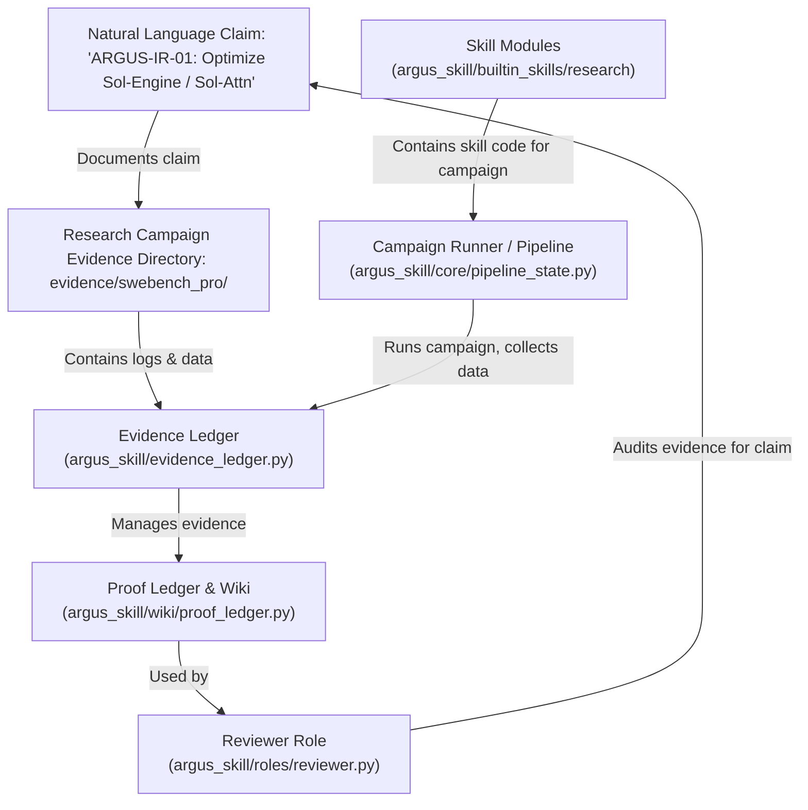
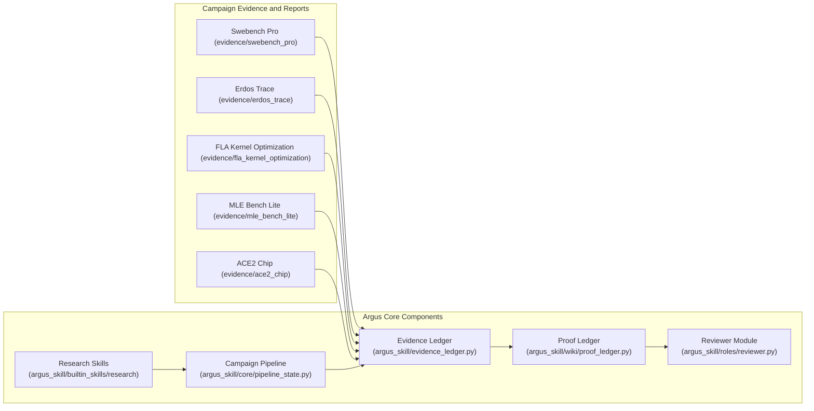

<!-- source: DeepWiki mcp.deepwiki.com · repo microsoft/ArgusAgent · page 9.2 Technical Report and Evidence · fetched 2026-10-26 -->

# Technical Report and Evidence

<details>
<summary>Relevant source files</summary>

The following files were used as context for generating this wiki page:

- [ARGUS_IMPRESSIVE_RESULTS.md](ARGUS_IMPRESSIVE_RESULTS.md)
- [ARGUS_IMPRESSIVE_RESULTS.zh-CN.md](ARGUS_IMPRESSIVE_RESULTS.zh-CN.md)

</details>


This section (9.2) of the Argus documentation delineates the structure and contents of the `technical_report/` directory, detailing the organization of technical report sections, figure assets, and evidence bundles collected per campaign. These comprehensive resources substantiate the claims and results presented in Argus's Impressive Results campaigns and provide verifiable, audit-ready data supporting Argus's research and engineering achievements.

---

## 1. Purpose and Scope

The `technical_report/` directory holds the artifacts that rigorously document Argus's work:

- **Technical report sections:** Written narratives that detail methodologies, experimental designs, and analysis.
- **Figures:** Graphical assets such as charts, diagrams, and plots that visually represent results or system architectures.
- **Per-campaign evidence directories:** Collections of raw data, logs, measurements, and artifacts tied to specific research and engineering campaigns.

Together, this repository of evidence upholds Argus's commitment to transparency, reproducibility, and independent verification of its claims. The campaigns represented include but are not limited to:

- `swebench_pro`
- `erdos_trace`
- `fla_kernel_optimization`
- `mle_bench_lite`
- `ace2_chip`

Each campaign directory is structured to map its collected evidence directly to the claims in the respective Argus Impressive Results reports.

---

## 2. Organization of Report and Evidence

### 2.1 Directory Layout

The `technical_report/` directory is organized as follows:

```plaintext
technical_report/
├── sections/
│   ├── 9.2_Technical_Report_and_Evidence.md
│   ├── ...
├── figures/
│   ├── figure_01_architecture_diagram.png
│   ├── figure_02_performance_plot.svg
│   ├── ...
└── evidence/
    ├── swebench_pro/
    │   ├── raw_logs/
    │   ├── analyzed_data/
    │   └── README.md
    ├── erdos_trace/
    ├── fla_kernel_optimization/
    ├── mle_bench_lite/
    └── ace2_chip/
```

- **sections/**: Markdown files documenting formal technical narratives for various components or campaigns.
- **figures/**: Visual assets referenced in reports, identified by figure numbers or descriptive filenames.
- **evidence/**: Contains subdirectories for each research campaign, storing campaign-specific raw and processed data accompanied by explanatory README files.

### 2.2 Mapping Evidence to Claims

Each campaign in the `evidence/` folder stores evidence bundles that correspond to claims made in the official Argus Impressive Results reports (e.g., `ARGUS-IR-01`, `ARGUS-IR-02`, etc.). The evidence serves as the technical foundation for claims regarding reproducible performance gains, algorithmic correctness, and engineering veracity.

- The **README.md** within each campaign directory outlines the scope, hardware/software configurations, and evidence contents.
- Raw logs provide the unaltered outputs of model runs, kernel benchmarks, or mathematical proofs.
- Analyzed data includes processed metrics like latency averages, memory utilization, or correctness validation per task.
- Figures within the campaign deliver graphical proof of results presented in respective technical report sections.

---

## 3. Data Flow and Key Classes

While the `technical_report/` area is largely a content repository rather than active code, it interfaces tightly with Argus's core runtime and evidence collection systems:

- **Evidence ledger subsystem** (`argus_skill/evidence_ledger.py`) manages recording and auditing of evidence tied to claims.
- Campaign pipelines ingest runtime measurements collected during campaign executions.
- The **proof ledger** system (`argus_skill/wiki/proof_ledger.py`) cross-links wiki findings to evidence artifacts, verifying claims with source-linked data.
- Reviewer roles reference this evidence when verifying claims in independent audits.

### Example process of evidence collection and integration:

1. **During campaign runs:**
   - Metrics gathering agents collect raw data (timings, memory usage, outputs).
   - Logs and outputs are saved in campaign-specific directories under `technical_report/evidence/`.

2. **Post-campaign analysis:**
   - Scripts parse raw data, generating summary statistics and plots (placed in `figures/`).
   - Formal technical report sections document methodology, results, and interpretations.

3. **Verification and mapping:**
   - Evidence bundles validate claims made in the Impressive Results document (`ARGUS_IMPRESSIVE_RESULTS.md`).
   - Reviewers inspect the evidence via documented workflows referencing these directories.

---

## 4. Mapping Natural Language Claims to Code Entities

Below is a conceptual mapping bridging natural language claims about campaigns to Argus code entities responsible for gathering and linking evidence:



**Explanation:**

- Natural language claim documents define the problem and expected claim.
- Corresponding research campaign directories store raw and processed evidence.
- The Evidence Ledger subsystem manages evidence indexing and auditing.
- The Proof Ledger cross-links evidence with wiki entries and findings.
- Campaign runners and skill modules execute experiments collecting this data.
- Reviewers consume the evidence when verifying claims.

---

## 5. Examples of Per-Campaign Evidence Integration

### 5.1 Swebench Pro Campaign

- Contains microbenchmark logs and performance profiling data.
- Provides foundational latency and throughput numbers for claims.
- Technical report sections analyze these baseline results in relation to optimizations.

### 5.2 Erdős Trace Campaign

- Stores proof artifacts outlining the mathematical verification or counterexamples related to Erdős problems.
- Evidence includes formal proof scripts and reviewer annotations.
- Maps to claims in ARGUS-IR-06 (Erdős problem proof campaign).

---

## 6. Illustrating Evidence Mapping in Code Terms

This diagram associates specific campaigns and resulting evidential assets in natural language to corresponding Argus codebase elements that process or utilize them.



---

## 7. Integration with Argus Impressive Results and Claim Verification

The evidence directories directly correspond to campaigns listed in the `ARGUS_IMPRESSIVE_RESULTS.md` document, whose structure and admission bar are rigorously defined. For instance:

- **ARGUS-IR-01 (Sol-Engine / Sol-Attn Optimization):**
  - Evidence artifacts include runtime logs, kernel latency breakdowns, and output correctness checks.
  - Linked to campaign directory `evidence/swebench_pro/`.
  - Technical report sections describe the methodology and results in detail.
  
- **ARGUS-IR-06 (Erdős Problem Proof):**
  - Evidence entails proof scripts, formal verifier outputs, and reviewer verification notes.
  - Stored under `evidence/erdos_trace/`.

The reports and evidence bundles are essential for meeting the admission criteria such as reproducibility, independent inspection, and auditability stipulating that results must be verifiable by reviewing the raw data and analytical conclusions.

---

## 8. Summary

The `technical_report/` directory is a critical hub within the Argus repository that:

- Houses carefully curated technical documentation and visualizations.
- Stores complete evidence traceability structured per campaign.
- Enables independent verification through audit-ready materials.
- Maps rigorously to the claims made in official result documents.

Together, this system preserves Argus's engineering and research integrity, supporting the "persistent, reviewed autonomy" principle foundational to the project.

---

# Mermaid Diagrams Summary

### Diagram 1: Natural Language Claim to Code Entity Mapping


### Diagram 2: Campaign Evidence to Argus Core Components Mapping


---

# References and Sources

- `technical_report/` directory structure as documented in the repo.
- Argus Impressive Results specification: `ARGUS_IMPRESSIVE_RESULTS.md:1-192`()
- Evidence ledger implementation and interfaces: `argus_skill/evidence_ledger.py` (general range)
- Proof ledger and wiki integration: `argus_skill/wiki/proof_ledger.py` (general range)
- Campaign runtime and pipeline control: `argus_skill/core/pipeline_state.py` (general range)
- Reviewer role and audit usage: `argus_skill/roles/reviewer.py` (general range)
- Research skill implementations: `argus_skill/builtin_skills/research/` (general range)

Sources: ARGUS_IMPRESSIVE_RESULTS.md, argus_skill/evidence_ledger.py, argus_skill/wiki/proof_ledger.py, argus_skill/core/pipeline_state.py, argus_skill/roles/reviewer.py, argus_skill/builtin_skills/research/

---

