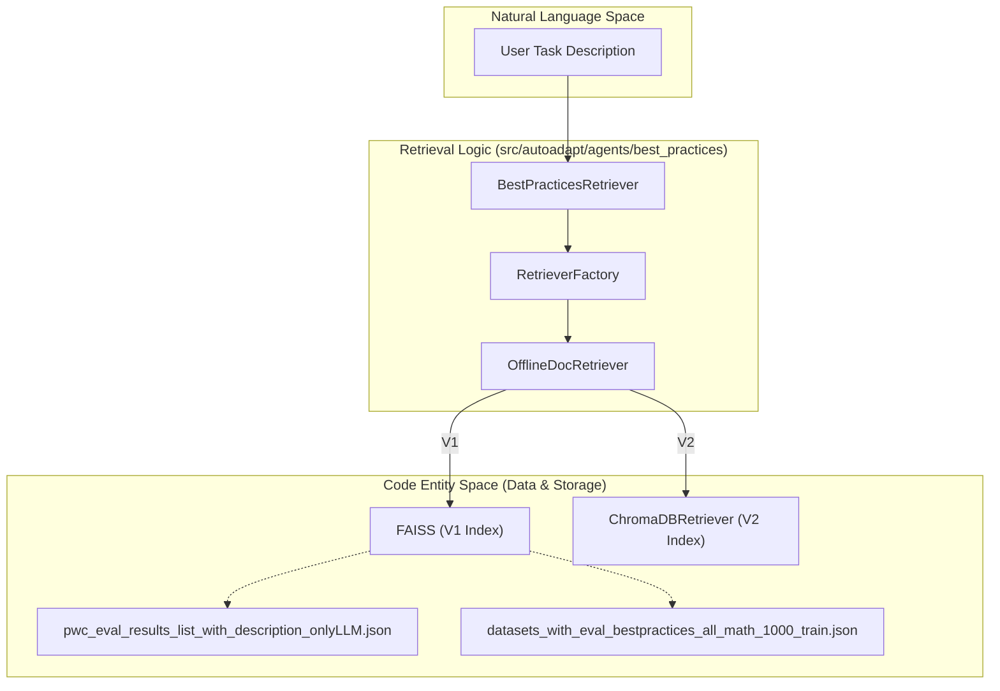
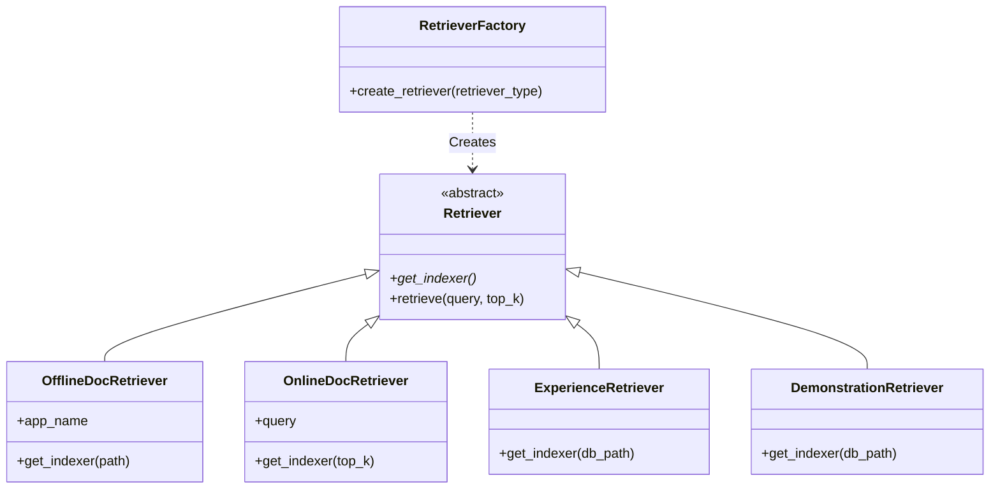

<!-- source: DeepWiki mcp.deepwiki.com · repo microsoft/AutoAdapt · page 4.3 Best Practices Knowledge Base and Retrieval · fetched 2026-10-26 -->

# Best Practices Knowledge Base and Retrieval

Relevant source files

The following files were used as context for generating this wiki page:

- [src/autoadapt/agents/best_practices/best_practice_retriever.py](src/autoadapt/agents/best_practices/best_practice_retriever.py)
- [src/autoadapt/agents/best_practices/chromadb_retriever.py](src/autoadapt/agents/best_practices/chromadb_retriever.py)
- [src/autoadapt/agents/best_practices/create_datasets_indexer.py](src/autoadapt/agents/best_practices/create_datasets_indexer.py)
- [src/autoadapt/agents/best_practices/create_datasets_indexer_v2.py](src/autoadapt/agents/best_practices/create_datasets_indexer_v2.py)
- [src/autoadapt/agents/best_practices/datasets_indexer.py](src/autoadapt/agents/best_practices/datasets_indexer.py)
- [src/autoadapt/agents/best_practices/datasets_retriever.py](src/autoadapt/agents/best_practices/datasets_retriever.py)
- [src/autoadapt/agents/best_practices/datasets_retriever_v2.py](src/autoadapt/agents/best_practices/datasets_retriever_v2.py)
- [src/autoadapt/agents/best_practices/openai_embeddings.py](src/autoadapt/agents/best_practices/openai_embeddings.py)
- [src/autoadapt/template/rag/main.py](src/autoadapt/template/rag/main.py)
- [src/autoadapt/template/rag/utils.py](src/autoadapt/template/rag/utils.py)

This page details the architecture and implementation of the indexing and retrieval systems used by AutoAdapt to provide empirical "best practices" during the planning phase. The system leverages a dual-version approach for vector storage and embedding generation to support various data sources including Papers with Code (PwC), HuggingFace (HF), and GitHub.

## Overview and Data Flow

The retrieval system serves the `BestPracticeAgent` by finding relevant model cards, dataset descriptions, and evaluation results that match the user's requirements. It bridges the gap between natural language requirements and proven technical configurations.

### System Data Flow
1.  **Parsing**: Raw JSON data from `app/data/` is parsed and converted into `Document` objects [src/autoadapt/agents/best_practices/create_datasets_indexer.py:34-52]().
2.  **Indexing**: Documents are embedded and stored in either FAISS (V1) or ChromaDB (V2) [src/autoadapt/agents/best_practices/datasets_indexer.py:115-127](), [src/autoadapt/agents/best_practices/chromadb_retriever.py:96-100]().
3.  **Retrieval**: The `BestPracticesRetriever` coordinates multiple sub-retrievers to query these databases based on a user task [src/autoadapt/agents/best_practices/best_practice_retriever.py:44-54]().
4.  **Ranking**: Results are aggregated and ranked using metrics like accuracy or fuzzy string matching (Levenshtein) [src/autoadapt/agents/best_practices/best_practice_retriever.py:56-93]().

### Retrieval Architecture: Code to Entity Mapping

The following diagram illustrates how the abstract retrieval logic maps to specific implementation classes and data files.

**Retrieval Entity Mapping**

Sources: [src/autoadapt/agents/best_practices/best_practice_retriever.py:26-55](), [src/autoadapt/agents/best_practices/datasets_retriever.py:51-72](), [src/autoadapt/agents/best_practices/datasets_retriever_v2.py:51-66]().

---

## Indexing Systems (V1 vs V2)

AutoAdapt maintains two indexing implementations to support different deployment environments and performance requirements.

### V1: FAISS + HuggingFace Embeddings
The V1 system uses `FAISS` for local vector storage and `e5-large-v2` embeddings. It is primarily used for the initial setup of offline knowledge bases.

*   **Embedding Model**: `intfloat/e5-large-v2` via `langchain_huggingface` [src/autoadapt/agents/best_practices/datasets_indexer.py:64-75]().
*   **Storage**: Local FAISS index files (`.faiss`, `.pkl`) [src/autoadapt/agents/best_practices/datasets_indexer.py:127-128]().
*   **Key Function**: `create_indexer_from_documents` handles document creation and incremental merging [src/autoadapt/agents/best_practices/datasets_indexer.py:151-220]().

### V2: ChromaDB + OpenAI Embeddings
The V2 system provides a more robust, persistent storage solution using `ChromaDB` and supports Azure OpenAI embeddings.

*   **Embedding Model**: `BaseEmbeddingModel` wrapping Azure OpenAI [src/autoadapt/agents/best_practices/openai_embeddings.py:40-76]().
*   **Storage**: `chromadb.PersistentClient` [src/autoadapt/agents/best_practices/chromadb_retriever.py:38]().
*   **Features**: Includes a persistent embedding cache (`embedding_cache.json`) to minimize API costs by hashing text content before requesting new embeddings [src/autoadapt/agents/best_practices/chromadb_retriever.py:41-78]().

**Indexing Implementation Comparison**

| Feature | V1 (datasets_indexer.py) | V2 (chromadb_retriever.py) |
| :--- | :--- | :--- |
| **Vector DB** | FAISS [src/autoadapt/agents/best_practices/datasets_indexer.py:7]() | ChromaDB [src/autoadapt/agents/best_practices/chromadb_retriever.py:8]() |
| **Embeddings** | HuggingFace (e5-large-v2) [src/autoadapt/agents/best_practices/datasets_indexer.py:66]() | OpenAI / Azure OpenAI [src/autoadapt/agents/best_practices/openai_embeddings.py:14]() |
| **Caching** | `lru_cache` (Memory) [src/autoadapt/agents/best_practices/datasets_indexer.py:63]() | JSON File (Persistent) [src/autoadapt/agents/best_practices/chromadb_retriever.py:41]() |
| **Format Support** | JSON [src/autoadapt/agents/best_practices/datasets_indexer.py:110]() | JSON [src/autoadapt/agents/best_practices/create_datasets_indexer_v2.py:81]() |

Sources: [src/autoadapt/agents/best_practices/datasets_indexer.py:1-150](), [src/autoadapt/agents/best_practices/chromadb_retriever.py:1-128](), [src/autoadapt/agents/best_practices/openai_embeddings.py:1-76]().

---

## BestPracticesRetriever

The `BestPracticesRetriever` class is the high-level interface used by the `BestPracticeAgent`. It initializes multiple specialized retrievers for different data sources upon instantiation [src/autoadapt/agents/best_practices/best_practice_retriever.py:28-55]().

### Data Source Parsing
The system categorizes data based on the `datasetsource` parameter to extract the correct content for indexing:
*   **pwc**: Uses the `description` field [src/autoadapt/agents/best_practices/create_datasets_indexer.py:38-39]().
*   **hf**: Uses the `task_description` field [src/autoadapt/agents/best_practices/create_datasets_indexer.py:40-41]().
*   **github**: Uses `model_card_description` [src/autoadapt/agents/best_practices/create_datasets_indexer.py:42-45]().
*   **github_data**: Uses `task_description` and filters for `dataset_best_practices` [src/autoadapt/agents/best_practices/create_datasets_indexer.py:46-51]().

### Ranking and Aggregation
The retriever does not just return raw documents; it ranks methodologies based on aggregated metrics:
1.  **Metric Extraction**: It collects all available metrics (e.g., accuracy) for retrieved results [src/autoadapt/agents/best_practices/best_practice_retriever.py:65-71]().
2.  **Ordinal Ranking**: It calculates the rank of each model/methodology for every metric [src/autoadapt/agents/best_practices/best_practice_retriever.py:79-91]().
3.  **Mean Aggregate Rank**: It computes a final `aggregate_rank` by averaging ranks across all metrics and similar datasets [src/autoadapt/agents/best_practices/best_practice_retriever.py:92-133]().

Sources: [src/autoadapt/agents/best_practices/best_practice_retriever.py:56-144](), [src/autoadapt/agents/best_practices/create_datasets_indexer.py:34-54]().

---

## RetrieverFactory Pattern

The `RetrieverFactory` allows the system to dynamically instantiate different retrieval strategies (Offline, Online, Experience, Demonstration) based on the configuration.

**Retriever Class Hierarchy**

### Key Components
*   **OfflineDocRetriever**: Loads pre-built FAISS or ChromaDB indices from disk [src/autoadapt/agents/best_practices/datasets_retriever.py:111-160]().
*   **OnlineDocRetriever**: Performs real-time web searches (e.g., via Bing) and builds a temporary index for the results [src/autoadapt/agents/best_practices/datasets_retriever.py:190-223]().
*   **Retriever.retrieve()**: Standardized method that performs a `similarity_search` against the underlying indexer [src/autoadapt/agents/best_practices/datasets_retriever.py:97-108]().

Sources: [src/autoadapt/agents/best_practices/datasets_retriever.py:51-223](), [src/autoadapt/agents/best_practices/datasets_retriever_v2.py:51-102]().

---

