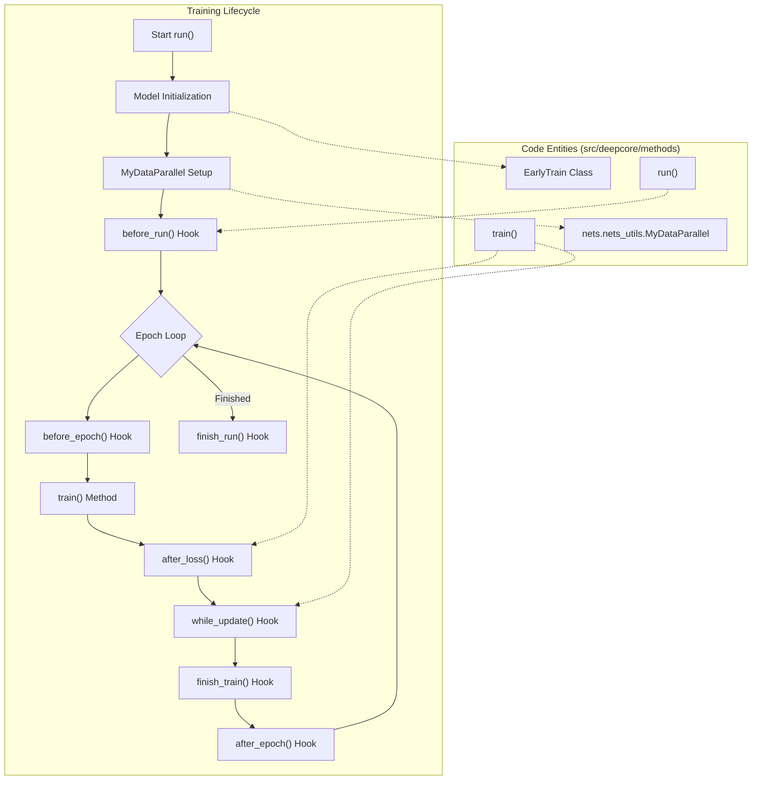
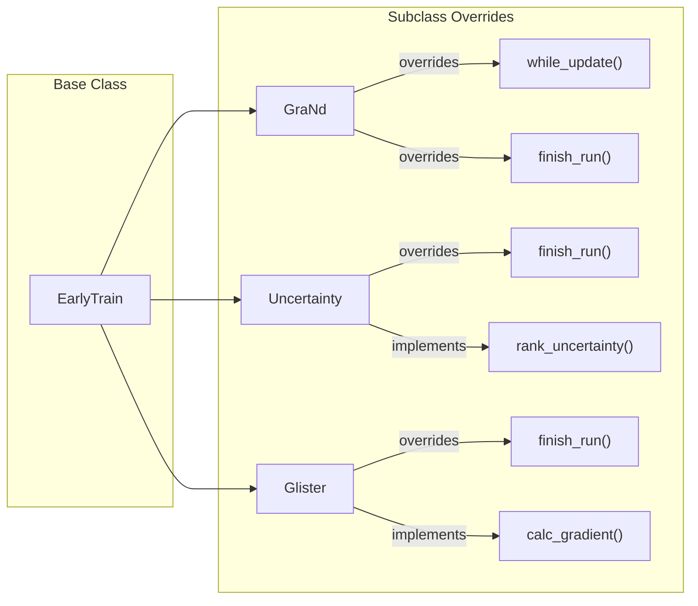

<!-- source: DeepWiki mcp.deepwiki.com · repo microsoft/AutoAdapt · page 7.1 EarlyTrain Base Class and Training Lifecycle Hooks · fetched 2026-10-26 -->

# EarlyTrain Base Class and Training Lifecycle Hooks

Relevant source files

The following files were used as context for generating this wiki page:

- [src/deepcore/methods/coresetmethod.py](src/deepcore/methods/coresetmethod.py)
- [src/deepcore/methods/earlytrain.py](src/deepcore/methods/earlytrain.py)
- [src/deepcore/methods/full.py](src/deepcore/methods/full.py)
- [src/deepcore/methods/glister.py](src/deepcore/methods/glister.py)
- [src/deepcore/methods/grand.py](src/deepcore/methods/grand.py)
- [src/deepcore/methods/methods_utils/cossim.py](src/deepcore/methods/methods_utils/cossim.py)
- [src/deepcore/methods/methods_utils/euclidean.py](src/deepcore/methods/methods_utils/euclidean.py)
- [src/deepcore/methods/uncertainty.py](src/deepcore/methods/uncertainty.py)
- [src/deepcore/methods/uniform.py](src/deepcore/methods/uniform.py)

The `EarlyTrain` class serves as the fundamental base for coreset selection methods within the `deepcore` library that require a preliminary training phase (proxy training) to calculate importance scores. It establishes a standardized training loop and provides lifecycle hooks that subclasses use to implement specific data selection logic, such as gradient matching or uncertainty estimation.

## EarlyTrain Initialization

The `EarlyTrain` class inherits from `CoresetMethod` and initializes the parameters necessary for both the training process and the subsequent coreset selection.

### Key Initialization Parameters
| Parameter | Description |
| :--- | :--- |
| `fraction` | The target size of the coreset as a percentage of the original dataset [src/deepcore/methods/earlytrain.py:15-21](). |
| `epochs` | Number of epochs for the proxy training phase [src/deepcore/methods/earlytrain.py:19](). |
| `specific_model` | Optional string to specify a model architecture different from the default in `args` [src/deepcore/methods/earlytrain.py:22](). |
| `dst_pretrain_dict` | A dictionary containing a separate dataset for pre-training if different from the target training set [src/deepcore/methods/earlytrain.py:28-43](). |
| `torchvision_pretrain` | Boolean indicating if a torchvision-provided model (requiring 224x224 input) should be used [src/deepcore/methods/earlytrain.py:45-54](). |

**Sources:** [src/deepcore/methods/earlytrain.py:10-60](), [src/deepcore/methods/coresetmethod.py:1-13]()

## Training Lifecycle Hooks

`EarlyTrain` defines a set of empty or default methods that act as hooks throughout the training loop. Subclasses override these to capture gradients, embeddings, or loss values at specific points in time.

### Hook Execution Flow
The `run()` method orchestrates the setup, while the `train()` method executes the per-epoch logic.

1.  **`before_run()`**: Called once before the entire training loop starts [src/deepcore/methods/earlytrain.py:134]().
2.  **`before_epoch()`**: Called at the beginning of each epoch [src/deepcore/methods/earlytrain.py:139]().
3.  **`before_train()`**: Called at the start of the `train()` method for each epoch [src/deepcore/methods/earlytrain.py:64]().
4.  **`after_loss()`**: Triggered immediately after the loss calculation but before backward propagation [src/deepcore/methods/earlytrain.py:85]().
5.  **`while_update()`**: Executed during the optimization step, often used for logging or tracking batch-level statistics [src/deepcore/methods/earlytrain.py:90]().
6.  **`after_epoch()`**: Called after all batches in an epoch are processed [src/deepcore/methods/earlytrain.py:141]().
7.  **`finish_train()`**: Returns epoch-level results [src/deepcore/methods/earlytrain.py:94]().
8.  **`finish_run()`**: Called after all epochs are completed; usually where final selection scores are computed [src/deepcore/methods/earlytrain.py:143]().

**Sources:** [src/deepcore/methods/earlytrain.py:61-94](), [src/deepcore/methods/earlytrain.py:96-144]()

## GPU Setup and MyDataParallel

`EarlyTrain` manages hardware acceleration using the `MyDataParallel` wrapper. This ensures that models are correctly distributed across available GPUs while maintaining compatibility with custom methods that need to access model internals (like embeddings).

### GPU Logic in `run()`
The class checks the `args.device` and `args.gpu` configurations:
- If `args.gpu` is provided as a list, it sets the primary device and wraps the model in `MyDataParallel(self.model, device_ids=self.args.gpu)` [src/deepcore/methods/earlytrain.py:109-111]().
- If multiple GPUs are detected without specific IDs, it defaults to standard `MyDataParallel` [src/deepcore/methods/earlytrain.py:112-113]().

**Sources:** [src/deepcore/methods/earlytrain.py:107-114]()

## System Architecture: Training to Code Entities

The following diagram maps the logical training loop phases to the specific code entities and methods within the `EarlyTrain` hierarchy.

**Sources:** [src/deepcore/methods/earlytrain.py:61-144](), [src/deepcore/methods/earlytrain.py:109-113]()

## Subclass Implementation Examples

Subclasses utilize the hooks provided by `EarlyTrain` to implement diverse selection strategies.

### GraNd (Gradient Norm)
`GraNd` overrides `while_update` for logging and `finish_run` to calculate the Euclidean norm of the gradients for each sample. It repeats the `run()` loop multiple times to average the norms [src/deepcore/methods/grand.py:19-51]().

### Uncertainty
The `Uncertainty` class overrides `finish_run` to invoke `rank_uncertainty()`. This method switches the model to `eval()` mode and calculates scores based on "LeastConfidence", "Entropy", or "Margin" strategies [src/deepcore/methods/uncertainty.py:44-85]().

### Glister
`Glister` uses the `finish_run` hook to perform submodular optimization. It calculates gradients for both training and validation sets via `calc_gradient()` and uses a greedy optimizer to select samples that maximize the Taylor approximation of the validation loss reduction [src/deepcore/methods/glister.py:23-79](), [src/deepcore/methods/glister.py:108-144]().

## Entity Mapping: Method Overrides

This diagram shows how different coreset methods inherit from `EarlyTrain` and which specific hooks they utilize to implement their logic.

**Sources:** [src/deepcore/methods/grand.py:7-15](), [src/deepcore/methods/uncertainty.py:6-19](), [src/deepcore/methods/glister.py:8-22]()

---

