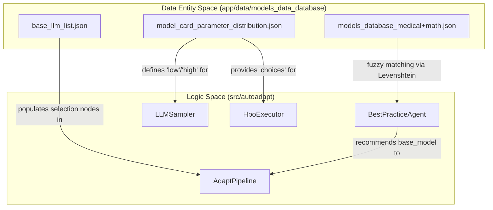
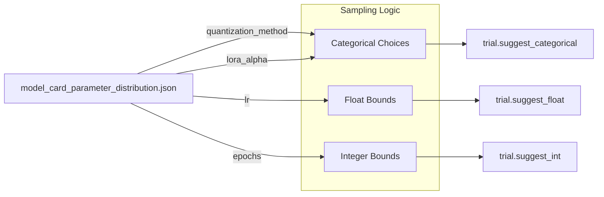

<!-- source: DeepWiki mcp.deepwiki.com · repo microsoft/AutoAdapt · page 9.1 Model Registry and Model Cards · fetched 2026-10-26 -->

# Model Registry and Model Cards

Relevant source files

The following files were used as context for generating this wiki page:

- [app/data/models_data_database/base_llm_list.json](app/data/models_data_database/base_llm_list.json)
- [app/data/models_data_database/base_llm_list_azure.json](app/data/models_data_database/base_llm_list_azure.json)
- [app/data/models_data_database/github_models_card_base_llms_family_general_domain.json](app/data/models_data_database/github_models_card_base_llms_family_general_domain.json)
- [app/data/models_data_database/model_card_parameter_distribution.json](app/data/models_data_database/model_card_parameter_distribution.json)
- [app/data/models_data_database/models_database_math_medical_github.json](app/data/models_data_database/models_database_math_medical_github.json)
- [app/data/models_data_database/models_database_medical+math.json](app/data/models_data_database/models_database_medical+math.json)

The Model Registry serves as the foundational knowledge base for AutoAdapt's planning and optimization phases. It provides a structured repository of historical fine-tuning configurations, model capabilities, and domain-specific benchmarks. This data is primarily consumed by the `BestPracticeAgent` and the `MultiAgentDebatePlanner` to initialize adaptation strategies and define hyperparameter search spaces.

## Model Card Schema

AutoAdapt uses a standardized JSON schema to represent "Model Cards," which encapsulate the technical specifications and training provenance of a model. These cards allow the system to perform fuzzy matching and statistical analysis across different adaptation projects.

### Key Schema Fields

| Field | Type | Description |
| :--- | :--- | :--- |
| `base_model` | String | The Hugging Face or Azure model identifier (e.g., `google/gemma-2b`). |
| `training_technique` | List/String | The method used for adaptation (e.g., `sft`, `dpo`, `rag`). |
| `peft` | Integer (0/1) | Boolean flag indicating if Parameter-Efficient Fine-Tuning was used. |
| `quantization_method` | String | Method used for weight reduction (e.g., `int4`, `nf4`, `int8`). |
| `lora_r` / `alpha` / `dropout` | Numeric | Specific LoRA hyperparameters if `peft` is enabled. |
| `target_modules` | List | Specific transformer layers targeted for adaptation (e.g., `q_proj`, `v_proj`). |
| `library` | List | Software dependencies used (e.g., `unsloth`, `peft`, `bitsandbytes`). |
| `evaluation` | Object | Dictionary of benchmark scores (e.g., `{"gsm8k": 0.85}`). |

**Sources:** [app/data/models_data_database/models_database_medical+math.json:2-35](), [app/data/models_data_database/models_database_math_medical_github.json:2-59]()

---

## Domain-Specific Model Databases

The registry is partitioned into several JSON databases to facilitate domain-targeted retrieval. These databases contain thousands of entries derived from Hugging Face Model Cards, GitHub repositories, and academic papers.

### Database Categories
1.  **General Domain:** [app/data/models_data_database/github_models_card_base_llms_family_general_domain.json]() contains a broad spectrum of models for general reasoning, text generation, and common NLP tasks.
2.  **Medical & Math:** [app/data/models_data_database/models_database_medical+math.json]() focuses on high-precision domains, containing specific configurations for models like `DeepSeek-R1-Distill-Qwen-1.5B` fine-tuned on reasoning datasets like `Magpie-Reasoning-V2`.
3.  **GitHub-Augmented:** [app/data/models_data_database/models_database_math_medical_github.json]() includes metadata scraped from GitHub, providing `url` pointers and `model_card_description` fields for context-aware planning.

**Sources:** [app/data/models_data_database/github_models_card_base_llms_family_general_domain.json:147-195](), [app/data/models_data_database/models_database_math_medical_github.json:119-164]()

---

## Model Selection Lists

AutoAdapt maintains explicit lists of supported base models to populate the UI and validate configuration files. These are split by provider to handle different authentication and deployment workflows.

### base_llm_list.json
This file contains a comprehensive list of models compatible with the Hugging Face `transformers` and `unsloth` backends. It includes a wide range of sizes, from `facebook/opt-125m` to `deepseek-ai/DeepSeek-V3`.
**Sources:** [app/data/models_data_database/base_llm_list.json:1-1]()

### base_llm_list_azure.json
Specifically for Azure OpenAI / AI Foundry deployments, this list includes models like `microsoft/Phi-4`, `meta-llama/Llama-3.1-8B-Instruct`, and `mistralai/Mistral-Large-Instruct`.
**Sources:** [app/data/models_data_database/base_llm_list_azure.json:1-1]()

---

## Parameter Distribution and Search Spaces

The file `model_card_parameter_distribution.json` acts as a statistical summary of the entire registry. It defines the "legal" ranges and common categorical choices for hyperparameters, which the `LLMSampler` and `HpoExecutor` use to bound their search.

### Data Entity Space to Logic Space Mapping

The following diagram illustrates how the JSON metadata in the Model Registry informs the execution logic within the `autoadapt` core.

"Model Registry to Execution Mapping"

**Sources:** [app/data/models_data_database/model_card_parameter_distribution.json:1-5]()

---

## Implementation Detail: Parameter Distribution

The `model_card_parameter_distribution.json` file categorizes parameters into three types to support different Optuna sampling methods:
*   **Categorical:** Fixed sets of options (e.g., `optimizer`, `target_modules`, `lora_r`).
*   **Float:** Continuous ranges (e.g., `lr` from `1e-06` to `0.001`, `weight_decay`).
*   **Int:** Discrete ranges (e.g., `epochs` from `0` to `90`).

"Parameter Type Flow"

**Sources:** [app/data/models_data_database/model_card_parameter_distribution.json:1-20]()

### Target Modules Distribution
The registry tracks common target modules across different model architectures (Llama, Mistral, Qwen, etc.), ensuring that the `target_modules` list provided to PEFT is comprehensive:
*   `q_proj`, `k_proj`, `v_proj`, `o_proj` (Standard Attention)
*   `gate_proj`, `up_proj`, `down_proj` (MLP layers)
*   `dense_h_to_4h`, `dense_4h_to_h` (Architecture specific)

**Sources:** [app/data/models_data_database/model_card_parameter_distribution.json:7-7]()

---

