# Page: AutoAdapt Overview

# AutoAdapt Overview

<details>
<summary>Relevant source files</summary>

The following files were used as context for generating this wiki page:

- [CODE_OF_CONDUCT.md](CODE_OF_CONDUCT.md)
- [CONTRIBUTING.md](CONTRIBUTING.md)
- [README.md](README.md)
- [SECURITY.md](SECURITY.md)
- [SUPPORT.md](SUPPORT.md)
- [pyproject.toml](pyproject.toml)
- [src/autoadapt/__init__.py](src/autoadapt/__init__.py)
- [src/autoadapt/adapt/__init__.py](src/autoadapt/adapt/__init__.py)

</details>


AutoAdapt is an automated end-to-end framework designed for the efficient domain adaptation of Large Language Models (LLMs). It addresses the complexities of manual trial-and-error in LLM fine-tuning by leveraging a multi-agent planning system, curated knowledge bases, and a novel LLM-based hyperparameter optimization (HPO) surrogate called **AutoRefine**.

The system streamlines the transition from general-purpose LLMs to specialized domain experts by automating dataset analysis, strategy selection (SFT, DPO, or RAG), and hyperparameter search under resource constraints.

## Core Value Proposition

*   **Reduced Expert Intervention**: Uses a multi-agent debate system to align user intent with data signals and empirical best practices [README.md:7-7]().
*   **Efficient Optimization**: Replaces costly black-box searches with **AutoRefine**, an LLM-based surrogate that significantly reduces optimization overhead [README.md:7-7]().
*   **Knowledge-Driven Planning**: Integrates curated knowledge bases from literature and open-source resources to inform adaptation strategies [README.md:7-7]().
*   **Data-Centric Pruning**: Incorporates the `deepcore` library for coreset selection, enabling faster HPO trials by training on representative data subsets [README.md:154-154]().

## Key Architectural Pillars

AutoAdapt is built upon four primary functional pillars that govern the lifecycle of an adaptation project.

### 1. Multi-Agent Planning
Before execution, a group of specialized agents (Research, Data, Best Practice, and User Preference) perform a multi-round debate. This process traverses the **Adaptation Configuration Graph (ACG)** to select the most suitable model, method, and hyperparameter bounds.
*   For details, see [Repository Structure and Key Concepts](#1.2).

### 2. AutoRefine (LLM-based HPO)
Instead of standard Bayesian optimization, AutoAdapt uses LLMs as samplers and surrogates within an Optuna-based framework. This allows the system to "reason" about hyperparameter trends based on previous trial results.
*   For details, see [Repository Structure and Key Concepts](#1.2).

### 3. Execution Engine
The `AutoAdaptExecutor` orchestrates the transition from planning to HPO and finally to full-scale training. It manages the environment, handles error recovery via LLM-driven parameter adjustments, and ensures user approval gates are respected [src/autoadapt/adapt/autoadapt_executor.py:1-20]().

### 4. Specialized Templates
AutoAdapt provides standardized execution templates for:
*   **Supervised Fine-Tuning (SFT)**: For instruction following and knowledge injection.
*   **Direct Preference Optimization (DPO)**: For aligning models with human feedback.
*   **Retrieval-Augmented Generation (RAG)**: For grounding models in external dynamic knowledge.

## High-Level System Flow

The following diagram illustrates how the natural language requirements are transformed into executable code entities through the orchestration of the `AutoAdaptExecutor`.

### Adaptation Lifecycle Diagram
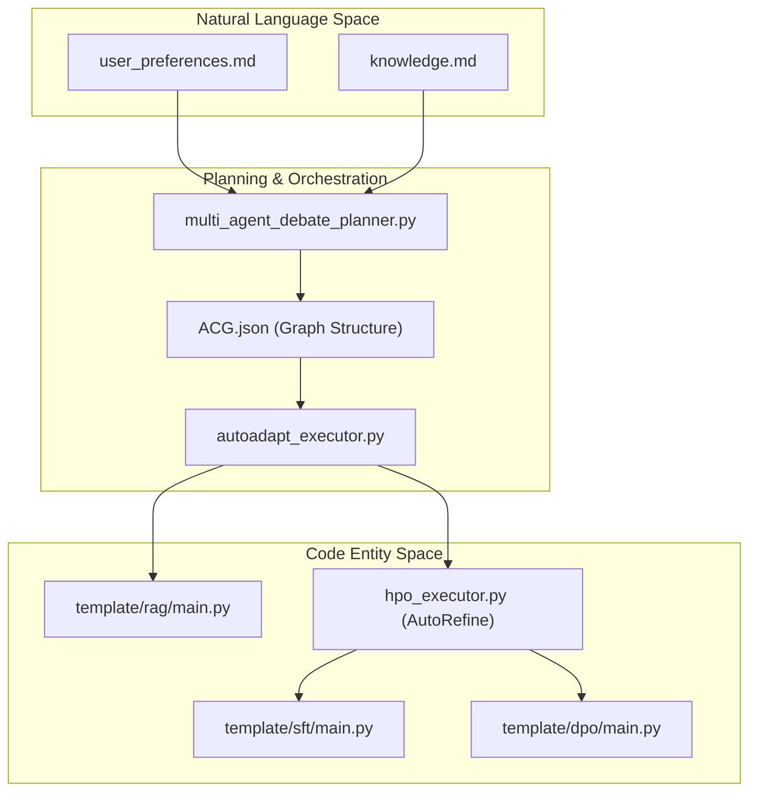
**Sources:** [README.md:116-155](), [src/autoadapt/adapt/autoadapt_executor.py:1-20]()

## Navigating the Wiki

This wiki is structured to guide both users and developers through the system:

*   **Setup**: To install the framework and run your first adaptation, see [Getting Started](#1.1).
*   **Architecture**: To understand the file layout and core classes like `AdaptPipeline`, see [Repository Structure and Key Concepts](#1.2).
*   **Advanced Topics**: Subsequent sections cover the Multi-Agent system, the AutoRefine HPO samplers, and the `deepcore` coreset selection logic.

### Entry Points Mapping
AutoAdapt provides multiple interfaces to interact with the core logic, bridging user inputs to the underlying `autoadapt` package.

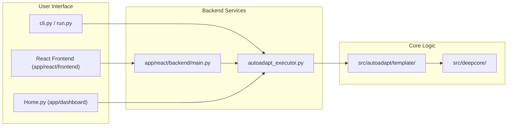
**Sources:** [README.md:24-93](), [pyproject.toml:15-16](), [README.md:115-160]()

## Next Steps
*   Prepare your environment: [Getting Started](#1.1)
*   Explore the codebase layout: [Repository Structure and Key Concepts](#1.2)

---

# Page: Getting Started

# Getting Started

<details>
<summary>Relevant source files</summary>

The following files were used as context for generating this wiki page:

- [MANIFEST.in](MANIFEST.in)
- [app/react/backend/requirements.txt](app/react/backend/requirements.txt)
- [app/react/setup.sh](app/react/setup.sh)
- [app/react/start.sh](app/react/start.sh)
- [pyproject.toml](pyproject.toml)
- [requirements.txt](requirements.txt)
- [src/autoadapt/__init__.py](src/autoadapt/__init__.py)
- [src/autoadapt/adapt/__init__.py](src/autoadapt/adapt/__init__.py)

</details>


This guide provides a step-by-step walkthrough for installing AutoAdapt, configuring the necessary environment variables, and launching the system via its various entry points (CLI, Streamlit, or React UI).

## Installation

AutoAdapt is designed to run in a Python 3.11.4+ environment [pyproject.toml:10-10](). It utilizes a dynamic dependency management system where core requirements are listed in `requirements.txt` and linked via `pyproject.toml` [pyproject.toml:18-19]().

### 1. Environment Setup
It is recommended to use a Conda environment named `autoadapt` as the provided setup scripts specifically look for this name [app/react/setup.sh:25-25]().

```bash
conda create -n autoadapt python=3.11.4
conda activate autoadapt
```

### 2. Install Dependencies
Install the core framework and its dependencies using `pip`:

```bash
pip install -r requirements.txt
pip install -e .
```

The system relies on several high-profile libraries for its core operations [requirements.txt:1-47]():
*   **Orchestration:** `hydra-core`, `pydantic`.
*   **ML/LLM:** `transformers`, `trl`, `peft`, `bitsandbytes`, `vllm`.
*   **Optimization:** `optuna`, `gpytorch`, `cmaes`.
*   **Coreset Selection:** `deepcore`.
*   **RAG/Search:** `chromadb`, `dspy`, `serpapi`, `faiss-cpu`.

Sources: [pyproject.toml:1-19](), [requirements.txt:1-47](), [app/react/setup.sh:23-25]()

---

## Environment Variables

AutoAdapt requires several API keys to facilitate multi-agent planning, web search, and model downloading. These should be set in your shell or a `.env` file.

| Variable | Purpose |
| :--- | :--- |
| `HF_ACCESS_TOKEN` | Required for downloading gated models and datasets from Hugging Face. |
| `API_KEY` | The primary LLM provider key (OpenAI or Azure OpenAI) used by the `ChatCompletionModel`. |
| `SERPAPI_KEY` | Required by the `KnowledgeRetrieverAgent` for live web search via Google/Bing. |

Sources: [requirements.txt:42-43]()

---

## Entry Points

AutoAdapt offers three distinct ways to interact with the framework: the Command Line Interface (CLI), a Streamlit dashboard, and a modern React-based Web UI.

### 1. CLI (autoadapt)
The package registers a console script named `autoadapt` [pyproject.toml:15-16](). This is the primary entry point for headless execution and server management.

```bash
# General help
autoadapt --help

# Launch the Streamlit dashboard
autoadapt dashboard
```

### 2. React Web UI
The React UI provides the most comprehensive visualization of the multi-agent planning process and AutoRefine HPO trials.

#### Automated Setup
The `app/react/setup.sh` script automates the installation of both the FastAPI backend and the Vite-based frontend [app/react/setup.sh:1-60]().

1.  **Backend Setup:** Activates the `autoadapt` conda environment and installs specialized backend requirements like `fastapi` and `uvicorn` [app/react/setup.sh:21-41](), [app/react/backend/requirements.txt:1-8]().
2.  **Frontend Setup:** Runs `npm install` in the frontend directory [app/react/setup.sh:47-57]().
3.  **Start Script:** Generates a `start.sh` file to orchestrate both processes [app/react/setup.sh:61-128]().

#### Running the UI
Execute the generated start script:
```bash
./app/react/start.sh
```
*   **Backend:** http://localhost:5000 (FastAPI) [app/react/start.sh:35-35]()
*   **Frontend:** http://localhost:5173 (Vite/React) [app/react/start.sh:45-45]()

### 3. Streamlit Dashboard
For a lightweight alternative to the React UI, the Streamlit dashboard can be used to monitor project status and launch new instances [requirements.txt:31-31]().

Sources: [pyproject.toml:15-16](), [app/react/setup.sh:1-142](), [app/react/start.sh:1-62](), [app/react/backend/requirements.txt:1-8]()

---

## System Architecture Overview

The following diagram illustrates the data flow from the initial setup and configuration through the different entry points into the core execution engine.

### Data Flow: Entry Points to Core
"This diagram maps the user-facing scripts to the internal execution logic."

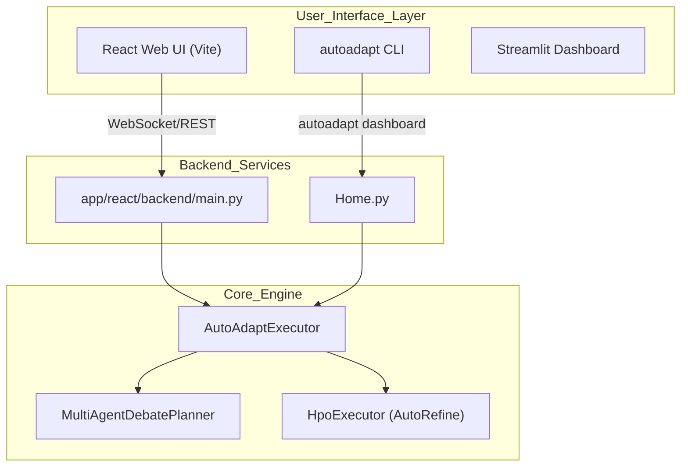

Sources: [pyproject.toml:15-16](), [app/react/setup.sh:63-125](), [app/react/backend/requirements.txt:1-2]()

### Environment Initialization
"This diagram describes the setup sequence performed by the installation scripts."

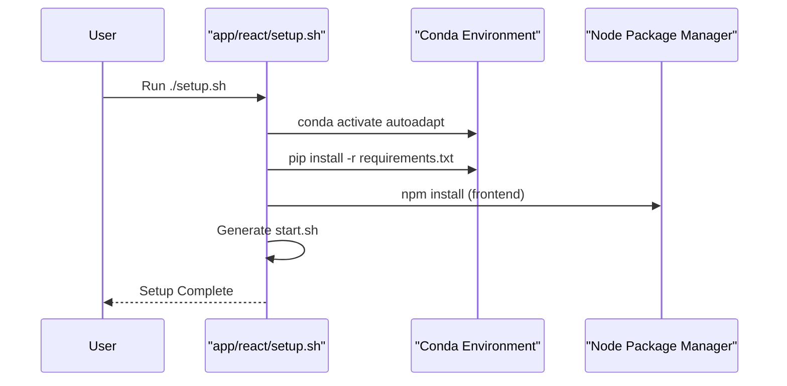

Sources: [app/react/setup.sh:19-60](), [app/react/setup.sh:61-128]()

---

# Page: Repository Structure and Key Concepts

# Repository Structure and Key Concepts

<details>
<summary>Relevant source files</summary>

The following files were used as context for generating this wiki page:

- [app/react/backend/conf/config_default.yaml](app/react/backend/conf/config_default.yaml)
- [app/sample/conf/config.yaml](app/sample/conf/config.yaml)
- [src/autoadapt/adapt/adapt_pipeline.py](src/autoadapt/adapt/adapt_pipeline.py)
- [src/autoadapt/adapt/adapt_step.py](src/autoadapt/adapt/adapt_step.py)
- [src/autoadapt/adapt/pipeline.py](src/autoadapt/adapt/pipeline.py)
- [src/autoadapt/config/ACG.json](src/autoadapt/config/ACG.json)
- [src/autoadapt/config/knowledge.md](src/autoadapt/config/knowledge.md)
- [src/autoadapt/config/knowledge_hparams.md](src/autoadapt/config/knowledge_hparams.md)
- [src/autoadapt/dashboard/static/config_template.yaml](src/autoadapt/dashboard/static/config_template.yaml)
- [src/autoadapt/template/dpo/main.py](src/autoadapt/template/dpo/main.py)
- [src/autoadapt/template/sft/main.py](src/autoadapt/template/sft/main.py)

</details>


This page provides a technical map of the AutoAdapt repository, detailing the directory layout, the execution pipeline, and the core concepts that drive the automated adaptation process.

## Top-Level Directory Layout

The AutoAdapt codebase is organized into three primary pillars: the application layer (`app/`), the core adaptation logic (`src/autoadapt/`), and the data selection engine (`src/deepcore/`).

| Directory | Role | Key Components |
|:---|:---|:---|
| `app/` | User interfaces and project workspaces. | React/FastAPI backend, Streamlit dashboard, and sample project configurations. |
| `src/autoadapt/` | The core execution engine. | Planning agents, HPO executors, and adaptation templates (SFT, DPO, RAG). |
| `src/deepcore/` | Dataset pruning library. | Coreset selection algorithms used to accelerate HPO trials. |

### Directory Detail

*   **`app/react/backend/`**: Contains the FastAPI server that orchestrates project lifecycles, WebSocket communication for real-time logs, and configuration management [app/react/backend/main.py]().
*   **`src/autoadapt/adapt/`**: Defines the fundamental building blocks of an adaptation workflow: `AdaptPipeline` and `AdaptStep` [src/autoadapt/adapt/adapt_pipeline.py:16-17](), [src/autoadapt/adapt/adapt_step.py:17-18]().
*   **`src/autoadapt/executor/`**: Contains the `AutoAdaptExecutor`, which manages the transition between planning, HPO, and final model execution.
*   **`src/autoadapt/template/`**: Provides the entry points (`main.py`) for different adaptation strategies like Supervised Fine-Tuning (SFT), Direct Preference Optimization (DPO), and Retrieval-Augmented Generation (RAG) [src/autoadapt/template/sft/main.py:34-50](), [src/autoadapt/template/dpo/main.py:35-41]().

**Sources:** [app/react/backend/main.py](), [src/autoadapt/adapt/adapt_pipeline.py:16-17](), [src/autoadapt/adapt/adapt_step.py:17-18](), [src/autoadapt/template/sft/main.py:34-50](), [src/autoadapt/template/dpo/main.py:35-41]().

---

## Core Terminology and Entities

### Adaptation Configuration Graph (ACG)
The ACG is a JSON-defined schema (`ACG.json`) that represents the search space of all possible adaptation strategies. It uses node types to guide the multi-agent planner:
*   **`select:1`**: Choose exactly one child (e.g., SFT vs. RAG) [src/autoadapt/config/ACG.json:6-8]().
*   **`parameter`**: A node containing hyperparameters that require optimization (e.g., `learning_rate`, `lora_r`) [src/autoadapt/config/ACG.json:129-131]().
*   **`direct_parameter`**: Fixed configuration settings that do not require HPO [src/autoadapt/config/ACG.json:24-26]().
*   **`executable`**: A terminal node in a branch that triggers a specific training or indexing script [src/autoadapt/config/ACG.json:20]().

### AdaptPipeline and AdaptStep
The system translates a user's task into an `AdaptPipeline`, which is a sequence of `AdaptStep` objects [src/autoadapt/adapt/adapt_pipeline.py:19](). Each step encapsulates a specific configuration and hyperparameter range [src/autoadapt/adapt/adapt_step.py:29-33]().

### AutoRefine (HPO)
AutoRefine refers to the LLM-guided Hyperparameter Optimization process. It uses custom Optuna samplers (like `LLMGPSampler`) to navigate the search space defined in the ACG, aiming to maximize the `hpo_metric` defined in the configuration [app/react/backend/conf/config_default.yaml:148-151]().

### Coreset
During HPO trials, AutoAdapt uses the `deepcore` library to select a representative subset of the training data (a "coreset"). This significantly reduces the time required for each trial while maintaining a signal strong enough for hyperparameter selection [app/react/backend/conf/config_default.yaml:144-146]().

**Sources:** [src/autoadapt/config/ACG.json:6-26](), [src/autoadapt/adapt/adapt_pipeline.py:19](), [src/autoadapt/adapt/adapt_step.py:29-33](), [app/react/backend/conf/config_default.yaml:144-151]().

---

## Data Flow and Architectural Mapping

The following diagrams illustrate how natural language requirements are transformed into executable code entities and how the repository modules interact during execution.

### Concept to Code Mapping: Adaptation Planning
This diagram bridges the gap between the "Natural Language Space" (User Requirements) and the "Code Entity Space" (Agents and Graphs).

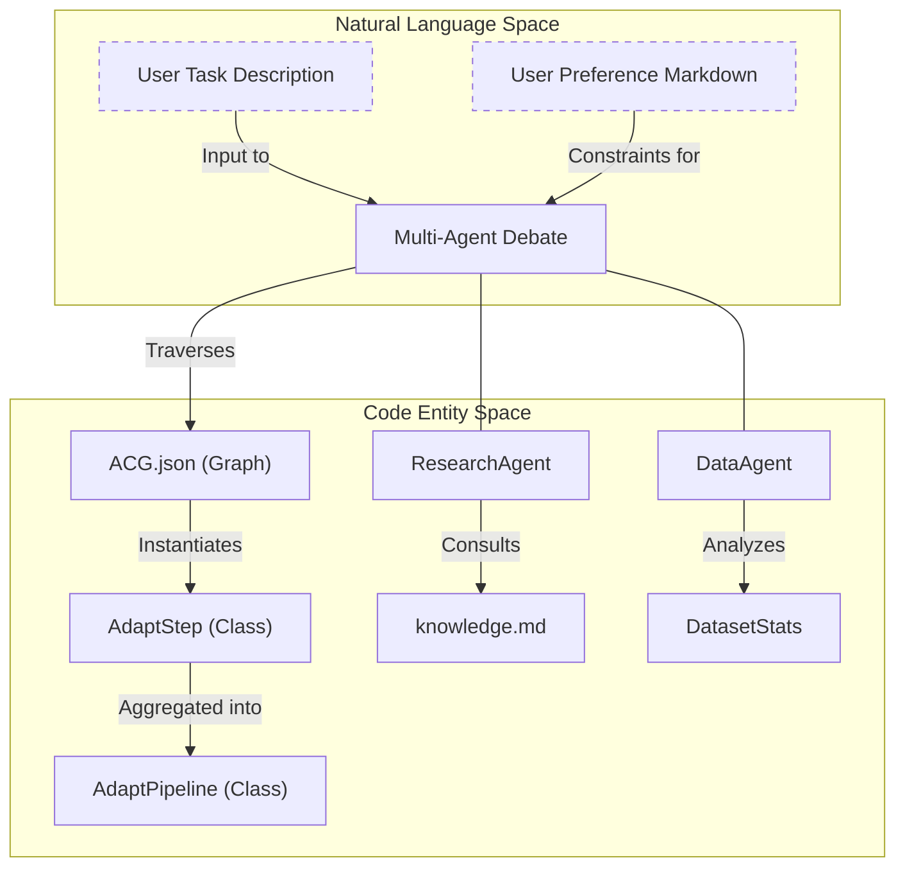
**Sources:** [src/autoadapt/config/ACG.json:1-3](), [src/autoadapt/adapt/adapt_pipeline.py:16-19](), [src/autoadapt/adapt/adapt_step.py:17-23](), [src/autoadapt/config/knowledge.md:1-5](), [app/react/backend/conf/config_default.yaml:72-75]().

### Execution Flow: AutoAdaptExecutor Lifecycle
This diagram shows the relationship between the main execution controller and the specialized templates.

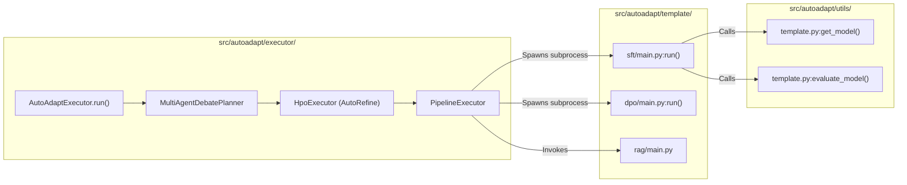
**Sources:** [src/autoadapt/template/sft/main.py:34-80](), [src/autoadapt/template/dpo/main.py:35-70](), [src/autoadapt/adapt/adapt_pipeline.py:28-34]().

---

## Adaptation Strategy Templates

AutoAdapt supports three primary adaptation templates, each defined in its own module within `src/autoadapt/template/`.

### 1. Supervised Fine-Tuning (SFT)
*   **Role**: Imitates high-quality reference outputs [src/autoadapt/config/knowledge.md:7-13]().
*   **Implementation**: Uses `trl.SFTTrainer` with support for LoRA and QLoRA [src/autoadapt/template/sft/main.py:18, 142-149]().
*   **Key Logic**: Includes `completion_only_loss` for Question Answering tasks to focus the model on the answer rather than the prompt [src/autoadapt/template/sft/main.py:137]().

### 2. Direct Preference Optimization (DPO)
*   **Role**: Aligns model outputs with human preferences using pairwise data (chosen vs. rejected) [src/autoadapt/config/knowledge.md:15-23]().
*   **Implementation**: Uses `trl.DPOTrainer` [src/autoadapt/template/dpo/main.py:25, 145-153]().
*   **Key Hyperparameter**: Introduces `beta` to control the strength of preference enforcement [src/autoadapt/config/knowledge.md:110-124](), [src/autoadapt/config/knowledge_hparams.md:74-82]().

### 3. Retrieval-Augmented Generation (RAG)
*   **Role**: Augments prompts with external context without changing model weights [src/autoadapt/config/knowledge.md:25-32]().
*   **Implementation**: Utilizes ChromaDB for indexing and vector search [src/autoadapt/config/ACG.json:202-204]().
*   **Key Parameters**: `retriever_top_k` and `embedding_model` [src/autoadapt/config/ACG.json:27-36]().

**Sources:** [src/autoadapt/template/sft/main.py:18-149](), [src/autoadapt/template/dpo/main.py:25-153](), [src/autoadapt/config/knowledge.md:7-32](), [src/autoadapt/config/knowledge_hparams.md:74-82](), [src/autoadapt/config/ACG.json:27-204]().

---

# Page: Configuration System

# Configuration System

<details>
<summary>Relevant source files</summary>

The following files were used as context for generating this wiki page:

- [app/react/backend/conf/config_default.yaml](app/react/backend/conf/config_default.yaml)
- [app/sample/conf/config.yaml](app/sample/conf/config.yaml)
- [src/autoadapt/config/ACG.json](src/autoadapt/config/ACG.json)
- [src/autoadapt/dashboard/static/config_template.yaml](src/autoadapt/dashboard/static/config_template.yaml)
- [src/autoadapt/template/dpo/main.py](src/autoadapt/template/dpo/main.py)
- [src/autoadapt/template/sft/main.py](src/autoadapt/template/sft/main.py)

</details>


The AutoAdapt configuration system provides a structured, hierarchical approach to managing the complex parameters required for LLM adaptation. It bridges high-level user requirements (defined in YAML) with machine-executable adaptation strategies (defined in the Adaptation Configuration Graph). This system ensures that every phase of the pipeline—from multi-agent planning to hyperparameter optimization (HPO) and final execution—operates on a consistent, validated state.

### Configuration Workflow

The system follows a transformation path from human-readable files to a dynamic graph structure used by the execution engine:

1.  **YAML Definition**: Users provide task descriptions, dataset paths, and API credentials in a `config.yaml` file [app/sample/conf/config.yaml:16-114]().
2.  **ACG Loading**: The system loads the `ACG.json` file, which defines the "legal" search space of adaptation strategies (SFT, DPO, RAG) [src/autoadapt/config/ACG.json:1-8]().
3.  **Graph Instantiation**: The `AutoAdaptExecutor` uses the configuration to navigate the ACG, resolving selection nodes and parameter values during the Planning phase.
4.  **Final Pipeline**: The result is a fully specified `AdaptPipeline` that maps configuration keys to specific execution templates (e.g., `sft/main.py`) [src/autoadapt/template/sft/main.py:34-50]().

### Configuration Components to Code Mapping

The following diagram illustrates how configuration concepts in the Natural Language/YAML space map to specific identifiers and structures within the codebase.

**Configuration Entity Mapping**
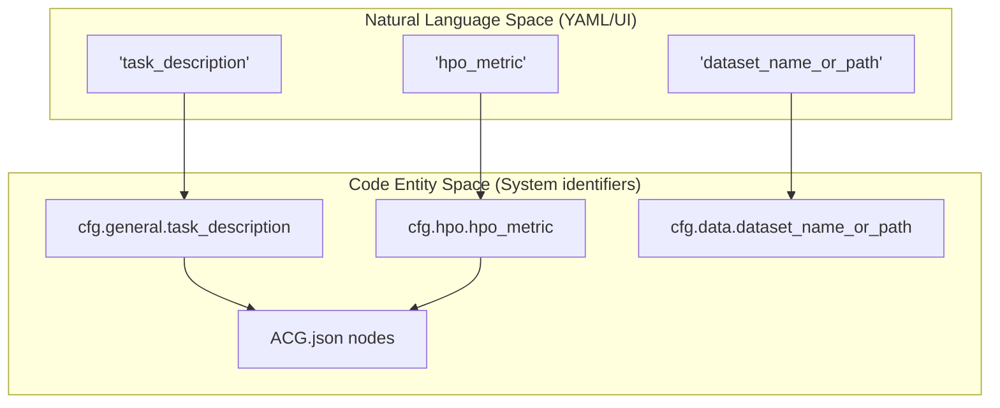
**Sources:** [app/react/backend/conf/config_default.yaml:23-150](), [src/autoadapt/config/ACG.json:5-112]()

---

## YAML Configuration Schema

The primary interface for users is the YAML configuration system, powered by **OmegaConf** and **Hydra**. It is divided into several logical sections that control different aspects of the environment and the adaptation process.

*   **General & Agent**: Defines project paths, workspace locations, and the path to the model/dataset knowledge bases [app/react/backend/conf/config_default.yaml:16-59]().
*   **Data**: Specifies dataset formats (`json`, `csv`, `parquet`), column mappings for prompts/responses, and split ratios for training/validation/testing [app/react/backend/conf/config_default.yaml:60-103]().
*   **LLM**: Configures the backbone models used for planning and evaluation (Azure OpenAI or OpenAI), including API keys and deployment names [app/react/backend/conf/config_default.yaml:105-129]().
*   **HPO & Evaluation**: Controls the AutoRefine process, including the number of trials, the specific sampler (e.g., `llm_gp`), and the metrics used to judge model performance [app/react/backend/conf/config_default.yaml:137-179]().
*   **RAG Data**: Dedicated section for Retrieval-Augmented Generation, defining document paths and vector database settings [app/react/backend/conf/config_default.yaml:180-204]().

For a detailed field-by-field reference, see [YAML Configuration Schema](#2.1).

**Sources:** [app/react/backend/conf/config_default.yaml:1-207](), [app/sample/conf/config.yaml:1-196]()

---

## Adaptation Configuration Graph (ACG)

The **Adaptation Configuration Graph (ACG)** is a JSON-based schema that defines the "rules of the game" for the AutoAdapt agents. While YAML defines *what* the user wants, the ACG defines *how* the system is allowed to achieve it.

### Node Types in ACG.json
The ACG consists of a tree of nodes, starting from the `adapt` root [src/autoadapt/config/ACG.json:2-5]().

| Node Type | Description | Example from Code |
| :--- | :--- | :--- |
| `select:1` | Choose exactly one child node. | `adapt` (choose SFT, RAG, or DPO) [src/autoadapt/config/ACG.json:6-8]() |
| `select:any` | Choose any number of child nodes. | `sft` (includes `peft` and `sft_train`) [src/autoadapt/config/ACG.json:113-115]() |
| `parameter` | Defines a set of hyperparameters to be tuned. | `lora` (r, alpha, dropout) [src/autoadapt/config/ACG.json:128-162]() |
| `direct_parameter` | Parameters passed directly without HPO. | `rag_params` [src/autoadapt/config/ACG.json:23-43]() |

### Strategy Branching
The ACG defines three main branches for adaptation:
1.  **SFT (Supervised Fine-Tuning)**: Focuses on `peft` (LoRA/Prefix Tuning) and standard training args [src/autoadapt/config/ACG.json:112-120]().
2.  **DPO (Direct Preference Optimization)**: Includes parameters for preference-based alignment like `beta` [src/autoadapt/config/ACG.json:45-110]().
3.  **RAG (Retrieval-Augmented Generation)**: Configures retrievers and embedding models [src/autoadapt/config/ACG.json:13-43]().

For details on how the graph is traversed and modified, see [Adaptation Configuration Graph (ACG)](#2.2).

**Sources:** [src/autoadapt/config/ACG.json:1-194]()

---

## Configuration to Execution Bridge

The configuration system bridges the gap between static definitions and the dynamic execution of training scripts. The `AutoAdaptExecutor` takes the merged configuration and the ACG to produce a runtime configuration that the `main.py` templates consume.

**Config-to-Template Execution Flow**
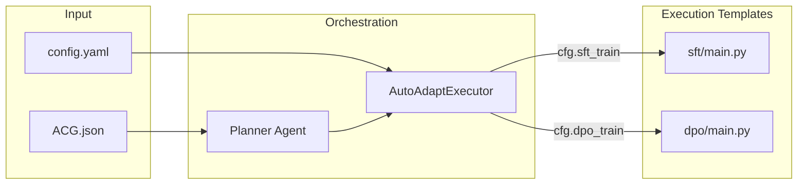
**Sources:** [src/autoadapt/template/sft/main.py:34-40](), [src/autoadapt/template/dpo/main.py:35-41](), [app/react/backend/conf/config_default.yaml:130-136]()

### Key Code Entities
*   **`DictConfig`**: The Hydra/OmegaConf object used throughout the `run()` functions in templates to access parameters (e.g., `cfg.sft_train.learning_rate`) [src/autoadapt/template/sft/main.py:34-131]().
*   **`hpo_runtime` flag**: A special configuration key that tells the execution template to return metrics to the HPO sampler instead of performing a full test-set evaluation [src/autoadapt/template/sft/main.py:88-111]().

**Sources:** [src/autoadapt/template/sft/main.py:34-182](), [src/autoadapt/template/dpo/main.py:35-186]()

---

# Page: YAML Configuration Schema

# YAML Configuration Schema

<details>
<summary>Relevant source files</summary>

The following files were used as context for generating this wiki page:

- [app/react/backend/conf/config_default.yaml](app/react/backend/conf/config_default.yaml)
- [app/sample/conf/config.yaml](app/sample/conf/config.yaml)
- [app/sample/conf/user_preference.md](app/sample/conf/user_preference.md)
- [src/autoadapt/dashboard/static/config_template.yaml](src/autoadapt/dashboard/static/config_template.yaml)
- [src/autoadapt/template/dpo/conf/config.yaml](src/autoadapt/template/dpo/conf/config.yaml)
- [src/autoadapt/template/rag/conf/config.yaml](src/autoadapt/template/rag/conf/config.yaml)
- [src/autoadapt/template/sft/conf/config.yaml](src/autoadapt/template/sft/conf/config.yaml)

</details>


AutoAdapt utilizes a hierarchical YAML-based configuration system powered by **OmegaConf** and **Hydra**. This schema defines the operational parameters for the entire adaptation lifecycle, including multi-agent planning, hyperparameter optimization (HPO), and template-specific execution (SFT, DPO, RAG).

## Configuration Architecture and Merging

The system relies on three primary YAML files to manage settings across different stages of the pipeline:

1.  **`config_default.yaml`**: The master template located in the backend configuration directory [app/react/backend/conf/config_default.yaml:1-207](). It contains all possible fields and their default values.
2.  **`config.yaml`**: The instance-specific configuration located in the user's project directory [app/sample/conf/config.yaml:1-197](). This file overrides defaults for specific tasks.
3.  **`config_template.yaml`**: A simplified template used by the dashboard and CLI to initialize new projects [src/autoadapt/dashboard/static/config_template.yaml:1-129]().

### Configuration Loading Flow

AutoAdapt uses OmegaConf's variable interpolation (e.g., `${general.project_path}`) and environment variable resolution (e.g., `${oc.env:API_KEY,}`) to create a dynamic configuration object.

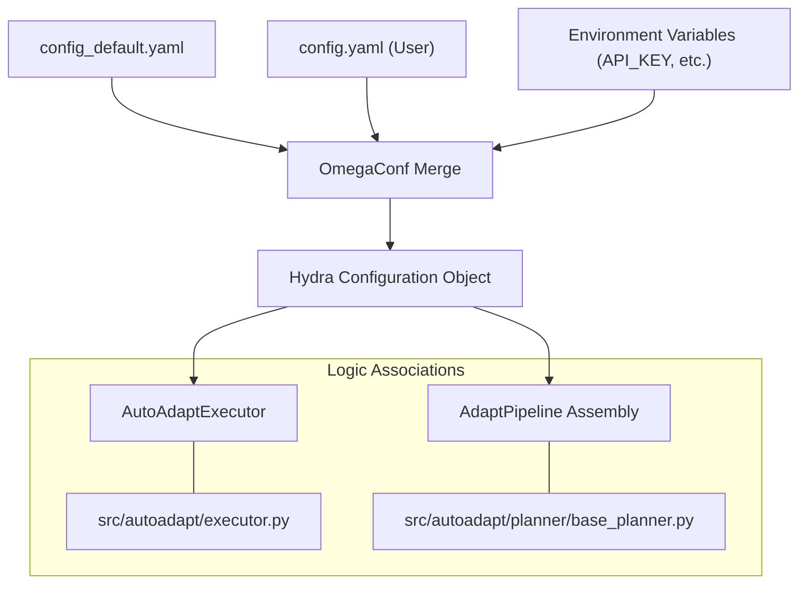
**Sources:** [app/react/backend/conf/config_default.yaml:50-51](), [app/sample/conf/config.yaml:114-114]()

---

## Detailed Field Reference

### 1. General Section
Defines the project structure and hardware requirements.

| Field | Description | Source |
| :--- | :--- | :--- |
| `project_path` | Absolute path to the local AutoAdapt project. | [app/react/backend/conf/config_default.yaml:19]() |
| `workspace_path` | Directory for intermediate adaptation files. | [app/react/backend/conf/config_default.yaml:29]() |
| `task_description` | Natural language description of the target task. | [app/react/backend/conf/config_default.yaml:23]() |
| `domain` | Domain identifier (e.g., 'math', 'healthcare'). | [app/react/backend/conf/config_default.yaml:26]() |
| `use_gpu` | Boolean flag to enable CUDA acceleration. | [app/react/backend/conf/config_default.yaml:48]() |

### 2. Data Section
Configures dataset ingestion and splitting logic for the `DatasetStats` and `DataAgent`.

| Field | Description | Source |
| :--- | :--- | :--- |
| `dataset_name_or_path` | Path to training data or HuggingFace dataset ID. | [app/react/backend/conf/config_default.yaml:62]() |
| `dataset_format` | Supports `json`, `csv`, `parquet`, `hf_dataset`. | [app/react/backend/conf/config_default.yaml:69]() |
| `input_column` | The column name containing the prompt/question. | [app/react/backend/conf/config_default.yaml:90]() |
| `response_column` | The column name containing the ground truth. | [app/react/backend/conf/config_default.yaml:93]() |
| `test_ratio` | Percentage of data reserved for the test split. | [app/react/backend/conf/config_default.yaml:84]() |

### 3. LLM Section
Parameters for the agents and evaluators to communicate with model APIs.

| Field | Description | Source |
| :--- | :--- | :--- |
| `api_type` | Either `azure` or `openai`. | [app/react/backend/conf/config_default.yaml:106]() |
| `deployment_name` | The specific model deployment (e.g., `gpt-4o`). | [app/react/backend/conf/config_default.yaml:121]() |
| `reasoning_model` | Model used for complex debate rounds (e.g., `o1`). | [app/react/backend/conf/config_default.yaml:126]() |
| `api_key` | Resolved via `${oc.env:API_KEY,}`. | [app/react/backend/conf/config_default.yaml:119]() |

### 4. HPO Section (AutoRefine)
Controls the `HpoExecutor` and the custom Optuna samplers.

| Field | Description | Source |
| :--- | :--- | :--- |
| `n_trials` | Number of HPO iterations to perform. | [app/react/backend/conf/config_default.yaml:139]() |
| `sampler` | Selection of sampler: `llm_gp`, `llm`, or `auto`. | [app/react/backend/conf/config_default.yaml:155]() |
| `coreset_train_ratio` | Fraction of data used during HPO trials to save time. | [app/react/backend/conf/config_default.yaml:145]() |
| `hpo_metric` | Metric to maximize (e.g., `trained_model_accuracy`). | [app/react/backend/conf/config_default.yaml:150]() |

### 5. Evaluation Section
Configures how the adapted model is validated against the test set.

| Field | Description | Source |
| :--- | :--- | :--- |
| `use_llm` | Enables LLM-as-a-judge for qualitative evaluation. | [app/react/backend/conf/config_default.yaml:174]() |
| `eval_func` | Reference to the function in `src/autoadapt/utils/template.py`. | [app/react/backend/conf/config_default.yaml:166]() |
| `llm_eval_system_prompt` | The prompt used by the LLM judge to verify answers. | [app/sample/conf/config.yaml:174]() |

---

## Template-Specific Configurations

When the `AutoAdaptExecutor` selects a strategy (SFT, DPO, or RAG), it utilizes specialized configuration blocks within the template directories.

### SFT & DPO Training
Located in `src/autoadapt/template/sft/conf/config.yaml` and `src/autoadapt/template/dpo/conf/config.yaml`. These include:
*   **`lora`**: `lora_r`, `lora_alpha`, and `quantization_type` (int4/int8) [src/autoadapt/template/sft/conf/config.yaml:33-40]().
*   **`sft_train` / `dpo_train`**: `learning_rate`, `num_train_epochs`, and `gradient_accumulation_steps` [src/autoadapt/template/sft/conf/config.yaml:21-31]().

### RAG (Retrieval-Augmented Generation)
Located in `src/autoadapt/template/rag/conf/config.yaml`.
*   **`rag_data`**: Configures the `chroma_db_path` and `documents_column` for indexing [src/autoadapt/template/rag/conf/config.yaml:8-31]().
*   **`rag_params`**: Defines `retriever_top_k` and the `embedding_model` [src/autoadapt/template/rag/conf/config.yaml:33-37]().

---

## Code Entity Association

The YAML configuration is transformed into internal objects that drive specific classes.

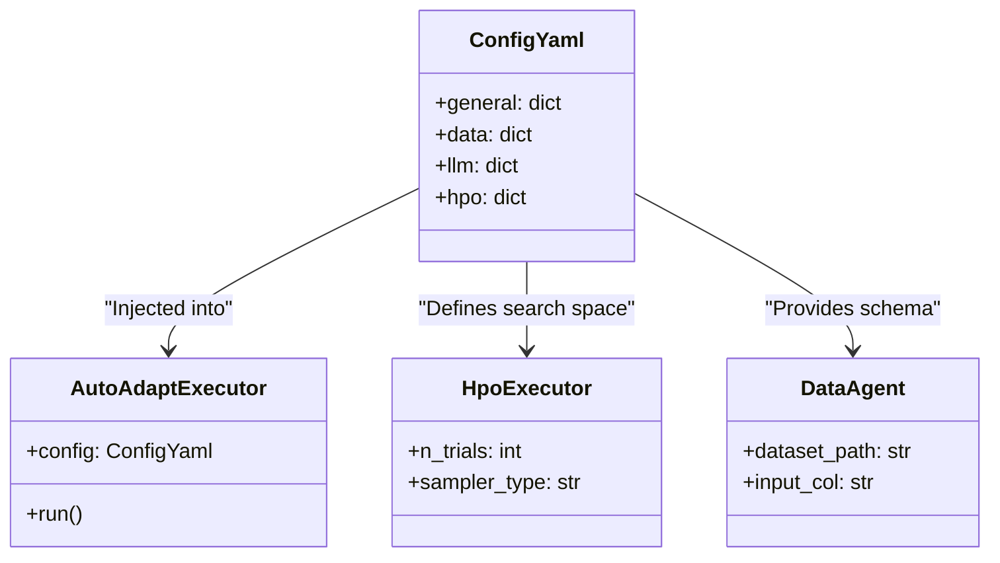

**Sources:**
*   `general` / `data` / `llm` / `hpo` schemas: [app/react/backend/conf/config_default.yaml:16-162]()
*   `rag_data` schema: [app/react/backend/conf/config_default.yaml:180-204]()
*   Template overrides: [src/autoadapt/template/sft/conf/config.yaml:1-83](), [src/autoadapt/template/dpo/conf/config.yaml:1-84](), [src/autoadapt/template/rag/conf/config.yaml:1-63]()

---

# Page: Adaptation Configuration Graph (ACG)

# Adaptation Configuration Graph (ACG)

<details>
<summary>Relevant source files</summary>

The following files were used as context for generating this wiki page:

- [src/autoadapt/config/ACG.json](src/autoadapt/config/ACG.json)
- [src/autoadapt/config/code_mapping.yaml](src/autoadapt/config/code_mapping.yaml)
- [src/autoadapt/plan/adapt_config_graph.py](src/autoadapt/plan/adapt_config_graph.py)
- [src/autoadapt/template/dpo/main.py](src/autoadapt/template/dpo/main.py)
- [src/autoadapt/template/sft/main.py](src/autoadapt/template/sft/main.py)
- [src/autoadapt/utils/code.py](src/autoadapt/utils/code.py)

</details>


The **Adaptation Configuration Graph (ACG)** is the foundational structural representation of all possible adaptation strategies within AutoAdapt. It defines a hierarchical decision space that the planning agents traverse to assemble a concrete execution pipeline. The ACG separates the high-level strategy selection (e.g., SFT vs. RAG) from the low-level parameterization (e.g., LoRA rank or learning rate).

## Graph Structure and Node Types

The ACG is defined as a directed graph in a JSON format [src/autoadapt/config/ACG.json:1-3](). It is managed by the `AdaptConfigGraph` class, which parses the JSON and instantiates `AdaptConfigNode` objects [src/autoadapt/plan/adapt_config_graph.py:39-42]().

### Node Class Definition
Each node in the graph is represented by the `AdaptConfigNode` class [src/autoadapt/plan/adapt_config_graph.py:14-36]().
- **`name`**: Unique identifier for the node (e.g., `sft`, `lora`).
- **`type`**: Determines how the planner interacts with the node (see below).
- **`description`**: Natural language context used by LLM agents during the planning phase.
- **`children`**: List of potential child nodes in the hierarchy.
- **`parameters`**: A dictionary of hyperparameters associated with the node, including defaults and types.
- **`executable`**: A boolean flag indicating if this node represents a terminal adaptation strategy that can be mapped to code [src/autoadapt/plan/adapt_config_graph.py:68-68]().

### Node Type Taxonomy
The system utilizes four primary node types to control the planning flow [src/autoadapt/config/ACG.json:6-129]():

| Node Type | Behavior | Example |
| :--- | :--- | :--- |
| `select:1` | Exclusive choice; exactly one child must be selected. | `adapt` (SFT vs. RAG vs. DPO) |
| `select:any` | Multi-choice; zero or more children can be selected based on constraints. | `sft` (can select `peft` and `sft_train`) |
| `parameter` | Contains a set of hyperparameters that require optimization or setting. | `lora` (r, alpha, dropout) |
| `direct_parameter` | Similar to parameter, but typically implies fixed or restricted options. | `rag_params` |

**Sources:** [src/autoadapt/plan/adapt_config_graph.py:14-36](), [src/autoadapt/config/ACG.json:1-129]()

---

## Strategy Branches: SFT, DPO, and RAG

The ACG defines three main branches originating from the `adapt` root node [src/autoadapt/config/ACG.json:2-8]().

### 1. Supervised Fine-Tuning (SFT)
The SFT branch is designed for domain-specific model training. It allows for the selection of Parameter-Efficient Fine-Tuning (PEFT) methods.
- **Path**: `adapt` -> `sft` -> [`peft`, `sft_train`] [src/autoadapt/config/ACG.json:112-115]().
- **PEFT Options**: Includes `lora` and `prefix_tuning` [src/autoadapt/config/ACG.json:122-126]().

### 2. Direct Preference Optimization (DPO)
Used for aligning models with human preferences using triplet data (prompt, chosen, rejected).
- **Path**: `adapt` -> `dpo` -> [`dpo_train`, `peft`] [src/autoadapt/config/ACG.json:45-48]().

### 3. Retrieval-Augmented Generation (RAG)
Enhances generation by retrieving context from external sources. Unlike SFT/DPO, it is often treated as a `direct_parameter` set because it focuses on retrieval logic rather than weight updates.
- **Path**: `adapt` -> `rag` -> `rag_params` [src/autoadapt/config/ACG.json:13-16]().

### ACG Visual Representation
The following diagram illustrates the relationship between the ACG structure and the underlying code implementation classes.

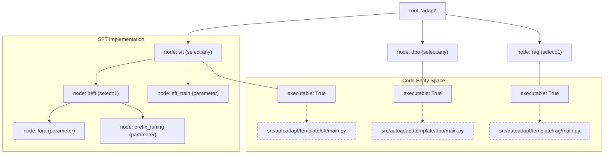
**Sources:** [src/autoadapt/config/ACG.json:1-194](), [src/autoadapt/plan/adapt_config_graph.py:14-36]()

---

## Dynamic Modification and Resolution

The backend dynamically interacts with the ACG during the planning phase. The `AdaptConfigGraph` can load a custom ACG path if specified in the general configuration [src/autoadapt/plan/adapt_config_graph.py:43-46]().

### Code Mapping Logic
Once the planner traverses the ACG and selects a path (e.g., `sft` + `lora`), the system must resolve which code template to execute. This is handled by `mapping_code_template` [src/autoadapt/utils/code.py:60-69]().

1. **Key Generation**: A key is created by joining the step name and its configuration keys (e.g., `"sft,lora"`) [src/autoadapt/utils/code.py:64-64]().
2. **Lookup**: The system looks up this key in `code_mapping.yaml` [src/autoadapt/config/code_mapping.yaml:17-35]().
3. **Fallback**: If an exact match is not found, `get_fallback_keys` generates simpler versions (e.g., falling back from `sft,lora` to `sft`) [src/autoadapt/utils/code.py:37-57]().

### Data Flow: Graph to Execution
The following diagram shows how a path in the ACG is transformed into a running Python process.

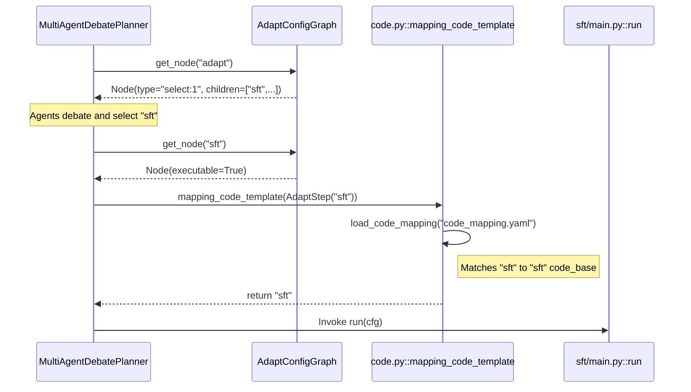
**Sources:** [src/autoadapt/utils/code.py:60-69](), [src/autoadapt/config/code_mapping.yaml:17-35](), [src/autoadapt/plan/adapt_config_graph.py:83-85]()

---

## Implementation Details

### Configuration Parameters
Parameters defined in `ACG.json` include metadata that drives both the UI and the HPO (Hyperparameter Optimization) engine:
- **Default Values**: Used if the planner or user does not specify a value [src/autoadapt/config/ACG.json:29]().
- **Types**: `integer`, `float`, `string`, `boolean` [src/autoadapt/config/ACG.json:30-35]().
- **Descriptions**: Injected into LLM prompts to explain the impact of a parameter [src/autoadapt/config/ACG.json:28]().

### Constraints
Nodes can include constraints such as `required_children` to ensure the resulting pipeline is valid. For example, the `dpo` node requires the `dpo_train` child to be present [src/autoadapt/config/ACG.json:49-51]().

**Sources:** [src/autoadapt/config/ACG.json:1-194](), [src/autoadapt/plan/adapt_config_graph.py:14-36](), [src/autoadapt/utils/code.py:11-34]()

---

# Page: Core Execution Engine

# Core Execution Engine

<details>
<summary>Relevant source files</summary>

The following files were used as context for generating this wiki page:

- [src/autoadapt/adapt/adapt_pipeline.py](src/autoadapt/adapt/adapt_pipeline.py)
- [src/autoadapt/adapt/adapt_step.py](src/autoadapt/adapt/adapt_step.py)
- [src/autoadapt/adapt/autoadapt_executor.py](src/autoadapt/adapt/autoadapt_executor.py)
- [src/autoadapt/adapt/pipeline.py](src/autoadapt/adapt/pipeline.py)
- [src/autoadapt/utils/misc.py](src/autoadapt/utils/misc.py)

</details>


The **Core Execution Engine** is the central nervous system of AutoAdapt. It orchestrates the transition from high-level user requirements to a concrete, optimized adaptation pipeline. The engine manages a multi-stage lifecycle including dataset analysis, agentic planning, hyperparameter optimization (HPO), and final execution with error recovery.

The primary entry point for this lifecycle is the `AutoAdaptExecutor` [src/autoadapt/adapt/autoadapt_executor.py:32-32](), which coordinates specialized sub-executors for each phase.

## Execution Lifecycle Overview

The execution lifecycle follows a sequential flow managed by the `run()` method of `AutoAdaptExecutor` [src/autoadapt/adapt/autoadapt_executor.py:236-236](). This process transforms an abstract Adaptation Configuration Graph (ACG) into a serialized `Pipeline` [src/autoadapt/adapt/pipeline.py:15-15]() consisting of discrete `AdaptStep` objects [src/autoadapt/adapt/adapt_step.py:17-17]().

### High-Level Execution Flow
The following diagram illustrates the relationship between the execution engine components and the files that define them.

**Diagram: Execution Engine Architecture**
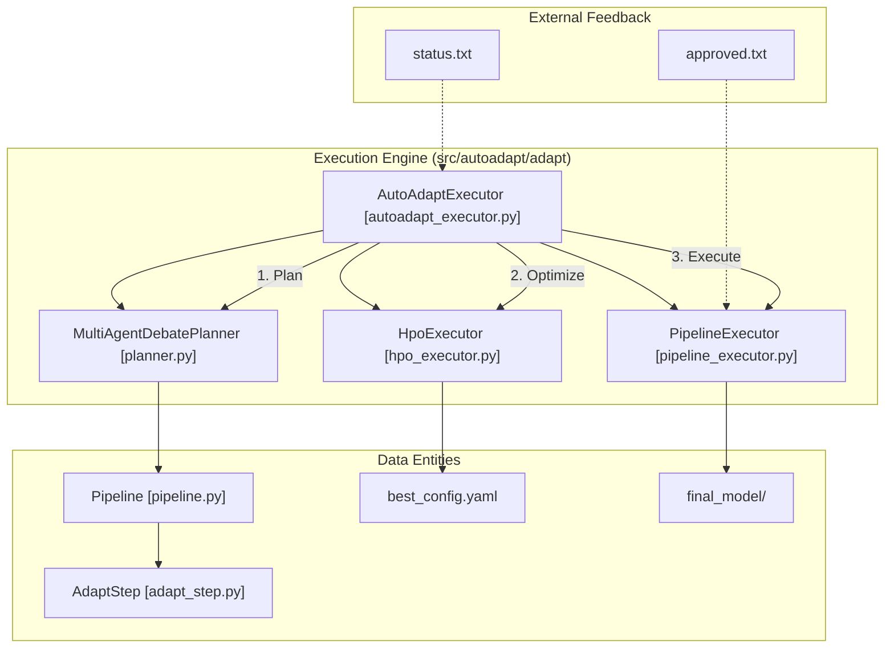
**Sources:** [src/autoadapt/adapt/autoadapt_executor.py:32-63](), [src/autoadapt/adapt/pipeline.py:15-19](), [src/autoadapt/adapt/adapt_step.py:17-53]()

---

## 1. Pipeline Orchestration
The `AutoAdaptExecutor` initializes the environment, tracks token usage via `TokenUsageCallback` [src/autoadapt/adapt/autoadapt_executor.py:40-40](), and manages the global `SharedMemory` [src/autoadapt/adapt/autoadapt_executor.py:52-52]() used by agents. It also provides the `tee_output` context manager [src/autoadapt/utils/misc.py:165-165]() to ensure logs are simultaneously written to the console and a local `log.txt` for the UI to consume.

For details on initialization and status tracking, see **[AutoAdaptExecutor and Pipeline Orchestration](#3.1)**.

## 2. Planning Phase
The planning phase utilizes a `MultiAgentDebatePlanner` [src/autoadapt/adapt/autoadapt_executor.py:47-47](). It traverses the ACG to select the best adaptation strategy (e.g., SFT vs. RAG) and specific components (e.g., LoRA vs. Full Fine-tuning). This phase concludes with the creation of a `pipeline.pkl` file [src/autoadapt/adapt/autoadapt_executor.py:74-79](), which stores the ordered sequence of steps to be executed.

For details on agentic decision-making and ACG traversal, see **[Planning Phase: Multi-Agent Debate](#3.2)**.

## 3. HPO Execution (AutoRefine)
Once a pipeline is planned, the `HpoExecutor` [src/autoadapt/adapt/autoadapt_executor.py:61-61]() refines the hyperparameters for each step. This process, termed **AutoRefine**, uses Optuna studies to find optimal values for learning rates, rank, and other parameters. It can utilize "Coreset" selection from the `deepcore` library to accelerate trials by training on representative data subsets.

For details on the optimization objective and LLM-guided samplers, see **[HPO Execution: AutoRefine](#3.3)**.

## 4. Final Execution and Recovery
The `PipelineExecutor` [src/autoadapt/adapt/autoadapt_executor.py:58-58]() handles the heavy lifting of training or indexing. It loads the `best_config.yaml` generated during HPO and runs the adaptation scripts. If a failure occurs (e.g., CUDA Out-of-Memory), the engine can trigger an LLM-driven retry loop to adjust parameters like batch size or sequence length automatically.

For details on subprocess management and the approval gate, see **[Pipeline Execution and Error Recovery](#3.4)**.

---

### Core Entity Mapping
The following table maps the conceptual execution stages to the primary classes and files responsible for their implementation.

| Stage | Core Class | Primary File | Key Output |
| :--- | :--- | :--- | :--- |
| **Initialization** | `AutoAdaptExecutor` | `autoadapt_executor.py` | `SharedMemory` |
| **Data Analysis** | `DatasetStats` | `extract_dataset_stats.py` | `dataset_stats.json` |
| **Planning** | `MultiAgentDebatePlanner` | `multiagent_debate_planner.py` | `pipeline.pkl` |
| **Optimization** | `HpoExecutor` | `hpo_executor.py` | `best_config.yaml` |
| **Execution** | `PipelineExecutor` | `pipeline_executor.py` | Trained Model / Index |

**Sources:** [src/autoadapt/adapt/autoadapt_executor.py:32-63](), [src/autoadapt/utils/misc.py:35-64](), [src/autoadapt/adapt/adapt_pipeline.py:16-39]()

---

# Page: AutoAdaptExecutor and Pipeline Orchestration

# AutoAdaptExecutor and Pipeline Orchestration

<details>
<summary>Relevant source files</summary>

The following files were used as context for generating this wiki page:

- [src/autoadapt/adapt/adapt_pipeline.py](src/autoadapt/adapt/adapt_pipeline.py)
- [src/autoadapt/adapt/adapt_step.py](src/autoadapt/adapt/adapt_step.py)
- [src/autoadapt/adapt/autoadapt_executor.py](src/autoadapt/adapt/autoadapt_executor.py)
- [src/autoadapt/adapt/base_executor.py](src/autoadapt/adapt/base_executor.py)
- [src/autoadapt/adapt/pipeline.py](src/autoadapt/adapt/pipeline.py)
- [src/autoadapt/memory/shared_memory.py](src/autoadapt/memory/shared_memory.py)
- [src/autoadapt/utils/misc.py](src/autoadapt/utils/misc.py)
- [src/autoadapt/utils/save_pipeline_graph.py](src/autoadapt/utils/save_pipeline_graph.py)

</details>


The `AutoAdaptExecutor` is the central orchestrator of the AutoAdapt system. It manages the end-to-end lifecycle of domain adaptation, from initial dataset analysis and multi-agent planning to hyperparameter optimization (HPO) and final model execution. It acts as a wrapper around specialized executors (`HpoExecutor`, `PipelineExecutor`) and planners (`MultiAgentDebatePlanner`), ensuring state persistence and status tracking across the long-running adaptation process.

## AutoAdaptExecutor Initialization

The `AutoAdaptExecutor` inherits from the base `Executor` class [src/autoadapt/adapt/base_executor.py:14-16]() and initializes the primary sub-components required for the adaptation lifecycle.

| Component | Class | Responsibility |
| :--- | :--- | :--- |
| **Planner** | `MultiAgentDebatePlanner` | Traverses the ACG and assembles the `Pipeline` via agent debate [src/autoadapt/adapt/autoadapt_executor.py:47-51](). |
| **Stats Extractor** | `DatasetStats` | Analyzes user datasets to provide context for agents [src/autoadapt/adapt/autoadapt_executor.py:55](). |
| **HPO Engine** | `HpoExecutor` | Executes hyperparameter search trials using Optuna [src/autoadapt/adapt/autoadapt_executor.py:61](). |
| **Pipeline Runner** | `PipelineExecutor` | Executes the final adaptation code and handles retries [src/autoadapt/adapt/autoadapt_executor.py:58](). |
| **Model Client** | `ChatCompletionModel` | Provides the LLM interface for all agents and samplers [src/autoadapt/adapt/autoadapt_executor.py:43-45](). |

**Sources:** [src/autoadapt/adapt/autoadapt_executor.py:32-65](), [src/autoadapt/adapt/base_executor.py:14-25]()

## The run() Lifecycle

The `run()` method defines the sequential execution flow of the system. It transitions through several distinct phases, updating a `status.txt` file at each step to allow external UIs (React/Streamlit) to monitor progress.

### 1. Dataset Statistics Extraction
The executor first invokes `dataset_stats_extractor.extract()` [src/autoadapt/adapt/autoadapt_executor.py:219](). This phase analyzes the provided dataset to determine domain, token distribution, and task type, which are stored in `SharedMemory` for the planning agents.

### 2. Planning Phase
The `plan()` method is called to generate an `AdaptPipeline` [src/autoadapt/adapt/autoadapt_executor.py:183](). 
- If a `pipeline.pkl` already exists, it is loaded unless `force_run` is True [src/autoadapt/adapt/autoadapt_executor.py:66-82]().
- Otherwise, the `MultiAgentDebatePlanner` executes a debate to select the best adaptation strategy (e.g., SFT vs. RAG) and hyperparameters.
- The resulting `Pipeline` object is serialized to `pipeline.pkl` [src/autoadapt/adapt/autoadapt_executor.py:246]().

### 3. HPO (AutoRefine)
The `hpo_executor` runs trials to find the optimal configuration [src/autoadapt/adapt/autoadapt_executor.py:270](). This step produces a `best_config.yaml` file.

### 4. Approval Gate
If `require_approval` is set to `True`, the executor pauses and waits for an `approved.txt` file to appear in the workspace [src/autoadapt/adapt/autoadapt_executor.py:280-285]().

### 5. Final Execution and Insights
The `pipeline_executor` runs the final adaptation with the best parameters [src/autoadapt/adapt/autoadapt_executor.py:291](). Upon completion, `generate_insights()` is called to explain the selection logic using the LLM [src/autoadapt/utils/misc.py:35-64]().

**Lifecycle Orchestration Diagram**
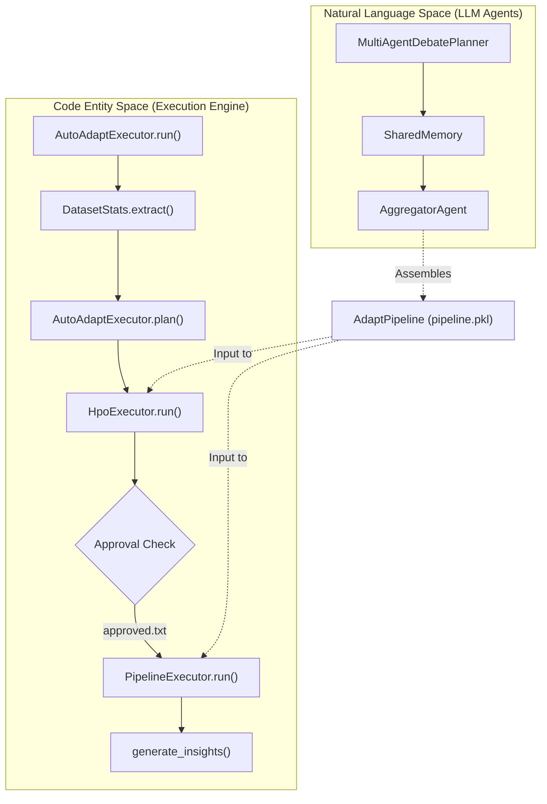
**Sources:** [src/autoadapt/adapt/autoadapt_executor.py:207-310](), [src/autoadapt/utils/misc.py:35-64](), [src/autoadapt/adapt/pipeline.py:15-30]()

## Pipeline Orchestration and Serialization

### AdaptPipeline and AdaptStep
The adaptation strategy is represented as an `AdaptPipeline` [src/autoadapt/adapt/pipeline.py:15](), which contains an ordered list of `AdaptStep` objects [src/autoadapt/adapt/adapt_step.py:17]().
- **AdaptStep**: Contains the `name`, `step_config` (fixed parameters), and `step_hparam_config` (search spaces for HPO) [src/autoadapt/adapt/adapt_step.py:23-33]().

### Persistence via pipeline.pkl
The `AutoAdaptExecutor` saves the entire `Pipeline` object to `pipeline.pkl` [src/autoadapt/adapt/autoadapt_executor.py:246](). This allows the system to resume from planning if the process is interrupted. The executor also includes a `parse_pipeline_graph` utility to convert this serialized object into a JSON-compatible format for visualization in the React UI [src/autoadapt/adapt/autoadapt_executor.py:85-181]().

### Visualization via Graphviz
The system uses `graph_from_autoadapt_plan` to generate visual representations of the selected pipeline [src/autoadapt/utils/save_pipeline_graph.py:160](). It maps internal step names (e.g., `sft_train`, `lora`) to human-readable descriptions and renders them using Graphviz [src/autoadapt/utils/save_pipeline_graph.py:36-65]().

**Pipeline Data Flow Diagram**
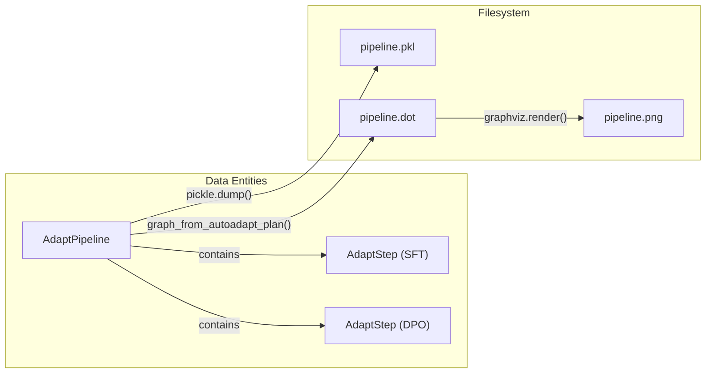
**Sources:** [src/autoadapt/adapt/pipeline.py:15-26](), [src/autoadapt/adapt/adapt_step.py:17-53](), [src/autoadapt/utils/save_pipeline_graph.py:160-202]()

## Status Tracking and Logging

### status.txt
The system tracks progress using `write_status` and `get_status` utilities [src/autoadapt/utils/misc.py:217-241](). This file contains a single string representing the current state (e.g., `PLANNING`, `HPO`, `FINETUNING`, `COMPLETED`), which the frontend polls to update the user interface.

### tee_output Context Manager
To ensure that all logs (stdout, stderr, and Python `logging`) are both visible in the console and captured for the UI, the executor uses the `tee_output` context manager [src/autoadapt/utils/misc.py:165]().

- **TeeStream**: A custom class that duplicates `write` and `flush` operations to multiple streams [src/autoadapt/utils/misc.py:150-162]().
- **Integration**: It redirects `sys.stdout`, `sys.stderr`, and the handlers for `optuna` and `transformers` loggers to the workspace log file [src/autoadapt/utils/misc.py:177-206]().

**Sources:** [src/autoadapt/utils/misc.py:150-215](), [src/autoadapt/utils/misc.py:217-241]()

---

# Page: Planning Phase: Multi-Agent Debate

# Planning Phase: Multi-Agent Debate

<details>
<summary>Relevant source files</summary>

The following files were used as context for generating this wiki page:

- [src/autoadapt/adapt/adapt_pipeline.py](src/autoadapt/adapt/adapt_pipeline.py)
- [src/autoadapt/adapt/adapt_step.py](src/autoadapt/adapt/adapt_step.py)
- [src/autoadapt/adapt/pipeline.py](src/autoadapt/adapt/pipeline.py)
- [src/autoadapt/memory/shared_memory.py](src/autoadapt/memory/shared_memory.py)
- [src/autoadapt/plan/base_planner.py](src/autoadapt/plan/base_planner.py)
- [src/autoadapt/plan/multiagent_debate_planner.py](src/autoadapt/plan/multiagent_debate_planner.py)

</details>


The Planning Phase is the core reasoning stage of AutoAdapt, where the system transforms a high-level user request and dataset into a structured execution plan. This phase is orchestrated by the `MultiAgentDebatePlanner`, which traverses the Adaptation Configuration Graph (ACG) and resolves complex decisions—such as selecting adaptation strategies or defining hyperparameter search spaces—through a structured multi-round debate between specialized agents.

## Planner Architecture and ACG Traversal

The planning logic is split between the `BasePlanner` and the `MultiAgentDebatePlanner`. The `BasePlanner` provides the foundation for ACG traversal using a Depth-First Search (DFS) approach, while the `MultiAgentDebatePlanner` implements the agentic reasoning logic.

### ACG Traversal Logic
The planner starts at the `adapt` root node of the ACG [src/autoadapt/plan/base_planner.py:314-316](). It recursively visits nodes to build a sequence of `AdaptStep` objects, which are eventually bundled into an `AdaptPipeline`.

| Node Type | Action | Implementation Detail |
| :--- | :--- | :--- |
| **Selection Node** | The planner must choose one or more child nodes to follow. | Calls `launch_agent_discussion` with a `SelectionRequest` [src/autoadapt/plan/base_planner.py:339-346](). |
| **Parameter Node** | The planner defines a search space (range/choices) for HPO. | Calls `launch_agent_discussion` with a `ParameterRangeRequest` [src/autoadapt/plan/base_planner.py:374-381](). |
| **Direct Parameter Node** | The planner selects specific, fixed values (skipping HPO). | Calls `launch_agent_discussion` with a `DirectParameterRequest` [src/autoadapt/plan/base_planner.py:392-401](). |
| **Executable Node** | Represents a concrete action (e.g., "SFT"). | Creates an `AdaptStep` and appends it to the pipeline [src/autoadapt/plan/base_planner.py:408-422](). |

### Mapping Natural Language to Code Entities
The following diagram illustrates how user intent and dataset characteristics are mapped to specific code entities during the planning process.

**Planning Context Mapping**
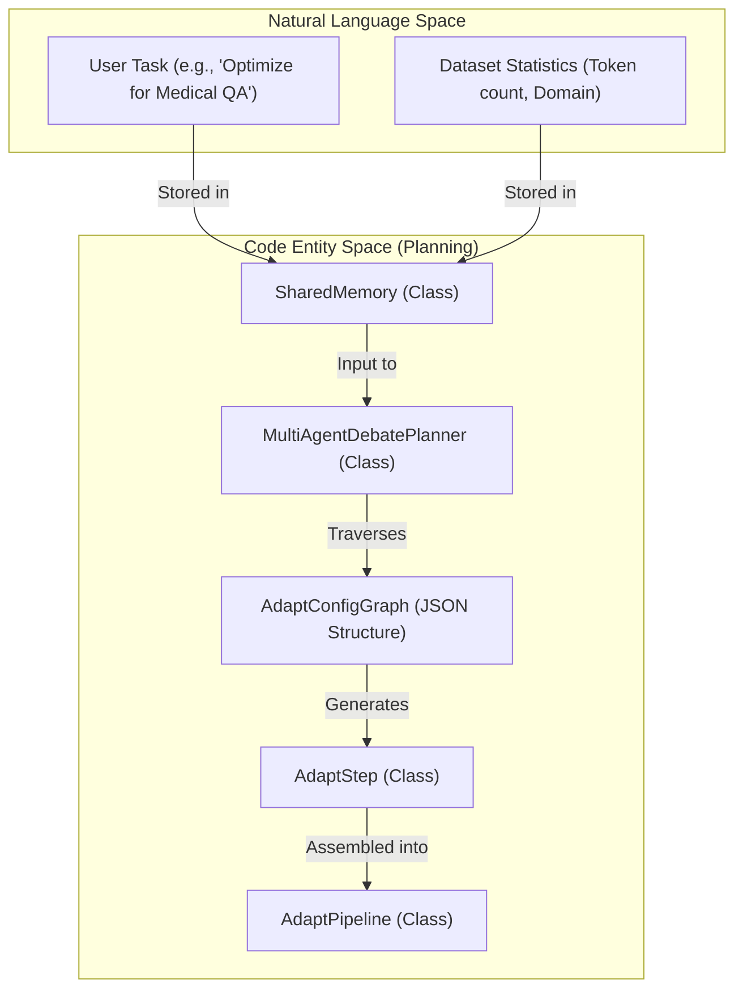
*Sources: [src/autoadapt/plan/multiagent_debate_planner.py:32-36](), [src/autoadapt/adapt/adapt_pipeline.py:16-19](), [src/autoadapt/memory/shared_memory.py:7-16]()*

## Multi-Agent Debate Mechanism

When the planner encounters a node requiring a decision, it triggers a multi-round debate. This process is managed by `launch_agent_discussion` [src/autoadapt/plan/multiagent_debate_planner.py:86-112]().

### The Debate Loop
The number of debate rounds is controlled by the configuration parameter `plan.round_debate` [src/autoadapt/plan/multiagent_debate_planner.py:119-120]().

1.  **Proposal Generation**: The `solver_agents` (Research, BestPractice, KnowledgeRetriever) generate initial proposals based on the task description and shared memory [src/autoadapt/plan/multiagent_debate_planner.py:127-135]().
2.  **Critique**: The `critique_agents` (UserPreference, Data) review the proposals and provide feedback [src/autoadapt/plan/multiagent_debate_planner.py:139-147]().
3.  **Iteration**: In subsequent rounds, agents receive the `last_debate` results (proposals and critiques) to refine their suggestions [src/autoadapt/plan/multiagent_debate_planner.py:129-153]().
4.  **Aggregation**: The `AggregatorAgent` synthesizes the final debate summary into a structured decision [src/autoadapt/plan/multiagent_debate_planner.py:158-173]().

**Agent Interaction Flow**
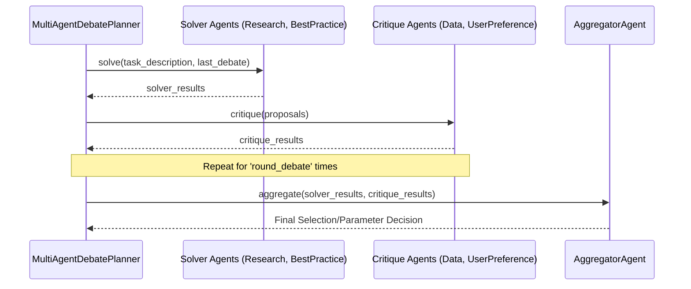
*Sources: [src/autoadapt/plan/multiagent_debate_planner.py:123-173]()*

## Shared Memory and Communication

The `SharedMemory` class acts as a thread-safe central repository for the planning process [src/autoadapt/memory/shared_memory.py:7-25](). Key keys used during planning include:

*   `request_type`: Identifies if the current node is a selection, parameter, or direct_parameter node [src/autoadapt/plan/multiagent_debate_planner.py:100-109]().
*   `current_request`: Stores the original `BaseModel` request object (e.g., `SelectionRequest`) for agent reference [src/autoadapt/plan/multiagent_debate_planner.py:114]().
*   `multiagent_debate_summary`: Stores the final round of proposals and critiques for the aggregator [src/autoadapt/plan/multiagent_debate_planner.py:155]().

## Pipeline Assembly

Once the DFS traversal of the ACG is complete, the `BasePlanner` returns an `AdaptPipeline` object [src/autoadapt/plan/base_planner.py:424-425]().

### AdaptStep and AdaptPipeline
*   **AdaptStep**: Represents a single unit of work (e.g., "Fine-tune with LoRA"). It contains the `step_config` (general settings) and `step_hparam_config` (the search space resolved during debate) [src/autoadapt/adapt/adapt_step.py:17-52]().
*   **AdaptPipeline**: A collection of `AdaptStep` objects. It provides an `execute()` method that runs each step sequentially [src/autoadapt/adapt/adapt_pipeline.py:16-34]().

If a node is a `direct_parameter` node, the `skip_hpo` flag is set to `True` in the `AdaptStep`, signaling the downstream `HpoExecutor` to use the fixed values provided by the planner instead of running an Optuna study [src/autoadapt/adapt/adapt_step.py:35-52]().

*Sources: [src/autoadapt/plan/base_planner.py:314-425](), [src/autoadapt/adapt/adapt_step.py:17-52](), [src/autoadapt/adapt/adapt_pipeline.py:16-38]()*

---

# Page: HPO Execution: AutoRefine

# HPO Execution: AutoRefine

<details>
<summary>Relevant source files</summary>

The following files were used as context for generating this wiki page:

- [src/autoadapt/adapt/pipeline_executor.py](src/autoadapt/adapt/pipeline_executor.py)
- [src/autoadapt/hpo/coreset_selection.py](src/autoadapt/hpo/coreset_selection.py)
- [src/autoadapt/hpo/gaussian_process.py](src/autoadapt/hpo/gaussian_process.py)
- [src/autoadapt/hpo/hpo_executor.py](src/autoadapt/hpo/hpo_executor.py)
- [src/autoadapt/hpo/llm_gp_sampler.py](src/autoadapt/hpo/llm_gp_sampler.py)
- [src/autoadapt/hpo/llm_sampler.py](src/autoadapt/hpo/llm_sampler.py)
- [src/autoadapt/hpo/llm_surrogate_sampler.py](src/autoadapt/hpo/llm_surrogate_sampler.py)
- [src/autoadapt/utils/hpo.py](src/autoadapt/utils/hpo.py)

</details>


The **AutoRefine** phase is the hyperparameter optimization (HPO) engine of AutoAdapt. It is managed by the `HpoExecutor` class, which leverages **Optuna** to search for optimal configurations. AutoRefine distinguishes itself from standard HPO by integrating Large Language Models (LLMs) into the sampling process (AutoRefine concept) and utilizing coreset-based data reduction to accelerate trial evaluations.

## HpoExecutor Implementation

The `HpoExecutor` inherits from the base `Executor` class [src/autoadapt/hpo/hpo_executor.py:40-40]() and orchestrates the entire HPO lifecycle, from environment setup to the export of the `best_config.yaml`.

### Initialization and Components
Upon initialization, the `HpoExecutor` sets up several critical sub-components:
*   **Code Mapping**: Loads `code_mapping.yaml` to identify which template code (SFT, DPO, or RAG) to use for the current step [src/autoadapt/hpo/hpo_executor.py:48-48]().
*   **Coreset Selector**: Initializes either a `RandomCoresetSelector` or an `EmbeddingCoresetSelector` based on the configuration `cfg.hpo.coreset_selection_method` [src/autoadapt/hpo/hpo_executor.py:54-57]().
*   **Evaluator**: An `Evaluator` instance is created to calculate the objective metric for each trial [src/autoadapt/hpo/hpo_executor.py:60-60]().

### Data Flow: Natural Language to Code Entities
The following diagram illustrates how high-level HPO concepts map to specific code implementations and files.

**Diagram: HPO System Mapping**
```mermaid
graph TD
    subgraph "Natural Language Space"
        "Optimization Strategy"
        "Data Reduction"
        "Search Space"
    end

    subgraph "Code Entity Space"
        "HpoExecutor"["class HpoExecutor (hpo_executor.py)"]
        "CoresetSelector"["class CoresetSelector (coreset_selection.py)"]
        "LLMGPSampler"["class LLMGPSampler (llm_gp_sampler.py)"]
        "CodeMapping"["code_mapping.yaml"]
    end

    "Optimization Strategy" --> "HpoExecutor"
    "Optimization Strategy" --> "LLMGPSampler"
    "Data Reduction" --> "CoresetSelector"
    "Search Space" --> "HpoExecutor"
    "HpoExecutor" -- "Uses" --> "CodeMapping"
```
Sources: [src/autoadapt/hpo/hpo_executor.py:40-63](), [src/autoadapt/hpo/coreset_selection.py:17-17](), [src/autoadapt/hpo/llm_gp_sampler.py:516-516]()

## The AutoRefine Lifecycle

The core logic resides in `run_step(step)`, which executes the following sequence:

1.  **Environment Preparation**: Creates a dedicated HPO directory and copies the relevant template code (e.g., from `src/autoadapt/template/sft`) into it, excluding existing configurations [src/autoadapt/hpo/hpo_executor.py:93-140]().
2.  **Config Templating**: Merges the step-specific hyperparameters with the global configuration using `_prepare_hpo_config` [src/autoadapt/hpo/hpo_executor.py:156-184]().
3.  **Optuna Study Setup**: Initializes an `optuna.study` with a sampler chosen from `cfg.hpo.hpo_sampler`. Options include `random`, `tpe`, or custom LLM-based samplers like `LLMGPSampler` [src/autoadapt/hpo/hpo_executor.py:236-258]().
4.  **Objective Function**: The `objective` function [src/autoadapt/hpo/hpo_executor.py:186-186]() is the trial runner. It:
    *   Suggests parameters from the search space using `suggest_from_cfg` [src/autoadapt/hpo/hpo_executor.py:202-202]().
    *   Invokes the template's `main.py` via `runpy.run_path` in `hpo_runtime` mode [src/autoadapt/hpo/hpo_executor.py:214-214]().
    *   Calculates the metric (e.g., loss or LLM-based eval) and returns it to Optuna [src/autoadapt/hpo/hpo_executor.py:221-228]().
5.  **Best Config Export**: Once trials complete, `export_optimized_config` creates a `best_config.yaml` containing the winning parameters [src/autoadapt/hpo/hpo_executor.py:313-313]().

Sources: [src/autoadapt/hpo/hpo_executor.py:84-154](), [src/autoadapt/hpo/hpo_executor.py:186-232]()

## Coreset-Based Data Reduction

To make HPO feasible on large datasets, AutoRefine uses **Coresets**—representative subsets of the data.

| Selector Type | Implementation | Description |
| :--- | :--- | :--- |
| **Random** | `RandomCoresetSelector` | Uses `dataset.shuffle().select()` based on `hpo.coreset_train_ratio` [src/autoadapt/hpo/coreset_selection.py:110-157](). |
| **Embedding** | `EmbeddingCoresetSelector` | Uses `SubmodularEmb` from the `deepcore` library. It calculates embeddings (default: `e5-large-v2`) and selects samples that maximize submodular coverage [src/autoadapt/hpo/coreset_selection.py:43-107](). |

Sources: [src/autoadapt/hpo/coreset_selection.py:17-157]()

## LLM-GP Sampler Integration

The `LLMGPSampler` is a hybrid sampler that combines the reasoning of LLMs with the statistical rigor of Gaussian Processes (GP).

### Execution Logic
1.  **Exploration/Bootstrap**: The LLM is prompted with `LLM_SAMPLER_FOR_GP_PROMPT_TEMPLATE` to suggest initial trials and predict their results based on `knowledge_hparams.md` and dataset stats [src/autoadapt/hpo/llm_gp_sampler.py:57-107]().
2.  **GP Modeling**: A `GPWrapper` (using `gpytorch`) is trained on these synthetic and historical trials [src/autoadapt/hpo/gaussian_process.py:21-57]().
3.  **Acquisition Optimization**: The system optimizes the Upper Confidence Bound (UCB) over the search space using the `L-BFGS` optimizer to find the next best candidate [src/autoadapt/hpo/llm_gp_sampler.py:431-456]().
4.  **Final Selection**: The LLM reviews the GP's top candidates and selects one for actual execution [src/autoadapt/hpo/llm_gp_sampler.py:154-180]().

**Diagram: LLM-GP Sampler Data Flow**
```mermaid
graph LR
    "Study History" --> "LLM_Bootstrap"
    "HParam Knowledge" --> "LLM_Bootstrap"
    "LLM_Bootstrap" -- "Synthetic Trials" --> "GPWrapper"
    "GPWrapper" -- "Acquisition Function" --> "L-BFGS_Optimizer"
    "L-BFGS_Optimizer" -- "Candidates" --> "LLM_Final_Selection"
    "LLM_Final_Selection" --> "Optuna_Trial"
```
Sources: [src/autoadapt/hpo/llm_gp_sampler.py:382-514](), [src/autoadapt/hpo/gaussian_process.py:21-111]()

## Code Templating via code_mapping.yaml

The `HpoExecutor` uses `mapping_code_template` to dynamically resolve which source code to run. It looks up the `step.type` (e.g., `sft`, `dpo`, `rag`) in `code_mapping.yaml` to find the corresponding template directory [src/autoadapt/hpo/hpo_executor.py:131-132]().

### Configuration Merging
The `_prepare_hpo_config` function ensures that the HPO environment is isolated:
*   `model_path` is redirected to the HPO subdirectory [src/autoadapt/hpo/hpo_executor.py:165-165]().
*   `save_model` is set to `False` to save disk space during trials [src/autoadapt/hpo/hpo_executor.py:167-167]().
*   User-defined search spaces from the Adaptation Configuration Graph (ACG) are merged into the final `config.yaml` [src/autoadapt/hpo/hpo_executor.py:182-182]().

Sources: [src/autoadapt/hpo/hpo_executor.py:130-184](), [src/autoadapt/utils/code.py:1-20]()

---

# Page: Pipeline Execution and Error Recovery

# Pipeline Execution and Error Recovery

<details>
<summary>Relevant source files</summary>

The following files were used as context for generating this wiki page:

- [app/sample/run.py](app/sample/run.py)
- [app/sample/run_plan.py](app/sample/run_plan.py)
- [src/autoadapt/adapt/pipeline_executor.py](src/autoadapt/adapt/pipeline_executor.py)
- [src/autoadapt/dashboard/static/run.py](src/autoadapt/dashboard/static/run.py)
- [src/autoadapt/hpo/hpo_executor.py](src/autoadapt/hpo/hpo_executor.py)

</details>


The `PipelineExecutor` is the final stage of the AutoAdapt lifecycle, responsible for executing the optimized adaptation strategy determined during the planning and HPO phases. It handles the transition from hyperparameter search to full-scale training, manages subprocess execution, and implements an LLM-driven self-healing loop to recover from parameter-induced failures.

## PipelineExecutor Overview

The `PipelineExecutor` class [src/autoadapt/adapt/pipeline_executor.py:29-31]() inherits from the base `Executor` [src/autoadapt/adapt/base_executor.py]() and manages the execution of an `AdaptPipeline`. Unlike the `HpoExecutor`, which runs multiple trials with reduced datasets, the `PipelineExecutor` typically runs the "best" configuration on the full dataset.

### Key Responsibilities
- **Code Preparation**: Maps the `AdaptStep` to a specific template (e.g., SFT, DPO, or RAG) and populates the execution directory with the necessary source files [src/autoadapt/adapt/pipeline_executor.py:133-152]().
- **Config Finalization**: Merges the `best_config.yaml` generated by HPO with the step's parameters to create a final `config.yaml` for the subprocess [src/autoadapt/adapt/pipeline_executor.py:170-172]().
- **Subprocess Management**: Launches `main.py` within the template directory as a separate process to ensure memory isolation and environment stability.
- **Error Recovery**: Monitors the execution logs for failures and uses an LLM to suggest parameter adjustments if the failure is attributed to training configurations (e.g., OOM or divergence) [src/autoadapt/adapt/pipeline_executor.py:91-125]().

### Pipeline Execution Flow
The following diagram illustrates the transition from the HPO phase to the final execution managed by `PipelineExecutor`.

**Execution Lifecycle and Data Flow**
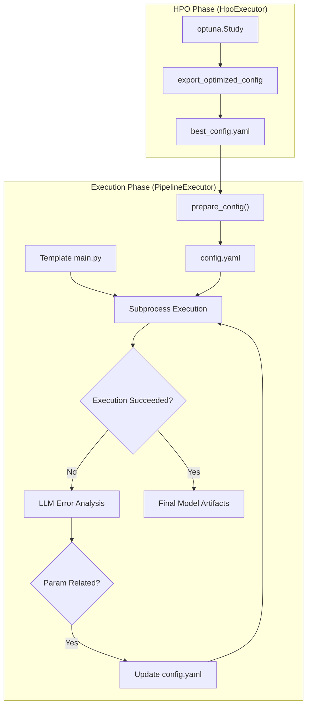
Sources: [src/autoadapt/hpo/hpo_executor.py:186-187](), [src/autoadapt/adapt/pipeline_executor.py:59-92](), [src/autoadapt/adapt/pipeline_executor.py:102-118]()

---

## Error Recovery and Self-Healing

AutoAdapt implements an LLM-driven retry loop to handle failures that occur during the execution of training scripts. This is specifically targeted at "parameter-related" errors such as CUDA Out-of-Memory (OOM), loss divergence, or configuration mismatches.

### The Retry Loop
The `run_step` method [src/autoadapt/adapt/pipeline_executor.py:59-66]() wraps the execution in a retry loop (defaulting to 3 attempts) [src/autoadapt/adapt/pipeline_executor.py:90-91](). If a step fails, the executor:
1.  Extracts relevant parameters from the current config (e.g., `sft_train`, `lora`, `prefix_tuning`) [src/autoadapt/adapt/pipeline_executor.py:98-99]().
2.  Reads the failure logs from `log.txt` [src/autoadapt/adapt/pipeline_executor.py:100-101]().
3.  Invokes the LLM using the `PARAMS_PROMPT_UPDATE_POST_ERRORS` prompt [src/autoadapt/adapt/pipeline_executor.py:106-108]().

### LLM Diagnosis
The LLM receives the `model_params` and the `error_log` [src/autoadapt/adapt/pipeline_executor.py:102-105](). It returns a JSON object containing:
- `error_related_to_model_params`: A boolean indicating if the LLM believes the error can be fixed by changing hyperparameters [src/autoadapt/adapt/pipeline_executor.py:110]().
- `reason`: A textual explanation of the failure [src/autoadapt/adapt/pipeline_executor.py:112]().
- Updated configuration blocks (e.g., reduced batch size for OOM, adjusted learning rate for divergence) [src/autoadapt/adapt/pipeline_executor.py:117-118]().

**LLM-Driven Recovery Logic**
```mermaid
sequenceDiagram
    participant PE as PipelineExecutor
    participant SP as Subprocess (main.py)
    participant LLM as ChatCompletionModel
    
    PE->>SP: execute(step)
    SP-->>PE: Return False (Exit Code != 0)
    PE->>PE: Read log.txt
    PE->>LLM: invoke(PARAMS_PROMPT_UPDATE_POST_ERRORS, logs, params)
    LLM-->>PE: JSON {error_related_to_model_params: true, updated_params: {...}}
    PE->>PE: Update step.step_config
    PE->>PE: Rewrite config.yaml
    PE->>SP: execute(step) [Retry 2]
```
Sources: [src/autoadapt/adapt/pipeline_executor.py:88-125](), [src/autoadapt/utils/llm.py]()

---

## Implementation Details

### Subprocess Execution
The executor uses `asyncio.to_thread` to run the blocking `self.execute` call [src/autoadapt/adapt/pipeline_executor.py:92](). The actual execution logic is inherited from the base `Executor`, which typically involves invoking the Python interpreter on the prepared `main.py` in the step's execution directory.

### Status Tracking
Execution progress is persisted to the filesystem to allow for resumption and UI monitoring:
- **status.txt**: Contains the current state: `Not started`, `In Process`, `Success`, or `Failed` [src/autoadapt/adapt/pipeline_executor.py:39-57]().
- **log.txt**: Captured via the `tee_output` context manager, which redirects stdout/stderr to both the console and a file [src/autoadapt/adapt/pipeline_executor.py:85-87]().

### User Approval Gate
While the `PipelineExecutor` handles the technical execution, the `AutoAdaptExecutor` (orchestrator) often enforces an approval gate before this phase begins.
- If `require_approval` is set to `True` [src/autoadapt/adapt/autoadapt_executor.py](), the system waits for the existence of an `approved.txt` file or a specific API signal from the React UI [app/react/backend/main.py]() before transitioning from HPO to `PipelineExecutor`.

### Directory Structure
During execution, the workspace is organized as follows:
```text
workspace/<project_id>/
├── hpo/                    # HPO trial artifacts
│   └── best_config.yaml    # Source for PipelineExecutor
├── execution/              # PipelineExecutor workspace
│   └── <step_name>/
│       ├── code/           # Copied template source
│       │   ├── main.py
│       │   └── conf/
│       │       └── config.yaml # Final merged config
│       ├── status.txt      # Execution status
│       └── log.txt         # Subprocess output
```
Sources: [src/autoadapt/adapt/pipeline_executor.py:68-71](), [src/autoadapt/adapt/pipeline_executor.py:145-157](), [src/autoadapt/hpo/hpo_executor.py:186-200]()

---

## Key Functions and Classes

| Entity | Role | Source |
| :--- | :--- | :--- |
| `PipelineExecutor` | Main class for running the final adaptation pipeline. | [src/autoadapt/adapt/pipeline_executor.py:29]() |
| `run_step` | Orchestrates the preparation, execution, and retry logic for a single step. | [src/autoadapt/adapt/pipeline_executor.py:59]() |
| `prepare_code` | Sets up the template files and final `config.yaml`. | [src/autoadapt/adapt/pipeline_executor.py:133]() |
| `PARAMS_PROMPT_UPDATE_POST_ERRORS` | LLM prompt used to diagnose and fix training failures. | [src/autoadapt/utils/llm.py]() |
| `tee_output` | Context manager for logging subprocess output to file. | [src/autoadapt/utils/misc.py]() |

Sources: [src/autoadapt/adapt/pipeline_executor.py](), [src/autoadapt/utils/llm.py](), [src/autoadapt/utils/misc.py]()

---

# Page: Multi-Agent System

# Multi-Agent System

<details>
<summary>Relevant source files</summary>

The following files were used as context for generating this wiki page:

- [src/autoadapt/agents/aggregator_agent.py](src/autoadapt/agents/aggregator_agent.py)
- [src/autoadapt/agents/base_agent.py](src/autoadapt/agents/base_agent.py)
- [src/autoadapt/agents/base_worker.py](src/autoadapt/agents/base_worker.py)
- [src/autoadapt/agents/best_practice_agent.py](src/autoadapt/agents/best_practice_agent.py)
- [src/autoadapt/agents/knowledge_retriever_agent.py](src/autoadapt/agents/knowledge_retriever_agent.py)
- [src/autoadapt/agents/messages.py](src/autoadapt/agents/messages.py)
- [src/autoadapt/agents/research_agent.py](src/autoadapt/agents/research_agent.py)

</details>


AutoAdapt utilizes a multi-agent orchestration framework based on `autogen-core` to automate the planning and configuration of machine learning adaptation pipelines. The system employs a debate-based architecture where specialized agents—categorized into **Solvers**, **Critiques**, and **Aggregators**—collaborate to resolve the optimal path through the Adaptation Configuration Graph (ACG).

### Agent Architecture Overview

The system architecture is built upon the `BaseAgent` and `BaseWorker` classes, which provide the foundational messaging and state management capabilities. Agents communicate asynchronously via a `BroadcastMessage` protocol and share state through a `SharedMemory` object.

Multi-Agent Communication Flow:
```mermaid
graph TD
    subgraph "Planning Phase (MultiAgentDebatePlanner)"
        Planner["MultiAgentDebatePlanner"] -- "RequestReplyMessage" --> SolverGroup["Solver Agents"]
        SolverGroup -- "Proposals" --> CritiqueGroup["Critique Agents"]
        CritiqueGroup -- "Critiques" --> Aggregator["AggregatorAgent"]
        Aggregator -- "FinalAnswer (Selection/Parameter)" --> Planner
    end

    subgraph "Communication Layer"
        SolverGroup -.-> SM["SharedMemory"]
        CritiqueGroup -.-> SM
        Aggregator -.-> SM
    end

    subgraph "Code Entities"
        BaseAgent["BaseAgent (src/autoadapt/agents/base_agent.py)"]
        BaseWorker["BaseWorker (src/autoadapt/agents/base_worker.py)"]
        SMEntity["SharedMemory (src/autoadapt/memory/shared_memory.py)"]
    end
```
**Sources:**
- `src/autoadapt/agents/base_agent.py:24-34` (BaseAgent definition)
- `src/autoadapt/agents/base_worker.py:26-42` (BaseWorker definition)
- `src/autoadapt/agents/messages.py:22-30` (Message types)

---

### Core Agent Roles

The multi-agent system divides labor across three primary roles to ensure that recommendations are technically sound, data-driven, and aligned with user constraints.

#### 1. Solver Agents
Solvers are responsible for generating initial proposals for pipeline nodes and hyperparameter settings. They leverage internal knowledge, static documentation, and live web retrieval.
*   **ResearchAgent**: Uses `knowledge.md` to provide reasoning based on documented best practices [src/autoadapt/agents/research_agent.py:60-84]().
*   **BestPracticeAgent**: Retrieves empirical data from model cards and dataset registries using fuzzy matching and vector search [src/autoadapt/agents/best_practice_agent.py:85-110]().
*   **KnowledgeRetrieverAgent**: Performs live queries to external sources like Arxiv, HuggingFace, and GitHub [src/autoadapt/agents/knowledge_retriever_agent.py:40-65]().

For details, see [Solver and Aggregator Agents](#4.1).

#### 2. Critique Agents
Critique agents evaluate solver proposals against the specific characteristics of the user's data and stated preferences.
*   **DataAgent**: Analyzes dataset statistics (e.g., token count, duplicate ratios) to invalidate proposals that are computationally infeasible or technically inappropriate for the data scale.
*   **UserPreferenceAgent**: Ensures that the pipeline adheres to constraints defined in `user_preference.md`.

For details, see [Critique Agents: Data and User Preference](#4.2).

#### 3. Aggregator Agent
The **AggregatorAgent** acts as the final decision-maker. It synthesizes the debate history, weighs solver proposals against critiques, and produces a structured `FinalAnswer` (e.g., `SelectionAnswer` or `ParameterAnswer`) [src/autoadapt/agents/aggregator_agent.py:53-78]().

For details, see [Solver and Aggregator Agents](#4.1).

---

### Shared Memory and Message Protocol

Agents do not maintain isolated states; they interact through a `SharedMemory` instance that stores the current request context, user tasks, and the history of the ongoing debate.

Agent-to-Code Mapping:
```mermaid
classDiagram
    class BaseAgent {
        +SharedMemory shared_memory
        +handle_incoming_message(message)
    }
    class BaseWorker {
        +List chat_history
        +_generate_reply()
    }
    class AggregatorAgent {
        +gen_selection_answer()
        +gen_parameter_answer()
    }
    class ResearchAgent {
        +solve(task_description)
    }

    BaseAgent <|-- BaseWorker
    BaseWorker <|-- AggregatorAgent
    BaseWorker <|-- ResearchAgent
    BaseWorker <|-- BestPracticeAgent
    BaseWorker <|-- DataAgent
```
**Sources:**
- `src/autoadapt/agents/base_agent.py:24-42` (SharedMemory integration)
- `src/autoadapt/agents/aggregator_agent.py:83-113` (Selection logic)
- `src/autoadapt/agents/messages.py:89-138` (Response schemas)

### Knowledge Retrieval System
The agents are supported by a specialized retrieval infrastructure that indexes model cards and machine learning papers. This system uses a `RetrieverFactory` to switch between different vector database implementations (FAISS/ChromaDB).

For details, see [Best Practices Knowledge Base and Retrieval](#4.3).

---
**Sources:**
- `src/autoadapt/agents/base_agent.py:24-51`
- `src/autoadapt/agents/base_worker.py:26-75`
- `src/autoadapt/agents/aggregator_agent.py:31-50`
- `src/autoadapt/agents/messages.py:44-85`

---

# Page: Solver and Aggregator Agents

# Solver and Aggregator Agents

<details>
<summary>Relevant source files</summary>

The following files were used as context for generating this wiki page:

- [src/autoadapt/agents/aggregator_agent.py](src/autoadapt/agents/aggregator_agent.py)
- [src/autoadapt/agents/best_practice_agent.py](src/autoadapt/agents/best_practice_agent.py)
- [src/autoadapt/agents/knowledge_retriever/knowledge_retriever.py](src/autoadapt/agents/knowledge_retriever/knowledge_retriever.py)
- [src/autoadapt/agents/knowledge_retriever/web_search_grounding.py](src/autoadapt/agents/knowledge_retriever/web_search_grounding.py)
- [src/autoadapt/agents/knowledge_retriever_agent.py](src/autoadapt/agents/knowledge_retriever_agent.py)
- [src/autoadapt/agents/research_agent.py](src/autoadapt/agents/research_agent.py)
- [src/autoadapt/config/knowledge.md](src/autoadapt/config/knowledge.md)
- [src/autoadapt/config/knowledge_hparams.md](src/autoadapt/config/knowledge_hparams.md)
- [src/autoadapt/config/model_selection_kb.md](src/autoadapt/config/model_selection_kb.md)

</details>


This section details the specialized agents responsible for generating domain adaptation strategies and synthesizing final configurations. These agents operate within a multi-agent debate framework to resolve nodes in the **Adaptation Configuration Graph (ACG)**.

## Overview of Agent Roles

The solver agents (`ResearchAgent`, `BestPracticeAgent`, `KnowledgeRetrieverAgent`) act as domain experts that provide proposals based on different knowledge sources. The `AggregatorAgent` serves as the final decision-maker, synthesizing these proposals into a structured configuration.

### Data Flow and Interaction
The planning process follows a specific flow where solvers generate initial ideas, critique agents provide feedback, and the aggregator produces the final selection or parameter value.

**Agent Reasoning Flow**
```mermaid
graph TD
    subgraph "Natural Language Space"
        A["User Task Description"] --> B["Solver Agents"]
        B -->|"Proposals"| C["Critique Agents"]
        C -->|"Critiques"| D["Aggregator Agent"]
    end

    subgraph "Code Entity Space"
        B1["ResearchAgent"] --- B
        B2["BestPracticeAgent"] --- B
        B3["KnowledgeRetrieverAgent"] --- B
        D1["AggregatorAgent"] --- D
        
        D1 -->|"FinalAnswer"| E["AdaptPipeline"]
        E --> F["main.py (Execution)"]
    end
    
    style B1 fill:none,stroke-dasharray: 5 5
    style B2 fill:none,stroke-dasharray: 5 5
    style B3 fill:none,stroke-dasharray: 5 5
    style D1 fill:none,stroke-dasharray: 5 5
```
**Sources:** [src/autoadapt/agents/aggregator_agent.py:31-50](), [src/autoadapt/agents/research_agent.py:37-57]()

---

## 1. ResearchAgent
The `ResearchAgent` provides reasoning based on static, curated knowledge bases. It primarily relies on local markdown files containing fine-tuning heuristics and model selection guides.

*   **Implementation:** Inherits from `BaseWorker` and uses `ChatCompletionModel` to process prompts [src/autoadapt/agents/research_agent.py:60-84]().
*   **Knowledge Source:** Loads content from `src/autoadapt/config/knowledge.md` [src/autoadapt/agents/research_agent.py:35-36](). This file contains decision rules for SFT vs. DPO vs. RAG and typical hyperparameter ranges [src/autoadapt/config/knowledge.md:3-38]().
*   **Key Function:** `solve(task_description, last_debate)` [src/autoadapt/agents/research_agent.py:90-140](). It dynamically switches its `response_format` based on the `request_type` (e.g., `SelectionAnswer`, `ParameterRangeAnswer`) stored in `shared_memory` [src/autoadapt/agents/research_agent.py:104-112]().

**Sources:** [src/autoadapt/agents/research_agent.py:1-140](), [src/autoadapt/config/knowledge.md:1-197]()

---

## 2. BestPracticeAgent
The `BestPracticeAgent` focuses on empirical evidence by retrieving "model cards" and "dataset cards" from a local database to find similar successful configurations.

*   **Retrieval Mechanism:** Uses the `BestPracticesRetriever` to search the `models_data_database` [src/autoadapt/agents/best_practice_agent.py:110]().
*   **Fuzzy Matching:** Implements `Levenshtein` distance to map retrieved model names to a valid `base_llm_list` [src/autoadapt/agents/best_practice_agent.py:22](), [src/autoadapt/agents/best_practice_agent.py:151-152]().
*   **Model Selection:** The function `get_base_llm_model_from_best_practice` invokes the LLM with a specialized `BASE_LLM_PROMPT` to extract recommended base models from retrieved text [src/autoadapt/agents/best_practice_agent.py:128-147]().
*   **Static Data:** Accesses `base_llm_list.json` and `model_card_parameter_distribution.json` to ground its recommendations in available hardware/software constraints [src/autoadapt/agents/best_practice_agent.py:112-126]().

**Sources:** [src/autoadapt/agents/best_practice_agent.py:85-152](), [src/autoadapt/agents/best_practices/best_practice_retriever.py:1-50]()

---

## 3. KnowledgeRetrieverAgent
This agent performs live web searches to gather the most recent state-of-the-art (SOTA) information from academic and community sources.

*   **Search Engines:** Orchestrates searches across **Arxiv**, **HuggingFace**, **PapersWithCode**, and **GitHub** [src/autoadapt/agents/knowledge_retriever/knowledge_retriever.py:25-200]().
*   **Web Search Grounding:** Uses the `WebSearchAgent` class, which interfaces with the `serpapi` (Google Search) to find organic results and snippets [src/autoadapt/agents/knowledge_retriever/web_search_grounding.py:11-53]().
*   **Summarization:** After retrieving documents (e.g., PDF content from Arxiv or JSON from PapersWithCode), it uses `chunk_and_retrieve` to extract relevant segments and an LLM to generate a single paragraph of insights [src/autoadapt/agents/knowledge_retriever/knowledge_retriever.py:127-151]().

**Sources:** [src/autoadapt/agents/knowledge_retriever_agent.py:40-83](), [src/autoadapt/agents/knowledge_retriever/knowledge_retriever.py:1-200](), [src/autoadapt/agents/knowledge_retriever/web_search_grounding.py:11-53]()

---

## 4. AggregatorAgent
The `AggregatorAgent` acts as the synthesis engine. It does not perform external retrieval but instead weighs the proposals and critiques to produce a structured output.

*   **Structured Output:** Uses Pydantic models to ensure the LLM returns valid JSON objects. Key formats include:
    *   `SelectionAnswer`: For choosing between discrete options (e.g., SFT vs RAG) [src/autoadapt/agents/aggregator_agent.py:83-113]().
    *   `ParameterRangeAnswer`: For defining search spaces for HPO [src/autoadapt/agents/aggregator_agent.py:139-169]().
    *   `DirectParameterAnswer`: For providing exact values when HPO is bypassed [src/autoadapt/agents/aggregator_agent.py:171-180]().
*   **Constraint Enforcement:** The prompt explicitly instructs the agent to prioritize preferences from the `DataAgent` or `UserPreferenceAgent` and to only select from the `valid_candidates` provided in the ACG [src/autoadapt/agents/aggregator_agent.py:41-50]().

### Aggregator Implementation Detail
The aggregator maps solver results into a structured prompt and parses the response back into code-usable objects.

**Aggregator Internal Logic**
```mermaid
graph LR
    subgraph "Input Processing"
        I1["Solver Proposals"] --> P["AGGREGATOR_AGENT_PROMPT"]
        I2["Critique Results"] --> P
        I3["Valid Candidates (ACG)"] --> P
    end

    subgraph "LLM Invocation"
        P --> INV["client.invoke()"]
    end

    subgraph "Output Parsing"
        INV --> SA["SelectionAnswer"]
        INV --> PRA["ParameterRangeAnswer"]
        INV --> DPA["DirectParameterAnswer"]
    end

    SA --> R["AdaptPipeline Node Resolution"]
    PRA --> R
    DPA --> R
```

**Sources:** [src/autoadapt/agents/aggregator_agent.py:53-180](), [src/autoadapt/agents/messages.py:1-50]()

---

# Page: Critique Agents: Data and User Preference

# Critique Agents: Data and User Preference

<details>
<summary>Relevant source files</summary>

The following files were used as context for generating this wiki page:

- [src/autoadapt/adapt/extract_dataset_stats.py](src/autoadapt/adapt/extract_dataset_stats.py)
- [src/autoadapt/agents/data_agent.py](src/autoadapt/agents/data_agent.py)
- [src/autoadapt/agents/knowledge_retriever/knowledge_utils.py](src/autoadapt/agents/knowledge_retriever/knowledge_utils.py)
- [src/autoadapt/agents/user_preference_agent.py](src/autoadapt/agents/user_preference_agent.py)
- [src/autoadapt/utils/agent.py](src/autoadapt/utils/agent.py)

</details>


Critique agents in AutoAdapt serve as the quality control layer during the planning phase. Unlike Solver agents that propose adaptation strategies, the `DataAgent` and `UserPreferenceAgent` evaluate these proposals against the ground truth of the provided dataset and the explicit constraints defined by the user. They ensure that the final adaptation pipeline is both technically feasible for the data and aligned with user expectations.

## DataAgent: Dataset Analysis and Critique

The `DataAgent` is responsible for deep analysis of the user-provided dataset. It extracts statistical features, identifies potential data quality issues, and uses these insights to critique adaptation proposals [src/autoadapt/agents/data_agent.py:49-54]().

### Technical Implementation

The agent performs two primary roles: statistical extraction and LLM-based critique.

1.  **Data Ingestion**: It supports both HuggingFace datasets and local files (json, csv, etc.) using `datasets.load_dataset` [src/autoadapt/agents/data_agent.py:126-131]().
2.  **Statistical Extraction**: The `retrieve_stat` method computes a comprehensive profile of the data [src/autoadapt/agents/data_agent.py:136-142]():
    *   **Tokenization Analysis**: Uses `tiktoken` or `AutoTokenizer` to calculate token lengths for inputs and outputs [src/autoadapt/agents/data_agent.py:186-189]().
    *   **Data Integrity**: Calculates duplicate ratios, missing input/output counts, and average word/character counts [src/autoadapt/agents/data_agent.py:153-161]().
    *   **Special Token Coverage**: Scans for specific markers (e.g., `<|endoftext|>`) to ensure model compatibility [src/autoadapt/agents/data_agent.py:204-210]().
3.  **Caching**: To optimize the planning phase, results are stored in `cached_data_stats.pkl` within the cache directory [src/autoadapt/agents/data_agent.py:145-149]().

### Data Critique Logic
The agent uses the `DATA_CRITICIZE_PROMPT` to evaluate proposals from other agents (like the `ResearchAgent`) against the extracted statistics [src/autoadapt/agents/data_agent.py:32-46](). It looks for distribution mismatches or inappropriate model choices relative to the dataset's complexity.

**Sources:**
*   [src/autoadapt/agents/data_agent.py:32-210]()

---

## DatasetStats: Domain Summarization

While `DataAgent` focuses on raw statistics, the `DatasetStats` class provides high-level semantic understanding of the data using LLMs.

### Domain and Difficulty Analysis
The `compute_dataset_summary` method selects a random subset of examples from the dataset and prompts an LLM using `llm.DATA_SUMMARIZATION_PROMPT` [src/autoadapt/adapt/extract_dataset_stats.py:101-140](). This produces:
*   **Data Summary**: A natural language description of what the dataset contains.
*   **Data Domain**: Identification of the field (e.g., Medical, Legal, Code).
*   **Difficulty Level**: An assessment of the task complexity [src/autoadapt/adapt/extract_dataset_stats.py:61-64]().

### Statistical Distribution
It uses `scipy` and `numpy` to generate histograms of sentence lengths and `nltk` to identify the most frequent non-stopword tokens [src/autoadapt/adapt/extract_dataset_stats.py:160-186]().

**Sources:**
*   [src/autoadapt/adapt/extract_dataset_stats.py:41-196]()

---

## UserPreferenceAgent: Constraint Enforcement

The `UserPreferenceAgent` ensures that the adaptation pipeline adheres to qualitative constraints provided by the user in a `user_preference.md` file [src/autoadapt/agents/user_preference_agent.py:30-37]().

### Implementation Details
*   **Preference Loading**: It reads the user preference file and strips markdown comments using regex [src/autoadapt/agents/user_preference_agent.py:38-44]().
*   **Critique Mechanism**: It implements the `critique` method, which takes proposals from other agents and evaluates them against the `USER_CRITICIZE_PROMPT` [src/autoadapt/agents/user_preference_agent.py:49-59]().
*   **Scope Awareness**: The agent is designed to recognize if a user preference is irrelevant to a specific node in the Adaptation Configuration Graph (ACG), allowing it to skip critiques when appropriate [src/autoadapt/agents/user_preference_agent.py:27-28]().

**Sources:**
*   [src/autoadapt/agents/user_preference_agent.py:14-59]()

---

## Data Flow: From Raw Data to Agent Critique

The following diagram illustrates how raw dataset files and user preference documents are transformed into structured critiques that influence the `MultiAgentDebatePlanner`.

### Data and Preference Processing Pipeline

```mermaid
graph TD
    subgraph "Natural Language Space"
        ["user_preference.md"]
        ["Dataset Samples"]
        ["Agent Proposals"]
    end

    subgraph "Code Entity Space"
        UP_Agent["UserPreferenceAgent"]
        D_Agent["DataAgent"]
        D_Stats["DatasetStats"]
        SM["SharedMemory"]
        
        UP_Agent -- "reads" --> ["user_preference.md"]
        D_Agent -- "load_data()" --> ["Dataset Samples"]
        D_Stats -- "compute_dataset_summary()" --> ["Dataset Samples"]
        
        D_Stats -- "DATA_SUMMARIZATION_PROMPT" --> LLM_Summary["LLM Response"]
        D_Agent -- "retrieve_stat()" --> Stats_Dict["stats dict"]
        
        Stats_Dict -- "stored in" --> SM
        LLM_Summary -- "stored in" --> SM
        
        UP_Agent -- "critique()" --> UP_Review["Structured Review"]
        D_Agent -- "DATA_CRITICIZE_PROMPT" --> D_Review["Data Critique"]
    end

    ["Agent Proposals"] -- "input to" --> UP_Agent
    ["Agent Proposals"] -- "input to" --> D_Agent
    UP_Review -- "influences" --> Planning["MultiAgentDebatePlanner"]
    D_Review -- "influences" --> Planning
```

**Sources:**
*   [src/autoadapt/agents/data_agent.py:100-114]()
*   [src/autoadapt/agents/user_preference_agent.py:36-44]()
*   [src/autoadapt/adapt/extract_dataset_stats.py:50-76]()

---

## Agent Interaction Architecture

This diagram details how the Critique agents interact with the shared memory and the LLM client during a debate round.

### Critique Agent Execution Logic

```mermaid
sequenceDiagram
    participant P as MultiAgentDebatePlanner
    participant DA as DataAgent
    participant UA as UserPreferenceAgent
    participant MC as ChatCompletionModel
    participant SM as SharedMemory

    P->>DA: retrieve_stat()
    DA->>DA: check cached_data_stats.pkl
    alt No Cache
        DA->>DA: Tokenize & Analyze Dataset
        DA->>SM: write(data_statistics)
    end
    
    P->>DA: critique(proposals)
    DA->>MC: invoke(DATA_CRITICIZE_PROMPT)
    MC-->>DA: Markdown Critique
    DA-->>P: Critique Result

    P->>UA: critique(proposals)
    UA->>MC: invoke(USER_CRITICIZE_PROMPT)
    MC-->>UA: Markdown Critique
    UA-->>P: Critique Result
```

**Sources:**
*   [src/autoadapt/agents/data_agent.py:144-150]()
*   [src/autoadapt/agents/data_agent.py:32-46]()
*   [src/autoadapt/agents/user_preference_agent.py:49-59]()

---

## Key Prompts and Structures

The critique agents rely on specific prompt templates to standardize their output for the `AggregatorAgent`.

| Agent | Prompt Constant | Primary Goal |
| :--- | :--- | :--- |
| `DataAgent` | `DATA_CRITICIZE_PROMPT` | Identify distribution mismatches and inappropriate model choices based on `data_statistics`. |
| `UserPreferenceAgent` | `USER_CRITICIZE_PROMPT` | Identify violations of constraints defined in `user_preference.md`. |
| `DatasetStats` | `DATA_SUMMARIZATION_PROMPT` | Extract domain, summary, and difficulty level from dataset samples. |

**Sources:**
*   [src/autoadapt/agents/data_agent.py:32-46]()
*   [src/autoadapt/agents/user_preference_agent.py:14-29]()
*   [src/autoadapt/adapt/extract_dataset_stats.py:133-140]()

---

# Page: Best Practices Knowledge Base and Retrieval

# Best Practices Knowledge Base and Retrieval

<details>
<summary>Relevant source files</summary>

The following files were used as context for generating this wiki page:

- [src/autoadapt/agents/best_practices/best_practice_retriever.py](src/autoadapt/agents/best_practices/best_practice_retriever.py)
- [src/autoadapt/agents/best_practices/chromadb_retriever.py](src/autoadapt/agents/best_practices/chromadb_retriever.py)
- [src/autoadapt/agents/best_practices/create_datasets_indexer.py](src/autoadapt/agents/best_practices/create_datasets_indexer.py)
- [src/autoadapt/agents/best_practices/create_datasets_indexer_v2.py](src/autoadapt/agents/best_practices/create_datasets_indexer_v2.py)
- [src/autoadapt/agents/best_practices/datasets_indexer.py](src/autoadapt/agents/best_practices/datasets_indexer.py)
- [src/autoadapt/agents/best_practices/datasets_retriever.py](src/autoadapt/agents/best_practices/datasets_retriever.py)
- [src/autoadapt/agents/best_practices/datasets_retriever_v2.py](src/autoadapt/agents/best_practices/datasets_retriever_v2.py)
- [src/autoadapt/agents/best_practices/openai_embeddings.py](src/autoadapt/agents/best_practices/openai_embeddings.py)
- [src/autoadapt/template/rag/main.py](src/autoadapt/template/rag/main.py)
- [src/autoadapt/template/rag/utils.py](src/autoadapt/template/rag/utils.py)

</details>


This page details the architecture and implementation of the indexing and retrieval systems used by AutoAdapt to provide empirical "best practices" during the planning phase. The system leverages a dual-version approach for vector storage and embedding generation to support various data sources including Papers with Code (PwC), HuggingFace (HF), and GitHub.

## Overview and Data Flow

The retrieval system serves the `BestPracticeAgent` by finding relevant model cards, dataset descriptions, and evaluation results that match the user's requirements. It bridges the gap between natural language requirements and proven technical configurations.

### System Data Flow
1.  **Parsing**: Raw JSON data from `app/data/` is parsed and converted into `Document` objects [src/autoadapt/agents/best_practices/create_datasets_indexer.py:34-52]().
2.  **Indexing**: Documents are embedded and stored in either FAISS (V1) or ChromaDB (V2) [src/autoadapt/agents/best_practices/datasets_indexer.py:115-127](), [src/autoadapt/agents/best_practices/chromadb_retriever.py:96-100]().
3.  **Retrieval**: The `BestPracticesRetriever` coordinates multiple sub-retrievers to query these databases based on a user task [src/autoadapt/agents/best_practices/best_practice_retriever.py:44-54]().
4.  **Ranking**: Results are aggregated and ranked using metrics like accuracy or fuzzy string matching (Levenshtein) [src/autoadapt/agents/best_practices/best_practice_retriever.py:56-93]().

### Retrieval Architecture: Code to Entity Mapping

The following diagram illustrates how the abstract retrieval logic maps to specific implementation classes and data files.

**Retrieval Entity Mapping**
```mermaid
graph TD
    subgraph "Natural Language Space"
        UserQuery["User Task Description"]
    end

    subgraph "Retrieval Logic (src/autoadapt/agents/best_practices)"
        BPR["BestPracticesRetriever"]
        RF["RetrieverFactory"]
        ODR["OfflineDocRetriever"]
    end

    subgraph "Code Entity Space (Data & Storage)"
        FAISS_DB["FAISS (V1 Index)"]
        Chroma_DB["ChromaDBRetriever (V2 Index)"]
        PWC_JSON["pwc_eval_results_list_with_description_onlyLLM.json"]
        HF_JSON["datasets_with_eval_bestpractices_all_math_1000_train.json"]
    end

    UserQuery --> BPR
    BPR --> RF
    RF --> ODR
    ODR -- "V1" --> FAISS_DB
    ODR -- "V2" --> Chroma_DB
    FAISS_DB -.-> PWC_JSON
    FAISS_DB -.-> HF_JSON
```
Sources: [src/autoadapt/agents/best_practices/best_practice_retriever.py:26-55](), [src/autoadapt/agents/best_practices/datasets_retriever.py:51-72](), [src/autoadapt/agents/best_practices/datasets_retriever_v2.py:51-66]().

---

## Indexing Systems (V1 vs V2)

AutoAdapt maintains two indexing implementations to support different deployment environments and performance requirements.

### V1: FAISS + HuggingFace Embeddings
The V1 system uses `FAISS` for local vector storage and `e5-large-v2` embeddings. It is primarily used for the initial setup of offline knowledge bases.

*   **Embedding Model**: `intfloat/e5-large-v2` via `langchain_huggingface` [src/autoadapt/agents/best_practices/datasets_indexer.py:64-75]().
*   **Storage**: Local FAISS index files (`.faiss`, `.pkl`) [src/autoadapt/agents/best_practices/datasets_indexer.py:127-128]().
*   **Key Function**: `create_indexer_from_documents` handles document creation and incremental merging [src/autoadapt/agents/best_practices/datasets_indexer.py:151-220]().

### V2: ChromaDB + OpenAI Embeddings
The V2 system provides a more robust, persistent storage solution using `ChromaDB` and supports Azure OpenAI embeddings.

*   **Embedding Model**: `BaseEmbeddingModel` wrapping Azure OpenAI [src/autoadapt/agents/best_practices/openai_embeddings.py:40-76]().
*   **Storage**: `chromadb.PersistentClient` [src/autoadapt/agents/best_practices/chromadb_retriever.py:38]().
*   **Features**: Includes a persistent embedding cache (`embedding_cache.json`) to minimize API costs by hashing text content before requesting new embeddings [src/autoadapt/agents/best_practices/chromadb_retriever.py:41-78]().

**Indexing Implementation Comparison**

| Feature | V1 (datasets_indexer.py) | V2 (chromadb_retriever.py) |
| :--- | :--- | :--- |
| **Vector DB** | FAISS [src/autoadapt/agents/best_practices/datasets_indexer.py:7]() | ChromaDB [src/autoadapt/agents/best_practices/chromadb_retriever.py:8]() |
| **Embeddings** | HuggingFace (e5-large-v2) [src/autoadapt/agents/best_practices/datasets_indexer.py:66]() | OpenAI / Azure OpenAI [src/autoadapt/agents/best_practices/openai_embeddings.py:14]() |
| **Caching** | `lru_cache` (Memory) [src/autoadapt/agents/best_practices/datasets_indexer.py:63]() | JSON File (Persistent) [src/autoadapt/agents/best_practices/chromadb_retriever.py:41]() |
| **Format Support** | JSON [src/autoadapt/agents/best_practices/datasets_indexer.py:110]() | JSON [src/autoadapt/agents/best_practices/create_datasets_indexer_v2.py:81]() |

Sources: [src/autoadapt/agents/best_practices/datasets_indexer.py:1-150](), [src/autoadapt/agents/best_practices/chromadb_retriever.py:1-128](), [src/autoadapt/agents/best_practices/openai_embeddings.py:1-76]().

---

## BestPracticesRetriever

The `BestPracticesRetriever` class is the high-level interface used by the `BestPracticeAgent`. It initializes multiple specialized retrievers for different data sources upon instantiation [src/autoadapt/agents/best_practices/best_practice_retriever.py:28-55]().

### Data Source Parsing
The system categorizes data based on the `datasetsource` parameter to extract the correct content for indexing:
*   **pwc**: Uses the `description` field [src/autoadapt/agents/best_practices/create_datasets_indexer.py:38-39]().
*   **hf**: Uses the `task_description` field [src/autoadapt/agents/best_practices/create_datasets_indexer.py:40-41]().
*   **github**: Uses `model_card_description` [src/autoadapt/agents/best_practices/create_datasets_indexer.py:42-45]().
*   **github_data**: Uses `task_description` and filters for `dataset_best_practices` [src/autoadapt/agents/best_practices/create_datasets_indexer.py:46-51]().

### Ranking and Aggregation
The retriever does not just return raw documents; it ranks methodologies based on aggregated metrics:
1.  **Metric Extraction**: It collects all available metrics (e.g., accuracy) for retrieved results [src/autoadapt/agents/best_practices/best_practice_retriever.py:65-71]().
2.  **Ordinal Ranking**: It calculates the rank of each model/methodology for every metric [src/autoadapt/agents/best_practices/best_practice_retriever.py:79-91]().
3.  **Mean Aggregate Rank**: It computes a final `aggregate_rank` by averaging ranks across all metrics and similar datasets [src/autoadapt/agents/best_practices/best_practice_retriever.py:92-133]().

Sources: [src/autoadapt/agents/best_practices/best_practice_retriever.py:56-144](), [src/autoadapt/agents/best_practices/create_datasets_indexer.py:34-54]().

---

## RetrieverFactory Pattern

The `RetrieverFactory` allows the system to dynamically instantiate different retrieval strategies (Offline, Online, Experience, Demonstration) based on the configuration.

**Retriever Class Hierarchy**
```mermaid
classDiagram
    class Retriever {
        <<abstract>>
        +get_indexer()*
        +retrieve(query, top_k)
    }
    class OfflineDocRetriever {
        +app_name
        +get_indexer(path)
    }
    class OnlineDocRetriever {
        +query
        +get_indexer(top_k)
    }
    class ExperienceRetriever {
        +get_indexer(db_path)
    }
    class DemonstrationRetriever {
        +get_indexer(db_path)
    }

    Retriever <|-- OfflineDocRetriever
    Retriever <|-- OnlineDocRetriever
    Retriever <|-- ExperienceRetriever
    Retriever <|-- DemonstrationRetriever
    
    class RetrieverFactory {
        +create_retriever(retriever_type)
    }
    
    RetrieverFactory ..> Retriever : Creates
```

### Key Components
*   **OfflineDocRetriever**: Loads pre-built FAISS or ChromaDB indices from disk [src/autoadapt/agents/best_practices/datasets_retriever.py:111-160]().
*   **OnlineDocRetriever**: Performs real-time web searches (e.g., via Bing) and builds a temporary index for the results [src/autoadapt/agents/best_practices/datasets_retriever.py:190-223]().
*   **Retriever.retrieve()**: Standardized method that performs a `similarity_search` against the underlying indexer [src/autoadapt/agents/best_practices/datasets_retriever.py:97-108]().

Sources: [src/autoadapt/agents/best_practices/datasets_retriever.py:51-223](), [src/autoadapt/agents/best_practices/datasets_retriever_v2.py:51-102]().

---

# Page: Adaptation Templates

# Adaptation Templates

<details>
<summary>Relevant source files</summary>

The following files were used as context for generating this wiki page:

- [src/autoadapt/config/ACG.json](src/autoadapt/config/ACG.json)
- [src/autoadapt/template/dpo/conf/config.yaml](src/autoadapt/template/dpo/conf/config.yaml)
- [src/autoadapt/template/dpo/main.py](src/autoadapt/template/dpo/main.py)
- [src/autoadapt/template/sft/conf/config.yaml](src/autoadapt/template/sft/conf/config.yaml)
- [src/autoadapt/template/sft/main.py](src/autoadapt/template/sft/main.py)

</details>


Adaptation Templates are the core execution scripts in AutoAdapt that implement specific machine learning strategies to adapt Large Language Models (LLMs) to new domains or tasks. These templates are invoked as independent subprocesses by the `PipelineExecutor` after the planning and HPO phases have finalized the optimal configuration.

The system currently supports three primary adaptation strategies defined in the Adaptation Configuration Graph (ACG):
1.  **SFT (Supervised Fine-Tuning)**: Standard cross-entropy training on instruction-response pairs.
2.  **DPO (Direct Preference Optimization)**: Alignment-based tuning using preference pairs (chosen vs. rejected).
3.  **RAG (Retrieval-Augmented Generation)**: Non-parametric adaptation via external knowledge retrieval.

### Template Orchestration

The `ACG.json` file defines these strategies as "executable" nodes. When a strategy is selected, the `PipelineExecutor` maps the node name to a specific `main.py` entry point within the `src/autoadapt/template/` directory.

#### Strategy Selection in ACG
| Strategy | Node Type | Executable | Parameters (Examples) |
| :--- | :--- | :--- | :--- |
| **SFT** | `select:any` | Yes | `learning_rate`, `num_train_epochs`, `packing` |
| **DPO** | `select:any` | Yes | `beta`, `learning_rate`, `per_device_train_batch_size` |
| **RAG** | `select:1` | Yes | `retriever_top_k`, `embedding_model` |

**Sources:**
- [src/autoadapt/config/ACG.json:1-120]()

---

### SFT and DPO Training Templates

The training templates (SFT and DPO) share a similar execution flow managed by the `trl` library (Transformer Reinforcement Learning). They both support Parameter-Efficient Fine-Tuning (PEFT) methods like LoRA and Prefix Tuning, as well as model quantization (int4/int8) to reduce GPU memory requirements.

#### Training Lifecycle
1.  **Data Ingestion**: `load_user_data` handles multi-format datasets (CSV, HF) and splits them into train/validation/test sets.
2.  **Model Loading**: `get_model` initializes the base LLM with optional quantization.
3.  **Adapter Attachment**: `get_peft_model` applies LoRA or Prefix Tuning configurations.
4.  **Trainer Initialization**: Uses `SFTTrainer` or `DPOTrainer` with specialized `compute_metrics` logic.
5.  **Post-Processing**: Includes `merge_and_unload()` for PEFT adapters and model serialization.

For details, see [SFT and DPO Training Templates](#5.1).

**Sources:**
- [src/autoadapt/template/sft/main.py:34-150]()
- [src/autoadapt/template/dpo/main.py:35-153]()
- [src/autoadapt/template/sft/conf/config.yaml:33-40]()

---

### RAG Template: Indexing and Optimization

Unlike the training templates, the RAG template focuses on optimizing the retrieval pipeline and the generation prompts rather than the model weights. It utilizes `ChromaDB` for vector storage and `DSPy` for prompt optimization.

#### RAG Lifecycle
1.  **Indexing**: Documents are embedded using `BaseEmbeddingModel` and stored in a local vector store.
2.  **Optimization**: The `MIPROv2` optimizer from DSPy tunes the system prompts and retrieval parameters based on a `SemanticF1` metric.
3.  **Evaluation**: Uses `vLLM` for high-throughput inference to validate the retrieval-augmented responses.

For details, see [RAG Template: Indexing, Optimization, and Evaluation](#5.2).

**Sources:**
- [src/autoadapt/config/ACG.json:13-43]()

---

### Architectural Mapping: Template Execution

The following diagram illustrates how the `PipelineExecutor` bridges the high-level adaptation plan to the specific code entities within the template directory.

**Adaptation Execution Flow**
```mermaid
graph TD
    subgraph "Natural Language Space (ACG & Planner)"
        A["'sft' Node (ACG.json)"]
        B["'dpo' Node (ACG.json)"]
        C["'rag' Node (ACG.json)"]
    end

    subgraph "Code Entity Space (Templates)"
        SFT_M["src/autoadapt/template/sft/main.py"]
        DPO_M["src/autoadapt/template/dpo/main.py"]
        RAG_M["src/autoadapt/template/rag/main.py"]
        
        SFT_T["SFTTrainer (trl)"]
        DPO_T["DPOTrainer (trl)"]
        RAG_O["MIPROv2 Optimizer (dspy)"]
    end

    A -- "executes" --> SFT_M
    B -- "executes" --> DPO_M
    C -- "executes" --> RAG_M

    SFT_M --> SFT_T
    DPO_M --> DPO_T
    RAG_M --> RAG_O
```

**Sources:**
- [src/autoadapt/config/ACG.json:1-120]()
- [src/autoadapt/template/sft/main.py:18-142]()
- [src/autoadapt/template/dpo/main.py:25-145]()

---

### Parameter Management and HPO Integration

Each template is designed to operate in two modes, controlled by the `hpo_runtime` flag in the configuration.

*   **HPO Mode (`hpo_runtime: True`)**: The template executes a "trial." It typically uses a `hpo_metric` (e.g., BLEU or Accuracy) and reports results back to the `HpoExecutor`. It skips full model saving and base model comparison to save time.
*   **Execution Mode (`hpo_runtime: False`)**: The template performs the final adaptation. It evaluates the base model, runs the full training/optimization, merges adapters, and saves the final artifacts to `trained_model_dir`.

**Comparison of Template Configurations**
| Feature | SFT Config | DPO Config |
| :--- | :--- | :--- |
| **Main Trainer** | `SFTTrainer` | `DPOTrainer` |
| **Loss Configuration** | `completion_only_loss` | `beta` (KL divergence) |
| **Data Columns** | `input_column`, `response_column` | `input_column`, `response_column`, `rejected_column` |
| **PEFT Support** | LoRA, Prefix Tuning | LoRA, Prefix Tuning |

**Sources:**
- [src/autoadapt/template/sft/main.py:88-116]()
- [src/autoadapt/template/dpo/main.py:78-107]()
- [src/autoadapt/template/sft/conf/config.yaml:83-83]()
- [src/autoadapt/template/dpo/conf/config.yaml:13-15]()

---

# Page: SFT and DPO Training Templates

# SFT and DPO Training Templates

<details>
<summary>Relevant source files</summary>

The following files were used as context for generating this wiki page:

- [src/autoadapt/config/ACG.json](src/autoadapt/config/ACG.json)
- [src/autoadapt/evaluate/evaluator.py](src/autoadapt/evaluate/evaluator.py)
- [src/autoadapt/template/dpo/conf/config.yaml](src/autoadapt/template/dpo/conf/config.yaml)
- [src/autoadapt/template/dpo/main.py](src/autoadapt/template/dpo/main.py)
- [src/autoadapt/template/sft/conf/config.yaml](src/autoadapt/template/sft/conf/config.yaml)
- [src/autoadapt/template/sft/main.py](src/autoadapt/template/sft/main.py)
- [src/autoadapt/utils/template.py](src/autoadapt/utils/template.py)

</details>


This page provides a technical deep dive into the core training templates of AutoAdapt: Supervised Fine-Tuning (SFT) and Direct Preference Optimization (DPO). These templates serve as the execution entry points for model adaptation, handling data ingestion, model quantization, Parameter-Efficient Fine-Tuning (PEFT) setup, and evaluation.

## Overview of Training Entrypoints

The training logic is encapsulated in `run()` functions within `src/autoadapt/template/sft/main.py` and `src/autoadapt/template/dpo/main.py`. These scripts are invoked by the `PipelineExecutor` during the execution phase or by the `HpoExecutor` during hyperparameter optimization trials.

### System Flow: From Configuration to Training

The following diagram illustrates how the configuration and code entities interact during a training run.

**Training Template Execution Flow**
```mermaid
graph TD
    subgraph "Natural Language & Config Space"
        ACG["ACG.json (SFT/DPO Nodes)"]
        YAML["config.yaml (Hydra)"]
    end

    subgraph "Code Entity Space (src/autoadapt/template)"
        RUN_SFT["sft/main.py: run()"]
        RUN_DPO["dpo/main.py: run()"]
        UTILS["utils/template.py"]
        
        SFT_T["TRL SFTTrainer"]
        DPO_T["TRL DPOTrainer"]
    end

    ACG -->|Defines Params| YAML
    YAML -->|Injected into| RUN_SFT
    YAML -->|Injected into| RUN_DPO
    
    RUN_SFT -->|Calls| UTILS_LOAD["get_model(), get_peft_config()"]
    RUN_DPO -->|Calls| UTILS_LOAD
    
    UTILS_LOAD -->|Returns| MODEL["Model + PEFT + Quantization"]
    
    MODEL --> SFT_T
    MODEL --> DPO_T
```
**Sources:** [src/autoadapt/template/sft/main.py:34-50](), [src/autoadapt/template/dpo/main.py:35-41](), [src/autoadapt/config/ACG.json:45-120]()

---

## Model Setup and Quantization

Both SFT and DPO templates utilize `utils/template.py` to initialize models with specific hardware optimizations.

### Quantization (int4/int8)
The system supports 4-bit and 8-bit quantization via `BitsAndBytesConfig`. This is controlled by the `quantization` and `quantization_type` fields in the ACG/YAML configuration.
- **int4:** Uses `load_in_4bit=True` with `nf4` quantization type and `torch.bfloat16` compute dtype [src/autoadapt/utils/template.py:202-211]().
- **int8:** Uses `load_in_8bit=True` [src/autoadapt/utils/template.py:213-217]().

### PEFT Setup (LoRA and Prefix Tuning)
AutoAdapt supports two primary PEFT methods:
1.  **LoRA (Low-Rank Adaptation):** Configured via `LoraConfig`. Key parameters include `r` (rank), `lora_alpha`, and `target_modules` [src/autoadapt/utils/template.py:330-343]().
2.  **Prefix Tuning:** Configured via `PrefixTuningConfig`, utilizing `num_virtual_tokens` [src/autoadapt/utils/template.py:345-350]().

The `get_peft_model` function from the `peft` library is used to wrap the base model before passing it to the trainer [src/autoadapt/template/sft/main.py:83-84](), [src/autoadapt/template/dpo/main.py:72-73]().

**Sources:** [src/autoadapt/utils/template.py:190-230](), [src/autoadapt/utils/template.py:321-355]()

---

## Trainer Configurations

The templates leverage the Hugging Face `trl` library for optimized training loops.

### SFTTrainer and completion_only_loss
The `SFTTrainer` is initialized with `SFTConfig`. A notable feature is the `completion_only_loss` flag, which is dynamically set to `True` if the task is identified as "Question Answering" [src/autoadapt/template/sft/main.py:137-140](). This ensures the model only learns from the response, not the prompt.

### DPOTrainer and Preference Data
The `DPOTrainer` requires a dataset with `prompt`, `chosen`, and `rejected` columns [src/autoadapt/template/dpo/main.py:47-63](). It uses the `beta` parameter (default 0.1) to control the deviation from the reference model [src/autoadapt/template/dpo/main.py:141]().

| Feature | SFT (Supervised Fine-Tuning) | DPO (Direct Preference Optimization) |
| :--- | :--- | :--- |
| **Trainer Class** | `SFTTrainer` | `DPOTrainer` |
| **Loss Type** | Cross-Entropy (Language Modeling) | Preference-based Reward Optimization |
| **Key Parameter** | `packing` (for sequence efficiency) | `beta` (KL divergence constraint) |
| **Data Format** | Prompt + Completion | Prompt + Chosen + Rejected |

**Sources:** [src/autoadapt/template/sft/main.py:118-149](), [src/autoadapt/template/dpo/main.py:110-153]()

---

## HPO Runtime Mode and Memory Management

During Hyperparameter Optimization (HPO), the templates operate in a specialized `hpo_runtime` mode to maximize efficiency.

### hpo_runtime Behavior
When `cfg.hpo_runtime` is `True`:
- **Metrics:** The trainer only computes the specific metric requested by the HPO sampler (e.g., BLEU or Accuracy) to save time [src/autoadapt/template/sft/main.py:110-112]().
- **Evaluation Strategy:** The `eval_strategy` is forced to `"steps"` to provide feedback to the HPO tuner during the run [src/autoadapt/template/sft/main.py:128]().
- **Output:** Result files for the UI are bypassed, and only the raw metric value is returned to the `HpoExecutor`.

### GPU Memory Cleanup
To prevent Out-of-Memory (OOM) errors between HPO trials, AutoAdapt performs aggressive cleanup.

**Memory Cleanup Sequence**
```mermaid
sequenceDiagram
    participant H as HpoExecutor
    participant T as Training Template
    participant G as GPU Memory

    H->>T: run(trial_config)
    T->>G: Allocate Model/Tensors
    T->>T: trainer.train()
    T->>H: Return Metric
    Note over T,G: Cleanup Phase
    T->>T: del trainer, model
    T->>T: gc.collect()
    T->>G: torch.cuda.empty_cache()
    Note over G: Memory Released for Next Trial
```

### merge_and_unload()
After training with PEFT (LoRA/Prefix Tuning), the template calls `model.merge_and_unload()` [src/autoadapt/template/sft/main.py:168](). This merges the adapter weights back into the base model, which is necessary for efficient inference and saving the final artifact as a standalone model [src/autoadapt/template/dpo/main.py:174]().

**Sources:** [src/autoadapt/template/sft/main.py:88-116](), [src/autoadapt/template/sft/main.py:167-169](), [src/autoadapt/utils/template.py:49-73]()

---

# Page: RAG Template: Indexing, Optimization, and Evaluation

# RAG Template: Indexing, Optimization, and Evaluation

<details>
<summary>Relevant source files</summary>

The following files were used as context for generating this wiki page:

- [src/autoadapt/agents/best_practices/chromadb_retriever.py](src/autoadapt/agents/best_practices/chromadb_retriever.py)
- [src/autoadapt/agents/best_practices/create_datasets_indexer.py](src/autoadapt/agents/best_practices/create_datasets_indexer.py)
- [src/autoadapt/agents/best_practices/create_datasets_indexer_v2.py](src/autoadapt/agents/best_practices/create_datasets_indexer_v2.py)
- [src/autoadapt/agents/best_practices/datasets_indexer.py](src/autoadapt/agents/best_practices/datasets_indexer.py)
- [src/autoadapt/agents/best_practices/datasets_retriever.py](src/autoadapt/agents/best_practices/datasets_retriever.py)
- [src/autoadapt/agents/best_practices/datasets_retriever_v2.py](src/autoadapt/agents/best_practices/datasets_retriever_v2.py)
- [src/autoadapt/agents/best_practices/openai_embeddings.py](src/autoadapt/agents/best_practices/openai_embeddings.py)
- [src/autoadapt/template/rag/conf/config.yaml](src/autoadapt/template/rag/conf/config.yaml)
- [src/autoadapt/template/rag/main.py](src/autoadapt/template/rag/main.py)
- [src/autoadapt/template/rag/utils.py](src/autoadapt/template/rag/utils.py)

</details>


The RAG (Retrieval-Augmented Generation) template in AutoAdapt provides a complete lifecycle for building and refining retrieval-based AI systems. It automates the ingestion of documents into vector databases, optimizes system prompts using advanced techniques like DSPy MIPROv2, and performs rigorous evaluation using vLLM-based inference and LLM-as-a-judge metrics.

## RAG Lifecycle Overview

The RAG execution flow is managed by `src/autoadapt/template/rag/main.py` and consists of three primary stages: indexing, prompt optimization, and end-to-end evaluation [src/autoadapt/template/rag/main.py:42-77]().

### Natural Language Space to Code Entity Space: RAG Execution

The following diagram maps the logical stages of the RAG lifecycle to the specific code entities and files that implement them.

**RAG Lifecycle Mapping**
```mermaid
graph TD
    subgraph "Natural Language Space"
        A["Document Ingestion"]
        B["Prompt Engineering"]
        C["System Evaluation"]
    end

    subgraph "Code Entity Space"
        direction TB
        A --> COLL["build_or_load_index()"]
        B --> OPT["optimize_rag_prompt()"]
        C --> EVAL["evaluate_rag_optimized()"]

        COLL -.-> CHROMA["chromadb.PersistentClient"]
        OPT -.-> DSPY["dspy.MIPROv2"]
        EVAL -.-> VLLM["get_predictions_vllm()"]
    end

    style A stroke-dasharray: 5 5
    style B stroke-dasharray: 5 5
    style C stroke-dasharray: 5 5
```
**Sources:** [src/autoadapt/template/rag/main.py:42-77](), [src/autoadapt/template/rag/utils.py:102-128]()

---

## 1. Document Indexing with ChromaDB

The indexing phase converts raw text documents into vector representations for retrieval. AutoAdapt uses **ChromaDB** as the vector store [src/autoadapt/template/rag/utils.py:113-115]().

### Implementation Details
- **Persistence:** The system uses `chromadb.PersistentClient` to ensure indices are saved to the path specified in `cfg.rag_data.chroma_db_path` [src/autoadapt/template/rag/utils.py:113-114]().
- **Embedding Generation:** Texts are embedded using the model specified in `cfg.rag_params.embedding_model` (e.g., `text-embedding-3-large`) [src/autoadapt/template/rag/conf/config.yaml:35]().
- **Chunking:** Documents are processed into fixed-size word chunks with configurable overlap to maintain context [src/autoadapt/template/rag/utils.py:44-57]().
- **Azure Integration:** For Azure OpenAI users, the `BaseEmbeddingModel` class manages authentication via `ManagedIdentityCredential` and `get_bearer_token_provider` [src/autoadapt/agents/best_practices/openai_embeddings.py:8-37]().

**Sources:** [src/autoadapt/template/rag/utils.py:102-128](), [src/autoadapt/agents/best_practices/openai_embeddings.py:40-76](), [src/autoadapt/template/rag/conf/config.yaml:33-37]()

---

## 2. DSPy Prompt Optimization (MIPROv2)

Rather than relying on static prompts, the RAG template utilizes **DSPy** to optimize the interaction between the retriever and the generator.

### Optimization Workflow
1. **SemanticF1 Metric:** Optimization is guided by the `SemanticF1` metric, which uses embeddings to evaluate the semantic similarity between generated answers and ground truth, providing a more robust signal than exact matching [src/autoadapt/template/rag/utils.py:14]().
2. **MIPROv2:** The system employs the `MIPROv2` (Multi-objective In-context Prompt Optimization) teleprompter to search for the best instructions and few-shot examples [src/autoadapt/template/rag/main.py:51-54]().
3. **Serialization:** The resulting optimized DSPy module is saved as `optimized_rag.json` in the output directory for deployment [src/autoadapt/template/rag/main.py:59]().

**Sources:** [src/autoadapt/template/rag/main.py:51-62](), [src/autoadapt/template/rag/utils.py:14]()

---

## 3. Evaluation and Inference

Evaluation measures the performance of the RAG pipeline on a test dataset using high-throughput inference engines.

### vLLM-Based Inference
For evaluation, AutoAdapt utilizes **vLLM** to generate responses for the test prompts. The `get_predictions_vllm` function handles batch inference on the local model specified by the planner [src/autoadapt/template/rag/utils.py:201]().

### Evaluation Pipeline
The `evaluate_rag` function orchestrates the following data flow:
1. **Data Loading:** Loads test data from CSV/JSON/HF formats [src/autoadapt/template/rag/utils.py:189-196]().
2. **Augmentation:** Queries the ChromaDB collection to retrieve context and constructs augmented prompts [src/autoadapt/template/rag/utils.py:200]().
3. **Generation:** Invokes vLLM to produce predictions [src/autoadapt/template/rag/utils.py:201]().
4. **Scoring:** Uses `evaluate_with_llm` (LLM-as-a-judge) to compare predictions against ground truth [src/autoadapt/template/rag/utils.py:19]().

**Sources:** [src/autoadapt/template/rag/utils.py:167-203](), [src/autoadapt/template/rag/main.py:64-77]()

---

## 4. Status Reporting and Monitoring

The RAG template communicates its progress to the AutoAdapt backend and UI through a series of status files. This allows real-time monitoring of long-running indexing or optimization tasks.

| Status File | Purpose |
| :--- | :--- |
| `rag_index_status.txt` | Tracks ChromaDB indexing progress (`In Process`, `Success`) [src/autoadapt/template/rag/main.py:43-47]() |
| `rag_optimize_status.txt` | Tracks DSPy prompt optimization progress [src/autoadapt/template/rag/main.py:52-60]() |
| `rag_eval_status.txt` | Tracks the final evaluation stage [src/autoadapt/template/rag/main.py:67-74]() |
| `rag_eval_score.txt` | Stores the final average accuracy score [src/autoadapt/template/rag/main.py:75]() |
| `rag_index_path.txt` | Points to the location of the persistent ChromaDB [src/autoadapt/template/rag/main.py:48]() |

**Sources:** [src/autoadapt/template/rag/main.py:32-36](), [src/autoadapt/template/rag/main.py:43-75]()

---

## 5. Architectural Data Flow

The following diagram illustrates the flow of data from raw documents to the final evaluated RAG pipeline.

**RAG Data Flow and Components**
```mermaid
graph LR
    subgraph "Input Layer"
        DOCS[("Documents CSV")]
        TEST[("Test Dataset")]
    end

    subgraph "Storage & Retrieval"
        EMB["BaseEmbeddingModel"]
        CHROMA[("ChromaDB Collection")]
    end

    subgraph "Optimization Engine"
        DSPY["DSPy MIPROv2"]
        METRIC["SemanticF1"]
    end

    subgraph "Inference & Eval"
        VLLM["vLLM Engine"]
        JUDGE["LLM Evaluator"]
    end

    DOCS --> EMB --> CHROMA
    CHROMA --> DSPY
    DSPY --> METRIC --> DSPY
    TEST --> CHROMA
    CHROMA --> VLLM
    VLLM --> JUDGE
    JUDGE --> SCORE["rag_eval_score.txt"]
```
**Sources:** [src/autoadapt/template/rag/utils.py:102-128](), [src/autoadapt/template/rag/utils.py:167-203](), [src/autoadapt/template/rag/main.py:42-77]()

---

# Page: LLM-Based Hyperparameter Optimization (AutoRefine)

# LLM-Based Hyperparameter Optimization (AutoRefine)

<details>
<summary>Relevant source files</summary>

The following files were used as context for generating this wiki page:

- [src/autoadapt/adapt/pipeline_executor.py](src/autoadapt/adapt/pipeline_executor.py)
- [src/autoadapt/hpo/hpo_executor.py](src/autoadapt/hpo/hpo_executor.py)
- [src/autoadapt/hpo/llm_gp_sampler.py](src/autoadapt/hpo/llm_gp_sampler.py)
- [src/autoadapt/hpo/llm_sampler.py](src/autoadapt/hpo/llm_sampler.py)
- [src/autoadapt/hpo/llm_surrogate_sampler.py](src/autoadapt/hpo/llm_surrogate_sampler.py)

</details>


AutoRefine is the hyperparameter optimization (HPO) engine within AutoAdapt. It leverages Large Language Models (LLMs) to navigate complex search spaces more efficiently than traditional black-box methods. By treating the LLM as a knowledgeable agent that understands machine learning best practices, AutoRefine can prune search spaces, suggest promising starting points, and even model the relationship between hyperparameters and performance metrics.

The system is implemented as a set of custom **Optuna samplers** that integrate directly into the `HpoExecutor` lifecycle [src/autoadapt/hpo/hpo_executor.py:16-18]().

## System Architecture

The `HpoExecutor` orchestrates the optimization process by setting up an Optuna study and selecting one of three specialized LLM-based samplers. These samplers interact with the `ChatCompletionModel` to generate or evaluate hyperparameter configurations.

### From Natural Language to Optimization Entities

The following diagram illustrates how the system bridges high-level ML knowledge and task descriptions into the structured search space used by the code.

**LLM-HPO Conceptual Mapping**
```mermaid
graph TD
    subgraph "Natural Language Space"
        K["knowledge_hparams.md"]
        DS["Dataset Statistics"]
        UT["User Task Description"]
    end

    subgraph "AutoRefine Logic"
        HE["HpoExecutor"]
        SM["Sampler (LLM/LLMGPSampler)"]
        PM["Prompt Template"]
    end

    subgraph "Code Entity Space"
        SS["Search Space (Distributions)"]
        FT["FrozenTrial (History)"]
        CM["ChatCompletionModel"]
    end

    K --> PM
    DS --> PM
    UT --> PM
    HE --> SM
    SM --> PM
    PM --> CM
    SS --> SM
    FT --> SM
    CM --> SM
```
**Sources:** [src/autoadapt/hpo/hpo_executor.py:40-62](), [src/autoadapt/hpo/llm_gp_sampler.py:57-107]()

## Core Samplers

AutoAdapt provides three distinct strategies for LLM-driven optimization. Each sampler implements the `optuna.samplers.BaseSampler` interface, specifically overriding `sample_relative` to perform joint parameter sampling [src/autoadapt/hpo/llm_sampler.py:121-123]().

### 1. LLMSampler
The simplest implementation that directly prompts the LLM to suggest a single set of hyperparameters based on the current search space and trial history. It uses `LLM_SAMPLER_PROMPT_TEMPLATE` to frame the request [src/autoadapt/hpo/llm_sampler.py:30-40]().

*   **Key Feature:** Direct zero-shot or few-shot suggestion.
*   **For details, see [LLM Samplers: LLMSampler and LLMSurrogateSampler](#6.1)**.

### 2. LLMSurrogateSampler
An extension of the basic sampler that asks the LLM to suggest multiple trials (defaulting to 10) and predict the resulting metric for each [src/autoadapt/hpo/llm_surrogate_sampler.py:147-160](). It then uses `np.argmax` to select the trial the LLM is most confident in [src/autoadapt/hpo/llm_surrogate_sampler.py:168]().

*   **Key Feature:** Internal "mental" simulation by the LLM before selecting a candidate.
*   **For details, see [LLM Samplers: LLMSampler and LLMSurrogateSampler](#6.1)**.

### 3. LLMGPSampler (Hybrid Optimization)
The most advanced sampler, which combines LLM reasoning with the mathematical rigor of Gaussian Processes (GP). It uses the LLM to "bootstrap" synthetic data points, which are then used to train a `GPWrapper` [src/autoadapt/hpo/llm_gp_sampler.py:55]().

*   **Key Feature:** Uses LLM-generated synthetic trials to warm-start a surrogate model, followed by UCB (Upper Confidence Bound) optimization.
*   **For details, see [LLM-GP Sampler: Hybrid Gaussian Process Optimization](#6.2)**.

## Integration with HpoExecutor

The `HpoExecutor` manages the lifecycle of these samplers, including the injection of domain knowledge from `knowledge_hparams.md` [src/autoadapt/hpo/llm_gp_sampler.py:19-22]().

**Sampler Execution Flow**
```mermaid
sequenceDiagram
    participant HE as HpoExecutor
    participant OS as Optuna Study
    participant LS as LLMGPSampler
    participant GPW as GPWrapper
    participant LLM as ChatCompletionModel

    HE->>OS: optimize(objective, n_trials)
    OS->>LS: sample_relative(study, trial, search_space)
    LS->>LLM: invoke(LLM_SAMPLER_FOR_GP_PROMPT_TEMPLATE)
    LLM-->>LS: BootstrapResult (Synthetic Trials)
    LS->>GPW: train(upsampled_data)
    LS->>LS: optimize_GP (L-BFGS on UCB)
    LS-->>OS: Suggested Hyperparameters
    OS->>HE: Run Trial (Training/Eval)
    HE->>OS: Report Result
```
**Sources:** [src/autoadapt/hpo/hpo_executor.py:203-240](), [src/autoadapt/hpo/llm_gp_sampler.py:350-450]()

## Key Components

| Component | File Path | Role |
| :--- | :--- | :--- |
| `HpoExecutor` | [src/autoadapt/hpo/hpo_executor.py:40]() | Orchestrates Optuna trials and selects the sampler. |
| `LLMSampler` | [src/autoadapt/hpo/llm_sampler.py:75]() | Basic LLM-based parameter proposer. |
| `LLMSurrogateSampler` | [src/autoadapt/hpo/llm_surrogate_sampler.py:62]() | LLM-based proposer with internal ranking. |
| `LLMGPSampler` | [src/autoadapt/hpo/llm_gp_sampler.py:228]() | Hybrid LLM and Gaussian Process sampler. |
| `GPWrapper` | [src/autoadapt/hpo/gaussian_process.py]() | GPyTorch-based wrapper for the surrogate model. |

## Child Pages
*   [LLM Samplers: LLMSampler and LLMSurrogateSampler](#6.1): Detailed breakdown of direct LLM prompting and surrogate selection logic.
*   [LLM-GP Sampler: Hybrid Gaussian Process Optimization](#6.2): In-depth look at synthetic data bootstrapping, GP training, and acquisition function optimization.

**Sources:**
- [src/autoadapt/hpo/hpo_executor.py:1-186]()
- [src/autoadapt/hpo/llm_sampler.py:1-175]()
- [src/autoadapt/hpo/llm_surrogate_sampler.py:1-182]()
- [src/autoadapt/hpo/llm_gp_sampler.py:1-152]()

---

# Page: LLM Samplers: LLMSampler and LLMSurrogateSampler

# LLM Samplers: LLMSampler and LLMSurrogateSampler

<details>
<summary>Relevant source files</summary>

The following files were used as context for generating this wiki page:

- [src/autoadapt/config/default_params_to_bootstrap.json](src/autoadapt/config/default_params_to_bootstrap.json)
- [src/autoadapt/config/knowledge.md](src/autoadapt/config/knowledge.md)
- [src/autoadapt/config/knowledge_hparams.md](src/autoadapt/config/knowledge_hparams.md)
- [src/autoadapt/hpo/llm_gp_sampler.py](src/autoadapt/hpo/llm_gp_sampler.py)
- [src/autoadapt/hpo/llm_sampler.py](src/autoadapt/hpo/llm_sampler.py)
- [src/autoadapt/hpo/llm_surrogate_sampler.py](src/autoadapt/hpo/llm_surrogate_sampler.py)

</details>


The AutoAdapt framework leverages Large Language Models (LLMs) to navigate hyperparameter search spaces more efficiently than traditional random or grid search methods. This is primarily achieved through custom Optuna samplers that implement the `sample_relative` interface. This page details the two primary LLM-driven samplers: `LLMSampler` and `LLMSurrogateSampler`.

## LLMSampler: Direct LLM Prompting

The `LLMSampler` is the most straightforward implementation of LLM-based optimization in AutoAdapt. It treats the LLM as a black-box optimizer that suggests a single set of hyperparameters for each trial based on the search space and historical results [src/autoadapt/hpo/llm_sampler.py:75-80]().

### Core Implementation
The sampler inherits from Optuna's `BaseSampler` and overrides `sample_relative` to perform the LLM call [src/autoadapt/hpo/llm_sampler.py:75-75]().

1.  **Search Space Inference**: It returns the entire search space defined in the configuration, allowing the LLM to consider all variable parameters simultaneously [src/autoadapt/hpo/llm_sampler.py:88-119]().
2.  **Prompt Construction**: It assembles a prompt using `LLM_SAMPLER_PROMPT_TEMPLATE` (v1 or v2) containing:
    *   The variable parameters and their distributions [src/autoadapt/hpo/llm_sampler.py:135-135]().
    *   A string representation of past trial results [src/autoadapt/hpo/llm_sampler.py:136-136]().
3.  **LLM Invocation**: The sampler uses `ChatCompletionModel` to invoke the LLM. Since Optuna's sampling process is synchronous, it uses `run_async_in_thread` to bridge the asynchronous LLM call [src/autoadapt/hpo/llm_sampler.py:151-161]().
4.  **Type Casting**: The raw string values returned by the LLM are cast back to the appropriate Python types (e.g., `float` for `FloatDistribution`, or the specific category type for `CategoricalDistribution`) before being returned to the Optuna study [src/autoadapt/hpo/llm_sampler.py:164-173]().

### LLMSampler Data Flow
The following diagram illustrates how the `LLMSampler` bridges the Natural Language reasoning of the LLM with the structured `Code Entity Space` of Optuna.

**LLMSampler Execution Flow**
```mermaid
graph TD
    subgraph "Optuna Space"
        Study["Study.optimize()"]
        Trial["FrozenTrial"]
        Space["SearchSpace (Dict[str, BaseDistribution])"]
    end

    subgraph "LLM Reasoning (Natural Language Space)"
        Prompt["LLM_SAMPLER_PROMPT_TEMPLATE"]
        Analysis["HPOResult.analysis"]
        Values["HPOResult.results (List[HPValue])"]
    end

    subgraph "Code Entity Space (src/autoadapt/hpo/llm_sampler.py)"
        Sampler["LLMSampler.sample_relative()"]
        Client["ChatCompletionModel.invoke()"]
        Bridge["run_async_in_thread()"]
    end

    Study --> Sampler
    Sampler --> Prompt
    Prompt --> Client
    Client --> Bridge
    Bridge --> Analysis
    Bridge --> Values
    Values --> Sampler
    Sampler -->|Casted Dict| Study
```
Sources: [src/autoadapt/hpo/llm_sampler.py:75-175](), [src/autoadapt/utils/misc.py:39-39]()

---

## LLMSurrogateSampler: Multi-Trial Prediction

The `LLMSurrogateSampler` extends the direct prompting approach by asking the LLM to act as a "surrogate model." Instead of suggesting one set of parameters, it asks the LLM to suggest multiple trials (typically 10) and predict the expected metric result for each [src/autoadapt/hpo/llm_surrogate_sampler.py:62-67]().

### Selection Logic
1.  **Multi-Trial Generation**: The prompt explicitly requests `{num_trials}` (default 10) experiments [src/autoadapt/hpo/llm_surrogate_sampler.py:153-153]().
2.  **Expected Metrics**: The LLM provides a `result_metric` for every suggested configuration [src/autoadapt/hpo/llm_surrogate_sampler.py:133-135]().
3.  **Argmax Selection**: The sampler extracts all predicted metrics and uses `np.argmax()` to select the configuration the LLM believes will perform best [src/autoadapt/hpo/llm_surrogate_sampler.py:164-168]().
4.  **Configuration Context**: Unlike the basic sampler, this version passes the HPO metric name and description (e.g., "higher the better") to the LLM to improve prediction accuracy [src/autoadapt/hpo/llm_surrogate_sampler.py:143-156]().

### Data Structures
The sampler uses Pydantic models to enforce structured output from the LLM:
*   `HPValue`: Maps a parameter name to a value [src/autoadapt/hpo/llm_surrogate_sampler.py:126-128]().
*   `HPOSingleResult`: Contains reasoning, the predicted metric, and the list of `HPValue` objects [src/autoadapt/hpo/llm_surrogate_sampler.py:129-136]().
*   `HPOResult`: A wrapper containing the `results_list` of `HPOSingleResult` [src/autoadapt/hpo/llm_surrogate_sampler.py:137-138]().

**LLMSurrogateSampler Logic**
```mermaid
graph TD
    subgraph "Natural Language Space"
        SurrPrompt["LLM_SAMPLER_PROMPT_TEMPLATE"]
        Preds["10x Predicted Trials + Metrics"]
    end

    subgraph "Code Entity Space (src/autoadapt/hpo/llm_surrogate_sampler.py)"
        SurrSampler["LLMSurrogateSampler.sample_relative()"]
        Pydantic["HPOResult Pydantic Model"]
        Argmax["np.argmax(result_metrics)"]
    end

    SurrSampler --> SurrPrompt
    SurrPrompt --> Preds
    Preds --> Pydantic
    Pydantic --> Argmax
    Argmax -->|Best Config| SurrSampler
```
Sources: [src/autoadapt/hpo/llm_surrogate_sampler.py:125-170]()

---

## Integration with Domain Knowledge

Both samplers utilize external knowledge bases to ground the LLM's suggestions in empirical best practices.

### Knowledge Sources
*   **HParam Knowledge**: Detailed descriptions and impact analysis of parameters like `learning_rate`, `lora_r`, and `dpo_beta` are loaded from `knowledge_hparams.md` [src/autoadapt/hpo/llm_gp_sampler.py:19-22](), [src/autoadapt/config/knowledge_hparams.md:1-100]().
*   **Domain Best Practices**: The samplers receive model-specific information (e.g., Llama-3 vs Phi-4), optimizer types, and dataset statistics to tailor the search space [src/autoadapt/hpo/llm_gp_sampler.py:65-71]().
*   **Bootstrap Defaults**: For common models, default starting points are provided in `default_params_to_bootstrap.json` to initialize the search history [src/autoadapt/config/default_params_to_bootstrap.json:1-24]().

### Prompt Components
The prompts are dynamically constructed to include:
| Component | Description | Source |
| :--- | :--- | :--- |
| `{hparam_knowledge}` | Guidelines on how parameters affect training. | `knowledge_hparams.md` |
| `{history}` | Stringified list of previous Optuna trials and their values. | `study.get_trials()` |
| `{data_stats}` | Domain and token-level statistics of the user's dataset. | `DataAgent` output |
| `{metrics}` | The objective metric (e.g., `eval_loss`, `accuracy`). | `cfg.hpo.hpo_metric` |

Sources: [src/autoadapt/hpo/llm_gp_sampler.py:57-107](), [src/autoadapt/hpo/llm_sampler.py:42-73](), [src/autoadapt/config/knowledge_hparams.md:1-28]()

---

# Page: LLM-GP Sampler: Hybrid Gaussian Process Optimization

# LLM-GP Sampler: Hybrid Gaussian Process Optimization

<details>
<summary>Relevant source files</summary>

The following files were used as context for generating this wiki page:

- [src/autoadapt/config/default_params_to_bootstrap.json](src/autoadapt/config/default_params_to_bootstrap.json)
- [src/autoadapt/hpo/gaussian_process.py](src/autoadapt/hpo/gaussian_process.py)
- [src/autoadapt/hpo/llm_gp_sampler.py](src/autoadapt/hpo/llm_gp_sampler.py)
- [src/autoadapt/hpo/llm_sampler.py](src/autoadapt/hpo/llm_sampler.py)
- [src/autoadapt/hpo/llm_surrogate_sampler.py](src/autoadapt/hpo/llm_surrogate_sampler.py)

</details>


The `LLMGPSampler` is a sophisticated Optuna sampler that combines the reasoning capabilities of Large Language Models (LLMs) with the mathematical rigor of Gaussian Processes (GP). It is designed to navigate high-dimensional hyperparameter search spaces by using LLMs to bootstrap initial data and a GP surrogate model to perform acquisition optimization via Upper Confidence Bound (UCB).

### Overview and Purpose
Traditional Bayesian Optimization (BO) often requires several initial random trials to start building a reliable surrogate model. In the context of expensive LLM fine-tuning, these random trials are costly. The `LLMGPSampler` addresses this by:
1.  **Bootstrapping**: Using an LLM to generate synthetic trials (parameters and expected results) based on empirical knowledge [src/autoadapt/hpo/llm_gp_sampler.py:55-56]().
2.  **Trend Analysis**: Extracting parameter-wise performance trends from historical data to guide the LLM [src/autoadapt/hpo/llm_gp_sampler.py:79-82]().
3.  **Hybrid Optimization**: Fitting a `GPWrapper` on both real and synthetic data, then optimizing an acquisition function to suggest the next candidate [src/autoadapt/hpo/llm_gp_sampler.py:453-470]().

---

### Implementation Architecture

The sampler implements the `BaseSampler` interface from Optuna, specifically overriding `sample_relative` to perform its multi-step optimization logic.

#### Data Flow and Code Entity Mapping
The following diagram illustrates how natural language domain knowledge and user tasks are transformed into numerical search space projections and GP model updates.

**Hybrid Optimization Pipeline**
```mermaid
graph TD
    subgraph "Natural Language & Knowledge Space"
        K[knowledge_hparams.md] --> LLM["LLM (ChatCompletionModel)"]
        D[DatasetStats] --> LLM
        U[UserTask] --> LLM
    end

    subgraph "Code Execution Space (LLMGPSampler)"
        LLM -- "BootstrapResult" --> BT["bootstrap_llm_samples()"]
        BT -- "Synthetic Trials" --> UP["Upsampling / Scaling"]
        HIST["study.get_trials()"] -- "Real Trials" --> UP
        UP -- "train_x, train_y" --> GPW["GPWrapper (ExactGPModel)"]
        GPW -- "Acquisition Function" --> OPT["optimize_GP (L-BFGS)"]
        OPT -- "Candidates" --> SELECT["LLM Selection (Final)"]
    end

    SELECT -- "Suggested Params" --> O["Optuna Trial"]
```
**Sources:** [src/autoadapt/hpo/llm_gp_sampler.py:57-107](), [src/autoadapt/hpo/llm_gp_sampler.py:421-480](), [src/autoadapt/hpo/gaussian_process.py:10-21]()

---

### Key Components and Functions

#### 1. Trend Analysis (`obtain_result_trends`)
Before prompting the LLM, the sampler analyzes existing trial history to determine the correlation between individual hyperparameters and the target metric. It calculates a simple "trend" (increasing, decreasing, or stable) to provide the LLM with context on how parameters like `learning_rate` or `lora_alpha` have affected performance so far [src/autoadapt/hpo/llm_gp_sampler.py:253-300]().

#### 2. LLM Bootstrapping (`bootstrap_llm_samples`)
The sampler uses `LLM_SAMPLER_FOR_GP_PROMPT_TEMPLATE` to ask the LLM for `num_trials` (default 10) of synthetic data. 
- **Input**: Hyperparameter knowledge [src/autoadapt/hpo/llm_gp_sampler.py:21-22](), dataset statistics, and historical trends.
- **Output**: A list of `BootstrapResult` objects containing parameters, expected `result_metric_min/max`, and `result_metric_confidence` [src/autoadapt/hpo/llm_gp_sampler.py:302-315]().

#### 3. GPWrapper and ExactGPModel
The `GPWrapper` manages a `gpytorch.models.ExactGP` using a Constant Mean and a Scale Kernel with an RBF (Radial Basis Function) kernel [src/autoadapt/hpo/gaussian_process.py:10-19]().
- **Training**: Fits the model using the Adam optimizer for 25 iterations [src/autoadapt/hpo/gaussian_process.py:30-56]().
- **Acquisition**: Implements an acquisition objective (Mean + Variance) to balance exploration and exploitation [src/autoadapt/hpo/gaussian_process.py:69-97]().

#### 4. Acquisition Optimization (`optimize_GP`)
Once the GP is trained on the hybrid dataset, the sampler finds the global maximum of the acquisition function across the continuous search space.
- It uses the **L-BFGS** optimizer [src/autoadapt/hpo/llm_gp_sampler.py:183-219]().
- It projects the search space into a unit hypercube for optimization and then back-projects the results into the original parameter scales [src/autoadapt/hpo/llm_gp_sampler.py:192-195]().

**Sources:** [src/autoadapt/hpo/llm_gp_sampler.py:183-219](), [src/autoadapt/hpo/gaussian_process.py:10-58](), [src/autoadapt/hpo/llm_gp_sampler.py:253-315]()

---

### Data Models

The sampler relies on Pydantic models to enforce structure on LLM outputs, ensuring that synthetic trials can be parsed into tensors for the GP.

| Model | Description | Key Fields |
| :--- | :--- | :--- |
| `HPValue` | Represents a single parameter value. | `param_name`, `param_value` [src/autoadapt/hpo/llm_gp_sampler.py:118-120]() |
| `BootstrapResult` | A synthetic trial generated by the LLM. | `results`, `result_metric_min`, `result_metric_max`, `result_metric_confidence` [src/autoadapt/hpo/llm_gp_sampler.py:122-132]() |
| `HPOResult` | A collection of synthetic trials. | `results_list` [src/autoadapt/hpo/llm_gp_sampler.py:134-135]() |

**Sources:** [src/autoadapt/hpo/llm_gp_sampler.py:118-135]()

---

### Detailed Execution Flow

The `sample_relative` method coordinates the entire lifecycle of a single trial suggestion:

**LLMGPSampler Logic Flow**
```mermaid
sequenceDiagram
    participant O as Optuna Study
    participant S as LLMGPSampler
    participant L as LLM (ChatCompletion)
    participant G as GPWrapper

    O->>S: sample_relative(search_space)
    S->>S: obtain_result_trends(history)
    S->>L: bootstrap_llm_samples(trends, knowledge)
    L-->>S: List[BootstrapResult] (Synthetic Data)
    S->>S: Upsample Real Trials & Scale Data
    S->>G: train(real_data + synthetic_data)
    loop N Candidates
        S->>S: optimize_GP(L-BFGS)
        S->>G: acquisition_objective()
    end
    S->>L: Final Selection (from top GP candidates)
    L-->>S: Selected Parameter Set
    S-->>O: Return Suggested Params
```

1.  **Exploration Phase**: If history is empty, the sampler uses default parameters from `default_params_to_bootstrap.json` [src/autoadapt/hpo/llm_gp_sampler.py:431-435]().
2.  **Hybrid Dataset Construction**: Real trials from `study.get_trials()` are combined with LLM-generated synthetic trials. Synthetic trials are weighted by the LLM's reported `confidence` [src/autoadapt/hpo/llm_gp_sampler.py:309-311]().
3.  **Search Space Projection**: Categorical variables are encoded using `LabelEncoder`, and all numerical values are scaled to a `[0, 1]` range to stabilize GP training [src/autoadapt/hpo/llm_gp_sampler.py:340-360]().
4.  **L-BFGS Optimization**: The acquisition function (UCB) is maximized to find candidate points that are either likely to be high-performing (high mean) or highly uncertain (high variance) [src/autoadapt/hpo/llm_gp_sampler.py:183-219]().
5.  **Final LLM Selection**: Instead of blindly picking the GP's maximum, the sampler provides the top candidates back to the LLM. The LLM performs a final "sanity check" using `LLM_SAMPLER_FROM_GPRESULTS_PROMPT_TEMPLATE` to select the most promising configuration [src/autoadapt/hpo/llm_gp_sampler.py:475-495]().

**Sources:** [src/autoadapt/hpo/llm_gp_sampler.py:421-505](), [src/autoadapt/hpo/llm_gp_sampler.py:183-219](), [src/autoadapt/hpo/llm_gp_sampler.py:154-181]()

---

# Page: Coreset Selection (deepcore)

# Coreset Selection (deepcore)

<details>
<summary>Relevant source files</summary>

The following files were used as context for generating this wiki page:

- [src/autoadapt/hpo/coreset_selection.py](src/autoadapt/hpo/coreset_selection.py)
- [src/deepcore/__init__.py](src/deepcore/__init__.py)
- [src/deepcore/methods/__init__.py](src/deepcore/methods/__init__.py)
- [src/deepcore/methods/contextualdiversity.py](src/deepcore/methods/contextualdiversity.py)
- [src/deepcore/methods/coresetmethod.py](src/deepcore/methods/coresetmethod.py)
- [src/deepcore/methods/earlytrain.py](src/deepcore/methods/earlytrain.py)
- [src/deepcore/methods/full.py](src/deepcore/methods/full.py)
- [src/deepcore/methods/glister.py](src/deepcore/methods/glister.py)
- [src/deepcore/methods/grand.py](src/deepcore/methods/grand.py)
- [src/deepcore/methods/methods_utils/__init__.py](src/deepcore/methods/methods_utils/__init__.py)
- [src/deepcore/methods/uncertainty.py](src/deepcore/methods/uncertainty.py)
- [src/deepcore/methods/uniform.py](src/deepcore/methods/uniform.py)

</details>


Coreset selection is a critical optimization technique integrated into AutoAdapt to accelerate Hyperparameter Optimization (HPO). By identifying and selecting a representative subset (a "coreset") of the training data, AutoAdapt reduces the computational cost of individual HPO trials without significantly sacrificing the quality of the resulting hyperparameters. This functionality is powered by the `deepcore` library, which provides a suite of advanced dataset pruning algorithms.

## Overview and Integration

In AutoAdapt, coreset selection is managed by the `CoresetSelector` interface. During the HPO phase, the system uses these selectors to prune the dataset before passing it to the training templates (SFT or DPO).

### Selection Strategies
AutoAdapt supports two primary high-level strategies for coreset selection:

1.  **Random Selection**: Implemented in `RandomCoresetSelector`, this method shuffles the dataset and selects a fixed fraction of the data based on `hpo.coreset_train_ratio` and `hpo.coreset_val_ratio` [src/autoadapt/hpo/coreset_selection.py:110-157]().
2.  **Embedding-based Selection**: Implemented in `EmbeddingCoresetSelector`, this method uses a pre-trained embedding model (e.g., `intfloat/e5-large-v2`) to represent data points in a high-dimensional space and then applies submodular optimization to select the most informative samples [src/autoadapt/hpo/coreset_selection.py:43-107]().

### Core Components Hierarchy

The `deepcore` library follows a strict class hierarchy to implement various pruning algorithms.

| Class | Role | Source |
| :--- | :--- | :--- |
| `CoresetMethod` | The abstract base class defining the `select()` interface. | [src/deepcore/methods/coresetmethod.py:1-18]() |
| `EarlyTrain` | A base class for methods requiring a "proxy" training run to calculate scores (e.g., gradients or loss). | [src/deepcore/methods/earlytrain.py:10-14]() |
| `Full` / `Uniform` | Baseline methods that either use the full dataset or perform balanced/unbalanced random sampling. | [src/deepcore/methods/full.py:5-10](), [src/deepcore/methods/uniform.py:5-32]() |

### Selection Workflow
The following diagram illustrates how the `CoresetSelector` interacts with the `deepcore` library to produce a pruned `DatasetDict`.

**Coreset Selection Architecture**
```mermaid
graph TD
    subgraph "AutoAdapt HPO Logic"
        A["CoresetSelector (Base)"] --> B["RandomCoresetSelector"]
        A --> C["EmbeddingCoresetSelector"]
    end

    subgraph "DeepCore Library Entities"
        C --> D["SubmodularEmb"]
        D -- "Inherits" --> E["CoresetMethod"]
        F["EarlyTrain"] -- "Inherits" --> E
        G["Glister"] -- "Inherits" --> F
        H["GraNd"] -- "Inherits" --> F
    end

    B -- "shuffle().select()" --> I["Pruned DatasetDict"]
    D -- "select() indices" --> I
```
**Sources:** [src/autoadapt/hpo/coreset_selection.py:17-157](), [src/deepcore/methods/earlytrain.py:10-14](), [src/deepcore/methods/coresetmethod.py:1-18]()

---

## EarlyTrain Base Class and Training Lifecycle

Many advanced coreset methods (like GraNd or Glister) rely on the model's state during or after a short training period. The `EarlyTrain` class provides a standardized training loop with lifecycle hooks that subclasses override to perform specific calculations.

*   **Initialization**: Configures the proxy model, optimizer, and pre-training fractions [src/deepcore/methods/earlytrain.py:15-60]().
*   **The `run()` Loop**: Orchestrates the training process across specified epochs [src/deepcore/methods/earlytrain.py:96-140]().
*   **Lifecycle Hooks**: Includes `before_run`, `before_epoch`, `after_loss`, and `finish_run` to allow algorithms to capture gradients or track sample importance [src/deepcore/methods/earlytrain.py:64-94]().

For details on the training lifecycle and GPU setup, see **[EarlyTrain Base Class and Training Lifecycle Hooks](#7.1)**.

**Sources:** [src/deepcore/methods/earlytrain.py:10-140]()

---

## Selection Method Categories

The library implements several categories of selection algorithms, ranging from simple geometric heuristics to complex gradient-matching optimizations.

### Geometric and Submodular Methods
These methods treat data points as vectors in an embedding space and attempt to find a subset that "covers" the space efficiently.
*   **kCenterGreedy**: Minimizes the maximum distance between any data point and its nearest center in the coreset [src/deepcore/methods/contextualdiversity.py:9-12]().
*   **SubmodularEmb**: Uses submodular function maximization to ensure diversity [src/autoadapt/hpo/coreset_selection.py:74-75]().

### Gradient and Uncertainty Methods
These methods use the model's internal gradients or output probabilities to determine sample "hardness" or information gain.
*   **GraNd (Gradient Norm)**: Selects samples with the highest gradient norms, averaged over multiple initializations [src/deepcore/methods/grand.py:7-75]().
*   **Glister**: A bi-level optimization approach that selects a subset whose gradient most closely matches the gradient of a validation set [src/deepcore/methods/glister.py:8-140]().
*   **Uncertainty**: Selects samples based on metrics like `LeastConfidence`, `Entropy`, or `Margin` [src/deepcore/methods/uncertainty.py:6-85]().

For detailed algorithmic explanations, see **[Geometric and Gradient-Based Selection Methods](#7.2)**.

**Sources:** [src/deepcore/methods/grand.py:7-75](), [src/deepcore/methods/glister.py:8-140](), [src/deepcore/methods/uncertainty.py:6-85](), [src/deepcore/methods/contextualdiversity.py:9-33]()

---

## Entity Mapping: Code to Logic

This diagram maps the natural language concepts of coreset selection to the specific classes and methods in the codebase.

**System Entity Map**
```mermaid
graph LR
    subgraph "Natural Language Space"
        N1["Data Pruning Strategy"]
        N2["Proxy Training"]
        N3["Selection Metric"]
    end

    subgraph "Code Entity Space"
        C1["CoresetSelector"]
        C2["EarlyTrain.run()"]
        C3["CoresetMethod.select()"]
        C4["SubmodularEmb"]
        C5["RandomCoresetSelector"]
    end

    N1 --> C1
    N1 --> C5
    N2 --> C2
    N3 --> C3
    N3 --> C4
```
**Sources:** [src/autoadapt/hpo/coreset_selection.py:17-43](), [src/deepcore/methods/earlytrain.py:96-105](), [src/deepcore/methods/coresetmethod.py:1-18]()

---

# Page: EarlyTrain Base Class and Training Lifecycle Hooks

# EarlyTrain Base Class and Training Lifecycle Hooks

<details>
<summary>Relevant source files</summary>

The following files were used as context for generating this wiki page:

- [src/deepcore/methods/coresetmethod.py](src/deepcore/methods/coresetmethod.py)
- [src/deepcore/methods/earlytrain.py](src/deepcore/methods/earlytrain.py)
- [src/deepcore/methods/full.py](src/deepcore/methods/full.py)
- [src/deepcore/methods/glister.py](src/deepcore/methods/glister.py)
- [src/deepcore/methods/grand.py](src/deepcore/methods/grand.py)
- [src/deepcore/methods/methods_utils/cossim.py](src/deepcore/methods/methods_utils/cossim.py)
- [src/deepcore/methods/methods_utils/euclidean.py](src/deepcore/methods/methods_utils/euclidean.py)
- [src/deepcore/methods/uncertainty.py](src/deepcore/methods/uncertainty.py)
- [src/deepcore/methods/uniform.py](src/deepcore/methods/uniform.py)

</details>


The `EarlyTrain` class serves as the fundamental base for coreset selection methods within the `deepcore` library that require a preliminary training phase (proxy training) to calculate importance scores. It establishes a standardized training loop and provides lifecycle hooks that subclasses use to implement specific data selection logic, such as gradient matching or uncertainty estimation.

## EarlyTrain Initialization

The `EarlyTrain` class inherits from `CoresetMethod` and initializes the parameters necessary for both the training process and the subsequent coreset selection.

### Key Initialization Parameters
| Parameter | Description |
| :--- | :--- |
| `fraction` | The target size of the coreset as a percentage of the original dataset [src/deepcore/methods/earlytrain.py:15-21](). |
| `epochs` | Number of epochs for the proxy training phase [src/deepcore/methods/earlytrain.py:19](). |
| `specific_model` | Optional string to specify a model architecture different from the default in `args` [src/deepcore/methods/earlytrain.py:22](). |
| `dst_pretrain_dict` | A dictionary containing a separate dataset for pre-training if different from the target training set [src/deepcore/methods/earlytrain.py:28-43](). |
| `torchvision_pretrain` | Boolean indicating if a torchvision-provided model (requiring 224x224 input) should be used [src/deepcore/methods/earlytrain.py:45-54](). |

**Sources:** [src/deepcore/methods/earlytrain.py:10-60](), [src/deepcore/methods/coresetmethod.py:1-13]()

## Training Lifecycle Hooks

`EarlyTrain` defines a set of empty or default methods that act as hooks throughout the training loop. Subclasses override these to capture gradients, embeddings, or loss values at specific points in time.

### Hook Execution Flow
The `run()` method orchestrates the setup, while the `train()` method executes the per-epoch logic.

1.  **`before_run()`**: Called once before the entire training loop starts [src/deepcore/methods/earlytrain.py:134]().
2.  **`before_epoch()`**: Called at the beginning of each epoch [src/deepcore/methods/earlytrain.py:139]().
3.  **`before_train()`**: Called at the start of the `train()` method for each epoch [src/deepcore/methods/earlytrain.py:64]().
4.  **`after_loss()`**: Triggered immediately after the loss calculation but before backward propagation [src/deepcore/methods/earlytrain.py:85]().
5.  **`while_update()`**: Executed during the optimization step, often used for logging or tracking batch-level statistics [src/deepcore/methods/earlytrain.py:90]().
6.  **`after_epoch()`**: Called after all batches in an epoch are processed [src/deepcore/methods/earlytrain.py:141]().
7.  **`finish_train()`**: Returns epoch-level results [src/deepcore/methods/earlytrain.py:94]().
8.  **`finish_run()`**: Called after all epochs are completed; usually where final selection scores are computed [src/deepcore/methods/earlytrain.py:143]().

**Sources:** [src/deepcore/methods/earlytrain.py:61-94](), [src/deepcore/methods/earlytrain.py:96-144]()

## GPU Setup and MyDataParallel

`EarlyTrain` manages hardware acceleration using the `MyDataParallel` wrapper. This ensures that models are correctly distributed across available GPUs while maintaining compatibility with custom methods that need to access model internals (like embeddings).

### GPU Logic in `run()`
The class checks the `args.device` and `args.gpu` configurations:
- If `args.gpu` is provided as a list, it sets the primary device and wraps the model in `MyDataParallel(self.model, device_ids=self.args.gpu)` [src/deepcore/methods/earlytrain.py:109-111]().
- If multiple GPUs are detected without specific IDs, it defaults to standard `MyDataParallel` [src/deepcore/methods/earlytrain.py:112-113]().

**Sources:** [src/deepcore/methods/earlytrain.py:107-114]()

## System Architecture: Training to Code Entities

The following diagram maps the logical training loop phases to the specific code entities and methods within the `EarlyTrain` hierarchy.

```mermaid
graph TD
    subgraph "Training Lifecycle"
        START["Start run()"] --> INIT_MODEL["Model Initialization"]
        INIT_MODEL --> DP_WRAP["MyDataParallel Setup"]
        DP_WRAP --> BR["before_run() Hook"]
        BR --> EPOCH_LOOP{"Epoch Loop"}
        EPOCH_LOOP --> BE["before_epoch() Hook"]
        BE --> TRAIN_CALL["train() Method"]
        TRAIN_CALL --> AL["after_loss() Hook"]
        AL --> WU["while_update() Hook"]
        WU --> FT["finish_train() Hook"]
        FT --> AE["after_epoch() Hook"]
        AE --> EPOCH_LOOP
        EPOCH_LOOP -- "Finished" --> FR["finish_run() Hook"]
    end

    subgraph "Code Entities (src/deepcore/methods)"
        direction LR
        CLASS_ET["EarlyTrain Class"]
        METH_RUN["run()"]
        METH_TRAIN["train()"]
        DP_ENTITY["nets.nets_utils.MyDataParallel"]
    end

    INIT_MODEL -.-> CLASS_ET
    METH_RUN -.-> BR
    METH_TRAIN -.-> AL
    METH_TRAIN -.-> WU
    DP_WRAP -.-> DP_ENTITY
```
**Sources:** [src/deepcore/methods/earlytrain.py:61-144](), [src/deepcore/methods/earlytrain.py:109-113]()

## Subclass Implementation Examples

Subclasses utilize the hooks provided by `EarlyTrain` to implement diverse selection strategies.

### GraNd (Gradient Norm)
`GraNd` overrides `while_update` for logging and `finish_run` to calculate the Euclidean norm of the gradients for each sample. It repeats the `run()` loop multiple times to average the norms [src/deepcore/methods/grand.py:19-51]().

### Uncertainty
The `Uncertainty` class overrides `finish_run` to invoke `rank_uncertainty()`. This method switches the model to `eval()` mode and calculates scores based on "LeastConfidence", "Entropy", or "Margin" strategies [src/deepcore/methods/uncertainty.py:44-85]().

### Glister
`Glister` uses the `finish_run` hook to perform submodular optimization. It calculates gradients for both training and validation sets via `calc_gradient()` and uses a greedy optimizer to select samples that maximize the Taylor approximation of the validation loss reduction [src/deepcore/methods/glister.py:23-79](), [src/deepcore/methods/glister.py:108-144]().

## Entity Mapping: Method Overrides

This diagram shows how different coreset methods inherit from `EarlyTrain` and which specific hooks they utilize to implement their logic.

```mermaid
graph LR
    subgraph "Base Class"
        ET["EarlyTrain"]
    end

    subgraph "Subclass Overrides"
        GRAND["GraNd"] -- "overrides" --> WU_H["while_update()"]
        GRAND -- "overrides" --> FR_H["finish_run()"]
        
        UNC["Uncertainty"] -- "overrides" --> FR_H2["finish_run()"]
        UNC -- "implements" --> RU["rank_uncertainty()"]
        
        GLIS["Glister"] -- "overrides" --> FR_H3["finish_run()"]
        GLIS -- "implements" --> CG["calc_gradient()"]
    end

    ET --> GRAND
    ET --> UNC
    ET --> GLIS
```
**Sources:** [src/deepcore/methods/grand.py:7-15](), [src/deepcore/methods/uncertainty.py:6-19](), [src/deepcore/methods/glister.py:8-22]()

---

# Page: Geometric and Gradient-Based Selection Methods

# Geometric and Gradient-Based Selection Methods

<details>
<summary>Relevant source files</summary>

The following files were used as context for generating this wiki page:

- [src/deepcore/methods/cal.py](src/deepcore/methods/cal.py)
- [src/deepcore/methods/craig.py](src/deepcore/methods/craig.py)
- [src/deepcore/methods/deepfool.py](src/deepcore/methods/deepfool.py)
- [src/deepcore/methods/earlytrain.py](src/deepcore/methods/earlytrain.py)
- [src/deepcore/methods/forgetting.py](src/deepcore/methods/forgetting.py)
- [src/deepcore/methods/glister.py](src/deepcore/methods/glister.py)
- [src/deepcore/methods/gradmatch.py](src/deepcore/methods/gradmatch.py)
- [src/deepcore/methods/grand.py](src/deepcore/methods/grand.py)
- [src/deepcore/methods/herding.py](src/deepcore/methods/herding.py)
- [src/deepcore/methods/kcentergreedy.py](src/deepcore/methods/kcentergreedy.py)
- [src/deepcore/methods/methods_utils/submodular_function.py](src/deepcore/methods/methods_utils/submodular_function.py)
- [src/deepcore/methods/methods_utils/submodular_optimizer.py](src/deepcore/methods/methods_utils/submodular_optimizer.py)
- [src/deepcore/methods/submodular.py](src/deepcore/methods/submodular.py)
- [src/deepcore/methods/submodular_emb.py](src/deepcore/methods/submodular_emb.py)

</details>


This page details the implementation of advanced coreset selection algorithms within the `deepcore` library. These methods leverage geometric properties in embedding space or gradient information to identify the most informative samples for model training, particularly during the HPO (Hyperparameter Optimization) phase of AutoAdapt.

## Geometric Selection Methods

Geometric methods focus on the distribution of data points in the embedding space of a neural network. They aim to select a subset that "covers" the entire dataset space or represents its diversity.

### kCenterGreedy
The `kCenterGreedy` method implements the k-Center problem using a greedy approach. It selects points that minimize the maximum distance between any point in the dataset and its nearest selected center [src/deepcore/methods/kcentergreedy.py:68-71]().

*   **Distance Matrix**: It maintains a `dis_matrix` of size `(selected + budget) x sample_num` to track distances from each point to the current set of centers [src/deepcore/methods/kcentergreedy.py:48-51]().
*   **Update Logic**: In each iteration, it finds the point with the maximum "minimum distance" to the existing centers (`torch.argmax(mins)`) and adds it to the coreset [src/deepcore/methods/kcentergreedy.py:57-58]().
*   **Embedding Extraction**: The method uses an `embedding_recorder` to capture the output of the penultimate layer of the model to form the feature matrix [src/deepcore/methods/kcentergreedy.py:129-147]().

### Herding
`Herding` selects samples such that their mean embedding matches the mean embedding of the entire dataset [src/deepcore/methods/herding.py:8-11]().
*   **Implementation**: It iteratively selects a point $p$ that, when added to the current selection, brings the running mean of selected points closest to the center of the full dataset distribution [src/deepcore/methods/herding.py:74-84]().

### Geometric Data Flow
The following diagram illustrates how raw data is transformed into an embedding matrix used by geometric solvers.

**Title: Geometric Selection Data Flow**
```mermaid
graph TD
    subgraph "Natural Language & Input Space"
        DST["dst_train (Dataset)"]
    end

    subgraph "Code Entity Space"
        ET["EarlyTrain.run()"]
        MOD["nets.Model"]
        REC["embedding_recorder"]
        MAT["construct_matrix()"]
        KCG["kCenterGreedy.select()"]
        HD["Herding.select()"]
    end

    DST --> ET
    ET --> MOD
    MOD -- "Forward Pass" --> REC
    REC --> MAT
    MAT -- "Tensor [N, D]" --> KCG
    MAT -- "Tensor [N, D]" --> HD
    KCG -- "Indices" --> Out["Coreset Indices"]
    HD -- "Indices" --> Out
```
Sources: [src/deepcore/methods/kcentergreedy.py:129-147](), [src/deepcore/methods/herding.py:40-58](), [src/deepcore/methods/earlytrain.py:96-134]()

---

## Gradient-Based Selection Methods

Gradient-based methods utilize the sensitivity of the model's loss function with respect to its parameters. These methods often require a "warm-up" period where the model is partially trained (`EarlyTrain`) before selection occurs.

### GradMatch
`GradMatch` aims to find a weighted subset of data whose gradient matches the gradient of the full dataset (or a validation set) [src/deepcore/methods/gradmatch.py:11-16]().
*   **OMP Solver**: It uses Orthogonal Matching Pursuit (OMP) to solve the sparse approximation problem $\min_x \|Ax - b\|_2$ where $A$ is the matrix of per-sample gradients and $b$ is the target mean gradient [src/deepcore/methods/gradmatch.py:26-37]().
*   **Variants**: It supports both GPU-accelerated OMP [src/deepcore/methods/gradmatch.py:38-75]() and a NumPy-based CPU version [src/deepcore/methods/gradmatch.py:77-123]().

### Glister
`Glister` treats coreset selection as a discrete optimization problem, specifically targeting the improvement of validation set performance [src/deepcore/methods/glister.py:8-10]().
*   **Recursive Gradient Update**: Instead of recomputing gradients from scratch, it implements `update_val_gradients` to approximate the change in validation gradients after a hypothetical parameter update using a selected batch [src/deepcore/methods/glister.py:81-107]().
*   **Optimization**: It uses submodular optimizers (e.g., `LazyGreedy`) to select samples that maximize the inner product between the training sample gradient and the validation gradient [src/deepcore/methods/glister.py:128-132]().

### GraNd (Gradient Norm)
`GraNd` selects samples based on the norm of their gradients, averaged over multiple independent initializations [src/deepcore/methods/grand.py:7-15]().
*   **Logic**: High gradient norm samples are considered "hard" or more informative.
*   **Repeat Averaging**: The `repeat` parameter controls how many times the model is re-initialized and trained to obtain a stable estimate of the gradient norm [src/deepcore/methods/grand.py:58-65]().

---

## Submodular Optimization Framework

Many methods (Craig, Glister, Submodular) share a common infrastructure for submodular optimization located in `src/deepcore/methods/methods_utils/`.

### Submodular Function Hierarchy
| Class | Functionality | Source |
| :--- | :--- | :--- |
| `FacilityLocation` | Maximizes coverage/similarity to the whole set. | [submodular_function.py:28]() |
| `GraphCut` | Balances representation and diversity. | [submodular_function.py:75]() |
| `LogDeterminant` | Maximizes diversity via determinant of similarity matrix. | [submodular_function.py:113]() |

### Optimizer Strategies
Optimizers are selected via the `greedy` argument in the method constructor [src/deepcore/methods/submodular.py:13-15]().
*   **NaiveGreedy**: Standard $O(nk)$ selection [src/deepcore/methods/methods_utils/submodular_optimizer.py:19-40]().
*   **LazyGreedy**: Uses a priority queue to skip redundant gain calculations (Min-cut/Max-flow optimization) [src/deepcore/methods/methods_utils/submodular_optimizer.py:43-78]().
*   **StochasticGreedy**: Randomly samples a subset of candidates to evaluate at each step to improve speed [src/deepcore/methods/methods_utils/submodular_optimizer.py:81-113]().

**Title: Submodular Optimization Component Mapping**
```mermaid
graph LR
    subgraph "Method Implementation"
        CRG["Craig Class"]
        SUB["Submodular Class"]
        GLI["Glister Class"]
    end

    subgraph "Submodular Logic (methods_utils)"
        FUNC["SubmodularFunction"]
        OPT["optimizer"]
    end

    CRG -- "uses" --> FUNC
    SUB -- "uses" --> FUNC
    GLI -- "uses" --> OPT

    FUNC -- "subclasses" --> FL["FacilityLocation"]
    FUNC -- "subclasses" --> LD["LogDeterminant"]
    
    OPT -- "subclasses" --> LG["LazyGreedy"]
    OPT -- "subclasses" --> SG["StochasticGreedy"]
```
Sources: [src/deepcore/methods/craig.py:93-101](), [src/deepcore/methods/submodular.py:95-102](), [src/deepcore/methods/methods_utils/submodular_function.py:4-5](), [src/deepcore/methods/methods_utils/submodular_optimizer.py:4-7]()

---

## Other Specialized Methods

### CAL (Contrastive Active Learning)
`Cal` selects samples where the model's predictions are most inconsistent with their neighborhood in the embedding space [src/deepcore/methods/cal.py:11-13]().
1.  **find_knn**: Uses a pretrained model (e.g., ResNet18) to find the $K$ nearest neighbors for every point [src/deepcore/methods/cal.py:40-80]().
2.  **calc_kl**: Calculates the KL-divergence between the target point's softmax probability and its neighbors' probabilities [src/deepcore/methods/cal.py:97-121]().

### DeepFool
Based on adversarial robustness, `DeepFool` calculates the minimum perturbation required to change a sample's predicted class [src/deepcore/methods/deepfool.py:6-12]().
*   Samples with small required perturbations (close to the decision boundary) are prioritized [src/deepcore/methods/deepfool.py:37-45]().
*   The implementation iteratively updates `cur_inputs` using the gradient of the logits until the prediction flips [src/deepcore/methods/deepfool.py:72-116]().

### Forgetting and Uncertainty
*   **Forgetting**: Tracks how many times a sample's prediction changes from "correct" to "incorrect" during early training.
*   **Uncertainty**: Standard active learning metrics like Least Confidence, Entropy, or Margin, typically calculated during the `finish_run` hook of `EarlyTrain`.

Sources: [src/deepcore/methods/cal.py:11-13](), [src/deepcore/methods/deepfool.py:6-12](), [src/deepcore/methods/earlytrain.py:1-10]()

---

# Page: User Interfaces

# User Interfaces

<details>
<summary>Relevant source files</summary>

The following files were used as context for generating this wiki page:

- [app/react/frontend/src/App.tsx](app/react/frontend/src/App.tsx)
- [app/react/frontend/src/components/DarkModeToggle.tsx](app/react/frontend/src/components/DarkModeToggle.tsx)
- [src/autoadapt/cli.py](src/autoadapt/cli.py)
- [src/autoadapt/dashboard/Home.py](src/autoadapt/dashboard/Home.py)
- [src/autoadapt/dashboard/pages/New_instance.py](src/autoadapt/dashboard/pages/New_instance.py)
- [src/autoadapt/dashboard/pages/View_status.py](src/autoadapt/dashboard/pages/View_status.py)
- [src/autoadapt/dashboard/utils.py](src/autoadapt/dashboard/utils.py)
- [src/autoadapt/utils/cmd.py](src/autoadapt/utils/cmd.py)

</details>


AutoAdapt provides multiple ways for users to interact with the system, ranging from a modern React-based web application to a lightweight Streamlit dashboard and a command-line interface (CLI). These interfaces serve as the entry point for configuring tasks, monitoring multi-agent planning, and tracking the execution of training pipelines.

### Interface Architecture Overview

The following diagram illustrates the relationship between the different UI layers and the core execution engine.

**Interface to Code Mapping**

```mermaid
graph TD
    subgraph "User Space"
        CLI["autoadapt CLI"]
        ReactUI["React Web UI (Port 3000)"]
        StreamlitUI["Streamlit Dashboard (Port 8501)"]
    end

    subgraph "Application Layer"
        FastAPI["FastAPI Backend (app.react.backend.main)"]
        StreamlitPages["Streamlit Pages (src.autoadapt.dashboard.pages)"]
        CmdUtils["Command Utilities (src.autoadapt.utils.cmd)"]
    end

    subgraph "Core Execution"
        Executor["AutoAdaptExecutor"]
        Pipeline["AdaptPipeline"]
        FS["Filesystem (status.txt, log.txt, config.yaml)"]
    end

    CLI --> CmdUtils
    CLI --> Executor
    ReactUI --> FastAPI
    FastAPI --> Executor
    StreamlitUI --> StreamlitPages
    StreamlitPages --> Executor
    Executor --> FS
    FastAPI -.-> FS
    StreamlitPages -.-> FS
```

**Sources:**
- [src/autoadapt/cli.py:24-90]()
- [app/react/frontend/src/App.tsx:90-129]()
- [src/autoadapt/dashboard/Home.py:21-34]()

---

## React Web UI

The React-based web interface provides the most feature-rich experience, utilizing a Vite-powered frontend and a FastAPI backend. It supports real-time updates via WebSockets and managed project workflows.

*   **Routing and Navigation**: Managed in `App.tsx`, handling transitions between the Home, New Instance, Planning, and Pipeline status views [app/react/frontend/src/App.tsx:17-88]().
*   **State Management**: Uses a `WebSocketProvider` to maintain real-time communication with the backend for streaming logs and planning updates [app/react/frontend/src/App.tsx:132-139]().
*   **Visual Elements**: Includes a `DarkModeToggle` for theme persistence using `localStorage` [app/react/frontend/src/components/DarkModeToggle.tsx:10-32]().

For details on the frontend implementation and routing logic, see [React Web UI](#8.1).

**Sources:**
- [app/react/frontend/src/App.tsx:1-143]()
- [app/react/frontend/src/components/DarkModeToggle.tsx:1-51]()

---

## FastAPI Backend

The FastAPI backend serves as the bridge between the React frontend and the `AutoAdaptExecutor`. It manages long-running machine learning operations using background tasks and provides RESTful endpoints for configuration and control.

*   **API Endpoints**: Handles configuration saving, pipeline initiation, and manual approval gates for fine-tuning.
*   **Real-time Streaming**: Implements WebSocket handlers to push status updates and multi-agent debate logs to the UI.
*   **Project Management**: Organizes outputs into structured project directories within the workspace.

For details on the API structure and backend orchestration, see [FastAPI Backend](#8.2).

---

## Streamlit Dashboard

The Streamlit dashboard offers a quick, Python-native interface for users who prefer a simpler setup without a separate Node.js frontend.

*   **Instance Management**: `New_instance.py` handles configuration loading via `OmegaConf` and triggers the `AutoAdaptExecutor.plan()` method [src/autoadapt/dashboard/pages/New_instance.py:33-34, 116-119]().
*   **Background Execution**: Launches the training pipeline as a background process using `nohup` to ensure persistence [src/autoadapt/dashboard/pages/New_instance.py:76-77]().
*   **Monitoring**: `View_status.py` polls `status.txt` and `log.txt` files across the workspace to visualize progress in a tabular format [src/autoadapt/dashboard/pages/View_status.py:87-112]().
*   **Cleanup**: Provides utilities to delete workspaces and terminate active `run.py` processes [src/autoadapt/dashboard/pages/View_status.py:148-161]().

For details on the dashboard pages and utility functions, see [Streamlit Dashboard and CLI](#8.3).

**Sources:**
- [src/autoadapt/dashboard/pages/New_instance.py:1-123]()
- [src/autoadapt/dashboard/pages/View_status.py:1-200]()
- [src/autoadapt/dashboard/utils.py:12-60]()

---

## Command Line Interface (CLI)

The `autoadapt` CLI provides a direct way to execute pipelines or launch the dashboard from a terminal.

*   **Execution**: The `run` command initializes the `AutoAdaptExecutor` and starts the full lifecycle without UI intervention [src/autoadapt/cli.py:58-64]().
*   **Dashboard Launch**: The `dashboard` command automates the `streamlit run` process for the internal dashboard files [src/autoadapt/cli.py:66-74]().
*   **Rich Output**: Utilizes the `rich` library to print formatted tables for pipeline steps and evaluation results [src/autoadapt/utils/cmd.py:77-109]().

**CLI Component Interaction**

```mermaid
graph LR
    subgraph "CLI Entry"
        Main["cli.py:main()"]
    end

    subgraph "Rich Utilities"
        Header["print_autoadapt_header"]
        Table["print_pipeline"]
        Log["RichHandler"]
    end

    subgraph "Logic"
        Exec["AutoAdaptExecutor.run()"]
        Streamlit["subprocess.run('streamlit')"]
    end

    Main --> Header
    Main --> Table
    Main -- "cmd: run" --> Exec
    Main -- "cmd: dashboard" --> Streamlit
    Exec --> Log
```

For details on CLI arguments and terminal formatting, see [Streamlit Dashboard and CLI](#8.3).

**Sources:**
- [src/autoadapt/cli.py:24-90]()
- [src/autoadapt/utils/cmd.py:15-138]()

---

# Page: React Web UI

# React Web UI

<details>
<summary>Relevant source files</summary>

The following files were used as context for generating this wiki page:

- [app/react/frontend/index.html](app/react/frontend/index.html)
- [app/react/frontend/package.json](app/react/frontend/package.json)
- [app/react/frontend/src/App.tsx](app/react/frontend/src/App.tsx)
- [app/react/frontend/src/components/ConnectionStatus.tsx](app/react/frontend/src/components/ConnectionStatus.tsx)
- [app/react/frontend/src/components/DarkModeToggle.tsx](app/react/frontend/src/components/DarkModeToggle.tsx)
- [app/react/frontend/src/components/HomePage.tsx](app/react/frontend/src/components/HomePage.tsx)
- [app/react/frontend/src/components/MessageRenderer.tsx](app/react/frontend/src/components/MessageRenderer.tsx)
- [app/react/frontend/src/components/NewInstancePage.tsx](app/react/frontend/src/components/NewInstancePage.tsx)
- [app/react/frontend/src/components/PipelinePage.tsx](app/react/frontend/src/components/PipelinePage.tsx)
- [app/react/frontend/src/components/PlanPage.tsx](app/react/frontend/src/components/PlanPage.tsx)
- [app/react/frontend/src/components/Toast.tsx](app/react/frontend/src/components/Toast.tsx)
- [app/react/frontend/src/components/ViewStatusPage.tsx](app/react/frontend/src/components/ViewStatusPage.tsx)
- [app/react/frontend/src/context/WebSocketContext.tsx](app/react/frontend/src/context/WebSocketContext.tsx)
- [app/react/frontend/src/hooks/usePlanMessageStore.ts](app/react/frontend/src/hooks/usePlanMessageStore.ts)
- [app/react/frontend/src/hooks/useWebSocketMessages.ts](app/react/frontend/src/hooks/useWebSocketMessages.ts)
- [app/react/frontend/src/vite-env.d.ts](app/react/frontend/src/vite-env.d.ts)
- [app/react/frontend/vite.config.js](app/react/frontend/vite.config.js)

</details>


The AutoAdapt React Web UI is a modern, single-page application built with **React**, **TypeScript**, and **Vite** [app/react/frontend/package.json:1-38](). It provides a graphical interface for configuring adaptation tasks, visualizing multi-agent planning in real-time via WebSockets, monitoring HPO (AutoRefine) logs, and approving final model execution.

## Frontend Architecture and Routing

The frontend uses a custom routing implementation within `App.tsx` that synchronizes the application state with the browser's `window.location` via `popstate` listeners [app/react/frontend/src/App.tsx:23-61](). 

### Core Navigation States
| Page State | URL Path | Component | Description |
| :--- | :--- | :--- | :--- |
| `home` | `/` | `HomePage` | Entry point for new projects or monitoring existing ones. |
| `new-instance` | `/newinstance` | `NewInstancePage` | Configuration wizard for SFT, DPO, and RAG. |
| `plan` | `/plan/:projectName` | `PlanPage` | Real-time visualization of the Multi-Agent planning debate. |
| `pipeline` | `/pipeline/:name` | `PipelinePage` | HPO monitoring, artifact viewing, and execution control. |
| `view-status` | `/view-stats` | `ViewStatusPage` | Dashboard for monitoring all historical and active projects. |

**Sources:** [app/react/frontend/src/App.tsx:15-129](), [app/react/frontend/src/components/HomePage.tsx]()

### Data Flow Diagram: Frontend Components

```mermaid
graph TD
    subgraph "React Frontend"
        App["App.tsx (Router)"] --> HP["HomePage.tsx"]
        App --> NIP["NewInstancePage.tsx"]
        App --> PP["PlanPage.tsx"]
        App --> PLP["PipelinePage.tsx"]
        App --> VSP["ViewStatusPage.tsx"]
        
        WSC["WebSocketContext.tsx"] -.-> PP
        WSC -.-> PLP
        
        TP["Toast.tsx (Context)"] -.-> NIP
        TP -.-> PLP
    end

    subgraph "Backend Communication"
        API["FastAPI /api/"]
        WS["FastAPI /ws"]
    end

    NIP -- "POST /api/save_config" --> API
    PP -- "Listen: plan_update" --> WS
    PLP -- "GET /api/get_pipeline" --> API
    PLP -- "POST /api/approve_finetuning" --> API
    VSP -- "GET /api/get_projects" --> API
```
**Sources:** [app/react/frontend/src/App.tsx:90-139](), [app/react/frontend/src/context/WebSocketContext.tsx:38-166](), [app/react/frontend/src/components/NewInstancePage.tsx:255-320]()

---

## WebSocket Orchestration

Real-time updates for the planning phase are handled by the `WebSocketProvider` [app/react/frontend/src/context/WebSocketContext.tsx:38](). It maintains a singleton connection to the `/ws` endpoint [app/react/frontend/vite.config.js:25-31]().

- **Message Persistence**: The `usePlanMessageStore` hook persists messages in-memory so that navigating away and back to the `PlanPage` does not lose the agent debate history [app/react/frontend/src/context/WebSocketContext.tsx:43]().
- **Subscription Model**: Components use the `subscribe` function to register handlers for specific message types like `plan_update` [app/react/frontend/src/context/WebSocketContext.tsx:146-151]().
- **Message Rendering**: The `MessageRenderer` component handles diverse UI types, including `markdown` (via `react-markdown`), `agent` (with icons), and standard `text` [app/react/frontend/src/components/MessageRenderer.tsx:112-160]().

**Sources:** [app/react/frontend/src/context/WebSocketContext.tsx:5-166](), [app/react/frontend/src/components/MessageRenderer.tsx:102-161]()

---

## Configuration & New Instance Setup

The `NewInstancePage` serves as the entry point for defining the Adaptation Configuration Graph (ACG). It manages complex form state for SFT, DPO, and RAG workflows [app/react/frontend/src/components/NewInstancePage.tsx:9-43]().

- **Dynamic Inputs**: Based on the selected `adaptationTechnique`, the UI toggles between training fields (e.g., `nTrials`, `coresetTrainRatio`) and RAG fields (e.g., `ragDocumentsColumn`, `ragChromaDbPath`) [app/react/frontend/src/components/NewInstancePage.tsx:166-169]().
- **File Uploads**: Dataset files and ACG graphs are handled as `File` objects and sent to the backend via `FormData` [app/react/frontend/src/components/NewInstancePage.tsx:255-275]().
- **Plan Generation**: Upon submission, the UI calls `/api/save_config` followed by `/api/plan` to trigger the backend planning agents [app/react/frontend/src/components/NewInstancePage.tsx:280-310]().

**Sources:** [app/react/frontend/src/components/NewInstancePage.tsx:9-320]()

---

## Pipeline Execution and Monitoring

The `PipelinePage` and `ViewStatusPage` provide a deep dive into the `AutoRefine` (HPO) and final execution phases.

### Polling Strategy
Unlike the `PlanPage`, these pages use a polling strategy via `fetchPipelineData` to track long-running HPO trials and training progress [app/react/frontend/src/components/PipelinePage.tsx:139-240](). Polling is established using a `setInterval` stored in `pollingRef` [app/react/frontend/src/components/PipelinePage.tsx:45]().

### Key Features
1.  **AutoRefine Logs**: Displays real-time logs from the Optuna trials and LLM samplers [app/react/frontend/src/components/PipelinePage.tsx:21]().
2.  **Approval Gate**: For SFT/DPO, the UI displays an "Approve Finetuning" button. Execution only proceeds when the user clicks this, triggering `/api/approve_finetuning` [app/react/frontend/src/components/PipelinePage.tsx:29]().
3.  **Artifact Modals**:
    *   **Pipeline Image**: Renders the ACG/Pipeline graph as an SVG with pan and zoom capabilities [app/react/frontend/src/components/PipelinePage.tsx:35, 41-44]().
    *   **Insights**: Displays LLM-generated summaries of the adaptation process [app/react/frontend/src/components/PipelinePage.tsx:30]().
    *   **Parameters**: Shows the final `best_config.yaml` as a JSON modal [app/react/frontend/src/components/PipelinePage.tsx:31]().

### Status Mapping
The UI normalizes backend status strings into a unified `PipelineState` (`idle`, `loading`, `completed`, `error`) via `derivePipelineStatus` [app/react/frontend/src/components/PipelinePage.tsx:108-137]().

**Sources:** [app/react/frontend/src/components/PipelinePage.tsx:16-300](), [app/react/frontend/src/components/ViewStatusPage.tsx:120-153]()

---

## UI Component Interaction

The following diagram maps UI interactions to the specific React components and backend hooks.

```mermaid
sequenceDiagram
    participant User
    participant NIP as NewInstancePage.tsx
    participant WSC as WebSocketContext.tsx
    participant PP as PlanPage.tsx
    participant API as Backend API
    participant WS as Backend WS

    User->>NIP: Input Project Config
    User->>NIP: Click "Generate Plan"
    NIP->>API: POST /api/save_config
    NIP->>API: POST /api/plan
    NIP->>PP: Navigate to /plan/:name
    PP->>WSC: subscribe(handleMessage)
    WS-->>WSC: {type: "plan_update", data: {...}}
    WSC->>PP: handleWebSocketMessage()
    PP->>User: Render Agent Debate (Markdown)
```
**Sources:** [app/react/frontend/src/components/NewInstancePage.tsx:255-320](), [app/react/frontend/src/context/WebSocketContext.tsx:70-92](), [app/react/frontend/src/components/PlanPage.tsx:84-110]()

## Dark Mode and Theming
The UI supports a global dark mode toggle, managed by the `DarkModeToggle` component [app/react/frontend/src/components/DarkModeToggle.tsx](). It utilizes **Tailwind CSS** classes (e.g., `dark:bg-gray-800`) to adjust the visual presentation across all pages [app/react/frontend/src/App.tsx:134-137]().

**Sources:** [app/react/frontend/src/App.tsx:131-143](), [app/react/frontend/package.json:33]()

---

# Page: FastAPI Backend

# FastAPI Backend

<details>
<summary>Relevant source files</summary>

The following files were used as context for generating this wiki page:

- [app/react/backend/conf/config_default.yaml](app/react/backend/conf/config_default.yaml)
- [app/react/backend/main.py](app/react/backend/main.py)
- [app/react/setup.sh](app/react/setup.sh)
- [app/react/start.sh](app/react/start.sh)
- [app/sample/conf/config.yaml](app/sample/conf/config.yaml)
- [src/autoadapt/dashboard/static/config_template.yaml](src/autoadapt/dashboard/static/config_template.yaml)
- [src/autoadapt/frontend/cli_message.py](src/autoadapt/frontend/cli_message.py)
- [src/autoadapt/frontend/streamlit_message.py](src/autoadapt/frontend/streamlit_message.py)

</details>


The FastAPI backend, located at `app/react/backend/main.py`, serves as the orchestration layer between the React frontend and the core AutoAdapt execution engine. It provides RESTful endpoints for configuration management and project lifecycle control, while leveraging WebSockets for real-time streaming of multi-agent planning and hyperparameter optimization (HPO) logs.

## Backend Architecture and Data Flow

The backend acts as a stateful bridge, managing the `AutoAdaptExecutor` instances and funneling events from the internal ML pipelines to the user interface. It utilizes `BackgroundTasks` to ensure that long-running operations (like planning and training) do not block the main API thread.

### System Interaction Diagram
The following diagram illustrates how the FastAPI backend connects "Natural Language Space" (User Inputs/Agent Debates) to "Code Entity Space" (Executor classes and status files).

**Title: Backend Entity and Data Flow**
```mermaid
graph TD
    subgraph "Natural Language Space"
        UserTask["User Task Description"]
        AgentDebate["Multi-Agent Debate Logs"]
        UserPref["User Preference (MD)"]
    end

    subgraph "FastAPI Backend (app/react/backend/main.py)"
        API["FastAPI App Instance"]
        WS["WebSocket /ws"]
        BGT["BackgroundTasks"]
        SJZ["serialize_for_json()"]
    end

    subgraph "Core Engine (src/autoadapt)"
        AAE["AutoAdaptExecutor"]
        PE["PipelineExecutor"]
        HPOE["HpoExecutor"]
    end

    subgraph "Filesystem Space"
        CFG["config.yaml"]
        STAT["status.txt"]
        APP["approved.txt"]
    end

    UserTask --> API
    API --> BGT
    BGT --> AAE
    AAE --> AgentDebate
    AgentDebate --> SJZ
    SJZ --> WS
    AAE --> STAT
    WS --> UserPref
    API -- "POST /api/approve_finetuning" --> APP
    APP --> PE
```
**Sources:** `app/react/backend/main.py:26-30`(), `app/react/backend/main.py:116-154`(), `app/react/backend/main.py:317-340`()

## Key REST Endpoints

The backend exposes several critical endpoints for managing the adaptation lifecycle:

| Endpoint | Method | Purpose |
| :--- | :--- | :--- |
| `/api/save_config` | POST | Saves user-defined YAML configurations and task descriptions to the project directory [app/react/backend/main.py:255-296](). |
| `/api/plan` | POST | Triggers the `AutoAdaptExecutor.plan()` phase as a background task [app/react/backend/main.py:317-340](). |
| `/api/pipeline` | POST | Starts the execution phase (HPO and Training) [app/react/backend/main.py:355-385](). |
| `/api/get_pipeline` | GET | Retrieves the current state of the pipeline, including generated `best_config.yaml` [app/react/backend/main.py:421-447](). |
| `/api/approve_finetuning` | POST | Writes to `approved.txt` to signal the `PipelineExecutor` to proceed after HPO [app/react/backend/main.py:465-478](). |

**Sources:** `app/react/backend/main.py:255-478`()

## Real-Time Communication via WebSockets

The `/ws` endpoint is the primary conduit for streaming logs and agent activities. The backend captures events from the `AutoAdaptExecutor` via a specialized handler `ui_message`.

### The `ui_message` Handler
The `ui_message` function [app/react/backend/main.py:156-224]() is designed to be compatible with the executor's `ui_event_handler`. It categorizes messages into types such as `agent`, `node`, `metric`, or `best_config`, ensuring the frontend can render specific UI components (like agent icons or metric charts) dynamically.

### JSON Serialization Utility
Because the internal engine often passes complex objects (like ACG nodes or Pydantic models), the `serialize_for_json` utility [app/react/backend/main.py:65-113]() recursively converts these into JSON-safe dictionaries. It specifically handles:
* Objects with `__dict__` attributes [app/react/backend/main.py:91-99]().
* ACG Nodes by extracting `name`, `type`, `children`, and `constraints` [app/react/backend/main.py:102-110]().
* Standard primitives and collections [app/react/backend/main.py:79-88]().

**Sources:** `app/react/backend/main.py:65-113`(), `app/react/backend/main.py:156-224`()

## Adaptation Branching Logic

The backend handles the logical split between Fine-tuning (SFT/DPO) and RAG based on the user's project configuration.

**Title: Backend Execution Branching**
```mermaid
graph TD
    Start["POST /api/pipeline"]
    CheckType{"Is RAG?"}
    
    Start --> CheckType
    
    subgraph "SFT/DPO Path"
        SFT_Plan["AutoAdaptExecutor.plan()"]
        SFT_Run["AutoAdaptExecutor.run()"]
        SFT_HPO["HpoExecutor"]
        SFT_Approve["Wait for approved.txt"]
    end
    
    subgraph "RAG Path"
        RAG_Index["RAG Indexing"]
        RAG_Opt["DSPy Optimization"]
    end
    
    CheckType -- "No" --> SFT_Plan
    SFT_Plan --> SFT_Run
    SFT_Run --> SFT_HPO
    SFT_HPO --> SFT_Approve
    
    CheckType -- "Yes" --> RAG_Index
    RAG_Index --> RAG_Opt
```
**Sources:** `app/react/backend/main.py:326-338`(), `app/react/backend/main.py:355-385`()

## Project Directory Structure
The backend expects a specific workspace layout to maintain state across restarts:
* **`conf/config.yaml`**: The primary configuration file [app/react/backend/main.py:277]().
* **`workspace/status.txt`**: Tracks the current execution stage (e.g., "Planning", "HPO", "Finished") [app/react/backend/main.py:425]().
* **`workspace/pipeline.pkl`**: Serialized `AdaptPipeline` object [app/react/backend/main.py:433]().
* **`workspace/approved.txt`**: A flag file created by the `/api/approve_finetuning` endpoint to resume the pipeline [app/react/backend/main.py:475]().

**Sources:** `app/react/backend/main.py:277-285`(), `app/react/backend/main.py:421-440`(), `app/react/backend/main.py:465-478`()

## Deployment and Setup
The backend is typically started via the `start.sh` script, which activates the `autoadapt` conda environment and runs `python main.py` [app/react/setup.sh:96-98](). By default, it listens on `http://localhost:5000` and allows CORS requests from the Vite frontend at `http://localhost:8080` [app/react/backend/main.py:34-38]().

**Sources:** `app/react/setup.sh:96-98`(), `app/react/backend/main.py:32-38`()

---

# Page: Streamlit Dashboard and CLI

# Streamlit Dashboard and CLI

<details>
<summary>Relevant source files</summary>

The following files were used as context for generating this wiki page:

- [app/sample/run.py](app/sample/run.py)
- [app/sample/run_dashboard.sh](app/sample/run_dashboard.sh)
- [app/sample/run_plan.py](app/sample/run_plan.py)
- [src/autoadapt/cli.py](src/autoadapt/cli.py)
- [src/autoadapt/dashboard/.streamlit/config.toml](src/autoadapt/dashboard/.streamlit/config.toml)
- [src/autoadapt/dashboard/Home.py](src/autoadapt/dashboard/Home.py)
- [src/autoadapt/dashboard/pages/New_instance.py](src/autoadapt/dashboard/pages/New_instance.py)
- [src/autoadapt/dashboard/pages/View_status.py](src/autoadapt/dashboard/pages/View_status.py)
- [src/autoadapt/dashboard/run_chatbot.sh](src/autoadapt/dashboard/run_chatbot.sh)
- [src/autoadapt/dashboard/static/run.py](src/autoadapt/dashboard/static/run.py)
- [src/autoadapt/dashboard/utils.py](src/autoadapt/dashboard/utils.py)
- [src/autoadapt/frontend/cli_message.py](src/autoadapt/frontend/cli_message.py)
- [src/autoadapt/frontend/streamlit_message.py](src/autoadapt/frontend/streamlit_message.py)
- [src/autoadapt/utils/cmd.py](src/autoadapt/utils/cmd.py)
- [src/autoadapt/utils/ui.py](src/autoadapt/utils/ui.py)

</details>


The AutoAdapt user interface layer provides two primary modes of interaction: a multi-page **Streamlit Dashboard** for graphical management and a **CLI tool** for terminal-based execution. These interfaces abstract the underlying complexity of the `AutoAdaptExecutor`, allowing users to configure, launch, and monitor adaptation pipelines through high-level commands or web components.

## Streamlit Dashboard Architecture

The dashboard is structured as a multi-page Streamlit application located in `src/autoadapt/dashboard/`. It manages the lifecycle of adaptation instances by interacting with the filesystem for status tracking and launching background processes for execution.

### Dashboard Components and Data Flow

The dashboard consists of three main pages:
1.  **Home.py**: The entry point providing navigation and a high-level overview [src/autoadapt/dashboard/Home.py:21-33]().
2.  **New_instance.py**: Handles configuration loading, initial planning, and background process spawning [src/autoadapt/dashboard/pages/New_instance.py:28-123]().
3.  **View_status.py**: Monitors progress via `status.txt` files and streams logs from the workspace [src/autoadapt/dashboard/pages/View_status.py:31-200]().

#### Natural Language to Code Entity Space: Dashboard Execution
The following diagram illustrates how user actions in the Streamlit UI translate into backend execution entities.

```mermaid
graph TD
    subgraph "Streamlit UI Space"
        A["'Start AutoAdapt' Button"]
        B["'View Status' Page"]
        C["'Delete Workspace' Button"]
    end

    subgraph "Code Entity Space"
        D["AutoAdaptExecutor.plan()"]
        E["subprocess.Popen('nohup python run.py &')"]
        F["read_status('status.txt')"]
        G["kill_process_by_name('run.py')"]
        H["shutil.rmtree('workspace')"]
    end

    A --> D
    D --> E
    B --> F
    C --> G
    G --> H
```
Sources: [src/autoadapt/dashboard/pages/New_instance.py:76-122](), [src/autoadapt/dashboard/pages/View_status.py:148-160](), [src/autoadapt/dashboard/pages/View_status.py:88-112]()

### Background Process Management
When a user starts a new instance, the dashboard performs the following steps:
1.  **Planning**: Invokes `executor.plan()` synchronously within the Streamlit session to generate the initial `AdaptPipeline` [src/autoadapt/dashboard/pages/New_instance.py:116-119]().
2.  **Script Deployment**: Copies a static execution script `run.py` to the workspace directory [src/autoadapt/dashboard/pages/New_instance.py:64-68]().
3.  **Nohup Launch**: Executes the copied `run.py` using `subprocess.Popen` with `nohup` and `&`, ensuring the adaptation continues even if the Streamlit browser tab or server is closed [src/autoadapt/dashboard/pages/New_instance.py:76-77]().

### Status Monitoring and Log Streaming
The `View_status.py` page provides a real-time view of the pipeline by polling the filesystem:
*   **Status Tracking**: It reads `status.txt` files located in phase-specific directories (e.g., `workspace/sft/hpo/status.txt`) [src/autoadapt/dashboard/pages/View_status.py:95-96]().
*   **Log Display**: Logs are read from `log.txt` files and rendered using `st.code` within expandable sections [src/autoadapt/dashboard/pages/View_status.py:114-121]().
*   **Workspace Cleanup**: The `delete_workspace` function uses `shutil.rmtree` to wipe the project data and calls `kill_process_by_name("run.py")` to terminate any orphaned background adaptation tasks [src/autoadapt/dashboard/pages/View_status.py:148-160]().

## AutoAdapt CLI

The CLI tool, defined in `src/autoadapt/cli.py`, serves as the unified entry point for terminal users. It utilizes the `rich` library for formatted output and `argparse` for command routing [src/autoadapt/cli.py:9-41]().

### CLI Commands
| Command | Action | Implementation |
| :--- | :--- | :--- |
| `run` | Executes the full pipeline based on a YAML config. | `executor.run()` [src/autoadapt/cli.py:58-64]() |
| `dashboard` | Launches the Streamlit server. | `subprocess.run(["streamlit", "run", ...])` [src/autoadapt/cli.py:66-74]() |
| `help` | Displays command usage. | `parser.print_help()` [src/autoadapt/cli.py:76-89]() |

### Rich Terminal Utilities
AutoAdapt uses a set of utilities in `src/autoadapt/utils/cmd.py` to provide a high-quality terminal experience:
*   **Visual Headers**: `print_logo` uses `pyfiglet` to render ASCII art across multiple colors [src/autoadapt/utils/cmd.py:22-58]().
*   **Table Formatting**: `print_pipeline` and `print_eval_results_as_table` convert internal objects (`AdaptPipeline`, result dicts) into `rich.table.Table` objects for clean terminal display [src/autoadapt/utils/cmd.py:77-108]().
*   **Config Inspection**: `print_step_config` recursively traverses `DictConfig` objects to print flattened key-value pairs in a table, filtering out internal "general" configurations [src/autoadapt/utils/cmd.py:111-130]().

## Message Handling and UI Abstraction

To support both Streamlit and CLI, AutoAdapt employs a decoupled messaging system. The `AutoAdaptExecutor` accepts a `ui_event_handler` callback [src/autoadapt/adapt/autoadapt_executor.py:33]().

### Handler Implementations
*   **`post_streamlit_message`**: Maps internal events to Streamlit components. For example, a "node" event triggers an `st.expander` with JSON constraints, while an "agent" event displays a markdown block with a user icon [src/autoadapt/frontend/streamlit_message.py:37-58]().
*   **`cli_message`**: Maps the same events to `rich.console` prints, using different styles (e.g., "red bold" for agents) to distinguish sources in the terminal [src/autoadapt/frontend/cli_message.py:32-43]().

#### UI Event Mapping
The following diagram shows how the system bridges abstract adaptation events to specific UI implementations.

```mermaid
graph LR
    subgraph "Execution Engine"
        E["AutoAdaptExecutor"]
        EV["UI Event (type, message)"]
    end

    subgraph "UI Implementation Space"
        S["post_streamlit_message"]
        C["cli_message"]
    end

    subgraph "Visual Entities"
        S1["st.expander"]
        S2["st.code"]
        C1["rich.Table"]
        C2["rich.Markdown"]
    end

    E -- "invokes" --> EV
    EV -- "Streamlit Mode" --> S
    EV -- "CLI Mode" --> C
    S --> S1
    S --> S2
    C --> C1
    C --> C2
```
Sources: [src/autoadapt/frontend/streamlit_message.py:10-94](), [src/autoadapt/frontend/cli_message.py:13-44](), [src/autoadapt/adapt/autoadapt_executor.py:33]()

## Summary of Key Functions

| Entity | Location | Role |
| :--- | :--- | :--- |
| `execute_pipeline` | `New_instance.py:57` | Copies `run.py` and starts `nohup` background process. |
| `get_status_data` | `View_status.py:74` | Aggregates status from various `status.txt` files. |
| `generate_log_content`| `View_status.py:114` | Reads and displays text logs in the dashboard. |
| `print_autoadapt_header`| `cmd.py:15` | Prints ASCII logo and welcome message to CLI. |
| `main` | `cli.py:24` | Entry point for the `autoadapt` command-line tool. |

Sources: [src/autoadapt/dashboard/pages/New_instance.py:57-78](), [src/autoadapt/dashboard/pages/View_status.py:74-112](), [src/autoadapt/dashboard/pages/View_status.py:114-128](), [src/autoadapt/utils/cmd.py:15-20](), [src/autoadapt/cli.py:24-90]()

---

# Page: Model and Dataset Knowledge Bases

# Model and Dataset Knowledge Bases

<details>
<summary>Relevant source files</summary>

The following files were used as context for generating this wiki page:

- [app/data/models_data_database/datasets_database_math_medical_github.json](app/data/models_data_database/datasets_database_math_medical_github.json)
- [app/data/models_data_database/github_models_card_base_llms_family_general_domain.json](app/data/models_data_database/github_models_card_base_llms_family_general_domain.json)
- [app/data/models_data_database/models_database_math_medical_github.json](app/data/models_data_database/models_database_math_medical_github.json)
- [app/data/models_data_database/models_database_medical+math.json](app/data/models_data_database/models_database_medical+math.json)

</details>


The **Model and Dataset Knowledge Bases** serve as the empirical backbone of the AutoAdapt system. Located in `app/data/models_data_database/`, these static assets provide the `BestPracticeAgent` and `KnowledgeRetrieverAgent` with historical data on successful model fine-tuning configurations and dataset characteristics. By leveraging these registries, the system can perform retrieval-augmented planning to suggest optimal hyperparameters, base models, and training techniques based on prior art from GitHub, HuggingFace, and academic literature.

### Knowledge Base Architecture

The knowledge base is structured to bridge high-level domain requirements (e.g., "Medical QA") with concrete code entities (e.g., `lora_r: 16`). It consists of two primary registries that feed into the `BestPracticeAgent` during the planning phase.

#### Knowledge Flow Diagram
This diagram illustrates how static JSON assets are transformed into actionable insights for the `AdaptPipeline`.

```mermaid
graph TD
    subgraph "Natural Language Space"
        UserQuery["User Task: 'Math Problem Solving'"]
        BPA["BestPracticeAgent"]
    end

    subgraph "Code Entity Space (app/data/models_data_database)"
        MR["Model Registry (JSON)"]
        DR["Dataset Registry (JSON)"]
        MRD["model_card_parameter_distribution.json"]
    end

    UserQuery --> BPA
    BPA -- "Fuzzy Match Domain" --> MR
    BPA -- "Retrieve Metadata" --> DR
    
    MR -- "Extracts" --> Entities["'lora_r', 'target_modules', 'quantization_method'"]
    DR -- "Extracts" --> Stats["'dataset_size', 'task_description'"]
    
    Entities --> Planner["MultiAgentDebatePlanner"]
    Stats --> Planner
```
**Sources:** [app/data/models_data_database/models_database_medical+math.json:1-35](), [app/data/models_data_database/datasets_database_math_medical_github.json:1-21]()

---

### Model Registry and Model Cards

The Model Registry is a collection of detailed "Model Cards" that store the results of previous adaptation experiments. These cards include critical hyperparameters like learning rate, LoRA rank (`lora_r`), and target modules, as well as the hardware used for training.

*   **Schema Definition:** Each entry follows a structured JSON schema including `base_model`, `training_technique`, `peft` status, and `quantization_method` [app/data/models_data_database/models_database_medical+math.json:2-35]().
*   **Domain Specialization:** Databases are categorized into specific domains such as `math`, `medical`, and `general` to improve retrieval relevance [app/data/models_data_database/github_models_card_base_llms_family_general_domain.json:56-58]().
*   **Parameter Distributions:** The system uses `model_card_parameter_distribution.json` to understand common ranges for hyperparameters across different model families.

For details on the schema and model selection logic, see **[Model Registry and Model Cards](#9.1)**.

**Sources:** [app/data/models_data_database/models_database_medical+math.json:1-180](), [app/data/models_data_database/github_models_card_base_llms_family_general_domain.json:1-105]()

---

### Dataset Registry and Best Practice Datasets

The Dataset Registry provides metadata for hundreds of open-source datasets. This information allows the `DataAgent` and `BestPracticeAgent` to compare a user's uploaded dataset against known benchmarks to recommend similar training strategies.

*   **Metadata Coverage:** Includes `dataset_size`, `input_length_distribution`, `domains`, and `task_description` [app/data/models_data_database/datasets_database_math_medical_github.json:3-21]().
*   **Empirical Results:** Stores `leaderboard_evaluation` data (e.g., accuracy scores on specific models) to help the agent select the most promising base models [app/data/models_data_database/datasets_database_math_medical_github.json:34-50]().
*   **Source Indexing:** Aggregates data from Papers With Code (PWC), HuggingFace (HF), and GitHub [app/data/models_data_database/datasets_database_math_medical_github.json:10-15]().

For details on data source schemas and indexing methods, see **[Dataset Registry and Best Practice Datasets](#9.2)**.

**Sources:** [app/data/models_data_database/datasets_database_math_medical_github.json:1-188]()

---

### System Integration

The following diagram demonstrates how the `BestPracticeAgent` interacts with the knowledge base files to populate the `SharedMemory` used during the `MultiAgentDebatePlanner` execution.

```mermaid
sequenceDiagram
    participant P as MultiAgentDebatePlanner
    participant BPA as BestPracticeAgent
    participant KB as app/data/models_data_database/
    
    P->>BPA: Request "best_practices" for Domain X
    BPA->>KB: Query models_database_medical+math.json
    KB-->>BPA: Return matching JSON Model Cards
    BPA->>KB: Query datasets_database_math_medical_github.json
    KB-->>BPA: Return Dataset Metadata & Leaderboards
    BPA->>BPA: Perform Levenshtein Fuzzy Matching
    BPA-->>P: Return structured best_practices to SharedMemory
```
**Sources:** [app/data/models_data_database/models_database_math_medical_github.json:1-100](), [app/data/models_data_database/models_database_medical+math.json:36-86]()

### Child Pages
- **[Model Registry and Model Cards](#9.1)**: Deep dive into JSON schemas, domain-specific databases, and base LLM lists.
- **[Dataset Registry and Best Practice Datasets](#9.2)**: Detailed breakdown of dataset metadata, evaluation results, and indexing strategies.

---

# Page: Model Registry and Model Cards

# Model Registry and Model Cards

<details>
<summary>Relevant source files</summary>

The following files were used as context for generating this wiki page:

- [app/data/models_data_database/base_llm_list.json](app/data/models_data_database/base_llm_list.json)
- [app/data/models_data_database/base_llm_list_azure.json](app/data/models_data_database/base_llm_list_azure.json)
- [app/data/models_data_database/github_models_card_base_llms_family_general_domain.json](app/data/models_data_database/github_models_card_base_llms_family_general_domain.json)
- [app/data/models_data_database/model_card_parameter_distribution.json](app/data/models_data_database/model_card_parameter_distribution.json)
- [app/data/models_data_database/models_database_math_medical_github.json](app/data/models_data_database/models_database_math_medical_github.json)
- [app/data/models_data_database/models_database_medical+math.json](app/data/models_data_database/models_database_medical+math.json)

</details>


The Model Registry serves as the foundational knowledge base for AutoAdapt's planning and optimization phases. It provides a structured repository of historical fine-tuning configurations, model capabilities, and domain-specific benchmarks. This data is primarily consumed by the `BestPracticeAgent` and the `MultiAgentDebatePlanner` to initialize adaptation strategies and define hyperparameter search spaces.

## Model Card Schema

AutoAdapt uses a standardized JSON schema to represent "Model Cards," which encapsulate the technical specifications and training provenance of a model. These cards allow the system to perform fuzzy matching and statistical analysis across different adaptation projects.

### Key Schema Fields

| Field | Type | Description |
| :--- | :--- | :--- |
| `base_model` | String | The Hugging Face or Azure model identifier (e.g., `google/gemma-2b`). |
| `training_technique` | List/String | The method used for adaptation (e.g., `sft`, `dpo`, `rag`). |
| `peft` | Integer (0/1) | Boolean flag indicating if Parameter-Efficient Fine-Tuning was used. |
| `quantization_method` | String | Method used for weight reduction (e.g., `int4`, `nf4`, `int8`). |
| `lora_r` / `alpha` / `dropout` | Numeric | Specific LoRA hyperparameters if `peft` is enabled. |
| `target_modules` | List | Specific transformer layers targeted for adaptation (e.g., `q_proj`, `v_proj`). |
| `library` | List | Software dependencies used (e.g., `unsloth`, `peft`, `bitsandbytes`). |
| `evaluation` | Object | Dictionary of benchmark scores (e.g., `{"gsm8k": 0.85}`). |

**Sources:** [app/data/models_data_database/models_database_medical+math.json:2-35](), [app/data/models_data_database/models_database_math_medical_github.json:2-59]()

---

## Domain-Specific Model Databases

The registry is partitioned into several JSON databases to facilitate domain-targeted retrieval. These databases contain thousands of entries derived from Hugging Face Model Cards, GitHub repositories, and academic papers.

### Database Categories
1.  **General Domain:** [app/data/models_data_database/github_models_card_base_llms_family_general_domain.json]() contains a broad spectrum of models for general reasoning, text generation, and common NLP tasks.
2.  **Medical & Math:** [app/data/models_data_database/models_database_medical+math.json]() focuses on high-precision domains, containing specific configurations for models like `DeepSeek-R1-Distill-Qwen-1.5B` fine-tuned on reasoning datasets like `Magpie-Reasoning-V2`.
3.  **GitHub-Augmented:** [app/data/models_data_database/models_database_math_medical_github.json]() includes metadata scraped from GitHub, providing `url` pointers and `model_card_description` fields for context-aware planning.

**Sources:** [app/data/models_data_database/github_models_card_base_llms_family_general_domain.json:147-195](), [app/data/models_data_database/models_database_math_medical_github.json:119-164]()

---

## Model Selection Lists

AutoAdapt maintains explicit lists of supported base models to populate the UI and validate configuration files. These are split by provider to handle different authentication and deployment workflows.

### base_llm_list.json
This file contains a comprehensive list of models compatible with the Hugging Face `transformers` and `unsloth` backends. It includes a wide range of sizes, from `facebook/opt-125m` to `deepseek-ai/DeepSeek-V3`.
**Sources:** [app/data/models_data_database/base_llm_list.json:1-1]()

### base_llm_list_azure.json
Specifically for Azure OpenAI / AI Foundry deployments, this list includes models like `microsoft/Phi-4`, `meta-llama/Llama-3.1-8B-Instruct`, and `mistralai/Mistral-Large-Instruct`.
**Sources:** [app/data/models_data_database/base_llm_list_azure.json:1-1]()

---

## Parameter Distribution and Search Spaces

The file `model_card_parameter_distribution.json` acts as a statistical summary of the entire registry. It defines the "legal" ranges and common categorical choices for hyperparameters, which the `LLMSampler` and `HpoExecutor` use to bound their search.

### Data Entity Space to Logic Space Mapping

The following diagram illustrates how the JSON metadata in the Model Registry informs the execution logic within the `autoadapt` core.

"Model Registry to Execution Mapping"
```mermaid
graph TD
    subgraph "Data Entity Space (app/data/models_data_database)"
        A["model_card_parameter_distribution.json"]
        B["models_database_medical+math.json"]
        C["base_llm_list.json"]
    end

    subgraph "Logic Space (src/autoadapt)"
        D["BestPracticeAgent"]
        E["LLMSampler"]
        F["HpoExecutor"]
        G["AdaptPipeline"]
    end

    A -- "defines 'low'/'high' for" --> E
    A -- "provides 'choices' for" --> F
    B -- "fuzzy matching via Levenshtein" --> D
    C -- "populates selection nodes in" --> G
    D -- "recommends base_model to" --> G
```
**Sources:** [app/data/models_data_database/model_card_parameter_distribution.json:1-5]()

---

## Implementation Detail: Parameter Distribution

The `model_card_parameter_distribution.json` file categorizes parameters into three types to support different Optuna sampling methods:
*   **Categorical:** Fixed sets of options (e.g., `optimizer`, `target_modules`, `lora_r`).
*   **Float:** Continuous ranges (e.g., `lr` from `1e-06` to `0.001`, `weight_decay`).
*   **Int:** Discrete ranges (e.g., `epochs` from `0` to `90`).

"Parameter Type Flow"
```mermaid
graph LR
    node_dist["model_card_parameter_distribution.json"]
    
    subgraph "Sampling Logic"
        direction TB
        cat["Categorical Choices"]
        flt["Float Bounds"]
        itg["Integer Bounds"]
    end

    node_dist -- "quantization_method" --> cat
    node_dist -- "lora_alpha" --> cat
    node_dist -- "lr" --> flt
    node_dist -- "epochs" --> itg

    cat --> optuna_cat["trial.suggest_categorical"]
    flt --> optuna_flt["trial.suggest_float"]
    itg --> optuna_itg["trial.suggest_int"]
```
**Sources:** [app/data/models_data_database/model_card_parameter_distribution.json:1-20]()

### Target Modules Distribution
The registry tracks common target modules across different model architectures (Llama, Mistral, Qwen, etc.), ensuring that the `target_modules` list provided to PEFT is comprehensive:
*   `q_proj`, `k_proj`, `v_proj`, `o_proj` (Standard Attention)
*   `gate_proj`, `up_proj`, `down_proj` (MLP layers)
*   `dense_h_to_4h`, `dense_4h_to_h` (Architecture specific)

**Sources:** [app/data/models_data_database/model_card_parameter_distribution.json:7-7]()

---

# Page: Dataset Registry and Best Practice Datasets

# Dataset Registry and Best Practice Datasets

<details>
<summary>Relevant source files</summary>

The following files were used as context for generating this wiki page:

- [app/data/models_data_database/datasets_database_math_medical_github.json](app/data/models_data_database/datasets_database_math_medical_github.json)
- [app/data/models_data_database/datasets_with_eval_bestpractices_all_math_1000_train.json](app/data/models_data_database/datasets_with_eval_bestpractices_all_math_1000_train.json)
- [app/data/models_data_database/pwc_eval_results_list_with_description_onlyLLM.json](app/data/models_data_database/pwc_eval_results_list_with_description_onlyLLM.json)
- [src/autoadapt/agents/best_practices/chromadb_retriever.py](src/autoadapt/agents/best_practices/chromadb_retriever.py)
- [src/autoadapt/agents/best_practices/create_datasets_indexer.py](src/autoadapt/agents/best_practices/create_datasets_indexer.py)
- [src/autoadapt/agents/best_practices/create_datasets_indexer_v2.py](src/autoadapt/agents/best_practices/create_datasets_indexer_v2.py)
- [src/autoadapt/agents/best_practices/datasets_indexer.py](src/autoadapt/agents/best_practices/datasets_indexer.py)
- [src/autoadapt/agents/best_practices/datasets_retriever.py](src/autoadapt/agents/best_practices/datasets_retriever.py)
- [src/autoadapt/agents/best_practices/datasets_retriever_v2.py](src/autoadapt/agents/best_practices/datasets_retriever_v2.py)

</details>


The Dataset Registry provides the empirical backbone for AutoAdapt's planning phase. It consists of a curated collection of metadata from various sources (Hugging Face, Papers with Code, GitHub) that describes dataset characteristics, evaluation results, and training best practices. This data is indexed into vector databases to enable Retrieval-Augmented Generation (RAG) by the `BestPracticeAgent`, allowing the system to recommend adaptation strategies based on similar historical tasks.

### Dataset Metadata Sources

AutoAdapt utilizes three primary JSON databases located in `app/data/models_data_database/`. These files serve as the source of truth for the system's empirical knowledge.

| File Path | Description | Key Fields |
|:---|:---|:---|
| `datasets_database_math_medical_github.json` | Comprehensive registry of math and medical datasets including hallucination leaderboards. | `dataset_best_practices`, `leaderboard_evaluation`, `domains` |
| `datasets_with_eval_bestpractices_all_math_1000_train.json` | Specialized math dataset registry featuring persona-driven synthetic data and fine-tuning results. | `dataset_size`, `task_description`, `evaluation` |
| `pwc_eval_results_list_with_description_onlyLLM.json` | Data scraped from Papers with Code (PwC) focused on LLM evaluation results. | `metrics`, `methodology`, `paper`, `results` |

**Sources:** [app/data/models_data_database/datasets_database_math_medical_github.json:1-187](), [app/data/models_data_database/datasets_with_eval_bestpractices_all_math_1000_train.json:1-177](), [app/data/models_data_database/pwc_eval_results_list_with_description_onlyLLM.json:1-152]()

---

### Data Source Schemas and Indexing Logic

The indexing process transforms raw JSON into searchable vector documents. The `create_datasets_indexer.py` and `create_datasets_indexer_v2.py` scripts handle the mapping between source-specific schemas and the standard `Document` object used for retrieval.

#### Schema Mapping Table

| Source Type (`datasetsource`) | Mapping Logic |
|:---|:---|
| **pwc** | Uses the `description` field for the vector search content. [src/autoadapt/agents/best_practices/create_datasets_indexer_v2.py:88-89]() |
| **hf** (Hugging Face) | Uses the `task_description` field for content. [src/autoadapt/agents/best_practices/create_datasets_indexer_v2.py:90-91]() |
| **github** | Filters for entries where `model_card_description` is present and uses it as content. [src/autoadapt/agents/best_practices/create_datasets_indexer_v2.py:92-95]() |
| **github_data** | Requires both `task_description` and `dataset_best_practices` to be non-empty. [src/autoadapt/agents/best_practices/create_datasets_indexer_v2.py:96-101]() |

#### Indexing Flow (V1 vs V2)

AutoAdapt supports two indexing versions:
1.  **V1 (FAISS):** Uses `langchain_huggingface` with the `intfloat/e5-large-v2` model to create local FAISS indices. [src/autoadapt/agents/best_practices/datasets_indexer.py:64-75]()
2.  **V2 (ChromaDB):** Uses `ChromaDBRetriever` and `BaseEmbeddingModel` (OpenAI/Azure) with persistent caching. [src/autoadapt/agents/best_practices/create_datasets_indexer_v2.py:44-48]()

**Sources:** [src/autoadapt/agents/best_practices/create_datasets_indexer_v2.py:84-102](), [src/autoadapt/agents/best_practices/datasets_indexer.py:110-127]()

---

### Implementation Architecture

The following diagrams illustrate the transition from raw dataset metadata to the code entities that manage them.

#### Data Ingestion and Indexing Pipeline
This diagram bridges the **Natural Language Space** (Dataset Metadata) to the **Code Entity Space** (`ChromaDBRetriever`, `Document`).

```mermaid
graph TD
    subgraph "Natural Language Space (JSON Metadata)"
        A1["datasets_database_math_medical_github.json"]
        A2["pwc_eval_results_list_with_description_onlyLLM.json"]
    end

    subgraph "Code Entity Space (Indexing)"
        B1["create_datasets_indexer_v2.py"]
        B2["Document (page_content, metadata)"]
        B3["ChromaDBRetriever"]
        B4["BaseEmbeddingModel (Azure/OpenAI)"]
    end

    subgraph "Storage"
        C1["chroma_db (SQLite/Vector)"]
        C2["embedding_cache.json"]
    end

    A1 --> B1
    A2 --> B1
    B1 --> B2
    B2 --> B3
    B3 --> B4
    B4 -- "Generates Embeddings" --> B3
    B3 -- "Saves to" --> C1
    B3 -- "Caches in" --> C2
```
**Sources:** [src/autoadapt/agents/best_practices/create_datasets_indexer_v2.py:36-65](), [src/autoadapt/agents/best_practices/chromadb_retriever.py:22-42]()

#### Retrieval-Augmented Planning Flow
This diagram shows how the `BestPracticeAgent` uses the registry to inform adaptation plans.

```mermaid
graph LR
    subgraph "Input"
        Q["User Task Query"]
    end

    subgraph "Code Entity Space (Retrieval)"
        R1["RetrieverFactory"]
        R2["OfflineDocRetriever"]
        R3["ChromaDBRetriever.retrieve()"]
    end

    subgraph "Dataset Registry"
        DB["ChromaDB Collection"]
    end

    Q --> R1
    R1 -- "creates" --> R2
    R2 --> R3
    R3 -- "Similarity Search" --> DB
    DB -- "Metadata/Best Practices" --> R3
    R3 -- "Return Top-K Docs" --> Q
```
**Sources:** [src/autoadapt/agents/best_practices/datasets_retriever_v2.py:51-66](), [src/autoadapt/agents/best_practices/datasets_retriever_v2.py:107-121](), [src/autoadapt/agents/best_practices/chromadb_retriever.py:104-122]()

---

### Key Functions and Classes

#### `ChromaDBRetriever`
Located in `src/autoadapt/agents/best_practices/chromadb_retriever.py`, this class manages the persistent vector store.
*   **`_load_cache()`**: Reads `embedding_cache.json` to avoid redundant API calls for previously indexed text [src/autoadapt/agents/best_practices/chromadb_retriever.py:44-53]().
*   **`add_documents()`**: Computes hashes for document content and adds them to the ChromaDB collection [src/autoadapt/agents/best_practices/chromadb_retriever.py:79-102]().
*   **`retrieve()`**: Performs a similarity search using a query embedding generated via the configured embedding model [src/autoadapt/agents/best_practices/chromadb_retriever.py:104-122]().

#### `RetrieverFactory`
Provides a unified interface for creating different types of retrievers (offline, online, experience, demonstration).
*   **`create_retriever(retriever_type, ...)`**: Instantiates the appropriate class (e.g., `OfflineDocRetriever`) based on the system configuration [src/autoadapt/agents/best_practices/datasets_retriever.py:51-72]().

#### `datasets_indexer.py` (V1)
Handles the legacy FAISS-based indexing.
*   **`create_indexer()`**: Loads JSON, converts it to LangChain `Document` objects, and builds a FAISS index using `HuggingFaceEmbeddings` [src/autoadapt/agents/best_practices/datasets_indexer.py:77-116]().

**Sources:** [src/autoadapt/agents/best_practices/chromadb_retriever.py:22-128](), [src/autoadapt/agents/best_practices/datasets_retriever.py:51-72](), [src/autoadapt/agents/best_practices/datasets_indexer.py:77-150]()

---

# Page: Utilities and Infrastructure

# Utilities and Infrastructure

<details>
<summary>Relevant source files</summary>

The following files were used as context for generating this wiki page:

- [src/autoadapt/utils/llm.py](src/autoadapt/utils/llm.py)
- [src/autoadapt/utils/log.py](src/autoadapt/utils/log.py)
- [src/autoadapt/utils/token_usage.py](src/autoadapt/utils/token_usage.py)

</details>


The **Utilities and Infrastructure** module provides the foundational shared services required for the AutoAdapt pipeline. This includes standardized LLM client abstractions, unified logging, token usage tracking, and a comprehensive suite of model training and evaluation utilities. These modules ensure consistency across the planning, HPO, and execution phases.

### Infrastructure Overview

The infrastructure layer bridges high-level agent logic with low-level execution requirements like GPU memory management and API communication.

#### Utility Component Interaction
The following diagram illustrates how utility classes interact with the core execution flow.

```mermaid
graph TD
    subgraph "Natural Language Space"
        [UserPrompt] --> [LLM_Client]
        [AgentDebate] --> [LogHandler]
    end

    subgraph "Code Entity Space"
        [LLM_Client] --> |"create()"| ChatCompletionModel["ChatCompletionModel (llm.py)"]
        [LogHandler] --> |"emit()"| LogHandlerClass["LogHandler (log.py)"]
        [TokenTracker] --> |"update()"| TokenUsageCallback["TokenUsageCallback (token_usage.py)"]
        [Execution] --> |"load_model()"| TemplateUtils["template.py Utilities"]
    end

    ChatCompletionModel -.-> |"tracks"| TokenUsageCallback
    LogHandlerClass -.-> |"persists"| log_jsonl["log.jsonl"]
```
**Sources:** [src/autoadapt/utils/llm.py:8-22](), [src/autoadapt/utils/log.py:21-26](), [src/autoadapt/utils/token_usage.py:5-14]()

---

### LLM Client and Async Utilities
AutoAdapt abstracts LLM interactions through a unified client interface that supports both Azure OpenAI and standard OpenAI backends. This infrastructure handles:
*   **Authentication:** Integration with `DefaultAzureCredential` for managed identity support [src/autoadapt/utils/llm.py:21-22]().
*   **Structured Responses:** Pydantic models (e.g., `PARAMS_PROMPT_ResponseClass`) ensure that LLM outputs are validated before being consumed by the orchestrator [src/autoadapt/utils/llm.py:38-43]().
*   **Process Management:** Utilities in `misc.py` for handling subprocess lifecycles and terminal output redirection via `tee_output`.

For details, see [LLM Client and Async Utilities](#10.1).

**Sources:** [src/autoadapt/utils/llm.py:24-74](), [src/autoadapt/utils/misc.py:1-50]()

---

### Logging and Token Tracking
System-wide observability is provided through specialized logging and cost-tracking modules.
*   **LogHandler:** A custom `logging.FileHandler` that intercepts `OrchestrationEvent`, `AgentEvent`, and `LLMCallEvent` to generate a `log.jsonl` file suitable for the React UI [src/autoadapt/utils/log.py:21-101]().
*   **TokenUsageCallback:** Tracks prompt and completion tokens across different models (e.g., `gpt-4o`, `o1-mini`) and calculates estimated costs based on predefined pricing tiers [src/autoadapt/utils/token_usage.py:5-25]().

#### Token Tracking Logic
| Class | Function | Responsibility |
| :--- | :--- | :--- |
| `LogHandler` | `emit()` | Formats events into JSON for the frontend [src/autoadapt/utils/log.py:26-35](). |
| `TokenUsageCallback` | `update()` | Aggregates token counts by source and model [src/autoadapt/utils/token_usage.py:27-49](). |
| `TokenUsageCallback` | `token_usage_report()` | Generates a human-readable cost breakdown [src/autoadapt/utils/token_usage.py:50-115](). |

**Sources:** [src/autoadapt/utils/log.py:1-102](), [src/autoadapt/utils/token_usage.py:1-118]()

---

### Model Training and Evaluation Utilities
The system provides a robust set of utilities for managing the lifecycle of Large Language Models during adaptation.
*   **Model Loading:** The `load_model` and `get_model` functions handle engine selection between HuggingFace `transformers` and `vLLM` for optimized inference [src/autoadapt/utils/template.py:100-150]().
*   **GPU Management:** Integration with `NVML` to monitor and clear GPU memory between HPO trials.
*   **Evaluation:** The `Evaluator` class and `evaluate_with_llm` function implement the "LLM-as-a-judge" pattern, using structured prompts to determine correctness against ground truth [src/autoadapt/utils/llm.py:68-74]().

For details, see [Model Training and Evaluation Utilities](#10.2).

#### Infrastructure Mapping: Code to Resources
```mermaid
graph LR
    subgraph "Infrastructure Layer"
        [TemplateUtils] --> |"manages"| GPU["NVML GPU Memory"]
        [TemplateUtils] --> |"loads"| Data["load_user_data()"]
        [LLMUtils] --> |"validates"| Schema["Pydantic ResponseClasses"]
    end

    subgraph "System Resources"
        GPU --- [NVIDIA_SMI]
        Data --- [JSONL/Parquet/CSV]
        Schema --- [LLM_Output]
    end
```
**Sources:** [src/autoadapt/utils/template.py:10-200](), [src/autoadapt/utils/llm.py:24-74]()

---

### Insights Generation
Post-execution, the system uses the `INSIGHTS_PROMPT_TEMPLATE` to synthesize the results of multi-agent debates and HPO trials into a markdown report for the user [src/autoadapt/utils/llm.py:75-99](). This bridges the gap between raw parameter optimization and human-understandable reasoning.

**Sources:** [src/autoadapt/utils/llm.py:75-99]()

---

# Page: LLM Client and Async Utilities

# LLM Client and Async Utilities

<details>
<summary>Relevant source files</summary>

The following files were used as context for generating this wiki page:

- [src/autoadapt/adapt/autoadapt_executor.py](src/autoadapt/adapt/autoadapt_executor.py)
- [src/autoadapt/utils/llm.py](src/autoadapt/utils/llm.py)
- [src/autoadapt/utils/misc.py](src/autoadapt/utils/misc.py)
- [src/autoadapt/utils/token_usage.py](src/autoadapt/utils/token_usage.py)

</details>


This section details the infrastructure supporting Large Language Model (LLM) interactions and asynchronous execution within AutoAdapt. It covers the abstraction layer for multi-provider LLM support, managed identity authentication, and utility functions for bridging asynchronous operations into synchronous contexts.

## LLM Client Abstraction

The `ChatCompletionModel` class serves as the primary interface for all LLM interactions in AutoAdapt. It abstracts the underlying implementation details of different providers (OpenAI, Azure OpenAI) and provides a unified `invoke` method for both structured and unstructured completions.

### ChatCompletionModel Implementation
The client is initialized using the global configuration (`DictConfig`) and integrates with a `TokenUsageCallback` to track costs across the system [src/autoadapt/utils/llm.py:43-45]().

Key features include:
*   **Provider Agnosticism**: Supports `OpenAIChatCompletionClient` and `AzureOpenAIChatCompletionClient` via the `autogen` library [src/autoadapt/utils/llm.py:8-10]().
*   **Structured Outputs**: Utilizes Pydantic models (e.g., `PARAMS_PROMPT_ResponseClass`) to enforce JSON schemas on LLM responses [src/autoadapt/utils/llm.py:38-44]().
*   **Managed Identity**: Implements `DefaultAzureCredential` and `get_bearer_token_provider` for secure, keyless authentication when using Azure OpenAI [src/autoadapt/utils/llm.py:21-22, 255-263]().

### LLM Client Data Flow
The following diagram illustrates how a request flows through the `ChatCompletionModel` to the external providers.

**Diagram: LLM Interaction Flow**
```mermaid
graph TD
    subgraph "Code Entity Space"
        A["AutoAdaptExecutor"] -- "calls" --> B["ChatCompletionModel.invoke()"]
        B -- "updates" --> C["TokenUsageCallback"]
        B -- "authenticates via" --> D["DefaultAzureCredential"]
        B -- "instantiates" --> E["AzureOpenAIChatCompletionClient"]
        B -- "instantiates" --> F["OpenAIChatCompletionClient"]
    end

    subgraph "External Provider Space"
        E -- "HTTPS Request" --> G["Azure OpenAI API"]
        F -- "HTTPS Request" --> H["OpenAI API"]
    end

    style A stroke-width:2px
    style B stroke-width:2px
```
Sources: [src/autoadapt/utils/llm.py:43-113](), [src/autoadapt/utils/llm.py:255-270](), [src/autoadapt/adapt/autoadapt_executor.py:43-45]()

## Async Utilities and Thread Bridging

AutoAdapt frequently uses asynchronous LLM calls within synchronous frameworks like Optuna. To resolve this, the system provides a robust bridging mechanism.

### `run_async_in_thread`
This utility allows an `awaitable` to be executed in a dedicated background thread with its own event loop [src/autoadapt/utils/misc.py:115-123](). This is critical for the `LLMSampler` and `LLMGPSampler`, which must perform async LLM reasoning during the synchronous Optuna `sample_relative` step.

Implementation details:
1.  Resets the event loop policy to default to avoid `uvloop` incompatibilities [src/autoadapt/utils/misc.py:132]().
2.  Creates a new `asyncio` event loop specifically for the thread [src/autoadapt/utils/misc.py:133]().
3.  Uses `loop.run_until_complete()` to block the helper thread until the LLM returns [src/autoadapt/utils/misc.py:136]().
4.  Captures results or exceptions in a container to return to the main thread [src/autoadapt/utils/misc.py:145-147]().

Sources: [src/autoadapt/utils/misc.py:115-148]()

## Miscellaneous Utilities

The `misc.py` module contains infrastructure helpers for logging, process management, and status reporting.

### Output Redirection (`tee_output`)
The `tee_output` context manager redirects `stdout`, `stderr`, and logging from various libraries (Transformers, Optuna, logging) to both the console and a specific log file [src/autoadapt/utils/misc.py:165-180](). This ensures that logs generated during HPO trials or training are captured in the project workspace for the UI to stream.

### Process and Status Management
*   **`write_status` / `get_status`**: Simple file-based signaling used to communicate progress between the backend execution engine and the frontend/Streamlit dashboards [src/autoadapt/utils/misc.py:217-230]().
*   **`kill_process_by_name`**: Used during workspace cleanup or when a user cancels a run to ensure no orphaned training processes remain [src/autoadapt/utils/misc.py:233-247]().
*   **`generate_insights`**: An async function that uses the `INSIGHTS_PROMPT_TEMPLATE` to analyze the multi-agent debate and final parameters, producing a human-readable markdown report of why specific configurations were chosen [src/autoadapt/utils/misc.py:35-64]().

### LLM System Entities Mapping
The following diagram maps high-level system requirements to specific code entities in the utilities layer.

**Diagram: Utility Entity Mapping**
```mermaid
graph LR
    subgraph "Natural Language Space"
        RE1["'Capture all logs to a file'"]
        RE2["'How much did this run cost?'"]
        RE3["'Why was this parameter chosen?'"]
        RE4["'Stop the background training'"]
    end

    subgraph "Code Entity Space"
        RE1 --> CE1["tee_output (misc.py)"]
        RE2 --> CE2["TokenUsageCallback (token_usage.py)"]
        RE3 --> CE3["generate_insights (misc.py)"]
        RE4 --> CE4["kill_process_by_name (misc.py)"]
    end
```
Sources: [src/autoadapt/utils/misc.py:165-208](), [src/autoadapt/utils/token_usage.py:5-15](), [src/autoadapt/utils/misc.py:35-42](), [src/autoadapt/utils/misc.py:233-240]()

## Token Usage Tracking

The `TokenUsageCallback` maintains a granular breakdown of consumption [src/autoadapt/utils/token_usage.py:5-15]().

| Metric | Description |
| :--- | :--- |
| `source_usage` | Tracks tokens by the agent or module that initiated the call (e.g., "planner", "insights_generator") [src/autoadapt/utils/token_usage.py:35-39](). |
| `model_usage` | Tracks tokens by specific model name (e.g., "gpt-4o", "o1-mini") [src/autoadapt/utils/token_usage.py:40-41](). |
| `cost_per_token` | Hardcoded dictionary containing price-per-million-tokens for various OpenAI/Azure models [src/autoadapt/utils/token_usage.py:17-25](). |
| `token_usage_report` | Generates a formatted string report including total estimated cost [src/autoadapt/utils/token_usage.py:50-115](). |

Sources: [src/autoadapt/utils/token_usage.py:5-115]()

---

# Page: Model Training and Evaluation Utilities

# Model Training and Evaluation Utilities

<details>
<summary>Relevant source files</summary>

The following files were used as context for generating this wiki page:

- [src/autoadapt/evaluate/evaluator.py](src/autoadapt/evaluate/evaluator.py)
- [src/autoadapt/utils/log.py](src/autoadapt/utils/log.py)
- [src/autoadapt/utils/template.py](src/autoadapt/utils/template.py)

</details>


The **Model Training and Evaluation Utilities** provide the foundational infrastructure for model lifecycle management within AutoAdapt. This module handles the complexities of heterogeneous execution engines (HuggingFace Transformers vs. vLLM), GPU memory management via NVML, Parameter-Efficient Fine-Tuning (PEFT) configurations, and robust dataset ingestion. Additionally, it provides the `Evaluator` class and "LLM-as-a-judge" patterns to quantify model performance.

### Model Loading and Resource Management

AutoAdapt uses a unified interface to load models while dynamically managing GPU resources. The system supports two primary backends: **HuggingFace (HF)** for training and standard inference, and **vLLM** for high-throughput generation.

#### GPU Memory Management
Before loading a model via vLLM, the system uses `pynvml` to query real-time GPU utilization [src/autoadapt/utils/template.py:49-74](). It calculates the available memory and sets the `gpu_memory_utilization` parameter for the vLLM engine, typically reserving a 10% buffer [src/autoadapt/utils/template.py:150-156]().

#### Model Loading Logic
The `load_model` function acts as a factory for model and tokenizer instances [src/autoadapt/utils/template.py:130-148]().
*   **vLLM Path**: Initializes the `LLM` class with support for tensor parallelism across available GPUs and LoRA request handling [src/autoadapt/utils/template.py:149-169]().
*   **HF Path**: Uses `AutoModelForCausalLM` with `device_map="auto"` and `torch_dtype=torch.bfloat16` [src/autoadapt/utils/template.py:170-175]().

### PEFT Configuration
The `get_peft_config` function translates configuration parameters into specific PEFT objects [src/autoadapt/utils/template.py:231-255]():
*   **LoRA**: Returns a `LoraConfig` specifying rank (`r`), `lora_alpha`, `target_modules`, and `dropout` [src/autoadapt/utils/template.py:236-246]().
*   **Prefix Tuning**: Returns a `PrefixTuningConfig` with a specified number of virtual tokens [src/autoadapt/utils/template.py:247-251]().

### Data Ingestion and Splitting
The `load_user_data` function handles multi-format ingestion (JSON, JSONL, CSV) and prepares datasets for the training pipeline [src/autoadapt/utils/template.py:332-355]().

| Feature | Implementation Detail |
| :--- | :--- |
| **Formats** | Supports `.json`, `.jsonl`, and `.csv` [src/autoadapt/utils/template.py:341-352]() |
| **Splitting** | Uses `train_test_split` to create `train`, `test`, and `validation` subsets [src/autoadapt/utils/template.py:359-368]() |
| **Tokenization** | Provides `tokenize_function` to map input/response columns to model-specific tensors [src/autoadapt/utils/template.py:375-394]() |

### Generation and Inference Engines

AutoAdapt abstracts generation through `generate_outputs`, which routes requests to either the HF `.generate()` method or the vLLM engine [src/autoadapt/utils/template.py:75-129]().

#### Model Inference Flow
The following diagram illustrates how the `generate_outputs` utility interacts with different model backends.

**Model Generation Flow**
```mermaid
graph TD
    subgraph "Natural Language Space"
        A["Input Prompts (List[str])"]
    end

    subgraph "Code Entity Space: autoadapt/utils/template.py"
        B["generate_outputs()"]
        C{"generationEngine?"}
        D["vLLM Engine"]
        E["HF Engine"]
        F["SamplingParams"]
        G["LoRARequest"]
    end

    A --> B
    B --> C
    C -- "VLLM" --> D
    C -- "HF" --> E
    D --> F
    D --> G
    E --> H["model.generate()"]
```
Sources: [src/autoadapt/utils/template.py:75-129]()

### Evaluation Framework

The evaluation subsystem supports standard NLP metrics and advanced LLM-based judging.

#### The Evaluator Class
The `Evaluator` class manages the end-to-end evaluation lifecycle [src/autoadapt/evaluate/evaluator.py:27-34]().
1.  **Model Preparation**: `_get_model_for_evaluation` loads the model, applying 4-bit/8-bit quantization or LoRA adapters as specified in the `AdaptStep` [src/autoadapt/evaluate/evaluator.py:140-185]().
2.  **Prediction**: `_get_predictions` uses a `DataLoader` to batch inputs and generate responses [src/autoadapt/evaluate/evaluator.py:97-128]().
3.  **Metric Computation**: `evaluate_with_metric` (via `hpo_evaluate`) leverages the HuggingFace `evaluate` library to compute scores [src/autoadapt/evaluate/evaluator.py:63-96]().

#### LLM-as-Judge Pattern
When standard metrics are insufficient, `evaluate_with_llm` uses a high-capacity model (e.g., GPT-4) to grade responses [src/autoadapt/utils/template.py:465-492]().
*   **Prompting**: Uses `LLM_EVALUATION_PROMPT` to provide context and grading criteria [src/autoadapt/utils/template.py:476-480]().
*   **Structured Output**: Utilizes `LLM_EVALUATION_PROMPT_ResponseClass` to ensure the judge returns a parseable score and rationale [src/autoadapt/utils/template.py:481-483]().

### System Architecture: Training to Evaluation

The diagram below bridges the high-level adaptation concepts to the specific utility functions and classes that execute them.

**Training and Evaluation Entity Map**
```mermaid
graph LR
    subgraph "Adaptation Process"
        Train["Model Training"]
        Eval["Model Evaluation"]
    end

    subgraph "Utility Entities (template.py / evaluator.py)"
        LM["load_model()"]
        GP["get_gpu_utilization()"]
        PC["get_peft_config()"]
        EV["Evaluator Class"]
        LJ["evaluate_with_llm()"]
        VLLM["get_predictions_vllm()"]
    end

    Train --> LM
    Train --> PC
    LM --> GP
    Eval --> EV
    EV --> LJ
    EV --> VLLM
```
Sources: [src/autoadapt/utils/template.py:130-148](), [src/autoadapt/utils/template.py:231-255](), [src/autoadapt/evaluate/evaluator.py:27-34](), [src/autoadapt/utils/template.py:465-492]()

### Summary of Key Functions

| Function/Class | File Path | Purpose |
| :--- | :--- | :--- |
| `get_gpu_utilization` | [src/autoadapt/utils/template.py:49]() | Returns GPU memory usage ratios using NVML. |
| `load_model` | [src/autoadapt/utils/template.py:130]() | Loads HF or vLLM models with memory optimization. |
| `get_peft_config` | [src/autoadapt/utils/template.py:231]() | Generates LoRA or Prefix Tuning configurations. |
| `load_user_data` | [src/autoadapt/utils/template.py:332]() | Ingests raw data and performs train/val/test splits. |
| `Evaluator` | [src/autoadapt/evaluate/evaluator.py:27]() | Orchestrates the evaluation of an `AdaptStep`. |
| `evaluate_with_llm` | [src/autoadapt/utils/template.py:465]() | Implements LLM-as-judge scoring logic. |

Sources: [src/autoadapt/utils/template.py:1-500](), [src/autoadapt/evaluate/evaluator.py:1-200]()

---

# Page: Glossary

# Glossary

<details>
<summary>Relevant source files</summary>

The following files were used as context for generating this wiki page:

- [app/data/models_data_database/models_database_medical+math.json](app/data/models_data_database/models_database_medical+math.json)
- [app/react/backend/conf/config_default.yaml](app/react/backend/conf/config_default.yaml)
- [app/sample/conf/config.yaml](app/sample/conf/config.yaml)
- [src/autoadapt/adapt/autoadapt_executor.py](src/autoadapt/adapt/autoadapt_executor.py)
- [src/autoadapt/agents/aggregator_agent.py](src/autoadapt/agents/aggregator_agent.py)
- [src/autoadapt/agents/best_practice_agent.py](src/autoadapt/agents/best_practice_agent.py)
- [src/autoadapt/agents/best_practices/openai_embeddings.py](src/autoadapt/agents/best_practices/openai_embeddings.py)
- [src/autoadapt/agents/knowledge_retriever_agent.py](src/autoadapt/agents/knowledge_retriever_agent.py)
- [src/autoadapt/agents/research_agent.py](src/autoadapt/agents/research_agent.py)
- [src/autoadapt/config/ACG.json](src/autoadapt/config/ACG.json)
- [src/autoadapt/dashboard/static/config_template.yaml](src/autoadapt/dashboard/static/config_template.yaml)
- [src/autoadapt/hpo/coreset_selection.py](src/autoadapt/hpo/coreset_selection.py)
- [src/autoadapt/hpo/llm_gp_sampler.py](src/autoadapt/hpo/llm_gp_sampler.py)
- [src/autoadapt/hpo/llm_sampler.py](src/autoadapt/hpo/llm_sampler.py)
- [src/autoadapt/hpo/llm_surrogate_sampler.py](src/autoadapt/hpo/llm_surrogate_sampler.py)
- [src/autoadapt/template/dpo/main.py](src/autoadapt/template/dpo/main.py)
- [src/autoadapt/template/rag/main.py](src/autoadapt/template/rag/main.py)
- [src/autoadapt/template/rag/utils.py](src/autoadapt/template/rag/utils.py)
- [src/autoadapt/template/sft/main.py](src/autoadapt/template/sft/main.py)
- [src/autoadapt/utils/misc.py](src/autoadapt/utils/misc.py)
- [src/deepcore/methods/gradmatch.py](src/deepcore/methods/gradmatch.py)
- [src/deepcore/methods/kcentergreedy.py](src/deepcore/methods/kcentergreedy.py)

</details>


This page provides definitions and technical implementation details for core concepts, terminology, and architectural components within the AutoAdapt codebase.

## Core Architectural Terms

### Adaptation Configuration Graph (ACG)
The **ACG** is a hierarchical JSON structure that defines the search space for all possible adaptation strategies. It consists of nodes that represent choices (e.g., SFT vs. RAG) or specific hyperparameters.
*   **Implementation**: Defined in `src/autoadapt/config/ACG.json` [src/autoadapt/config/ACG.json:1-191]().
*   **Node Types**:
    *   `select:1` or `select:any`: Represents a decision point where agents must choose one or multiple children [src/autoadapt/config/ACG.json:6-8]().
    *   `parameter`: Defines specific hyperparameters (e.g., `learning_rate`, `lora_r`) with default values and types [src/autoadapt/config/ACG.json:56-109]().
    *   `direct_parameter`: Similar to parameter nodes but typically for top-level configuration like RAG settings [src/autoadapt/config/ACG.json:24-42]().
*   **Data Flow**: The `MultiAgentDebatePlanner` traverses this graph to resolve choices and assemble a concrete `Pipeline` object [src/autoadapt/adapt/autoadapt_executor.py:47-52]().

### AutoRefine (LLM-Based HPO)
**AutoRefine** is the system's approach to Hyperparameter Optimization (HPO) that uses Large Language Models (LLMs) to navigate the search space instead of traditional random or grid search.
*   **Executor**: `HpoExecutor` manages the lifecycle of Optuna studies [src/autoadapt/hpo/hpo_executor.py]().
*   **Samplers**:
    *   `LLMSampler`: Directly prompts the LLM for values based on trial history [src/autoadapt/hpo/llm_sampler.py:75-175]().
    *   `LLMGPSampler`: A hybrid approach that uses LLMs to bootstrap a Gaussian Process (GP) model, which then suggests the next best trial [src/autoadapt/hpo/llm_gp_sampler.py:55-107]().

### Coreset Selection
A technique used during the HPO phase to reduce the training dataset to a representative subset, significantly accelerating the evaluation of different hyperparameter configurations.
*   **Implementation**: `CoresetSelector` in `src/autoadapt/hpo/coreset_selection.py` [src/autoadapt/hpo/coreset_selection.py:17-41]().
*   **Methods**:
    *   `RandomCoresetSelector`: Simple random sampling [src/autoadapt/hpo/coreset_selection.py:110-158]().
    *   `EmbeddingCoresetSelector`: Uses `SubmodularEmb` to select samples based on their vector representations (e.g., using `e5-large-v2`) [src/autoadapt/hpo/coreset_selection.py:43-107]().

**Sources**: [src/autoadapt/config/ACG.json:1-191](), [src/autoadapt/hpo/coreset_selection.py:17-158](), [src/autoadapt/hpo/llm_gp_sampler.py:55-107]().

---

## Multi-Agent System Terminology

AutoAdapt uses a specialized agentic workflow to plan adaptation strategies.

| Agent Class | Role | Code Pointer |
| :--- | :--- | :--- |
| `ResearchAgent` | Reasons using domain knowledge from `knowledge.md`. | [src/autoadapt/agents/research_agent.py:60-140]() |
| `AggregatorAgent` | Synthesizes proposals from solvers and critiques into a final recommendation. | [src/autoadapt/agents/aggregator_agent.py:53-169]() |
| `BestPracticeAgent` | Retrieves empirical model cards and historical performance data. | [src/autoadapt/agents/best_practice_agent.py]() |
| `DataAgent` | Analyzes dataset statistics (tokens, duplicates) to inform planning. | [src/autoadapt/agents/extract_dataset_stats.py]() |

### Multi-Agent Planning Flow
The following diagram bridges the Natural Language planning concepts to the specific Code Entities that execute them.

**Planning Phase: NL Space to Code Space**
```mermaid
graph TD
    subgraph "Natural Language Space (User Intent)"
        "UserTask"["'Fine-tune Llama-3 for Medical QA'"]
        "Preference"["'Prioritize accuracy over speed'"]
    end

    subgraph "Code Entity Space (System Logic)"
        "Executor"["AutoAdaptExecutor.plan()"]
        "Planner"["MultiAgentDebatePlanner"]
        "ACG"["ACG.json (Search Space)"]
        "AgentDebate"["Planner.round_debate()"]
        "SharedMem"["SharedMemory (Context)"]
    end

    "UserTask" --> "Executor"
    "Preference" --> "Executor"
    "Executor" --> "Planner"
    "Planner" -- "Traverses" --> "ACG"
    "Planner" -- "Orchestrates" --> "AgentDebate"
    "AgentDebate" -- "Reads/Writes" --> "SharedMem"
    "AgentDebate" -- "Returns" --> "PipelineObj[pipeline.pkl]"
```
**Sources**: [src/autoadapt/adapt/autoadapt_executor.py:32-65](), [src/autoadapt/plan/multiagent_debate_planner.py](), [src/autoadapt/agents/aggregator_agent.py:31-50]().

---

## Adaptation Templates

AutoAdapt supports three primary adaptation strategies, each defined by a "template" containing training and evaluation logic.

### SFT (Supervised Fine-Tuning)
Standard instruction tuning. Supports LoRA and Prefix Tuning via PEFT.
*   **Entrypoint**: `src/autoadapt/template/sft/main.py`.
*   **Key Logic**: Uses `SFTTrainer` and handles model quantization (int4/int8) [src/autoadapt/template/sft/main.py]().

### DPO (Direct Preference Optimization)
Aligns models using preference pairs (chosen vs. rejected).
*   **Entrypoint**: `src/autoadapt/template/dpo/main.py`.
*   **Key Logic**: Configures `DPOTrainer` with a `beta` parameter to control deviation from the reference model [src/autoadapt/config/ACG.json:104-108]().

### RAG (Retrieval-Augmented Generation)
Enhances generation by retrieving context from external documents.
*   **Entrypoint**: `src/autoadapt/template/rag/main.py`.
*   **Key Components**: ChromaDB for indexing and `retriever_top_k` for search depth [src/autoadapt/config/ACG.json:27-31]().

**Template Execution Data Flow**
```mermaid
graph LR
    subgraph "Configuration"
        "YAML"["config.yaml"]
        "BestConfig"["best_config.yaml (from HPO)"]
    end

    subgraph "Template Logic (Code Entities)"
        "SFT_Main"["sft/main.py:run()"]
        "DPO_Main"["dpo/main.py:run()"]
        "RAG_Main"["rag/main.py:run()"]
        "Eval"["Evaluator.evaluate_with_llm()"]
    end

    "YAML" --> "SFT_Main"
    "BestConfig" --> "SFT_Main"
    "SFT_Main" --> "Eval"
    "DPO_Main" --> "Eval"
    "RAG_Main" --> "Eval"
```
**Sources**: [src/autoadapt/template/sft/main.py](), [src/autoadapt/template/dpo/main.py](), [src/autoadapt/template/rag/main.py](), [src/autoadapt/config/ACG.json:13-126]().

---

## DeepCore Terms (Coreset Subsystem)

AutoAdapt integrates the `deepcore` library for advanced data selection.

*   **EarlyTrain**: The base class for methods that require a proxy model to be trained briefly to estimate sample importance [src/deepcore/methods/earlytrain.py]().
*   **kCenterGreedy**: A geometric selection method that picks points to cover the embedding space efficiently [src/deepcore/methods/kcentergreedy.py:8-65]().
*   **GradMatch**: A gradient-based method that selects a subset whose gradient sum matches the full dataset gradient [src/deepcore/methods/gradmatch.py:11-75]().
*   **SubmodularEmb**: A method that treats coreset selection as a submodular function maximization problem over embeddings [src/autoadapt/hpo/coreset_selection.py:74]().

**Sources**: [src/deepcore/methods/kcentergreedy.py:68-156](), [src/deepcore/methods/gradmatch.py:11-156](), [src/autoadapt/hpo/coreset_selection.py:71-77]().

---

## Configuration & Utility Terms

### ACG.json vs. config.yaml
*   **ACG.json**: Defines the **possibility space** (what *can* be configured) [src/autoadapt/config/ACG.json:1-10]().
*   **config.yaml**: Defines the **instance settings** (e.g., project paths, API keys, dataset locations) [app/react/backend/conf/config_default.yaml:15-103]().

### TokenUsageCallback
A utility to track LLM API costs across planning and HPO phases.
*   **Implementation**: `TokenUsageCallback` in `src/autoadapt/utils/token_usage.py`.
*   **Usage**: Initialized in `AutoAdaptExecutor` and passed to the `ChatCompletionModel` [src/autoadapt/adapt/autoadapt_executor.py:40-45]().

### model_client (ChatCompletionModel)
A unified abstraction layer for calling Azure OpenAI or OpenAI models.
*   **Implementation**: `ChatCompletionModel` in `src/autoadapt/utils/llm.py` [src/autoadapt/adapt/autoadapt_executor.py:43-45]().
*   **Role**: Handles retries, logging, and structured output parsing using Pydantic [src/autoadapt/agents/aggregator_agent.py:111]().

**Sources**: [app/react/backend/conf/config_default.yaml:105-128](), [src/autoadapt/adapt/autoadapt_executor.py:32-65](), [src/autoadapt/agents/aggregator_agent.py:73-111]().