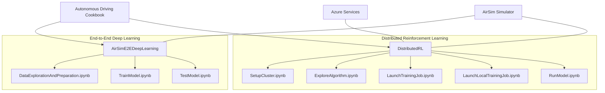
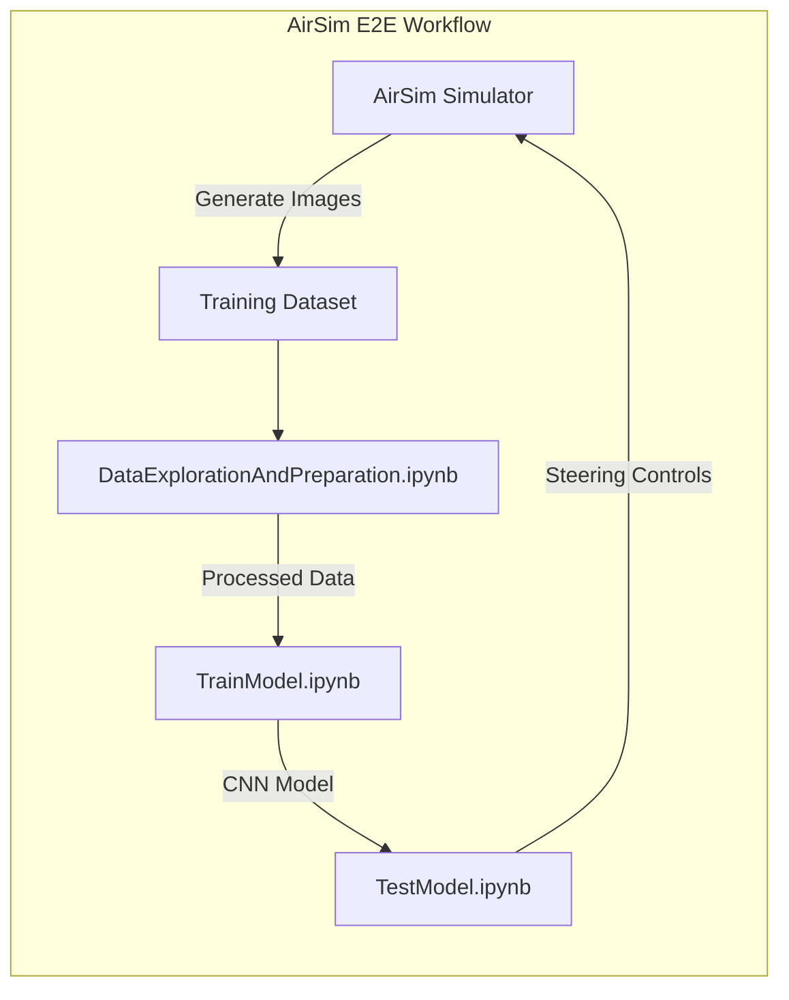
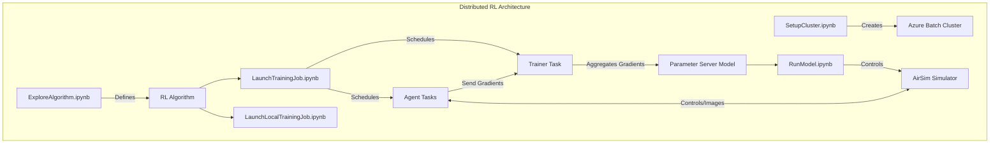
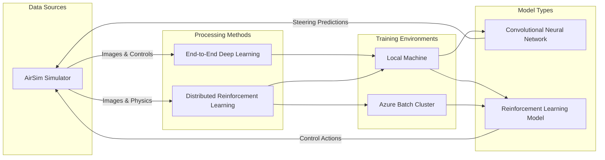

<!-- source: DeepWiki mcp.deepwiki.com · repo microsoft/AutonomousDrivingCookbook · page 1 Overview · fetched 2026-10-26 -->

# Overview

Relevant source files

The following files were used as context for generating this wiki page:

- [AirSimE2EDeepLearning/.gitignore](AirSimE2EDeepLearning/.gitignore)
- [README.md](README.md)

This document introduces the Microsoft Autonomous Driving Cookbook, a collection of tutorials and resources designed to accelerate learning and experimentation in autonomous driving development. It provides a high-level overview of the repository structure, main components, and their relationships. For detailed setup instructions, see [Getting Started](#1.2).

## Purpose and Goals

The Microsoft Autonomous Driving Cookbook is developed and maintained by [Project Road Runner](https://www.microsoft.com/en-us/garage/blog/2018/04/project-road-runner-train-autonomous-driving-algorithms-for-road-safety) at Microsoft Garage. Its primary purpose is to make autonomous driving technology accessible to everyone by:

- Lowering the barrier to entry for autonomous driving development
- Providing practical, hands-on tutorials for deep learning and reinforcement learning approaches
- Demonstrating how simulation can be used to develop and test autonomous driving algorithms
- Creating a foundation that enables developers to build their own solutions

Sources: [README.md:16-26]()

## Target Audience

The cookbook is designed to serve:

- **Beginners**: Who want to get started with autonomous driving concepts
- **Researchers**: Who need a platform to experiment with new approaches
- **Industry experts**: Who want to explore specific techniques without extensive setup

All tutorials are presented as Jupyter notebooks with included datasets and helper scripts where needed, allowing users to focus on learning rather than environment setup.

Sources: [README.md:28-32]()

## Main Components

The Autonomous Driving Cookbook currently consists of two main tutorial paths:

Sources: [README.md:34-39]()

### End-to-End Deep Learning for Autonomous Driving

This tutorial demonstrates how to train an end-to-end deep learning model to autonomously drive a car in simulation using behavioral cloning. The workflow involves:

1. Collecting training data from human driving in the simulator
2. Exploring and preparing the data for model training
3. Training a convolutional neural network to predict steering angles from camera images
4. Testing the trained model by letting it control a vehicle in the simulator

For more details on this approach, see [End-to-End Deep Learning for Autonomous Driving](#2).

Sources: [README.md:38]()

### Distributed Reinforcement Learning

This tutorial demonstrates how to train a reinforcement learning agent using a distributed approach. The architecture allows training to be distributed across multiple machines using Azure Batch, accelerating the learning process. The tutorial covers:

1. Setting up an Azure Batch cluster
2. Exploring the reinforcement learning algorithm
3. Launching distributed training jobs
4. Launching local training jobs
5. Running and evaluating the trained model

For more details on this approach, see [Distributed Reinforcement Learning](#3).

Sources: [README.md:39]()

## Technology Stack

The Autonomous Driving Cookbook leverages various open-source and Microsoft technologies:

| Component | Technologies |
|-----------|-------------|
| Simulation | AirSim (built on Unreal Engine) |
| Deep Learning | Keras, TensorFlow/CNTK, OpenCV, NumPy |
| Reinforcement Learning | Custom implementation with parameter server architecture |
| Cloud Computing | Azure Batch, Azure VMs |
| Development Tools | Jupyter Notebooks, Python, Matplotlib |

Sources: [README.md:30]()

## Data Flow and Processing

The following diagram illustrates the data flow across both tutorial paths:

Sources: [README.md:16-19](), [README.md:20-23]()

## Key Features

The main features of the Autonomous Driving Cookbook include:

1. **Ready-to-use tutorials**: Complete Jupyter notebooks that guide you through each step
2. **Simulation-based development**: Use of AirSim for data collection and testing
3. **Multiple learning approaches**: Both supervised learning (end-to-end) and reinforcement learning
4. **Scalable training**: Options for local training and distributed training on Azure
5. **Practical examples**: Real-world autonomous driving scenarios and challenges

Sources: [README.md:16-26](), [README.md:34-39]()

## Future Development

The Microsoft Autonomous Driving Cookbook is currently in preview, with plans to add more tutorials based on user requests and collaborator availability. Upcoming tutorials include:

- Lane Detection using Deep Learning

The project welcomes contributions and suggestions from the community, following the Microsoft Open Source Code of Conduct.

Sources: [README.md:7-11](), [README.md:41-44](), [README.md:46-53]()

## Conclusion

The Microsoft Autonomous Driving Cookbook provides a comprehensive introduction to autonomous driving development using simulation. Through its two main tutorials, users can explore different approaches to autonomous driving, from end-to-end deep learning to distributed reinforcement learning. The cookbook is designed to be accessible to beginners while still offering value to researchers and industry experts.

For more detailed information about getting started with the cookbook, refer to [Getting Started](#1.2).

Sources: [README.md:26-32]()

---

