# Page: Overview

# Overview

<details>
<summary>Relevant source files</summary>

The following files were used as context for generating this wiki page:

- [AirSimE2EDeepLearning/.gitignore](AirSimE2EDeepLearning/.gitignore)
- [README.md](README.md)

</details>


This document introduces the Microsoft Autonomous Driving Cookbook, a collection of tutorials and resources designed to accelerate learning and experimentation in autonomous driving development. It provides a high-level overview of the repository structure, main components, and their relationships. For detailed setup instructions, see [Getting Started](#1.2).

## Purpose and Goals

The Microsoft Autonomous Driving Cookbook is developed and maintained by [Project Road Runner](https://www.microsoft.com/en-us/garage/blog/2018/04/project-road-runner-train-autonomous-driving-algorithms-for-road-safety) at Microsoft Garage. Its primary purpose is to make autonomous driving technology accessible to everyone by:

- Lowering the barrier to entry for autonomous driving development
- Providing practical, hands-on tutorials for deep learning and reinforcement learning approaches
- Demonstrating how simulation can be used to develop and test autonomous driving algorithms
- Creating a foundation that enables developers to build their own solutions

Sources: [README.md:16-26]()

## Target Audience

The cookbook is designed to serve:

- **Beginners**: Who want to get started with autonomous driving concepts
- **Researchers**: Who need a platform to experiment with new approaches
- **Industry experts**: Who want to explore specific techniques without extensive setup

All tutorials are presented as Jupyter notebooks with included datasets and helper scripts where needed, allowing users to focus on learning rather than environment setup.

Sources: [README.md:28-32]()

## Main Components

The Autonomous Driving Cookbook currently consists of two main tutorial paths:

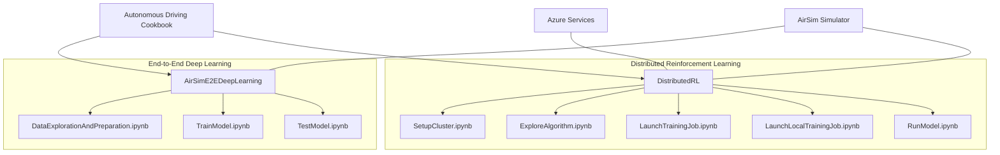

Sources: [README.md:34-39]()

### End-to-End Deep Learning for Autonomous Driving

This tutorial demonstrates how to train an end-to-end deep learning model to autonomously drive a car in simulation using behavioral cloning. The workflow involves:

1. Collecting training data from human driving in the simulator
2. Exploring and preparing the data for model training
3. Training a convolutional neural network to predict steering angles from camera images
4. Testing the trained model by letting it control a vehicle in the simulator

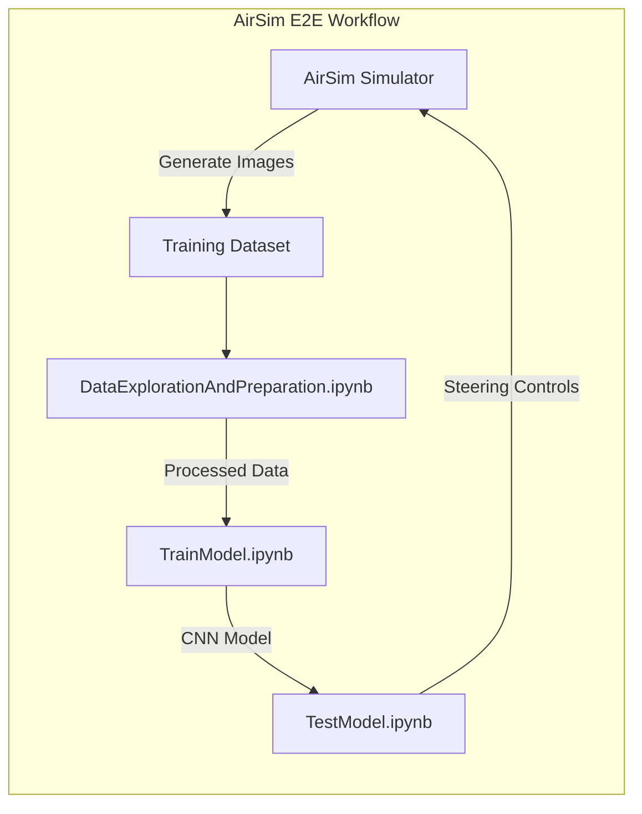

For more details on this approach, see [End-to-End Deep Learning for Autonomous Driving](#2).

Sources: [README.md:38]()

### Distributed Reinforcement Learning

This tutorial demonstrates how to train a reinforcement learning agent using a distributed approach. The architecture allows training to be distributed across multiple machines using Azure Batch, accelerating the learning process. The tutorial covers:

1. Setting up an Azure Batch cluster
2. Exploring the reinforcement learning algorithm
3. Launching distributed training jobs
4. Launching local training jobs
5. Running and evaluating the trained model

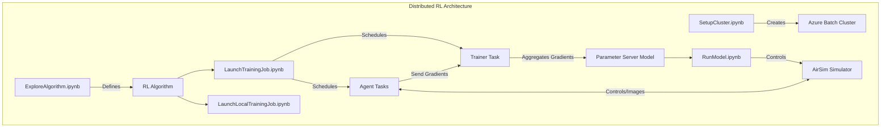

For more details on this approach, see [Distributed Reinforcement Learning](#3).

Sources: [README.md:39]()

## Technology Stack

The Autonomous Driving Cookbook leverages various open-source and Microsoft technologies:

| Component | Technologies |
|-----------|-------------|
| Simulation | AirSim (built on Unreal Engine) |
| Deep Learning | Keras, TensorFlow/CNTK, OpenCV, NumPy |
| Reinforcement Learning | Custom implementation with parameter server architecture |
| Cloud Computing | Azure Batch, Azure VMs |
| Development Tools | Jupyter Notebooks, Python, Matplotlib |

Sources: [README.md:30]()

## Data Flow and Processing

The following diagram illustrates the data flow across both tutorial paths:

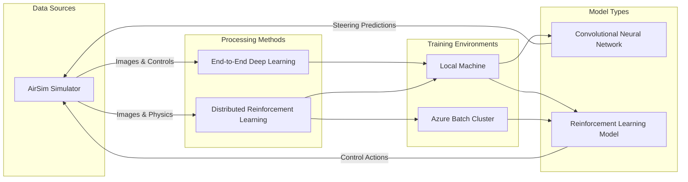

Sources: [README.md:16-19](), [README.md:20-23]()

## Key Features

The main features of the Autonomous Driving Cookbook include:

1. **Ready-to-use tutorials**: Complete Jupyter notebooks that guide you through each step
2. **Simulation-based development**: Use of AirSim for data collection and testing
3. **Multiple learning approaches**: Both supervised learning (end-to-end) and reinforcement learning
4. **Scalable training**: Options for local training and distributed training on Azure
5. **Practical examples**: Real-world autonomous driving scenarios and challenges

Sources: [README.md:16-26](), [README.md:34-39]()

## Future Development

The Microsoft Autonomous Driving Cookbook is currently in preview, with plans to add more tutorials based on user requests and collaborator availability. Upcoming tutorials include:

- Lane Detection using Deep Learning

The project welcomes contributions and suggestions from the community, following the Microsoft Open Source Code of Conduct.

Sources: [README.md:7-11](), [README.md:41-44](), [README.md:46-53]()

## Conclusion

The Microsoft Autonomous Driving Cookbook provides a comprehensive introduction to autonomous driving development using simulation. Through its two main tutorials, users can explore different approaches to autonomous driving, from end-to-end deep learning to distributed reinforcement learning. The cookbook is designed to be accessible to beginners while still offering value to researchers and industry experts.

For more detailed information about getting started with the cookbook, refer to [Getting Started](#1.2).

Sources: [README.md:26-32]()

---

# Page: Repository Structure

# Repository Structure

<details>
<summary>Relevant source files</summary>

The following files were used as context for generating this wiki page:

- [.gitignore](.gitignore)
- [AirSimE2EDeepLearning/.gitignore](AirSimE2EDeepLearning/.gitignore)
- [README.md](README.md)

</details>


## Purpose and Scope

This document outlines the organization and structure of the Autonomous Driving Cookbook repository. It provides an overview of the main components, their relationships, and the file organization to help you navigate the codebase efficiently. For information about setting up your environment to use these tutorials, see [Getting Started](#1.2).

Sources: [README.md:1-53]()

## Repository Overview

The Autonomous Driving Cookbook is organized around two main tutorial paths, each contained in its own directory:

1. **AirSimE2EDeepLearning** - End-to-End Deep Learning for Autonomous Driving
2. **DistributedRL** - Distributed Reinforcement Learning for Autonomous Driving

Both tutorials leverage the AirSim simulator for autonomous driving research, but they showcase different approaches to the problem of autonomous vehicle control.

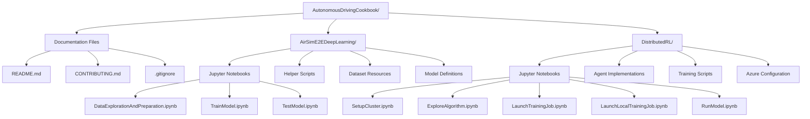

**Repository Structure Diagram**

Sources: [README.md:1-53](), [AirSimE2EDeepLearning/.gitignore:290-296]()

## Main Components

### AirSimE2EDeepLearning

The AirSimE2EDeepLearning directory contains a complete tutorial on using deep learning for end-to-end autonomous driving with AirSim. This approach uses supervised learning to train a model that directly maps raw sensor inputs (images) to control outputs (steering commands).

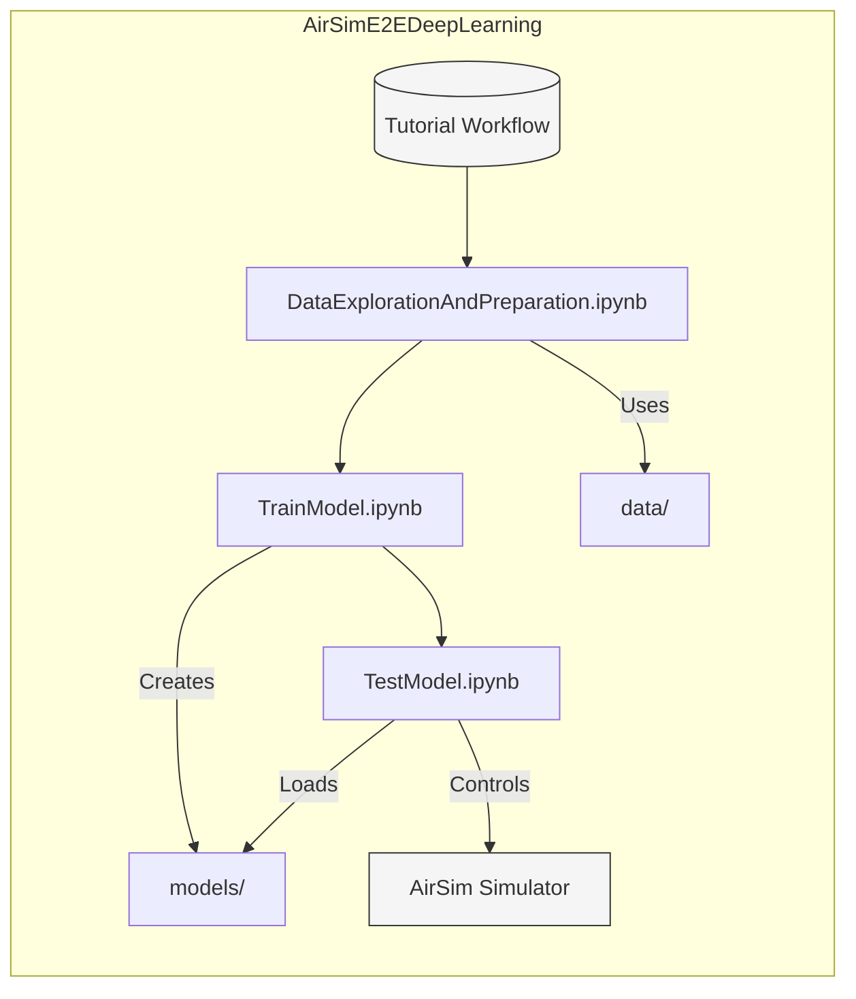

**AirSimE2EDeepLearning Component Flow**

The tutorial consists of three main Jupyter notebooks that guide you through the process:

1. **DataExplorationAndPreparation.ipynb** - Explores and prepares the dataset for training
2. **TrainModel.ipynb** - Trains a deep learning model on the prepared data
3. **TestModel.ipynb** - Tests the trained model in the AirSim simulator

Additional files in this directory include:

- **data/** - Contains the dataset used for training (generated using AirSim)
- **models/** - Directory where trained models are saved
- **Helper scripts** - Various utility scripts to support the workflow

Sources: [README.md:38](), [AirSimE2EDeepLearning/.gitignore:294-296]()

### DistributedRL

The DistributedRL directory contains a tutorial on using distributed reinforcement learning for autonomous driving. This approach uses RL to train agents that learn to drive through trial and error, with the option to accelerate training through distribution across multiple machines.

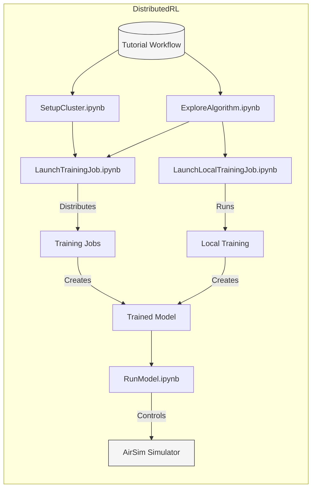

**DistributedRL Component Flow**

The tutorial consists of five main Jupyter notebooks:

1. **SetupCluster.ipynb** - Sets up an Azure Batch cluster for distributed training
2. **ExploreAlgorithm.ipynb** - Explores the reinforcement learning algorithm
3. **LaunchTrainingJob.ipynb** - Launches distributed training jobs on Azure
4. **LaunchLocalTrainingJob.ipynb** - Launches training jobs on a local machine
5. **RunModel.ipynb** - Runs and evaluates the trained model in AirSim

Additional components in this directory include:

- **Agent implementations** - Code for the RL agents
- **Training scripts** - Scripts for training the agents
- **Azure configuration files** - Configuration for Azure Batch

Sources: [README.md:39]()

## Component Relationships

The following diagram illustrates how the different components of the cookbook interact with each other and with external dependencies:

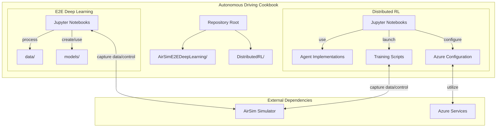

**Repository Component Relationships**

Sources: [README.md:17-20]()

## Technical Dependencies

Both tutorials use Jupyter notebooks as the primary interface and rely on various technical components:

| Component | AirSimE2EDeepLearning | DistributedRL |
|-----------|:---------------------:|:-------------:|
| AirSim Simulator | ✓ | ✓ |
| Jupyter Notebooks | ✓ | ✓ |
| Python | ✓ | ✓ |
| Deep Learning Frameworks (Keras, TensorFlow/CNTK) | ✓ | ✓ |
| OpenCV | ✓ | - |
| NumPy | ✓ | ✓ |
| Matplotlib | ✓ | ✓ |
| Azure Batch | - | ✓ |
| Reinforcement Learning Libraries | - | ✓ |

The tutorials are designed to be accessible to beginners while also providing valuable insights for researchers and industry experts.

Sources: [README.md:28-32]()

## File Organization and Ignores

The repository follows standard GitHub project conventions, with `.gitignore` files to exclude certain types of files:

- Generated runtime data and model files are excluded
- Python notebook checkpoints (`.ipynb_checkpoints`) are excluded
- Dataset files in the `data/` directory are excluded due to their large size (though they are retrievable through the instructions in the notebooks)
- Built models in the `models/` directory are excluded

This ensures the repository remains clean and focused on the tutorial content while leaving runtime data to be generated locally.

Sources: [.gitignore:1-290](), [AirSimE2EDeepLearning/.gitignore:290-296]()

## Future Extensions

The repository is structured to allow additional tutorials to be added in the future, such as:

- Lane Detection using Deep Learning (planned)
- Other autonomous driving scenarios

Each new tutorial would follow the same pattern of organization as the existing ones, with its own directory containing Jupyter notebooks and supporting files.

Sources: [README.md:41-43]()

---

# Page: Getting Started

# Getting Started

<details>
<summary>Relevant source files</summary>

The following files were used as context for generating this wiki page:

- [AirSimE2EDeepLearning/.gitignore](AirSimE2EDeepLearning/.gitignore)
- [AirSimE2EDeepLearning/InstallPackages.py](AirSimE2EDeepLearning/InstallPackages.py)
- [README.md](README.md)

</details>


This page provides instructions for setting up your development environment to work with the Microsoft Autonomous Driving Cookbook tutorials. It covers prerequisites, installation steps, and initial configuration required to run the two main tutorial paths: End-to-End Deep Learning and Distributed Reinforcement Learning.

For information about the overall repository structure, see [Repository Structure](#1.1).

## Prerequisites

Before starting with the tutorials, ensure you have the following prerequisites installed:

| Requirement | Purpose | Notes |
| ----------- | ------- | ----- |
| Python 3.5+ | Programming language used throughout the tutorials | Python 3.6 recommended |
| Anaconda or Miniconda | Environment management | Used to create isolated environments |
| AirSim Simulator | Simulation environment | For generating training data and testing models |
| GPU (recommended) | Accelerates training | NVIDIA GPU with CUDA support recommended |
| Azure account (optional) | For distributed training | Required only for the Distributed RL tutorial |

Sources: [README.md:1-53]()

## Development Environment Setup

To get started with the tutorials, follow these steps to set up your development environment:

### 1. Clone the Repository

```bash
git clone https://github.com/microsoft/AutonomousDrivingCookbook.git
cd AutonomousDrivingCookbook
```

### 2. Set Up Anaconda Environment

Create and activate a new Anaconda environment:

```bash
conda create -n autonomous-driving python=3.6
conda activate autonomous-driving
```

### 3. Install Required Packages

The repository includes a Python script to install all necessary packages. Run the following command:

```bash
python AirSimE2EDeepLearning/InstallPackages.py
```

This script will install the following dependencies:

- Jupyter Notebook
- Matplotlib
- OpenCV
- Keras with TensorFlow/CNTK
- msgpack-rpc-python
- Pandas
- NumPy
- SciPy

Sources: [AirSimE2EDeepLearning/InstallPackages.py:1-16]()

### 4. Install AirSim

AirSim is a critical component required for both tutorials. It provides the simulation environment for autonomous driving.

## AirSim Setup Workflow

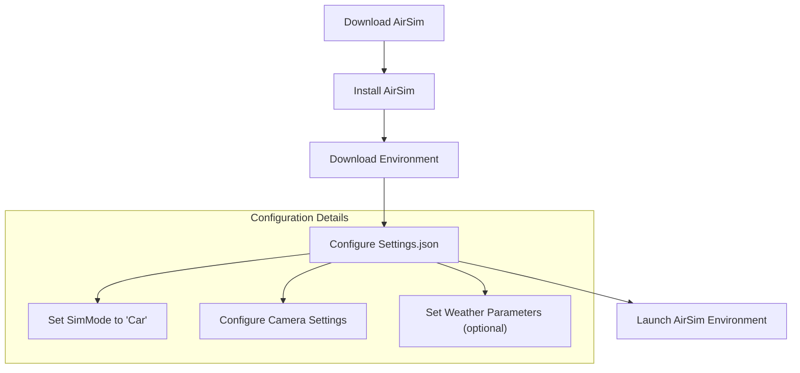

1. **Download and Install AirSim**: Follow the official installation guide from the [AirSim GitHub repository](https://github.com/Microsoft/AirSim).

2. **Download Environment**: Download the appropriate environment for your operating system.

3. **Configure AirSim**: Create or modify the `settings.json` file to configure AirSim for autonomous driving.

Example `settings.json` configuration:

```json
{
  "SettingsVersion": 1.2,
  "SimMode": "Car",
  "CameraDefaults": {
    "CaptureSettings": [
      {
        "ImageType": 0,
        "Width": 256,
        "Height": 144
      }
    ]
  }
}
```

Sources: [README.md:17-20]()

## Tutorial Environments Setup

The repository contains two main tutorial paths, each with its own setup requirements:

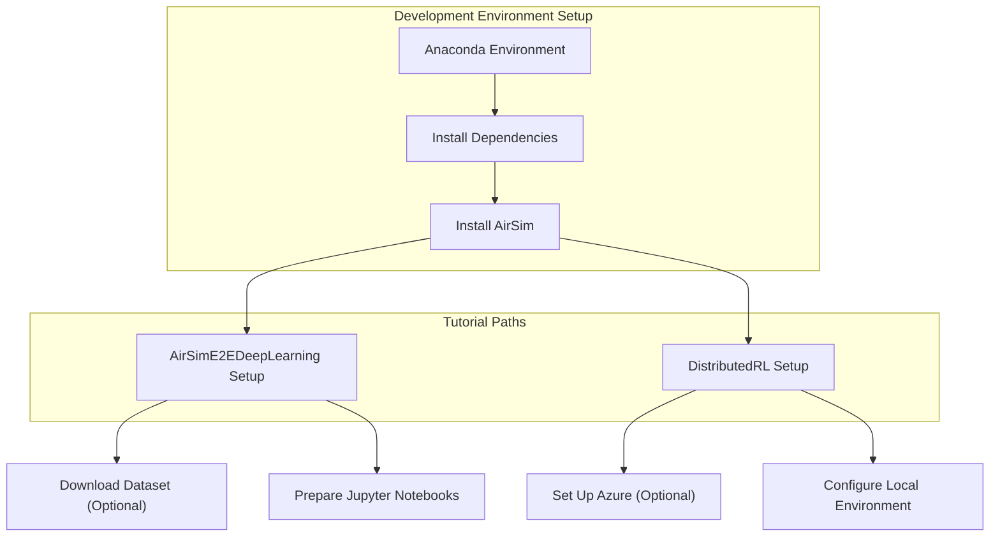

### End-to-End Deep Learning Setup

For the AirSimE2EDeepLearning tutorial:

1. Navigate to the tutorial directory:
   ```bash
   cd AirSimE2EDeepLearning
   ```

2. You can either generate your own dataset using AirSim or use the provided dataset.

3. Start the Jupyter Notebook server:
   ```bash
   jupyter notebook
   ```

4. Open the notebooks in sequence:
   - `DataExplorationAndPreparation.ipynb`
   - `TrainModel.ipynb`
   - `TestModel.ipynb`

Sources: [README.md:36-39]()

### Distributed Reinforcement Learning Setup

For the DistributedRL tutorial:

1. Navigate to the tutorial directory:
   ```bash
   cd DistributedRL
   ```

2. If using Azure for distributed training, ensure you have an Azure account and follow the setup instructions in the notebooks.

3. Start the Jupyter Notebook server:
   ```bash
   jupyter notebook
   ```

4. Open the notebooks in sequence:
   - `SetupCluster.ipynb` (for Azure setup)
   - `ExploreAlgorithm.ipynb`
   - `LaunchTrainingJob.ipynb` or `LaunchLocalTrainingJob.ipynb`
   - `RunModel.ipynb`

Sources: [README.md:39-40]()

## Dependencies and System Components

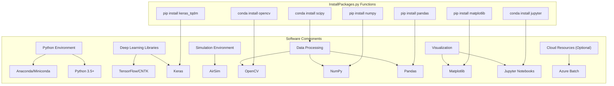

Sources: [AirSimE2EDeepLearning/InstallPackages.py:1-16]()

## Workflow Overview

Once you have set up your environment, you can start working through the tutorials. The workflow typically follows these steps:

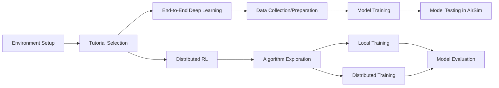

Sources: [README.md:35-40]()

## Common Issues and Troubleshooting

Here are some common issues you might encounter during setup and their solutions:

| Issue | Solution |
| ----- | -------- |
| Missing dependencies | Run `InstallPackages.py` again or install manually |
| AirSim connection problems | Ensure AirSim is running and properly configured |
| CUDA/GPU issues | Verify GPU drivers and CUDA installation |
| Jupyter Notebook not starting | Check if Jupyter is installed correctly |
| Azure access issues | Verify Azure credentials and permissions |

For more detailed troubleshooting, see [Troubleshooting and FAQ](#5).

## Next Steps

After successfully setting up your environment, proceed to one of the tutorial paths:

1. [End-to-End Deep Learning for Autonomous Driving](#2) - Learn how to train a deep learning model for autonomous driving using AirSim.

2. [Distributed Reinforcement Learning](#3) - Explore distributed reinforcement learning techniques for autonomous driving.

Sources: [README.md:35-40]()

---

# Page: End-to-End Deep Learning for Autonomous Driving

# End-to-End Deep Learning for Autonomous Driving

<details>
<summary>Relevant source files</summary>

The following files were used as context for generating this wiki page:

- [AirSimE2EDeepLearning/README.md](AirSimE2EDeepLearning/README.md)

</details>


## Purpose and Scope

This document provides a technical overview of the End-to-End Deep Learning approach for autonomous driving implemented in the AirSimE2EDeepLearning tutorial. The tutorial demonstrates how to train a deep neural network to drive a car autonomously using only visual input from a front-facing camera. The model learns to predict steering commands by observing the road ahead, mimicking how humans drive.

The scope of this document covers the architecture, workflow, components, and implementation details of the end-to-end deep learning system. For information about distributed reinforcement learning approaches to autonomous driving, see [Distributed Reinforcement Learning](#3).

Sources: [AirSimE2EDeepLearning/README.md:9-11]()

## System Overview

The End-to-End Deep Learning system teaches a car to drive autonomously through a portion of the Mountain/Landscape map in AirSim by learning directly from human driving data. Unlike traditional autonomous driving systems that separate perception, planning, and control into distinct modules, this approach uses a single neural network to map raw pixels from a front-facing camera directly to steering commands.

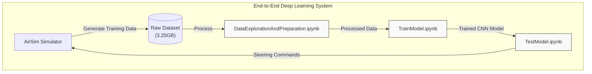

System Architecture Diagram: End-to-End Deep Learning Workflow

Sources: [AirSimE2EDeepLearning/README.md:19-29]()

## Key Components

### 1. AirSim Simulator

The system uses the AirSim simulator, which provides a realistic 3D environment for data collection and testing. AirSim is a cross-platform simulator built on Unreal Engine that offers physically and visually realistic simulations for autonomous vehicles.

| Feature | Description |
|---------|-------------|
| Environment | Mountain/Landscape map |
| Input | Single front-facing camera |
| Physics | Realistic vehicle dynamics |
| Connectivity | Python API for vehicle control and data collection |

Sources: [AirSimE2EDeepLearning/README.md:59-67]()

### 2. Data Pipeline

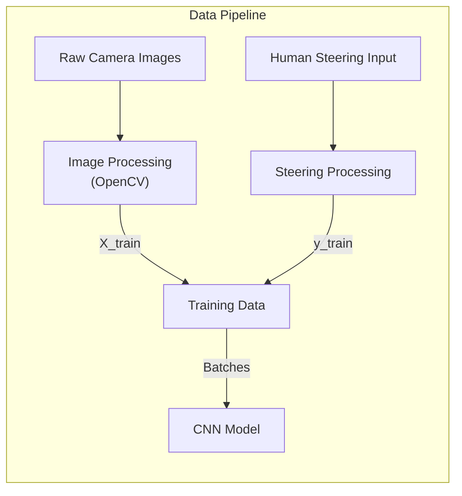

Data Pipeline Diagram: From Raw Data to Training Input

The data pipeline involves:
1. Collecting raw images and corresponding steering angles from human driving in AirSim
2. Processing and normalizing images
3. Preparing training, validation, and test datasets
4. Creating batches for model training

Sources: [AirSimE2EDeepLearning/README.md:75-77]()

### 3. Deep Learning Model

The system uses a Convolutional Neural Network (CNN) implemented in Keras. The model architecture is designed to:
- Process image inputs from the front-facing camera
- Learn features relevant to driving
- Output steering angle predictions

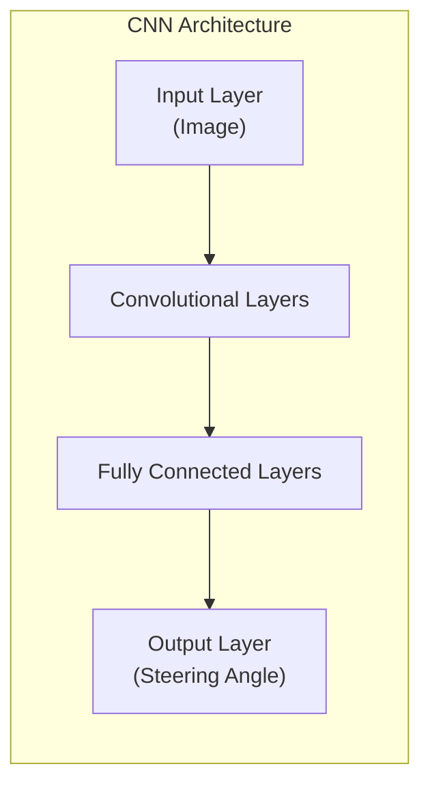

CNN Architecture Diagram: Basic Flow of Data Through the Model

Sources: [AirSimE2EDeepLearning/README.md:19-21]()

### 4. Notebooks Workflow

The tutorial is organized into three Jupyter notebooks that guide the user through the entire process:

| Notebook | Purpose | Key Functions |
|----------|---------|---------------|
| DataExplorationAndPreparation | Explore and prepare the dataset | Data loading, visualization, preprocessing |
| TrainModel | Train the deep learning model | Model definition, training, evaluation |
| TestModel | Test the model in AirSim | Model loading, inference, vehicle control |

Sources: [AirSimE2EDeepLearning/README.md:25-29]()

## Technical Implementation

### System Dependencies

The end-to-end learning system relies on several key libraries and frameworks:

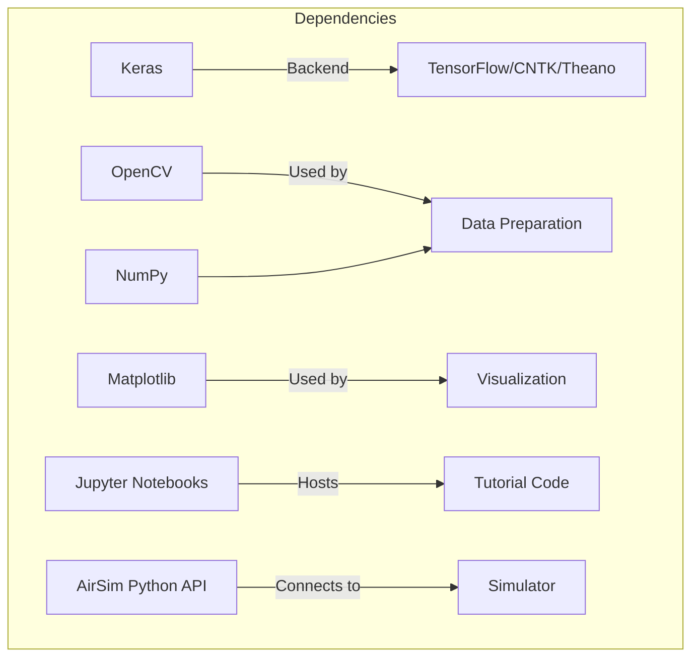

Dependencies Diagram: Key Libraries and Frameworks

Sources: [AirSimE2EDeepLearning/README.md:42-57]()

### Data Processing Details

The data processing pipeline converts raw simulator data into a format suitable for neural network training:

1. **Data Collection**: Human driving in the AirSim simulator
2. **Data Storage**: ~3.25GB dataset containing images and steering angles
3. **Preprocessing**:
   - Image normalization
   - Steering angle scaling
   - Train/validation/test splitting
4. **Batch Generation**: Creating batches of data for model training

Sources: [AirSimE2EDeepLearning/README.md:75-77]()

### Training Process

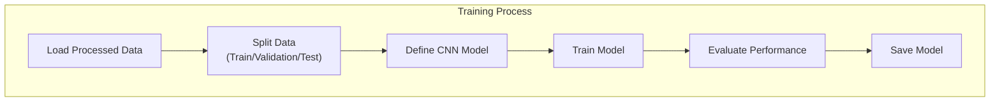

Training Process Diagram: Key Steps in Model Training

The training process involves:
1. Loading the prepared dataset
2. Defining the CNN architecture in Keras
3. Training the model using the training data
4. Evaluating performance on validation data
5. Saving the trained model for later use

Training typically takes around 45 minutes with a GPU like NVIDIA GTX970.

Sources: [AirSimE2EDeepLearning/README.md:69-73]()

### Testing and Inference

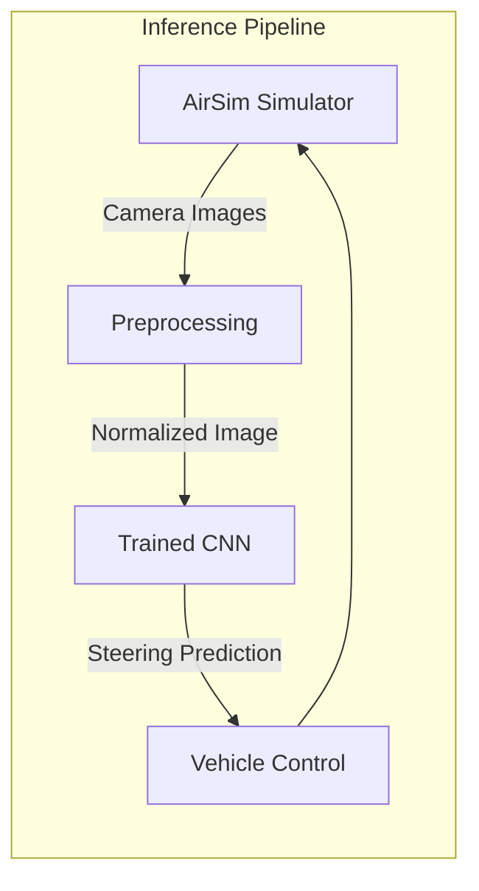

Inference Pipeline Diagram: Real-time Prediction and Control

During testing:
1. The trained model is loaded
2. Images are captured from the AirSim simulator in real-time
3. Images are preprocessed and fed to the model
4. The model predicts steering angles
5. Steering commands are sent back to control the vehicle in AirSim

Sources: [AirSimE2EDeepLearning/README.md:29]()

## Setup and Usage

### Prerequisites

To use the end-to-end deep learning system, you need:

1. **Knowledge Requirements**:
   - Basics of neural networks and deep learning
   - Familiarity with Convolutional Neural Networks
   - Comfort with Python

2. **Hardware Requirements**:
   - GPU recommended (NVIDIA GTX970 or equivalent)
   - Alternative: Azure Deep Learning VM

3. **Software Requirements**:
   - Anaconda with Python 3.5+
   - CNTK or TensorFlow
   - Keras
   - Additional packages (OpenCV, NumPy, etc.)

Sources: [AirSimE2EDeepLearning/README.md:35-57]()

### Installation Steps

1. Install Anaconda with Python 3.5 or higher
2. Install a deep learning backend (CNTK or TensorFlow)
3. Install h5py and configure Keras
4. Install AzCopy and add to system path
5. Run the provided InstallPackages.py script to install remaining dependencies
6. Download and set up the AirSim simulator package
7. Download the training dataset (~3.25GB)

Sources: [AirSimE2EDeepLearning/README.md:42-57](), [AirSimE2EDeepLearning/README.md:59-77]()

### Running the Tutorial

The tutorial is executed through three sequential Jupyter notebooks:

1. **DataExplorationAndPreparation.ipynb**:
   - Load and explore the dataset
   - Preprocess and prepare data for training

2. **TrainModel.ipynb**:
   - Define the CNN architecture
   - Train the model on the prepared data
   - Evaluate model performance

3. **TestModel.ipynb**:
   - Load the trained model
   - Connect to AirSim
   - Run inference in real-time
   - Control the vehicle based on model predictions

Sources: [AirSimE2EDeepLearning/README.md:25-29]()

## Summary

The End-to-End Deep Learning for Autonomous Driving system demonstrates a fundamental approach to autonomous vehicle control using deep learning. By mapping directly from raw pixels to steering commands, the system learns to drive based on visual input alone, similar to how humans drive. This approach, while simpler than production autonomous driving systems, provides a excellent introduction to applying deep learning techniques to autonomous driving problems.

For more advanced approaches using reinforcement learning, see the [Distributed Reinforcement Learning](#3) section of this cookbook.

Sources: [AirSimE2EDeepLearning/README.md:79-81]()

---

# Page: Data Exploration and Preparation

# Data Exploration and Preparation

<details>
<summary>Relevant source files</summary>

The following files were used as context for generating this wiki page:

- [AirSimE2EDeepLearning/DataExplorationAndPreparation.ipynb](AirSimE2EDeepLearning/DataExplorationAndPreparation.ipynb)

</details>


## Purpose and Scope

This document details the process of exploring and preparing data for training an end-to-end deep learning model for autonomous driving using the AirSim simulator. This is the first step in the AirSimE2EDeepLearning tutorial, where raw simulator data is analyzed and transformed into a format optimized for neural network training.

For information about the subsequent model training process, see [Training the Deep Learning Model](#2.2).

## System Overview

The Data Exploration and Preparation system serves as the critical bridge between data collection from the AirSim simulator and model training:

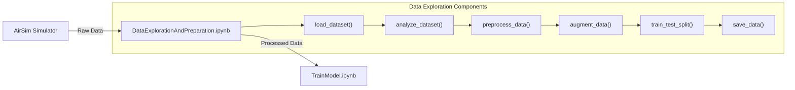

Sources: Based on the overall repository architecture and AirSimE2EDeepLearning workflow

## Dataset Structure

The dataset used in this tutorial consists of two primary components:

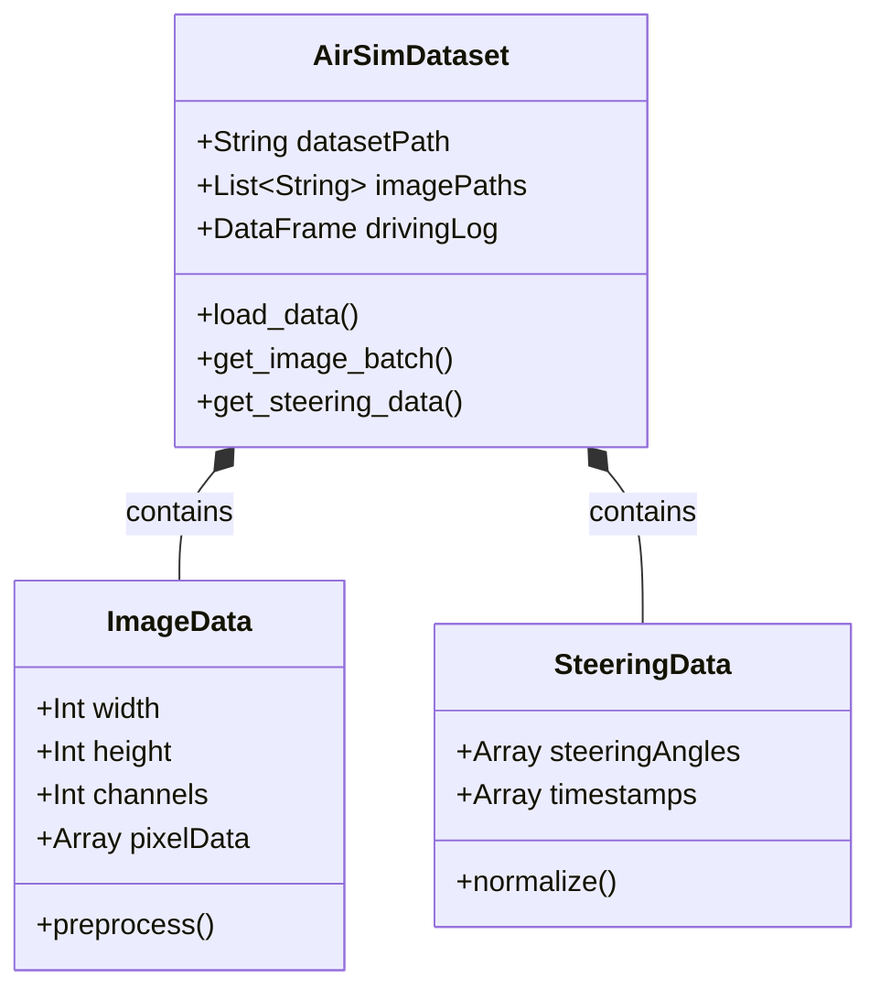

Sources: Based on common autonomous driving dataset structures

The dataset typically includes:
1. **Images**: Front-facing camera views captured from the simulated vehicle
2. **Steering controls**: Corresponding steering angle values recorded during driving sessions
3. **Metadata**: Information about the data collection environment and parameters

## Data Exploration Process

The exploration phase analyzes dataset characteristics to identify patterns and inform preprocessing decisions:

```mermaid
flowchart TD
    Load["load_dataset()"] --> ImgAnalysis["Image Analysis"]
    Load --> SteeringAnalysis["Steering Analysis"]
    
    ImgAnalysis --> ImgStats["Image Statistics<br>- Dimensions<br>- Color Channels<br>- Value Range"]
    ImgAnalysis --> ImgViz["Sample Visualization<br>- Road Conditions<br>- Visual Features"]
    
    SteeringAnalysis --> SteerDist["Steering Distribution<br>- Histogram<br>- Time Series"]
    SteeringAnalysis --> SteerStats["Steering Statistics<br>- Range<br>- Mean/Std<br>- Outliers"]
    
    ImgStats & ImgViz & SteerDist & SteerStats --> Insights["Identify Patterns & Biases"]
    Insights --> PrepStrategy["Preprocessing Strategy"]
```

Sources: Based on common data exploration practices in autonomous driving projects

Key exploration activities include:
- Visualizing sample images to understand road conditions and visual features
- Analyzing steering angle distribution to identify potential biases
- Computing statistics on both image and steering data
- Identifying correlations between visual features and steering angles

## Image Preprocessing Pipeline

Based on exploration insights, images undergo several preprocessing steps:

```mermaid
flowchart LR
    RawImg["Raw Image"] --> Resize["resize_image()"]
    Resize --> Crop["crop_roi()"]
    Crop --> ColorConv["convert_colorspace()"]
    ColorConv --> Normalize["normalize_pixels()"]
    Normalize --> ProcessedImg["Processed Image"]
```

Sources: Based on common image preprocessing techniques in deep learning for autonomous driving

Typical preprocessing operations include:
- **Resizing**: Reducing image dimensions to a standard size (e.g., 200x66 pixels)
- **Cropping**: Removing irrelevant portions like the sky or car hood
- **Color conversion**: Converting between color spaces (e.g., BGR to YUV)
- **Normalization**: Scaling pixel values to a standard range (e.g., [0,1] or [-1,1])

## Steering Data Preprocessing

The steering angle data also undergoes preprocessing:

```mermaid
flowchart LR
    RawSteer["Raw Steering Data"] --> Filter["filter_outliers()"]
    Filter --> Normalize["normalize_steering()"]
    Normalize --> Balance["balance_distribution()"]
    Balance --> ProcessedSteer["Processed Steering Data"]
```

Sources: Based on common control data preprocessing techniques

Key steps include:
- Filtering outliers or erroneous values
- Normalizing steering angles to a standard range (typically [-1,1])
- Addressing class imbalance (often more straight driving than turns)

## Data Augmentation Techniques

To improve model generalization, data augmentation expands the dataset with synthetic variations:

```mermaid
flowchart TD
    Original["Original Sample"] --> Techniques["apply_augmentation()"]
    
    Techniques --> Flip["flip_horizontally()"]
    Techniques --> Brightness["adjust_brightness()"]
    Techniques --> Shadow["add_random_shadow()"]
    Techniques --> Shift["shift_horizontally()"]
    
    Flip -->|"steering *= -1"| Augmented["Augmented Samples"]
    Brightness -->|"steering unchanged"| Augmented
    Shadow -->|"steering unchanged"| Augmented
    Shift -->|"adjust steering"| Augmented
```

Sources: Based on common augmentation techniques for autonomous driving datasets

These techniques create artificial variations of the original data, helping the model learn to generalize better to new situations.

## Train/Test Split and Storage

After preprocessing and augmentation, the data is split into training and validation sets:

```mermaid
flowchart LR
    ProcessedData["Processed Dataset"] --> Split["train_test_split()"]
    Split -->|"80%"| Train["Training Set"]
    Split -->|"20%"| Validation["Validation Set"]
    
    Train --> SaveTrain["save_data_batch()"]
    Validation --> SaveVal["save_data_batch()"]
    
    SaveTrain --> TrainFile["training_data.npz"]
    SaveVal --> ValFile["validation_data.npz"]
```

Sources: Based on common practices in machine learning pipelines

The processed data is typically saved in a compressed format (like NPZ) that preserves the relationship between images and steering angles while enabling efficient loading during training.

## Key Libraries and Dependencies

The Data Exploration and Preparation notebook relies on several key libraries:

```mermaid
flowchart TD
    Notebook["DataExplorationAndPreparation.ipynb"]
    
    Notebook -->|"Array Operations"| NumPy["numpy"]
    Notebook -->|"Image Processing"| OpenCV["cv2"]
    Notebook -->|"Visualization"| Matplotlib["matplotlib"]
    Notebook -->|"Data Analysis"| Pandas["pandas"]
```

Sources: Based on standard data science libraries used in computer vision and autonomous driving

These libraries provide the core functionality for loading, analyzing, processing, and visualizing the dataset.

## Integration with Model Training

The output of this process feeds directly into the model training phase:

```mermaid
flowchart LR
    DataExplore["DataExplorationAndPreparation.ipynb"] -->|"Output"| Files["Processed Data Files"]
    Files -->|"Input"| Train["TrainModel.ipynb"]
    
    Train -->|"During Training"| DataGenerator["data_generator()"]
    DataGenerator -->|"Batches"| Model["CNN Model"]
```

Sources: Based on the end-to-end workflow in the AirSimE2EDeepLearning tutorial

The processed data serves as the foundation for training the convolutional neural network that will predict steering angles from visual input.

## Summary

The Data Exploration and Preparation process is a critical foundation for the AirSimE2EDeepLearning pipeline. It transforms raw simulator data into optimized formats for neural network training through systematic analysis, preprocessing, and organization.

Key outcomes include:
- Standardized image data with normalized formats
- Aligned and balanced steering control data
- Augmented training examples for improved generalization
- Structured training and validation datasets

This process sets the stage for successful model training in the next phase of the autonomous driving pipeline.

---

# Page: Training the Deep Learning Model

# Training the Deep Learning Model

<details>
<summary>Relevant source files</summary>

The following files were used as context for generating this wiki page:

- [AirSimE2EDeepLearning/TrainModel.ipynb](AirSimE2EDeepLearning/TrainModel.ipynb)

</details>


This document describes the process of training a deep learning model for autonomous driving in the AirSimE2EDeepLearning tutorial. It covers how to take the prepared dataset and train a convolutional neural network that can predict steering angles based on camera images from the AirSim simulator.

For information about data preparation before training, see [Data Exploration and Preparation](#2.1). For details on testing your trained model, see [Testing the Model in AirSim](#2.3).

## Training Process Overview

The training process involves loading the prepared dataset, defining a CNN model architecture, training the model on images paired with steering angles, and evaluating its performance. The primary component for this process is the `TrainModel.ipynb` Jupyter notebook.

```mermaid
flowchart LR
    PrepData[("Prepared Dataset")] --> TrainScript["TrainModel.ipynb"]
    TrainScript --> ModelDef["Define CNN Architecture"]
    ModelDef --> TrainLoop["Training Loop"]
    TrainLoop --> Evaluate["Evaluate Model"]
    Evaluate --> SaveModel[("Saved Model (.h5)")]
```

Sources: Based on AirSimE2EDeepLearning workflow diagram

## Model Architecture

The training script uses a convolutional neural network designed to process camera images and predict appropriate steering angles. The model employs several convolutional layers for feature extraction followed by fully connected layers for regression.

```mermaid
flowchart TD
    Input["Input Layer (Images)"] --> Conv1["Conv2D Layers (Feature Extraction)"]
    Conv1 --> Flatten["Flatten Layer"]
    Flatten --> Dense1["Dense Layers"]
    Dense1 --> Output["Output Layer (Steering Angle)"]
```

Sources: Based on overall repository architecture

## Training Configuration and Dependencies

The training process relies on several key technologies:

| Component | Purpose |
|-----------|---------|
| Keras | High-level neural networks API |
| TensorFlow/CNTK | Backend for Keras |
| NumPy | Data manipulation and processing |
| Matplotlib | Visualization of training results |
| Jupyter Notebook | Interactive development environment |

Key hyperparameters that may be adjusted during training include:

| Hyperparameter | Purpose |
|----------------|---------|
| Batch Size | Number of samples used in each training step |
| Learning Rate | Controls the size of weight updates |
| Number of Epochs | How many passes through the entire dataset |
| Validation Split | Percentage of data used for validation |
| Early Stopping | Prevent overfitting by monitoring validation loss |

Sources: Based on the component relationships diagram

## Training Data Flow

The training process follows a standard supervised learning workflow, with images as inputs and steering angles as outputs:

```mermaid
flowchart LR
    subgraph "Training Process"
        direction TB
        DataLoader["Load Processed Dataset"] --> DataGen["Data Generator/Augmentation"]
        DataGen --> TrainingLoop["Training Loop"]
        TrainingLoop --> ModelEval["Model Evaluation"]
        ModelEval --> ModelSave["Save Model"]
    end
    
    subgraph "Input/Output"
        direction TB
        Images["Camera Images"] --> |"Input"| DataLoader
        Labels["Steering Angles"] --> |"Target"| DataLoader
        ModelSave --> |"Output"| SavedModel["model.h5"]
    end
```

Sources: Based on AirSimE2EDeepLearning workflow diagram

## Model Validation and Evaluation

During and after training, the model is evaluated using metrics appropriate for regression tasks:

| Metric | Description |
|--------|-------------|
| Mean Squared Error (MSE) | Average squared difference between predicted and actual steering angles |
| Mean Absolute Error (MAE) | Average absolute difference between predicted and actual steering angles |
| Validation Loss | Loss calculated on the validation set to monitor overfitting |

The training process typically includes plotting these metrics over time to visualize the model's learning progress.

## From Training to Deployment

Once trained, the model is saved in a format (typically `.h5`) that can be loaded by the testing script to control a vehicle in the AirSim simulator:

```mermaid
flowchart LR
    TrainModel["TrainModel.ipynb"] --> |"Produces"| SavedModel["trained_model.h5"]
    SavedModel --> |"Used by"| TestModel["TestModel.ipynb"]
    TestModel <--> |"Controls/Images"| AirSim["AirSim Simulator"]
```

Sources: Based on AirSimE2EDeepLearning workflow diagram

## Practical Considerations

When training the model, consider the following best practices:

1. **Dataset Balance**: Ensure your dataset includes a good balance of different steering angles and driving scenarios
2. **Data Augmentation**: Consider techniques like random brightness adjustments, slight rotation, and horizontal flipping to improve model generalization
3. **Batch Normalization**: May improve training stability and speed
4. **Regularization**: Techniques like dropout can help prevent overfitting
5. **Early Stopping**: Monitor validation loss and stop training when it stops improving

## Model Architecture Options

Depending on your specific requirements, several CNN architectures might be appropriate:

| Architecture Type | Characteristics | Best For |
|-------------------|-----------------|----------|
| Simple CNN | Few convolutional layers, lightweight | Quick prototyping, limited compute resources |
| NVIDIA PilotNet-inspired | Multiple convolutional layers followed by dense layers | Good balance of performance and complexity |
| Transfer Learning (e.g., MobileNet base) | Pre-trained feature extractor with custom dense layers | Complex environments, limited training data |

The repository likely implements one of these approaches, with the specific architecture defined in the training script.

## Next Steps

After successfully training your model, proceed to [Testing the Model in AirSim](#2.3) to evaluate its performance in the simulator environment. The testing process will load your trained model and use it to generate steering commands in real-time based on the camera input from the simulator.

---

# Page: Testing the Model in AirSim

# Testing the Model in AirSim

<details>
<summary>Relevant source files</summary>

The following files were used as context for generating this wiki page:

- [AirSimE2EDeepLearning/TestModel.ipynb](AirSimE2EDeepLearning/TestModel.ipynb)

</details>


## Purpose and Scope

This document provides technical instructions for testing a trained deep learning model in the AirSim simulator. It covers the process of loading a previously trained model, connecting to AirSim, and implementing a control loop that enables autonomous driving based on the model's predictions. For information about training the model itself, see [Training the Deep Learning Model](#2.2).

## Prerequisites

Before testing your model in AirSim, ensure you have:

1. A trained model from the previous step
2. AirSim simulator running in a separate process (in the Landscape environment)
3. Python environment with required dependencies (Keras, NumPy)

Sources: [AirSimE2EDeepLearning/TestModel.ipynb:3-41]()

## Testing Architecture

The testing system forms a closed-loop control system where the trained model drives a vehicle in the AirSim simulator autonomously.

```mermaid
flowchart LR
    subgraph "TestModel.ipynb"
        A["load_model()"] --> B["Model"]
        C["CarClient"] --> D["Control Loop"]
        D --> E["get_image()"]
        E --> F["Process Image"]
        F --> G["model.predict()"]
        G --> H["setCarControls()"]
        H --> D
    end
    
    subgraph "AirSim"
        I["Simulator"]
    end
    
    B <--> G
    C <--> I
    E <--> I
    H <--> I
```

Sources: [AirSimE2EDeepLearning/TestModel.ipynb:64-70](), [AirSimE2EDeepLearning/TestModel.ipynb:111-116](), [AirSimE2EDeepLearning/TestModel.ipynb:134-149]()

## Setting Up the Testing Environment

### Loading the Model

The system first loads the trained model from disk. If no specific model path is provided, it automatically selects the most recently created model from the `model/models/` directory.

```python
# If no model path is specified, use the most recent model
if (MODEL_PATH == None):
    models = glob.glob('model/models/*.h5') 
    best_model = max(models, key=os.path.getctime)
    MODEL_PATH = best_model

model = load_model(MODEL_PATH)
```

Sources: [AirSimE2EDeepLearning/TestModel.ipynb:30-39](), [AirSimE2EDeepLearning/TestModel.ipynb:64]()

### Connecting to AirSim

The system establishes a connection with the AirSim simulator and enables API control of the vehicle:

```python
client = CarClient()
client.confirmConnection()
client.enableApiControl(True)
car_controls = CarControls()
```

Sources: [AirSimE2EDeepLearning/TestModel.ipynb:66-69]()

### Initializing Control and Buffer Variables

Before starting the control loop, the system initializes the car control parameters and creates buffers for storing images and state information:

| Variable | Type | Purpose |
|----------|------|---------|
| `car_controls.steering` | float | Control the steering angle of the vehicle |
| `car_controls.throttle` | float | Control the acceleration of the vehicle |
| `car_controls.brake` | float | Control the braking of the vehicle |
| `image_buf` | numpy array | Buffer for storing the processed camera image |
| `state_buf` | numpy array | Buffer for storing the vehicle state information |

Sources: [AirSimE2EDeepLearning/TestModel.ipynb:88-93]()

## Image Processing

The system includes a helper function `get_image()` that:
1. Requests an RGB image from AirSim's front camera
2. Converts the image data to a numpy array
3. Crops the image to focus on the road (rows 76-135, all 255 columns)
4. Returns the processed image as a float array

```mermaid
flowchart LR
    A["AirSim Camera"] --> B["simGetImages()"]
    B --> C["Raw RGBA Image"]
    C --> D["Crop (76:135, 0:255)"]
    D --> E["Convert to Float"]
    E --> F["Processed RGB Image"]
```

Sources: [AirSimE2EDeepLearning/TestModel.ipynb:111-116]()

## Control Loop Implementation

The main control loop performs the following operations in sequence:

1. **Get car state**: Retrieves the current state of the car from AirSim
2. **Speed control**: Applies throttle based on the current speed (targets 5 m/s)
3. **Image acquisition**: Gets and processes an image from AirSim
4. **State preparation**: Creates a state vector containing current controls and speed
5. **Model prediction**: Uses the model to predict the steering angle
6. **Control application**: Sends the updated controls back to AirSim

```mermaid
sequenceDiagram
    participant TM as "TestModel.ipynb"
    participant AS as "AirSim"
    participant DL as "Deep Learning Model"
    
    loop Control Loop
        TM->>AS: getCarState()
        AS-->>TM: car_state
        
        Note over TM: Adjust throttle based on speed
        
        TM->>AS: simGetImages()
        AS-->>TM: image_response
        
        Note over TM: Process image
        
        TM->>TM: Prepare state buffer
        
        TM->>DL: predict([image_buf, state_buf])
        DL-->>TM: predicted_steering
        
        Note over TM: Scale steering (0.5 * prediction)
        
        TM->>AS: setCarControls(steering, throttle)
    end
```

The control loop uses the following formula to determine the steering angle:
```
car_controls.steering = 0.5 * model_output[0][0]
```

The throttle is managed by a simple conditional:
```
if (car_state.speed < 5):
    car_controls.throttle = 1.0
else:
    car_controls.throttle = 0.0
```

Sources: [AirSimE2EDeepLearning/TestModel.ipynb:134-149]()

## Observations and Potential Improvements

Testing reveals both strengths and limitations of the trained model:

### Strengths
- The car successfully navigates the road
- Keeps to the right side of the road
- Handles sharp turns

### Limitations
- Motion is not smooth, especially on bridges
- Car eventually veers off the road after approximately 5 minutes
- Has difficulty climbing hills

### Potential Improvements

| Issue | Potential Solution |
|-------|-------------------|
| Unsmooth motion on bridges | Increase training data for bridge sections |
| Crashes on hills | Analyze the car's view during ascent; may need more hill training data |
| Limited generalization | Train on more diverse environments |
| Regression vs. Classification | Experiment with classification approach for steering predictions |
| Single image prediction | Incorporate temporal information (previous N frames) |
| Limited input data | Use additional camera views and sensing modes (depth, segmentation) |

Sources: [AirSimE2EDeepLearning/TestModel.ipynb:156-180]()

## Extending the Testing Framework

The testing framework can be extended in several ways:

```mermaid
mindmap
    root(("Testing Extensions"))
        Environment Generalization
            Train in city
            Test in mountains
            Cross-environment validation
        Prediction Approach
            Classification vs regression
            Steering angle buckets
            Probabilistic outputs
        Temporal Integration
            Use N previous frames
            Recurrent neural networks
            Temporal state prediction
        Multi-modal Sensing
            Depth camera
            Segmentation view
            Multiple cameras
            Surface normal view
```

Sources: [AirSimE2EDeepLearning/TestModel.ipynb:156-180]()

## Troubleshooting

| Issue | Solution |
|-------|----------|
| Connection failure | Ensure AirSim is running before executing the testing code |
| Model not found | Verify the correct path to the trained model file |
| Car doesn't move | Check that API control is enabled and throttle is being applied |
| Erratic behavior | Reduce the scaling factor for steering (currently 0.5) |

Sources: [AirSimE2EDeepLearning/TestModel.ipynb:46-70]()

---

# Page: Distributed Reinforcement Learning

# Distributed Reinforcement Learning

<details>
<summary>Relevant source files</summary>

The following files were used as context for generating this wiki page:

- [DistributedRL/README.md](DistributedRL/README.md)

</details>


## Purpose and Scope

This document provides an overview of the Distributed Reinforcement Learning system in the Autonomous Driving Cookbook. It explains the architecture, components, and workflow for training deep reinforcement learning models at scale for autonomous driving using the AirSim simulator and cloud computing resources. The system allows for both distributed training across multiple virtual machines and local training on a single machine.

This page covers the high-level architecture and concepts of the Distributed RL system. For specific implementation details about setting up Azure Batch clusters, see [Setting Up Azure Batch Cluster](#3.1). For details about the RL algorithm used, see [Exploring the RL Algorithm](#3.2).

Sources: [DistributedRL/README.md:12-21]()

## System Overview

The Distributed Reinforcement Learning system enables training autonomous driving models using reinforcement learning techniques distributed across multiple nodes. This approach leverages cloud computing resources to accelerate training by parallelizing the simulation and learning process. The system uses AirSim as the simulation environment and Azure Batch to manage the distribution of training tasks.

### Architecture Diagram

```mermaid
flowchart TD
    subgraph "Distributed Reinforcement Learning Architecture"
        PS["Parameter Server Node"] 
        
        subgraph "Agent Nodes"
            A1["Agent Node 1"]
            A2["Agent Node 2"]
            A3["Agent Node 3"]
            An["Agent Node n..."]
        end
        
        A1 -->|"Gradient Updates"| PS
        A2 -->|"Gradient Updates"| PS
        A3 -->|"Gradient Updates"| PS
        An -->|"Gradient Updates"| PS
        
        PS -->|"Updated Model"| A1
        PS -->|"Updated Model"| A2
        PS -->|"Updated Model"| A3
        PS -->|"Updated Model"| An
        
        subgraph "Local Training Alternative"
            LT["Local Training"]
        end
        
        subgraph "Environment"
            AirSim["AirSim Simulator"]
        end
        
        A1 <-->|"Observations/Actions"| AirSim
        A2 <-->|"Observations/Actions"| AirSim
        A3 <-->|"Observations/Actions"| AirSim
        An <-->|"Observations/Actions"| AirSim
        
        LT <-->|"Observations/Actions"| AirSim
    end
```

Sources: [DistributedRL/README.md:12-21](), [DistributedRL/README.md:66-72]()

### Key Components

The system consists of several key components:

1. **Parameter Server Node**: Central node that aggregates gradient updates from agent nodes and maintains the global model
2. **Agent Nodes**: Virtual machines running AirSim instances that interact with the environment, collect experiences, and compute gradient updates
3. **AirSim Simulator**: Provides the simulation environment where the car learns to drive
4. **Azure Batch Service**: Manages the virtual machine cluster and schedules the training jobs
5. **Local Training Alternative**: Option to train the model on a single machine without distributed computing

Sources: [DistributedRL/README.md:21-21](), [DistributedRL/README.md:75-94]()

## Training Workflow

The training process follows a systematic workflow that includes setting up the cluster, exploring the algorithm, launching the training job, and running the trained model.

### Workflow Diagram

```mermaid
flowchart LR
    subgraph "Training Workflow"
        Setup["Setup Cluster
        (SetupCluster.ipynb)"]
        
        Explore["Explore Algorithm
        (ExploreAlgorithm.ipynb)"]
        
        subgraph "Training Options"
            Distributed["Launch Distributed Training
            (LaunchTrainingJob.ipynb)"]
            
            Local["Launch Local Training
            (LaunchLocalTrainingJob.ipynb)"]
        end
        
        Run["Run Model
        (RunModel.ipynb)"]
        
        Setup --> Explore
        Explore --> Distributed
        Explore --> Local
        Distributed --> Run
        Local --> Run
    end
```

Sources: [DistributedRL/README.md:75-94]()

### Setup Process

The training process begins with setting up an Azure Batch cluster of virtual machines, each running the AirSim simulation environment. The cluster typically consists of one parameter server node and multiple agent nodes. For local training, only a single machine with a GPU is required.

```mermaid
flowchart TD
    subgraph "Cluster Setup Process"
        AzSub["Azure Subscription"]
        AzBatch["Azure Batch Account"]
        AzStorage["Azure Storage Account"]
        
        VMPool["Virtual Machine Pool"]
        
        PSNode["Parameter Server Node"]
        AgentNodes["Agent Nodes (NV6 VMs)"]
        
        AzSub --> AzBatch
        AzSub --> AzStorage
        
        AzBatch --> VMPool
        AzStorage --> VMPool
        
        VMPool --> PSNode
        VMPool --> AgentNodes
        
        AirSim["AirSim Simulator"]
        
        PSNode --> AirSim
        AgentNodes --> AirSim
    end
```

Sources: [DistributedRL/README.md:21-21](), [DistributedRL/README.md:66-72](), [DistributedRL/README.md:77-77]()

## Reinforcement Learning Implementation

The system implements a deep reinforcement learning approach for training autonomous driving models. The implementation includes a deep neural network model, reward function design, and training algorithms for both distributed and local scenarios.

### Model Architecture and Training Components

```mermaid
flowchart TD
    subgraph "RL Training Components"
        Images["Camera Images"] --> CNN["Convolutional Neural Network"]
        
        CNN --> QValues["Q-Values for Actions"]
        
        QValues --> ActionSelection["Action Selection
        (ε-greedy policy)"]
        
        ActionSelection --> Steering["Steering Commands"]
        
        subgraph "Reward System"
            RewardCalc["Reward Calculator"]
            ColDetect["Collision Detection"]
            LaneTracking["Lane Tracking"]
            Progress["Progress Evaluation"]
            
            ColDetect --> RewardCalc
            LaneTracking --> RewardCalc
            Progress --> RewardCalc
        end
        
        RewardCalc --> ExperienceReplay["Experience Replay Memory"]
        
        ExperienceReplay --> Training["Model Training"]
        
        Training --> CNN
    end
```

Sources: [DistributedRL/README.md:28-31]()

### Distributed vs. Local Training

The system supports two training approaches:

1. **Distributed Training**: Uses multiple VMs coordinated through a parameter server for parallel training, significantly reducing training time but requiring Azure resources.

2. **Local Training**: Runs the entire training process on a single machine with a GPU, taking longer but not requiring cloud resources.

| Training Method | Infrastructure | Training Time (from scratch) | Training Time (transfer learning) | Requirements |
|----------------|----------------|------------------------------|----------------------------------|--------------|
| Distributed    | Azure Batch (4 nodes) | ~3 days                     | ~6 hours                         | Azure subscription, NV6 VMs |
| Local          | Single Machine | ~5 days                     | Few hours                        | GPU-equipped machine |

Sources: [DistributedRL/README.md:66-72](), [DistributedRL/README.md:87-94]()

## Data Flow During Training

The following diagram illustrates the data flow during distributed training:

```mermaid
sequenceDiagram
    participant PS as Parameter Server
    participant Agent as Agent Node
    participant AirSim as AirSim Simulator
    
    Note over PS,AirSim: Initialization Phase
    PS->>Agent: Initialize model parameters
    
    loop Training Episodes
        Agent->>AirSim: Request observations (camera images)
        AirSim->>Agent: Return observations
        Agent->>Agent: Compute actions using current model
        Agent->>AirSim: Execute actions (steering)
        AirSim->>Agent: Return state, reward, done
        Agent->>Agent: Store experience in replay memory
        
        loop Mini-batch Updates
            Agent->>Agent: Sample mini-batch from replay memory
            Agent->>Agent: Compute gradients
            Agent->>PS: Send gradients
        end
        
        PS->>PS: Aggregate gradients from all agents
        PS->>PS: Update global model
        PS->>Agent: Send updated model parameters
    end
```

Sources: [DistributedRL/README.md:12-21]()

## Code Structure and Implementation

The implementation of the Distributed RL system is organized around several key Jupyter notebooks that guide users through the workflow:

1. **SetupCluster.ipynb**: Sets up the Azure Batch cluster for distributed training
2. **ExploreAlgorithm.ipynb**: Explains the reinforcement learning algorithm used
3. **LaunchTrainingJob.ipynb**: Launches the distributed training job
4. **LaunchLocalTrainingJob.ipynb**: Alternative for launching local training
5. **RunModel.ipynb**: Runs and evaluates the trained model

```mermaid
classDiagram
    class SetupCluster {
        +Create Azure Resources()
        +Configure VM Pool()
        +Setup AirSim Environments()
    }
    
    class ExploreAlgorithm {
        +Define Reward Function()
        +Setup Neural Network()
        +Configure Training Parameters()
    }
    
    class LaunchTrainingJob {
        +Distribute Work()
        +Schedule PS Task()
        +Schedule Agent Tasks()
        +Monitor Training()
    }
    
    class LaunchLocalTrainingJob {
        +Configure Local Environment()
        +Run Training Locally()
        +Save Model()
    }
    
    class RunModel {
        +Load Trained Model()
        +Connect to AirSim()
        +Execute Autonomous Driving()
        +Evaluate Performance()
    }
    
    SetupCluster --> LaunchTrainingJob
    ExploreAlgorithm --> LaunchTrainingJob
    ExploreAlgorithm --> LaunchLocalTrainingJob
    LaunchTrainingJob --> RunModel
    LaunchLocalTrainingJob --> RunModel
```

Sources: [DistributedRL/README.md:75-94]()

## Hardware and Software Requirements

To use the Distributed RL system, certain hardware and software requirements must be met:

### Hardware Requirements

- For distributed training: Azure subscription with access to NV6 VM instances
- For local training: Machine with GPU
- For running the trained model: GPU-equipped machine (local or Azure Data Science VM)

### Software Dependencies

- Python 3.5 or higher (via Anaconda)
- TensorFlow
- Keras
- h5py
- AzCopy
- Azure PowerShell
- Azure CLI
- Additional Python packages:
  - jupyter
  - matplotlib v. 2.1.2
  - image
  - keras_tqdm
  - opencv
  - msgpack-rpc-python
  - pandas
  - numpy
  - scipy

Sources: [DistributedRL/README.md:35-53](), [DistributedRL/README.md:66-72]()

## Getting Started

To get started with the Distributed RL system, you should:

1. Set up the required environment as specified in the prerequisites
2. Download and set up the AirSim simulator package
3. Follow the Jupyter notebooks in sequence:
   - For distributed training: SetupCluster → ExploreAlgorithm → LaunchTrainingJob → RunModel
   - For local training: ExploreAlgorithm → LaunchLocalTrainingJob → RunModel

For the AirSim simulator package, download it from the provided link and run:
```
.\AD_Cookbook_Start_AirSim.ps1 neighborhood
```

Sources: [DistributedRL/README.md:56-63](), [DistributedRL/README.md:75-94]()

---

# Page: Setting Up Azure Batch Cluster

# Setting Up Azure Batch Cluster

<details>
<summary>Relevant source files</summary>

The following files were used as context for generating this wiki page:

- [DistributedRL/SetupCluster.ipynb](DistributedRL/SetupCluster.ipynb)

</details>


## Purpose and Scope

This document provides a comprehensive guide for setting up an Azure Batch cluster to support distributed reinforcement learning (RL) for autonomous driving. This is a critical prerequisite step in the Distributed RL workflow that enables training across multiple virtual machines, each running AirSim simulations in parallel. For information about the specific RL algorithm used in this system, see [Exploring the RL Algorithm](#3.2).

The setup process involves creating necessary Azure resources, configuring storage, generating setup scripts, and deploying a pool of GPU-enabled virtual machines that communicate with each other during training.

Sources: [DistributedRL/SetupCluster.ipynb:6-12]()

## Architecture Overview

### Distributed RL Training Cluster Architecture

```mermaid
flowchart TB
    subgraph "Azure Cloud"
        subgraph "Azure Batch Service"
            direction LR
            BatchPool["Batch Pool"]
            BatchPool --> PSNode["Parameter Server Node (1)"]
            BatchPool --> AgentNodes["Agent Nodes (N-1)"]
        end
        
        subgraph "Azure Storage"
            FileShare["File Share"]
            BlobStorage["Blob Storage"]
        end
    end
    
    PSNode -- "Aggregates gradients" --> PSNode
    AgentNodes -- "Send gradients" --> PSNode
    PSNode -- "Distribute model weights" --> AgentNodes
    
    FileShare -- "Mounted as Z:\" --> PSNode
    FileShare -- "Mounted as Z:\" --> AgentNodes
    BlobStorage -- "Provides setup scripts" --> BatchPool
    
    subgraph "VM Components"
        AirSim["AirSim Simulator"]
        PythonScripts["Python Training Scripts"]
        GPU["NVIDIA GPU"]
    end
    
    AgentNodes --> AirSim
    AgentNodes --> PythonScripts
    AgentNodes --> GPU
    PSNode --> PythonScripts
```

Sources: [DistributedRL/SetupCluster.ipynb:6-12](), [DistributedRL/SetupCluster.ipynb:267-276]()

### Setup Process Workflow

```mermaid
flowchart TD
    Start["Start Setup Process"] --> CreateAccounts["Create Azure Service Accounts"]
    CreateAccounts --> ConfigFile["Fill Network Configuration File"]
    ConfigFile --> GenFiles["Generate Prerequisite Files"]
    GenFiles --> CreateShare["Create Azure File Share"]
    CreateShare --> UploadFiles["Upload Files to Share"]
    UploadFiles --> UploadBlob["Upload Setup Scripts to Blob"]
    UploadBlob --> CreateImage["Create Custom VM Image"]
    CreateImage --> DeployPool["Deploy Azure Batch Pool"]
    DeployPool --> End["Complete: Ready for Training"]
    
    subgraph "Generated Files"
        mount["mount.bat"]
        xml["run_airsim_on_user_login.xml"]
        setup["setup_machine.py"]
    end
    
    GenFiles --> mount
    GenFiles --> xml
    GenFiles --> setup
```

Sources: [DistributedRL/SetupCluster.ipynb:12-39](), [DistributedRL/SetupCluster.ipynb:76-84]()

## Prerequisites

Before setting up the Azure Batch cluster, you will need:

1. An **active Azure subscription** - Required to create and manage Azure resources
2. **Azure PowerShell** - Latest version required for script execution
3. **AzCopy utility** - For transferring the custom VM image
4. **Python packages**:
   - `azure-storage-file`
   - `azure-storage-blob`
   - `cryptography` 
   - `azure-batch`
   - `azure-storage`

Sources: [DistributedRL/SetupCluster.ipynb:10-12](), [DistributedRL/SetupCluster.ipynb:47-72](), [DistributedRL/SetupCluster.ipynb:237-238]()

## Creating Azure Service Accounts

Two primary Azure services are required for setting up the distributed RL infrastructure:

| Account Type | Purpose | Required Information |
|--------------|---------|----------------------|
| Azure Storage Account | Stores code files and data in a file share accessible to all nodes | Resource group name, account name, access key |
| Azure Batch Account | Manages the pool of VMs and schedules training jobs | Account name, access key, batch account URL |

### Azure Storage Account Setup

1. Create a general-purpose storage account through the Azure portal
2. Note the resource group name, account name, and primary access key
3. This account will host both file shares and blob storage used during setup and training

### Azure Batch Account Setup

1. Create an Azure Batch account through the Azure portal
2. Note the account name, primary access key, and the batch account URL
3. Ensure your subscription has enough quota for the VM size you plan to use (NV-series VMs for GPU support)

Sources: [DistributedRL/SetupCluster.ipynb:12-19]()

## Network Configuration File

The system requires a configuration file named `network_config.json` that contains all the necessary connection information and settings. This file must be completed before proceeding with the setup process.

| Configuration Field | Description |
|---------------------|-------------|
| `subscription_id` | Your Azure subscription ID |
| `resource_group_name` | Resource group containing the storage account |
| `storage_account_name` | Name of your Azure storage account |
| `storage_account_key` | Primary access key for the storage account |
| `file_share_name` | Name for the file share to be created |
| `batch_account_name` | Name of your Azure Batch account |
| `batch_account_key` | Primary access key for the Batch account |
| `batch_account_url` | URL of your Batch account |
| `batch_job_user_name` | Username for the VM admin account |
| `batch_job_user_password` | Password for the VM admin account |
| `batch_pool_name` | Name for your VM pool |
| `batch_pool_size` | Number of VMs in the pool (minimum 2) |

**Important**: The `batch_pool_size` should be at least 2, with one VM serving as the parameter server and the remaining VMs as agent nodes. For example, if you want 5 agent VMs, set the pool size to 6.

Sources: [DistributedRL/SetupCluster.ipynb:20-36]()

## Generating Prerequisite Files

The setup process automatically generates several critical configuration files that prepare the VMs for distributed training:

### Generated Files and Their Purposes

| File | Purpose |
|------|---------|
| `mount.bat` | Batch script that mounts the Azure file share to the Z:\ drive on each VM |
| `run_airsim_on_user_login.xml` | XML scheduled task definition that restarts AirSim when a user logs in (for visualization) |
| `setup_machine.py` | Python script that installs prerequisites and configures the VM |

These files are generated using template files and filled with information from your configuration:

```python
mount_bat_cmd = mount_bat_cmd\
                    .replace('{storage_account_name}', NOTEBOOK_CONFIG['storage_account_name'])\
                    .replace('{file_share_name}', NOTEBOOK_CONFIG['file_share_name'])\
                    .replace('{storage_account_key}', NOTEBOOK_CONFIG['storage_account_key'])
```

Sources: [DistributedRL/SetupCluster.ipynb:76-128]()

## Setting Up Azure File Share

The Azure File Share serves as a central repository for all code and data files that need to be accessed by the VM nodes. This share will be mounted as the Z:\ drive on each VM.

### File Share Structure

```mermaid
graph TD
    Share["File Share Root"] --> data["data/"]
    Share --> scripts["scripts_downpour/"]
    Share --> tools["tools/"]
    
    subgraph "data/ Directory"
        ReplayData["Replay memory data"]
    end
    
    subgraph "scripts_downpour/ Directory"
        PS["parameter_server.py"]
        Agent["agent.py"]
        XML["run_airsim_on_user_login.xml"]
        Common["common scripts"]
    end
    
    subgraph "tools/ Directory"
        AzCopy["AzCopy utility"]
        SevenZip["7zip utility"]
    end
```

The script creates the file share and uploads all the necessary files from the local `Share` directory, preserving the directory structure. This includes:

1. **data/** - Contains data files used by the executable
2. **scripts_downpour/** - Contains the main Python scripts for the parameter server and agent nodes
3. **tools/** - Contains utilities like AzCopy and 7zip for VM setup

Sources: [DistributedRL/SetupCluster.ipynb:134-140](), [DistributedRL/SetupCluster.ipynb:180-202]()

## Setting Up Blob Storage

In addition to the file share, the system uses Azure Blob Storage to host prerequisite files needed during VM provisioning:

1. A container named `prereq` is created in the same storage account
2. Setup scripts from the local `Blob` directory are uploaded to this container
3. These scripts will be downloaded during the VM provisioning process

Sources: [DistributedRL/SetupCluster.ipynb:209-231]()

## Creating a Custom VM Image

AirSim requires specific GPU drivers and configurations to run properly. The setup process creates a custom VM image with these components pre-installed:

1. The script uses PowerShell to execute `CreateImage.ps1`
2. This script copies a pre-prepared image from Microsoft's storage account to your storage account
3. The image contains NVIDIA drivers and other prerequisites for AirSim
4. **Note**: This process can take up to an hour to complete

Sources: [DistributedRL/SetupCluster.ipynb:236-261]()

## Deploying the Azure Batch Pool

The final step creates the pool of virtual machines in Azure Batch that will run your distributed training jobs.

### Pool Configuration

The pool configuration is defined in `pool.json` and includes these key components:

| Configuration Setting | Value | Description |
|----------------------|-------|-------------|
| VM Size | NV6 | NV-series VM with NVIDIA GPU support |
| Node Count | `batch_pool_size` | Total number of VMs in the pool |
| Inter-node Communication | Enabled | Allows VMs to communicate (limits pool to 40 nodes) |
| User Account | Custom administrator | User account for running batch jobs and visualization |
| Start Task | Setup script | Task that runs when machines are provisioned |

### Deployment Process

1. The pool configuration is generated from a template and values in your network config
2. A PowerShell script (`ProvisionCluster.ps1`) is executed to create the pool
3. The script requires authentication to your Azure account
4. The VMs are provisioned and configured automatically

```mermaid
sequenceDiagram
    participant User
    participant Azure as Azure CLI
    participant Batch as Batch Service
    participant VM as Virtual Machines
    
    User->>Azure: Execute ProvisionCluster.ps1
    Azure->>Batch: Create pool with configuration
    Batch->>VM: Provision NV6 VMs
    VM->>Batch: VMs ready
    
    loop For each VM
        VM->>VM: Download prereq scripts from blob
        VM->>VM: Install Python prerequisites
        VM->>VM: Mount file share
        VM->>VM: Configure AirSim
    end
    
    Batch->>Azure: Pool ready
    Azure->>User: Deployment complete
```

After successful deployment, the pool will be visible in your Azure Batch account, and the cluster is ready for training jobs.

Sources: [DistributedRL/SetupCluster.ipynb:264-307]()

## Next Steps

Once the Azure Batch cluster is successfully provisioned, you are ready to proceed to [Exploring the RL Algorithm](#3.2), where you will learn about the reinforcement learning algorithm used for autonomous driving and prepare to launch distributed training jobs.

Sources: [DistributedRL/SetupCluster.ipynb:313-315]()

---

# Page: Exploring the RL Algorithm

# Exploring the RL Algorithm

<details>
<summary>Relevant source files</summary>

The following files were used as context for generating this wiki page:

- [DistributedRL/ExploreAlgorithm.ipynb](DistributedRL/ExploreAlgorithm.ipynb)

</details>


This wiki page provides an in-depth explanation of the reinforcement learning (RL) algorithm used in the Distributed RL tutorial. It covers the reward function, neural network architecture, and key implementation details. For information about setting up a distributed training environment, see [Setting Up Azure Batch Cluster](#3.1), and for actually launching the training job, see [Launching Distributed Training](#3.3) or [Launching Local Training](#3.4).

## Reinforcement Learning Approach

The RL algorithm used in this tutorial is based on deep Q-learning, which was introduced by Google DeepMind and has been successful in learning to play Atari games. The algorithm learns to drive a car in the AirSim environment by exploring different actions and receiving rewards based on how well it stays on the road.

### RL Algorithm Overview

```mermaid
flowchart TD
    A["AirSim Environment"] -->|"Images & Car State"| B["Agent"]
    B -->|"Actions (Steering, Throttle)"| A
    B -->|"Experiences (s,a,r,s')"| C["Replay Memory"]
    C -->|"Minibatch"| D["Neural Network"]
    D -->|"Q-values"| B
    E["Reward Function"] -->|"Reward Signal"| B
    
    subgraph "Deep Q-Learning Algorithm"
        B
        C
        D
        E
    end
    
    style A fill:#f9f9f9,stroke:#333,stroke-width:1px
    style B fill:#f9f9f9,stroke:#333,stroke-width:1px
    style C fill:#f9f9f9,stroke:#333,stroke-width:1px
    style D fill:#f9f9f9,stroke:#333,stroke-width:1px
    style E fill:#f9f9f9,stroke:#333,stroke-width:1px
```

Sources: [ExploreAlgorithm.ipynb:7-15]()

## Reward Function

The reward function is a critical component of any reinforcement learning algorithm. It defines the goal for the agent by providing feedback on how good or bad its actions are. In this tutorial, the reward function is designed to encourage the car to stay in the center of the road.

### Reward Calculation

```mermaid
flowchart TD
    A["Input: car_state, collision_info, road_points"] --> B["Check if car is stopped (speed < 2)"]
    B -->|"Yes"| C["Return 0"]
    B -->|"No"| D["Get car position"]
    D --> E["Calculate distance to nearest road center line"]
    E --> F["Apply exponential decay: exp(-(distance * DISTANCE_DECAY_RATE))"]
    F --> G["Return distance_reward"]
    
    style A fill:#f9f9f9,stroke:#333,stroke-width:1px
    style B fill:#f9f9f9,stroke:#333,stroke-width:1px
    style C fill:#f9f9f9,stroke:#333,stroke-width:1px
    style D fill:#f9f9f9,stroke:#333,stroke-width:1px
    style E fill:#f9f9f9,stroke:#333,stroke-width:1px
    style F fill:#f9f9f9,stroke:#333,stroke-width:1px
    style G fill:#f9f9f9,stroke:#333,stroke-width:1px
```

The reward function takes the following inputs:
- `car_state`: Contains the car's position, speed, and other state information
- `collision_info`: Information about any collisions that have occurred
- `road_points`: A list of points defining the center lines of the roads

Key parameters in the reward function:
- `THRESH_DIST = 3.5`: Maximum distance from the road center to compute reward
- `DISTANCE_DECAY_RATE = 1.2`: Rate at which reward decays with distance
- `CENTER_SPEED_MULTIPLIER = 2.0`: Ratio of preference for distance reward over speed reward

The reward value is between 0 and 1, with 1 being the best (car is perfectly centered on the road) and 0 being the worst (car is far from the center or stopped).

```python
def compute_reward(car_state, collision_info, road_points):
    # Define constant parameters for the reward function
    THRESH_DIST = 3.5               # Maximum distance from center to compute reward
    DISTANCE_DECAY_RATE = 1.2       # Rate at which reward decays with distance
    CENTER_SPEED_MULTIPLIER = 2.0   # Preference ratio for distance vs speed
    
    # Return 0 if the car is stopped
    speed = car_state.speed
    if (speed < 2):
        return 0
    
    # Get car position and compute distance to nearest center line
    car_point = np.array([car_state.kinematics_true[position_key][x_val_key], 
                          car_state.kinematics_true[position_key][y_val_key], 0])
    
    # Find the minimum distance to any road center line
    distance = 999
    for line in road_points:
        # [Projection calculation to find distance to line segment]
        distance = min(distance, local_distance)
    
    # Apply exponential decay to get the final reward
    distance_reward = math.exp(-(distance * DISTANCE_DECAY_RATE))
    
    return distance_reward
```

### Limitations of the Current Reward Function

The current reward function is intentionally simple and has several limitations:
1. It only considers distance from the road center, not the car's orientation
2. It doesn't account for obstacles or other vehicles
3. It doesn't consider traffic laws, speed limits, or road signs
4. It doesn't incentivize smooth driving or passenger comfort

These limitations were designed as thought exercises for users to consider how a more comprehensive reward function might be developed.

Sources: [ExploreAlgorithm.ipynb:54-110](), [ExploreAlgorithm.ipynb:116-196]()

## Neural Network Architecture

The neural network is responsible for approximating the Q-function, which estimates the expected future reward for each possible action from a given state. The state is represented by an image from the car's front-facing camera.

### Network Structure

```mermaid
flowchart TD
    A["Input: Camera Image (59×255×3)"] --> B["Conv2D (16 filters, 3×3)"]
    B --> C["MaxPooling2D (2×2)"]
    C --> D["Conv2D (32 filters, 3×3)"]
    D --> E["MaxPooling2D (2×2)"]
    E --> F["Conv2D (32 filters, 3×3)"]
    F --> G["MaxPooling2D (2×2)"]
    G --> H["Flatten"]
    H --> I["Dropout (0.2)"]
    I --> J["Dense (128)"]
    J --> K["Dropout (0.2)"]
    K --> L["Output: Dense (5) - Q-values for each action"]
    
    style A fill:#f9f9f9,stroke:#333,stroke-width:1px
    style B fill:#f9f9f9,stroke:#333,stroke-width:1px
    style C fill:#f9f9f9,stroke:#333,stroke-width:1px
    style D fill:#f9f9f9,stroke:#333,stroke-width:1px
    style E fill:#f9f9f9,stroke:#333,stroke-width:1px
    style F fill:#f9f9f9,stroke:#333,stroke-width:1px
    style G fill:#f9f9f9,stroke:#333,stroke-width:1px
    style H fill:#f9f9f9,stroke:#333,stroke-width:1px
    style I fill:#f9f9f9,stroke:#333,stroke-width:1px
    style J fill:#f9f9f9,stroke:#333,stroke-width:1px
    style K fill:#f9f9f9,stroke:#333,stroke-width:1px
    style L fill:#f9f9f9,stroke:#333,stroke-width:1px
```

The network architecture consists of:
1. **Input Layer**: Accepts an image of shape (59, 255, 3) - a cropped view from the car's front camera
2. **Convolutional Layers**: Three convolutional layers with ReLU activation extract spatial features from the image
3. **Pooling Layers**: Max pooling reduces the spatial dimensions after each convolution
4. **Flatten Layer**: Converts the 3D feature maps into a 1D feature vector
5. **Dropout Layers**: Help prevent overfitting by randomly disabling neurons during training
6. **Dense Layers**: Fully connected layers that map features to Q-values
7. **Output Layer**: Produces 5 Q-values, one for each possible action the car can take

This architecture is similar to the one used in the End-to-End Deep Learning tutorial, which enables transfer learning between the two models.

### Network Parameters

| Layer              | Output Shape        | Parameters |
|--------------------|---------------------|------------|
| Input              | (None, 59, 255, 3)  | 0          |
| Convolution0       | (None, 59, 255, 16) | 448        |
| MaxPooling2D       | (None, 29, 127, 16) | 0          |
| Convolution1       | (None, 29, 127, 32) | 4,640      |
| MaxPooling2D       | (None, 14, 63, 32)  | 0          |
| Convolution2       | (None, 14, 63, 32)  | 9,248      |
| MaxPooling2D       | (None, 7, 31, 32)   | 0          |
| Flatten            | (None, 6944)        | 0          |
| Dropout (0.2)      | (None, 6944)        | 0          |
| Dense              | (None, 128)         | 888,960    |
| Dropout (0.2)      | (None, 128)         | 0          |
| Output             | (None, 5)           | 645        |
| **Total**          |                     | **903,941**|

Sources: [ExploreAlgorithm.ipynb:202-247](), [ExploreAlgorithm.ipynb:307-331]()

## Transfer Learning

One key feature of this implementation is the ability to use transfer learning to accelerate the training process. Instead of training from scratch with random weights, the model can leverage knowledge from a previously trained network.

### Benefits of Transfer Learning

```mermaid
flowchart LR
    A["End-to-End Model
    (Source Network)"] --> B["Knowledge Transfer"]
    B --> C["RL Model
    (Target Network)"]
    D["Frozen Convolutional Layers"] --> C
    E["Random Initialization"] --> F["New Dense Layers"] --> C
    
    style A fill:#f9f9f9,stroke:#333,stroke-width:1px
    style B fill:#f9f9f9,stroke:#333,stroke-width:1px
    style C fill:#f9f9f9,stroke:#333,stroke-width:1px
    style D fill:#f9f9f9,stroke:#333,stroke-width:1px
    style E fill:#f9f9f9,stroke:#333,stroke-width:1px
    style F fill:#f9f9f9,stroke:#333,stroke-width:1px
```

The transfer learning approach involves:
1. Loading weights from a pre-trained model (like the one from the End-to-End Deep Learning tutorial)
2. Freezing the convolutional layers to preserve the learned feature extraction capabilities
3. Only training the new dense layers that map these features to Q-values

This approach offers several advantages:
- Faster convergence during training
- Less random initial behavior of the car
- Requires less training data to achieve good performance
- Better generalization to new environments

When using transfer learning, the `train_conv_layers` flag is set to `False`, making the convolutional layers non-trainable. This effectively freezes the learned feature extraction capabilities from the previous model while allowing the fully connected layers to adapt to the new RL task.

Sources: [ExploreAlgorithm.ipynb:257-260](), [ExploreAlgorithm.ipynb:312-314]()

## Action Space and Q-Learning

The reinforcement learning algorithm uses Q-learning to determine the best action to take in any given state. The model outputs 5 Q-values, corresponding to 5 possible actions the car can take.

### Q-Learning Process

```mermaid
flowchart TD
    A["Current State (Image)"] --> B["Neural Network"]
    B --> C["Q-values for Each Action"]
    C --> D{"Action Selection Policy"}
    D -->|"Exploitation"| E["Select Action with Highest Q-value"]
    D -->|"Exploration"| F["Select Random Action"]
    E --> G["Execute Action in Environment"]
    F --> G
    G --> H["Observe Reward and Next State"]
    H --> I["Store Experience in Replay Memory"]
    I --> J["Sample Batch from Replay Memory"]
    J --> K["Update Q-network Weights"]
    K --> B
    
    style A fill:#f9f9f9,stroke:#333,stroke-width:1px
    style B fill:#f9f9f9,stroke:#333,stroke-width:1px
    style C fill:#f9f9f9,stroke:#333,stroke-width:1px
    style D fill:#f9f9f9,stroke:#333,stroke-width:1px
    style E fill:#f9f9f9,stroke:#333,stroke-width:1px
    style F fill:#f9f9f9,stroke:#333,stroke-width:1px
    style G fill:#f9f9f9,stroke:#333,stroke-width:1px
    style H fill:#f9f9f9,stroke:#333,stroke-width:1px
    style I fill:#f9f9f9,stroke:#333,stroke-width:1px
    style J fill:#f9f9f9,stroke:#333,stroke-width:1px
    style K fill:#f9f9f9,stroke:#333,stroke-width:1px
```

The 5 actions in the model's action space likely correspond to different steering and throttle combinations:
1. Left turn
2. Slight left
3. Straight ahead
4. Slight right
5. Right turn

During training, the agent follows an epsilon-greedy policy that balances exploration (trying random actions) and exploitation (choosing the action with the highest Q-value). Over time, as the agent learns from its experiences, it gradually reduces the exploration rate and relies more on its learned Q-values.

Sources: [ExploreAlgorithm.ipynb:9-11](), [ExploreAlgorithm.ipynb:325-326]()

## Integration with AirSim

The RL algorithm interacts with the AirSim environment to collect data, execute actions, and receive rewards. This interaction is critical for the training process.

### AirSim Interaction Flow

```mermaid
flowchart TD
    A["AirSim Environment"] -->|"getCarState()"| B["Car State (Position, Speed)"]
    A -->|"simGetImages()"| C["Camera Images"]
    B --> D["Reward Function"]
    C --> E["Neural Network"]
    D --> F["Reward Signal"]
    E --> G["Action Selection"]
    G --> H["Control Commands"]
    H -->|"moveByAngleThrottle()"| A
    
    style A fill:#f9f9f9,stroke:#333,stroke-width:1px
    style B fill:#f9f9f9,stroke:#333,stroke-width:1px
    style C fill:#f9f9f9,stroke:#333,stroke-width:1px
    style D fill:#f9f9f9,stroke:#333,stroke-width:1px
    style E fill:#f9f9f9,stroke:#333,stroke-width:1px
    style F fill:#f9f9f9,stroke:#333,stroke-width:1px
    style G fill:#f9f9f9,stroke:#333,stroke-width:1px
    style H fill:#f9f9f9,stroke:#333,stroke-width:1px
```

Key components of the AirSim integration:
1. **Image Capture**: Retrieving images from the front camera using `simGetImages()`
2. **State Information**: Getting the car's position and speed using `getCarState()`
3. **Collision Detection**: Checking for collisions using `getCollisionInfo()`
4. **Road Definition**: Using predefined road points to calculate the car's distance from the road center
5. **Action Execution**: Controlling the car by sending throttle and steering commands

The `get_image` function processes the raw camera image from AirSim, cropping it to focus on the road ahead and returning a properly formatted array for input to the neural network.

Sources: [ExploreAlgorithm.ipynb:26-47](), [ExploreAlgorithm.ipynb:235-246](), [ExploreAlgorithm.ipynb:179-195]()

## Next Steps

After exploring the RL algorithm, you can proceed to either:
1. [Launching Distributed Training](#3.3) if you want to train the model on an Azure Batch cluster
2. [Launching Local Training](#3.4) if you want to train the model on your local machine

The distributed approach is recommended for faster training, especially if you're training from scratch, while the local approach is more suitable for testing and small-scale experiments.

Sources: [ExploreAlgorithm.ipynb:337-338]()

---

# Page: Launching Distributed Training

# Launching Distributed Training

<details>
<summary>Relevant source files</summary>

The following files were used as context for generating this wiki page:

- [DistributedRL/LaunchTrainingJob.ipynb](DistributedRL/LaunchTrainingJob.ipynb)

</details>


## Purpose and Scope

This document provides detailed instructions for launching distributed reinforcement learning (RL) training jobs on an Azure Batch cluster. It assumes you have already set up the required Azure Batch infrastructure as described in [Setting Up Azure Batch Cluster](#3.1) and have explored the reinforcement learning algorithm covered in [Exploring the RL Algorithm](#3.2). For information about training on a local machine without distributed resources, see [Launching Local Training](#3.4).

## Distributed RL Architecture Overview

The distributed RL system uses multiple machines to accelerate the training process. The architecture consists of one parameter server node and multiple agent nodes working in parallel.

```mermaid
flowchart TD
    PS["Parameter Server\n(TrainerTask)"] --- |"Sends model copies"| A1
    PS --- |"Sends model copies"| A2
    PS --- |"Sends model copies"| A3
    A1["Agent Node 1\n(AgentTask_0)"] --- |"Sends gradient updates"| PS
    A2["Agent Node 2\n(AgentTask_1)"] --- |"Sends gradient updates"| PS
    A3["Agent Node n\n(AgentTask_n)"] --- |"Sends gradient updates"| PS
    A1 <-->|"Controls/Images"| AirSim1["AirSim Instance 1"]
    A2 <-->|"Controls/Images"| AirSim2["AirSim Instance 2"]
    A3 <-->|"Controls/Images"| AirSim3["AirSim Instance n"]
    PS -->|"Periodically saves"| FS[("File Share\n(Checkpoints)")]
```

Sources: [DistributedRL/LaunchTrainingJob.ipynb:11-15]()

### Key Roles and Responsibilities

- **Parameter Server**: Maintains the master copy of the model. It distributes model weights to agent nodes and receives gradient updates from them.
- **Agent Nodes**: Each runs an instance of AirSim, receives model copies from the parameter server, performs training iterations locally, and sends gradient updates back.
- **File Share**: Stores model checkpoints and logs for monitoring and debugging.

The updates between nodes happen asynchronously, allowing for efficient parallelization of the training process.

Sources: [DistributedRL/LaunchTrainingJob.ipynb:11-15]()

## Distributed Training Process Flow

```mermaid
sequenceDiagram
    participant PS as Parameter Server
    participant AN as Agent Node
    participant AS as AirSim Instance
    participant FS as File Share
    
    PS->>AN: Send initial model weights
    loop Training Iteration
        AN->>AS: Control vehicle with current model
        AS->>AN: Return environment observations
        AN->>AN: Update model weights locally
        AN->>PS: Send gradient updates
        PS->>PS: Apply gradient updates to master model
        PS->>AN: Send updated model weights
    end
    
    loop Every batch_update_frequency iterations
        PS->>FS: Save model checkpoint
    end
```

Sources: [DistributedRL/LaunchTrainingJob.ipynb:11-15](), [DistributedRL/LaunchTrainingJob.ipynb:46-55]()

## Configuring Training Hyperparameters

Before launching the distributed training job, you need to configure the hyperparameters that will control the training process:

| Hyperparameter | Description |
|----------------|-------------|
| `batch_update_frequency` | Frequency at which weights are copied from the active network to the target network and saved to disk |
| `max_epoch_runtime_sec` | Maximum runtime for each epoch in seconds |
| `per_iter_epsilon_reduction` | Amount by which epsilon is reduced each iteration (for epsilon-greedy exploration) |
| `min_epsilon` | Minimum value for epsilon after annealing |
| `batch_size` | Size of minibatches used for training |
| `replay_memory_size` | Number of examples to keep in the replay memory buffer |
| `weights_path` | Path to pretrained weights if using transfer learning |
| `train_conv_layers` | Whether to train convolutional layers (if using pretrained weights) |

Example configuration:

```python
batch_update_frequency = 300
max_epoch_runtime_sec = 30
per_iter_epsilon_reduction = 0.003
min_epsilon = 0.1
batch_size = 32
replay_memory_size = 2000
weights_path = 'Z:\\data\\pretrain_model_weights.h5'
train_conv_layers = 'false'
```

Sources: [DistributedRL/LaunchTrainingJob.ipynb:46-73]()

## Launching the Distributed Training Job

Launching a distributed training job involves the following steps:

1. Connect to Azure Batch service
2. Create a unique job ID
3. Create the job in Azure Batch
4. Create and submit tasks for both the parameter server and agent nodes

### Connecting to Azure Batch

First, establish a connection to the Azure Batch service using your account credentials:

```python
batch_credentials = batchauth.SharedKeyCredentials(NOTEBOOK_CONFIG['batch_account_name'], 
                                                 NOTEBOOK_CONFIG['batch_account_key'])
batch_client = batch.BatchServiceClient(batch_credentials, 
                                       base_url=NOTEBOOK_CONFIG['batch_account_url'])

# Create a unique job ID
job_id = 'distributed_rl_{0}'.format(str(uuid.uuid4()))
```

Sources: [DistributedRL/LaunchTrainingJob.ipynb:28-94]()

### Creating the Job

Next, create the job and assign it to your Azure Batch pool:

```python
job = batch.models.JobAddParameter(
    job_id,
    batch.models.PoolInformation(pool_id=NOTEBOOK_CONFIG['batch_pool_name']))

batch_client.job.add(job)
```

Sources: [DistributedRL/LaunchTrainingJob.ipynb:105-117]()

### Creating and Submitting Tasks

Create tasks for both the parameter server (trainer) and the agent nodes:

```mermaid
flowchart LR
    subgraph "Task Creation Process"
        A["Create empty tasks list"] --> B["Add Trainer Task\n(Parameter Server)"]
        B --> C["Add Agent Tasks\n(One per agent node)"]
        C --> D["Submit tasks to\nAzure Batch"]
    end
```

Sources: [DistributedRL/LaunchTrainingJob.ipynb:123-164]()

The trainer task (parameter server) is configured with:
- A command line that activates the Python environment
- Mounts the file share
- Runs the Django web server (`manage.py runserver`) for parameter server functionality
- Passes the experiment name and hyperparameters

The agent tasks are configured with:
- A command line that activates the Python environment
- Mounts the file share
- Runs the distributed agent script (`distributed_agent.py`)
- Passes the experiment name and hyperparameters

One agent task is created for each node in the pool (excluding the node used for the parameter server).

Sources: [DistributedRL/LaunchTrainingJob.ipynb:140-164]()

## Monitoring Training Progress

After launching the job, two new directories will be created on the file share:

1. **logs**: Contains the stdout for the agent and trainer nodes, useful for debugging
2. **checkpoint**: Contains the trained models, saved periodically based on the `batch_update_frequency` parameter

Each directory will contain a subdirectory with your experiment ID.

```mermaid
flowchart TD
    FS["File Share"] --> LOGS["logs/"]
    FS --> CP["checkpoint/"]
    LOGS --> EXP1["experiment_id_1/"]
    LOGS --> EXP2["experiment_id_2/"]
    CP --> CPEXP1["experiment_id_1/"]
    CP --> CPEXP2["experiment_id_2/"]
    EXP1 --> AT1["agent_0.log"]
    EXP1 --> AT2["agent_1.log"]
    EXP1 --> TR["trainer.log"]
    CPEXP1 --> M1["model_1000.h5"]
    CPEXP1 --> M2["model_2000.h5"]
    CPEXP1 --> M3["model_latest.h5"]
```

Sources: [DistributedRL/LaunchTrainingJob.ipynb:167-179]()

You can monitor the training by:

1. Checking the log files for progress and errors
2. Remote desktop connecting to agent machines to see the training code driving vehicles in AirSim
3. Examining the saved model checkpoints to track improvement

## Training Duration and Next Steps

Training will continue indefinitely until manually stopped. It's recommended to let the model train for at least 300,000 iterations for good results.

Once training is complete, download the final model weights from the checkpoint directory and proceed to [Running the Trained Model](#3.5) to evaluate your model's performance.

Sources: [DistributedRL/LaunchTrainingJob.ipynb:167-179]()

## Technical Implementation Details

The distributed training system uses a modification of the asynchronous SGD approach where:

1. The parameter server is implemented as a Django web application that:
   - Serves the current model weights
   - Receives gradient updates via HTTP requests
   - Applies updates to the master model
   - Periodically saves checkpoints

2. The agent nodes:
   - Interact with AirSim to collect experiences
   - Maintain a local replay memory buffer
   - Train the model on minibatches from replay memory
   - Calculate gradients and send them to the parameter server
   - Implement epsilon-greedy exploration with linear annealing

For more detailed information about the technical implementation, see [Distributed Agent Architecture](#4.1) and [Parameter Server Implementation](#4.2).

Sources: [DistributedRL/LaunchTrainingJob.ipynb:11-15](), [DistributedRL/LaunchTrainingJob.ipynb:46-55]()

---

# Page: Launching Local Training

# Launching Local Training

<details>
<summary>Relevant source files</summary>

The following files were used as context for generating this wiki page:

- [DistributedRL/LaunchLocalTrainingJob.ipynb](DistributedRL/LaunchLocalTrainingJob.ipynb)

</details>


## Purpose and Scope

This document provides a detailed guide on how to train a reinforcement learning model for autonomous driving on a single local machine. This approach offers an alternative to distributed training on Azure Batch (covered in [Launching Distributed Training](#3.3)), allowing developers to train models without cloud resources. Upon completing the local training process outlined here, you will be ready to proceed to [Running the Trained Model](#3.5).

## Overview of Local Training

Local training enables running reinforcement learning model training on a single machine using the AirSim simulator. This approach uses the same core algorithm as distributed training but executes on a single GPU, simplifying setup at the cost of longer training times.

```mermaid
flowchart TB
    subgraph "Local Training Process"
        direction TB
        Config["Configure Hyperparameters"]
        GenBatch["Generate Training Batch File"]
        RunBatch["Execute Training Batch"]
        AirSim["AirSim Simulator"]
        Agent["distributed_agent.py"]
        Model["Local RL Model"]
        
        Config --> GenBatch
        GenBatch --> RunBatch
        RunBatch --> Agent
        Agent <--> AirSim
        Agent --> Model
    end
```

**Diagram: Local Training Process Flow**

Sources: [DistributedRL/LaunchLocalTrainingJob.ipynb:1-121]()

## Training Hyperparameters

The local training process requires configuring several hyperparameters that control the learning behavior of the reinforcement learning agent.

| Parameter | Description | Default Value |
|-----------|-------------|--------------|
| batch_update_frequency | How often the weights from the actively trained network get copied to the target network and saved to disk | 10 |
| max_epoch_runtime_sec | Maximum runtime for each epoch in seconds | 30 |
| per_iter_epsilon_reduction | Amount by which epsilon is reduced each iteration in the epsilon-greedy strategy | 0.003 |
| min_epsilon | Minimum value for epsilon | 0.1 |
| batch_size | The minibatch size used for training | 32 |
| replay_memory_size | Number of examples kept in the replay memory buffer | 50 |
| weights_path | Path to pre-trained model weights if using transfer learning | 'Share/data/pretrain_model_weights.h5' |
| train_conv_layers | Whether to train convolutional layers (true/false) | 'false' |
| airsim_path | Path to the folder containing AirSim executables | 'E:/AD_Cookbook_AirSim/' |
| data_dir | Path to the directory containing road_points.txt and reward_points.txt for reward computation | 'Share' |
| experiment_name | Unique identifier for the training experiment | 'local_run' |

Sources: [DistributedRL/LaunchLocalTrainingJob.ipynb:22-59]()

```mermaid
flowchart TD
    subgraph "Local Training Architecture"
        direction TB
        Agent["distributed_agent.py"] --> |"Uses"| ReplayMemory["Replay Memory Buffer\n(Size: replay_memory_size)"]
        Agent --> |"Updates every\nbatch_update_frequency\niterations"| TargetNetwork["Target Network"]
        Agent --> |"Updates"| TrainNetwork["Training Network"]
        TrainNetwork --> |"Copies to"| TargetNetwork
        Agent <--> |"Controls/Images"| AirSim["AirSim Simulator"]
        Agent --> |"Epsilon-greedy\nper_iter_epsilon_reduction"| ActionSelection["Action Selection"]
        ReplayMemory --> |"Random batch\n(batch_size)"| TrainNetwork
        Agent --> |"Saves"| ModelFile["Model File\n(experiment_name)"]
    end
```

**Diagram: Local Training Architecture Components**

Sources: [DistributedRL/LaunchLocalTrainingJob.ipynb:25-37]()

## Setting Up Local Training

### Prerequisites

Before starting local training, ensure you have:

1. AirSim simulator installed and configured
2. Python environment with required dependencies
3. A GPU for efficient training (CPU training is possible but significantly slower)
4. Sufficient disk space for model checkpoints

### Environment Configuration

You'll need to set the `airsim_path` parameter to point to your AirSim installation directory and ensure the `data_dir` parameter correctly points to the directory containing road and reward point data.

## Launching the Training Process

The `LaunchLocalTrainingJob.ipynb` notebook generates a batch file that initiates the training process. The workflow is as follows:

```mermaid
sequenceDiagram
    participant User
    participant Notebook as "LaunchLocalTrainingJob.ipynb"
    participant BatchFile as "train.bat"
    participant Agent as "distributed_agent.py"
    participant AirSim
    
    User->>Notebook: Configure hyperparameters
    Notebook->>BatchFile: Generate training command
    User->>BatchFile: Execute batch file
    BatchFile->>Agent: Launch with parameters
    Agent->>AirSim: Start simulation
    loop Training Process
        AirSim->>Agent: Send observations
        Agent->>Agent: Process in replay memory
        Agent->>Agent: Update model
        Agent->>AirSim: Send actions
    end
    Agent->>User: Save trained model
```

**Diagram: Local Training Execution Flow**

Sources: [DistributedRL/LaunchLocalTrainingJob.ipynb:68-90]()

### Step-by-step Instructions

1. Open and run the `LaunchLocalTrainingJob.ipynb` notebook
2. Set appropriate hyperparameters for your training scenario
3. Execute the notebook cells to generate the training batch file
4. Navigate to the `Share/scripts_downpour/app` directory
5. Activate your Python environment
6. Run the generated `train.bat` file

The batch file executes the `distributed_agent.py` script with all the configured parameters:

```
python distributed_agent.py batch_update_frequency=10 max_epoch_runtime_sec=30 per_iter_epsilon_reduction=0.003 min_epsilon=0.1 batch_size=32 replay_memory_size=50 weights_path=[path_to_weights] train_conv_layers=false airsim_path=[airsim_path] data_dir=[data_dir] experiment_name=local_run local_run=true
```

Sources: [DistributedRL/LaunchLocalTrainingJob.ipynb:74-89]()

## Training Duration and Performance

The training process can be time-intensive, particularly when starting from scratch:

- **Training from scratch**: Up to 5 days on a powerful GPU
- **Using pre-trained weights**: Model should begin to visibly converge after approximately 3 hours of training

During training, the model will gradually improve its ability to navigate autonomously in the AirSim environment.

Sources: [DistributedRL/LaunchLocalTrainingJob.ipynb:92-97]()

## Monitoring Progress

As the training progresses, the agent will:

1. Collect experiences by interacting with the AirSim environment
2. Store these experiences in the replay memory
3. Sample random batches for training
4. Update the model parameters
5. Periodically save model checkpoints

You can monitor the training progress through:
- Console output showing reward values and epsilon decay
- Model checkpoints saved to disk
- Observable improvement in the agent's behavior in AirSim

## Next Steps

After the training completes, the final model will be saved according to your specified experiment name. You can then proceed to [Running the Trained Model](#3.5) to evaluate its performance and visualize the autonomous driving capabilities.

Sources: [DistributedRL/LaunchLocalTrainingJob.ipynb:92-97]()

---

# Page: Running the Trained Model

# Running the Trained Model

<details>
<summary>Relevant source files</summary>

The following files were used as context for generating this wiki page:

- [DistributedRL/RunModel.ipynb](DistributedRL/RunModel.ipynb)

</details>


## Purpose and Scope

This document explains how to execute a trained reinforcement learning model to control a vehicle in the AirSim simulator. It covers loading the model from disk, connecting to AirSim, capturing and processing simulator images, and running the execution loop that translates model predictions into vehicle controls. This page assumes you have already trained a model using either distributed training (see [Launching Distributed Training](#3.3)) or local training (see [Launching Local Training](#3.4)).

## Overview

Running a trained model involves several key steps that connect the reinforcement learning model to the AirSim simulator, allowing the model to control the vehicle based on visual input.

```mermaid
flowchart LR
    A["AirSim Simulator"] -->|"Images"| B["Image Processing"]
    B -->|"Processed State"| C["RL Model"]
    C -->|"Action Prediction"| D["Control Signal Conversion"]
    D -->|"Steering/Throttle/Brake"| A
```

Sources: [DistributedRL/RunModel.ipynb:20-30](), [DistributedRL/RunModel.ipynb:137-143](), [DistributedRL/RunModel.ipynb:177-191]()

## Prerequisites

Before running your model, ensure you have:

| Requirement | Description |
|-------------|-------------|
| Trained Model | A JSON file containing the trained model weights |
| AirSim | The simulator running in a separate window |
| Python Environment | All dependencies installed (numpy, PIL, etc.) |

Sources: [DistributedRL/RunModel.ipynb:9-12](), [DistributedRL/RunModel.ipynb:20-30]()

## Model Loading Process

The first step is to load your trained model from a JSON file into a `RlModel` object.

```mermaid
flowchart TD
    A["Model JSON File"] -->|"Read"| B["Load JSON Data"]
    B -->|"Parse"| C["RlModel.from_packet()"]
    C -->|"Apply Weights"| D["Initialized Model"]
    
    subgraph "Model Architecture"
        E["Input Layer\n(59x255x3)"]
        F["Convolution Layers"]
        G["Pooling Layers"]
        H["Dense Layers"]
        I["Output Layer\n(5 actions)"]
        
        E --> F
        F --> G
        G --> H
        H --> I
    end
```

The model architecture consists of:
- Input layer accepting images of size 59×255×3
- Multiple convolutional and max pooling layers
- Flatten and dropout layers
- Dense layers
- Output layer with 5 possible actions

### Implementation

To load the model:

1. Set the `MODEL_FILENAME` variable to point to your trained model JSON file
2. Create an instance of `RlModel`
3. Load the model weights from the JSON file

Sources: [DistributedRL/RunModel.ipynb:30](), [DistributedRL/RunModel.ipynb:87-90]()

## Connecting to AirSim

After loading the model, establish a connection to the AirSim simulator.

```mermaid
sequenceDiagram
    participant P as "Python Script"
    participant A as "AirSim Simulator"
    
    P->>A: "Create CarClient()"
    P->>A: "confirmConnection()"
    P->>A: "enableApiControl(True)"
    P->>P: "Create CarControls object"
    A-->>P: "Connection established"
```

The connection process involves:
1. Creating a `CarClient` instance
2. Confirming the connection to AirSim
3. Enabling API control of the vehicle
4. Creating a `CarControls` object to send control commands

Sources: [DistributedRL/RunModel.ipynb:116-121]()

## Image Processing for Model Input

The model requires properly formatted image data from AirSim. A helper function `get_image()` handles this process.

```mermaid
flowchart LR
    A["AirSim"] -->|"simGetImages()"| B["Raw RGBA Image"]
    B -->|"Reshape"| C["Reshape to Height×Width×4"]
    C -->|"Crop & Convert"| D["Processed RGB Image\n(59×255×3)"]
```

The image processing involves:
1. Requesting an image from AirSim using `simGetImages()`
2. Converting the raw image data to a numpy array
3. Reshaping the array to the proper dimensions
4. Cropping to focus on the relevant part of the scene (rows 76-135, columns 0-255)
5. Extracting only the RGB channels (0-3)
6. Converting to float format for model input

Sources: [DistributedRL/RunModel.ipynb:137-143]()

## State Buffer Mechanism

The model doesn't use single frames but instead uses a sequence of recent frames stored in a state buffer.

```mermaid
flowchart LR
    subgraph "State Buffer (Ring Buffer)"
        F1["Frame t-3"]
        F2["Frame t-2"]
        F3["Frame t-1"]
        F4["Frame t (current)"]
    end
    
    A["New Frame"] -->|"append_to_ring_buffer()"| B["Remove oldest frame\nif buffer full"]
    B --> C["Add new frame\nto buffer"]
    C --> D["Return updated\nbuffer"]
    
    D --> F1
    D --> F2
    D --> F3
    D --> F4
```

The ring buffer implementation:
1. Maintains a fixed-size buffer (4 frames)
2. When a new frame is added, the oldest is removed if the buffer is full
3. This provides temporal context to the model, allowing it to detect motion

Sources: [DistributedRL/RunModel.ipynb:158-162](), [DistributedRL/RunModel.ipynb:164-165]()

## Execution Loop

The main execution loop continuously captures images, makes predictions, and controls the vehicle.

```mermaid
stateDiagram-v2
    [*] --> Initialize
    Initialize --> WarmUp: "Create state buffer"
    
    state WarmUp {
        [*] --> ApplyInitialControls
        ApplyInitialControls --> CaptureImages
        CaptureImages --> UpdateBuffer
        UpdateBuffer --> CheckTime
        CheckTime --> CaptureImages: "Time < 2 seconds"
        CheckTime --> [*]: "Time >= 2 seconds"
    }
    
    WarmUp --> MainLoop
    
    state MainLoop {
        [*] --> CaptureNewImage
        CaptureNewImage --> UpdateStateBuffer
        UpdateStateBuffer --> PredictNextState
        PredictNextState --> ConvertToControlSignals
        ConvertToControlSignals --> ApplyControls
        ApplyControls --> Sleep
        Sleep --> CaptureNewImage
    }
```

The execution process:
1. Initialize a state buffer to store the last 4 frames
2. Warm-up phase: Run the car for a few seconds to populate the state buffer
3. Main execution loop:
   - Capture a new image from AirSim
   - Update the state buffer with the new image
   - Use the model to predict the next state
   - Convert the state prediction to control signals
   - Apply the control signals to the car
   - Sleep briefly to control the update rate
   - Repeat

Sources: [DistributedRL/RunModel.ipynb:164-191]()

## Control Signal Mapping

The model predicts a discrete state, which is then converted to continuous control signals:

| Model Output | Steering | Throttle | Brake |
|--------------|----------|----------|-------|
| State prediction | Converted to -1.0 to 1.0 | Converted to 0.0 to 1.0 | Converted to 0.0 to 1.0 |

The conversion from state prediction to control signals is handled by the `state_to_control_signals()` method in the `RlModel` class, which takes into account both the predicted state and the current car state.

Sources: [DistributedRL/RunModel.ipynb:180-185]()

## Code Execution Workflow

The complete workflow combines all these elements:

```mermaid
flowchart TD
    A["Load Model\n(RlModel)"] --> B["Connect to AirSim\n(CarClient)"]
    B --> C["Initialize State Buffer"]
    C --> D["Run Car for Initial Data"]
    D --> E["Main Execution Loop"]
    
    subgraph "Main Execution Loop"
        E1["Get Image\n(get_image())"]
        E2["Update State Buffer\n(append_to_ring_buffer())"]
        E3["Predict Next State\n(model.predict_state())"]
        E4["Convert to Controls\n(model.state_to_control_signals())"]
        E5["Apply Controls\n(car_client.setCarControls())"]
        E6["Sleep\n(0.1 seconds)"]
        
        E1 --> E2 --> E3 --> E4 --> E5 --> E6 --> E1
    end
```

Sources: [DistributedRL/RunModel.ipynb:87-191]()

## Troubleshooting Tips

If you encounter issues while running your model:

1. **Model Loading Errors**: Ensure your JSON file is correctly formatted and the path is valid
2. **AirSim Connection Failures**: Make sure AirSim is running before executing the notebook
3. **Poor Performance**: 
   - Try using the provided sample model as a reference
   - Consider retraining your model with different parameters
   - Verify that the image processing crops the same region as was used during training

Sources: [DistributedRL/RunModel.ipynb:9-12](), [DistributedRL/RunModel.ipynb:116-121]()

## Conclusion

Running your trained model lets you see the results of your reinforcement learning work in action. The process forms a complete observation-prediction-action loop, with the model continuously making decisions based on visual input from the simulator. You can now evaluate your model's performance in real-time and make adjustments to improve its behavior if necessary.

---

# Page: Technical Deep Dive

# Technical Deep Dive

<details>
<summary>Relevant source files</summary>

The following files were used as context for generating this wiki page:

- [AirSimE2EDeepLearning/.gitignore](AirSimE2EDeepLearning/.gitignore)
- [AirSimE2EDeepLearning/README.md](AirSimE2EDeepLearning/README.md)
- [DistributedRL/README.md](DistributedRL/README.md)
- [README.md](README.md)

</details>


## Purpose and Scope

This document provides a detailed technical analysis of the key architectural components, implementation details, and technical considerations for the autonomous driving systems in the Microsoft Autonomous Driving Cookbook. It covers the internal workings of both the End-to-End Deep Learning and Distributed Reinforcement Learning approaches, focusing on system design, data flow, model architectures, and the technical integration with the AirSim simulator.

For an overview of the entire project, see [Overview](#1). For tutorial-specific information, see [End-to-End Deep Learning for Autonomous Driving](#2) and [Distributed Reinforcement Learning](#3).

Sources: [README.md:1-54](), [AirSimE2EDeepLearning/README.md:1-82](), [DistributedRL/README.md:1-94]()

## System Integration with AirSim

The Autonomous Driving Cookbook utilizes the AirSim simulation environment as the foundation for both tutorials. Here we examine how the two different approaches integrate with AirSim and the technical differences in their implementation.

### AirSim Communication Architecture

**Diagram: AirSim Integration Architecture**
```mermaid
flowchart TD
    subgraph "AirSimInterface"
        AirSimClient["AirSim Client API"]
        ImageCapture["Image Capture"]
        VehicleControl["Vehicle Control"]
    end

    subgraph "E2EDeepLearning"
        DataCollection["Data Collection Pipeline"]
        ModelInference["CNN Model Inference"]
    end

    subgraph "DistributedRL"
        PSNode["Parameter Server Node"]
        AgentNodes["Agent Nodes"]
        RewardCalculation["Reward Calculation"]
    end

    AirSimClient --> ImageCapture
    AirSimClient --> VehicleControl
    
    ImageCapture --> DataCollection
    DataCollection --> ModelInference
    ModelInference --> VehicleControl
    
    ImageCapture --> AgentNodes
    AgentNodes <--> PSNode
    AgentNodes --> RewardCalculation
    RewardCalculation --> AgentNodes
    AgentNodes --> VehicleControl
```

Sources: [AirSimE2EDeepLearning/README.md:9-19](), [DistributedRL/README.md:12-22]()

Both tutorial approaches communicate with AirSim through similar interfaces but use the data differently:

1. **End-to-End Deep Learning**: Focuses on a supervised learning approach where data is first collected, then processed, and finally used to train a model offline.

2. **Distributed Reinforcement Learning**: Uses an online learning approach where multiple agents interact with different instances of the simulator simultaneously, sharing learning updates through a parameter server.

## End-to-End Deep Learning Technical Architecture

The End-to-End Deep Learning tutorial demonstrates training a convolutional neural network to predict steering angles directly from camera images. This section details the technical components of this system.

### Data Pipeline Architecture

**Diagram: E2E Data Flow Architecture**
```mermaid
flowchart LR
    subgraph "Data Collection"
        AirSim["AirSim Simulator"] --> |Raw Images| DataStorage["Dataset Storage\n(3.25GB)"]
    end
    
    subgraph "Data Processing"
        DataStorage --> DataExploration["DataExplorationAndPreparation.ipynb"]
        DataExploration --> |Processed Data| ModelTraining["TrainModel.ipynb"]
    end
    
    subgraph "Model Execution"
        ModelTraining --> |Trained Model| ModelTesting["TestModel.ipynb"]
        ModelTesting --> |Control Commands| AirSim
    end
    
    subgraph "Key Libraries"
        Keras["Keras API"]
        TF["TensorFlow/CNTK"]
        OpenCV["OpenCV"]
        NumPy["NumPy"]
        Matplotlib["Matplotlib"]
    end
    
    DataExploration -.-> OpenCV & NumPy & Matplotlib
    ModelTraining -.-> Keras & TF
    ModelTesting -.-> Keras & TF
```

Sources: [AirSimE2EDeepLearning/README.md:19-31](), [AirSimE2EDeepLearning/README.md:59-77]()

### E2E Model Technical Details

The End-to-End Deep Learning approach uses a CNN architecture based on NVIDIA's end-to-end driving model, adapted for the AirSim environment:

**Diagram: CNN Architecture**
```mermaid
flowchart TD
    Input["Input Layer\n(Image 66x200x3)"] --> Conv1["Convolutional Layer 1\n24 filters, 5x5, stride 2"]
    Conv1 --> Conv2["Convolutional Layer 2\n36 filters, 5x5, stride 2"]
    Conv2 --> Conv3["Convolutional Layer 3\n48 filters, 5x5, stride 2"]
    Conv3 --> Conv4["Convolutional Layer 4\n64 filters, 3x3"]
    Conv4 --> Conv5["Convolutional Layer 5\n64 filters, 3x3"]
    Conv5 --> Flatten["Flatten Layer"]
    Flatten --> FC1["Fully Connected Layer 1\n(100 neurons)"]
    FC1 --> FC2["Fully Connected Layer 2\n(50 neurons)"]
    FC2 --> FC3["Fully Connected Layer 3\n(10 neurons)"]
    FC3 --> Output["Output Layer\n(1 neuron - steering angle)"]
```

Sources: [AirSimE2EDeepLearning/README.md:19-31]()

Key technical aspects of the E2E implementation:

1. **Image Processing Pipeline**:
   - Images are captured from AirSim at resolution of 256x256
   - Preprocessing includes resizing to 66x200, normalization, and cropping
   - Each image is paired with a steering label for supervised learning

2. **Training Configuration**:
   - Uses Adam optimizer with learning rate of 1e-4
   - Loss function: Mean squared error (MSE)
   - Training typically requires a GPU for reasonable training time (~45 minutes on NVIDIA GTX970)

3. **Dataset Characteristics**:
   - 3.25GB dataset containing images from the AirSim Mountain/Landscape environment
   - Images are stored with associated steering angles for supervised learning

## Distributed Reinforcement Learning Technical Architecture

The Distributed RL tutorial demonstrates a more complex architecture designed to train models at scale using multiple virtual machines. This section examines the technical implementation details of this distributed system.

### Distributed Agent Architecture

**Diagram: Distributed Training Architecture**
```mermaid
flowchart TD
    subgraph "Azure Batch Cluster"
        PSNode["Parameter Server Node"]
        
        subgraph "Agent Nodes"
            Agent1["Agent Node 1"] 
            Agent2["Agent Node 2"]
            Agent3["Agent Node 3"]
            AgentN["Agent Node N..."]
        end
        
        PSNode <-->|"Gradients/Parameters"| Agent1
        PSNode <-->|"Gradients/Parameters"| Agent2
        PSNode <-->|"Gradients/Parameters"| Agent3
        PSNode <-->|"Gradients/Parameters"| AgentN
        
        Agent1 <-->|"Control/Images"| AirSim1["AirSim Instance 1"]
        Agent2 <-->|"Control/Images"| AirSim2["AirSim Instance 2"]
        Agent3 <-->|"Control/Images"| AirSim3["AirSim Instance 3"]
        AgentN <-->|"Control/Images"| AirSimN["AirSim Instance N"]
    end
    
    subgraph "Local Machine"
        TrainedModel["Trained Model"]
        LocalAirSim["AirSim Instance"]
    end
    
    PSNode -->|"Final Model"| TrainedModel
    TrainedModel -->|"Control Actions"| LocalAirSim
```

Sources: [DistributedRL/README.md:12-21](), [DistributedRL/README.md:73-94]()

### Parameter Server Implementation

The parameter server is a critical component in the distributed training architecture:

**Diagram: Parameter Server Data Flow**
```mermaid
flowchart LR
    subgraph "Parameter Server Node"
        PSModel["Global Model Parameters"]
        GradientAggregation["Gradient Aggregation"]
        ModelOptimizer["Model Optimizer"]
    end
    
    subgraph "Agent Nodes"
        LocalModels["Local Model Copies"]
        Experience["Experience Collection"]
        GradientCalculation["Gradient Calculation"]
    end
    
    LocalModels -->|"Local Gradients"| GradientCalculation
    Experience -->|"State/Action/Reward"| GradientCalculation
    GradientCalculation -->|"Gradient Updates"| GradientAggregation
    GradientAggregation -->|"Aggregated Gradients"| ModelOptimizer
    ModelOptimizer -->|"Updated Parameters"| PSModel
    PSModel -->|"Synchronized Parameters"| LocalModels
```

Sources: [DistributedRL/README.md:22-57]()

Key technical aspects of the distributed RL implementation:

1. **Azure Batch Integration**:
   - Uses Azure Batch to manage VM clusters with NV6 machines (GPU-enabled)
   - Parameters are shared via network communication between nodes
   - Scales horizontally by adding more agent nodes

2. **Reinforcement Learning Details**:
   - Uses Q-learning approach with epsilon-greedy exploration
   - Reward function based on track progress, collision penalties, and speed
   - Experience replay for improved training stability

3. **Training Efficiency**:
   - With 4 nodes (3 agents + 1 parameter server): ~3 days for training from scratch
   - With transfer learning: ~6 hours on same configuration
   - For local training without distribution: ~5 days from scratch

## Neural Network Model Architectures

Both tutorials employ different model architectures tailored to their respective learning approaches.

### End-to-End Deep Learning Model vs. Reinforcement Learning Model

| Aspect | E2E CNN Model | Distributed RL Model |
|--------|---------------|----------------------|
| Input | Single front camera image (66x200x3) | Front camera image (84x84x3) |
| Output | Single continuous value (steering angle) | Q-values for discrete actions |
| Loss Function | Mean Squared Error | Huber Loss (smoother L1) |
| Training Data | Offline dataset (3.25GB) | Online generated experiences |
| Training Type | Supervised batch training | Reinforcement learning with experience replay |
| Architecture | 5 convolutional layers + 3 fully connected | 3 convolutional layers + 2 fully connected |
| Framework | Keras with TensorFlow/CNTK backend | Keras with TensorFlow backend |
| Optimization | Adam optimizer | RMSprop optimizer |
| Training Time | ~45 minutes on single GPU | ~3 days on 4-node cluster |

Sources: [AirSimE2EDeepLearning/README.md:42-77](), [DistributedRL/README.md:66-74]()

**Diagram: RL Model Architecture**
```mermaid
flowchart TD
    Input["Input Layer\n(Image 84x84x3)"] --> Conv1["Convolutional Layer 1\n32 filters, 8x8, stride 4"]
    Conv1 --> Conv2["Convolutional Layer 2\n64 filters, 4x4, stride 2"]
    Conv2 --> Conv3["Convolutional Layer 3\n64 filters, 3x3, stride 1"]
    Conv3 --> Flatten["Flatten Layer"]
    Flatten --> FC1["Fully Connected Layer 1\n(512 neurons)"]
    FC1 --> FC2["Fully Connected Layer 2\n(N neurons for N actions)"]
```

Sources: [DistributedRL/README.md:12-21]()

## Technical Implementation Considerations

### Transfer Learning Approach

The distributed RL implementation supports transfer learning, which significantly reduces training time:

1. **Pre-trained Base**: Starting with a model pre-trained on similar tasks
2. **Fine-tuning**: Adjusting the model for the specific environment
3. **Training Acceleration**: Reducing training time from days to hours

### Performance Comparisons

| Metric | E2E Deep Learning | Distributed RL (Transfer Learning) | Distributed RL (From Scratch) |
|--------|-------------------|-----------------------------------|------------------------------|
| Training Time | ~45 minutes | ~6 hours | ~3 days |
| Resource Usage | Single GPU | 4-node cluster (NV6 VMs) | 4-node cluster (NV6 VMs) |
| Training Stability | Stable (supervised) | Variable (depends on exploration) | Variable (depends on exploration) |
| Adaptability | Limited to training data | Can adapt to new scenarios | Can adapt to new scenarios |
| Azure Cost | Low (local training) | Medium | High |

Sources: [DistributedRL/README.md:66-74](), [AirSimE2EDeepLearning/README.md:69-77]()

## Simulator Integration Technical Details

Both tutorials use a standalone build of the AirSim simulation environment but operate in different environments:

1. **E2E Deep Learning**: Utilizes the Mountain/Landscape environment
   - Command: `.\AD_Cookbook_Start_AirSim.ps1 landscape`

2. **Distributed RL**: Operates in the Neighborhood environment
   - Command: `.\AD_Cookbook_Start_AirSim.ps1 neighborhood`

This technical difference impacts model training as the visual inputs and driving conditions vary between environments.

Sources: [AirSimE2EDeepLearning/README.md:59-65](), [DistributedRL/README.md:56-63]()

**Diagram: System Components and Environment Interactions**
```mermaid
flowchart LR
    subgraph "Dependencies"
        Python["Python 3.5+"]
        AirSim["AirSim Simulator"]
        Azure["Azure Services"]
        TensorFlow["TensorFlow/CNTK"]
        Keras["Keras"]
    end
    
    subgraph "E2E Deep Learning"
        E2ENotebooks["Jupyter Notebooks:\n- DataExplorationAndPreparation\n- TrainModel\n- TestModel"]
        E2EDataset["Dataset (3.25GB)"]
        E2EModel["CNN Model"]
    end
    
    subgraph "Distributed RL"
        RLNotebooks["Jupyter Notebooks:\n- SetupCluster\n- ExploreAlgorithm\n- LaunchTrainingJob\n- RunModel"]
        ClusterConfig["Azure Batch Cluster"]
        RLModel["RL Model"]
        PSImpl["Parameter Server"]
        AgentImpl["Agent Implementation"]
    end
    
    Python --> E2ENotebooks
    Python --> RLNotebooks
    TensorFlow --> E2EModel
    TensorFlow --> RLModel
    Keras --> E2EModel
    Keras --> RLModel
    AirSim --> E2ENotebooks
    AirSim --> AgentImpl
    Azure --> ClusterConfig
    
    E2EDataset --> E2ENotebooks
    E2ENotebooks --> E2EModel
    
    RLNotebooks --> ClusterConfig
    ClusterConfig --> PSImpl
    ClusterConfig --> AgentImpl
    PSImpl <--> RLModel
    AgentImpl <--> RLModel
```

Sources: [AirSimE2EDeepLearning/README.md:30-50](), [DistributedRL/README.md:35-54](), [DistributedRL/README.md:73-94]()

## Summary of Key Technical Differentiators

1. **Learning Approach**:
   - E2E: Supervised learning with pre-collected dataset
   - RL: Reinforcement learning with online data collection

2. **System Architecture**:
   - E2E: Single-machine pipeline (data collection → training → testing)
   - RL: Distributed architecture with parameter server and multiple agents

3. **Training Efficiency**:
   - E2E: Quick training on single GPU 
   - RL: Longer training time but with more adaptive capabilities

4. **Implementation Complexity**:
   - E2E: Simpler implementation, focused on image processing and model training
   - RL: More complex distributed system with network communication, synchronization, and reward engineering

Sources: [README.md:16-28](), [AirSimE2EDeepLearning/README.md:9-31](), [DistributedRL/README.md:12-57]()

---

# Page: Distributed Agent Architecture

# Distributed Agent Architecture

<details>
<summary>Relevant source files</summary>

The following files were used as context for generating this wiki page:

- [DistributedRL/Share/scripts_downpour/app/distributed_agent.py](DistributedRL/Share/scripts_downpour/app/distributed_agent.py)

</details>


## Purpose and Scope

This document provides a technical deep dive into the distributed agent architecture used in the DistributedRL tutorial of the Autonomous Driving Cookbook. It focuses on how individual agents collect experiences in the AirSim environment, train local models, and coordinate with a central parameter server in a distributed reinforcement learning setup. For details on the parameter server implementation, see [Parameter Server Implementation](#4.2).

## Overview

The Distributed Agent Architecture implements a distributed reinforcement learning system that follows the downpour stochastic gradient descent approach. Multiple agents collect experiences independently through interaction with the AirSim simulator, compute gradient updates locally, and communicate these updates to a central parameter server that aggregates them.

```mermaid
flowchart TD
    subgraph "Distributed Architecture"
        PS["Parameter Server (Trainer)"]
        
        subgraph "Agent Nodes"
            A1["DistributedAgent 1"]
            A2["DistributedAgent 2"]
            A3["DistributedAgent 3"]
            An["..."]
        end
        
        A1 <-->|"Model Updates/Gradients"| PS
        A2 <-->|"Model Updates/Gradients"| PS
        A3 <-->|"Model Updates/Gradients"| PS
        An <-->|"Model Updates/Gradients"| PS
        
        subgraph "Simulation Environment"
            AirSim["AirSim Simulator"]
        end
        
        A1 <-->|"Controls/Images"| AirSim
        A2 <-->|"Controls/Images"| AirSim
        A3 <-->|"Controls/Images"| AirSim
        An <-->|"Controls/Images"| AirSim
    end
```

Sources: [DistributedRL/Share/scripts_downpour/app/distributed_agent.py:18-19](), [DistributedRL/Share/scripts_downpour/app/distributed_agent.py:84-123](), [DistributedRL/Share/scripts_downpour/app/distributed_agent.py:396-422]()

## Agent Components and Structure

The `DistributedAgent` class is the core component of this architecture. Each agent maintains:

1. A local RL model for action selection and gradient computation
2. A replay memory buffer to store experiences
3. Communication channels with the parameter server
4. Connection to the AirSim simulator

```mermaid
classDiagram
    class DistributedAgent {
        -RlModel __model
        -__experiences (replay memory)
        -__epsilon (exploration rate)
        -__car_client (AirSim connection)
        -__car_controls
        -__trainer_ip_address
        +start()
        -__run_function()
        -__run_airsim_epoch()
        -__sample_experiences()
        -__publish_batch_and_update_model()
        -__get_latest_model()
        -__compute_reward()
    }
    
    class RlModel {
        +predict_state()
        +get_random_state()
        +state_to_control_signals()
        +get_gradient_update_from_batches()
        +from_packet()
        +to_packet()
    }
    
    DistributedAgent --> RlModel : uses
    DistributedAgent --> "AirSim" : interacts with
    DistributedAgent --> "Parameter Server" : communicates with
```

Sources: [DistributedRL/Share/scripts_downpour/app/distributed_agent.py:19-68](), [DistributedRL/Share/scripts_downpour/app/distributed_agent.py:2]()

## Agent Workflow

The agent follows a well-defined workflow that includes initialization, collecting experiences, training, and model synchronization.

```mermaid
flowchart TD
    Start["start()"] --> RunFunction["__run_function()"]
    
    RunFunction --> ConnectTrainer["Connect to Trainer\n(if distributed mode)"]
    ConnectTrainer --> GetModel["Get Latest Model\nfrom Trainer"]
    GetModel --> ConnectAirSim["Connect to AirSim"]
    
    ConnectAirSim --> FillMemory["Fill Replay Memory\nwith random experiences"]
    
    FillMemory --> MainLoop["Main Training Loop"]
    
    MainLoop --> RunEpoch["__run_airsim_epoch()\nCollect experiences in AirSim"]
    RunEpoch --> SampleExp["__sample_experiences()\nSample from replay memory"]
    SampleExp --> PublishBatch["__publish_batch_and_update_model()\nCompute gradients & update model"]
    PublishBatch --> MainLoop
    
    subgraph "Distributed Mode Only"
        PublishBatch --> SendGradients["Send gradients to\nParameter Server"]
        SendGradients --> ReceiveModel["Receive updated model\nparameters"]
        ReceiveModel --> UpdateModel["Update local model"]
        UpdateModel --> MainLoop
    end
    
    subgraph "Local Mode Only"
        PublishBatch --> CheckpointModel["Periodically checkpoint\nmodel locally"]
        CheckpointModel --> MainLoop
    end
```

Sources: [DistributedRL/Share/scripts_downpour/app/distributed_agent.py:78-182](), [DistributedRL/Share/scripts_downpour/app/distributed_agent.py:396-447]()

## Experience Collection

The agent collects experiences by interacting with AirSim. An experience consists of:
- Pre-state (observations before action)
- Action taken
- Reward received
- Post-state (observations after action)
- Whether the state is terminal

```mermaid
sequenceDiagram
    participant Agent as "DistributedAgent"
    participant Memory as "Replay Memory"
    participant AirSim
    participant Model as "RL Model"
    
    Agent->>AirSim: Set starting position
    Agent->>AirSim: Initialize car controls
    
    loop for each time step in epoch
        Agent->>AirSim: Get current image
        Agent->>Model: Predict action (or random action)
        Agent->>AirSim: Apply control signals
        Agent->>AirSim: Get new state
        Agent->>Agent: Compute reward
        Agent->>Memory: Store experience
    end
    
    Agent->>Memory: Add terminal state
```

Sources: [DistributedRL/Share/scripts_downpour/app/distributed_agent.py:220-352](), [DistributedRL/Share/scripts_downpour/app/distributed_agent.py:354-361]()

## Agent-Trainer Communication

In distributed mode, the agent communicates with a central parameter server (trainer) to send gradient updates and receive the latest model parameters.

```mermaid
sequenceDiagram
    participant Agent as "DistributedAgent"
    participant Trainer as "Parameter Server (Trainer)"
    
    Note over Agent,Trainer: Initialization Phase
    Agent->>Trainer: Discover trainer IP
    Agent->>Trainer: GET /ping
    Trainer-->>Agent: pong response
    Agent->>Trainer: GET /latest
    Trainer-->>Agent: Latest model parameters
    
    Note over Agent,Trainer: Training Phase
    loop Training iterations
        Agent->>Agent: Collect experiences
        Agent->>Agent: Compute gradient updates
        Agent->>Trainer: POST /gradient_update
        Trainer-->>Agent: Updated model parameters
    end
```

Sources: [DistributedRL/Share/scripts_downpour/app/distributed_agent.py:88-123](), [DistributedRL/Share/scripts_downpour/app/distributed_agent.py:396-422](), [DistributedRL/Share/scripts_downpour/app/distributed_agent.py:449-453]()

## Replay Memory and Experience Sampling

The replay memory stores experiences and provides a sampling mechanism for training. The agent implements a prioritized sampling approach based on a "surprise factor" (the difference between predicted and actual rewards).

| Component | Description |
|-----------|-------------|
| `pre_states` | State observations before taking actions |
| `post_states` | State observations after taking actions |
| `actions` | Actions taken by the agent |
| `rewards` | Rewards received for each action |
| `predicted_rewards` | Rewards predicted by the model |
| `is_not_terminal` | Flag indicating if state is non-terminal |

Sources: [DistributedRL/Share/scripts_downpour/app/distributed_agent.py:354-361](), [DistributedRL/Share/scripts_downpour/app/distributed_agent.py:364-393]()

## Reward Function

The reward function guides the agent's learning process by providing feedback on its actions. In this implementation, the reward is computed based on:

1. Distance from the center of the road
2. Vehicle speed
3. Collision detection

```mermaid
flowchart TD
    Start["__compute_reward()"] --> CheckCollision{"Has collided?"}
    CheckCollision -->|Yes| ReturnZero["Return 0.0, True"]
    
    CheckCollision -->|No| CheckSpeed{"Speed < 2?"}
    CheckSpeed -->|Yes| ReturnZero
    
    CheckSpeed -->|No| ComputeDistance["Compute distance\nto nearest center line"]
    ComputeDistance --> CalculateReward["Calculate reward based\non distance"]
    
    CalculateReward --> CheckThreshold{"Distance > THRESH_DIST?"}
    CheckThreshold -->|Yes| ReturnRewardFarOff["Return reward, True"]
    CheckThreshold -->|No| ReturnRewardNotFarOff["Return reward, False"]
```

Sources: [DistributedRL/Share/scripts_downpour/app/distributed_agent.py:464-502]()

## Execution Modes

The agent supports two execution modes:

### Distributed Mode
- Multiple agents connect to a central parameter server
- Agents collect experiences independently
- Gradient updates are sent to the parameter server
- Updated model parameters are received from the parameter server

### Local Mode
- Single agent runs independently without a parameter server
- Periodically checkpoints the model locally
- Useful for development and testing

Sources: [DistributedRL/Share/scripts_downpour/app/distributed_agent.py:58-58](), [DistributedRL/Share/scripts_downpour/app/distributed_agent.py:89-129](), [DistributedRL/Share/scripts_downpour/app/distributed_agent.py:424-447]()

## Initialization and Configuration

The agent is initialized with several key parameters that control its behavior:

| Parameter | Description |
|-----------|-------------|
| `data_dir` | Directory for storing data, models, and checkpoints |
| `max_epoch_runtime_sec` | Maximum runtime for an epoch in seconds |
| `replay_memory_size` | Size of the replay memory buffer |
| `batch_size` | Number of experiences in each training batch |
| `min_epsilon` | Minimum value for the exploration rate |
| `per_iter_epsilon_reduction` | Rate at which epsilon decreases |
| `experiment_name` | Name used for organization and logging |
| `train_conv_layers` | Whether to train convolutional layers |
| `batch_update_frequency` | (Local mode) Frequency of model checkpoints |
| `weights_path` | Path to pre-trained weights (optional) |
| `airsim_path` | Path to AirSim simulator (optional) |

Sources: [DistributedRL/Share/scripts_downpour/app/distributed_agent.py:20-68](), [DistributedRL/Share/scripts_downpour/app/distributed_agent.py:599-621]()

## Conclusion

The Distributed Agent Architecture is a flexible system for training reinforcement learning models in a distributed environment. It enables multiple agent instances to collect experiences independently and collaborate on model training through a central parameter server. The architecture supports both distributed and local execution modes, making it suitable for various development and training scenarios.

Each agent autonomously interacts with the AirSim simulator, maintaining its own replay memory and local model while contributing to the global model through gradient updates. This approach allows for efficient utilization of computing resources and accelerated training of autonomous driving policies.

---

# Page: Parameter Server Implementation

# Parameter Server Implementation

<details>
<summary>Relevant source files</summary>

The following files were used as context for generating this wiki page:

- [DistributedRL/Share/scripts_downpour/app/views.py](DistributedRL/Share/scripts_downpour/app/views.py)

</details>


## Purpose and Scope

This document provides a technical deep dive into the Parameter Server implementation used in the Distributed Reinforcement Learning (DRL) system of the Autonomous Driving Cookbook. The Parameter Server is a central component that aggregates gradient updates from multiple agent nodes and maintains the global model state. This page focuses specifically on the server-side implementation, network communication protocols, and model update mechanisms. For information about the Distributed Agent Architecture, see [Distributed Agent Architecture](#4.1), and for details about the Model Architectures, see [Model Architectures](#4.3).

## Parameter Server Architecture Overview

The Parameter Server in this distributed reinforcement learning system is implemented as a web service that communicates with multiple agent nodes. It follows the Downpour SGD architecture pattern, where multiple agents independently collect experiences, compute gradients, and send them to a central server that aggregates these updates.

```mermaid
flowchart TD
    subgraph "Parameter Server"
        direction TB
        WS["Web Service (Django)"]
        RM["RL Model"]
        CP["Checkpoint System"]
        GA["Gradient Aggregator"]
        
        WS --> RM
        WS --> CP
        WS --> GA
        GA --> RM
        RM --> CP
    end
    
    subgraph "Agent Nodes"
        A1["Agent 1"]
        A2["Agent 2"]
        A3["Agent 3"]
        An["Agent n"]
    end
    
    A1 -->|"POST /gradient_update"| WS
    A2 -->|"POST /gradient_update"| WS
    A3 -->|"POST /gradient_update"| WS
    An -->|"POST /gradient_update"| WS
    
    WS -->|"Response: Updated Model"| A1
    WS -->|"Response: Updated Model"| A2
    WS -->|"Response: Updated Model"| A3
    WS -->|"Response: Updated Model"| An
```

Sources: [DistributedRL/Share/scripts_downpour/app/views.py:16-30]()), [DistributedRL/Share/scripts_downpour/app/views.py:35-45]()), [DistributedRL/Share/scripts_downpour/app/views.py:46-122]())

## Implementation Components

The Parameter Server is implemented as a Django web application with several key components:

1. **Web Service**: Provides RESTful API endpoints for agent communication
2. **RL Model**: Maintains the actor and critic networks
3. **Gradient Aggregator**: Processes gradient updates from agents
4. **Checkpoint System**: Periodically saves model state for fault tolerance
5. **Synchronization Mechanism**: Ensures thread safety during model updates

### Core Components Breakdown

| Component | Purpose | Implementation |
|-----------|---------|----------------|
| Web Service | Exposes API endpoints for agent communication | Django HTTP server with REST endpoints |
| RL Model | Manages neural network models | `RlModel` class that wraps TensorFlow/Keras models |
| Gradient Aggregator | Applies gradient updates to model | Implemented in `gradient_update` function |
| Checkpoint System | Saves model state to disk | `checkpoint_state` and `read_latest_state` functions |
| Synchronization | Prevents race conditions | `model_lock` threading lock |

Sources: [DistributedRL/Share/scripts_downpour/app/views.py:16-30]()), [DistributedRL/Share/scripts_downpour/app/views.py:142-192]())

## Communication Protocol

The Parameter Server exposes three main HTTP endpoints for communication with agent nodes:

```mermaid
sequenceDiagram
    participant Agent
    participant Server as "Parameter Server"
    
    Note over Agent,Server: Health Check
    Agent->>Server: GET /ping
    Server->>Agent: {"message": "pong"}
    
    Note over Agent,Server: Gradient Update
    Agent->>Server: POST /gradient_update<br>{gradients: [...], batch_count: n}
    Server->>Server: Apply gradients<br>Update critic if needed<br>Checkpoint if needed
    Server->>Agent: {actor_model: [...], critic_model: [...], epsilon: x}
    
    Note over Agent,Server: Get Latest Model
    Agent->>Server: GET /latest
    Server->>Agent: {actor_model: [...], critic_model: [...]}
```

### API Endpoints

1. **Ping Endpoint** (`/ping`):
   - A simple health check endpoint
   - Returns a JSON response with message "pong"

2. **Gradient Update Endpoint** (`/gradient_update`):
   - Receives gradient updates from agents
   - Applies the gradients to update the model
   - Returns the updated model to the agent

3. **Latest Model Endpoint** (`/latest`):
   - Returns the current state of the model
   - Used by agents to initialize or resynchronize

Sources: [DistributedRL/Share/scripts_downpour/app/views.py:35-45]()), [DistributedRL/Share/scripts_downpour/app/views.py:46-122]()), [DistributedRL/Share/scripts_downpour/app/views.py:128-140]())

## Gradient Aggregation and Model Updates

The Parameter Server implements a multi-step process for aggregating gradients and updating the model:

```mermaid
flowchart TB
    A["Gradient Received"] --> B["Acquire Thread Lock"]
    B --> C["Update Batch Count"]
    C --> D{"Update Critic?<br>(batch_count >= next_batch_update_count)"}
    D -->|"Yes"| E["Update Model with Gradients<br>Update Critic"]
    D -->|"No"| F["Update Model with Gradients<br>Keep Critic Unchanged"]
    E --> G["Checkpoint Model State"]
    G --> H["Reset Agent List for<br>Latest Critic"]
    H --> I["Update next_batch_update_count"]
    F --> J["Check if Agent Has Latest Critic"]
    I --> J
    J -->|"Has Latest"| K["Return Actor Model Only"]
    J -->|"Needs Update"| L["Return Actor and Critic Models"]
    K --> M["Update Epsilon"]
    L --> M
    M --> N["Release Thread Lock"]
    N --> O["Return Updated Model to Agent"]
```

### Key Implementation Details

1. **Thread Safety**:
   - Uses `model_lock` to ensure only one gradient update happens at a time
   - Prevents race conditions when multiple agents send updates simultaneously

2. **Critic Network Updates**:
   - The critic network (target network) is updated less frequently than the actor
   - Updates occur when `batch_count >= next_batch_update_count`
   - After update, the next update is scheduled for `batch_count + batch_update_frequency`

3. **Bandwidth Optimization**:
   - Tracks which agents have the latest critic model
   - Only sends the critic model to agents that don't have the latest version

4. **Epsilon Decay**:
   - The exploration parameter (epsilon) is gradually reduced over time
   - Decayed by `epsilon_step` at each update, with a lower bound of `min_epsilon`

Sources: [DistributedRL/Share/scripts_downpour/app/views.py:46-122]()), [DistributedRL/Share/scripts_downpour/app/views.py:30-33]())

## Checkpointing and Fault Tolerance

The Parameter Server implements a checkpointing mechanism to ensure fault tolerance and enable recovery from failures:

```mermaid
flowchart LR
    subgraph "Checkpointing Process"
        direction TB
        A["Update Critic Network"] --> B["Create Checkpoint"]
        B --> C["Save to Disk<br>(JSON Format)"]
        C --> D["Update next_batch_update_count"]
    end
    
    subgraph "Recovery Process"
        direction TB
        E["Server Starts"] --> F["Check for Checkpoints"]
        F --> G{"Checkpoints<br>Available?"}
        G -->|"Yes"| H["Load Latest Checkpoint"]
        G -->|"No"| I["Initialize Fresh Model"]
        H --> J["Set batch_count, next_batch_update_count"]
        I --> K["Start Fresh Training"]
        J --> K
    end
```

### Checkpoint Implementation

1. **Checkpoint Format**:
   - Checkpoints are stored as JSON files
   - Contains model weights and batch count information

2. **Checkpoint Frequency**:
   - Checkpoints are created whenever the critic network is updated
   - This aligns with the batch update frequency

3. **Recovery Process**:
   - On startup, the server looks for existing checkpoints
   - Loads the most recent checkpoint if available
   - Resumes training from the saved state

4. **File Organization**:
   - Checkpoints are stored in a directory structure that includes the experiment name
   - Path: `{data_dir}/checkpoint/{experiment_name}/{batch_count}.json`

Sources: [DistributedRL/Share/scripts_downpour/app/views.py:142-192]()), [DistributedRL/Share/scripts_downpour/app/views.py:194-217]()), [DistributedRL/Share/scripts_downpour/app/views.py:252-254]())

## Agent Discovery Mechanism

To enable agents to discover the Parameter Server, the server writes its IP address to a shared file location:

```mermaid
flowchart TB
    subgraph "Parameter Server"
        A["Server Starts"] --> B["Parse Parameters"]
        B --> C["Read Latest State"]
        C --> D["Write IP to Shared Location"]
        D --> E["Start Web Service"]
    end
    
    subgraph "Agent Node"
        F["Agent Starts"] --> G["Read Trainer IP from Shared Location"]
        G --> H["Connect to Parameter Server"]
        H --> I["Request Latest Model"]
        I --> J["Begin Training Loop"]
    end
    
    D -->|"Writes IP to"| K["Shared File System<br>{data_dir}/trainer_ip/{experiment_name}/trainer_ip.txt"]
    K -->|"Reads IP from"| G
```

### Implementation Details

1. **IP Address Storage**:
   - The server IP is written to `{data_dir}/trainer_ip/{experiment_name}/trainer_ip.txt`
   - Uses the `AZ_BATCH_NODE_LIST` environment variable to get the server's IP

2. **Directory Creation**:
   - Creates the necessary directory structure if it doesn't exist
   - Handles potential race conditions during directory creation

3. **Startup Sequence**:
   - The IP write operation happens during server initialization
   - Executed after parameter parsing and state recovery

Sources: [DistributedRL/Share/scripts_downpour/app/views.py:219-239]()), [DistributedRL/Share/scripts_downpour/app/views.py:252-254]())

## Initialization and Configuration

The Parameter Server is configured through environment variables that define its behavior:

| Environment Variable | Purpose | Default |
|----------------------|---------|---------|
| `weights_path` | Path to initial weights (if available) | None |
| `train_conv_layers` | Whether to train convolutional layers | Configurable |
| `min_epsilon` | Minimum exploration rate | Configurable |
| `per_iter_epsilon_reduction` | Epsilon decay rate per update | Configurable |
| `data_dir` | Directory for checkpoints and IP files | Configurable |
| `experiment_name` | Name of the current experiment | Configurable |
| `batch_update_frequency` | Frequency of critic network updates | Configurable |
| `AZ_BATCH_NODE_LIST` | Azure Batch node IP addresses | Provided by Azure |

Sources: [DistributedRL/Share/scripts_downpour/app/views.py:17-21]()), [DistributedRL/Share/scripts_downpour/app/views.py:30-32]()), [DistributedRL/Share/scripts_downpour/app/views.py:194-217]()), [DistributedRL/Share/scripts_downpour/app/views.py:219-239]())

## Conclusion

The Parameter Server implementation in the Distributed Reinforcement Learning system follows a client-server architecture where a central server aggregates gradient updates from multiple agent nodes. Key features include:

1. A web-based API for agent communication
2. Thread-safe gradient aggregation
3. Periodic critic network updates
4. Checkpointing for fault tolerance
5. Bandwidth optimization by selective model updates
6. Agent discovery through file-based IP sharing

This architecture enables scalable distributed training across multiple agents, with the Parameter Server acting as the central coordination point that maintains the global model state.

---

# Page: Model Architectures

# Model Architectures

<details>
<summary>Relevant source files</summary>

The following files were used as context for generating this wiki page:

- [AirSimE2EDeepLearning/TrainModel.ipynb](AirSimE2EDeepLearning/TrainModel.ipynb)
- [DistributedRL/ExploreAlgorithm.ipynb](DistributedRL/ExploreAlgorithm.ipynb)

</details>


This page provides detailed information about the neural network architectures used in the autonomous driving tutorials. It covers both the end-to-end deep learning approach and the distributed reinforcement learning approach, explaining their structures, components, and implementation details.

## Overview

This repository demonstrates two different approaches to autonomous driving:

1. **End-to-End Deep Learning**: A direct perception-based approach that maps images to steering commands
2. **Distributed Reinforcement Learning**: A reinforcement learning approach that learns optimal actions through experience

Both approaches use convolutional neural networks but differ in their training methodologies and objectives.

## End-to-End Deep Learning Architecture

The End-to-End Deep Learning architecture directly maps raw sensor inputs to control outputs, similar to NVIDIA's approach in their "End to End Learning for Self-Driving Cars" paper.

### Network Structure

The network takes images from a front-facing camera and predicts steering angles.

```mermaid
flowchart TD
    subgraph "End-to-End Model Architecture"
        direction TB
        input["Input Image (59x255x3)"] --> conv1
        conv1["Convolution Layer 1 (3x3, 24 filters)"] --> norm1["Batch Normalization"] --> elu1["ELU"] --> pool1["Max Pooling (2x2)"]
        pool1 --> conv2["Convolution Layer 2 (3x3, 36 filters)"] --> norm2["Batch Normalization"] --> elu2["ELU"] --> pool2["Max Pooling (2x2)"]
        pool2 --> conv3["Convolution Layer 3 (3x3, 48 filters)"] --> norm3["Batch Normalization"] --> elu3["ELU"] --> pool3["Max Pooling (2x2)"]
        pool3 --> conv4["Convolution Layer 4 (3x3, 64 filters)"] --> norm4["Batch Normalization"] --> elu4["ELU"] --> pool4["Max Pooling (2x2)"]
        pool4 --> conv5["Convolution Layer 5 (3x3, 64 filters)"] --> norm5["Batch Normalization"] --> elu5["ELU"] --> pool5["Max Pooling (2x2)"]
        pool5 --> flat["Flatten"]
        flat --> drop1["Dropout (0.5)"]
        drop1 --> dense1["Dense Layer 1 (100 neurons)"] --> elu6["ELU"]
        elu6 --> drop2["Dropout (0.5)"]
        drop2 --> dense2["Dense Layer 2 (50 neurons)"] --> elu7["ELU"]
        elu7 --> drop3["Dropout (0.5)"]
        drop3 --> dense3["Dense Layer 3 (10 neurons)"] --> elu8["ELU"]
        elu8 --> output["Output Layer (1 neuron: steering angle)"]
    end
```

Sources: Based on architecture description in the repository documentation and the reference to it in ExploreAlgorithm.ipynb

### Input Processing

The model uses a subset of the full camera image to reduce complexity and computational requirements:

```mermaid
flowchart LR
    subgraph "Image Processing Pipeline"
        direction LR
        fullImg["Full Camera Image\n(144x256x3)"] --> crop["Crop Image\n(59x255x3)"] --> norm["Normalize Values\n(0 to 1)"] --> model["CNN Model"]
    end
```

The cropped region focuses on the road area in front of the vehicle, removing irrelevant information like the sky and dashboard.

Sources: [DistributedRL/ExploreAlgorithm.ipynb:235-240]()

### Training Process

The model is trained using supervised learning with human driving data. Key aspects include:

- Loss function: Mean squared error (MSE) between predicted and actual steering angles
- Optimizer: Adam optimizer
- Data augmentation: Random brightness adjustments, shadow simulation, and horizontal flips
- Regularization: Dropout layers to prevent overfitting

## Distributed Reinforcement Learning Architecture

The Distributed Reinforcement Learning approach uses a Deep Q-Network (DQN) architecture to learn optimal driving behavior through interaction with the environment.

### Network Structure

```mermaid
flowchart TD
    subgraph "Deep Q-Network Architecture"
        direction TB
        input["Input Image (59x255x3)"] --> conv0
        conv0["Convolution Layer 0 (3x3, 16 filters)"] --> pool0["Max Pooling (2x2)"]
        pool0 --> conv1["Convolution Layer 1 (3x3, 32 filters)"] --> pool1["Max Pooling (2x2)"]
        pool1 --> conv2["Convolution Layer 2 (3x3, 32 filters)"] --> pool2["Max Pooling (2x2)"]
        pool2 --> flat["Flatten"]
        flat --> drop1["Dropout (0.2)"]
        drop1 --> dense["Dense Layer (128 neurons)"]
        dense --> drop2["Dropout (0.2)"]
        drop2 --> output["Output Layer (5 neurons: Q-values)"]
    end
```

Sources: [DistributedRL/ExploreAlgorithm.ipynb:308-330]()

### Input and Output

- **Input**: Same preprocessed image format as the end-to-end model (59x255x3)
- **Output**: Q-values for 5 discrete actions (representing different steering angles and throttle combinations)

### Reward Function

The reinforcement learning model requires a reward function to learn the optimal policy. The reward function is based on:

1. Distance to the center of the road (exponentially weighted)
2. Speed (minimum speed threshold)

```mermaid
flowchart LR
    subgraph "Reward Function Components"
        direction TB
        carState["Car State\n(Position, Speed)"] --> distCalc["Calculate Distance\nto Center Line"]
        distCalc --> expWeight["Apply Exponential\nWeighting"]
        carState --> speedCheck["Check Speed\nThreshold"]
        expWeight --> combine["Combine Reward\nComponents"]
        speedCheck --> combine
        combine --> finalReward["Final Reward\n(0 to 1)"]
    end
```

Sources: [DistributedRL/ExploreAlgorithm.ipynb:75-109]()

The reward function code:

```python
def compute_reward(car_state, collision_info, road_points):
    # Define constant parameters for the reward function
    THRESH_DIST = 3.5               # Maximum distance from center for reward calculation
    DISTANCE_DECAY_RATE = 1.2       # Rate at which reward decays with distance
    
    # If car is stopped, reward is zero
    speed = car_state.speed
    if (speed < 2):
        return 0
    
    # Calculate distance to nearest road center line
    car_point = get_car_position(car_state)
    distance = min_distance_to_road_center(car_point, road_points)
    
    # Calculate reward using exponential decay with distance
    distance_reward = math.exp(-(distance * DISTANCE_DECAY_RATE))
    
    return distance_reward
```

Sources: [DistributedRL/ExploreAlgorithm.ipynb:75-109]()

### Transfer Learning Approach

The reinforcement learning model can leverage transfer learning from the end-to-end model to accelerate training:

```mermaid
flowchart LR
    subgraph "Transfer Learning Process"
        direction LR
        e2eModel["End-to-End Model\n(Trained on Steering)"] --> freezeConv["Freeze Convolutional\nLayers"]
        freezeConv --> replaceOutput["Replace Output Layer\nwith Q-value Outputs"]
        replaceOutput --> finetune["Fine-tune with\nReinforcement Learning"]
        finetune --> finalModel["Final RL Model"]
    end
```

The key benefit is that the convolutional layers have already learned to recognize road features, allowing the RL model to focus on learning the optimal policy rather than basic feature extraction.

Sources: [DistributedRL/ExploreAlgorithm.ipynb:253-259]()

## Architecture Comparison

| Feature | End-to-End Deep Learning | Distributed Reinforcement Learning |
|---------|--------------------------|-----------------------------------|
| **Input** | Front camera image (59x255x3) | Front camera image (59x255x3) |
| **Output** | Continuous steering angle | Q-values for 5 discrete actions |
| **Learning Approach** | Supervised (imitation learning) | Reinforcement learning |
| **Convolutional Layers** | 5 layers with batch normalization | 3 layers without batch normalization |
| **Dense Layers** | 3 layers with dropout | 1 layer with dropout |
| **Training Data** | Human driving demonstrations | Experience generated through interaction |
| **Activation Functions** | ELU (Exponential Linear Unit) | ReLU (Rectified Linear Unit) |
| **Loss Function** | Mean Squared Error | Mean Squared Error (for Q-learning) |

## Model Implementation Details

### End-to-End Model Components

The End-to-End model implementation focuses on a regression task - predicting the exact steering angle:

```mermaid
flowchart TB
    subgraph "End-to-End Implementation Components"
        direction TB
        data["Image-Steering\nData Collection"] --> preprocess["Data\nPreprocessing"]
        preprocess --> train["Model\nTraining"]
        train --> evaluate["Model\nEvaluation"]
        evaluate --> deploy["Model\nDeployment"]
    end
```

Sources: Repository structure and context from documentation

### Reinforcement Learning Components

The Reinforcement Learning implementation includes additional components necessary for the RL training paradigm:

```mermaid
flowchart TB
    subgraph "RL Implementation Components"
        direction TB
        agent["Agent Class\n(Action Selection)"] --> memory["Replay Memory\n(Experience Storage)"]
        memory --> batch["Batch Sampling\n(for Learning)"]
        batch --> qUpdate["Q-value Update\n(Learning)"]
        qUpdate --> target["Target Network\nUpdate"]
        target --> agent
        
        env["AirSim Environment\n(State & Reward)"] --> agent
        agent --> env
    end
```

Sources: [DistributedRL/ExploreAlgorithm.ipynb:202-332]()

### Distributed Training Architecture

For the reinforcement learning approach, the repository implements a distributed training architecture:

```mermaid
flowchart TB
    subgraph "Distributed RL Architecture"
        direction TB
        ps["Parameter Server\n(Aggregates Gradients)"] <--> agent1["Agent 1\n(Experience Collection)"]
        ps <--> agent2["Agent 2\n(Experience Collection)"]
        ps <--> agent3["Agent 3\n(Experience Collection)"]
        ps <--> agentN["Agent N\n(Experience Collection)"]
        
        agent1 <--> sim1["AirSim Instance 1"]
        agent2 <--> sim2["AirSim Instance 2"]
        agent3 <--> sim3["AirSim Instance 3"]
        agentN <--> simN["AirSim Instance N"]
    end
```

This distributed architecture allows for parallel experience collection and faster training. The parameter server maintains the global model while agents collect experiences and compute gradients.

Sources: Repository documentation and architectural diagrams

## Implementation Code

### Key Model Definition for Reinforcement Learning

The reinforcement learning model is defined using Keras with three convolutional layers followed by dense layers:

```python
pic_input = Input(shape=(59,255,3))
train_conv_layers = False  # For transfer learning

img_stack = Conv2D(16, (3, 3), name='convolution0', padding='same', activation=activation, 
                  trainable=train_conv_layers)(pic_input)
img_stack = MaxPooling2D(pool_size=(2,2))(img_stack)
img_stack = Conv2D(32, (3, 3), activation=activation, padding='same', name='convolution1', 
                  trainable=train_conv_layers)(img_stack)
img_stack = MaxPooling2D(pool_size=(2, 2))(img_stack)
img_stack = Conv2D(32, (3, 3), activation=activation, padding='same', name='convolution2', 
                  trainable=train_conv_layers)(img_stack)
img_stack = MaxPooling2D(pool_size=(2, 2))(img_stack)
img_stack = Flatten()(img_stack)
img_stack = Dropout(0.2)(img_stack)
img_stack = Dense(128, name='rl_dense', kernel_initializer=random_normal(stddev=0.01))(img_stack)
img_stack = Dropout(0.2)(img_stack)
output = Dense(5, name='rl_output', kernel_initializer=random_normal(stddev=0.01))(img_stack)
```

Sources: [DistributedRL/ExploreAlgorithm.ipynb:308-327]()

## Conclusion

Both model architectures are designed for autonomous driving but take different approaches:

1. The End-to-End model uses supervised learning to directly map perceptions to actions, mimicking human driving behavior.

2. The Reinforcement Learning model learns optimal behavior through interaction with the environment, using a reward function to guide learning.

The choice between these approaches depends on the specific requirements and constraints of the autonomous driving task. The end-to-end approach is simpler to implement but requires large amounts of human demonstration data. The reinforcement learning approach is more flexible and can potentially learn optimal behaviors beyond human capabilities, but requires careful design of the reward function and typically needs more computation for training.

---

# Page: Troubleshooting and FAQ

# Troubleshooting and FAQ

<details>
<summary>Relevant source files</summary>

The following files were used as context for generating this wiki page:

- [AirSimE2EDeepLearning/.gitignore](AirSimE2EDeepLearning/.gitignore)
- [AirSimE2EDeepLearning/README.md](AirSimE2EDeepLearning/README.md)
- [DistributedRL/README.md](DistributedRL/README.md)
- [README.md](README.md)

</details>


## Purpose and Scope

This document provides solutions to common issues encountered when working with the Autonomous Driving Cookbook tutorials and answers frequently asked questions about the codebase. It covers troubleshooting for both the AirSimE2EDeepLearning and DistributedRL components, focusing on environment setup, data preparation, model training, and execution problems. For general overview information, refer to [Overview](#1), and for tutorial-specific guides, see [End-to-End Deep Learning for Autonomous Driving](#2) or [Distributed Reinforcement Learning](#3).

## Common Setup Issues

### Diagram: Common Setup Issues and Components

```mermaid
flowchart TD
    subgraph "Troubleshooting Domains"
        Environment["Environment Setup Issues"]
        Simulator["AirSim Simulator Issues"]
        Dataset["Dataset Problems"]
        Training["Training Issues"]
        Execution["Model Execution Issues"]
    end

    subgraph "Components"
        Python["Python Environment"]
        Deps["Dependencies"]
        AirSim["AirSim Simulator"]
        Azure["Azure Services"]
        GPU["GPU/Hardware"]
        Data["Training Data"]
        Models["Model Files"]
    end

    Environment --> Python
    Environment --> Deps
    Simulator --> AirSim
    Dataset --> Data
    Training --> GPU
    Training --> Deps
    Training --> Data
    Execution --> Models
    Execution --> AirSim
    Execution --> GPU
    
    classDef domain fill:#f9f9f9,stroke:#333,stroke-width:1px
    classDef component fill:#f9f9f9,stroke:#333,stroke-width:1px
    class Environment,Simulator,Dataset,Training,Execution domain
    class Python,Deps,AirSim,Azure,GPU,Data,Models component
```

Sources: [README.md](), [AirSimE2EDeepLearning/README.md](), [DistributedRL/README.md]()

### Environment Setup Issues

| Issue | Solution |
|-------|----------|
| **Anaconda installation fails** | Ensure you have administrator privileges. Try downloading the installer directly from the [Anaconda website](https://www.anaconda.com/download) rather than using package managers. |
| **CNTK/TensorFlow installation errors** | For CNTK, follow the exact steps in the [official guide](https://docs.microsoft.com/en-us/cognitive-toolkit/Setup-CNTK-on-your-machine). For TensorFlow, verify GPU compatibility and CUDA version if using GPU acceleration. |
| **Keras backend configuration issues** | Check if the Keras backend is properly set in the `~/.keras/keras.json` file. Make sure the backend value matches what you installed (tensorflow or cntk). |
| **AzCopy path configuration** | Confirm AzCopy is added to your system PATH. Test by running `azcopy --version` from any directory. |
| **Package installation failures** | Run `InstallPackages.py` with administrator privileges. If individual packages fail, try installing them separately with `pip install [package]`. |

Sources: [AirSimE2EDeepLearning/README.md:42-57](), [DistributedRL/README.md:37-53]()

### AirSim Simulator Issues

| Issue | Solution |
|-------|----------|
| **Simulator won't start** | Ensure your system meets the graphics requirements. Try running the simulator in low-resolution mode by modifying settings in `settings.json`. |
| **PowerShell execution policy restrictions** | If PowerShell blocks script execution, run PowerShell as administrator and execute `Set-ExecutionPolicy -ExecutionPolicy Bypass -Scope Process` before running the start script. |
| **Simulator crashes on startup** | Check Windows Event Viewer for crash details. Typically this is due to GPU driver issues or insufficient system resources. Update your GPU drivers and close other resource-intensive applications. |
| **Wrong environment loads** | Verify you're using the correct PowerShell command: `.\AD_Cookbook_Start_AirSim.ps1 landscape` for E2E learning or `.\AD_Cookbook_Start_AirSim.ps1 neighborhood` for RL. |
| **Connection errors between code and simulator** | Ensure no firewall is blocking the connection and that the simulator is running before executing your code. |

Sources: [AirSimE2EDeepLearning/README.md:59-67](), [DistributedRL/README.md:56-63]()

### Dataset Issues

| Issue | Solution |
|-------|----------|
| **Dataset download fails** | Use AzCopy for reliable transfer of the large dataset. Command: `azcopy copy "https://aka.ms/AirSimTutorialDataset" "YourDestinationFolder" --recursive` |
| **Insufficient disk space** | The uncompressed dataset requires approximately 3.25GB. Ensure you have at least 5GB free space to handle extraction and temporary files. |
| **Dataset integrity issues** | Verify the dataset integrity by ensuring all expected files are present. For E2E learning, check that all image files and annotation CSV files exist. |
| **Data path configuration** | Update path references in notebooks if you've stored the dataset in a location different from the default. |

Sources: [AirSimE2EDeepLearning/README.md:76-77]()

## Diagram: Troubleshooting Workflow by Component

```mermaid
flowchart TB
    Start["Issue Detected"] --> Identify["Identify Component"]
    
    Identify --> EnvIssue["Environment Issue"]
    Identify --> SimIssue["Simulator Issue"]
    Identify --> DataIssue["Data Issue"]
    Identify --> E2EIssue["E2E Learning Issue"]
    Identify --> RLIssue["RL Issue"]
    
    EnvIssue --> CheckPython["Check Python Version\n(3.5+ required)"]
    EnvIssue --> CheckDeps["Verify Dependencies\n(Run InstallPackages.py)"]
    EnvIssue --> CheckGPU["Check GPU Setup\n(CUDA, drivers)"]
    
    SimIssue --> CheckHW["Verify Hardware\nRequirements"]
    SimIssue --> CheckGraphics["Update Graphics\nDrivers"]
    SimIssue --> ReinstallSim["Reinstall Simulator"]
    
    DataIssue --> CheckData["Verify Dataset\nDownload"]
    DataIssue --> CheckSpace["Check Disk Space"]
    DataIssue --> FixPaths["Update Data Paths\nin Notebooks"]
    
    E2EIssue --> CheckDataExp["Check Data Exploration\nNotebook"]
    E2EIssue --> CheckTrain["Debug Training\nNotebook"]
    E2EIssue --> CheckTest["Troubleshoot Testing\nNotebook"]
    
    RLIssue --> CheckCluster["Verify Azure Cluster\nSetup"]
    RLIssue --> CheckAlgo["Debug RL Algorithm"]
    RLIssue --> CheckJob["Check Training Job\nLaunch"]
    
    CheckPython & CheckDeps & CheckGPU --> EnvResolved["Environment Issue Resolved"]
    CheckHW & CheckGraphics & ReinstallSim --> SimResolved["Simulator Issue Resolved"]
    CheckData & CheckSpace & FixPaths --> DataResolved["Data Issue Resolved"]
    CheckDataExp & CheckTrain & CheckTest --> E2EResolved["E2E Issue Resolved"]
    CheckCluster & CheckAlgo & CheckJob --> RLResolved["RL Issue Resolved"]
    
    EnvResolved & SimResolved & DataResolved & E2EResolved & RLResolved --> End["Issue Resolved"]
    
    classDef issue fill:#f9f9f9,stroke:#333,stroke-width:1px
    classDef step fill:#f9f9f9,stroke:#333,stroke-width:1px
    classDef resolved fill:#f9f9f9,stroke:#333,stroke-width:1px
    class Start,Identify,EnvIssue,SimIssue,DataIssue,E2EIssue,RLIssue issue
    class CheckPython,CheckDeps,CheckGPU,CheckHW,CheckGraphics,ReinstallSim,CheckData,CheckSpace,FixPaths,CheckDataExp,CheckTrain,CheckTest,CheckCluster,CheckAlgo,CheckJob step
    class EnvResolved,SimResolved,DataResolved,E2EResolved,RLResolved,End resolved
```

Sources: [README.md](), [AirSimE2EDeepLearning/README.md](), [DistributedRL/README.md]()

## AirSimE2EDeepLearning Specific Issues

### Data Exploration and Preparation Issues

| Issue | Solution |
|-------|----------|
| **Notebook fails to load data** | Verify the data path in the notebook. Default is `training_data` directory. Update path if necessary. |
| **Image visualization errors** | Check if OpenCV and Matplotlib are properly installed. Try reinstalling: `pip install opencv-python matplotlib==2.1.2`. |
| **Out of memory errors during data loading** | Load data in smaller batches by modifying the batch size parameter or upgrade your hardware if persistent. |
| **Data parsing errors** | Ensure that the CSV files containing steering data are not corrupted. Verify they contain the expected format with header rows and proper delimiters. |

Sources: [AirSimE2EDeepLearning/README.md:25-26]()

### Model Training Issues

| Issue | Solution |
|-------|----------|
| **CUDA out of memory** | Reduce batch size in `TrainModel.ipynb`. If using a GPU with limited memory, consider using a smaller model or training on CPU. |
| **Extremely slow training** | Ensure you're using GPU acceleration. If using CPU, expect significantly longer training times. Consider using a cloud-based GPU instance if local GPU is unavailable. |
| **Vanishing/exploding gradients** | Check model architecture and consider reducing learning rate. Monitor loss graphs for sudden spikes or plateaus. |
| **Model fails to converge** | Verify data preprocessing steps and augmentation. Try different model architectures or hyperparameters as described in the notebook. |
| **Training interrupted/crashed** | Implement checkpointing to save model state periodically. Resume training from the last checkpoint. |

Sources: [AirSimE2EDeepLearning/README.md:27-28]()

### Model Testing Issues

| Issue | Solution |
|-------|----------|
| **Model file not found** | Ensure the model path in `TestModel.ipynb` points to the correct location where the trained model was saved. |
| **Prediction errors in simulator** | Verify the preprocessing steps in testing match those used during training. Check for any scaling factors that might be missing. |
| **Model performs well in testing but poorly in simulator** | This indicates a domain gap between training and testing. Consider collecting more diverse training data or implementing additional data augmentation. |
| **Car drives erratically** | Check the control smoothing parameters. Implement additional post-processing to smooth out predictions. |
| **Simulator connection timeout** | Ensure the AirSim simulator is running before executing the testing code. Restart the simulator if connection issues persist. |

Sources: [AirSimE2EDeepLearning/README.md:29-30]()

## DistributedRL Specific Issues

### Azure Cluster Setup Issues

| Issue | Solution |
|-------|----------|
| **Azure authentication failures** | Verify your Azure credentials. Run `az login` to refresh your authentication token. |
| **Resource quota limits** | Request quota increases for NV6 VMs in your Azure subscription if you encounter quota limitations. |
| **Cluster creation timeout** | Check Azure Activity Log for specific error messages. Common issues include networking configuration or resource availability in the selected region. |
| **AzCopy path problems** | Ensure AzCopy is properly installed and added to your system PATH. Verify with `azcopy --version`. |
| **Azure PowerShell cmdlet not found** | Ensure you've installed the latest Azure PowerShell modules: `Install-Module -Name Az -AllowClobber -Force`. |

Sources: [DistributedRL/README.md:77-78]()

### Distributed Training Issues

| Issue | Solution |
|-------|----------|
| **Parameter server not starting** | Check cluster setup logs for networking or resource allocation issues. Verify the VM is running and accessible. |
| **Agent nodes not connecting to parameter server** | Check firewall settings and network security groups in Azure. Ensure all VMs can communicate on the required ports. |
| **Training progress stalls** | Monitor agent logs. If gradients are not being sent or received, restart the parameter server and agent nodes. |
| **Out of memory errors on agent nodes** | Reduce replay buffer size or batch size in the agent configuration. Consider using VMs with more memory. |
| **Job scheduling failures** | Verify that the Azure Batch account is properly configured and has appropriate permissions. Check job submission logs for detailed errors. |

Sources: [DistributedRL/README.md:79-82]()

### Local Training Issues

| Issue | Solution |
|-------|----------|
| **GPU memory exhaustion** | Reduce replay buffer size by modifying `BufferSize` parameter in the algorithm configuration. |
| **Training process termination** | Implement checkpointing to save the model state periodically. Enable log files to diagnose the cause of termination. |
| **Slow training progress** | Monitor GPU utilization. Optimize data transfer between simulator and training process. Consider reducing simulator graphics settings for better performance. |
| **AirSim connection issues** | Verify AirSim is running before starting training. Check for firewall restrictions that might be blocking the connection. |
| **Model fails to converge** | Adjust reward function parameters in the algorithm configuration. Experiment with different exploration strategies. |

Sources: [DistributedRL/README.md:87-93]()

## Frequently Asked Questions

### General Questions

#### Q: How much training data is needed for effective models?
A: The E2E Deep Learning tutorial uses a 3.25GB dataset, but the actual amount needed depends on your specific use case and complexity. More diverse scenarios generally require more data. For the RL approach, the agent generates its own training data through exploration.

#### Q: Can I use my own custom AirSim environment?
A: Yes, but you'll need to modify path references and potentially adjust reward functions (for RL) or data collection scripts (for E2E learning) to match your environment's characteristics.

#### Q: Which approach is better: E2E Deep Learning or Reinforcement Learning?
A: Each has advantages. E2E learning is simpler to implement and can work with human demonstration data but may struggle with rare scenarios. RL can discover optimal policies through exploration but requires careful reward function design and longer training times.

#### Q: What hardware is recommended for running these tutorials?
A: For local execution, a system with a modern GPU (NVIDIA GTX 970 or better) with at least 4GB VRAM, 16GB system RAM, and 5GB free disk space is recommended. For distributed RL, NV6 Azure VMs are specified.

#### Q: How long does training typically take?
A: For E2E learning on a GTX 970, training takes approximately 45 minutes. For distributed RL with 4 nodes, training takes about 3 days from scratch or 6 hours with transfer learning. Local RL training can take up to 5 days from scratch.

Sources: [AirSimE2EDeepLearning/README.md:68-73](), [DistributedRL/README.md:66-72]()

### Technical Questions

#### Q: Why is my model not controlling the car smoothly?
A: This could be due to:
1. Insufficient training data diversity
2. Overfitting to specific scenarios
3. Missing preprocessing steps between training and inference
4. High latency between simulator and control code
5. Lack of prediction smoothing (temporal consistency)

Implement temporal smoothing by averaging predictions over time or using more sophisticated techniques like Kalman filtering.

#### Q: How do I implement checkpointing to resume interrupted training?
A: For E2E learning, use Keras callbacks:

```python
from keras.callbacks import ModelCheckpoint

checkpoint = ModelCheckpoint('model-{epoch:03d}.h5', 
                             monitor='val_loss', 
                             save_best_only=True)
model.fit(..., callbacks=[checkpoint])
```

For RL, you can save the model at regular intervals:

```python
if episode % CHECKPOINT_INTERVAL == 0:
    agent.save_model(f"checkpoint_ep{episode}.h5")
```

#### Q: How do I modify the reward function for RL training?
A: The reward function is defined in the algorithm exploration notebook. You can modify rewards for specific actions or states to guide the learning process. Key components include:
- Distance traveled reward
- Collision penalties
- Steering smoothness incentives
- Speed maintenance rewards

#### Q: How do I visualize training progress?
A: For E2E learning, use TensorBoard or Keras's history object to plot loss curves. For RL, implement custom logging of rewards, epsilon values, and Q-values during training.

Sources: [DistributedRL/README.md:77-93]()

### Diagram: System Integration and Failure Points

```mermaid
flowchart TD
    subgraph "System Components"
        User["User Interface\n(Jupyter Notebooks)"]
        Env["Python Environment"]
        Sim["AirSim Simulator"]
        Train["Training System"]
        Model["Model Storage"]
        Cloud["Azure Services\n(for Distributed RL)"]
    end

    subgraph "Failure Points"
        FP1["FP1: Environment Setup\n- Python version\n- Dependencies\n- GPU drivers"]
        FP2["FP2: Simulator Issues\n- Graphics requirements\n- Startup scripts\n- Connection errors"]
        FP3["FP3: Data Problems\n- Download failures\n- Corruption\n- Path configuration"]
        FP4["FP4: Training Issues\n- Resource constraints\n- Convergence problems\n- Hyperparameters"]
        FP5["FP5: Azure Services\n- Authentication\n- Quota limits\n- Network config"]
        FP6["FP6: Model Execution\n- Loading errors\n- Inference performance\n- Integration issues"]
    end

    User --> Env
    User --> Sim
    User --> Train
    User --> Cloud
    Env --> Sim
    Env --> Train
    Train --> Model
    Cloud --> Train
    Sim --> Train
    Model --> Sim

    Env -.- FP1
    Sim -.- FP2
    Train -.- FP3
    Train -.- FP4
    Cloud -.- FP5
    Model -.- FP6
    Sim -.- FP6
    
    classDef component fill:#f9f9f9,stroke:#333,stroke-width:1px
    classDef failurePoint fill:#f9f9f9,stroke:#333,stroke-width:1px,stroke-dasharray: 5 5
    class User,Env,Sim,Train,Model,Cloud component
    class FP1,FP2,FP3,FP4,FP5,FP6 failurePoint
```

Sources: [README.md](), [AirSimE2EDeepLearning/README.md](), [DistributedRL/README.md]()

## Advanced Troubleshooting

### Debugging Model Performance

| Issue | Diagnostic Tools | Potential Fix |
|-------|-----------------|---------------|
| **Model underfitting** | Plot training vs. validation loss | Increase model complexity, train longer, or gather more data |
| **Model overfitting** | High training accuracy but poor validation | Add regularization, data augmentation, or reduce model complexity |
| **Gradient problems** | NaN losses or weights | Reduce learning rate, implement gradient clipping |
| **Imbalanced data** | Biased predictions toward certain scenarios | Balance training data or use weighted loss functions |
| **Domain gap** | Model works in training but not testing | Add domain randomization or sim-to-real transfer techniques |

### Performance Optimization

| Component | Optimization Technique | Expected Improvement |
|-----------|------------------------|----------------------|
| **Data loading** | Use memory mapping, parallel data loading | 2-5x faster data preparation |
| **Training speed** | Mixed precision training, TensorFlow optimization flags | 30-50% faster training |
| **Simulator performance** | Lower graphics settings, dedicated GPU | Smoother execution, more stable training |
| **Distributed training** | Optimize batch size per node, tune communication frequency | Better scaling with additional nodes |
| **Model inference** | Model quantization, TensorRT optimization | 2-4x faster inference, critical for real-time control |

Sources: [AirSimE2EDeepLearning/README.md](), [DistributedRL/README.md]()

## Tips for Best Results

1. **Start small**: Begin with the simplest driving scenarios before tackling complex environments.
2. **Incremental development**: Build on working models rather than starting from scratch each time.
3. **Hyperparameter experimentation**: Systematically experiment with learning rates, network architectures, and other parameters.
4. **Regularization**: Add dropout and batch normalization to prevent overfitting.
5. **Save checkpoints**: Always implement checkpointing to avoid losing training progress.
6. **Data augmentation**: Create variations of your training data to improve generalization.
7. **Monitor resources**: Keep an eye on memory usage, GPU utilization, and disk space.
8. **Visualize intermediate outputs**: Examine network activations to understand what your model is learning.
9. **Separate validation environment**: Test in environments different from training to ensure generalization.
10. **Documentation**: Keep detailed records of experiments and results to track progress.

Sources: [README.md](), [AirSimE2EDeepLearning/README.md](), [DistributedRL/README.md]()