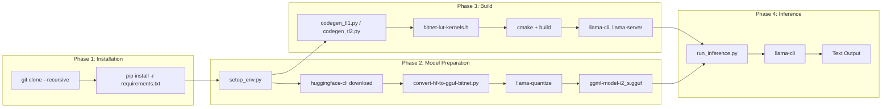
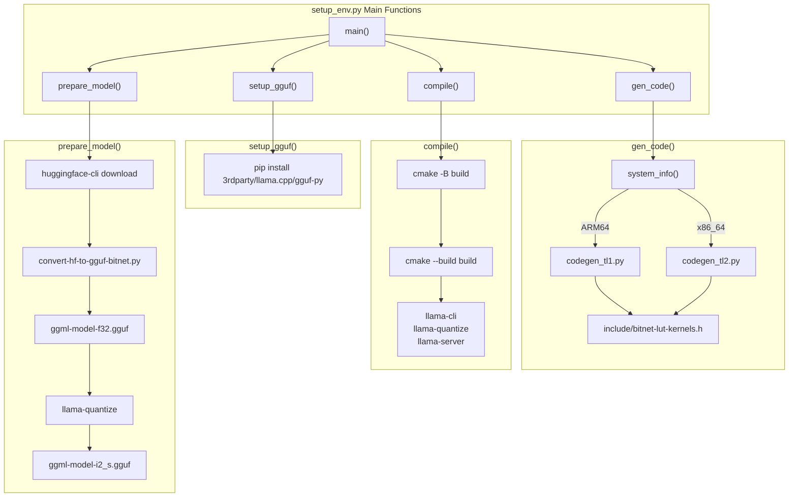
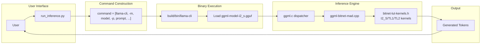

<!-- source: DeepWiki mcp.deepwiki.com · repo microsoft/BitNet · page 2 Getting Started · fetched 2026-10-26 -->

# Getting Started

<details>
<summary>Relevant source files</summary>

The following files were used as context for generating this wiki page:

- [CMakeLists.txt](CMakeLists.txt)
- [README.md](README.md)
- [run_inference.py](run_inference.py)
- [run_inference_server.py](run_inference_server.py)
- [setup_env.py](setup_env.py)
- [utils/convert-hf-to-gguf-bitnet.py](utils/convert-hf-to-gguf-bitnet.py)

</details>


This guide walks through the complete setup process for BitNet.cpp, from installation to running your first inference. The setup involves three main phases: installation and build, model preparation, and running inference.

For detailed information on each phase:
- Installation details: [Installation and Build](#2.1)
- Model conversion and quantization: [Model Preparation](#2.2)
- Inference options and parameters: [Running Your First Inference](#2.3)

For background on BitNet.cpp capabilities, see [BitNet.cpp Overview](#1).

## Prerequisites

Before setting up BitNet.cpp, ensure your system meets the following requirements:

| Requirement | Minimum Version |
|-------------|-----------------|
| Python      | 3.9 or higher   |
| CMake       | 3.22 or higher  |
| Clang       | 18 or higher    |
| Conda       | Recommended     |

### Platform-Specific Requirements

For **Windows** users:
- Install [Visual Studio 2022](https://visualstudio.microsoft.com/downloads) with the following components:
  - Desktop development with C++
  - C++ CMake Tools for Windows
  - Git for Windows
  - C++ Clang Compiler for Windows
  - MS-Build Support for LLVM-Toolset (clang)

For **Debian/Ubuntu** users:
- Install Clang using the automatic installation script:
  ```bash
  bash -c "$(wget -O - https://apt.llvm.org/llvm.sh)"
  ```

Sources: [README.md:145-158]()

## Quick Start Workflow

**Complete Setup and Inference Workflow:**



The `setup_env.py` script orchestrates phases 2 and 3, automating model download, conversion, quantization, kernel generation, and compilation.

Sources: [setup_env.py:1-244](), [README.md:176-199]()

## Complete Setup Example

The following single command downloads a model, generates optimized kernels for your architecture, builds the binaries, and prepares a quantized model ready for inference:

```bash
# Clone repository with llama.cpp submodule
git clone --recursive https://github.com/microsoft/BitNet.git
cd BitNet

# Create conda environment (recommended)
conda create -n bitnet-cpp python=3.9
conda activate bitnet-cpp
pip install -r requirements.txt

# Download model, build binaries, and prepare quantized model
python setup_env.py --hf-repo microsoft/BitNet-b1.58-2B-4T --model-dir models/BitNet-b1.58-2B-4T -q i2_s
```

This executes the complete workflow shown in the diagram above. For detailed breakdowns of each phase, see [Installation and Build](#2.1) and [Model Preparation](#2.2).

Sources: [README.md:166-199](), [setup_env.py:218-223]()

## Setup Process Internals

**What `setup_env.py` Does:**



Sources: [setup_env.py:152-222](), [setup_env.py:109-150](), [setup_env.py:156-200](), [setup_env.py:203-216]()

### Key Command-Line Arguments

| Argument | Description | Values | Default |
|----------|-------------|--------|---------|
| `--hf-repo`, `-hr` | HuggingFace model repository | See supported models | None |
| `--model-dir`, `-md` | Local directory for model | Any path | `models` |
| `--quant-type`, `-q` | Quantization format | `i2_s`, `tl1` (ARM), `tl2` (x86) | `i2_s` |
| `--quant-embd` | Quantize embeddings to f16 | Flag | False |
| `--use-pretuned`, `-p` | Use preset kernel configurations | Flag | False |

The `--quant-type` determines which quantization scheme is used. See [Quantization Schemes](#4.3) for technical details.

Sources: [setup_env.py:224-233](), [setup_env.py:61-64]()

## Running Your First Inference

**Inference Execution Path:**



Sources: [run_inference.py:16-37]()

### Basic Inference Command

After running `setup_env.py`, execute inference:

```bash
python run_inference.py \
  -m models/BitNet-b1.58-2B-4T/ggml-model-i2_s.gguf \
  -p "Microsoft Corporation is" \
  -n 128 \
  -t 4
```

For instruct models, enable conversation mode:

```bash
python run_inference.py \
  -m models/BitNet-b1.58-2B-4T/ggml-model-i2_s.gguf \
  -p "You are a helpful assistant" \
  -cnv
```

The `-cnv` flag formats prompts using the model's chat template and enables multi-turn conversation.

Sources: [README.md:220-224](), [run_inference.py:35-36]()

### Inference Parameters

| Parameter | Description | Default | Range/Options |
|-----------|-------------|---------|---------------|
| `-m`, `--model` | Path to GGUF model file | Required | `.gguf` file path |
| `-p`, `--prompt` | Input prompt text | Required | Any string |
| `-n`, `--n-predict` | Tokens to generate | 128 | Positive integer |
| `-t`, `--threads` | CPU threads for inference | 2 | 1 to CPU count |
| `-c`, `--ctx-size` | Context window size | 2048 | Model-dependent |
| `-temp`, `--temperature` | Sampling temperature | 0.8 | 0.0 to 2.0 |
| `-cnv`, `--conversation` | Chat mode for instruct models | False | Flag |

The `run_inference.py` wrapper constructs the command for `llama-cli` at [run_inference.py:24-37](). For advanced inference options, see [Interactive CLI Inference](#3.1).

Sources: [run_inference.py:46-53](), [README.md:226-246]()

## Verifying Installation

To verify your setup, run a quick benchmark:

```bash
python utils/e2e_benchmark.py \
  -m models/BitNet-b1.58-2B-4T/ggml-model-i2_s.gguf \
  -p 512 \
  -n 128 \
  -t 4
```

This measures throughput (tokens/second) and validates that:
- The model loads correctly
- Kernels execute without errors
- Performance is within expected range

For detailed benchmarking and performance tuning, see [Benchmarking Performance](#3.3) and [Performance Tuning Guide](#5.1).

Sources: [README.md:249-286]()

## Supported Models and Quantization

BitNet.cpp supports multiple 1.58-bit models from HuggingFace. The available quantization schemes depend on the CPU architecture:

| Model | Parameters | ARM Kernels | x86 Kernels |
|-------|-----------|-------------|-------------|
| [microsoft/BitNet-b1.58-2B-4T](https://huggingface.co/microsoft/BitNet-b1.58-2B-4T) | 2.4B | I2_S, TL1 | I2_S, TL2 |
| [1bitLLM/bitnet_b1_58-large](https://huggingface.co/1bitLLM/bitnet_b1_58-large) | 0.7B | I2_S, TL1 | I2_S, TL2 |
| [1bitLLM/bitnet_b1_58-3B](https://huggingface.co/1bitLLM/bitnet_b1_58-3B) | 3.3B | TL1 | TL2 |
| [HF1BitLLM/Llama3-8B-1.58-100B-tokens](https://huggingface.co/HF1BitLLM/Llama3-8B-1.58-100B-tokens) | 8.0B | I2_S, TL1 | I2_S, TL2 |
| [Falcon3 Family](https://huggingface.co/collections/tiiuae/falcon3-67605ae03578be86e4e87026) | 1B-10B | I2_S, TL1 | I2_S, TL2 |
| [Falcon-E Family](https://huggingface.co/collections/tiiuae/falcon-edge-series-6804fd13344d6d8a8fa71130) | 1B-3B | I2_S, TL1 | I2_S, TL2 |

**Quantization Schemes:**
- **I2_S**: Standard 2-bit quantization, compatible with all platforms
- **TL1**: Table-lookup optimized for ARM NEON (128-bit SIMD)
- **TL2**: Table-lookup optimized for x86 AVX2 (256-bit SIMD)

The architecture is auto-detected by `setup_env.py` via the `system_info()` function at [setup_env.py:84-85](). For complete model compatibility, see [Supported Models and Hardware](#1.1).

Sources: [README.md:39-155](), [setup_env.py:61-82]()

## Troubleshooting

### Issue: Build errors with llama.cpp due to std::chrono in log.cpp

This is an issue with recent versions of llama.cpp. Refer to this [commit](https://github.com/tinglou/llama.cpp/commit/4e3db1e3d78cc1bcd22bcb3af54bd2a4628dd323) for a fix.

### Issue: Clang not recognized in Windows

Ensure you're using the correct Visual Studio Developer Command Prompt. To initialize it:

For Command Prompt:
```
"C:\Program Files\Microsoft Visual Studio\2022\Professional\Common7\Tools\VsDevCmd.bat" -startdir=none -arch=x64 -host_arch=x64
```

For PowerShell:
```
Import-Module "C:\Program Files\Microsoft Visual Studio\2022\Professional\Common7\Tools\Microsoft.VisualStudio.DevShell.dll" 
Enter-VsDevShell 3f0e31ad -SkipAutomaticLocation -DevCmdArguments "-arch=x64 -host_arch=x64"
```

Sources: [README.md:280-313]()

## Next Steps

For more detailed information on:
- Setting up specific environments, see [Environment Setup](#2.1)
- Preparing different models for inference, see [Model Preparation](#2.2)
- Comprehensive guide for inference options, see [Running Inference](#3)

Sources: [README.md:204-231](), [CMakeLists.txt:1-77]()

---

