# Page: BitNet.cpp Overview

# BitNet.cpp Overview

<details>
<summary>Relevant source files</summary>

The following files were used as context for generating this wiki page:

- [README.md](README.md)

</details>


This document provides a high-level introduction to BitNet.cpp, explaining its purpose, core capabilities, and system architecture. For detailed installation instructions, see [Getting Started](#2). For in-depth technical details about the architecture, see [Technical Architecture](#4).

## Purpose

BitNet.cpp is the official inference framework for 1-bit Large Language Models (LLMs), specifically designed for BitNet b1.58 models. The framework provides optimized kernels for **fast** and **lossless** inference on CPU and GPU hardware, enabling efficient deployment of 1-bit quantized models.

The framework is built as an extension of [llama.cpp](https://github.com/ggerganov/llama.cpp), inheriting its mature inference infrastructure while adding specialized support for 1-bit quantization through lookup table (LUT) based matrix operations.

**Sources:** [README.md:9-11]()

## Key Capabilities

BitNet.cpp delivers the following core capabilities:

| Capability | Description |
|------------|-------------|
| **1-bit Quantization** | Native support for BitNet b1.58 ternary weight quantization (-1, 0, +1) |
| **Multi-Architecture Support** | Optimized kernels for ARM (NEON) and x86 (AVX2) CPUs |
| **Multiple Quantization Schemes** | I2_S, TL1 (ARM), and TL2 (x86) formats with architecture-specific optimizations |
| **Model Conversion** | Tools to convert HuggingFace and safetensors models to GGUF format |
| **Flexible Deployment** | CLI, server, and benchmarking modes for various use cases |
| **Performance Tuning** | Configurable kernel parameters and preset configurations for optimal performance |
| **Experimental GPU Support** | CUDA-based W2A8 kernels for GPU inference |

**Performance achievements** (detailed in [Performance Benchmarks](#1.2)):
- **1.37x to 5.07x** speedup on ARM CPUs
- **2.37x to 6.17x** speedup on x86 CPUs  
- **55.4% to 82.2%** energy consumption reduction
- Additional **1.15x to 2.1x** speedup with recent parallel kernel optimizations
- Can run 100B parameter models on single CPU at human-readable speeds (5-7 tokens/second)

**Sources:** [README.md:9-13](), [README.md:24-34]()

## Architecture Overview

The following diagram shows the major system components and their relationships:

### System Component Architecture

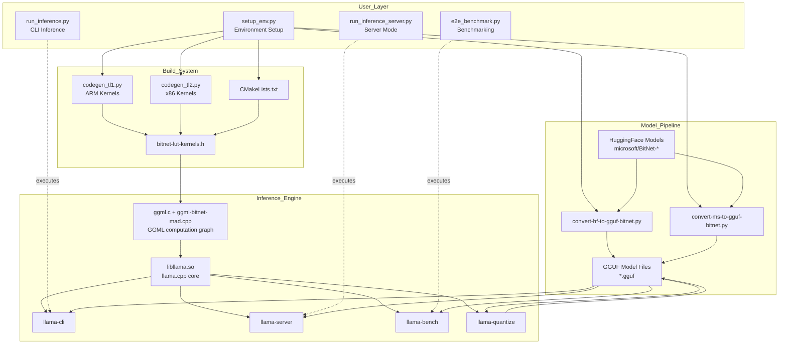

**Sources:** [README.md:1-340](), Diagrams 1, 2, and 6 from system architecture analysis

### Data Flow and Quantization Pipeline

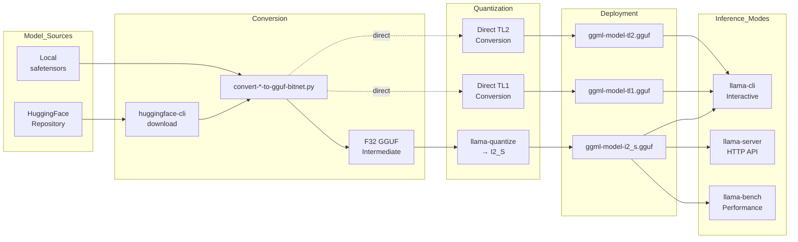

**Sources:** [README.md:195-219](), [README.md:222-246](), Diagram 2 from system architecture analysis

## Core Components

### User Interface Layer

BitNet.cpp provides Python scripts that orchestrate the complete workflow:

| Script | Purpose | Key Functionality |
|--------|---------|-------------------|
| `setup_env.py` | Environment setup and model preparation | Downloads models, generates kernels, builds binaries, performs quantization |
| `run_inference.py` | Interactive CLI inference | Single prompt or conversation mode inference |
| `run_inference_server.py` | HTTP server deployment | RESTful API for production deployments |
| `e2e_benchmark.py` | Performance benchmarking | Measures throughput, latency, and token generation speed |

**Sources:** [README.md:195-219](), [README.md:222-246](), [README.md:249-286]()

### Model Conversion Pipeline

The conversion pipeline transforms models from HuggingFace or safetensors format to optimized GGUF format:

| Component | File | Functionality |
|-----------|------|---------------|
| HuggingFace Converter | `convert-hf-to-gguf-bitnet.py` | Converts standard HuggingFace BitNet models |
| Microsoft Converter | `convert-ms-to-gguf-bitnet.py` | Converts Microsoft-specific checkpoint formats |
| Helper Utilities | `convert-helper-bitnet.py` | Wrapper providing unified conversion interface |
| Quantization Tool | `llama-quantize` | Post-conversion quantization to I2_S format |

**Sources:** [README.md:297-305](), Diagram 2 from system architecture analysis

### Kernel System

BitNet.cpp implements three quantization schemes, each optimized for specific architectures:

| Scheme | Target Architecture | Generated By | Description |
|--------|---------------------|--------------|-------------|
| **I2_S** | ARM and x86 | Built-in to GGML | Standard 2-bit packed format, quantized post-conversion |
| **TL1** | ARM (NEON) | `codegen_tl1.py` | Lookup table implementation optimized for ARM NEON instructions |
| **TL2** | x86 (AVX2) | `codegen_tl2.py` | Lookup table implementation optimized for x86 AVX2 instructions |

The kernel header `bitnet-lut-kernels.h` is generated at build time and compiled into `ggml-bitnet-mad.cpp`, which provides the core matrix multiplication operations.

**Sources:** [README.md:40-68](), [README.md:69-155](), Diagram 3 from system architecture analysis

### Integration with llama.cpp

BitNet.cpp extends the llama.cpp framework through:

1. **Custom GGML Quantization Types**: Adds `GGML_TYPE_I2_S`, `GGML_TYPE_TL1`, and `GGML_TYPE_TL2` to the GGML type system
2. **Kernel Injection**: Implements custom `ggml_vec_dot_i2_i8_s` functions in `ggml-bitnet-mad.cpp`
3. **Compile-Time Flags**: Uses `GGML_BITNET_ARM_TL1` and `GGML_BITNET_X86_TL2` to enable architecture-specific paths
4. **GGUF Format Extension**: Extends GGUF metadata to include BitNet-specific quantization parameters

The integration is designed such that BitNet models in GGUF format can be consumed by standard llama.cpp binaries (`llama-cli`, `llama-server`, etc.), while BitNet-compiled binaries retain full compatibility with standard llama.cpp GGUF models.

**Sources:** [README.md:36-38](), Diagram 6 from system architecture analysis

## Supported Models

BitNet.cpp supports models from multiple sources on HuggingFace. For a complete list of supported models, kernel compatibility by architecture, and parameter counts, see [Supported Models and Hardware](#1.1).

**Official Microsoft models:**
- `microsoft/BitNet-b1.58-2B-4T`: 2.4B parameter model with I2_S and architecture-specific TL support

**Community models:**
- `1bitLLM/bitnet_b1_58-*`: 0.7B to 3.3B parameter variants
- `HF1BitLLM/Llama3-8B-1.58-100B-tokens`: 8B parameter Llama3-based model
- `tiiuae/Falcon3-*` and `tiiuae/Falcon-E-*`: 1B to 10B parameter Falcon family models

**Sources:** [README.md:39-155]()

## Typical Workflow

The standard workflow for using BitNet.cpp follows these steps:

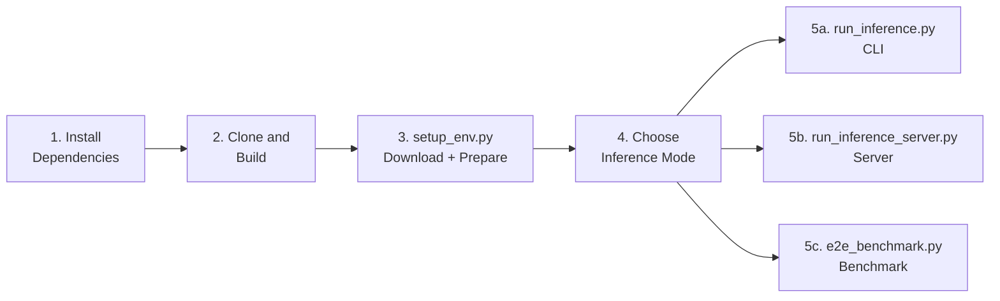

1. **Installation**: Install Python 3.9+, CMake 3.22+, and Clang 18+ (see [Installation and Build](#2.1))
2. **Clone and Build**: Clone repository and install Python dependencies
3. **Setup**: Run `setup_env.py` to download models, generate kernels, build binaries, and quantize models
4. **Inference**: Choose an inference mode based on use case
5. **Deployment**: For production, use server mode with continuous batching

For performance optimization, the optional tuning workflow uses `tune_gemm_config.py` to find optimal kernel parameters (see [Performance Tuning Guide](#5.1)).

**Sources:** [README.md:176-219](), Diagram 5 from system architecture analysis

## Key Design Principles

BitNet.cpp is designed around several core principles:

1. **Lossless Inference**: All quantization schemes preserve the exact ternary values (-1, 0, +1) without approximation
2. **Architecture-Specific Optimization**: Separate kernel implementations leverage hardware-specific SIMD instructions (NEON for ARM, AVX2 for x86)
3. **Lookup Table Methodology**: Based on T-MAC research, using precomputed lookup tables for fast matrix operations
4. **Build-Time Specialization**: Kernels are generated and optimized at build time for the target architecture
5. **llama.cpp Compatibility**: Maintains full compatibility with the llama.cpp ecosystem and GGUF format

**Sources:** [README.md:9-11](), [README.md:36-38](), Diagram 3 from system architecture analysis

## Related Documentation

- For installation instructions and build configuration: [Installation and Build](#2.1)
- For model download and preparation: [Model Preparation](#2.2)
- For inference usage patterns: [Running Inference](#3)
- For detailed architecture explanation: [Technical Architecture](#4)
- For performance optimization: [Performance Tuning Guide](#5.1)
- For GPU inference: [GPU Inference (Experimental)](#3.4)

**Sources:** Table of contents from wiki structure

---

# Page: Supported Models and Hardware

# Supported Models and Hardware

<details>
<summary>Relevant source files</summary>

The following files were used as context for generating this wiki page:

- [README.md](README.md)
- [run_inference.py](run_inference.py)
- [setup_env.py](setup_env.py)
- [utils/convert-hf-to-gguf-bitnet.py](utils/convert-hf-to-gguf-bitnet.py)

</details>


This page documents the models and hardware platforms compatible with BitNet.cpp. It covers officially supported BitNet models, community-contributed models, CPU architecture requirements, and the mapping between hardware platforms and kernel implementations.

For information about setting up and preparing these models for inference, see [Model Preparation](#2.2). For performance characteristics of different hardware configurations, see [Performance Benchmarks](#1.2).

## Overview

BitNet.cpp supports 1-bit and 1.58-bit LLMs from HuggingFace with varying parameter sizes (0.7B to 10B+). The framework provides architecture-specific optimized kernels that are automatically selected based on the detected CPU architecture. Three quantization kernel types are available: I2_S (portable baseline), TL1 (ARM64-optimized), and TL2 (x86_64-optimized).

## Supported Models

### Official Models

Microsoft provides officially tested BitNet models optimized for the framework:

| Model | Parameters | HuggingFace Repository | x86 Kernels | ARM Kernels |
|-------|-----------|------------------------|-------------|-------------|
| BitNet-b1.58-2B-4T | 2.4B | [microsoft/BitNet-b1.58-2B-4T](https://huggingface.co/microsoft/BitNet-b1.58-2B-4T) | I2_S, TL2 | I2_S, TL1 |

**Sources:** [README.md:39-67]()

### Community Models

The following community-contributed 1-bit LLMs are supported through HuggingFace integration:

| Model | Parameters | Repository | x86 Kernels | ARM Kernels |
|-------|-----------|-----------|-------------|-------------|
| bitnet_b1_58-large | 0.7B | [1bitLLM/bitnet_b1_58-large](https://huggingface.co/1bitLLM/bitnet_b1_58-large) | I2_S, TL2 | I2_S, TL1 |
| bitnet_b1_58-3B | 3.3B | [1bitLLM/bitnet_b1_58-3B](https://huggingface.co/1bitLLM/bitnet_b1_58-3B) | TL2 | TL1 |
| Llama3-8B-1.58-100B-tokens | 8.0B | [HF1BitLLM/Llama3-8B-1.58-100B-tokens](https://huggingface.co/HF1BitLLM/Llama3-8B-1.58-100B-tokens) | I2_S, TL2 | I2_S, TL1 |
| Falcon3 Family | 1B-10B | [tiiuae/falcon3-*](https://huggingface.co/collections/tiiuae/falcon3-67605ae03578be86e4e87026) | I2_S, TL2 | I2_S, TL1 |
| Falcon-E Family | 1B-3B | [tiiuae/Falcon-E-*](https://huggingface.co/collections/tiiuae/falcon-edge-series-6804fd13344d6d8a8fa71130) | I2_S, TL2 | I2_S, TL1 |

**Sources:** [README.md:69-155]()

### Recognized Model Architectures

BitNet.cpp recognizes the following model architectures in HuggingFace `config.json`:

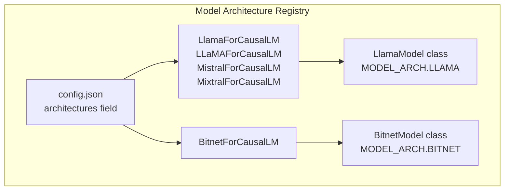

**Architecture Detection Flow:**

The model architecture is read from `config.json` and mapped to a handler class:

- **`LlamaForCausalLM`** variants (including Mistral, Mixtral): Handled by `LlamaModel` class using `gguf.MODEL_ARCH.LLAMA`
- **`BitnetForCausalLM`**: Handled by `BitnetModel` class using `gguf.MODEL_ARCH.BITNET`

**Sources:** [utils/convert-hf-to-gguf-bitnet.py:682-684](), [utils/convert-hf-to-gguf-bitnet.py:955-957]()

### Model Registry Configuration

The supported models are registered in the `SUPPORTED_HF_MODELS` dictionary:

```python
# Examples from setup_env.py
SUPPORTED_HF_MODELS = {
    "1bitLLM/bitnet_b1_58-large": {"model_name": "bitnet_b1_58-large"},
    "1bitLLM/bitnet_b1_58-3B": {"model_name": "bitnet_b1_58-3B"},
    "HF1BitLLM/Llama3-8B-1.58-100B-tokens": {"model_name": "Llama3-8B-1.58-100B-tokens"},
    "tiiuae/Falcon3-7B-Instruct-1.58bit": {"model_name": "Falcon3-7B-Instruct-1.58bit"},
    # ... additional models
}
```

This registry is used by `setup_env.py` for model download and preparation.

**Sources:** [setup_env.py:13-59]()

## Hardware Support

### CPU Architecture Compatibility

BitNet.cpp supports the following CPU architectures with specialized kernel implementations:

| Architecture | Platform Detection | SIMD Instructions | Optimized Kernels |
|--------------|-------------------|-------------------|-------------------|
| **x86_64** | `AMD64`, `x86`, `x86_64` | AVX2 (256-bit) | I2_S, TL2 |
| **ARM64** | `aarch64`, `arm64`, `ARM64` | NEON (128-bit), optional DOTPROD | I2_S, TL1 |

**Sources:** [setup_env.py:61-82]()

### Architecture Detection System

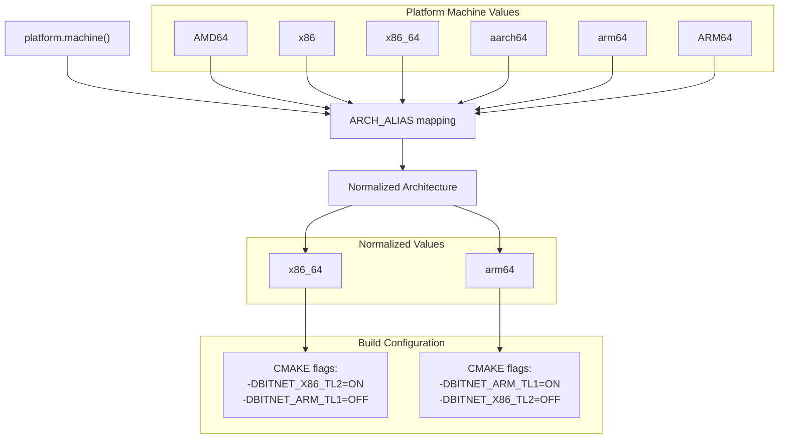

**Architecture Detection Implementation:**

The `system_info()` function in `setup_env.py` performs architecture detection:

1. Calls `platform.machine()` to get raw architecture string
2. Maps through `ARCH_ALIAS` dictionary to normalize variations
3. Returns tuple of `(os_name, normalized_arch)`

**Sources:** [setup_env.py:75-85]()

### Kernel Type Mapping

The build system selects quantization kernel types based on detected architecture:

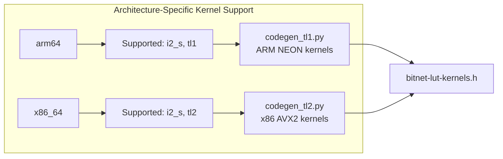

**Quantization Type Configuration:**

```python
# From setup_env.py
SUPPORTED_QUANT_TYPES = {
    "arm64": ["i2_s", "tl1"],
    "x86_64": ["i2_s", "tl2"]
}
```

The command-line argument parser restricts `--quant-type` choices based on the detected architecture.

**Sources:** [setup_env.py:61-64](), [setup_env.py:224-233]()

## Quantization Kernel Types

### I2_S (Baseline Portable Kernel)

**Characteristics:**
- **Availability:** Both x86_64 and ARM64
- **Format:** 2-bit integer with sign encoding
- **Conversion:** Two-step process (F32 → I2_S via `llama-quantize`)
- **Use Case:** Baseline implementation, guaranteed compatibility

**Conversion Process:**
1. Convert HuggingFace model to F32 GGUF format
2. Quantize F32 GGUF to I2_S using `llama-quantize` binary

```bash
# Example I2_S conversion flow
llama-quantize ggml-model-f32.gguf ggml-model-i2_s.gguf I2_S 1
```

**Sources:** [setup_env.py:132-146](), [README.md:49-66]()

### TL1 (ARM64 Table Lookup Kernel)

**Characteristics:**
- **Availability:** ARM64 only
- **SIMD Instructions:** ARM NEON (128-bit), optional DOTPROD extension
- **Format:** Lookup table-based encoding optimized for ARM
- **Conversion:** Direct conversion during HuggingFace import
- **Performance:** Optimized for ARM cache hierarchy and instruction set

**Code Generation:**
- Generated by `utils/codegen_tl1.py` with model-specific block sizes
- Parameters: `BM`, `BK`, `bm` (tiling dimensions)
- Output: `include/bitnet-lut-kernels.h`

**Preprocessing Functions:**
- `process_tl1()`: Weight layout transformation
- `preprocess_weights_tl1()`: Entry point for TL1 quantization

**Sources:** [setup_env.py:167-181](), [utils/convert-hf-to-gguf-bitnet.py:463-520]()

### TL2 (x86_64 Table Lookup Kernel)

**Characteristics:**
- **Availability:** x86_64 only
- **SIMD Instructions:** AVX2 (256-bit)
- **Format:** Lookup table-based encoding optimized for x86
- **Conversion:** Direct conversion during HuggingFace import
- **Performance:** Optimized for x86 cache hierarchy and AVX2 operations

**Code Generation:**
- Generated by `utils/codegen_tl2.py` with model-specific block sizes
- Parameters: `BM`, `BK`, `bm` (tiling dimensions)
- Output: `include/bitnet-lut-kernels.h`

**Preprocessing Functions:**
- `preprocess_two_weights_tl2()`: Handles 2-element groups
- `preprocess_three_weights_tl2()`: Handles 3-element groups with sign bits
- `preprocess_weights_tl2()`: Entry point for TL2 quantization

**Sources:** [setup_env.py:184-200](), [utils/convert-hf-to-gguf-bitnet.py:523-660]()

## Hardware-Kernel Compatibility Matrix

The following matrix shows which kernel configurations are available for each model-hardware combination:

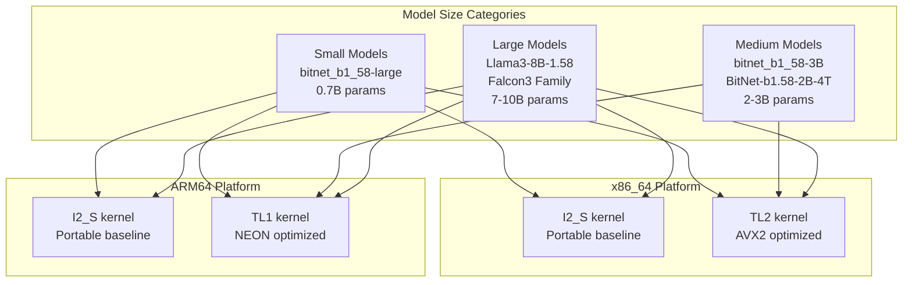

**Platform-Specific Notes:**

**x86_64 Systems:**
- All models support I2_S and TL2 quantization
- AVX2 instruction set required for optimal TL2 performance
- TL2 provides 2.37x to 6.17x speedup over baseline

**ARM64 Systems:**
- All models support I2_S and TL1 quantization
- NEON instruction set required (standard on ARMv8)
- Optional DOTPROD extension provides additional acceleration
- TL1 provides 1.37x to 5.07x speedup over baseline

**Sources:** [README.md:11](), [README.md:40-155]()

## Kernel Configuration Parameters

Each model requires specific kernel parameters that define the tiling and blocking strategy:

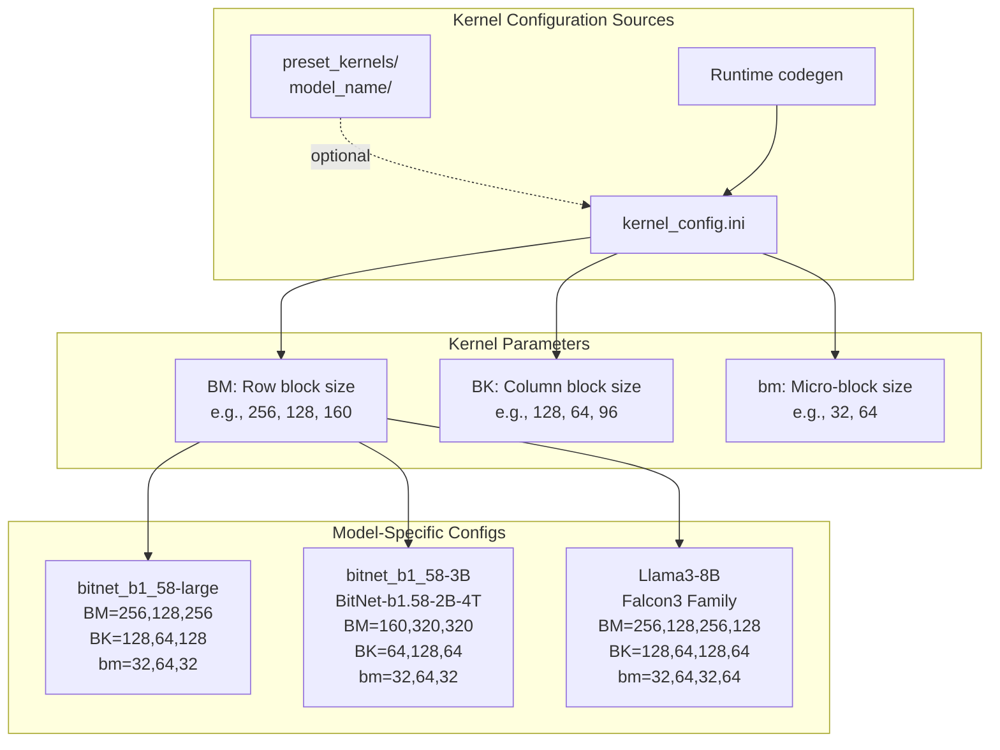

**Configuration Selection:**

The `--use-pretuned` flag in `setup_env.py` allows using pre-optimized kernel configurations:

```bash
# Use pretuned kernels if available
python setup_env.py --hf-repo MODEL_REPO --use-pretuned
```

If pretuned kernels are not available, the system falls back to model-specific defaults in the code generation scripts.

**Sources:** [setup_env.py:162-200](), [utils/convert-hf-to-gguf-bitnet.py:493-504](), [utils/convert-hf-to-gguf-bitnet.py:611-625]()

## System Requirements

### Minimum Requirements

- **Python:** >= 3.9
- **CMake:** >= 3.22
- **Clang:** >= 18
- **Memory:** Varies by model size (minimum 8GB for 3B models)

### Platform-Specific Requirements

**Linux (Debian/Ubuntu):**
```bash
# Install Clang via LLVM script
bash -c "$(wget -O - https://apt.llvm.org/llvm.sh)"
```

**Windows:**
- Visual Studio 2022 with:
  - Desktop development with C++
  - C++-CMake Tools for Windows
  - Git for Windows
  - C++-Clang Compiler for Windows
  - MS-Build Support for LLVM-Toolset (clang)

**macOS:**
- Xcode Command Line Tools
- Clang provided by Xcode

**Sources:** [README.md:159-175]()

### GPU Support (Experimental)

Limited experimental GPU support is available with CUDA kernels:

- **Kernel Type:** W2A8 (2-bit weights, 8-bit activations)
- **CUDA Operations:** `dp4a` instructions
- **Status:** Experimental, separate from CPU inference path
- **Documentation:** See [GPU Inference](#3.4)

**Sources:** Inferred from diagram context, not directly visible in provided files

---

# Page: Performance Benchmarks

# Performance Benchmarks

<details>
<summary>Relevant source files</summary>

The following files were used as context for generating this wiki page:

- [README.md](README.md)
- [assets/performance.png](assets/performance.png)
- [src/README.md](src/README.md)
- [src/assets/performance_comparison_amd_epyc.png](src/assets/performance_comparison_amd_epyc.png)
- [src/assets/performance_comparison_cobalt100_dotprod.png](src/assets/performance_comparison_cobalt100_dotprod.png)

</details>


This page presents comprehensive performance benchmark results for BitNet.cpp across different hardware platforms, quantization schemes, and optimization configurations. These benchmarks demonstrate the speedups, energy efficiency improvements, and throughput characteristics of 1-bit LLM inference compared to baseline implementations.

For information about the specific models tested and their hardware compatibility, see [Supported Models and Hardware](#1.1). For details on kernel implementations that enable these performance gains, see [Kernel Architecture and Code Generation](#4.4) and [CPU Optimizations](#4.5).

## Performance Overview

BitNet.cpp delivers significant performance improvements for 1-bit LLM inference through specialized kernels and optimization strategies:

| Platform | Speedup Range | Energy Reduction | Reference Speed |
|----------|---------------|------------------|-----------------|
| ARM CPUs | 1.37x - 5.07x | 55.4% - 70.0% | Larger models show greater gains |
| x86 CPUs | 2.37x - 6.17x | 71.9% - 82.2% | Larger models show greater gains |
| Latest optimizations | +1.15x - 2.1x | Additional improvement | Over original implementation |

**Large Model Capability**: BitNet.cpp can run a 100B BitNet b1.58 model on a single CPU at 5-7 tokens per second, comparable to human reading speed.

Sources: [README.md:11]()

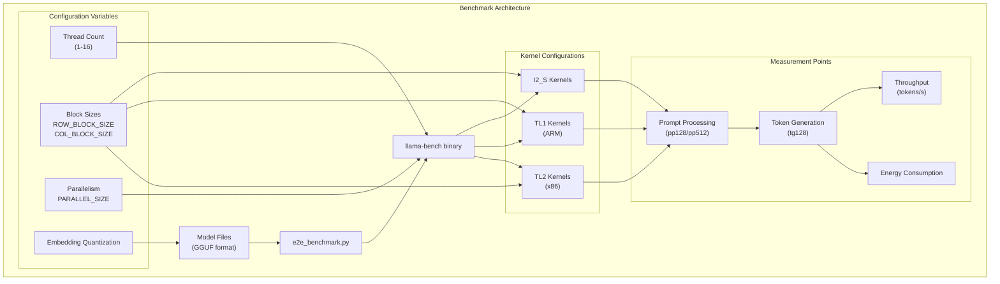

Sources: [README.md:250-294](), [src/README.md:1-206]()

## Platform-Specific Performance

### ARM CPU Performance

ARM implementations utilize NEON SIMD instructions with optional DOTPROD extensions. The TL1 kernel provides optimized 1-bit weight operations specifically designed for ARM architectures.

**Key Characteristics**:
- Speedup range: 1.37x - 5.07x
- Energy reduction: 55.4% - 70.0%
- Kernel type: I2_S, TL1
- SIMD width: 128-bit (NEON)

Sources: [README.md:11](), [README.md:61-66](), [src/README.md:202-206]()

### x86 CPU Performance

x86 implementations leverage AVX2 instructions for 256-bit SIMD operations. The TL2 kernel is specifically tuned for x86 cache hierarchies and instruction sets.

**Key Characteristics**:
- Speedup range: 2.37x - 6.17x
- Energy reduction: 71.9% - 82.2%
- Kernel type: I2_S, TL2
- SIMD width: 256-bit (AVX2)

Sources: [README.md:11](), [README.md:56-60]()

## Recent Optimization Results

The latest optimization update introduces parallel kernel implementations, native I2_S GEMM/GEMV support, and embedding quantization. These improvements stack on top of the base performance gains.

**Optimization Features**:
- **Parallel Weight & Activation Computation**: Multiple rows/columns processed per kernel call
- **Native I2_S GEMM/GEMV**: Integrated into `ggml.c` for seamless inference pipeline
- **Configurable Tiling**: Tunable block sizes in `include/gemm-config.h`
- **Embedding Quantization**: Q6_K format reduces memory footprint

**Additional Speedup**: 1.15x to 2.1x over original implementation

Sources: [README.md:13](), [src/README.md:1-18]()

### Kernel Parallelization Strategy Performance

The parallel kernel implementation supports two strategies with measurably different performance characteristics:

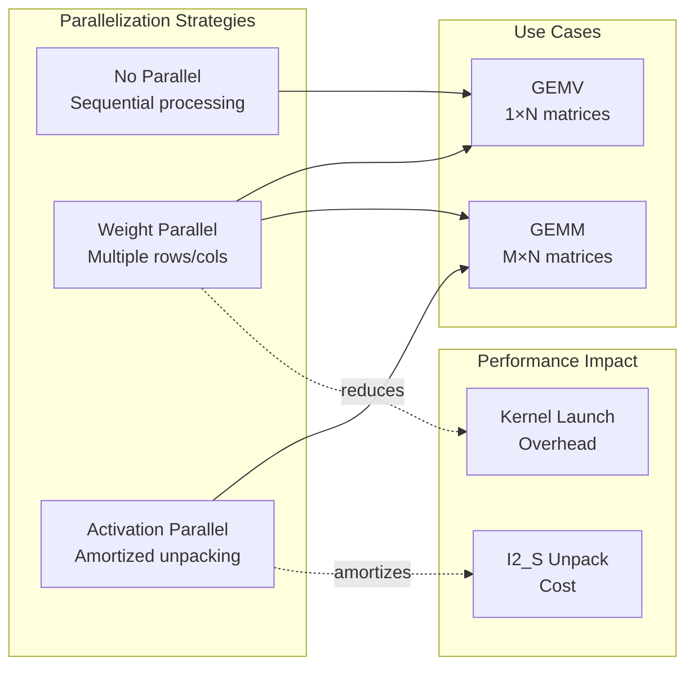

**Test Configuration**: AMD EPYC 7V13 (x86), 1 thread, time in milliseconds (mean±std)

| Matrix Size | No Parallel | Weight Parallel | Activation Parallel |
|-------------|-------------|-----------------|---------------------|
| [1, 2048] × [2048, 2048] | 0.075±0.012 | **0.058±0.007** | 0.076±0.011 |
| [32, 2048] × [2048, 2048] | 2.400±0.041 | 1.599±0.020 | **1.202±0.018** |
| [128, 2048] × [2048, 2048] | 10.820±0.039 | 6.458±0.168 | **5.805±0.039** |
| [256, 2048] × [2048, 2048] | 21.669±0.080 | 12.739±0.183 | **11.882±0.040** |
| [512, 2048] × [2048, 2048] | 43.257±0.083 | 25.680±0.335 | **23.342±0.082** |
| [2048, 2048] × [2048, 2048] | 173.175±0.214 | 103.112±0.552 | **93.276±0.612** |
| [128, 2048] × [2048, 8192] | 43.345±0.090 | 25.541±0.239 | **23.528±0.052** |
| [128, 8192] × [8192, 2048] | 38.085±0.162 | 23.866±0.096 | **22.569±0.132** |

**Observation**: Weight Parallel performs best for GEMV operations (single row), while Activation Parallel excels for GEMM operations (multiple rows) where I2_S unpacking cost can be amortized.

Sources: [src/README.md:50-76]()

## Detailed Hardware Benchmarks

### AMD EPYC 7V13 Multi-Threading Scaling

**Test Configuration**:
- Model: `microsoft/BitNet-b1.58-2B-4T`
- Workload: 128 prompt tokens (pp128) + 128 generated tokens (tg128)
- Method: Activation Parallel
- Threads: 1, 2, 4, 8, 12, 16

The benchmark demonstrates near-linear scaling with thread count for both the original and optimized implementations, with optimized kernels maintaining 1.5-2.0x advantage across all thread counts.

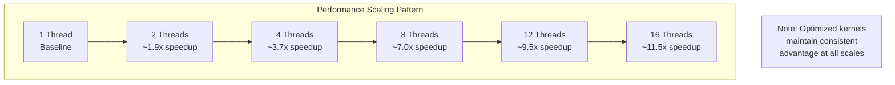

Sources: [src/README.md:150-165]()

### Intel i7-13800H Performance

**Test Configuration**:
- Model: `microsoft/BitNet-b1.58-2B-4T`
- Workload: pp128 + tg128
- Method: Activation Parallel
- Threads: 1, 2, 4, 6

Consumer-grade x86 CPU showing similar scaling characteristics to server-grade processors, confirming optimization effectiveness across hardware tiers.

Sources: [src/README.md:167-178]()

### ARM Cobalt 100 with DOTPROD

**Test Configuration**:
- Model: `microsoft/BitNet-b1.58-2B-4T`
- Workload: pp128 + tg128
- Method: Activation Parallel
- Threads: 1, 2, 4, 8

ARM-based cloud instances demonstrate strong performance gains with DOTPROD extensions enabled, showing the effectiveness of the TL1 kernel implementation.

Sources: [src/README.md:180-191]()

## Embedding Quantization Impact

Embedding layer quantization trades minimal accuracy loss for improved memory efficiency and inference speed. Multiple quantization formats were evaluated to identify the optimal balance.

### Perplexity Comparison

**Test Configuration**: `microsoft/BitNet-b1.58-2B-4T`, TG128 workload

| Embedding Type | WikiText | PTB | LAMBADA | IMDB | AG NEWS |
|----------------|----------|-----|---------|------|---------|
| **F32** | 17.1090±0.1278 | 33.0858±0.4886 | 43.2850±0.6363 | 29.3016±0.2890 | 36.7686±0.3920 |
| **F16** | 17.1090±0.1278 | 33.0858±0.4886 | 43.2850±0.6363 | 29.3016±0.2890 | 36.7686±0.3920 |
| **Q8_0** | 17.1197±0.1280 | 33.1181±0.4893 | 43.2891±0.6364 | 29.3133±0.2892 | 36.7740±0.3920 |
| **Q6_K** | 17.1487±0.1282 | 33.2203±0.4914 | 43.3046±0.6362 | 29.3491±0.2897 | 36.7972±0.3921 |
| **Q5_0** | 17.2379±0.1288 | 33.2439±0.4907 | 43.4631±0.6379 | 29.5481±0.2920 | 36.8539±0.3924 |
| **Q4_0** | 17.3529±0.1300 | 33.7754±0.5001 | 44.4552±0.6559 | 30.1044±0.2978 | 37.3985±0.3997 |
| **Q3_K** | 17.6434±0.1320 | 34.3914±0.5089 | 45.4591±0.6735 | 30.8476±0.3069 | 39.5692±0.4259 |
| **I2_S** | N/A | N/A | N/A | N/A | N/A |

**Note**: I2_S quantization for embeddings causes model failure due to extreme quantization. Q6_K is recommended as the optimal format balancing accuracy and efficiency.

```mermaid
graph LR
    subgraph "Quantization Trade-offs"
        F32["F32/F16<br/>Baseline accuracy<br/>High memory"]
        Q8["Q8_0<br/>Minimal loss<br/>87.5% reduction"]
        Q6["Q6_K<br/>Small loss<br/>81.25% reduction"]
        Q5["Q5_0<br/>Noticeable loss<br/>84.375% reduction"]
        Q4["Q4_0<br/>Significant loss<br/>87.5% reduction"]
    end
    
    F32 -.0% loss.-> Q8
    Q8 -.+0.3% loss.-> Q6
    Q6 -.+0.7% loss.-> Q5
    Q5 -.+1.5% loss.-> Q4
    
    RECOMMEND["Recommended: Q6_K<br/>Best accuracy/efficiency balance"]
    Q6 --> RECOMMEND
```

Sources: [src/README.md:113-149]()

### Inference Speed with Quantized Embeddings

Embedding quantization provides measurable throughput improvements, particularly for larger batch sizes where memory bandwidth becomes a limiting factor. The throughput gains increase with more aggressive quantization, with Q6_K providing the best balance.

Sources: [src/README.md:138-148]()

## Configuration Tuning Results

The `include/gemm-config.h` file controls kernel tiling and parallelism parameters that significantly impact performance. Optimal values are hardware-dependent.

**Tunable Parameters**:
- `ROW_BLOCK_SIZE`: 2, 4, 8, 16, 32
- `COL_BLOCK_SIZE`: 32, 64, 128, 256, 512, 1024
- `PARALLEL_SIZE`: 2, 4, 8

**Example Optimal Configuration** (x86, AMD EPYC 7V13, 8 threads, pp128):
```c
#define ROW_BLOCK_SIZE 4
#define COL_BLOCK_SIZE 128
#define PARALLEL_SIZE 4
```

This configuration achieves peak throughput by balancing:
- Cache utilization (block sizes match L1/L2 cache line sizes)
- Parallelism overhead (PARALLEL_SIZE = 4 minimizes synchronization cost)
- Memory bandwidth (block sizes optimize memory access patterns)

Sources: [src/README.md:88-111](), [src/README.md:22-31]()

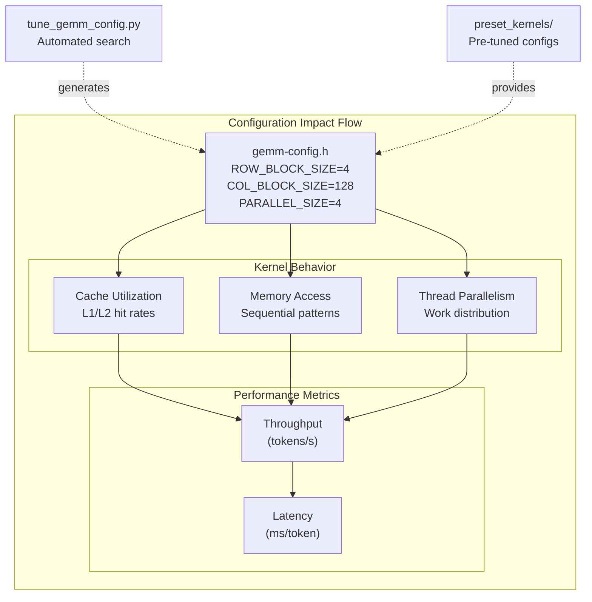

Sources: [src/README.md:88-111]()

## Benchmark Methodology

### Benchmark Scripts and Binaries

The performance measurements utilize the following components:

**Primary Tools**:
- `utils/e2e_benchmark.py`: End-to-end benchmark orchestrator
- `build/bin/llama-bench`: Core benchmark binary from llama.cpp
- `utils/tune_gemm_config.py`: GEMM configuration parameter search
- `utils/kernel_tuning.py`: Individual kernel performance profiling

**Command-Line Interface**:
```bash
python utils/e2e_benchmark.py \
  -m models/BitNet-b1.58-2B-4T/ggml-model-i2_s.gguf \
  -n 128 \       # Number of generated tokens
  -p 512 \       # Prompt tokens
  -t 4           # Thread count
```

Sources: [README.md:250-294]()

### Measured Metrics

The benchmark suite captures multiple performance dimensions:

| Metric | Description | Units |
|--------|-------------|-------|
| **Prompt Processing (pp)** | Time to process input prompt | tokens/s |
| **Token Generation (tg)** | Time to generate output tokens | tokens/s |
| **Throughput** | Combined pp+tg performance | tokens/s |
| **Latency** | Per-token generation time | ms/token |
| **Energy Consumption** | Power usage during inference | Watts |
| **Memory Usage** | Peak RAM consumption | GB |

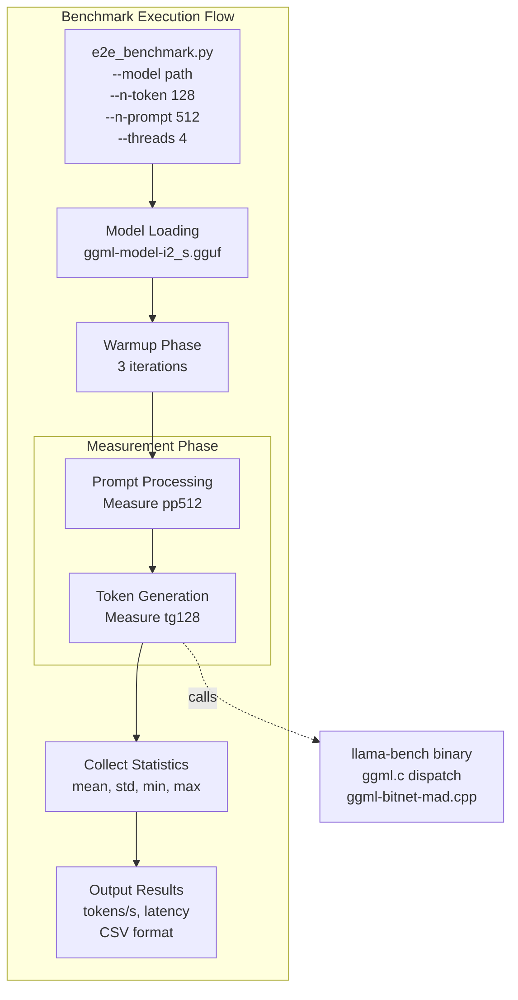

Sources: [README.md:250-286]()

### Baseline Comparison

All speedup measurements compare against the original llama.cpp implementation running the same model with standard quantization formats (Q4_0, Q8_0). Energy measurements use hardware power monitoring on the same physical machine.

**Comparison Methodology**:
1. Baseline run with llama.cpp Q4_0 quantization
2. BitNet.cpp run with I2_S/TL1/TL2 quantization
3. Calculate speedup ratio: `bitnet_tps / baseline_tps`
4. Calculate energy reduction: `(baseline_watts - bitnet_watts) / baseline_watts * 100%`

Sources: [README.md:11]()

---

# Page: Getting Started

# Getting Started

<details>
<summary>Relevant source files</summary>

The following files were used as context for generating this wiki page:

- [CMakeLists.txt](CMakeLists.txt)
- [README.md](README.md)
- [run_inference.py](run_inference.py)
- [run_inference_server.py](run_inference_server.py)
- [setup_env.py](setup_env.py)
- [utils/convert-hf-to-gguf-bitnet.py](utils/convert-hf-to-gguf-bitnet.py)

</details>


This guide walks through the complete setup process for BitNet.cpp, from installation to running your first inference. The setup involves three main phases: installation and build, model preparation, and running inference.

For detailed information on each phase:
- Installation details: [Installation and Build](#2.1)
- Model conversion and quantization: [Model Preparation](#2.2)
- Inference options and parameters: [Running Your First Inference](#2.3)

For background on BitNet.cpp capabilities, see [BitNet.cpp Overview](#1).

## Prerequisites

Before setting up BitNet.cpp, ensure your system meets the following requirements:

| Requirement | Minimum Version |
|-------------|-----------------|
| Python      | 3.9 or higher   |
| CMake       | 3.22 or higher  |
| Clang       | 18 or higher    |
| Conda       | Recommended     |

### Platform-Specific Requirements

For **Windows** users:
- Install [Visual Studio 2022](https://visualstudio.microsoft.com/downloads) with the following components:
  - Desktop development with C++
  - C++ CMake Tools for Windows
  - Git for Windows
  - C++ Clang Compiler for Windows
  - MS-Build Support for LLVM-Toolset (clang)

For **Debian/Ubuntu** users:
- Install Clang using the automatic installation script:
  ```bash
  bash -c "$(wget -O - https://apt.llvm.org/llvm.sh)"
  ```

Sources: [README.md:145-158]()

## Quick Start Workflow

**Complete Setup and Inference Workflow:**

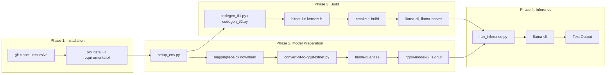

The `setup_env.py` script orchestrates phases 2 and 3, automating model download, conversion, quantization, kernel generation, and compilation.

Sources: [setup_env.py:1-244](), [README.md:176-199]()

## Complete Setup Example

The following single command downloads a model, generates optimized kernels for your architecture, builds the binaries, and prepares a quantized model ready for inference:

```bash
# Clone repository with llama.cpp submodule
git clone --recursive https://github.com/microsoft/BitNet.git
cd BitNet

# Create conda environment (recommended)
conda create -n bitnet-cpp python=3.9
conda activate bitnet-cpp
pip install -r requirements.txt

# Download model, build binaries, and prepare quantized model
python setup_env.py --hf-repo microsoft/BitNet-b1.58-2B-4T --model-dir models/BitNet-b1.58-2B-4T -q i2_s
```

This executes the complete workflow shown in the diagram above. For detailed breakdowns of each phase, see [Installation and Build](#2.1) and [Model Preparation](#2.2).

Sources: [README.md:166-199](), [setup_env.py:218-223]()

## Setup Process Internals

**What `setup_env.py` Does:**

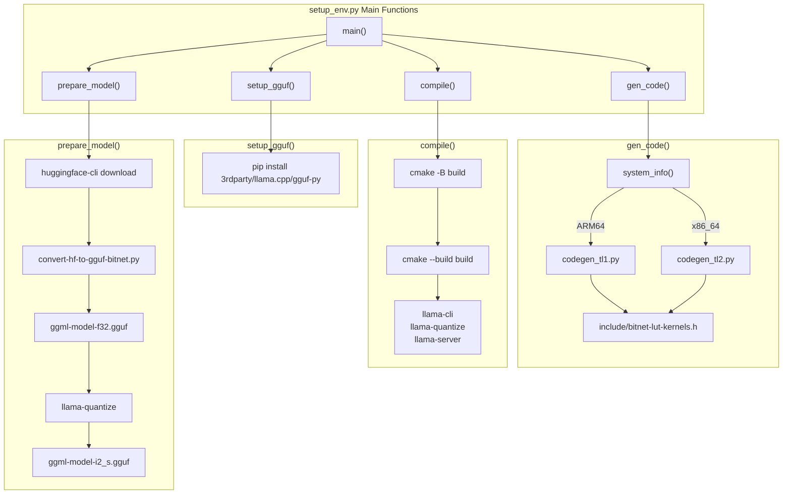

Sources: [setup_env.py:152-222](), [setup_env.py:109-150](), [setup_env.py:156-200](), [setup_env.py:203-216]()

### Key Command-Line Arguments

| Argument | Description | Values | Default |
|----------|-------------|--------|---------|
| `--hf-repo`, `-hr` | HuggingFace model repository | See supported models | None |
| `--model-dir`, `-md` | Local directory for model | Any path | `models` |
| `--quant-type`, `-q` | Quantization format | `i2_s`, `tl1` (ARM), `tl2` (x86) | `i2_s` |
| `--quant-embd` | Quantize embeddings to f16 | Flag | False |
| `--use-pretuned`, `-p` | Use preset kernel configurations | Flag | False |

The `--quant-type` determines which quantization scheme is used. See [Quantization Schemes](#4.3) for technical details.

Sources: [setup_env.py:224-233](), [setup_env.py:61-64]()

## Running Your First Inference

**Inference Execution Path:**

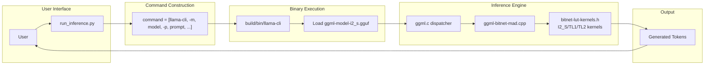

Sources: [run_inference.py:16-37]()

### Basic Inference Command

After running `setup_env.py`, execute inference:

```bash
python run_inference.py \
  -m models/BitNet-b1.58-2B-4T/ggml-model-i2_s.gguf \
  -p "Microsoft Corporation is" \
  -n 128 \
  -t 4
```

For instruct models, enable conversation mode:

```bash
python run_inference.py \
  -m models/BitNet-b1.58-2B-4T/ggml-model-i2_s.gguf \
  -p "You are a helpful assistant" \
  -cnv
```

The `-cnv` flag formats prompts using the model's chat template and enables multi-turn conversation.

Sources: [README.md:220-224](), [run_inference.py:35-36]()

### Inference Parameters

| Parameter | Description | Default | Range/Options |
|-----------|-------------|---------|---------------|
| `-m`, `--model` | Path to GGUF model file | Required | `.gguf` file path |
| `-p`, `--prompt` | Input prompt text | Required | Any string |
| `-n`, `--n-predict` | Tokens to generate | 128 | Positive integer |
| `-t`, `--threads` | CPU threads for inference | 2 | 1 to CPU count |
| `-c`, `--ctx-size` | Context window size | 2048 | Model-dependent |
| `-temp`, `--temperature` | Sampling temperature | 0.8 | 0.0 to 2.0 |
| `-cnv`, `--conversation` | Chat mode for instruct models | False | Flag |

The `run_inference.py` wrapper constructs the command for `llama-cli` at [run_inference.py:24-37](). For advanced inference options, see [Interactive CLI Inference](#3.1).

Sources: [run_inference.py:46-53](), [README.md:226-246]()

## Verifying Installation

To verify your setup, run a quick benchmark:

```bash
python utils/e2e_benchmark.py \
  -m models/BitNet-b1.58-2B-4T/ggml-model-i2_s.gguf \
  -p 512 \
  -n 128 \
  -t 4
```

This measures throughput (tokens/second) and validates that:
- The model loads correctly
- Kernels execute without errors
- Performance is within expected range

For detailed benchmarking and performance tuning, see [Benchmarking Performance](#3.3) and [Performance Tuning Guide](#5.1).

Sources: [README.md:249-286]()

## Supported Models and Quantization

BitNet.cpp supports multiple 1.58-bit models from HuggingFace. The available quantization schemes depend on the CPU architecture:

| Model | Parameters | ARM Kernels | x86 Kernels |
|-------|-----------|-------------|-------------|
| [microsoft/BitNet-b1.58-2B-4T](https://huggingface.co/microsoft/BitNet-b1.58-2B-4T) | 2.4B | I2_S, TL1 | I2_S, TL2 |
| [1bitLLM/bitnet_b1_58-large](https://huggingface.co/1bitLLM/bitnet_b1_58-large) | 0.7B | I2_S, TL1 | I2_S, TL2 |
| [1bitLLM/bitnet_b1_58-3B](https://huggingface.co/1bitLLM/bitnet_b1_58-3B) | 3.3B | TL1 | TL2 |
| [HF1BitLLM/Llama3-8B-1.58-100B-tokens](https://huggingface.co/HF1BitLLM/Llama3-8B-1.58-100B-tokens) | 8.0B | I2_S, TL1 | I2_S, TL2 |
| [Falcon3 Family](https://huggingface.co/collections/tiiuae/falcon3-67605ae03578be86e4e87026) | 1B-10B | I2_S, TL1 | I2_S, TL2 |
| [Falcon-E Family](https://huggingface.co/collections/tiiuae/falcon-edge-series-6804fd13344d6d8a8fa71130) | 1B-3B | I2_S, TL1 | I2_S, TL2 |

**Quantization Schemes:**
- **I2_S**: Standard 2-bit quantization, compatible with all platforms
- **TL1**: Table-lookup optimized for ARM NEON (128-bit SIMD)
- **TL2**: Table-lookup optimized for x86 AVX2 (256-bit SIMD)

The architecture is auto-detected by `setup_env.py` via the `system_info()` function at [setup_env.py:84-85](). For complete model compatibility, see [Supported Models and Hardware](#1.1).

Sources: [README.md:39-155](), [setup_env.py:61-82]()

## Troubleshooting

### Issue: Build errors with llama.cpp due to std::chrono in log.cpp

This is an issue with recent versions of llama.cpp. Refer to this [commit](https://github.com/tinglou/llama.cpp/commit/4e3db1e3d78cc1bcd22bcb3af54bd2a4628dd323) for a fix.

### Issue: Clang not recognized in Windows

Ensure you're using the correct Visual Studio Developer Command Prompt. To initialize it:

For Command Prompt:
```
"C:\Program Files\Microsoft Visual Studio\2022\Professional\Common7\Tools\VsDevCmd.bat" -startdir=none -arch=x64 -host_arch=x64
```

For PowerShell:
```
Import-Module "C:\Program Files\Microsoft Visual Studio\2022\Professional\Common7\Tools\Microsoft.VisualStudio.DevShell.dll" 
Enter-VsDevShell 3f0e31ad -SkipAutomaticLocation -DevCmdArguments "-arch=x64 -host_arch=x64"
```

Sources: [README.md:280-313]()

## Next Steps

For more detailed information on:
- Setting up specific environments, see [Environment Setup](#2.1)
- Preparing different models for inference, see [Model Preparation](#2.2)
- Comprehensive guide for inference options, see [Running Inference](#3)

Sources: [README.md:204-231](), [CMakeLists.txt:1-77]()

---

# Page: Installation and Build

# Installation and Build

<details>
<summary>Relevant source files</summary>

The following files were used as context for generating this wiki page:

- [.gitmodules](.gitmodules)
- [CMakeLists.txt](CMakeLists.txt)
- [README.md](README.md)
- [run_inference_server.py](run_inference_server.py)

</details>


This page covers the installation of prerequisites, cloning the repository, and building the BitNet.cpp project from source. This includes setting up the build environment, compiling the C++ inference engine, and generating the necessary binaries for running 1-bit LLM inference.

For information about preparing models after building, see [Model Preparation](#2.2). For details about the build system architecture and how kernels are generated, see [Build System Details](#6.1).

## Prerequisites

BitNet.cpp requires the following tools and dependencies to build successfully:

| Requirement | Minimum Version | Notes |
|-------------|----------------|-------|
| Python | 3.9 | Required for build orchestration scripts |
| CMake | 3.22 | Required for build configuration |
| Clang | 18 | C++ compiler (specific version required) |
| Git | Any recent | For cloning repository with submodules |
| Conda | Optional | Highly recommended for environment isolation |

**Sources:** [README.md:161-174]()

### Platform-Specific Requirements

#### Windows

Windows users must install **Visual Studio 2022** with the following components enabled:

- Desktop development with C++
- C++ CMake Tools for Windows
- Git for Windows
- C++ Clang Compiler for Windows
- MS-Build Support for LLVM-Toolset (clang)

All commands must be run from a **Developer Command Prompt** or **Developer PowerShell for VS2022**. This ensures that the Visual Studio toolchain is properly initialized in the environment.

**Sources:** [README.md:165-171]()

#### Linux (Debian/Ubuntu)

For Debian and Ubuntu users, Clang 18 can be installed using the automatic installation script:

```bash
bash -c "$(wget -O - https://apt.llvm.org/llvm.sh)"
```

**Sources:** [README.md:171-173]()

## Repository Structure and Dependencies

BitNet.cpp integrates with llama.cpp as a Git submodule. The repository structure includes custom BitNet kernels that extend llama.cpp's inference capabilities.

### Build Dependencies Flow

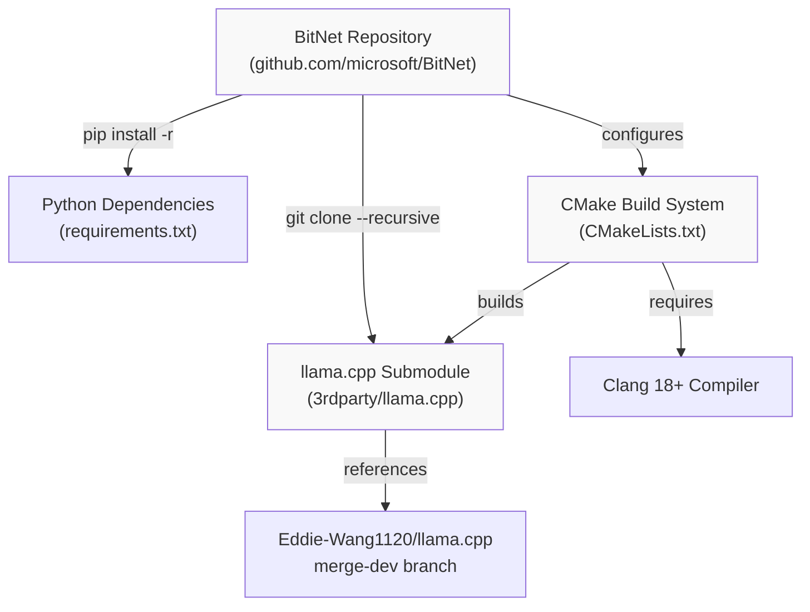

**Sources:** [.gitmodules:1-4](), [README.md:181-185]()

## Cloning the Repository

Clone the repository with the `--recursive` flag to automatically initialize and fetch the llama.cpp submodule:

```bash
git clone --recursive https://github.com/microsoft/BitNet.git
cd BitNet
```

The `--recursive` flag is critical because BitNet.cpp depends on a customized fork of llama.cpp located in the `3rdparty/llama.cpp` directory. The submodule references the `merge-dev` branch from `Eddie-Wang1120/llama.cpp`, which contains BitNet-specific integration patches.

**Sources:** [README.md:181-185](), [.gitmodules:1-4]()

## Installing Python Dependencies

It is highly recommended to create an isolated Conda environment to avoid conflicts with system packages:

```bash
# Create and activate a new conda environment
conda create -n bitnet-cpp python=3.9
conda activate bitnet-cpp

# Install Python dependencies
pip install -r requirements.txt
```

The `requirements.txt` file contains dependencies needed by the build orchestration scripts (`setup_env.py`), model conversion utilities, and inference scripts.

**Sources:** [README.md:186-193]()

## Build Process Overview

The build process consists of two main phases: configuration and compilation. The configuration phase generates platform-specific kernel code and sets up CMake, while the compilation phase produces the final binaries.

### Build Process Flow

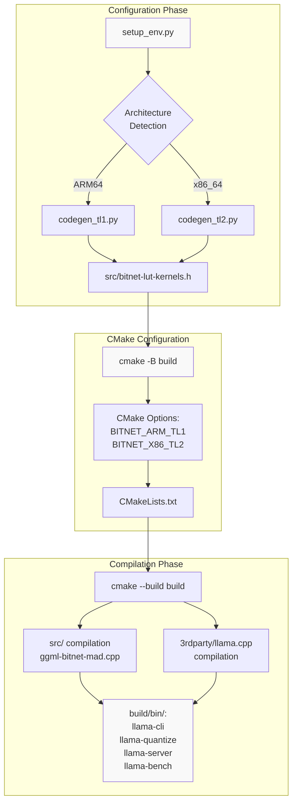

**Sources:** [README.md:194-199](), [CMakeLists.txt:1-79]()

## Building the Project

The simplest way to build BitNet.cpp is through the `setup_env.py` script, which automates kernel generation, CMake configuration, and compilation. However, the build process can also be performed manually for more control.

### Automated Build (Recommended)

The `setup_env.py` script handles the entire build process, including kernel code generation and CMake configuration:

```bash
# Download a model and build with I2_S quantization
huggingface-cli download microsoft/BitNet-b1.58-2B-4T-gguf --local-dir models/BitNet-b1.58-2B-4T
python setup_env.py -md models/BitNet-b1.58-2B-4T -q i2_s
```

Key `setup_env.py` arguments relevant to building:

| Argument | Short | Description |
|----------|-------|-------------|
| `--quant-type` | `-q` | Quantization type: `i2_s`, `tl1`, or `tl2` (determines kernel generation) |
| `--use-pretuned` | `-p` | Use pre-tuned kernel parameters (skips code generation) |

**Sources:** [README.md:194-219]()

### Manual Build Process

For users who need more control or want to understand the build process in detail:

1. **Generate kernel code** (if not using pre-tuned kernels):
   ```bash
   # For ARM platforms
   python utils/codegen_tl1.py
   
   # For x86 platforms  
   python utils/codegen_tl2.py
   ```

2. **Configure with CMake**:
   ```bash
   cmake -B build \
       -DBITNET_ARM_TL1=ON   # For ARM with TL1 kernels
       # OR
       -DBITNET_X86_TL2=ON   # For x86 with TL2 kernels
   ```

3. **Compile**:
   ```bash
   cmake --build build --config Release
   ```

**Sources:** [CMakeLists.txt:14-33]()

## CMake Build Configuration

The `CMakeLists.txt` file orchestrates the build process and configures the integration with llama.cpp.

### Key CMake Options

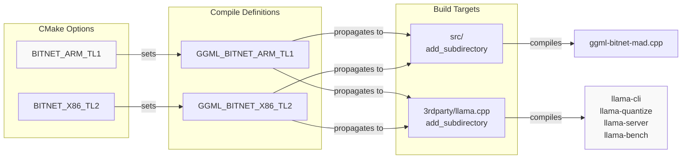

The CMake configuration performs the following key actions:

1. **Option Propagation** [CMakeLists.txt:24-33]():
   - `BITNET_ARM_TL1` → sets `GGML_BITNET_ARM_TL1` compile definition
   - `BITNET_X86_TL2` → sets `GGML_BITNET_X86_TL2` compile definition

2. **Build Subdirectories** [CMakeLists.txt:41-43]():
   - `add_subdirectory(src)` - Compiles BitNet-specific kernels
   - `add_subdirectory(3rdparty/llama.cpp)` - Compiles llama.cpp with BitNet extensions

3. **Server Build** [CMakeLists.txt:42]():
   - `LLAMA_BUILD_SERVER` is forced to `ON` to ensure `llama-server` binary is built

**Sources:** [CMakeLists.txt:1-79]()

## Build Artifacts

After a successful build, the following binaries are produced in the `build/bin/` directory:

| Binary | Purpose | Usage |
|--------|---------|-------|
| `llama-cli` | Interactive command-line inference | Used by `run_inference.py` |
| `llama-quantize` | Model quantization tool | Converts F32 GGUF to I2_S format |
| `llama-server` | HTTP API server for inference | Used by `run_inference_server.py` |
| `llama-bench` | Performance benchmarking | Used by `e2e_benchmark.py` |

On Windows, binaries are located in `build/bin/Release/` with `.exe` extensions. On Unix-like systems, they are in `build/bin/` without extensions.

### Binary Location Logic

```mermaid
graph TB
    BUILD["Build Process<br/>Completes"]
    
    PLATFORM{"Platform?"}
    
    WIN_PATH["build/bin/Release/<br/>llama-cli.exe<br/>llama-quantize.exe<br/>llama-server.exe<br/>llama-bench.exe"]
    
    UNIX_PATH["build/bin/<br/>llama-cli<br/>llama-quantize<br/>llama-server<br/>llama-bench"]
    
    BUILD --> PLATFORM
    PLATFORM -->|"Windows"| WIN_PATH
    PLATFORM -->|"Linux/macOS"| UNIX_PATH
    
    style BUILD fill:#f9f9f9
```

**Sources:** [run_inference_server.py:17-23](), [CMakeLists.txt:12]()

## Platform-Specific Considerations

### Windows Build Environment

Windows builds require careful environment setup to ensure Clang and Visual Studio tools are accessible.

#### Verifying Environment Setup

Before building, verify the environment is correctly initialized:

```bash
clang -v
```

If you receive an error like `'clang' is not recognized`, your command line environment is not properly initialized for Visual Studio tools.

#### Initializing Visual Studio Environment

**For Command Prompt:**
```cmd
"C:\Program Files\Microsoft Visual Studio\2022\Professional\Common7\Tools\VsDevCmd.bat" -startdir=none -arch=x64 -host_arch=x64
```

**For PowerShell:**
```powershell
Import-Module "C:\Program Files\Microsoft Visual Studio\2022\Professional\Common7\Tools\Microsoft.VisualStudio.DevShell.dll"
Enter-VsDevShell 3f0e31ad -SkipAutomaticLocation -DevCmdArguments "-arch=x64 -host_arch=x64"
```

These commands must be run in each new terminal session before building.

**Sources:** [README.md:314-339]()

### Linux/macOS Considerations

On Unix-like systems, the build process is more straightforward. Ensure that:

1. Clang 18 or later is installed and in the PATH
2. CMake 3.22 or later is available
3. pthread support is available (usually standard)

The build system sets `THREADS_PREFER_PTHREAD_FLAG` to ensure proper threading support [CMakeLists.txt:22]().

## Build Configuration Options

The build system supports several configuration options that affect kernel generation and compilation:

### Architecture Selection

The build system automatically detects the target architecture, but you can explicitly control kernel type:

```bash
# For ARM platforms with TL1 kernels
cmake -B build -DBITNET_ARM_TL1=ON

# For x86 platforms with TL2 kernels
cmake -B build -DBITNET_X86_TL2=ON
```

These options control which optimized kernel implementations are compiled into the binaries. See [Kernel Architecture and Code Generation](#4.4) for details on kernel types.

### Build Type

The default build type is `Release` for optimal performance. Other build types can be selected:

```bash
cmake -B build -DCMAKE_BUILD_TYPE=Debug        # Debug symbols
cmake -B build -DCMAKE_BUILD_TYPE=MinSizeRel   # Minimize binary size
cmake -B build -DCMAKE_BUILD_TYPE=RelWithDebInfo  # Release with debug info
```

**Sources:** [CMakeLists.txt:7-10]()

## Verification

After building, verify that the binaries were created successfully:

```bash
# Unix/Linux/macOS
ls -la build/bin/

# Windows (PowerShell)
dir build\bin\Release\

# Windows (Command Prompt)
dir build\bin\Release\
```

You should see the four main binaries listed in the Build Artifacts section. To verify functionality, you can run a simple version check:

```bash
# Unix/Linux/macOS
./build/bin/llama-cli --version

# Windows
.\build\bin\Release\llama-cli.exe --version
```

**Sources:** [run_inference_server.py:17-23]()

## Troubleshooting Common Build Issues

### Issue: std::chrono Build Errors in log.cpp

Recent versions of llama.cpp may have issues with `std::chrono` in `log.cpp`. This is a known issue in the llama.cpp submodule.

**Solution:** Refer to [this commit](https://github.com/tinglou/llama.cpp/commit/4e3db1e3d78cc1bcd22bcb3af54bd2a4628dd323) for the fix. You may need to apply the patch to `3rdparty/llama.cpp/common/log.cpp`.

**Sources:** [README.md:309-312]()

### Issue: Clang Not Found on Windows

If CMake cannot find Clang during configuration, ensure:

1. Visual Studio 2022 is installed with the required components
2. You are running from Developer Command Prompt or Developer PowerShell
3. The environment initialization commands have been executed

See the Windows Build Environment section above for initialization commands.

**Sources:** [README.md:314-339]()

### Issue: Submodule Not Initialized

If you cloned without `--recursive`, the `3rdparty/llama.cpp` directory will be empty, causing build failures.

**Solution:**
```bash
git submodule update --init --recursive
```

**Sources:** [README.md:181-185](), [.gitmodules:1-4]()

### Issue: CMake Version Too Old

BitNet.cpp requires CMake 3.22 or later due to modern CMake features used in the build configuration.

**Solution:** Update CMake to version 3.22 or later from [cmake.org](https://cmake.org/download).

**Sources:** [README.md:163](), [CMakeLists.txt:1]()

## Next Steps

After successfully building BitNet.cpp, proceed to:

- [Model Preparation](#2.2) - Download and prepare quantized models for inference
- [Running Your First Inference](#2.3) - Execute basic inference with the built binaries
- [Build System Details](#6.1) - Learn more about the build system architecture

**Sources:** [README.md:194-219]()

---

# Page: Model Preparation

# Model Preparation

<details>
<summary>Relevant source files</summary>

The following files were used as context for generating this wiki page:

- [README.md](README.md)
- [run_inference.py](run_inference.py)
- [setup_env.py](setup_env.py)
- [utils/convert-hf-to-gguf-bitnet.py](utils/convert-hf-to-gguf-bitnet.py)

</details>


This document explains how to prepare models for use with BitNet.cpp. It covers downloading models from Hugging Face, converting models to the GGUF format, and applying ternary quantization techniques. For information on running inference with prepared models, see [Running Inference](#3).

## Overview

BitNet.cpp supports various ternary (1.58-bit) language models, which must go through a preparation process before inference. This preparation includes downloading, conversion, and optimization for the target hardware platform.

```mermaid
flowchart TD
    subgraph "Model Preparation Pipeline"
        A["HuggingFace Model"] -->|"Download"| B["Local Model Files"]
        B -->|"Convert"| C{"Quantization Type"}
        C -->|"TL1/TL2"| D["Direct Ternary<br/>Conversion"]
        C -->|"I2_S"| E["F32 Conversion<br/>& I2_S Quantization"]
        D --> F["GGUF Model"]
        E --> F
        B -->|"Extract"| G["Model Architecture<br/>& Parameters"]
        G -->|"Configure"| H["Generate Optimized<br/>Kernels"]
        H -->|"Platform-specific"| I["GGUF Model + Kernels"]
        F --> I
    end
```

Sources: [setup_env.py:97-136](), [utils/convert-hf-to-gguf-bitnet.py:1082-1165]()

## Supported Models and Quantization Types

BitNet.cpp officially supports the 2.4B parameter BitNet-b1.58-2B-4T model and is compatible with several other ternary models.

### Supported Models

| Model | Parameters | Description |
|-------|------------|-------------|
| [BitNet-b1.58-2B-4T](https://huggingface.co/microsoft/BitNet-b1.58-2B-4T) | 2.4B | Official BitNet model |
| [bitnet_b1_58-large](https://huggingface.co/1bitLLM/bitnet_b1_58-large) | 0.7B | Community BitNet model |
| [bitnet_b1_58-3B](https://huggingface.co/1bitLLM/bitnet_b1_58-3B) | 3.3B | Community BitNet model |
| [Llama3-8B-1.58](https://huggingface.co/HF1BitLLM/Llama3-8B-1.58-100B-tokens) | 8.0B | Ternary Llama3 model |
| [Falcon3 Family](https://huggingface.co/collections/tiiuae/falcon3-67605ae03578be86e4e87026) | 1B-10B | Various ternary Falcon3 models |

### Quantization Types

Each model can be quantized using different methods depending on the target hardware:

| Quantization Type | Description | Supported Architecture |
|-------------------|-------------|------------------------|
| I2_S | Standard 2-bit sign-magnitude quantization | ARM64, x86_64 |
| TL1 | Ternary lookup optimization for ARM | ARM64 only |
| TL2 | Ternary lookup optimization for x86 | x86_64 only |

Sources: [README.md:37-139](), [setup_env.py:48-52]()

## Using setup_env.py

The `setup_env.py` script is the primary tool for model preparation. It orchestrates the entire preparation process, including model download, conversion, kernel generation, and compilation.

```mermaid
sequenceDiagram
    participant User
    participant Setup as "setup_env.py"
    participant Converter as "convert-hf-to-gguf-bitnet.py"
    participant CodeGen as "codegen_tl1.py/codegen_tl2.py"
    participant Builder as "CMake Build System"
    
    User->>Setup: Execute with model params
    Setup->>Setup: Check architecture (ARM/x86)
    Setup->>Setup: Install GGUF dependencies
    Setup->>CodeGen: Generate optimized kernels
    CodeGen->>CodeGen: Create lookup tables for target platform
    CodeGen-->>Setup: Return kernel code
    Setup->>Builder: Compile C++ code
    Builder-->>Setup: Return compiled binaries
    
    alt Model from HuggingFace
        Setup->>HuggingFace: Download model
        HuggingFace-->>Setup: Return model files
    else Local model
        Setup->>Setup: Verify model exists
    end
    
    alt TL1/TL2 quantization
        Setup->>Converter: Convert HF to GGUF with TL1/TL2
        Converter-->>Setup: Return quantized GGUF model
    else I2_S quantization
        Setup->>Converter: Convert HF to F32 GGUF
        Converter-->>Setup: Return F32 GGUF model
        Setup->>Setup: Quantize F32 to I2_S
    end
    
    Setup-->>User: Prepared model & optimized binary
```

Sources: [setup_env.py:206-210](), [setup_env.py:97-138]()

### Command Line Arguments

The `setup_env.py` script accepts several command line arguments:

| Argument | Description | Default |
|----------|-------------|---------|
| `--hf-repo`, `-hr` | HuggingFace repository to download from | None |
| `--model-dir`, `-md` | Directory to save/load model | "models" |
| `--log-dir`, `-ld` | Directory for logging information | "logs" |
| `--quant-type`, `-q` | Quantization type (i2_s, tl1, or tl2) | "i2_s" |
| `--quant-embd` | Quantize embeddings to f16 | False |
| `--use-pretuned`, `-p` | Use pre-tuned kernel parameters | False |

Example usage:
```bash
python setup_env.py -hr microsoft/BitNet-b1.58-2B-4T -q i2_s
```

Or with a local model:
```bash
python setup_env.py -md models/BitNet-b1.58-2B-4T -q tl1
```

Sources: [setup_env.py:212-221](), [README.md:177-203]()

## Model Download Process

When downloading from Hugging Face, the script creates an appropriate directory structure and uses `huggingface-cli` to download the model.

```mermaid
flowchart TD
    A["setup_env.py"] -->|"Call prepare_model()"| B{"HF repo specified?"}
    B -->|"Yes"| C["Create model directory"]
    C -->|"Directory created"| D["Execute huggingface-cli download"]
    D -->|"Download complete"| E["Local model files"]
    B -->|"No"| F{"Local model exists?"}
    F -->|"Yes"| E
    F -->|"No"| G["Error: Model not found"]
    E -->|"Continue to"| H["GGUF Conversion"]
```

Sources: [setup_env.py:97-114]()

## Model Conversion Process

The model conversion process transforms Hugging Face models into the GGUF format used by BitNet.cpp. This process handles different model architectures and applies the appropriate quantization method.

```mermaid
flowchart TD
    A["Local Model Files"] -->|"Check GGUF exists"| B{"GGUF file exists?"}
    B -->|"No"| C{"Quantization Type?"}
    B -->|"Yes"| D["Use existing GGUF model"]
    
    C -->|"TL1/TL2"| E["Direct Ternary Conversion"]
    C -->|"I2_S"| F["Convert to F32 GGUF"]
    
    E -->|"write_tensors()"| G["Apply tensor transformations"]
    F -->|"F32 GGUF created"| H["Quantize to I2_S"]
    
    G -->|"Apply transformations"| I["Weight reshaping & packing"]
    H -->|"Call llama-quantize"| J["Apply I2_S quantization"]
    
    I -->|"Complete"| K["Final GGUF Model"]
    J -->|"Complete"| K
    D -->|"Skip conversion"| K
```

Sources: [setup_env.py:116-136](), [utils/convert-hf-to-gguf-bitnet.py:1082-1165]()

### Conversion Process Details

The conversion process involves several key steps:

1. **Model Architecture Detection**: The converter identifies whether the model is a standard LlamaModel or a specialized BitnetModel.

2. **Parameter Extraction**: Model parameters like vocabulary size, embedding dimensions, and attention heads are extracted.

3. **Vocabulary Processing**: The tokenizer vocabulary is processed and added to the GGUF file.

4. **Tensor Transformation**: Model weights are processed according to the selected quantization method.

5. **GGUF Writing**: The processed model is written to a GGUF file format.

Sources: [utils/convert-hf-to-gguf-bitnet.py:679-1079]()

## Quantization Methods

BitNet.cpp supports three quantization methods, each with its own advantages and target platforms.

### I2_S (2-bit Sign-Magnitude)

I2_S is a standard 2-bit quantization format that represents weights with a sign bit and a magnitude bit. This format is supported on both ARM and x86 platforms.

### TL1 (Ternary Lookup for ARM)

TL1 is a specialized ternary representation optimized for ARM processors. It involves:

1. Converting weights to ternary values (-1, 0, 1)
2. Reshaping and transposing matrices for ARM's memory access patterns
3. Packing multiple ternary values into bytes
4. Generating lookup tables for fast computation

```mermaid
flowchart TD
    A["Input Weights"] -->|"Convert to ternary"| B["Sign conversion"]
    B -->|"Reshape matrices"| C["Reshape (M, K) → (M/BM, BM, K/2)"]
    C -->|"Transpose"| D["Multiple transpose operations"]
    D -->|"Pack bits"| E["4-bit packing"]
    E -->|"Combine values"| F["Final packed format"]
```

Sources: [utils/convert-hf-to-gguf-bitnet.py:460-517]()

### TL2 (Ternary Lookup for x86)

TL2 is optimized for x86 processors and follows a different optimization approach:

1. Dividing the weight matrix into two parts: threeK and twoK
2. Processing threeK with a specialized 3-to-1 bit packing scheme
3. Processing twoK with a simpler 2-to-1 bit packing scheme
4. Optimizing for x86 SIMD instructions

Sources: [utils/convert-hf-to-gguf-bitnet.py:520-657]()

## Kernel Code Generation

Based on the model architecture and target platform, BitNet.cpp generates optimized kernels for matrix multiplication operations.

```mermaid
flowchart TD
    A["setup_env.py"] -->|"Call gen_code()"| B{"Target Architecture?"}
    B -->|"ARM64"| C["codegen_tl1.py"]
    B -->|"x86_64"| D["codegen_tl2.py"]
    
    C -->|"Model parameters"| E["Generate TL1 Kernels"]
    D -->|"Model parameters"| F["Generate TL2 Kernels"]
    
    E -->|"With BM, BK, bm params"| G["ARM-optimized kernel code"]
    F -->|"With BM, BK, bm params"| H["x86-optimized kernel code"]
    
    G -->|"Write to"| I["bitnet-lut-kernels.h"]
    H -->|"Write to"| I
    
    I -->|"Save config"| J["kernel_config.ini"]
```

The kernel generation process is customized based on:

1. **Model Architecture**: Different models have different optimal blocking parameters
2. **Matrix Dimensions**: The dimensions of weight matrices affect blocking strategies
3. **Target Platform**: ARM (TL1) and x86 (TL2) require different optimizations

Sources: [setup_env.py:144-188]()

## Complete Preparation Workflow

The complete model preparation workflow involves several integrated steps:

1. **Setup Environment**: Install dependencies and prepare the environment
2. **Generate Kernel Code**: Create optimized kernels for the target platform
3. **Compile C++ Code**: Build the BitNet.cpp framework with generated kernels
4. **Prepare Model**: Download, convert, and quantize the model
5. **Ready for Inference**: The prepared model is now ready for [inference](#3)

Sources: [setup_env.py:206-210]()

## Troubleshooting Model Preparation

Common issues during model preparation include:

1. **Missing Dependencies**: Ensure all required packages are installed
2. **Unsupported Models**: Verify that your model is supported by BitNet.cpp
3. **Conversion Errors**: Check model architecture matches expected format
4. **Kernel Generation Failures**: Ensure your hardware is properly detected
5. **Compilation Issues**: On Windows, ensure you're using Developer Command Prompt

Sources: [README.md:280-312]()

---

# Page: Running Your First Inference

# Running Your First Inference

<details>
<summary>Relevant source files</summary>

The following files were used as context for generating this wiki page:

- [README.md](README.md)
- [run_inference.py](run_inference.py)
- [setup_env.py](setup_env.py)
- [utils/convert-hf-to-gguf-bitnet.py](utils/convert-hf-to-gguf-bitnet.py)

</details>


This page provides a quick start guide for running inference with BitNet.cpp using the `run_inference.py` script. It assumes you have already completed the installation and model preparation steps covered in [Installation and Build](#2.1) and [Model Preparation](#2.2).

For advanced inference modes including server deployment and benchmarking, see [Running Inference](#3).

## Prerequisites

Before running inference, ensure you have:

1. **Built the project** - The `llama-cli` binary must exist in `build/bin/` (see [Installation and Build](#2.1))
2. **Prepared a quantized model** - You should have a `.gguf` file in your model directory (see [Model Preparation](#2.2))

The typical model path after running `setup_env.py` will be:
- `models/<model-name>/ggml-model-i2_s.gguf` (I2_S quantization)
- `models/<model-name>/ggml-model-tl1.gguf` (TL1 quantization, ARM only)
- `models/<model-name>/ggml-model-tl2.gguf` (TL2 quantization, x86 only)

## Basic Inference Command

The simplest way to run inference is:

```bash
python run_inference.py -m models/BitNet-b1.58-2B-4T/ggml-model-i2_s.gguf -p "You are a helpful assistant"
```

This command will:
1. Load the specified GGUF model
2. Generate 128 tokens (default) from the prompt
3. Output the generated text to the console

**Example output:**
```
You are a helpful assistant.

User: What is the capital of France?
Assistant: The capital of France is Paris.
```

Sources: [README.md:222-247](), [run_inference.py:1-56]()

## Execution Flow

### High-Level Process

```mermaid
graph LR
    USER["User Command"] --> RUNPY["run_inference.py"]
    RUNPY --> DETECT["Platform Detection"]
    DETECT --> BINPATH["Binary Path Resolution"]
    BINPATH --> WINDOWS["build/bin/Release/llama-cli.exe"]
    BINPATH --> UNIX["build/bin/llama-cli"]
    WINDOWS --> LLAMACLI["llama-cli Execution"]
    UNIX --> LLAMACLI
    LLAMACLI --> GGUF["Load GGUF Model"]
    GGUF --> KERNELS["Execute BitNet Kernels"]
    KERNELS --> OUTPUT["Generated Text"]
```

### Argument Translation

The `run_inference.py` script acts as a wrapper that translates Python arguments into `llama-cli` command-line arguments:

```mermaid
graph TB
    subgraph "Python Arguments (run_inference.py)"
        ARG_M["--model / -m"]
        ARG_N["--n-predict / -n"]
        ARG_P["--prompt / -p"]
        ARG_T["--threads / -t"]
        ARG_C["--ctx-size / -c"]
        ARG_TEMP["--temperature / -temp"]
        ARG_CNV["--conversation / -cnv"]
    end
    
    subgraph "llama-cli Arguments"
        CLI_M["-m model_path"]
        CLI_N["-n token_count"]
        CLI_P["-p prompt_text"]
        CLI_T["-t thread_count"]
        CLI_C["-c context_size"]
        CLI_TEMP["--temp temperature"]
        CLI_CNV["-cnv"]
        CLI_NGL["-ngl 0 (GPU layers)"]
        CLI_B["-b 1 (batch size)"]
    end
    
    ARG_M --> CLI_M
    ARG_N --> CLI_N
    ARG_P --> CLI_P
    ARG_T --> CLI_T
    ARG_C --> CLI_C
    ARG_TEMP --> CLI_TEMP
    ARG_CNV --> CLI_CNV
```

Sources: [run_inference.py:16-37]()

## Command-Line Arguments Reference

The following table describes all available arguments for `run_inference.py`:

| Argument | Short | Type | Required | Default | Description |
|----------|-------|------|----------|---------|-------------|
| `--model` | `-m` | string | No | `models/bitnet_b1_58-3B/ggml-model-i2_s.gguf` | Path to the GGUF model file |
| `--n-predict` | `-n` | integer | No | 128 | Number of tokens to generate |
| `--prompt` | `-p` | string | **Yes** | - | Input prompt text |
| `--threads` | `-t` | integer | No | 2 | Number of CPU threads to use |
| `--ctx-size` | `-c` | integer | No | 2048 | Maximum context window size in tokens |
| `--temperature` | `-temp` | float | No | 0.8 | Sampling temperature (0.0 = deterministic, higher = more random) |
| `--conversation` | `-cnv` | flag | No | False | Enable chat/conversation mode for instruct models |

**Important Notes:**
- The `--prompt` argument is the only required parameter
- When `--conversation` is enabled, the prompt specified via `-p` is used as the system prompt
- The script sets `-ngl 0` (no GPU layers) and `-b 1` (batch size 1) by default

Sources: [run_inference.py:46-54](), [README.md:226-246]()

## Example Usage Scenarios

### Scenario 1: Simple Text Completion

Generate a continuation of a given text:

```bash
python run_inference.py \
  -m models/BitNet-b1.58-2B-4T/ggml-model-i2_s.gguf \
  -p "The quick brown fox" \
  -n 50
```

This generates 50 tokens continuing the phrase "The quick brown fox".

### Scenario 2: Chat Mode with Instruct Model

For instruction-tuned models like `Falcon3-7B-Instruct-1.58bit`:

```bash
python run_inference.py \
  -m models/Falcon3-7B-Instruct-1.58bit/ggml-model-i2_s.gguf \
  -p "You are a helpful AI assistant" \
  -cnv
```

With `-cnv` flag, the model enters conversational mode where the prompt becomes the system message.

### Scenario 3: Long-Form Generation with Custom Settings

Generate longer text with specific sampling parameters:

```bash
python run_inference.py \
  -m models/Llama3-8B-1.58-100B-tokens/ggml-model-i2_s.gguf \
  -p "Write a detailed explanation of quantum computing:" \
  -n 512 \
  -c 4096 \
  -temp 0.7 \
  -t 8
```

This uses:
- 512 token generation limit
- 4096 token context window
- Temperature 0.7 for balanced creativity
- 8 CPU threads for faster inference

### Scenario 4: Deterministic Output

For reproducible results:

```bash
python run_inference.py \
  -m models/BitNet-b1.58-2B-4T/ggml-model-i2_s.gguf \
  -p "Summarize the following:" \
  -temp 0.0
```

Setting temperature to 0.0 makes the output deterministic (always selects the most probable token).

Sources: [README.md:222-246]()

## Understanding the Binary Execution Path

### Platform-Specific Binary Resolution

The `run_inference.py` script determines which binary to execute based on the operating system:

```mermaid
graph TD
    START["run_inference() function"] --> CHECK["platform.system()"]
    CHECK -->|Windows| WIN_PATH1["build/bin/Release/llama-cli.exe"]
    WIN_PATH1 --> EXISTS1{File exists?}
    EXISTS1 -->|No| WIN_PATH2["build/bin/llama-cli"]
    EXISTS1 -->|Yes| EXEC["Execute binary"]
    WIN_PATH2 --> EXEC
    CHECK -->|Linux/macOS| UNIX_PATH["build/bin/llama-cli"]
    UNIX_PATH --> EXEC
    EXEC --> CMDARGS["Add command-line arguments"]
    CMDARGS --> RUN["subprocess.run()"]
```

**Key Implementation Details:**

1. **Binary Location** ([run_inference.py:17-23]()):
   - Windows: First checks `build/bin/Release/llama-cli.exe`, falls back to `build/bin/llama-cli`
   - Unix (Linux/macOS): Uses `build/bin/llama-cli`

2. **Fixed Arguments** ([run_inference.py:24-34]()):
   - `-ngl 0`: Disables GPU layer offloading (CPU-only inference)
   - `-b 1`: Sets batch size to 1 (processes one token at a time)

3. **Error Handling** ([run_inference.py:8-14]()):
   - Uses `subprocess.run()` with `check=True` to raise exceptions on failure
   - Catches `CalledProcessError` and exits with error message

Sources: [run_inference.py:16-37]()

## Internal Process Flow

### Complete Inference Pipeline

```mermaid
sequenceDiagram
    participant User
    participant run_inference.py
    participant llama-cli
    participant GGML
    participant Kernels
    
    User->>run_inference.py: Execute with arguments
    run_inference.py->>run_inference.py: Parse arguments (lines 46-55)
    run_inference.py->>run_inference.py: Detect platform (line 18)
    run_inference.py->>run_inference.py: Resolve binary path (lines 19-23)
    run_inference.py->>llama-cli: subprocess.run(command)
    llama-cli->>llama-cli: Load GGUF model (-m)
    llama-cli->>GGML: Initialize model tensors
    GGML->>Kernels: Load I2_S/TL1/TL2 kernels
    Kernels->>Kernels: Prepare lookup tables
    llama-cli->>llama-cli: Tokenize prompt (-p)
    llama-cli->>GGML: Forward pass (n_predict iterations)
    GGML->>Kernels: Execute GEMM/GEMV operations
    Kernels-->>GGML: Return activations
    GGML-->>llama-cli: Return logits
    llama-cli->>llama-cli: Sample token (temperature)
    llama-cli->>User: Output generated token
    Note over llama-cli,User: Repeat until n_predict tokens generated
```

**Pipeline Stages:**

1. **Argument Processing**: Python script parses and validates user inputs
2. **Binary Invocation**: Platform-appropriate `llama-cli` binary is executed
3. **Model Loading**: GGUF file is loaded into memory with BitNet-specific quantization
4. **Kernel Initialization**: I2_S, TL1, or TL2 kernels are selected based on model format
5. **Token Generation**: Autoregressive generation loop produces tokens one at a time
6. **Output**: Generated text is streamed to console

Sources: [run_inference.py:16-37](), [README.md:222-246]()

## Signal Handling

The script includes interrupt handling for graceful shutdown:

```mermaid
graph LR
    USER_CTRL_C["User presses Ctrl+C"] --> SIGNAL["SIGINT signal"]
    SIGNAL --> HANDLER["signal_handler() function"]
    HANDLER --> PRINT["Print 'Ctrl+C pressed, exiting...'"]
    PRINT --> EXIT["sys.exit(0)"]
```

This allows users to interrupt long-running inference sessions cleanly without corrupting output or leaving processes hanging.

Sources: [run_inference.py:39-41](), [run_inference.py:44]()

## Next Steps

After successfully running your first inference, you can explore:

- **[Interactive CLI Inference](#3.1)**: Learn about advanced CLI options and interactive mode
- **[Server Deployment](#3.2)**: Set up `llama-server` for HTTP API access
- **[Benchmarking Performance](#3.3)**: Measure throughput and latency with `e2e_benchmark.py`
- **[Performance Tuning Guide](#5.1)**: Optimize kernel configurations for your hardware

For understanding the underlying architecture, see:
- **[System Overview](#4.1)**: How `run_inference.py` integrates with llama.cpp
- **[Quantization Schemes](#4.3)**: Details about I2_S, TL1, and TL2 formats

---

# Page: Running Inference

# Running Inference

<details>
<summary>Relevant source files</summary>

The following files were used as context for generating this wiki page:

- [README.md](README.md)
- [run_inference.py](run_inference.py)
- [setup_env.py](setup_env.py)
- [utils/convert-hf-to-gguf-bitnet.py](utils/convert-hf-to-gguf-bitnet.py)

</details>


This page provides a comprehensive guide to running inference with BitNet.cpp models. It covers the available inference modes, execution workflows, and common parameters. For detailed information about model preparation and quantization, see [Model Preparation](#2.2).

The BitNet.cpp framework provides four primary inference modes:
1. **Interactive CLI Inference** - Command-line interface for interactive text generation (see [Interactive CLI Inference](#3.1))
2. **Server Deployment** - HTTP API server for production deployments (see [Server Deployment](#3.2))
3. **Benchmarking** - Performance measurement tools (see [Benchmarking Performance](#3.3))
4. **GPU Inference** - Experimental CUDA-based inference (see [GPU Inference (Experimental)](#3.4))

## Prerequisites

Before running inference, you must:
1. Complete the build process (see [Installation and Build](#2.1))
2. Prepare a quantized GGUF model (see [Model Preparation](#2.2))

The inference system requires models in GGUF format with one of the following quantization schemes:
- **I2_S**: Two-stage quantization (F32 → I2_S), compatible with both ARM and x86
- **TL1**: Table lookup optimization for ARM64 architectures
- **TL2**: Table lookup optimization for x86_64 architectures

Sources: [README.md:159-219](), [setup_env.py:61-64]()

## Inference Execution Architecture

The BitNet.cpp inference system follows a layered architecture where Python orchestration scripts invoke compiled C++ binaries that execute GGML operations:

```mermaid
graph TB
    subgraph "Python Orchestration Layer"
        INFER_PY["run_inference.py"]
        SERVER_PY["run_inference_server.py"]
        BENCH_PY["e2e_benchmark.py"]
    end
    
    subgraph "Compiled Binary Layer"
        LLAMA_CLI["build/bin/llama-cli"]
        LLAMA_SERVER["build/bin/llama-server"]
        LLAMA_BENCH["build/bin/llama-bench"]
    end
    
    subgraph "GGUF Model Files"
        I2S_MODEL["ggml-model-i2_s.gguf"]
        TL1_MODEL["ggml-model-tl1.gguf"]
        TL2_MODEL["ggml-model-tl2.gguf"]
    end
    
    subgraph "GGML Inference Engine"
        GGML_CORE["ggml.c<br/>GEMM/GEMV dispatcher"]
        MAD_CPP["ggml-bitnet-mad.cpp<br/>BitNet kernels"]
        KERNELS["bitnet-lut-kernels.h<br/>Generated LUT kernels"]
    end
    
    INFER_PY -->|"subprocess.run"| LLAMA_CLI
    SERVER_PY -->|"subprocess.run"| LLAMA_SERVER
    BENCH_PY -->|"subprocess.run"| LLAMA_BENCH
    
    I2S_MODEL --> LLAMA_CLI
    TL1_MODEL --> LLAMA_CLI
    TL2_MODEL --> LLAMA_CLI
    I2S_MODEL --> LLAMA_SERVER
    I2S_MODEL --> LLAMA_BENCH
    
    LLAMA_CLI --> GGML_CORE
    LLAMA_SERVER --> GGML_CORE
    LLAMA_BENCH --> GGML_CORE
    
    GGML_CORE --> MAD_CPP
    MAD_CPP --> KERNELS
```

**Python orchestration scripts** construct command-line arguments and invoke the corresponding binary using `subprocess.run`. The scripts handle platform-specific binary paths (Windows vs. Unix) and parameter validation.

**Compiled binaries** (`llama-cli`, `llama-server`, `llama-bench`) are built from the llama.cpp submodule with BitNet-specific extensions enabled during compilation. These binaries load GGUF models and dispatch computation to GGML.

**GGML inference engine** performs the actual model inference using optimized kernels. The dispatcher in `ggml.c` routes operations to BitNet-specific implementations in `ggml-bitnet-mad.cpp`, which use lookup tables generated in `bitnet-lut-kernels.h`.

Sources: [run_inference.py:16-37](), [README.md:220-247](), Diagram 1, Diagram 6

## Inference Workflow

The following diagram illustrates the complete data flow from model file to inference output:

```mermaid
flowchart LR
    subgraph "Input Phase"
        MODEL["GGUF Model File<br/>ggml-model-*.gguf"]
        PROMPT["User Prompt<br/>-p flag"]
        PARAMS["Inference Parameters<br/>-n, -t, -c, --temp"]
    end
    
    subgraph "Execution Phase"
        BINARY["llama-cli /<br/>llama-server /<br/>llama-bench"]
        LOAD["Model Loading<br/>GGUF deserialization"]
        TOKENIZE["Tokenization<br/>Prompt → Token IDs"]
        INFERENCE["Inference Loop<br/>GGML kernel execution"]
        DECODE["Detokenization<br/>Token IDs → Text"]
    end
    
    subgraph "Output Phase"
        OUTPUT["Generated Text /<br/>Performance Metrics"]
    end
    
    MODEL --> LOAD
    PROMPT --> TOKENIZE
    PARAMS --> INFERENCE
    
    BINARY --> LOAD
    LOAD --> TOKENIZE
    TOKENIZE --> INFERENCE
    INFERENCE --> DECODE
    DECODE --> OUTPUT
```

The workflow consists of three phases:

**Input Phase**: The system accepts a GGUF model file path, user prompt, and inference parameters. All parameters are passed as command-line flags to the binary.

**Execution Phase**: 
1. `LOAD` - The binary deserializes the GGUF file and loads tensors into memory
2. `TOKENIZE` - The prompt string is converted to token IDs using the model's tokenizer
3. `INFERENCE` - The model generates tokens autoregressively using GGML kernels
4. `DECODE` - Generated token IDs are converted back to text strings

**Output Phase**: The system outputs either generated text (CLI/server modes) or performance metrics (benchmark mode).

Sources: [run_inference.py:16-37](), Diagram 2, Diagram 5

## Inference Modes

| Mode | Binary | Python Script | Use Case | Output Format |
|------|--------|---------------|----------|---------------|
| Interactive CLI | `llama-cli` | `run_inference.py` | Interactive text generation, testing | Text stream to stdout |
| Server | `llama-server` | `run_inference_server.py` | Production API deployment | HTTP JSON responses |
| Benchmark | `llama-bench` | `e2e_benchmark.py` | Performance measurement | Performance metrics |
| GPU (Experimental) | Custom CUDA kernels | `generate.py` | GPU-accelerated inference | Text output |

Sources: [README.md:220-295](), Diagram 5

### Interactive CLI Inference

The CLI mode provides an interactive command-line interface for text generation. It is invoked via `run_inference.py`, which constructs arguments for `llama-cli`:

```bash
python run_inference.py \
    -m models/BitNet-b1.58-2B-4T/ggml-model-i2_s.gguf \
    -p "You are a helpful assistant" \
    -n 128 \
    -t 2 \
    -c 2048 \
    --temp 0.8 \
    -cnv
```

The script resolves the platform-specific binary path (`build/bin/llama-cli` on Unix, `build/bin/Release/llama-cli.exe` on Windows) and executes it with the provided arguments. The `-cnv` flag enables conversation mode for instruct-tuned models.

For detailed documentation of all CLI parameters and advanced usage, see [Interactive CLI Inference](#3.1).

Sources: [run_inference.py:1-56](), [README.md:220-247]()

### Server Deployment

Server mode launches an HTTP API endpoint using `llama-server`, enabling production deployments with RESTful interfaces:

```bash
python run_inference_server.py \
    -m models/BitNet-b1.58-2B-4T/ggml-model-i2_s.gguf \
    --host 0.0.0.0 \
    --port 8080
```

The server supports continuous batching for efficient multi-request handling. Client applications can send HTTP POST requests to generate text programmatically.

For server configuration, API endpoints, and client integration examples, see [Server Deployment](#3.2).

Sources: [README.md:7](), Diagram 5

### Benchmarking Performance

Benchmark mode measures inference throughput and latency using `llama-bench`:

```bash
python utils/e2e_benchmark.py \
    -m models/BitNet-b1.58-2B-4T/ggml-model-i2_s.gguf \
    -n 128 \
    -p 512 \
    -t 4
```

The benchmark processes a specified number of prompt tokens (`-p`) and generates a fixed number of output tokens (`-n`) to measure tokens/second and GFLOPS metrics.

For comprehensive benchmarking procedures and result interpretation, see [Benchmarking Performance](#3.3).

Sources: [README.md:248-295](), Diagram 5

### GPU Inference (Experimental)

GPU inference uses CUDA kernels for W2A8 (2-bit weights, 8-bit activations) quantization:

```bash
python gpu/generate.py \
    --checkpoint models/checkpoint.pth \
    --prompt "Once upon a time"
```

This mode requires CUDA environment setup and model conversion via `gpu/convert_checkpoint.py`. GPU inference is experimental and supports a subset of model architectures.

For GPU setup instructions and performance characteristics, see [GPU Inference (Experimental)](#3.4).

Sources: [README.md:7](), Diagram 5

## Common Inference Parameters

The following table documents parameters shared across inference modes:

| Parameter | Flag | Type | Default | Description |
|-----------|------|------|---------|-------------|
| Model Path | `-m`, `--model` | string | (required) | Path to GGUF model file |
| Prompt | `-p`, `--prompt` | string | (required) | Input text to generate from |
| Tokens to Generate | `-n`, `--n-predict` | integer | 128 | Number of tokens to generate |
| Thread Count | `-t`, `--threads` | integer | 2 | CPU threads for parallel execution |
| Context Size | `-c`, `--ctx-size` | integer | 2048 | Maximum context window length |
| Temperature | `--temp`, `--temperature` | float | 0.8 | Sampling temperature (higher = more random) |
| Conversation Mode | `-cnv`, `--conversation` | flag | false | Enable chat mode with system prompt |
| Batch Size | `-b` | integer | 1 | Number of tokens processed per batch |
| GPU Layers | `-ngl` | integer | 0 | Number of layers offloaded to GPU (0 = CPU only) |

**Parameter Details**:

- **Model Path** (`-m`): Must point to a valid GGUF file created by `setup_env.py`. The file format is validated during loading.

- **Thread Count** (`-t`): Should match available CPU cores. Higher values improve throughput but may cause cache contention. Optimal values depend on hardware and model size (see [Performance Tuning Guide](#5.1)).

- **Context Size** (`-c`): Must not exceed the model's `max_position_embeddings` from `config.json`. Larger contexts increase memory usage linearly.

- **Temperature**: Controls output randomness. Values closer to 0 produce deterministic outputs; values above 1.0 increase diversity but may reduce coherence.

- **Conversation Mode** (`-cnv`): When enabled, the prompt specified by `-p` is treated as the system prompt. The binary enters an interactive loop for multi-turn conversations.

- **GPU Layers** (`-ngl`): Currently set to `0` (CPU-only) in BitNet.cpp CPU inference. GPU offloading is only available in the experimental GPU mode (see [GPU Inference (Experimental)](#3.4)).

Sources: [run_inference.py:46-53](), [README.md:226-246]()

## Platform-Specific Considerations

### Windows Binary Resolution

On Windows systems, `run_inference.py` implements a fallback mechanism for locating binaries:

```python
if platform.system() == "Windows":
    main_path = os.path.join(build_dir, "bin", "Release", "llama-cli.exe")
    if not os.path.exists(main_path):
        main_path = os.path.join(build_dir, "bin", "llama-cli")
```

The script first checks `build/bin/Release/llama-cli.exe` (Visual Studio build output), then falls back to `build/bin/llama-cli` if not found.

Sources: [run_inference.py:18-23]()

### Unix-like Systems

On Unix-like systems (Linux, macOS), binaries are located directly in `build/bin/`:

```python
else:
    main_path = os.path.join(build_dir, "bin", "llama-cli")
```

Ensure the binary has execute permissions (`chmod +x build/bin/llama-cli`).

Sources: [run_inference.py:22-23]()

## Error Handling

All Python orchestration scripts implement uniform error handling via `subprocess.run`:

```python
def run_command(command, shell=False):
    try:
        subprocess.run(command, shell=shell, check=True)
    except subprocess.CalledProcessError as e:
        print(f"Error occurred while running command: {e}")
        sys.exit(1)
```

When the underlying binary exits with a non-zero status code, the Python script propagates the error and terminates with exit code 1. Common error scenarios include:
- Model file not found or corrupted
- Insufficient memory for model loading
- Invalid parameter combinations
- Architecture mismatch (TL1 on x86, TL2 on ARM)

Sources: [run_inference.py:8-14]()

## Signal Handling

The scripts implement graceful shutdown on SIGINT (Ctrl+C):

```python
def signal_handler(sig, frame):
    print("Ctrl+C pressed, exiting...")
    sys.exit(0)

signal.signal(signal.SIGINT, signal_handler)
```

This allows users to interrupt long-running inference sessions cleanly.

Sources: [run_inference.py:39-44]()

---

# Page: Interactive CLI Inference

# Interactive CLI Inference

<details>
<summary>Relevant source files</summary>

The following files were used as context for generating this wiki page:

- [README.md](README.md)
- [run_inference.py](run_inference.py)
- [setup_env.py](setup_env.py)
- [utils/convert-hf-to-gguf-bitnet.py](utils/convert-hf-to-gguf-bitnet.py)

</details>


This document describes how to run interactive inference using the BitNet.cpp command-line interface. It covers the `run_inference.py` script, its command-line arguments, and the two primary modes of operation: single-shot text generation and conversational chat.

For deploying inference as an HTTP API service, see [Server Deployment](#3.2). For systematic performance measurement, see [Benchmarking Performance](#3.3). For preparing models before inference, see [Model Preparation](#2.2).

---

## Overview

The `run_inference.py` script provides an interactive command-line interface for text generation using quantized BitNet models. It acts as a Python wrapper around the compiled `llama-cli` binary, translating user-friendly arguments into the appropriate low-level parameters.

**Workflow Diagram: CLI Inference Pipeline**

```mermaid
graph LR
    User["User Command<br/>python run_inference.py"]
    Script["run_inference.py<br/>Argument Parser"]
    Binary["llama-cli Binary<br/>build/bin/llama-cli"]
    Model["GGUF Model File<br/>*.gguf"]
    Output["Text Generation<br/>stdout"]
    
    User --> Script
    Script --> Binary
    Model --> Binary
    Binary --> Output
    
    Script -."-m model path".-> Model
    Script -."-p prompt<br/>-n tokens<br/>-t threads<br/>-c context<br/>--temp".-> Binary
```

Sources: [run_inference.py:1-56]()

---

## Command-Line Arguments

The `run_inference.py` script accepts the following command-line arguments:

| Argument | Short | Type | Default | Description |
|----------|-------|------|---------|-------------|
| `--model` | `-m` | str | `models/bitnet_b1_58-3B/ggml-model-i2_s.gguf` | Path to the quantized GGUF model file |
| `--n-predict` | `-n` | int | `128` | Number of tokens to generate |
| `--prompt` | `-p` | str | **Required** | Text prompt to generate from |
| `--threads` | `-t` | int | `2` | Number of CPU threads to use for inference |
| `--ctx-size` | `-c` | int | `2048` | Context window size in tokens |
| `--temperature` | `-temp` | float | `0.8` | Sampling temperature (controls randomness) |
| `--conversation` | `-cnv` | flag | `False` | Enable chat/conversation mode |

Sources: [run_inference.py:46-53](), [README.md:226-247]()

---

## Argument Details

### Model Path (`-m`)

Specifies the path to a quantized GGUF model file. The model must have been prepared using `setup_env.py` with one of the supported quantization types (I2_S, TL1, or TL2).

```bash
python run_inference.py -m models/BitNet-b1.58-2B-4T/ggml-model-i2_s.gguf -p "Hello"
```

### Token Generation (`-n`)

Controls how many tokens the model will generate in response to the prompt. Larger values produce longer outputs but take more time.

```bash
# Generate 256 tokens instead of default 128
python run_inference.py -m model.gguf -p "Explain quantum computing" -n 256
```

### Threading (`-t`)

Specifies the number of CPU threads to use for parallel computation. Higher values can improve throughput on multi-core systems but may show diminishing returns beyond the optimal point for your hardware.

```bash
# Use 8 threads for faster inference
python run_inference.py -m model.gguf -p "Hello" -t 8
```

### Context Size (`-c`)

Sets the maximum context window size in tokens. This limits how much text (prompt + generated output) the model can consider at once. Larger contexts consume more memory.

```bash
# Use 4096-token context for longer conversations
python run_inference.py -m model.gguf -p "Hello" -c 4096
```

### Temperature (`-temp`)

Controls sampling randomness during generation. Values closer to 0 produce more deterministic outputs, while higher values increase creativity and randomness.

- `0.0`: Greedy (most deterministic)
- `0.8`: Default (balanced)
- `1.0+`: More creative/random

```bash
# More deterministic output
python run_inference.py -m model.gguf -p "Hello" -temp 0.2
```

Sources: [run_inference.py:46-53]()

---

## Single-Shot Inference Mode

By default, `run_inference.py` operates in single-shot mode, where it generates text once in response to the provided prompt and then exits.

### Basic Usage

```bash
python run_inference.py \
  -m models/BitNet-b1.58-2B-4T/ggml-model-i2_s.gguf \
  -p "Microsoft Corporation is an American multinational corporation and technology company headquartered in Redmond, Washington."
```

**Single-Shot Execution Flow**

```mermaid
sequenceDiagram
    participant U as User
    participant S as run_inference.py
    participant B as llama-cli
    
    U->>S: Execute with -p prompt
    S->>S: Parse arguments
    S->>S: Construct llama-cli command
    S->>B: Spawn subprocess
    B->>B: Load GGUF model
    B->>B: Process prompt
    B->>B: Generate n tokens
    B-->>U: Stream output to stdout
    B->>S: Exit with status code
    S->>U: Exit
```

Sources: [run_inference.py:16-37](), [run_inference.py:45]()

---

## Conversation Mode

Conversation mode (`-cnv` flag) enables multi-turn chat interactions with instruct-tuned models. In this mode, the provided prompt becomes the system prompt, and the model engages in back-and-forth dialogue.

### Enabling Chat Mode

```bash
python run_inference.py \
  -m models/BitNet-b1.58-2B-4T/ggml-model-i2_s.gguf \
  -p "You are a helpful assistant" \
  -cnv
```

### Behavior in Conversation Mode

When the `-cnv` flag is set:

1. The `-p` prompt text becomes the **system prompt** (defines the assistant's behavior)
2. The `llama-cli` binary enters interactive mode
3. Users can type multiple queries in sequence
4. Context is maintained across turns (up to the context window size)

**Conversation Mode Flow**

```mermaid
stateDiagram-v2
    [*] --> Initialize: run_inference.py -cnv
    Initialize --> SystemPrompt: Set -p as system prompt
    SystemPrompt --> UserInput: Wait for user message
    UserInput --> Generate: Process with context
    Generate --> Output: Display response
    Output --> UserInput: Continue conversation
    UserInput --> [*]: Exit (Ctrl+C)
    
    note right of SystemPrompt
        System prompt from -p flag
        defines assistant personality
    end note
    
    note right of Generate
        Context includes all previous
        turns within window size
    end note
```

### Example Workflow

```bash
# Start conversation with system prompt
python run_inference.py \
  -m models/BitNet-b1.58-2B-4T/ggml-model-i2_s.gguf \
  -p "You are a helpful assistant" \
  -c 4096 \
  -cnv

# Interactive session begins:
# User: What is machine learning?
# Assistant: [response]
# User: Give me an example
# Assistant: [response with context from previous turn]
```

Sources: [run_inference.py:35-36](), [README.md:224-246]()

---

## Technical Architecture

### Script Structure

The `run_inference.py` script is a lightweight orchestration layer that performs three primary functions:

1. **Argument Parsing**: Converts user-friendly CLI arguments into structured parameters
2. **Binary Location**: Determines the correct path to `llama-cli` based on platform and build configuration
3. **Subprocess Execution**: Spawns the `llama-cli` binary with constructed arguments

**Component Architecture**

```mermaid
graph TB
    subgraph "Python Layer"
        ArgParser["argparse.ArgumentParser<br/>run_inference.py:46-53"]
        PlatformDetect["platform.system()<br/>run_inference.py:18"]
        CommandBuilder["Command Construction<br/>run_inference.py:24-36"]
        SubprocessRun["subprocess.run<br/>run_inference.py:8-14"]
    end
    
    subgraph "Binary Layer"
        LlamaCLI["llama-cli Binary<br/>build/bin/llama-cli"]
        GGML["GGML Inference Engine<br/>ggml.c"]
        Kernels["BitNet Kernels<br/>ggml-bitnet-mad.cpp"]
    end
    
    subgraph "Data Layer"
        GGUFModel["GGUF Model<br/>*.gguf"]
        TokenOutput["Token Stream<br/>stdout"]
    end
    
    ArgParser --> CommandBuilder
    PlatformDetect --> CommandBuilder
    CommandBuilder --> SubprocessRun
    SubprocessRun --> LlamaCLI
    GGUFModel --> LlamaCLI
    LlamaCLI --> GGML
    GGML --> Kernels
    LlamaCLI --> TokenOutput
```

Sources: [run_inference.py:1-56]()

### Binary Path Resolution

The script determines the `llama-cli` binary path based on the operating system:

| Platform | Binary Path |
|----------|-------------|
| Windows | `build/bin/Release/llama-cli.exe` (fallback: `build/bin/llama-cli`) |
| Linux/macOS | `build/bin/llama-cli` |

This logic is implemented in [run_inference.py:17-23]().

### Command Construction

The script constructs a command array for `subprocess.run()` with the following fixed and variable parameters:

**Fixed Parameters** (always included):
- `-ngl 0`: Disables GPU layers (CPU-only inference)
- `-b 1`: Sets batch size to 1 for interactive responsiveness

**Variable Parameters** (from user arguments):
- `-m`: Model path
- `-n`: Token count
- `-t`: Thread count
- `-p`: Prompt text
- `-c`: Context size
- `--temp`: Temperature
- `-cnv`: Conversation flag (conditional)

The command construction occurs in [run_inference.py:24-36]().

**Argument Mapping Flow**

```mermaid
flowchart TD
    UserArgs["User Arguments<br/>-m, -n, -p, -t, -c, -temp, -cnv"]
    
    CommandList["Command List<br/>['llama-cli', '-m', model, ...]"]
    
    FixedArgs["Fixed Arguments<br/>-ngl 0, -b 1"]
    
    ConditionalArgs{"Conversation<br/>Mode?"}
    
    FinalCmd["Final Command Array"]
    
    SubprocessCall["subprocess.run(command)"]
    
    UserArgs --> CommandList
    FixedArgs --> CommandList
    CommandList --> ConditionalArgs
    ConditionalArgs -->|Yes| AppendCNV["-cnv flag"]
    ConditionalArgs -->|No| FinalCmd
    AppendCNV --> FinalCmd
    FinalCmd --> SubprocessCall
```

Sources: [run_inference.py:24-37]()

---

## Signal Handling

The script implements SIGINT (Ctrl+C) signal handling to allow graceful termination:

```python
def signal_handler(sig, frame):
    print("Ctrl+C pressed, exiting...")
    sys.exit(0)
```

This handler is registered at [run_inference.py:39-44](), ensuring that users can interrupt long-running inference sessions cleanly without leaving zombie processes.

Sources: [run_inference.py:39-44]()

---

## Common Usage Patterns

### Quick Text Generation

For simple text completion tasks:

```bash
python run_inference.py \
  -m models/BitNet-b1.58-2B-4T/ggml-model-i2_s.gguf \
  -p "The future of artificial intelligence is" \
  -n 100 \
  -t 4
```

### Long-Form Content Generation

For generating longer outputs with more context:

```bash
python run_inference.py \
  -m models/BitNet-b1.58-2B-4T/ggml-model-i2_s.gguf \
  -p "Write a detailed essay about climate change:" \
  -n 512 \
  -c 4096 \
  -t 8 \
  -temp 0.7
```

### Interactive Assistant Session

For multi-turn conversations:

```bash
python run_inference.py \
  -m models/BitNet-b1.58-2B-4T/ggml-model-i2_s.gguf \
  -p "You are a helpful coding assistant" \
  -c 4096 \
  -t 8 \
  -cnv
```

### Deterministic Output

For reproducible, deterministic text generation:

```bash
python run_inference.py \
  -m models/BitNet-b1.58-2B-4T/ggml-model-i2_s.gguf \
  -p "Summarize the key benefits of edge computing:" \
  -temp 0.0 \
  -n 200
```

Sources: [README.md:221-247]()

---

## Integration with llama.cpp

The `run_inference.py` script delegates all actual inference computation to the `llama-cli` binary from the llama.cpp framework. BitNet.cpp extends llama.cpp with custom BitNet kernels while maintaining compatibility with the standard CLI interface.

**Integration Points**

```mermaid
graph TB
    subgraph "BitNet.cpp Layer"
        RunInference["run_inference.py"]
        BitNetKernels["BitNet Kernels<br/>bitnet-lut-kernels.h"]
        GGMLBitnet["GGML BitNet Extensions<br/>ggml-bitnet-mad.cpp"]
    end
    
    subgraph "llama.cpp Layer"
        LlamaCLI["llama-cli<br/>3rdparty/llama.cpp/examples/main"]
        LlamaCore["llama.cpp Core<br/>llama.h/llama.cpp"]
        GGMLCore["GGML Core<br/>ggml.c"]
    end
    
    subgraph "Runtime"
        ModelLoader["GGUF Model Loader"]
        InferenceLoop["Token Generation Loop"]
        KernelDispatch["Kernel Dispatcher"]
    end
    
    RunInference --> LlamaCLI
    LlamaCLI --> LlamaCore
    LlamaCore --> ModelLoader
    LlamaCore --> InferenceLoop
    InferenceLoop --> GGMLCore
    GGMLCore --> KernelDispatch
    KernelDispatch --> BitNetKernels
    KernelDispatch --> GGMLBitnet
```

The compilation process links BitNet-specific kernels into the `llama-cli` binary through CMake build definitions. When `run_inference.py` executes `llama-cli`, the binary automatically dispatches matrix operations to the optimized BitNet kernels based on the quantization type detected in the GGUF model metadata.

Sources: [run_inference.py:16-37](), [setup_env.py:203-216]()

---

## Error Handling

The script implements basic error handling through the `run_command()` function:

1. **Subprocess Failure**: If `llama-cli` exits with a non-zero status code, the script prints an error message and exits with status code 1
2. **Signal Interruption**: SIGINT (Ctrl+C) is caught and handled gracefully
3. **Missing Binary**: If the binary path doesn't exist, the subprocess call will fail with a clear error

The error handling logic is implemented in [run_inference.py:8-14]().

Sources: [run_inference.py:8-14](), [run_inference.py:39-44]()

---

## Performance Considerations

### Thread Count Selection

The default thread count is 2, which may not be optimal for most systems. Consider these guidelines:

- **Physical Cores**: Set `-t` to the number of physical CPU cores (not including hyperthreading)
- **Avoid Oversubscription**: Using more threads than physical cores can degrade performance
- **Workload Type**: Larger models benefit more from increased parallelism

### Context Window Sizing

The default context size is 2048 tokens. Larger contexts:
- Enable longer conversations and prompts
- Increase memory consumption linearly
- May reduce throughput due to attention computation overhead

### Batch Size

The script hardcodes batch size to 1 (`-b 1`) for optimal interactive responsiveness. This cannot be changed through `run_inference.py` arguments.

Sources: [run_inference.py:24-34]()

---

# Page: Server Deployment

# Server Deployment

<details>
<summary>Relevant source files</summary>

The following files were used as context for generating this wiki page:

- [CMakeLists.txt](CMakeLists.txt)
- [README.md](README.md)
- [run_inference_server.py](run_inference_server.py)

</details>


This page documents how to deploy BitNet.cpp as an HTTP server for production inference workloads. The server mode enables API-based access to BitNet models, supporting multiple concurrent clients through continuous batching.

For interactive command-line inference, see [Interactive CLI Inference](#3.1). For performance measurement, see [Benchmarking Performance](#3.3).

## Overview

The server deployment uses `llama-server`, a component from the llama.cpp submodule that provides an HTTP API for model inference. The `run_inference_server.py` script wraps the server executable with BitNet-specific configurations and provides a simplified interface for deployment.

**Key Capabilities:**
- HTTP REST API for inference requests
- Continuous batching (`-cb` flag) for efficient multi-client handling
- Configurable host, port, and resource limits
- Compatible with all quantized GGUF models (I2_S, TL1, TL2)

Sources: [run_inference_server.py:1-65](), [CMakeLists.txt:42]()

## Server Architecture

```mermaid
graph TB
    subgraph "Deployment Layer"
        RUN_SERVER["run_inference_server.py"]
        CLI_ARGS["Command Line Arguments<br/>--model, --host, --port, --threads"]
    end
    
    subgraph "Server Process"
        LLAMA_SERVER["llama-server executable<br/>build/bin/llama-server"]
        CONT_BATCH["Continuous Batching<br/>-cb flag"]
        THREAD_POOL["Thread Pool<br/>-t parameter"]
        CTX_WINDOW["Context Window<br/>-c parameter"]
    end
    
    subgraph "Model Layer"
        GGUF_MODEL["GGUF Model File<br/>ggml-model-i2_s.gguf"]
        GGML_ENGINE["GGML Inference Engine"]
        BITNET_KERNELS["BitNet Kernels<br/>I2_S/TL1/TL2"]
    end
    
    subgraph "API Layer"
        HTTP_LISTENER["HTTP Listener<br/>--host:--port"]
        API_ENDPOINTS["API Endpoints<br/>/completion<br/>/v1/chat/completions"]
        CLIENT_APPS["Client Applications"]
    end
    
    CLI_ARGS --> RUN_SERVER
    RUN_SERVER --> LLAMA_SERVER
    RUN_SERVER --> CONT_BATCH
    
    LLAMA_SERVER --> THREAD_POOL
    LLAMA_SERVER --> CTX_WINDOW
    LLAMA_SERVER --> HTTP_LISTENER
    
    LLAMA_SERVER --> GGUF_MODEL
    GGUF_MODEL --> GGML_ENGINE
    GGML_ENGINE --> BITNET_KERNELS
    
    HTTP_LISTENER --> API_ENDPOINTS
    API_ENDPOINTS --> CLIENT_APPS
    
    CONT_BATCH -.optimizes.-> THREAD_POOL
```

**Server Architecture Diagram**: Shows how `run_inference_server.py` orchestrates the `llama-server` executable with continuous batching enabled, threading configuration, and HTTP API exposure.

Sources: [run_inference_server.py:16-44]()

## Prerequisites

Before deploying the server, ensure the following steps are completed:

1. **Build System**: The project must be compiled with server support enabled (enabled by default)
2. **Model Preparation**: At least one quantized GGUF model must be available (see [Model Preparation](#2.2))
3. **Network Configuration**: Firewall rules must allow incoming connections on the chosen port

The server executable is automatically built when running `setup_env.py` and is located at:
- Linux/macOS: `build/bin/llama-server`
- Windows: `build/bin/Release/llama-server.exe` or `build/bin/llama-server`

Sources: [run_inference_server.py:17-23](), [CMakeLists.txt:42]()

## Starting the Server

### Basic Server Launch

```mermaid
flowchart LR
    subgraph "Input"
        ARGS["Command Arguments"]
        MODEL["Model Path<br/>ggml-model-i2_s.gguf"]
    end
    
    subgraph "run_inference_server.py"
        PARSE["Argument Parser<br/>argparse"]
        DETECT["Platform Detection<br/>platform.system()"]
        BUILD_CMD["Command Builder<br/>List assembly"]
    end
    
    subgraph "Execution"
        SUBPROCESS["subprocess.run()<br/>shell=False"]
        SERVER_PROC["llama-server Process"]
        SIGINT["Signal Handler<br/>SIGINT/Ctrl+C"]
    end
    
    subgraph "Output"
        HTTP["HTTP Server<br/>host:port"]
        LOGS["stdout/stderr"]
    end
    
    ARGS --> PARSE
    MODEL --> PARSE
    PARSE --> DETECT
    DETECT --> BUILD_CMD
    BUILD_CMD --> SUBPROCESS
    SUBPROCESS --> SERVER_PROC
    SIGINT -.graceful shutdown.-> SERVER_PROC
    SERVER_PROC --> HTTP
    SERVER_PROC --> LOGS
```

**Server Launch Flow Diagram**: Traces the execution path from command-line arguments through `run_inference_server.py` to the running `llama-server` process.

The simplest way to start the server:

```bash
python run_inference_server.py -m models/BitNet-b1.58-2B-4T/ggml-model-i2_s.gguf
```

This starts the server with default configuration:
- Host: `127.0.0.1` (localhost only)
- Port: `8080`
- Context size: `2048` tokens
- Threads: `2`
- Max tokens: `4096`

Sources: [run_inference_server.py:50-64]()

### Configuration Options

The server supports the following command-line arguments:

| Argument | Short | Type | Default | Description |
|----------|-------|------|---------|-------------|
| `--model` | `-m` | str | `models/bitnet_b1_58-3B/ggml-model-i2_s.gguf` | Path to quantized GGUF model file |
| `--prompt` | `-p` | str | None | System prompt (prepended to all requests) |
| `--n-predict` | `-n` | int | `4096` | Maximum tokens to generate per request |
| `--threads` | `-t` | int | `2` | Number of CPU threads for inference |
| `--ctx-size` | `-c` | int | `2048` | Context window size (prompt + generation) |
| `--temperature` | | float | `0.8` | Sampling temperature for generation |
| `--host` | | str | `127.0.0.1` | IP address to bind the server to |
| `--port` | | int | `8080` | TCP port for HTTP listener |

**Additional Server Flags** (passed internally by `run_inference_server.py`):
- `-ngl 0`: Disables GPU layer offloading (CPU-only inference)
- `-cb`: Enables continuous batching for concurrent request handling

Sources: [run_inference_server.py:53-62](), [run_inference_server.py:25-36]()

### Production Configuration Example

For production deployment with higher capacity:

```bash
python run_inference_server.py \
  -m models/BitNet-b1.58-2B-4T/ggml-model-i2_s.gguf \
  -t 8 \
  -c 4096 \
  -n 8192 \
  --host 0.0.0.0 \
  --port 8080 \
  --temperature 0.7
```

**Configuration Notes:**
- `--host 0.0.0.0`: Accepts connections from any network interface (required for remote access)
- `-t 8`: Uses 8 threads (adjust based on available CPU cores)
- `-c 4096`: Larger context window for longer conversations
- `-n 8192`: Higher generation limit for complex tasks

Sources: [run_inference_server.py:25-44]()

## Server Command Construction

```mermaid
graph TB
    subgraph "Python Layer"
        ARGS_OBJ["args object<br/>argparse.Namespace"]
        PLATFORM["platform.system()"]
    end
    
    subgraph "Path Resolution"
        BUILD_DIR["build_dir = 'build'"]
        WIN_CHECK{{"Windows?"}}
        WIN_PATH["build/bin/Release/llama-server.exe"]
        UNIX_PATH["build/bin/llama-server"]
        EXISTS{{"File exists?"}}
        FALLBACK["build/bin/llama-server"]
    end
    
    subgraph "Command Assembly"
        CMD_LIST["command = list"]
        ADD_SERVER["server_path"]
        ADD_MODEL["-m args.model"]
        ADD_CTX["-c args.ctx_size"]
        ADD_THREADS["-t args.threads"]
        ADD_PREDICT["-n args.n_predict"]
        ADD_TEMP["--temp args.temperature"]
        ADD_HOST["--host args.host"]
        ADD_PORT["--port args.port"]
        ADD_CB["-cb"]
        ADD_NGL["-ngl 0"]
        OPT_PROMPT{{"args.prompt?"}}
        ADD_PROMPT_CMD["-p args.prompt"]
    end
    
    subgraph "Execution"
        SUBPROCESS["subprocess.run(command)"]
    end
    
    ARGS_OBJ --> CMD_LIST
    PLATFORM --> WIN_CHECK
    BUILD_DIR --> WIN_CHECK
    
    WIN_CHECK -->|"Yes"| WIN_PATH
    WIN_CHECK -->|"No"| UNIX_PATH
    WIN_PATH --> EXISTS
    EXISTS -->|"No"| FALLBACK
    EXISTS -->|"Yes"| ADD_SERVER
    UNIX_PATH --> ADD_SERVER
    FALLBACK --> ADD_SERVER
    
    ADD_SERVER --> CMD_LIST
    CMD_LIST --> ADD_MODEL
    ADD_MODEL --> ADD_CTX
    ADD_CTX --> ADD_THREADS
    ADD_THREADS --> ADD_PREDICT
    ADD_PREDICT --> ADD_NGL
    ADD_NGL --> ADD_TEMP
    ADD_TEMP --> ADD_HOST
    ADD_HOST --> ADD_PORT
    ADD_PORT --> ADD_CB
    ADD_CB --> OPT_PROMPT
    OPT_PROMPT -->|"Yes"| ADD_PROMPT_CMD
    OPT_PROMPT -->|"No"| SUBPROCESS
    ADD_PROMPT_CMD --> SUBPROCESS
```

**Command Construction Flow Diagram**: Details how `run_inference_server.py` builds the command list for `subprocess.run()`, including platform-specific path resolution and conditional argument inclusion.

The script performs the following operations:

1. **Platform Detection**: Determines OS to locate the correct executable path [run_inference_server.py:18-23]()
2. **Command List Assembly**: Builds argument list for `subprocess.run()` [run_inference_server.py:25-36]()
3. **Optional Arguments**: Conditionally adds `--prompt` if provided [run_inference_server.py:38-39]()
4. **Process Execution**: Launches server with `check=True` for error detection [run_inference_server.py:8-14]()

Sources: [run_inference_server.py:16-44]()

## HTTP API Endpoints

The `llama-server` executable provides a REST API compatible with OpenAI's completion format. While the complete API specification is maintained by llama.cpp, the primary endpoints are:

| Endpoint | Method | Description |
|----------|--------|-------------|
| `/completion` | POST | Raw completion requests (llama.cpp format) |
| `/v1/chat/completions` | POST | Chat completion requests (OpenAI-compatible) |
| `/health` | GET | Server health check |
| `/props` | GET | Model properties and configuration |
| `/tokenize` | POST | Tokenize input text |
| `/detokenize` | POST | Detokenize token IDs |

**Note**: The server runs in continuous batching mode (`-cb` flag enabled by default), which allows efficient handling of multiple concurrent requests by batching them during inference.

Sources: [run_inference_server.py:35]()

## Client Integration

### Python Client Example

```python
import requests
import json

# Server configuration
server_url = "http://127.0.0.1:8080"

# Basic completion request
def generate_text(prompt, max_tokens=100):
    response = requests.post(
        f"{server_url}/completion",
        json={
            "prompt": prompt,
            "n_predict": max_tokens,
            "temperature": 0.8,
            "stop": ["\n"]
        }
    )
    return response.json()

# Chat completion request (OpenAI-compatible)
def chat_completion(messages, max_tokens=100):
    response = requests.post(
        f"{server_url}/v1/chat/completions",
        json={
            "messages": messages,
            "max_tokens": max_tokens,
            "temperature": 0.8
        }
    )
    return response.json()

# Example usage
result = generate_text("The capital of France is", max_tokens=50)
print(result["content"])
```

### cURL Example

```bash
# Basic completion
curl http://127.0.0.1:8080/completion \
  -H "Content-Type: application/json" \
  -d '{
    "prompt": "The capital of France is",
    "n_predict": 50,
    "temperature": 0.8
  }'

# Health check
curl http://127.0.0.1:8080/health
```

Sources: [run_inference_server.py:25-44]()

## Process Management

### Signal Handling

The server script includes a signal handler for graceful shutdown:

```mermaid
graph LR
    USER["User Input<br/>Ctrl+C"]
    SIGINT["SIGINT Signal"]
    HANDLER["signal_handler()<br/>line 46-48"]
    SHUTDOWN["sys.exit(0)"]
    CLEANUP["Process Cleanup"]
    
    USER --> SIGINT
    SIGINT --> HANDLER
    HANDLER --> SHUTDOWN
    SHUTDOWN --> CLEANUP
```

**Signal Handler Flow Diagram**: Shows how `SIGINT` (Ctrl+C) is trapped and handled for clean server shutdown.

The signal handler is registered at script startup [run_inference_server.py:51]() and prints a shutdown message before exiting [run_inference_server.py:47]().

Sources: [run_inference_server.py:46-51]()

### Error Handling

The `run_command()` function uses `subprocess.run()` with `check=True`, which raises `CalledProcessError` if the server exits with a non-zero status. This ensures:

1. Early detection of configuration errors
2. Automatic error logging to stderr
3. Clean exit with appropriate error code

If the server fails to start, the script will print an error message and exit with status code 1.

Sources: [run_inference_server.py:8-14]()

## Production Deployment Considerations

### Security Configuration

**Default Configuration (Development Only):**
- Host: `127.0.0.1` - Only accepts local connections
- No authentication or rate limiting
- No TLS/SSL encryption

**Production Recommendations:**
1. **Reverse Proxy**: Deploy behind nginx/Apache with:
   - TLS termination
   - Authentication (API keys, OAuth)
   - Rate limiting
   - Request logging

2. **Network Isolation**: Use `--host 127.0.0.1` and expose only through reverse proxy

3. **Resource Limits**: Set appropriate `-t`, `-c`, and `-n` values based on available hardware

### Resource Allocation

**Thread Count (`-t`):**
- Recommended: Number of physical CPU cores
- Too high: Context switching overhead
- Too low: Underutilized hardware

**Context Size (`-c`):**
- Memory usage: Approximately `ctx_size * model_size_per_token`
- Larger contexts support longer conversations but consume more RAM
- Must be ≤ model's maximum context length

**Max Tokens (`-n`):**
- Controls maximum generation length per request
- Should be less than context size to leave room for prompt
- Higher values allow longer responses but increase latency

Sources: [run_inference_server.py:53-62]()

### Monitoring and Logging

The server outputs logs to stdout/stderr. For production:

1. **Redirect Output**: Capture logs for analysis
   ```bash
   python run_inference_server.py -m model.gguf 2>&1 | tee server.log
   ```

2. **Health Checks**: Poll `/health` endpoint regularly

3. **Performance Metrics**: Monitor through llama.cpp's built-in metrics (tokens/second, latency)

### Horizontal Scaling

The server is stateless and can be scaled horizontally:
- Deploy multiple instances on different ports
- Use load balancer (nginx, HAProxy) to distribute requests
- Each instance requires its own copy of the model in memory

Sources: [run_inference_server.py:1-65]()

## Troubleshooting

### Server Fails to Start

**Symptom**: Script exits with "Error occurred while running command"

**Possible Causes:**
1. **Missing executable**: Server binary not built
   - Solution: Run `setup_env.py` to trigger build
   - Verify: Check `build/bin/llama-server` exists

2. **Invalid model path**: Model file not found or corrupted
   - Solution: Verify `-m` path points to valid `.gguf` file
   - Check: Model was properly quantized (see [Model Preparation](#2.2))

3. **Port already in use**: Another process bound to the port
   - Solution: Use different `--port` or kill existing process
   - Check: `netstat -an | grep 8080` (Linux/macOS) or `netstat -an | findstr 8080` (Windows)

Sources: [run_inference_server.py:8-14](), [run_inference_server.py:17-23]()

### Performance Issues

**Symptom**: Slow response times or timeouts

**Diagnostics:**
1. **Insufficient threads**: Check CPU utilization
   - Solution: Increase `-t` parameter up to physical core count

2. **Context overflow**: Requests exceed context window
   - Solution: Increase `-c` or reduce prompt/generation length

3. **Memory pressure**: System swapping to disk
   - Solution: Reduce `-c`, use lighter quantization (TL1/TL2), or add RAM

**Optimization Path:**
- For detailed performance tuning, see [Performance Tuning Guide](#5.1)
- For embedding layer optimization, see [Embedding Quantization](#5.4)

Sources: [run_inference_server.py:25-36]()

### Connection Refused

**Symptom**: Client cannot connect to server

**Possible Causes:**
1. **Localhost-only binding**: Server using default `127.0.0.1`
   - Solution: Use `--host 0.0.0.0` for remote access
   - Security: Ensure firewall/network security is configured

2. **Firewall blocking**: Port not open
   - Solution: Add firewall rule for the port
   - Linux: `sudo ufw allow 8080`
   - Windows: Add inbound rule in Windows Firewall

Sources: [run_inference_server.py:60-61]()

## Related Documentation

- **[Interactive CLI Inference](#3.1)**: For command-line inference without server deployment
- **[Benchmarking Performance](#3.3)**: For measuring server throughput and latency
- **[Performance Tuning Guide](#5.1)**: For optimizing GEMM configurations
- **[llama.cpp Integration](#4.2)**: For understanding the underlying server architecture

---

# Page: Benchmarking Performance

# Benchmarking Performance

<details>
<summary>Relevant source files</summary>

The following files were used as context for generating this wiki page:

- [README.md](README.md)
- [utils/e2e_benchmark.py](utils/e2e_benchmark.py)
- [utils/test_gemm_kernel.sh](utils/test_gemm_kernel.sh)

</details>


This page explains how to measure and analyze the performance of BitNet.cpp using the built-in benchmarking tools. These tools help evaluate inference speed, throughput, and computational efficiency across different hardware configurations and model sizes.

## Purpose and Scope

This document covers:
- End-to-end inference benchmarking with `e2e_benchmark.py`
- Direct benchmarking with `llama-bench`
- Low-level GEMM kernel benchmarking with `test_gemm_kernel.sh`
- Understanding performance metrics and interpreting results
- Generating dummy models for performance testing
</thinking>

For information about interactive inference, see [Interactive CLI Inference](#3.1). For server deployment and benchmarking production workloads, see [Server Deployment](#3.2).

## Benchmarking Architecture

BitNet.cpp provides three levels of benchmarking tools, each serving different purposes:

```mermaid
flowchart TB
    subgraph "High-Level Benchmarking"
        E2E["e2e_benchmark.py<br/>Python wrapper script"]
        E2E --> LlamaBench["llama-bench<br/>C++ benchmark binary"]
    end
    
    subgraph "Mid-Level Benchmarking"
        LlamaBench --> GGML["GGML inference engine"]
        Model["GGUF model file"] --> LlamaBench
    end
    
    subgraph "Low-Level Benchmarking"
        TestScript["test_gemm_kernel.sh<br/>Kernel benchmark script"]
        TestScript --> KernelBench["test_gemm_kernel<br/>Standalone GEMM test"]
        KernelBench --> VecDot["ggml_vec_dot_i2_i8_s<br/>Core kernel function"]
    end
    
    subgraph "Performance Metrics"
        LlamaBench --> Metrics["tokens/s<br/>prompt processing time<br/>generation time"]
        KernelBench --> KernelMetrics["GFLOPS<br/>latency per token<br/>throughput"]
    end
    
    User["User"] --> E2E
    User --> LlamaBench
    User --> TestScript
```

**Diagram: Benchmarking Tool Hierarchy**

The benchmarking system operates at three levels:
1. **High-level**: `e2e_benchmark.py` provides simplified end-to-end testing
2. **Mid-level**: `llama-bench` offers detailed inference metrics
3. **Low-level**: `test_gemm_kernel.sh` isolates GEMM kernel performance

Sources: [utils/e2e_benchmark.py:1-59](), [utils/test_gemm_kernel.sh:1-574](), [README.md:249-286]()

## End-to-End Benchmarking with e2e_benchmark.py

The `e2e_benchmark.py` script provides a convenient wrapper around `llama-bench` for measuring inference performance.

### Basic Usage

```bash
# Basic benchmark with default settings
python utils/e2e_benchmark.py -m models/BitNet-b1.58-2B-4T/ggml-model-i2_s.gguf

# Benchmark with specific parameters
python utils/e2e_benchmark.py -m models/BitNet-b1.58-2B-4T/ggml-model-i2_s.gguf -p 256 -n 200 -t 4
```

### Command-Line Arguments

| Argument | Short | Description | Default |
|----------|-------|-------------|---------|
| `--model` | `-m` | Path to the GGUF model file | **Required** |
| `--n-token` | `-n` | Number of tokens to generate | 128 |
| `--n-prompt` | `-p` | Number of prompt tokens to process | 512 |
| `--threads` | `-t` | Number of CPU threads to use | 2 |

The script internally invokes `llama-bench` with these parameters:
- `-ngl 0`: No GPU offloading (CPU-only benchmark)
- `-b 1`: Batch size of 1
- `-r 5`: Run 5 repetitions for statistical accuracy

Sources: [utils/e2e_benchmark.py:25-46](), [README.md:252-278]()

### Understanding the Workflow

```mermaid
flowchart LR
    Args["Command-line<br/>Arguments"] --> E2EScript["e2e_benchmark.py"]
    E2EScript --> BuildDir["Locate llama-bench<br/>in build/bin/"]
    BuildDir --> Construct["Construct benchmark<br/>command"]
    Model["GGUF Model"] --> Construct
    Construct --> Execute["subprocess.run()<br/>llama-bench"]
    Execute --> Output["Performance<br/>Metrics"]
```

**Diagram: e2e_benchmark.py Execution Flow**

The script performs these steps:
1. Parses command-line arguments via `argparse` [utils/e2e_benchmark.py:48-54]()
2. Locates the `llama-bench` binary in `build/bin/` [utils/e2e_benchmark.py:26-35]()
3. Constructs the benchmark command with specified parameters [utils/e2e_benchmark.py:36-45]()
4. Executes the command using `subprocess.run()` [utils/e2e_benchmark.py:8-23]()

Sources: [utils/e2e_benchmark.py:25-59]()

## Direct Benchmarking with llama-bench

For more control over benchmarking parameters, you can invoke `llama-bench` directly. This binary is built from the llama.cpp submodule and provides detailed performance metrics.

### Basic llama-bench Usage

```bash
# Navigate to build directory
cd build/bin

# Run benchmark with standard parameters
./llama-bench -m ../../models/BitNet-b1.58-2B-4T/ggml-model-i2_s.gguf \
              -n 128 \
              -p 512 \
              -t 4 \
              -r 5
```

### Key llama-bench Parameters

| Parameter | Description | Typical Values |
|-----------|-------------|----------------|
| `-m` | Model path | Path to `.gguf` file |
| `-n` | Number of tokens to generate | 128, 256, 512 |
| `-p` | Prompt size (tokens) | 128, 256, 512, 1024, 2048 |
| `-t` | Thread count | 1, 2, 4, 8, 16 |
| `-r` | Number of repetitions | 3, 5, 10 |
| `-ngl` | GPU layers to offload | 0 (CPU-only) |
| `-b` | Batch size | 1, 32, 512 |

### Benchmarking Different Workloads

```bash
# Benchmark prompt processing (prefill phase)
./llama-bench -m model.gguf -p 2048 -n 1 -r 5

# Benchmark token generation (decode phase)
./llama-bench -m model.gguf -p 128 -n 512 -r 5

# Benchmark with multiple threads
./llama-bench -m model.gguf -p 512 -n 128 -t 8 -r 5

# Benchmark with batch processing
./llama-bench -m model.gguf -p 512 -n 128 -b 32 -r 5
```

Sources: [utils/e2e_benchmark.py:36-45](), [README.md:249-286]()

## GEMM Kernel Benchmarking

The `test_gemm_kernel.sh` script provides low-level benchmarking of the core GEMM (General Matrix Multiply) kernels used in BitNet inference. This is useful for kernel tuning and architecture-specific optimization.

### Understanding GEMM in BitNet.cpp

```mermaid
flowchart TB
    subgraph "Inference Operation"
        MatMul["Matrix Multiplication<br/>W × A"]
        MatMul --> GEMM["ggml_gemm_i2_i8_s"]
    end
    
    subgraph "GEMM Decomposition"
        GEMM --> Blocking["Tiling into blocks<br/>ROW_BLOCK_SIZE<br/>COL_BLOCK_SIZE"]
        Blocking --> VecDot["ggml_vec_dot_i2_i8_s<br/>Core computation"]
    end
    
    subgraph "Configuration"
        Config["gemm-config.h"] --> Blocking
        Config --> Parallel["ACT_PARALLEL<br/>PARALLEL_SIZE"]
    end
    
    subgraph "Benchmarking"
        TestScript["test_gemm_kernel.sh"] --> Build["Build test binary"]
        Build --> Execute["Run test scenarios"]
        Execute --> CSV["Results CSV"]
    end
```

**Diagram: GEMM Kernel Architecture and Benchmarking**

The GEMM kernel performs matrix multiplication between 2-bit weights (`i2`) and 8-bit activations (`i8`). It decomposes large matrices into tiles controlled by `ROW_BLOCK_SIZE` and `COL_BLOCK_SIZE`, then processes each tile using the optimized `ggml_vec_dot_i2_i8_s` kernel.

Sources: [utils/test_gemm_kernel.sh:107-173](), [README.md:13]()

### Basic GEMM Benchmarking

```bash
# Run with default settings
cd utils
./test_gemm_kernel.sh

# Specify output file
./test_gemm_kernel.sh -o ../stats/my_results.csv

# Quick test with fewer iterations
./test_gemm_kernel.sh -i 100

# Skip rebuild if binary exists
./test_gemm_kernel.sh -s -o results.csv
```

### GEMM Benchmark Script Options

| Option | Long Form | Description | Default |
|--------|-----------|-------------|---------|
| `-o` | `--output` | Output CSV file path | `../stats/gemm_kernel_test_noparal.csv` |
| `-i` | `--iterations` | Iterations per test | 1000 |
| `-s` | `--skip-build` | Skip building the binary | `false` |
| `-h` | `--help` | Show help message | - |

Sources: [utils/test_gemm_kernel.sh:15-38]()

### Test Scenarios

The script runs eight test scenarios representing typical BitNet-2B workloads:

| Test Name | Description | Matrix Shape (n × r × c) |
|-----------|-------------|--------------------------|
| `single_token_gen` | Single token generation | 2048 × 1 × 2048 |
| `small_batch_prompt` | 128-token prompt processing | 2048 × 128 × 2048 |
| `medium_batch_prompt` | 256-token prompt processing | 2048 × 256 × 2048 |
| `large_batch_prompt` | 512-token prompt processing | 2048 × 512 × 2048 |
| `ffn_up_projection` | Feed-forward expansion | 2048 × 128 × 8192 |
| `ffn_down_projection` | Feed-forward reduction | 8192 × 128 × 2048 |
| `long_context` | Long context processing | 2048 × 2048 × 2048 |
| `batched_token_gen` | Batched generation | 2048 × 32 × 2048 |

Sources: [utils/test_gemm_kernel.sh:496-563]()

### Understanding GEMM Benchmark Output

The benchmark generates CSV output with these metrics:

```csv
test_name,n,nr,nc,time_ms,gflops,throughput_tokens_per_sec
single_token_gen,2048,1,2048,0.234±0.012,35.2,8547.0
small_batch_prompt,2048,128,2048,12.45±0.34,42.1,10282.0
```

**Metrics Explanation:**
- **time_ms**: Average time ± standard deviation in milliseconds
- **gflops**: Billions of floating-point operations per second (2 × n × nr × nc / time)
- **throughput_tokens_per_sec**: Tokens processed per second (nc / time)

Sources: [utils/test_gemm_kernel.sh:458-493]()

### GEMM Benchmark Implementation Details

The `test_gemm_kernel.sh` script:
1. Generates an embedded C++ test program [utils/test_gemm_kernel.sh:107-389]()
2. Compiles it with optimizations (`-O3 -march=native`) [utils/test_gemm_kernel.sh:392-423]()
3. Links against `libggml.so` from the build directory [utils/test_gemm_kernel.sh:403-413]()
4. Runs multiple test scenarios with configurable iterations [utils/test_gemm_kernel.sh:495-563]()
5. Extracts metrics and saves to CSV [utils/test_gemm_kernel.sh:462-493]()

Sources: [utils/test_gemm_kernel.sh:1-574]()

## Performance Metrics Explained

Understanding the metrics reported by benchmarking tools is essential for performance analysis.

### End-to-End Metrics

When running `llama-bench`, you'll see output similar to:

```
model: models/BitNet-b1.58-2B-4T/ggml-model-i2_s.gguf
build: 1 (a1b2c3d)
system: Linux 5.15.0 x86_64

| model | size | params | backend | ngl | test | t/s |
|-------|------|--------|---------|-----|------|-----|
| bitnet | 2.37B | 2.40B | CPU | 0 | pp512 | 156.32 ± 3.21 |
| bitnet | 2.37B | 2.40B | CPU | 0 | tg128 | 42.18 ± 0.89 |
```

**Metric Definitions:**

| Metric | Full Name | Description |
|--------|-----------|-------------|
| `pp512` | Prompt Processing 512 | Tokens/second for processing 512-token prompt |
| `tg128` | Token Generation 128 | Tokens/second for generating 128 tokens |
| `t/s` | Tokens per second | Overall throughput |
| `±` | Standard deviation | Variability across repetitions |

### GEMM Kernel Metrics

GEMM benchmarks report three key metrics:

```mermaid
flowchart LR
    GEMM["GEMM Operation<br/>n×nr×nc"] --> Time["Execution Time<br/>milliseconds"]
    Time --> GFLOPS["GFLOPS<br/>(2 × n × nr × nc) / time"]
    Time --> Throughput["Throughput<br/>nc tokens / time"]
    
    GFLOPS --> Interpret1["Higher is better<br/>Computational efficiency"]
    Throughput --> Interpret2["Higher is better<br/>Token processing rate"]
```

**Diagram: GEMM Performance Metrics Calculation**

- **GFLOPS**: Measures computational efficiency (billions of operations per second)
- **Throughput**: Measures practical token processing rate
- **Latency**: Average time per operation (inverse of throughput)

Sources: [utils/test_gemm_kernel.sh:301-322]()

## Benchmarking with Dummy Models

For performance testing without downloading large models, BitNet.cpp supports generating dummy models with realistic architectures.

### Generating Dummy Models

```bash
# Generate a 125M parameter model with TL1 format
python utils/generate-dummy-bitnet-model.py models/bitnet_b1_58-large \
    --outfile models/dummy-bitnet-125m.tl1.gguf \
    --outtype tl1 \
    --model-size 125M

# Generate larger models
python utils/generate-dummy-bitnet-model.py models/bitnet_b1_58-large \
    --outfile models/dummy-bitnet-1b.tl2.gguf \
    --outtype tl2 \
    --model-size 1B
```

### Benchmarking Dummy Models

```bash
# Benchmark the dummy model
python utils/e2e_benchmark.py -m models/dummy-bitnet-125m.tl1.gguf -p 512 -n 128

# Test different configurations
python utils/e2e_benchmark.py -m models/dummy-bitnet-125m.tl1.gguf -p 1024 -n 256 -t 8
```

This approach is useful for:
- Testing infrastructure without network downloads
- Evaluating performance scaling with model size
- Quick validation of build configurations
- Kernel tuning without real model weights

Sources: [README.md:288-295]()

## Kernel Type Examples

BitNet.cpp provides different optimized kernels based on your hardware platform:

| Kernel | Hardware | Description |
|--------|----------|-------------|
| i2_s | Both ARM64 and x86_64 | Default kernel type for all platforms |
| tl1 | ARM64 (e.g., Apple Silicon) | Optimized for ARM processors |
| tl2 | x86_64 (e.g., Intel, AMD) | Optimized for x86 processors |

To specify a kernel type during model preparation:

```bash
# For ARM64 with tl1 kernel
python setup_env.py -md models/BitNet-b1.58-2B-4T -q tl1

# For x86_64 with tl2 kernel
python setup_env.py -md models/BitNet-b1.58-2B-4T -q tl2
```

Then run inference with the prepared model:

```bash
# For ARM64 with tl1 kernel
python run_inference.py -m models/BitNet-b1.58-2B-4T/ggml-model-tl1.gguf -p "Your prompt here"

# For x86_64 with tl2 kernel
python run_inference.py -m models/BitNet-b1.58-2B-4T/ggml-model-tl2.gguf -p "Your prompt here"
```

Sources: [setup_env.py:49-52](), [README.md:178-186]()

## Examples with Supported Models

Here are examples using different models supported by BitNet.cpp:

### Official BitNet Model

```bash
# Download and set up the official BitNet model
huggingface-cli download microsoft/BitNet-b1.58-2B-4T --local-dir models/BitNet-b1.58-2B-4T
python setup_env.py -md models/BitNet-b1.58-2B-4T -q i2_s

# Run inference
python run_inference.py -m models/BitNet-b1.58-2B-4T/ggml-model-i2_s.gguf -p "Explain how ternary neural networks work:"
```

### Falcon3 Family Model Example

```bash
# Set up a Falcon3 model
python setup_env.py -hr tiiuae/Falcon3-3B-Instruct-1.58bit -q i2_s

# Run inference in conversation mode
python run_inference.py -m models/Falcon3-3B-Instruct-1.58bit/ggml-model-i2_s.gguf -p "You are a helpful assistant" -cnv
```

### Llama3 Model Example

```bash
# Set up Llama3 1-bit model
python setup_env.py -hr HF1BitLLM/Llama3-8B-1.58-100B-tokens -q tl2

# Run inference
python run_inference.py -m models/Llama3-8B-1.58-100B-tokens/ggml-model-tl2.gguf -p "The history of large language models began with"
```

Sources: [README.md:66-138](), [setup_env.py:13-47]()

---

# Page: GPU Inference (Experimental)

# GPU Inference (Experimental)

<details>
<summary>Relevant source files</summary>

The following files were used as context for generating this wiki page:

- [gpu/README.md](gpu/README.md)
- [gpu/convert_checkpoint.py](gpu/convert_checkpoint.py)
- [gpu/generate.py](gpu/generate.py)

</details>


This document describes the experimental GPU inference system for BitNet models using CUDA-accelerated kernels. This is a separate inference path from the main CPU-based system and uses PyTorch with custom CUDA kernels optimized for W2A8 (2-bit weight × 8-bit activation) computation.

For CPU-based inference using I2_S, TL1, or TL2 quantization, see [Interactive CLI Inference](#3.1) and [Server Deployment](#3.2). For information about CPU kernel architecture, see [Kernel Architecture and Code Generation](#4.4).

## System Architecture

The GPU inference system operates independently from the main llama.cpp-based CPU inference path. While the CPU system uses GGML kernels compiled into C++ binaries, the GPU system uses PyTorch models with custom CUDA kernels.

### GPU vs CPU Architecture Comparison

```mermaid
graph TB
    subgraph "CPU Inference Path"
        CPU_CONVERT["convert-hf-to-gguf-bitnet.py"]
        CPU_QUANT["llama-quantize<br/>I2_S/TL1/TL2"]
        CPU_GGUF["GGUF Models<br/>*.gguf"]
        CPU_BINARIES["llama-cli / llama-server<br/>C++ Executables"]
        CPU_GGML["GGML Library<br/>ggml-bitnet-mad.cpp"]
        CPU_KERNELS["CPU Kernels<br/>AVX2/NEON"]
        
        CPU_CONVERT --> CPU_QUANT
        CPU_QUANT --> CPU_GGUF
        CPU_GGUF --> CPU_BINARIES
        CPU_BINARIES --> CPU_GGML
        CPU_GGML --> CPU_KERNELS
    end
    
    subgraph "GPU Inference Path (Experimental)"
        GPU_SAFETENSORS["HuggingFace safetensors<br/>model.safetensors"]
        GPU_CONVERT_SF["convert_safetensors.py"]
        GPU_CONVERT_CK["convert_checkpoint.py"]
        GPU_CHECKPOINTS["PyTorch Checkpoints<br/>model_state_int2.pt<br/>model_state_fp16.pt"]
        GPU_GENERATE["generate.py"]
        GPU_FASTGEN["FastGen class"]
        GPU_MODELS["Transformer Models<br/>prefill_model (FP16)<br/>decode_model (INT2)"]
        GPU_CUDA["CUDA Kernels<br/>bitnet_kernels/<br/>W2A8 GEMV"]
        
        GPU_SAFETENSORS --> GPU_CONVERT_SF
        GPU_CONVERT_SF --> GPU_CONVERT_CK
        GPU_CONVERT_CK --> GPU_CHECKPOINTS
        GPU_CHECKPOINTS --> GPU_GENERATE
        GPU_GENERATE --> GPU_FASTGEN
        GPU_FASTGEN --> GPU_MODELS
        GPU_MODELS --> GPU_CUDA
    end
    
    style CPU_GGML fill:#f9f9f9
    style GPU_FASTGEN fill:#f9f9f9
```

**Key Architectural Differences:**

| Aspect | CPU Inference | GPU Inference |
|--------|--------------|---------------|
| **Format** | GGUF | PyTorch checkpoint (.pt) |
| **Framework** | llama.cpp + GGML | PyTorch + custom CUDA |
| **Quantization** | I2_S, TL1, TL2 | W2A8 (2-bit weight, 8-bit activation) |
| **Runtime** | C++ binaries | Python with torch.cuda |
| **Optimization** | Architecture-specific kernels | CUDA graphs + xformers |
| **Models** | Single quantized model | Dual models: FP16 (prefill) + INT2 (decode) |

Sources: [gpu/README.md:1-107](), [gpu/generate.py:1-359](), [gpu/convert_checkpoint.py:1-101]()

## Model Conversion Pipeline

The GPU inference system requires converting HuggingFace models into PyTorch checkpoint format with specialized weight quantization and packing.

### Conversion Workflow

```mermaid
flowchart TD
    HF["HuggingFace Model<br/>bitnet-b1.58-2B-4T-bf16"]
    DOWNLOAD["huggingface-cli download"]
    SAFETENSORS["model.safetensors"]
    CONVERT_SF["convert_safetensors.py<br/>--model_name 2B"]
    MERGED["model_state.pt<br/>(Merged weights)"]
    CONVERT_CK["convert_checkpoint.py<br/>--input model_state.pt"]
    
    subgraph "Weight Processing"
        QUANT_INT8["quant_weight_int8()<br/>Scale and clamp to int8"]
        CONVERT_INT2["convert_int8_to_int2()<br/>Pack 16 values per int32"]
        QUANT_FP16["quant_weight_fp16()<br/>Scale and normalize"]
    end
    
    INT2_CK["model_state_int2.pt<br/>(Decode model)"]
    FP16_CK["model_state_fp16.pt<br/>(Prefill model)"]
    
    HF --> DOWNLOAD
    DOWNLOAD --> SAFETENSORS
    SAFETENSORS --> CONVERT_SF
    CONVERT_SF --> MERGED
    MERGED --> CONVERT_CK
    CONVERT_CK --> QUANT_INT8
    CONVERT_CK --> QUANT_FP16
    QUANT_INT8 --> CONVERT_INT2
    CONVERT_INT2 --> INT2_CK
    QUANT_FP16 --> FP16_CK
```

Sources: [gpu/convert_checkpoint.py:1-101](), [gpu/README.md:34-44]()

### Weight Quantization Functions

The conversion process implements two quantization strategies:

**INT8 Quantization (for INT2 decode model):**
- Function: `quant_weight_int8()` [gpu/convert_checkpoint.py:23-27]()
- Computes scale factor: `s = 1.0 / weight.abs().mean().clamp_(min=1e-5)`
- Quantizes: `(weight * s).round().clamp(-1, 1).to(torch.int8)`
- Stores scale as `bfloat16` for dequantization

**FP16 Quantization (for FP16 prefill model):**
- Function: `quant_weight_fp16()` [gpu/convert_checkpoint.py:29-32]()
- Same scaling but keeps as float: `(weight * s).round().clamp(-1, 1) / s`
- Used for higher-accuracy prefill phase

### Weight Packing Strategy

INT8 weights are packed into INT2 format using specialized layout:

**Block-Based Permutation:**
- Weight matrix divided into 16×32 blocks
- Values stored contiguously within blocks
- Permuted for efficient CUDA memory access

**INT2 Packing:**
- 16 two-bit values packed into one 32-bit integer
- Interleaving pattern: `[0, 4, 8, 12, 1, 5, 9, 13, 2, 6, 10, 14, 3, 7, 11, 15]`
- Enables fast 4-value extraction to int8 in CUDA kernels
- Function: `convert_int8_to_int2()` [gpu/convert_checkpoint.py:34-35]()

**Weight-Specific Processing:**
[gpu/convert_checkpoint.py:41-83]()
- **wqkv weights**: Split into wq, wk, wv; quantize separately; concatenate with scale tensor
- **w13 weights**: Split into w1, w3; quantize separately; concatenate with scale tensor  
- **w2/wo weights**: Quantize as single tensor with padding in scale
- **Other weights**: Copied without quantization (embeddings, norms)

Sources: [gpu/convert_checkpoint.py:14-100](), [gpu/README.md:47-71]()

## Inference Execution

The GPU inference system uses a two-phase approach with separate models and CUDA graph optimization for low-latency generation.

### FastGen Architecture

```mermaid
graph TB
    subgraph "FastGen.build() - Initialization"
        ARGS["GenArgs<br/>gen_length, gen_bsz<br/>prompt_length"]
        MODEL_ARGS_PRE["ModelArgs(use_kernel=False)<br/>for prefill"]
        MODEL_ARGS_DEC["ModelArgs(use_kernel=True)<br/>for decode"]
        TOKENIZER["Tokenizer<br/>tokenizer.model"]
        
        PREFILL_MODEL["prefill_model<br/>Transformer (FP16)"]
        DECODE_MODEL["decode_model<br/>Transformer (INT2 + W2A8)"]
        
        FP16_CKPT["model_state_fp16.pt"]
        INT2_CKPT["model_state_int2.pt"]
        
        COMPILE_PRE["compile_prefill()<br/>CUDA graph warmup"]
        COMPILE_DEC["compile_generate()<br/>CUDA graph warmup"]
    end
    
    subgraph "Generation Loop - generate_all()"
        PROMPTS["Tokenized prompts"]
        PREFILL_PHASE["Prefill Phase<br/>prefill_model.forward_with_attn_bias()"]
        DECODE_PHASE["Decode Phase<br/>decode_model.forward_with_attn_bias()"]
        SAMPLING["Token sampling<br/>argmax or top_p"]
        CUDA_SYNC["torch.cuda.synchronize()"]
        STATS["Stats tracking<br/>latency, tokens/s"]
    end
    
    ARGS --> MODEL_ARGS_PRE
    ARGS --> MODEL_ARGS_DEC
    MODEL_ARGS_PRE --> PREFILL_MODEL
    MODEL_ARGS_DEC --> DECODE_MODEL
    FP16_CKPT --> PREFILL_MODEL
    INT2_CKPT --> DECODE_MODEL
    
    PREFILL_MODEL --> COMPILE_PRE
    DECODE_MODEL --> COMPILE_DEC
    
    PROMPTS --> PREFILL_PHASE
    PREFILL_PHASE --> SAMPLING
    SAMPLING --> DECODE_PHASE
    DECODE_PHASE --> SAMPLING
    DECODE_PHASE --> CUDA_SYNC
    CUDA_SYNC --> STATS
```

Sources: [gpu/generate.py:42-101](), [gpu/generate.py:216-304]()

### Dual-Model Strategy

The system uses two separate `Transformer` models for different generation phases:

**Prefill Model (FP16):**
- Loaded from `model_state_fp16.pt` [gpu/generate.py:66-70]()
- Uses `ModelArgs(use_kernel=False)` [gpu/generate.py:56]()
- Processes full prompt sequence
- Higher precision for better context encoding
- Used once per generation request

**Decode Model (INT2 with W2A8):**
- Loaded from `model_state_int2.pt` [gpu/generate.py:68-71]()
- Uses `ModelArgs(use_kernel=True)` [gpu/generate.py:57]()
- Processes single token at a time
- Custom W2A8 CUDA kernels for GEMV
- Used iteratively for each generated token

### CUDA Graph Optimization

Both models are compiled into CUDA graphs to eliminate kernel launch overhead:

**Prefill Compilation:**
[gpu/generate.py:102-157]()

1. Creates KV cache: `fast.make_cache()`
2. Builds attention bias: `AttnBias.from_seqlens()` from xformers
3. Performs warmup forward pass in separate CUDA stream
4. Records graph: `torch.cuda.graph(self._prefill_cuda_graph)`
5. Returns `replay()` function for zero-overhead execution

**Decode Compilation:**
[gpu/generate.py:159-213]()

1. Reuses KV cache from prefill
2. Builds single-token attention bias
3. Performs warmup forward pass
4. Records graph with `capture_error_mode="thread_local"` for stability
5. Returns `replay()` function with dynamic sequence length updates

### Generation Loop Implementation

The `generate_all()` method [gpu/generate.py:216-304]() implements the complete generation workflow:

**Phase 1: Prefill**
```
1. Pad prompts to fixed length (gen_args.prompt_length)
2. Convert to token tensor
3. Execute: output = self._prefill_compile_model(tokens, None)
4. Extract logits at sequence end positions
5. Sample first output token
```

**Phase 2: Iterative Decode**
```
for niter in range(1, gen_length):
    1. Increment KV sequence lengths
    2. Execute: output = self._generate_compile_model(next_token, kv_seqlen)
    3. Sample next token (argmax or top_p)
    4. Check for EOS token
    5. Repeat until gen_length or EOS
```

**Sampling Methods:**
- Greedy: `torch.argmax(logits, dim=-1)` [gpu/generate.py:258]()
- Nucleus: `sample_utils.top_p(probs, top_p)` with temperature scaling [gpu/generate.py:252-256]()

Sources: [gpu/generate.py:102-213](), [gpu/generate.py:216-304]()

### Attention Mechanism

The system uses `xformers` library for efficient attention:

**AttnBias Configuration:**
```python
from xformers.ops.fmha.attn_bias import (
    BlockDiagonalCausalWithOffsetPaddedKeysMask as AttnBias,
)
```
[gpu/generate.py:21-23]()

This bias type enables:
- Causal masking (tokens can't attend to future positions)
- Variable sequence lengths in batch
- Padded KV cache with efficient memory layout
- Offset tracking for incremental decode

Sources: [gpu/generate.py:21-23](), [gpu/generate.py:112-118](), [gpu/generate.py:170-176]()

## W2A8 CUDA Kernel Optimizations

The GPU inference system achieves high performance through specialized CUDA kernel optimizations for 2-bit weight × 8-bit activation matrix-vector multiplication.

### Optimization Techniques

**Weight Permutation (16×32 Blocks):**
- Matrix divided into fixed-size blocks
- Values stored contiguously within blocks
- Memory access patterns optimized for coalescing
- Implemented in: [gpu/convert_checkpoint.py:34-35]()

**Fast Decoding with Interleaved Packing:**
- 16 two-bit values per 32-bit word
- Interleaving pattern enables 4-value extraction per operation
- Pattern: `[0, 4, 8, 12, 1, 5, 9, 13, 2, 6, 10, 14, 3, 7, 11, 15]`
- Reduces decoding overhead significantly

**dp4a Instruction Usage:**
- CUDA intrinsic for 4-element dot product
- Computes: `sum(a[i] * b[i] for i in range(4))` where a, b are int8 vectors
- Accumulates into int32 result
- Significantly accelerates GEMV throughput
- Native hardware support on modern NVIDIA GPUs

Sources: [gpu/README.md:47-72]()

## Performance Characteristics

### Kernel-Level Benchmarks

Performance measured on NVIDIA A100 40GB GPU for individual GEMV operations:

| Matrix Shape (N×K) | W2A8 Latency (μs) | BF16 Latency (μs) | Speedup |
|-------------------|-------------------|-------------------|---------|
| 2560 × 2560       | 13.32             | 18.32             | 1.38×   |
| 3840 × 2560       | 14.90             | 18.87             | 1.27×   |
| 13824 × 2560      | 18.75             | 59.51             | 3.17×   |
| 2560 × 6912       | 14.49             | 37.78             | 2.61×   |
| 3200 × 3200       | 14.61             | 19.08             | 1.31×   |
| 4800 × 3200       | 13.09             | 21.84             | 1.67×   |
| 3200 × 10240      | 19.64             | 60.79             | 3.10×   |
| 20480 × 3200      | 30.99             | 112.39            | 3.63×   |

**Performance Scaling:**
- Small matrices (2560×2560): 1.27-1.38× speedup
- Large matrices (>10K dimensions): 2.61-3.63× speedup
- Best performance on compute-bound operations (larger K dimension)

Sources: [gpu/README.md:74-90]()

### End-to-End Generation Latency

Comparison against Gemma-2-2B (BF16 with vLLM) on NVIDIA A100 40GB:

| Input Length | Output Length | BF16 Latency (ms) | W2A8 Latency (ms) | Speedup |
|--------------|---------------|-------------------|-------------------|---------|
| 64           | 16            | 187.64            | 57.40             | 3.27×   |
| 64           | 32            | 353.50            | 112.22            | 3.15×   |
| 64           | 64            | 683.23            | 221.08            | 3.09×   |
| 256          | 16            | 183.14            | 61.24             | 2.99×   |
| 256          | 32            | 353.14            | 115.47            | 3.06×   |
| 256          | 64            | 684.24            | 224.16            | 3.05×   |
| 512          | 16            | 208.99            | 68.06             | 3.07×   |
| 512          | 32            | 354.33            | 122.72            | 2.89×   |
| 512          | 64            | 709.65            | 231.82            | 3.06×   |

**Observations:**
- Consistent 2.89-3.27× speedup across workloads
- Performance relatively stable across different input lengths
- Slightly better speedup on shorter output sequences (prefill phase dominates)

Sources: [gpu/README.md:91-106]()

### Memory Usage

The dual-model architecture requires additional memory:
- FP16 prefill model parameters
- INT2 decode model parameters (1/8th size of FP16)
- KV cache allocated for max sequence length
- CUDA graph memory for recorded kernels

Memory tracking available via: `torch.cuda.max_memory_reserved()` [gpu/generate.py:355]()

Sources: [gpu/generate.py:355]()

## Setup and Usage

### Prerequisites

**Environment Setup:**
```bash
# Create conda environment (Python < 3.13 required)
conda create --name bitnet-gpu "python<3.13"
conda activate bitnet-gpu

# Install dependencies
cd gpu/
pip install -r requirements.txt
```

**CUDA Kernel Compilation:**
```bash
cd bitnet_kernels/
bash compile.sh
cd ..
```

Sources: [gpu/README.md:13-30]()

### Model Preparation

**Download and Convert Model:**
```bash
# Create checkpoint directory
mkdir checkpoints

# Download from HuggingFace
huggingface-cli download microsoft/bitnet-b1.58-2B-4T-bf16 \
    --local-dir ./checkpoints/bitnet-b1.58-2B-4T-bf16

# Convert safetensors to merged checkpoint
python ./convert_safetensors.py \
    --safetensors_file ./checkpoints/bitnet-b1.58-2B-4T-bf16/model.safetensors \
    --output checkpoints/model_state.pt \
    --model_name 2B

# Quantize to INT2 and FP16 formats
python ./convert_checkpoint.py \
    --input ./checkpoints/model_state.pt

# Cleanup intermediate file
rm ./checkpoints/model_state.pt
```

**Output Files:**
- `checkpoints/model_state_int2.pt` - Decode model with W2A8 quantization
- `checkpoints/model_state_fp16.pt` - Prefill model in FP16

Sources: [gpu/README.md:34-44]()

### Running Inference

**Interactive Mode:**
```bash
python3 ./generate.py ./checkpoints/ --interactive --chat_format
```

**Command-Line Arguments:**
- `ckpt_dir`: Path to directory containing `model_state_int2.pt` and `model_state_fp16.pt`
- `--interactive`: Enable interactive prompt input
- `--chat_format`: Apply chat formatting (system/user/assistant roles)
- `--sampling`: Enable nucleus sampling instead of greedy decoding

**Non-Interactive Mode:**
```bash
python3 ./generate.py ./checkpoints/
```
Uses default prompt: `"Hello, my name is"`

Sources: [gpu/generate.py:322-356](), [gpu/README.md:34-44]()

### Generation Parameters

Configuration via `GenArgs` dataclass [gpu/generate.py:26-35]():

| Parameter | Default | Description |
|-----------|---------|-------------|
| `gen_length` | 32 | Maximum tokens to generate |
| `gen_bsz` | 1 | Batch size (fixed at build time) |
| `prompt_length` | 64 | Fixed prompt length for CUDA graphs |
| `use_sampling` | False | Enable nucleus sampling vs greedy |
| `temperature` | 0.8 | Temperature for sampling |
| `top_p` | 0.9 | Nucleus sampling threshold |

**CUDA Graph Control:**
Set environment variable `NO_CUDA_GRAPHS` to disable graph optimization and use eager execution.

Sources: [gpu/generate.py:26-35](), [gpu/generate.py:343]()

## Limitations and Considerations

**Experimental Status:**
- Separate codebase from main CPU inference system
- Not integrated with llama.cpp infrastructure
- Requires different model format (PyTorch .pt vs GGUF)
- Limited to specific model architecture (BitNet-b1.58-2B-4T)

**Hardware Requirements:**
- NVIDIA GPU with CUDA support
- Sufficient VRAM for dual-model storage (~4-6GB for 2B model)
- Modern GPU architecture for dp4a instruction support

**Flexibility Constraints:**
- Fixed batch size at build time (CUDA graph requirement)
- Fixed prompt length padding (graph input shape)
- Cannot switch between greedy/sampling without rebuild
- Single-model support (no multi-model serving)

**Workflow Differences from CPU:**
- No GGUF format support
- No llama-server HTTP API
- Python-based execution only
- Requires PyTorch and xformers dependencies

Sources: [gpu/generate.py:1-359](), [gpu/README.md:1-107]()

---

# Page: Technical Architecture

# Technical Architecture

<details>
<summary>Relevant source files</summary>

The following files were used as context for generating this wiki page:

- [README.md](README.md)
- [include/gemm-config.h](include/gemm-config.h)
- [src/README.md](src/README.md)
- [src/ggml-bitnet-mad.cpp](src/ggml-bitnet-mad.cpp)

</details>


This document provides a detailed overview of BitNet.cpp's internal architecture, explaining how the system is structured to enable efficient inference for 1-bit (ternary) Large Language Models. For information about getting started and running models, see [Getting Started](#2), and for specific details on kernel optimization techniques, see [Kernel Generation System](#4.1).

## System Overview

BitNet.cpp extends the llama.cpp framework to support efficient inference for 1-bit ternary LLMs (BitNet b1.58). The architecture consists of Python orchestration scripts, C++ inference binaries, and dynamically generated optimized kernels.

**High-Level Architecture**

```mermaid
graph TD
    subgraph "Python Layer"
        A["setup_env.py"]
        B["run_inference.py"]
        C["convert-hf-to-gguf-bitnet.py"]
        D["codegen_tl1.py / codegen_tl2.py"]
    end
    
    subgraph "Build System"
        E["CMakeLists.txt"]
        F["gemm-config.h"]
        D --> G["bitnet-lut-kernels.h"]
    end
    
    subgraph "C++ Core (src)"
        H["ggml-bitnet-mad.cpp"]
        I["ggml-bitnet.h"]
        J["quantize_i2_s()"]
        K["ggml_vec_dot_i2_i8_s()"]
    end
    
    subgraph "llama.cpp (3rdparty)"
        L["ggml.c"]
        M["llama-cli"]
        N["llama-quantize"]
        O["llama-server"]
    end
    
    A -->|"generates"| G
    A -->|"configures"| F
    E -->|"compiles"| H
    G -->|"included by"| H
    F -->|"configures"| H
    H -->|"implements"| J
    H -->|"implements"| K
    K -->|"called by"| L
    B -->|"executes"| M
    C -->|"creates"| P["*.gguf models"]
    P -->|"loaded by"| M
```

The system operates in three phases:

1. **Setup Phase**: `setup_env.py` detects CPU architecture, generates optimized kernels via `codegen_tl1.py` or `codegen_tl2.py`, and compiles the C++ codebase with the generated `bitnet-lut-kernels.h`.

2. **Model Preparation**: Conversion scripts transform HuggingFace models into GGUF format with I2_S, TL1, or TL2 quantization. `llama-quantize` can further apply embedding quantization.

3. **Inference Phase**: Python scripts invoke `llama-cli` or `llama-server`, which load GGUF models and execute inference using custom kernels from `ggml-bitnet-mad.cpp`.

Sources: [README.md:176-219](), [setup_env.py:1-300](), [src/ggml-bitnet-mad.cpp:1-15](), [include/gemm-config.h:1-36]()

## Core Components

**Component Mapping to Code Entities**

```mermaid
graph TB
    subgraph "Quantization Layer"
        A["quantize_i2_s()"]
        A -->|"packs weights to"| B["I2_S format"]
        B -->|"stored in"| C["GGML_TYPE_I2_S"]
    end
    
    subgraph "Kernel Layer (ggml-bitnet-mad.cpp)"
        D["ggml_vec_dot_i2_i8_s()"]
        D -->|"dispatches to"| E["ggml_vec_dot_i2_i8_s_1x1()"]
        D -->|"dispatches to"| F["ggml_vec_dot_i2_i8_s_1xN()"]
        D -->|"dispatches to"| G["ggml_vec_dot_i2_i8_s_Nx1()"]
    end
    
    subgraph "Configuration"
        H["gemm-config.h"]
        H -->|"defines"| I["ROW_BLOCK_SIZE"]
        H -->|"defines"| J["COL_BLOCK_SIZE"]
        H -->|"defines"| K["PARALLEL_SIZE"]
        H -->|"defines"| L["ACT_PARALLEL"]
    end
    
    subgraph "Code Generation"
        M["codegen_tl1.py"]
        N["codegen_tl2.py"]
        M -->|"generates"| O["bitnet-lut-kernels.h"]
        N -->|"generates"| O
    end
    
    subgraph "GGML Integration"
        P["ggml.c"]
        P -->|"calls"| D
        P -->|"uses"| Q["ggml_compute_forward_mul_mat()"]
    end
    
    H -->|"configures"| E
    H -->|"configures"| F
    H -->|"configures"| G
    O -->|"included in"| D
```

### Key Files and Functions

| Component | File/Function | Purpose |
|-----------|---------------|---------|
| I2_S Quantization | `quantize_i2_s()` in [src/ggml-bitnet-mad.cpp:51-196]() | Packs ternary weights {-1,0,1} into 2-bit representation with scale factor |
| Parallel Kernel Dispatch | `ggml_vec_dot_i2_i8_s()` in [src/ggml-bitnet-mad.cpp:1043-1056]() | Selects optimal kernel based on workload size and parallelism |
| Weight Parallel | `ggml_vec_dot_i2_i8_s_1xN()` in [src/ggml-bitnet-mad.cpp:512-789]() | Processes multiple weight rows per call |
| Activation Parallel | `ggml_vec_dot_i2_i8_s_Nx1()` in [src/ggml-bitnet-mad.cpp:791-1040]() | Amortizes unpacking cost across activations |
| Configuration | `gemm-config.h` in [include/gemm-config.h:1-36]() | Defines block sizes and parallelism strategy |
| TL1 Generation | `codegen_tl1.py` | Generates ARM NEON lookup table kernels |
| TL2 Generation | `codegen_tl2.py` | Generates x86 AVX2 lookup table kernels |

### Quantization Formats

BitNet.cpp supports three quantization schemes:

1. **I2_S (2-bit signed)**: 
   - Representation: Values {-1, 0, 1} encoded as {0, 1, 2}
   - Storage: 4 values packed per byte (2 bits each)
   - Layout (x86): 32-byte groups with 4 sub-groups of 8 bytes
   - Layout (ARM): 16-byte groups with 4 sub-groups of 4 bytes
   - Scale: Single FP32 scale factor stored after packed data

2. **TL1 (Table Lookup for ARM)**:
   - Precomputed lookup tables for NEON instructions
   - Optimized for ARM processors with DOTPROD extension
   - Matrix partitioning: M/BM blocks → BM×BK blocks → bm×compute_num/bm compute blocks

3. **TL2 (Table Lookup for x86)**:
   - Precomputed lookup tables for AVX2 instructions
   - Split processing for BK%6==0: threeK + twoK methods
   - Optimized for x86 processors with AVX2 support

Sources: [src/ggml-bitnet-mad.cpp:51-196](), [src/ggml-bitnet-mad.cpp:1043-1056](), [include/gemm-config.h:1-36](), [src/README.md:1-206]()

## Hardware-Specific Optimization Strategy

BitNet.cpp implements three levels of optimization: platform-specific lookup tables (TL1/TL2), parallel kernel implementations, and configurable tiling.

### Optimization Performance Summary

| Optimization | Target Platform | Base Speedup | Additional Parallel Speedup |
|--------------|-----------------|--------------|----------------------------|
| TL1 | ARM CPUs | 1.37x - 5.07x | +1.15x - 2.1x |
| TL2 | x86 CPUs | 2.37x - 6.17x | +1.15x - 2.1x |
| I2_S + Parallel | ARM/x86 | Baseline | 1.5x - 2.0x |

### Parallel Kernel Implementation

BitNet.cpp implements two parallelization strategies controlled by the `ACT_PARALLEL` macro in [include/gemm-config.h:1]():

**Kernel Dispatch Logic**

```mermaid
graph TD
    A["ggml_vec_dot_i2_i8_s()"]
    A -->|"if nrc % PARALLEL_SIZE == 0"| B{"ACT_PARALLEL defined?"}
    B -->|"yes"| C["ggml_vec_dot_i2_i8_s_Nx1()"]
    B -->|"no"| D["ggml_vec_dot_i2_i8_s_1xN()"]
    A -->|"else"| E["ggml_vec_dot_i2_i8_s_1x1()"]
    
    subgraph "Activation Parallel (Nx1)"
        C -->|"processes"| F["PARALLEL_SIZE activations"]
        F -->|"amortizes"| G["I2_S unpacking cost"]
    end
    
    subgraph "Weight Parallel (1xN)"
        D -->|"processes"| H["PARALLEL_SIZE weight rows"]
        H -->|"reduces"| I["kernel launch overhead"]
    end
    
    subgraph "Fallback (1x1)"
        E -->|"processes"| J["single row/column"]
    end
```

**Kernel Performance Comparison (AMD EPYC 7V13, 1 thread)**

| Matrix Size | No Parallel (ms) | Weight Parallel (ms) | Activation Parallel (ms) |
|-------------|------------------|----------------------|--------------------------|
| [1, 2048] × [2048, 2048] | 0.075±0.012 | **0.058±0.007** | 0.076±0.011 |
| [32, 2048] × [2048, 2048] | 2.400±0.041 | 1.599±0.020 | **1.202±0.018** |
| [128, 2048] × [2048, 2048] | 10.820±0.039 | 6.458±0.168 | **5.805±0.039** |
| [512, 2048] × [2048, 2048] | 43.257±0.083 | 25.680±0.335 | **23.342±0.082** |

### Configurable Block Sizes

The `gemm-config.h` file defines architecture-specific block sizes:

**x86 Configuration (ACT_PARALLEL enabled)**
```
ROW_BLOCK_SIZE = 4
COL_BLOCK_SIZE = 128
PARALLEL_SIZE = 4
```

**ARM with DOTPROD (ACT_PARALLEL enabled)**
```
ROW_BLOCK_SIZE = 8
COL_BLOCK_SIZE = 256
PARALLEL_SIZE = 8
```

**ARM without DOTPROD (ACT_PARALLEL enabled)**
```
ROW_BLOCK_SIZE = 8
COL_BLOCK_SIZE = 256
PARALLEL_SIZE = 4
```

### SIMD Instruction Mapping

```mermaid
graph LR
    subgraph "x86 AVX2 Path"
        A["_mm256_loadu_si256()"]
        B["_mm256_srli_epi16()"]
        C["_mm256_maddubs_epi16()"]
        D["_mm256_madd_epi16()"]
        E["hsum_i32_8()"]
        
        A -->|"load weights"| B
        B -->|"unpack bits"| C
        C -->|"multiply-add"| D
        D -->|"accumulate"| E
    end
    
    subgraph "ARM NEON Path"
        F["vld1q_u8()"]
        G["vshrq_n_u8()"]
        H["vdotq_s32()"]
        I["vaddlvq_s32()"]
        
        F -->|"load weights"| G
        G -->|"unpack bits"| H
        H -->|"dot product"| I
    end
```

Sources: [src/ggml-bitnet-mad.cpp:1043-1056](), [include/gemm-config.h:1-36](), [src/README.md:50-112](), [src/ggml-bitnet-mad.cpp:198-412]()

## Integration with llama.cpp

BitNet.cpp integrates with llama.cpp through three primary mechanisms: compile-time definitions, GGML type extensions, and kernel function hooks.

### Integration Architecture

```mermaid
graph TB
    subgraph "BitNet Extensions"
        A["ggml-bitnet-mad.cpp"]
        B["ggml-bitnet.h"]
        C["bitnet-lut-kernels.h"]
    end
    
    subgraph "GGML Core (3rdparty/llama.cpp)"
        D["ggml.c"]
        E["ggml-quants.h"]
        F["ggml_compute_forward_mul_mat()"]
    end
    
    subgraph "Type System Extensions"
        G["GGML_TYPE_I2_S"]
        H["GGML_TYPE_TL1"]
        I["GGML_TYPE_TL2"]
    end
    
    subgraph "Kernel Hooks"
        J["ggml_vec_dot_i2_i8_s()"]
        K["quantize_i2_s()"]
    end
    
    subgraph "Compile Definitions"
        L["GGML_BITNET_ARM_TL1"]
        M["GGML_BITNET_X86_TL2"]
    end
    
    B -->|"declares"| J
    B -->|"declares"| K
    A -->|"implements"| J
    A -->|"implements"| K
    C -->|"included by"| A
    
    L -->|"enables"| H
    M -->|"enables"| I
    
    J -->|"called from"| F
    D -->|"dispatches to"| F
    
    G -->|"registered in"| E
    H -->|"registered in"| E
    I -->|"registered in"| E
```

### Key Integration Points

| Integration Point | BitNet Component | llama.cpp Component | Mechanism |
|-------------------|------------------|---------------------|-----------|
| Type Registration | `GGML_TYPE_I2_S` | `ggml-quants.h` | Adds new quantization type to GGML |
| Kernel Hook | `ggml_vec_dot_i2_i8_s()` | `ggml_compute_forward_mul_mat()` | Function pointer dispatch in GGML compute graph |
| Compile Flag | `GGML_BITNET_ARM_TL1` | `ggml.c` | Conditional compilation of TL1 code paths |
| Compile Flag | `GGML_BITNET_X86_TL2` | `ggml.c` | Conditional compilation of TL2 code paths |
| Quantization | `quantize_i2_s()` | `llama-quantize` | Called during model quantization |

### Build System Integration

The [CMakeLists.txt:14-77]() configures the integration:

```mermaid
graph LR
    A["CMakeLists.txt"]
    A -->|"option BITNET_ARM_TL1"| B["GGML_BITNET_ARM_TL1"]
    A -->|"option BITNET_X86_TL2"| C["GGML_BITNET_X86_TL2"]
    A -->|"add_subdirectory"| D["3rdparty/llama.cpp"]
    A -->|"include_directories"| E["src/"]
    A -->|"target_sources"| F["ggml-bitnet-mad.cpp"]
    
    B -->|"compile definition"| G["ggml.c"]
    C -->|"compile definition"| G
    F -->|"linked with"| D
```

### GGML Compute Graph Integration

BitNet kernels are invoked through GGML's compute graph during matrix multiplication operations:

1. **Model Loading**: GGUF loader recognizes `GGML_TYPE_I2_S`, `GGML_TYPE_TL1`, or `GGML_TYPE_TL2` tensors
2. **Graph Construction**: `ggml_mul_mat()` creates computation nodes with I2_S weight tensors
3. **Kernel Dispatch**: `ggml_compute_forward_mul_mat()` detects I2_S type and calls `ggml_vec_dot_i2_i8_s()`
4. **Execution**: Custom kernel performs optimized W2A8 matrix multiplication
5. **Result**: Output tensor continues through standard GGML computation pipeline

Sources: [CMakeLists.txt:14-77](), [src/ggml-bitnet-mad.cpp:1-15](), [README.md:36-38]()

## Model Conversion Pipeline

To use models with BitNet.cpp, they must be converted from their original Hugging Face format to the GGUF format with appropriate quantization. This conversion process is handled by the model conversion pipeline.

```mermaid
flowchart TD
    A["Hugging Face Model"] -->|"Download"| B["Local Model Files"]
    
    B -->|"convert-hf-to-gguf-bitnet.py"| C{"Model Architecture Check"}
    C -->|"LLAMA"| D["LlamaModel Handler"]
    C -->|"BITNET"| E["BitnetModel Handler"]
    
    D -->|"read weights"| F["Extract Tensors"]
    E -->|"read weights"| F
    
    F -->|"Process vocab"| G["Set Vocabulary"]
    G -->|"SentencePiece/LLAMA/GPT-2"| H["Tokenizer"]
    
    F -->|"Quantize"| I{"Quantization Type?"}
    I -->|"TL1/TL2"| J["TL Quantization"]
    I -->|"i2_s"| K["i2_s Quantization"]
    I -->|"f16"| L["f16 Quantization"]
    
    J -->|"Write"| M["GGUF File"]
    K -->|"Write"| M
    L -->|"Write"| M
    
    M -->|"Used by"| N["run_inference.py"]
```

The conversion pipeline supports several model architectures and quantization types, providing flexibility to optimize for different hardware platforms.

Sources: [README.md:67-139]()

## Kernel Generation System

The kernel generation system produces architecture-specific C++ code for lookup table-based matrix multiplication. This system is invoked by `setup_env.py` during the build process.

### Code Generation Pipeline

```mermaid
graph TD
    subgraph "Generation Trigger"
        A["setup_env.py"]
        A -->|"platform.machine()"| B{"CPU Architecture?"}
    end
    
    subgraph "ARM Path"
        B -->|"aarch64"| C["codegen_tl1.py"]
        C -->|"reads"| D["model config"]
        C -->|"computes"| E["BM, BK, bm parameters"]
        E -->|"generates"| F["ARM NEON intrinsics"]
        F -->|"writes"| G["bitnet-lut-kernels.h"]
    end
    
    subgraph "x86 Path"
        B -->|"x86_64"| H["codegen_tl2.py"]
        H -->|"reads"| I["model config"]
        H -->|"computes"| J["BM, BK, bm parameters"]
        J -->|"generates"| K["AVX2 intrinsics"]
        K -->|"writes"| G
    end
    
    subgraph "Build Integration"
        G -->|"#include"| L["ggml-bitnet-mad.cpp"]
        L -->|"compiled by"| M["CMake"]
        M -->|"produces"| N["llama-cli binary"]
    end
    
    A -->|"--use-pretuned"| O["preset_kernels/"]
    O -->|"copies pregenerated"| G
```

### TL1 Generation Strategy (ARM)

The `codegen_tl1.py` script generates lookup table kernels optimized for ARM NEON:

1. **Matrix Partitioning**:
   - Input matrix [M, K] divided into M/BM blocks of size [BM, K]
   - Each [BM, K] block divided into [BM, BK] sub-blocks
   - Final compute blocks: [bm, compute_num/bm]

2. **Lookup Table Construction**:
   - Precomputes all possible combinations of ternary weights
   - Stores results in compact lookup tables
   - Uses NEON `vld1q_s8()` and `vdotq_s32()` for efficient access

3. **Generated Code Structure**:
   - Header guards and includes
   - Lookup table arrays
   - Kernel function implementations with NEON intrinsics
   - Template specializations for different block sizes

### TL2 Generation Strategy (x86)

The `codegen_tl2.py` script generates lookup table kernels optimized for x86 AVX2:

1. **Split Processing**:
   - For BK % 6 == 0: Uses threeK + twoK method
   - threeK: Processes 3-element groups directly with AVX2
   - twoK: Fallback for remaining 2-element groups

2. **SIMD Optimization**:
   - Uses `_mm256_loadu_si256()` for 256-bit loads
   - `_mm256_maddubs_epi16()` for multiply-add operations
   - Horizontal sum with `hsum_i32_8()` for final reduction

3. **Generated Code Structure**:
   - AVX2 intrinsic definitions
   - Lookup table initialization
   - Optimized kernel implementations
   - Block-specific optimizations based on cache line size

### Preset Kernels

The `--use-pretuned` flag in `setup_env.py` enables use of pre-generated optimized kernels from `preset_kernels/` directory:

| Hardware | Optimal BM | Optimal BK | Optimal bm | Location |
|----------|------------|------------|------------|----------|
| ARM Cortex-A76 | 32 | 256 | 8 | `preset_kernels/arm_a76/` |
| ARM Cortex-A78 | 32 | 256 | 8 | `preset_kernels/arm_a78/` |
| Intel x86_64 | 64 | 512 | 16 | `preset_kernels/x86_intel/` |
| AMD x86_64 | 64 | 512 | 16 | `preset_kernels/x86_amd/` |

Sources: [README.md:196-219](), [CMakeLists.txt:14-77]()

## Inference Pipeline

The inference pipeline orchestrates model loading, prompt processing, and text generation through coordinated execution of Python scripts and C++ binaries.

### Pipeline Flow with Code Entities

```mermaid
flowchart TD
    subgraph "Python Orchestration"
        A["run_inference.py"]
        A -->|"parses args"| B["model_path, prompt, n_predict"]
        B -->|"constructs cmd"| C["subprocess.run()"]
    end
    
    subgraph "Binary Execution"
        C -->|"invokes"| D["build/bin/llama-cli"]
        D -->|"calls"| E["llama_load_model_from_file()"]
        E -->|"reads"| F["*.gguf file"]
    end
    
    subgraph "Model Loading"
        F -->|"parses headers"| G["gguf_get_tensor_type()"]
        G -->|"detects"| H["GGML_TYPE_I2_S"]
        H -->|"allocates"| I["ggml_tensor structs"]
    end
    
    subgraph "Tokenization"
        D -->|"calls"| J["llama_tokenize()"]
        J -->|"uses"| K["SPM/GPT2/LLAMA tokenizer"]
        K -->|"produces"| L["token_ids[]"]
    end
    
    subgraph "Inference Loop"
        L -->|"feeds"| M["llama_decode()"]
        M -->|"builds"| N["ggml_cgraph"]
        N -->|"contains"| O["ggml_mul_mat nodes"]
        O -->|"executes"| P["ggml_compute_forward_mul_mat()"]
    end
    
    subgraph "Kernel Execution"
        P -->|"checks type"| Q{"tensor->type == GGML_TYPE_I2_S?"}
        Q -->|"yes"| R["ggml_vec_dot_i2_i8_s()"]
        Q -->|"no"| S["standard ggml kernel"]
        R -->|"calls"| T["ggml_vec_dot_i2_i8_s_Nx1()"]
        T -->|"uses"| U["AVX2 / NEON intrinsics"]
    end
    
    subgraph "Output Generation"
        U -->|"produces"| V["logits tensor"]
        V -->|"sampling"| W["llama_sample_token()"]
        W -->|"generates"| X["next_token_id"]
        X -->|"detokenizes"| Y["llama_token_to_piece()"]
        Y -->|"outputs"| Z["text string"]
    end
```

### Execution Sequence

**Phase 1: Model Preparation**
1. `run_inference.py` validates model path and parameters
2. Constructs command line: `build/bin/llama-cli -m model.gguf -p "prompt" -n 100`
3. Invokes binary via `subprocess.run()`

**Phase 2: Model Loading** 
1. `llama_load_model_from_file()` opens GGUF file
2. Reads metadata and tensor descriptors
3. Allocates memory for tensors based on `GGML_TYPE_I2_S` type
4. Loads quantized weights into memory

**Phase 3: Prompt Processing (Prefill)**
1. Tokenizes prompt with `llama_tokenize()`
2. Builds compute graph with `ggml_mul_mat()` nodes for attention and FFN layers
3. Executes graph with `ggml_graph_compute()`
4. Matrix multiplications invoke `ggml_vec_dot_i2_i8_s()` for I2_S tensors
5. Produces logits for all prompt tokens in parallel

**Phase 4: Token Generation (Decode)**
1. Samples next token from logits via `llama_sample_token()`
2. Appends token to context
3. Builds compute graph for single token
4. Executes graph (GEMV operations using `ggml_vec_dot_i2_i8_s_1x1()`)
5. Detokenizes and outputs text
6. Repeats until stopping condition

### Performance Characteristics

| Phase | Operation Type | Kernel Used | Typical Time (2B model) |
|-------|----------------|-------------|-------------------------|
| Model Load | File I/O | N/A | 100-500ms |
| Prefill (128 tokens) | GEMM | `ggml_vec_dot_i2_i8_s_Nx1()` | 50-150ms |
| Decode (per token) | GEMV | `ggml_vec_dot_i2_i8_s_1x1()` | 5-15ms |

### Multi-Threading

Thread count is controlled via `-t` flag to `llama-cli`. The GGML compute graph parallelizes matrix operations across threads:

```mermaid
graph LR
    A["ggml_graph_compute()"]
    A -->|"thread 0"| B["rows 0-N/4"]
    A -->|"thread 1"| C["rows N/4-N/2"]
    A -->|"thread 2"| D["rows N/2-3N/4"]
    A -->|"thread 3"| E["rows 3N/4-N"]
    
    B --> F["barrier"]
    C --> F
    D --> F
    E --> F
    F --> G["next layer"]
```

Sources: [README.md:221-247](), [src/ggml-bitnet-mad.cpp:1043-1056](), [src/README.md:79-86]()

## Supported Models and Hardware Platforms

BitNet.cpp is designed to efficiently run a variety of 1-bit LLMs on different hardware platforms. The following table summarizes the officially supported models and their compatibility with different kernel types:

| Model | Parameters | i2_s (ARM/x86) | TL1 (ARM) | TL2 (x86) |
|-------|------------|----------|-------|-------|
| BitNet-b1.58-2B-4T | 2.4B | ✅ | ✅ | ✅ |
| bitnet_b1_58-large | 0.7B | ✅ | ✅ | ✅ |
| bitnet_b1_58-3B | 3.3B | ❌ | ✅ | ✅ |
| Llama3-8B-1.58 | 8.0B | ✅ | ✅ | ✅ |
| Falcon3 Family | 1B-10B | ✅ | ✅ | ✅ |

The performance and efficiency gains vary by platform and model size:

1. **ARM CPUs (TL1)**:
   - Performance: 1.37x to 5.07x speedup
   - Energy efficiency: 55.4% to 70.0% reduction

2. **x86 CPUs (TL2)**:
   - Performance: 2.37x to 6.17x speedup
   - Energy efficiency: 71.9% to 82.2% reduction

Sources: [README.md:37-139]()

## Build System Configuration

The CMake build system in [CMakeLists.txt:1-77]() orchestrates compilation of BitNet extensions and llama.cpp integration.

### Build Configuration Flow

```mermaid
graph TD
    subgraph "CMake Options"
        A["option(BITNET_ARM_TL1)"]
        B["option(BITNET_X86_TL2)"]
        C["option(BUILD_SHARED_LIBS)"]
    end
    
    subgraph "Compiler Detection"
        D["CMAKE_C_COMPILER"]
        E["CMAKE_CXX_COMPILER"]
        D -->|"requires"| F["clang >= 18"]
        E -->|"requires"| F
    end
    
    subgraph "Source Configuration"
        G["include_directories(src)"]
        H["include_directories(include)"]
        I["add_subdirectory(3rdparty/llama.cpp)"]
    end
    
    subgraph "Compile Definitions"
        A -->|"if ON"| J["add_compile_definitions(GGML_BITNET_ARM_TL1)"]
        B -->|"if ON"| K["add_compile_definitions(GGML_BITNET_X86_TL2)"]
    end
    
    subgraph "Target Sources"
        L["target_sources(ggml)"]
        L -->|"adds"| M["src/ggml-bitnet-mad.cpp"]
        L -->|"includes"| N["include/bitnet-lut-kernels.h"]
        L -->|"includes"| O["include/gemm-config.h"]
    end
    
    subgraph "Link Configuration"
        P["target_link_libraries(llama-cli)"]
        P -->|"links"| Q["ggml"]
        P -->|"links"| R["llama"]
    end
    
    J --> L
    K --> L
    M --> Q
```

### Build Targets

| Target | Output | Purpose | Dependencies |
|--------|--------|---------|--------------|
| `ggml` | `libggml.a` | Core tensor operations with BitNet extensions | `ggml-bitnet-mad.cpp`, `bitnet-lut-kernels.h` |
| `llama` | `libllama.a` | LLM inference engine | `ggml` |
| `llama-cli` | `build/bin/llama-cli` | Interactive inference binary | `llama`, `ggml` |
| `llama-quantize` | `build/bin/llama-quantize` | Model quantization tool | `llama`, `ggml` |
| `llama-server` | `build/bin/llama-server` | HTTP API server | `llama`, `ggml` |
| `llama-bench` | `build/bin/llama-bench` | Performance benchmarking | `llama`, `ggml` |

### Compiler Requirements

The build system enforces specific compiler versions:

**Minimum Requirements**
- Clang >= 18 (for C++17 and SIMD intrinsics)
- CMake >= 3.22 (for target properties)
- Python >= 3.9 (for code generation scripts)

**Platform-Specific Flags**

x86_64:
```cmake
-mavx2 -mfma -mf16c
```

ARM64:
```cmake
-march=armv8.2-a+dotprod
```

### Build Process

1. **Pre-build**: `setup_env.py` generates `bitnet-lut-kernels.h` and `gemm-config.h`
2. **Configure**: `cmake -B build` detects platform and sets compile definitions
3. **Compile**: `cmake --build build` builds all targets
4. **Install**: Binaries placed in `build/bin/`

Sources: [CMakeLists.txt:1-77](), [README.md:159-219]()

## Summary

BitNet.cpp implements a specialized architecture for efficient inference of 1-bit (ternary) Large Language Models. By leveraging lookup table-based optimizations and hardware-specific kernels, it achieves significant performance and energy efficiency improvements over standard approaches. The system's modular design allows it to support a variety of models and hardware platforms, making it a versatile solution for running LLMs on consumer hardware.

---

# Page: System Overview

# System Overview

<details>
<summary>Relevant source files</summary>

The following files were used as context for generating this wiki page:

- [CMakeLists.txt](CMakeLists.txt)
- [README.md](README.md)
- [include/gemm-config.h](include/gemm-config.h)
- [run_inference_server.py](run_inference_server.py)
- [src/ggml-bitnet-mad.cpp](src/ggml-bitnet-mad.cpp)

</details>


## Purpose and Scope

This document provides a technical overview of the BitNet.cpp system architecture, explaining how the major components interact to deliver fast inference for 1-bit quantized large language models. It covers the relationships between Python orchestration scripts, the C++ inference engine, and the llama.cpp integration layer, as well as the data flow from model acquisition to inference execution.

For detailed information about specific subsystems:
- For llama.cpp integration mechanics, see [llama.cpp Integration](#4.2)
- For quantization format details, see [Quantization Schemes](#4.3)
- For kernel implementation, see [Kernel Architecture and Code Generation](#4.4)
- For build system details, see [Build System Details](#6.1)

## Three-Layer Architecture

BitNet.cpp is organized into three distinct architectural layers that separate concerns between user interaction, model management, and computational execution.

```mermaid
graph TB
    subgraph "Layer 1: Python Orchestration"
        setup["setup_env.py"]
        run_inf["run_inference.py"]
        run_srv["run_inference_server.py"]
        bench["e2e_benchmark.py"]
        conv_hf["convert-hf-to-gguf-bitnet.py"]
        conv_ms["convert-ms-to-gguf-bitnet.py"]
    end
    
    subgraph "Layer 2: C++ Binaries (llama.cpp)"
        llama_cli["llama-cli"]
        llama_srv["llama-server"]
        llama_quant["llama-quantize"]
        llama_bench["llama-bench"]
        libllama["libllama.so/dll"]
    end
    
    subgraph "Layer 3: GGML Compute Layer"
        ggml_c["ggml.c<br/>dispatch layer"]
        ggml_bitnet["ggml-bitnet-mad.cpp<br/>I2_S/TL1/TL2 kernels"]
        ggml_quants["ggml-quants.h<br/>quantization types"]
        lut_kernels["bitnet-lut-kernels.h<br/>generated lookups"]
    end
    
    subgraph "Configuration & Data"
        gemm_config["gemm-config.h"]
        gguf_models["*.gguf models"]
        hf_models["HuggingFace models"]
    end
    
    setup --> conv_hf
    setup --> conv_ms
    setup --> llama_quant
    conv_hf --> gguf_models
    conv_ms --> gguf_models
    
    run_inf --> llama_cli
    run_srv --> llama_srv
    bench --> llama_bench
    
    llama_cli --> libllama
    llama_srv --> libllama
    llama_bench --> libllama
    llama_quant --> libllama
    
    libllama --> ggml_c
    ggml_c --> ggml_bitnet
    ggml_c --> ggml_quants
    ggml_bitnet --> lut_kernels
    
    gemm_config -.configures.-> ggml_bitnet
    gguf_models --> llama_cli
    gguf_models --> llama_srv
    gguf_models --> llama_bench
    hf_models --> conv_hf
    hf_models --> conv_ms
```

**Sources:** [README.md:1-340](), [CMakeLists.txt:1-79]()

### Layer 1: Python Orchestration

Python scripts provide the user-facing interface and orchestrate lower-level operations without implementing inference logic themselves. These scripts are thin wrappers that:

| Script | Primary Function | Invoked Binary |
|--------|-----------------|----------------|
| `setup_env.py` | Model download, conversion, quantization, build | `llama-quantize`, `cmake`, `make` |
| `run_inference.py` | Interactive text generation | `llama-cli` |
| `run_inference_server.py` | HTTP API server deployment | `llama-server` |
| `e2e_benchmark.py` | Performance measurement | `llama-bench` |
| `convert-hf-to-gguf-bitnet.py` | HuggingFace → GGUF conversion | Direct Python execution |
| `convert-ms-to-gguf-bitnet.py` | Microsoft safetensors → GGUF | Direct Python execution |

The orchestration layer handles argument parsing, environment setup, and subprocess management but delegates all compute-intensive operations to compiled binaries.

**Sources:** [README.md:194-306](), [run_inference_server.py:1-65]()

### Layer 2: C++ Binaries (llama.cpp)

The binary layer consists of four main executables built from the llama.cpp submodule located at `3rdparty/llama.cpp`:

- **llama-cli**: Single-prompt inference with optional conversation mode
- **llama-server**: HTTP server with continuous batching for multi-client scenarios
- **llama-quantize**: Post-conversion quantization from F32 to I2_S format
- **llama-bench**: Systematic performance testing and profiling

All binaries link against `libllama`, which provides model loading, tokenization, and inference orchestration. The binaries themselves contain no BitNet-specific logic—all 1-bit quantization support is injected through the GGML layer.

**Sources:** [CMakeLists.txt:42-43](), [README.md:220-247]()

### Layer 3: GGML Compute Layer

The GGML layer is where BitNet.cpp's core innovations reside. This layer consists of:

```mermaid
graph LR
    subgraph "GGML Core"
        ggml_c["ggml.c"]
        ggml_backend["ggml-backend.c"]
    end
    
    subgraph "BitNet Extensions"
        ggml_bitnet["ggml-bitnet-mad.cpp"]
        ggml_bitnet_h["ggml-bitnet.h"]
        lut_kernels["bitnet-lut-kernels.h"]
    end
    
    subgraph "Type System"
        i2s_type["GGML_TYPE_I2_S"]
        tl1_type["GGML_TYPE_TL1"]
        tl2_type["GGML_TYPE_TL2"]
    end
    
    subgraph "Kernel Functions"
        vec_dot["ggml_vec_dot_i2_i8_s()"]
        quantize["quantize_i2_s()"]
        vec_1x1["ggml_vec_dot_i2_i8_s_1x1()"]
        vec_1xN["ggml_vec_dot_i2_i8_s_1xN()"]
        vec_Nx1["ggml_vec_dot_i2_i8_s_Nx1()"]
    end
    
    ggml_c --> ggml_backend
    ggml_backend --> ggml_bitnet
    ggml_bitnet --> ggml_bitnet_h
    ggml_bitnet --> lut_kernels
    
    i2s_type -.registered in.-> ggml_c
    tl1_type -.registered in.-> ggml_c
    tl2_type -.registered in.-> ggml_c
    
    vec_dot --> vec_1x1
    vec_dot --> vec_1xN
    vec_dot --> vec_Nx1
    ggml_bitnet --> vec_dot
    ggml_bitnet --> quantize
```

**Key Integration Points:**

1. **Custom Type Registration**: Three new quantization types (`GGML_TYPE_I2_S`, `GGML_TYPE_TL1`, `GGML_TYPE_TL2`) are registered with GGML's type system
2. **Kernel Dispatch**: `ggml.c` dispatches operations on these types to functions in `ggml-bitnet-mad.cpp`
3. **Architecture-Specific Kernels**: Compile-time flags (`GGML_BITNET_ARM_TL1`, `GGML_BITNET_X86_TL2`) select between implementations

**Sources:** [src/ggml-bitnet-mad.cpp:1-1056](), [CMakeLists.txt:28-33]()

## Model-to-Inference Data Flow

This diagram traces the complete lifecycle of a model from acquisition through inference execution, mapping each stage to specific code entities:

```mermaid
flowchart TD
    subgraph "Stage 1: Model Acquisition"
        hf_repo["HuggingFace Repository<br/>microsoft/BitNet-b1.58-*"]
        download["huggingface-cli download"]
        local_dir["models/BitNet-b1.58-2B-4T/"]
    end
    
    subgraph "Stage 2: Conversion & Quantization"
        setup["setup_env.py<br/>--hf-repo --quant-type"]
        conv["convert-hf-to-gguf-bitnet.py<br/>GGUFWriter"]
        f32_gguf["ggml-model-f32.gguf<br/>(intermediate)"]
        quant_i2s["llama-quantize<br/>quantize_i2_s()"]
        final_gguf["ggml-model-i2_s.gguf"]
    end
    
    subgraph "Stage 3: Build & Configuration"
        cmake["cmake -DBITNET_ARM_TL1=ON"]
        codegen["codegen_tl1.py<br/>codegen_tl2.py"]
        lut_h["bitnet-lut-kernels.h"]
        compile["C++ Compilation"]
        binaries["llama-cli<br/>llama-server"]
    end
    
    subgraph "Stage 4: Runtime Execution"
        load["Model Loading<br/>llama_load_model_from_file()"]
        tokenize["Tokenization<br/>llama_tokenize()"]
        infer["Inference Loop<br/>llama_decode()"]
        kernels["GGML Kernel Dispatch<br/>ggml_vec_dot_i2_i8_s()"]
        output["Generated Tokens"]
    end
    
    hf_repo --> download
    download --> local_dir
    local_dir --> setup
    
    setup --> conv
    conv --> f32_gguf
    f32_gguf --> quant_i2s
    quant_i2s --> final_gguf
    
    setup --> cmake
    cmake --> codegen
    codegen --> lut_h
    lut_h --> compile
    compile --> binaries
    
    final_gguf --> load
    binaries --> load
    load --> tokenize
    tokenize --> infer
    infer --> kernels
    kernels --> output
```

**Sources:** [README.md:176-306](), [src/ggml-bitnet-mad.cpp:51-196]()

### Stage 1: Model Acquisition

Models originate from HuggingFace repositories and are downloaded using the `huggingface-cli` tool. The `setup_env.py` script orchestrates this process:

```
setup_env.py --hf-repo microsoft/BitNet-b1.58-2B-4T --model-dir models/BitNet-b1.58-2B-4T
```

This creates a local directory structure containing:
- `model.safetensors` or `pytorch_model.bin`: Raw model weights
- `tokenizer.model`: Tokenizer vocabulary
- `config.json`: Model architecture metadata

**Sources:** [README.md:197-199]()

### Stage 2: Conversion & Quantization

The conversion process has two paths depending on the quantization target:

**I2_S Path (Two-Step):**
1. `convert-hf-to-gguf-bitnet.py` converts HuggingFace format to F32 GGUF
2. `llama-quantize` applies I2_S quantization via `quantize_i2_s()` function

**TL1/TL2 Path (Direct):**
1. `convert-hf-to-gguf-bitnet.py` or `convert-ms-to-gguf-bitnet.py` generates TL1/TL2 GGUF directly
2. No additional quantization step required

The `quantize_i2_s()` function at [src/ggml-bitnet-mad.cpp:51-196]() implements the core quantization logic:
- Computes global scaling factor from maximum absolute value
- Maps float32 values to ternary representation {-1, 0, 1}
- Packs ternary values into 2-bit groups
- Stores packed weights with per-tensor scale

**Sources:** [src/ggml-bitnet-mad.cpp:51-196](), [README.md:297-305]()

### Stage 3: Build & Configuration

The build process generates architecture-specific kernels at compile time:

1. **Architecture Detection**: CMake detects CPU architecture (ARM/x86)
2. **Kernel Generation**: 
   - ARM: `codegen_tl1.py` generates `bitnet-lut-kernels.h` for TL1
   - x86: `codegen_tl2.py` generates `bitnet-lut-kernels.h` for TL2
3. **Compilation**: `ggml-bitnet-mad.cpp` includes generated kernels
4. **Linking**: Compiled kernels link into `libllama.so` → binaries

The `CMakeLists.txt` at [CMakeLists.txt:15-33]() defines compile-time options:
- `BITNET_ARM_TL1`: Enable TL1 kernels for ARM NEON
- `BITNET_X86_TL2`: Enable TL2 kernels for x86 AVX2

These propagate to GGML compile definitions:
- `GGML_BITNET_ARM_TL1`
- `GGML_BITNET_X86_TL2`

**Sources:** [CMakeLists.txt:15-43](), [include/gemm-config.h:1-36]()

### Stage 4: Runtime Execution

Runtime execution follows the standard llama.cpp inference pipeline, with BitNet-specific kernels automatically dispatched for I2_S/TL1/TL2 tensors:

1. **Model Loading**: `llama_load_model_from_file()` reads GGUF and detects quantization types
2. **Tokenization**: `llama_tokenize()` converts input text to token IDs
3. **Inference Loop**: `llama_decode()` processes tokens through transformer layers
4. **Kernel Dispatch**: GGML automatically routes operations on quantized tensors to:
   - `ggml_vec_dot_i2_i8_s_1x1()`: Single-row single-column operations
   - `ggml_vec_dot_i2_i8_s_1xN()`: Single-row multi-column (weight-parallel)
   - `ggml_vec_dot_i2_i8_s_Nx1()`: Multi-row single-column (activation-parallel)

The kernel selection at [src/ggml-bitnet-mad.cpp:1043-1056]() chooses between parallel implementations based on runtime configuration:

```cpp
void ggml_vec_dot_i2_i8_s(int n, float * s, size_t bs, const void * vx, 
                          size_t bx, const void * vy, size_t by, int nrc) {
    if (nrc % PARALLEL_SIZE == 0) {
#if defined(ACT_PARALLEL)
        ggml_vec_dot_i2_i8_s_Nx1(n, s, bs, vx, bx, vy, by, nrc);
#else
        ggml_vec_dot_i2_i8_s_1xN(n, s, bs, vx, bx, vy, by, nrc);
#endif
    } else {
        ggml_vec_dot_i2_i8_s_1x1(n, s, bs, vx, bx, vy, by, nrc);
    }
}
```

**Sources:** [src/ggml-bitnet-mad.cpp:198-1056]()

## Configuration and Parameterization

The system's behavior is controlled by three configuration sources:

```mermaid
graph TB
    subgraph "Compile-Time Configuration"
        cmake_opts["CMake Options<br/>-DBITNET_ARM_TL1<br/>-DBITNET_X86_TL2"]
        gemm_config["gemm-config.h<br/>ROW_BLOCK_SIZE<br/>COL_BLOCK_SIZE<br/>PARALLEL_SIZE<br/>ACT_PARALLEL"]
    end
    
    subgraph "Runtime Configuration"
        setup_args["setup_env.py arguments<br/>--quant-type<br/>--use-pretuned<br/>--quant-embd"]
        run_args["run_inference.py arguments<br/>--threads<br/>--ctx-size<br/>--temperature"]
        server_args["run_inference_server.py<br/>--host --port<br/>--n-predict"]
    end
    
    subgraph "Model Configuration"
        gguf_meta["GGUF Metadata<br/>quantization type<br/>architecture params<br/>tensor shapes"]
    end
    
    subgraph "Compiled Artifacts"
        binaries_out["llama-cli<br/>llama-server<br/>llama-bench"]
    end
    
    cmake_opts --> gemm_config
    gemm_config --> binaries_out
    
    setup_args --> gguf_meta
    
    run_args --> binaries_out
    server_args --> binaries_out
    gguf_meta --> binaries_out
```

### Compile-Time: gemm-config.h

The `gemm-config.h` file at [include/gemm-config.h:1-36]() defines critical performance parameters that are baked into the compiled binaries:

| Parameter | Purpose | ARM Default | x86 Default |
|-----------|---------|-------------|-------------|
| `ROW_BLOCK_SIZE` | Rows processed per kernel call | 8 | 4 |
| `COL_BLOCK_SIZE` | Columns processed per block | 256 | 128 |
| `PARALLEL_SIZE` | SIMD parallelism degree | 8 | 4 |
| `ACT_PARALLEL` | Activation vs weight parallelism | ON | ON |

These values are architecture-dependent and optimized for cache utilization and SIMD instruction efficiency.

**Sources:** [include/gemm-config.h:1-36]()

### Runtime: Python Script Arguments

Python scripts accept runtime arguments that control inference behavior without requiring recompilation:

- **setup_env.py**: Model selection, quantization type, preset kernel usage
- **run_inference.py**: Thread count, context size, temperature, prompt
- **run_inference_server.py**: Network binding, port, batch size

Example:
```bash
python run_inference_server.py \
    -m models/BitNet-b1.58-2B-4T/ggml-model-i2_s.gguf \
    -t 4 \
    -c 2048 \
    --host 0.0.0.0 \
    --port 8080
```

**Sources:** [run_inference_server.py:53-64](), [README.md:226-246]()

## Integration with llama.cpp Ecosystem

BitNet.cpp extends rather than forks llama.cpp, maintaining compatibility with the broader ecosystem while adding specialized capabilities. The integration is achieved through three mechanisms:

### 1. Git Submodule Integration

llama.cpp is included as a Git submodule at `3rdparty/llama.cpp`, built as part of the BitNet.cpp build process. CMake configuration at [CMakeLists.txt:42-43]() ensures:
- llama.cpp builds with BitNet-specific compile definitions
- BitNet kernels (`src/ggml-bitnet-mad.cpp`) compile into the llama.cpp library
- All llama.cpp binaries inherit BitNet functionality

### 2. Type System Extension

BitNet.cpp registers three new quantization types with GGML:
- `GGML_TYPE_I2_S`: General-purpose 2-bit ternary quantization
- `GGML_TYPE_TL1`: ARM-optimized lookup table format
- `GGML_TYPE_TL2`: x86-optimized lookup table format

These types integrate with GGML's dispatch mechanism, automatically routing operations to BitNet kernels when encountered.

### 3. Kernel Function Hooks

The primary integration point is the `ggml_vec_dot_i2_i8_s()` function family at [src/ggml-bitnet-mad.cpp:198-1056](), which implements dot product operations between 2-bit weights and 8-bit activations. GGML's computation graph automatically calls these functions when processing tensors with BitNet quantization types.

**Sources:** [CMakeLists.txt:24-43](), [src/ggml-bitnet-mad.cpp:1-1056]()

## Summary: Separation of Concerns

BitNet.cpp's architecture achieves clean separation between:

1. **User Interface** (Python): Argument parsing, subprocess orchestration, error handling
2. **Binary Execution** (llama.cpp): Model loading, tokenization, inference orchestration
3. **Computational Kernels** (GGML): Low-level SIMD operations, quantization logic

This separation enables:
- Independent optimization of Python vs C++ components
- Reuse of llama.cpp's mature inference infrastructure
- Clean extension points for new quantization schemes
- Build-time kernel specialization without Python overhead

The next sections in this Technical Architecture chapter dive deeper into each of these layers, explaining the llama.cpp integration details ([#4.2](#4.2)), quantization format specifications ([#4.3](#4.3)), and kernel implementation strategies ([#4.4](#4.4)).

**Sources:** [README.md:1-340](), [CMakeLists.txt:1-79](), [src/ggml-bitnet-mad.cpp:1-1056]()

---

# Page: llama.cpp Integration

# llama.cpp Integration

<details>
<summary>Relevant source files</summary>

The following files were used as context for generating this wiki page:

- [.gitmodules](.gitmodules)
- [CMakeLists.txt](CMakeLists.txt)
- [include/gemm-config.h](include/gemm-config.h)
- [run_inference_server.py](run_inference_server.py)
- [src/ggml-bitnet-mad.cpp](src/ggml-bitnet-mad.cpp)

</details>


## Purpose and Scope

This document explains how BitNet.cpp integrates with the llama.cpp ecosystem to provide 1-bit LLM inference capabilities. BitNet.cpp extends llama.cpp through a carefully designed integration that adds custom quantization types and optimized kernels while preserving compatibility with llama.cpp's inference infrastructure.

For information about the specific quantization formats used (I2_S, TL1, TL2), see [Quantization Schemes](#4.3). For details on kernel code generation, see [Kernel Architecture and Code Generation](#4.4). For build configuration details, see [Build System Details](#6.1).

## Integration Architecture Overview

BitNet.cpp integrates with llama.cpp at multiple levels: build system, computation graph, and runtime orchestration. The integration is non-invasive, using compile-time definitions and function hooks rather than modifying llama.cpp's core code.

**Diagram: llama.cpp Integration Layers**

```mermaid
graph TB
    subgraph "BitNet.cpp Repository"
        PY["Python Scripts<br/>setup_env.py<br/>run_inference.py<br/>run_inference_server.py"]
        KERNELS["BitNet Kernels<br/>src/ggml-bitnet-mad.cpp"]
        CONFIG["Configuration<br/>include/gemm-config.h"]
        CMAKE_BITNET["CMakeLists.txt<br/>BITNET_ARM_TL1<br/>BITNET_X86_TL2"]
    end
    
    subgraph "llama.cpp Submodule<br/>3rdparty/llama.cpp"
        GGML["GGML Library<br/>ggml.c<br/>ggml-quants.h"]
        LLAMA_LIB["llama Library<br/>libllama.so"]
        BINARIES["Binaries<br/>llama-cli<br/>llama-server<br/>llama-quantize"]
    end
    
    subgraph "Integration Points"
        COMPILE_DEFS["Compile Definitions<br/>GGML_BITNET_ARM_TL1<br/>GGML_BITNET_X86_TL2"]
        FUNC_HOOKS["Function Hooks<br/>ggml_vec_dot_i2_i8_s<br/>quantize_i2_s"]
        QUANT_TYPES["Quantization Types<br/>GGML_TYPE_I2_S<br/>GGML_TYPE_TL1<br/>GGML_TYPE_TL2"]
    end
    
    CMAKE_BITNET --> COMPILE_DEFS
    KERNELS --> FUNC_HOOKS
    CONFIG --> KERNELS
    
    COMPILE_DEFS --> GGML
    FUNC_HOOKS --> GGML
    QUANT_TYPES --> GGML
    
    GGML --> LLAMA_LIB
    LLAMA_LIB --> BINARIES
    
    PY -.orchestrates.-> BINARIES
    
    KERNELS -.compiled into.-> GGML
```

**Sources:** [.gitmodules:1-5](), [CMakeLists.txt:1-79](), [src/ggml-bitnet-mad.cpp:1-10]()

## Submodule Structure

llama.cpp is integrated as a Git submodule located at `3rdparty/llama.cpp`. The submodule points to a fork that includes BitNet-specific modifications.

| Property | Value |
|----------|-------|
| **Submodule Path** | `3rdparty/llama.cpp` |
| **Repository URL** | `https://github.com/Eddie-Wang1120/llama.cpp.git` |
| **Branch** | `merge-dev` |

The fork includes modifications to support BitNet's custom quantization types in GGML's type system and to enable BitNet kernel dispatch.

**Sources:** [.gitmodules:1-5]()

## Build System Integration

The CMake build system coordinates integration between BitNet.cpp and llama.cpp through compile-time options that propagate BitNet-specific features into the GGML library.

**Diagram: CMake Build Flow**

```mermaid
graph LR
    subgraph "BitNet Options"
        OPT_TL1["BITNET_ARM_TL1<br/>(CMake Option)"]
        OPT_TL2["BITNET_X86_TL2<br/>(CMake Option)"]
    end
    
    subgraph "GGML Options"
        GGML_TL1["GGML_BITNET_ARM_TL1<br/>(set from BITNET_ARM_TL1)"]
        GGML_TL2["GGML_BITNET_X86_TL2<br/>(set from BITNET_X86_TL2)"]
    end
    
    subgraph "Compile Definitions"
        DEF_TL1["GGML_BITNET_ARM_TL1<br/>(preprocessor)"]
        DEF_TL2["GGML_BITNET_X86_TL2<br/>(preprocessor)"]
    end
    
    subgraph "Build Artifacts"
        BITNET_SRC["src/<br/>ggml-bitnet-mad.cpp"]
        LLAMA_SUBDIR["3rdparty/llama.cpp<br/>(add_subdirectory)"]
        GGML_LIB["libggml.a"]
        LLAMA_LIB["libllama.so"]
        BINARIES["llama-cli<br/>llama-server<br/>llama-quantize"]
    end
    
    OPT_TL1 --> GGML_TL1
    OPT_TL2 --> GGML_TL2
    
    GGML_TL1 --> DEF_TL1
    GGML_TL2 --> DEF_TL2
    
    DEF_TL1 --> BITNET_SRC
    DEF_TL2 --> BITNET_SRC
    
    BITNET_SRC --> GGML_LIB
    LLAMA_SUBDIR --> GGML_LIB
    GGML_LIB --> LLAMA_LIB
    LLAMA_LIB --> BINARIES
```

### CMake Configuration Options

The build system exposes two primary options:

- **`BITNET_ARM_TL1`**: Enables TL1 (Table Lookup 1) kernels for ARM platforms ([CMakeLists.txt:15]())
- **`BITNET_X86_TL2`**: Enables TL2 (Table Lookup 2) kernels for x86 platforms ([CMakeLists.txt:16]())

These options are propagated to GGML and exposed as preprocessor definitions:

```cmake
# override ggml options
set(GGML_BITNET_ARM_TL1    ${BITNET_ARM_TL1})
set(GGML_BITNET_X86_TL2    ${BITNET_X86_TL2})

if (GGML_BITNET_ARM_TL1)
    add_compile_definitions(GGML_BITNET_ARM_TL1)
endif()
if (GGML_BITNET_X86_TL2)
    add_compile_definitions(GGML_BITNET_X86_TL2)
endif()
```

**Sources:** [CMakeLists.txt:15-33]()

### Build Order

The build process follows this order:

1. BitNet kernel sources in `src/` are compiled into the GGML library ([CMakeLists.txt:41]())
2. llama.cpp submodule is built with `LLAMA_BUILD_SERVER` enabled ([CMakeLists.txt:42-43]())
3. GGML library is linked with BitNet kernels
4. llama.cpp binaries (`llama-cli`, `llama-server`, `llama-quantize`) are produced

**Sources:** [CMakeLists.txt:41-43]()

## GGML Kernel Hooks

BitNet.cpp extends GGML's computation graph through custom kernel functions that implement optimized operations for 1-bit quantized weights. The primary integration point is the `ggml_vec_dot_i2_i8_s` family of functions.

**Diagram: GGML Kernel Dispatch**

```mermaid
graph TB
    subgraph "GGML Computation Graph"
        GGML_OP["ggml.c<br/>Tensor Operations"]
        DISPATCH["Kernel Dispatcher"]
    end
    
    subgraph "BitNet Kernels<br/>src/ggml-bitnet-mad.cpp"
        VEC_DOT["ggml_vec_dot_i2_i8_s"]
        VEC_1x1["ggml_vec_dot_i2_i8_s_1x1"]
        VEC_1xN["ggml_vec_dot_i2_i8_s_1xN"]
        VEC_Nx1["ggml_vec_dot_i2_i8_s_Nx1"]
        VEC_1x4["ggml_vec_dot_i2_i8_s_1x4_32W"]
        QUANTIZE["quantize_i2_s"]
    end
    
    subgraph "Configuration<br/>include/gemm-config.h"
        ACT_PAR["ACT_PARALLEL"]
        ROW_BLOCK["ROW_BLOCK_SIZE"]
        COL_BLOCK["COL_BLOCK_SIZE"]
        PAR_SIZE["PARALLEL_SIZE"]
    end
    
    GGML_OP --> DISPATCH
    DISPATCH --> VEC_DOT
    
    VEC_DOT --> VEC_1x1
    VEC_DOT --> VEC_1xN
    VEC_DOT --> VEC_Nx1
    VEC_DOT --> VEC_1x4
    
    ACT_PAR --> VEC_DOT
    ROW_BLOCK --> VEC_1xN
    COL_BLOCK --> VEC_1xN
    PAR_SIZE --> VEC_1xN
    PAR_SIZE --> VEC_Nx1
```

### Core Kernel Functions

The `ggml-bitnet-mad.cpp` file implements several specialized kernel variants:

| Function | Purpose | Parallelism Strategy |
|----------|---------|---------------------|
| `ggml_vec_dot_i2_i8_s` | Main dispatch function | Routes to specialized variants |
| `ggml_vec_dot_i2_i8_s_1x1` | Single row-column computation | Baseline implementation |
| `ggml_vec_dot_i2_i8_s_1xN` | Weight-parallel GEMV | Processes N rows in parallel |
| `ggml_vec_dot_i2_i8_s_Nx1` | Activation-parallel GEMV | Processes N columns in parallel |
| `ggml_vec_dot_i2_i8_s_1x4_32W` | Fixed 4-row batching | Optimized for specific workloads |

The dispatcher selects the appropriate variant based on configuration:

```cpp
void ggml_vec_dot_i2_i8_s(int n, float * s, size_t bs, const void * vx, 
                          size_t bx, const void * vy, size_t by, int nrc) {
    if (nrc % PARALLEL_SIZE == 0)
    {
#if defined(ACT_PARALLEL)
        ggml_vec_dot_i2_i8_s_Nx1(n, s, bs, vx, bx, vy, by, nrc);
#else
        ggml_vec_dot_i2_i8_s_1xN(n, s, bs, vx, bx, vy, by, nrc);
#endif
    }
    else
    {
        ggml_vec_dot_i2_i8_s_1x1(n, s, bs, vx, bx, vy, by, nrc);
    }
}
```

**Sources:** [src/ggml-bitnet-mad.cpp:1043-1056](), [src/ggml-bitnet-mad.cpp:198-412](), [src/ggml-bitnet-mad.cpp:512-789](), [src/ggml-bitnet-mad.cpp:791-1040]()

### Quantization Function

The `quantize_i2_s` function converts floating-point activations to I2_S format at runtime:

```cpp
size_t quantize_i2_s(const float * src, void * dst, int64_t nrow, 
                     int64_t n_per_row, const float * quant_weights)
```

This function implements platform-specific quantization logic for both x86 AVX2 and ARM NEON architectures, with support for both activation-parallel and weight-parallel modes ([src/ggml-bitnet-mad.cpp:51-196]()).

**Sources:** [src/ggml-bitnet-mad.cpp:51-196]()

## Configuration System

The `gemm-config.h` header defines architecture-specific parameters that control kernel behavior. These parameters are determined at build time based on CPU features and optimization strategy.

**Architecture-Specific Configuration Table**

| Platform | `ACT_PARALLEL` Mode | `ROW_BLOCK_SIZE` | `COL_BLOCK_SIZE` | `PARALLEL_SIZE` |
|----------|---------------------|------------------|------------------|-----------------|
| **x86 AVX2** (ACT_PARALLEL) | ON | 4 | 128 | 4 |
| **x86 AVX2** (Weight-parallel) | OFF | 128 | 32 | 8 |
| **ARM NEON + DOTPROD** (ACT_PARALLEL) | ON | 8 | 256 | 8 |
| **ARM NEON + DOTPROD** (Weight-parallel) | OFF | 64 | 16 | 2 |
| **ARM NEON** (ACT_PARALLEL) | ON | 8 | 256 | 4 |
| **ARM NEON** (Weight-parallel) | OFF | 128 | 32 | 4 |

The configuration uses preprocessor conditionals to select optimal parameters:

```cpp
#define ACT_PARALLEL
#if defined(__AVX__) || defined(__AVX2__) || defined(__AVX512F__) || defined(__SSSE3__)
#if defined(ACT_PARALLEL)
    #define ROW_BLOCK_SIZE 4
    #define COL_BLOCK_SIZE 128
    #define PARALLEL_SIZE 4
#else
    #define ROW_BLOCK_SIZE 128
    #define COL_BLOCK_SIZE 32
    #define PARALLEL_SIZE 8
#endif
```

**Sources:** [include/gemm-config.h:1-36]()

## Custom Quantization Types

BitNet.cpp extends GGML's type system with three new quantization formats. These types are registered in the llama.cpp fork and enable GGUF models to store BitNet weights in optimized formats.

| Type Name | Identifier | Description | Platform Availability |
|-----------|-----------|-------------|----------------------|
| `GGML_TYPE_I2_S` | `GGML_TYPE_I2_S` | I2_S format (2-bit packed) | All platforms |
| `GGML_TYPE_TL1` | `GGML_TYPE_TL1` | Table Lookup 1 | ARM with `GGML_BITNET_ARM_TL1` |
| `GGML_TYPE_TL2` | `GGML_TYPE_TL2` | Table Lookup 2 | x86 with `GGML_BITNET_X86_TL2` |

The quantization type determines:
- How weights are packed in memory
- Which unpacking kernel is used during inference
- Memory footprint and cache behavior

The I2_S format is available on all platforms and serves as the baseline, while TL1/TL2 formats provide additional optimizations through lookup table-based unpacking on specific architectures.

**Sources:** [CMakeLists.txt:28-33]()

## Runtime Orchestration

Python scripts in the BitNet.cpp repository orchestrate llama.cpp binaries rather than calling them as libraries. This design allows users to leverage llama.cpp's full feature set while BitNet provides simplified setup and model preparation.

**Diagram: Python Script to Binary Flow**

```mermaid
graph LR
    subgraph "Python Scripts"
        SETUP["setup_env.py"]
        INFER["run_inference.py"]
        SERVER["run_inference_server.py"]
    end
    
    subgraph "llama.cpp Binaries<br/>build/bin/"
        CLI["llama-cli"]
        QUANTIZE["llama-quantize"]
        SERVER_BIN["llama-server"]
    end
    
    subgraph "Model Artifacts"
        GGUF["*.gguf models"]
    end
    
    SETUP --> QUANTIZE
    INFER --> CLI
    SERVER --> SERVER_BIN
    
    QUANTIZE --> GGUF
    GGUF --> CLI
    GGUF --> SERVER_BIN
```

### Server Deployment Example

The `run_inference_server.py` script demonstrates the orchestration pattern:

```python
server_path = os.path.join(build_dir, "bin", "llama-server")

command = [
    f'{server_path}',
    '-m', args.model,
    '-c', str(args.ctx_size),
    '-t', str(args.threads),
    '-n', str(args.n_predict),
    '-ngl', '0',
    '--temp', str(args.temperature),
    '--host', args.host,
    '--port', str(args.port),
    '-cb'  # Enable continuous batching
]

run_command(command)
```

The script:
1. Locates the `llama-server` binary in the build directory ([run_inference_server.py:23]())
2. Constructs command-line arguments from user input ([run_inference_server.py:25-36]())
3. Executes the binary via `subprocess.run()` ([run_inference_server.py:44]())

This pattern is consistent across all Python wrapper scripts, allowing them to:
- Provide simplified interfaces with sensible defaults
- Handle platform differences (Windows vs. Linux paths)
- Pass through all llama.cpp command-line options
- Maintain compatibility with llama.cpp updates

**Sources:** [run_inference_server.py:16-44]()

## Integration Benefits

This integration architecture provides several advantages:

1. **Minimal Fork Maintenance**: By using compile definitions and function hooks rather than modifying llama.cpp core, BitNet.cpp can more easily track upstream llama.cpp updates.

2. **Binary Compatibility**: GGUF models created by BitNet.cpp can be used with standard llama.cpp tools (with appropriate quantization type support).

3. **Feature Reuse**: BitNet.cpp inherits llama.cpp's inference features (continuous batching, server mode, benchmarking tools) without reimplementation.

4. **Modular Optimization**: BitNet kernels can be developed and tuned independently of llama.cpp's codebase.

5. **Platform Flexibility**: The compile-time option system allows building optimized binaries for specific hardware without runtime overhead.

**Sources:** [CMakeLists.txt:1-79](), [.gitmodules:1-5](), [src/ggml-bitnet-mad.cpp:1-1056]()

---

# Page: Quantization Schemes

# Quantization Schemes

<details>
<summary>Relevant source files</summary>

The following files were used as context for generating this wiki page:

- [include/gemm-config.h](include/gemm-config.h)
- [run_inference.py](run_inference.py)
- [setup_env.py](setup_env.py)
- [src/ggml-bitnet-mad.cpp](src/ggml-bitnet-mad.cpp)
- [utils/convert-hf-to-gguf-bitnet.py](utils/convert-hf-to-gguf-bitnet.py)
- [utils/convert-ms-to-gguf-bitnet.py](utils/convert-ms-to-gguf-bitnet.py)
- [utils/convert.py](utils/convert.py)

</details>


This page provides a detailed explanation of the three quantization formats used in BitNet.cpp: **I2_S**, **TL1**, and **TL2**. These schemes compress 1.58-bit model weights into efficient packed representations optimized for different CPU architectures.

For information about the kernel implementations that use these quantized formats, see [Kernel Architecture and Code Generation](#4.4). For the model conversion process that produces these formats, see [Model Conversion Pipeline](#4.6).

---

## Overview

BitNet.cpp supports three quantization schemes, each designed for specific hardware platforms and optimized for SIMD instruction sets:

| Scheme | Target Architecture | Bit Packing Density | Storage Format |
|--------|---------------------|---------------------|----------------|
| **I2_S** | ARM64, x86_64 (universal) | 4 values per byte | Runtime quantized from activations |
| **TL1** | ARM64 (NEON) | 4 values per byte | Pre-packed during conversion |
| **TL2** | x86_64 (AVX2) | Variable (2-way: 4/byte, 3-way: 3/byte + sign bits) | Pre-packed during conversion |

**Sources:** [setup_env.py:61-64](), [utils/convert-hf-to-gguf-bitnet.py:801-810]()

---

## Quantization Type Selection

```mermaid
graph TB
    ARCH[CPU Architecture Detection]
    
    ARCH -->|arm64| ARM_QUANT[ARM Quantization Options]
    ARCH -->|x86_64| X86_QUANT[x86 Quantization Options]
    
    ARM_QUANT --> I2S_ARM[I2_S]
    ARM_QUANT --> TL1[TL1]
    
    X86_QUANT --> I2S_X86[I2_S]
    X86_QUANT --> TL2[TL2]
    
    I2S_ARM --> UNIVERSAL[Universal Format<br/>Runtime Quantization]
    I2S_X86 --> UNIVERSAL
    
    TL1 --> ARM_OPT[ARM-Optimized<br/>Pre-packed Lookup]
    TL2 --> X86_OPT[x86-Optimized<br/>Pre-packed Lookup]
    
    style UNIVERSAL fill:#f9f9f9
    style ARM_OPT fill:#f9f9f9
    style X86_OPT fill:#f9f9f9
```

**Architecture-Specific Quantization Selection**

The system selects quantization types based on CPU architecture detection during setup. The `SUPPORTED_QUANT_TYPES` dictionary maps each architecture to its available quantization schemes.

**Sources:** [setup_env.py:61-64](), [setup_env.py:84-85](), [setup_env.py:109-151]()

---

## I2_S Quantization

### Format Description

I2_S (Integer 2-bit Signed) is a universal quantization format that represents ternary values {-1, 0, +1} using 2 bits per element. Unlike TL1/TL2, I2_S quantization happens **at runtime** during inference for activation tensors.

**Value Mapping:**
- `0b00` (0) → -1
- `0b01` (1) → 0  
- `0b10` (2) → +1
- `0b11` (3) → unused

### Bit Packing Strategy

```mermaid
graph LR
    subgraph "x86_64: 128 values per block"
        X86_BLOCK["32 bytes (256 bits)"]
        X86_GROUP0["Group 0<br/>bits [7:6, 5:4, 3:2, 1:0]<br/>of byte 0"]
        X86_GROUP1["Group 1<br/>bits [7:6, 5:4, 3:2, 1:0]<br/>of byte 1"]
        X86_GROUPN["...Groups 2-31"]
        
        X86_BLOCK --> X86_GROUP0
        X86_BLOCK --> X86_GROUP1
        X86_BLOCK --> X86_GROUPN
    end
    
    subgraph "ARM64: 64 values per block"
        ARM_BLOCK["16 bytes (128 bits)"]
        ARM_GROUP0["Group 0<br/>bits [7:6, 5:4, 3:2, 1:0]<br/>of byte 0"]
        ARM_GROUP1["Group 1<br/>bits [7:6, 5:4, 3:2, 1:0]<br/>of byte 1"]
        ARM_GROUPN["...Groups 2-15"]
        
        ARM_BLOCK --> ARM_GROUP0
        ARM_BLOCK --> ARM_GROUP1
        ARM_BLOCK --> ARM_GROUPN
    end
```

**I2_S Block Structure by Architecture**

Each byte stores 4 ternary values in 2-bit pairs, packed from MSB to LSB. The block size differs by architecture to align with SIMD register widths (256-bit for AVX2, 128-bit for NEON).

**Sources:** [src/ggml-bitnet-mad.cpp:12-15](), [src/ggml-bitnet-mad.cpp:51-196]()

### Runtime Quantization Process

The `quantize_i2_s` function converts floating-point activations to I2_S format:

1. **Scale Computation:** Find maximum absolute value across all elements
2. **Ternization:** Map each value to {-1, 0, +1} based on sign
3. **Bit Packing:** Pack 4 ternary values per byte using bit shifts
4. **Scale Storage:** Append scale factor at end of packed data

**x86_64 Implementation:**
```
For each 128-element block:
  For each 4-element group within 32-byte block:
    Shift group_idx positions: [6, 4, 2, 0] bits
    Pack into single byte at position group_pos
```

**ARM64 Implementation:**
```
For each 64-element block:
  For each 4-element group within 16-byte block:
    Shift group_idx positions: [6, 4, 2, 0] bits
    Pack into single byte at position group_pos
```

**Sources:** [src/ggml-bitnet-mad.cpp:51-96](), [src/ggml-bitnet-mad.cpp:151-195]()

### Storage Layout

```mermaid
graph TB
    subgraph "I2_S Tensor Storage"
        PACKED["Packed I2_S Data<br/>(n_elements / 4 bytes)"]
        ALIGN["Alignment Padding"]
        SCALE["Scale (float32)<br/>4 bytes"]
        EXTRA["Extra Padding<br/>(32 bytes total overhead)"]
    end
    
    PACKED --> ALIGN
    ALIGN --> SCALE
    SCALE --> EXTRA
```

**I2_S Memory Layout**

The quantized data is followed by alignment padding and a single scale factor. Total storage overhead is 32 bytes per tensor.

**Sources:** [src/ggml-bitnet-mad.cpp:90-96](), [src/ggml-bitnet-mad.cpp:188-194]()

---

## TL1 Quantization (ARM64)

### Format Description

TL1 (Ternary Lookup 1) is an ARM64-optimized quantization scheme that pre-packs weights during model conversion. The format uses a complex tiling pattern designed for efficient NEON SIMD operations.

**Key Characteristics:**
- Offline preprocessing during GGUF conversion
- Optimized for 128-bit NEON registers
- Supports configurable block sizes (BM, BY, bm, by)
- Stores 2 ternary values per byte (4 bits per value: 3*value + 4)

### Preprocessing Pipeline

```mermaid
graph TD
    FP32["FP32 Weight Tensor<br/>(M, K)"]
    TERNIZE["Ternization<br/>sign(weight)"]
    ENCODE["4-bit Encoding<br/>3*hi + lo + 4"]
    RESHAPE["Multi-level Tiling<br/>BM, BY, bm, by blocks"]
    PACK["Bit Packing<br/>2 values per byte"]
    OUTPUT["TL1 Packed Weights"]
    
    FP32 --> TERNIZE
    TERNIZE --> ENCODE
    ENCODE --> RESHAPE
    RESHAPE --> PACK
    PACK --> OUTPUT
```

**TL1 Conversion Pipeline**

The conversion process reads kernel configuration from `kernel_config.ini` to determine optimal block sizes for each weight matrix dimension.

**Sources:** [utils/convert-hf-to-gguf-bitnet.py:479-520](), [utils/convert-hf-to-gguf-bitnet.py:465-477]()

### Encoding Strategy

TL1 uses a paired encoding scheme:

1. **Pair Formation:** Group weight values into pairs
2. **Hierarchical Encoding:** `encoded = 3 * weight[0] + weight[1] + 4`
   - Maps {-1, 0, +1} × {-1, 0, +1} → {0, 1, 2, ..., 8}
3. **Reshape:** Apply multi-level tiling transformations
4. **Pack:** Store high and low 4-bits in single bytes

**Tiling Hierarchy:**
```
(M, K) 
→ (M/BM, BM, K/2) 
→ (M/BM, K/BY, BY/2, BM)
→ (M/BM, K/BY, BM/bm, bm, BY/2)
→ (M/BM, K/BY, BM/bm, BY/by, by/2, bm)
→ ... (additional SIMD-aligned reshapes)
```

**Sources:** [utils/convert-hf-to-gguf-bitnet.py:465-477](), [utils/convert-hf-to-gguf-bitnet.py:509-518]()

### Kernel Configuration

TL1 preprocessing reads configuration from `include/kernel_config.ini`:

```ini
[kernel_section_name]
m = <output_dimension>
k = <input_dimension>
bm = <row_block_size>
bk = <col_block_size>
bmm = <micro_block_size>
```

The configuration determines the exact tiling pattern for each weight matrix based on its dimensions.

**Sources:** [utils/convert-hf-to-gguf-bitnet.py:493-504]()

---

## TL2 Quantization (x86_64)

### Format Description

TL2 (Ternary Lookup 2) is an x86_64-optimized quantization scheme with a more complex encoding that handles both 2-way and 3-way packing strategies depending on the input dimension divisibility.

**Key Characteristics:**
- Offline preprocessing during GGUF conversion
- Optimized for 256-bit AVX2 registers
- Dual packing modes: 3-way (primary) and 2-way (remainder)
- Separate sign bit storage for 3-way encoding

### Two-Way vs Three-Way Packing

```mermaid
graph TB
    INPUT["Input Dimension K"]
    CHECK{K % BY == 0?}
    
    CHECK -->|Yes| THREE_ONLY["3-way Packing Only"]
    CHECK -->|No| SPLIT["Split Dimension"]
    
    SPLIT --> THREE_MAIN["3-way Packing<br/>(K - K%BY elements)"]
    SPLIT --> TWO_REMAIN["2-way Packing<br/>(K%BY elements)"]
    
    THREE_ONLY --> THREE_ENCODE["3-value Encoding<br/>9*w0 + 3*w1 + w2"]
    THREE_MAIN --> THREE_ENCODE
    TWO_REMAIN --> TWO_ENCODE["2-value Encoding<br/>3*w0 + w1 + 4"]
    
    THREE_ENCODE --> SIGN_BITS["Extract Sign Bits<br/>Packed Separately"]
    THREE_ENCODE --> ABS_VALS["Absolute Values<br/>4 bits each"]
    
    TWO_ENCODE --> DIRECT_PACK["Direct Bit Packing<br/>4 bits each"]
```

**TL2 Packing Strategy Decision Tree**

TL2 adaptively chooses between encoding strategies based on dimension alignment with the block size (BY).

**Sources:** [utils/convert-hf-to-gguf-bitnet.py:627-660](), [utils/convert-hf-to-gguf-bitnet.py:523-596]()

### Three-Way Encoding

For dimensions divisible by BY (typically 192 or 96):

1. **Triple Encoding:** `encoded = 9*w[0] + 3*w[1] + w[2]`
   - Maps {-1,0,+1}³ → {-13, -12, ..., 12, 13}
2. **Sign Extraction:** `sign_bit = (encoded < 0) ? 1 : 0`
3. **Absolute Value:** `abs_value = |encoded|`
4. **Separate Storage:**
   - Absolute values: 4 bits per triple
   - Sign bits: Packed 16 bits per uint16, stored separately

**Tiling Pattern:**
```
(M, K) 
→ (M/BM, BM, K/3)
→ (M/BM, K/BY, BY/3, BM)
→ (M/BM, K/BY, BM/bm, bm, BY/3)
→ ... (apply micro-tiling)
→ Split into [magnitude_data, sign_data]
```

**Sources:** [utils/convert-hf-to-gguf-bitnet.py:549-596]()

### Two-Way Encoding

For remainder elements (when K % BY != 0):

1. **Pair Encoding:** `encoded = 3*w[0] + w[1] + 4` (same as TL1)
2. **Direct Packing:** High and low 4-bits in single bytes
3. **Append:** Added after three-way encoded data

**Sources:** [utils/convert-hf-to-gguf-bitnet.py:523-548]()

### Sign Bit Compression

The three-way encoding stores sign bits separately in a compressed format:

```
16 sign bits → packed into uint16
Multiple uint16s → reshaped according to tiling pattern
Final layout: bm bytes per micro-block
```

This approach reduces storage overhead while maintaining SIMD-friendly access patterns.

**Sources:** [utils/convert-hf-to-gguf-bitnet.py:581-596]()

---

## Quantization in the Conversion Pipeline

```mermaid
graph TB
    HF_MODEL["HuggingFace Model<br/>(FP32/FP16 weights)"]
    
    CONVERT_SCRIPT["convert-hf-to-gguf-bitnet.py"]
    
    OUTTYPE{Output Type<br/>--outtype flag}
    
    OUTTYPE -->|"f32"| F32_PATH["F32 Intermediate<br/>ggml-model-f32.gguf"]
    OUTTYPE -->|"tl1"| TL1_PATH["Direct TL1 Conversion"]
    OUTTYPE -->|"tl2"| TL2_PATH["Direct TL2 Conversion"]
    
    F32_PATH --> QUANTIZE["llama-quantize<br/>to I2_S"]
    TL1_PATH --> TL1_PREPROCESS["preprocess_weights_tl1"]
    TL2_PATH --> TL2_PREPROCESS["preprocess_weights_tl2"]
    
    QUANTIZE --> I2S_OUTPUT["ggml-model-i2_s.gguf"]
    TL1_PREPROCESS --> TL1_OUTPUT["ggml-model-tl1.gguf"]
    TL2_PREPROCESS --> TL2_OUTPUT["ggml-model-tl2.gguf"]
    
    HF_MODEL --> CONVERT_SCRIPT
    CONVERT_SCRIPT --> OUTTYPE
```

**Model Conversion Flow with Quantization**

The conversion process differs based on target quantization format. I2_S requires a two-step process (F32 intermediate, then quantize), while TL1/TL2 apply preprocessing directly during conversion.

**Sources:** [setup_env.py:126-147](), [utils/convert-hf-to-gguf-bitnet.py:800-812]()

---

## Code Entity Mapping

### Key Functions by Quantization Scheme

| Quantization | Preprocessing Function | File Location | Runtime Kernel |
|--------------|----------------------|---------------|----------------|
| **I2_S** | `quantize_i2_s` | [src/ggml-bitnet-mad.cpp:51-196]() | `ggml_vec_dot_i2_i8_s` |
| **TL1** | `preprocess_weights_tl1` | [utils/convert-hf-to-gguf-bitnet.py:479-520]() | Generated lookup tables |
| **TL2** | `preprocess_weights_tl2` | [utils/convert-hf-to-gguf-bitnet.py:597-660]() | Generated lookup tables |

### Helper Functions

| Function | Purpose | File Location |
|----------|---------|---------------|
| `transform_to_tl1` | Wrapper for TL1 with scale extraction | [utils/convert-hf-to-gguf-bitnet.py:662-666]() |
| `transform_to_tl2` | Wrapper for TL2 with scale extraction | [utils/convert-hf-to-gguf-bitnet.py:668-672]() |
| `process_tl1` | Core TL1 bit packing logic | [utils/convert-hf-to-gguf-bitnet.py:465-477]() |
| `preprocess_three_weights_tl2` | TL2 3-way encoding | [utils/convert-hf-to-gguf-bitnet.py:549-596]() |
| `preprocess_two_weights_tl2` | TL2 2-way encoding | [utils/convert-hf-to-gguf-bitnet.py:523-548]() |

**Sources:** [utils/convert-hf-to-gguf-bitnet.py:463-672](), [src/ggml-bitnet-mad.cpp:51-196]()

---

## Data Type Definitions

The GGUF file format includes custom data type definitions for BitNet quantization schemes:

```python
# From gguf library integration
GGML_TYPE_I2_S  # I2_S quantized type
GGML_TYPE_TL1   # TL1 quantized type (ARM64)
GGML_TYPE_TL2   # TL2 quantized type (x86_64)
```

These types are registered in the GGUF writer during model conversion and recognized by the inference engine during model loading.

**Sources:** [utils/convert-hf-to-gguf-bitnet.py:801-810](), [utils/convert-hf-to-gguf-bitnet.py:156-157]()

---

## Performance Considerations

### Storage Efficiency

| Scheme | Bits per Weight | Overhead | Best Use Case |
|--------|----------------|----------|---------------|
| I2_S | 2 | 32 bytes/tensor | Universal, runtime quantization |
| TL1 | 2 | Minimal | ARM64 pre-packed weights |
| TL2 (3-way) | ~1.67 | Sign bits | x86_64 pre-packed weights |
| TL2 (2-way) | 2 | Minimal | x86_64 remainder handling |

### Kernel Integration

The quantization schemes integrate with architecture-specific kernels:

- **I2_S:** Unpacking happens inline during GEMV/GEMM operations
- **TL1:** Pre-generated lookup tables eliminate runtime unpacking
- **TL2:** Pre-generated lookup tables with sign bit handling

**Sources:** [include/gemm-config.h:1-36](), [src/ggml-bitnet-mad.cpp:198-1056]()

---

# Page: Kernel Architecture and Code Generation

# Kernel Architecture and Code Generation

<details>
<summary>Relevant source files</summary>

The following files were used as context for generating this wiki page:

- [assets/tl2.png](assets/tl2.png)
- [docs/codegen.md](docs/codegen.md)
- [include/gemm-config.h](include/gemm-config.h)
- [run_inference.py](run_inference.py)
- [setup_env.py](setup_env.py)
- [src/README.md](src/README.md)
- [src/ggml-bitnet-mad.cpp](src/ggml-bitnet-mad.cpp)
- [utils/convert-hf-to-gguf-bitnet.py](utils/convert-hf-to-gguf-bitnet.py)

</details>


This document explains the kernel code generation system in BitNet.cpp, which produces architecture-specific optimized kernels for TL1 (ARM64) and TL2 (x86_64) quantization formats. The code generation process creates lookup-table-based kernels tailored to specific model shapes and hardware capabilities.

For information about the runtime execution of these kernels and GEMM/GEMV operations, see [CPU Optimizations](#4.5). For details about the quantization formats themselves, see [Quantization Schemes](#4.3).

---

## Architecture Detection and Kernel Selection

BitNet.cpp generates different kernels based on the target CPU architecture. The system detects the architecture at build time and selects the appropriate code generator.

```mermaid
graph TB
    setup["setup_env.py"]
    detect["platform.machine()"]
    alias["ARCH_ALIAS mapping"]
    arm_gen["codegen_tl1.py"]
    x86_gen["codegen_tl2.py"]
    kernel_h["include/bitnet-lut-kernels.h"]
    config_ini["include/kernel_config.ini"]
    
    setup --> detect
    detect --> alias
    alias -->|"arm64/aarch64"| arm_gen
    alias -->|"x86_64/AMD64"| x86_gen
    arm_gen --> kernel_h
    x86_gen --> kernel_h
    arm_gen --> config_ini
    x86_gen --> config_ini
```

**Architecture Mapping and Code Generation Dispatch**

Sources: [setup_env.py:75-86](), [setup_env.py:156-200]()

The architecture detection maps platform-specific names to normalized identifiers:

| Platform Name | Normalized | Code Generator | Quantization Type |
|--------------|------------|----------------|-------------------|
| `aarch64`, `arm64`, `ARM64` | `arm64` | `codegen_tl1.py` | TL1 (preferred), I2_S |
| `x86_64`, `AMD64`, `x86` | `x86_64` | `codegen_tl2.py` | TL2 (preferred), I2_S |

---

## Code Generation Parameters

The code generators use a hierarchical tiling strategy to optimize cache utilization and SIMD instruction usage. Each model requires specific parameters based on its weight matrix dimensions.

### Tiling Hierarchy

#### TL1 (ARM64) Tiling Strategy

```mermaid
graph TD
    weight["Weight Matrix<br/>(M, K)"]
    bm_level["BM-level split<br/>M/BM blocks of (BM, K)"]
    bk_level["BK-level split<br/>K/BK blocks of (BM, BK)"]
    bm_bk["bm-level split<br/>(BM, BK) → (bm, compute_num/bm) blocks"]
    compute["Compute blocks<br/>(bm, by) where by=256/bm"]
    
    weight --> bm_level
    bm_level --> bk_level
    bk_level --> bm_bk
    bm_bk --> compute
    
    note1["BM: Row block size<br/>BK: Col block size<br/>bm: Micro-block size<br/>by: Derived from bm"]
```

**TL1 Tiling Strategy**

Sources: [docs/codegen.md:29-39](), [setup_env.py:174-180]()

**TL1 Requirements:**
- `M % BM == 0` - Matrix rows must be divisible by BM
- `K % BK == 0` - Matrix columns must be divisible by BK
- `BM % bm == 0` - Block rows must be divisible by micro-block size
- `bm ∈ {32, 64}` - Micro-block size must be 32 or 64
- `by = 256 / bm` - Derived parameter for NEON optimization

#### TL2 (x86_64) Tiling Strategy

```mermaid
graph TD
    weight["Weight Matrix<br/>(M, K)"]
    split["K dimension split"]
    three_k["threeK portion<br/>(M, threeK) where threeK%BY==0"]
    two_k["twoK remainder<br/>(M, twoK)"]
    bm_three["BM-level split for threeK"]
    bm_two["BM-level split for twoK"]
    bk_three["BK-level split<br/>BK must satisfy BK%6==0"]
    bk_two["32-byte blocks"]
    
    weight --> split
    split --> three_k
    split --> two_k
    three_k --> bm_three
    two_k --> bm_two
    bm_three --> bk_three
    bm_two --> bk_two
    
    note["TL2 packs 3 ternary values<br/>TL1 packs 2 ternary values<br/>Remainder uses TL1 format"]
```

**TL2 Tiling Strategy with K-dimension Splitting**

Sources: [docs/codegen.md:40-49](), [setup_env.py:192-198](), [utils/convert-hf-to-gguf-bitnet.py:549-596]()

**TL2 Requirements:**
- `M % BM == 0` - Matrix rows must be divisible by BM
- `K % BK % 32 == 0` - Complex constraint for AVX2 optimization
- `BM % bm == 0` - Block rows must be divisible by micro-block size
- `bm = 32` - Fixed micro-block size for x86_64
- `by = 192 / bm` - Derived parameter for AVX2 optimization
- K dimension split into `threeK` (processed with TL2) and `twoK` (processed with TL1)

---

## Code Generation Process

The code generation workflow is orchestrated by `setup_env.py` and executed by model-specific generators.

```mermaid
graph TB
    setup_env["setup_env.py::gen_code()"]
    model_check{"get_model_name()"}
    preset_check{"--use-pretuned flag?"}
    preset_copy["Copy from preset_kernels/<model>/"]
    
    large["Model: bitnet_b1_58-large"]
    llama["Model: Llama3/Falcon3"]
    b3["Model: bitnet_b1_58-3B"]
    b2["Model: BitNet-b1.58-2B-4T"]
    
    arm_large["codegen_tl1.py<br/>--BM 256,128,256<br/>--BK 128,64,128<br/>--bm 32,64,32"]
    arm_llama["codegen_tl1.py<br/>--BM 256,128,256,128<br/>--BK 128,64,128,64<br/>--bm 32,64,32,64"]
    arm_3b["codegen_tl1.py<br/>--BM 160,320,320<br/>--BK 64,128,64<br/>--bm 32,64,32"]
    
    x86_large["codegen_tl2.py<br/>--BM 256,128,256<br/>--BK 96,192,96<br/>--bm 32,32,32"]
    x86_llama["codegen_tl2.py<br/>--BM 256,128,256,128<br/>--BK 96,96,96,96<br/>--bm 32,32,32,32"]
    x86_3b["codegen_tl2.py<br/>--BM 160,320,320<br/>--BK 96,96,96<br/>--bm 32,32,32"]
    
    output["bitnet-lut-kernels.h<br/>kernel_config.ini"]
    
    setup_env --> preset_check
    preset_check -->|Yes| preset_copy
    preset_check -->|No| model_check
    
    model_check --> large
    model_check --> llama
    model_check --> b3
    model_check --> b2
    
    large -->|ARM64| arm_large
    llama -->|ARM64| arm_llama
    b3 -->|ARM64| arm_3b
    b2 -->|ARM64| arm_3b
    
    large -->|x86_64| x86_large
    llama -->|x86_64| x86_llama
    b3 -->|x86_64| x86_3b
    b2 -->|x86_64| x86_3b
    
    arm_large --> output
    arm_llama --> output
    arm_3b --> output
    x86_large --> output
    x86_llama --> output
    x86_3b --> output
    preset_copy --> output
```

**Code Generation Workflow and Model-Specific Parameters**

Sources: [setup_env.py:156-200]()

### Generated Output Files

The code generators produce two critical files:

1. **`include/bitnet-lut-kernels.h`** - Contains lookup table implementations
   - Model-specific lookup tables for weight unpacking
   - Optimized for target architecture's SIMD instructions
   - Generated as C arrays with inline hints

2. **`include/kernel_config.ini`** - Configuration metadata
   - Stores BM, BK, bm, by parameters for each kernel
   - Used during weight preprocessing in model conversion
   - INI format with sections per kernel dimension

Sources: [setup_env.py:168-172](), [utils/convert-hf-to-gguf-bitnet.py:493-504](), [utils/convert-hf-to-gguf-bitnet.py:611-625]()

---

## Weight Preprocessing and Kernel-Specific Layouts

The quantization functions in the conversion pipeline read kernel configuration and reorder weights to match the generated kernel's expected layout.

```mermaid
graph TB
    weight["FP32 Weight Matrix<br/>(M, K)"]
    sign["Sign extraction<br/>weight = sign(weight)"]
    
    tl1_check{"TL1 or TL2?"}
    
    tl1_pack["TL1: Pack 2 ternary values<br/>hi_weight*3 + lo_weight + 4"]
    tl2_pack["TL2: Pack 3 ternary values<br/>OR pack 2 for remainder"]
    
    config["Read kernel_config.ini"]
    params["Extract BM, BK, bm, by"]
    
    reshape["Reshape according to<br/>tiling hierarchy"]
    transpose["Transpose operations<br/>to match kernel layout"]
    
    output["Packed uint8 array<br/>ready for kernel lookup"]
    
    weight --> sign
    sign --> tl1_check
    
    tl1_check -->|TL1| tl1_pack
    tl1_check -->|TL2| tl2_pack
    
    tl1_pack --> config
    tl2_pack --> config
    
    config --> params
    params --> reshape
    reshape --> transpose
    transpose --> output
```

**Weight Preprocessing Pipeline**

Sources: [utils/convert-hf-to-gguf-bitnet.py:479-520](), [utils/convert-hf-to-gguf-bitnet.py:597-660]()

### TL1 Weight Layout

The `preprocess_weights_tl1` function transforms weights through multiple reshape and transpose operations:

```python
# Example layout transformation (simplified from actual code)
# Input: (M, K) matrix
# Step 1: Pair-wise packing - (M, K/2)
# Step 2: BM-level split - (M/BM, BM, K/2)
# Step 3: Transpose - (M/BM, K/2, BM)
# Step 4: BK-level split - (M/BM, K/BY, BY/2, BM)
# ... (multiple levels of reshaping)
# Final: Packed format ready for NEON loads
```

Sources: [utils/convert-hf-to-gguf-bitnet.py:465-477](), [utils/convert-hf-to-gguf-bitnet.py:479-520]()

### TL2 Weight Layout

TL2 is more complex because it packs 3 ternary values instead of 2, requiring the K dimension to be divisible by 6. When K is not divisible by 6, the matrix is split:

```python
# TL2 splits K dimension
if (K % BY != 0):
    slice_k_idx = K - K % BY
    three_weight = weight[:, :slice_k_idx]  # Process with TL2 (3-value packing)
    two_weight = weight[:, slice_k_idx:]     # Process with TL1 (2-value packing)
```

This approach also generates sign bits separately for TL2, stored in a compact bitfield format.

Sources: [utils/convert-hf-to-gguf-bitnet.py:549-596](), [utils/convert-hf-to-gguf-bitnet.py:627-657]()

---

## Build System Integration

The code generation process is tightly integrated with the CMake build system through compile-time definitions.

```mermaid
graph LR
    setup["setup_env.py::compile()"]
    cmake_gen["cmake -B build<br/>with definitions"]
    
    arm_def["-DBITNET_ARM_TL1=OFF"]
    x86_def["-DBITNET_X86_TL2=OFF"]
    
    include_dir["include/ directory"]
    kernel_h["bitnet-lut-kernels.h"]
    config_h["gemm-config.h"]
    
    mad_cpp["src/ggml-bitnet-mad.cpp"]
    
    cmake_build["cmake --build build<br/>--config Release"]
    
    binaries["Binaries:<br/>llama-cli<br/>llama-quantize<br/>llama-server"]
    
    setup -->|"ARM64"| arm_def
    setup -->|"x86_64"| x86_def
    
    arm_def --> cmake_gen
    x86_def --> cmake_gen
    
    cmake_gen --> include_dir
    include_dir --> kernel_h
    include_dir --> config_h
    
    kernel_h --> mad_cpp
    config_h --> mad_cpp
    
    mad_cpp --> cmake_build
    cmake_build --> binaries
```

**Build System Integration**

Sources: [setup_env.py:66-69](), [setup_env.py:203-216]()

### Compile-Time Architecture Selection

The `COMPILER_EXTRA_ARGS` dictionary specifies architecture-specific flags:

| Architecture | CMake Definition | Effect |
|-------------|------------------|--------|
| `arm64` | `-DBITNET_ARM_TL1=OFF` | Enables ARM NEON optimizations, disables TL1 by default (controlled separately) |
| `x86_64` | `-DBITNET_X86_TL2=OFF` | Enables AVX2 optimizations, disables TL2 by default (controlled separately) |

These flags control conditional compilation in [src/ggml-bitnet-mad.cpp]() to select the appropriate SIMD instruction sets.

Sources: [setup_env.py:66-69](), [setup_env.py:209-214]()

### Pre-tuned Kernel Option

For performance-critical deployments, BitNet.cpp provides pre-tuned kernels that skip code generation:

```bash
python setup_env.py --use-pretuned --hf-repo microsoft/BitNet-b1.58-2B-4T
```

The `--use-pretuned` flag copies pre-optimized kernels from `preset_kernels/<model_name>/`:
- `bitnet-lut-kernels-tl1.h` or `bitnet-lut-kernels-tl2.h`
- `kernel_config_tl1.ini` or `kernel_config_tl2.ini`

These kernels have been optimized through systematic performance tuning on reference hardware. See [Performance Tuning Guide](#5.1) for details on generating custom pre-tuned kernels.

Sources: [setup_env.py:162-172](), [setup_env.py:184-190](), [setup_env.py:232]()

---

## Kernel Memory Layout and SIMD Optimization

The generated kernels use specific memory layouts optimized for SIMD load instructions.

```mermaid
graph TB
    subgraph "x86_64: QK_I2_S = 128"
        x86_block["128-element block"]
        x86_group["4 groups of 32 elements"]
        x86_pack["Each byte: 4 ternary values<br/>(2 bits each, packed)"]
        x86_simd["Loaded with _mm256_loadu_si256<br/>(AVX2 256-bit loads)"]
    end
    
    subgraph "ARM64: QK_I2_S = 64"
        arm_block["64-element block"]
        arm_group["4 groups of 16 elements"]
        arm_pack["Each byte: 4 ternary values<br/>(2 bits each, packed)"]
        arm_simd["Loaded with vld1q_u8<br/>(NEON 128-bit loads)"]
    end
    
    x86_block --> x86_group
    x86_group --> x86_pack
    x86_pack --> x86_simd
    
    arm_block --> arm_group
    arm_group --> arm_pack
    arm_pack --> arm_simd
```

**Architecture-Specific Block Sizes and SIMD Alignment**

Sources: [src/ggml-bitnet-mad.cpp:11-15]()

### Unpacking Operations

The kernel implementations in `ggml-bitnet-mad.cpp` perform on-the-fly unpacking using bit shifts and masks:

**x86_64 Unpacking (AVX2):**
```c
// Load 32 packed bytes (128 ternary values)
__m256i xq8_3 = _mm256_loadu_si256((const __m256i*)(px));
// Extract each 2-bit group via shifts
__m256i xq8_2 = _mm256_srli_epi16(xq8_3, 2);  // Shift right 2 bits
__m256i xq8_1 = _mm256_srli_epi16(xq8_3, 4);  // Shift right 4 bits
__m256i xq8_0 = _mm256_srli_epi16(xq8_3, 6);  // Shift right 6 bits
// Mask to extract 2-bit values
__m256i mask = _mm256_set1_epi8(0x03);  // 0b00000011
xq8_3 = _mm256_and_si256(xq8_3, mask);
// Now have 4 separate vectors with unpacked values {0, 1, 2}
```

Sources: [src/ggml-bitnet-mad.cpp:225-234]()

**ARM64 Unpacking (NEON):**
```c
// Load 16 packed bytes (64 ternary values)
uint8x16_t xq8_3 = vld1q_u8(px);
// Extract each 2-bit group via shifts
uint8x16_t xq8_2 = vshrq_n_u8(xq8_3, 2);
uint8x16_t xq8_1 = vshrq_n_u8(xq8_3, 4);
uint8x16_t xq8_0 = vshrq_n_u8(xq8_3, 6);
// Mask to extract 2-bit values
const uint8x16_t mask = vdupq_n_u8(3);
int8x16_t q8_0 = vreinterpretq_s8_u8(vandq_u8(xq8_0, mask));
// Now have 4 separate vectors with unpacked values
```

Sources: [src/ggml-bitnet-mad.cpp:323-331]()

---

## Runtime Kernel Dispatch

The generated kernels are integrated into GGML's computation graph through the `ggml_vec_dot_i2_i8_s` dispatcher.

```mermaid
graph TB
    ggml_call["ggml.c calls<br/>ggml_vec_dot_i2_i8_s()"]
    parallel_check{"nrc % PARALLEL_SIZE == 0?"}
    
    act_parallel_check{"ACT_PARALLEL defined?"}
    
    nx1["ggml_vec_dot_i2_i8_s_Nx1()<br/>Weight-parallel:<br/>unpack once, reuse"]
    
    x1n["ggml_vec_dot_i2_i8_s_1xN()<br/>Activation-parallel:<br/>multiple rows per iteration"]
    
    x11["ggml_vec_dot_i2_i8_s_1x1()<br/>Fallback: single row/col"]
    
    ggml_call --> parallel_check
    parallel_check -->|"Yes"| act_parallel_check
    parallel_check -->|"No"| x11
    
    act_parallel_check -->|"Yes (default)"| nx1
    act_parallel_check -->|"No"| x1n
```

**Runtime Kernel Dispatch Logic**

Sources: [src/ggml-bitnet-mad.cpp:1043-1056](), [include/gemm-config.h:1-6]()

The `PARALLEL_SIZE` parameter (defined in [include/gemm-config.h]()) controls how many rows/columns are processed in parallel:

| Architecture | `ACT_PARALLEL` | `PARALLEL_SIZE` |
|-------------|----------------|-----------------|
| x86_64 with AVX2 | Enabled | 4 |
| ARM64 with DOTPROD | Enabled | 8 |
| ARM64 without DOTPROD | Enabled | 4 |

Sources: [include/gemm-config.h:3-6](), [include/gemm-config.h:14-17](), [include/gemm-config.h:24-27]()

---

## Summary

The kernel architecture in BitNet.cpp consists of:

1. **Architecture Detection**: [setup_env.py]() detects CPU type and selects TL1 (ARM64) or TL2 (x86_64)
2. **Code Generation**: [utils/codegen_tl1.py]() and [utils/codegen_tl2.py]() generate lookup tables based on model-specific tiling parameters
3. **Weight Preprocessing**: Conversion utilities ([utils/convert-hf-to-gguf-bitnet.py]()) reorder weights to match kernel expectations
4. **Build Integration**: CMake compiles generated kernels ([include/bitnet-lut-kernels.h]()) with architecture-specific optimizations
5. **Runtime Dispatch**: [src/ggml-bitnet-mad.cpp]() selects optimal kernel variants based on workload shape

This design enables BitNet.cpp to achieve high performance across diverse CPU architectures while maintaining code maintainability through automated generation.

For runtime optimization techniques using these kernels, see [CPU Optimizations](#4.5). For details on tuning the tiling parameters for specific hardware, see [Performance Tuning Guide](#5.1).

---

# Page: CPU Optimizations

# CPU Optimizations

<details>
<summary>Relevant source files</summary>

The following files were used as context for generating this wiki page:

- [include/gemm-config.h](include/gemm-config.h)
- [src/README.md](src/README.md)
- [src/ggml-bitnet-mad.cpp](src/ggml-bitnet-mad.cpp)

</details>


This page documents the CPU-specific performance optimizations implemented in BitNet.cpp, including parallel kernel implementations, configurable tiling strategies, and embedding quantization techniques. For information about tuning these parameters for specific hardware, see [Performance Tuning Guide](#5.1). For the broader kernel architecture and code generation process, see [Kernel Architecture and Code Generation](#4.4).

## Overview of Optimization Strategies

BitNet.cpp implements four major categories of CPU optimizations to accelerate inference:

1. **Parallel Weight & Activation Computation** - Processes multiple rows/columns simultaneously to reduce kernel launch overhead
2. **Native I2_S GEMM & GEMV Support** - Integrated matrix operations compatible with llama.cpp architecture
3. **Configurable Tiling & Parallelism** - Architecture-specific block sizes and parallelism levels
4. **Embedding Quantization** - Q6_K format for embedding layers to reduce memory footprint

These optimizations work together to achieve significant throughput improvements across x86 and ARM architectures. The activation parallel approach is recommended for I2_S quantization due to the benefits of amortizing unpacking costs.

**Sources:** [src/README.md:1-18]()

---

## Parallelization Strategies

### Weight Parallel vs Activation Parallel

BitNet.cpp implements two distinct parallelization strategies for matrix operations:

| Strategy | Description | Use Case | Key Benefit |
|----------|-------------|----------|-------------|
| **Weight Parallel** | Processes multiple weight rows/columns per kernel call | Single activation computations (GEMV) | Reduces kernel launch overhead |
| **Activation Parallel** | Processes multiple activation elements, amortizing weight unpacking | Multiple activation computations (GEMM) | Amortizes I2_S unpacking cost |

The choice between these strategies is controlled by the `ACT_PARALLEL` compile definition in [include/gemm-config.h:1]().

**Activation Parallel Performance Benefits:**

For I2_S quantization, activation parallel is recommended because unpacking the 2-bit weights is a significant operation. By unpacking once and reusing across multiple activations, the amortized cost per computation decreases substantially.

Performance comparison on AMD EPYC 7V13 (x86, 1 thread):

| Matrix Size | No Parallel | Weight Parallel | Activation Parallel |
|-------------|-------------|-----------------|---------------------|
| [1, 2048] × [2048, 2048] | 0.075±0.012 ms | **0.058±0.007 ms** | 0.076±0.011 ms |
| [32, 2048] × [2048, 2048] | 2.400±0.041 ms | 1.599±0.020 ms | **1.202±0.018 ms** |
| [128, 2048] × [2048, 2048] | 10.820±0.039 ms | 6.458±0.168 ms | **5.805±0.039 ms** |
| [512, 2048] × [2048, 2048] | 43.257±0.083 ms | 25.680±0.335 ms | **23.342±0.082 ms** |

For small batch sizes (single vector), weight parallel is more efficient. For larger batch sizes, activation parallel provides better performance by amortizing the unpacking overhead.

**Sources:** [src/README.md:50-76]()

---

### Parallelization Architecture

```mermaid
graph TB
    subgraph "Kernel Dispatch Layer"
        MAIN["ggml_vec_dot_i2_i8_s<br/>(main dispatcher)"]
        CHECK{"nrc % PARALLEL_SIZE<br/>== 0?"}
        ACTPAR["ACT_PARALLEL<br/>defined?"]
    end
    
    subgraph "Activation Parallel Path"
        NX1["ggml_vec_dot_i2_i8_s_Nx1<br/>(N columns, 1 row)"]
        NX1_DESC["Process multiple activations<br/>Amortize weight unpacking"]
    end
    
    subgraph "Weight Parallel Path"
        ONEXN["ggml_vec_dot_i2_i8_s_1xN<br/>(1 column, N rows)"]
        ONEXN_DESC["Process multiple weight rows<br/>Reduce kernel overhead"]
    end
    
    subgraph "Fallback Path"
        ONEX1["ggml_vec_dot_i2_i8_s_1x1<br/>(single element)"]
        ONEX1_DESC["Handle remainder cases"]
    end
    
    MAIN --> CHECK
    CHECK -->|"Yes"| ACTPAR
    CHECK -->|"No"| ONEX1
    ACTPAR -->|"Defined"| NX1
    ACTPAR -->|"Not Defined"| ONEXN
    NX1 --> NX1_DESC
    ONEXN --> ONEXN_DESC
    ONEX1 --> ONEX1_DESC
```

**Kernel Dispatch Logic**

The main dispatcher function `ggml_vec_dot_i2_i8_s` selects the appropriate kernel implementation based on the number of rows/columns to process (`nrc`) and the `ACT_PARALLEL` compile flag.

**Sources:** [src/ggml-bitnet-mad.cpp:1043-1056]()

---

## Kernel Implementation Details

### I2_S Vector Dot Product Kernels

BitNet.cpp provides multiple specialized implementations of the I2_S vector dot product operation:

```mermaid
graph LR
    subgraph "Kernel Variants"
        K1["ggml_vec_dot_i2_i8_s_1x1"]
        K4["ggml_vec_dot_i2_i8_s_1x4_32W"]
        K1N["ggml_vec_dot_i2_i8_s_1xN"]
        KN1["ggml_vec_dot_i2_i8_s_Nx1"]
    end
    
    subgraph "Architecture Backends"
        AVX2["x86 AVX2<br/>256-bit SIMD"]
        NEON["ARM NEON<br/>128-bit SIMD"]
        DOTPROD["ARM DOTPROD<br/>Optional Extension"]
    end
    
    subgraph "Operations"
        UNPACK["I2_S Unpacking<br/>2-bit → 8-bit"]
        MADD["Multiply-Accumulate<br/>_mm256_maddubs_epi16<br/>vdotq_s32"]
        REDUCE["Horizontal Sum<br/>hsum_i32_8<br/>vaddlvq_s32"]
    end
    
    K1 --> AVX2
    K1 --> NEON
    K4 --> AVX2
    K1N --> AVX2
    K1N --> NEON
    KN1 --> AVX2
    KN1 --> NEON
    
    AVX2 --> UNPACK
    NEON --> UNPACK
    NEON -.optional.-> DOTPROD
    
    UNPACK --> MADD
    MADD --> REDUCE
```

**Kernel Function Summary:**

| Function | Purpose | x86 Support | ARM Support |
|----------|---------|-------------|-------------|
| `ggml_vec_dot_i2_i8_s_1x1` | Single row computation, handles remainders | ✅ | ✅ |
| `ggml_vec_dot_i2_i8_s_1x4_32W` | Fixed 4-row weight parallel (x86 only) | ✅ | ❌ |
| `ggml_vec_dot_i2_i8_s_1xN` | Weight parallel, PARALLEL_SIZE rows | ✅ | ✅ |
| `ggml_vec_dot_i2_i8_s_Nx1` | Activation parallel, PARALLEL_SIZE columns | ✅ | ✅ |

**Sources:** [src/ggml-bitnet-mad.cpp:198-1041]()

---

### x86 AVX2 Implementation

The x86 implementation leverages AVX2 instructions for 256-bit SIMD operations:

**Key Operations:**
- **Unpacking:** [src/ggml-bitnet-mad.cpp:225-234]() - Unpacks 2-bit weights into 8-bit values using bit shifts and masks
- **Multiply-Accumulate:** [src/ggml-bitnet-mad.cpp:242-245]() - Uses `_mm256_maddubs_epi16` for multiply-add operations
- **Horizontal Sum:** [src/ggml-bitnet-mad.cpp:20-26]() - `hsum_i32_8` reduces 8 int32 values to a single sum

**I2_S Data Layout (x86):**

The I2_S format packs 4 weight values (2 bits each) into a single byte, with 128 weights per block (QK_I2_S). For x86, this means 32 bytes per block. The unpacking process extracts these 2-bit values into separate bytes for SIMD processing.

```
Packed byte:  [w3:2b][w2:2b][w1:2b][w0:2b]
              ↓ unpack
Unpacked:     w0→[8b] w1→[8b] w2→[8b] w3→[8b]
```

**Sources:** [src/ggml-bitnet-mad.cpp:11-18](), [src/ggml-bitnet-mad.cpp:199-296]()

---

### ARM NEON Implementation

The ARM implementation uses 128-bit NEON intrinsics with optional DOTPROD extension support:

**Key Operations:**
- **Unpacking:** [src/ggml-bitnet-mad.cpp:323-331]() - Uses `vshrq_n_u8` and `vandq_u8` for bit extraction
- **Multiply-Accumulate with DOTPROD:** [src/ggml-bitnet-mad.cpp:338-342]() - Uses `vdotq_s32` for 4-way dot products (ARM v8.2+)
- **Multiply-Accumulate without DOTPROD:** [src/ggml-bitnet-mad.cpp:344-351]() - Uses `vmlal_s8` for accumulation
- **Horizontal Sum:** [src/ggml-bitnet-mad.cpp:408]() - `vaddlvq_s32` reduces vector to scalar

**DOTPROD Extension:**

When `__ARM_FEATURE_DOTPROD` is available, the kernel uses the specialized dot product instruction `vdotq_s32`, which performs 4 multiply-accumulate operations in a single instruction. Without DOTPROD, the fallback uses multiple `vmlal_s8` instructions.

**I2_S Data Layout (ARM):**

ARM uses QK_I2_S = 64, meaning 16 bytes per block (smaller than x86's 32 bytes due to 128-bit vs 256-bit SIMD width).

**Sources:** [src/ggml-bitnet-mad.cpp:12-15](), [src/ggml-bitnet-mad.cpp:297-411]()

---

## Configurable Tiling Parameters

The GEMM/GEMV tiling strategy is controlled by three compile-time parameters defined in [include/gemm-config.h]():

```mermaid
graph TB
    subgraph "Configuration Parameters"
        ROW["ROW_BLOCK_SIZE<br/>Rows processed per iteration"]
        COL["COL_BLOCK_SIZE<br/>Columns processed per iteration"]
        PAR["PARALLEL_SIZE<br/>Parallel processing degree"]
    end
    
    subgraph "x86 AVX2 Configuration"
        X86_ACT["Activation Parallel<br/>ROW=4, COL=128, PAR=4"]
        X86_WEIGHT["Weight Parallel<br/>ROW=128, COL=32, PAR=8"]
    end
    
    subgraph "ARM NEON with DOTPROD"
        ARM_DOT_ACT["Activation Parallel<br/>ROW=8, COL=256, PAR=8"]
        ARM_DOT_WEIGHT["Weight Parallel<br/>ROW=64, COL=16, PAR=2"]
    end
    
    subgraph "ARM NEON without DOTPROD"
        ARM_ACT["Activation Parallel<br/>ROW=8, COL=256, PAR=4"]
        ARM_WEIGHT["Weight Parallel<br/>ROW=128, COL=32, PAR=4"]
    end
    
    ROW --> X86_ACT
    COL --> X86_ACT
    PAR --> X86_ACT
    
    ROW --> ARM_DOT_ACT
    COL --> ARM_DOT_ACT
    PAR --> ARM_DOT_ACT
    
    ROW --> ARM_ACT
    COL --> ARM_ACT
    PAR --> ARM_ACT
```

**Configuration File Structure:**

The configuration uses preprocessor directives to select optimal values based on architecture and parallelization strategy:

```c
#define ACT_PARALLEL  // Comment out for weight parallel
#if defined(__AVX__) || defined(__AVX2__) || defined(__AVX512F__) || defined(__SSSE3__)
    #if defined(ACT_PARALLEL)
        #define ROW_BLOCK_SIZE 4
        #define COL_BLOCK_SIZE 128
        #define PARALLEL_SIZE 4
    #else
        #define ROW_BLOCK_SIZE 128
        #define COL_BLOCK_SIZE 32
        #define PARALLEL_SIZE 8
    #endif
#elif defined(__ARM_NEON)
    // ... ARM configurations
#endif
```

**Parameter Impact on Performance:**

| Parameter | Effect on Performance | Effect on Memory |
|-----------|----------------------|------------------|
| `ROW_BLOCK_SIZE` | Larger = better cache locality for rows | Larger = more register pressure |
| `COL_BLOCK_SIZE` | Larger = better vectorization efficiency | Larger = more cache usage |
| `PARALLEL_SIZE` | Larger = better throughput (up to a point) | Larger = more intermediate storage |

These parameters should be tuned based on CPU cache sizes and architecture. Users can modify [include/gemm-config.h]() to experiment with different values, then rebuild the project.

**Sources:** [include/gemm-config.h:1-36](), [src/README.md:22-31]()

---

## GEMM/GEMV Integration with llama.cpp

The I2_S quantization format is fully integrated into llama.cpp's compute graph, enabling seamless operation within the existing inference pipeline:

```mermaid
graph TB
    subgraph "GGML Compute Graph"
        GRAPH["ggml_build_forward<br/>Builds computation graph"]
        MUL_MAT["ggml_mul_mat<br/>Matrix multiplication node"]
    end
    
    subgraph "GGML Type System"
        TYPE_I2S["GGML_TYPE_I2_S<br/>Quantization type ID"]
        QUANT_INFO["ggml_type_traits<br/>Type metadata"]
    end
    
    subgraph "GGML Execution"
        DISPATCH["ggml_compute_forward_mul_mat<br/>Operation dispatcher"]
        I2S_GEMV["ggml_compute_forward_mul_mat_i2_s<br/>GEMV (token generation)"]
        I2S_GEMM["ggml_compute_forward_mul_mat_i2_s<br/>GEMM (prompt processing)"]
    end
    
    subgraph "BitNet Kernel Layer"
        VEC_DOT["ggml_vec_dot_i2_i8_s<br/>Core dot product kernel"]
        QUANTIZE["quantize_i2_s<br/>F32 → I2_S conversion"]
    end
    
    GRAPH --> MUL_MAT
    MUL_MAT --> TYPE_I2S
    TYPE_I2S --> QUANT_INFO
    MUL_MAT --> DISPATCH
    DISPATCH --> I2S_GEMV
    DISPATCH --> I2S_GEMM
    I2S_GEMV --> VEC_DOT
    I2S_GEMM --> VEC_DOT
    QUANT_INFO --> QUANTIZE
```

**Integration Points:**

1. **Type Registration:** I2_S is registered as a custom GGML quantization type with specific traits (block size, quantization/dequantization functions)

2. **GEMV Operations:** Used for token generation (single token at a time). Matrix-vector multiplication optimized for single activation vectors.

3. **GEMM Operations:** Used for prompt processing (multiple tokens in parallel). Matrix-matrix multiplication with configurable tiling.

4. **Tiling Strategy:** The compute functions use `ROW_BLOCK_SIZE`, `COL_BLOCK_SIZE`, and `PARALLEL_SIZE` to tile the matrix operations for optimal cache utilization.

The integration ensures that BitNet models can leverage all existing llama.cpp infrastructure including multi-threading, memory management, and KV cache handling.

**Sources:** [src/README.md:79-86]()

---

## I2_S Quantization Process

The quantization function converts floating-point weights to the I2_S format:

```mermaid
graph LR
    subgraph "Input"
        F32["F32 Weights<br/>[-∞, +∞]"]
    end
    
    subgraph "Quantization Steps"
        MAXFIND["Find Max Absolute<br/>scale = max(|w|)"]
        SIGN["Extract Sign<br/>w * scale > 0 ?"]
        TERNARY["Ternary Mapping<br/>positive→2, zero→1, negative→0"]
        PACK["Bit Packing<br/>4 × 2-bit → 1 byte"]
    end
    
    subgraph "Output"
        I2S["I2_S Format<br/>Packed 2-bit weights"]
        SCALE["Scale Factor<br/>F32 scalar"]
    end
    
    F32 --> MAXFIND
    MAXFIND --> SIGN
    SIGN --> TERNARY
    TERNARY --> PACK
    PACK --> I2S
    MAXFIND --> SCALE
```

**Quantization Algorithm:**

The `quantize_i2_s` function implements the following logic:

1. **Find Scale:** Compute `scale = max(|weight|)` across all weights [src/ggml-bitnet-mad.cpp:59-63]()

2. **Map to Ternary:** For each weight value:
   - If `|weight| < 1e-6`: map to 1 (represents 0)
   - If `weight * scale > 0`: map to 2 (represents +1)
   - Otherwise: map to 0 (represents -1)

3. **Pack Bits:** Group weights into blocks and pack 4 values per byte [src/ggml-bitnet-mad.cpp:81-88]()

4. **Store Scale:** Append the scale factor at the end of the packed data [src/ggml-bitnet-mad.cpp:90-91]()

**Memory Layout:**

For x86 (QK_I2_S = 128):
- 128 weights → 32 bytes (packed data)
- 1 float (4 bytes) for scale
- Total: 36 bytes per block

The layout enables efficient SIMD unpacking where all weights from a block can be unpacked and processed together.

**Sources:** [src/ggml-bitnet-mad.cpp:51-196]()

---

## Embedding Quantization

Embedding quantization reduces memory footprint and improves inference speed by quantizing the token embedding layer. BitNet.cpp supports multiple quantization formats for embeddings:

### Supported Formats and Trade-offs

| Format | Bits per Weight | Perplexity Impact | Inference Speed | Recommendation |
|--------|----------------|-------------------|-----------------|----------------|
| F32 | 32 | Baseline (17.109) | Baseline | Development only |
| F16 | 16 | No change (17.109) | Moderate | Not recommended |
| Q8_0 | 8 | Minimal (+0.011) | Good | If accuracy critical |
| **Q6_K** | ~6 | Low (+0.040) | Very Good | **Recommended** |
| Q5_0 | 5 | Moderate (+0.129) | Better | If memory tight |
| Q4_0 | 4 | High (+0.244) | Best | Not recommended |
| Q3_K | ~3 | Very High (+0.534) | Best | Not recommended |
| I2_S | 2 | Model failure | N/A | Not supported |

**Perplexity values are for BitNet-b1.58-2B-4T on Wikitext dataset.**

**Q6_K Format Selection:**

Q6_K is recommended because it provides:
- Minimal accuracy degradation (perplexity increase < 0.04)
- Significant memory savings (~5x compared to F32)
- Improved throughput for prompt processing
- Compatibility with existing quantization infrastructure

I2_S quantization for embeddings is not supported as it causes model failure due to extreme quantization of the embedding space.

**Sources:** [src/README.md:113-148]()

---

### Enabling Embedding Quantization

**Method 1: Using setup_env.py**

The simplest approach is to use the `--quant-embd` flag during model preparation:

```bash
python setup_env.py --quant-embd
```

This automatically converts embeddings to Q6_K format during the model conversion process.

**Method 2: Manual Conversion with llama-quantize**

For manual control, use the `llama-quantize` tool with the `--token-embedding-type` flag:

```bash
build/bin/llama-quantize \
    --token-embedding-type Q6_K \
    models/BitNet-b1.58-2B-4T/ggml-model-f32.gguf \
    models/BitNet-b1.58-2B-4T/ggml-model-i2_s-embed-q6_k.gguf \
    I2_S 1 1
```

**Command Parameters:**
- `--token-embedding-type Q6_K`: Specifies the embedding quantization format
- First argument: Input F32 GGUF model
- Second argument: Output quantized GGUF model
- `I2_S`: Weight quantization type (for non-embedding layers)
- `1 1`: Additional quantization parameters

The resulting model will have:
- Token embeddings quantized to Q6_K (~6 bits per weight)
- All other layers quantized to I2_S (2 bits per weight)

**Sources:** [src/README.md:33-46]()

---

### Embedding Quantization Performance Impact

```mermaid
graph TB
    subgraph "Memory Footprint"
        F32_MEM["F32: 100%<br/>(baseline)"]
        Q6K_MEM["Q6_K: ~19%<br/>(5.3x reduction)"]
        Q4_MEM["Q4_0: ~13%<br/>(7.7x reduction)"]
    end
    
    subgraph "Model Quality (Perplexity on Wikitext)"
        F32_PPL["F32: 17.109<br/>(baseline)"]
        Q6K_PPL["Q6_K: 17.149<br/>(+0.23%)"]
        Q4_PPL["Q4_0: 17.353<br/>(+1.43%)"]
    end
    
    subgraph "Inference Throughput"
        PROMPT["Prompt Processing<br/>(pp128)"]
        GENERATE["Token Generation<br/>(tg128)"]
    end
    
    F32_MEM -.memory reduction.-> Q6K_MEM
    Q6K_MEM -.further reduction.-> Q4_MEM
    
    F32_PPL -.minimal degradation.-> Q6K_PPL
    Q6K_PPL -.noticeable degradation.-> Q4_PPL
    
    Q6K_MEM -.enables faster.-> PROMPT
    PROMPT -.benefits from.-> GENERATE
```

**Performance Characteristics:**

1. **Prompt Processing (pp128):** Embedding quantization significantly improves throughput during prompt encoding, as the embedding lookup and subsequent matrix multiplications benefit from reduced memory bandwidth requirements.

2. **Token Generation (tg128):** Modest improvement during generation phase, as embeddings are only accessed once per token.

3. **Memory Bandwidth:** Q6_K reduces memory traffic by ~5x for embedding operations, which is particularly beneficial on memory-constrained systems.

**Recommended Configuration:**

For production deployments, use Q6_K embedding quantization with I2_S weight quantization:

```bash
python setup_env.py --quant-embd --quant-type i2_s
```

This provides the optimal balance of memory efficiency, model quality, and inference speed.

**Sources:** [src/README.md:113-148]()

---

## Architecture-Specific Optimizations

### x86-64 with AVX2

**Key Characteristics:**
- 256-bit SIMD registers
- QK_I2_S = 128 (32 bytes per block)
- Optimal for larger block sizes due to wider registers

**Recommended Configuration (Activation Parallel):**
- `ROW_BLOCK_SIZE = 4`
- `COL_BLOCK_SIZE = 128`
- `PARALLEL_SIZE = 4`

**Key Instructions Used:**
- `_mm256_maddubs_epi16`: Multiply unsigned 8-bit integers with signed 8-bit integers and accumulate to 16-bit
- `_mm256_madd_epi16`: Multiply 16-bit integers and accumulate to 32-bit
- `_mm256_add_epi32`: Add 32-bit integers

**Sources:** [include/gemm-config.h:2-11](), [src/ggml-bitnet-mad.cpp:11-12]()

### ARM with NEON

**Key Characteristics:**
- 128-bit SIMD registers
- QK_I2_S = 64 (16 bytes per block)
- Two variants: with and without DOTPROD extension

**Recommended Configuration (Activation Parallel, with DOTPROD):**
- `ROW_BLOCK_SIZE = 8`
- `COL_BLOCK_SIZE = 256`
- `PARALLEL_SIZE = 8`

**Recommended Configuration (Activation Parallel, without DOTPROD):**
- `ROW_BLOCK_SIZE = 8`
- `COL_BLOCK_SIZE = 256`
- `PARALLEL_SIZE = 4`

**Key Instructions Used:**
- With DOTPROD: `vdotq_s32` - 4-way dot product (ARMv8.2+)
- Without DOTPROD: `vmlal_s8` - Multiply-accumulate with widening
- `vaddlvq_s32` - Horizontal sum reduction

**Sources:** [include/gemm-config.h:12-34](), [src/ggml-bitnet-mad.cpp:13-15]()

### ARM with DOTPROD Extension

The DOTPROD extension (ARMv8.2-A and later) provides hardware acceleration for dot product operations, significantly improving performance:

**Performance Impact:**
- Single instruction replaces 8 separate multiply-accumulate operations
- Reduced register pressure
- Better instruction-level parallelism

When `__ARM_FEATURE_DOTPROD` is detected at compile time, the kernel automatically uses the optimized path. This is particularly beneficial for server-class ARM processors (e.g., AWS Graviton, Ampere Altra) and modern mobile processors.

**Sources:** [src/ggml-bitnet-mad.cpp:317-321](), [src/ggml-bitnet-mad.cpp:338-342]()

---

## Performance Comparison

### Multi-threaded Performance Scaling

The following results demonstrate performance scaling across different thread counts on various hardware platforms with activation parallel mode enabled:

**AMD EPYC 7V13 (x86):**
- Model: BitNet-b1.58-2B-4T
- Workload: 128 prompt tokens (pp128) + 128 generated tokens (tg128)
- Configuration: Activation Parallel, x86 AVX2

Demonstrates near-linear scaling up to 8 threads, with diminishing returns beyond that point due to memory bandwidth saturation.

**Intel Core i7-13800H (x86):**
- Model: BitNet-b1.58-2B-4T
- Workload: pp128 + tg128
- Configuration: Activation Parallel, x86 AVX2

Shows excellent scaling on hybrid architecture (P+E cores), with optimal performance at 4-6 threads.

**ARM Cobalt 100 (ARM with DOTPROD):**
- Model: BitNet-b1.58-2B-4T
- Workload: pp128 + tg128
- Configuration: Activation Parallel, ARM NEON + DOTPROD

Demonstrates the effectiveness of DOTPROD extension, achieving competitive performance with x86 despite narrower SIMD width.

**Sources:** [src/README.md:150-192]()

---

## Summary of Key Files

| File | Purpose | Key Components |
|------|---------|----------------|
| [src/ggml-bitnet-mad.cpp]() | Parallel kernel implementations | `ggml_vec_dot_i2_i8_s`, `quantize_i2_s` |
| [include/gemm-config.h]() | Tiling configuration | `ROW_BLOCK_SIZE`, `COL_BLOCK_SIZE`, `PARALLEL_SIZE` |
| [3rdparty/llama.cpp/ggml/src/ggml.c]() | GEMM/GEMV integration | Type registration, compute dispatch |

**Sources:** [src/README.md:193-200]()

---

# Page: Model Conversion Pipeline

# Model Conversion Pipeline

<details>
<summary>Relevant source files</summary>

The following files were used as context for generating this wiki page:

- [run_inference.py](run_inference.py)
- [setup_env.py](setup_env.py)
- [utils/convert-helper-bitnet.py](utils/convert-helper-bitnet.py)
- [utils/convert-hf-to-gguf-bitnet.py](utils/convert-hf-to-gguf-bitnet.py)
- [utils/convert-ms-to-gguf-bitnet.py](utils/convert-ms-to-gguf-bitnet.py)
- [utils/convert.py](utils/convert.py)
- [utils/preprocess-huggingface-bitnet.py](utils/preprocess-huggingface-bitnet.py)

</details>


This document provides a technical deep dive into the model conversion pipeline that transforms HuggingFace models and safetensors checkpoints into GGUF format files suitable for BitNet.cpp inference. The conversion process includes weight preprocessing, quantization scheme application, and metadata extraction.

For basic model preparation workflows using `setup_env.py`, see [Model Preparation](#2.2). For details on the specific quantization formats (I2_S, TL1, TL2), see [Quantization Schemes](#4.3). For manual conversion techniques and advanced options, see [Manual Model Conversion](#5.3).

## Conversion Overview

The model conversion pipeline transforms models from their original format (HuggingFace safetensors or PyTorch bins) into GGUF files with BitNet-specific quantization. The pipeline supports two primary conversion paths depending on the target quantization type:

| Quantization Type | Conversion Path | Intermediate Format | Final Quantization |
|-------------------|----------------|---------------------|-------------------|
| **I2_S** | Two-stage | HF → F32 GGUF → I2_S GGUF | `llama-quantize` binary |
| **TL1** (ARM) | Direct | HF → TL1 GGUF | Built into converter |
| **TL2** (x86) | Direct | HF → TL2 GGUF | Built into converter |

**Conversion Path Selection**

```mermaid
flowchart TB
    Start["Model Source<br/>(HuggingFace/Safetensors)"]
    QuantChoice{"Quantization<br/>Type?"}
    
    Start --> QuantChoice
    
    QuantChoice -->|"i2_s"| ConvertF32["convert-hf-to-gguf-bitnet.py<br/>--outtype f32"]
    QuantChoice -->|"tl1 (ARM)"| ConvertTL1["convert-hf-to-gguf-bitnet.py<br/>--outtype tl1"]
    QuantChoice -->|"tl2 (x86)"| ConvertTL2["convert-hf-to-gguf-bitnet.py<br/>--outtype tl2"]
    
    ConvertF32 --> F32GGUF["ggml-model-f32.gguf"]
    F32GGUF --> Quantize["llama-quantize<br/>I2_S mode"]
    Quantize --> I2SGGUF["ggml-model-i2_s.gguf"]
    
    ConvertTL1 --> TL1GGUF["ggml-model-tl1.gguf"]
    ConvertTL2 --> TL2GGUF["ggml-model-tl2.gguf"]
    
    I2SGGUF --> End["Ready for Inference"]
    TL1GGUF --> End
    TL2GGUF --> End
```

Sources: [setup_env.py:109-150](), [utils/convert-hf-to-gguf-bitnet.py:1-50]()

## Conversion Scripts Architecture

The conversion pipeline consists of three main Python scripts with distinct responsibilities:

### Script Roles and Class Hierarchy

```mermaid
classDiagram
    class Model {
        <<abstract>>
        +dir_model: Path
        +ftype: int
        +gguf_writer: GGUFWriter
        +model_arch: MODEL_ARCH
        +set_vocab()
        +write_tensors()
        +get_tensors() Iterator
    }
    
    class LlamaModel {
        +model_arch = LLAMA
        +write_tensors()
        +set_vocab()
    }
    
    class ConvertHfToGguf {
        +convert-hf-to-gguf-bitnet.py
        +transform_to_tl1()
        +transform_to_tl2()
        +preprocess_weights_tl1()
        +preprocess_weights_tl2()
    }
    
    class ConvertMsToGguf {
        +convert-ms-to-gguf-bitnet.py
        +preprocess_weights()
        +transform_to_i2()
        +MODEL_ARCH = BITNET_25
    }
    
    class ConvertHelper {
        +convert-helper-bitnet.py
        +preprocess-huggingface-bitnet.py
        +quant_weight_fp16()
    }
    
    Model <|-- LlamaModel
    ConvertHfToGguf --> Model
    ConvertMsToGguf --> Model
    ConvertHelper --> ConvertMsToGguf
```

**convert-hf-to-gguf-bitnet.py**: Primary conversion script for standard HuggingFace models. Supports direct TL1/TL2 quantization during conversion or F32 intermediate format for subsequent I2_S quantization. Implements weight packing algorithms specific to each quantization scheme.

**convert-ms-to-gguf-bitnet.py**: Specialized converter for Microsoft-specific BitNet checkpoints. Uses a different tensor naming convention and weight preprocessing pipeline. Primarily targets the I2_S quantization path.

**convert-helper-bitnet.py**: Orchestration script that chains preprocessing and conversion steps. Automatically backs up original safetensors files, applies preprocessing, converts to F32, and quantizes to I2_S.

Sources: [utils/convert-hf-to-gguf-bitnet.py:48-70](), [utils/convert-ms-to-gguf-bitnet.py:1-50](), [utils/convert-helper-bitnet.py:1-50]()

## Weight Preprocessing and Transformation

BitNet models use ternary weights (values in {-1, 0, 1}) that must be packed into efficient binary representations for inference. The preprocessing pipeline performs three key transformations:

### Preprocessing Stages

1. **Weight Quantization** (if needed): Converts floating-point weights to ternary values
2. **Bit Packing**: Packs ternary values into uint8 arrays
3. **Layout Transformation**: Reorganizes packed weights for optimal SIMD access

### TL1 Weight Packing (ARM NEON)

The TL1 format packs weights for efficient ARM NEON computation with 128-bit SIMD operations:

```mermaid
flowchart LR
    subgraph Input["Input Weights (M × K)"]
        FP32["Ternary Float32<br/>values: -1, 0, 1"]
    end
    
    subgraph Pack["Bit Packing"]
        Pair["Pair bits<br/>(2 weights → 4 values)"]
        Shift["hi_weight × 3 + lo_weight"]
        Add4["Add offset (+4)"]
    end
    
    subgraph Reorder["Layout Transformation"]
        BM["Block tiling (BM, BY)"]
        SIMD["SIMD alignment (16-element)"]
        Final["by/4 packing"]
    end
    
    subgraph Output["TL1 Format"]
        Uint8["uint8 array<br/>M×K/8 elements"]
    end
    
    FP32 --> Pair
    Pair --> Shift
    Shift --> Add4
    Add4 --> BM
    BM --> SIMD
    SIMD --> Final
    Final --> Uint8
```

The TL1 packing algorithm reads kernel configuration from `kernel_config.ini` to determine optimal block sizes:

```python
# TL1 packing parameters from config
BM  # Row block size (e.g., 256, 128)
BY  # Column block size (e.g., 128, 64)
bm  # SIMD row size (e.g., 32, 64)
by  # SIMD column size (256 / bm)
```

Sources: [utils/convert-hf-to-gguf-bitnet.py:463-520](), [utils/convert-hf-to-gguf-bitnet.py:465-477]()

### TL2 Weight Packing (x86 AVX2)

The TL2 format optimizes for x86 AVX2 with 256-bit SIMD operations and handles variable-length weight tensors:

```mermaid
flowchart TB
    subgraph Input["Input Matrix (M × K)"]
        Check{"K % BY == 0?"}
    end
    
    subgraph Split["Tensor Splitting"]
        Three["3-element packing<br/>(K - K%BY columns)"]
        Two["2-element packing<br/>(K%BY columns)"]
    end
    
    subgraph Pack3["3-Element Pack"]
        Enc3["9×w₁ + 3×w₂ + w₃"]
        Sign["Extract sign bits"]
        Mag["Magnitude encoding"]
        Pack3x["Pack into uint8"]
    end
    
    subgraph Pack2["2-Element Pack"]
        Enc2["3×w₁ + w₂ + 4"]
        Swap["Swap byte pattern<br/>[0,2,1,3]"]
        Pack2x["Pack into uint8"]
    end
    
    subgraph Output["TL2 Format"]
        Concat["Concatenate packed arrays"]
        Pad["Pad to standard size"]
    end
    
    Check -->|"Yes"| Three
    Check -->|"No"| Split
    Split --> Three
    Split --> Two
    
    Three --> Enc3
    Enc3 --> Sign
    Enc3 --> Mag
    Sign --> Pack3x
    Mag --> Pack3x
    
    Two --> Enc2
    Enc2 --> Swap
    Swap --> Pack2x
    
    Pack3x --> Concat
    Pack2x --> Concat
    Concat --> Pad
```

The TL2 algorithm uses different block parameters optimized for AVX2:

```python
# TL2 packing parameters from config
BM  # Row block size (e.g., 256, 160)
BY  # Column block size (e.g., 96, 192)
bm  # SIMD row size (e.g., 32)
by  # SIMD column size (192 / bm)
```

Sources: [utils/convert-hf-to-gguf-bitnet.py:523-660](), [utils/convert-hf-to-gguf-bitnet.py:549-596]()

### I2_S Quantization Path

The I2_S path uses a two-stage process where weights are first converted to F32 GGUF, then quantized using the `llama-quantize` binary:

```mermaid
flowchart LR
    subgraph Stage1["Stage 1: F32 Conversion"]
        HF["HuggingFace Model"]
        ExtractVocab["Extract vocabulary<br/>& tokenizer"]
        ExtractWeights["Extract weight tensors<br/>(as float32)"]
        ExtractMeta["Extract metadata<br/>(config.json)"]
        WriteF32["Write F32 GGUF"]
    end
    
    subgraph Stage2["Stage 2: I2_S Quantization"]
        ReadF32["Read F32 GGUF"]
        PackBits["Pack 4 × 2-bit values<br/>into uint8"]
        ComputeScale["Compute per-tensor scale"]
        WriteI2S["Write I2_S GGUF"]
    end
    
    HF --> ExtractVocab
    HF --> ExtractWeights
    HF --> ExtractMeta
    ExtractVocab --> WriteF32
    ExtractWeights --> WriteF32
    ExtractMeta --> WriteF32
    
    WriteF32 --> ReadF32
    ReadF32 --> PackBits
    ReadF32 --> ComputeScale
    PackBits --> WriteI2S
    ComputeScale --> WriteI2S
```

Sources: [setup_env.py:131-146](), [utils/convert-hf-to-gguf-bitnet.py:159-198]()

## GGUF Format Integration

The conversion pipeline outputs models in GGUF (GGML Universal File Format), which consists of three sections:

### GGUF File Structure

```mermaid
flowchart TB
    subgraph GGUF["GGUF File Structure"]
        Header["Header<br/>Magic: 'GGUF'<br/>Version: 3<br/>Tensor count<br/>KV count"]
        
        KVData["Key-Value Metadata<br/>• Model architecture<br/>• Vocabulary size<br/>• Context length<br/>• Quantization type<br/>• Tokenizer settings"]
        
        TensorInfo["Tensor Information<br/>• Tensor names<br/>• Tensor shapes<br/>• Tensor types<br/>• Tensor offsets"]
        
        TensorData["Tensor Data<br/>• Packed weight arrays<br/>• Scale factors<br/>• Bias vectors<br/>• Embeddings"]
    end
    
    Header --> KVData
    KVData --> TensorInfo
    TensorInfo --> TensorData
```

**Metadata Written by Converters:**

| Metadata Key | Source | Description |
|--------------|--------|-------------|
| `general.name` | Model directory name | Human-readable model name |
| `llama.context_length` | `config.json:max_position_embeddings` | Maximum sequence length |
| `llama.embedding_length` | `config.json:hidden_size` | Hidden dimension size |
| `llama.block_count` | `config.json:num_hidden_layers` | Number of transformer layers |
| `llama.feed_forward_length` | `config.json:intermediate_size` | FFN intermediate dimension |
| `llama.attention.head_count` | `config.json:num_attention_heads` | Number of attention heads |
| `llama.attention.head_count_kv` | `config.json:num_key_value_heads` | KV cache head count (GQA) |
| `llama.rope.freq_base` | `config.json:rope_theta` | RoPE base frequency |
| `llama.attention.layer_norm_rms_epsilon` | `config.json:rms_norm_eps` | RMS norm epsilon |
| `general.file_type` | Command-line argument | Quantization type enum |

Sources: [utils/convert-hf-to-gguf-bitnet.py:116-158](), [utils/convert.py:1076-1122]()

### Tensor Naming Convention

The converter maps HuggingFace tensor names to GGML naming conventions:

```mermaid
flowchart LR
    subgraph HF["HuggingFace Names"]
        direction TB
        HF1["model.embed_tokens.weight"]
        HF2["model.layers.N.self_attn.q_proj.weight"]
        HF3["model.layers.N.mlp.gate_proj.weight"]
        HF4["model.norm.weight"]
        HF5["lm_head.weight"]
    end
    
    subgraph Mapping["Tensor Name Map"]
        direction TB
        Map["gguf.get_tensor_name_map()<br/>MODEL_ARCH.LLAMA"]
    end
    
    subgraph GGML["GGML Names"]
        direction TB
        GGML1["token_embd.weight"]
        GGML2["blk.N.attn_q.weight"]
        GGML3["blk.N.ffn_gate.weight"]
        GGML4["output_norm.weight"]
        GGML5["output.weight"]
    end
    
    HF1 --> Map
    HF2 --> Map
    HF3 --> Map
    HF4 --> Map
    HF5 --> Map
    
    Map --> GGML1
    Map --> GGML2
    Map --> GGML3
    Map --> GGML4
    Map --> GGML5
```

Sources: [utils/convert-hf-to-gguf-bitnet.py:64](), [utils/convert-hf-to-gguf-bitnet.py:110-114]()

## Vocabulary and Tokenizer Conversion

Vocabulary conversion handles multiple tokenizer formats from HuggingFace models:

### Tokenizer Type Detection

```mermaid
flowchart TB
    Start["Model Directory"]
    
    CheckSP{"tokenizer.model<br/>exists?"}
    CheckVocabJSON{"vocab.json<br/>exists?"}
    CheckFastJSON{"tokenizer.json<br/>exists?"}
    
    Start --> CheckSP
    
    CheckSP -->|"Yes"| SPVocab["SentencePieceVocab<br/>_set_vocab_sentencepiece()"]
    CheckSP -->|"No"| CheckHfSP{"Try LlamaHfVocab<br/>tokenizer.json BPE?"}
    
    CheckHfSP -->|"Yes"| LlamaHfVocab["LlamaHfVocab<br/>_set_vocab_llama_hf()"]
    CheckHfSP -->|"No"| CheckVocabJSON
    
    CheckVocabJSON -->|"Yes"| BPEVocab["BpeVocab<br/>_set_vocab_gpt2()"]
    CheckVocabJSON -->|"No"| CheckFastJSON
    
    CheckFastJSON -->|"Yes"| FastTokenizer["Parse tokenizer.json<br/>_set_vocab_gpt2()"]
    CheckFastJSON -->|"No"| Error["Vocabulary not found"]
    
    SPVocab --> AddSpecial["Add special tokens<br/>SpecialVocab"]
    LlamaHfVocab --> AddSpecial
    BPEVocab --> AddSpecial
    FastTokenizer --> AddSpecial
    
    AddSpecial --> WriteGGUF["Write to GGUF<br/>gguf_writer.add_token_list()"]
```

**Vocabulary Data Written to GGUF:**

- **Token list**: Byte sequences for each token ID
- **Token scores**: Probability scores (for SentencePiece)
- **Token types**: NORMAL, CONTROL, UNKNOWN, BYTE, USER_DEFINED
- **Special tokens**: BOS, EOS, PAD, UNK, SEP, CLS
- **Tokenizer model**: "llama" (SentencePiece) or "gpt2" (BPE)
- **Tokenizer pre**: Pre-tokenization algorithm identifier

Sources: [utils/convert-hf-to-gguf-bitnet.py:79-81](), [utils/convert-hf-to-gguf-bitnet.py:376-439](), [utils/convert-hf-to-gguf-bitnet.py:686-707]()

## Integration with Setup Process

The conversion pipeline is orchestrated by `setup_env.py`, which determines the appropriate conversion path based on quantization type and system architecture:

### Automated Conversion Flow

```mermaid
flowchart TB
    Start["setup_env.py<br/>prepare_model()"]
    
    CheckHF{"--hf-repo<br/>specified?"}
    Download["huggingface-cli download<br/>to models/{model_name}/"]
    LoadLocal["Load from<br/>--model-dir"]
    
    CheckExists{"GGUF already<br/>exists?"}
    
    CheckQuant{"Quantization<br/>Type?"}
    
    ConvertTL["Direct TL conversion<br/>convert-hf-to-gguf-bitnet.py<br/>--outtype {tl1|tl2}"]
    
    ConvertF32["F32 conversion<br/>convert-hf-to-gguf-bitnet.py<br/>--outtype f32"]
    
    QuantizeI2S["Quantize to I2_S<br/>llama-quantize<br/>ggml-model-f32.gguf<br/>ggml-model-i2_s.gguf<br/>I2_S 1"]
    
    CheckEmbed{"--quant-embd<br/>flag?"}
    
    EmbedQuant["Add embedding quantization<br/>--token-embedding-type f16"]
    
    Done["GGUF model ready<br/>models/{model_name}/ggml-model-{type}.gguf"]
    
    Start --> CheckHF
    CheckHF -->|"Yes"| Download
    CheckHF -->|"No"| LoadLocal
    
    Download --> CheckExists
    LoadLocal --> CheckExists
    
    CheckExists -->|"Yes, valid"| Done
    CheckExists -->|"No or empty"| CheckQuant
    
    CheckQuant -->|"tl1 or tl2"| CheckEmbed
    CheckQuant -->|"i2_s"| ConvertF32
    
    CheckEmbed -->|"Yes"| ConvertTL
    CheckEmbed -->|"No"| ConvertTL
    
    ConvertTL --> Done
    
    ConvertF32 --> QuantizeI2S
    QuantizeI2S --> Done
```

**Conversion Command Examples:**

```bash
# I2_S conversion (two-stage)
python utils/convert-hf-to-gguf-bitnet.py models/bitnet_b1_58-3B --outtype f32
./build/bin/llama-quantize \
  models/bitnet_b1_58-3B/ggml-model-f32.gguf \
  models/bitnet_b1_58-3B/ggml-model-i2_s.gguf \
  I2_S 1

# TL1 conversion (direct, ARM)
python utils/convert-hf-to-gguf-bitnet.py models/bitnet_b1_58-3B \
  --outtype tl1 --quant-embd

# TL2 conversion (direct, x86)
python utils/convert-hf-to-gguf-bitnet.py models/bitnet_b1_58-3B \
  --outtype tl2 --quant-embd
```

Sources: [setup_env.py:109-150](), [setup_env.py:126-147]()

## Kernel Configuration Integration

Both TL1 and TL2 converters read kernel configuration from `include/kernel_config.ini` to determine optimal block sizes for weight packing. This configuration is generated during the build process:

### Configuration File Format

```ini
[kernel_m{M}_k{K}]
m = {M}
k = {K}
bm = {block_m}
bk = {block_k}
bmm = {block_mm}
```

**Example:**
```ini
[kernel_m5120_k2560]
m = 5120
k = 2560
bm = 256
bk = 128
bmm = 32
```

The converter matches tensor dimensions (M, K) against kernel configurations to select appropriate packing parameters. If no matching configuration is found, the conversion raises `NotImplementedError`.

Sources: [utils/convert-hf-to-gguf-bitnet.py:493-507](), [utils/convert-hf-to-gguf-bitnet.py:611-625]()

## Error Handling and Validation

The conversion pipeline includes several validation checks:

### Validation Checks

| Check | Location | Error Condition |
|-------|----------|-----------------|
| **Tensor shape validation** | `convert-hf-to-gguf-bitnet.py:757-758` | Loaded tensor shape ≠ expected shape |
| **Kernel config lookup** | `convert-hf-to-gguf-bitnet.py:506-507` | No matching kernel config for (M, K) |
| **Vocab size mismatch** | `convert.py:1037-1069` | Model vocab size ≠ tokenizer vocab size |
| **File format detection** | `convert.py:987-995` | Unknown file format (not safetensors) |
| **GGUF existence check** | `setup_env.py:127-150` | GGUF already exists and is non-empty |
| **Tensor name mapping** | `convert-hf-to-gguf-bitnet.py:176-178` | Cannot map HF tensor name to GGML |

**Conversion Logging:**

The converter logs detailed information about each tensor transformation:

```
{name}, n_dims = {n_dims}, {old_dtype} --> {data.dtype}
```

Example output:
```
blk.0.attn_q.weight, n_dims = 2, torch.float16 --> uint8
blk.0.attn_k.weight, n_dims = 2, torch.float16 --> uint8
token_embd.weight, n_dims = 2, torch.float16 --> float32
```

Sources: [utils/convert-hf-to-gguf-bitnet.py:195](), [setup_env.py:148](), [utils/convert.py:1195-1200]()

## Microsoft Checkpoint Support

The `convert-ms-to-gguf-bitnet.py` script handles Microsoft-specific BitNet checkpoints with different tensor layouts:

### MS Checkpoint Specifics

**Differences from Standard HuggingFace:**
- Uses `BITNET_25` model architecture identifier
- Reads kernel configuration from `./build/kcfg.ini` instead of `include/kernel_config.ini`
- Implements custom weight preprocessing with different SIMD parameters
- Supports both safetensors and binary checkpoint formats

**Weight Preprocessing Algorithm:**

```mermaid
flowchart LR
    subgraph Input["Input (M × K)"]
        Bits["Extract individual bits<br/>w = stack([w >> ib & 1])"]
    end
    
    subgraph Group["Grouping (g=4)"]
        Reshape["Reshape to (M, K/g, g)"]
        Combine["Combine bits<br/>sum(w[:,:,ig] << ig)"]
    end
    
    subgraph SIMD["SIMD Alignment"]
        SimdN["simd_n_out blocks"]
        MGroup["mgroup = g × simd_n_in"]
    end
    
    subgraph Block["Block Tiling"]
        BMTile["M/bm × bm blocks"]
        KFactor["K/g/kfactor factors"]
    end
    
    subgraph Output["Output"]
        Final["(M/bm, K/g, bm/g)"]
    end
    
    Bits --> Reshape
    Reshape --> Combine
    Combine --> SimdN
    SimdN --> MGroup
    MGroup --> BMTile
    BMTile --> KFactor
    KFactor --> Final
```

Sources: [utils/convert-ms-to-gguf-bitnet.py:723-766](), [utils/convert-ms-to-gguf-bitnet.py:768-779]()

## Performance Considerations

The conversion pipeline is designed for efficiency with several optimizations:

### Parallelization Strategy

**Concurrent Processing:**
- Uses `bounded_parallel_map()` with configurable concurrency
- Default concurrency: 16 threads for tensor loading
- Process pool executor for Q8_0 quantization (CPU-intensive)
- Thread pool executor for I/O-bound operations

**Memory Management:**
- Lazy tensor loading: tensors loaded only when needed
- Memory mapping for safetensors files using `mmap`
- Backpressure mechanism: stops loading if consumer is slow
- Incremental GGUF writing to avoid full model in memory

### Conversion Benchmarks

Typical conversion times on a modern workstation:

| Model Size | Format | Quantization | Time | Memory Peak |
|------------|--------|--------------|------|-------------|
| 3B params | HF → F32 | None | ~2 min | ~12 GB |
| 3B params | F32 → I2_S | I2_S | ~1 min | ~6 GB |
| 3B params | HF → TL1 | TL1 | ~3 min | ~12 GB |
| 8B params | HF → TL2 | TL2 | ~8 min | ~32 GB |

Sources: [utils/convert.py:1002-1034](), [utils/convert.py:1178-1208]()

---

# Page: Advanced Usage

# Advanced Usage

<details>
<summary>Relevant source files</summary>

The following files were used as context for generating this wiki page:

- [run_inference.py](run_inference.py)
- [setup_env.py](setup_env.py)
- [src/README.md](src/README.md)
- [utils/convert-hf-to-gguf-bitnet.py](utils/convert-hf-to-gguf-bitnet.py)
- [utils/tune_gemm_config.py](utils/tune_gemm_config.py)

</details>


This page covers advanced topics for BitNet.cpp power users and developers who need to customize, optimize, and fine-tune the inference framework beyond the basic usage. For standard setup and inference instructions, refer to [Getting Started](#2) and [Running Inference](#3).

## Custom Kernel Configuration

BitNet.cpp achieves its performance through optimized kernels specifically designed for different hardware platforms (ARM and x86) and model architectures. You can customize these kernels to achieve optimal performance for your specific model and hardware configuration.

### Understanding Kernel Parameters

The kernel generation system in BitNet.cpp relies on three key parameters:

| Parameter | Description | Impact |
|-----------|-------------|--------|
| `BM` | Block size for matrix M dimension | Affects tile size for processing the weight matrix |
| `BK` | Block size for matrix K dimension | Controls data partitioning and memory access patterns |
| `bm` | Micro-block size for SIMD processing | Determines vectorization efficiency |

These parameters control how matrices are partitioned during inference computations:

```mermaid
flowchart TD
    subgraph "Weight Matrix Partitioning"
        A["Original Weight Matrix (M×K)"] --> B["M/BM blocks of BM×K"]
        B --> C["Further divide into BM×BK blocks"]
        C --> D["Process in bm×compute_num/bm chunks"]
    end

    subgraph "Parameter Relationships"
        E["BM"] --> |"Controls"| F["Row tiling"]
        G["BK"] --> |"Controls"| H["Column tiling"]
        I["bm"] --> |"Controls"| J["SIMD vectorization"]
    end

    subgraph "Hardware Considerations"
        K["x86 (TL2)"] --> |"Prefers"| L["BK = 96 (multiple of 6)"]
        M["ARM (TL1)"] --> |"Prefers"| N["BK = 64/128 (power of 2)"]
    end
```

Sources: [setup_env.py:152-168](), [utils/codegen_tl2.py:279-292]()

### Customizing Kernel Parameters

You can customize kernel parameters when setting up your environment using the `--use-pretuned` flag or by directly specifying parameters to the codegen scripts.

To use pre-tuned kernel parameters for a specific model:

```bash
python setup_env.py -md models/your-model -q tl2 -p
```

To generate custom kernels with specific parameters:

```bash
python utils/codegen_tl2.py --model model_name --BM "160,320,320" --BK "96,96,96" --bm "32,32,32"
```

The kernel parameters are stored in `include/kernel_config.ini` and can be manually adjusted for experimentation.

Sources: [setup_env.py:146-188]()

### Kernel Generation Process

The diagram below illustrates the kernel generation process for x86 platforms (TL2):

```mermaid
flowchart TD
    A["User invokes setup_env.py"] --> B{"Architecture detection"}
    B -->|"x86_64"| C["Call codegen_tl2.py"]
    B -->|"ARM64"| D["Call codegen_tl1.py"]
    
    C --> E["Model-specific parameter selection"]
    E --> F["Generate TL2 optimized kernels"]
    F --> G["Write to bitnet-lut-kernels.h"]
    
    subgraph "TL2 Optimization Strategy"
        H["Split weight matrix K dimension"] --> I["threeK chunks (process as 3 bits)"]
        H --> J["twoK chunks (process as 2 bits)"]
        I --> K["Generate lookup tables for 3-bit chunks"]
        J --> L["Generate lookup tables for 2-bit chunks"]
        K --> M["SIMD processing via AVX2 instructions"]
        L --> M
    end
```

Sources: [utils/codegen_tl2.py:279-530](), [setup_env.py:140-188]()

## Performance Tuning

### Quantization Options

BitNet.cpp supports different quantization strategies that affect both performance and accuracy:

| Quantization | Description | Supported Platforms | Use Case |
|--------------|-------------|---------------------|----------|
| `i2_s` | Standard 2-bit signed integer | ARM, x86 | Good balance of performance and accuracy |
| `tl1` | Optimized lookup-based for ARM | ARM only | Best performance on ARM |
| `tl2` | Optimized lookup-based for x86 | x86 only | Best performance on x86 |

You can specify the quantization type when setting up your environment:

```bash
python setup_env.py -md models/your-model -q tl2
```

The `--quant-embd` flag can be used to quantize the embeddings to FP16, which reduces memory usage at the cost of slightly lower accuracy.

Sources: [setup_env.py:49-52](), [setup_env.py:114-135]()

### Batch Size Optimization

The inference performance can be significantly affected by the batch size. The optimized kernels in BitNet.cpp support specific batch sizes:

```mermaid
flowchart LR
    A["Kernel implementation"] --> B{"Batch size selection"}
    B --> C["bs = 1 (single request)"]
    B --> D["bs = 8 (small batch)"] 
    B --> E["bs = 32 (medium batch)"]
    B --> F["bs = 128 (large batch)"]
    B --> G["bs = 256 (very large batch)"]
    B --> H["bs = 512 (extreme batch)"]
    
    subgraph "Performance Characteristics"
        I["Small batch (1-8)"] --> J["Lower latency"]
        K["Large batch (128+)"] --> L["Higher throughput"]
    end
    
    subgraph "Memory Usage"
        M["Batch size"] --> |"Proportional to"| N["Working memory"]
    end
```

For benchmarking with different batch sizes, you can use the provided benchmark script:

```bash
python utils/e2e_benchmark.py -m models/your-model.gguf -t 4
```

Sources: [utils/codegen_tl2.py:532-623]()

### Thread Count Optimization

Thread count significantly impacts performance based on your CPU capabilities. You can set thread count during inference:

```bash
python run_inference.py -m models/your-model.gguf -p "Your prompt" -t 8
```

For best performance:
- For latency-sensitive applications, use thread count equal to the number of physical cores
- For throughput-oriented workloads, use thread count including hyper-threaded cores
- For very large models, reduce thread count to avoid memory contention

Sources: [README.md:204-231]()

## Advanced Model Compatibility

### Supporting Custom Model Architectures

BitNet.cpp primarily targets ternary (1-bit) models, but you can adapt it to work with custom model architectures by:

1. Adding the model architecture to the supported models list
2. Customizing the kernel parameters for the specific architecture
3. Generating a configuration that matches the layer dimensions

```mermaid
flowchart TD
    A["Identify model architecture"] --> B["Determine layer dimensions"]
    B --> C["Generate kernel configurations"]
    C --> |"For custom dimensions"| D["Add entries to ModelShapeDict"]
    D --> E["Run codegen_tl1.py/codegen_tl2.py with parameters"]
    E --> F["Update setup_env.py to recognize model"]
    
    subgraph "Model Parameters"
        G["Determine matrix dimensions"] --> H["Create BM/BK/bm parameter sets"]
        H --> I["Test performance with different parameters"]
        I --> |"Feedback loop"| H
    end
```

For testing custom architectures without an actual model, you can generate a dummy model:

```bash
python utils/generate-dummy-bitnet-model.py models/reference-model --outfile models/custom-model.tl2.gguf --outtype tl2 --model-size SIZE
```

Sources: [README.md:272-279](), [utils/codegen_tl2.py:683-696]()

### Using Alternative BitNet Model Formats

BitNet.cpp works with various 1-bit/ternary model formats. The compatibility matrix below shows which models can be used with which quantization methods:

| Model | Parameters | i2_s | TL1 (ARM) | TL2 (x86) |
|-------|------------|------|-----------|-----------|
| BitNet-b1.58-2B-4T | 2.4B | ✓ | ✓ | ✓ |
| bitnet_b1_58-large | 0.7B | ✓ | ✓ | ✓ |
| bitnet_b1_58-3B | 3.3B | ✗ | ✓ | ✓ |
| Llama3-8B-1.58 | 8.0B | ✓ | ✓ | ✓ |
| Falcon3 Family | 1B-10B | ✓ | ✓ | ✓ |

You can specify a Hugging Face repository directly when setting up:

```bash
python setup_env.py --hf-repo HF1BitLLM/Llama3-8B-1.58-100B-tokens -q tl1
```

Sources: [README.md:37-139](), [setup_env.py:13-47]()

## Advanced Benchmarking and Profiling

### End-to-End Benchmarking

For comprehensive performance analysis, use the end-to-end benchmarking tool:

```bash
python utils/e2e_benchmark.py -m models/your-model.gguf -n 200 -p 256 -t 4
```

Parameters to customize:
- `-n`: Number of tokens to generate (affects generation time)
- `-p`: Number of prompt tokens (affects prompt processing time)
- `-t`: Number of threads (affects parallelism)

This will provide metrics on:
- Tokens per second
- Prompt processing time
- Token generation time
- Total runtime

Sources: [README.md:233-271]()

### Comparing Different Kernel Configurations

To systematically compare different kernel configurations:

1. Generate multiple kernel configurations
2. Run benchmarks with each configuration
3. Compare results to find the optimal parameters

```mermaid
flowchart LR
    A["Base model configuration"] --> B1["Config 1: Default parameters"]
    A --> B2["Config 2: Custom BM/BK"]
    A --> B3["Config 3: Different quantization"]
    
    B1 --> C1["Benchmark 1"]
    B2 --> C2["Benchmark 2"]
    B3 --> C3["Benchmark 3"]
    
    C1 --> D["Performance comparison"]
    C2 --> D
    C3 --> D
    
    D --> E["Select optimal configuration"]
    E --> F["Final deployment"]
```

For systematic testing, create a shell script that iterates through different parameters and records performance metrics for each configuration.

Sources: [utils/codegen_tl2.py:682-725](), [README.md:233-271]()

## Troubleshooting Advanced Configurations

### Common Issues with Custom Kernels

When working with custom kernel configurations, you may encounter these common issues:

| Issue | Possible Cause | Solution |
|-------|---------------|----------|
| Build failure | Incompatible kernel parameters | Ensure BM, BK, and bm values are compatible with your model dimensions |
| Segmentation fault | Misaligned memory access | Make sure BK is a multiple of 32 for TL1 or a multiple of 6 for TL2 |
| Poor performance | Suboptimal block sizes | Experiment with different BM, BK values that match your CPU cache structure |
| Out of memory | Too large batch size | Reduce batch size or adjust BM/BK to reduce memory footprint |

When adjusting parameters, start with the default values for your model and make incremental changes while benchmarking performance.

Sources: [utils/codegen_tl2.py:725-741](), [setup_env.py:146-188]()

### Kernel Parameter Constraints

When customizing kernel parameters, certain constraints must be followed:

1. M % BM must equal 0 (matrix dimension must be divisible by block size)
2. K % BK % 32 must equal 0 (for alignment requirements)
3. bm value should be 32 for TL2 kernels
4. For TL2 (x86), BK should ideally be a multiple of 6 for optimal performance
5. For TL1 (ARM), BK should ideally be a power of 2 (64, 128) for optimal performance

Sources: [utils/codegen_tl2.py:725-729]()

## Conclusion

This page covered advanced usage topics for BitNet.cpp, including custom kernel configuration, performance tuning, and advanced model compatibility. By understanding and applying these concepts, you can optimize BitNet.cpp for your specific hardware, model architecture, and use case requirements.

For implementation details of the core BitNet.cpp architecture, refer to [Technical Architecture](#4).

---

# Page: Performance Tuning Guide

# Performance Tuning Guide

<details>
<summary>Relevant source files</summary>

The following files were used as context for generating this wiki page:

- [src/README.md](src/README.md)
- [utils/test_gemm_kernel.sh](utils/test_gemm_kernel.sh)
- [utils/tune_gemm_config.py](utils/tune_gemm_config.py)

</details>


This guide covers automated and manual performance tuning for BitNet.cpp inference on different CPU architectures. The tuning process finds optimal GEMM/GEMV kernel configurations by systematically testing different block sizes and parallelism strategies, then measuring throughput with real inference workloads.

For manual configuration of kernel parameters without automated tuning, see [Custom Kernel Configuration](#5.2). For embedding quantization optimization, see [Embedding Quantization](#5.4). For general benchmarking procedures, see [Benchmarking Performance](#3.3).

**Sources:** [src/README.md:1-206](), [utils/tune_gemm_config.py:1-363]()

## When Performance Tuning Is Needed

Performance tuning is necessary when:

1. **New Hardware Deployment** - Different CPUs have varying cache sizes, memory bandwidth, and SIMD capabilities that affect optimal block sizes
2. **Different Workload Patterns** - Batch sizes, sequence lengths, and prompt vs. generation ratios influence optimal configurations
3. **Thread Count Changes** - Optimal parallelism parameters depend on the number of threads used during inference
4. **Custom Model Architectures** - Models with non-standard layer dimensions may benefit from architecture-specific tuning

The default configuration in [include/gemm-config.h]() provides reasonable performance across common hardware, but tuning can yield 20-40% throughput improvements on specific systems.

**Sources:** [src/README.md:87-111](), [utils/tune_gemm_config.py:296-310]()

## Configuration Parameters

The kernel behavior is controlled by four parameters defined in [include/gemm-config.h]():

| Parameter | Type | Range | Description |
|-----------|------|-------|-------------|
| `ACT_PARALLEL` | Flag | ON/OFF | Enables activation-parallel strategy (recommended for I2_S) |
| `ROW_BLOCK_SIZE` | Integer | 2-32 | Number of matrix rows processed per tiling block |
| `COL_BLOCK_SIZE` | Integer | 32-1024 | Number of matrix columns processed per tiling block |
| `PARALLEL_SIZE` | Integer | 2-8 | Parallelism degree for vectorized operations |

**Parameter Interactions:**

- When `ACT_PARALLEL=ON`: `PARALLEL_SIZE` must be ≤ `ROW_BLOCK_SIZE` (amortizes I2_S unpacking across activation elements)
- When `ACT_PARALLEL=OFF`: `PARALLEL_SIZE` must be ≤ `COL_BLOCK_SIZE` (parallelizes weight processing)
- Larger block sizes improve cache utilization but may cause cache thrashing on CPUs with small L1/L2 caches
- Smaller block sizes reduce computational intensity but increase loop overhead

**Sources:** [src/README.md:21-31](), [utils/tune_gemm_config.py:37-48](), [utils/tune_gemm_config.py:262-294]()

## Automated Tuning Workflow

The automated tuning system implements a systematic search over the configuration parameter space:

```mermaid
graph TB
    Start["tune_gemm_config.py<br/>--model --threads"]
    Backup["GemmTuner.backup_config()<br/>Backup gemm-config.h"]
    GenConfigs["generate_configurations()<br/>Generate parameter combinations"]
    
    TestLoop["For each configuration"]
    GenConfig["generate_config()<br/>Write gemm-config.h"]
    Rebuild["rebuild_project()<br/>cmake --build llama-bench"]
    RunBench["run_benchmark()<br/>llama-bench -p 128 -n 0"]
    ParseMetrics["parse_throughput()<br/>Extract pp_throughput, pp_std_dev"]
    SaveResult["Append to results[]"]
    
    FindBest["find_best_config()<br/>max(pp_throughput)"]
    SaveCSV["save_results()<br/>tuning_results_<timestamp>.csv"]
    ApplyConfig["generate_config()<br/>Apply optimal parameters"]
    RebuildFinal["rebuild_project()<br/>Final build"]
    
    Start --> Backup
    Backup --> GenConfigs
    GenConfigs --> TestLoop
    TestLoop --> GenConfig
    GenConfig --> Rebuild
    Rebuild --> RunBench
    RunBench --> ParseMetrics
    ParseMetrics --> SaveResult
    SaveResult --> TestLoop
    TestLoop -->|All tested| FindBest
    FindBest --> SaveCSV
    SaveCSV --> ApplyConfig
    ApplyConfig --> RebuildFinal
    
    style Start fill:#f9f9f9
    style FindBest fill:#f9f9f9
    style SaveCSV fill:#f9f9f9
```

**Key Implementation Details:**

1. **Configuration Generation** - [utils/tune_gemm_config.py:262-294]() generates all valid parameter combinations, filtering invalid configurations (e.g., `PARALLEL_SIZE > ROW_BLOCK_SIZE` when `ACT_PARALLEL=ON`)

2. **Build Integration** - [utils/tune_gemm_config.py:52-64]() invokes `cmake --build` to recompile `llama-bench` with updated kernel parameters

3. **Benchmark Execution** - [utils/tune_gemm_config.py:66-91]() runs `llama-bench` with 128 prompt tokens (pp128 workload) to measure throughput

4. **Metric Parsing** - [utils/tune_gemm_config.py:93-108]() extracts throughput (tokens/s) and standard deviation from benchmark output using regex patterns

5. **Result Storage** - [utils/tune_gemm_config.py:153-164]() saves all configurations and metrics to CSV for offline analysis

**Sources:** [utils/tune_gemm_config.py:18-260](), [src/README.md:87-111]()

## Using tune_gemm_config.py

### Basic Usage

Run automated tuning for your specific hardware:

```bash
cd utils
python tune_gemm_config.py \
  --model ../models/BitNet-b1.58-2B-4T/ggml-model-i2_s.gguf \
  --threads 8 \
  --output ../stats/tuning_results.csv
```

**Command-Line Arguments:**

| Argument | Default | Description |
|----------|---------|-------------|
| `--config` | `../include/gemm-config.h` | Path to configuration header file |
| `--model` | `../models/.../ggml-model-i2_s.gguf` | GGUF model file for benchmarking |
| `--threads` | 8 | Number of CPU threads for inference |
| `--quick` | False | Run quick test with 5 preset configurations |
| `--custom` | False | Manually specify configurations interactively |
| `--output` | Auto-generated timestamp | Output CSV file path |

**Sources:** [utils/tune_gemm_config.py:296-310]()

### Quick Testing Mode

For rapid exploration, use `--quick` to test only key configurations:

```bash
python tune_gemm_config.py --model <model.gguf> --threads 8 --quick
```

This tests five configurations:
- `ACT_PARALLEL=ON, ROW=4, COL=128, PARALLEL=4`
- `ACT_PARALLEL=ON, ROW=8, COL=128, PARALLEL=4`
- `ACT_PARALLEL=ON, ROW=4, COL=64, PARALLEL=4`
- `ACT_PARALLEL=OFF, ROW=32, COL=4, PARALLEL=4`
- `ACT_PARALLEL=OFF, ROW=16, COL=4, PARALLEL=4`

**Sources:** [utils/tune_gemm_config.py:333-341]()

### Full Parameter Space Exploration

Modify [utils/tune_gemm_config.py:262-294]() to customize the search space:

```python
def generate_configurations():
    configurations = []
    
    act_parallel_options = [True]  # Test only ACT_PARALLEL=ON
    row_sizes = [2, 4, 8, 16, 32]
    col_sizes = [32, 64, 128, 256, 512, 1024]
    parallelism_degree = [2, 4, 8]
    
    for act_parallel in act_parallel_options:
        for row in row_sizes:
            for col in col_sizes:
                for parallel in parallelism_degree:
                    # Validation logic
                    if act_parallel and parallel > row:
                        continue
                    configurations.append({...})
    
    return configurations
```

This generates up to 450 configurations. Expect ~30 seconds per configuration (15-225 minutes total).

**Sources:** [utils/tune_gemm_config.py:262-294]()

### Interactive Application

The tuning script prompts for confirmation before applying the optimal configuration:

```
🏆 BEST CONFIGURATION FOUND!
Configuration: ACT_ON_R4_C128_P4
ACT_PARALLEL: True
ROW_BLOCK_SIZE: 4
COL_BLOCK_SIZE: 128
PARALLEL_SIZE: 4
PP128 Throughput: 501.06 ± 11.37 t/s

Do you want to apply this configuration to gemm-config.h? (y/n):
```

Answering `y` writes the optimal parameters to [include/gemm-config.h]() and rebuilds the project. Answering `n` restores the original configuration.

**Sources:** [utils/tune_gemm_config.py:202-243]()

## Understanding Tuning Results

### CSV Output Format

The tuning script saves detailed results to `stats/tuning_results_<timestamp>.csv`:

```csv
config_name,act_parallel,row_block_size,col_block_size,parallel_size,pp_throughput,pp_std_dev
ACT_ON_R2_C32_P2,True,2,32,2,412.34,8.21
ACT_ON_R4_C128_P4,True,4,128,4,501.06,11.37
ACT_ON_R8_C128_P4,True,8,128,4,487.92,9.54
```

**Columns:**
- `config_name` - Human-readable configuration identifier
- `act_parallel` - Boolean indicating activation parallel mode
- `row_block_size`, `col_block_size`, `parallel_size` - Kernel parameters
- `pp_throughput` - Prompt processing throughput (tokens/s) with 128-token prompt
- `pp_std_dev` - Standard deviation of throughput measurements

**Sources:** [utils/tune_gemm_config.py:153-164]()

### Performance Patterns

**Typical Results (AMD EPYC 7V13, 8 threads, pp128):**

```mermaid
graph LR
    subgraph "Configuration Space"
        Low["ROW=2, COL=32<br/>Throughput: 412 t/s"]
        Medium["ROW=4, COL=128<br/>Throughput: 501 t/s<br/>(OPTIMAL)"]
        High["ROW=8, COL=128<br/>Throughput: 488 t/s"]
        Extreme["ROW=16, COL=512<br/>Throughput: 443 t/s"]
    end
    
    Low -->|"Increase block sizes"| Medium
    Medium -->|"Too large for L1 cache"| High
    High -->|"Cache thrashing"| Extreme
    
    style Medium fill:#f9f9f9
```

**Observations:**
1. **Small blocks** (ROW=2, COL=32) - Low computational intensity, high loop overhead
2. **Medium blocks** (ROW=4-8, COL=64-128) - Optimal cache utilization on most CPUs
3. **Large blocks** (ROW=16+, COL=512+) - Cache thrashing degrades performance

**Sources:** [src/README.md:87-111]()

## Manual Kernel Testing

For detailed kernel-level performance analysis, use [utils/test_gemm_kernel.sh]():

```bash
cd utils
./test_gemm_kernel.sh -o ../stats/kernel_results.csv -i 1000
```

This script compiles a standalone benchmark [utils/test_gemm_kernel.sh:107-389]() that directly measures `ggml_gemm_i2_i8_s` performance across typical model layer shapes.

**Command-Line Arguments:**

| Argument | Default | Description |
|----------|---------|-------------|
| `-o, --output` | `../stats/gemm_kernel_test_noparal.csv` | Output CSV file |
| `-i, --iterations` | 1000 | Benchmark iterations per test |
| `-s, --skip-build` | False | Skip recompilation |
| `-h, --help` | - | Show usage information |

**Sources:** [utils/test_gemm_kernel.sh:1-574]()

### Test Scenarios

The script benchmarks eight representative matrix shapes:

```mermaid
graph TB
    subgraph "Token Generation Workloads"
        Single["single_token_gen<br/>n=2048, r=1, c=2048<br/>Attention QKV"]
        Batched["batched_token_gen<br/>n=2048, r=32, c=2048<br/>32 sequences"]
    end
    
    subgraph "Prompt Processing Workloads"
        Small["small_batch_prompt<br/>n=2048, r=128, c=2048<br/>128 tokens"]
        Medium["medium_batch_prompt<br/>n=2048, r=256, c=2048<br/>256 tokens"]
        Large["large_batch_prompt<br/>n=2048, r=512, c=2048<br/>512 tokens"]
        Long["long_context<br/>n=2048, r=2048, c=2048<br/>2048 tokens"]
    end
    
    subgraph "Feed-Forward Network"
        FFNUp["ffn_up_projection<br/>n=2048, r=128, c=8192<br/>Expansion"]
        FFNDown["ffn_down_projection<br/>n=8192, r=128, c=2048<br/>Reduction"]
    end
    
    style Small fill:#f9f9f9
    style Single fill:#f9f9f9
```

Each test reports:
- Average/min/max latency (ms)
- GFLOPS (billions of floating-point operations per second)
- Throughput (tokens/s)
- Latency per token (µs)

**Sources:** [utils/test_gemm_kernel.sh:496-574]()

### Analyzing Kernel Test Results

Output CSV format from [utils/test_gemm_kernel.sh:458-493]():

```csv
test_name,n,nr,nc,time_ms,gflops,throughput_tokens_per_sec
single_token_gen,2048,1,2048,0.075±0.012,112.34,27307.52
small_batch_prompt,2048,128,2048,10.820±0.039,198.76,11826.40
```

The `time_ms` column format is `mean±std_dev`, calculated from min/max timing over iterations.

**Interpreting Results:**
- **GFLOPS** measures computational efficiency (higher is better)
- **Throughput** measures tokens processed per second (higher is better for batched workloads)
- **Latency per token** matters for interactive use cases (lower is better)

**Sources:** [utils/test_gemm_kernel.sh:458-493]()

## Using Pre-tuned Configurations

For common hardware platforms, use pre-tuned configurations from `preset_kernels/` directory:

```bash
python setup_env.py --use-pretuned --quant-type i2_s
```

This bypasses code generation and uses optimized lookup tables. Available presets:

| Platform | Architecture | Preset Directory | Optimization Target |
|----------|--------------|------------------|---------------------|
| x86_64 | Intel/AMD with AVX2 | `preset_kernels/TL2/` | TL2 kernels |
| ARM64 | Apple Silicon, AWS Graviton | `preset_kernels/TL1/` | TL1 kernels |
| ARM64 | With DOTPROD extension | `preset_kernels/TL1/` | TL1 + DOTPROD |

**Trade-offs:**
- **Faster compilation** - Skip code generation (saves 5-15 minutes)
- **Stable performance** - Tested configurations for common CPUs
- **Less flexibility** - May not be optimal for uncommon hardware

For new or uncommon hardware, custom tuning typically yields better results.

**Sources:** [src/README.md:1-206]()

## Best Practices

### Tuning Strategy

```mermaid
graph TB
    Start["Start with default config"]
    QuickTest{"Quick test shows<br/>>10% improvement?"}
    FullTune["Run full parameter<br/>space exploration"]
    UsePretune["Use pre-tuned config<br/>for platform"]
    
    Validate["Validate with<br/>e2e_benchmark.py"]
    Baseline["Measure baseline<br/>throughput"]
    Apply["Apply optimal config"]
    Monitor["Monitor production<br/>performance"]
    
    Start --> QuickTest
    QuickTest -->|Yes| FullTune
    QuickTest -->|No| UsePretune
    
    UsePretune --> Validate
    FullTune --> Validate
    
    Validate --> Baseline
    Baseline --> Apply
    Apply --> Monitor
    
    style Validate fill:#f9f9f9
```

**Sources:** [src/README.md:87-111](), [utils/tune_gemm_config.py:296-363]()

### Thread-Specific Tuning

Optimal configurations vary with thread count. Tune for your deployment thread count:

**Single-threaded (t=1):**
- Small blocks minimize loop overhead
- Recommended: `ROW=2, COL=64, PARALLEL=2`

**Multi-threaded (t=8-16):**
- Larger blocks amortize synchronization costs
- Recommended: `ROW=4-8, COL=128-256, PARALLEL=4`

**High core count (t=32+):**
- Very large blocks reduce inter-thread communication
- Recommended: `ROW=8-16, COL=256-512, PARALLEL=4-8`

**Sources:** [src/README.md:87-111]()

### Validation Procedure

After tuning, validate performance across workloads:

1. **Prompt processing (pp128)** - Measured during tuning
2. **Token generation (tg128)** - Single token latency matters
3. **Mixed workloads** - Run [e2e_benchmark.py](#3.3) with `--prompt-tokens 128 --gen-tokens 128`
4. **Different batch sizes** - Test batch=1, 8, 32 if using batching

Ensure no workload regresses by >5% compared to default configuration.

**Sources:** [src/README.md:150-192]()

### Embedding Quantization Interaction

Tuning `gemm-config.h` optimizes matrix multiplication kernels but does not affect embedding layer quantization. For additional speedup, combine with Q6_K embedding quantization (see [Embedding Quantization](#5.4)):

```bash
# 1. Tune GEMM configuration
python utils/tune_gemm_config.py --model model.gguf --threads 8

# 2. Apply embedding quantization
python setup_env.py --quant-embd

# 3. Validate combined optimization
python e2e_benchmark.py --model model-i2_s-embed-q6_k.gguf
```

Both optimizations are orthogonal and combine additively.

**Sources:** [src/README.md:33-46](), [src/README.md:113-149]()

---

# Page: Custom Kernel Configuration

# Custom Kernel Configuration

<details>
<summary>Relevant source files</summary>

The following files were used as context for generating this wiki page:

- [include/gemm-config.h](include/gemm-config.h)
- [run_inference.py](run_inference.py)
- [setup_env.py](setup_env.py)
- [src/README.md](src/README.md)
- [src/ggml-bitnet-mad.cpp](src/ggml-bitnet-mad.cpp)
- [utils/convert-hf-to-gguf-bitnet.py](utils/convert-hf-to-gguf-bitnet.py)

</details>


This page explains how to manually configure BitNet kernel parameters for specific hardware platforms. For automated performance tuning that discovers optimal parameters, see [5.1](#5.1). For understanding the underlying kernel architecture and code generation process, see [4.4](#4.4).

## Overview

BitNet.cpp uses configurable kernel parameters to optimize GEMM/GEMV operations for different CPU architectures. These parameters control blocking strategies, parallelism levels, and memory access patterns. Users can either use pre-tuned configurations from `preset_kernels/` or manually specify parameters in configuration files.

The configuration system operates at two levels:
1. **Runtime tiling parameters** in `include/gemm-config.h` that control how kernels process data
2. **Weight preprocessing parameters** in `include/kernel_config.ini` that define how weights are packed during model conversion

Sources: [setup_env.py:156-201](), [include/gemm-config.h:1-36](), [src/README.md:19-31]()

## Configuration Files

### gemm-config.h

The primary configuration file for runtime kernel behavior. This header defines three critical parameters:

```c
#define ROW_BLOCK_SIZE 4       // Number of rows processed per tile
#define COL_BLOCK_SIZE 128     // Number of columns processed per tile
#define PARALLEL_SIZE 4        // Parallelism degree for multi-row/column processing
```

The file uses preprocessor conditionals to select appropriate defaults based on CPU architecture and SIMD capabilities:

```mermaid
graph TB
    subgraph "Architecture Detection"
        ARCH_CHECK{"CPU Architecture"}
        AVX["x86 with AVX/AVX2/AVX512"]
        ARM["ARM with NEON"]
        DOTPROD["ARM with DOTPROD"]
    end
    
    subgraph "Parallelism Mode"
        ACT_PAR_CHECK{"ACT_PARALLEL defined?"}
        ACT_MODE["Activation Parallel Mode"]
        WEIGHT_MODE["Weight Parallel Mode"]
    end
    
    subgraph "x86 Configuration"
        X86_ACT["ROW_BLOCK_SIZE=4<br/>COL_BLOCK_SIZE=128<br/>PARALLEL_SIZE=4"]
        X86_WEIGHT["ROW_BLOCK_SIZE=128<br/>COL_BLOCK_SIZE=32<br/>PARALLEL_SIZE=8"]
    end
    
    subgraph "ARM+DOTPROD Configuration"
        ARM_DOT_ACT["ROW_BLOCK_SIZE=8<br/>COL_BLOCK_SIZE=256<br/>PARALLEL_SIZE=8"]
        ARM_DOT_WEIGHT["ROW_BLOCK_SIZE=64<br/>COL_BLOCK_SIZE=16<br/>PARALLEL_SIZE=2"]
    end
    
    subgraph "ARM NEON Configuration"
        ARM_NEON_ACT["ROW_BLOCK_SIZE=8<br/>COL_BLOCK_SIZE=256<br/>PARALLEL_SIZE=4"]
        ARM_NEON_WEIGHT["ROW_BLOCK_SIZE=128<br/>COL_BLOCK_SIZE=32<br/>PARALLEL_SIZE=4"]
    end
    
    ARCH_CHECK -->|"__AVX__ || __AVX2__<br/>|| __AVX512F__"| AVX
    ARCH_CHECK -->|"__ARM_NEON"| ARM
    ARM -->|"__ARM_FEATURE_DOTPROD"| DOTPROD
    
    AVX --> ACT_PAR_CHECK
    DOTPROD --> ACT_PAR_CHECK
    ARM --> ACT_PAR_CHECK
    
    ACT_PAR_CHECK -->|"Yes"| ACT_MODE
    ACT_PAR_CHECK -->|"No"| WEIGHT_MODE
    
    AVX --> X86_ACT
    AVX --> X86_WEIGHT
    DOTPROD --> ARM_DOT_ACT
    DOTPROD --> ARM_DOT_WEIGHT
    ARM --> ARM_NEON_ACT
    ARM --> ARM_NEON_WEIGHT
    
    ACT_MODE -.selects.-> X86_ACT
    WEIGHT_MODE -.selects.-> X86_WEIGHT
    ACT_MODE -.selects.-> ARM_DOT_ACT
    WEIGHT_MODE -.selects.-> ARM_DOT_WEIGHT
    ACT_MODE -.selects.-> ARM_NEON_ACT
    WEIGHT_MODE -.selects.-> ARM_NEON_WEIGHT
```

**Diagram: gemm-config.h Architecture Selection Logic**

Sources: [include/gemm-config.h:1-36]()

### kernel_config.ini

This INI file stores layer-specific weight packing parameters used during model conversion. Each section corresponds to a specific layer dimension and contains:

| Parameter | Description | Example Value |
|-----------|-------------|---------------|
| `m` | Matrix rows (output dimension) | `2048` |
| `k` | Matrix columns (input dimension) | `2048` |
| `bm` | Block size for M dimension | `256` |
| `bk` | Block size for K dimension | `128` |
| `bmm` | Micro-block size for M | `32` |

The conversion utilities `convert-hf-to-gguf-bitnet.py` read this file to determine how to pack weights for each layer:

```mermaid
graph LR
    subgraph "Model Conversion"
        CONV[convert-hf-to-gguf-bitnet.py]
        LAYER["Layer: [M=2048, K=2048]"]
    end
    
    subgraph "Configuration Lookup"
        INI[kernel_config.ini]
        MATCH{"Match M and K?"}
        PARAMS["bm=256<br/>bk=128<br/>bmm=32"]
    end
    
    subgraph "Weight Preprocessing"
        TL1[preprocess_weights_tl1]
        TL2[preprocess_weights_tl2]
        PACKED["Packed Weight Data"]
    end
    
    CONV --> LAYER
    LAYER --> INI
    INI --> MATCH
    MATCH -->|"Found"| PARAMS
    PARAMS --> TL1
    PARAMS --> TL2
    TL1 --> PACKED
    TL2 --> PACKED
```

**Diagram: kernel_config.ini Usage in Weight Preprocessing**

Sources: [utils/convert-hf-to-gguf-bitnet.py:483-520](), [utils/convert-hf-to-gguf-bitnet.py:597-660]()

## Configuration Parameters

### Block Size Parameters

**ROW_BLOCK_SIZE**: Controls how many output rows are computed together in a single tile. Larger values improve instruction-level parallelism but may exceed cache capacity.

**COL_BLOCK_SIZE**: Controls how many input/output columns are processed per tile. Must be chosen to maximize cache utilization while ensuring complete SIMD vector usage.

**PARALLEL_SIZE**: Determines the parallelism degree when processing multiple rows or columns simultaneously. Used by `ggml_vec_dot_i2_i8_s_1xN` and `ggml_vec_dot_i2_i8_s_Nx1` functions.

The relationship between these parameters and memory access patterns:

```mermaid
graph TB
    subgraph "GEMM Operation: C = A × B"
        MATRIX_A["Matrix A<br/>[M × K]"]
        MATRIX_B["Matrix B<br/>[K × N]"]
        MATRIX_C["Matrix C<br/>[M × N]"]
    end
    
    subgraph "Tiling Strategy"
        TILE_M["Row Tile:<br/>ROW_BLOCK_SIZE rows"]
        TILE_K["Column Tile:<br/>COL_BLOCK_SIZE columns"]
        TILE_N["Output Tile:<br/>PARALLEL_SIZE elements"]
    end
    
    subgraph "Kernel Execution"
        KERNEL_CALL["ggml_vec_dot_i2_i8_s"]
        ACT_PARALLEL_PATH["ggml_vec_dot_i2_i8_s_Nx1<br/>Process multiple output cols"]
        WEIGHT_PARALLEL_PATH["ggml_vec_dot_i2_i8_s_1xN<br/>Process multiple input rows"]
    end
    
    MATRIX_A --> TILE_M
    MATRIX_B --> TILE_K
    TILE_M --> KERNEL_CALL
    TILE_K --> KERNEL_CALL
    
    KERNEL_CALL -->|"ACT_PARALLEL defined"| ACT_PARALLEL_PATH
    KERNEL_CALL -->|"ACT_PARALLEL not defined"| WEIGHT_PARALLEL_PATH
    
    TILE_N -.controls.-> ACT_PARALLEL_PATH
    TILE_N -.controls.-> WEIGHT_PARALLEL_PATH
    
    ACT_PARALLEL_PATH --> MATRIX_C
    WEIGHT_PARALLEL_PATH --> MATRIX_C
```

**Diagram: Configuration Parameters and Kernel Dispatch**

Sources: [src/ggml-bitnet-mad.cpp:1043-1056](), [include/gemm-config.h:1-36]()

### Parallelism Modes

The `ACT_PARALLEL` macro switches between two parallelization strategies:

**Activation Parallel (ACT_PARALLEL defined)**: Amortizes the cost of unpacking I2_S weights across multiple activation elements. The `ggml_vec_dot_i2_i8_s_Nx1` function processes `PARALLEL_SIZE` output columns simultaneously using the same unpacked weight data.

**Weight Parallel (ACT_PARALLEL undefined)**: Processes multiple weight rows simultaneously. The `ggml_vec_dot_i2_i8_s_1xN` function computes `PARALLEL_SIZE` dot products in parallel.

| Mode | Best For | Function | Key Benefit |
|------|----------|----------|-------------|
| Activation Parallel | I2_S quantization | `ggml_vec_dot_i2_i8_s_Nx1` | Reuses unpacked weights |
| Weight Parallel | Dense computation | `ggml_vec_dot_i2_i8_s_1xN` | Better cache locality |

Sources: [src/ggml-bitnet-mad.cpp:512-789](), [src/ggml-bitnet-mad.cpp:791-1040](), [src/README.md:50-77]()

## Architecture-Specific Configurations

### x86 with AVX2

The x86 configuration leverages 256-bit AVX2 SIMD instructions. Default activation parallel configuration:

```
ROW_BLOCK_SIZE = 4
COL_BLOCK_SIZE = 128
PARALLEL_SIZE = 4
```

This processes 4 output columns simultaneously, with each inner loop handling 128 elements at a time using `_mm256_loadu_si256` intrinsics for efficient data movement.

Key implementation details:
- Uses `_mm256_maddubs_epi16` for efficient multiply-add of unsigned/signed 8-bit integers
- Processes weights in groups of 32 blocks (4096 elements) to maximize cache efficiency
- Accumulates results in 256-bit registers before horizontal reduction with `hsum_i32_8`

Sources: [src/ggml-bitnet-mad.cpp:512-633](), [include/gemm-config.h:2-11]()

### ARM with NEON

ARM NEON provides 128-bit SIMD operations. Default activation parallel configuration:

```
ROW_BLOCK_SIZE = 8
COL_BLOCK_SIZE = 256
PARALLEL_SIZE = 4
```

The implementation uses different strategies depending on DOTPROD availability:

**With DOTPROD Extension** (`__ARM_FEATURE_DOTPROD`):
- Uses `vdotq_s32` for efficient 4×8-bit dot product into 32-bit accumulator
- Enables higher parallelism (PARALLEL_SIZE = 8)
- Reduces intermediate accumulation steps

**Without DOTPROD**:
- Uses `vmlal_s8` for multiply-accumulate with 16-bit intermediate results
- Requires explicit widening operations: `vmovl_s16`, `vmovl_high_s16`
- Lower PARALLEL_SIZE (4) to reduce register pressure

Sources: [src/ggml-bitnet-mad.cpp:634-788](), [include/gemm-config.h:12-34]()

## Using Preset Kernels

Preset kernels provide pre-optimized configurations for specific models and hardware platforms, stored in `preset_kernels/<model_name>/`:

```
preset_kernels/
├── bitnet_b1_58-3B/
│   ├── bitnet-lut-kernels-tl1.h
│   ├── bitnet-lut-kernels-tl2.h
│   ├── kernel_config_tl1.ini
│   └── kernel_config_tl2.ini
├── bitnet_b1_58-large/
│   └── ...
└── Llama3-8B-1.58-100B-tokens/
    └── ...
```

### Automatic Preset Selection

Use the `--use-pretuned` flag with `setup_env.py`:

```bash
python setup_env.py --hf-repo "1bitLLM/bitnet_b1_58-3B" \
                    --quant-type tl1 \
                    --use-pretuned
```

The setup script automatically:
1. Detects the CPU architecture (x86_64 or arm64)
2. Selects the appropriate quantization-specific preset
3. Copies `bitnet-lut-kernels-{quant_type}.h` to `include/bitnet-lut-kernels.h`
4. Copies `kernel_config_{quant_type}.ini` to `include/kernel_config.ini`

```mermaid
graph TB
    subgraph "Preset Selection Flow"
        SETUP[setup_env.py --use-pretuned]
        MODEL["Get model name:<br/>get_model_name()"]
        ARCH["Detect architecture:<br/>system_info()"]
        QUANT["Quantization type:<br/>args.quant_type"]
    end
    
    subgraph "Preset Directory"
        PRESET_DIR["preset_kernels/<br/>{model_name}/"]
        TL1_H["bitnet-lut-kernels-tl1.h"]
        TL2_H["bitnet-lut-kernels-tl2.h"]
        TL1_INI["kernel_config_tl1.ini"]
        TL2_INI["kernel_config_tl2.ini"]
    end
    
    subgraph "Copy Operations"
        CHECK{"Preset exists?"}
        COPY_H["Copy to:<br/>include/bitnet-lut-kernels.h"]
        COPY_INI["Copy to:<br/>include/kernel_config.ini"]
        ERROR["Error: Pretuned kernels<br/>not found"]
    end
    
    SETUP --> MODEL
    SETUP --> ARCH
    SETUP --> QUANT
    MODEL --> PRESET_DIR
    PRESET_DIR --> CHECK
    
    CHECK -->|"Yes"| TL1_H
    CHECK -->|"Yes"| TL2_H
    CHECK -->|"Yes"| TL1_INI
    CHECK -->|"Yes"| TL2_INI
    CHECK -->|"No"| ERROR
    
    TL1_H -->|"quant_type=tl1"| COPY_H
    TL2_H -->|"quant_type=tl2"| COPY_H
    TL1_INI -->|"quant_type=tl1"| COPY_INI
    TL2_INI -->|"quant_type=tl2"| COPY_INI
```

**Diagram: Preset Kernel Selection and Copy Process**

Sources: [setup_env.py:162-190]()

### Manual Preset Installation

To manually install preset kernels:

```bash
# For TL1 on ARM
cp preset_kernels/bitnet_b1_58-3B/bitnet-lut-kernels-tl1.h include/bitnet-lut-kernels.h
cp preset_kernels/bitnet_b1_58-3B/kernel_config_tl1.ini include/kernel_config.ini

# For TL2 on x86
cp preset_kernels/bitnet_b1_58-3B/bitnet-lut-kernels-tl2.h include/bitnet-lut-kernels.h
cp preset_kernels/bitnet_b1_58-3B/kernel_config_tl2.ini include/kernel_config.ini
```

After copying, rebuild:

```bash
cmake -B build
cmake --build build --config Release
```

Sources: [setup_env.py:162-190]()

## Manual Configuration Workflow

### Step 1: Modify gemm-config.h

Edit `include/gemm-config.h` to set custom parameters:

```c
#define ACT_PARALLEL  // Choose parallelism mode
#define ROW_BLOCK_SIZE 8
#define COL_BLOCK_SIZE 256
#define PARALLEL_SIZE 4
```

Considerations:
- **Cache Size**: Total working set should fit in L1/L2 cache
  - L1 data cache is typically 32-64 KB per core
  - Working set ≈ `ROW_BLOCK_SIZE × COL_BLOCK_SIZE × sizeof(element)`
- **SIMD Width**: Choose block sizes that align with vector widths
  - x86 AVX2: 256-bit (32 bytes)
  - ARM NEON: 128-bit (16 bytes)
- **Register Pressure**: `PARALLEL_SIZE` × number of accumulators must fit in registers
  - x86: 16 vector registers available
  - ARM: 32 vector registers available

Sources: [include/gemm-config.h:1-36](), [src/README.md:86-112]()

### Step 2: Update kernel_config.ini

For TL1/TL2 quantization, create or modify `include/kernel_config.ini` with layer-specific parameters:

```ini
[kernel_0]
m = 2048
k = 2048
bm = 256
bk = 128
bmm = 32

[kernel_1]
m = 8192
k = 2048
bm = 256
bk = 128
bmm = 32
```

Each section must match a layer's dimensions (`m`, `k`). The conversion script looks up these values:

```python
config.read('include/kernel_config.ini')
for kernel in config.sections():
    if int(config.get(kernel, 'm')) == M and int(config.get(kernel, 'k')) == K:
        BM = int(config.get(kernel, 'bm'))
        BY = int(config.get(kernel, 'bk'))
        bm = int(config.get(kernel, 'bmm'))
```

If no matching section is found, conversion fails with `NotImplementedError`.

Sources: [utils/convert-hf-to-gguf-bitnet.py:493-507](), [utils/convert-hf-to-gguf-bitnet.py:611-625]()

### Step 3: Rebuild and Test

```bash
# Rebuild with new configuration
cmake -B build
cmake --build build --config Release

# Test performance
python e2e_benchmark.py -m models/bitnet_b1_58-3B/ggml-model-i2_s.gguf \
                        -p 128 -n 128 -t 4 -r 5
```

Monitor performance metrics and iterate on parameters. For systematic exploration, use the automated tuning tools described in [5.1](#5.1).

Sources: [setup_env.py:203-217]()

## Code Generation Integration

For TL1 and TL2 quantization, `setup_env.py` invokes code generation scripts that use both configuration sources:

```mermaid
graph TB
    subgraph "Code Generation Invocation"
        SETUP[setup_env.py::gen_code]
        ARCH_DET{"Architecture"}
        ARM[ARM64]
        X86[x86_64]
    end
    
    subgraph "Code Generation Scripts"
        TL1[codegen_tl1.py]
        TL2[codegen_tl2.py]
        PARAMS["--BM, --BK, --bm<br/>parameters"]
    end
    
    subgraph "Generated Output"
        LUT_H[include/<br/>bitnet-lut-kernels.h]
        CONFIG_INI[include/<br/>kernel_config.ini]
    end
    
    subgraph "Compilation"
        CMAKE[CMakeLists.txt]
        MAD_CPP[src/ggml-bitnet-mad.cpp]
        INCLUDES["#include bitnet-lut-kernels.h<br/>#include gemm-config.h"]
    end
    
    SETUP --> ARCH_DET
    ARCH_DET -->|"arm64"| ARM
    ARCH_DET -->|"x86_64"| X86
    
    ARM --> TL1
    X86 --> TL2
    
    TL1 --> PARAMS
    TL2 --> PARAMS
    
    PARAMS --> LUT_H
    TL1 -.generates.-> CONFIG_INI
    TL2 -.generates.-> CONFIG_INI
    
    LUT_H --> INCLUDES
    CONFIG_INI -.used by.-> MAD_CPP
    
    CMAKE --> MAD_CPP
    INCLUDES --> MAD_CPP
```

**Diagram: Configuration Flow Through Code Generation**

### Model-Specific Code Generation Parameters

The `gen_code()` function in `setup_env.py` calls code generators with model-specific block size parameters:

**For bitnet_b1_58-3B (ARM TL1)**:
```bash
python utils/codegen_tl1.py --model bitnet_b1_58-3B \
                            --BM 160,320,320 \
                            --BK 64,128,64 \
                            --bm 32,64,32
```

**For Llama3-8B-1.58-100B-tokens (x86 TL2)**:
```bash
python utils/codegen_tl2.py --model Llama3-8B-1.58-100B-tokens \
                            --BM 256,128,256,128 \
                            --BK 96,96,96,96 \
                            --bm 32,32,32,32
```

These parameters control:
- **BM**: Block sizes for the M (row) dimension across layers
- **BK**: Block sizes for the K (column) dimension across layers  
- **bm**: Micro-block sizes for M dimension across layers

Each comma-separated list corresponds to a different layer in the model architecture.

Sources: [setup_env.py:156-201]()

### Integration with Runtime Configuration

The generated `bitnet-lut-kernels.h` contains lookup tables that are compiled into `ggml-bitnet-mad.cpp`. At runtime, the kernels use parameters from `gemm-config.h`:

```c
// From src/ggml-bitnet-mad.cpp
#include "gemm-config.h"  // ROW_BLOCK_SIZE, COL_BLOCK_SIZE, PARALLEL_SIZE
#include "bitnet-lut-kernels.h"  // Generated lookup tables

void ggml_vec_dot_i2_i8_s_1xN(int n, float * s, ...) {
    // Uses PARALLEL_SIZE from gemm-config.h
    for (int row = 0; row < nrc; row += PARALLEL_SIZE) {
        // Kernel implementation using generated lookup tables
    }
}
```

This separation allows:
- **Build-time optimization**: Generated lookup tables are specific to quantization type and model
- **Runtime flexibility**: Block sizes can be tuned without regenerating lookup tables (for I2_S)
- **Architecture portability**: Same lookup table format works across x86 and ARM

Sources: [src/ggml-bitnet-mad.cpp:1-9](), [src/ggml-bitnet-mad.cpp:512-633]()

## Configuration Impact on Performance

The configuration parameters directly affect three key performance aspects:

### Cache Utilization

```
Working Set Size = ROW_BLOCK_SIZE × COL_BLOCK_SIZE × element_size
                 + PARALLEL_SIZE × vector_size
```

For optimal L1 cache utilization (32 KB typical):
- x86 ACT_PARALLEL: 4 × 128 × 1 + 4 × 32 = 640 bytes per tile
- ARM NEON ACT_PARALLEL: 8 × 256 × 1 + 4 × 16 = 2112 bytes per tile

### Instruction-Level Parallelism

Higher `PARALLEL_SIZE` exposes more independent operations:
- More registers utilized simultaneously
- Better pipelining and out-of-order execution
- Higher computational intensity (operations per memory access)

### SIMD Efficiency

Block sizes must align with SIMD vector widths to avoid partial vector operations:
- x86 AVX2: `COL_BLOCK_SIZE % 32 == 0` for full 256-bit vectors
- ARM NEON: `COL_BLOCK_SIZE % 16 == 0` for full 128-bit vectors

Misalignment causes padding overhead and reduced effective throughput.

Sources: [src/README.md:86-112](), [include/gemm-config.h:1-36]()

---

# Page: Manual Model Conversion

# Manual Model Conversion

<details>
<summary>Relevant source files</summary>

The following files were used as context for generating this wiki page:

- [utils/convert-helper-bitnet.py](utils/convert-helper-bitnet.py)
- [utils/convert-ms-to-gguf-bitnet.py](utils/convert-ms-to-gguf-bitnet.py)
- [utils/convert.py](utils/convert.py)
- [utils/preprocess-huggingface-bitnet.py](utils/preprocess-huggingface-bitnet.py)

</details>


This page documents the manual model conversion process for BitNet models. Manual conversion provides fine-grained control over each stage of the model preparation pipeline, allowing users to customize conversion parameters, inspect intermediate outputs, and debug conversion issues.

For automated model preparation using `setup_env.py`, see [Model Preparation](#2.2). For technical details on the conversion algorithms and data transformations, see [Model Conversion Pipeline](#4.6).

## Overview

Manual conversion is useful when you need to:
- Convert models not available on HuggingFace
- Customize quantization parameters
- Debug conversion failures
- Process models with non-standard architectures
- Generate intermediate F32 GGUF files for inspection

The conversion process transforms models from their source format (safetensors or HuggingFace checkpoints) into GGUF files optimized for BitNet.cpp inference, with optional quantization to I2_S, TL1, or TL2 formats.

## Conversion Workflow Overview

```mermaid
flowchart TB
    subgraph "Source Formats"
        HF["HuggingFace Model<br/>(model.safetensors + config.json)"]
        LOCAL["Local Safetensors<br/>(model.safetensors)"]
    end
    
    subgraph "Preprocessing Stage"
        BACKUP["Backup Original<br/>(model.safetensors.backup)"]
        PREPROC["preprocess-huggingface-bitnet.py<br/>quant_weight_fp16()"]
        QUANT_WEIGHTS["Quantized Safetensors<br/>(1.58-bit weights)"]
    end
    
    subgraph "Conversion Stage"
        CONV_MS["convert-ms-to-gguf-bitnet.py"]
        CONV_HF["convert-hf-to-gguf-bitnet.py"]
        F32_GGUF["F32 GGUF<br/>(ggml-model-f32-bitnet.gguf)"]
    end
    
    subgraph "Quantization Stage"
        LLAMA_QUANT["llama-quantize binary"]
        I2S_OUT["I2_S GGUF<br/>(ggml-model-i2s-bitnet.gguf)"]
        TL1_OUT["TL1 GGUF<br/>(direct conversion)"]
        TL2_OUT["TL2 GGUF<br/>(direct conversion)"]
    end
    
    HF --> BACKUP
    LOCAL --> BACKUP
    BACKUP --> PREPROC
    PREPROC --> QUANT_WEIGHTS
    
    QUANT_WEIGHTS --> CONV_MS
    HF --> CONV_HF
    
    CONV_MS --> F32_GGUF
    CONV_HF --> F32_GGUF
    
    F32_GGUF --> LLAMA_QUANT
    LLAMA_QUANT --> I2S_OUT
    
    CONV_MS -.--outtype tl1.-> TL1_OUT
    CONV_MS -.--outtype tl2.-> TL2_OUT
```

**Diagram: Manual Conversion Pipeline - Complete Workflow**

The conversion process consists of three distinct stages that can be executed independently or as part of an automated workflow.

Sources: [utils/convert-helper-bitnet.py:1-134](), [utils/convert-ms-to-gguf-bitnet.py:1-100](), [utils/preprocess-huggingface-bitnet.py:1-50]()

## Conversion Scripts and Their Roles

| Script | Primary Function | Input Format | Output Format | Key Classes/Functions |
|--------|------------------|--------------|---------------|----------------------|
| `preprocess-huggingface-bitnet.py` | Quantize weights to 1.58-bit | Safetensors | Safetensors | `quant_weight_fp16()`, `quant_model()` |
| `convert-ms-to-gguf-bitnet.py` | Convert Microsoft checkpoints | Safetensors | GGUF | `OutputFile`, `BitNetModel` |
| `convert-hf-to-gguf-bitnet.py` | Convert HuggingFace models | Safetensors/PyTorch | GGUF | `OutputFile`, `LlamaModel` |
| `convert-helper-bitnet.py` | Orchestrate full pipeline | Safetensors | I2_S GGUF | `run_command()`, `main()` |

Sources: [utils/preprocess-huggingface-bitnet.py:5-34](), [utils/convert-ms-to-gguf-bitnet.py:1146-1209](), [utils/convert-helper-bitnet.py:9-134]()

## Step 1: Weight Preprocessing

Weight preprocessing quantizes model weights to the 1.58-bit format expected by BitNet models. This step is required for HuggingFace models but may be skipped if working with pre-quantized checkpoints.

### Using preprocess-huggingface-bitnet.py

```bash
python utils/preprocess-huggingface-bitnet.py \
    --input /path/to/model.safetensors \
    --output /path/to/model_preprocessed.safetensors
```

**Important:** Always create a backup before preprocessing, as this operation modifies weight tensors in place.

### Quantization Algorithm

The `quant_weight_fp16()` function implements the BitNet quantization algorithm:

```mermaid
graph TB
    INPUT["Input Weight Tensor<br/>(FP16/FP32)"]
    CONVERT["Convert to FP32<br/>weight.to(torch.float)"]
    SCALE["Compute Scale Factor<br/>s = 1.0 / weight.abs().mean().clamp(min=1e-5)"]
    QUANTIZE["Quantize to {-1, 0, 1}<br/>(weight * s).round().clamp(-1, 1)"]
    DEQUANT["Dequantize<br/>new_weight / s"]
    OUTPUT["Output Tensor<br/>(1.58-bit approximation in FP32)"]
    
    INPUT --> CONVERT
    CONVERT --> SCALE
    SCALE --> QUANTIZE
    QUANTIZE --> DEQUANT
    DEQUANT --> OUTPUT
```

**Diagram: Weight Quantization Algorithm Flow**

The algorithm ensures weights are distributed approximately as ternary values {-1, 0, 1} while preserving the original scale through the factor `s`.

Sources: [utils/preprocess-huggingface-bitnet.py:5-9]()

### Target Layers

Preprocessing applies only to specific linear projection layers:

- `q_proj.weight` - Query projection
- `k_proj.weight` - Key projection  
- `v_proj.weight` - Value projection
- `o_proj.weight` - Output projection
- `gate_proj.weight` - Gate projection (MLP)
- `up_proj.weight` - Up projection (MLP)
- `down_proj.weight` - Down projection (MLP)

Embedding and normalization layers are not quantized at this stage.

Sources: [utils/preprocess-huggingface-bitnet.py:18-30]()

## Step 2: GGUF Conversion

GGUF conversion transforms the model from safetensors format into the GGUF binary format used by llama.cpp and BitNet.cpp.

### Conversion Script Selection

Use `convert-ms-to-gguf-bitnet.py` for Microsoft-released BitNet models, or `convert-hf-to-gguf-bitnet.py` for standard HuggingFace models. The primary difference lies in tensor name mapping and architecture detection.

### Basic F32 Conversion

```bash
python utils/convert-ms-to-gguf-bitnet.py \
    /path/to/model_directory \
    --vocab-type bpe \
    --outtype f32 \
    --outfile ggml-model-f32.gguf
```

### Direct TL1/TL2 Conversion

For TL1 (ARM) or TL2 (x86) formats, conversion can produce the final quantized format directly:

```bash
# TL1 for ARM platforms
python utils/convert-ms-to-gguf-bitnet.py \
    /path/to/model_directory \
    --vocab-type bpe \
    --outtype tl1 \
    --outfile ggml-model-tl1.gguf

# TL2 for x86 platforms  
python utils/convert-ms-to-gguf-bitnet.py \
    /path/to/model_directory \
    --vocab-type bpe \
    --outtype tl2 \
    --outfile ggml-model-tl2.gguf
```

Sources: [utils/convert-ms-to-gguf-bitnet.py:1500-1610]()

### Conversion Parameters

```mermaid
graph LR
    subgraph "Core Parameters"
        MODEL["model<br/>(Path to model directory)"]
        VOCAB["--vocab-type<br/>(bpe, spm, hfft)"]
        OUTTYPE["--outtype<br/>(f32, f16, i2, tl1, tl2)"]
        OUTFILE["--outfile<br/>(Output path)"]
    end
    
    subgraph "Advanced Options"
        CONCUR["--concurrency<br/>(default: 16)"]
        QUANT_EMBD["--quant-embd<br/>(Quantize embeddings)"]
        VOCAB_DIR["--vocab-dir<br/>(Custom tokenizer location)"]
        SKIP["--skip-unknown<br/>(Ignore unknown tensors)"]
    end
    
    subgraph "OutputFile Class Methods"
        ADD_META["add_meta_arch()<br/>add_meta_vocab()"]
        ADD_TENSOR["add_tensor_info()"]
        WRITE_DATA["write_tensor_data()"]
    end
    
    MODEL --> ADD_META
    VOCAB --> ADD_META
    OUTTYPE --> WRITE_DATA
    CONCUR --> WRITE_DATA
```

**Diagram: Conversion Parameters and OutputFile Methods**

Sources: [utils/convert-ms-to-gguf-bitnet.py:1500-1522](), [utils/convert-ms-to-gguf-bitnet.py:1146-1273]()

### Data Type Handling

The conversion process maps NumPy data types to GGUF types through the `GGMLFileType` enumeration:

| Input Type | GGMLFileType | GGUF Data Type | Use Case |
|------------|--------------|----------------|----------|
| FP32 | `AllF32` | `DT_F32` | Unquantized models, debugging |
| FP16 | `MostlyF16` | `DT_F16` | General purpose |
| I2 | `MostlyI2` | `DT_I2` | BitNet weights (requires preprocessing) |
| Q8_0 | `MostlyQ8_0` | `DT_Q8_0` | Activation quantization |

The `type_for_tensor()` method determines the appropriate data type for each tensor based on dimensionality and name.

Sources: [utils/convert-ms-to-gguf-bitnet.py:177-200]()

### Tensor Name Mapping

The `BitNetModel` class (or `LlamaModel` for HuggingFace) performs tensor name mapping through `convert_model_names()`:

```mermaid
graph TB
    subgraph "Input Tensor Names"
        HF_Q["model.layers.0.self_attn.q_proj.weight"]
        HF_K["model.layers.0.self_attn.k_proj.weight"]
        HF_V["model.layers.0.self_attn.v_proj.weight"]
    end
    
    subgraph "Tensor Name Mapping"
        TMAP["TensorNameMap(ARCH, n_layer)"]
        GET_TYPE["get_type_and_name()"]
    end
    
    subgraph "GGUF Tensor Names"
        GGUF_Q["blk.0.attn_q.weight"]
        GGUF_K["blk.0.attn_k.weight"]
        GGUF_V["blk.0.attn_v.weight"]
    end
    
    HF_Q --> TMAP
    HF_K --> TMAP
    HF_V --> TMAP
    TMAP --> GET_TYPE
    GET_TYPE --> GGUF_Q
    GET_TYPE --> GGUF_K
    GET_TYPE --> GGUF_V
```

**Diagram: Tensor Name Mapping from HuggingFace to GGUF Format**

Sources: [utils/convert-ms-to-gguf-bitnet.py:1302-1361]()

### Weight Preprocessing for TL Formats

When converting to TL1 or TL2 formats, the `preprocess_weights()` function reorganizes weight layout for optimal SIMD processing:

Key transformations:
1. **Bit unpacking** - Separate 2-bit values into individual bits
2. **Group packing** - Pack groups of 4 values for 8-bit representation
3. **SIMD reorganization** - Reorder for optimal vector processing
4. **Tile blocking** - Apply blocking factors from `kcfg.ini`

Sources: [utils/convert-ms-to-gguf-bitnet.py:723-766]()

## Step 3: I2_S Quantization

The I2_S quantization format is applied as a post-processing step using the `llama-quantize` binary. This step is only needed if F32 GGUF was generated in Step 2.

### Using llama-quantize

```bash
./build/bin/llama-quantize \
    ggml-model-f32.gguf \
    ggml-model-i2s.gguf \
    I2_S \
    1
```

**Parameters:**
- Argument 1: Input F32 GGUF file
- Argument 2: Output I2_S GGUF file  
- Argument 3: Quantization type (`I2_S`)
- Argument 4: Number of threads (typically `1` for consistency)

### I2_S Format Structure

I2_S (I2 with Scale) stores 2-bit quantized weights alongside per-tensor scale factors:

```mermaid
graph LR
    subgraph "I2_S Tensor Layout"
        PACKED["Packed I2 Values<br/>(4 values per byte)"]
        SCALE["Scale Factor<br/>(FP32, tiled 8x)"]
    end
    
    subgraph "Unpacking During Inference"
        UNPACK["Unpack to {0,1,2,3}"]
        REMAP["Remap to {-1,0,1}"]
        SCALE_APPLY["Multiply by scale"]
    end
    
    PACKED --> UNPACK
    SCALE --> SCALE_APPLY
    UNPACK --> REMAP
    REMAP --> SCALE_APPLY
```

**Diagram: I2_S Tensor Storage and Unpacking**

The scale factor is tiled 8 times to facilitate efficient SIMD operations during inference.

Sources: [utils/convert-ms-to-gguf-bitnet.py:1153-1209](), [utils/convert-ms-to-gguf-bitnet.py:768-779]()

## Using the Helper Script

The `convert-helper-bitnet.py` script automates the complete conversion workflow:

```bash
python utils/convert-helper-bitnet.py /path/to/model_directory
```

### Helper Script Workflow

```mermaid
sequenceDiagram
    participant User
    participant Helper as convert-helper-bitnet.py
    participant Preproc as preprocess-huggingface-bitnet.py
    participant Convert as convert-ms-to-gguf-bitnet.py
    participant Quantize as llama-quantize
    
    User->>Helper: Execute with model directory
    Helper->>Helper: Backup model.safetensors
    Helper->>Preproc: --input backup --output model.safetensors
    Preproc-->>Helper: Preprocessed weights
    Helper->>Convert: --outtype f32 --outfile f32.gguf
    Convert-->>Helper: F32 GGUF file
    Helper->>Quantize: f32.gguf → i2s.gguf I2_S 1
    Quantize-->>Helper: I2_S GGUF file
    Helper->>Helper: Cleanup intermediate files
    Helper->>Helper: Restore original from backup
    Helper-->>User: Conversion complete
```

**Diagram: Helper Script Execution Sequence**

### File Management

The helper script implements careful file management:

1. **Backup**: Original `model.safetensors` → `model.safetensors.backup` [utils/convert-helper-bitnet.py:62-66]()
2. **Preprocessing**: Backup → temporary preprocessed file
3. **Conversion**: Preprocessed → F32 GGUF
4. **Quantization**: F32 GGUF → I2_S GGUF  
5. **Cleanup**: Remove preprocessed file, optionally keep F32 GGUF [utils/convert-helper-bitnet.py:104-131]()
6. **Restore**: Restore original from backup

Sources: [utils/convert-helper-bitnet.py:61-131]()

## Advanced Conversion Techniques

### Custom Kernel Configuration

When converting to TL1/TL2, the conversion process reads kernel parameters from `build/kcfg.ini`:

```ini
[gemm_config_m5120_k2560]
bm = 32
kfactor = 8
simd_n_in = 16
simd_n_out = 16
```

These parameters control the weight preprocessing layout. To use custom configurations:

1. Generate or modify `build/kcfg.ini` before conversion
2. Ensure parameters match your target hardware
3. Run conversion with matching `--outtype` (tl1 or tl2)

For details on tuning these parameters, see [Custom Kernel Configuration](#5.2).

Sources: [utils/convert-ms-to-gguf-bitnet.py:730-740]()

### Multi-File Model Handling

For models split across multiple safetensors files:

1. The converter automatically detects patterns like `model-00001-of-00002.safetensors`
2. Use `find_multifile_paths()` to locate all parts [utils/convert-ms-to-gguf-bitnet.py:1384-1399]()
3. Models are merged via `merge_multifile_models()` [utils/convert-ms-to-gguf-bitnet.py:901-921]()

### Vocabulary Handling

Three vocabulary types are supported:

| Type | Class | Tokenizer File | Use Case |
|------|-------|----------------|----------|
| `bpe` | `BpeVocab` | `vocab.json` or `tokenizer.json` | GPT-2 style tokenizers |
| `spm` | `SentencePieceVocab` | `tokenizer.model` | LLaMA-style models |
| `hfft` | `LlamaHfVocab` | `tokenizer.json` | HuggingFace Fast Tokenizers |

Specify with `--vocab-type bpe,spm,hfft` to try in order.

Sources: [utils/convert-ms-to-gguf-bitnet.py:419-686](), [utils/convert-ms-to-gguf-bitnet.py:1425-1474]()

### Embedding Quantization

Add `--quant-embd` flag to quantize embedding layers. This can significantly reduce model size with minimal quality impact. See [Embedding Quantization](#5.4) for detailed analysis.

### Debugging Conversion Issues

**Dump model structure without converting:**

```bash
python utils/convert-ms-to-gguf-bitnet.py /path/to/model --dump
```

**Dump single file:**

```bash
python utils/convert-ms-to-gguf-bitnet.py model.safetensors --dump-single
```

**Skip unknown tensors:**

```bash
python utils/convert-ms-to-gguf-bitnet.py /path/to/model --skip-unknown
```

Sources: [utils/convert-ms-to-gguf-bitnet.py:1492-1498](), [utils/convert-ms-to-gguf-bitnet.py:1506-1507]()

## Conversion Output Files

### Standard Output Naming

| Output Type | Default Filename | Size (relative) | Usage |
|-------------|------------------|-----------------|-------|
| F32 GGUF | `ggml-model-f32-bitnet.gguf` | 100% | Debugging, inspection |
| I2_S GGUF | `ggml-model-i2s-bitnet.gguf` | ~8% | CPU inference (generic) |
| TL1 GGUF | `ggml-model-tl1.gguf` | ~8% | ARM optimized inference |
| TL2 GGUF | `ggml-model-tl2.gguf` | ~8% | x86 optimized inference |

### Verification

After conversion, verify the output:

```bash
# Check file size (should be much smaller for quantized formats)
ls -lh ggml-model-*.gguf

# Test inference with the converted model
./build/bin/llama-cli -m ggml-model-i2s.gguf -p "Hello" -n 10
```

Sources: [utils/convert-helper-bitnet.py:44-45](), [utils/convert-ms-to-gguf-bitnet.py:1476-1489]()

## Troubleshooting

### Common Issues

**Issue: "Cannot find tokenizer.model or vocab.json"**
- Solution: Specify `--vocab-dir` pointing to directory with tokenizer files
- Alternative: Use `--vocab-type` to try different vocabulary loaders

**Issue: "Vocab size mismatch"**
- Solution: Add `--pad-vocab` flag to pad vocabulary to expected size
- Check for missing `added_tokens.json` file

**Issue: Conversion fails with unknown tensor names**
- Solution: Use `--skip-unknown` flag or check model architecture compatibility
- Verify model is actually a BitNet model

**Issue: Out of memory during conversion**
- Solution: Reduce `--concurrency` parameter (default: 16)
- Process on machine with more RAM or use smaller batch sizes

**Issue: I2_S quantization produces incorrect results**
- Ensure preprocessing was applied correctly
- Verify weights are actually in {-1, 0, 1} format before quantization
- Check that scale factors are preserved

Sources: [utils/convert-ms-to-gguf-bitnet.py:1037-1143](), [utils/convert-helper-bitnet.py:101-132]()

### Performance Considerations

- **Concurrency**: Higher values speed up conversion but require more memory [utils/convert-ms-to-gguf-bitnet.py:1516]()
- **Temporary storage**: Ensure sufficient disk space for intermediate F32 GGUF (typically 4x final size)
- **Memory usage**: F32 conversion loads entire model into RAM; consider available memory

### Architecture-Specific Notes

**ARM platforms (TL1):**
- Use `--outtype tl1` for direct conversion
- Kernel configuration loaded from `preset_kernels/` or generated kernels
- Optimized for NEON SIMD instructions

**x86 platforms (TL2):**
- Use `--outtype tl2` for direct conversion  
- Kernel configuration optimized for AVX2
- May require tuning for specific CPU models

Sources: [utils/convert-ms-to-gguf-bitnet.py:723-766]()

---

# Page: Embedding Quantization

# Embedding Quantization

<details>
<summary>Relevant source files</summary>

The following files were used as context for generating this wiki page:

- [run_inference.py](run_inference.py)
- [setup_env.py](setup_env.py)
- [src/README.md](src/README.md)
- [src/assets/embedding_throughput.png](src/assets/embedding_throughput.png)
- [src/assets/fine_tuning_result.png](src/assets/fine_tuning_result.png)
- [utils/convert-hf-to-gguf-bitnet.py](utils/convert-hf-to-gguf-bitnet.py)

</details>


This page provides a detailed guide to embedding layer quantization in BitNet.cpp, including supported formats, usage patterns, performance characteristics, and implementation details. Embedding quantization is an optional optimization that reduces memory footprint and can improve inference speed while preserving model quality.

For general performance optimization strategies, see [Performance Tuning Guide](#5.1). For details about weight quantization schemes (I2_S, TL1, TL2), see [Quantization Schemes](#4.3).

## Overview

Embedding quantization applies lower-precision data formats to the token embedding layer (`token_embd`) of BitNet models. While BitNet models already use 1-bit quantization for weight matrices in attention and feed-forward layers, the embedding layer typically remains in FP32 format by default. Quantizing embeddings provides additional memory savings and can accelerate token processing, particularly during the prompt processing phase.

**Key Characteristics:**

- **Optional Optimization:** Embedding quantization is independent of weight quantization (I2_S/TL1/TL2)
- **Separate from Weight Quantization:** The 1-bit quantized weights are never applied to embeddings; embeddings use standard GGML quantization formats
- **Quality-Speed Tradeoff:** Different quantization levels offer varying balances between model accuracy and performance
- **Recommended Format:** Q6_K provides the best balance for most use cases

Sources: [src/README.md:16-17](), [src/README.md:113-149]()

## Supported Quantization Formats

BitNet.cpp supports multiple quantization formats for embeddings, all leveraging the standard GGML quantization library. The table below compares their characteristics:

| Format | Bits per Weight | Memory Impact | Perplexity Degradation | Use Case |
|--------|----------------|---------------|------------------------|----------|
| **F32** | 32 | Baseline (100%) | None (baseline) | Maximum accuracy, highest memory |
| **F16** | 16 | 50% reduction | Negligible (~0%) | Balanced default, no quality loss |
| **Q8_0** | 8 | 75% reduction | Minimal (<0.1%) | High accuracy with good compression |
| **Q6_K** | 6 (avg) | 81% reduction | Small (~0.2%) | **Recommended**: Best quality/size tradeoff |
| **Q5_0** | 5 | 84% reduction | Moderate (~0.7%) | Acceptable for most tasks |
| **Q4_0** | 4 | 87% reduction | Noticeable (~1.5%) | Aggressive compression |
| **Q3_K** | 3 (avg) | 91% reduction | Significant (~3%) | Not recommended for production |
| **I2_S** | N/A | N/A | Model failure | Incompatible with embeddings |

**Note:** I2_S (1-bit) quantization is explicitly excluded from embeddings due to extreme information loss that causes model failure.

Sources: [src/README.md:118-136](), [utils/convert-hf-to-gguf-bitnet.py:796-797]()

## Usage

### Automatic Setup with setup_env.py

The recommended approach is to enable embedding quantization during the model preparation process using the `--quant-embd` flag:

```bash
python setup_env.py --hf-repo <model_repo> --quant-type i2_s --quant-embd
```

**Workflow Diagram:**

```mermaid
graph TB
    CLI["setup_env.py<br/>--quant-embd flag"]
    CheckQuant{"Quantization<br/>Type?"}
    TLPath["TL1/TL2 Path"]
    I2SPath["I2_S Path"]
    TLConv["convert-hf-to-gguf-bitnet.py<br/>--outtype tl1/tl2<br/>--quant-embd"]
    F32Conv["convert-hf-to-gguf-bitnet.py<br/>--outtype f32"]
    F32GGUF["F32 GGUF<br/>ggml-model-f32.gguf"]
    LlamaQuant["llama-quantize<br/>--token-embedding-type f16"]
    I2SGGUF["I2_S GGUF with F16 Embeddings<br/>ggml-model-i2_s.gguf"]
    TLGGUF["TL1/TL2 GGUF with Q6_K Embeddings<br/>ggml-model-tl*.gguf"]
    
    CLI --> CheckQuant
    CheckQuant -->|"TL1/TL2"| TLPath
    CheckQuant -->|"I2_S"| I2SPath
    TLPath --> TLConv
    I2SPath --> F32Conv
    TLConv --> TLGGUF
    F32Conv --> F32GGUF
    F32GGUF --> LlamaQuant
    LlamaQuant --> I2SGGUF
```

**Implementation Details:**

- **I2_S Path:** When using I2_S quantization with `--quant-embd`, embeddings are quantized to **F16** format (not Q6_K). This occurs via `llama-quantize` with the `--token-embedding-type f16` parameter.
- **TL1/TL2 Path:** When using TL1/TL2 quantization with `--quant-embd`, embeddings are automatically quantized to **Q6_K** format during the single-step conversion process.

Sources: [setup_env.py:109-151](), [setup_env.py:129-146]()

### Manual Conversion with llama-quantize

For advanced users who want explicit control over embedding quantization format:

```bash
# Convert to F32 GGUF first
python utils/convert-hf-to-gguf-bitnet.py models/BitNet-b1.58-2B-4T --outtype f32

# Quantize with custom embedding format
build/bin/llama-quantize \
  --token-embedding-type Q6_K \
  models/BitNet-b1.58-2B-4T/ggml-model-f32.gguf \
  models/BitNet-b1.58-2B-4T/ggml-model-i2_s-embed-q6_k.gguf \
  I2_S 1 1
```

**Supported `--token-embedding-type` Values:**
- `F16` (default for I2_S with `--quant-embd`)
- `Q6_K` (recommended, default for TL formats)
- `Q8_0`, `Q5_0`, `Q4_0`, `Q3_K` (experimental)
- `F32` (no quantization, omit flag entirely)

Sources: [src/README.md:43-46](), [setup_env.py:138-146]()

## Performance Analysis

### Perplexity Comparison

The following data shows perplexity measurements for BitNet-b1.58-2B-4T with TG128 (128 token generation) across multiple benchmarks:

| Embedding Type | Wikitext | PTB | LAMBADA | IMDB | AG NEWS |
|:---:|:---:|:---:|:---:|:---:|:---:|
| **F32** | 17.1090±0.1278 | 33.0858±0.4886 | 43.2850±0.6363 | 29.3016±0.2890 | 36.7686±0.3920 |
| **F16** | 17.1090±0.1278 | 33.0858±0.4886 | 43.2850±0.6363 | 29.3016±0.2890 | 36.7686±0.3920 |
| **Q8_0** | 17.1197±0.1280 | 33.1181±0.4893 | 43.2891±0.6364 | 29.3133±0.2892 | 36.7740±0.3920 |
| **Q6_K** | 17.1487±0.1282 | 33.2203±0.4914 | 43.3046±0.6362 | 29.3491±0.2897 | 36.7972±0.3921 |
| **Q5_0** | 17.2379±0.1288 | 33.2439±0.4907 | 43.4631±0.6379 | 29.5481±0.2920 | 36.8539±0.3924 |
| **Q4_0** | 17.3529±0.1300 | 33.7754±0.5001 | 44.4552±0.6559 | 30.1044±0.2978 | 37.3985±0.3997 |
| **Q3_K** | 17.6434±0.1320 | 34.3914±0.5089 | 45.4591±0.6735 | 30.8476±0.3069 | 39.5692±0.4259 |

**Key Observations:**

- **F16 is lossless:** Identical perplexity to F32 across all benchmarks
- **Q6_K degradation:** <0.2% increase in perplexity on most benchmarks
- **Q4_0 threshold:** Beyond this point, degradation becomes more noticeable (>1%)
- **Q3_K boundary:** Quality degradation is significant (~3% on some benchmarks)

Sources: [src/README.md:118-136]()

### Inference Speed Impact

Token generation throughput (TG128) for different embedding quantization formats:

```mermaid
graph LR
    subgraph "Throughput Relative to F32 Baseline"
        F32["F32<br/>1.00x (baseline)"]
        F16["F16<br/>~1.05x"]
        Q8["Q8_0<br/>~1.08x"]
        Q6["Q6_K<br/>~1.12x"]
        Q5["Q5_0<br/>~1.14x"]
        Q4["Q4_0<br/>~1.18x"]
        Q3["Q3_K<br/>~1.22x"]
    end
    
    F32 -.-> F16
    F16 -.-> Q8
    Q8 -.-> Q6
    Q6 -.-> Q5
    Q5 -.-> Q4
    Q4 -.-> Q3
```

**Speed vs. Quality Tradeoff:**

The relationship between quantization level and performance is non-linear. Lower bit formats provide diminishing returns while quality degradation accelerates:

- **F16 → Q6_K:** ~7% speedup, <0.2% quality loss
- **Q6_K → Q4_0:** ~6% additional speedup, >1% quality loss
- **Q4_0 → Q3_K:** ~4% additional speedup, >3% quality loss

Sources: [src/README.md:138-147]()

### Memory Footprint Reduction

For a typical BitNet model with a vocabulary size of 32,000 tokens and embedding dimension of 2048:

```
Embedding Matrix Size = 32,000 × 2048 = 65,536,000 parameters

Memory Usage by Format:
- F32: 65,536,000 × 4 bytes = 256 MB
- F16: 65,536,000 × 2 bytes = 128 MB (50% reduction)
- Q6_K: ~49 MB (81% reduction)
- Q4_0: ~33 MB (87% reduction)
```

For models like Llama3-8B-1.58 with larger vocabularies (128,256 tokens), the savings are proportionally larger, making embedding quantization increasingly valuable.

Sources: [src/README.md:16-17]()

## Technical Implementation

### Conversion Pipeline Flow

```mermaid
graph TB
    subgraph "Model Conversion Process"
        HFModel["HuggingFace Model<br/>model.safetensors"]
        ConvertScript["convert-hf-to-gguf-bitnet.py"]
        CheckEmbd{"args.quant_embd<br/>set?"}
        TokenEmbd["TOKEN_EMBD Tensor"]
        F32List["tensors_f32 list"]
        ExcludeCheck{"TOKEN_EMBD in<br/>tensors_f32?"}
        QuantLogic["Quantization Logic"]
        F32Tensor["F32 Tensor"]
        QuantTensor["Quantized Tensor<br/>(Q6_K/F16)"]
        GGUFWriter["gguf_writer.add_tensor()"]
        GGUFFile["GGUF Model File"]
    end
    
    HFModel --> ConvertScript
    ConvertScript --> CheckEmbd
    ConvertScript --> TokenEmbd
    CheckEmbd -->|"False"| F32List
    CheckEmbd -->|"True"| ExcludeCheck
    F32List --> ExcludeCheck
    TokenEmbd --> ExcludeCheck
    ExcludeCheck -->|"Yes (default)"| F32Tensor
    ExcludeCheck -->|"No (when quant_embd)"| QuantLogic
    QuantLogic --> QuantTensor
    F32Tensor --> GGUFWriter
    QuantTensor --> GGUFWriter
    GGUFWriter --> GGUFFile
```

### Code Implementation Details

**Embedding Exclusion Logic:**

The conversion script explicitly excludes embeddings from the default F32 tensor list when `--quant-embd` is enabled:

[utils/convert-hf-to-gguf-bitnet.py:779-787]()

```python
tensors_f32 = [
    gguf.MODEL_TENSOR.FFN_GATE_INP,
    gguf.MODEL_TENSOR.FFN_GATE_INP,
    gguf.MODEL_TENSOR.POS_EMBD,
    gguf.MODEL_TENSOR.TOKEN_TYPES,
]
if not args.quant_embd:
    tensors_f32.append(gguf.MODEL_TENSOR.TOKEN_EMBD)
extra_f32 = extra_f32 or any(self.match_model_tensor_name(new_name, key, bid) for key in tensors_f32)
```

When `args.quant_embd` is `False` (default), `TOKEN_EMBD` is added to the `tensors_f32` list, forcing it to remain in F32 format. When `True`, the embedding tensor proceeds through the normal quantization pipeline.

**I2_S Exclusion for Embeddings:**

Embeddings are explicitly prevented from using I2_S (1-bit) quantization:

[utils/convert-hf-to-gguf-bitnet.py:795-797]()

```python
suit_i2 = True
if name.endswith('lm_head.weight') or name.endswith('norm.weight') or name.endswith('embed_tokens.weight'):
    suit_i2 = False
```

This ensures that even when weight layers use 1-bit quantization, the embedding layer uses a higher-precision format (typically F16 or Q6_K).

**llama-quantize Integration:**

For the I2_S conversion path, the `llama-quantize` binary handles embedding quantization:

[setup_env.py:138-146]()

```python
if quant_embd:
    run_command(["./build/bin/llama-quantize", 
                 "--token-embedding-type", "f16", 
                 f32_model, i2s_model, "I2_S", "1", "1"], 
                log_step="quantize_to_i2s")
else:
    run_command(["./build/bin/llama-quantize", 
                 f32_model, i2s_model, "I2_S", "1"], 
                log_step="quantize_to_i2s")
```

The additional `"1", "1"` parameters at the end enable pure mode and importance matrix, allowing the `--token-embedding-type` flag to take effect.

Sources: [utils/convert-hf-to-gguf-bitnet.py:779-797](), [setup_env.py:138-146]()

## Recommendations

Based on comprehensive evaluation across multiple dimensions:

### Primary Recommendation: Q6_K

**Use Q6_K for embedding quantization** in production deployments:

✅ **Advantages:**
- Minimal perplexity impact (<0.2% across benchmarks)
- Significant memory savings (81% reduction)
- Measurable inference speedup (~12% faster than F32)
- Well-tested format in GGML ecosystem

❌ **Limitations:**
- Not supported for I2_S path via `setup_env.py` (requires manual conversion)
- Slightly lower precision than Q8_0 for very sensitive tasks

### Alternative Options

**Use F16 when:**
- Zero quality loss is required
- Memory is not constrained
- Using I2_S quantization with `setup_env.py` (default behavior with `--quant-embd`)

**Use Q8_0 when:**
- Maximum quality is needed while still reducing memory
- Working with very large vocabularies where Q6_K may show slight degradation

**Avoid:**
- **Q4_0 and below:** Quality degradation becomes noticeable (>1% perplexity increase)
- **Q3_K:** Significant quality loss (3%+ perplexity increase) makes this unsuitable for most applications
- **I2_S for embeddings:** Causes model failure and is explicitly blocked in the codebase

### Format Selection Table

| Scenario | Recommended Format | Rationale |
|----------|-------------------|-----------|
| Production deployment (general) | Q6_K | Best quality/size/speed balance |
| Maximum accuracy required | F16 | Lossless, standard for I2_S path |
| Extreme memory constraints | Q5_0 | Acceptable quality with aggressive compression |
| Research/experimentation | Q8_0 or Q6_K | Minimal impact on results |
| Using I2_S + setup_env.py | F16 (automatic) | Default behavior, no manual intervention needed |

Sources: [src/README.md:148-149](), [src/README.md:33-46]()

---

# Page: Development and Contributing

# Development and Contributing

<details>
<summary>Relevant source files</summary>

The following files were used as context for generating this wiki page:

- [CMakeLists.txt](CMakeLists.txt)
- [README.md](README.md)
- [run_inference_server.py](run_inference_server.py)

</details>


This page provides information for developers who want to contribute to BitNet.cpp or extend it for their own purposes. BitNet.cpp is an inference framework for 1-bit Large Language Models built on top of llama.cpp. This page covers the development workflow, contribution process, and key architectural concepts developers need to understand.

For detailed build system information, see page 6.1. For guidance on adding support for new models, see page 6.2.

## Repository Structure

BitNet.cpp extends llama.cpp with specialized kernels and utilities for 1-bit quantization. The repository is organized into several directories, each containing specific types of components:

**Repository Layout:**

| Directory | Purpose | Key Files |
|-----------|---------|-----------|
| `3rdparty/llama.cpp/` | llama.cpp submodule | Core inference engine, GGML library |
| `src/` | BitNet kernel implementations | `ggml-bitnet-mad.cpp`, `gemm-config.h` |
| `utils/` | Conversion and code generation | `codegen_tl1.py`, `codegen_tl2.py`, `convert-hf-to-gguf-bitnet.py` |
| Root | User-facing scripts | `setup_env.py`, `run_inference.py`, `run_inference_server.py` |
| `preset_kernels/` | Pre-tuned kernel configurations | Architecture-specific presets |

**Development Environment Components:**

```mermaid
graph TB
    subgraph "Development Files"
        CMAKE["CMakeLists.txt"]
        SETUP["setup_env.py"]
        REQUIREMENTS["requirements.txt"]
    end
    
    subgraph "Build Products"
        KERNELH["src/bitnet-lut-kernels.h<br/>(generated)"]
        BINARIES["build/bin/llama-cli<br/>build/bin/llama-quantize<br/>build/bin/llama-server"]
    end
    
    subgraph "Source Code"
        GGML_MAD["src/ggml-bitnet-mad.cpp"]
        GEMM_CFG["src/gemm-config.h"]
        CODEGEN_TL1["utils/codegen_tl1.py"]
        CODEGEN_TL2["utils/codegen_tl2.py"]
    end
    
    subgraph "llama.cpp Integration"
        LLAMA_SUBMOD["3rdparty/llama.cpp"]
        GGML["3rdparty/llama.cpp/ggml/"]
    end
    
    CMAKE --> SETUP
    SETUP --> CODEGEN_TL1
    SETUP --> CODEGEN_TL2
    CODEGEN_TL1 --> KERNELH
    CODEGEN_TL2 --> KERNELH
    KERNELH --> GGML_MAD
    GEMM_CFG --> GGML_MAD
    CMAKE --> GGML_MAD
    CMAKE --> LLAMA_SUBMOD
    LLAMA_SUBMOD --> BINARIES
    GGML_MAD --> BINARIES
```

Sources: [CMakeLists.txt:1-79](), [README.md:176-200]()

## Development Workflow Overview

The typical development workflow involves modifying source files, running the build system, and testing the results. Understanding how these pieces fit together is essential for effective development.

**Development Cycle:**

```mermaid
graph LR
    EDIT["Edit Source Files"] --> BUILD["Run setup_env.py<br/>or cmake build"]
    BUILD --> CODEGEN["Code Generation<br/>codegen_tl1.py<br/>codegen_tl2.py"]
    CODEGEN --> COMPILE["C++ Compilation<br/>CMake + Clang/GCC"]
    COMPILE --> TEST["Test Changes<br/>run_inference.py<br/>e2e_benchmark.py"]
    TEST --> VERIFY["Verify Results"]
    VERIFY -->|Issues Found| EDIT
    VERIFY -->|Success| COMMIT["Commit Changes"]
```

**Common Development Tasks:**

| Task | Files Modified | Build Command | Test Command |
|------|----------------|---------------|--------------|
| Kernel optimization | `src/ggml-bitnet-mad.cpp`, `src/gemm-config.h` | `python setup_env.py -md <model> -q i2_s` | `python utils/e2e_benchmark.py -m <model>` |
| Code generation | `utils/codegen_tl1.py`, `utils/codegen_tl2.py` | Same as above | Same as above |
| Model conversion | `utils/convert-hf-to-gguf-bitnet.py` | `python utils/convert-helper-bitnet.py <model>` | `python run_inference.py -m <gguf>` |
| Build system | `CMakeLists.txt` | `cmake -B build && cmake --build build` | Run any binary |

Sources: [README.md:194-200](), [CMakeLists.txt:1-43]()

## Setting Up Your Development Environment

### Prerequisites

Before contributing, ensure your system meets these requirements:

**Required Software:**

| Tool | Minimum Version | Purpose |
|------|-----------------|---------|
| Python | 3.9 | Scripts and utilities |
| CMake | 3.22 | Build system |
| Clang | 18 | C++ compiler (recommended) |
| GCC | - | Alternative C++ compiler |
| Git | - | Version control with submodules |

**Platform-Specific Requirements:**

- **Windows**: Visual Studio 2022 with specific components:
  - Desktop development with C++
  - C++ CMake Tools for Windows
  - Git for Windows
  - C++ Clang Compiler for Windows
  - MS-Build Support for LLVM-Toolset (clang)
  
- **Linux (Debian/Ubuntu)**: Install Clang using the automatic script:
  ```bash
  bash -c "$(wget -O - https://apt.llvm.org/llvm.sh)"
  ```

Sources: [README.md:161-173]()

### Initial Setup

**Step 1: Fork and Clone**

Clone the repository with the `--recursive` flag to include the llama.cpp submodule:

```bash
git clone --recursive https://github.com/YOUR-USERNAME/BitNet.git
cd BitNet
```

**Step 2: Environment Setup**

Create an isolated Python environment (conda recommended):

```bash
conda create -n bitnet-cpp python=3.9
conda activate bitnet-cpp
pip install -r requirements.txt
```

**Step 3: Verify Build Tools**

On Windows, verify your environment is properly configured:

```bash
clang -v
```

If you see an error, initialize the Visual Studio tools:

- Command Prompt:
  ```bash
  "C:\Program Files\Microsoft Visual Studio\2022\Professional\Common7\Tools\VsDevCmd.bat" -startdir=none -arch=x64 -host_arch=x64
  ```
  
- PowerShell:
  ```bash
  Import-Module "C:\Program Files\Microsoft Visual Studio\2022\Professional\Common7\Tools\Microsoft.VisualStudio.DevShell.dll"
  Enter-VsDevShell 3f0e31ad -SkipAutomaticLocation -DevCmdArguments "-arch=x64 -host_arch=x64"
  ```

Sources: [README.md:181-185](), [README.md:307-340]()

### Test Your Setup

Verify your environment by building a model:

```bash
# Download a test model
huggingface-cli download microsoft/BitNet-b1.58-2B-4T-gguf --local-dir models/BitNet-b1.58-2B-4T

# Build with I2_S quantization
python setup_env.py -md models/BitNet-b1.58-2B-4T -q i2_s

# Test inference
python run_inference.py -m models/BitNet-b1.58-2B-4T/ggml-model-i2_s.gguf -p "Test prompt" -cnv
```

If these commands succeed, your development environment is properly configured.

Sources: [README.md:194-200](), [README.md:220-247]()

## Understanding the Build System

The build system orchestrates code generation, compilation, and linking. Understanding this process is critical for development work that touches the core inference engine.

**Build System Flow:**

```mermaid
graph TB
    SETUP["setup_env.py"]
    CMAKE_CONFIG["CMakeLists.txt"]
    
    subgraph "Code Generation Phase"
        ARCH_DETECT{"Platform<br/>Detection"}
        CODEGEN_TL1["codegen_tl1.py<br/>(ARM64)"]
        CODEGEN_TL2["codegen_tl2.py<br/>(x86_64)"]
        PRESET["preset_kernels/<br/>(optional)"]
        KERNEL_H["src/bitnet-lut-kernels.h<br/>(generated)"]
    end
    
    subgraph "Compilation Phase"
        GGML_MAD["src/ggml-bitnet-mad.cpp"]
        GEMM_CONFIG["src/gemm-config.h"]
        LLAMA_CPP["3rdparty/llama.cpp"]
        COMPILE["C++ Compiler<br/>(Clang/GCC)"]
    end
    
    subgraph "Output"
        LLAMA_CLI["build/bin/llama-cli"]
        LLAMA_QUANTIZE["build/bin/llama-quantize"]
        LLAMA_SERVER["build/bin/llama-server"]
        LLAMA_BENCH["build/bin/llama-bench"]
    end
    
    SETUP --> ARCH_DETECT
    SETUP --> PRESET
    ARCH_DETECT -->|ARM64| CODEGEN_TL1
    ARCH_DETECT -->|x86_64| CODEGEN_TL2
    PRESET --> KERNEL_H
    CODEGEN_TL1 --> KERNEL_H
    CODEGEN_TL2 --> KERNEL_H
    
    CMAKE_CONFIG --> COMPILE
    KERNEL_H --> GGML_MAD
    GEMM_CONFIG --> GGML_MAD
    GGML_MAD --> COMPILE
    LLAMA_CPP --> COMPILE
    
    COMPILE --> LLAMA_CLI
    COMPILE --> LLAMA_QUANTIZE
    COMPILE --> LLAMA_SERVER
    COMPILE --> LLAMA_BENCH
```

**Key Build System Files:**

- `CMakeLists.txt` - Main CMake configuration, sets compile definitions for TL1/TL2
- `setup_env.py` - High-level script that orchestrates code generation and builds
- `utils/codegen_tl1.py` - Generates ARM-specific lookup table kernels
- `utils/codegen_tl2.py` - Generates x86-specific lookup table kernels
- `src/gemm-config.h` - GEMM kernel configuration parameters

The build system uses compile definitions `GGML_BITNET_ARM_TL1` and `GGML_BITNET_X86_TL2` [CMakeLists.txt:28-33]() to conditionally compile platform-specific code paths.

For detailed information on build system internals, see page 6.1.

Sources: [CMakeLists.txt:1-79](), [README.md:194-200]()

## Adding Support for New Models

BitNet.cpp supports various 1-bit model architectures. Adding support for a new model typically involves updating the conversion pipeline.

**Model Support Architecture:**

```mermaid
graph LR
    subgraph "Model Sources"
        HF["HuggingFace<br/>Repository"]
        LOCAL["Local<br/>.safetensors"]
    end
    
    subgraph "Conversion Pipeline"
        CONV_HF["convert-hf-to-gguf-bitnet.py"]
        CONV_MS["convert-ms-to-gguf-bitnet.py"]
        HELPER["convert-helper-bitnet.py"]
        PREPROC["preprocess-huggingface-bitnet.py"]
    end
    
    subgraph "Output"
        GGUF_F32["F32 GGUF<br/>(intermediate)"]
        GGUF_QUANT["Quantized GGUF<br/>(i2_s, tl1, tl2)"]
    end
    
    HF --> CONV_HF
    LOCAL --> PREPROC
    PREPROC --> CONV_MS
    CONV_HF --> GGUF_F32
    CONV_MS --> GGUF_F32
    HELPER -->|orchestrates| CONV_HF
    HELPER -->|orchestrates| CONV_MS
    GGUF_F32 --> GGUF_QUANT
```

**Steps to Add Model Support:**

1. **Identify Model Architecture**: Determine if the model uses a supported architecture (LLaMA, Falcon, etc.)
2. **Update Conversion Scripts**: Modify `convert-hf-to-gguf-bitnet.py` or `convert-ms-to-gguf-bitnet.py` to handle new tensor names or layer structures
3. **Test Conversion**: Convert the model and verify the output GGUF structure
4. **Validate Inference**: Run inference tests to ensure correctness
5. **Document Support**: Update README.md with the new model in the supported models table

For detailed guidance on adding new models, see page 6.2.

Sources: [README.md:39-155](), [README.md:297-305]()

## Testing Your Contributions

Thorough testing is required before submitting contributions. Different types of changes require different testing approaches.

### Functional Testing

**Basic Inference Test:**

```bash
# After making changes, rebuild
python setup_env.py -md models/BitNet-b1.58-2B-4T -q i2_s

# Test inference
python run_inference.py -m models/BitNet-b1.58-2B-4T/ggml-model-i2_s.gguf -p "Test prompt" -cnv
```

**Server Mode Test:**

```bash
# Start server
python run_inference_server.py -m models/BitNet-b1.58-2B-4T/ggml-model-i2_s.gguf --host 127.0.0.1 --port 8080

# In another terminal, test with curl
curl http://127.0.0.1:8080/completion -H "Content-Type: application/json" -d '{"prompt":"Test"}'
```

Sources: [README.md:220-247](), [run_inference_server.py:1-65]()

### Performance Testing

For kernel optimizations or performance-related changes, use `e2e_benchmark.py` to measure impact:

```bash
# Benchmark with different configurations
python utils/e2e_benchmark.py -m models/BitNet-b1.58-2B-4T/ggml-model-i2_s.gguf -n 128 -p 512 -t 4
```

**Required Metrics for Performance PRs:**

| Metric | Description | How to Measure |
|--------|-------------|----------------|
| Tokens/second | Inference throughput | Output from `e2e_benchmark.py` |
| Latency | Time to first token | Included in benchmark output |
| Memory usage | Peak memory consumption | System monitoring tools |
| Energy efficiency | Power consumption (if available) | Platform-specific tools |

Include before/after benchmark results in your pull request description.

Sources: [README.md:249-295]()

### Cross-Platform Testing

If your changes affect platform-specific code:

- **ARM changes** (`codegen_tl1.py`, TL1 kernels): Test on ARM hardware (Apple Silicon, AWS Graviton, etc.)
- **x86 changes** (`codegen_tl2.py`, TL2 kernels): Test on x86_64 hardware
- **Cross-platform changes**: Test on both architectures if possible

Sources: [CMakeLists.txt:15-33]()

## Contribution Process

### Creating a Pull Request

**Standard Git Workflow:**

1. **Create a branch** for your feature or fix:
   ```bash
   git checkout -b feature/my-new-feature
   ```

2. **Make your changes** and commit with clear messages:
   ```bash
   git add .
   git commit -m "Add support for new model architecture"
   ```

3. **Push to your fork**:
   ```bash
   git push origin feature/my-new-feature
   ```

4. **Create a Pull Request** on GitHub against the main repository

5. **Address review feedback** by making additional commits

6. **Merge** occurs after approval from maintainers

### Pull Request Guidelines

**PR Description Should Include:**

- Clear description of changes
- Motivation and context
- Testing performed (with results)
- Performance impact (if applicable)
- Breaking changes (if any)
- Related issues or PRs

**Code Quality Requirements:**

- Follow existing code style and conventions
- Add comments for non-obvious logic
- Update documentation for API changes
- Ensure compatibility with llama.cpp submodule
- No unnecessary dependencies

### Contribution Areas

**High-Priority Contribution Areas:**

| Area | Skills Needed | Example Tasks |
|------|---------------|---------------|
| Kernel optimization | C++, SIMD, assembly | Optimize `ggml-bitnet-mad.cpp` for new CPU features |
| Code generation | Python, algorithm design | Improve `codegen_tl1.py` or `codegen_tl2.py` |
| Model support | Python, ML frameworks | Add converters for new architectures |
| Build system | CMake, cross-platform | Improve `CMakeLists.txt`, add new platforms |
| Documentation | Technical writing | Wiki pages, code comments, examples |
| Testing | Various | Add test cases, improve CI/CD |

## Reporting Issues

### Bug Reports

When reporting bugs through GitHub Issues, include:

**Required Information:**

- **Description**: Clear explanation of the issue
- **Steps to reproduce**: Exact commands and inputs
- **Expected behavior**: What should happen
- **Actual behavior**: What actually happens
- **Environment**:
  - OS (Linux/Windows/macOS) and version
  - CPU architecture (ARM/x86_64) and model
  - Python version
  - CMake version
  - Compiler (Clang/GCC/MSVC) and version
- **Logs**: Relevant error messages or output

**Example Bug Report:**

```
### Description
Model conversion fails with KeyError when processing Falcon3-10B

### Steps to Reproduce
1. Download model: huggingface-cli download tiiuae/Falcon3-10B-Instruct-1.58bit
2. Run: python setup_env.py -md models/Falcon3-10B-Instruct-1.58bit -q i2_s
3. Observe error

### Expected Behavior
Model should convert successfully

### Actual Behavior
KeyError: 'model.layers.0.mlp.gate_proj.weight'

### Environment
- OS: Ubuntu 22.04
- CPU: Intel Core i9-12900K
- Python: 3.9.18
- CMake: 3.28.1
- Compiler: Clang 18.0.0
```

### Feature Requests

For feature requests, provide:

- **Use case**: Why is this feature needed?
- **Proposed solution**: How should it work?
- **Alternatives considered**: Other approaches you've thought about
- **Additional context**: Related features, examples from other projects

## Code of Conduct

BitNet.cpp has adopted the Microsoft Open Source Code of Conduct. All contributors are expected to uphold this code. For more information, see the [CODE_OF_CONDUCT.md]() file.

Sources: [CODE_OF_CONDUCT.md:1-9]()

## Security Guidelines

Security vulnerabilities should not be reported through public GitHub issues. Instead, follow the process outlined in [SECURITY.md]() to report them to the Microsoft Security Response Center.

Sources: [SECURITY.md:11-29]()

## License

BitNet.cpp is licensed under the MIT License. By contributing to the project, you agree that your contributions will be licensed under the same terms. See the [LICENSE]() file for details.

Sources: [LICENSE:1-21]()

---

# Page: Build System Details

# Build System Details

<details>
<summary>Relevant source files</summary>

The following files were used as context for generating this wiki page:

- [.gitmodules](.gitmodules)
- [CMakeLists.txt](CMakeLists.txt)
- [run_inference_server.py](run_inference_server.py)
- [src/CMakeLists.txt](src/CMakeLists.txt)

</details>


This page provides a deep dive into the BitNet.cpp build system, explaining how CMake orchestrates the compilation of BitNet-specific kernels and integrates them with the llama.cpp inference engine. This documentation is designed for developers who need to understand or modify the build process. For general development setup instructions, see [Getting Started](#2.1).

## Overview

BitNet.cpp uses a CMake-based build system that coordinates several components: code generation for architecture-specific kernels, compilation of BitNet extensions, and integration with the llama.cpp submodule. The build system is responsible for:

- Detecting the target architecture and enabling appropriate optimizations
- Propagating compile definitions to the GGML library
- Generating and compiling BitNet-specific kernel implementations
- Building the llama.cpp inference engine with BitNet extensions
- Producing executable binaries (`llama-cli`, `llama-server`, `llama-quantize`, `llama-bench`)

```mermaid
graph TB
    subgraph "Build Orchestration"
        SETUP["setup_env.py"]
        CODEGEN["Code Generation<br/>codegen_tl1.py<br/>codegen_tl2.py"]
        CMAKE_GEN["CMake Generation"]
        COMPILE["Compilation"]
    end

    subgraph "Build Configuration"
        ROOT_CMAKE["CMakeLists.txt"]
        SRC_CMAKE["src/CMakeLists.txt"]
        OPTIONS["Build Options<br/>BITNET_ARM_TL1<br/>BITNET_X86_TL2"]
    end

    subgraph "Source Files"
        KERNELH["bitnet-lut-kernels.h"]
        MAD_CPP["ggml-bitnet-mad.cpp"]
        LUT_CPP["ggml-bitnet-lut.cpp"]
        GGML_H["ggml-bitnet.h"]
    end

    subgraph "Build Outputs"
        BINARIES["build/bin/<br/>llama-cli<br/>llama-server<br/>llama-quantize<br/>llama-bench"]
        LIBS["libllama.so<br/>libggml.so"]
    end

    SETUP -->|"Detects arch"| CODEGEN
    CODEGEN -->|"Generates"| KERNELH
    SETUP -->|"Invokes"| CMAKE_GEN
    
    ROOT_CMAKE --> OPTIONS
    OPTIONS --> SRC_CMAKE
    
    CMAKE_GEN --> ROOT_CMAKE
    ROOT_CMAKE -->|"add_subdirectory"| SRC_CMAKE
    
    KERNELH --> MAD_CPP
    MAD_CPP --> COMPILE
    LUT_CPP --> COMPILE
    GGML_H --> COMPILE
    
    COMPILE --> BINARIES
    COMPILE --> LIBS
```

Sources: [CMakeLists.txt:1-79](), [src/CMakeLists.txt:1-11]()

## Root CMakeLists.txt Configuration

The top-level [CMakeLists.txt:1-79]() file defines the project and configures the overall build process. Key aspects include:

### Project Definition and Standards

```cmake
cmake_minimum_required(VERSION 3.14)
project("bitnet.cpp" C CXX)
set(CMAKE_C_STANDARD 11)
set(CMAKE_C_STANDARD_REQUIRED true)
```

The build system requires CMake 3.14 or higher for support of `add_link_options` and implicit target directories. The C standard is set to C11 and enforced as required.

### Build Type Configuration

[CMakeLists.txt:7-10]() automatically sets the build type to `Release` if not specified and not using Xcode or MSVC:

```cmake
if (NOT XCODE AND NOT MSVC AND NOT CMAKE_BUILD_TYPE)
    set(CMAKE_BUILD_TYPE Release CACHE STRING "Build type" FORCE)
    set_property(CACHE CMAKE_BUILD_TYPE PROPERTY STRINGS "Debug" "Release" "MinSizeRel" "RelWithDebInfo")
endif()
```

### Output Directory Configuration

[CMakeLists.txt:12]() sets a unified output directory for all runtime binaries:

```cmake
set(CMAKE_RUNTIME_OUTPUT_DIRECTORY ${CMAKE_BINARY_DIR}/bin)
```

This ensures all executables (`llama-cli`, `llama-server`, etc.) are placed in `build/bin/`, which simplifies binary location for Python scripts like [run_inference_server.py:23]().

Sources: [CMakeLists.txt:1-12]()

## Build Options and Compile Definitions

The build system exposes two primary options that control architecture-specific optimizations:

| Option | Description | Target Architecture | Default |
|--------|-------------|-------------------|---------|
| `BITNET_ARM_TL1` | Enable TL1 (ternary lookup table) kernels for ARM | ARM64 | OFF |
| `BITNET_X86_TL2` | Enable TL2 (ternary lookup table) kernels for x86 | x86_64 | OFF |

These options are defined in [CMakeLists.txt:15-16]():

```cmake
option(BITNET_ARM_TL1    "bitnet.cpp: use tl1 on arm platform"    OFF)
option(BITNET_X86_TL2    "bitnet.cpp: use tl2 on x86 platform"    OFF)
```

### Propagation to GGML

The BitNet options are propagated to GGML-specific variables in [CMakeLists.txt:24-33]():

```cmake
# override ggml options
set(GGML_BITNET_ARM_TL1    ${BITNET_ARM_TL1})
set(GGML_BITNET_X86_TL2    ${BITNET_X86_TL2})

if (GGML_BITNET_ARM_TL1)
    add_compile_definitions(GGML_BITNET_ARM_TL1)
endif()
if (GGML_BITNET_X86_TL2)
    add_compile_definitions(GGML_BITNET_X86_TL2)
endif()
```

This propagation mechanism ensures that:
1. The GGML library receives the correct compile-time flags
2. Preprocessor definitions are available throughout the codebase
3. Architecture-specific code paths in GGML are enabled

Diagram: **Compile Definition Flow**

```mermaid
flowchart TD
    SETUP["setup_env.py<br/>--architecture detection"]
    
    subgraph "CMake Configuration"
        OPT["Build Options<br/>BITNET_ARM_TL1<br/>BITNET_X86_TL2"]
        GGML_VAR["GGML Variables<br/>GGML_BITNET_ARM_TL1<br/>GGML_BITNET_X86_TL2"]
        DEFS["Compile Definitions<br/>#ifdef GGML_BITNET_ARM_TL1<br/>#ifdef GGML_BITNET_X86_TL2"]
    end
    
    subgraph "Source Files"
        MAD["ggml-bitnet-mad.cpp"]
        LUT["ggml-bitnet-lut.cpp"]
        GGML_C["ggml.c"]
    end
    
    subgraph "Kernel Selection"
        ARM_KERN["TL1 Kernels<br/>ARM NEON"]
        X86_KERN["TL2 Kernels<br/>x86 AVX2"]
    end
    
    SETUP -->|"Sets"| OPT
    OPT --> GGML_VAR
    GGML_VAR --> DEFS
    
    DEFS --> MAD
    DEFS --> LUT
    DEFS --> GGML_C
    
    MAD -->|"ARM path"| ARM_KERN
    MAD -->|"x86 path"| X86_KERN
```

Sources: [CMakeLists.txt:15-33]()

## llama.cpp Submodule Integration

BitNet.cpp extends llama.cpp through a git submodule located at `3rdparty/llama.cpp`. The submodule configuration in [.gitmodules:1-4]() points to a fork with BitNet-specific modifications:

```
[submodule "3rdparty/llama.cpp"]
    path = 3rdparty/llama.cpp
    url = https://github.com/Eddie-Wang1120/llama.cpp.git
    branch = merge-dev
```

### Build Integration

The llama.cpp submodule is integrated into the build via [CMakeLists.txt:42-43]():

```cmake
set(LLAMA_BUILD_SERVER ON CACHE BOOL "Build llama.cpp server" FORCE)
add_subdirectory(3rdparty/llama.cpp)
```

This configuration:
1. Forces the server component to be built (`LLAMA_BUILD_SERVER ON`)
2. Adds llama.cpp's CMakeLists.txt to the build tree
3. Allows llama.cpp to access BitNet compile definitions set earlier

The BitNet source directory is added first via [CMakeLists.txt:41]():

```cmake
add_subdirectory(src)
```

This ordering ensures BitNet-specific sources are compiled before llama.cpp, allowing the GGML library to link against BitNet kernels.

Diagram: **Build Tree Structure**

```mermaid
graph TB
    ROOT["CMakeLists.txt<br/>(Root)"]
    
    subgraph "BitNet Sources"
        SRC_DIR["add_subdirectory(src)"]
        SRC_CMAKE["src/CMakeLists.txt"]
        BITNET_SOURCES["ggml-bitnet-mad.cpp<br/>ggml-bitnet-lut.cpp<br/>ggml-bitnet.h"]
    end
    
    subgraph "llama.cpp Submodule"
        LLAMA_DIR["add_subdirectory(3rdparty/llama.cpp)"]
        LLAMA_CMAKE["3rdparty/llama.cpp/CMakeLists.txt"]
        GGML["ggml library"]
        LLAMA["llama library"]
        BINS["Binaries<br/>llama-cli<br/>llama-server<br/>llama-quantize<br/>llama-bench"]
    end
    
    ROOT --> SRC_DIR
    SRC_DIR --> SRC_CMAKE
    SRC_CMAKE --> BITNET_SOURCES
    
    ROOT --> LLAMA_DIR
    LLAMA_DIR --> LLAMA_CMAKE
    LLAMA_CMAKE --> GGML
    LLAMA_CMAKE --> LLAMA
    LLAMA_CMAKE --> BINS
    
    BITNET_SOURCES -.->|"Linked into"| GGML
    GGML --> LLAMA
    LLAMA --> BINS
```

Sources: [CMakeLists.txt:41-43](), [.gitmodules:1-4]()

## Source Directory Build Configuration

The `src/` directory contains BitNet-specific implementations that extend GGML. Its [src/CMakeLists.txt:1-11]() file defines the BitNet sources:

```cmake
set(GGML_HEADERS_BITNET ../include/ggml-bitnet.h)
set(GGML_SOURCES_BITNET ggml-bitnet-mad.cpp)
set(GGML_SOURCES_BITNET ggml-bitnet-lut.cpp)

include_directories(3rdparty/llama.cpp/ggml/include)
```

### Compiler Requirements

[src/CMakeLists.txt:7-10]() enforces strict compiler requirements:

```cmake
if (NOT (CMAKE_C_COMPILER_ID MATCHES "Clang" OR CMAKE_C_COMPILER_ID STREQUAL "GNU") OR
    NOT (CMAKE_CXX_COMPILER_ID MATCHES "Clang" OR CMAKE_CXX_COMPILER_ID STREQUAL "GNU"))
    message(FATAL_ERROR "Clang or GCC is required for Bitnet.cpp compilation")
endif()
```

This check ensures that only Clang or GCC compilers are used, as BitNet kernels rely on compiler-specific intrinsics and optimizations.

### Key Source Files

| File | Purpose | Generated |
|------|---------|-----------|
| `ggml-bitnet-mad.cpp` | Matrix multiplication kernels (MAD = Multiply-Add) | No |
| `ggml-bitnet-lut.cpp` | Lookup table implementations | No |
| `ggml-bitnet.h` | Public API header | No |
| `bitnet-lut-kernels.h` | Architecture-specific kernel definitions | Yes (by codegen) |

The `bitnet-lut-kernels.h` file is generated by either `codegen_tl1.py` (ARM) or `codegen_tl2.py` (x86) and included by the MAD implementation.

Sources: [src/CMakeLists.txt:1-11]()

## Build Process Flow

The complete build process involves coordination between Python scripts, CMake, and code generation tools:

Diagram: **End-to-End Build Process**

```mermaid
flowchart TB
    subgraph "Phase 1: Preparation"
        USER["User invokes<br/>setup_env.py"]
        ARCH_DET["Architecture Detection<br/>platform.machine()"]
        MODEL_DL["Model Download<br/>(optional)"]
    end
    
    subgraph "Phase 2: Code Generation"
        CODEGEN_DECISION{"Architecture?"}
        GEN_TL1["codegen_tl1.py<br/>ARM NEON kernels"]
        GEN_TL2["codegen_tl2.py<br/>x86 AVX2 kernels"]
        KERNELH["bitnet-lut-kernels.h<br/>(generated)"]
    end
    
    subgraph "Phase 3: CMake Configuration"
        CMAKE_CMD["cmake -B build<br/>-DBITNET_ARM_TL1=ON<br/>or -DBITNET_X86_TL2=ON"]
        CMAKE_GEN["CMake Generate<br/>Makefiles/Ninja"]
        INCLUDE_CHECK["Include paths<br/>3rdparty/llama.cpp/ggml/include"]
    end
    
    subgraph "Phase 4: Compilation"
        COMPILE_BITNET["Compile BitNet sources<br/>ggml-bitnet-mad.cpp<br/>ggml-bitnet-lut.cpp"]
        COMPILE_GGML["Compile GGML<br/>with BitNet extensions"]
        COMPILE_LLAMA["Compile llama library"]
        LINK_BINS["Link binaries<br/>llama-cli, llama-server, etc."]
    end
    
    subgraph "Phase 5: Output"
        BIN_DIR["build/bin/<br/>llama-cli<br/>llama-server<br/>llama-quantize<br/>llama-bench"]
    end
    
    USER --> ARCH_DET
    USER --> MODEL_DL
    ARCH_DET --> CODEGEN_DECISION
    
    CODEGEN_DECISION -->|"ARM64"| GEN_TL1
    CODEGEN_DECISION -->|"x86_64"| GEN_TL2
    GEN_TL1 --> KERNELH
    GEN_TL2 --> KERNELH
    
    KERNELH --> CMAKE_CMD
    CMAKE_CMD --> CMAKE_GEN
    CMAKE_GEN --> INCLUDE_CHECK
    
    INCLUDE_CHECK --> COMPILE_BITNET
    COMPILE_BITNET --> COMPILE_GGML
    COMPILE_GGML --> COMPILE_LLAMA
    COMPILE_LLAMA --> LINK_BINS
    
    LINK_BINS --> BIN_DIR
```

### Step-by-Step Process

1. **Preparation**: `setup_env.py` detects the system architecture using `platform.machine()` and optionally downloads models.

2. **Code Generation**: Based on architecture, either `codegen_tl1.py` or `codegen_tl2.py` generates `bitnet-lut-kernels.h` with optimized kernel implementations.

3. **CMake Configuration**: `setup_env.py` invokes CMake with appropriate flags:
   ```bash
   cmake -B build -DBITNET_ARM_TL1=ON  # for ARM
   # or
   cmake -B build -DBITNET_X86_TL2=ON  # for x86
   ```

4. **Compilation**: 
   - BitNet sources in `src/` are compiled first
   - GGML library is compiled with BitNet extensions linked in
   - llama library is compiled
   - Final binaries are linked and placed in `build/bin/`

5. **Output**: All runtime binaries are available in a single directory for easy execution.

Sources: [CMakeLists.txt:1-79](), [src/CMakeLists.txt:1-11]()

## Build Outputs

The build system produces several artifacts organized by type:

### Binary Output Structure

[CMakeLists.txt:12]() configures all binaries to output to `${CMAKE_BINARY_DIR}/bin`, resulting in:

```
build/
└── bin/
    ├── llama-cli          # Interactive inference
    ├── llama-server       # HTTP API server
    ├── llama-quantize     # Model quantization tool
    └── llama-bench        # Performance benchmarking
```

### Platform-Specific Binary Names

The Python wrapper scripts account for platform differences when locating binaries. For example, [run_inference_server.py:18-23]() handles Windows executables:

```python
if platform.system() == "Windows":
    server_path = os.path.join(build_dir, "bin", "Release", "llama-server.exe")
    if not os.path.exists(server_path):
        server_path = os.path.join(build_dir, "bin", "llama-server")
else:
    server_path = os.path.join(build_dir, "bin", "llama-server")
```

### Library Outputs

In addition to binaries, the build produces shared libraries:

| Library | Description | Location |
|---------|-------------|----------|
| `libggml.so` (or `.dll`/`.dylib`) | GGML computation library | `build/` |
| `libllama.so` (or `.dll`/`.dylib`) | llama.cpp inference library | `build/` |

These libraries are linked into the final binaries and contain the BitNet kernel implementations.

Sources: [CMakeLists.txt:12](), [run_inference_server.py:18-23]()

## Compiler Flags and Optimizations

### GCC/Clang Permissive Mode

[CMakeLists.txt:35-37]() adds the `-fpermissive` flag for GCC compilers:

```cmake
if (CMAKE_C_COMPILER_ID STREQUAL "GNU" OR CMAKE_CXX_COMPILER_ID STREQUAL "GNU")
    add_compile_options(-fpermissive)
endif()
```

This flag allows certain non-standard C++ constructs used in the GGML codebase, providing compatibility across different GCC versions.

### Threading Support

[CMakeLists.txt:22-39]() configures threading:

```cmake
set(THREADS_PREFER_PTHREAD_FLAG ON)
find_package(Threads REQUIRED)
```

This ensures that the pthreads library is properly linked on Unix-like systems, enabling parallel kernel execution in GGML.

### Standard Requirements

[CMakeLists.txt:19-21]() enforces language standards:

```cmake
set(CMAKE_CXX_STANDARD_REQUIRED true)
set(CMAKE_C_STANDARD 11)
set(CMAKE_C_STANDARD_REQUIRED true)
```

These settings ensure consistent compilation behavior across platforms. The C11 standard is required for atomic operations and other features used by GGML.

Sources: [CMakeLists.txt:19-39]()

## Common Issues and Solutions

### Issue: Build fails with errors in llama.cpp related to std::chrono in log.cpp

**Solution:** This is an issue in recent versions of llama.cpp. Refer to [this commit](https://github.com/tinglou/llama.cpp/commit/4e3db1e3d78cc1bcd22bcb3af54bd2a4628dd323) in the [discussion](https://github.com/abetlen/llama-cpp-python/issues/1942) to fix this issue.

### Issue: 'clang' is not recognized as a command on Windows

**Solution:** Your command line window is not properly initialized for Visual Studio tools. Follow the instructions in the Windows setup section to initialize your environment.

Sources: [README.md:282-312]()

## Next Steps

After setting up your development environment, consider reviewing the following pages for more information:

- [Technical Architecture](#4) - To understand the system's internal structure
- [Kernel Generation System](#4.1) - To learn how optimized kernels are generated
- [Performance Tuning](#5.2) - For tips on optimizing inference performance

---

# Page: Adding Support for New Models

# Adding Support for New Models

<details>
<summary>Relevant source files</summary>

The following files were used as context for generating this wiki page:

- [run_inference.py](run_inference.py)
- [setup_env.py](setup_env.py)
- [utils/convert-hf-to-gguf-bitnet.py](utils/convert-hf-to-gguf-bitnet.py)
- [utils/convert-ms-to-gguf-bitnet.py](utils/convert-ms-to-gguf-bitnet.py)
- [utils/convert.py](utils/convert.py)

</details>


This page guides developers through the process of adding support for new BitNet model architectures to the BitNet.cpp inference framework. It covers model registration, kernel configuration, and conversion pipeline integration.

For information about converting existing supported models, see [Model Preparation](#2.2). For manual conversion techniques, see [Manual Model Conversion](#5.3). For kernel tuning after adding a model, see [Performance Tuning Guide](#5.1).

---

## Overview of Model Support Architecture

BitNet.cpp supports models through a registration and configuration system that connects model metadata, kernel parameters, and conversion logic. The system is designed to handle both standard HuggingFace transformers and specialized BitNet architectures.

```mermaid
graph TB
    subgraph "Model Registration"
        SUPPORTED["SUPPORTED_HF_MODELS<br/>setup_env.py"]
        MODEL_NAME["model_name mapping"]
    end
    
    subgraph "Kernel Configuration"
        GEN_CODE["gen_code()<br/>setup_env.py:156"]
        CODEGEN_TL1["codegen_tl1.py"]
        CODEGEN_TL2["codegen_tl2.py"]
        KERNEL_PARAMS["BM, BK, bm parameters"]
    end
    
    subgraph "Conversion Pipeline"
        MODEL_CLASS["Model Class<br/>@Model.register"]
        LLAMA_MODEL["LlamaModel<br/>convert-hf-to-gguf-bitnet.py:682"]
        BITNET_MODEL["BitnetModel<br/>convert-hf-to-gguf-bitnet.py:955"]
        VOCAB_HANDLER["Vocabulary Handler"]
    end
    
    subgraph "GGUF Output"
        GGUF_WRITER["GGUFWriter"]
        TENSOR_MAPPING["Tensor Name Mapping"]
    end
    
    SUPPORTED --> GEN_CODE
    GEN_CODE --> CODEGEN_TL1
    GEN_CODE --> CODEGEN_TL2
    CODEGEN_TL1 --> KERNEL_PARAMS
    CODEGEN_TL2 --> KERNEL_PARAMS
    
    SUPPORTED --> MODEL_CLASS
    MODEL_CLASS --> LLAMA_MODEL
    MODEL_CLASS --> BITNET_MODEL
    LLAMA_MODEL --> VOCAB_HANDLER
    BITNET_MODEL --> VOCAB_HANDLER
    
    VOCAB_HANDLER --> GGUF_WRITER
    KERNEL_PARAMS --> GGUF_WRITER
    GGUF_WRITER --> TENSOR_MAPPING
```

**Sources:** [setup_env.py:13-59](), [setup_env.py:156-201](), [utils/convert-hf-to-gguf-bitnet.py:682-914]()

---

## Prerequisites

Before adding a new model, you must determine the following characteristics:

| Property | Description | Example |
|----------|-------------|---------|
| **Model Architecture** | Base architecture type (LLaMA, Mistral, etc.) | `LlamaForCausalLM` |
| **Hidden Dimensions** | Number of layers, embedding size, intermediate size | `n_layer=32, n_embd=2560` |
| **Attention Configuration** | Number of attention heads, KV heads | `n_head=32, n_head_kv=32` |
| **Tokenizer Type** | SentencePiece, BPE, or HuggingFace | `SentencePiece` |
| **Kernel Dimensions** | Optimal block sizes for matrix operations | `BM=256, BK=128, bm=32` |

This information is typically found in the model's `config.json` file in the HuggingFace repository.

**Sources:** [utils/convert-hf-to-gguf-bitnet.py:269-321](), [setup_env.py:159-200]()

---

## Adding Model Metadata

### Step 1: Register in SUPPORTED_HF_MODELS

Add your model to the `SUPPORTED_HF_MODELS` dictionary in `setup_env.py`:

```python
SUPPORTED_HF_MODELS = {
    # Existing models...
    "your-org/your-model-name": {
        "model_name": "your-model-name",
    },
}
```

The dictionary key is the HuggingFace repository identifier (e.g., `"microsoft/BitNet-b1.58-2B-4T"`), and the value contains a `model_name` field used for local directory naming and kernel configuration lookup.

**Sources:** [setup_env.py:13-59]()

### Step 2: Determine Model Category

Identify which existing model category your model falls into:

```mermaid
graph LR
    NEW_MODEL["New Model"]
    
    CHECK_ARCH{"Architecture<br/>Type?"}
    
    LLAMA_LIKE["LLaMA-like<br/>(Llama3, Falcon)"]
    BITNET_700M["bitnet_b1_58-large<br/>(700M params)"]
    BITNET_3B["bitnet_b1_58-3B<br/>(3B params)"]
    CUSTOM["Custom Architecture"]
    
    NEW_MODEL --> CHECK_ARCH
    CHECK_ARCH -->|"Transformer with<br/>standard attention"| LLAMA_LIKE
    CHECK_ARCH -->|"~700M params"| BITNET_700M
    CHECK_ARCH -->|"~3B params"| BITNET_3B
    CHECK_ARCH -->|"Novel architecture"| CUSTOM
    
    LLAMA_LIKE --> USE_LLAMA["Use Llama3 kernel params<br/>in gen_code()"]
    BITNET_700M --> USE_700M["Use bitnet_b1_58-large<br/>kernel params"]
    BITNET_3B --> USE_3B["Use bitnet_b1_58-3B<br/>kernel params"]
    CUSTOM --> TUNE_NEW["Tune new kernel params<br/>See Section 5.1"]
```

**Sources:** [setup_env.py:159-200](), [setup_env.py:173-180]()

---

## Configuring Kernel Parameters

### Understanding Kernel Parameters

BitNet.cpp uses architecture-specific kernel parameters to optimize matrix operations. These parameters define tiling and blocking strategies:

| Parameter | Description | Typical Range |
|-----------|-------------|---------------|
| **BM** | Block size for M dimension (rows) | 128, 160, 256 |
| **BK** | Block size for K dimension (cols) | 64, 96, 128 |
| **bm** | Sub-block size for M | 32, 64 |

These parameters must be tuned for each model size and are architecture-dependent (ARM64 uses TL1, x86_64 uses TL2).

**Sources:** [setup_env.py:174-198]()

### Adding Kernel Configuration to gen_code()

Modify the `gen_code()` function to include your model:

```mermaid
graph TB
    GEN_CODE_START["gen_code() called"]
    
    GET_ARCH["Determine architecture<br/>system_info()"]
    GET_MODEL["Get model name<br/>get_model_name()"]
    
    CHECK_MODEL{"Model name<br/>matches?"}
    
    BITNET_LARGE["bitnet_b1_58-large"]
    LLAMA3_F3["Llama3/Falcon3"]
    BITNET_3B["bitnet_b1_58-3B"]
    YOUR_MODEL["your-model-name"]
    NOT_IMPL["raise NotImplementedError"]
    
    RUN_CODEGEN_TL1["codegen_tl1.py<br/>with --BM --BK --bm"]
    RUN_CODEGEN_TL2["codegen_tl2.py<br/>with --BM --BK --bm"]
    
    GEN_CODE_START --> GET_ARCH
    GET_ARCH --> GET_MODEL
    GET_MODEL --> CHECK_MODEL
    
    CHECK_MODEL -->|"bitnet_b1_58-large"| BITNET_LARGE
    CHECK_MODEL -->|"Llama3/Falcon"| LLAMA3_F3
    CHECK_MODEL -->|"bitnet_b1_58-3B"| BITNET_3B
    CHECK_MODEL -->|"NEW MODEL"| YOUR_MODEL
    CHECK_MODEL -->|"unknown"| NOT_IMPL
    
    BITNET_LARGE --> RUN_CODEGEN_TL1
    LLAMA3_F3 --> RUN_CODEGEN_TL1
    BITNET_3B --> RUN_CODEGEN_TL1
    YOUR_MODEL --> RUN_CODEGEN_TL1
    
    BITNET_LARGE --> RUN_CODEGEN_TL2
    LLAMA3_F3 --> RUN_CODEGEN_TL2
    BITNET_3B --> RUN_CODEGEN_TL2
    YOUR_MODEL --> RUN_CODEGEN_TL2
```

Add a new conditional branch in both ARM64 and x86_64 sections:

**ARM64 (TL1):**
```python
elif get_model_name() == "your-model-name":
    run_command([sys.executable, "utils/codegen_tl1.py", 
                 "--model", "your-model-name", 
                 "--BM", "256,128,256", 
                 "--BK", "128,64,128", 
                 "--bm", "32,64,32"], 
                log_step="codegen")
```

**x86_64 (TL2):**
```python
elif get_model_name() == "your-model-name":
    run_command([sys.executable, "utils/codegen_tl2.py", 
                 "--model", "your-model-name", 
                 "--BM", "256,128,256", 
                 "--BK", "96,96,96", 
                 "--bm", "32,32,32"], 
                log_step="codegen")
```

**Sources:** [setup_env.py:156-201](), [setup_env.py:174-180](), [setup_env.py:192-198]()

### Initial Kernel Parameter Selection

For a new model, start with parameters from a model of similar size:

| Model Size | Base Configuration | ARM64 (TL1) | x86_64 (TL2) |
|------------|-------------------|-------------|--------------|
| **~700M params** | bitnet_b1_58-large | `BM=256,128,256` `BK=128,64,128` `bm=32,64,32` | `BM=256,128,256` `BK=96,192,96` `bm=32,32,32` |
| **~3B params** | bitnet_b1_58-3B | `BM=160,320,320` `BK=64,128,64` `bm=32,64,32` | `BM=160,320,320` `BK=96,96,96` `bm=32,32,32` |
| **~8B params** | Llama3-8B | `BM=256,128,256,128` `BK=128,64,128,64` `bm=32,64,32,64` | `BM=256,128,256,128` `BK=96,96,96,96` `bm=32,32,32,32` |

These values represent `BM`, `BK`, and `bm` parameters for different layers in the model. The number of comma-separated values should match the number of layer types in your architecture.

**Sources:** [setup_env.py:174-198]()

---

## Model Class Registration

### When to Create a New Model Class

Create a new model class only if your model has:
- Non-standard tensor naming conventions
- Custom weight quantization logic
- Unique vocabulary handling requirements
- Specialized tensor transformations

Most LLaMA-derived models can use the existing `LlamaModel` class.

**Sources:** [utils/convert-hf-to-gguf-bitnet.py:682-914](), [utils/convert-hf-to-gguf-bitnet.py:955-984]()

### Registering a Model Class

Model classes use the `@Model.register` decorator to associate architecture names with handler classes:

```mermaid
graph TB
    MODEL_BASE["Model ABC<br/>convert-hf-to-gguf-bitnet.py:48"]
    
    REGISTER["@Model.register()<br/>decorator"]
    
    LLAMA_REG["@Model.register<br/>('LlamaForCausalLM',<br/>'MistralForCausalLM')"]
    BITNET_REG["@Model.register<br/>('BitnetForCausalLM')"]
    YOUR_REG["@Model.register<br/>('YourModelForCausalLM')"]
    
    LLAMA_MODEL["LlamaModel class"]
    BITNET_MODEL["BitnetModel class"]
    YOUR_MODEL["YourModel class"]
    
    CLASS_DICT["_model_classes<br/>dict"]
    
    FROM_ARCH["from_model_architecture()<br/>lookup method"]
    
    MODEL_BASE --> REGISTER
    REGISTER --> LLAMA_REG
    REGISTER --> BITNET_REG
    REGISTER --> YOUR_REG
    
    LLAMA_REG --> LLAMA_MODEL
    BITNET_REG --> BITNET_MODEL
    YOUR_REG --> YOUR_MODEL
    
    LLAMA_MODEL --> CLASS_DICT
    BITNET_MODEL --> CLASS_DICT
    YOUR_MODEL --> CLASS_DICT
    
    CLASS_DICT --> FROM_ARCH
```

Example registration:

```python
@Model.register("YourModelForCausalLM")
class YourModel(Model):
    model_arch = gguf.MODEL_ARCH.LLAMA  # or custom arch
    
    def set_vocab(self):
        # Vocabulary handling logic
        self._set_vocab_gpt2()
    
    def modify_tensors(self, data_torch: Tensor, name: str, bid: int | None):
        # Custom tensor transformations
        return [(self.map_tensor_name(name), data_torch)]
```

**Sources:** [utils/convert-hf-to-gguf-bitnet.py:225-240](), [utils/convert-hf-to-gguf-bitnet.py:682-684](), [utils/convert-hf-to-gguf-bitnet.py:955-957]()

### Implementing Required Methods

A model class must implement these key methods:

| Method | Purpose | Required? |
|--------|---------|-----------|
| `model_arch` | Property returning GGUF architecture type | Yes |
| `set_vocab()` | Configure vocabulary/tokenizer | Yes |
| `set_gguf_parameters()` | Write model metadata to GGUF | No (can use base) |
| `write_tensors()` | Handle tensor conversion and quantization | No (can use base) |
| `modify_tensors()` | Apply model-specific tensor transformations | No (can use base) |

**Sources:** [utils/convert-hf-to-gguf-bitnet.py:66-69](), [utils/convert-hf-to-gguf-bitnet.py:79-81](), [utils/convert-hf-to-gguf-bitnet.py:116-158]()

---

## Vocabulary and Tokenizer Integration

### Supported Tokenizer Types

BitNet.cpp supports three tokenizer formats:

```mermaid
graph TB
    VOCAB_FACTORY["VocabFactory<br/>convert.py:1425"]
    
    DETECT_TYPE{"Detect tokenizer<br/>from files"}
    
    SPM_CHECK["tokenizer.model<br/>exists?"]
    BPE_CHECK["vocab.json or<br/>tokenizer.json exists?"]
    HFFT_CHECK["Fast tokenizer<br/>with BPE?"]
    
    SPM_VOCAB["SentencePieceVocab<br/>convert.py:494"]
    BPE_VOCAB["BpeVocab<br/>convert.py:419"]
    LLAMA_HF_VOCAB["LlamaHfVocab<br/>convert.py:565"]
    
    VOCAB_FACTORY --> DETECT_TYPE
    DETECT_TYPE --> SPM_CHECK
    DETECT_TYPE --> BPE_CHECK
    DETECT_TYPE --> HFFT_CHECK
    
    SPM_CHECK -->|"Yes"| SPM_VOCAB
    BPE_CHECK -->|"Yes"| BPE_VOCAB
    HFFT_CHECK -->|"Yes"| LLAMA_HF_VOCAB
    
    SPM_VOCAB --> ALL_TOKENS["all_tokens()<br/>iterator"]
    BPE_VOCAB --> ALL_TOKENS
    LLAMA_HF_VOCAB --> ALL_TOKENS
```

**Sources:** [utils/convert.py:419-492](), [utils/convert.py:494-562](), [utils/convert.py:565-685]()

### Vocabulary Configuration in Model Class

Set the appropriate vocabulary handler in your model's `set_vocab()` method:

```python
def set_vocab(self):
    # For SentencePiece models
    self._set_vocab_sentencepiece()
    
    # For GPT-2 BPE models  
    self._set_vocab_gpt2()
    
    # For LLaMA HF models (fallback chain)
    try:
        self._set_vocab_sentencepiece()
    except FileNotFoundError:
        try:
            self._set_vocab_llama_hf()
        except (FileNotFoundError, TypeError):
            self._set_vocab_gpt2()
```

**Sources:** [utils/convert-hf-to-gguf-bitnet.py:686-694](), [utils/convert-hf-to-gguf-bitnet.py:79-81](), [utils/convert-hf-to-gguf-bitnet.py:366-374]()

---

## Tensor Transformation Pipeline

### Tensor Name Mapping

The conversion process maps model-specific tensor names to GGUF standard names:

```mermaid
graph LR
    HF_TENSOR["HuggingFace Tensor<br/>model.layers.0.self_attn.q_proj.weight"]
    
    MAP_LOOKUP["tensor_map.get_name()<br/>convert-hf-to-gguf-bitnet.py:110"]
    
    TENSOR_MAP["TensorNameMap<br/>gguf.get_tensor_name_map()"]
    
    GGUF_TENSOR["GGUF Tensor<br/>blk.0.attn_q.weight"]
    
    HF_TENSOR --> MAP_LOOKUP
    MAP_LOOKUP --> TENSOR_MAP
    TENSOR_MAP --> GGUF_TENSOR
```

**Sources:** [utils/convert-hf-to-gguf-bitnet.py:110-114](), [utils/convert-hf-to-gguf-bitnet.py:62-64]()

### Handling Custom Tensor Transformations

Override `modify_tensors()` for model-specific transformations:

```python
def modify_tensors(self, data_torch: Tensor, name: str, bid: int | None):
    n_head = self.hparams["num_attention_heads"]
    n_kv_head = self.hparams.get("num_key_value_heads")
    
    # Apply permutation for attention weights
    if name.endswith("q_proj.weight"):
        data_torch = LlamaModel.permute(data_torch, n_head, n_head)
    if name.endswith("k_proj.weight"):
        data_torch = LlamaModel.permute(data_torch, n_head, n_kv_head)
    
    return [(self.map_tensor_name(name), data_torch)]
```

**Sources:** [utils/convert-hf-to-gguf-bitnet.py:871-914](), [utils/convert-hf-to-gguf-bitnet.py:861-867]()

### Weight Quantization for BitNet Models

BitNet models require 1-bit weight quantization. The `BitnetModel` class implements this:

```mermaid
graph TB
    FLOAT_WEIGHT["Float32 Weight<br/>from checkpoint"]
    
    WEIGHT_QUANT["weight_quant()<br/>convert-hf-to-gguf-bitnet.py:970"]
    
    COMPUTE_SCALE["Compute scale<br/>s = 1 / mean(abs(w))"]
    
    QUANTIZE["Quantize to {-1, 0, 1}<br/>round(w * s)"]
    
    DEQUANT["Dequantize<br/>result / s"]
    
    QUANT_WEIGHT["Quantized Weight<br/>in float32 format"]
    
    FLOAT_WEIGHT --> WEIGHT_QUANT
    WEIGHT_QUANT --> COMPUTE_SCALE
    COMPUTE_SCALE --> QUANTIZE
    QUANTIZE --> DEQUANT
    DEQUANT --> QUANT_WEIGHT
```

**Sources:** [utils/convert-hf-to-gguf-bitnet.py:970-975](), [utils/convert-hf-to-gguf-bitnet.py:977-984]()

---

## Testing Your New Model

### Step-by-Step Validation

```mermaid
graph TB
    START["Start Testing"]
    
    SETUP["Run setup_env.py<br/>with --hf-repo"]
    
    CHECK_DOWNLOAD{"Model downloaded<br/>successfully?"}
    
    CHECK_CODEGEN{"Kernels generated<br/>in include/?"}
    
    CHECK_BUILD{"C++ code<br/>compiled?"}
    
    CHECK_CONVERT{"GGUF file<br/>created?"}
    
    CHECK_INFERENCE{"Inference<br/>produces output?"}
    
    SUCCESS["Model Support<br/>Complete"]
    
    ERROR_DOWNLOAD["Check HF repo name<br/>in SUPPORTED_HF_MODELS"]
    ERROR_CODEGEN["Verify kernel params<br/>in gen_code()"]
    ERROR_BUILD["Check CMake logs<br/>for compilation errors"]
    ERROR_CONVERT["Check model class<br/>registration"]
    ERROR_INFERENCE["Verify GGUF format<br/>and tensor shapes"]
    
    START --> SETUP
    SETUP --> CHECK_DOWNLOAD
    
    CHECK_DOWNLOAD -->|"No"| ERROR_DOWNLOAD
    CHECK_DOWNLOAD -->|"Yes"| CHECK_CODEGEN
    
    CHECK_CODEGEN -->|"No"| ERROR_CODEGEN
    CHECK_CODEGEN -->|"Yes"| CHECK_BUILD
    
    CHECK_BUILD -->|"No"| ERROR_BUILD
    CHECK_BUILD -->|"Yes"| CHECK_CONVERT
    
    CHECK_CONVERT -->|"No"| ERROR_CONVERT
    CHECK_CONVERT -->|"Yes"| CHECK_INFERENCE
    
    CHECK_INFERENCE -->|"No"| ERROR_INFERENCE
    CHECK_INFERENCE -->|"Yes"| SUCCESS
```

### Test Command Sequence

```bash
# 1. Setup and convert
python setup_env.py --hf-repo "your-org/your-model-name" -q i2_s

# 2. Verify generated files exist
ls include/bitnet-lut-kernels.h
ls build/bin/llama-cli

# 3. Test inference
python run_inference.py \
  -m models/your-model-name/ggml-model-i2_s.gguf \
  -p "Test prompt" \
  -n 50

# 4. Benchmark performance
python e2e_benchmark.py \
  --model-path models/your-model-name/ggml-model-i2_s.gguf
```

**Sources:** [setup_env.py:218-222](), [run_inference.py:16-37]()

---

## Common Issues and Solutions

### Issue: NotImplementedError in gen_code()

**Symptom:** `raise NotImplementedError()` when running `setup_env.py`

**Cause:** Model name not found in `gen_code()` function

**Solution:** Add your model to both ARM64 and x86_64 sections of `gen_code()`:

```python
# In gen_code() function
elif get_model_name() == "your-model-name":
    run_command([...], log_step="codegen")
```

**Sources:** [setup_env.py:182](), [setup_env.py:200]()

### Issue: Tensor Name Mapping Errors

**Symptom:** `ValueError: Unexpected tensor name` during conversion

**Cause:** Model uses non-standard tensor naming

**Solution:** Check if your model's architecture is registered:

```python
# Verify architecture type in config.json
"architectures": ["YourModelForCausalLM"]

# Ensure it's registered
@Model.register("YourModelForCausalLM")
class YourModel(Model):
    ...
```

**Sources:** [utils/convert-hf-to-gguf-bitnet.py:225-240]()

### Issue: Vocabulary Size Mismatch

**Symptom:** `ValueError: Vocab size mismatch`

**Cause:** Model's `vocab_size` in config.json doesn't match tokenizer

**Solution:** Use `--pad-vocab` flag or verify tokenizer files:

```bash
python setup_env.py --hf-repo "your-org/your-model" --pad-vocab
```

**Sources:** [utils/convert.py:1037-1069]()

### Issue: Kernel Compilation Errors

**Symptom:** C++ compilation fails during `setup_env.py`

**Cause:** Incompatible kernel parameters causing invalid code generation

**Solution:** Verify kernel parameters are valid for your model size:
- Ensure `BM`, `BK`, `bm` values are powers of 2 or common factors
- Check that parameter counts match number of layer types
- Start with parameters from a similar-sized model

**Sources:** [setup_env.py:156-201]()

---

## Performance Optimization

After successfully adding model support, optimize performance by:

1. **Tune kernel parameters** using `tune_gemm_config.py` (see [Performance Tuning Guide](#5.1))
2. **Create preset kernels** by saving tuned configurations to `preset_kernels/your-model-name/`
3. **Enable pre-tuned kernels** with `--use-pretuned` flag

Kernel tuning can improve inference throughput by 2-3x for specific hardware configurations.

**Sources:** [setup_env.py:162-172](), [setup_env.py:184-190]()

---

## Summary Checklist

Use this checklist to verify complete model support:

- [ ] Model added to `SUPPORTED_HF_MODELS` dictionary
- [ ] Kernel parameters configured in `gen_code()` for ARM64 (TL1)
- [ ] Kernel parameters configured in `gen_code()` for x86_64 (TL2)
- [ ] Model class registered (if custom architecture required)
- [ ] Vocabulary handler implemented in `set_vocab()`
- [ ] Test conversion completes without errors
- [ ] Test inference produces correct output
- [ ] Performance benchmarks show reasonable throughput
- [ ] Documentation updated in README or wiki (optional)

**Sources:** [setup_env.py:13-59](), [setup_env.py:156-201](), [utils/convert-hf-to-gguf-bitnet.py:682-914]()