# Page: Model Distillation Workshop Overview

# Model Distillation Workshop Overview

<details>
<summary>Relevant source files</summary>

The following files were used as context for generating this wiki page:

- [README.md](README.md)
- [lab_manual/Skillable_lab_manualintro.md](lab_manual/Skillable_lab_manualintro.md)
- [lab_manual/images/localenv.png](lab_manual/images/localenv.png)
- [lab_manual/readme.md](lab_manual/readme.md)

</details>


## Purpose and Scope

This document provides a comprehensive overview of the Build25-LAB329 model distillation workshop system. The workshop demonstrates an end-to-end workflow for extracting knowledge from Large Language Models (LLMs) and transferring it to Smaller Language Models (SLMs) while maintaining performance and enabling edge deployment.

The system implements a complete MLOps pipeline that transforms a 67B parameter DeepSeek-V3 teacher model into an optimized ~3.5B parameter ONNX model suitable for deployment on resource-constrained devices. For detailed setup instructions, see [Getting Started](#1.1). For specific technical component details, see [Technical Components](#1.3).

## System Architecture

The workshop implements a hybrid cloud-edge architecture with distinct phases for model processing and deployment.

### High-Level Architecture

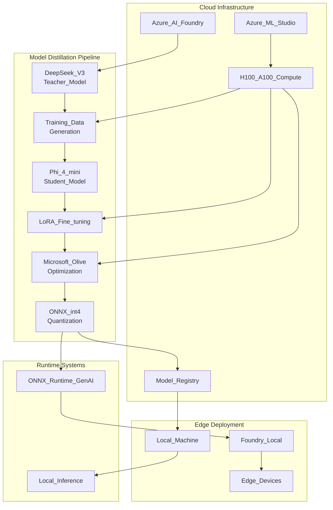

**Sources:** [README.md:16-18](), [lab_manual/Skillable_lab_manualintro.md:12-34]()

### Sequential Workflow Pipeline

The workshop follows a strict seven-step sequential process implemented through Jupyter notebooks:

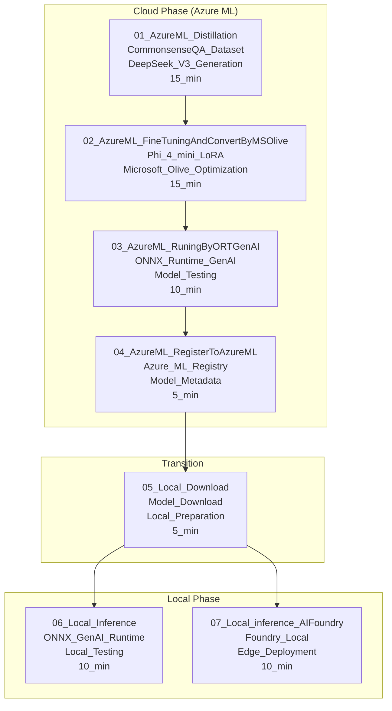

**Sources:** [README.md:31-59](), [lab_manual/Skillable_lab_manualintro.md:122-156]()

## Technology Stack Integration

The system leverages multiple Microsoft AI ecosystem components working in concert:

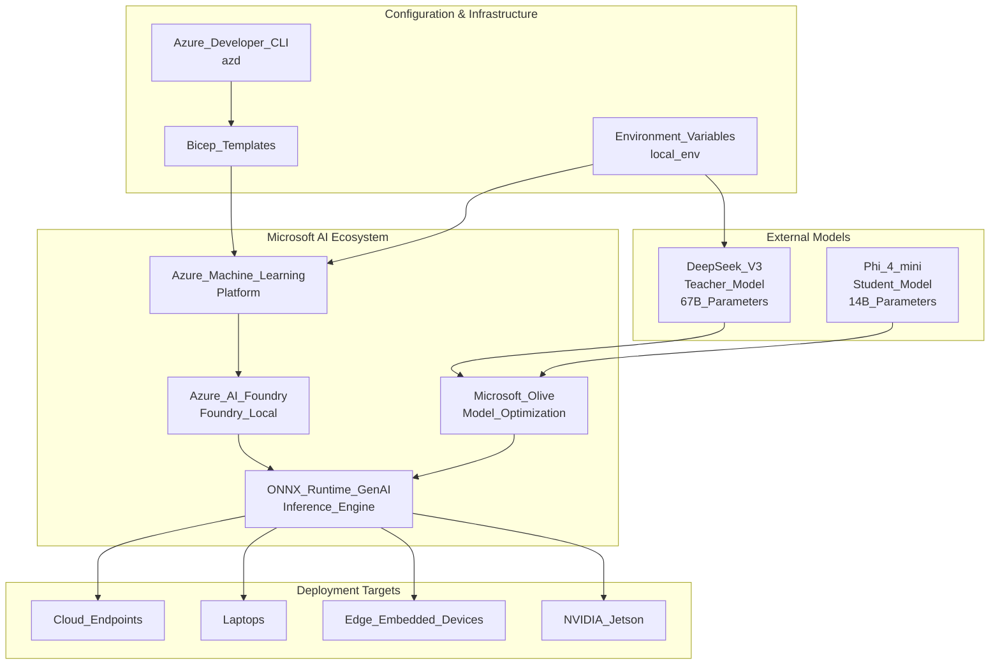

**Sources:** [README.md:8-14](), [lab_manual/readme.md:29-37]()

## Data Flow and Model Transformation

The knowledge distillation process transforms data and model representations through multiple stages:

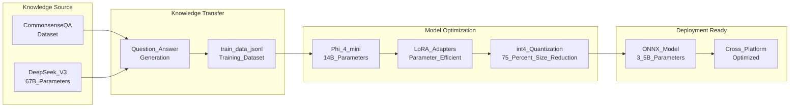

**Sources:** [README.md:32-39](), [lab_manual/Skillable_lab_manualintro.md:24-30]()

## Infrastructure and Environment Setup

The system requires specific Azure cloud resources and local environment configuration:

| Component | Purpose | Configuration |
|-----------|---------|---------------|
| **Azure ML Workspace** | Primary compute and orchestration | H100/A100 compute instances |
| **Azure AI Foundry** | Teacher model hosting | DeepSeek-V3 endpoint |
| **Key Vault** | Secrets management | API keys and endpoints |
| **Storage Account** | Model and data storage | Training datasets and artifacts |
| **Cognitive Services** | Model inference | Teacher model API access |
| **Local Environment** | Edge deployment testing | ONNX Runtime GenAI |

**Sources:** [lab_manual/Skillable_lab_manualintro.md:49-105]()

## Workshop Execution Flow

The workshop is designed for hands-on execution with specific timing and resource requirements:

### Execution Timeline

| Phase | Duration | Activities | Location |
|-------|----------|------------|----------|
| **Setup** | 5 minutes | Environment configuration | Azure ML Studio |
| **Data Generation** | 15 minutes | `01.AzureML_Distillation.ipynb` | Azure ML |
| **Model Training** | 15 minutes | `02.AzureML_FineTuningAndConvertByMSOlive.ipynb` | Azure ML |
| **Model Testing** | 10 minutes | `03.AzureML_RuningByORTGenAI.ipynb` | Azure ML |
| **Model Registration** | 5 minutes | `04.AzureML_RegisterToAzureML.ipynb` | Azure ML |
| **Local Download** | 5 minutes | `05.Local_Download.ipynb` | Local Machine |
| **Local Inference** | 10 minutes | `06.Local_Inference.ipynb` | Local Machine |
| **Foundry Deployment** | 10 minutes | `07.Local_inference_AIFoundry.ipynb` | Local Machine |
| **Discussion** | 5 minutes | Results review | - |

**Sources:** [lab_manual/Skillable_lab_manualintro.md:5-11](), [lab_manual/readme.md:15-21]()

## Key System Characteristics

The workshop demonstrates several important MLOps and edge AI principles:

1. **Hybrid Cloud-Edge Architecture**: Models trained in Azure cloud, deployed locally for edge scenarios
2. **Sequential Processing Pipeline**: Seven distinct steps with clear dependencies and handoffs between notebooks
3. **Microsoft Technology Integration**: Comprehensive use of Microsoft AI tools (`Microsoft.Olive`, `Azure.AI.Foundry`, `ONNX.Runtime.GenAI`)
4. **Educational Focus**: Designed specifically for EdTech scenarios requiring offline AI capabilities
5. **Resource Efficiency**: Achieves 75% model size reduction while maintaining performance
6. **Multiple Deployment Options**: Supports cloud endpoints, local inference, and containerized edge deployment

The system effectively bridges the gap between large-scale cloud AI and practical edge deployment, making advanced language model capabilities accessible in resource-constrained environments.

**Sources:** [README.md:1-18](), [lab_manual/Skillable_lab_manualintro.md:36-44](), [lab_manual/readme.md:40-48]()

---

# Page: Getting Started

# Getting Started

<details>
<summary>Relevant source files</summary>

The following files were used as context for generating this wiki page:

- [.gitignore](.gitignore)
- [Lab329/Notebook/sample.env](Lab329/Notebook/sample.env)
- [Lab329/README.md](Lab329/README.md)
- [azure.yaml](azure.yaml)
- [infra/ai-project.bicep](infra/ai-project.bicep)
- [infra/main.bicep](infra/main.bicep)
- [infra/main.parameters.json](infra/main.parameters.json)
- [lab_manual/setup_instructions.md](lab_manual/setup_instructions.md)

</details>


This guide provides the initial setup instructions for the Model Distillation Workshop, covering infrastructure provisioning, environment configuration, and prerequisites validation. The workshop demonstrates how to distill knowledge from large language models (LLMs) to smaller, edge-deployable models using Azure AI Foundry and Microsoft optimization tools.

For detailed Azure infrastructure provisioning steps, see [Azure Infrastructure Setup](#1.1.1). For environment variable configuration and development setup, see [Environment Configuration](#1.1.2). For the complete workshop workflow, see [Workshop Workflow](#1.2).

## Prerequisites

Before starting the workshop, ensure you have the following requirements:

| Requirement | Description | Verification Command |
|-------------|-------------|---------------------|
| **Azure Subscription** | Active subscription with Contributor permissions | `az account show` |
| **Azure CLI** | Latest version installed | `az --version` |
| **Azure Developer CLI** | azd CLI for infrastructure deployment | `azd version` |
| **Python 3.10+** | Required for local notebook execution | `python --version` |
| **Git** | Repository access and version control | `git --version` |
| **GPU Quota** | H100 or A100 GPU quota in supported regions | Check via Azure Portal |

### Supported Azure Regions

The workshop requires specific regions that support both H100/A100 compute and DeepSeek-V3 model deployment:

- `westus`
- `southcentralus` 
- `eastus`
- `westus3`
- `northcentralus`
- `eastus2`

Sources: [lab_manual/setup_instructions.md:30-39](), [infra/main.bicep:11-16]()

## Setup Flow Overview

**Setup Process Flow**

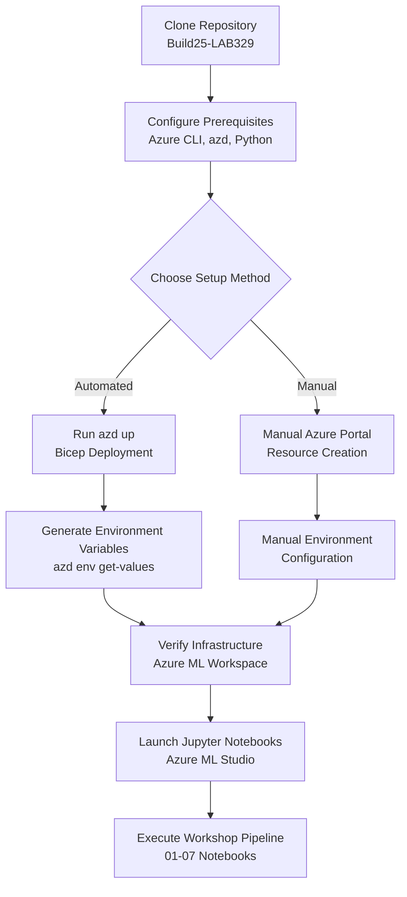

Sources: [lab_manual/setup_instructions.md:180-207](), [Lab329/README.md:79-88]()

## Quick Start Options

The workshop provides two setup approaches:

### Option 1: Automated Deployment (Recommended)

Use Azure Developer CLI for one-command infrastructure deployment:

```bash
# Clone repository
git clone https://github.com/microsoft/Build25-LAB329.git
cd Build25-LAB329

# Initialize and deploy
azd init
azd up

# Generate environment configuration
azd env get-values > Lab329/Notebook/local.env
```

### Option 2: Manual Setup

Follow detailed manual setup instructions for granular control over resource configuration. See [Azure Infrastructure Setup](#1.1.1) for step-by-step manual deployment.

Sources: [lab_manual/setup_instructions.md:180-207](), [lab_manual/setup_instructions.md:26-84]()

## Infrastructure Components

**Deployed Azure Resources and Configuration Files**

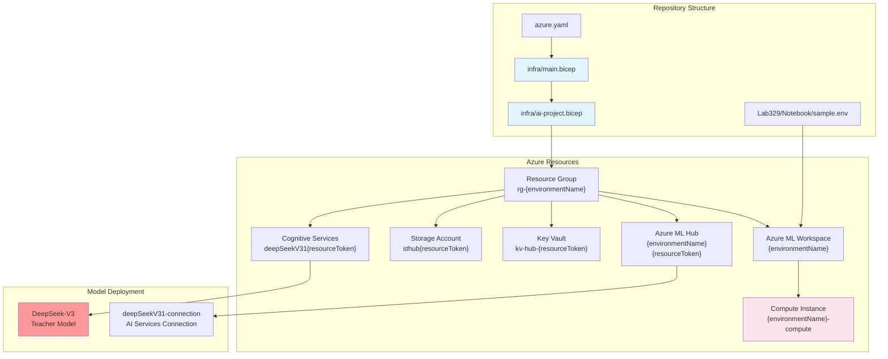

Sources: [infra/main.bicep:35-53](), [infra/ai-project.bicep:76-104](), [infra/ai-project.bicep:143-183]()

## Environment Configuration Overview

The workshop requires specific environment variables for connecting to Azure services and models:

**Required Environment Variables**

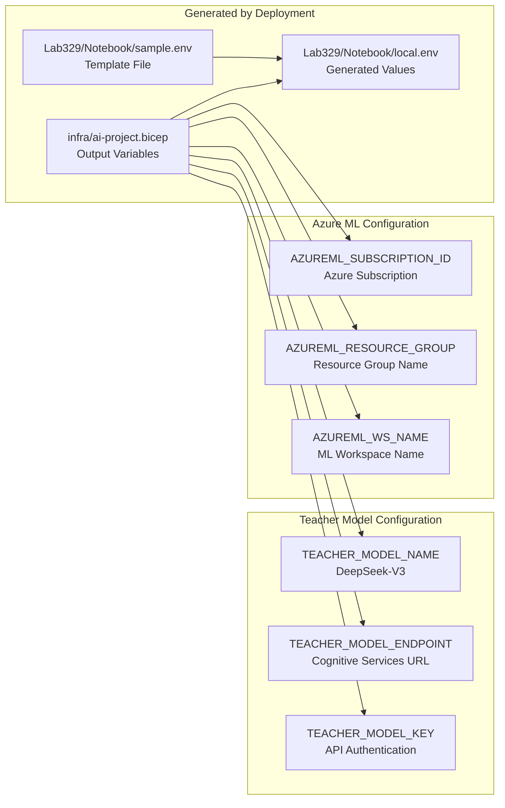

The automated deployment generates these variables automatically. For manual configuration, update the values in `Lab329/Notebook/sample.env` and rename to `local.env`.

Sources: [Lab329/Notebook/sample.env:1-12](), [infra/ai-project.bicep:211-215](), [infra/main.bicep:59-67]()

## Verification Steps

After completing the infrastructure setup, verify the deployment:

### 1. Check Azure Resources

```bash
# List deployed resources
azd env get-resources

# Verify environment variables
azd env get-values
```

### 2. Access Azure ML Studio

1. Navigate to [Azure ML Studio](https://ml.azure.com)
2. Select your workspace: `{environmentName}`
3. Verify compute instance: `{environmentName}-compute`
4. Check connection: `deepSeekV31-connection`

### 3. Test GPU Availability

In Azure ML Studio notebooks, run:

```python
import torch
print(f"CUDA available: {torch.cuda.is_available()}")
print(f"GPU Device: {torch.cuda.get_device_name(0)}")
```

Expected output shows H100 or A100 GPU detection.

Sources: [lab_manual/setup_instructions.md:102-110](), [lab_manual/setup_instructions.md:229-239]()

## Cost Management

The workshop uses premium GPU compute resources. Implement cost controls:

| Resource | Cost Factor | Mitigation |
|----------|-------------|------------|
| **H100/A100 Compute** | High hourly rate | Set minimum nodes to 0, enable auto-scale down |
| **DeepSeek-V3 Model** | Token-based pricing | Monitor API usage in notebooks |
| **Storage Account** | Data transfer and storage | Clean up intermediate files |

Configure budget alerts and monitor usage through the Azure Portal.

Sources: [lab_manual/setup_instructions.md:115-122](), [lab_manual/setup_instructions.md:366-371]()

## Next Steps

Once the infrastructure is ready and verified:

1. **Environment Configuration**: Complete detailed environment setup in [Environment Configuration](#1.1.2)
2. **Workshop Execution**: Begin the 7-step model distillation workflow in [Workshop Workflow](#1.2)
3. **First Notebook**: Start with `01.AzureML_Distillation.ipynb` for data generation

The workshop notebooks must be executed in Azure ML Studio with the correct compute instance and Python kernel environments as specified in [Lab329/README.md:82-84]().

Sources: [Lab329/README.md:33-67](), [Lab329/README.md:79-84]()

---

# Page: Azure Infrastructure Setup

# Azure Infrastructure Setup

<details>
<summary>Relevant source files</summary>

The following files were used as context for generating this wiki page:

- [infra/ai-project.bicep](infra/ai-project.bicep)
- [infra/main.bicep](infra/main.bicep)
- [lab_manual/setup_instructions.md](lab_manual/setup_instructions.md)

</details>


## Purpose and Scope

This document covers the automated and manual setup of Azure infrastructure required for the Model Distillation Workshop. The infrastructure deployment creates an Azure AI Foundry project with H100/A100 compute resources and deploys the DeepSeek-V3 teacher model for the knowledge distillation pipeline.

For information about configuring environment variables and development setup after infrastructure deployment, see [Environment Configuration](#1.1.2). For details about the complete workshop workflow, see [Workshop Workflow](#1.2).

## Infrastructure Architecture

The Azure infrastructure consists of multiple interconnected resources deployed through Bicep templates. The following diagram shows the core infrastructure components and their relationships as defined in the codebase:

### Core Infrastructure Components

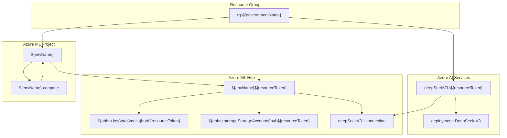

Sources: [infra/ai-project.bicep:21-183](), [infra/main.bicep:36-53]()

### Deployment Parameter Flow

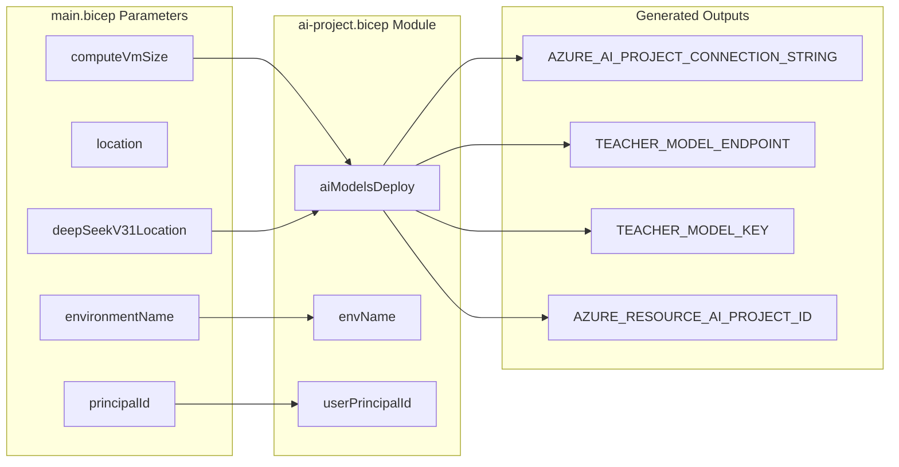

Sources: [infra/main.bicep:42-68](), [infra/ai-project.bicep:1-216]()

## Automated Deployment with Azure Developer CLI

### Prerequisites

The automated deployment requires specific tools and permissions as defined in the setup instructions:

| Requirement | Installation Command | Purpose |
|-------------|---------------------|---------|
| Azure CLI | `winget install -e --id Microsoft.AzureCLI` | Azure resource management |
| Azure Developer CLI | `winget install -e --id Microsoft.Azd` | Infrastructure as code deployment |
| Azure Subscription | - | Resource provisioning |
| Authentication | `az login` | Azure authentication |

Sources: [lab_manual/setup_instructions.md:161-178]()

### Deployment Process

The infrastructure deployment follows a standardized `azd` workflow:

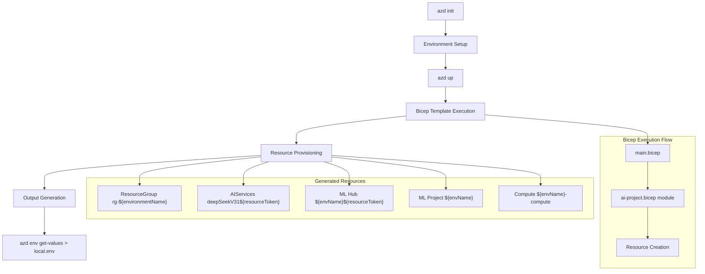

Sources: [lab_manual/setup_instructions.md:182-208]()

#### Step-by-Step Deployment Commands

1. **Initialize Environment**
   ```bash
   azd init
   ```
   Creates environment configuration with user-specified `environmentName` parameter.

2. **Deploy Infrastructure**
   ```bash
   azd up
   ```
   Executes the `main.bicep` template with parameter prompts for:
   - Azure subscription selection
   - Deployment region (`location` parameter)
   - DeepSeek model region (`deepSeekV31Location` parameter)
   - Compute VM size (`computeVmSize` parameter, defaults to `STANDARD_NC40ADS_H100_V5`)

3. **Extract Environment Variables**
   ```bash
   azd env get-values > Lab329\Notebook\local.env
   ```
   Generates environment file from Bicep template outputs.

Sources: [lab_manual/setup_instructions.md:188-208]()

## Infrastructure Components Detail

### Azure AI Services Configuration

The `deepSeekV31Deploy` resource provisions the teacher model:

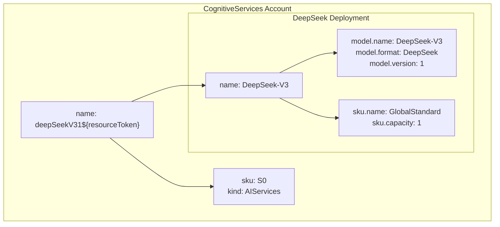

Sources: [infra/ai-project.bicep:76-104]()

### Azure ML Hub and Project Structure

The ML workspace hierarchy follows the hub-project pattern:

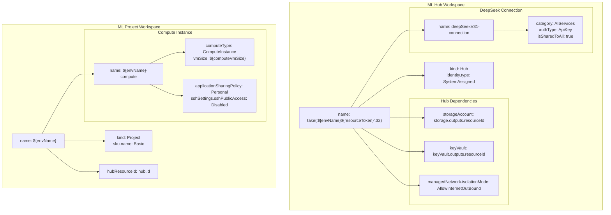

Sources: [infra/ai-project.bicep:106-183]()

### Compute Configuration Options

The infrastructure supports multiple GPU compute configurations via the `computeVmSize` parameter:

| VM Size | GPU Type | Default | Use Case |
|---------|----------|---------|----------|
| `STANDARD_NC40ADS_H100_V5` | H100 | ✓ | High-performance training |
| `Standard_ND96amsr_A100_v4` | A100 | - | Multi-GPU training |
| `Standard_NC24ads_A100_v4` | A100 | - | Single GPU training |

Sources: [infra/main.bicep:18-22](), [lab_manual/setup_instructions.md:18-24]()

## Output Variables and Environment Configuration

### Generated Environment Variables

The Bicep templates generate environment variables required by the notebook workflow:

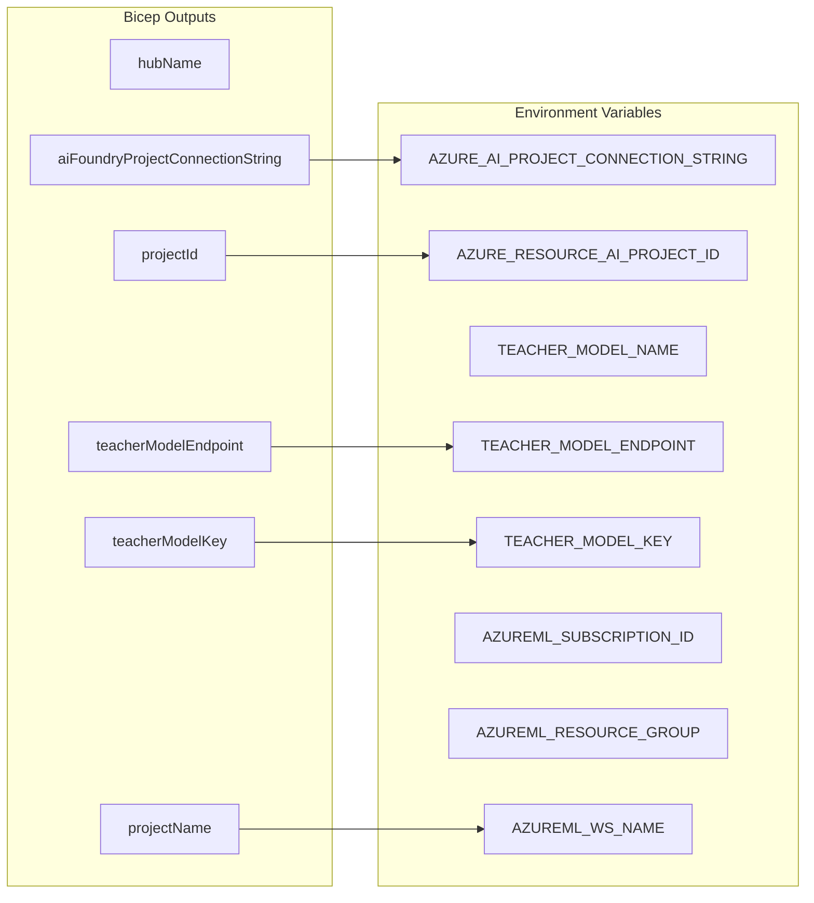

Sources: [infra/main.bicep:55-68](), [infra/ai-project.bicep:205-216]()

### Connection String Format

The `aiFoundryProjectConnectionString` output combines multiple values:
```
${split(project.properties.discoveryUrl, '/')[2]};${subscription().subscriptionId};${resourceGroup().name};${project.name}
```

This format provides the necessary connection information for Azure AI Foundry integration.

Sources: [infra/ai-project.bicep:209]()

## Manual Setup Alternative

### Supported Regions and Prerequisites

Manual setup requires deployment in regions supporting both GPU compute and DeepSeek model deployment:

| Region | Code | GPU Support | MaaS Support |
|--------|------|-------------|--------------|
| West US | `westus` | ✓ | ✓ |
| South Central US | `southcentralus` | ✓ | ✓ |
| East US | `eastus` | ✓ | ✓ |
| West US 3 | `westus3` | ✓ | ✓ |
| North Central US | `northcentralus` | ✓ | ✓ |
| East US 2 | `eastus2` | ✓ | ✓ |

Sources: [lab_manual/setup_instructions.md:30-40]()

### Manual Resource Creation Process

For manual setup without Bicep templates, the process involves:

1. **Azure AI Foundry Project Creation** - Create project in supported region
2. **Compute Resource Provisioning** - Configure H100/A100 compute cluster  
3. **DeepSeek Model Deployment** - Deploy via Models as a Service (MaaS)
4. **Verification** - Test GPU availability and model connectivity

Detailed manual setup steps are provided for environments where automated deployment is not feasible.

Sources: [lab_manual/setup_instructions.md:41-156]()

## Infrastructure Verification

### Resource Validation Commands

After deployment, verify infrastructure status:

```bash
# List all deployed resources
azd env get-resources

# Check deployment logs for issues
azd env get-logs

# Verify environment variables
azd env get-values
```

Sources: [lab_manual/setup_instructions.md:229-239]()

### GPU Compute Verification

Test GPU availability in Azure ML notebooks:

```python
import torch

print(f"CUDA available: {torch.cuda.is_available()}")
if torch.cuda.is_available():
    print(f"Number of GPUs: {torch.cuda.device_count()}")
    print(f"GPU Device Name: {torch.cuda.get_device_name(0)}")
```

Expected output shows NVIDIA H100 or A100 GPU detection.

Sources: [lab_manual/setup_instructions.md:102-110]()

## Infrastructure Cleanup

### Resource Removal

Clean up all deployed resources:

```bash
# Remove all Azure resources
azd down

# Manual environment cleanup if needed
rm -rf ~/.azd/env/<EnvironmentName>
```

This removes all resources created by the Bicep templates to prevent ongoing charges.

Sources: [lab_manual/setup_instructions.md:263-295]()

---

# Page: Environment Configuration

# Environment Configuration

<details>
<summary>Relevant source files</summary>

The following files were used as context for generating this wiki page:

- [.gitignore](.gitignore)
- [Lab329/Notebook/sample.env](Lab329/Notebook/sample.env)
- [Lab329/README.md](Lab329/README.md)
- [azure.yaml](azure.yaml)
- [infra/main.parameters.json](infra/main.parameters.json)

</details>


This document provides detailed instructions for configuring the required environment variables, authentication credentials, and development environment needed to execute the Model Distillation Workshop notebooks. The configuration establishes connections to Azure AI services, Azure Machine Learning workspace, and sets up the proper Python environments for each stage of the workflow.

For Azure infrastructure provisioning instructions, see [Azure Infrastructure Setup](#1.1.1). For the complete workshop workflow overview, see [Workshop Workflow](#1.2).

## Configuration Overview

The workshop requires configuration of two primary connection types: teacher model access through Azure AI Foundry and Azure Machine Learning workspace connectivity. These configurations enable the 7-step distillation pipeline to access cloud resources and manage model artifacts.

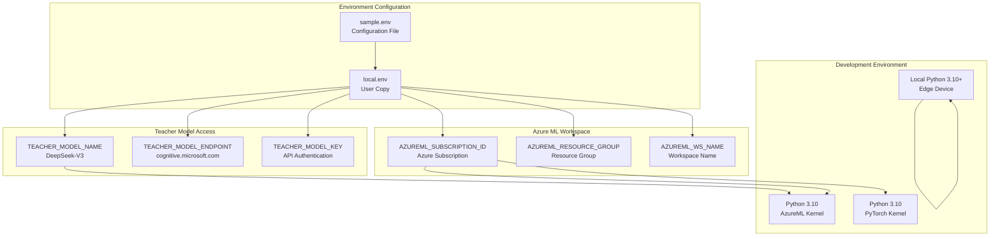

Sources: [Lab329/Notebook/sample.env:1-12](), [Lab329/README.md:87-98]()

## Environment File Setup

### Creating the Configuration File

The workshop uses environment variables stored in a configuration file to manage sensitive credentials and workspace identifiers. Create your configuration by copying the sample template:

| Configuration Step | Action | File Location |
|-------------------|--------|---------------|
| 1. Locate template | Find sample configuration | `Lab329/Notebook/sample.env` |
| 2. Create user copy | Copy to working directory | `Lab329/Notebook/local.env` |
| 3. Configure values | Replace placeholder values | Update all variables |
| 4. Secure file | Exclude from version control | Add to `.gitignore` |

The configuration file structure follows this format:

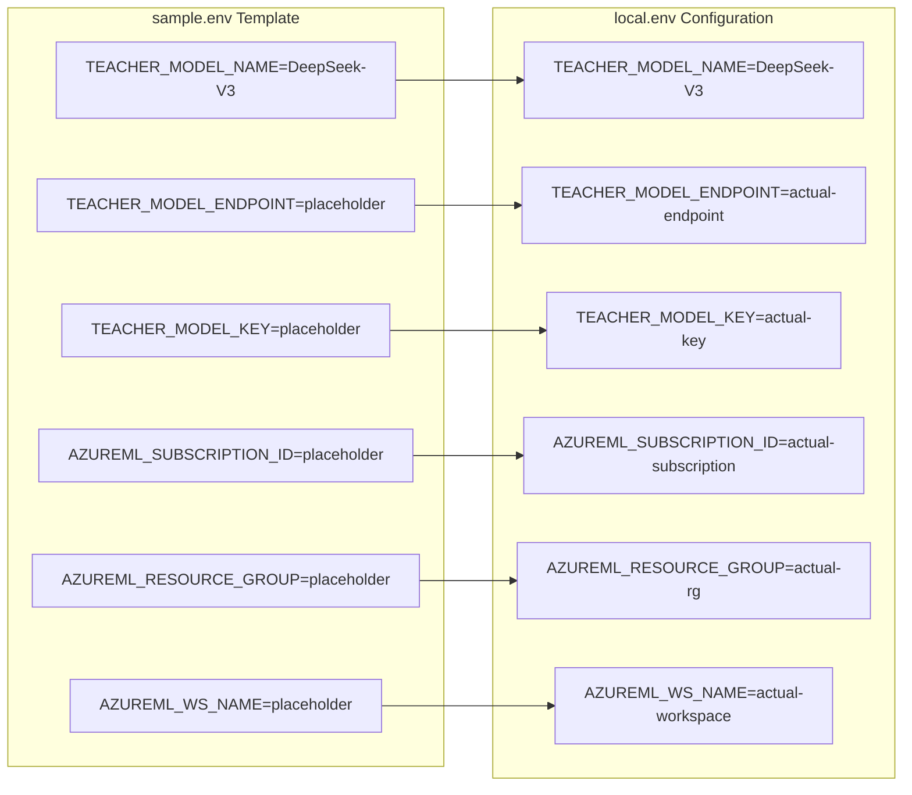

Sources: [Lab329/Notebook/sample.env:1-12](), [Lab329/README.md:87-98]()

### Teacher Model Configuration

Configure access to the DeepSeek-V3 teacher model deployed through Azure AI Foundry:

| Variable | Purpose | Source Location |
|----------|---------|-----------------|
| `TEACHER_MODEL_NAME` | Model identifier | Fixed as "DeepSeek-V3" |
| `TEACHER_MODEL_ENDPOINT` | API endpoint URL | Azure AI Foundry model overview |
| `TEACHER_MODEL_KEY` | Authentication key | Azure AI Foundry model overview |

The teacher model endpoint follows the pattern defined in the sample configuration: `https://westus3.api.cognitive.microsoft.com/models`.

Sources: [Lab329/Notebook/sample.env:1-4](), [azure.yaml:7-14]()

### Azure ML Workspace Configuration

Configure connectivity to your Azure Machine Learning workspace for model training and registration:

| Variable | Purpose | CLI Command |
|----------|---------|-------------|
| `AZUREML_SUBSCRIPTION_ID` | Azure subscription identifier | `az account show --query id --output tsv` |
| `AZUREML_RESOURCE_GROUP` | Resource group name | `az group list --query "[].name" --output tsv` |
| `AZUREML_WS_NAME` | ML workspace name | `az ml workspace list --query "[].name" --output tsv` |

Alternative configuration methods include downloading the `config.json` file from the Azure Portal resource group or using the Azure ML Studio interface.

Sources: [Lab329/Notebook/sample.env:5-12](), [infra/main.parameters.json:4-14]()

## Development Environment Setup

### Jupyter Kernel Configuration

The workshop notebooks require specific Python environments based on their computational requirements:

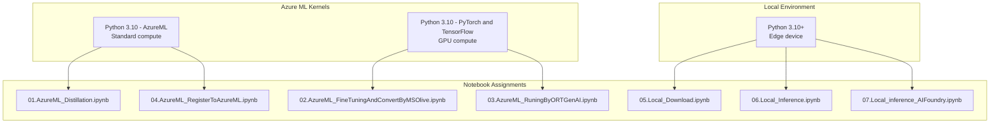

Sources: [Lab329/README.md:82-86]()

### Execution Environment Requirements

| Environment Type | Requirements | Purpose |
|-----------------|-------------|---------|
| Azure ML Standard | Python 3.10 AzureML kernel | Data generation and model registration |
| Azure ML GPU | Python 3.10 PyTorch kernel, A100 GPU | Model fine-tuning and optimization |
| Local Edge Device | Python 3.10+, sufficient resources | Model download and local inference |

The workshop requires access to H100 or A100 GPU resources for the fine-tuning steps, as specified in the computational requirements.

Sources: [Lab329/README.md:101-102]()

## Authentication and Permissions

### Azure Service Authentication

The workshop requires appropriate Azure permissions for the following services:

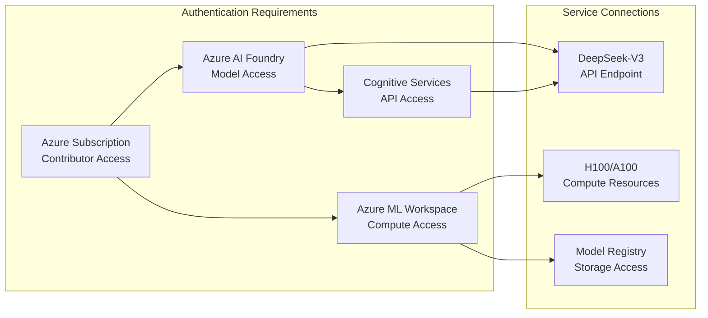

Sources: [Lab329/README.md:100](), [azure.yaml:4-15]()

### Credential Validation

Verify your configuration by testing the connection to each service:

| Service | Validation Method | Expected Response |
|---------|-------------------|-------------------|
| Teacher Model | API endpoint test | HTTP 200 with model metadata |
| Azure ML Workspace | Workspace list command | Workspace details |
| Subscription Access | Resource group list | Available resource groups |

Sources: [Lab329/Notebook/sample.env:6-9]()

## Configuration Validation

### Environment File Verification

Before executing the workshop notebooks, validate your configuration file contains all required variables with actual values (not placeholders):

| Variable Type | Validation Check | Correct Format |
|--------------|------------------|----------------|
| Model Name | Exact match | `DeepSeek-V3` |
| Endpoint URL | Valid HTTPS URL | `https://westus3.api.cognitive.microsoft.com/models` |
| API Key | Non-placeholder string | Alphanumeric key value |
| Subscription ID | Valid GUID format | 36-character UUID |
| Resource Group | Existing resource group | Matches Azure resource group name |
| Workspace Name | Existing ML workspace | Matches Azure ML workspace name |

### Connection Testing

Test each configured connection before proceeding with the workshop:

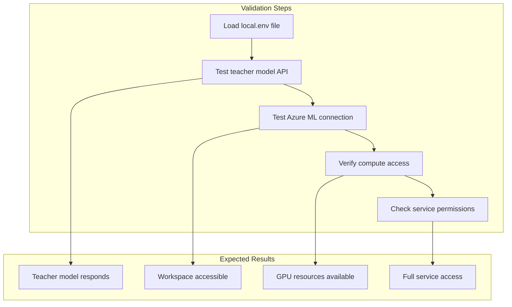

Sources: [Lab329/README.md:87-102]()

The environment configuration establishes the foundation for the complete model distillation workflow, enabling seamless execution of the 7-step process from data generation through edge deployment.

---

# Page: Workshop Workflow

# Workshop Workflow

<details>
<summary>Relevant source files</summary>

The following files were used as context for generating this wiki page:

- [lab_manual/Skillable_lab_manualintro.md](lab_manual/Skillable_lab_manualintro.md)
- [lab_manual/distillation_lab_manual.md](lab_manual/distillation_lab_manual.md)
- [lab_manual/images/localenv.png](lab_manual/images/localenv.png)

</details>


This document provides a complete technical overview of the 7-step model distillation pipeline that transforms a large language model (DeepSeek-V3) into an optimized edge-deployable model (Phi-4-mini). The workflow encompasses cloud-based training and optimization followed by local deployment and inference.

For detailed instructions on each individual step, see the corresponding child pages [1.2.1](#1.2.1) through [1.2.7]. For initial setup requirements, see [Getting Started](#1.1). For technical component details, see [Technical Components](#1.3).

## Pipeline Overview

The workshop consists of seven sequential Jupyter notebooks that must be executed in order, with the first four running in Azure ML Studio and the final three executing locally. The entire process takes approximately 70 minutes and results in a quantized ONNX model that is 75% smaller than the original while maintaining performance.

## Workflow Architecture

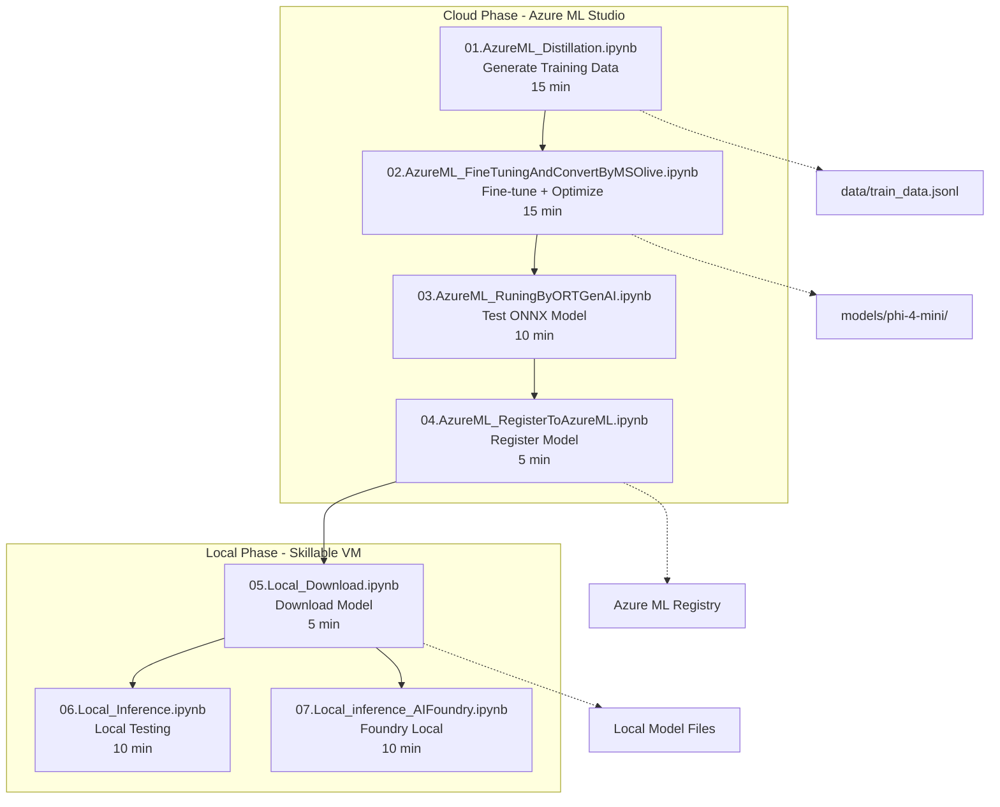

Sources: [lab_manual/Skillable_lab_manualintro.md:117-156](), [lab_manual/distillation_lab_manual.md:105-119]()

## Execution Phases

The workflow is divided into two distinct phases based on execution environment:

### Cloud Phase (Azure ML Studio)
| Notebook | Purpose | Duration | Key Outputs |
|----------|---------|----------|-------------|
| `01.AzureML_Distillation` | Generate training data using DeepSeek-V3 teacher model | 15 min | `data/train_data.jsonl` |
| `02.AzureML_FineTuningAndConvertByMSOlive` | Fine-tune with LoRA and optimize with MS Olive | 15 min | `models/phi-4-mini/ft/adapter`, `models/phi-4-mini/onnx/model` |
| `03.AzureML_RuningByORTGenAI` | Test ONNX model with ORT GenAI | 10 min | Inference validation |
| `04.AzureML_RegisterToAzureML` | Register optimized model | 5 min | Azure ML registry entry |

### Local Phase (Skillable VM)
| Notebook | Purpose | Duration | Key Outputs |
|----------|---------|----------|-------------|
| `05.Local_Download` | Download registered model | 5 min | Local model files |
| `06.Local_Inference` | Local inference testing | 10 min | Performance validation |
| `07.Local_inference_AIFoundry` | Foundry Local deployment | 10 min | Containerized deployment |

Sources: [lab_manual/Skillable_lab_manualintro.md:122-156](), [lab_manual/distillation_lab_manual.md:111-119]()

## Data Flow and Model Transformation

```mermaid
flowchart LR
    subgraph "Input Data"
        CQA["CommonsenseQA<br/>Dataset"]
        TEACHER["DeepSeek-V3<br/>Teacher Model<br/>TEACHER_MODEL_ENDPOINT"]
    end
    
    subgraph "Generated Data"
        TRAINDATA["data/train_data.jsonl<br/>Q&A Pairs"]
    end
    
    subgraph "Student Model Pipeline"
        PHI["Phi-4-mini-instruct<br/>azureml://registries/azureml/models/"]
        LORA["LoRA Adapters<br/>models/phi-4-mini/ft/adapter"]
        ONNX["ONNX Model<br/>models/phi-4-mini/onnx/model"]
        ADAPTER["adapter_weights.onnx_adapter"]
    end
    
    subgraph "Deployment"
        AMLREG["Azure ML Registry<br/>fine-tuning-phi-4-mini-onnx-int4-cpu"]
        LOCALFILES["Local Model Files<br/>Downloaded Model"]
        INFERENCE["Local Inference<br/>onnxruntime_genai.Model"]
    end
    
    CQA --> TEACHER
    TEACHER --> TRAINDATA
    TRAINDATA --> PHI
    PHI --> LORA
    LORA --> ONNX
    ONNX --> ADAPTER
    ADAPTER --> AMLREG
    AMLREG --> LOCALFILES
    LOCALFILES --> INFERENCE
```

Sources: [lab_manual/distillation_lab_manual.md:244-442](), [lab_manual/Skillable_lab_manualintro.md:24-30]()

## Infrastructure Requirements

### Azure Resources
- **Azure ML Studio**: Primary execution environment for notebooks 1-4
- **H100/A100 Compute**: GPU compute for fine-tuning and optimization
- **DeepSeek-V3 Endpoint**: Teacher model accessed via `TEACHER_MODEL_ENDPOINT`
- **Azure ML Registry**: Model storage and versioning

### Local Environment  
- **Skillable VM**: Local execution environment for notebooks 5-7
- **ONNX Runtime GenAI**: Inference engine for optimized models
- **Azure Foundry Local**: Containerized deployment platform

### Environment Configuration
The workflow requires a `local.env` file with the following variables:
```
TEACHER_MODEL_NAME=DeepSeek-V3
TEACHER_MODEL_ENDPOINT=https://westus3.api.cognitive.microsoft.com/models
TEACHER_MODEL_KEY=your-api-key
AZUREML_SUBSCRIPTION_ID=your-subscription-id
AZUREML_RESOURCE_GROUP=your-resource-group
AZUREML_WS_NAME=your-workspace-name
```

Sources: [lab_manual/Skillable_lab_manualintro.md:87-105](), [lab_manual/distillation_lab_manual.md:85-103]()

## Key Technical Components

### Model Optimization Pipeline
The workflow leverages several Microsoft technologies:
- **Microsoft Olive**: Fine-tuning with `olive finetune` and optimization with `olive auto-opt`
- **ONNX Runtime GenAI**: Model loading via `onnxruntime_genai.Model()`
- **LoRA (Low-Rank Adaptation)**: Parameter-efficient fine-tuning targeting specific modules

### Model Artifacts
Each step produces specific artifacts that feed into subsequent steps:
1. **Training Data**: JSON Lines format with question-answer pairs
2. **LoRA Adapters**: Fine-tuned parameter deltas in `models/phi-4-mini/ft/adapter`
3. **ONNX Model**: Optimized model with int4 quantization
4. **Adapter Weights**: ONNX-compatible adapter file for inference

Sources: [lab_manual/distillation_lab_manual.md:444-506](), [lab_manual/distillation_lab_manual.md:508-564]()

## Execution Sequence

The notebooks must be executed sequentially due to data dependencies:

```mermaid
sequenceDiagram
    participant User
    participant AzureML as "Azure ML Studio"
    participant DeepSeek as "DeepSeek-V3 API"
    participant Olive as "Microsoft Olive"
    participant ORT as "ONNX Runtime GenAI"
    participant Registry as "Azure ML Registry"
    participant Local as "Local Environment"
    
    User->>AzureML: Execute 01.AzureML_Distillation
    AzureML->>DeepSeek: Query CommonsenseQA questions
    DeepSeek-->>AzureML: Generate answers
    AzureML-->>User: Save train_data.jsonl
    
    User->>Olive: Execute 02.AzureML_FineTuningAndConvertByMSOlive
    Olive->>Olive: LoRA fine-tuning
    Olive->>Olive: ONNX conversion + int4 quantization
    Olive-->>User: Output optimized model
    
    User->>ORT: Execute 03.AzureML_RuningByORTGenAI
    ORT-->>User: Validate model inference
    
    User->>Registry: Execute 04.AzureML_RegisterToAzureML
    Registry-->>User: Model registered
    
    User->>Local: Execute 05.Local_Download
    Registry-->>Local: Download model files
    
    User->>Local: Execute 06.Local_Inference
    Local-->>User: Local inference results
    
    User->>Local: Execute 07.Local_inference_AIFoundry
    Local-->>User: Foundry Local deployment
```

Sources: [lab_manual/Skillable_lab_manualintro.md:107-156](), [lab_manual/distillation_lab_manual.md:172-883]()

The complete workflow demonstrates knowledge distillation from a 67B parameter teacher model to a ~3.5B parameter student model while maintaining comparable performance on multiple-choice question answering tasks. The resulting model achieves a 75% reduction in size and can run efficiently on standard hardware without GPU requirements.

---

# Page: Step 1: Data Generation with Teacher Model

# Step 1: Data Generation with Teacher Model

<details>
<summary>Relevant source files</summary>

The following files were used as context for generating this wiki page:

- [Lab329/Notebook/01.AzureML_Distillation.ipynb](Lab329/Notebook/01.AzureML_Distillation.ipynb)
- [lab_manual/Skillable_lab_manual1.md](lab_manual/Skillable_lab_manual1.md)

</details>


This document covers the first step in the model distillation pipeline: generating high-quality training data using a large teacher model. This step transforms raw CommonsenseQA questions into formatted training examples by collecting responses from DeepSeek-V3, creating the foundation for training a smaller student model.

For information about the complete model distillation workflow, see [Workshop Workflow](#1.2). For details about subsequent fine-tuning steps, see [Step 2: Fine-tuning and Optimization](#1.2.2).

## Purpose and Scope

The data generation step serves as the knowledge extraction phase in model distillation. It loads multiple-choice questions from the CommonsenseQA dataset, formats them appropriately for the teacher model, sends them to DeepSeek-V3 via Azure AI services, and collects the responses to create training data for the student model. The output is a structured JSONL file containing question-answer pairs that capture the teacher model's reasoning patterns.

## Data Generation Workflow

The following diagram illustrates the complete data generation pipeline:

```mermaid
flowchart TD
    subgraph "Dataset Loading"
        HF["load_dataset('tau/commonsense_qa')"] --> CQA["CQnAHuggingFaceInputDataset"]
        CQA --> SAMPLE["train_sample_size=100<br/>val_sample_size=100"]
    end
    
    subgraph "Question Formatting"
        SAMPLE --> PROMPT["system_prompt + user_prompt_template"]
        PROMPT --> FORMAT["Format with choices A-E"]
        FORMAT --> JSONL1["train_original_data.jsonl"]
    end
    
    subgraph "Teacher Model Processing"
        ENV["TEACHER_MODEL_NAME<br/>TEACHER_MODEL_ENDPOINT<br/>TEACHER_MODEL_KEY"] --> CLIENT["ChatCompletionsClient"]
        JSONL1 --> PROCESS["process_question()"]
        CLIENT --> PROCESS
        PROCESS --> COLLECT["Collect responses"]
    end
    
    subgraph "Training Data Output"
        COLLECT --> SAVE["Save Q&A pairs"]
        SAVE --> JSONL2["train_data.jsonl"]
    end
    
    style JSONL1 fill:#e1f5fe
    style JSONL2 fill:#c8e6c9
    style CLIENT fill:#fff3e0
```

**Data Generation Pipeline Overview**

Sources: [Lab329/Notebook/01.AzureML_Distillation.ipynb:1-1458]()

## Core Components

### Dataset Handler Classes

The data loading infrastructure uses an abstract base class pattern to handle different dataset sources:

```mermaid
classDiagram
    class InputDataset {
        <<abstract>>
        +train_data_file_name: str
        +test_data_file_name: str 
        +eval_data_file_name: str
        +__init__()
    }
    
    class CQnAHuggingFaceInputDataset {
        +load_hf_dataset(dataset_name, train_sample_size, val_sample_size, test_sample_size)
        +__init__()
    }
    
    InputDataset <|-- CQnAHuggingFaceInputDataset
```

**Dataset Handler Class Structure**

| Class | Purpose | Key Methods |
|-------|---------|-------------|
| `InputDataset` | Abstract base for dataset handlers | `__init__()` |
| `CQnAHuggingFaceInputDataset` | Loads CommonsenseQA from Hugging Face | `load_hf_dataset()` |

Sources: [Lab329/Notebook/01.AzureML_Distillation.ipynb:145-153](), [Lab329/Notebook/01.AzureML_Distillation.ipynb:188-223]()

### Question Processing Pipeline

The question processing involves formatting raw questions into the teacher model's expected input format and collecting responses:

```mermaid
sequenceDiagram
    participant DS as "Dataset"
    participant FMT as "Question Formatter"
    participant CLIENT as "ChatCompletionsClient"
    participant TM as "DeepSeek-V3"
    participant FILE as "train_data.jsonl"
    
    DS->>FMT: Raw question + choices
    FMT->>FMT: Apply system_prompt + user_prompt_template
    FMT->>CLIENT: Formatted messages
    CLIENT->>TM: API request
    TM->>CLIENT: Response (A/B/C/D/E)
    CLIENT->>FILE: Save Q&A pair
    
    Note over FMT: system_prompt: "Your output should only be one of the five choices: 'A', 'B', 'C', 'D', or 'E'."
    Note over CLIENT: Uses AzureKeyCredential for authentication
```

**Question Processing Sequence**

Sources: [Lab329/Notebook/01.AzureML_Distillation.ipynb:403-404](), [Lab329/Notebook/01.AzureML_Distillation.ipynb:660-686](), [Lab329/Notebook/01.AzureML_Distillation.ipynb:715-718]()

## Configuration and Environment

### Required Environment Variables

The system requires three environment variables for teacher model access:

| Variable | Purpose | Source |
|----------|---------|--------|
| `TEACHER_MODEL_NAME` | Model identifier for DeepSeek-V3 | Environment or local.env |
| `TEACHER_MODEL_ENDPOINT` | Azure AI Foundry endpoint URL | Environment or local.env |
| `TEACHER_MODEL_KEY` | Authentication key for API access | Environment or local.env |

These variables are loaded using the `load_azd_env()` and `load_dotenv()` functions to support both Azure Developer CLI environments and local configuration files.

Sources: [Lab329/Notebook/01.AzureML_Distillation.ipynb:541-543](), [Lab329/Notebook/01.AzureML_Distillation.ipynb:504-508]()

### Azure AI Client Setup

The Azure AI client initialization creates the connection to the teacher model:

```mermaid
graph LR
    subgraph "Client Configuration"
        ENDPOINT["teacher_model_endpoint_url"] --> CLIENT["ChatCompletionsClient"]
        KEY["teacher_model_api_key"] --> CRED["AzureKeyCredential"]
        CRED --> CLIENT
        MODEL["teacher_model_name"] --> CLIENT
    end
    
    subgraph "Message Processing"
        CLIENT --> SYS["SystemMessage"]
        CLIENT --> USER["UserMessage"]
        SYS --> API["complete() method"]
        USER --> API
    end
    
    subgraph "Response Handling"
        API --> RESP["response.choices[0].message.content"]
    end
```

**Azure AI Client Architecture**

Sources: [Lab329/Notebook/01.AzureML_Distillation.ipynb:715-718](), [Lab329/Notebook/01.AzureML_Distillation.ipynb:618-621]()

## Data Flow and File Operations

### Input Data Processing

The system processes CommonsenseQA data through several transformation stages:

| Stage | Input | Output | File Path |
|-------|-------|--------|-----------|
| Dataset Loading | HuggingFace dataset | Python objects | - |
| Question Formatting | Raw questions | Formatted prompts | `./data/train_original_data.jsonl` |
| Teacher Processing | Formatted prompts | Model responses | - |
| Training Data Creation | Q&A pairs | Training dataset | `./data/train_data.jsonl` |

The `process_question()` function handles individual question processing with error handling:

```python
def process_question(question_data):
    # Convert JSON messages to Azure AI message objects
    # Send to teacher model via ChatCompletionsClient
    # Return structured response with question, answer, and metadata
```

Sources: [Lab329/Notebook/01.AzureML_Distillation.ipynb:330](), [Lab329/Notebook/01.AzureML_Distillation.ipynb:864](), [Lab329/Notebook/01.AzureML_Distillation.ipynb:660-686]()

### Question Format Structure

The system formats questions using a specific template structure:

```mermaid
graph TD
    subgraph "Message Structure"
        MSG["messages array"] --> SYS["system message"]
        MSG --> USER["user message"]
        
        SYS --> SYSC["role: 'system'<br/>content: system_prompt"]
        USER --> USERC["role: 'user'<br/>content: formatted_question"]
    end
    
    subgraph "Question Template"
        TEMP["user_prompt_template"] --> Q["Question: {question}"]
        TEMP --> AC["Answer Choices: {answer_choices}"]
        Q --> FINAL["Complete formatted message"]
        AC --> FINAL
    end
```

**Question Message Format Structure**

Sources: [Lab329/Notebook/01.AzureML_Distillation.ipynb:403-404](), [Lab329/Notebook/01.AzureML_Distillation.ipynb:423-443]()

## Data Analysis and Quality Control

### Response Distribution Analysis

The system includes analysis capabilities to assess the quality of generated training data:

```mermaid
graph TB
    subgraph "Quality Metrics"
        DIST["Answer Distribution"] --> VALID["Valid Response Rate"]
        DIST --> BIAS["Answer Choice Bias"]
        DIST --> PATTERN["Response Patterns"]
    end
    
    subgraph "Analysis Tools"
        VALID --> SUCCESS["success_rate calculation"]
        BIAS --> UNIFORM["Compare to uniform 20% distribution"]
        PATTERN --> MATRIX["Confusion matrix analysis"]
    end
    
    subgraph "Visualization"
        SUCCESS --> BAR["Bar charts with matplotlib"]
        UNIFORM --> HEATMAP["Heatmaps with seaborn"]
        MATRIX --> STATS["Statistical summaries"]
    end
```

**Data Quality Analysis Pipeline**

The analysis includes several validation checks:

- **Success Rate**: Percentage of responses that are valid single letters (A-E)
- **Distribution Bias**: Comparison against expected uniform distribution
- **Response Patterns**: Analysis by question type and length

Sources: [Lab329/Notebook/01.AzureML_Distillation.ipynb:944-1005](), [Lab329/Notebook/01.AzureML_Distillation.ipynb:1042-1081]()

## Output Format

### Training Data Structure

The final training data is saved in JSONL format with a simplified structure:

```json
{
  "Question": "Answer the following multiple-choice question...",
  "Answer": "A"
}
```

Each line in `train_data.jsonl` represents one training example that will be used in the subsequent fine-tuning step. The file typically contains 100 question-answer pairs based on the default `train_sample_size` parameter.

Sources: [Lab329/Notebook/01.AzureML_Distillation.ipynb:876-879](), [Lab329/Notebook/01.AzureML_Distillation.ipynb:257-258]()

## Dependencies and Requirements

### Required Python Packages

| Package | Purpose | Installation |
|---------|---------|--------------|
| `dotenv-azd` | Environment variable loading | `pip install dotenv-azd` |
| `datasets` | HuggingFace dataset access | `pip install datasets tqdm -U` |
| `azure-ai-inference` | Azure AI service client | `pip install azure-ai-inference` |
| `matplotlib`, `seaborn` | Data visualization | `pip install matplotlib seaborn scikit-learn` |

### Azure Services

The step requires access to:
- Azure AI Foundry project with DeepSeek-V3 model deployment
- Valid API key and endpoint configuration
- Sufficient compute quota for model inference

Sources: [Lab329/Notebook/01.AzureML_Distillation.ipynb:56](), [Lab329/Notebook/01.AzureML_Distillation.ipynb:85](), [Lab329/Notebook/01.AzureML_Distillation.ipynb:580]()

## Next Steps

Upon completion of this step, the generated `train_data.jsonl` file serves as input for the next phase of the model distillation pipeline. The file contains high-quality question-answer pairs that capture the teacher model's reasoning patterns, ready for use in fine-tuning the student model.

For the next step in the workflow, see [Step 2: Fine-tuning and Optimization](#1.2.2).

---

# Page: Step 2: Fine-tuning and Optimization

# Step 2: Fine-tuning and Optimization

<details>
<summary>Relevant source files</summary>

The following files were used as context for generating this wiki page:

- [Lab329/Notebook/02.AzureML_FineTuningAndConvertByMSOlive.ipynb](Lab329/Notebook/02.AzureML_FineTuningAndConvertByMSOlive.ipynb)
- [lab_manual/Skillable_lab_manual2.md](lab_manual/Skillable_lab_manual2.md)

</details>


## Purpose and Scope

This document covers the second step of the model distillation workflow, where the Phi-4-mini student model is fine-tuned using training data generated from the DeepSeek-V3 teacher model and then optimized for edge deployment. The process uses Microsoft Olive for both LoRA (Low-Rank Adaptation) fine-tuning and ONNX conversion with int4 quantization.

For the initial data generation process, see [Step 1: Data Generation with Teacher Model](#1.2.1). For testing the optimized model, see [Step 3: Model Testing with ONNX Runtime](#1.2.3).

## Fine-tuning and Optimization Workflow

The fine-tuning and optimization process transforms the base Phi-4-mini model into a specialized, quantized ONNX model suitable for edge deployment. This involves two main phases: LoRA fine-tuning and model optimization.

```mermaid
flowchart TD
    subgraph "Input_Data" ["Input Data"]
        TrainData["data/train_data.jsonl<br/>Generated from Teacher Model"]
        BaseModel["azureml://registries/azureml/models/<br/>Phi-4-mini-instruct/versions/1"]
    end
    
    subgraph "Fine_Tuning" ["LoRA Fine-tuning Phase"]
        OliveFT["olive finetune<br/>--method lora"]
        LoRAAdapter["models/phi-4-mini/ft/adapter<br/>LoRA Parameters"]
        TargetModules["Target Modules:<br/>q_proj, k_proj, v_proj, o_proj<br/>gate_proj, up_proj, down_proj"]
    end
    
    subgraph "Optimization" ["Model Optimization Phase"]
        OliveOpt["olive auto-opt<br/>--precision int4"]
        ONNXModel["models/phi-4-mini/onnx<br/>Quantized ONNX Model"]
        ModelBuilder["--use_model_builder<br/>--provider CPUExecutionProvider"]
    end
    
    TrainData --> OliveFT
    BaseModel --> OliveFT
    OliveFT --> LoRAAdapter
    TargetModules --> OliveFT
    
    BaseModel --> OliveOpt
    LoRAAdapter --> OliveOpt
    ModelBuilder --> OliveOpt
    OliveOpt --> ONNXModel
    
    style TrainData fill:#e1f5fe
    style LoRAAdapter fill:#f3e5f5
    style ONNXModel fill:#e8f5e8
```

Sources: [Lab329/Notebook/02.AzureML_FineTuningAndConvertByMSOlive.ipynb:336-385](), [Lab329/Notebook/02.AzureML_FineTuningAndConvertByMSOlive.ipynb:432-482]()

## Environment Setup and Dependencies

The fine-tuning process requires specific package installations and environment configuration. The setup involves multiple PyTorch, ONNX, and Microsoft Olive components.

### Key Dependencies

| Package | Version | Purpose |
|---------|---------|---------|
| `torch` | CUDA 12.4 | Deep learning framework |
| `olive-ai[auto-opt]` | Latest | Microsoft Olive optimization toolkit |
| `onnxruntime-genai` | 0.7.1 | ONNX Runtime for generative AI |
| `transformers` | 4.49.0 | Hugging Face transformers library |
| `peft` | Latest | Parameter-efficient fine-tuning |
| `bitsandbytes` | Latest | Quantization support |

### Installation Sequence

```mermaid
sequenceDiagram
    participant Setup as "Environment Setup"
    participant PyTorch as "PyTorch Installation"
    participant Olive as "Microsoft Olive"
    participant ONNX as "ONNX Runtime GenAI"
    participant Deps as "Additional Dependencies"
    
    Setup->>PyTorch: pip install torch --index-url cu124
    PyTorch->>Olive: pip install olive-ai[auto-opt]
    Olive->>ONNX: pip install onnxruntime-genai==0.7.1
    ONNX->>Deps: pip install transformers peft bitsandbytes
    Deps->>Setup: Environment Ready
```

Sources: [Lab329/Notebook/02.AzureML_FineTuningAndConvertByMSOlive.ipynb:77-329]()

## LoRA Fine-tuning Process

The fine-tuning process uses the `olive finetune` command with LoRA (Low-Rank Adaptation) to efficiently adapt the Phi-4-mini model using the generated training data.

### LoRA Configuration

The LoRA fine-tuning targets specific transformer layers and uses the following configuration:

```mermaid
graph TB
    subgraph "LoRA_Targets" ["LoRA Target Modules"]
        QProj["q_proj<br/>Query Projection"]
        KProj["k_proj<br/>Key Projection"]
        VProj["v_proj<br/>Value Projection"]
        OProj["o_proj<br/>Output Projection"]
        GateProj["gate_proj<br/>Gate Projection"]
        UpProj["up_proj<br/>Up Projection"]
        DownProj["down_proj<br/>Down Projection"]
    end
    
    subgraph "Training_Config" ["Training Configuration"]
        MaxSteps["--max_steps 100"]
        DataFormat["--data_name json"]
        Template["--text_template<br/><|user|>{Question}<|end|><|assistant|>{Answer}<|end|>"]
        OutputPath["--output_path models/phi-4-mini/ft"]
    end
    
    subgraph "Input_Sources" ["Input Sources"]
        BaseModel["azureml://registries/azureml/models/<br/>Phi-4-mini-instruct/versions/1"]
        TrainDataFile["./data/train_data.jsonl"]
    end
    
    Input_Sources --> Training_Config
    Training_Config --> LoRA_Targets
    LoRA_Targets --> OutputPath
```

### Fine-tuning Command Structure

The `olive finetune` command executes with the following parameters:

| Parameter | Value | Purpose |
|-----------|-------|---------|
| `--method` | `lora` | Use LoRA fine-tuning method |
| `--model_name_or_path` | `azureml://registries/azureml/models/Phi-4-mini-instruct/versions/1` | Base model location |
| `--data_files` | `./data/train_data.jsonl` | Training data file |
| `--text_template` | `<|user|>{Question}<|end|><|assistant|>{Answer}<|end|>` | Input/output formatting |
| `--max_steps` | `100` | Training duration |
| `--target_modules` | `q_proj,k_proj,v_proj,o_proj,gate_proj,up_proj,down_proj` | LoRA target layers |
| `--output_path` | `models/phi-4-mini/ft` | Output directory |

Sources: [Lab329/Notebook/02.AzureML_FineTuningAndConvertByMSOlive.ipynb:374-384]()

## Model Optimization and Quantization

The optimization phase uses the `olive auto-opt` command to convert the fine-tuned model to ONNX format with int4 quantization, reducing model size by approximately 75%.

### Optimization Pipeline

```mermaid
flowchart LR
    subgraph "Input_Assets" ["Input Assets"]
        BaseModel["Base Model<br/>azureml://registries/azureml/models/<br/>Phi-4-mini-instruct/versions/1"]
        AdapterPath["Adapter Path<br/>models/phi-4-mini/ft/adapter"]
    end
    
    subgraph "Optimization_Process" ["Optimization Process"]
        ModelBuilder["--use_model_builder<br/>Model Builder"]
        Quantization["--precision int4<br/>Quantization"]
        CPUProvider["--provider CPUExecutionProvider<br/>CPU Optimization"]
    end
    
    subgraph "Output_Model" ["Output Model"]
        ONNXModel["models/phi-4-mini/onnx<br/>Quantized ONNX Model"]
        ModelConfig["Model Configuration"]
        Weights["Quantized Weights"]
    end
    
    BaseModel --> ModelBuilder
    AdapterPath --> ModelBuilder
    ModelBuilder --> Quantization
    Quantization --> CPUProvider
    CPUProvider --> ONNXModel
    ONNXModel --> ModelConfig
    ONNXModel --> Weights
    
    style BaseModel fill:#e1f5fe
    style AdapterPath fill:#f3e5f5
    style ONNXModel fill:#e8f5e8
```

### Optimization Parameters

The `olive auto-opt` command configuration includes:

| Parameter | Value | Purpose |
|-----------|-------|---------|
| `--model_name_or_path` | `azureml://registries/azureml/models/Phi-4-mini-instruct/versions/1` | Base model reference |
| `--adapter_path` | `models/phi-4-mini/ft/adapter` | LoRA adapter location |
| `--device` | `cpu` | Target device type |
| `--provider` | `CPUExecutionProvider` | ONNX Runtime provider |
| `--use_model_builder` | flag | Enable model builder optimization |
| `--precision` | `int4` | Quantization precision |
| `--output_path` | `models/phi-4-mini/onnx` | Output directory |

Sources: [Lab329/Notebook/02.AzureML_FineTuningAndConvertByMSOlive.ipynb:472-480]()

## Output Artifacts and File Structure

The fine-tuning and optimization process generates a structured set of output files organized in the `models/phi-4-mini` directory.

### File Structure

```mermaid
graph TB
    subgraph "models_directory" ["models/phi-4-mini/"]
        subgraph "ft_directory" ["ft/"]
            Adapter["adapter/<br/>LoRA Adapter Files"]
            FTConfig["Fine-tuning Configuration"]
        end
        
        subgraph "onnx_directory" ["onnx/"]
            ONNXModel["Quantized ONNX Model"]
            ModelConfig["Model Configuration"]
            Tokenizer["Tokenizer Files"]
        end
    end
    
    subgraph "data_directory" ["data/"]
        TrainData["train_data.jsonl<br/>Input Training Data"]
    end
    
    TrainData --> Adapter
    Adapter --> ONNXModel
    FTConfig --> ModelConfig
    
    style TrainData fill:#e1f5fe
    style Adapter fill:#f3e5f5
    style ONNXModel fill:#e8f5e8
```

### Model Artifacts

The optimization process produces the following key artifacts:

- **LoRA Adapter**: Parameter-efficient fine-tuning weights stored in `models/phi-4-mini/ft/adapter`
- **ONNX Model**: Quantized model optimized for CPU inference in `models/phi-4-mini/onnx`
- **Configuration Files**: Model and tokenizer configurations for deployment
- **Quantized Weights**: int4 quantized model weights for reduced memory footprint

Sources: [Lab329/Notebook/02.AzureML_FineTuningAndConvertByMSOlive.ipynb:382](), [Lab329/Notebook/02.AzureML_FineTuningAndConvertByMSOlive.ipynb:479]()

## Execution Environment

The fine-tuning and optimization process requires specific Azure ML compute resources and kernel configuration.

### Required Environment

- **Kernel**: Python 3.10 PyTorch and Tensorflow kernel
- **Compute**: Azure ML compute with GPU support for fine-tuning
- **Authentication**: Azure CLI authentication via `az login --use-device-code`
- **Environment File**: `local.env` with Azure credentials and configurations

### Process Duration

| Phase | Estimated Time | Primary Operations |
|-------|----------------|-------------------|
| Environment Setup | 5 minutes | Package installation and configuration |
| LoRA Fine-tuning | 8 minutes | Model adaptation with 100 steps |
| Model Optimization | 7 minutes | ONNX conversion and quantization |
| **Total** | **20 minutes** | Complete fine-tuning and optimization |

Sources: [Lab329/Notebook/02.AzureML_FineTuningAndConvertByMSOlive.ipynb:32-33](), [lab_manual/Skillable_lab_manual2.md:7]()

---

# Page: Step 3: Model Testing with ONNX Runtime

# Step 3: Model Testing with ONNX Runtime

<details>
<summary>Relevant source files</summary>

The following files were used as context for generating this wiki page:

- [Lab329/Notebook/03.AzureML_RuningByORTGenAI.ipynb](Lab329/Notebook/03.AzureML_RuningByORTGenAI.ipynb)
- [Lab329/Notebook/06.Local_Inference.ipynb](Lab329/Notebook/06.Local_Inference.ipynb)
- [lab_manual/Skillable_lab_manual3.md](lab_manual/Skillable_lab_manual3.md)

</details>


This document covers the model testing phase using ONNX Runtime GenAI to validate the optimized ONNX model created in the previous fine-tuning and optimization step. This step verifies that the model conversion was successful and the fine-tuned model performs correctly with the LoRA adapter before proceeding to registration.

This step focuses specifically on inference validation within the Azure ML environment. For information about local inference testing, see [Step 6: Local Inference](#1.2.6). For model registration procedures, see [Step 4: Model Registration](#1.2.4).

## Overview

The model testing workflow validates the ONNX-optimized Phi-4-mini model with its LoRA adapter using ONNX Runtime GenAI. This step ensures the optimized model maintains its fine-tuned capabilities and can generate appropriate responses to multiple-choice questions.

## Testing Architecture

The testing system integrates several key components to validate the optimized model:

```mermaid
graph TB
    subgraph "Azure ML Environment"
        NB[03.AzureML_RuningByORTGenAI.ipynb]
        ORT[onnxruntime==1.21.1]
        ORTG[onnxruntime_genai as og]
    end
    
    subgraph "Model Artifacts"
        MODEL["models/phi-4-mini/onnx/model/"]
        ONNX["ONNX Model Files"]
        ADAPTER["adapter_weights.onnx_adapter"]
    end
    
    subgraph "ONNX Runtime Components"
        OGMODEL["og.Model()"]
        OGADAPTERS["og.Adapters()"]
        OGTOKENIZER["og.Tokenizer()"]
        OGGENERATOR["og.Generator()"]
    end
    
    subgraph "Generation Pipeline"
        PROMPT["Chat Template"]
        TOKENS["input_tokens"]
        PARAMS["GeneratorParams"]
        RESPONSE["Generated Response"]
    end
    
    NB --> ORT
    ORT --> ORTG
    MODEL --> ONNX
    MODEL --> ADAPTER
    
    ORTG --> OGMODEL
    ORTG --> OGADAPTERS
    ORTG --> OGTOKENIZER
    ORTG --> OGGENERATOR
    
    ONNX --> OGMODEL
    ADAPTER --> OGADAPTERS
    OGMODEL --> OGTOKENIZER
    OGMODEL --> PARAMS
    
    PROMPT --> TOKENS
    TOKENS --> OGGENERATOR
    PARAMS --> OGGENERATOR
    OGADAPTERS --> OGGENERATOR
    OGGENERATOR --> RESPONSE
```

Sources: [Lab329/Notebook/03.AzureML_RuningByORTGenAI.ipynb:1-562]()

## Inference Flow Process

The model testing follows a structured token-based generation process:

```mermaid
sequenceDiagram
    participant NB as "Notebook"
    participant OG as "onnxruntime_genai"
    participant MODEL as "og.Model"
    participant ADAPTER as "og.Adapters"
    participant TOK as "og.Tokenizer"
    participant GEN as "og.Generator"
    
    NB->>OG: Install onnxruntime==1.21.1
    NB->>MODEL: og.Model(model_folder)
    NB->>ADAPTER: og.Adapters(model)
    ADAPTER->>ADAPTER: load('adapter_weights.onnx_adapter', 'qa_choice')
    NB->>TOK: og.Tokenizer(model)
    TOK->>TOK: create_stream()
    
    NB->>GEN: og.Generator(model, params)
    GEN->>ADAPTER: set_active_adapter(adapters, 'qa_choice')
    
    NB->>TOK: encode(prompt)
    TOK-->>NB: input_tokens
    NB->>GEN: append_tokens(input_tokens)
    
    loop Until is_done()
        GEN->>GEN: generate_next_token()
        GEN->>GEN: get_next_tokens()[0]
        GEN->>TOK: decode(new_token)
        TOK-->>NB: text_output
    end
```

Sources: [Lab329/Notebook/03.AzureML_RuningByORTGenAI.ipynb:175-527]()

## Key Components

### Model Loading Components

| Component | Purpose | Implementation |
|-----------|---------|----------------|
| `og.Model` | Loads ONNX model from filesystem | [Lab329/Notebook/03.AzureML_RuningByORTGenAI.ipynb:187]() |
| `og.Adapters` | Manages LoRA adapter loading | [Lab329/Notebook/03.AzureML_RuningByORTGenAI.ipynb:218-219]() |
| `og.Tokenizer` | Handles text-to-token conversion | [Lab329/Notebook/03.AzureML_RuningByORTGenAI.ipynb:248-249]() |
| `og.Generator` | Orchestrates token generation | [Lab329/Notebook/03.AzureML_RuningByORTGenAI.ipynb:430-432]() |

### Configuration Parameters

The testing process uses specific generation parameters defined in `search_options`:

- `max_length`: 120 tokens maximum generation length
- `past_present_share_buffer`: False for separate memory buffers

Sources: [Lab329/Notebook/03.AzureML_RuningByORTGenAI.ipynb:279-281]()

### Chat Template Format

The model uses a structured chat template to ensure proper response formatting:

```
<|system|>You are a helpful assistant. Your output should only be one of the five choices: 'A', 'B', 'C', 'D', or 'E'.<|end|><|user|>{input}<|end|><|assistant|>
```

This template constrains the model to provide single-letter responses matching the multiple-choice format.

Sources: [Lab329/Notebook/03.AzureML_RuningByORTGenAI.ipynb:346]()

## File Structure and Dependencies

The testing process relies on specific file organization created in the previous optimization step:

```mermaid
graph TB
    subgraph "Model Directory Structure"
        ROOT["models/phi-4-mini/onnx/model/"]
        ONNXFILES["ONNX Model Files"]
        ADAPTER["adapter_weights.onnx_adapter"]
        CONFIG["Configuration Files"]
    end
    
    subgraph "Runtime Dependencies"
        ORTBASE["onnxruntime==1.21.1"]
        ORTGENAI["onnxruntime_genai"]
        NUMPY["numpy"]
        OS["os"]
    end
    
    subgraph "Generated Artifacts"
        TOKENIZER["tokenizer_stream"]
        GENERATOR["generator"]
        PARAMS["GeneratorParams"]
    end
    
    ROOT --> ONNXFILES
    ROOT --> ADAPTER
    ROOT --> CONFIG
    
    ORTBASE --> ORTGENAI
    ORTGENAI --> TOKENIZER
    ORTGENAI --> GENERATOR
    ORTGENAI --> PARAMS
    
    ONNXFILES --> GENERATOR
    ADAPTER --> GENERATOR
```

Sources: [Lab329/Notebook/03.AzureML_RuningByORTGenAI.ipynb:156](), [Lab329/Notebook/03.AzureML_RuningByORTGenAI.ipynb:218-219]()

## Testing Workflow Steps

### Step 1: Environment Setup

Install the required ONNX Runtime version and import dependencies:

```python
! pip install onnxruntime==1.21.1 -U
import onnxruntime_genai as og
import numpy as np
import os
```

Sources: [Lab329/Notebook/03.AzureML_RuningByORTGenAI.ipynb:74](), [Lab329/Notebook/03.AzureML_RuningByORTGenAI.ipynb:104-106]()

### Step 2: Model and Adapter Loading

Load the ONNX model and LoRA adapter with error handling:

- Model loading from `model_folder` path
- Adapter loading with name `"qa_choice"`
- Tokenizer initialization with stream support

Sources: [Lab329/Notebook/03.AzureML_RuningByORTGenAI.ipynb:187](), [Lab329/Notebook/03.AzureML_RuningByORTGenAI.ipynb:218-219](), [Lab329/Notebook/03.AzureML_RuningByORTGenAI.ipynb:248-249]()

### Step 3: Generation Configuration

Configure the generation parameters and create the generator:

- Set `search_options` with generation constraints
- Create `GeneratorParams` object
- Initialize `Generator` with model and parameters
- Activate the LoRA adapter

Sources: [Lab329/Notebook/03.AzureML_RuningByORTGenAI.ipynb:279-281](), [Lab329/Notebook/03.AzureML_RuningByORTGenAI.ipynb:430-432](), [Lab329/Notebook/03.AzureML_RuningByORTGenAI.ipynb:460]()

### Step 4: Inference Execution

Execute the generation process with token-by-token output:

- Format input using chat template
- Tokenize the prompt
- Generate response iteratively
- Decode tokens back to text

Sources: [Lab329/Notebook/03.AzureML_RuningByORTGenAI.ipynb:372](), [Lab329/Notebook/03.AzureML_RuningByORTGenAI.ipynb:398](), [Lab329/Notebook/03.AzureML_RuningByORTGenAI.ipynb:486](), [Lab329/Notebook/03.AzureML_RuningByORTGenAI.ipynb:522-526]()

## Test Input Format

The notebook includes a sample multiple-choice question that follows the expected format:

```
Answer the following multiple-choice question by selecting the correct option.

Question: Sammy wanted to go to where the people were. Where might he go?
Answer Choices:
(A) race track
(B) populated areas
(C) the desert
(D) apartment
(E) roadblock
```

Sources: [Lab329/Notebook/03.AzureML_RuningByORTGenAI.ipynb:312]()

## Integration with Workflow Pipeline

This testing step validates the model before proceeding to registration and deployment:

```mermaid
graph LR
    STEP2["Step 2: Fine-tuning and Optimization"] --> TEST["Step 3: Model Testing"]
    TEST --> STEP4["Step 4: Model Registration"]
    
    subgraph "Testing Validation"
        LOAD["Load ONNX Model"]
        ADAPTER["Load LoRA Adapter"]
        INFER["Run Inference"]
        VERIFY["Verify Response"]
    end
    
    TEST --> LOAD
    LOAD --> ADAPTER
    ADAPTER --> INFER
    INFER --> VERIFY
    VERIFY --> STEP4
```

The testing step ensures model integrity before proceeding to registration, preventing deployment of corrupted or non-functional models.

Sources: [Lab329/Notebook/03.AzureML_RuningByORTGenAI.ipynb:22-25](), [lab_manual/Skillable_lab_manual3.md:1-15]()

---

# Page: Step 4: Model Registration

# Step 4: Model Registration

<details>
<summary>Relevant source files</summary>

The following files were used as context for generating this wiki page:

- [Lab329/Notebook/04.AzureML_RegisterToAzureML.ipynb](Lab329/Notebook/04.AzureML_RegisterToAzureML.ipynb)
- [lab_manual/Skillable_lab_manual4.md](lab_manual/Skillable_lab_manual4.md)

</details>


This document covers the model registration process in the Azure Machine Learning workspace, which enables version tracking, sharing, and deployment management for the optimized ONNX model produced in previous steps. Model registration creates a centralized repository entry with metadata, versioning, and access controls.

For information about model optimization and ONNX conversion, see [Step 2: Fine-tuning and Optimization](#1.2.2). For information about downloading registered models for local deployment, see [Step 5: Local Model Download](#1.2.5).

## Overview

The model registration step takes the optimized ONNX model files from the `models/phi-4-mini/onnx/` directory and registers them as a versioned asset in Azure ML. This process creates a model registry entry with metadata, enables version tracking, and prepares the model for downstream deployment scenarios.

## Registration Workflow

The following diagram illustrates the model registration process and key system components:

```mermaid
flowchart TD
    subgraph "Environment Setup"
        ENV["local.env<br/>Environment Variables"]
        AZD["load_azd_env()<br/>Azure Developer CLI"]
        DOTENV["load_dotenv()<br/>Local Environment"]
    end
    
    subgraph "Authentication"
        AUTH["DefaultAzureCredential"]
        AZLOGIN["az login --use-device-code"]
    end
    
    subgraph "Azure ML Client"
        MLCLIENT["MLClient"]
        SUBID["subscription_id"]
        RG["resource_group"] 
        WS["workspace"]
    end
    
    subgraph "Model Definition"
        MODEL["Model Entity"]
        PATH["models/phi-4-mini/onnx"]
        ASSETTYPE["AssetTypes.CUSTOM_MODEL"]
        NAME["fine-tuning-phi-4-mini-onnx-int4-cpu"]
    end
    
    subgraph "Registration Process"
        REGISTER["ml_client.models.create_or_update()"]
        RESULT["registered_model"]
        VERIFY["Model Verification"]
    end
    
    ENV --> DOTENV
    AZD --> DOTENV
    AZLOGIN --> AUTH
    AUTH --> MLCLIENT
    SUBID --> MLCLIENT
    RG --> MLCLIENT
    WS --> MLCLIENT
    
    PATH --> MODEL
    ASSETTYPE --> MODEL
    NAME --> MODEL
    MODEL --> REGISTER
    MLCLIENT --> REGISTER
    REGISTER --> RESULT
    RESULT --> VERIFY
```

Sources: [Lab329/Notebook/04.AzureML_RegisterToAzureML.ipynb:1-404]()

## Core Components

The registration process involves several key Azure ML SDK entities:

| Component | Purpose | Configuration |
|-----------|---------|---------------|
| `MLClient` | Primary interface for Azure ML operations | Initialized with subscription, resource group, workspace |
| `Model` | Defines model metadata and file location | Points to `models/phi-4-mini/onnx` directory |
| `AssetTypes.CUSTOM_MODEL` | Specifies model type for registration | Used for non-framework-specific models |
| `DefaultAzureCredential` | Handles Azure authentication | Uses Azure CLI credentials |

## Authentication and Client Setup

The registration process requires authenticated access to Azure ML workspace:

```mermaid
sequenceDiagram
    participant ENV as "Environment Variables"
    participant AUTH as "DefaultAzureCredential"
    participant CLIENT as "MLClient"
    participant AZML as "Azure ML Workspace"
    
    ENV->>CLIENT: AZUREML_SUBSCRIPTION_ID
    ENV->>CLIENT: AZUREML_RESOURCE_GROUP  
    ENV->>CLIENT: AZUREML_WS_NAME
    AUTH->>CLIENT: Azure Credentials
    CLIENT->>AZML: Initialize Connection
    AZML-->>CLIENT: Workspace Context
```

The authentication sequence uses environment variables loaded from `local.env` or Azure Developer CLI configuration [Lab329/Notebook/04.AzureML_RegisterToAzureML.ipynb:183-188](). The `MLClient` is initialized with workspace credentials [Lab329/Notebook/04.AzureML_RegisterToAzureML.ipynb:256]().

Sources: [Lab329/Notebook/04.AzureML_RegisterToAzureML.ipynb:245-256]()

## Model Definition and Registration

The model registration process involves creating a `Model` entity with specific attributes:

```mermaid
classDiagram
    class Model {
        +String path
        +AssetTypes type
        +String name
        +String description
        +register()
    }
    
    class AssetTypes {
        <<enumeration>>
        CUSTOM_MODEL
        MLflow_MODEL
        TRITON_MODEL
    }
    
    class MLClient {
        +models.create_or_update()
        +models.get()
        +models.list()
    }
    
    Model --> AssetTypes : uses
    MLClient --> Model : registers
```

The model definition specifies:
- **path**: `"models/phi-4-mini/onnx"` - directory containing ONNX model files
- **type**: `AssetTypes.CUSTOM_MODEL` - indicates non-framework-specific model
- **name**: `"fine-tuning-phi-4-mini-onnx-int4-cpu"` - registry identifier
- **description**: `"Fine tuning by MSOlive"` - model metadata

Sources: [Lab329/Notebook/04.AzureML_RegisterToAzureML.ipynb:290-295]()

## Registration Execution

The actual registration is performed by the `create_or_update()` method:

```mermaid
flowchart LR
    subgraph "Local Files"
        ONNX["models/phi-4-mini/onnx/<br/>*.onnx<br/>*.json<br/>config files"]
    end
    
    subgraph "Registration Process"
        UPLOAD["File Upload"]
        METADATA["Metadata Storage"]
        VERSION["Version Assignment"]
    end
    
    subgraph "Azure ML Registry"
        ENTRY["Model Registry Entry"]
        VER["Version Number"]
        ID["Unique Model ID"]
    end
    
    ONNX --> UPLOAD
    UPLOAD --> METADATA
    METADATA --> VERSION
    VERSION --> ENTRY
    ENTRY --> VER
    ENTRY --> ID
```

The `ml_client.models.create_or_update(file_model)` method uploads model files and creates a registry entry [Lab329/Notebook/04.AzureML_RegisterToAzureML.ipynb:329](). If a model with the same name exists, a new version is created; otherwise, version 1 is assigned.

Sources: [Lab329/Notebook/04.AzureML_RegisterToAzureML.ipynb:329]()

## Model Verification

After registration, the system provides verification and inspection capabilities:

| Property | Description | Example Value |
|----------|-------------|---------------|
| `name` | Model registry name | `fine-tuning-phi-4-mini-onnx-int4-cpu` |
| `id` | Unique model identifier | Generated UUID |
| `version` | Version number | `1`, `2`, `3`, etc. |
| `description` | Model description | `Fine tuning by MSOlive` |
| `path` | Azure ML storage path | Azure ML datastore URI |

The verification process outputs all model properties through the `registered_model.__dict__` inspection [Lab329/Notebook/04.AzureML_RegisterToAzureML.ipynb:367-368]().

Sources: [Lab329/Notebook/04.AzureML_RegisterToAzureML.ipynb:361-368]()

## Prerequisites and Dependencies

The registration process requires completion of previous workflow steps:

- **Step 1**: Training data generation via `01.AzureML_Distillation.ipynb`
- **Step 2**: Model fine-tuning and optimization via `02.AzureML_FineTuningAndConvertByMSOlive.ipynb`  
- **Step 3**: ONNX model testing via `03.AzureML_RuningByORTGenAI.ipynb`

The optimized model files must exist in the `models/phi-4-mini/onnx/` directory before registration can proceed.

Environment setup requires:
- Azure CLI authentication via `az login --use-device-code`
- Python 3.10 AzureML kernel selection
- Environment variables: `AZUREML_SUBSCRIPTION_ID`, `AZUREML_RESOURCE_GROUP`, `AZUREML_WS_NAME`

Sources: [Lab329/Notebook/04.AzureML_RegisterToAzureML.ipynb:24-36](), [lab_manual/Skillable_lab_manual4.md:1-15]()

## Integration with Model Distillation Pipeline

The model registration step serves as a bridge between cloud-based optimization and local deployment phases:

```mermaid
flowchart LR
    subgraph "Previous Steps"
        DISTILL["01. Data Generation"]
        FINETUNE["02. Fine-tuning + Optimization"]
        TEST["03. ONNX Testing"]
    end
    
    subgraph "Current Step"
        REGISTER["04. Model Registration"]
    end
    
    subgraph "Next Steps"
        DOWNLOAD["05. Local Download"]
        INFERENCE["06. Local Inference"]
        FOUNDRY["07. Foundry Local"]
    end
    
    DISTILL --> FINETUNE
    FINETUNE --> TEST
    TEST --> REGISTER
    REGISTER --> DOWNLOAD
    DOWNLOAD --> INFERENCE
    DOWNLOAD --> FOUNDRY
```

The registered model becomes available for download in Step 5, enabling the transition from cloud-based development to local and edge deployment scenarios.

Sources: [Lab329/Notebook/04.AzureML_RegisterToAzureML.ipynb:24-27](), [lab_manual/Skillable_lab_manual4.md:1-15]()

---

# Page: Step 5: Local Model Download

# Step 5: Local Model Download

<details>
<summary>Relevant source files</summary>

The following files were used as context for generating this wiki page:

- [Lab329/Notebook/05.Local_Download.ipynb](Lab329/Notebook/05.Local_Download.ipynb)
- [lab_manual/Skillable_lab_manual5.md](lab_manual/Skillable_lab_manual5.md)

</details>


This page covers the process of downloading the registered ONNX model from Azure ML to a local environment for edge deployment. This step transitions the model distillation workflow from cloud-based processing to local inference capabilities.

For information about model registration in Azure ML, see [Step 4: Model Registration](#1.2.4). For details on local inference execution, see [Step 6: Local Inference](#1.2.6).

## Purpose and Scope

Step 5 downloads the optimized `fine-tuning-phi-4-mini-onnx-int4-cpu` model from Azure ML Model Registry to the local Skillable VM environment. This enables offline inference and prepares the model for edge deployment scenarios. The download process includes authentication with Azure ML, model retrieval, and local file verification.

## Prerequisites

The following components must be completed before executing this step:

- Azure ML workspace with registered model from [Step 4: Model Registration](#1.2.4)
- Local environment with Python 3.10+ installed
- Azure CLI authentication (`az login --use-device-code`)
- Environment variables configured for Azure ML workspace connection

## Technical Architecture

### Download Process Flow

```mermaid
flowchart TD
    A[load_azd_env] --> B[load_dotenv]
    B --> C["DefaultAzureCredential()"]
    C --> D["MLClient()"]
    D --> E["ml_client.models.list()"]
    E --> F["ml_client.models.download()"]
    F --> G[os.path.exists]
    G --> H[os.walk]
    H --> I[Local_Model_Files]
    
    J[Environment_Variables] --> B
    K[Azure_Authentication] --> C
    L[Model_Registry] --> F
    
    subgraph "Error_Handling"
        M[install_package]
        N[format_size]
        O[Exception_Handling]
    end
    
    A --> M
    H --> N
    F --> O
    
    style A fill:#e1f5fe
    style F fill:#fff3e0
    style I fill:#f3e5f5
```

Sources: [Lab329/Notebook/05.Local_Download.ipynb:293-298](), [Lab329/Notebook/05.Local_Download.ipynb:354-358](), [Lab329/Notebook/05.Local_Download.ipynb:482-608]()

### Azure ML SDK Integration

```mermaid
graph TB
    subgraph "Authentication_Layer"
        DAC["DefaultAzureCredential"] --> AZ_LOGIN["az login --use-device-code"]
        ENV_VARS["Environment Variables"] --> DAC
    end
    
    subgraph "Azure_ML_Client"
        MLC["MLClient(credential, subscription_id, resource_group, workspace)"]
        LIST_MODELS["ml_client.models.list()"]
        DOWNLOAD["ml_client.models.download(name, version)"]
    end
    
    subgraph "Model_Management"
        MODEL_NAME["fine-tuning-phi-4-mini-onnx-int4-cpu"]
        MODEL_VERSION["version=1"]
        DOWNLOAD_PATH["download_path"]
    end
    
    subgraph "Local_File_System"
        OS_WALK["os.walk(download_path)"]
        FILE_COUNT["file_count"]
        TOTAL_SIZE["total_size"]
        FORMAT_SIZE["format_size()"]
    end
    
    DAC --> MLC
    MLC --> LIST_MODELS
    MLC --> DOWNLOAD
    MODEL_NAME --> DOWNLOAD
    MODEL_VERSION --> DOWNLOAD
    DOWNLOAD --> DOWNLOAD_PATH
    DOWNLOAD_PATH --> OS_WALK
    OS_WALK --> FILE_COUNT
    OS_WALK --> TOTAL_SIZE
    TOTAL_SIZE --> FORMAT_SIZE
    
    style MLC fill:#e1f5fe
    style DOWNLOAD fill:#fff3e0
    style FORMAT_SIZE fill:#f3e5f5
```

Sources: [Lab329/Notebook/05.Local_Download.ipynb:260-264](), [Lab329/Notebook/05.Local_Download.ipynb:328-359](), [Lab329/Notebook/05.Local_Download.ipynb:482-484]()

## Key Components

### Environment Configuration

The notebook loads configuration from multiple sources using a layered approach:

| Component | Function | Environment Variable |
|----------|----------|---------------------|
| Azure Subscription | `load_azd_env()` | `AZUREML_SUBSCRIPTION_ID` |
| Resource Group | `load_dotenv()` | `AZUREML_RESOURCE_GROUP` |
| Workspace Name | Environment lookup | `AZUREML_WS_NAME` |

Sources: [Lab329/Notebook/05.Local_Download.ipynb:293-298](), [Lab329/Notebook/05.Local_Download.ipynb:328-341]()

### Package Management

The `install_package()` function provides conditional installation:

```python
def install_package(package_name):
    try:
        __import__(package_name)
        print(f"✓ {package_name} is already installed")
    except ImportError:
        print(f"Installing {package_name}...")
        subprocess.check_call([sys.executable, '-m', 'pip', 'install', package_name])
```

Required packages include:
- `azure-ai-ml`: Azure ML SDK for model operations
- `azure-identity`: Authentication with Azure services
- `python-dotenv`: Environment variable management
- `dotenv-azd`: Azure Developer CLI environment integration

Sources: [Lab329/Notebook/05.Local_Download.ipynb:135-142](), [Lab329/Notebook/05.Local_Download.ipynb:144-150]()

### Model Download Process

The download process implements multiple fallback strategies:

1. **Primary Method**: `ml_client.models.download(name=model_name, version=model_version)`
2. **Async Fallback**: `ml_client.models.download_async()` with progress monitoring
3. **Path Verification**: `os.path.exists()` validation and alternative location search

The model specifications are:
- **Model Name**: `fine-tuning-phi-4-mini-onnx-int4-cpu`
- **Version**: `1`
- **Format**: ONNX with int4 quantization optimized for CPU inference

Sources: [Lab329/Notebook/05.Local_Download.ipynb:482-484](), [Lab329/Notebook/05.Local_Download.ipynb:494-523]()

### File System Operations

Post-download verification uses `os.walk()` to calculate model statistics:

```python
for path, dirs, files in os.walk(download_path):
    for f in files:
        fp = os.path.join(path, f)
        file_size = os.path.getsize(fp)
        total_size += file_size
        file_count += 1
```

The `format_size()` function converts bytes to human-readable formats (bytes, KB, MB, GB).

Sources: [Lab329/Notebook/05.Local_Download.ipynb:528-533](), [Lab329/Notebook/05.Local_Download.ipynb:536-544]()

## Execution Environment

### Local vs. Cloud Execution

This notebook executes on the **Skillable VM** environment, not in Azure ML Studio. The local execution enables:

- Direct file system access for model storage
- Offline inference preparation
- Edge deployment scenarios
- Resource-constrained environment testing

The notebook requires **Python 3.10+** and proper kernel selection in Jupyter.

Sources: [lab_manual/Skillable_lab_manual5.md:11-18](), [Lab329/Notebook/05.Local_Download.ipynb:42-45]()

### Error Handling and Troubleshooting

The implementation includes comprehensive error handling for common scenarios:

| Error Type | Detection | Resolution |
|-----------|-----------|------------|
| Authentication | `credentials` in error message | Run `az login --use-device-code` |
| Model Not Found | `not found` in error message | Verify model name and version |
| Progress Display | `progress` in error message | Fallback to text-based indicators |
| Path Issues | `nonetype` in error message | Search default directories |

The notebook provides specific troubleshooting guidance based on error message content analysis.

Sources: [Lab329/Notebook/05.Local_Download.ipynb:591-607](), [Lab329/Notebook/05.Local_Download.ipynb:556-584]()

## Integration Points

This step serves as the critical transition point in the model distillation workflow:

- **Input**: Registered model from [Step 4: Model Registration](#1.2.4)
- **Output**: Local model files for [Step 6: Local Inference](#1.2.6) and [Step 7: Foundry Local Deployment](#1.2.7)
- **Dependencies**: Azure ML workspace, authentication, and network connectivity for download

The downloaded model files enable offline AI capabilities essential for edge computing and educational scenarios with limited cloud connectivity.

Sources: [Lab329/Notebook/05.Local_Download.ipynb:8-34](), [lab_manual/Skillable_lab_manual5.md:1-18]()

---

# Page: Step 6: Local Inference

# Step 6: Local Inference

<details>
<summary>Relevant source files</summary>

The following files were used as context for generating this wiki page:

- [Lab329/Notebook/03.AzureML_RuningByORTGenAI.ipynb](Lab329/Notebook/03.AzureML_RuningByORTGenAI.ipynb)
- [Lab329/Notebook/06.Local_Inference.ipynb](Lab329/Notebook/06.Local_Inference.ipynb)
- [lab_manual/Skillable_lab_manual6.md](lab_manual/Skillable_lab_manual6.md)

</details>


This step demonstrates how to run inference on the optimized ONNX model in a local environment after downloading it from Azure ML. The local inference capability enables edge deployment scenarios where models can operate without cloud connectivity.

For information about testing the model in Azure ML Studio before download, see [Step 3: Model Testing with ONNX Runtime](#1.2.3). For information about deploying the model using Foundry Local, see [Step 7: Foundry Local Deployment](#1.2.7).

## Prerequisites and Environment

Local inference requires the completion of all previous workflow steps, particularly [Step 5: Local Model Download](#1.2.5) which downloads the registered model files to the local machine. The local environment must have Python 3.10+ and sufficient memory to load the quantized model.

The notebook [Lab329/Notebook/06.Local_Inference.ipynb:33-51]() specifies the local environment requirements, including Python version compatibility and disk space considerations for model loading.

**Sources:** [Lab329/Notebook/06.Local_Inference.ipynb:20-36](), [lab_manual/Skillable_lab_manual6.md:10-18]()

## Local Inference Architecture

The local inference system uses ONNX Runtime GenAI to run the optimized int4-quantized Phi-4-mini model with LoRA adapters. The architecture isolates the inference pipeline from cloud dependencies while maintaining the model's specialized knowledge.

```mermaid
graph TB
    subgraph "Local Environment"
        ModelFiles["Model Files<br/>./fine-tuning-phi-4-mini-onnx-int4-cpu/onnx/model"]
        AdapterFiles["Adapter Files<br/>adapter_weights.onnx_adapter"]
    end
    
    subgraph "ONNX Runtime GenAI Components"
        ogModel["og.Model"]
        ogAdapters["og.Adapters"]
        ogTokenizer["og.Tokenizer"]
        ogGenerator["og.Generator"]
    end
    
    subgraph "Inference Pipeline"
        TokenizerStream["tokenizer_stream"]
        GeneratorParams["og.GeneratorParams"]
        SearchOptions["search_options"]
    end
    
    subgraph "Input/Output Processing"
        InputText["Input Text"]
        ChatTemplate["Chat Template"]
        GeneratedTokens["Generated Tokens"]
        OutputText["Output Text"]
    end
    
    ModelFiles --> ogModel
    AdapterFiles --> ogAdapters
    ogModel --> ogTokenizer
    ogModel --> ogGenerator
    ogAdapters --> ogGenerator
    ogTokenizer --> TokenizerStream
    GeneratorParams --> ogGenerator
    SearchOptions --> GeneratorParams
    
    InputText --> ChatTemplate
    ChatTemplate --> ogTokenizer
    ogGenerator --> GeneratedTokens
    GeneratedTokens --> TokenizerStream
    TokenizerStream --> OutputText
```

**Sources:** [Lab329/Notebook/06.Local_Inference.ipynb:118-137](), [Lab329/Notebook/06.Local_Inference.ipynb:160-193]()

## Model Loading Process

The model loading process initializes the ONNX model and its associated LoRA adapter for specialized question-answering capabilities. The `og.Model` class loads the optimized model files, while `og.Adapters` manages the fine-tuned adapter weights.

```mermaid
sequenceDiagram
    participant Client as "Client Code"
    participant Model as "og.Model"
    participant Adapters as "og.Adapters"
    participant FileSystem as "File System"
    
    Client->>FileSystem: Check model_path exists
    FileSystem-->>Client: Path validation
    Client->>Model: og.Model(model_path)
    Model->>FileSystem: Load ONNX model files
    FileSystem-->>Model: Model weights & config
    Model-->>Client: Model instance
    
    Client->>Adapters: og.Adapters(model)
    Client->>FileSystem: Check adapter_path exists  
    FileSystem-->>Client: Adapter file found
    Client->>Adapters: adapters.load(adapter_path, "qa_choice")
    Adapters->>FileSystem: Load adapter weights
    FileSystem-->>Adapters: LoRA adapter weights
    Adapters-->>Client: Adapter loaded
```

The model loading implementation checks for file existence and handles error cases when adapter files are not found at expected paths [Lab329/Notebook/06.Local_Inference.ipynb:166-192]().

**Sources:** [Lab329/Notebook/06.Local_Inference.ipynb:160-193](), [Lab329/Notebook/06.Local_Inference.ipynb:126-137]()

## Inference Pipeline Configuration

The inference pipeline consists of tokenization, generation parameters, and the generator itself. The `og.Tokenizer` handles text-to-token conversion, while `og.GeneratorParams` configures generation behavior through search options.

| Component | Purpose | Key Parameters |
|-----------|---------|----------------|
| `og.Tokenizer` | Text-to-token conversion | Model vocabulary |
| `tokenizer_stream` | Token-to-text decoding | Streaming decode |
| `search_options` | Generation control | `max_length`, `temperature`, `repeat_penalty` |
| `og.GeneratorParams` | Parameter container | Search options binding |
| `og.Generator` | Text generation engine | Model + parameters |

The search options configuration [Lab329/Notebook/06.Local_Inference.ipynb:232-238]() includes:

- `max_length`: Maximum tokens to generate (102)
- `past_present_share_buffer`: Memory management (False)
- `repeat_penalty`: Repetition control (1.1)
- `temperature`: Randomness control (0.7)

**Sources:** [Lab329/Notebook/06.Local_Inference.ipynb:220-243](), [Lab329/Notebook/06.Local_Inference.ipynb:232-238]()

## Text Generation Workflow

The text generation process follows a structured workflow from input formatting through token generation to output decoding. The system uses a chat template to format inputs and activates the LoRA adapter for specialized knowledge.

```mermaid
graph TD
    InputQuestion["Input Question"] --> FormatInput["Format with choices"]
    FormatInput --> ApplyChatTemplate["Apply chat_template"]
    ApplyChatTemplate --> TokenizeInput["tokenizer.encode(prompt)"]
    
    TokenizeInput --> SetupGenerator["og.Generator(model, params)"]
    SetupGenerator --> ActivateAdapter["generator.set_active_adapter(adapters, 'qa_choice')"]
    ActivateAdapter --> AppendTokens["generator.append_tokens(input_tokens)"]
    
    AppendTokens --> GenerationLoop["Generation Loop"]
    GenerationLoop --> CheckDone{"generator.is_done()"}
    CheckDone -->|No| GenerateToken["generator.generate_next_token()"]
    GenerateToken --> GetToken["generator.get_next_tokens()[0]"]
    GetToken --> DecodeToken["tokenizer_stream.decode(new_token)"]
    DecodeToken --> CheckDone
    CheckDone -->|Yes| OutputResponse["Final Response"]
```

The chat template format [Lab329/Notebook/06.Local_Inference.ipynb:278]() follows the structure:
```
<|system|>You are a helpful assistant. Your output should only be one of the five choices: 'A', 'B', 'C', 'D', or 'E'.<|end|><|user|>{input}<|end|><|assistant|>
```

**Sources:** [Lab329/Notebook/06.Local_Inference.ipynb:262-338](), [Lab329/Notebook/06.Local_Inference.ipynb:309-318]()

## Response Generation Function

The `generate_response` function [Lab329/Notebook/06.Local_Inference.ipynb:262-338]() encapsulates the complete inference workflow. It formats multiple-choice questions, applies the chat template, and processes the model's response to extract answer choices.

The function handles the complete pipeline:

1. **Input Formatting**: Combines question text with formatted answer choices
2. **Template Application**: Applies the chat template with system instructions
3. **Tokenization**: Converts formatted prompt to input tokens
4. **Generator Setup**: Creates generator with search options and adapter activation
5. **Token Generation**: Iterative token generation with streaming decode
6. **Response Processing**: Extracts answer choice from generated text

The generation loop [Lab329/Notebook/06.Local_Inference.ipynb:309-318]() continues until `generator.is_done()` returns true or a termination condition is met (such as detecting a closing parenthesis character).

**Sources:** [Lab329/Notebook/06.Local_Inference.ipynb:262-338](), [Lab329/Notebook/06.Local_Inference.ipynb:309-318]()

## Testing and Validation

The notebook includes test questions [Lab329/Notebook/06.Local_Inference.ipynb:357-389]() covering different knowledge domains to validate the model's performance across varied question types. The testing framework measures response time and validates that outputs match expected answer choice formats.

Sample test questions include:
- Geography: "What is the capital of France?"
- Science: "Which planet is closest to the Sun?"
- Mathematics: "What is 7 × 8?"

The `ask_question` function [Lab329/Notebook/06.Local_Inference.ipynb:421-453]() provides an interface for custom question testing, demonstrating knowledge distillation concepts with a specialized multiple-choice question about the purpose of knowledge distillation itself.

**Sources:** [Lab329/Notebook/06.Local_Inference.ipynb:357-402](), [Lab329/Notebook/06.Local_Inference.ipynb:421-453]()

---

# Page: Step 7: Foundry Local Deployment

# Step 7: Foundry Local Deployment

<details>
<summary>Relevant source files</summary>

The following files were used as context for generating this wiki page:

- [Lab329/Notebook/07.Local_inference_AIFoundry.ipynb](Lab329/Notebook/07.Local_inference_AIFoundry.ipynb)
- [lab_manual/Skillable_lab_manual7.md](lab_manual/Skillable_lab_manual7.md)

</details>


## Purpose and Scope

This page covers the final step in the model distillation workshop pipeline: deploying your optimized ONNX model using Azure Foundry Local for containerized edge deployment. This step demonstrates how to serve and interact with your distilled model in a production-like, resource-constrained local environment.

Step 7 builds directly on the model downloaded in [Step 6: Local Inference](#1.2.6) and represents the transition from cloud-based model development to edge deployment scenarios. For information about the overall workshop workflow, see [Workshop Workflow](#1.2).

## Prerequisites and Dependencies

Step 7 requires successful completion of previous workshop steps, particularly:

- **Step 5**: Model download from Azure ML registry
- **Step 6**: Local inference setup and validation
- **Local Environment**: Model files available in `fine-tuning-phi-4-mini-onnx-int4-cpu` directory
- **Platform Requirements**: Windows, macOS, or Linux with Python 3.10+

The following components must be available locally:

| Component | Source Step | Required Files |
|-----------|-------------|----------------|
| ONNX Model | Step 5 | `fine-tuning-phi-4-mini-onnx-int4-cpu/` |
| Model Configuration | Step 7 | `inference_model.json` |
| Foundry Environment | Step 7 | `LocalFoundryEnv/models/` |

Sources: `Lab329/Notebook/07.Local_inference_AIFoundry.ipynb:26-34`, `lab_manual/Skillable_lab_manual7.md:9-20`

## Foundry Local Architecture

Azure Foundry Local provides a containerized inference server for locally deployed language models. The system enables edge deployment scenarios where models need to run disconnected from cloud services.

### Foundry Local Deployment Flow

```mermaid
flowchart TD
    subgraph "Local Environment"
        ONNX["fine-tuning-phi-4-mini-onnx-int4-cpu/"]
        CONFIG["inference_model.json"]
        FOUNDRY_ENV["LocalFoundryEnv/models/"]
    end
    
    subgraph "Foundry Local CLI"
        CACHE_CMD["foundry cache cd models"]
        LIST_CMD["foundry cache list"]
        RUN_CMD["foundry model run model --verbose"]
    end
    
    subgraph "Model Server"
        SERVER["Foundry Local Server"]
        INFERENCE["Local Inference Engine"]
    end
    
    subgraph "Client Interaction"
        PROMPT["User Prompts"]
        RESPONSE["Model Responses"]
    end
    
    ONNX --> FOUNDRY_ENV
    CONFIG --> FOUNDRY_ENV
    FOUNDRY_ENV --> CACHE_CMD
    CACHE_CMD --> LIST_CMD
    LIST_CMD --> RUN_CMD
    RUN_CMD --> SERVER
    SERVER --> INFERENCE
    PROMPT --> INFERENCE
    INFERENCE --> RESPONSE
```

Sources: `Lab329/Notebook/07.Local_inference_AIFoundry.ipynb:84-105`, `Lab329/Notebook/07.Local_inference_AIFoundry.ipynb:112-119`

## Model Preparation Workflow

The model preparation process involves copying ONNX model files and creating configuration files for Foundry Local.

### File Structure Setup

```mermaid
graph TD
    subgraph "Source Directory"
        SRC["fine-tuning-phi-4-mini-onnx-int4-cpu/"]
        MODEL_FILES["model/*"]
    end
    
    subgraph "Target Directory"
        TARGET["LocalFoundryEnv/models/"]
        COPIED_MODEL["model/"]
        JSON_CONFIG["inference_model.json"]
    end
    
    subgraph "Configuration Schema"
        NAME["Name: phi-4-mini-reasoning-onnx"]
        TEMPLATE["PromptTemplate"]
        ASSISTANT["assistant: {Content}"]
        PROMPT["prompt: <|user|>...<|assistant|>"]
    end
    
    SRC --> MODEL_FILES
    MODEL_FILES --> COPIED_MODEL
    COPIED_MODEL --> TARGET
    JSON_CONFIG --> TARGET
    NAME --> JSON_CONFIG
    TEMPLATE --> JSON_CONFIG
    ASSISTANT --> TEMPLATE
    PROMPT --> TEMPLATE
```

Sources: `Lab329/Notebook/07.Local_inference_AIFoundry.ipynb:42-62`

## Configuration Setup

### Model Configuration File

The `inference_model.json` file defines the model properties and prompt template for Foundry Local:

```json
{
  "Name": "phi-4-mini-reasoning-onnx",
  "PromptTemplate": {
    "assistant": "{Content}",
    "prompt": "<|user|>Explain the Pythagorean Theorem<|end|><|assistant|>"
  }
}
```

### Configuration Parameters

| Parameter | Purpose | Example Value |
|-----------|---------|---------------|
| `Name` | Model identifier for Foundry Local | `"phi-4-mini-reasoning-onnx"` |
| `PromptTemplate.assistant` | Response format template | `"{Content}"` |
| `PromptTemplate.prompt` | Input prompt structure | `"<|user|>...<|end|><|assistant|>"` |

Sources: `Lab329/Notebook/07.Local_inference_AIFoundry.ipynb:49-62`

## Foundry Local CLI Commands

### Core Command Sequence

The Foundry Local deployment follows a specific CLI command sequence:

```mermaid
sequenceDiagram
    participant USER as User Terminal
    participant CACHE as foundry cache
    participant MODEL as foundry model
    participant SERVER as Local Server
    
    USER->>CACHE: foundry cache cd models
    CACHE-->>USER: Directory changed
    USER->>CACHE: foundry cache list
    CACHE-->>USER: Available models listed
    USER->>MODEL: foundry model run model --verbose
    MODEL->>SERVER: Start inference server
    SERVER-->>USER: Ready for prompts
    USER->>SERVER: Send test prompt
    SERVER-->>USER: Return model response
```

### Command Reference

| Command | Purpose | Expected Output |
|---------|---------|-----------------|
| `foundry cache cd models` | Navigate to models directory | Directory change confirmation |
| `foundry cache list` | List available cached models | Model inventory display |
| `foundry model run model --verbose` | Start model inference server | Server startup logs |

### CLI Categories

The foundry CLI organizes commands into functional categories:

- **Model**: Commands for managing and running models (`foundry model run`)
- **Service**: Commands for managing Foundry Local service
- **Cache**: Commands for managing local model cache (`foundry cache cd`, `foundry cache list`)

Sources: `Lab329/Notebook/07.Local_inference_AIFoundry.ipynb:87-95`, `Lab329/Notebook/07.Local_inference_AIFoundry.ipynb:112-119`

## Testing and Validation

### Sample Test Prompt

The notebook provides a sample multiple-choice question for testing model inference:

```
Answer the following multiple-choice question by selecting the correct option.

Question: Sammy wanted to go to where the people were. Where might he go?
Answer Choices:
(A) race track
(B) populated areas
(C) the desert
(D) apartment
(E) roadblock
```

### Testing Workflow

```mermaid
flowchart LR
    subgraph "Test Process"
        START["Start Foundry Server"]
        PROMPT["Send Test Prompt"]
        RESPONSE["Receive Model Response"]
        VALIDATE["Validate Response Quality"]
    end
    
    subgraph "Test Categories"
        MCQ["Multiple Choice Questions"]
        REASONING["Reasoning Tasks"]
        CUSTOM["Custom Prompts"]
    end
    
    START --> PROMPT
    PROMPT --> RESPONSE
    RESPONSE --> VALIDATE
    MCQ --> PROMPT
    REASONING --> PROMPT
    CUSTOM --> PROMPT
```

Sources: `Lab329/Notebook/07.Local_inference_AIFoundry.ipynb:97-105`, `Lab329/Notebook/07.Local_inference_AIFoundry.ipynb:125-129`

## Environment Setup

### VSCode Integration

The workshop uses VSCode integrated terminal for Foundry Local operations:

1. Right-click on `LocalFoundryEnv` folder
2. Select "Open in Integrated Terminal"
3. Terminal opens at: `PS C:\Users\LabUser\Desktop\lab\Build25-LAB329\Lab329\LocalFoundryEnv>`

### Directory Structure

```
LocalFoundryEnv/
├── models/
│   ├── model/               # Copied from fine-tuning-phi-4-mini-onnx-int4-cpu
│   └── inference_model.json # Model configuration
└── [foundry local runtime files]
```

Sources: `Lab329/Notebook/07.Local_inference_AIFoundry.ipynb:69-76`

## Next Steps and Applications

### Advanced Use Cases

- **Prompt Engineering**: Explore advanced prompt templates and system instructions
- **Performance Benchmarking**: Measure model performance in local environment
- **Application Integration**: Integrate Foundry Local server into production applications
- **Edge Deployment**: Deploy to resource-constrained edge devices

### Integration Opportunities

| Deployment Target | Use Case | Configuration Notes |
|-------------------|----------|-------------------|
| IoT Devices | Offline AI capabilities | Optimize for memory constraints |
| Educational Systems | Local AI tutoring | Configure for educational prompts |
| Edge Computing | Real-time inference | Optimize for latency requirements |

Sources: `Lab329/Notebook/07.Local_inference_AIFoundry.ipynb:137-145`

## References

- [Foundry Local GitHub Repository](https://github.com/microsoft/foundry-local)
- [Foundry Local Documentation](https://github.com/microsoft/Foundry-Local/tree/main/docs)
- [Model Configuration Guide](https://github.com/microsoft/Foundry-Local/blob/main/docs/model-config.md)

Sources: `Lab329/Notebook/07.Local_inference_AIFoundry.ipynb:15-18`, `Lab329/Notebook/07.Local_inference_AIFoundry.ipynb:32-34`, `Lab329/Notebook/07.Local_inference_AIFoundry.ipynb:141-142`

---

# Page: Technical Components

# Technical Components

<details>
<summary>Relevant source files</summary>

The following files were used as context for generating this wiki page:

- [Lab329/Notebook/02.AzureML_FineTuningAndConvertByMSOlive.ipynb](Lab329/Notebook/02.AzureML_FineTuningAndConvertByMSOlive.ipynb)
- [Lab329/Notebook/03.AzureML_RuningByORTGenAI.ipynb](Lab329/Notebook/03.AzureML_RuningByORTGenAI.ipynb)
- [Lab329/Notebook/06.Local_Inference.ipynb](Lab329/Notebook/06.Local_Inference.ipynb)

</details>


This document provides a comprehensive overview of the technical frameworks and components used in the model distillation workshop. It covers the core technologies that enable the transformation of large teacher models into optimized, edge-deployable student models through fine-tuning, quantization, and format conversion.

For information about the step-by-step workflow process, see [Workshop Workflow](#1.2). For deployment scenarios and configurations, see [Deployment Scenarios](#1.4).

## Core Framework Stack

The model distillation workshop is built on three primary technical frameworks that work together to provide the complete pipeline from model training to deployment.

```mermaid
graph TB
    subgraph "Microsoft AI Ecosystem"
        OLIVE["microsoft/olive<br/>Model Optimization Toolkit"]
        ORTGENAI["onnxruntime-genai<br/>Generative AI Inference Engine"]
        FOUNDRY["Azure AI Foundry<br/>Model Management Platform"]
    end
    
    subgraph "Core Libraries"
        PYTORCH["torch<br/>Deep Learning Framework"]
        TRANSFORMERS["transformers<br/>Model Architecture"]
        PEFT["peft<br/>Parameter Efficient Fine-tuning"]
        BITSANDBYTES["bitsandbytes<br/>Quantization Utilities"]
    end
    
    subgraph "Output Formats"
        ONNX["ONNX Model<br/>Cross-platform Format"]
        ADAPTER["LoRA Adapter<br/>adapter_weights.onnx_adapter"]
    end
    
    OLIVE --> PYTORCH
    OLIVE --> TRANSFORMERS
    OLIVE --> PEFT
    OLIVE --> BITSANDBYTES
    OLIVE --> ONNX
    OLIVE --> ADAPTER
    ORTGENAI --> ONNX
    ORTGENAI --> ADAPTER
    FOUNDRY --> ORTGENAI
```

**Microsoft Olive Framework**

Microsoft Olive serves as the primary optimization toolkit for model fine-tuning and conversion. The framework provides command-line interfaces for both fine-tuning and auto-optimization workflows.

| Component | Purpose | CLI Command |
|-----------|---------|-------------|
| Fine-tuning | LoRA adaptation of base models | `olive finetune` |
| Auto-optimization | ONNX conversion and quantization | `olive auto-opt` |
| Model Builder | Optimized model construction | `--use_model_builder` flag |

**ONNX Runtime GenAI**

ONNX Runtime GenAI provides specialized inference capabilities for generative AI models with support for adapters and streaming generation.

| Class | Purpose | Key Methods |
|-------|---------|-------------|
| `og.Model` | Load ONNX models | Constructor takes model path |
| `og.Adapters` | Manage LoRA adapters | `load()`, adapter name management |
| `og.Generator` | Handle text generation | `generate_next_token()`, `is_done()` |
| `og.Tokenizer` | Text/token conversion | `encode()`, `create_stream()` |

Sources: [Lab329/Notebook/02.AzureML_FineTuningAndConvertByMSOlive.ipynb:112-133](), [Lab329/Notebook/03.AzureML_RuningByORTGenAI.ipynb:104-107]()

## Model Optimization Pipeline

The technical pipeline transforms models through multiple optimization stages using Microsoft Olive's modular architecture.

```mermaid
flowchart LR
    subgraph "Input Models"
        TEACHER["azureml://registries/azureml/models/Phi-4-mini-instruct/versions/1"]
        DATA["./data/train_data.jsonl"]
    end
    
    subgraph "Olive Fine-tuning"
        LORA_CONFIG["--method lora<br/>--target_modules q_proj,k_proj,v_proj"]
        TEMPLATE["--text_template<br/>&lt;|user|&gt;{Question}&lt;|end|&gt;"]
        OUTPUT_FT["models/phi-4-mini/ft/adapter"]
    end
    
    subgraph "Olive Auto-optimization"
        PRECISION["--precision int4"]
        PROVIDER["--provider CPUExecutionProvider"]
        MODEL_BUILDER["--use_model_builder"]
        OUTPUT_ONNX["models/phi-4-mini/onnx"]
    end
    
    TEACHER --> LORA_CONFIG
    DATA --> LORA_CONFIG
    LORA_CONFIG --> TEMPLATE
    TEMPLATE --> OUTPUT_FT
    
    TEACHER --> PRECISION
    OUTPUT_FT --> PRECISION
    PRECISION --> PROVIDER
    PROVIDER --> MODEL_BUILDER
    MODEL_BUILDER --> OUTPUT_ONNX
```

**Fine-tuning Configuration**

The fine-tuning process uses LoRA (Low-Rank Adaptation) to efficiently adapt the base model without modifying all parameters.

```bash
olive finetune \
    --method lora \
    --model_name_or_path azureml://registries/azureml/models/Phi-4-mini-instruct/versions/1 \
    --target_modules "q_proj","k_proj","v_proj","o_proj","gate_proj","up_proj","down_proj" \
    --max_steps 100 \
    --output_path models/phi-4-mini/ft
```

**Auto-optimization Configuration**

The auto-optimization stage converts the fine-tuned model to ONNX format with int4 quantization.

```bash
olive auto-opt \
    --model_name_or_path azureml://registries/azureml/models/Phi-4-mini-instruct/versions/1 \
    --adapter_path models/phi-4-mini/ft/adapter \
    --precision int4 \
    --use_model_builder \
    --output_path models/phi-4-mini/onnx
```

Sources: [Lab329/Notebook/02.AzureML_FineTuningAndConvertByMSOlive.ipynb:374-385](), [Lab329/Notebook/02.AzureML_FineTuningAndConvertByMSOlive.ipynb:472-481]()

## Inference Runtime Components

The inference system uses ONNX Runtime GenAI with a modular architecture that separates model loading, adapter management, and text generation.

```mermaid
graph TB
    subgraph "Model Loading"
        MODEL_PATH["models/phi-4-mini/onnx/model"]
        OG_MODEL["og.Model(model_folder)"]
        MODEL_FILES["genai_config.json<br/>model.onnx<br/>model.onnx.data"]
    end
    
    subgraph "Adapter Management"
        ADAPTER_PATH["adapter_weights.onnx_adapter"]
        OG_ADAPTERS["og.Adapters(model)"]
        ADAPTER_NAME["qa_choice"]
    end
    
    subgraph "Tokenization"
        OG_TOKENIZER["og.Tokenizer(model)"]
        TOKENIZER_STREAM["tokenizer.create_stream()"]
        INPUT_TOKENS["tokenizer.encode(prompt)"]
    end
    
    subgraph "Generation"
        OG_PARAMS["og.GeneratorParams(model)"]
        SEARCH_OPTIONS["max_length: 120<br/>past_present_share_buffer: False"]
        OG_GENERATOR["og.Generator(model, params)"]
    end
    
    MODEL_PATH --> OG_MODEL
    OG_MODEL --> MODEL_FILES
    
    ADAPTER_PATH --> OG_ADAPTERS
    OG_ADAPTERS --> ADAPTER_NAME
    
    OG_MODEL --> OG_TOKENIZER
    OG_TOKENIZER --> TOKENIZER_STREAM
    OG_TOKENIZER --> INPUT_TOKENS
    
    OG_MODEL --> OG_PARAMS
    SEARCH_OPTIONS --> OG_PARAMS
    OG_PARAMS --> OG_GENERATOR
    
    OG_ADAPTERS --> OG_GENERATOR
    INPUT_TOKENS --> OG_GENERATOR
```

**Generation Loop Implementation**

The text generation process uses a streaming approach that generates tokens iteratively.

| Method | Purpose | Return Type |
|--------|---------|-------------|
| `generator.is_done()` | Check completion status | `bool` |
| `generator.generate_next_token()` | Generate single token | `None` |
| `generator.get_next_tokens()[0]` | Retrieve latest token | `int` |
| `tokenizer_stream.decode(token)` | Convert token to text | `str` |

**Search Options Configuration**

| Parameter | Purpose | Default Value |
|-----------|---------|---------------|
| `max_length` | Maximum generation length | 120 |
| `past_present_share_buffer` | Memory optimization | False |
| `repeat_penalty` | Reduce repetition | 1.1 |
| `temperature` | Control randomness | 0.7 |

Sources: [Lab329/Notebook/03.AzureML_RuningByORTGenAI.ipynb:187-188](), [Lab329/Notebook/03.AzureML_RuningByORTGenAI.ipynb:218-220](), [Lab329/Notebook/06.Local_Inference.ipynb:286-298]()

## Integration Architecture

The technical components integrate across different deployment environments while maintaining consistent interfaces and data formats.

```mermaid
graph TB
    subgraph "Azure ML Environment"
        AZUREML_REGISTRY["azureml://registries/azureml/models/"]
        H100_COMPUTE["H100/A100 Compute Instances"]
        AZURE_STORAGE["Azure Storage Accounts"]
    end
    
    subgraph "Model Processing"
        OLIVE_FINETUNE["olive finetune --method lora"]
        OLIVE_AUTOOPT["olive auto-opt --precision int4"]
        MODEL_REGISTRATION["Azure ML Model Registry"]
    end
    
    subgraph "Local Environment"
        LOCAL_DOWNLOAD["Model Download via Azure ML SDK"]
        LOCAL_MODEL_PATH["./fine-tuning-phi-4-mini-onnx-int4-cpu/"]
        OG_INFERENCE["og.Model() + og.Adapters()"]
    end
    
    subgraph "Output Artifacts"
        ONNX_MODEL["model.onnx"]
        ADAPTER_FILE["adapter_weights.onnx_adapter"]
        CONFIG_FILE["genai_config.json"]
    end
    
    AZUREML_REGISTRY --> H100_COMPUTE
    H100_COMPUTE --> OLIVE_FINETUNE
    OLIVE_FINETUNE --> OLIVE_AUTOOPT
    OLIVE_AUTOOPT --> MODEL_REGISTRATION
    MODEL_REGISTRATION --> AZURE_STORAGE
    
    AZURE_STORAGE --> LOCAL_DOWNLOAD
    LOCAL_DOWNLOAD --> LOCAL_MODEL_PATH
    LOCAL_MODEL_PATH --> OG_INFERENCE
    
    OLIVE_AUTOOPT --> ONNX_MODEL
    OLIVE_AUTOOPT --> ADAPTER_FILE
    OLIVE_AUTOOPT --> CONFIG_FILE
    
    OG_INFERENCE --> ONNX_MODEL
    OG_INFERENCE --> ADAPTER_FILE
    OG_INFERENCE --> CONFIG_FILE
```

**Package Dependencies**

The workshop requires specific package versions for compatibility across the optimization and inference pipeline.

| Package | Version | Purpose |
|---------|---------|---------|
| `olive-ai[auto-opt]` | Latest | Model optimization framework |
| `onnxruntime-genai` | 0.7.1 | Generative AI inference engine |
| `onnxruntime` | 1.21.1 | Base ONNX runtime |
| `transformers` | 4.49.0 | Transformer model architectures |
| `torch` | Latest (CUDA 12.4) | Deep learning framework |
| `peft` | Latest | Parameter-efficient fine-tuning |

**Environment Configuration**

The system uses environment variables and configuration files to manage Azure authentication and model paths.

| Configuration | Source | Purpose |
|---------------|---------|---------|
| Azure credentials | `local.env` | Authentication for Azure ML |
| Model registry path | `azureml://registries/azureml/models/` | Remote model access |
| Local model path | `./fine-tuning-phi-4-mini-onnx-int4-cpu/` | Downloaded model location |
| Adapter path | `adapter_weights.onnx_adapter` | LoRA adapter file |

Sources: [Lab329/Notebook/02.AzureML_FineTuningAndConvertByMSOlive.ipynb:77-78](), [Lab329/Notebook/02.AzureML_FineTuningAndConvertByMSOlive.ipynb:187-189](), [Lab329/Notebook/06.Local_Inference.ipynb:126-137]()

---

# Page: Microsoft Olive Framework

# Microsoft Olive Framework

<details>
<summary>Relevant source files</summary>

The following files were used as context for generating this wiki page:

- [Lab329/Notebook/02.AzureML_FineTuningAndConvertByMSOlive.ipynb](Lab329/Notebook/02.AzureML_FineTuningAndConvertByMSOlive.ipynb)

</details>


## Purpose and Scope

This document covers Microsoft Olive, an open-source model optimization toolkit used for fine-tuning, converting, and optimizing machine learning models in the Build25-LAB329 workshop. Olive serves as the primary engine for transforming the Phi-4-mini student model through LoRA fine-tuning and ONNX conversion with quantization.

For information about ONNX Runtime GenAI inference capabilities, see [ONNX Runtime GenAI](#1.3.2). For the complete fine-tuning workflow, see [Step 2: Fine-tuning and Optimization](#1.2.2).

## Overview

Microsoft Olive is a model optimization framework that provides automated workflows for fine-tuning, converting, and optimizing machine learning models for deployment. In the workshop, Olive performs two critical functions: applying LoRA fine-tuning to the Phi-4-mini model using teacher-generated data, and converting the resulting model to optimized ONNX format with int4 quantization.

```mermaid
graph TB
    subgraph "Input Models"
        PHI["azureml://registries/azureml/models/Phi-4-mini-instruct/versions/1"]
        DATA["./data/train_data.jsonl"]
    end
    
    subgraph "Olive Operations"
        FINETUNE["olive finetune"]
        AUTOOPT["olive auto-opt"]
    end
    
    subgraph "Output Artifacts"
        ADAPTER["models/phi-4-mini/ft/adapter"]
        ONNX["models/phi-4-mini/onnx"]
    end
    
    PHI --> FINETUNE
    DATA --> FINETUNE
    FINETUNE --> ADAPTER
    
    PHI --> AUTOOPT
    ADAPTER --> AUTOOPT
    AUTOOPT --> ONNX
```

Sources: [Lab329/Notebook/02.AzureML_FineTuningAndConvertByMSOlive.ipynb:374-385](), [Lab329/Notebook/02.AzureML_FineTuningAndConvertByMSOlive.ipynb:472-481]()

## Installation and Dependencies

Olive requires specific package versions and dependencies to function correctly in the workshop environment. The installation process includes PyTorch, ONNX Runtime GenAI, and various supporting libraries.

| Package | Version | Purpose |
|---------|---------|---------|
| `olive-ai[auto-opt]` | Latest | Core optimization framework |
| `torch` | CUDA 12.4 compatible | Deep learning backend |
| `onnxruntime-genai` | 0.7.1 | Generative AI inference |
| `onnxruntime` | 1.21.1 | ONNX model execution |
| `transformers` | 4.49.0 | Transformer model support |
| `peft` | Latest | Parameter-efficient fine-tuning |
| `bitsandbytes` | Latest | Quantization support |

The installation sequence ensures package compatibility and resolves potential conflicts between different runtime versions.

Sources: [Lab329/Notebook/02.AzureML_FineTuningAndConvertByMSOlive.ipynb:112-133](), [Lab329/Notebook/02.AzureML_FineTuningAndConvertByMSOlive.ipynb:166-189]()

## LoRA Fine-tuning with Olive

### Fine-tuning Command Structure

The `olive finetune` command applies Low-Rank Adaptation (LoRA) to the Phi-4-mini model using teacher-generated training data. LoRA adds small trainable matrices to specific model layers instead of updating all weights, making fine-tuning parameter-efficient.

```mermaid
graph LR
    subgraph "LoRA Fine-tuning Process"
        CMD["olive finetune"]
        METHOD["--method lora"]
        MODEL["--model_name_or_path azureml://registries/azureml/models/Phi-4-mini-instruct/versions/1"]
        DATA["--data_files ./data/train_data.jsonl"]
        TEMPLATE["--text_template <|user|>{Question}<|end|><|assistant|>{Answer}<|end|>"]
        MODULES["--target_modules q_proj,k_proj,v_proj,o_proj,gate_proj,up_proj,down_proj"]
    end
    
    CMD --> METHOD
    CMD --> MODEL
    CMD --> DATA
    CMD --> TEMPLATE
    CMD --> MODULES
```

Sources: [Lab329/Notebook/02.AzureML_FineTuningAndConvertByMSOlive.ipynb:374-385]()

### Target Modules and Architecture

The LoRA fine-tuning targets specific transformer layers within the Phi-4-mini architecture:

| Module Type | Purpose | LoRA Application |
|-------------|---------|-------------------|
| `q_proj` | Query projection | Low-rank adaptation |
| `k_proj` | Key projection | Low-rank adaptation |
| `v_proj` | Value projection | Low-rank adaptation |
| `o_proj` | Output projection | Low-rank adaptation |
| `gate_proj` | Gating mechanism | Low-rank adaptation |
| `up_proj` | Up-projection in FFN | Low-rank adaptation |
| `down_proj` | Down-projection in FFN | Low-rank adaptation |

These modules represent the attention and feed-forward network components where LoRA adapters capture task-specific knowledge without modifying the base model weights.

Sources: [Lab329/Notebook/02.AzureML_FineTuningAndConvertByMSOlive.ipynb:383]()

### Training Configuration

The fine-tuning process uses specific hyperparameters optimized for the workshop environment:

- **Max Steps**: 100 (reduced for workshop timing)
- **Data Format**: JSON with structured question-answer pairs
- **Text Template**: `<|user|>{Question}<|end|><|assistant|>{Answer}<|end|>`
- **Output Path**: `models/phi-4-mini/ft`
- **Trust Remote Code**: Enabled for model repository access

Sources: [Lab329/Notebook/02.AzureML_FineTuningAndConvertByMSOlive.ipynb:380-382]()

## Model Optimization and Quantization

### Auto-Optimization Workflow

The `olive auto-opt` command performs automated model optimization, combining LoRA adapter merging, ONNX conversion, and int4 quantization in a single operation.

```mermaid
graph TB
    subgraph "Auto-Optimization Pipeline"
        INPUT_MODEL["Base Model: azureml://registries/azureml/models/Phi-4-mini-instruct/versions/1"]
        ADAPTER["LoRA Adapter: models/phi-4-mini/ft/adapter"]
        
        MERGE["Adapter Merge"]
        CONVERT["ONNX Conversion"]
        QUANTIZE["INT4 Quantization"]
        OPTIMIZE["CPU Optimization"]
        
        OUTPUT["Optimized Model: models/phi-4-mini/onnx"]
    end
    
    INPUT_MODEL --> MERGE
    ADAPTER --> MERGE
    MERGE --> CONVERT
    CONVERT --> QUANTIZE
    QUANTIZE --> OPTIMIZE
    OPTIMIZE --> OUTPUT
```

Sources: [Lab329/Notebook/02.AzureML_FineTuningAndConvertByMSOlive.ipynb:472-481]()

### Optimization Parameters

The auto-optimization process uses specific configuration parameters:

| Parameter | Value | Impact |
|-----------|-------|---------|
| `--device` | cpu | Target CPU execution |
| `--provider` | CPUExecutionProvider | ONNX Runtime provider |
| `--precision` | int4 | 75% size reduction |
| `--use_model_builder` | Enabled | Optimized conversion |
| `--adapter_path` | models/phi-4-mini/ft/adapter | LoRA integration |
| `--output_path` | models/phi-4-mini/onnx | Final model location |

The int4 quantization reduces model size by approximately 75% compared to FP16 while maintaining inference accuracy suitable for edge deployment scenarios.

Sources: [Lab329/Notebook/02.AzureML_FineTuningAndConvertByMSOlive.ipynb:474-480]()

## File Structure and Outputs

### Directory Organization

Olive generates a structured output hierarchy for fine-tuned and optimized models:

```mermaid
graph TB
    subgraph "Olive Output Structure"
        ROOT["models/phi-4-mini/"]
        FT["ft/"]
        ONNX["onnx/"]
        
        ADAPTER["adapter/"]
        CONFIG["adapter_config.json"]
        WEIGHTS["adapter_model.safetensors"]
        
        MODEL_ONNX["model.onnx"]
        GENAI_CONFIG["genai_config.json"]
        TOKENIZER["tokenizer files"]
    end
    
    ROOT --> FT
    ROOT --> ONNX
    FT --> ADAPTER
    ADAPTER --> CONFIG
    ADAPTER --> WEIGHTS
    ONNX --> MODEL_ONNX
    ONNX --> GENAI_CONFIG
    ONNX --> TOKENIZER
```

Sources: [Lab329/Notebook/02.AzureML_FineTuningAndConvertByMSOlive.ipynb:382](), [Lab329/Notebook/02.AzureML_FineTuningAndConvertByMSOlive.ipynb:479]()

### Artifact Types

The optimization process produces several artifact types:

- **LoRA Adapter**: Parameter-efficient fine-tuning weights stored in `adapter/` directory
- **ONNX Model**: Optimized model file `model.onnx` for inference
- **GenAI Config**: Configuration file `genai_config.json` for ONNX Runtime GenAI
- **Tokenizer Files**: Vocabulary and tokenization configuration
- **Metadata**: Model configuration and optimization statistics

These artifacts enable deployment across different runtime environments while maintaining compatibility with ONNX Runtime GenAI for inference.

Sources: [Lab329/Notebook/02.AzureML_FineTuningAndConvertByMSOlive.ipynb:452-458]()

## Integration with Workshop Workflow

Olive integrates with the broader model distillation pipeline at two critical stages: consuming teacher-generated training data and producing optimized models for inference testing. The framework bridges the gap between raw transformer models and deployment-ready artifacts optimized for resource-constrained environments.

The integration points include:
- Input from Step 1 training data generation
- Output to Step 3 ONNX Runtime testing
- Model registration preparation for Step 4
- Foundation for local deployment in Steps 5-7

Sources: [Lab329/Notebook/02.AzureML_FineTuningAndConvertByMSOlive.ipynb:8-21]()

---

# Page: ONNX Runtime GenAI

# ONNX Runtime GenAI

<details>
<summary>Relevant source files</summary>

The following files were used as context for generating this wiki page:

- [Lab329/Notebook/03.AzureML_RuningByORTGenAI.ipynb](Lab329/Notebook/03.AzureML_RuningByORTGenAI.ipynb)
- [Lab329/Notebook/06.Local_Inference.ipynb](Lab329/Notebook/06.Local_Inference.ipynb)

</details>


This document covers ONNX Runtime GenAI (`onnxruntime_genai`), the specialized inference engine used for running optimized language models in the model distillation workshop. ONNX Runtime GenAI provides efficient inference capabilities for transformer-based models with support for LoRA adapters, quantization, and streaming generation.

For information about model optimization and ONNX conversion, see [Microsoft Olive Framework](#1.3.1). For deployment scenarios, see [Deployment Scenarios](#1.4).

## Core Architecture

ONNX Runtime GenAI provides a layered architecture for generative AI inference, with distinct components for model management, tokenization, and text generation.

### Component Overview

```mermaid
graph TB
    Model["og.Model()"] --> Adapters["og.Adapters()"]
    Model --> Tokenizer["og.Tokenizer()"]
    Model --> GeneratorParams["og.GeneratorParams()"]
    
    Adapters --> Generator["og.Generator()"]
    Tokenizer --> TokenizerStream["tokenizer_stream"]
    GeneratorParams --> Generator
    
    TokenizerStream --> |"decode()"| TextOutput["Generated Text"]
    Generator --> |"generate_next_token()"| TokenizerStream
    Generator --> |"append_tokens()"| InputProcessing["Input Processing"]
    
    subgraph "Model Assets"
        ModelFiles["ONNX Model Files"]
        AdapterFiles["*.onnx_adapter"]
    end
    
    ModelFiles --> Model
    AdapterFiles --> Adapters
```

Sources: [Lab329/Notebook/03.AzureML_RuningByORTGenAI.ipynb:94-106](), [Lab329/Notebook/03.AzureML_RuningByORTGenAI.ipynb:175-189]()

### Runtime Dependencies

| Component | Package | Version | Purpose |
|-----------|---------|---------|---------|
| ONNX Runtime GenAI | `onnxruntime_genai` | 1.21.1+ | Core inference engine |
| ONNX Runtime | `onnxruntime` | 1.21.1 | Base runtime dependency |
| NumPy | `numpy` | Latest | Numerical operations |

Sources: [Lab329/Notebook/03.AzureML_RuningByORTGenAI.ipynb:64-75](), [Lab329/Notebook/06.Local_Inference.ipynb:76-94]()

## Model Loading and Management

### Model Initialization

The `og.Model()` class handles loading ONNX-optimized language models from a directory containing model files.

```python
model = og.Model(model_folder)
```

The model folder must contain:
- ONNX model weights
- Model configuration files  
- Tokenizer vocabulary files

Sources: [Lab329/Notebook/03.AzureML_RuningByORTGenAI.ipynb:146-157](), [Lab329/Notebook/03.AzureML_RuningByORTGenAI.ipynb:175-189]()

### Model File Structure

```mermaid
graph LR
    ModelFolder["models/phi-4-mini/onnx/model/"] --> ModelONNX["model.onnx"]
    ModelFolder --> ConfigJSON["config.json"]
    ModelFolder --> TokenizerJSON["tokenizer.json"]
    ModelFolder --> AdapterFile["adapter_weights.onnx_adapter"]
    
    ModelONNX --> |"loaded by"| OGModel["og.Model()"]
    AdapterFile --> |"loaded by"| OGAdapters["og.Adapters()"]
```

Sources: [Lab329/Notebook/03.AzureML_RuningByORTGenAI.ipynb:146-157](), [Lab329/Notebook/06.Local_Inference.ipynb:124-137]()

## Adapter Management

### LoRA Adapter Loading

The `og.Adapters()` class manages LoRA (Low-Rank Adaptation) adapters for fine-tuned model capabilities:

```python
adapters = og.Adapters(model)
adapters.load('./models/phi-4-mini/onnx/model/adapter_weights.onnx_adapter', "qa_choice")
```

### Adapter Activation

Adapters must be explicitly activated on the generator to apply fine-tuned weights:

```python
generator.set_active_adapter(adapters, "qa_choice")
```

Sources: [Lab329/Notebook/03.AzureML_RuningByORTGenAI.ipynb:207-221](), [Lab329/Notebook/03.AzureML_RuningByORTGenAI.ipynb:449-461]()

## Tokenization System

### Tokenizer Components

```mermaid
graph TB
    OGTokenizer["og.Tokenizer(model)"] --> TokenizerStream["tokenizer.create_stream()"]
    
    InputText["Input Text"] --> |"encode()"| OGTokenizer
    OGTokenizer --> InputTokens["Token IDs"]
    
    GeneratedTokens["Generated Token IDs"] --> |"decode()"| TokenizerStream
    TokenizerStream --> OutputText["Output Text"]
    
    subgraph "Token Processing"
        InputTokens --> Generator["og.Generator()"]
        Generator --> GeneratedTokens
    end
```

### Tokenization Workflow

1. **Encoding**: Convert input text to token IDs using `tokenizer.encode(prompt)`
2. **Streaming Setup**: Create stream decoder with `tokenizer.create_stream()`
3. **Decoding**: Convert generated tokens back to text with `tokenizer_stream.decode(token)`

Sources: [Lab329/Notebook/03.AzureML_RuningByORTGenAI.ipynb:236-250](), [Lab329/Notebook/03.AzureML_RuningByORTGenAI.ipynb:380-399]()

## Text Generation Engine

### Generator Configuration

The generation process requires configuring parameters and creating a generator instance:

```python
search_options = {
    'max_length': 120,
    'past_present_share_buffer': False
}

params = og.GeneratorParams(model)
params.set_search_options(**search_options)
generator = og.Generator(model, params)
```

### Generation Parameters

| Parameter | Type | Default | Description |
|-----------|------|---------|-------------|
| `max_length` | int | 102-200 | Maximum tokens to generate |
| `past_present_share_buffer` | bool | False | Memory buffer sharing |
| `repeat_penalty` | float | 1.1 | Repetition penalty factor |
| `temperature` | float | 0.7 | Sampling temperature |

Sources: [Lab329/Notebook/03.AzureML_RuningByORTGenAI.ipynb:268-282](), [Lab329/Notebook/06.Local_Inference.ipynb:232-243]()

### Streaming Generation Loop

```mermaid
graph TB
    AppendTokens["generator.append_tokens(input_tokens)"] --> IsNotDone{"generator.is_done()"}
    IsNotDone --> |"False"| GenerateNext["generator.generate_next_token()"]
    GenerateNext --> GetTokens["generator.get_next_tokens()[0]"]
    GetTokens --> DecodeToken["tokenizer_stream.decode(new_token)"]
    DecodeToken --> PrintToken["Print decoded text"]
    PrintToken --> IsNotDone
    IsNotDone --> |"True"| Complete["Generation Complete"]
```

The streaming generation pattern allows real-time text output:

```python
generator.append_tokens(input_tokens)

while not generator.is_done():
    generator.generate_next_token()
    new_token = generator.get_next_tokens()[0]
    print(tokenizer_stream.decode(new_token), end='', flush=True)
```

Sources: [Lab329/Notebook/03.AzureML_RuningByORTGenAI.ipynb:474-487](), [Lab329/Notebook/03.AzureML_RuningByORTGenAI.ipynb:511-527]()

## Chat Template System

### Template Formatting

ONNX Runtime GenAI uses structured chat templates to format conversations:

```python
chat_template = "<|system|>You are a helpful assistant. Your output should only be one of the five choices: 'A', 'B', 'C', 'D', or 'E'.<|end|><|user|>{input}<|end|><|assistant|>"
prompt = chat_template.format(input=input)
```

### Template Components

| Token | Purpose | Position |
|-------|---------|----------|
| `<|system|>` | System instructions | Beginning |
| `<|end|>` | Message separator | After each message |
| `<|user|>` | User message marker | Before user input |
| `<|assistant|>` | Assistant response marker | Before generation |

Sources: [Lab329/Notebook/03.AzureML_RuningByORTGenAI.ipynb:335-347](), [Lab329/Notebook/06.Local_Inference.ipynb:277-279]()

## Integration Patterns

### Complete Inference Pipeline

```mermaid
graph TB
    subgraph "Initialization"
        LoadModel["og.Model(model_path)"]
        LoadAdapters["og.Adapters(model)"]
        SetupTokenizer["og.Tokenizer(model)"]
    end
    
    subgraph "Configuration"
        ConfigParams["og.GeneratorParams(model)"]
        SetOptions["params.set_search_options()"]
        CreateGenerator["og.Generator(model, params)"]
    end
    
    subgraph "Runtime"
        ActivateAdapter["generator.set_active_adapter()"]
        AppendTokens["generator.append_tokens()"]
        GenerateLoop["while not generator.is_done()"]
    end
    
    LoadModel --> LoadAdapters
    LoadAdapters --> SetupTokenizer
    SetupTokenizer --> ConfigParams
    ConfigParams --> SetOptions
    SetOptions --> CreateGenerator
    CreateGenerator --> ActivateAdapter
    ActivateAdapter --> AppendTokens
    AppendTokens --> GenerateLoop
```

### Error Handling Patterns

Common error handling approaches in the codebase include:

1. **Model Loading Validation**: Check model path existence before loading
2. **Adapter Fallback**: Search for alternative adapter files if primary not found
3. **Generation Timeout**: Implement token generation limits to prevent infinite loops

Sources: [Lab329/Notebook/06.Local_Inference.ipynb:166-193](), [Lab329/Notebook/06.Local_Inference.ipynb:281-337]()

## Performance Considerations

### Memory Management

- Set `past_present_share_buffer: False` for stability with higher memory usage
- Configure appropriate `max_length` limits to control memory allocation
- Use streaming generation to minimize memory peaks

### Optimization Features

- **Int4 Quantization**: Supported through ONNX model optimization
- **Adapter Swapping**: Multiple adapters can be loaded and activated dynamically
- **Token Streaming**: Real-time generation reduces perceived latency

Sources: [Lab329/Notebook/03.AzureML_RuningByORTGenAI.ipynb:268-282](), [Lab329/Notebook/06.Local_Inference.ipynb:232-243]()

---

# Page: Azure AI Foundry

# Azure AI Foundry

<details>
<summary>Relevant source files</summary>

The following files were used as context for generating this wiki page:

- [Lab329/Notebook/07.Local_inference_AIFoundry.ipynb](Lab329/Notebook/07.Local_inference_AIFoundry.ipynb)
- [infra/ai-project.bicep](infra/ai-project.bicep)
- [infra/main.bicep](infra/main.bicep)
- [lab_manual/setup_instructions.md](lab_manual/setup_instructions.md)

</details>


## Purpose and Scope

This document covers Azure AI Foundry's role in the Build25-LAB329 model distillation workshop, including cloud-based model deployment through Models as a Service (MaaS) and edge deployment using Foundry Local. Azure AI Foundry serves as both the cloud platform for serving the DeepSeek-V3 teacher model and the local inference runtime for optimized student models.

For infrastructure provisioning details, see [Azure Infrastructure Setup](#1.1.1). For the complete workshop workflow, see [Workshop Workflow](#1.2).

## Azure AI Foundry Architecture in Model Distillation Pipeline

Azure AI Foundry operates in two distinct modes within the model distillation workflow: as a cloud service for teacher model deployment and as a local runtime for student model inference.

### Cloud and Edge Integration

```mermaid
graph TB
    subgraph "Cloud Layer"
        AF[Azure AI Foundry]
        MAAS["Models as a Service"]
        DSMODEL["DeepSeek-V3 Deployment"]
    end
    
    subgraph "Infrastructure Layer"
        BICEP["ai-project.bicep"]
        AISERVICES["Microsoft.CognitiveServices/accounts"]
        CONNECTION["deepSeekV31-connection"]
    end
    
    subgraph "Local Layer"
        FL["Foundry Local"]
        ONNXMODEL["fine-tuning-phi-4-mini-onnx-int4-cpu"]
        CONFIG["inference_model.json"]
    end
    
    subgraph "Notebook Integration"
        NB07["07.Local_inference_AIFoundry.ipynb"]
        FOUNDRYCLI["foundry CLI commands"]
    end
    
    AF --> MAAS
    MAAS --> DSMODEL
    BICEP --> AISERVICES
    AISERVICES --> CONNECTION
    CONNECTION --> DSMODEL
    
    FL --> ONNXMODEL
    FL --> CONFIG
    NB07 --> FL
    NB07 --> FOUNDRYCLI
    
    DSMODEL -.-> FL
```

Sources: [Lab329/Notebook/07.Local_inference_AIFoundry.ipynb:1-162](), [infra/ai-project.bicep:76-104](), [lab_manual/setup_instructions.md:306-442]()

## Models as a Service (MaaS) Deployment

Azure AI Foundry provides serverless model deployment through MaaS, eliminating the need for dedicated compute infrastructure. The DeepSeek-V3 teacher model is deployed using this approach.

### MaaS Infrastructure Components

```mermaid
graph LR
    subgraph "Bicep Template"
        DSRESOURCE["deepSeekV31Deploy"]
        DEPLOYMENT["deployment: 'DeepSeek-V3'"]
        SKU["sku: 'GlobalStandard'"]
    end
    
    subgraph "Azure Services"
        COGSERVICES["Microsoft.CognitiveServices/accounts"]
        ENDPOINT["properties.endpoint"]
        APIKEY["listKeys().key1"]
    end
    
    subgraph "Connection Management"
        HUBCONNECTION["deepSeekV31-connection"]
        AUTHTYPE["authType: 'ApiKey'"]
        METADATA["metadata.ResourceId"]
    end
    
    DSRESOURCE --> COGSERVICES
    DEPLOYMENT --> ENDPOINT
    SKU --> APIKEY
    ENDPOINT --> HUBCONNECTION
    APIKEY --> AUTHTYPE
    COGSERVICES --> METADATA
```

The MaaS deployment configuration is defined in the Bicep template with specific model parameters:

| Component | Configuration | Purpose |
|-----------|---------------|---------|
| Model Name | `DeepSeek-V3` | Teacher model identifier |
| Format | `DeepSeek` | Model format specification |
| Version | `1` | Model version |
| SKU | `GlobalStandard` | Serverless deployment tier |
| Capacity | `1` | Initial capacity units |

Sources: [infra/ai-project.bicep:76-104](), [lab_manual/setup_instructions.md:306-442]()

## Foundry Local for Edge Deployment

Foundry Local provides containerized local inference capabilities for the optimized student models. It serves as the final deployment target in the model distillation pipeline.

### Local Deployment Architecture

```mermaid
graph TB
    subgraph "Model Preparation"
        ONNXMODEL["fine-tuning-phi-4-mini-onnx-int4-cpu/"]
        MODELDIR["LocalFoundryEnv/models/"]
        CONFIGFILE["inference_model.json"]
    end
    
    subgraph "Foundry Local CLI"
        CACHE["foundry cache cd models"]
        LIST["foundry cache list"]
        RUN["foundry model run model --verbose"]
    end
    
    subgraph "Configuration Schema"
        NAME['"Name": "phi-4-mini-reasoning-onnx"']
        PROMPT['"PromptTemplate"']
        ASSISTANT['"assistant": "{Content}"']
    end
    
    subgraph "Notebook Integration"
        NB07["07.Local_inference_AIFoundry.ipynb"]
        TERMINAL["VSCode Integrated Terminal"]
        TESTQUERY["CommonsenseQA Test Questions"]
    end
    
    ONNXMODEL --> MODELDIR
    CONFIGFILE --> MODELDIR
    MODELDIR --> CACHE
    CACHE --> LIST
    LIST --> RUN
    
    NAME --> CONFIGFILE
    PROMPT --> CONFIGFILE
    ASSISTANT --> CONFIGFILE
    
    NB07 --> TERMINAL
    TERMINAL --> CACHE
    RUN --> TESTQUERY
```

### Configuration Structure

The `inference_model.json` configuration file defines the model serving parameters:

```json
{
    "Name": "phi-4-mini-reasoning-onnx",
    "PromptTemplate": {
        "assistant": "{Content}",
        "prompt": "<|user|>Explain the Pythagorean Theorem<|end|><|assistant|>"
    }
}
```

Sources: [Lab329/Notebook/07.Local_inference_AIFoundry.ipynb:42-62](), [Lab329/Notebook/07.Local_inference_AIFoundry.ipynb:84-105]()

## Infrastructure Configuration

The Azure AI Foundry infrastructure is provisioned through Bicep templates that establish the complete cloud environment and local development setup.

### Resource Deployment Flow

```mermaid
graph TD
    subgraph "Bicep Templates"
        MAIN["main.bicep"]
        AIPROJECT["ai-project.bicep"]
        ABBREVIATIONS["abbreviations.json"]
    end
    
    subgraph "Azure Resources"
        RG["Resource Group: 'rg-${environmentName}'"]
        HUB["ML Hub Workspace"]
        PROJECT["ML Project Workspace"]
        KEYVAULT["Key Vault"]
        STORAGE["Storage Account"]
    end
    
    subgraph "AI Services"
        DEEPSEEK["DeepSeek-V3 Deployment"]
        CONNECTION["deepSeekV31-connection"]
        ENDPOINT["Model Endpoint"]
    end
    
    subgraph "Output Variables"
        PROJCONN["AZURE_AI_PROJECT_CONNECTION_STRING"]
        TEACHERMODEL["TEACHER_MODEL_NAME"]
        TEACHERKEY["TEACHER_MODEL_KEY"]
    end
    
    MAIN --> AIPROJECT
    AIPROJECT --> RG
    RG --> HUB
    RG --> PROJECT
    RG --> KEYVAULT
    RG --> STORAGE
    
    AIPROJECT --> DEEPSEEK
    DEEPSEEK --> CONNECTION
    CONNECTION --> ENDPOINT
    
    PROJECT --> PROJCONN
    DEEPSEEK --> TEACHERMODEL
    DEEPSEEK --> TEACHERKEY
```

### Environment Variable Mapping

The infrastructure deployment generates environment variables for notebook consumption:

| Output Variable | Source | Usage |
|----------------|--------|-------|
| `AZURE_AI_PROJECT_CONNECTION_STRING` | `project.properties.discoveryUrl` | Notebook authentication |
| `TEACHER_MODEL_NAME` | `'DeepSeek-V3'` | Model identification |
| `TEACHER_MODEL_ENDPOINT` | `deepSeekV31Deploy.properties.endpoint` | API endpoint |
| `TEACHER_MODEL_KEY` | `deepSeekV31Deploy.listKeys().key1` | Authentication key |

Sources: [infra/main.bicep:55-67](), [infra/ai-project.bicep:205-215]()

## Integration with Workshop Pipeline

Azure AI Foundry integrates at two critical points in the 7-step model distillation workflow, providing both the teacher model serving capability and the final deployment runtime.

### Pipeline Integration Points

```mermaid
flowchart LR
    subgraph "Cloud Phase"
        STEP1["01.AzureML_Distillation"]
        DSMODEL["DeepSeek-V3 via MaaS"]
        STEP2["02.AzureML_FineTuningAndConvertByMSOlive"]
    end
    
    subgraph "Model Processing"
        STEP3["03.AzureML_RuningByORTGenAI"]
        STEP4["04.AzureML_RegisterToAzureML"]
        STEP5["05.Local_Download"]
    end
    
    subgraph "Local Deployment"
        STEP6["06.Local_Inference"]
        STEP7["07.Local_inference_AIFoundry"]
        FOUNDRYLOCAL["Foundry Local Runtime"]
    end
    
    STEP1 --> DSMODEL
    DSMODEL --> STEP2
    STEP2 --> STEP3
    STEP3 --> STEP4
    STEP4 --> STEP5
    STEP5 --> STEP6
    STEP5 --> STEP7
    STEP7 --> FOUNDRYLOCAL
```

### CLI Command Integration

The `foundry` CLI provides direct integration with the downloaded ONNX models:

```bash
# Navigate to model directory
foundry cache cd models

# List available models
foundry cache list  

# Run model inference
foundry model run model --verbose
```

### Test Query Processing

Foundry Local processes CommonsenseQA test queries using the optimized student model:

```text
Answer the following multiple-choice question by selecting the correct option.

Question: Sammy wanted to go to where the people were. Where might he go?
Answer Choices:
(A) race track
(B) populated areas  
(C) the desert
(D) apartment
(E) roadblock
```

Sources: [Lab329/Notebook/07.Local_inference_AIFoundry.ipynb:84-105](), [Lab329/Notebook/07.Local_inference_AIFoundry.ipynb:97-104]()

## Configuration Reference

### Required Directory Structure

```
LocalFoundryEnv/
├── models/
│   ├── fine-tuning-phi-4-mini-onnx-int4-cpu/
│   └── inference_model.json
└── [foundry CLI workspace]
```

### Environment Prerequisites

- Windows, macOS, or Linux
- Python 3.10+
- Visual Studio Code with integrated terminal
- Completed model download from Step 5 ([Local Model Download](#1.2.5))

### Foundry CLI Categories

| Category | Purpose | Example Commands |
|----------|---------|------------------|
| Model | Model management and execution | `foundry model run` |
| Service | AI Foundry Local service management | `foundry service start` |
| Cache | Local model cache operations | `foundry cache list` |

Sources: [Lab329/Notebook/07.Local_inference_AIFoundry.ipynb:112-119](), [Lab329/Notebook/07.Local_inference_AIFoundry.ipynb:26-34]()

---

# Page: Deployment Scenarios

# Deployment Scenarios

<details>
<summary>Relevant source files</summary>

The following files were used as context for generating this wiki page:

- [Lab329/Notebook/05.Local_Download.ipynb](Lab329/Notebook/05.Local_Download.ipynb)
- [Lab329/Notebook/07.Local_inference_AIFoundry.ipynb](Lab329/Notebook/07.Local_inference_AIFoundry.ipynb)

</details>


This document covers the different deployment options available for the distilled models created through the Model Distillation Workshop. It focuses on the practical aspects of deploying optimized ONNX models from cloud environments to edge devices, including configuration requirements, deployment patterns, and infrastructure considerations.

For information about the model optimization and conversion process, see [Technical Components](#1.3). For specific edge computing applications and configurations, see [Edge Computing Applications](#1.4.1).

## Deployment Overview

The Model Distillation Workshop supports multiple deployment scenarios, each optimized for different use cases, resource constraints, and operational requirements. The deployment pipeline follows a cloud-to-edge pattern where models are trained and optimized in Azure cloud infrastructure and then deployed to various target environments.

## Cloud Deployment Architecture

Cloud deployment leverages Azure ML infrastructure for serving optimized models through managed endpoints and services.

```mermaid
graph TB
    subgraph "Azure ML Workspace"
        REG["Model Registry<br/>fine-tuning-phi-4-mini-onnx-int4-cpu"]
        ENDPOINT["Managed Endpoint<br/>onnx-runtime-genai"]
        COMPUTE["Azure ML Compute<br/>Inference Cluster"]
    end
    
    subgraph "Azure AI Foundry"
        FOUNDRY["Azure AI Foundry<br/>Model Catalog"]
        DEPLOY["Deployment Service<br/>REST API"]
    end
    
    subgraph "Client Applications"
        WEB["Web Applications"]
        API["API Clients"]
        SDK["Azure ML SDK"]
    end
    
    REG --> ENDPOINT
    REG --> FOUNDRY
    ENDPOINT --> COMPUTE
    FOUNDRY --> DEPLOY
    
    WEB --> DEPLOY
    API --> ENDPOINT
    SDK --> REG
    
    COMPUTE --> |"ONNX Runtime GenAI"| ENDPOINT
    DEPLOY --> |"HTTP/REST"| API
```

**Cloud Deployment Characteristics:**
- Scalable inference with Azure ML managed endpoints
- Integration with Azure AI Foundry for model serving
- Supports both synchronous and batch inference patterns
- Automatic scaling based on demand

Sources: [Lab329/Notebook/04.AzureML_RegisterToAzureML.ipynb](), System architecture diagrams

## Local Machine Deployment

Local deployment enables running the optimized models directly on development machines or local servers without cloud dependencies.

```mermaid
graph TB
    subgraph "Azure ML Download"
        DOWNLOAD["ml_client.models.download()"]
        AUTH["DefaultAzureCredential"]
        CONFIG["Environment Variables<br/>AZUREML_*"]
    end
    
    subgraph "Local Environment"
        MODEL["Downloaded Model<br/>fine-tuning-phi-4-mini-onnx-int4-cpu/"]
        ONNX["ONNX Files<br/>model.onnx"]
        ADAPTER["LoRA Adapters<br/>adapter_*.bin"]
        TOKENIZER["Tokenizer Files<br/>tokenizer.json"]
    end
    
    subgraph "Local Inference"
        RUNTIME["ONNX Runtime GenAI<br/>onnxruntime_genai"]
        INFERENCE["Local Inference Script<br/>06.Local_Inference.ipynb"]
        PYTHON["Python Application"]
    end
    
    CONFIG --> AUTH
    AUTH --> DOWNLOAD
    DOWNLOAD --> MODEL
    MODEL --> ONNX
    MODEL --> ADAPTER
    MODEL --> TOKENIZER
    
    ONNX --> RUNTIME
    ADAPTER --> RUNTIME
    TOKENIZER --> RUNTIME
    RUNTIME --> INFERENCE
    RUNTIME --> PYTHON
```

**Local Deployment Process:**
1. **Authentication**: Use `DefaultAzureCredential` for Azure ML access
2. **Model Download**: Execute `ml_client.models.download()` from [Lab329/Notebook/05.Local_Download.ipynb:482-498]()
3. **File Structure**: Organize model files in local directory structure
4. **Runtime Setup**: Configure ONNX Runtime GenAI for local inference

**Key Configuration Requirements:**
- Environment variables: `AZUREML_SUBSCRIPTION_ID`, `AZUREML_RESOURCE_GROUP`, `AZUREML_WS_NAME`
- Python 3.10+ with required packages: `azure-ai-ml`, `onnxruntime-genai`
- Sufficient local storage for model files (typically 500MB-2GB)

Sources: [Lab329/Notebook/05.Local_Download.ipynb:328-358](), [Lab329/Notebook/05.Local_Download.ipynb:482-523]()

## Foundry Local Containerized Deployment

Foundry Local provides a containerized deployment option that combines the benefits of local deployment with service-oriented architecture.

```mermaid
graph TB
    subgraph "Model Preparation"
        DOWNLOADED["Downloaded Model<br/>fine-tuning-phi-4-mini-onnx-int4-cpu"]
        COPY["Copy to LocalFoundryEnv/models/"]
        CONFIG["inference_model.json<br/>PromptTemplate Configuration"]
    end
    
    subgraph "Foundry Local Environment"
        CACHE["foundry cache<br/>Model Storage"]
        SERVICE["foundry model run<br/>Local Service"]
        CLI["Foundry CLI<br/>foundry --help"]
    end
    
    subgraph "Client Interface"
        TERMINAL["Terminal Interface<br/>Interactive Prompt"]
        SDK["Foundry SDK<br/>Python Client"]
        REST["REST API<br/>HTTP Endpoints"]
    end
    
    DOWNLOADED --> COPY
    COPY --> CONFIG
    CONFIG --> CACHE
    CACHE --> SERVICE
    CLI --> SERVICE
    
    SERVICE --> TERMINAL
    SERVICE --> SDK
    SERVICE --> REST
```

**Foundry Local Configuration:**
- Model configuration in `inference_model.json` with prompt templates
- CLI commands: `foundry cache cd models`, `foundry model run model --verbose`
- Support for interactive terminal-based inference
- Integration with Python SDK for programmatic access

**Example Configuration Structure:**
```json
{
    "Name": "phi-4-mini-reasoning-onnx",
    "PromptTemplate": {
        "assistant": "{Content}",
        "prompt": "<|user|>Explain the Pythagorean Theorem<|end|><|assistant|>"
    }
}
```

Sources: [Lab329/Notebook/07.Local_inference_AIFoundry.ipynb:42-61](), [Lab329/Notebook/07.Local_inference_AIFoundry.ipynb:84-95]()

## Edge Device Deployment

Edge deployment targets resource-constrained environments including embedded systems, IoT devices, and offline scenarios.

```mermaid
graph TB
    subgraph "Model Optimization"
        QUANTIZED["int4 Quantization<br/>75% Size Reduction"]
        ONNX["ONNX Runtime GenAI<br/>Cross-platform Support"]
        PORTABLE["Portable Format<br/>~3.5B Parameters"]
    end
    
    subgraph "Edge Targets"
        LAPTOP["Laptops<br/>Local Python Environment"]
        EMBEDDED["Embedded Devices<br/>ARM/x86 Processors"]
        JETSON["NVIDIA Jetson<br/>GPU Acceleration"]
        IOT["IoT Devices<br/>Offline Capabilities"]
    end
    
    subgraph "Deployment Patterns"
        CONTAINER["Docker Containers<br/>Foundry Local"]
        NATIVE["Native Applications<br/>Direct ONNX Runtime"]
        OFFLINE["Offline Deployment<br/>No Internet Required"]
    end
    
    QUANTIZED --> ONNX
    ONNX --> PORTABLE
    
    PORTABLE --> LAPTOP
    PORTABLE --> EMBEDDED
    PORTABLE --> JETSON
    PORTABLE --> IOT
    
    CONTAINER --> LAPTOP
    CONTAINER --> EMBEDDED
    NATIVE --> JETSON
    NATIVE --> IOT
    OFFLINE --> IOT
```

**Edge Deployment Characteristics:**
- Model size optimized through int4 quantization for memory-constrained environments
- Cross-platform ONNX Runtime GenAI support for various architectures
- Offline operation capability without cloud connectivity
- Educational and EdTech scenarios with resource limitations

**Target Hardware Specifications:**
- Minimum RAM: 4GB for Phi-4-mini int4 quantized model
- Storage: 1-2GB for complete model and runtime
- CPU: x86-64 or ARM64 architecture support
- Optional: GPU acceleration for NVIDIA Jetson devices

Sources: System architecture diagrams, [Lab329/Notebook/07.Local_inference_AIFoundry.ipynb:26-31]()

## Deployment Comparison Matrix

| Deployment Type | Scalability | Latency | Resource Requirements | Offline Support | Use Cases |
|----------------|-------------|---------|----------------------|----------------|-----------|
| Cloud (Azure ML) | High | Medium | Low (client-side) | No | Production APIs, web services |
| Local Machine | Low | Low | Medium | Yes | Development, testing |
| Foundry Local | Medium | Low | Medium | Yes | Containerized services, demos |
| Edge Device | Low | Very Low | Low | Yes | IoT, embedded, education |

## Infrastructure Requirements

**Development Environment:**
- Visual Studio Code with Python extension
- Azure CLI with authentication: `az login --use-device-code`
- Python 3.10+ with Azure ML SDK
- Environment configuration through `local.env` or Azure Developer CLI

**Runtime Dependencies:**
- ONNX Runtime GenAI for inference execution
- Azure SDK for Python for cloud integration
- Optional: Docker for containerized deployment
- Optional: Foundry Local CLI for service management

**Network and Security:**
- Azure subscription with ML workspace access
- Resource group permissions for model registry
- Optional: VPN or private endpoints for secure cloud access
- Local firewall configuration for Foundry Local services

Sources: [Lab329/Notebook/05.Local_Download.ipynb:31-34](), [Lab329/Notebook/05.Local_Download.ipynb:328-341](), [Lab329/Notebook/07.Local_inference_AIFoundry.ipynb:26-31]()

---

# Page: Edge Computing Applications

# Edge Computing Applications

<details>
<summary>Relevant source files</summary>

The following files were used as context for generating this wiki page:

- [Lab329/Notebook/07.Local_inference_AIFoundry.ipynb](Lab329/Notebook/07.Local_inference_AIFoundry.ipynb)
- [lab_manual/Skillable_lab_manualintro.md](lab_manual/Skillable_lab_manualintro.md)
- [lab_manual/images/localenv.png](lab_manual/images/localenv.png)

</details>


This document covers the deployment of distilled language models to edge computing environments, including resource-constrained devices, embedded systems, and offline scenarios. It focuses on the practical implementation of running optimized models locally using containerized solutions and direct inference engines.

For information about the model optimization process that prepares models for edge deployment, see [Technical Components](#1.3). For details about the overall distillation workflow, see [Workshop Workflow](#1.2).

## Purpose and Scope

Edge computing applications in this workshop enable AI capabilities on devices with limited computational resources, network connectivity, or privacy requirements. The primary scenario targets educational environments where AI-powered question-answering systems must operate on laptops or edge servers without constant cloud connectivity.

The optimized models achieve a 75% size reduction from the original teacher model while maintaining performance, making them suitable for deployment on standard hardware without specialized GPUs.

Sources: [lab_manual/Skillable_lab_manualintro.md:16-44]()

## Edge Deployment Architecture

The edge deployment architecture consists of multiple layers that enable seamless transition from cloud-optimized models to local inference systems.

```mermaid
graph TB
    subgraph "Cloud Optimization"
        TEACHER["DeepSeek-V3<br/>Teacher Model"]
        STUDENT["Phi-4-mini<br/>Student Model"]
        OLIVE["Microsoft Olive<br/>Optimization"]
        ONNX["ONNX Runtime<br/>int4 Quantized"]
    end
    
    subgraph "Edge Infrastructure"
        REGISTRY["Azure ML<br/>Model Registry"]
        DOWNLOAD["Local Download<br/>Model Files"]
        FOUNDRY["Foundry Local<br/>Container Runtime"]
        ORTGENAI["ONNX Runtime GenAI<br/>Inference Engine"]
    end
    
    subgraph "Target Devices"
        LAPTOP["Laptops<br/>Windows/macOS/Linux"]
        EMBEDDED["Embedded Systems<br/>ARM/x86"]
        JETSON["NVIDIA Jetson<br/>Edge AI Devices"]
        IOT["IoT Devices<br/>Resource Constrained"]
    end
    
    TEACHER --> STUDENT
    STUDENT --> OLIVE
    OLIVE --> ONNX
    ONNX --> REGISTRY
    REGISTRY --> DOWNLOAD
    DOWNLOAD --> FOUNDRY
    DOWNLOAD --> ORTGENAI
    FOUNDRY --> LAPTOP
    FOUNDRY --> EMBEDDED
    ORTGENAI --> LAPTOP
    ORTGENAI --> JETSON
    ORTGENAI --> IOT
```

Sources: [lab_manual/Skillable_lab_manualintro.md:36-44](), [Lab329/Notebook/07.Local_inference_AIFoundry.ipynb:26-34]()

## Local Inference Implementation

The edge deployment supports two primary inference methods: direct ONNX Runtime GenAI integration and containerized Foundry Local deployment.

### ONNX Runtime GenAI Integration

Direct integration with ONNX Runtime GenAI provides the most efficient path for resource-constrained environments. The optimized models use int4 quantization to reduce memory footprint while maintaining inference speed.

```mermaid
graph LR
    subgraph "Model Components"
        MODEL["fine-tuning-phi-4-mini-onnx-int4-cpu"]
        CONFIG["inference_model.json"]
        ADAPTER["LoRA Adapters"]
    end
    
    subgraph "Runtime Engine"
        ONNXRT["ONNX Runtime GenAI"]
        INFERENCE["Local Inference Engine"]
    end
    
    subgraph "Application Layer"
        PROMPT["Prompt Processing"]
        RESPONSE["Response Generation"]
        API["Local API Endpoint"]
    end
    
    MODEL --> ONNXRT
    CONFIG --> ONNXRT
    ADAPTER --> ONNXRT
    ONNXRT --> INFERENCE
    INFERENCE --> PROMPT
    PROMPT --> RESPONSE
    RESPONSE --> API
```

Sources: [Lab329/Notebook/07.Local_inference_AIFoundry.ipynb:44-46]()

### Foundry Local Containerized Deployment

Azure Foundry Local provides a containerized solution for deploying models across different edge environments with consistent behavior and management capabilities.

```mermaid
graph TB
    subgraph "Foundry Local Environment"
        CACHE["foundry cache<br/>Model Storage"]
        CLI["foundry CLI<br/>Management Interface"]
        SERVER["Model Server<br/>HTTP API"]
    end
    
    subgraph "Model Configuration"
        MODELDIR["LocalFoundryEnv/models"]
        JSONCONFIG["inference_model.json<br/>Prompt Templates"]
        MODELFILES["ONNX Model Files<br/>Quantized Weights"]
    end
    
    subgraph "Client Applications"
        HTTP["HTTP Clients"]
        SDK["Foundry Python SDK"]
        DIRECT["Direct API Calls"]
    end
    
    MODELDIR --> CACHE
    JSONCONFIG --> CACHE
    MODELFILES --> CACHE
    CACHE --> CLI
    CLI --> SERVER
    SERVER --> HTTP
    SERVER --> SDK
    SERVER --> DIRECT
```

Sources: [Lab329/Notebook/07.Local_inference_AIFoundry.ipynb:69-119]()

## Hardware Compatibility Matrix

The optimized models support deployment across various hardware configurations with different performance characteristics.

| Hardware Type | CPU Architecture | Memory Requirements | Performance Level | Supported Runtime |
|---------------|------------------|-------------------|-------------------|-------------------|
| Standard Laptops | x86_64 | 8GB RAM | High | ONNX RT + Foundry Local |
| ARM Devices | ARM64 | 4GB RAM | Medium | ONNX Runtime GenAI |
| NVIDIA Jetson | ARM64 + GPU | 4GB RAM | High | ONNX RT + CUDA |
| IoT Devices | ARM32/64 | 2GB RAM | Low | ONNX Runtime GenAI |
| Embedded Systems | x86/ARM | 4GB RAM | Medium | ONNX Runtime GenAI |

Sources: [lab_manual/Skillable_lab_manualintro.md:40-44](), [Lab329/Notebook/07.Local_inference_AIFoundry.ipynb:27-30]()

## Model Optimization Pipeline for Edge

The edge deployment requires specific optimizations to ensure efficient operation on resource-constrained hardware.

```mermaid
flowchart TD
    subgraph "Optimization Steps"
        A["Original Phi-4-mini<br/>~14B Parameters"]
        B["LoRA Fine-tuning<br/>Parameter Efficient"]
        C["Microsoft Olive<br/>Optimization Framework"]
        D["ONNX Conversion<br/>Cross-platform Format"]
        E["int4 Quantization<br/>75% Size Reduction"]
        F["Model Validation<br/>Quality Assurance"]
    end
    
    subgraph "Edge-Specific Optimizations"
        G["Memory Footprint<br/>Reduction"]
        H["CPU Instruction<br/>Optimization"]
        I["Inference Speed<br/>Optimization"]
        J["Power Efficiency<br/>Optimization"]
    end
    
    A --> B
    B --> C
    C --> D
    D --> E
    E --> F
    F --> G
    G --> H
    H --> I
    I --> J
```

Sources: [lab_manual/Skillable_lab_manualintro.md:26-30]()

## Deployment Scenarios

### Educational Environments

The primary use case targets educational institutions requiring offline AI capabilities for question-answering systems. Schools with limited internet connectivity or privacy requirements can deploy these models locally.

**Implementation Example:**
- Model deployment on school laptops or edge servers
- Offline operation during class sessions
- Privacy-compliant data processing
- CommonsenseQA-style question answering

### Industrial IoT Applications

Resource-constrained industrial devices can utilize the optimized models for:
- Equipment monitoring and diagnostics
- Automated decision-making systems
- Edge analytics without cloud dependency
- Real-time inference on embedded controllers

### Healthcare Edge Computing

Healthcare applications requiring data privacy and low-latency responses benefit from local model deployment:
- Patient data analysis on premises
- Medical imaging assistance
- Clinical decision support systems
- Regulatory compliance through local processing

Sources: [lab_manual/Skillable_lab_manualintro.md:16-34]()

## Performance Considerations

### Memory Usage Optimization

The int4 quantization reduces model size significantly while maintaining acceptable accuracy levels. Memory usage patterns show:

- Original model: ~28GB memory footprint
- Optimized model: ~7GB memory footprint
- Peak inference memory: Additional 2-4GB during processing

### Inference Latency

Edge deployment prioritizes consistent response times over peak performance:

- Cold start latency: 2-5 seconds for model loading
- Warm inference: 100-500ms per query depending on hardware
- Batch processing: Improved throughput for multiple queries

### Power Efficiency

Optimizations specifically target power-constrained environments:

- CPU-optimized inference paths
- Reduced memory bandwidth requirements
- Efficient instruction utilization
- Dynamic scaling based on workload

Sources: [lab_manual/Skillable_lab_manualintro.md:38-44]()

## Foundry Local CLI Operations

The `foundry` CLI provides comprehensive model management capabilities for edge deployments:

### Model Management Commands

```bash
# Navigate to model cache directory
foundry cache cd models

# List available models
foundry cache list

# Run model with verbose output
foundry model run model --verbose
```

### Service Management

The Foundry Local CLI includes service management commands for:
- **Model**: Commands for managing and running models
- **Service**: Commands for managing the AI Foundry Local service
- **Cache**: Commands for managing local model storage

Sources: [Lab329/Notebook/07.Local_inference_AIFoundry.ipynb:87-119]()

## Integration Examples

### Sample Question Processing

The deployed models handle multiple-choice questions in the CommonsenseQA format:

```
Question: Sammy wanted to go to where the people were. Where might he go?
Answer Choices:
(A) race track
(B) populated areas
(C) the desert
(D) apartment
(E) roadblock
```

This demonstrates the model's ability to perform reasoning tasks on edge devices without cloud connectivity.

Sources: [Lab329/Notebook/07.Local_inference_AIFoundry.ipynb:97-104]()

## Next Steps and Extensions

Edge computing applications can be extended to support:

- Advanced prompt engineering for domain-specific tasks
- Performance benchmarking across different hardware configurations
- Integration with existing application frameworks
- Monitoring and logging for production deployments

For detailed implementation guidance, see the Foundry Local documentation and explore advanced model optimization techniques through the Microsoft Olive framework.

Sources: [Lab329/Notebook/07.Local_inference_AIFoundry.ipynb:136-145]()

---

# Page: Reference

# Reference

<details>
<summary>Relevant source files</summary>

The following files were used as context for generating this wiki page:

- [.github/ISSUE_TEMPLATE.md](.github/ISSUE_TEMPLATE.md)
- [.github/PULL_REQUEST_TEMPLATE.md](.github/PULL_REQUEST_TEMPLATE.md)
- [SUPPORT.md](SUPPORT.md)
- [lab_manual/Skillable_lab_manualconclusion.md](lab_manual/Skillable_lab_manualconclusion.md)
- [lab_manual/images/Skillable_Burger_Menu.png](lab_manual/images/Skillable_Burger_Menu.png)

</details>


This page provides comprehensive reference material for the Model Distillation Workshop, including configuration parameters, troubleshooting guidance, and additional resources. This reference covers technical specifications and operational procedures for the complete pipeline from teacher model deployment to edge inference.

For step-by-step workshop instructions, see [Workshop Workflow](#1.2). For detailed technical component explanations, see [Technical Components](#1.3).

## Configuration Parameters

### Environment Variables

The workshop relies on several environment variables that must be configured before running the notebooks:

| Variable | Purpose | Example Value | Required |
|----------|---------|---------------|----------|
| `AZURE_SUBSCRIPTION_ID` | Azure subscription identifier | `12345678-1234-1234-1234-123456789012` | Yes |
| `AZURE_RESOURCE_GROUP` | Resource group name | `rg-build25-lab329` | Yes |
| `AZURE_ML_WORKSPACE` | Azure ML workspace name | `mlw-build25-lab329` | Yes |
| `DEEPSEEK_ENDPOINT` | DeepSeek model endpoint URL | `https://your-endpoint.openai.azure.com/` | Yes |
| `DEEPSEEK_API_KEY` | Authentication key for DeepSeek | `sk-...` | Yes |
| `COMPUTE_INSTANCE_NAME` | Azure ML compute instance | `ci-build25-h100` | Yes |

### Model Configuration

```mermaid
graph TB
    subgraph "Teacher Model Config"
        DS["DeepSeek-V3"]
        DS_PARAMS["67B Parameters"]
        DS_ENDPOINT["Azure AI Foundry Endpoint"]
    end
    
    subgraph "Student Model Config"
        PHI["Phi-4-mini"]
        PHI_PARAMS["~14B Parameters"]
        PHI_LORA["LoRA Rank: 16<br/>Alpha: 32<br/>Dropout: 0.1"]
    end
    
    subgraph "Optimization Config"
        OLIVE["Microsoft Olive"]
        ONNX_PARAMS["ONNX Format<br/>int4 Quantization<br/>~3.5B Final Size"]
        ORT["ONNX Runtime GenAI"]
    end
    
    DS --> PHI
    PHI --> PHI_LORA
    PHI_LORA --> OLIVE
    OLIVE --> ONNX_PARAMS
    ONNX_PARAMS --> ORT
```

**Model Configuration Parameters**

Sources: [lab_manual/Skillable_lab_manualconclusion.md:20-26]()

## File Structure Reference

### Key Directories and Files

```mermaid
graph TB
    subgraph "Notebook Pipeline"
        NB01["01.AzureML_Distillation.ipynb<br/>Data Generation"]
        NB02["02.AzureML_FineTuningAndConvertByMSOlive.ipynb<br/>Fine-tuning + Optimization"]
        NB03["03.AzureML_RuningByORTGenAI.ipynb<br/>ONNX Testing"]
        NB04["04.AzureML_RegisterToAzureML.ipynb<br/>Model Registration"]
        NB05["05.Local_Download.ipynb<br/>Model Download"]
        NB06["06.Local_Inference.ipynb<br/>Local Testing"]
        NB07["07.Local_inference_AIFoundry.ipynb<br/>Foundry Local"]
    end
    
    subgraph "Configuration Files"
        ENV["sample.env<br/>Environment Variables"]
        BICEP["infra/main.bicep<br/>Infrastructure Template"]
        AZD["azure.yaml<br/>Azure Developer CLI"]
    end
    
    subgraph "Documentation"
        README["README.md<br/>Project Overview"]
        MANUAL["lab_manual/<br/>Workshop Guide"]
        SUPPORT["SUPPORT.md<br/>Help Resources"]
    end
    
    NB01 --> NB02
    NB02 --> NB03
    NB03 --> NB04
    NB04 --> NB05
    NB05 --> NB06
    NB05 --> NB07
```

**File Structure Components**

Sources: [lab_manual/Skillable_lab_manualconclusion.md:18-25]()

### Generated Artifacts

| Artifact | Location | Purpose | Size |
|----------|----------|---------|------|
| `train_data.jsonl` | Azure ML datastore | Training dataset from teacher model | ~500MB |
| `phi4_lora_adapters/` | Azure ML outputs | LoRA adapter weights | ~100MB |
| `phi4_onnx_model/` | Azure ML registry | Optimized ONNX model | ~3.5GB |
| `downloaded_model/` | Local filesystem | Local copy for inference | ~3.5GB |

## Technical Specifications

### Hardware Requirements

```mermaid
graph LR
    subgraph "Cloud Requirements"
        H100["H100 GPU<br/>80GB VRAM<br/>Fine-tuning Phase"]
        A100["A100 GPU<br/>40GB VRAM<br/>Alternative Option"]
    end
    
    subgraph "Local Requirements"
        CPU["CPU: 8+ cores<br/>RAM: 16+ GB<br/>Storage: 10+ GB"]
        GPU_LOCAL["GPU: Optional<br/>NVIDIA: CUDA 11.8+<br/>AMD: ROCm 5.4+"]
    end
    
    subgraph "Edge Targets"
        LAPTOP["Laptop/Desktop<br/>8GB RAM minimum"]
        JETSON["NVIDIA Jetson<br/>AGX Xavier/Orin"]
        EMBEDDED["ARM Devices<br/>Raspberry Pi 4+"]
    end
    
    H100 --> CPU
    A100 --> CPU
    CPU --> LAPTOP
    CPU --> JETSON
    CPU --> EMBEDDED
```

**Hardware Compatibility Matrix**

Sources: [lab_manual/Skillable_lab_manualconclusion.md:44-46]()

### Software Dependencies

| Component | Version | Purpose |
|-----------|---------|---------|
| `onnxruntime-genai` | >=0.4.0 | Model inference engine |
| `olive-ai` | >=0.7.0 | Model optimization framework |
| `azureml-sdk` | >=1.54.0 | Azure ML integration |
| `transformers` | >=4.36.0 | HuggingFace model loading |
| `torch` | >=2.1.0 | PyTorch framework |
| `numpy` | >=1.24.0 | Numerical computing |

## Troubleshooting Guide

### Common Issues and Solutions

#### Authentication Errors

**Issue**: `Authentication failed for Azure ML workspace`

**Solution**:
1. Verify `AZURE_SUBSCRIPTION_ID` is correct
2. Check Azure CLI authentication: `az account show`
3. Ensure proper permissions on resource group

#### Memory Issues

**Issue**: `CUDA out of memory during fine-tuning`

**Solution**:
1. Reduce batch size in notebook configuration
2. Enable gradient checkpointing
3. Use H100 compute instead of A100

#### Model Download Failures

**Issue**: `Failed to download model from registry`

**Solution**:
1. Verify model registration completed successfully
2. Check network connectivity from local environment
3. Ensure sufficient local storage space

### Performance Optimization

```mermaid
graph TB
    subgraph "Cloud Optimization"
        BATCH["Batch Size Tuning<br/>Gradient Accumulation"]
        MIXED["Mixed Precision<br/>FP16 Training"]
        LORA_OPT["LoRA Rank Selection<br/>Memory vs Quality"]
    end
    
    subgraph "Local Optimization"
        QUANT["Quantization Level<br/>int4 vs int8 vs fp16"]
        THREADS["Thread Configuration<br/>OMP_NUM_THREADS"]
        MEMORY["Memory Mapping<br/>Model Loading Strategy"]
    end
    
    subgraph "Edge Optimization"
        COMPILE["Model Compilation<br/>Target-specific"]
        BATCH_LOCAL["Batch Size: 1<br/>Latency Focused"]
        CACHE["KV Cache Settings<br/>Memory Tradeoffs"]
    end
    
    BATCH --> QUANT
    MIXED --> THREADS
    LORA_OPT --> MEMORY
    QUANT --> COMPILE
    THREADS --> BATCH_LOCAL
    MEMORY --> CACHE
```

**Performance Tuning Parameters**

## Resource Management

### Cleanup Procedures

**Azure Resource Cleanup**:
1. Stop compute instances to avoid charges
2. Delete unused model registrations
3. Clean up storage account artifacts
4. Remove resource group if no longer needed

**Local Cleanup**:
1. Remove downloaded model files (`downloaded_model/`)
2. Clear cached datasets and intermediate files
3. Reset environment variables if switching projects

Sources: [lab_manual/Skillable_lab_manualconclusion.md:4-14]()

### Cost Optimization

| Resource | Cost Factor | Optimization Strategy |
|----------|-------------|----------------------|
| H100 Compute | High per hour | Use spot instances, schedule shutdown |
| Storage | Data volume | Compress datasets, delete intermediates |
| Cognitive Services | API calls | Batch requests, cache responses |
| Model Registry | Storage time | Version cleanup, automated retention |

## Support and Resources

### Getting Help

**Primary Support Channels**:
- GitHub Issues: Use provided templates for bug reports
- Documentation: Comprehensive guides in `lab_manual/`
- Community: Microsoft AI community forums

Sources: [SUPPORT.md:1-19](), [.github/ISSUE_TEMPLATE.md:1-36]()

### Additional Learning Resources

```mermaid
graph LR
    subgraph "Microsoft Resources"
        OLIVE_DOCS["Microsoft Olive<br/>Documentation"]
        ONNX_DOCS["ONNX Runtime<br/>Documentation"]
        AZML_DOCS["Azure ML<br/>Learn Modules"]
    end
    
    subgraph "Model Resources"
        PHI_HF["Phi-4-mini<br/>HuggingFace"]
        DEEPSEEK_API["DeepSeek API<br/>Documentation"]
    end
    
    subgraph "Deployment Guides"
        EDGE_GUIDE["Edge Deployment<br/>Best Practices"]
        JETSON_GUIDE["NVIDIA Jetson<br/>Setup Guide"]
    end
    
    OLIVE_DOCS --> EDGE_GUIDE
    ONNX_DOCS --> JETSON_GUIDE
    PHI_HF --> EDGE_GUIDE
```

**Extended Learning Path**

Sources: [lab_manual/Skillable_lab_manualconclusion.md:50-54]()

### Repository Information

**GitHub Repository**: `https://github.com/microsoft/Build25-LAB329`

**Contributing Guidelines**: 
- Use pull request templates for changes
- Follow existing code style and documentation patterns
- Test changes across the complete pipeline

**Feedback and Improvements**:
- Star the repository for future reference
- Submit issues for bugs or feature requests
- Contribute improvements via pull requests

Sources: [lab_manual/Skillable_lab_manualconclusion.md:57-66](), [.github/PULL_REQUEST_TEMPLATE.md:1-34]()

---

# Page: Configuration Reference

# Configuration Reference

<details>
<summary>Relevant source files</summary>

The following files were used as context for generating this wiki page:

- [.gitignore](.gitignore)
- [Lab329/Notebook/sample.env](Lab329/Notebook/sample.env)
- [Lab329/README.md](Lab329/README.md)
- [azure.yaml](azure.yaml)
- [infra/main.parameters.json](infra/main.parameters.json)

</details>


## Purpose and Scope

This document provides a comprehensive reference for all configuration parameters, environment variables, and system settings used in the Model Distillation Workshop. It covers the configuration required for the complete pipeline from Azure cloud infrastructure setup through local edge deployment.

This reference focuses on configuration values and their relationships. For setup procedures, see [Getting Started](#1.1) and [Azure Infrastructure Setup](#1.1.1). For deployment-specific configurations, see [Deployment Scenarios](#1.4).

## Environment Variables Configuration

The workshop uses environment variables to configure connections to Azure services and model endpoints. These are primarily defined in the `sample.env` file template.

### Teacher Model Configuration

| Variable | Purpose | Example Value | Required |
|----------|---------|---------------|----------|
| `TEACHER_MODEL_NAME` | Name of the teacher LLM | `DeepSeek-V3` | Yes |
| `TEACHER_MODEL_ENDPOINT` | API endpoint for teacher model | `https://westus3.api.cognitive.microsoft.com/models` | Yes |
| `TEACHER_MODEL_KEY` | Authentication key for teacher model | `your-api-key-here` | Yes |

### Azure ML Workspace Configuration

| Variable | Purpose | Example Value | Required |
|----------|---------|---------------|----------|
| `AZUREML_SUBSCRIPTION_ID` | Azure subscription identifier | `your-subscription-id` | Yes |
| `AZUREML_RESOURCE_GROUP` | Resource group containing ML workspace | `your-resource-group` | Yes |
| `AZUREML_WS_NAME` | Azure ML workspace name | `your-workspace-name` | Yes |

Sources: [Lab329/Notebook/sample.env:1-12]()

### Configuration Discovery Commands

The environment file includes CLI commands for discovering Azure configuration values:

```bash
# Get subscription ID
az account show --query id --output tsv

# List resource groups
az group list --query "[].name" --output tsv

# List ML workspaces
az ml workspace list --query "[].name" --output tsv
```

Sources: [Lab329/Notebook/sample.env:6-9]()

## Azure Infrastructure Configuration

### Azure Developer CLI Configuration

The `azure.yaml` file defines the project structure and resource requirements for automated deployment.

```yaml
name: build25-lab329-distill
resources:
  ai-project:
    type: ai.project
    models:
      - name: DeepSeek-V3
        version: "1"
        format: DeepSeek
        sku:
          name: GlobalStandard
          usageName: AIServices.GlobalStandard.MaaS
          capacity: 1
```

Sources: [azure.yaml:1-15]()

### Infrastructure Parameters

The Bicep deployment uses parameterized values for environment-specific configuration:

| Parameter | Source | Purpose |
|-----------|--------|---------|
| `environmentName` | `${AZURE_ENV_NAME}` | Environment identifier |
| `location` | `${AZURE_LOCATION}` | Azure region for resources |
| `principalId` | `${AZURE_PRINCIPAL_ID}` | Service principal for authentication |

Sources: [infra/main.parameters.json:1-15]()

## Configuration Flow and Dependencies

### Environment Configuration Flow

```mermaid
flowchart TD
    subgraph "Environment Setup"
        ENV["sample.env"] --> VAR1["TEACHER_MODEL_*"]
        ENV --> VAR2["AZUREML_*"]
    end
    
    subgraph "Azure Discovery"
        CLI["Azure CLI"] --> SUB["AZUREML_SUBSCRIPTION_ID"]
        CLI --> RG["AZUREML_RESOURCE_GROUP"]  
        CLI --> WS["AZUREML_WS_NAME"]
    end
    
    subgraph "Infrastructure Deployment"
        AZD["azure.yaml"] --> PROJ["ai-project"]
        PROJ --> MODEL["DeepSeek-V3"]
        PARAMS["main.parameters.json"] --> BICEP["Bicep Templates"]
    end
    
    subgraph "Runtime Configuration"
        VAR1 --> NB1["01.AzureML_Distillation"]
        VAR2 --> NB2["02.AzureML_FineTuningAndConvertByMSOlive"]
        VAR2 --> NB3["03.AzureML_RuningByORTGenAI"]
        VAR2 --> NB4["04.AzureML_RegisterToAzureML"]
    end
    
    BICEP --> VAR2
    MODEL --> VAR1
```

Sources: [Lab329/Notebook/sample.env:1-12](), [azure.yaml:1-15](), [infra/main.parameters.json:1-15]()

## Notebook Execution Environment Configuration

### Kernel Requirements by Notebook

The workshop requires specific Python environments for different notebooks:

| Notebook | Kernel Environment | Configuration Notes |
|----------|-------------------|---------------------|
| `01.AzureML_Distillation.ipynb` | Python 3.10 AzureML | Teacher model access |
| `02.AzureML_FineTuningAndConvertByMSOlive.ipynb` | Python 3.10 PyTorch and Tensorflow | GPU compute required |
| `03.AzureML_RuningByORTGenAI.ipynb` | Python 3.10 PyTorch and Tensorflow | ONNX Runtime GenAI |
| `04.AzureML_RegisterToAzureML.ipynb` | Python 3.10 AzureML | Model registry access |
| `05.Local_Download.ipynb` | Local Python 3.10+ | Edge device environment |

Sources: [Lab329/README.md:79-86]()

### Environment File Location

Environment variables must be configured in a `local.env` file within the Notebook folder:

```
Lab329/Notebook/local.env
```

Sources: [Lab329/README.md:87-88]()

## Model and Optimization Configuration

### Microsoft Olive Configuration

Microsoft Olive handles model optimization with these key configuration aspects:

- **Model Format**: ONNX conversion with int4 quantization
- **Hardware Target**: CPU optimization for edge deployment
- **Performance**: ~75% size reduction while maintaining accuracy

### Student Model Configuration

| Parameter | Value | Purpose |
|-----------|-------|---------|
| Model | `Phi-4-mini` | Student model for distillation |
| Fine-tuning | LoRA adapters | Parameter-efficient training |
| Quantization | int4 | Size optimization |
| Target Size | ~3.5B parameters | Edge deployment |

Sources: [Lab329/README.md:68-77]()

## Local Deployment Configuration

### Foundry Local Configuration

Local deployment requires additional configuration files:

1. **Model Configuration**: `LocalFoundryEnv/inference_model.json`
2. **Deployment Location**: Copy to download folder (e.g., `ft-phi-4-onnx-int4-cpu/onnx`)

### Foundry Local Commands

```bash
foundry cache cd model
foundry model run model
```

Sources: [Lab329/README.md:103-109]()

## Configuration Dependencies Diagram

### System Configuration Relationships

```mermaid
graph TB
    subgraph "Configuration Sources"
        SAMPLEENV["sample.env<br/>Template"]
        LOCALENV["local.env<br/>User Values"]
        AZUREYAML["azure.yaml<br/>Resource Definition"]
        PARAMS["main.parameters.json<br/>Infrastructure Params"]
    end
    
    subgraph "Azure Resources"
        SUBSCRIPTION["Azure Subscription"]
        RESOURCEGROUP["Resource Group"]
        MLWORKSPACE["ML Workspace"]
        COMPUTE["H100/A100 Compute"]
        COGNITIVE["Cognitive Services<br/>DeepSeek-V3"]
    end
    
    subgraph "Notebook Execution"
        NB01["01.AzureML_Distillation"]
        NB02["02.AzureML_FineTuningAndConvertByMSOlive"]
        NB03["03.AzureML_RuningByORTGenAI"]
        NB04["04.AzureML_RegisterToAzureML"]
        NB05["05.Local_Download"]
    end
    
    subgraph "Local Deployment"
        FOUNDRYCONFIG["inference_model.json"]
        FOUNDRYLOCAL["Foundry Local"]
        EDGEDEVICE["Edge Device"]
    end
    
    SAMPLEENV --> LOCALENV
    LOCALENV --> NB01
    LOCALENV --> NB02
    LOCALENV --> NB03
    LOCALENV --> NB04
    
    AZUREYAML --> COGNITIVE
    PARAMS --> SUBSCRIPTION
    PARAMS --> RESOURCEGROUP
    PARAMS --> MLWORKSPACE
    
    COGNITIVE --> NB01
    MLWORKSPACE --> NB02
    MLWORKSPACE --> NB03
    MLWORKSPACE --> NB04
    
    NB04 --> NB05
    NB05 --> FOUNDRYCONFIG
    FOUNDRYCONFIG --> FOUNDRYLOCAL
    FOUNDRYLOCAL --> EDGEDEVICE
```

Sources: [Lab329/Notebook/sample.env:1-12](), [azure.yaml:1-15](), [Lab329/README.md:79-109]()

## Required Permissions and Access

### Azure Subscription Requirements

- Azure subscription with appropriate permissions for AzureML services
- Access to H100/A100 GPU compute for model training
- Cognitive Services access for DeepSeek-V3 model

### Local Environment Requirements

- Python 3.10+ installation on edge device
- Sufficient computing resources for model inference
- Foundry Local SDK installation

Sources: [Lab329/README.md:100-102]()

## Configuration Validation

### Environment Variable Validation

Before executing notebooks, verify all required environment variables are set:

1. **Teacher Model Variables**: `TEACHER_MODEL_NAME`, `TEACHER_MODEL_ENDPOINT`, `TEACHER_MODEL_KEY`
2. **Azure ML Variables**: `AZUREML_SUBSCRIPTION_ID`, `AZUREML_RESOURCE_GROUP`, `AZUREML_WS_NAME`

### Infrastructure Validation

Ensure Azure resources are properly provisioned:

1. Azure AI Foundry project with DeepSeek-V3 model
2. Azure ML workspace with GPU compute
3. Proper IAM permissions for service principal

Sources: [Lab329/README.md:87-98]()

---

# Page: Workshop Conclusion and Next Steps

# Workshop Conclusion and Next Steps

<details>
<summary>Relevant source files</summary>

The following files were used as context for generating this wiki page:

- [lab_manual/Skillable_lab_manualconclusion.md](lab_manual/Skillable_lab_manualconclusion.md)
- [lab_manual/images/Skillable_Burger_Menu.png](lab_manual/images/Skillable_Burger_Menu.png)

</details>


This document provides closure for the Model Distillation Workshop, summarizing the technical achievements, outlining cleanup procedures, and recommending pathways for continued exploration of model distillation and edge deployment technologies.

For detailed configuration reference, see [Configuration Reference](#1.5.1). For contribution guidelines, see [Contributing and Support](#1.5.3).

## Workshop Completion Procedures

### Skillable Lab Cleanup

Participants using the Skillable lab environment must properly terminate their session to release allocated resources.

**Termination Steps:**
1. Select the Skillable burger menu in the top right corner
2. Select **End**  
3. Confirm by selecting **Yes, end my lab**

This stops the virtual machine and deallocates H100/A100 compute resources, preventing unnecessary charges to the Azure subscription.

Sources: [lab_manual/Skillable_lab_manualconclusion.md:4-13]()

## Technical Achievements Summary

### Complete Model Distillation Pipeline

Participants have successfully implemented a full model distillation workflow spanning cloud training to edge deployment.

```mermaid
graph TB
    subgraph "Completed Workshop Pipeline"
        N01["01.AzureML_Distillation<br/>DeepSeek-V3 → train_data.jsonl"]
        N02["02.AzureML_FineTuningAndConvertByMSOlive<br/>Phi-4-mini + LoRA + ONNX"]
        N03["03.AzureML_RuningByORTGenAI<br/>onnxruntime_genai.Model"]
        N04["04.AzureML_RegisterToAzureML<br/>mlflow.register_model()"]
        N05["05.Local_Download<br/>ml_client.models.download()"]
        N06["06.Local_Inference<br/>onnxruntime_genai.GeneratorParams"]
        N07["07.Local_inference_AIFoundry<br/>foundry-local deployment"]
    end
    
    subgraph "Key Technologies Mastered"
        OLIVE["microsoft-olive<br/>OliveConfig"]
        ORTGA["onnxruntime-genai<br/>Model.generate()"]
        AZML["azure-ai-ml<br/>MLClient"]
        FOUNDRY["foundry-local<br/>container deployment"]
    end
    
    N01 --> N02
    N02 --> N03
    N03 --> N04
    N04 --> N05
    N05 --> N06
    N05 --> N07
    
    N02 --> OLIVE
    N03 --> ORTGA
    N04 --> AZML
    N07 --> FOUNDRY
```

### Model Transformation Metrics

| Metric | Teacher (DeepSeek-V3) | Student (Phi-4-mini) | Optimized ONNX |
|--------|----------------------|---------------------|----------------|
| Parameters | ~67B | ~14B | ~3.5B (int4) |
| Model Size | ~130GB | ~28GB | ~7GB |
| Deployment Target | H100/A100 | GPU/CPU | Edge Devices |
| Inference Speed | Slow | Medium | Fast |
| Memory Requirements | High | Medium | Low |

Sources: [lab_manual/Skillable_lab_manualconclusion.md:18-33]()

## Technical Skills Acquired

### Microsoft AI Ecosystem Proficiency

```mermaid
graph LR
    subgraph "Data Generation"
        DS["DeepSeek-V3<br/>chat completion API"]
        CQA["CommonsenseQA<br/>dataset processing"] 
        JSONL["train_data.jsonl<br/>format conversion"]
    end
    
    subgraph "Model Optimization"
        LORA["LoraConfig<br/>parameter efficient tuning"]
        OLIVE_OPT["OliveConfig<br/>optimization pipeline"]
        QUANT["int4 quantization<br/>model compression"]
    end
    
    subgraph "Inference Systems"
        ONNX_MODEL["onnx model files<br/>.onnx + .onnx.data"]
        ORTGA_PARAMS["GeneratorParams<br/>inference configuration"]
        LOCAL_DEPLOY["local inference<br/>CPU/GPU execution"]
    end
    
    subgraph "MLOps Integration"
        MODEL_REG["model registration<br/>Azure ML Registry"]
        VERSION_CTRL["model versioning<br/>mlflow tracking"]
        DOWNLOAD["model download<br/>ml_client.models"]
    end
    
    DS --> JSONL
    CQA --> JSONL
    JSONL --> LORA
    LORA --> OLIVE_OPT
    OLIVE_OPT --> QUANT
    QUANT --> ONNX_MODEL
    ONNX_MODEL --> ORTGA_PARAMS
    ORTGA_PARAMS --> LOCAL_DEPLOY
    ONNX_MODEL --> MODEL_REG
    MODEL_REG --> VERSION_CTRL
    VERSION_CTRL --> DOWNLOAD
```

### Core Technical Competencies

**Knowledge Distillation:**
- Transfer learning from large teacher models to smaller student models
- Training data generation using teacher model completions
- LoRA (Low-Rank Adaptation) fine-tuning techniques

**Model Optimization:**
- Microsoft Olive optimization pipeline configuration
- ONNX model conversion and quantization
- int4 quantization for memory efficiency

**Inference Deployment:**
- ONNX Runtime GenAI for cross-platform inference
- Local model execution and parameter tuning
- Container-based deployment with Foundry Local

**MLOps Integration:**
- Azure ML model registration and versioning
- Model download and local deployment workflows
- End-to-end pipeline orchestration

Sources: [lab_manual/Skillable_lab_manualconclusion.md:27-33]()

## Future Exploration Pathways

### Advanced Model Distillation

```mermaid
graph TB
    subgraph "Dataset Expansion"
        CUSTOM["Custom Dataset Creation<br/>domain-specific data"]
        MULTI["Multi-task Learning<br/>combined objectives"]
        SYNTH["Synthetic Data Generation<br/>teacher model scaling"]
    end
    
    subgraph "Model Architecture Exploration"
        TEACHERS["Alternative Teachers<br/>GPT-4, Claude, Gemini"]
        STUDENTS["Alternative Students<br/>Phi-3, Llama, Mistral"]
        ARCH["Architecture Search<br/>optimal student design"]
    end
    
    subgraph "Optimization Techniques"
        QUANT_LEVELS["Quantization Levels<br/>int8, fp16, dynamic"]
        HARDWARE["Hardware Targets<br/>ARM, Jetson, RISC-V"]
        SPARSITY["Model Sparsity<br/>pruning techniques"]
    end
    
    subgraph "Application Development"
        WEBUI["Web Interface<br/>Gradio, Streamlit"]
        API["REST API<br/>FastAPI, Flask"]
        MOBILE["Mobile Apps<br/>ONNX Runtime Mobile"]
    end
    
    CUSTOM --> TEACHERS
    MULTI --> STUDENTS
    SYNTH --> ARCH
    
    TEACHERS --> QUANT_LEVELS
    STUDENTS --> HARDWARE
    ARCH --> SPARSITY
    
    QUANT_LEVELS --> WEBUI
    HARDWARE --> API
    SPARSITY --> MOBILE
```

### Technical Learning Resources

**Microsoft AI Technologies:**
- [Microsoft Olive](https://github.com/microsoft/Olive) - Model optimization framework
- [ONNX Runtime](https://onnxruntime.ai) - Cross-platform inference engine
- [Azure Machine Learning](https://learn.microsoft.com/azure/machine-learning) - Cloud ML platform

**Advanced Topics:**
- Multi-teacher distillation for improved student performance
- Progressive distillation with intermediate model sizes
- Hardware-aware optimization for specific deployment targets
- Federated learning with distilled models

**Development Frameworks:**
- Gradio for rapid prototyping of model interfaces
- FastAPI for production-ready model serving
- Docker containerization for consistent deployments

Sources: [lab_manual/Skillable_lab_manualconclusion.md:34-54]()

## Community Engagement

### Repository Interaction

**GitHub Repository Starring:**
1. Navigate to [https://github.com/microsoft/Build25-LAB329](https://github.com/microsoft/Build25-LAB329)
2. Login to GitHub account
3. Click **Star** in the top right corner
4. Access starred repositories via profile menu → **Your stars**

**Contribution Opportunities:**
- Notebook improvements and bug fixes
- Additional model architecture examples
- Documentation enhancements
- Performance optimization techniques

### Feedback and Support

Participant feedback is valuable for improving future workshop iterations. Consider contributing:
- Issues with specific notebook execution steps
- Suggestions for additional model architectures
- Performance benchmark results from different hardware
- Use case examples and applications

Sources: [lab_manual/Skillable_lab_manualconclusion.md:55-66]()

## Next Session Preparation

For participants planning to continue model distillation work:

**Environment Preservation:**
- Export environment variables from `sample.env` configuration
- Document custom Azure ML compute configurations
- Save model registry connection strings
- Backup locally downloaded model files

**Resource Planning:**
- Estimate compute requirements for larger datasets
- Plan storage allocation for model artifacts
- Consider cost optimization for extended experimentation
- Evaluate hybrid cloud-edge deployment strategies

The completed workshop provides a solid foundation for advanced model distillation projects and production deployments in edge computing scenarios.

Sources: [lab_manual/Skillable_lab_manualconclusion.md:16-56]()

---

# Page: Contributing and Support

# Contributing and Support

<details>
<summary>Relevant source files</summary>

The following files were used as context for generating this wiki page:

- [.github/ISSUE_TEMPLATE.md](.github/ISSUE_TEMPLATE.md)
- [.github/PULL_REQUEST_TEMPLATE.md](.github/PULL_REQUEST_TEMPLATE.md)
- [SUPPORT.md](SUPPORT.md)

</details>


This document outlines the processes for contributing to the Build25-LAB329 Model Distillation Workshop repository and obtaining support for issues or questions. It covers the structured workflows for submitting pull requests, reporting bugs, requesting features, and engaging with the project maintainers.

For information about workshop completion and cleanup procedures, see [Workshop Conclusion and Next Steps](#1.5.2). For technical configuration details, see [Configuration Reference](#1.5.1).

## Contributing Process

The repository follows a standard GitHub-based contribution workflow with structured templates for pull requests and issues. All contributions must go through the established review process to maintain code quality and workshop integrity.

### Contribution Workflow

```mermaid
flowchart TD
    A[Contributor] --> B["Fork Repository"]
    B --> C["Create Feature Branch"]
    C --> D["Make Changes"]
    D --> E["Test Changes"]
    E --> F["Create Pull Request"]
    F --> G["Fill PR Template"]
    G --> H["Automated Checks"]
    H --> I["Maintainer Review"]
    I --> J{"Review Status"}
    J -->|Approved| K["Merge to Main"]
    J -->|Changes Requested| L["Address Feedback"]
    L --> I
    J -->|Rejected| M["Close PR"]
    
    subgraph "Templates"
        N[".github/PULL_REQUEST_TEMPLATE.md"]
        O[".github/ISSUE_TEMPLATE.md"]
    end
    
    G --> N
    P["Report Issue"] --> O
```

Sources: [.github/PULL_REQUEST_TEMPLATE.md:1-34](), [.github/ISSUE_TEMPLATE.md:1-36]()

### Pull Request Requirements

All pull requests must use the structured template defined in [.github/PULL_REQUEST_TEMPLATE.md:1-34](). The template ensures comprehensive information about proposed changes:

| Requirement | Description | Template Section |
|-------------|-------------|------------------|
| Purpose Description | Clear explanation of problem being solved | [.github/PULL_REQUEST_TEMPLATE.md:3-3]() |
| Breaking Change Assessment | Impact analysis on existing deployments | [.github/PULL_REQUEST_TEMPLATE.md:5-13]() |
| Documentation Updates | Required changes to learn.microsoft.com content | [.github/PULL_REQUEST_TEMPLATE.md:15-22]() |
| Change Classification | Type categorization (bugfix, feature, etc.) | [.github/PULL_REQUEST_TEMPLATE.md:24-33]() |

#### Breaking Change Evaluation

Contributors must assess whether changes will cause errors when developers merge from main and run `azd up` or `azd deploy` commands. This evaluation is critical for workshop stability across different environments.

Sources: [.github/PULL_REQUEST_TEMPLATE.md:5-13]()

## Support Channels

The project provides structured support through GitHub Issues with specific guidelines for different types of requests. Support is limited to community-driven assistance and maintainer availability.

### Support Process Flow

```mermaid
flowchart TD
    A["User Needs Help"] --> B["Search Existing Issues"]
    B --> C{"Issue Exists?"}
    C -->|Yes| D["Follow Existing Thread"]
    C -->|No| E["Create New Issue"]
    E --> F["Select Issue Type"]
    F --> G["Bug Report"]
    F --> H["Feature Request"]
    F --> I["Documentation Issue"]
    F --> J["Regression Report"]
    
    G --> K["Fill Bug Template"]
    H --> L["Fill Feature Template"]
    I --> M["Fill Documentation Template"]
    J --> N["Fill Regression Template"]
    
    K --> O["Maintainer Triage"]
    L --> O
    M --> O
    N --> O
    
    O --> P{"Valid Issue?"}
    P -->|Yes| Q["Assign Label/Milestone"]
    P -->|No| R["Request More Info"]
    Q --> S["Community Response"]
    R --> S
```

Sources: [SUPPORT.md:5-8](), [.github/ISSUE_TEMPLATE.md:7-13]()

### Issue Templates and Classification

The repository uses a comprehensive issue template system that requires specific information based on issue type:

#### Issue Type Classifications

The template in [.github/ISSUE_TEMPLATE.md:7-13]() defines four primary issue categories:

- **Bug Report**: Reproducible defects in workshop functionality
- **Feature Request**: New capabilities or enhancements
- **Documentation Issue**: Problems with instructional content
- **Regression**: Previously working functionality that broke

#### Required Information

All issues must include standardized information as defined in [.github/ISSUE_TEMPLATE.md:15-33]():

| Field | Purpose | Required For |
|-------|---------|--------------|
| Minimal Reproduction Steps | Enable maintainer debugging | Bug reports, regressions |
| Log Messages | Diagnostic information | All error-related issues |
| Expected Behavior | Clear success criteria | Bug reports, features |
| OS and Version | Environment compatibility | Technical issues |
| `azd version` Output | Deployment tool compatibility | Infrastructure issues |

Sources: [.github/ISSUE_TEMPLATE.md:15-33]()

## Microsoft Support Policy

The project operates under a limited support model as defined in [SUPPORT.md:18-19](). Support is primarily community-driven with the following constraints:

### Support Limitations

```mermaid
graph TB
    A["Microsoft Support Policy"] --> B["Limited Support Model"]
    B --> C["GitHub Issues Only"]
    B --> D["Community-Driven"]
    B --> E["No Direct Microsoft Support"]
    
    C --> F["Search Existing Issues"]
    C --> G["File New Issues"]
    D --> H["Maintainer Reviews"]
    D --> I["Community Contributions"]
    E --> J["Self-Service Resources"]
    E --> K["Workshop Documentation"]
    
    subgraph "Available Resources"
        F
        G
        H
        I
        J
        K
    end
```

Sources: [SUPPORT.md:18-19]()

## Quality Assurance Requirements

Contributors must follow specific quality standards to maintain workshop integrity across different Azure environments and deployment scenarios.

### Pre-Submission Checklist

Before submitting pull requests, contributors should verify:

1. **Environment Testing**: Changes work across different Azure subscriptions and regions
2. **Azure Developer CLI Compatibility**: No breaking changes to `azd` commands
3. **Documentation Alignment**: Updates to learn.microsoft.com modules if required
4. **Notebook Functionality**: All workshop notebooks execute successfully
5. **Resource Cleanup**: Proper resource disposal in teardown procedures

### Testing Environments

Contributors should test changes against multiple scenarios:

- Fresh Azure subscriptions without existing resources
- Existing environments with partial workshop completion
- Different Azure regions with varying compute availability
- Multiple operating systems (Windows, macOS, Linux)

Sources: [.github/PULL_REQUEST_TEMPLATE.md:5-13]()

## Community Guidelines

The repository maintains professional standards for all interactions:

### Communication Standards

- Use clear, technical language in issue descriptions
- Provide complete reproduction steps for bugs
- Include relevant log outputs and error messages
- Reference specific notebook cells or configuration files when applicable
- Follow the established template structures for consistency

### Response Expectations

Community members and maintainers operate on a volunteer basis with no guaranteed response times. Issues are triaged based on:

- Impact on workshop completion
- Clarity of problem description
- Availability of reproduction steps
- Alignment with workshop objectives

Sources: [SUPPORT.md:5-19]()

---

# Page: Visual Resources

# Visual Resources

<details>
<summary>Relevant source files</summary>

The following files were used as context for generating this wiki page:

- [lab_manual/images/overview.png](lab_manual/images/overview.png)
- [lab_manual/images/step-2.png](lab_manual/images/step-2.png)
- [lab_manual/images/step-3.png](lab_manual/images/step-3.png)
- [lab_manual/images/step-4.png](lab_manual/images/step-4.png)
- [lab_manual/images/steps.png](lab_manual/images/steps.png)

</details>


This page provides screenshots, diagrams, and visual aids that illustrate the Model Distillation Workshop architecture and workflow. These visual materials complement the technical documentation by showing the system components, their relationships, and the user interface elements encountered during the workshop execution.

For detailed technical implementation information, see [Technical Components](#1.3). For step-by-step instructions, see [Workshop Workflow](#1.2).

## Architecture Overview

### High-Level System Architecture

The following diagram shows the complete model distillation pipeline from cloud-based training to edge deployment:

```mermaid
flowchart TB
    subgraph "Cloud Infrastructure"
        AzureML["Azure ML Workspace"]
        H100["H100/A100 Compute"]
        DeepSeek["DeepSeek-V3 Teacher Model"]
        Storage["Azure Storage"]
    end
    
    subgraph "Notebooks Pipeline"
        NB01["01.AzureML_Distillation"]
        NB02["02.AzureML_FineTuningAndConvertByMSOlive"]
        NB03["03.AzureML_RuningByORTGenAI"]
        NB04["04.AzureML_RegisterToAzureML"]
        NB05["05.Local_Download"]
        NB06["06.Local_Inference"]
        NB07["07.Local_inference_AIFoundry"]
    end
    
    subgraph "Model Artifacts"
        TrainData["train_data.jsonl"]
        PhiModel["Phi-4-mini Student Model"]
        LoRAAdapters["LoRA Adapters"]
        ONNXModel["ONNX Optimized Model"]
    end
    
    subgraph "Deployment Targets"
        LocalMachine["Local Machine"]
        EdgeDevices["Edge Devices"]
        FoundryLocal["Foundry Local"]
    end
    
    DeepSeek --> NB01
    NB01 --> TrainData
    TrainData --> NB02
    PhiModel --> NB02
    NB02 --> LoRAAdapters
    LoRAAdapters --> NB03
    NB03 --> ONNXModel
    ONNXModel --> NB04
    NB04 --> NB05
    NB05 --> NB06
    NB05 --> NB07
    NB06 --> LocalMachine
    NB07 --> FoundryLocal
    FoundryLocal --> EdgeDevices
```

Sources: [lab_manual/images/overview.png]()

### Technology Stack Integration

This diagram maps the Microsoft AI ecosystem components to their roles in the distillation workflow:

```mermaid
graph LR
    subgraph "Microsoft Technologies"
        Olive["Microsoft Olive"]
        FoundrySDK["Azure AI Foundry SDK"]
        ORTGenAI["ONNX Runtime GenAI"]
        AzureML["Azure ML SDK"]
    end
    
    subgraph "Model Components"
        DeepSeekAPI["DeepSeek V3 API"]
        Phi4["microsoft/Phi-4-mini"]
        LoRA["LoRA Fine-tuning"]
        Quantization["int4 Quantization"]
    end
    
    subgraph "Infrastructure"
        Bicep["infra/main.bicep"]
        AZD["azd CLI"]
        EnvConfig["sample.env"]
    end
    
    subgraph "Notebooks"
        DataGen["notebooks/01_distillation.ipynb"]
        FineTune["notebooks/02_finetune_olive.ipynb"]
        Testing["notebooks/03_ort_genai.ipynb"]
        Registry["notebooks/04_register.ipynb"]
        Download["notebooks/05_download.ipynb"]
        Inference["notebooks/06_inference.ipynb"]
        Foundry["notebooks/07_foundry_local.ipynb"]
    end
    
    DeepSeekAPI --> DataGen
    DataGen --> FineTune
    Phi4 --> FineTune
    FineTune --> LoRA
    Olive --> LoRA
    Olive --> Quantization
    Quantization --> Testing
    ORTGenAI --> Testing
    Testing --> Registry
    AzureML --> Registry
    Registry --> Download
    Download --> Inference
    Download --> Foundry
    FoundrySDK --> Foundry
    
    Bicep --> AzureML
    AZD --> Bicep
    EnvConfig --> DataGen
```

Sources: [notebooks/](), [infra/main.bicep](), [sample.env]()

## Workshop Workflow Visualization

### Sequential Step Dependencies

```mermaid
flowchart TD
    Step1["Step 1: Data Generation<br/>01.AzureML_Distillation<br/>~15 minutes"]
    Step2["Step 2: Fine-tuning<br/>02.AzureML_FineTuningAndConvertByMSOlive<br/>~15 minutes"]
    Step3["Step 3: ONNX Testing<br/>03.AzureML_RuningByORTGenAI<br/>~10 minutes"]
    Step4["Step 4: Model Registration<br/>04.AzureML_RegisterToAzureML<br/>~5 minutes"]
    Step5["Step 5: Local Download<br/>05.Local_Download<br/>~5 minutes"]
    Step6["Step 6: Local Inference<br/>06.Local_Inference<br/>~10 minutes"]
    Step7["Step 7: Foundry Local<br/>07.Local_inference_AIFoundry<br/>~10 minutes"]
    
    subgraph "Cloud Phase"
        Step1 --> Step2
        Step2 --> Step3
        Step3 --> Step4
    end
    
    subgraph "Local Phase"
        Step4 --> Step5
        Step5 --> Step6
        Step5 --> Step7
    end
    
    subgraph "Artifacts Generated"
        Data["train_data.jsonl"]
        Model["phi4_lora_model/"]
        ONNX["onnx_model/"]
        Registry["Azure ML Registry"]
        Local["local_models/"]
    end
    
    Step1 -.-> Data
    Step2 -.-> Model
    Step3 -.-> ONNX
    Step4 -.-> Registry
    Step5 -.-> Local
```

Sources: [notebooks/01_distillation.ipynb](), [notebooks/02_finetune_olive.ipynb](), [notebooks/03_ort_genai.ipynb](), [notebooks/04_register.ipynb](), [notebooks/05_download.ipynb](), [notebooks/06_inference.ipynb](), [notebooks/07_foundry_local.ipynb]()

## Key Component Relationships

### Model Transformation Pipeline

```mermaid
graph TB
    subgraph "Input Models"
        Teacher["DeepSeek-V3<br/>67B parameters"]
        Student["Phi-4-mini<br/>~14B parameters"]
    end
    
    subgraph "Training Data"
        Dataset["CommonsenseQA"]
        Generated["Generated Q&A Pairs<br/>train_data.jsonl"]
    end
    
    subgraph "Optimization Pipeline"
        LoRAConfig["LoRA Configuration<br/>rank=16, alpha=32"]
        OliveConfig["Olive Optimization<br/>QuantizationConfig"]
        ONNXExport["ONNX Export<br/>int4 quantization"]
    end
    
    subgraph "Runtime Components"
        ORTSession["ORTSession"]
        Tokenizer["AutoTokenizer"]
        Generator["Generator.create_generator_search"]
    end
    
    Teacher --> Generated
    Dataset --> Generated
    Student --> LoRAConfig
    Generated --> LoRAConfig
    LoRAConfig --> OliveConfig
    OliveConfig --> ONNXExport
    ONNXExport --> ORTSession
    ONNXExport --> Tokenizer
    ORTSession --> Generator
    Tokenizer --> Generator
```

Sources: [notebooks/01_distillation.ipynb](), [notebooks/02_finetune_olive.ipynb](), [notebooks/03_ort_genai.ipynb]()

### Azure Infrastructure Dependencies

```mermaid
graph TB
    subgraph "Azure Resources"
        Subscription["Azure Subscription"]
        ResourceGroup["Resource Group"]
        MLWorkspace["ML Workspace"]
        Compute["GPU Compute<br/>Standard_NC24ads_A100_v4"]
        KeyVault["Key Vault"]
        Storage["Storage Account"]
        CogServices["Cognitive Services<br/>DeepSeek endpoint"]
    end
    
    subgraph "Configuration Files"
        MainBicep["infra/main.bicep"]
        AzureYAML["azure.yaml"]
        SampleEnv["sample.env"]
    end
    
    subgraph "Environment Variables"
        ENDPOINT["AZURE_AI_FOUNDRY_ENDPOINT"]
        KEY["DEEPSEEK_API_KEY"]
        SUBSCRIPTION_ID["AZURE_SUBSCRIPTION_ID"]
        RESOURCE_GROUP["AZURE_RESOURCE_GROUP"]
    end
    
    Subscription --> ResourceGroup
    ResourceGroup --> MLWorkspace
    ResourceGroup --> KeyVault
    ResourceGroup --> Storage
    ResourceGroup --> CogServices
    MLWorkspace --> Compute
    
    MainBicep --> ResourceGroup
    AzureYAML --> MainBicep
    SampleEnv --> ENDPOINT
    SampleEnv --> KEY
    SampleEnv --> SUBSCRIPTION_ID
    SampleEnv --> RESOURCE_GROUP
```

Sources: [infra/main.bicep](), [azure.yaml](), [sample.env]()

## Step Screenshots

### Step 2: Fine-tuning and Optimization Interface

The following image shows the Microsoft Olive fine-tuning interface during the model optimization process:


This screenshot demonstrates:
- LoRA adapter configuration parameters
- Training progress monitoring
- ONNX conversion status
- Resource utilization metrics

Sources: [lab_manual/images/step-2.png]()

### Step 4: Model Registration Process

The model registration interface showing the Azure ML workspace integration:


Key elements visible:
- Model artifact upload progress
- Registry metadata configuration
- Version management interface
- Model validation status

Sources: [lab_manual/images/step-4.png]()

## File Structure Visualization

### Project Organization

```mermaid
graph LR
    subgraph "Repository Structure"
        Root["/"]
        Notebooks["notebooks/"]
        Infra["infra/"]
        LabManual["lab_manual/"]
        SrcDir["src/"]
    end
    
    subgraph "Key Files"
        Config["azure.yaml<br/>sample.env"]
        Bicep["main.bicep<br/>modules/"]
        Images["images/<br/>step-*.png"]
        Notebooks7["01-07_*.ipynb"]
    end
    
    subgraph "Generated Artifacts"
        TrainData["train_data.jsonl"]
        Models["models/<br/>phi4_lora/"]
        ONNX["onnx_models/"]
        Logs["logs/<br/>training.log"]
    end
    
    Root --> Notebooks
    Root --> Infra
    Root --> LabManual
    Root --> SrcDir
    
    Notebooks --> Notebooks7
    Infra --> Bicep
    LabManual --> Images
    Root --> Config
    
    Notebooks7 -.-> TrainData
    Notebooks7 -.-> Models
    Notebooks7 -.-> ONNX
    Notebooks7 -.-> Logs
```

Sources: [azure.yaml](), [infra/](), [notebooks/](), [lab_manual/images/]()

### Runtime Dependencies

```mermaid
graph TB
    subgraph "Python Packages"
        AzureAI["azure-ai-ml"]
        AzureIdentity["azure-identity"]
        ONNXRuntime["onnxruntime-genai"]
        Transformers["transformers"]
        Datasets["datasets"]
        Olive["olive-ai[gpu]"]
    end
    
    subgraph "Configuration Classes"
        LoRAConfig["LoraConfig"]
        ModelConfig["ModelConfig"]
        QuantConfig["QuantizationConfig"]
        OptConfig["OptimizationConfig"]
    end
    
    subgraph "Core APIs"
        MLClient["MLClient"]
        Generator["Generator"]
        Tokenizer["AutoTokenizer"]
        Pipeline["Pipeline"]
    end
    
    AzureAI --> MLClient
    AzureIdentity --> MLClient
    ONNXRuntime --> Generator
    Transformers --> Tokenizer
    Olive --> LoRAConfig
    Olive --> QuantConfig
    
    LoRAConfig --> Pipeline
    QuantConfig --> Pipeline
    MLClient --> Pipeline
```

Sources: [notebooks/01_distillation.ipynb:1-20](), [notebooks/02_finetune_olive.ipynb:1-30](), [notebooks/03_ort_genai.ipynb:1-25]()