# Page: Overview

# Overview

<details>
<summary>Relevant source files</summary>

The following files were used as context for generating this wiki page:

- [CDARTS/README.md](CDARTS/README.md)
- [CODE_OF_CONDUCT.md](CODE_OF_CONDUCT.md)
- [LICENSE](LICENSE)
- [README.md](README.md)
- [SECURITY.md](SECURITY.md)
- [iRPE/DETR-with-iRPE/README.md](iRPE/DETR-with-iRPE/README.md)
- [iRPE/DeiT-with-iRPE/README.md](iRPE/DeiT-with-iRPE/README.md)
- [iRPE/README.md](iRPE/README.md)

</details>


The Microsoft Cream repository is a comprehensive collection of research projects focusing on Neural Architecture Search (NAS), Vision Transformers, and Model Compression techniques. This repository hosts multiple state-of-the-art (SOTA) projects that explore efficient and high-performing vision models through architecture design, search, and compression techniques.

This page provides a high-level overview of the repository structure, its major projects, and how they relate to each other. For detailed information about specific techniques such as model compression frameworks, see [Model Compression Frameworks](#2), or for neural architecture search approaches, see [Neural Architecture Search](#3).

## Repository Purpose and Scope

The Microsoft Cream repository serves multiple research purposes:

1. Exploring efficient neural architecture search techniques for vision models
2. Advancing vision transformer architectures for better performance and efficiency
3. Developing model compression and distillation methods for creating smaller, faster models
4. Providing implementations of cutting-edge research papers in computer vision

The repository contains projects published at top-tier conferences including NeurIPS, ICCV, ECCV, and CVPR from 2020 to 2023, representing a progression of research in efficient vision models.

Sources: [README.md:1-49](), [LICENSE:1-24]()

## Project Collection

The repository consists of nine major projects organized in three main research directions:

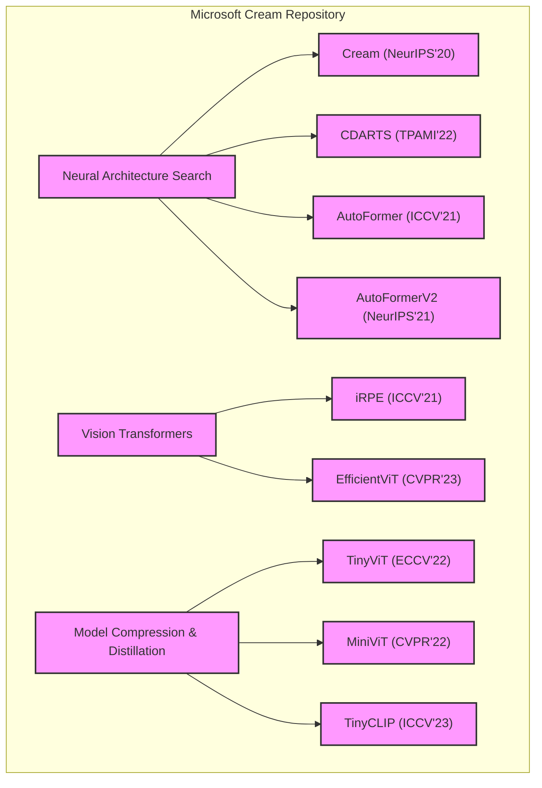

Sources: [README.md:4-26](). [README.md:51-114]()

### Neural Architecture Search Projects

- **Cream**: Distilling prioritized paths for one-shot neural architecture search
- **CDARTS**: Cyclic differentiable architecture search with feedback mechanisms
- **AutoFormer**: One-shot architecture search for vision transformers
- **AutoFormerV2**: Searching the search space for vision transformers

### Vision Transformer Projects

- **iRPE**: Improved relative position encoding for vision transformers
- **EfficientViT**: Memory-efficient vision transformer with cascaded group attention

### Model Compression & Distillation Projects

- **TinyViT**: Fast pretraining distillation for small vision transformers
- **MiniViT**: Compressing vision transformers with weight multiplexing
- **TinyCLIP**: CLIP distillation via affinity mimicking and weight inheritance

Sources: [README.md:51-114](), [iRPE/README.md:1-9](), [CDARTS/README.md:1-9]()

## Project Evolution and Relationships

The repository shows a clear progression of research focus and knowledge transfer between projects. The following diagram illustrates the key relationships and innovations across projects:

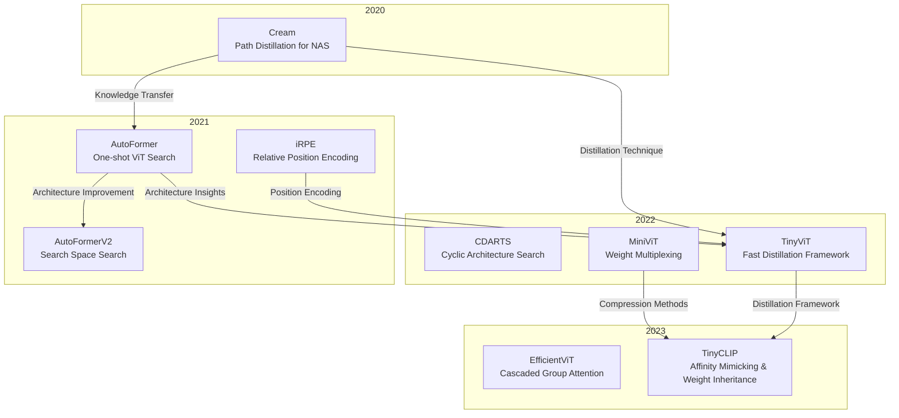

Sources: [README.md:30-49](), [README.md:117-189]()

## Technical Approaches

The repository employs three main technical approaches for creating efficient vision models:

### 1. Knowledge Distillation Methods

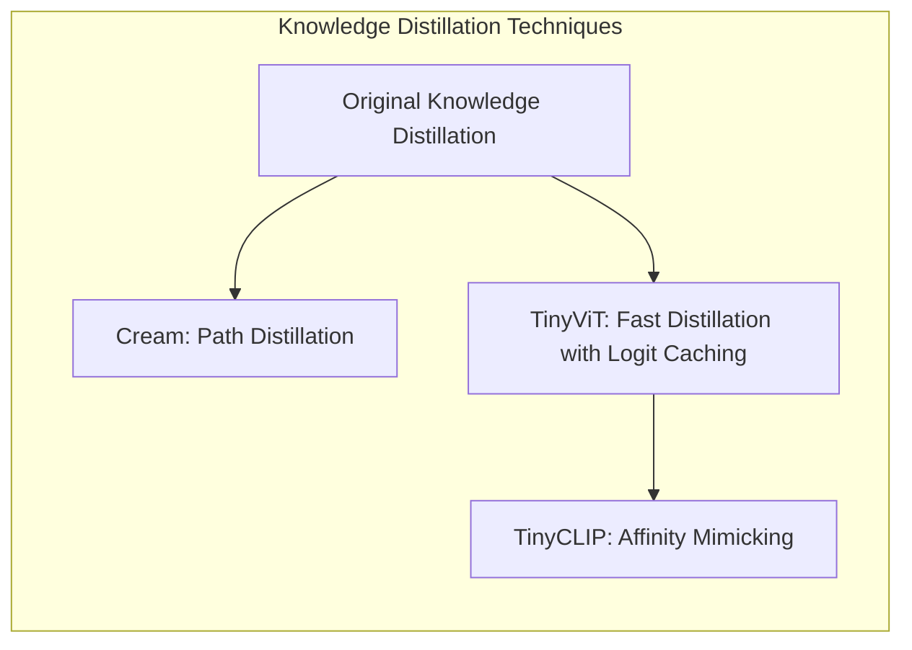

### 2. Architecture Search Strategies

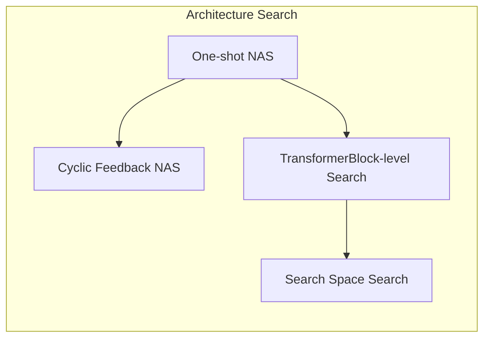

### 3. Model Compression Techniques

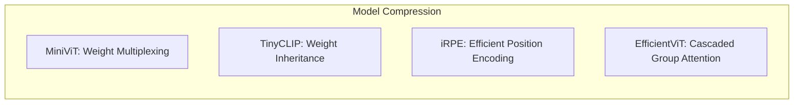

Sources: [README.md:51-114](), [iRPE/README.md:5-9](), [iRPE/DeiT-with-iRPE/README.md:8-22](), [iRPE/DETR-with-iRPE/README.md:9-21]()

## Repository Structure and Implementation

The repository is organized as a collection of independent projects, each with its own directory containing implementations, documentation, and pretrained models:

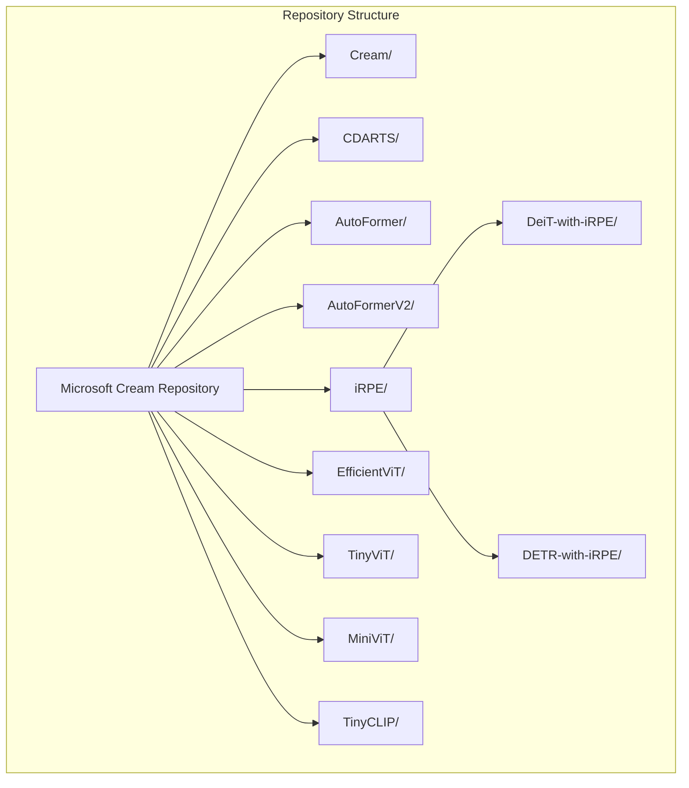

Each project directory typically contains:
- Implementation code
- README with usage instructions
- Pretrained model downloads
- Evaluation scripts
- Documentation of key techniques

Sources: [README.md:1-114](), [iRPE/README.md:11-31](), [iRPE/DeiT-with-iRPE/README.md:23-85](), [iRPE/DETR-with-iRPE/README.md:25-150]()

## License and Contributions

The Microsoft Cream repository is released under the MIT License, allowing for both academic and commercial use with proper attribution. The repository welcomes contributions and provides guidelines for security and code of conduct.

Sources: [LICENSE:1-24](), [CODE_OF_CONDUCT.md:1-9](), [SECURITY.md:1-41]()

## Project Status and Development

The repository is actively maintained, with regular updates adding new projects. The most recent addition was TinyCLIP in September 2023. The repository also indicates they are hiring research interns for next-generation model design and efficient large model inference.

Sources: [README.md:30-49]()

---

# Page: Project Collection

# Project Collection

<details>
<summary>Relevant source files</summary>

The following files were used as context for generating this wiki page:

- [AutoFormer/.figure/ofa.png](AutoFormer/.figure/ofa.png)
- [AutoFormer/.figure/performance.png](AutoFormer/.figure/performance.png)
- [CDARTS/README.md](CDARTS/README.md)
- [Cream/README.md](Cream/README.md)
- [Cream/data/subclass_list.txt](Cream/data/subclass_list.txt)
- [Cream/data/subimages_list.txt](Cream/data/subimages_list.txt)
- [Cream/demo/intro.jpg](Cream/demo/intro.jpg)
- [Cream/demo/results_100.jpg](Cream/demo/results_100.jpg)
- [Cream/demo/results_600.jpg](Cream/demo/results_600.jpg)
- [Cream/experiments/configs/retrain/114.yaml](Cream/experiments/configs/retrain/114.yaml)
- [README.md](README.md)
- [iRPE/DETR-with-iRPE/README.md](iRPE/DETR-with-iRPE/README.md)
- [iRPE/DeiT-with-iRPE/README.md](iRPE/DeiT-with-iRPE/README.md)
- [iRPE/README.md](iRPE/README.md)

</details>


This page provides a comprehensive overview of all projects within the Microsoft Cream repository, which focuses on Neural Architecture Search (NAS), Vision Transformers, and Model Compression techniques. Each project represents a significant contribution to making vision models more efficient and effective through various innovative approaches.

## Repository Overview

The Microsoft Cream repository contains a collection of research projects primarily focused on three areas:

1. **Neural Architecture Search (NAS)**: Automated methods to discover optimal neural network architectures
2. **Vision Transformer Improvements**: Techniques to enhance the efficiency and performance of vision transformers
3. **Model Compression & Distillation**: Methods to reduce model size while maintaining performance

The following diagram illustrates the project organization within the repository:

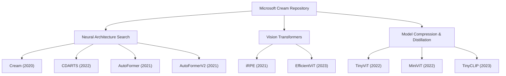

Sources: [README.md:4-26]()

## Project Descriptions

### Neural Architecture Search Projects

#### Cream (NeurIPS 2020)

**Cream** (Cream of the Crop: Distilling Prioritized Paths For One-Shot Neural Architecture Search) introduces an architecture distillation method where subnetworks learn collaboratively. The central idea is that subnetworks can teach each other throughout the training process to boost individual model convergence. It introduces the concept of prioritized paths, which refers to architecture candidates with superior performance during training. These paths change dynamically based on performance and complexity metrics.

Key features:
- Collaborative learning between subnetworks
- Path prioritization based on performance
- Dynamic selection of the best performing architectures ("cream of the crop")
- Achieves competitive performance compared to MobileNetV3 and EfficientNet

Sources: [README.md:107-113](), [Cream/README.md:3-11]()

#### CDARTS (TPAMI 2022)

**CDARTS** (Cyclic Differentiable Architecture Search) proposes new joint optimization objectives and a novel cyclic feedback mechanism between search and evaluation networks with introspective distillation. The architecture builds a cycle where:
1. The search network generates an initial architecture for evaluation
2. The weights of the evaluation network are optimized
3. The architecture weights in the search network are optimized using both label supervision and regularization from the evaluation network
4. Repeat the cycle for joint optimization

Sources: [README.md:77-81](), [CDARTS/README.md:1-11]()

#### AutoFormer (ICCV 2021)

**AutoFormer** (Searching Transformers for Visual Recognition) is a one-shot architecture search framework dedicated to vision transformer search. It entangles the weights of different vision transformer blocks in the same layers during supernet training, allowing thousands of subnets to be well-trained. The performance of these subnets with weights inherited from the supernet is comparable to those retrained from scratch.

Sources: [README.md:92-98]()

#### AutoFormerV2 (NeurIPS 2021)

**AutoFormerV2** (Searching the Search Space of Vision Transformer) extends AutoFormer by searching for the optimal search space itself instead of searching architectures within a predefined space. The approach first uses AutoFormer to find a great search space automatically, then searches for architectures within this discovered space. The work also provides insights and guidelines for general vision transformer design.

Sources: [README.md:84-89]()

### Vision Transformer Improvements

#### iRPE (ICCV 2021)

**iRPE** (Rethinking and Improving Relative Position Encoding for Vision Transformer) introduces new relative position encoding methods dedicated to 2D images. The method considers directional relative distance modeling and the interactions between queries and relative position embeddings in the self-attention mechanism. 

Key features:
- Simple and lightweight methods easily plugged into transformer blocks
- Improves DeiT and DETR by up to 1.5% (top-1 Accuracy) and 1.3% (mAP)
- Various encoding methods: Euclidean, Quantization, Cross, and Product methods
- Available with CUDA-optimized operations for efficient training

Sources: [README.md:100-104](), [iRPE/README.md:1-9](), [iRPE/DETR-with-iRPE/README.md:1-22](), [iRPE/DeiT-with-iRPE/README.md:1-22]()

#### EfficientViT (CVPR 2023)

**EfficientViT** (Memory Efficient Vision Transformer with Cascaded Group Attention) presents a family of high-speed vision transformers. It's built with:
1. A new memory-efficient building block with a sandwich layout
2. An efficient cascaded group attention operation that mitigates attention computation redundancy

Sources: [README.md:59-63]()

### Model Compression & Distillation

#### TinyViT (ECCV 2022)

**TinyViT** (Fast Pretraining Distillation for Small Vision Transformers) is a family of tiny and efficient vision transformers pretrained on large-scale datasets using a fast distillation framework. The central idea is to transfer knowledge from large pretrained models to small ones. The logits of large teacher models are sparsified and stored in disk in advance to save memory cost and computation overheads.

Sources: [README.md:65-69]()

#### MiniViT (CVPR 2022)

**MiniViT** (Compressing Vision Transformers with Weight Multiplexing) is a compression framework that achieves parameter reduction in vision transformers while retaining performance. The central idea is to multiplex the weights of consecutive transformer blocks. Specifically, weights are shared across layers, while imposing a transformation on the weights to increase diversity. Weight distillation over self-attention is also applied to transfer knowledge from large-scale ViT models to weight-multiplexed compact models.

Sources: [README.md:71-75]()

#### TinyCLIP (ICCV 2023)

**TinyCLIP** (CLIP Distillation via Affinity Mimicking and Weight Inheritance) is a novel cross-modal distillation method for large-scale language-image pre-trained models. The method introduces two core techniques: 
1. **Affinity mimicking** - For preserving cross-modal relationships
2. **Weight inheritance** - For parameter efficiency

This work focuses on making small CLIP models more efficient by leveraging large-scale models and pre-training data to strike the best trade-off between speed and accuracy.

Sources: [README.md:53-57]()

## Project Relationships and Evolution

The projects in the repository show a clear evolution and build upon each other's techniques. The following diagram illustrates these relationships:

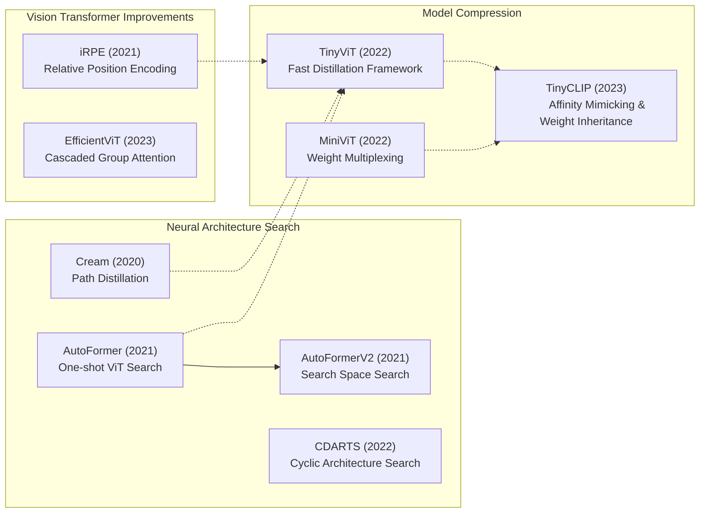

Sources: [README.md:1-113]()

## Compression Approaches

The projects employ various compression and efficiency techniques as illustrated in the following diagram:

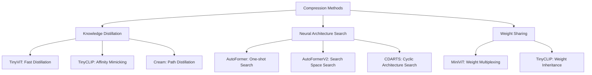

Sources: [README.md:53-113]()

## Performance Comparison

The repository includes models with varying parameter counts and computational requirements, targeting different efficiency points. The Cream project, for example, provides models ranging from very lightweight (14 million FLOPs) to more computationally intensive (604 million FLOPs), with corresponding accuracy improvements.

| Model | FLOPs | Top-1 Accuracy (%) | Top-5 Accuracy (%) |
|-------|-------|-------------------|-------------------|
| Cream_14 | 14M | 53.8 | 77.2 |
| Cream_43 | 43M | 66.3 | 86.7 |
| Cream_114 | 114M | 72.8 | 90.8 |
| Cream_287 | 287M | 77.6 | 93.3 |
| Cream_481 | 481M | 79.2 | 94.2 |
| Cream_604 | 604M | 80.0 | 94.7 |

Sources: [Cream/README.md:46-55]()

## Key Insights

The Microsoft Cream repository demonstrates several important insights in efficient deep learning:

1. **Progressive Research Focus**: The repository shows a clear progression from architecture search (AutoFormer, CDARTS) to specialized transformer architectures (iRPE, EfficientViT) to compression techniques (TinyViT, MiniViT, TinyCLIP).

2. **Knowledge Transfer**: Techniques developed in earlier projects influence later ones, creating a knowledge transfer pipeline that builds toward increasingly efficient models.

3. **Complementary Approaches**: The projects explore complementary approaches to efficiency - architecture optimization, knowledge distillation, and weight sharing - which can be combined for maximum benefit.

4. **Scale Variation**: The repository provides models at multiple efficiency points, from tiny models with a few million parameters to larger models with tens of millions of parameters, allowing deployment across different compute constraints.

Sources: [README.md:1-189]()

---

# Page: Architecture & Design Philosophy

# Architecture & Design Philosophy

<details>
<summary>Relevant source files</summary>

The following files were used as context for generating this wiki page:

- [AutoFormer/README.md](AutoFormer/README.md)
- [CDARTS/README.md](CDARTS/README.md)
- [MiniViT/Mini-DeiT/README.md](MiniViT/Mini-DeiT/README.md)
- [MiniViT/Mini-Swin/README.md](MiniViT/Mini-Swin/README.md)
- [MiniViT/README.md](MiniViT/README.md)
- [README.md](README.md)
- [TinyCLIP/README.md](TinyCLIP/README.md)
- [TinyCLIP/script/auto_weight_inherit_50to25.sh](TinyCLIP/script/auto_weight_inherit_50to25.sh)
- [TinyCLIP/script/auto_weight_inherit_75to50.sh](TinyCLIP/script/auto_weight_inherit_75to50.sh)
- [TinyViT/README.md](TinyViT/README.md)
- [TinyViT/models/tiny_vit.py](TinyViT/models/tiny_vit.py)
- [TinyViT/tests/test_models.py](TinyViT/tests/test_models.py)
- [iRPE/DETR-with-iRPE/README.md](iRPE/DETR-with-iRPE/README.md)
- [iRPE/DeiT-with-iRPE/README.md](iRPE/DeiT-with-iRPE/README.md)
- [iRPE/README.md](iRPE/README.md)

</details>


This document outlines the architectural patterns and design principles common across projects in the Microsoft Cream repository. It provides a foundation for understanding how different components interact and the philosophy guiding their implementation. For specific project implementations, see the respective project pages such as [TinyViT](#2.1), [TinyCLIP](#2.2), and [MiniViT](#2.3).

## Core Architecture Overview

Microsoft Cream consists of several projects pursuing efficient vision models through three complementary approaches:

1. **Neural Architecture Search (NAS)** - Finding optimal architectures automatically
2. **Vision Transformer Improvements** - Enhancing transformer components 
3. **Model Compression & Distillation** - Reducing model size while preserving performance

The repository follows a progressive research trajectory where techniques developed in earlier projects inform later ones, creating a knowledge transfer pipeline that advances the state-of-the-art in efficient vision models.

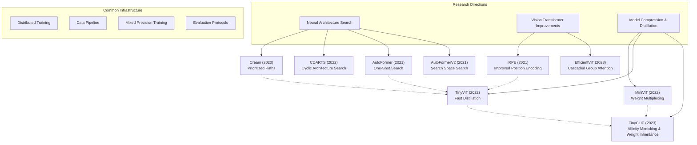

Sources: [README.md:1-189](README.md:1-189)

## Design Philosophy

The projects in Microsoft Cream share several core design principles:

1. **Progressive Efficiency**: Each project builds upon previous work to achieve greater efficiency while maintaining or improving accuracy.

2. **Knowledge Transfer**: Using knowledge distillation to transfer learning from larger models to smaller ones, rather than training from scratch.

3. **Architectural Modularity**: Components are designed to be modular and reusable across different models and tasks.

4. **Parameter Efficiency**: Focus on reducing parameters and computational cost while preserving model capabilities.

5. **Task Adaptability**: Models are designed to be adaptable across different vision tasks beyond classification.

### Modular Component Architecture

The repository employs a modular component architecture where basic building blocks can be combined and modified to create different model variants.

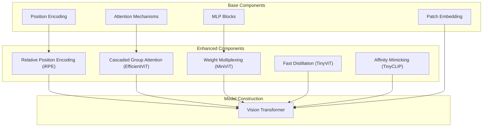

Sources: [TinyViT/models/tiny_vit.py:1-705](TinyViT/models/tiny_vit.py:1-705), [iRPE/README.md:1-64](iRPE/README.md:1-64)

## Architectural Patterns

### Hierarchical Design

Many models in the repository use a hierarchical design with multiple stages of processing, each operating at a different feature resolution.

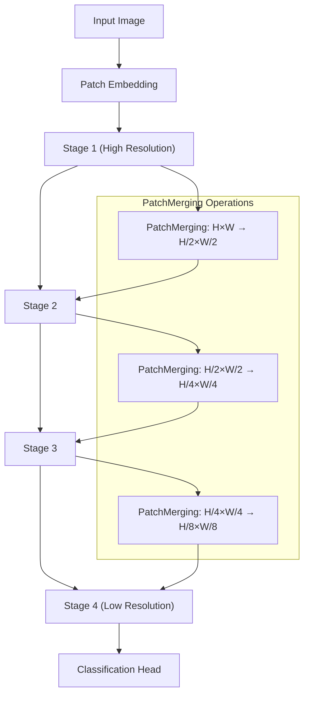

In TinyViT, this is implemented through the `TinyViT` class which consists of multiple layers, each containing blocks operating at different resolutions. The `PatchMerging` class handles downsampling between stages.

Sources: [TinyViT/models/tiny_vit.py:125-151](TinyViT/models/tiny_vit.py:125-151), [TinyViT/models/tiny_vit.py:453-516](TinyViT/models/tiny_vit.py:453-516)

### Transformer Block Design

The transformer blocks in the repository follow a common pattern but with project-specific optimizations:

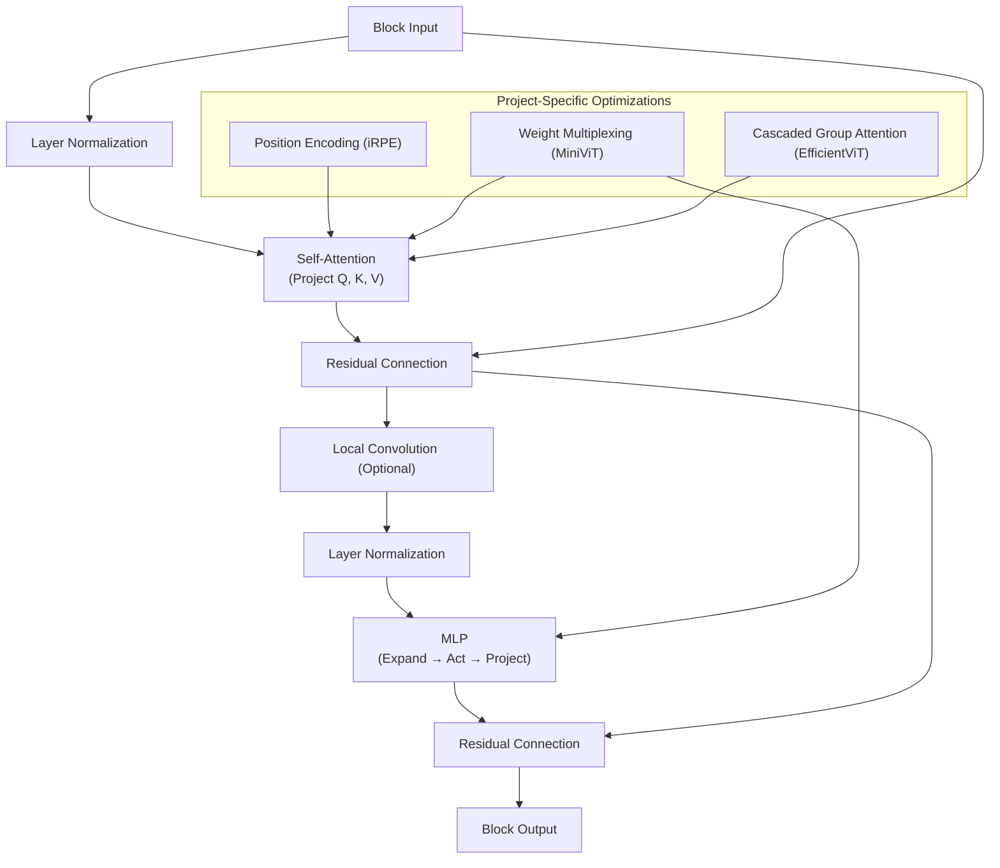

In the codebase, this is implemented through classes like `TinyViTBlock` that incorporate both self-attention and MLP components with residual connections.

Sources: [TinyViT/models/tiny_vit.py:289-384](TinyViT/models/tiny_vit.py:289-384)

## Knowledge Distillation Architecture

A key innovation across projects is the use of knowledge distillation to transfer knowledge from larger models to smaller ones.

### TinyViT Fast Distillation

TinyViT introduces a fast distillation framework where large teacher model logits are cached offline to reduce memory and computation requirements during training.

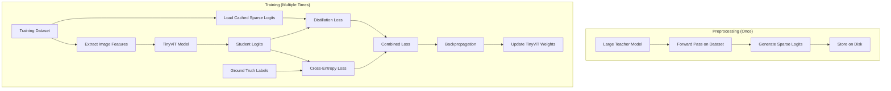

The innovation here is that the teacher model is only used once to generate logits, which are saved and reused for multiple student models, saving computational resources.

Sources: [TinyViT/README.md:1-95](TinyViT/README.md:1-95)

### TinyCLIP Distillation

TinyCLIP extends the knowledge distillation approach with two key techniques:

1. **Affinity Mimicking**: Preserves relationships between images and text by matching affinity matrices
2. **Weight Inheritance**: Allows smaller models to inherit weights from larger ones through structured pruning

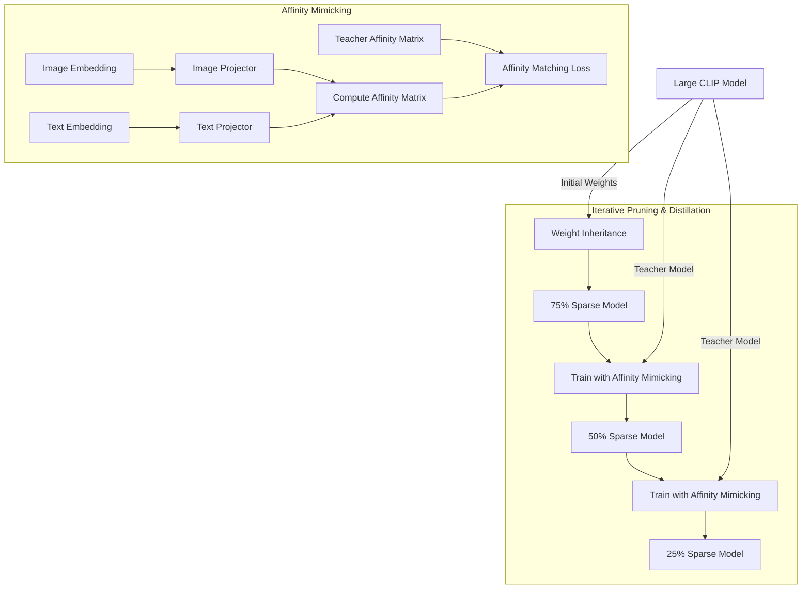

The approach uses scripts like `auto_weight_inherit_75to50.sh` to manage the progressive pruning process.

Sources: [TinyCLIP/README.md:1-78](TinyCLIP/README.md:1-78), [TinyCLIP/script/auto_weight_inherit_75to50.sh:1-38](TinyCLIP/script/auto_weight_inherit_75to50.sh:1-38), [TinyCLIP/script/auto_weight_inherit_50to25.sh:1-38](TinyCLIP/script/auto_weight_inherit_50to25.sh:1-38)

## Neural Architecture Search Approach

The repository includes several approaches to neural architecture search, with progressive improvements:

### One-Shot Architecture Search

Used in AutoFormer, the one-shot approach trains a supernet that contains many sub-architectures, then searches for the optimal architecture without retraining.

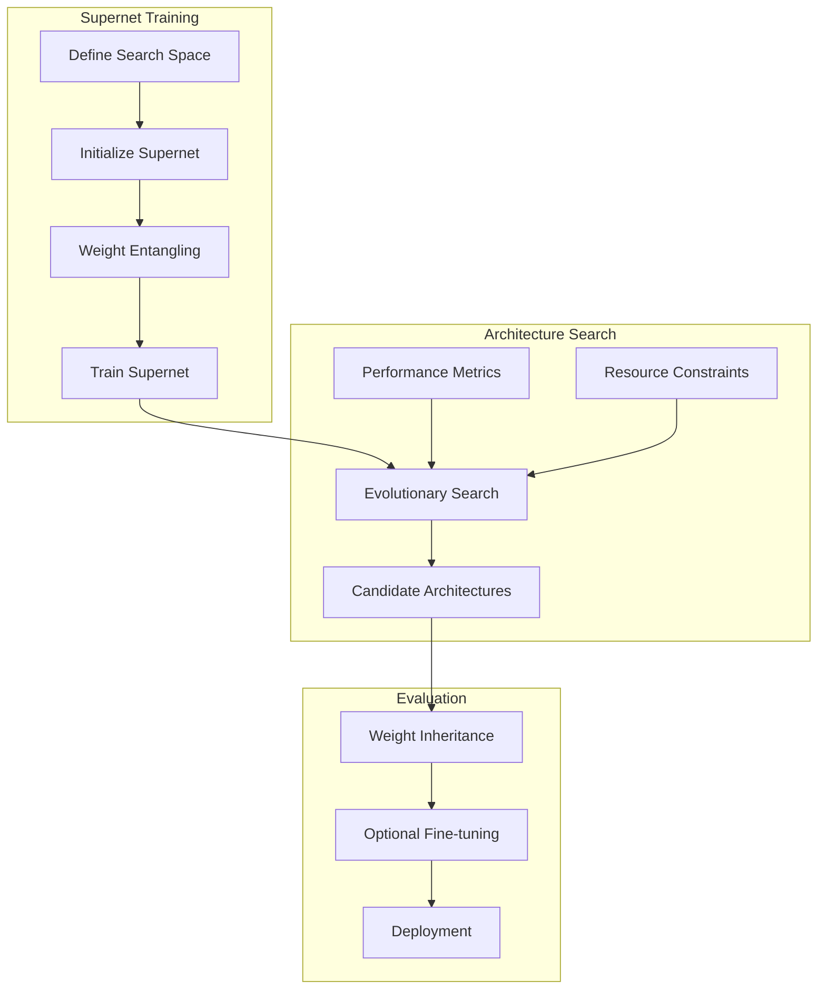

Sources: [AutoFormer/README.md:1-120](AutoFormer/README.md:1-120)

### Cyclic Architecture Search

CDARTS introduces a cyclic feedback mechanism between search and evaluation networks:

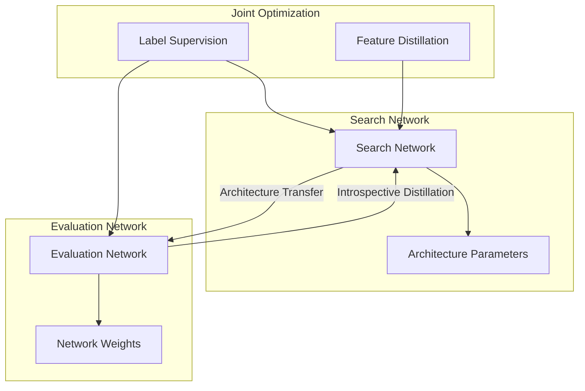

Sources: [CDARTS/README.md:1-67](CDARTS/README.md:1-67)

## Position Encoding Innovations

The iRPE project introduces improved relative position encoding methods for vision transformers.

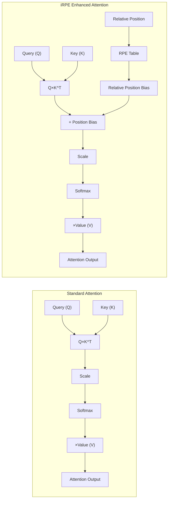

iRPE offers several variants that can be attached to queries, keys, or values with different encoding methods. These innovations improved performance on both classification (DeiT) and detection (DETR) models.

Sources: [iRPE/README.md:1-64](iRPE/README.md:1-64), [iRPE/DETR-with-iRPE/README.md:1-178](iRPE/DETR-with-iRPE/README.md:1-178), [iRPE/DeiT-with-iRPE/README.md:1-115](iRPE/DeiT-with-iRPE/README.md:1-115)

## Shared Training Infrastructure

Projects in the repository share common training infrastructure components:

### Distributed Training Architecture

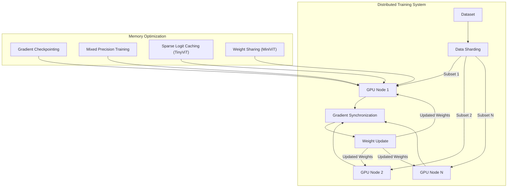

This infrastructure enables efficient training of models on large datasets while managing memory constraints through techniques like gradient checkpointing and mixed precision training.

Sources: [TinyViT/README.md:1-95](TinyViT/README.md:1-95), [TinyCLIP/README.md:1-78](TinyCLIP/README.md:1-78)

## Model Family Comparison

The following table compares the key architectures in the repository:

| Model Family | Design Approach | Key Innovation | Parameter Reduction | Data Efficiency |
|--------------|-----------------|----------------|---------------------|-----------------|
| TinyViT      | Hierarchical ViT with distillation | Fast Pretraining Distillation | 5M-21M (vs 86M DeiT-B) | Teacher logits cached once |
| TinyCLIP     | Compressed CLIP | Affinity Mimicking & Weight Inheritance | 50% reduction from base CLIP | Reuses LAION/YFCC datasets |
| MiniViT      | Weight-multiplexed transformer | Weight sharing with transformations | Up to 10x reduction | Uses weight distillation |
| AutoFormer   | Searched transformer | One-shot search with weight entanglement | Varies by search constraint | Efficient search without retraining |
| iRPE         | Enhanced position encoding | Directional relative distance modeling | Minimal overhead | Compatible with existing models |

Sources: [README.md:1-189](README.md:1-189), [TinyViT/README.md:1-95](TinyViT/README.md:1-95), [TinyCLIP/README.md:1-78](TinyCLIP/README.md:1-78)

## TinyViT Architecture Deep Dive

TinyViT, one of the key projects in the repository, features a hierarchical architecture:

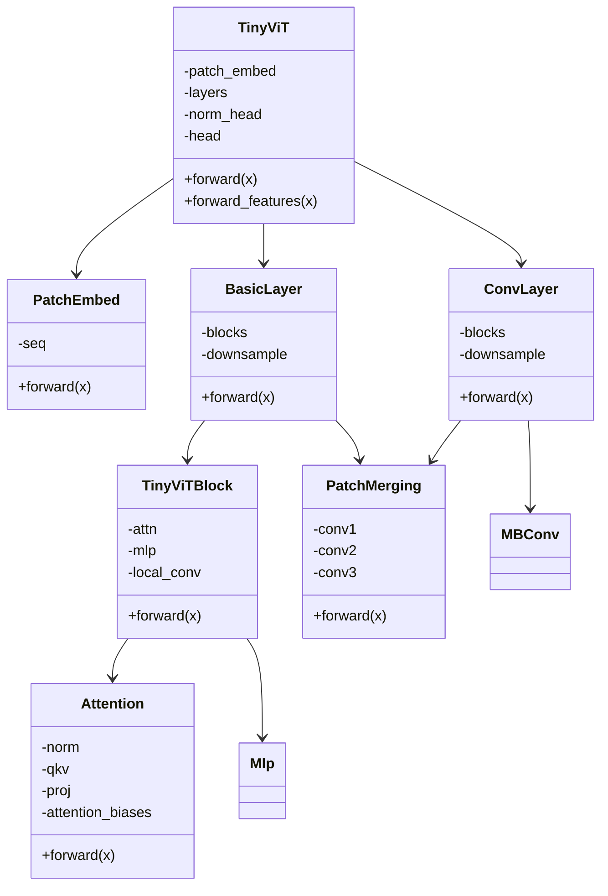

The architecture consists of:
1. Patch embedding that tokenizes the image into patches
2. Multiple transformer layers with varying depths and dimensions
3. Window-based attention to improve efficiency
4. Local convolutions between attention and MLP blocks
5. A hierarchical structure that reduces resolution through patch merging

Sources: [TinyViT/models/tiny_vit.py:453-516](TinyViT/models/tiny_vit.py:453-516), [TinyViT/models/tiny_vit.py:289-384](TinyViT/models/tiny_vit.py:289-384), [TinyViT/models/tiny_vit.py:216-286](TinyViT/models/tiny_vit.py:216-286)

## Integration of Components

The repository demonstrates how different architectural innovations can be integrated:

```mermaid
flowchart TD
    subgraph "Base Model"
        BaseVIT["Vision Transformer"]
    end
    
    subgraph "Architectural Improvements"
        IRPE_Comp["iRPE Component"] --> BaseVIT
        EFFICIENT["EfficientViT Attention"] --> BaseVIT
    end
    
    subgraph "Compression Techniques"
        DISTILL["Knowledge Distillation"] --> BaseVIT
        MULTIPLEX["Weight Multiplexing"] --> BaseVIT
    end
    
    subgraph "Architecture Search"
        SEARCH["Neural Architecture Search"] --> OptArch["Optimal Architecture"]
        OptArch --> BaseVIT
    end
    
    BaseVIT --> |"Enhanced Model"| Final["Efficient Vision Transformer"]
```

Combining these techniques produces models that are both efficient and effective, demonstrating the complementary nature of the different research directions.

Sources: [README.md:1-189](README.md:1-189)

## Summary of Design Principles

The Microsoft Cream repository demonstrates several key design principles:

1. **Hierarchical architectures** that process information at multiple scales
2. **Knowledge transfer** through various distillation techniques
3. **Parameter efficiency** through weight sharing and multiplexing
4. **Architecture optimization** through automated search procedures
5. **Component enhancement** through improved position encoding and attention mechanisms

These principles enable the creation of efficient vision models that maintain high accuracy while reducing computational requirements, advancing the state-of-the-art in efficient deep learning for computer vision.

Sources: [README.md:1-189](README.md:1-189), [TinyViT/README.md:1-95](TinyViT/README.md:1-95), [TinyCLIP/README.md:1-78](TinyCLIP/README.md:1-78), [MiniViT/README.md:1-59](MiniViT/README.md:1-59)

---

# Page: Getting Started

# Getting Started

<details>
<summary>Relevant source files</summary>

The following files were used as context for generating this wiki page:

- [CDARTS/README.md](CDARTS/README.md)
- [README.md](README.md)
- [TinyCLIP/README.md](TinyCLIP/README.md)
- [TinyCLIP/script/auto_weight_inherit_50to25.sh](TinyCLIP/script/auto_weight_inherit_50to25.sh)
- [TinyCLIP/script/auto_weight_inherit_75to50.sh](TinyCLIP/script/auto_weight_inherit_75to50.sh)
- [TinyViT/README.md](TinyViT/README.md)
- [TinyViT/models/tiny_vit.py](TinyViT/models/tiny_vit.py)
- [TinyViT/tests/test_models.py](TinyViT/tests/test_models.py)
- [iRPE/DETR-with-iRPE/README.md](iRPE/DETR-with-iRPE/README.md)
- [iRPE/DeiT-with-iRPE/README.md](iRPE/DeiT-with-iRPE/README.md)
- [iRPE/README.md](iRPE/README.md)

</details>


This guide provides instructions for setting up and getting started with the Microsoft Cream repository. It covers the essential steps for installation, dependencies, and basic usage of the various neural architecture search and vision transformer projects contained within this repository.

For detailed information about the architecture and design principles of the projects, see [Architecture & Design Philosophy](#1.2). For an overview of all projects in the repository, see [Project Collection](#1.1).

## Repository Overview

```mermaid
flowchart TB
    subgraph "Microsoft Cream Repository"
        A["Repository Root"]
        A --> B["TinyViT"]
        A --> C["TinyCLIP"]
        A --> D["iRPE"]
        A --> E["MiniViT"]
        A --> F["CDARTS"]
        A --> G["AutoFormerV2"]
        A --> H["AutoFormer"]
        A --> I["Cream"]
        A --> J["EfficientViT"]
    end
    
    B --> B1["Fast Pretraining Distillation for Small Vision Transformers"]
    C --> C1["CLIP Distillation via Affinity Mimicking and Weight Inheritance"]
    D --> D1["Improved Relative Position Encoding for Vision Transformers"]
    E --> E1["Compressing Vision Transformers with Weight Multiplexing"]
    F --> F1["Cyclic Differentiable Architecture Search"]
    G --> G1["Searching the Search Space of Vision Transformer"]
    H --> H1["Searching Transformers for Visual Recognition"]
    I --> I1["Distilling Prioritized Paths For One-Shot NAS"]
    J --> J1["Memory Efficient Vision Transformer with Cascaded Group Attention"]
```

Sources: [README.md:4-26]()

## Prerequisites

Before you begin, ensure your system meets the following requirements:

| Requirement | Specification |
|-------------|---------------|
| Python | >= 3.7 |
| PyTorch | >= 1.7.0 |
| CUDA | Compatible with your PyTorch version |
| GPU | Recommended for training and inference |
| Storage | At least 10GB for the repository and pretrained models |

Sources: [iRPE/DeiT-with-iRPE/README.md:29-31]()

## Installation Steps

```mermaid
flowchart TD
    A["1. Clone Repository"] --> B["2. Setup Environment"]
    B --> C["3. Install Dependencies"]
    C --> D["4. Install CUDA Extensions (Optional)"]
    D --> E["5. Prepare Datasets"]
    E --> F["6. Download Pretrained Models"]
    
    subgraph "Project-Specific Setup"
        G["TinyViT Setup"]
        H["TinyCLIP Setup"]
        I["iRPE Setup"]
        J["Other Projects"]
    end
    
    F --> G
    F --> H
    F --> I
    F --> J
```

Sources: [TinyViT/README.md:71-72](), [iRPE/DETR-with-iRPE/README.md:28-42]()

### 1. Clone the Repository

```bash
git clone https://github.com/microsoft/Cream.git
cd Cream
```

### 2. Setting Up Your Python Environment

It's recommended to create a new virtual environment:

```bash
# Using conda
conda create -n cream python=3.8
conda activate cream

# Or using venv
python -m venv cream-env
source cream-env/bin/activate  # On Windows, use: cream-env\Scripts\activate
```

### 3. Installing Dependencies

Each project in the Cream repository has its own set of dependencies. You can install the basic requirements for working with most projects:

```bash
# For TinyViT
cd TinyViT
pip install -r requirements.txt

# For TinyCLIP
cd ../TinyCLIP
pip install -r requirements.txt

# For iRPE
cd ../iRPE
pip install -r requirements.txt
```

Sources: [TinyViT/README.md:72](), [iRPE/DeiT-with-iRPE/README.md:27-32]()

### 4. Installing CUDA Extensions (Optional but Recommended)

Some projects like iRPE provide CUDA extensions for improved performance:

```bash
# For iRPE
cd iRPE/rpe_ops/
python setup.py install --user
```

Sources: [iRPE/DETR-with-iRPE/README.md:35-41](), [iRPE/DeiT-with-iRPE/README.md:34-41]()

### 5. Preparing Datasets

Depending on which projects you plan to use, you'll need to prepare different datasets:

| Project | Datasets | Download Location |
|---------|----------|-------------------|
| TinyViT | ImageNet-1K, ImageNet-22K | [ImageNet Website](http://www.image-net.org) |
| TinyCLIP | ImageNet-1K, LAION-400M, YFCC-15M | See TinyCLIP docs |
| iRPE | ImageNet-1K, COCO | [ImageNet](http://www.image-net.org), [COCO](https://cocodataset.org/#download) |

For most vision transformer models, ImageNet-1K is the primary evaluation dataset. Follow each project's instructions for specific dataset preparation.

Sources: [iRPE/DeiT-with-iRPE/README.md:43-66](), [iRPE/DETR-with-iRPE/README.md:44-84]()

### 6. Downloading Pretrained Models

Most projects provide pretrained models that you can download:

```bash
# Example for TinyViT
# Download models from the GitHub release page
# https://github.com/wkcn/TinyViT-model-zoo/releases/download/checkpoints/
```

## Using Pretrained Models

### TinyViT Models

Using TinyViT models is straightforward:

```python
# Import the TinyViT model
from models.tiny_vit import tiny_vit_21m_224

# Create a TinyViT model with pretrained weights
model = tiny_vit_21m_224(pretrained=True)

# Use the model for inference
output = model(image)
```

Sources: [TinyViT/README.md:32-37](), [TinyViT/models/tiny_vit.py:638-640]()

Here is a diagram of how the TinyViT model is structured:

```mermaid
flowchart TB
    subgraph "TinyViT Model Architecture"
        Input["Input Image"] --> PatchEmbed["PatchEmbed"]
        PatchEmbed --> ConvLayer["ConvLayer (Stage 1)"]
        ConvLayer --> BasicLayer1["BasicLayer (Stage 2)"]
        BasicLayer1 --> BasicLayer2["BasicLayer (Stage 3)"]
        BasicLayer2 --> BasicLayer3["BasicLayer (Stage 4)"]
        BasicLayer3 --> Head["Classifier Head"]
        Head --> Output["Output Predictions"]
    end
    
    subgraph "API Flow"
        ModelCreate["tiny_vit_21m_224(pretrained=True)"] --> Forward["model(image)"]
        Forward --> Predict["Output Classification"]
    end
```

Sources: [TinyViT/models/tiny_vit.py:453-591]()

### iRPE Models

For iRPE, you can use the pretrained models for image classification:

```python
# Import the model with iRPE
from timm.models import create_model

# Create a DeiT model with iRPE
model = create_model('deit_small_patch16_224_ctx_product_50_shared_k', pretrained=True)
```

Sources: [iRPE/DeiT-with-iRPE/README.md:86-87]()

### TinyCLIP Models

TinyCLIP provides various pretrained models:

```python
# Using TinyCLIP models
import torch
from open_clip import create_model_and_transforms

# Load the model and transforms
model, _, preprocess = create_model_and_transforms('TinyCLIP-ViT-39M-16-Text-19M', pretrained='YFCC15M')
```

Sources: [TinyCLIP/README.md:52]()

## Running Evaluation

Most projects provide evaluation scripts to assess model performance:

### TinyViT Evaluation

```bash
# Evaluate TinyViT on ImageNet
cd TinyViT
python -m torch.distributed.launch --nproc_per_node=8 main.py \
    --eval \
    --model tiny_vit_21m_224 \
    --resume /path/to/checkpoint.pth \
    --data-path /path/to/imagenet
```

Sources: [TinyViT/README.md:74-75]()

### iRPE Evaluation

```bash
# Evaluate iRPE-enhanced DeiT on ImageNet
cd iRPE/DeiT-with-iRPE
python -m torch.distributed.launch --nproc_per_node=8 --use_env main.py \
    --model deit_small_patch16_224_ctx_product_50_shared_k \
    --batch-size 128 \
    --data-path ./ImageNet/ \
    --output_dir ./outputs/ \
    --eval \
    --resume deit_small_patch16_224_ctx_product_50_shared_k.pth
```

Sources: [iRPE/DeiT-with-iRPE/README.md:80-84]()

### TinyCLIP Evaluation

```bash
# Evaluate TinyCLIP on zero-shot classification
cd TinyCLIP
python -m src.eval.eval_zeroshot \
    --model-config src/open_clip/model_configs/TinyCLIP-ViT-39M-16-Text-19M.json \
    --checkpoint /path/to/checkpoint.pt
```

Sources: [TinyCLIP/README.md:48-50]()

## Data Flow in Evaluation Process

```mermaid
flowchart LR
    A["Dataset Loading"] --> B["Model Initialization"]
    B --> C["Load Pretrained Weights"]
    C --> D["Model Evaluation"]
    D --> E["Results"]
    
    subgraph "Dataset Handling"
        A1["DatasetWrapper"] 
        A2["DataLoader"]
    end
    
    subgraph "Model Setup"
        B1["Create Model Architecture"]
        B2["Initialize Parameters"]
    end
    
    subgraph "Weights Loading"
        C1["Load State Dict"]
        C2["Map Parameters"]
    end
    
    subgraph "Evaluation Process"
        D1["Forward Pass"]
        D2["Calculate Metrics"]
    end
    
    A --> A1 --> A2
    B --> B1 --> B2
    C --> C1 --> C2
    D --> D1 --> D2
```

Sources: [TinyViT/README.md:42-45]()

## Training Your Own Models

If you want to train or fine-tune models, each project provides specific training instructions:

### TinyViT Training

TinyViT uses a fast distillation framework that requires saving teacher logits first:

1. Save teacher sparse logits:
```bash
cd TinyViT
python -m torch.distributed.launch --nproc_per_node=8 \
    main.py --sparse-eval \
    --teacher-model-path path/to/teacher_model.pth \
    --data-path path/to/imagenet
```

2. Train with distillation:
```bash
python -m torch.distributed.launch --nproc_per_node=8 \
    main.py --config configs/22k_distill/tiny_vit_21m_22k_distill.yaml
```

Sources: [TinyViT/README.md:78-81]()

### iRPE Training

```bash
cd iRPE/DeiT-with-iRPE
python -m torch.distributed.launch --nproc_per_node=8 --use_env main.py \
    --model deit_small_patch16_224_ctx_product_50_shared_k \
    --batch-size 128 \
    --data-path ./ImageNet/ \
    --output_dir ./outputs/
```

Sources: [iRPE/DeiT-with-iRPE/README.md:73-76]()

### TinyCLIP Training

TinyCLIP offers automated weight inheritance for efficient training:

```bash
cd TinyCLIP
# Example script for automatic weight inheritance
./script/auto_weight_inherit_75to50.sh
```

Sources: [TinyCLIP/script/auto_weight_inherit_75to50.sh:1-37]()

## Troubleshooting

Common issues and their solutions:

| Issue | Solution |
|-------|----------|
| CUDA out of memory | Decrease batch size or use gradient checkpointing |
| ImportError | Check if all dependencies are installed correctly |
| Model loading error | Ensure the model checkpoint path is correct and the model definition matches |
| Dataset loading error | Verify dataset path and format |

## Next Steps

Once you have successfully set up and run basic operations with the models in the Cream repository, you can:

1. Explore model architectures in detail - See [Architecture & Design Philosophy](#1.2)
2. Learn about specific model compression frameworks - See [Model Compression Frameworks](#2)
3. Understand neural architecture search approaches - See [Neural Architecture Search](#3)
4. Try out vision transformer improvements - See [Vision Transformer Improvements](#4)
5. Review advanced topics and features - See [Advanced Topics](#5)

The Cream repository provides a rich collection of models and techniques for efficient and effective vision transformers that can be used for various computer vision tasks.

---

# Page: Model Compression Frameworks

# Model Compression Frameworks

<details>
<summary>Relevant source files</summary>

The following files were used as context for generating this wiki page:

- [AutoFormer/README.md](AutoFormer/README.md)
- [MiniViT/Mini-DeiT/README.md](MiniViT/Mini-DeiT/README.md)
- [MiniViT/Mini-Swin/README.md](MiniViT/Mini-Swin/README.md)
- [MiniViT/README.md](MiniViT/README.md)
- [TinyCLIP/README.md](TinyCLIP/README.md)
- [TinyCLIP/script/auto_weight_inherit_50to25.sh](TinyCLIP/script/auto_weight_inherit_50to25.sh)
- [TinyCLIP/script/auto_weight_inherit_75to50.sh](TinyCLIP/script/auto_weight_inherit_75to50.sh)
- [TinyViT/README.md](TinyViT/README.md)
- [TinyViT/models/tiny_vit.py](TinyViT/models/tiny_vit.py)
- [TinyViT/tests/test_models.py](TinyViT/tests/test_models.py)

</details>


This document provides an overview of the model compression frameworks used across projects in the Microsoft Cream repository. The frameworks presented here focus on reducing the size and computational requirements of vision transformers while maintaining competitive performance. For specific details on individual compression frameworks, see the respective subpages:

- For TinyViT's architecture and training details, see [TinyViT Framework](#2.1)
- For TinyCLIP's cross-modal compression approach, see [TinyCLIP Framework](#2.2)
- For MiniViT's weight multiplexing technique, see [MiniViT Framework](#2.3)

## Compression Techniques Overview

The repository implements several complementary approaches to model compression, with each project focusing on different techniques. These compression techniques aim to reduce model size, improve inference speed, and maintain competitive accuracy.

```mermaid
flowchart TD
    subgraph "Model Compression Techniques"
        direction TB
        KD["Knowledge Distillation"]
        WS["Weight Sharing/Inheritance"]
        
        KD --> FD["Fast Distillation<br>(TinyViT)"]
        KD --> AM["Affinity Mimicking<br>(TinyCLIP)"]
        
        WS --> WM["Weight Multiplexing<br>(MiniViT)"]
        WS --> WI["Weight Inheritance<br>(TinyCLIP)"]
    end

    subgraph "Target Benefits"
        RS["Reduced Size"]
        FS["Faster Speed"]
        MA["Maintained Accuracy"]
    end

    FD --> RS & FS
    AM --> RS & MA
    WM --> RS
    WI --> RS & FS
```

**Diagram: Model Compression Techniques Overview**

Sources: [TinyViT/README.md:5-6](), [TinyCLIP/README.md:3-5](), [MiniViT/README.md:8-9]()

### Knowledge Distillation Methods

Knowledge distillation transfers knowledge from a large, high-performance teacher model to a smaller, more efficient student model. The two primary distillation approaches in the repository are:

1. **Fast Distillation (TinyViT)** - Pre-computes and caches teacher logits to avoid repeated teacher inference during training, making the distillation process much more efficient.

2. **Affinity Mimicking (TinyCLIP)** - Focuses on transferring the relationship patterns between samples in a batch rather than just the direct outputs, preserving the structural knowledge the teacher model has learned.

### Weight Sharing Methods

Weight sharing methods reduce model size by reusing weights across different parts of the model:

1. **Weight Multiplexing (MiniViT)** - Shares weights across transformer blocks while applying transformations to maintain expressivity.

2. **Weight Inheritance (TinyCLIP)** - Strategically transfers weights from a larger model to initialize a smaller model, which can be done manually or automatically.

## TinyViT: Fast Distillation Framework

TinyViT introduces a distillation framework that efficiently transfers knowledge from large teacher models to compact student models. The key innovation is the pre-computation and caching of sparse teacher logits to avoid the computational overhead of repeatedly forwarding data through the large teacher model.

```mermaid
flowchart LR
    subgraph "Traditional Distillation"
        TD_I["Input Data"] --> TD_T["Teacher Model<br>(Expensive Inference)"]
        TD_I --> TD_S["Student Model"]
        TD_T --> TD_L["Loss Calculation"]
        TD_S --> TD_L
    end

    subgraph "TinyViT Fast Distillation"
        FD_I["Input Data"] --> FD_CL["Cached Logits<br>(Pre-computed)"]
        FD_I --> FD_S["Student Model"]
        FD_CL --> FD_L["Loss Calculation"]
        FD_S --> FD_L
    end
```

**Diagram: TinyViT Fast Distillation vs Traditional Distillation**

Sources: [TinyViT/README.md:6](), [TinyViT/README.md:25]()

TinyViT models come in various sizes (5M, 11M, 21M parameters) and achieve impressive accuracy. For example, TinyViT-21M reaches 84.8% top-1 accuracy on ImageNet-1k with only 21M parameters, and 86.5% accuracy at higher resolutions.

### Implementation Details

TinyViT's distillation process involves:

1. **Saving Teacher Logits**: Teacher logits are computed once and saved in a sparse format to minimize storage requirements
2. **Dataset Wrapper**: A custom dataset wrapper enables transparent loading of pre-computed logits during training
3. **Reusable Framework**: Saved logits can be reused for training different student architectures without recomputing them

The implementation uses a hierarchical architecture with mobile block convolutions (MBConv) in early stages and efficient transformer blocks in later stages.

Sources: [TinyViT/README.md:27-42](), [TinyViT/models/tiny_vit.py:453-591]()

## TinyCLIP: Cross-Modal Distillation

TinyCLIP focuses on compressing CLIP (Contrastive Language-Image Pre-training) models, which involve both image and text encoders. It introduces two complementary techniques: affinity mimicking for effective knowledge transfer and weight inheritance for parameter reduction.

```mermaid
flowchart TD
    subgraph "TinyCLIP Compression"
        direction TB
        I["Input Images/Text"] --> BS["Batch Samples"]
        
        subgraph "Teacher CLIP Model"
            T_IE["Teacher<br>Image Encoder"]
            T_TE["Teacher<br>Text Encoder"]
        end
        
        subgraph "Student CLIP Model"
            S_IE["Student<br>Image Encoder"]
            S_TE["Student<br>Text Encoder"]
        end
        
        BS --> T_IE & T_TE
        BS --> S_IE & S_TE
        
        T_IE --> T_F["Teacher Features"]
        T_TE --> T_F
        
        S_IE --> S_F["Student Features"]
        S_TE --> S_F
        
        T_F --> AM["Affinity Matrices"]
        S_F --> AM
        
        AM --> AL["Affinity Loss"]
        
        subgraph "Weight Inheritance"
            WI_M["Manual Inheritance"]
            WI_A["Automatic Inheritance"]
        end
        
        WI_M & WI_A --> S_IE & S_TE
    end
```

**Diagram: TinyCLIP Compression Framework**

Sources: [TinyCLIP/README.md:3-9](), [TinyCLIP/README.md:27-38]()

### Affinity Mimicking

Instead of directly matching the output logits, affinity mimicking focuses on preserving the relationships between samples that the teacher model has learned:

1. Features from both teacher and student models are extracted
2. Affinity matrices are calculated to represent sample relationships
3. The student is trained to match the teacher's affinity patterns

This approach helps maintain structural knowledge even when the student has much lower capacity.

### Weight Inheritance

TinyCLIP uses two approaches to weight inheritance:

1. **Manual Inheritance**: Carefully designed architectures with pre-determined inheritance patterns
2. **Automatic Inheritance**: Progressive pruning approach that automatically determines which weights to keep

The automatic inheritance process is implemented through a pruning-based approach, as seen in the training scripts:

```
--prune-image
--prune-text
--target-sparsity 0.75
--start-sparsity 0.5
--sparsity-warmup 1000
```

Sources: [TinyCLIP/script/auto_weight_inherit_50to25.sh:30-35](), [TinyCLIP/script/auto_weight_inherit_75to50.sh:30-35]()

## MiniViT: Weight Multiplexing

MiniViT focuses on parameter reduction by multiplexing the weights of consecutive transformer blocks. Unlike other approaches that focus on distillation alone, MiniViT's primary innovation is in the model architecture itself.

```mermaid
flowchart LR
    subgraph "Standard Vision Transformer"
        S_B1["Block 1<br>Parameters P"] --> S_B2["Block 2<br>Parameters P"]
        S_B2 --> S_B3["Block 3<br>Parameters P"]
        S_B3 --> S_B4["Block 4<br>Parameters P"]
        
        S_T["Total:<br>4P Parameters"]
    end
    
    subgraph "MiniViT (Weight Multiplexing)"
        M_BW["Shared Block<br>Parameters P"] --> M_T1["Transform 1"]
        M_BW --> M_T2["Transform 2"]
        M_BW --> M_T3["Transform 3"]
        
        M_T1 --> M_B1["Effective Block 1"]
        M_T2 --> M_B2["Effective Block 2"]
        M_T3 --> M_B3["Effective Block 3"]
        M_BW --> M_B4["Effective Block 4"]
        
        M_T["Total:<br>~P Parameters"]
    end
```

**Diagram: MiniViT Weight Multiplexing**

Sources: [MiniViT/README.md:9-11](), [MiniViT/Mini-DeiT/README.md:1-11](), [MiniViT/Mini-Swin/README.md:1-11]()

### How Weight Multiplexing Works

MiniViT makes the weights shared across layers while applying transformations to increase diversity:

1. A single set of transformer block parameters is shared across multiple layers
2. Layer-specific transformations are applied to the shared weights to create different behaviors
3. Weight distillation over self-attention is used to transfer knowledge from the original model

This approach significantly reduces the parameter count while maintaining performance. For example, MiniViT reduces Swin-B by 48% while actually improving accuracy by 1.0%.

### Implementation Variants

MiniViT is implemented for two popular vision transformer architectures:

1. **Mini-DeiT**: Applies weight multiplexing to the DeiT architecture
   - Mini-DeiT-B compresses DeiT-B from 86M to 44M parameters while achieving 83.2% accuracy

2. **Mini-Swin**: Applies weight multiplexing to the Swin Transformer architecture
   - Mini-Swin-B compresses Swin-B to 46M parameters while achieving 84.5% accuracy

Sources: [MiniViT/README.md:16-24](), [MiniViT/Mini-DeiT/README.md:6-11](), [MiniViT/Mini-Swin/README.md:6-11]()

## Comparison of Approaches

The table below compares the key characteristics of the three model compression frameworks:

| Framework | Primary Technique | Parameter Reduction | Speed Improvement | Training Efficiency | Application Focus |
|-----------|------------------|---------------------|-------------------|---------------------|------------------|
| TinyViT   | Fast Distillation | Moderate to High | High | Very High (cached logits) | General Vision Transformers |
| TinyCLIP  | Affinity Mimicking + Weight Inheritance | High | Moderate to High | Moderate | CLIP (Vision-Language) Models |
| MiniViT   | Weight Multiplexing | High | Moderate | Moderate | Vision Transformers (DeiT, Swin) |

### Code Integration

The following diagram shows how these compression frameworks are integrated into the codebase:

```mermaid
flowchart TD
    subgraph "Codebase Structure"
        direction TB
        
        subgraph "TinyViT"
            TV_M["models/tiny_vit.py<br>TinyViT Class"]
            TV_D["data/build.py<br>DatasetWrapper"]
            TV_T["train.py<br>Distillation Training"]
        end
        
        subgraph "TinyCLIP"
            TC_M["src/open_clip/model_configs/<br>TinyCLIP Models"]
            TC_T["src/training/main.py<br>Training with Pruning"]
            TC_A["Affinity Mimicking Logic"]
        end
        
        subgraph "MiniViT"
            MV_D["Mini-DeiT"]
            MV_S["Mini-Swin"]
        end
        
        subgraph "Shared Components"
            DP["Distributed Training"]
            GP["Gradient Checkpointing"]
            MP["Mixed Precision Training"]
        end
        
        TV_M & TC_M & MV_D & MV_S --> DP & GP & MP
    end
```

**Diagram: Model Compression Code Structure**

Sources: [TinyViT/models/tiny_vit.py:452-591](), [TinyViT/README.md:32-43](), [TinyCLIP/README.md:27-38](), [MiniViT/README.md:42-45]()

## Practical Usage Considerations

When choosing a compression framework for your application, consider:

1. **TinyViT** is best when:
   - You need very fast training with distillation
   - You're working with a large-scale dataset
   - You can afford the storage for cached teacher logits
   - You prioritize inference speed

2. **TinyCLIP** is best when:
   - You're working with multi-modal (vision-language) models
   - You need flexibility in compression ratio
   - You want automated weight pruning/inheritance

3. **MiniViT** is best when:
   - You need extreme parameter reduction
   - You're working with specific architectures (DeiT, Swin)
   - Model size is the primary constraint

All frameworks provide pre-trained model checkpoints for common configurations, making them immediately usable for downstream applications or fine-tuning.

Sources: [TinyViT/README.md:49-67](), [TinyCLIP/README.md:26-38](), [MiniViT/README.md:26-38]()

## Summary

The Microsoft Cream repository provides three complementary approaches to model compression for vision transformers:

1. **TinyViT** uses fast distillation with cached teacher logits to efficiently transfer knowledge from large models to compact architectures
2. **TinyCLIP** applies affinity mimicking and weight inheritance for cross-modal compression of CLIP models
3. **MiniViT** employs weight multiplexing to share parameters across transformer layers with transformations for diversity

Each approach represents a different trade-off between model size, inference speed, and accuracy preservation. Together, they form a comprehensive toolkit for efficient deployment of vision transformers across a wide range of hardware constraints and performance requirements.

---

# Page: TinyViT

# TinyViT

<details>
<summary>Relevant source files</summary>

The following files were used as context for generating this wiki page:

- [TinyViT/README.md](TinyViT/README.md)
- [TinyViT/config.py](TinyViT/config.py)
- [TinyViT/data/augmentation/manager.py](TinyViT/data/augmentation/manager.py)
- [TinyViT/main.py](TinyViT/main.py)
- [TinyViT/models/tiny_vit.py](TinyViT/models/tiny_vit.py)
- [TinyViT/my_meter.py](TinyViT/my_meter.py)
- [TinyViT/save_logits.py](TinyViT/save_logits.py)
- [TinyViT/tests/test_models.py](TinyViT/tests/test_models.py)
- [TinyViT/utils.py](TinyViT/utils.py)

</details>


## Purpose and Scope

TinyViT is a family of tiny, efficient vision transformers pretrained on large-scale datasets using a fast distillation framework. This document explains the TinyViT architecture, its fast distillation mechanism, model variants, and implementation details. The central innovation is transferring knowledge from large pretrained teacher models to small student models by sparsifying and storing teacher logits to reduce memory costs and computational overhead during training.

For information about other model compression approaches such as MiniViT with weight multiplexing, see [MiniViT](#2.3). For details on TinyViT's model architecture specifically, see [TinyViT Architecture](#2.1.1).

## System Overview

TinyViT integrates three main components:

1. A hierarchical transformer architecture with mobile-inspired design
2. A fast distillation framework that caches teacher model outputs
3. A sparse logit reconstruction mechanism for efficient knowledge transfer

```mermaid
flowchart TD
    subgraph "TinyViT System"
        A["Input Images"] --> B["Hierarchical Vision Transformer Architecture"]
        C["Saved Teacher Logits"] --> D["Sparse Logit Reconstruction"]
        D --> E["Knowledge Distillation"]
        B --> E
        E --> F["Trained TinyViT Model"]
    end
    
    subgraph "Model Sizes"
        G["TinyViT-5M (5.4M params)"]
        H["TinyViT-11M (11M params)"]
        I["TinyViT-21M (21M params)"]
    end
    
    F --- G
    F --- H
    F --- I
```

Sources: [TinyViT/README.md:6-8](), [TinyViT/models/tiny_vit.py:452-591]()

## Fast Distillation Framework

The key innovation in TinyViT is its fast distillation approach that reduces training costs by:

1. Pre-computing and caching teacher model outputs
2. Applying sparse storage of only the top-K logits
3. Eliminating the need to run the teacher model during student training

```mermaid
flowchart LR
    subgraph "Phase 1: Teacher Logit Caching"
        A["Teacher Model
        (CLIP-ViT-Large)"] --> B["Forward Pass"]
        B --> C["Extract Top-K Logits"]
        C --> D["Save to Disk Storage"]
    end
    
    subgraph "Phase 2: Student Training"
        E["Input Images"] --> F["Student Model
        (TinyViT)"]
        F --> G["Student Logits"]
        D -.-> H["Load Cached Logits"]
        H --> I["Sparse Reconstruction"]
        I --> J["Complete Teacher Logits"]
        G --> K["Distillation Loss"]
        J --> K
        K --> L["Backpropagation"]
        L --> F
    end
```

Sources: [TinyViT/save_logits.py:102-180](), [TinyViT/main.py:284-400]()

## Key Components

### 1. Model Architecture

TinyViT employs a hierarchical architecture with four stages of increasing complexity:

```mermaid
flowchart TD
    A["Input Image (224×224×3)"] --> B["PatchEmbed
    (reduce resolution by 4×)"]
    
    B --> C["Stage 1: ConvLayer with MBConv
    (mobile-inspired blocks)"]
    
    C --> D["Stage 2: BasicLayer with TinyViTBlocks
    (window attention + MLP)"]
    
    D --> E["Stage 3: BasicLayer with TinyViTBlocks
    (larger window size)"]
    
    E --> F["Stage 4: BasicLayer with TinyViTBlocks
    (highest dimension)"]
    
    F --> G["Global Average Pooling"]
    
    G --> H["LayerNorm + Classification Head"]
    
    H --> I["Class Probabilities"]
```

Sources: [TinyViT/models/tiny_vit.py:453-590]()

### 2. Sparse Logit Storage and Reconstruction

The teacher logits are saved in a sparse format and reconstructed during training:

```mermaid
flowchart LR
    A["Full Teacher Logits
    (e.g., 1000 classes)"] --> B["Extract Top-K Values
    (e.g., K=100)"]
    
    B --> C1["Top-K Values
    (Float16)"]
    
    B --> C2["Top-K Indices
    (Int16)"]
    
    C1 --> D["Store to Disk"]
    C2 --> D
    
    D --> E["Load During Training"]
    
    E --> F1["Top-K Values"]
    E --> F2["Top-K Indices"]
    
    F1 --> G["Reconstruct Full Logits Vector"]
    F2 --> G
    
    G --> H["Set minor_value for
    non-top-K positions"]
    
    H --> I["Complete Teacher Logits"]
```

Sources: [TinyViT/save_logits.py:140-158](), [TinyViT/main.py:323-328]()

### 3. TinyViTBlock Structure

The core building block of TinyViT in stages 2-4:

```mermaid
flowchart TD
    A["Input Features"] --> B["Apply LayerNorm"]
    
    B --> C["Multi-Head Self-Attention
    with Window Partitioning"]
    
    C --> D["Skip Connection"]
    A --> D
    
    D --> E["Local Depth-wise Conv
    (3×3)"]
    
    E --> F["LayerNorm + MLP"]
    
    F --> G["Skip Connection"]
    E --> G
    
    G --> H["Output Features"]
```

Sources: [TinyViT/models/tiny_vit.py:289-383]()

## Model Variants and Performance

TinyViT offers various sizes to balance efficiency and accuracy:

| Model | Parameters | FLOPs | ImageNet-1k<br>Accuracy | Throughput<br>(imgs/s) | Window Sizes | Embed Dims |
|-------|------------|-------|-------------------------|----------------------|--------------|------------|
| TinyViT-5M | 5.4M | 1.3G | 80.7% | 3,060 | [7,7,14,7] | [64,128,160,320] |
| TinyViT-11M | 11M | 2.0G | 83.2% | 2,468 | [7,7,14,7] | [64,128,256,448] |
| TinyViT-21M | 21M | 4.3G | 84.8% | 1,571 | [7,7,14,7] | [96,192,384,576] |
| TinyViT-21M-384 | 21M | 13.8G | 86.2% | 394 | [12,12,24,12] | [96,192,384,576] |
| TinyViT-21M-512 | 21M | 27.0G | 86.5% | 167 | [16,16,32,16] | [96,192,384,576] |

Sources: [TinyViT/README.md:50-60](), [TinyViT/models/tiny_vit.py:640-704]()

## Training Pipeline

The training process involves two distinct phases:

### Phase 1: Save Teacher Logits

```python
# Run save_logits.py to cache teacher model outputs
# Teacher: CLIP-ViT-Large/16 finetuned on ImageNet-22k
python save_logits.py --cfg configs/22k_distill/teacher_clip_large_336_22k.yaml
```

Sources: [TinyViT/save_logits.py:50-99]()

### Phase 2: Train Student with Distillation

```python
# Train TinyViT using saved logits
python -m torch.distributed.launch --nproc_per_node 8 main.py \
    --cfg configs/22k_distill/tiny_vit_21m_22k_distill.yaml
```

Sources: [TinyViT/main.py:152-153](), [TinyViT/main.py:284-400]()

## Code Organization

TinyViT's implementation is organized into these key files:

1. `models/tiny_vit.py`: Model architecture definition
2. `main.py`: Training and evaluation pipeline
3. `save_logits.py`: Tool to cache teacher model outputs
4. `data/augmentation/manager.py`: Manages logit storage/retrieval

## Usage Example

```python
# Import a TinyViT model
from tiny_vit import tiny_vit_21m_224

# Load pretrained model (with distillation from teacher)
model = tiny_vit_21m_224(pretrained=True)

# Forward pass
output = model(image)  # image: [B, 3, 224, 224]
```

Sources: [TinyViT/README.md:33-37](), [TinyViT/models/tiny_vit.py:640-704]()

## Configuration

TinyViT uses a configuration system to control model and training parameters:

```python
# Distillation settings
config.DISTILL.ENABLED = True  
config.DISTILL.TEACHER_LOGITS_PATH = 'path/to/logits'
config.DISTILL.LOGITS_TOPK = 100  # Number of top logits to save

# Model configuration
config.MODEL.TINY_VIT.DEPTHS = [2, 2, 6, 2]  # Layer depths per stage  
config.MODEL.TINY_VIT.NUM_HEADS = [3, 6, 12, 18]  # Attention heads per stage
config.MODEL.TINY_VIT.WINDOW_SIZES = [7, 7, 14, 7]  # Window sizes per stage
config.MODEL.TINY_VIT.EMBED_DIMS = [96, 192, 384, 576]  # Dimensions per stage
```

Sources: [TinyViT/config.py:67-75](), [TinyViT/config.py:77-82]()

## Summary

TinyViT demonstrates that small vision transformers can achieve high accuracy through effective knowledge distillation. The fast distillation framework allows efficient transfer of knowledge from large teacher models to small student models without the computational overhead of running the teacher during training. TinyViT-21M achieves 84.8% top-1 accuracy on ImageNet-1k with only 21M parameters, and 86.5% accuracy when fine-tuned at 512×512 resolution.

Sources: [TinyViT/README.md:8-9](), [TinyViT/README.md:21-25]()

---

# Page: TinyViT Architecture

# TinyViT Architecture

<details>
<summary>Relevant source files</summary>

The following files were used as context for generating this wiki page:

- [TinyViT/.figure/cat.jpg](TinyViT/.figure/cat.jpg)
- [TinyViT/README.md](TinyViT/README.md)
- [TinyViT/data/__init__.py](TinyViT/data/__init__.py)
- [TinyViT/data/imagenet_classnames.py](TinyViT/data/imagenet_classnames.py)
- [TinyViT/inference.py](TinyViT/inference.py)
- [TinyViT/models/tiny_vit.py](TinyViT/models/tiny_vit.py)
- [TinyViT/tests/test_models.py](TinyViT/tests/test_models.py)

</details>


This document provides a detailed explanation of the TinyViT model architecture. TinyViT is a family of small and efficient Vision Transformers designed for high performance with low parameter counts. For information on the TinyViT training pipeline and distillation process, see [TinyViT Training Pipeline](#2.1.2) and [Fast Distillation Framework](#2.1.3).

## Overview

TinyViT is a hierarchical vision transformer architecture optimized for efficiency while maintaining strong performance. The model family ranges from 5M to 21M parameters while achieving competitive accuracy compared to larger models. TinyViT incorporates several architectural innovations:

1. **Hierarchical Design**: Multi-stage architecture with progressively increased channel dimensions and reduced spatial resolution
2. **Hybrid Architecture**: Combines MBConv blocks (Mobile inverted Bottleneck Convolution) in early stages with transformer blocks in later stages
3. **Window-based Attention**: Efficient local attention computation within windows
4. **Relative Position Encoding**: Integrated directly into the attention mechanism

Sources: [TinyViT/models/tiny_vit.py](TinyViT/models/tiny_vit.py), [TinyViT/README.md](TinyViT/README.md)

## Architectural Overview

TinyViT follows a hierarchical design with 4 stages, where each stage has a specific resolution, channel dimension, and block type.

### High-Level Architecture

```mermaid
flowchart TD
    subgraph "TinyViT Architecture"
        Input["Input Image"] --> PatchEmbed["Patch Embedding
        (H/4 × W/4 resolution)"]
        
        PatchEmbed --> Stage1["Stage 1: ConvLayer
        MBConv Blocks"]
        Stage1 --> Downsample1["Patch Merging
        (H/8 × W/8)"]
        
        Downsample1 --> Stage2["Stage 2: BasicLayer
        Transformer Blocks"]
        Stage2 --> Downsample2["Patch Merging
        (H/16 × W/16)"]
        
        Downsample2 --> Stage3["Stage 3: BasicLayer
        Transformer Blocks"]
        Stage3 --> Downsample3["Patch Merging
        (H/32 × W/32)"]
        
        Downsample3 --> Stage4["Stage 4: BasicLayer
        Transformer Blocks"]
        
        Stage4 --> GlobalPool["Global Average
        Pooling"]
        
        GlobalPool --> NormHead["LayerNorm"]
        NormHead --> ClassifierHead["Linear Classifier"]
    end
```

Sources: [TinyViT/models/tiny_vit.py:453-591](TinyViT/models/tiny_vit.py)

### Model Components Relationship

```mermaid
classDiagram
    TinyViT --> PatchEmbed : uses
    TinyViT --> ConvLayer : contains in stage 1
    TinyViT --> BasicLayer : contains in stages 2-4
    TinyViT --> LayerNorm : for normalization
    TinyViT --> Linear : for classification
    
    ConvLayer --> MBConv : contains multiple
    ConvLayer --> PatchMerging : optional downsampling
    
    BasicLayer --> TinyViTBlock : contains multiple
    BasicLayer --> PatchMerging : optional downsampling
    
    TinyViTBlock --> Attention : self-attention mechanism
    TinyViTBlock --> Mlp : feed-forward network
    TinyViTBlock --> Conv2d_BN : for local convolution
    
    MBConv --> Conv2d_BN : for pointwise & depthwise convs
    
    PatchEmbed --> Conv2d_BN : for patch tokenization
    
    class TinyViT {
        +forward()
        +forward_features()
    }
    
    class PatchEmbed {
        +patches_resolution
        +num_patches
        +embed_dim
    }
    
    class TinyViTBlock {
        +window_size
        +input_resolution
        +num_heads
        +forward()
    }
    
    class Attention {
        +num_heads
        +key_dim
        +attention_biases
    }
```

Sources: [TinyViT/models/tiny_vit.py](TinyViT/models/tiny_vit.py)

## Main Components

### Patch Embedding

The patch embedding layer is the first component of TinyViT, responsible for converting the input image into tokens. Unlike standard Vision Transformers that use a single convolution operation, TinyViT uses a sequence of two strided convolutions to reduce the spatial dimensions by a factor of 4 (2×2) while increasing the channel dimension.

```mermaid
flowchart LR
    subgraph "PatchEmbed"
        Input["Input Image
        (B, 3, H, W)"] --> Conv1["Conv2d_BN
        (3→embed_dim/2, kernel=3, stride=2)"]
        
        Conv1 --> Activation1["Activation()"]
        
        Activation1 --> Conv2["Conv2d_BN
        (embed_dim/2→embed_dim, kernel=3, stride=2)"]
        
        Conv2 --> Output["Output Feature Map
        (B, embed_dim, H/4, W/4)"]
    end
```

Sources: [TinyViT/models/tiny_vit.py:64-81](TinyViT/models/tiny_vit.py)

### Model Stages

TinyViT consists of 4 stages, each with different channel dimensions and block types:

1. **Stage 1**: Uses MBConv blocks wrapped in a ConvLayer
2. **Stages 2-4**: Use Transformer blocks (TinyViTBlock) wrapped in BasicLayers

The stages are connected by PatchMerging layers that reduce spatial dimensions and increase channel dimensions.

#### Stage 1: ConvLayer with MBConv Blocks

The first stage uses MBConv blocks, which are efficient mobile inverted bottleneck convolution blocks similar to those in MobileNet and EfficientNet architectures.

```mermaid
flowchart LR
    subgraph "MBConv Block"
        Input["Input"] --> ShortcutBranch["Identity"]
        
        Input --> Conv1["Conv2d_BN
        (dim→hidden_dim, 1×1)"]
        Conv1 --> Act1["Activation"]
        
        Act1 --> Conv2["Conv2d_BN
        (hidden_dim→hidden_dim, 3×3, groups=hidden_dim)"]
        Conv2 --> Act2["Activation"]
        
        Act2 --> Conv3["Conv2d_BN
        (hidden_dim→dim, 1×1, bn_weight_init=0)"]
        
        Conv3 --> DropPath["DropPath"]
        
        DropPath --> Add(("+"))
        ShortcutBranch --> Add
        
        Add --> Act3["Activation"]
        Act3 --> Output["Output"]
    end
```

Sources: [TinyViT/models/tiny_vit.py:84-122](TinyViT/models/tiny_vit.py)

#### Stages 2-4: BasicLayer with TinyViT Blocks

Stages 2-4 use TinyViT Blocks, which are specialized transformer blocks with window-based attention and a local convolution between attention and MLP.

```mermaid
flowchart TB
    subgraph "TinyViT Block"
        Input["Input (B, L, C)"] --> Residual1["Identity"]
        
        Input --> WindowAttention["Window-based Self-Attention"]
        WindowAttention --> DropPath1["DropPath"]
        
        DropPath1 --> Add1(("+"))
        Residual1 --> Add1
        
        Add1 --> Reshape["Reshape to (B, C, H, W)"]
        
        Reshape --> LocalConv["Depthwise Conv
        (kernel_size=local_conv_size)"]
        
        LocalConv --> Reshape2["Reshape to (B, L, C)"]
        
        Reshape2 --> Residual2["Identity"]
        
        Reshape2 --> MLP["MLP with LayerNorm"]
        MLP --> DropPath2["DropPath"]
        
        DropPath2 --> Add2(("+"))
        Residual2 --> Add2
        
        Add2 --> Output["Output (B, L, C)"]
    end
```

Sources: [TinyViT/models/tiny_vit.py:289-379](TinyViT/models/tiny_vit.py)

### Attention Mechanism

TinyViT uses a specialized attention mechanism with a learned relative position bias. This is more efficient than absolute position embeddings and provides better generalization.

```mermaid
flowchart LR
    subgraph "Attention Mechanism"
        Input["Input (B, N, C)"] --> LN["LayerNorm"]
        
        LN --> QKV["QKV Projection"]
        
        QKV --> Split["Split into Q, K, V
        and Reshape"]
        
        Split --> Q["Q: (B, num_heads, N, key_dim)"]
        Split --> K["K: (B, num_heads, N, key_dim)"]
        Split --> V["V: (B, num_heads, N, d)"]
        
        Q --> MatMul["MatMul(Q, K.transpose)"]
        K --> MatMul
        
        MatMul --> Scale["Scale by 1/sqrt(key_dim)"]
        
        Scale --> AddBias["Add RelPos Bias"]
        
        AddBias --> Softmax["Softmax"]
        
        Softmax --> AttV["MatMul with V"]
        V --> AttV
        
        AttV --> Reshape2["Reshape & Transpose"]
        
        Reshape2 --> Proj["Linear Projection"]
        
        Proj --> Output["Output (B, N, dim)"]
    end
```

Sources: [TinyViT/models/tiny_vit.py:216-286](TinyViT/models/tiny_vit.py)

### Window-based Attention

TinyViT uses window-based attention to reduce computational complexity. For image regions larger than the window size, the feature map is divided into non-overlapping windows before applying self-attention.

```mermaid
flowchart TD
    subgraph "Window Attention Process"
        Input["Input (B, H, W, C)"] --> Pad["Optional Padding"]
        
        Pad --> Partition["Window Partition
        (B*nH*nW, window_size*window_size, C)"]
        
        Partition --> Attention["Self-Attention"]
        
        Attention --> Merge["Window Reverse
        (B, H, W, C)"]
        
        Merge --> RemovePad["Remove Padding"]
        
        RemovePad --> Output["Output (B, H*W, C)"]
    end
```

Sources: [TinyViT/models/tiny_vit.py:337-370](TinyViT/models/tiny_vit.py)

### Patch Merging for Downsampling

Between stages, TinyViT uses PatchMerging to reduce spatial resolution and increase channel dimensions:

```mermaid
flowchart LR
    subgraph "PatchMerging"
        Input["Input (B, H*W, C)"] --> Reshape["Reshape to (B, C, H, W)"]
        
        Reshape --> Conv1["Conv2d_BN (C→out_dim, 1×1)"]
        Conv1 --> Act1["Activation"]
        
        Act1 --> Conv2["Conv2d_BN (out_dim→out_dim, 3×3, stride=2, groups=out_dim)"]
        Conv2 --> Act2["Activation"]
        
        Act2 --> Conv3["Conv2d_BN (out_dim→out_dim, 1×1)"]
        
        Conv3 --> FlattenTranspose["Flatten and Transpose"]
        
        FlattenTranspose --> Output["Output (B, H*W/4, out_dim)"]
    end
```

Sources: [TinyViT/models/tiny_vit.py:125-151](TinyViT/models/tiny_vit.py)

## Model Variants

TinyViT comes in several variants with different parameter counts and configurations:

| Model | Parameters | Embed Dims | Depths | Num Heads | Window Sizes |
|-------|------------|------------|--------|-----------|--------------|
| TinyViT-5M | 5.4M | [64, 128, 160, 320] | [2, 2, 6, 2] | [2, 4, 5, 10] | [7, 7, 14, 7] |
| TinyViT-11M | 11M | [64, 128, 256, 448] | [2, 2, 6, 2] | [2, 4, 8, 14] | [7, 7, 14, 7] |
| TinyViT-21M | 21M | [96, 192, 384, 576] | [2, 2, 6, 2] | [3, 6, 12, 18] | [7, 7, 14, 7] |
| TinyViT-21M-384 | 21M | [96, 192, 384, 576] | [2, 2, 6, 2] | [3, 6, 12, 18] | [12, 12, 24, 12] |
| TinyViT-21M-512 | 21M | [96, 192, 384, 576] | [2, 2, 6, 2] | [3, 6, 12, 18] | [16, 16, 32, 16] |

Sources: [TinyViT/models/tiny_vit.py:641-704](TinyViT/models/tiny_vit.py), [TinyViT/README.md:50-60](TinyViT/README.md)

## Implementation and Usage

The TinyViT model is implemented in the `TinyViT` class found in [TinyViT/models/tiny_vit.py](TinyViT/models/tiny_vit.py). To use a pre-trained TinyViT model for inference:

```python
from models.tiny_vit import tiny_vit_21m_224
model = tiny_vit_21m_224(pretrained=True)

# For inference
model.eval()
output = model(image)  # image shape: [B, 3, 224, 224]
```

The main forward pass of the model consists of the following steps:

1. Patch embedding to convert image into tokens
2. Processing through the 4 stages with different block types
3. Global average pooling of features
4. Normalization and classification

Sources: [TinyViT/models/tiny_vit.py:572-591](TinyViT/models/tiny_vit.py), [TinyViT/inference.py:1-34](TinyViT/inference.py)

## Layer-by-Layer Forward Pass

The following diagram illustrates the detailed forward pass through a TinyViT model, showing the transformation of input data dimensions at each stage:

```mermaid
flowchart TD
    Input["Input Image
    (B, 3, H, W)"] --> PatchEmbed["PatchEmbed
    (B, embed_dims[0], H/4, W/4)"]
    
    PatchEmbed --> ConvLayer["Stage 1: ConvLayer
    (B, embed_dims[0], H/4, W/4)"]
    
    ConvLayer --> PatchMerge1["PatchMerging
    (B, H/8 * W/8, embed_dims[1])"]
    
    PatchMerge1 --> BasicLayer1["Stage 2: BasicLayer
    (B, H/8 * W/8, embed_dims[1])"]
    
    BasicLayer1 --> PatchMerge2["PatchMerging
    (B, H/16 * W/16, embed_dims[2])"]
    
    PatchMerge2 --> BasicLayer2["Stage 3: BasicLayer
    (B, H/16 * W/16, embed_dims[2])"]
    
    BasicLayer2 --> PatchMerge3["PatchMerging
    (B, H/32 * W/32, embed_dims[3])"]
    
    PatchMerge3 --> BasicLayer3["Stage 4: BasicLayer
    (B, H/32 * W/32, embed_dims[3])"]
    
    BasicLayer3 --> AvgPool["Global Average Pooling
    (B, embed_dims[3])"]
    
    AvgPool --> LayerNorm["LayerNorm
    (B, embed_dims[3])"]
    
    LayerNorm --> Linear["Linear Classifier
    (B, num_classes)"]
```

Sources: [TinyViT/models/tiny_vit.py:572-591](TinyViT/models/tiny_vit.py)

## Layer Construction

TinyViT dynamically constructs its layers based on the model variant specifications. The initialization process builds each stage with the appropriate number of blocks and configurations:

```mermaid
flowchart LR
    subgraph "TinyViT Initialization"
        Init["__init__"] --> CreatePatchEmbed["Create PatchEmbed"]
        
        CreatePatchEmbed --> BuildLayers["Build Layers Loop"]
        
        BuildLayers --> Stage1["Create Stage 1:
        ConvLayer with MBConv blocks"]
        
        BuildLayers --> Stage2["Create Stage 2:
        BasicLayer with TinyViTBlocks"]
        
        BuildLayers --> Stage3["Create Stage 3:
        BasicLayer with TinyViTBlocks"]
        
        BuildLayers --> Stage4["Create Stage 4:
        BasicLayer with TinyViTBlocks"]
        
        Stage1 --> CreateHead["Create Classifier Head"]
        Stage2 --> CreateHead
        Stage3 --> CreateHead
        Stage4 --> CreateHead
        
        CreateHead --> InitWeights["Initialize Weights"]
        
        InitWeights --> SetLayerLR["Set Layer-wise
        Learning Rate Decay"]
    end
```

Sources: [TinyViT/models/tiny_vit.py:454-558](TinyViT/models/tiny_vit.py)

## Conclusion

TinyViT is a highly efficient vision transformer architecture that achieves strong performance with a small parameter count. Its hierarchical design, with specialized blocks at different stages, enables it to process visual information efficiently while maintaining high accuracy. The model incorporates several innovations like window-based attention, a hybrid architecture with MBConv blocks, and an efficient downsampling strategy.

The architecture has been demonstrated to achieve up to 84.8% top-1 accuracy on ImageNet-1k with just 21M parameters, and even higher accuracy (86.5%) at higher resolutions.

Sources: [TinyViT/README.md:1-27](TinyViT/README.md), [TinyViT/models/tiny_vit.py](TinyViT/models/tiny_vit.py)

---

# Page: TinyViT Training Pipeline

# TinyViT Training Pipeline

<details>
<summary>Relevant source files</summary>

The following files were used as context for generating this wiki page:

- [TinyViT/config.py](TinyViT/config.py)
- [TinyViT/data/augmentation/manager.py](TinyViT/data/augmentation/manager.py)
- [TinyViT/data/build.py](TinyViT/data/build.py)
- [TinyViT/data/imagenet22k_dataset.py](TinyViT/data/imagenet22k_dataset.py)
- [TinyViT/docs/TRAINING.md](TinyViT/docs/TRAINING.md)
- [TinyViT/logger.py](TinyViT/logger.py)
- [TinyViT/main.py](TinyViT/main.py)
- [TinyViT/my_meter.py](TinyViT/my_meter.py)
- [TinyViT/requirements.txt](TinyViT/requirements.txt)
- [TinyViT/save_logits.py](TinyViT/save_logits.py)
- [TinyViT/tinyvit_utils.py](TinyViT/tinyvit_utils.py)
- [TinyViT/utils.py](TinyViT/utils.py)

</details>


This document describes the training pipeline for TinyViT models, including regular training and the specialized fast distillation framework. For details about the TinyViT architecture itself, see [TinyViT Architecture](#2.1.1). For an in-depth look at the fast distillation approach, see [Fast Distillation Framework](#2.1.3).

## Overview

The TinyViT training pipeline provides a framework for training efficient vision transformer models. It supports both regular training from scratch and knowledge distillation using stored teacher logits for faster and more efficient training. The pipeline includes distributed training capabilities, mixed precision, gradient accumulation, and other optimization techniques.

```mermaid
flowchart TD
    subgraph "TinyViT Training Pipeline"
        direction TB
        A["Configuration System"] --> B["Data Pipeline"]
        B --> C["Model Construction"]
        C --> D["Optimization Setup"]
        D --> E["Training Loop"]
        
        E --> F1["Regular Training"] 
        E --> F2["Distillation Training"]
        
        F1 --> G["Validation"]
        F2 --> G
        
        G --> H["Checkpoint Saving"]
    end
    
    subgraph "Fast Distillation Components"
        direction TB
        I["Teacher Model"] --> J["Save Teacher Logits"]
        J --> K["Logits Storage"]
        K --> F2
    end
```

Sources: [TinyViT/main.py:57-179](), [TinyViT/docs/TRAINING.md:1-55]()

## Configuration System

The TinyViT training pipeline uses a YACS-based configuration system to manage all training parameters. The configuration is loaded from YAML files and can be overridden by command-line arguments.

### Key Configuration Categories

```mermaid
classDiagram
    class Config {
        DATA
        MODEL
        TRAIN
        AUG
        DISTILL
        TEST
    }
    
    class DATA {
        BATCH_SIZE: 128
        DATA_PATH: ""
        DATASET: "imagenet"
        IMG_SIZE: 224
        INTERPOLATION: "bicubic"
        NUM_WORKERS: 8
    }
    
    class MODEL {
        TYPE: "tiny_vit"
        NAME: "tiny_vit"
        NUM_CLASSES: 1000
        DROP_RATE: 0.0
        DROP_PATH_RATE: 0.1
        LABEL_SMOOTHING: 0.1
    }
    
    class TRAIN {
        EPOCHS: 300
        WARMUP_EPOCHS: 20
        BASE_LR: 5e-4
        WARMUP_LR: 5e-7
        MIN_LR: 5e-6
        CLIP_GRAD: 5.0
        ACCUMULATION_STEPS: 1
    }
    
    class DISTILL {
        ENABLED: False
        TEACHER_LOGITS_PATH: ""
        SAVE_TEACHER_LOGITS: False
        LOGITS_TOPK: 100
    }
    
    Config --> DATA
    Config --> MODEL
    Config --> TRAIN
    Config --> DISTILL
```

Sources: [TinyViT/config.py:13-252]()

## Data Pipeline

The data pipeline handles loading and preprocessing of datasets, implementing distributed sampling and augmentations.

### Data Loading Process

```mermaid
flowchart TD
    A["Configuration"] --> B["build_loader()"]
    B --> C["build_dataset()"]
    C --> D1["ImageNet Dataset"] 
    C --> D2["ImageNet-22k Dataset"]
    
    B --> E["Distributed Sampler Setup"]
    
    B --> F["Data Augmentation"]
    F --> F1["Regular Transforms"]
    F --> F2["Mixup/CutMix"]
    
    D1 --> G["DataLoader"]
    D2 --> G
    E --> G
    F --> G
    
    subgraph "Distillation Mode"
        G --> H["DatasetWrapper"]
        H --> I["Teacher Logits Loading"]
    end
```

The build_loader function sets up the datasets and dataloaders with appropriate transformations, samplers, and workers:

- For regular training, it loads the dataset and applies standard augmentations
- For distillation training, it wraps the dataset in a `DatasetWrapper` which handles loading the saved teacher logits

When `DISTILL.ENABLED` is set to `True`, the data pipeline also loads the cached teacher logits from the specified path.

Sources: [TinyViT/data/build.py:48-112](), [TinyViT/data/imagenet22k_dataset.py:14-69]()

## Training Workflow

TinyViT supports two training workflows: regular training and distillation-based training.

### Regular Training

```mermaid
flowchart LR
    A["Input Batch"] --> B["Forward Pass"]
    B --> C["Loss Calculation"]
    C --> D["Backward Pass"]
    D --> E["Gradient Accumulation"]
    E --"N steps"--> F["Optimizer Step"]
    F --> G["LR Scheduler Update"]
    G --> H["Validation"]
    H --> I["Checkpoint Saving"]
```

The regular training pipeline processes batches through the model, calculates the cross-entropy loss, and updates the model weights using the optimizer. Training metrics like accuracy, loss, and gradient norms are tracked during training.

### Distillation Training

```mermaid
flowchart LR
    A["Input Batch + Teacher Logits"] --> B["Student Forward Pass"]
    B --> C["Distillation Loss"]
    C --> D["Backward Pass"]
    D --> E["Gradient Accumulation"]
    E --"N steps"--> F["Optimizer Step"]
    F --> G["LR Scheduler Update"]
    G --> H["Validation"]
    H --> I["Checkpoint Saving"]
```

In distillation training, the pipeline loads the cached teacher logits alongside the input data. The loss is computed between the student model's predictions and the teacher's logits. This approach speeds up training by eliminating the need to run the teacher model during training.

Sources: [TinyViT/main.py:195-281](), [TinyViT/main.py:284-400]()

## Fast Distillation Framework

The fast distillation framework is a key innovation in TinyViT that speeds up the distillation process by pre-computing and storing teacher model outputs.

### Distillation Process

```mermaid
flowchart TD
    subgraph "Preprocessing Phase"
        A["Teacher Model"] --> B["Forward Pass on Dataset"]
        B --> C["Extract Top-K Logits"]
        C --> D["Store Sparse Logits to Disk"]
    end
    
    subgraph "Training Phase"
        E["Student Model"] --> F["Forward Pass"]
        G["Load Cached Teacher Logits"] --> H["Recover Full Logits"]
        F --> I["Compute Distillation Loss"]
        H --> I
        I --> J["Update Student"]
    end
    
    D --> G
```

The fast distillation process consists of two phases:

1. **Preprocessing Phase**: Run the teacher model on the training dataset once, extract the top-K logits (where K is typically 100), and store them efficiently to disk.

2. **Training Phase**: During student model training, load the cached teacher logits for each batch, reconstruct the full probability distribution, and use them to compute the distillation loss.

This approach significantly reduces the computational overhead of traditional distillation by avoiding the need to run both teacher and student models during training.

Sources: [TinyViT/save_logits.py:102-180](), [TinyViT/main.py:284-400]()

## Implementation Details

### Teacher Logits Caching

The logits caching system stores only the top-K values and their indices for each image, significantly reducing storage requirements:

1. For each image, the system extracts:
   - Seeds for consistent augmentation (int32)
   - Indices of top-K logits (int16)
   - Values of top-K logits (float16)

2. During training, the full teacher output distribution is reconstructed:
   ```python
   # Recover full logits from sparse representation
   minor_value = (1.0 - logits_value.sum(-1, keepdim=True)) / (num_classes - topk)
   minor_value = minor_value.repeat_interleave(num_classes, dim=-1)
   outputs_teacher = minor_value.scatter_(-1, logits_index, logits_value)
   ```

This approach distributes the remaining probability mass evenly across non-top-K classes.

Sources: [TinyViT/main.py:325-328](), [TinyViT/save_logits.py:135-145]()

### Distributed Training Integration

The training pipeline seamlessly integrates with PyTorch's Distributed Data Parallel (DDP) framework:

```mermaid
flowchart TD
    A["Launch Script"] --> B["Initialize Process Group"]
    B --> C["Set Device"]
    C --> D["Create Model"]
    D --> E["Wrap with DDP"]
    E --> F["Create Distributed Sampler"]
    F --> G["Training Loop"]
    
    subgraph "Per Process/GPU"
        E1["Model Replica 1"]
        E2["Model Replica 2"]
        E3["Model Replica N"]
    end
    
    E --> E1
    E --> E2
    E --> E3
    
    E1 <--"Gradient Sync"--> E2
    E2 <--"Gradient Sync"--> E3
```

Key distributed training components:
- Initialization with `torch.distributed.init_process_group()`
- Device assignment with `torch.cuda.set_device()`
- Model wrapping with `torch.nn.parallel.DistributedDataParallel`
- Data sharding with `MyDistributedSampler`
- Gradient synchronization handled automatically by DDP

Sources: [TinyViT/main.py:505-513](), [TinyViT/main.py:74-76]()

## Performance Optimization Techniques

The TinyViT training pipeline incorporates several techniques to optimize training performance:

1. **Mixed Precision Training**: Uses PyTorch's automatic mixed precision (AMP) to speed up computation while maintaining training stability.

2. **Gradient Accumulation**: Allows training with effectively larger batch sizes by accumulating gradients over multiple forward-backward passes.

3. **Learning Rate Scaling**: Automatically adjusts learning rates based on batch size and number of GPUs:
   ```python
   linear_scaled_lr = config.TRAIN.BASE_LR * config.DATA.BATCH_SIZE * dist.get_world_size() / 512.0
   ```

4. **Gradient Clipping**: Prevents exploding gradients with a customizable threshold.

Sources: [TinyViT/main.py:81-81](), [TinyViT/main.py:523-537](), [TinyViT/utils.py:282-327]()

## Training Workflows

### Training with Fast Distillation

The recommended approach for training TinyViT models is to use the fast distillation framework:

1. **Save teacher logits**:
   ```bash
   python -m torch.distributed.launch --nproc_per_node 8 save_logits.py --cfg configs/22k_teacher.yaml --data-path ./ImageNet-22k --batch-size 128 --output ./output
   ```

2. **Train with distillation**:
   ```bash
   python -m torch.distributed.launch --nproc_per_node 8 --nnodes=4 --node_rank=$NODE_RANK main.py --cfg configs/22k_distill/tiny_vit_21m_22k_distill.yaml --data-path ./ImageNet-22k --batch-size 128 --output ./output --opts DISTILL.TEACHER_LOGITS_PATH ./teacher_logits/
   ```

3. **Finetune on ImageNet-1k**:
   ```bash
   python -m torch.distributed.launch --nproc_per_node 8 main.py --cfg configs/22kto1k/tiny_vit_21m_22kto1k.yaml --data-path ./ImageNet --batch-size 128 --pretrained ./checkpoints/tiny_vit_21m_22k_distill.pth --output ./output
   ```

Sources: [TinyViT/docs/TRAINING.md:3-55]()

## Debugging and Monitoring

The TinyViT training pipeline includes several features for debugging and monitoring:

1. **Logging System**: Detailed logging with support for console and file output.

2. **Metrics Tracking**: Tracks and reports key metrics including:
   - Training/validation accuracy
   - Loss values
   - Gradient norms
   - Learning rates
   - Memory usage

3. **Wandb Integration**: Optional integration with Weights & Biases for experiment tracking.

4. **Checkpoint Management**: Regular saving of model checkpoints with auto-resume capability.

Sources: [TinyViT/main.py:257-280](), [TinyViT/logger.py:15-44](), [TinyViT/my_meter.py:18-74]()

## Command-line Options

The training pipeline supports numerous command-line options to customize training behavior:

| Option | Description | Default |
|--------|-------------|---------|
| `--cfg` | Path to configuration file | Required |
| `--batch-size` | Batch size per GPU | From config |
| `--data-path` | Path to dataset | From config |
| `--pretrained` | Path to pretrained model | From config |
| `--resume` | Resume from checkpoint | From config |
| `--accumulation-steps` | Gradient accumulation steps | 1 |
| `--use-checkpoint` | Enable gradient checkpointing | False |
| `--output` | Output directory | "output" |
| `--eval` | Run evaluation only | False |
| `--throughput` | Test throughput only | False |
| `--use-wandb` | Use Weights & Biases | False |

Sources: [TinyViT/utils.py:15-54]()

---

# Page: Fast Distillation Framework

# Fast Distillation Framework

<details>
<summary>Relevant source files</summary>

The following files were used as context for generating this wiki page:

- [TinyViT/LICENSE](TinyViT/LICENSE)
- [TinyViT/README.md](TinyViT/README.md)
- [TinyViT/configs/teacher/clip_vit_large_patch14_22k.yaml](TinyViT/configs/teacher/clip_vit_large_patch14_22k.yaml)
- [TinyViT/data/augmentation/dataset_wrapper.py](TinyViT/data/augmentation/dataset_wrapper.py)
- [TinyViT/data/augmentation/mixup.py](TinyViT/data/augmentation/mixup.py)
- [TinyViT/data/build.py](TinyViT/data/build.py)
- [TinyViT/data/imagenet22k_dataset.py](TinyViT/data/imagenet22k_dataset.py)
- [TinyViT/docs/TRAINING.md](TinyViT/docs/TRAINING.md)
- [TinyViT/models/tiny_vit.py](TinyViT/models/tiny_vit.py)
- [TinyViT/requirements.txt](TinyViT/requirements.txt)
- [TinyViT/tests/test_models.py](TinyViT/tests/test_models.py)

</details>


## Overview and Purpose

The Fast Distillation Framework is a key innovation within the TinyViT project that enables efficient knowledge transfer from large teacher models to small student models. The framework addresses a critical challenge in knowledge distillation: the computational and memory overhead of running large teacher models during student training. 

Instead of computing teacher model outputs on-the-fly during student training, the Fast Distillation Framework pre-computes and stores teacher logits in advance, significantly reducing resource requirements and accelerating the training process.

For details about the TinyViT architecture itself, see [TinyViT Architecture](#2.1.1). For information about the complete training pipeline, see [TinyViT Training Pipeline](#2.1.2).

## Key Concepts

The Fast Distillation Framework introduces several key concepts that differentiate it from traditional knowledge distillation approaches:

| Feature | Traditional Distillation | Fast Distillation Framework |
|---------|--------------------------|----------------------------|
| Teacher model during training | Loaded in memory and forward-passed for each batch | Not required during student training |
| Memory requirements | High (both teacher and student models) | Low (only student model) |
| Computational overhead | High (forward pass for both models) | Low (only student model forward pass) |
| Storage requirements | Low | Moderate (requires disk space for teacher logits) |
| Training speed | Slower | Faster (1.5-2x speedup) |

Sources: [TinyViT/README.md:5-9](), [TinyViT/README.md:24-25]()

## Framework Architecture

```mermaid
flowchart TB
    subgraph "Phase 1: Teacher Logits Caching"
        A["Large Teacher Model<br>(e.g., CLIP-ViT-L/14)"] --> B["Forward Pass"]
        B --> C["Top-k Logits Selection"]
        C --> D["Disk Storage<br>(Sparse Logits)"]
    end

    subgraph "Phase 2: Student Training with Distillation"
        E["Training Images"] --> F["Data Augmentation<br>(with Controlled Seeds)"]
        F --> G["Small Student Model<br>(TinyViT)"]
        D -.-> H["Load Cached Logits"]
        H --> I["Distillation Loss"]
        G --> I
        I --> J["Parameter Update"]
        J --> G
    end

    style A fill:#f9f9f9,stroke:#333
    style D fill:#f9f9f9,stroke:#333
    style G fill:#f9f9f9,stroke:#333
```

The architecture consists of two distinct phases:

1. **Teacher Logits Caching**: The large teacher model processes the dataset once, and the output logits are sparsified and cached to disk.
2. **Student Training with Distillation**: The student model is trained using these pre-computed logits, without needing the teacher model in memory.

Sources: [TinyViT/README.md:25-26](), [TinyViT/data/build.py:73-78]()

## Implementation Details

### Dataset Wrapper

The Fast Distillation Framework is implemented primarily through the `DatasetWrapper` class, which extends the standard PyTorch dataset to support saving and loading of teacher logits.

```mermaid
classDiagram
    class DatasetWrapper {
        -dataset
        -logits_path
        -topk
        -write_mode
        -keys
        -_manager
        +__getitem__(index)
        +__getitem_for_write(index)
        +__getitem_for_read(index)
        +_get_saved_logits(key)
        +set_epoch(epoch)
    }
    
    DatasetWrapper --> "1" BaseDataset: wraps
    DatasetWrapper --> "1" TxtManager: manages logits I/O
```

The `DatasetWrapper` has two operational modes:
- **Write mode**: Used during the teacher logits caching phase
- **Read mode**: Used during student training to load the cached logits

Sources: [TinyViT/data/build.py:73-78](), [TinyViT/data/augmentation/dataset_wrapper.py:16-90]()

### Logits Caching Process

When saving teacher logits, the framework follows a specific process to ensure consistency between saved logits and future augmented versions of the same images:

1. For each image, a random seed is generated to control data augmentation
2. The image is augmented using this seed
3. The teacher model processes the augmented image
4. The top-k logits (both indices and values) are saved along with the seed
5. During student training, the same seed ensures identical augmentation

```mermaid
sequenceDiagram
    participant User
    participant DataLoader
    participant DatasetWrapper
    participant TxtManager
    participant TeacherModel

    User->>DataLoader: Start teacher logits caching
    loop For each batch
        DataLoader->>DatasetWrapper: __getitem_for_write(index)
        DatasetWrapper->>DatasetWrapper: Generate random seed
        DatasetWrapper->>DatasetWrapper: Apply augmentation with seed
        DatasetWrapper-->>DataLoader: Return (image, (key, seed))
        DataLoader-->>TeacherModel: Forward pass
        TeacherModel-->>User: Get top-k logits
        User->>TxtManager: Write (seed, logits_indices, logits_values)
    end
    User->>User: Complete caching
```

Sources: [TinyViT/docs/SAVE_TEACHER_LOGITS.md](), [TinyViT/data/augmentation/dataset_wrapper.py:31-38]()

### Student Training with Cached Logits

During student training, the process is streamlined:

1. For each image, the corresponding key is retrieved
2. The cached logits and original augmentation seed are loaded
3. The image is augmented using the same seed for consistency
4. The student model processes the augmented image
5. Distillation loss is computed between student outputs and cached teacher logits

```mermaid
sequenceDiagram
    participant Trainer
    participant DataLoader
    participant DatasetWrapper
    participant TxtManager
    participant StudentModel

    Trainer->>DataLoader: Start student training
    loop For each batch
        DataLoader->>DatasetWrapper: __getitem_for_read(index)
        DatasetWrapper->>TxtManager: Read saved logits
        TxtManager-->>DatasetWrapper: Return (seed, logits_indices, logits_values)
        DatasetWrapper->>DatasetWrapper: Apply augmentation with seed
        DatasetWrapper-->>DataLoader: Return (image, (logits_indices, logits_values, seed))
        DataLoader-->>StudentModel: Forward pass
        StudentModel-->>Trainer: Student logits
        Trainer->>Trainer: Compute distillation loss
        Trainer->>StudentModel: Update parameters
    end
```

Sources: [TinyViT/data/augmentation/dataset_wrapper.py:40-45](), [TinyViT/docs/TRAINING.md:7-19]()

## Storage Efficiency with Sparse Logits

A key optimization in the Fast Distillation Framework is the use of sparse logits. Rather than storing all class probabilities (e.g., 21,841 values for ImageNet-22k), the framework only stores the top-k logits (typically k=100 or k=1000).

```mermaid
flowchart LR
    subgraph "Full Logits"
        A["21,841 values<br>(float32 = 87,364 bytes)"]
    end

    subgraph "Sparse Representation"
        B["Top-k indices<br>(int16 = 2k bytes)"] 
        C["Top-k values<br>(float16 = 2k bytes)"]
        D["Augmentation seed<br>(int32 = 4 bytes)"]
    end

    A -->|"Sparsification (k=1000)"| B
    A -->|"Sparsification (k=1000)"| C
    
    style A fill:#f9f9f9,stroke:#333
    style B fill:#f9f9f9,stroke:#333
    style C fill:#f9f9f9,stroke:#333
    style D fill:#f9f9f9,stroke:#333
```

For ImageNet-1k (300 epochs) and ImageNet-22k (90 epochs), this approach requires approximately 16GB and 481GB of storage space, respectively, which is a reasonable trade-off for the computational benefits.

Sources: [TinyViT/README.md:25](), [TinyViT/data/augmentation/dataset_wrapper.py:63-65]()

## Consistent Data Augmentation

One technical challenge is ensuring that images are augmented consistently during both teacher logits caching and student training. The framework addresses this through controlled random seeds:

1. During teacher logits caching, random seeds control all augmentation operations
2. These seeds are saved alongside the logits
3. During student training, the same seeds ensure identical augmentations

This is implemented using the `AugRandomContext` class that manages the random number generator state.

Sources: [TinyViT/data/augmentation/dataset_wrapper.py:36](), [TinyViT/data/augmentation/dataset_wrapper.py:43]()

## Special Handling for Mixup/CutMix

The framework includes special handling for Mixup and CutMix augmentations, which combine multiple images:

1. Pairs of images are grouped together
2. A consistent seed is generated from the XOR of their individual seeds
3. This ensures that the same mixing operations are applied during both phases

The `Mixup_record` class implements this functionality with a special `pair2` mode designed for distillation.

Sources: [TinyViT/data/build.py:99-110](), [TinyViT/data/augmentation/mixup.py:213-249]()

## Performance Benefits

The Fast Distillation Framework provides substantial practical benefits:

- **Memory efficiency**: No need to load the large teacher model during student training
- **Computational efficiency**: No forward passes through the teacher model during training
- **Training speed**: 1.5-2x faster training compared to traditional distillation
- **Reusability**: Cached logits can be reused for training different student architectures

TinyViT models trained with this framework achieve state-of-the-art performance for their parameter count. For example, TinyViT-21M reaches 84.8% top-1 accuracy on ImageNet-1k with only 21 million parameters.

Sources: [TinyViT/README.md:8](), [TinyViT/README.md:21-23]()

## Integration with Training Pipeline

The Fast Distillation Framework is integrated into the TinyViT training pipeline through configuration parameters:

```
python -m torch.distributed.launch --master_addr=$MASTER_ADDR --nproc_per_node 8 --nnodes=4 --node_rank=$NODE_RANK main.py --cfg configs/22k_distill/tiny_vit_21m_22k_distill.yaml --data-path ./ImageNet-22k --batch-size 128 --output ./output --opts DISTILL.TEACHER_LOGITS_PATH ./teacher_logits/
```

Key configuration parameters include:
- `DISTILL.ENABLED`: Enables the distillation framework
- `DISTILL.TEACHER_LOGITS_PATH`: Path to stored teacher logits
- `DISTILL.LOGITS_TOPK`: Number of top logits to use
- `DISTILL.SAVE_TEACHER_LOGITS`: Enable teacher logits caching mode

Sources: [TinyViT/docs/TRAINING.md:15-17](), [TinyViT/data/build.py:73-78]()

## Usage Workflow

The complete workflow for using the Fast Distillation Framework consists of two steps:

1. **Save teacher logits**:
   - Configure the framework in write mode
   - Process the entire dataset with the teacher model
   - Save sparsified logits to disk

2. **Train student models**:
   - Configure the framework in read mode
   - Point to the saved logits directory
   - Train the student model with distillation loss

This two-step process provides a flexible and efficient way to transfer knowledge from large models to small ones.

Sources: [TinyViT/docs/SAVE_TEACHER_LOGITS.md](), [TinyViT/docs/TRAINING.md:7-19]()

---

# Page: TinyCLIP

# TinyCLIP

<details>
<summary>Relevant source files</summary>

The following files were used as context for generating this wiki page:

- [TinyCLIP/README.md](TinyCLIP/README.md)
- [TinyCLIP/script/auto_weight_inherit_50to25.sh](TinyCLIP/script/auto_weight_inherit_50to25.sh)
- [TinyCLIP/script/auto_weight_inherit_75to50.sh](TinyCLIP/script/auto_weight_inherit_75to50.sh)
- [TinyCLIP/src/open_clip/model.py](TinyCLIP/src/open_clip/model.py)
- [TinyCLIP/src/open_clip/resnet.py](TinyCLIP/src/open_clip/resnet.py)
- [TinyCLIP/src/open_clip/weight_inherit.py](TinyCLIP/src/open_clip/weight_inherit.py)
- [TinyCLIP/src/training/data.py](TinyCLIP/src/training/data.py)
- [TinyCLIP/src/training/main.py](TinyCLIP/src/training/main.py)
- [TinyCLIP/src/training/main_for_test.py](TinyCLIP/src/training/main_for_test.py)
- [TinyCLIP/src/training/optimizer.py](TinyCLIP/src/training/optimizer.py)
- [TinyCLIP/src/training/train.py](TinyCLIP/src/training/train.py)

</details>


TinyCLIP is a cross-modal distillation framework for creating compact and efficient CLIP (Contrastive Language-Image Pre-training) models. It introduces two novel techniques: **affinity mimicking** for knowledge distillation and **weight inheritance** for efficient parameter transfer. TinyCLIP enables the creation of smaller CLIP models that maintain comparable performance to their larger counterparts while offering significant efficiency improvements.

For information about other model compression frameworks like TinyViT, see [TinyViT](#2.1). For more details on the specific architecture implementation, see [TinyCLIP Architecture](#2.2.1).

## Purpose and Scope

This document covers:
- The TinyCLIP framework's core concepts and techniques
- The distillation methodology for compressing CLIP models
- The training and inference pipeline
- Available model variants and their configurations

TinyCLIP achieves significant model compression with minimal performance loss. For example, TinyCLIP ViT-45M/32 uses only half the parameters of ViT-B/32 while achieving comparable zero-shot performance, and TinyCLIP ResNet-19M reduces parameters by 50% with 2× inference speedup.

Sources: [TinyCLIP/README.md:1-19]()

## System Architecture

TinyCLIP consists of several integrated components that work together to create efficient CLIP models through distillation and weight inheritance.

```mermaid
flowchart TD
    subgraph "TinyCLIP Framework"
        Teacher["Teacher Model
        (Original CLIP)"]
        Student["Student Model
        (TinyCLIP)"]
        
        subgraph "Knowledge Transfer"
            AM["Affinity Mimicking
            (Soft Distillation)"]
            WI["Weight Inheritance
            (Parameter Transfer)"]
        end
        
        Teacher -->|"Feature Extraction"| AM
        AM -->|"Knowledge Distillation"| Student
        Teacher -->|"Parameter Initialization"| WI
        WI -->|"Weight Transfer"| Student
    end
    
    Images[/"Image Input"/] --> Teacher
    Text[/"Text Input"/] --> Teacher
    Images --> Student
    Text --> Student
    Student --> Output[/"Compressed CLIP Model"/]
```

**Diagram: TinyCLIP Framework Overview**

The TinyCLIP framework consists of two main models: a teacher model (the original CLIP model) and a student model (the target TinyCLIP model). The teacher model provides knowledge to the student through two mechanisms: affinity mimicking for feature-level knowledge distillation and weight inheritance for parameter transfer.

Sources: [TinyCLIP/README.md:3-9](), [TinyCLIP/src/training/main.py:223-238]()

## Model Components

TinyCLIP follows the dual-encoder architecture of CLIP, with separate encoders for image and text that are trained to align in a shared embedding space.

```mermaid
flowchart LR
    subgraph "TinyCLIP Model"
        direction TB
        subgraph "Image Encoder"
            direction TB
            ImageInput[/"Image Input"/] --> ImageProc["Image Preprocessing"]
            ImageProc --> ImageBackbone["Backbone (ViT/ResNet)"]
            ImageBackbone --> ImageProjection["Projection Layer"]
        end
        
        subgraph "Text Encoder"
            direction TB
            TextInput[/"Text Input"/] --> TextTokenizer["Text Tokenizer"]
            TextTokenizer --> TextBackbone["Transformer"]
            TextBackbone --> TextProjection["Projection Layer"]
        end
        
        ImageProjection --> EmbeddingSpace["Joint Embedding Space"]
        TextProjection --> EmbeddingSpace
        EmbeddingSpace --> LogitScale["Logit Scale"]
    end
```

**Diagram: TinyCLIP Model Components**

TinyCLIP supports multiple backbone architectures:
- Vision Transformer (ViT) variants with different sizes (/16 and /32 patch size)
- ResNet variants with different parameter counts

Each encoder produces feature vectors that are projected into a shared embedding space where the similarity between image and text representations is computed.

Sources: [TinyCLIP/src/open_clip/model.py:443-566](), [TinyCLIP/src/open_clip/model.py:682-818](), [TinyCLIP/src/open_clip/resnet.py:96-187]()

## Key Techniques

### Affinity Mimicking

Affinity mimicking is the knowledge distillation component of TinyCLIP that transfers the cross-modal alignment capabilities from the teacher to the student model.

```mermaid
flowchart LR
    subgraph "Affinity Mimicking"
        direction TB
        
        subgraph "Teacher Model"
            TI["Image Encoder"] --> TIF["Image Features"]
            TT["Text Encoder"] --> TTF["Text Features"]
            TIF --> TSim["Similarity Matrix"]
            TTF --> TSim
        end
        
        subgraph "Student Model"
            SI["Image Encoder"] --> SIF["Image Features"]
            ST["Text Encoder"] --> STF["Text Features"]
            SIF --> SSim["Similarity Matrix"]
            STF --> SSim
        end
        
        TSim -->|"KL Divergence Loss"| AM["Affinity Mimicking Loss"]
        SSim --> AM
        
        AM --> SL["Student Learning"]
    end
```

**Diagram: Affinity Mimicking Process**

In affinity mimicking:
1. Both teacher and student models process the same batch of images and texts
2. The similarity matrices (affinities) between image and text features are computed for both models
3. The student model is trained to match the teacher's similarity distribution using KL divergence loss
4. This transfers the cross-modal alignment knowledge from teacher to student

The implementation of affinity mimicking can be found in the `ClipSoftLoss` class, which computes the distillation loss between teacher and student similarity matrices.

Sources: [TinyCLIP/src/training/train.py:162-205](), [TinyCLIP/README.md:5]()

### Weight Inheritance

Weight inheritance is a parameter transfer technique that intelligently initializes the student model using weights from the teacher model.

```mermaid
flowchart TD
    subgraph "Weight Inheritance"
        TeacherParams["Teacher Parameters
        (Large Model)"] --> BlockMapping["Block Mapping
        (Layer Selection)"]
        
        BlockMapping --> DimensionReduction["Dimension Reduction
        (Parameter Pruning)"]
        
        DimensionReduction --> StudentInit["Student Initialization
        (Compact Model)"]
    end
    
    TeacherParams --> |"Original Structure"| TS["Teacher Architecture
    (e.g., ViT-B/32, 12 layers)"]
    
    StudentInit --> |"Reduced Structure"| SS["Student Architecture
    (e.g., ViT-45M/32, 6 layers)"]
```

**Diagram: Weight Inheritance Process**

Weight inheritance works through:
1. **Block mapping**: Selecting which layers from the teacher model to transfer to the student
2. **Dimension reduction**: Reducing the width (feature dimensions) of selected layers
3. **Parameter pruning**: Removing less important parameters to match the student architecture

This technique is implemented in the `weight_inherit` function which handles the intelligent transfer of parameters from teacher to student models.

Sources: [TinyCLIP/src/open_clip/weight_inherit.py:71-138](), [TinyCLIP/src/training/main.py:422-467]()

## Training Pipeline

The TinyCLIP training pipeline involves both the distillation process and optional automated weight inheritance for further compression.

```mermaid
flowchart TD
    subgraph "TinyCLIP Training Pipeline"
        direction LR
        
        TeacherModel["Teacher Model
        (Pretrained CLIP)"] --> WeightInherit["Weight Inheritance"]
        
        WeightInherit --> StudentInit["Student Model
        Initialization"]
        
        StudentInit --> Train["Training Loop"]
        
        Train --> |"Forward Pass"| StudentInfer["Student Forward"]
        StudentInfer --> StudentFeatures["Student Features"]
        
        TeacherModel --> |"Forward Pass"| TeacherInfer["Teacher Forward"]
        TeacherInfer --> TeacherFeatures["Teacher Features"]
        
        StudentFeatures --> Loss["Loss Computation"]
        TeacherFeatures --> Loss
        
        Loss --> |"Hard Loss"| ClipLoss["CLIP Contrastive Loss"]
        Loss --> |"Soft Loss"| DistillLoss["Distillation Loss"]
        
        ClipLoss --> TotalLoss["Total Loss"]
        DistillLoss --> TotalLoss
        
        TotalLoss --> Backward["Backward Pass"]
        Backward --> Optimizer["Optimizer Step"]
        Optimizer --> Train
        
        Train --> |"Model Checkpointing"| FinalModel["Final TinyCLIP Model"]
    end
```

**Diagram: TinyCLIP Training Pipeline**

The training process integrates several components:
1. **Weight inheritance**: Initialize the student model with pruned teacher weights
2. **Distillation**: Teach the student model to mimic the teacher's behavior
3. **Loss computation**: Combine hard contrastive loss and soft distillation loss
4. **Optimization**: Update the student model to improve performance

The training pipeline supports both manual model configurations and automatic weight inheritance for progressive model compression.

Sources: [TinyCLIP/src/training/train.py:84-806](), [TinyCLIP/src/training/main.py:195-238](), [TinyCLIP/script/auto_weight_inherit_50to25.sh:1-37]()

## Model Variants and Configuration

TinyCLIP provides multiple model variants with different architectures and parameter counts:

| Model                     | Image Backbone | Text Model | Parameters | Throughput | IN-1K Acc@1 |
|---------------------------|---------------|------------|------------|------------|-------------|
| TinyCLIP ViT-39M/16      | ViT (16×16)   | Text-19M   | 58M        | 1,469 pairs/s | 63.5% |
| TinyCLIP ViT-8M/16       | ViT (16×16)   | Text-3M    | 11M        | 4,150 pairs/s | 41.1% |
| TinyCLIP ResNet-30M      | ResNet        | Text-29M   | 59M        | 1,811 pairs/s | 59.1% |
| TinyCLIP ResNet-19M      | ResNet        | Text-19M   | 38M        | 3,024 pairs/s | 56.4% |
| TinyCLIP ViT-61M/32      | ViT (32×32)   | Text-29M   | 90M        | 3,191 pairs/s | 62.4% |
| TinyCLIP ViT-45M/32      | ViT (32×32)   | Text-18M   | 63M        | 3,682 pairs/s | 61.4% |

TinyCLIP models are configured using JSON files that specify the architecture hyperparameters. Each model can be loaded and used for inference like a standard CLIP model.

```mermaid
flowchart TD
    subgraph "TinyCLIP Model Configurations"
        direction TB
        
        Config["Configuration Files
        (.json)"] --> ModelCreate["Model Creation"]
        
        ModelCreate --> Variants["Model Variants"]
        
        Variants --> ViT["Vision Transformer
        (ViT-based)"]
        
        Variants --> ResNet["ResNet-based"]
        
        ViT --> ViT_32["ViT/32 Variants
        (Patch Size 32×32)"]
        
        ViT --> ViT_16["ViT/16 Variants
        (Patch Size 16×16)"]
    end
```

**Diagram: TinyCLIP Model Configuration System**

Model configuration options include:
- Architecture type (ViT or ResNet)
- Layer counts and widths
- Patch sizes for ViT models
- Text encoder dimensions

Sources: [TinyCLIP/README.md:25-38](), [TinyCLIP/src/open_clip/model.py:570-594]()

## Inference and Usage

TinyCLIP models can be loaded and used for inference similar to the original CLIP models. The models provide zero-shot classification and cross-modal retrieval capabilities.

```mermaid
flowchart LR
    subgraph "TinyCLIP Inference"
        direction TB
        
        Init["Model Loading
        (Checkpoint)"] --> Preproc["Preprocessing"]
        
        Preproc --> |"Images"| ImgEnc["Image Encoder"]
        Preproc --> |"Text"| TxtEnc["Text Encoder"]
        
        ImgEnc --> ImgFeat["Image Features"]
        TxtEnc --> TxtFeat["Text Features"]
        
        ImgFeat --> Sim["Similarity Computation"]
        TxtFeat --> Sim
        
        Sim --> Tasks["Downstream Tasks"]
        
        Tasks --> ZS["Zero-shot Classification"]
        Tasks --> Retrieval["Cross-modal Retrieval"]
    end
```

**Diagram: TinyCLIP Inference Pipeline**

The inference pipeline consists of:
1. Model loading from a pre-trained checkpoint
2. Image and text preprocessing using the model's transform functions
3. Feature extraction through the image and text encoders
4. Similarity computation between image and text features
5. Application to downstream tasks like classification or retrieval

TinyCLIP models are compatible with the Hugging Face Transformers library for easy integration into various applications.

Sources: [TinyCLIP/README.md:41-57](), [TinyCLIP/inference.py]()

## Integration with Other Systems

TinyCLIP fits into the larger Microsoft Cream repository ecosystem, complementing other model compression approaches like TinyViT and MiniViT.

```mermaid
flowchart TD
    subgraph "Microsoft Cream Repository"
        direction TB
        
        NAS["Neural Architecture Search"] --> AutoFormer["AutoFormer"]
        NAS --> Cream["Cream"]
        
        Compression["Model Compression"] --> TinyViT["TinyViT"]
        Compression --> MiniViT["MiniViT"]
        Compression --> TinyCLIP["TinyCLIP"]
        
        TinyViT --> |"Knowledge Transfer"| TinyCLIP
        MiniViT --> |"Weight Sharing"| TinyCLIP
    end
```

**Diagram: TinyCLIP in Microsoft Cream Repository**

Key integration points:
- TinyCLIP builds on techniques from TinyViT's distillation approach
- It adapts MiniViT's weight multiplexing concept for cross-modal models
- TinyCLIP extends these compression methods to the multimodal CLIP architecture

Sources: [TinyCLIP/README.md:71-74]()

## Implementation Details

### Affinity Mimicking Implementation

The affinity mimicking technique is implemented through the distillation loss calculation in the training loop. The soft loss function calculates the KL divergence between the teacher and student similarity distributions.

The core implementation is found in the loss function calculation:

```python
if args.distillation_alpha > 0.0 and args.distillation_weight > 0.0:
    soft_loss_weight = args.distillation_alpha * args.distillation_weight
    img2text_loss, text2img_loss = soft_loss_fn(
        image_features, text_features, logit_scale,
        teacher_image_features, teacher_text_features, teacher_logit_scale,
        labels=labels, average_two_losses=False)
        
    img2text_loss *= 0.5 * soft_loss_weight
    text2img_loss *= 0.5 * soft_loss_weight
    soft_loss = img2text_loss + text2img_loss
```

This combines image-to-text and text-to-image distillation losses to ensure cross-modal alignment is preserved in the student model.

Sources: [TinyCLIP/src/training/train.py:174-185]()

### Weight Inheritance Implementation

The weight inheritance mechanism is implemented in the `weight_inherit` function, which handles mapping teacher model parameters to the student model architecture.

Key steps in the implementation:
1. Extract depth-wise state dictionaries from teacher and student models
2. Map layers from teacher to student using specified sampling strategy
3. Prune parameters to match student dimensions
4. Handle special cases like attention heads and embedding layers

The core implementation samples teacher layers at regular intervals to match the student's reduced depth:

```python
encoder_type = 'interval_front'
step = teacher_depth // max(student_depth, 1)
idx = list(range(0, student_depth * step, step))
```

For multi-head attention layers, special handling ensures proper dimension reduction:

```python
student_head = student_v.size(0) // (3 * head_dim)
teacher_head = v.size(0) // (3 * head_dim)
student_state_dict[new_name] = v.view(3, teacher_head, head_dim, teacher_dim)[
    :, :student_head, :, :student_dim].reshape(3 * student_head * head_dim, student_dim)
```

Sources: [TinyCLIP/src/open_clip/weight_inherit.py:71-138](), [TinyCLIP/src/training/main.py:422-467]()

## Conclusion

TinyCLIP represents an effective approach to compressing CLIP models through a combination of affinity mimicking and weight inheritance. By leveraging these techniques, TinyCLIP achieves significant parameter reduction and inference speedup while maintaining competitive performance on various tasks. The framework supports both ViT and ResNet backbones and provides multiple model variants to suit different efficiency requirements.

For implementation details of the TinyCLIP architecture, see [TinyCLIP Architecture](#2.2.1). For information on the training system, see [TinyCLIP Training System](#2.2.2).

Sources: [TinyCLIP/README.md:3-19]()

---

# Page: TinyCLIP Architecture

# TinyCLIP Architecture

<details>
<summary>Relevant source files</summary>

The following files were used as context for generating this wiki page:

- [TinyCLIP/README.md](TinyCLIP/README.md)
- [TinyCLIP/script/auto_weight_inherit_50to25.sh](TinyCLIP/script/auto_weight_inherit_50to25.sh)
- [TinyCLIP/script/auto_weight_inherit_75to50.sh](TinyCLIP/script/auto_weight_inherit_75to50.sh)
- [TinyCLIP/src/open_clip/model.py](TinyCLIP/src/open_clip/model.py)
- [TinyCLIP/src/open_clip/resnet.py](TinyCLIP/src/open_clip/resnet.py)
- [TinyCLIP/src/open_clip/weight_inherit.py](TinyCLIP/src/open_clip/weight_inherit.py)
- [TinyCLIP/src/training/data.py](TinyCLIP/src/training/data.py)
- [TinyCLIP/src/training/main.py](TinyCLIP/src/training/main.py)
- [TinyCLIP/src/training/main_for_test.py](TinyCLIP/src/training/main_for_test.py)
- [TinyCLIP/src/training/optimizer.py](TinyCLIP/src/training/optimizer.py)
- [TinyCLIP/src/training/train.py](TinyCLIP/src/training/train.py)

</details>


This document provides a detailed technical explanation of the TinyCLIP architecture, focusing on the model structure, components, and their relationships. TinyCLIP is a distilled version of CLIP (Contrastive Language-Image Pre-training) that achieves comparable performance with significantly reduced model size and increased inference speed through two key techniques: affinity mimicking and weight inheritance. For information about the training process, see [TinyCLIP Training System](#2.2.2). For details on affinity mimicking and weight inheritance techniques, see [Affinity Mimicking & Weight Inheritance](#2.2.3).

## 1. Overview

TinyCLIP follows the dual-encoder architecture of CLIP, consisting of an image encoder and a text encoder that project images and text into a shared embedding space. The architecture is designed for efficiency while maintaining strong cross-modal understanding.

```mermaid
flowchart LR
    subgraph "TinyCLIP Architecture"
        direction TB
        image["Image Input"]
        text["Text Input"]
        
        subgraph "Image Encoder"
            direction TB
            img_enc["ImageEncoder"]
            vision["VisualTransformer/ModifiedResNet"]
            img_enc --> vision
        end
        
        subgraph "Text Encoder"
            direction TB
            txt_enc["TextEncoder"]
            transformer["Transformer"]
            tokenizer["Token Embedding"]
            txt_enc --> tokenizer
            txt_enc --> transformer
        end
        
        image --> img_enc
        text --> txt_enc
        
        img_feat["Image Features"]
        txt_feat["Text Features"]
        
        img_enc --> img_feat
        txt_enc --> txt_feat
        
        img_feat --> similarity["Cosine Similarity"]
        txt_feat --> similarity
        
        logit_scale["Logit Scale\n(Temperature)"] --> similarity
        
        similarity --> output["Normalized Scores"]
    end
```

Sources: [TinyCLIP/README.md:1-39](). [TinyCLIP/src/open_clip/model.py:592-680](), [TinyCLIP/src/open_clip/model.py:682-819]()

## 2. Image Encoder Architecture

TinyCLIP supports two types of image encoders: Vision Transformer (ViT) and Modified ResNet. The image encoder transforms input images into fixed-dimensional feature vectors.

### 2.1 Vision Transformer (ViT) Architecture

The ViT architecture in TinyCLIP follows the standard Vision Transformer design with modifications for efficiency:

```mermaid
flowchart TD
    subgraph "VisualTransformer"
        direction TB
        input["Image (3×224×224)"]
        patches["Patch Embedding\n(conv1)"]
        cls_token["Class Token\n(class_embedding)"]
        pos_embed["Positional Embedding\n(positional_embedding)"]
        
        transformer_blocks["Transformer Blocks\n(n layers)"]
        
        subgraph "Transformer Block"
            direction TB
            ln1["LayerNorm (ln_pre)"]
            attn["Multi-Head Attention\n(ResidualAttentionBlock)"]
            ln2["LayerNorm (ln_2)"]
            mlp["MLP\n(c_fc, GELU, c_proj)"]
            residual1["+ (Residual)"]
            residual2["+ (Residual)"]
            
            ln1 --> attn --> residual1
            attn_skip["Skip Connection"] --> residual1
            residual1 --> ln2 --> mlp --> residual2
            mlp_skip["Skip Connection"] --> residual2
        end
        
        ln_post["LayerNorm (ln_post)"]
        projection["Linear Projection\n(proj)"]
        
        input --> patches
        patches --> transformer_input["Transformer Input"]
        cls_token --> transformer_input
        pos_embed --> transformer_input
        
        transformer_input --> transformer_blocks
        transformer_blocks --> select_cls["Select Class Token"]
        select_cls --> ln_post --> projection --> output["Image Embeddings"]
    end
```

Sources: [TinyCLIP/src/open_clip/model.py:442-566]()

### 2.2 Modified ResNet Architecture

An alternative to ViT is the Modified ResNet, which is more efficient for smaller model sizes:

```mermaid
flowchart TD
    subgraph "ModifiedResNet"
        direction TB
        input["Image (3×224×224)"]
        
        subgraph "3-layer Stem"
            conv1["Conv2d (3→width/2)"]
            bn1["BatchNorm2d"]
            act1["ReLU"]
            conv2["Conv2d (width/2→width/2)"]
            bn2["BatchNorm2d"]
            act2["ReLU"]
            conv3["Conv2d (width/2→width)"]
            bn3["BatchNorm2d"]
            act3["ReLU"]
            avgpool["AvgPool2d (2×2)"]
            
            conv1 --> bn1 --> act1
            act1 --> conv2 --> bn2 --> act2
            act2 --> conv3 --> bn3 --> act3
            act3 --> avgpool
        end
        
        layer1["Layer1 (Bottleneck×n)"]
        layer2["Layer2 (Bottleneck×n)"]
        layer3["Layer3 (Bottleneck×n)"]
        layer4["Layer4 (Bottleneck×n)"]
        
        attnpool["AttentionPool2d"]
        
        avgpool --> layer1 --> layer2 --> layer3 --> layer4 --> attnpool --> output["Image Embeddings"]
    end
```

Sources: [TinyCLIP/src/open_clip/resnet.py:96-187]()

### 2.3 Image Encoder Variants

TinyCLIP offers several image encoder variants with different parameter counts:

| Model | Type | Parameters | Image Size | Patch Size | Width | Heads |
|-------|------|------------|------------|------------|-------|-------|
| ViT-39M/16 | ViT | 39M | 224 | 16 | 512 | 8 |
| ViT-8M/16 | ViT | 8M | 224 | 16 | 256 | 4 |
| ResNet-30M | ResNet | 30M | 224 | - | 64 | - |
| ResNet-19M | ResNet | 19M | 224 | - | 64 | - |
| ViT-61M/32 | ViT | 61M | 224 | 32 | 768 | 12 |
| ViT-40M/32 | ViT | 40M | 224 | 32 | 512 | 8 |

Sources: [TinyCLIP/README.md:25-38]()

## 3. Text Encoder Architecture

The text encoder in TinyCLIP is a transformer-based model that processes tokenized text:

```mermaid
flowchart TD
    subgraph "TextEncoder"
        direction TB
        input["Text Tokens"]
        token_embed["Token Embedding\n(token_embedding)"]
        pos_embed["Positional Embedding\n(positional_embedding)"]
        
        transformer_blocks["Transformer Blocks\n(n layers)"]
        
        subgraph "Transformer Block"
            direction TB
            ln1["LayerNorm"]
            attn["Multi-Head Self-Attention\n(heads=8)"]
            ln2["LayerNorm"]
            mlp["MLP\n(c_fc, GELU, c_proj)"]
            residual1["+ (Residual)"]
            residual2["+ (Residual)"]
            
            ln1 --> attn --> residual1
            attn_skip["Skip Connection"] --> residual1
            residual1 --> ln2 --> mlp --> residual2
            mlp_skip["Skip Connection"] --> residual2
        end
        
        ln_final["LayerNorm (ln_final)"]
        projection["Linear Projection\n(text_projection)"]
        
        input --> token_embed --> embeddings["Embeddings"]
        pos_embed --> embeddings
        embeddings --> transformer_blocks
        transformer_blocks --> select_eot["Select EOT Token Features"]
        select_eot --> ln_final --> projection --> output["Text Embeddings"]
    end
```

Sources: [TinyCLIP/src/open_clip/model.py:342-433](), [TinyCLIP/src/open_clip/model.py:682-819]()

### 3.1 Text Encoder Variants

TinyCLIP offers several text encoder variants with different parameter counts:

| Model | Parameters | Context Length | Width | Heads | Layers |
|-------|------------|----------------|-------|-------|--------|
| Text-29M | 29M | 77 | 512 | 8 | 12 |
| Text-19M | 19M | 77 | 384 | 6 | 12 |
| Text-3M | 3M | 77 | 256 | 4 | 6 |

Sources: [TinyCLIP/README.md:25-38]()

## 4. Weight Inheritance Mechanism

Weight inheritance is a key innovation in TinyCLIP that enables the smaller model to leverage knowledge from larger pre-trained models. This process requires careful handling of architectural differences.

```mermaid
flowchart LR
    subgraph "Weight Inheritance Process"
        direction TB
        teacher["Teacher Model\n(e.g., ViT-B/32)"]
        student["Student Model\n(e.g., TinyCLIP ViT-45M/32)"]
        
        teacher_weights["Teacher Weights"]
        student_weights["Student Weights"]
        
        teacher --> teacher_weights
        
        subgraph "weight_inherit Function"
            direction TB
            get_depth["Extract Layer Structure"]
            remap["Remap Depth\n(interval_front)"]
            prune["Prune Parameters\nto Fit Student"]
            update["Update Student State Dict"]
        end
        
        teacher_weights --> get_depth
        get_depth --> remap --> prune --> update
        update --> student_weights
        student_weights --> student
    end
```

Sources: [TinyCLIP/src/open_clip/weight_inherit.py:71-138](), [TinyCLIP/src/training/main.py:422-467]()

### 4.1 Manual vs Automatic Weight Inheritance

TinyCLIP supports both manual and automatic weight inheritance:

- **Manual Inheritance**: Predefined configurations for inheriting weights from a larger model
- **Automatic Inheritance**: Automated process that determines optimal inheritance patterns

```mermaid
flowchart LR
    subgraph "Weight Inheritance Types"
        direction TB
        
        subgraph "Manual Inheritance"
            manual_config["Predefined Configuration"]
            manual_inherit["weight_inherit Function"]
            manual_config --> manual_inherit
        end
        
        subgraph "Automatic Inheritance"
            auto_target["Target Sparsity\n(e.g., 50% or 75%)"]
            prune_step["Pruning Step"]
            l0_module["L0Module for Pruning"]
            
            auto_target --> l0_module
            prune_step --> l0_module
        end
        
        manual_inherit --> student["Student Model"]
        l0_module --> student
    end
```

Sources: [TinyCLIP/script/auto_weight_inherit_50to25.sh:1-37](), [TinyCLIP/script/auto_weight_inherit_75to50.sh:1-37]()

## 5. Model Integration and Component Interaction

The complete TinyCLIP architecture integrates the image encoder, text encoder, and contrastive learning components through a unified training framework:

```mermaid
flowchart TD
    subgraph "TinyCLIP Integration"
        direction TB
        
        image["Image"]
        text["Text"]
        
        image_encoder["ImageEncoder Class\n(visual: VisualTransformer/ModifiedResNet)"]
        text_encoder["TextEncoder Class\n(transformer: Transformer)"]
        
        image --> image_encoder
        text --> text_encoder
        
        image_features["Image Features"]
        text_features["Text Features"]
        
        image_encoder --> image_features
        text_encoder --> text_features
        
        subgraph "Contrastive Learning"
            direction TB
            normalize["F.normalize"]
            logit_scale["logit_scale (Temperature)"]
            similarity["Cosine Similarity"]
            
            normalize --> similarity
            logit_scale --> similarity
        end
        
        image_features --> normalize
        text_features --> normalize
        similarity --> loss["ClipLoss / ClipSoftLoss"]
        
        subgraph "Affinity Mimicking"
            direction TB
            teacher_outputs["Teacher Model Outputs"]
            student_outputs["Student Model Outputs"]
            
            teacher_outputs --> soft_loss["Soft Distillation Loss"]
            student_outputs --> soft_loss
        end
        
        loss --> total_loss["Total Loss"]
        soft_loss --> total_loss
    end
```

Sources: [TinyCLIP/src/training/train.py:160-205](), [TinyCLIP/src/open_clip/model.py:595-675](), [TinyCLIP/src/open_clip/model.py:682-819]()

## 6. Architecture Configuration and Hyperparameters

TinyCLIP models are configured with a set of hyperparameters that define their architecture:

| Parameter | Description | Example Values |
|-----------|-------------|---------------|
| width | Base dimension of the model | 256, 384, 512, 768 |
| layers | Number of transformer layers | 6, 12 |
| heads | Number of attention heads | 4, 6, 8, 12 |
| mlp_ratio | Multiplier for MLP hidden dimension | 4.0 |
| patch_size | Size of image patches (ViT only) | 16, 32 |
| image_size | Input image resolution | 224 |
| context_length | Maximum text sequence length | 77 |
| vocab_size | Size of the text vocabulary | 49408 |

Sources: [TinyCLIP/src/open_clip/model.py:569-594]()

## 7. Model Variants and Performance

TinyCLIP offers various model configurations that balance efficiency and performance:

| Model | Image Encoder | Text Encoder | ImageNet-1K | MACs(G) | Throughput (pairs/s) |
|-------|---------------|--------------|-------------|---------|---------------------|
| TinyCLIP ViT-39M/16 Text-19M | ViT-39M/16 | Text-19M | 63.5% | 9.5 | 1,469 |
| TinyCLIP ViT-8M/16 Text-3M | ViT-8M/16 | Text-3M | 41.1% | 2.0 | 4,150 |
| TinyCLIP ResNet-30M Text-29M | ResNet-30M | Text-29M | 59.1% | 6.9 | 1,811 |
| TinyCLIP ResNet-19M Text-19M | ResNet-19M | Text-19M | 56.4% | 4.4 | 3,024 |
| TinyCLIP ViT-61M/32 Text-29M | ViT-61M/32 | Text-29M | 62.4% | 5.3 | 3,191 |
| TinyCLIP ViT-40M/32 Text-19M | ViT-40M/32 | Text-19M | 59.8% | 3.5 | 4,641 |
| TinyCLIP ViT-63M/32 Text-31M (auto) | ViT-63M/32 | Text-31M | 63.9% | 5.6 | 2,905 |
| TinyCLIP ViT-45M/32 Text-18M (auto) | ViT-45M/32 | Text-18M | 61.4% | 3.7 | 3,682 |

Sources: [TinyCLIP/README.md:25-38]()

## 8. Key Architectural Components

The TinyCLIP architecture builds on several core components, each with specific architectural details:

### 8.1 Transformer Block

The transformer block is the fundamental building block for both vision and text transformers:

```mermaid
flowchart TD
    subgraph "ResidualAttentionBlock"
        direction TB
        input["Input"]
        ln_1["LayerNorm (ln_1)"]
        attn["MultiheadAttention (attn)"]
        
        ln_2["LayerNorm (ln_2)"]
        mlp["MLP (mlp)"]
        
        input --> |"+ Residual"| attn_out["Attention Output"]
        input --> ln_1 --> attn --> attn_out
        
        attn_out --> |"+ Residual"| mlp_out["MLP Output"] 
        attn_out --> ln_2 --> mlp --> mlp_out
    end
```

Sources: [TinyCLIP/src/open_clip/model.py:208-339]()

### 8.2 MLP Block

The MLP module consists of two linear layers with a non-linearity:

```mermaid
flowchart LR
    subgraph "Mlp"
        direction LR
        input["Input (d_model)"]
        c_fc["Linear (c_fc)\nd_model → mlp_width"]
        gelu["GELU Activation"]
        c_proj["Linear (c_proj)\nmlp_width → d_model"]
        output["Output (d_model)"]
        
        input --> c_fc --> gelu --> c_proj --> output
    end
```

Sources: [TinyCLIP/src/open_clip/model.py:108-137]()

### 8.3 Optimizer Configuration

TinyCLIP uses specialized optimizer configurations for different model components:

```mermaid
flowchart TD
    subgraph "Optimizer Structure"
        direction TB
        model["TinyCLIP Model"]
        
        subgraph "Optimizers"
            direction TB
            img_opt["Image Encoder Optimizer"]
            txt_opt["Text Encoder Optimizer"]
            joint_opt["Joint Components Optimizer"]
            l0_opt["L0 Module Optimizer\n(for pruning)"]
        end
        
        model --> separate["Separate Parameter Groups"]
        separate --> img_params["Image Parameters"]
        separate --> txt_params["Text Parameters"]
        separate --> joint_params["Joint Parameters"]
        separate --> l0_params["L0 Module Parameters"]
        
        img_params --> img_opt
        txt_params --> txt_opt
        joint_params --> joint_opt
        l0_params --> l0_opt
    end
```

Sources: [TinyCLIP/src/training/optimizer.py:22-101]()

---

# Page: TinyCLIP Training System

# TinyCLIP Training System

<details>
<summary>Relevant source files</summary>

The following files were used as context for generating this wiki page:

- [TinyCLIP/.gitignore](TinyCLIP/.gitignore)
- [TinyCLIP/docs/PRETRAINING.md](TinyCLIP/docs/PRETRAINING.md)
- [TinyCLIP/script/auto_weight_inherit_100to75.sh](TinyCLIP/script/auto_weight_inherit_100to75.sh)
- [TinyCLIP/src/open_clip/clip_soft_loss.py](TinyCLIP/src/open_clip/clip_soft_loss.py)
- [TinyCLIP/src/open_clip/model.py](TinyCLIP/src/open_clip/model.py)
- [TinyCLIP/src/open_clip/resnet.py](TinyCLIP/src/open_clip/resnet.py)
- [TinyCLIP/src/open_clip/weight_inherit.py](TinyCLIP/src/open_clip/weight_inherit.py)
- [TinyCLIP/src/training/data.py](TinyCLIP/src/training/data.py)
- [TinyCLIP/src/training/logger.py](TinyCLIP/src/training/logger.py)
- [TinyCLIP/src/training/main.py](TinyCLIP/src/training/main.py)
- [TinyCLIP/src/training/main_for_test.py](TinyCLIP/src/training/main_for_test.py)
- [TinyCLIP/src/training/optimizer.py](TinyCLIP/src/training/optimizer.py)
- [TinyCLIP/src/training/params.py](TinyCLIP/src/training/params.py)
- [TinyCLIP/src/training/train.py](TinyCLIP/src/training/train.py)

</details>


This document describes the TinyCLIP training system architecture and workflows. It covers the end-to-end training process for TinyCLIP models, including data preparation, model setup, distillation training, and weight inheritance mechanisms. For specific details about the TinyCLIP architecture, see [TinyCLIP Architecture](#2.2.1), and for information about the affinity mimicking and weight inheritance techniques, see [Affinity Mimicking & Weight Inheritance](#2.2.3).

## Overview

The TinyCLIP training system is designed to efficiently compress CLIP models while maintaining high performance through a multi-stage training process utilizing cross-modality distillation and weight inheritance. The training combines knowledge distillation from teacher models with a unique weight inheritance approach to reduce model size while preserving accuracy.

```mermaid
flowchart TD
    subgraph "TinyCLIP Training System"
        A["Data Pipeline"] --> B["Model Initialization"]
        B --> C["Weight Inheritance"]
        C --> D["Multi-Stage Training"]
        D --> E["Model Pruning"]
        E --> F["Distillation Training"]
        F --> G["Final Model"]
        
        H["Teacher Models"] --> F
    end
```

Sources:
- [TinyCLIP/src/training/main.py:106-564]()
- [TinyCLIP/docs/PRETRAINING.md:1-28]()

## Training Stages

TinyCLIP training follows a progressive compression approach, reducing the model size in multiple stages. Each stage builds upon the previous one, using the already compressed model as the starting point for further compression.

```mermaid
flowchart LR
    A["Original CLIP Model\n(100% size)"] --> B["Stage 1\n(100% → 75%)"]
    B --> C["Stage 2\n(75% → 50%)"]
    C --> D["Stage 3\n(50% → 25%)"]
    D --> E["Final TinyCLIP Model\n(25% size)"]
    
    subgraph "Weight Inheritance Methods"
        F["Auto Weight Inheritance"]
        G["Manual Weight Inheritance"]
    end
    
    F --> B & C & D
    G --> B & C & D
```

Sources:
- [TinyCLIP/docs/PRETRAINING.md:9-28]()
- [TinyCLIP/script/auto_weight_inherit_100to75.sh:1-35]()

## Training System Architecture

The TinyCLIP training system integrates several key components that work together to enable efficient model compression with knowledge distillation.

```mermaid
flowchart TD
    subgraph "Input"
        Dataset["Dataset (LAION/YFCC)"]
        TeacherModel["Teacher CLIP Model"]
    end
    
    subgraph "Training Infrastructure"
        DistTraining["Distributed Training\nMulti-node/Multi-GPU"]
        MixedPrecision["Mixed Precision Training"]
        GradCheckpoint["Gradient Checkpointing"]
        L0Module["L0 Module for Pruning"]
    end
    
    subgraph "Core Training Components"
        WeightInherit["Weight Inheritance Module"]
        DistillationLoss["Distillation Loss System"]
        Optimizer["Optimizer (AdamW)"]
        Scheduler["Learning Rate Scheduler"]
    end
    
    subgraph "Output"
        TinyCLIPModel["Compressed TinyCLIP Model"]
    end
    
    Dataset --> DistTraining
    TeacherModel --> DistillationLoss
    DistTraining --> WeightInherit
    WeightInherit --> DistillationLoss
    MixedPrecision --> DistillationLoss
    GradCheckpoint --> DistillationLoss
    L0Module --> DistillationLoss
    DistillationLoss --> Optimizer
    Optimizer --> Scheduler
    Scheduler --> TinyCLIPModel
```

Sources:
- [TinyCLIP/src/training/main.py:106-564]()
- [TinyCLIP/src/training/train.py:81-862]()

## Weight Inheritance Mechanism

The weight inheritance mechanism is a core part of TinyCLIP that enables efficient knowledge transfer from larger models to smaller ones. It intelligently maps parameters from a teacher model to a student model with different dimensions.

### Auto Weight Inheritance

Auto weight inheritance automatically handles parameter mapping between models of different sizes, focusing on structural similarities:

```mermaid
flowchart TD
    A["Teacher Model Parameters"] --> B["Weight Inheritance Algorithm"]
    B --> C["Parameter Mapping"]
    C --> D["Dimension Reduction"]
    D --> E["Inherited Student Parameters"]
    
    subgraph "Inheritance Operations"
        Op1["Identify Structural Patterns"]
        Op2["Map Layer Parameters"]
        Op3["Sample Parameters"]
        Op4["Handle Dimension Differences"]
    end
    
    B --> Op1 --> Op2 --> Op3 --> Op4 --> C
```

Sources:
- [TinyCLIP/src/open_clip/weight_inherit.py:1-204]()
- [TinyCLIP/src/training/main.py:422-467]()

### Weight Inheritance Implementation

The weight inheritance process handles different model components in specialized ways:

1. **Transformer blocks**: Maps attention heads and feed-forward layers while preserving architectural patterns
2. **Visual encoder**: Maps convolutional layers and positional embeddings
3. **Text encoder**: Maps token embeddings and transformer blocks

```mermaid
graph TD
    subgraph "weight_inherit Function"
        A["Analyze Model Structure"] --> B["Identify Layers"]
        B --> C["Map Parameters"]
        C --> D["Apply Dimension Transformations"]
        D --> E["Return Inherited State Dict"]
    end
    
    subgraph "Key Operations"
        Op1["get_depth_state: Identify layer patterns"]
        Op2["prune_param: Reduce parameter dimensions"]
        Op3["Sample teacher parameters"]
    end
    
    A --> Op1
    C --> Op2
    D --> Op3
```

Sources:
- [TinyCLIP/src/open_clip/weight_inherit.py:70-138]()
- [TinyCLIP/src/training/main.py:408-467]()

## Training Process

### Model Initialization

The training process begins with model initialization, where the TinyCLIP model components are created and optionally initialized with pretrained weights.

```python
# Model creation and initialization
model, preprocess_train, preprocess_val = create_model_and_transforms(
    args.model,
    args.pretrained,
    precision=args.precision,
    device=device,
    jit=args.torchscript,
    force_quick_gelu=args.force_quick_gelu,
    pretrained_image=args.pretrained_image,
    image_mean=args.image_mean,
    image_std=args.image_std,
    args=args,
)
```

If weight inheritance is used, the model will load pretrained image and text encoder weights:

```python
if args.pretrained_image_file:
    # Load and inherit image encoder weights
    state_dict = remove_prefix_module(model.state_dict())
    image_checkpoint = remove_prefix_module(_load_checkpoint(args.pretrained_image_file))
    num_inherit = encoder_weight_inherit(
        state_dict, image_checkpoint, '_image_encoder.visual', head_dim=model.visual.head_dim)
    model_load_checkpoint(model, state_dict)

if args.pretrained_text_file:
    # Load and inherit text encoder weights
    state_dict = remove_prefix_module(model.state_dict())
    text_checkpoint = remove_prefix_module(_load_checkpoint(args.pretrained_text_file))
    num_inherit = encoder_weight_inherit(
        state_dict, text_checkpoint, '_text_encoder', head_dim=model.transformer.head_dim)
    model_load_checkpoint(model, state_dict)
```

Sources:
- [TinyCLIP/src/training/main.py:196-467]()

### Training Workflow

The TinyCLIP training workflow involves the following key steps:

1. **Model and data preparation**: Initialize model components and prepare datasets
2. **Optimizer setup**: Create optimizers for different model components
3. **Training loop**: Run training epochs with distillation from teacher model
4. **Pruning**: Apply model pruning at specific steps to reduce model size
5. **Evaluation**: Periodically evaluate model performance

```mermaid
flowchart TD
    A["Start Training"] --> B["Initialize Model"]
    B --> C["Load Datasets"]
    C --> D["Setup Optimizer & Scheduler"]
    D --> E["Begin Training Loop"]
    E --> F["Forward Pass"]
    F --> G["Compute Distillation Loss"]
    G --> H["Backward Pass"]
    H --> I["Update Weights"]
    I --> J["Model Pruning (if at prune step)"]
    
    J --> K{"Final Epoch?"}
    K -- "No" --> F
    K -- "Yes" --> L["Final Model"]
    
    subgraph "Per-Batch Processing"
        F
        G
        H
        I
    end
```

Sources:
- [TinyCLIP/src/training/main.py:530-542]()
- [TinyCLIP/src/training/train.py:84-543]()

### Distillation Process

TinyCLIP uses cross-modality distillation where a student model learns from a teacher model through knowledge distillation:

```mermaid
flowchart TD
    A["Teacher Model"] --> B["Feature Extraction\n(Image & Text)"]
    C["Student Model"] --> D["Feature Extraction\n(Image & Text)"]
    
    B --> E["Teacher Features"]
    D --> F["Student Features"]
    
    E --> G["ClipSoftLoss"]
    F --> G
    
    G --> H["Distillation Loss"]
    H --> I["Model Update"]
    I --> C
```

The key loss function component is the `ClipSoftLoss` which computes the soft distillation loss between student and teacher models:

```python
if args.distillation_alpha > 0.0 and args.distillation_weight > 0.0:
    soft_loss_weight = args.distillation_alpha * args.distillation_weight
    img2text_loss, text2img_loss = soft_loss_fn(
        image_features, text_features, logit_scale,
        teacher_image_features, teacher_text_features, teacher_logit_scale,
        labels=labels,
        average_two_losses=False,
    )
    
    img2text_loss *= 0.5 * soft_loss_weight
    text2img_loss *= 0.5 * soft_loss_weight
    soft_loss = img2text_loss + text2img_loss
    
    losses['soft_loss'] = soft_loss
```

Sources:
- [TinyCLIP/src/training/train.py:173-196]()
- [TinyCLIP/src/open_clip/clip_soft_loss.py:1-89]()

## Distributed Training Setup

TinyCLIP supports efficient distributed training across multiple nodes and GPUs, which is essential for training with large datasets like LAION-400M.

```mermaid
flowchart TD
    A["Training Script"] --> B["Initialize Distributed Environment"]
    B --> C["Setup Model (DDP)"]
    C --> D["Distribute Data"]
    D --> E["Synchronized Training"]
    
    subgraph "Node 1"
        F1["GPU 1"] 
        F2["GPU 2"]
        F3["..."]
        F4["GPU 8"]
    end
    
    subgraph "Node 2"
        G1["GPU 1"]
        G2["GPU 2"]
        G3["..."]
        G4["GPU 8"]
    end
    
    C --> F1 & F2 & F3 & F4
    C --> G1 & G2 & G3 & G4
    D --> F1 & F2 & F3 & F4
    D --> G1 & G2 & G3 & G4
```

Key distributed training features:
- Multi-node training with 8 GPUs per node
- Distributed Data Parallel (DDP) implementation
- Synchronized batch normalization
- Gradient synchronization across nodes

Sources:
- [TinyCLIP/src/training/main.py:141-191]()
- [TinyCLIP/src/training/main.py:469-477]()

## Optimization and Mixed Precision

TinyCLIP employs several optimization techniques to improve training efficiency:

### Mixed Precision Training

The system supports different precision modes for different parts of the model:

```python
autocast = get_autocast(args.precision)
image_autocast = get_autocast(args.image_precision)
text_autocast = get_autocast(args.text_precision)
logit_autocast = get_autocast(args.logit_precision)

model.set_autocast(
    image_autocast=image_autocast,
    text_autocast=text_autocast,
    logit_autocast=logit_autocast)
```

### Optimizer Configuration

TinyCLIP uses separate optimizers for different components of the model:

| Component | Optimizer | Parameters |
|-----------|-----------|------------|
| Image Encoder | AdamW | Image encoder parameters |
| Text Encoder | AdamW | Text encoder parameters |
| Joint Components | AdamW | Shared parameters |
| L0 Module (if pruning) | AdamW | Pruning parameters |

Each optimizer has specific learning rates and weight decay settings:

```python
# Example optimizer setup for model components
optimizer = []
part_names = ['image', 'text', 'joint']
for name, named_parameters in zip(part_names, model_parts):
    gain_or_bias_params = [p for n, p in named_parameters if exclude(n, p) and p.requires_grad]
    rest_params = [p for n, p in named_parameters if include(n, p) and p.requires_grad]
    params_groups = [
        {"params": gain_or_bias_params, "weight_decay": 0.},
        {"params": rest_params, "weight_decay": args.wd},
    ]
    optimizer_i = optim.AdamW(
        params_groups,
        lr=args.lr,
        betas=(args.beta1, args.beta2),
        eps=args.eps,
    )
    optimizer.append(optimizer_i)
```

Sources:
- [TinyCLIP/src/training/train.py:89-98]()
- [TinyCLIP/src/training/optimizer.py:22-101]()

## Model Pruning

TinyCLIP employs model pruning to further reduce model size during training:

```mermaid
flowchart TD
    A["Initialize L0 Module"] --> B["Normal Training"]
    B --> C{"Reached Prune Step?"}
    C -- "Yes" --> D["Fuse Image Mask"]
    D --> E["Fuse Text Mask"]
    E --> F["Continue Training with Pruned Model"]
    C -- "No" --> B
    
    subgraph "L0 Module Operations"
        G["Calculate Pruning Mask"]
        H["Apply Sparsity Constraints"]
        I["Update Lagrangian Parameters"]
    end
    
    B --> G --> H --> I --> B
```

The pruning process uses an L0 regularization approach implemented with the `L0Module`:

```python
if step == args.prune_step and model.image_encoder_without_ddp.l0_module is not None:
    logging.info('=== FUSE MASK IMAGE ===')
    num_params_before_fuse = sum(
        p.numel() for p in model.image_encoder_without_ddp.parameters() if p.requires_grad)
    with torch.no_grad():
        model.image_encoder_without_ddp.eval()
        image = torch.randn((1, 3, 224, 224), device='cuda')
        model.image_encoder_without_ddp(image)
        model.image_encoder_without_ddp = model.image_encoder_without_ddp.prune()
    model.image_encoder_without_ddp.l0_module = None
    num_params_after_fuse = sum(
        p.numel() for p in model.image_encoder_without_ddp.parameters() if p.requires_grad)
    logging.info(f'=> fuse MASK image: {num_params_before_fuse} -> {num_params_after_fuse}')
```

Sources:
- [TinyCLIP/src/training/train.py:333-362]()
- [TinyCLIP/src/open_clip/model.py:636-651]()

## Training Configuration Options

The TinyCLIP training system provides numerous configuration options to fine-tune the training process:

| Option Category | Description | Key Parameters |
|-----------------|-------------|---------------|
| **Data Configuration** | Dataset options | `--train-data`, `--val-data`, `--train-num-samples` |
| **Model Setup** | Model architecture | `--model`, `--pretrained`, `--pretrained-image-file`, `--pretrained-text-file` |
| **Distillation** | Distillation settings | `--distillation`, `--distillation-weight`, `--distillation-alpha`, `--distillation-teacher` |
| **Pruning** | Model pruning | `--prune-image`, `--prune-text`, `--prune-step`, `--target-sparsity`, `--start-sparsity` |
| **Optimization** | Training hyperparameters | `--lr`, `--batch-size`, `--epochs`, `--warmup`, `--wd` |
| **Hardware** | Hardware utilization | `--workers`, `--precision`, `--grad-checkpointing` |

Example command for stage 1 training (100% to 75% compression):

```bash
torchrun --nproc_per_node 8 --nnodes 1 src/training/main.py \
  --train-data synthetic \
  --batch-size 1024 \
  --epochs 6 \
  --model ViT-B-32 \
  --lr 0.0001 \
  --distillation-teacher ViT-B-32@laion2b_e16 \
  --prune-image \
  --prune-text \
  --target-sparsity 0.25 \
  --start-sparsity 0.0
```

Sources:
- [TinyCLIP/script/auto_weight_inherit_100to75.sh:1-35]()
- [TinyCLIP/src/training/params.py:13-437]()

## Training Data Pipeline

TinyCLIP's data pipeline supports various data formats and sources, with specialized handling for large-scale webdatasets:

```mermaid
flowchart TD
    A["Data Source\n(LAION/YFCC)"] --> B["WebDataset/CSV Reader"]
    B --> C["Data Sampling"]
    C --> D["Preprocessing"]
    D --> E["Tokenization"]
    E --> F["Batching"]
    F --> G["DataLoader"]
    
    subgraph "Data Preprocessing"
        H["Image Transforms"]
        I["Text Processing"]
    end
    
    D --> H
    D --> I
```

Key features of the data pipeline:
- Support for WebDataset format for efficient loading of large datasets
- Distributed data sampling for multi-node training
- On-the-fly data preprocessing and augmentation
- Efficient tokenization for text inputs

Sources:
- [TinyCLIP/src/training/data.py:479-600]()
- [TinyCLIP/src/training/main.py:479-483]()

## Conclusion

The TinyCLIP training system provides a comprehensive framework for efficiently compressing CLIP models while maintaining high performance. By utilizing weight inheritance, cross-modality distillation, and pruning techniques, it enables the creation of lightweight models that are suitable for resource-constrained environments. The multi-stage training approach allows for progressive compression with controlled quality degradation.

For deploying and using the trained TinyCLIP models, refer to [Model Loading & Inference](#2.2.4).

Sources:
- [TinyCLIP/src/training/main.py:106-564]()
- [TinyCLIP/docs/PRETRAINING.md:1-28]()

---

# Page: Affinity Mimicking & Weight Inheritance

# Affinity Mimicking & Weight Inheritance

<details>
<summary>Relevant source files</summary>

The following files were used as context for generating this wiki page:

- [TinyCLIP/README.md](TinyCLIP/README.md)
- [TinyCLIP/script/auto_weight_inherit_50to25.sh](TinyCLIP/script/auto_weight_inherit_50to25.sh)
- [TinyCLIP/script/auto_weight_inherit_75to50.sh](TinyCLIP/script/auto_weight_inherit_75to50.sh)
- [TinyCLIP/script/manual_weight_inherit_100to75.sh](TinyCLIP/script/manual_weight_inherit_100to75.sh)
- [TinyCLIP/script/manual_weight_inherit_75to50.sh](TinyCLIP/script/manual_weight_inherit_75to50.sh)

</details>


This document explains the two core techniques behind TinyCLIP: affinity mimicking and weight inheritance. These techniques enable efficient CLIP model compression while preserving cross-modal alignment capabilities. For information about the overall TinyCLIP architecture, see [TinyCLIP Architecture](#2.2.1), and for information about the training system, see [TinyCLIP Training System](#2.2.2).

## Overview

Affinity Mimicking and Weight Inheritance are complementary techniques designed to efficiently transfer knowledge from a large CLIP model to a much smaller student model:

```mermaid
flowchart LR
    A["Large CLIP Model (Teacher)"] --> |"Affinity Mimicking"| B["TinyCLIP Model (Student)"]
    A --> |"Weight Inheritance"| B
    
    subgraph "Knowledge Transfer"
        C["Cross-modal Alignment Knowledge"]
        D["Parameter Information"]
    end
    
    A --> C --> B
    A --> D --> B
```

Sources: [TinyCLIP/README.md:5-5]()

## Affinity Mimicking

Affinity mimicking is a distillation technique specifically designed for cross-modal models like CLIP. Unlike traditional knowledge distillation that focuses only on logit matching, affinity mimicking targets the preservation of alignment between image and text embeddings.

### How Affinity Mimicking Works

Affinity mimicking focuses on transferring the similarity relationships (affinities) between image and text features from the teacher model to the student model.

```mermaid
flowchart TD
    subgraph "Teacher CLIP Model"
        T_I["Image Encoder"]
        T_T["Text Encoder"]
        T_S["Similarity Matrix"]
        T_I --> T_E["Image Embeddings"]
        T_T --> T_TE["Text Embeddings"]
        T_E & T_TE --> T_S
    end
    
    subgraph "Student TinyCLIP Model"
        S_I["Smaller Image Encoder"]
        S_T["Smaller Text Encoder"]
        S_S["Similarity Matrix"]
        S_I --> S_E["Image Embeddings"]
        S_T --> S_TE["Text Embeddings"]
        S_E & S_TE --> S_S
    end
    
    T_S --> |"Minimize Difference"| S_S
```

During distillation, the student model is trained to mimic the affinity patterns of the teacher model by:

1. Computing similarity matrices between image and text embeddings in both teacher and student models
2. Adding a distillation loss term that minimizes the difference between these similarity matrices
3. Preserving the cross-modal alignment capabilities while using fewer parameters

Sources: [TinyCLIP/README.md:3-5]()

## Weight Inheritance

Weight inheritance is a parameter transfer technique that initializes the smaller student model with weights derived from the larger teacher model. TinyCLIP implements two approaches to weight inheritance:

### Manual Weight Inheritance

Manual weight inheritance involves creating predefined architectures with carefully designed student models and a manual weight mapping strategy.

```mermaid
flowchart LR
    subgraph "Manual Weight Inheritance"
        A["Original CLIP Model
        (e.g., ViT-B/32)"] --> |"Predefined Architecture"| B["TinyCLIP Model
        (e.g., TinyCLIP-ViT-61M-32-Text-29M)"]
        
        A --> |"Initialize with Subset of Weights"| B
    end
```

The manual approach involves:

1. Defining a smaller architecture with fewer layers/dimensions
2. Initializing the student with a subset of the teacher's weights
3. Fine-tuning the inherited weights with affinity mimicking

This approach allows for creation of models with specific parameter budgets like the TinyCLIP-ViT-61M-32-Text-29M (75% of original) or TinyCLIP-ViT-40M-32-Text-19M (50% of original).

Sources: [TinyCLIP/script/manual_weight_inherit_100to75.sh:15-24](), [TinyCLIP/script/manual_weight_inherit_75to50.sh:15-24]()

### Automatic Weight Inheritance

Automatic weight inheritance uses pruning techniques to systematically identify and remove less important weights from the teacher model.

```mermaid
flowchart TD
    subgraph "Automatic Weight Inheritance"
        A["Original CLIP Model"] --> B["Pruning Process"]
        B --> C["Pruned Model"]
        C --> D["Fine-tuning"]
        D --> E["TinyCLIP Model"]
        
        subgraph "Pruning Parameters"
            F["--prune-image
            --prune-text
            --target-sparsity
            --start-sparsity
            --sparsity-warmup"]
        end
        
        F --> B
    end
```

Key aspects of automatic weight inheritance:

1. Progressive pruning from larger to smaller models (e.g., 100% → 75% → 50% → 25%)
2. Separate pruning for image and text encoders
3. Gradual sparsity increase from start-sparsity to target-sparsity
4. Fine-tuning after pruning to recover performance

Sources: [TinyCLIP/script/auto_weight_inherit_75to50.sh:29-36](), [TinyCLIP/script/auto_weight_inherit_50to25.sh:29-37]()

## Progressive Compression Pipeline

TinyCLIP employs a progressive compression pipeline that creates a series of increasingly smaller models:

```mermaid
flowchart LR
    A["Original CLIP
    (ViT-B/32, 100%)"] --> |"Weight Inheritance
    + Affinity Mimicking"| B["TinyCLIP
    (ViT-63M-32-Text-31M, 75%)"]
    
    B --> |"Weight Inheritance
    + Affinity Mimicking"| C["TinyCLIP
    (ViT-45M-32-Text-18M, 50%)"]
    
    C --> |"Weight Inheritance
    + Affinity Mimicking"| D["TinyCLIP
    (ViT-22M-32-Text-10M, 25%)"]
    
    subgraph "Performance Trade-off"
        E["Parameters ↓
        Speed ↑
        Accuracy ~ maintained"]
    end
    
    E --> B & C & D
```

This progressive approach allows for:

1. Better knowledge transfer between models with similar capacities
2. Creation of a family of models with different efficiency-accuracy trade-offs
3. Maximizing performance at each compression level

Sources: [TinyCLIP/README.md:26-38]()

## Implementation Details

### Manual Weight Inheritance Implementation

The manual weight inheritance is implemented through configuration files that define the student architecture and the initialization process:

1. Define the student architecture in a configuration file (e.g., `TinyCLIP-ViT-40M-32-Text-19M.json`)
2. Use the pretrained larger model weights as initialization
3. Train with the distillation teacher

Example script:
```
torchrun $DISTRIBUTED_ARGS src/training/main.py \
 --model TinyCLIP-ViT-40M-32-Text-19M \
 --pretrained-image-file checkpoints/TinyCLIP-ViT-61M-32-Text-29M-LAION400M.pt \
 --pretrained-text-file checkpoints/TinyCLIP-ViT-61M-32-Text-29M-LAION400M.pt \
 --distillation-teacher ViT-B-32@laion2b_e16
```

Sources: [TinyCLIP/script/manual_weight_inherit_75to50.sh:5-28]()

### Automatic Weight Inheritance Implementation

Automatic weight inheritance uses pruning parameters to gradually reduce model size:

1. Start with a larger model checkpoint
2. Apply pruning with controlled sparsity increase
3. Fine-tune the pruned model

Example script:
```
torchrun $DISTRIBUTED_ARGS src/training/main.py \
 --model ViT-B-32 \
 --prune-image \
 --prune-text \
 --total-loss-flag \
 --target-sparsity 0.5 \
 --start-sparsity 0.25 \
 --sparsity-warmup 1000 \
 --resume ./checkpoints/TinyCLIP-auto-ViT-63M-32-Text-31M-LAION400M.pt \
 --load-last-stage
```

Sources: [TinyCLIP/script/auto_weight_inherit_75to50.sh:5-37]()

## Performance Results

The combination of affinity mimicking and weight inheritance produces remarkably efficient models:

| Model | Parameters | ImageNet Accuracy | Throughput | Size Reduction |
|-------|------------|-------------------|------------|----------------|
| Original ViT-B/32 | ~88M | 63.2% | - | 0% |
| TinyCLIP ViT-45M/32 | 45M | 61.4% | 3,682 pairs/s | ~50% |
| TinyCLIP ViT-22M/32 | 22M | 53.7% | 5,504 pairs/s | ~75% |

Key observations:
- TinyCLIP ViT-45M/32 uses only half the parameters of ViT-B/32 with minimal accuracy loss
- TinyCLIP models provide significant throughput improvements
- Progressive compression maintains performance better than direct extreme compression

Sources: [TinyCLIP/README.md:26-38]()

## Usage Guidelines

### When to Use Manual vs. Automatic Weight Inheritance

- **Manual Weight Inheritance**: When you need:
  - Precise control over model architecture
  - Specific parameter budget targets
  - Higher stability during training

- **Automatic Weight Inheritance**: When you need:
  - Data-driven decisions about which weights to keep
  - More flexible compression ratios
  - Potentially better performance at higher compression rates

### Implementation Steps

To apply these techniques to a new model:

1. **For Manual Weight Inheritance**:
   - Define your target architecture (layers, dimensions)
   - Create a configuration file for the smaller model
   - Initialize with weights from a larger model
   - Train with affinity mimicking loss

2. **For Automatic Weight Inheritance**:
   - Start with a pre-trained model
   - Apply progressive pruning with appropriate sparsity settings
   - Fine-tune each pruned model with affinity mimicking

Sources: [TinyCLIP/script/manual_weight_inherit_100to75.sh:1-28](), [TinyCLIP/script/auto_weight_inherit_75to50.sh:1-37]()

## Conclusion

Affinity mimicking and weight inheritance are powerful, complementary techniques that enable efficient CLIP model compression without significant performance degradation. Together, they:

1. Preserve cross-modal alignment capabilities
2. Reduce parameter counts by up to 75%
3. Significantly improve inference throughput
4. Create a family of models with different efficiency-accuracy trade-offs

These techniques can be applied progressively to create extremely efficient models for resource-constrained environments.

Sources: [TinyCLIP/README.md:3-5](), [TinyCLIP/README.md:26-38]()

---

# Page: Model Loading & Inference

# Model Loading & Inference

<details>
<summary>Relevant source files</summary>

The following files were used as context for generating this wiki page:

- [TinyCLIP/docs/EVALUATION.md](TinyCLIP/docs/EVALUATION.md)
- [TinyCLIP/inference.py](TinyCLIP/inference.py)
- [TinyCLIP/src/open_clip/__init__.py](TinyCLIP/src/open_clip/__init__.py)
- [TinyCLIP/src/open_clip/model_configs/TinyCLIP-ResNet-19M-Text-19M.json](TinyCLIP/src/open_clip/model_configs/TinyCLIP-ResNet-19M-Text-19M.json)
- [TinyCLIP/src/open_clip/model_configs/TinyCLIP-ResNet-30M-Text-29M.json](TinyCLIP/src/open_clip/model_configs/TinyCLIP-ResNet-30M-Text-29M.json)
- [TinyCLIP/src/open_clip/model_configs/TinyCLIP-ViT-39M-16-Text-19M.json](TinyCLIP/src/open_clip/model_configs/TinyCLIP-ViT-39M-16-Text-19M.json)
- [TinyCLIP/src/open_clip/model_configs/TinyCLIP-ViT-40M-32-Text-19M.json](TinyCLIP/src/open_clip/model_configs/TinyCLIP-ViT-40M-32-Text-19M.json)
- [TinyCLIP/src/open_clip/model_configs/TinyCLIP-ViT-61M-32-Text-29M.json](TinyCLIP/src/open_clip/model_configs/TinyCLIP-ViT-61M-32-Text-29M.json)
- [TinyCLIP/src/open_clip/model_configs/TinyCLIP-ViT-8M-16-Text-3M.json](TinyCLIP/src/open_clip/model_configs/TinyCLIP-ViT-8M-16-Text-3M.json)
- [TinyCLIP/src/open_clip/pretrained.py](TinyCLIP/src/open_clip/pretrained.py)

</details>


This document provides a comprehensive guide to loading and performing inference with pre-trained TinyCLIP models. It covers available model variants, loading procedures, and inference techniques. For information about the TinyCLIP architecture, see [TinyCLIP Architecture](#2.2.1), and for training details, see [TinyCLIP Training System](#2.2.2).

## Available Pre-trained Models

TinyCLIP offers multiple model variants with different parameter sizes and architectures, optimized for various compute requirements.

### Model Variants

TinyCLIP provides several pre-trained models that vary in size, architecture type, and training dataset:

| Model Name | Vision Model | Text Model | Training Dataset | Size | Description |
|------------|--------------|------------|------------------|------|-------------|
| TinyCLIP-ViT-39M-16-Text-19M | ViT (39M params) | Text Encoder (19M params) | YFCC15M | 58M | ViT-based with 16px patches |
| TinyCLIP-ViT-8M-16-Text-3M | ViT (8M params) | Text Encoder (3M params) | YFCC15M | 11M | Extremely lightweight ViT |
| TinyCLIP-ResNet-30M-Text-29M | ResNet (30M params) | Text Encoder (29M params) | LAION400M | 59M | ResNet-based backbone |
| TinyCLIP-ResNet-19M-Text-19M | ResNet (19M params) | Text Encoder (19M params) | LAION400M | 38M | Smaller ResNet variant |
| TinyCLIP-ViT-61M-32-Text-29M | ViT (61M params) | Text Encoder (29M params) | LAION400M | 90M | ViT-based with 32px patches |
| TinyCLIP-ViT-40M-32-Text-19M | ViT (40M params) | Text Encoder (19M params) | LAION400M | 59M | Medium-sized ViT with 32px patches |

Sources: [TinyCLIP/src/open_clip/pretrained.py:149-183](), [TinyCLIP/src/open_clip/model_configs/TinyCLIP-ViT-39M-16-Text-19M.json](), [TinyCLIP/src/open_clip/model_configs/TinyCLIP-ViT-8M-16-Text-3M.json](), [TinyCLIP/src/open_clip/model_configs/TinyCLIP-ResNet-30M-Text-29M.json](), [TinyCLIP/src/open_clip/model_configs/TinyCLIP-ResNet-19M-Text-19M.json](), [TinyCLIP/src/open_clip/model_configs/TinyCLIP-ViT-61M-32-Text-29M.json](), [TinyCLIP/src/open_clip/model_configs/TinyCLIP-ViT-40M-32-Text-19M.json]()

### Model Architecture Configurations

Each TinyCLIP model has a specific configuration defined in JSON format. These configurations specify architecture parameters such as embedding dimensions, layer counts, and model widths.

For example, the TinyCLIP-ViT-39M-16-Text-19M configuration:

```
{
    "embed_dim": 512,
    "vision_cfg": {
        "image_size": 224,
        "layers": 12,
        "width": 512,
        "patch_size": 16
    },
    "text_cfg": {
        "context_length": 77,
        "vocab_size": 49408,
        "width": 512,
        "heads": 8,
        "layers": 6
    }
}
```

Sources: [TinyCLIP/src/open_clip/model_configs/TinyCLIP-ViT-39M-16-Text-19M.json]()

## TinyCLIP Model Loading

TinyCLIP models can be loaded using the OpenCLIP API provided in the repository. There are two main categories of checkpoints: manually designed models and automatically pruned models.

### TinyCLIP Model Loading Flow

```mermaid
flowchart TD
    A["User Input"] --> B["Model Selection"]
    B --> C["create_model_and_transforms()"]
    C --> D["OpenCLIP Factory"]
    D --> E["Download Checkpoint"]
    E --> F["Load Model Weights"]
    F --> G["Return Model & Transforms"]
    
    subgraph "Model Selection Options"
        B1["Manual Models
        Example: TinyCLIP-ViT-39M-16-Text-19M"] --> B
        B2["Auto-pruned Models
        Example: ViT-B-32 + prune flags"] --> B
    end
    
    subgraph "Checkpoint Sources"
        E1["GitHub Releases"] --> E
        E2["Hugging Face Hub"] --> E
    end
```

Sources: [TinyCLIP/src/open_clip/pretrained.py:211-378](), [TinyCLIP/src/open_clip/__init__.py:1-12]()

### Loading Manually Designed Models

To load a manually designed TinyCLIP model, use the `create_model_and_transforms` function with the appropriate model name and pretrained tag:

```python
import open_clip

# Load TinyCLIP ViT model
model, _, preprocess = open_clip.create_model_and_transforms('TinyCLIP-ViT-39M-16-Text-19M', pretrained='YFCC15M')

# Load TinyCLIP ResNet model
model, _, preprocess = open_clip.create_model_and_transforms('TinyCLIP-ResNet-30M-Text-29M', pretrained='LAION400M')
```

The first parameter specifies the model architecture, and the second parameter indicates which pre-trained weights to load.

Sources: [TinyCLIP/inference.py:5-22]()

### Loading Auto-pruned Models

For automatically pruned models, you need to load the base model and set pruning flags:

```python
import open_clip
import torch

# Load via command line approach
# python main_for_test.py --model ViT-B-32 --prune-image --prune-text --eval --resume path/to/checkpoint.pt
```

Sources: [TinyCLIP/docs/EVALUATION.md:73-134]()

## Inference Pipeline

The TinyCLIP inference pipeline consists of several key steps: image preprocessing, text tokenization, feature encoding, and similarity calculation.

### TinyCLIP Inference Flow

```mermaid
flowchart LR
    A["Input Data"] --> B["Preprocessing"]
    B --> C["Model Encoding"]
    C --> D["Feature Normalization"]
    D --> E["Similarity Calculation"]
    E --> F["Task-specific Output"]
    
    subgraph "Input Data Types"
        A1["Image
        (PIL.Image)"] --> A
        A2["Text
        (Strings)"] --> A
    end
    
    subgraph "Preprocessing Steps"
        B1["image_transform()
        Resize, CenterCrop, ToTensor, Normalize"] --> B
        B2["tokenizer()
        SimpleTokenizer.encode"] --> B
    end
    
    subgraph "Model Encoding"
        C1["encode_image()"] --> C
        C2["encode_text()"] --> C
    end
    
    subgraph "Task Outputs"
        F1["Zero-shot Classification"] --> F
        F2["Image-Text Retrieval"] --> F
        F3["Embedding Extraction"] --> F
    end
```

Sources: [TinyCLIP/inference.py:22-38]()

### Image Preprocessing

Images must be preprocessed before being fed into the model:

1. Load the image using PIL
2. Apply transforms (resize, crop, normalize) using the preprocess function
3. Add batch dimension if necessary

```python
from PIL import Image

image = preprocess(Image.open('path/to/image.jpg')).unsqueeze(0)
```

Sources: [TinyCLIP/inference.py:26-27]()

### Text Tokenization

Text inputs must be tokenized:

```python
tokenizer = open_clip.get_tokenizer(model_name)
text = tokenizer(["a diagram", "a dog", "a cat"])
```

The tokenizer handles converting text into token IDs that can be processed by the model.

Sources: [TinyCLIP/inference.py:24-28]()

### Feature Encoding and Similarity Calculation

Once inputs are preprocessed, you can encode them into feature vectors and calculate similarity:

```python
with torch.no_grad(), torch.cuda.amp.autocast():
    # Encode inputs to embedding space
    image_features = model.encode_image(image)
    text_features = model.encode_text(text)
    
    # Normalize features
    image_features /= image_features.norm(dim=-1, keepdim=True)
    text_features /= text_features.norm(dim=-1, keepdim=True)
    
    # Calculate similarity
    similarity = image_features @ text_features.T
    
    # For classification, convert to probabilities
    text_probs = (100.0 * similarity).softmax(dim=-1)
```

The normalized dot product between image and text features represents their cosine similarity, which can be converted to probabilities using softmax for classification tasks.

Sources: [TinyCLIP/inference.py:30-38]()

## Zero-shot Evaluation

TinyCLIP models can be evaluated on datasets like ImageNet-1k for zero-shot classification performance.

### Command-line Evaluation

The repository provides a script for evaluating models on ImageNet:

```bash
python -m torch.distributed.launch --use_env --nproc_per_node 8 src/training/main_for_test.py \
--imagenet-val /path/to/ImageNet \
--model TinyCLIP-ViT-39M-16-Text-19M \
--eval \
--resume /path/to/checkpoints/TinyCLIP-ViT-39M-16-Text-19M-YFCC15M.pt
```

For auto-pruned models, add the pruning flags:

```bash
python -m torch.distributed.launch --use_env --nproc_per_node 8 src/training/main_for_test.py \
--imagenet-val /path/to/ImageNet \
--model ViT-B-32 \
--prune-image \
--prune-text \
--eval \
--resume /path/to/checkpoints/TinyCLIP-auto-ViT-45M-32-Text-18M-LAION400M.pt
```

Sources: [TinyCLIP/docs/EVALUATION.md:7-134]()

## Complete Inference Example

Here's a complete example of performing inference with a TinyCLIP model:

```python
import torch
from PIL import Image
import open_clip

# Load model, transforms, and tokenizer
model_name = 'TinyCLIP-ViT-40M-32-Text-19M'
model, _, preprocess = open_clip.create_model_and_transforms(model_name, pretrained='LAION400M')
tokenizer = open_clip.get_tokenizer(model_name)

# Prepare inputs
image = preprocess(Image.open('image.jpg')).unsqueeze(0)
text = tokenizer(["a diagram", "a dog", "a cat"])

# Perform inference
with torch.no_grad(), torch.cuda.amp.autocast():
    # Encode inputs
    image_features = model.encode_image(image)
    text_features = model.encode_text(text)
    
    # Normalize features
    image_features /= image_features.norm(dim=-1, keepdim=True)
    text_features /= text_features.norm(dim=-1, keepdim=True)
    
    # Calculate similarity and convert to probabilities
    text_probs = (100.0 * image_features @ text_features.T).softmax(dim=-1)

print("Label probabilities:", text_probs)
```

Sources: [TinyCLIP/inference.py:1-38]()

## Summary

This page covered the loading and inference process for TinyCLIP models, including:

1. Available pre-trained model variants
2. Methods for loading both manually designed and auto-pruned models
3. The complete inference pipeline from input preprocessing to similarity calculation
4. Techniques for evaluating models on standard benchmarks

TinyCLIP offers a range of model sizes and architectures to accommodate different computational constraints while maintaining reasonable performance compared to larger CLIP models.

---

# Page: MiniViT

# MiniViT

<details>
<summary>Relevant source files</summary>

The following files were used as context for generating this wiki page:

- [AutoFormer/README.md](AutoFormer/README.md)
- [MiniViT/Mini-DeiT/README.md](MiniViT/Mini-DeiT/README.md)
- [MiniViT/Mini-Swin/README.md](MiniViT/Mini-Swin/README.md)
- [MiniViT/README.md](MiniViT/README.md)

</details>


MiniViT is a compression framework that reduces the parameter count in Vision Transformers while maintaining model performance. It achieves this through weight multiplexing, where weights are shared across transformer blocks and transformed to increase diversity. This document covers the MiniViT architecture, implementation details, and available model variants.

For information about other model compression approaches like TinyViT, see [TinyViT](#2.1).

## 1. Overview and Purpose

MiniViT addresses the challenge of large parameter counts in Vision Transformers by enabling parameter sharing across layers while preserving model expressivity. The framework provides significant compression rates:

- Reduces Swin-B by 48% while achieving 1.0% better Top-1 accuracy on ImageNet
- Compresses DeiT-B (86M) to only 9M parameters (9.7x reduction) with minimal accuracy loss
- Supports both DeiT and Swin Transformer architectures

```mermaid
flowchart TB
    subgraph "MiniViT Framework"
        direction TB
        A["Standard Vision Transformer"] --> B["Weight Multiplexed Transformer"]
        
        B --> C["Mini-DeiT"]
        B --> D["Mini-Swin"]
        
        E["Weight Multiplexing"] --> B
        F["Self-attention Distillation"] --> B
    end
    
    C --> G["Mini-DeiT-Ti (3M)"]
    C --> H["Mini-DeiT-S (11M)"]
    C --> I["Mini-DeiT-B (44M)"]
    
    D --> J["Mini-Swin-T (12M)"]
    D --> K["Mini-Swin-S (26M)"]
    D --> L["Mini-Swin-B (46M)"]
```

Sources: MiniViT/README.md, MiniViT/Mini-DeiT/README.md, MiniViT/Mini-Swin/README.md

## 2. Weight Multiplexing Architecture

The core innovation of MiniViT is weight multiplexing, which allows transformer blocks to share parameters while maintaining diversity through weight transformations.

```mermaid
flowchart LR
    subgraph "Weight Multiplexing Mechanism"
        A["Original N Transformer Blocks"] --> B["Reduced K Transformer Blocks"]
        
        subgraph "Core Techniques"
            C["Weight Sharing"]
            D["Weight Transformation"]
            E["Separate LayerNorm"]
        end
        
        C --> B
        D --> B
        E --> B
        
        F["Self-attention Knowledge Distillation"] --> G["Knowledge Transfer"]
        G --> B
    end
    
    H["Teacher Model (Large ViT)"] --> F
```

Sources: MiniViT/README.md

### 2.1 Key Components

1. **Weight Sharing**: Instead of having separate weights for each transformer block, MiniViT shares weights across multiple blocks, significantly reducing parameter count.

2. **Weight Transformation**: To prevent reduced expressivity from naive weight sharing, MiniViT applies transformations to the shared weights:
   - Separate LayerNorm parameters for each block
   - Transformation matrices for attention heads
   - Transformation matrices for feed-forward networks

3. **Knowledge Distillation**: Transfers knowledge from large teacher models to weight-multiplexed student models by:
   - Attention map distillation
   - Hidden representation distillation
   - Hidden relation distillation

Sources: MiniViT/README.md, MiniViT/Mini-Swin/README.md

## 3. Model Variants

MiniViT has two major implementation variants: Mini-DeiT and Mini-Swin, each targeting different transformer architectures.

### 3.1 Mini-DeiT

Mini-DeiT applies weight multiplexing to the DeiT (Data-efficient Image Transformer) architecture. The available models include:

| Model | Parameters | Input Size | Top-1 Acc. (%) | Top-5 Acc. (%) | Compression Rate |
|:------|:----------:|:----------:|:--------------:|:--------------:|:----------------:|
| Mini-DeiT-Ti | 3M | 224×224 | 73.0 | 91.6 | ~2x |
| Mini-DeiT-S | 11M | 224×224 | 80.9 | 95.6 | ~2x |
| Mini-DeiT-B | 44M | 224×224 | 83.2 | 96.5 | ~2x |
| Mini-DeiT-B | 44M | 384×384 | 84.9 | 97.2 | ~2x |

Training involves knowledge distillation from a teacher model (RegNetY-160):

```bash
python -m torch.distributed.launch --nproc_per_node=8 --use_env main.py \
    --model mini_deit_tiny_patch16_224 --batch-size 128 \
    --data-path ./ImageNet --output_dir ./outputs \
    --teacher-model regnety_160 --distillation-type soft \
    --distillation-alpha 1.0 --drop-path 0.0
```

Sources: MiniViT/Mini-DeiT/README.md

### 3.2 Mini-Swin

Mini-Swin applies weight multiplexing to the Swin Transformer architecture, which uses shifted windows for attention computation.

| Model | Parameters | Input Size | Top-1 Acc. (%) | Top-5 Acc. (%) | Compression Rate |
|:------|:----------:|:----------:|:--------------:|:--------------:|:----------------:|
| Mini-Swin-T | 12M | 224×224 | 81.3 | 95.7 | ~2.3x |
| Mini-Swin-S | 26M | 224×224 | 83.9 | 97.0 | ~2.5x |
| Mini-Swin-B | 46M | 224×224 | 84.5 | 97.3 | ~2x |
| Mini-Swin-B | 47M | 384×384 | 85.5 | 97.6 | ~2x |

Training involves more complex distillation:

```bash
python -m torch.distributed.launch --nproc_per_node 8 main.py \
    --cfg configs/swin_tiny_patch4_window7_224_minivit_sharenum6.yaml \
    --data-path <data-path> --output <output-folder> \
    --tag mini-swin-tiny --batch-size 128 \
    --is_sep_layernorm --is_transform_heads --is_transform_ffn \
    --do_distill --alpha 0.0 --teacher <teacher-path> \
    --attn_loss --hidden_loss --hidden_relation \
    --student_layer_list 11_9_7_5_3_1 --teacher_layer_list 23_21_15_9_3_1 \
    --hidden_weight 0.1
```

Sources: MiniViT/Mini-Swin/README.md

## 4. Internal Architecture

```mermaid
flowchart TD
    subgraph "MiniViT Internal Structure"
        A["Input Image"] --> B["Patch Embedding"]
        B --> C["Multiplexed Transformer Blocks"]
        
        subgraph "Weight Multiplexed Block"
            D["Separate LayerNorm"] --> E["Multi-Head Attention"]
            E --> F["Separate LayerNorm"]
            F --> G["FFN with Transformation"]
            
            H["Shared Weight"] --> E
            H --> G
            
            I["Transformation Matrix for Attention"] --> E
            J["Transformation Matrix for FFN"] --> G
        end
        
        C --> K["Classification Head"]
        K --> L["Output Predictions"]
    end
```

Sources: MiniViT/Mini-DeiT/README.md, MiniViT/Mini-Swin/README.md

### 4.1 Weight Multiplexing Implementation

In practice, MiniViT implements weight multiplexing through:

1. **Separate LayerNorm Parameters**: Each transformer block has its own LayerNorm parameters to help distinguish between layers.

2. **Transformation for Attention Heads**: Applies transformation matrices to the shared weights for attention computation to increase expressivity.

3. **Transformation for Feed-Forward Networks**: Similarly applies transformations to the shared feed-forward network weights.

These implementation details are controlled by command-line arguments:
- `--is_sep_layernorm`: Enables separate LayerNorm parameters
- `--is_transform_heads`: Enables transformation matrices for attention heads
- `--is_transform_ffn`: Enables transformation matrices for feed-forward networks

Sources: MiniViT/Mini-Swin/README.md

## 5. Knowledge Distillation

MiniViT leverages knowledge distillation to transfer information from full-sized teacher models to compressed student models. The distillation process includes:

```mermaid
flowchart LR
    subgraph "MiniViT Knowledge Distillation"
        A["Teacher Model"] --> B["Attention Maps"]
        A --> C["Hidden Representations"]
        A --> D["Hidden Relations"]
        
        B --> E["Attention Distillation Loss"]
        C --> F["Hidden Distillation Loss"]
        D --> G["Relation Distillation Loss"]
        
        subgraph "Student Model"
            H["Weight Multiplexed Transformer"]
        end
        
        E --> H
        F --> H
        G --> H
    end
```

1. **Attention Map Distillation**: The student model learns to mimic the attention patterns of the teacher model.

2. **Hidden Representation Distillation**: Matching intermediate layer outputs between teacher and student.

3. **Hidden Relation Distillation**: Learning the relationships between different hidden representations.

Command-line parameters control these aspects:
- `--attn_loss`: Enables attention distillation
- `--hidden_loss`: Enables hidden representation distillation
- `--hidden_relation`: Enables hidden relation distillation
- `--student_layer_list` and `--teacher_layer_list`: Specify which layers to align during distillation

Sources: MiniViT/Mini-Swin/README.md

## 6. Relationship to Other Compression Frameworks

```mermaid
flowchart TD
    subgraph "Microsoft Cream Repository"
        A["Model Compression Approaches"]
        
        A --> B["TinyViT"]
        A --> C["MiniViT"]
        A --> D["TinyCLIP"]
        
        B -->|"Fast Distillation"| E["Knowledge Distillation"]
        C -->|"Weight Multiplexing"| F["Parameter Sharing"]
        D -->|"Affinity Mimicking & Weight Inheritance"| G["Cross-modal Compression"]
    end
    
    C --- H["Mini-DeiT Implementation"]
    C --- I["Mini-Swin Implementation"]
```

While other compression frameworks in the repository like [TinyViT](#2.1) focus on specialized distillation techniques or architecture modifications, MiniViT's unique contribution is weight multiplexing, which provides an orthogonal approach to model compression.

Sources: MiniViT/README.md

## 7. Usage and Evaluation

### 7.1 Training MiniViT Models

Training procedures differ slightly between Mini-DeiT and Mini-Swin:

For Mini-DeiT:
```bash
python -m torch.distributed.launch --nproc_per_node=8 --use_env main.py \
    --model mini_deit_base_patch16_224 --batch-size 128 \
    --data-path ./ImageNet --output_dir ./outputs \
    --teacher-model regnety_160 --distillation-type soft \
    --distillation-alpha 1.0 --drop-path 0.1
```

For Mini-Swin:
```bash
python -m torch.distributed.launch --nproc_per_node 8 main.py \
    --cfg configs/swin_base_patch4_window7_224_minivit_sharenum2.yaml \
    --data-path <data-path> --output <output-folder> \
    --tag mini-swin-base --batch-size 128 \
    --is_sep_layernorm --is_transform_heads --is_transform_ffn \
    --do_distill --alpha 0.0 --teacher <teacher-path> \
    --attn_loss --hidden_loss --hidden_relation \
    --student_layer_list 23_21_15_9_3_1 --teacher_layer_list 23_21_15_9_3_1 \
    --hidden_weight 0.1
```

### 7.2 Evaluating MiniViT Models

For Mini-DeiT:
```bash
python -m torch.distributed.launch --nproc_per_node=8 --use_env main.py \
    --model mini_deit_base_patch16_224 --batch-size 128 \
    --data-path ./ImageNet --output_dir ./outputs \
    --resume ./checkpoints/mini_deit_base_patch16_224.pth --eval
```

For Mini-Swin:
```bash
python -m torch.distributed.launch --nproc_per_node 8 main.py \
    --cfg configs/swin_base_patch4_window7_224_minivit_sharenum2.yaml \
    --data-path <data-path> --batch-size 64 \
    --is_sep_layernorm --is_transform_ffn --is_transform_heads \
    --resume checkpoints/mini-swin-base-46m.pth --eval
```

Sources: MiniViT/Mini-DeiT/README.md, MiniViT/Mini-Swin/README.md

## 8. Conclusion

MiniViT demonstrates that weight multiplexing is an effective approach for compressing Vision Transformers without significant performance degradation. The technique provides:

- Substantial parameter reduction (up to 9.7x for some models)
- Minimal accuracy loss or even accuracy improvement in some cases
- Compatibility with different transformer architectures (DeiT, Swin)

This approach is complementary to other compression techniques in the Microsoft Cream repository and represents an important contribution to making Vision Transformers more efficient for practical applications.

Sources: MiniViT/README.md

---

# Page: MiniViT Architecture

# MiniViT Architecture

<details>
<summary>Relevant source files</summary>

The following files were used as context for generating this wiki page:

- [AutoFormer/README.md](AutoFormer/README.md)
- [MiniViT/Mini-DeiT/README.md](MiniViT/Mini-DeiT/README.md)
- [MiniViT/Mini-Swin/README.md](MiniViT/Mini-Swin/README.md)
- [MiniViT/README.md](MiniViT/README.md)

</details>


## Purpose and Scope

This document describes the architecture of MiniViT, a compression framework designed to reduce the size of Vision Transformer (ViT) models while maintaining performance. MiniViT introduces the concept of weight multiplexing, which allows significant parameter reduction by sharing weights across transformer blocks. This page focuses on the architectural design of MiniViT, the weight multiplexing mechanism, and its implementations. For information about the weight multiplexing technique itself, see [Weight Multiplexing](#2.3.2).

Sources: [MiniViT/README.md:8-9]()

## Overview of MiniViT

MiniViT is a model compression approach that enables parameter reduction in vision transformers while preserving accuracy. The central innovation of MiniViT is the weight multiplexing technique, where weights are shared across consecutive transformer layers with transformations applied to maintain expressivity and diversity. This architecture is complemented by a specialized distillation process focused on self-attention to transfer knowledge from larger teacher models.

```mermaid
flowchart TD
    subgraph "MiniViT Framework"
        A["Input Image"] --> B["Patch Embedding"]
        B --> C["Transformer Blocks with\nWeight Multiplexing"]
        C --> D["Classification Head"]
        D --> E["Output"]
        
        subgraph "Weight Multiplexing"
            F["Shared Weights"] --> |"Transform"| G["Block 1"]
            F --> |"Transform"| H["Block 2"]
            F --> |"Transform"| I["Block N"]
        end
    end
```

Sources: [MiniViT/README.md:9-13]()

MiniViT's architecture leverages the redundancy observed in vision transformer weights, allowing significant reductions in model size without the corresponding drop in performance typically associated with such compression. The framework has been successfully implemented for two popular vision transformer architectures: DeiT (Data-efficient Image Transformers) and Swin Transformers, resulting in Mini-DeiT and Mini-Swin variants.

Sources: [MiniViT/README.md:15-24]()

## Weight Multiplexing Architecture

The core architectural innovation in MiniViT is its weight multiplexing design. Instead of each transformer block having its own set of parameters, MiniViT uses a shared set of weights across multiple consecutive blocks. To maintain model expressivity despite this sharing, MiniViT applies transformations to the shared weights.

```mermaid
flowchart LR
    subgraph "Traditional ViT"
        A1["Block 1\nUnique Weights"] --> A2["Block 2\nUnique Weights"]
        A2 --> A3["Block 3\nUnique Weights"]
        A3 --> A4["...\nUnique Weights"]
    end
    
    subgraph "MiniViT Design"
        B["Shared\nWeight\nPool"] --> |"Transform T1"| C1["Block 1"]
        B --> |"Transform T2"| C2["Block 2"] 
        B --> |"Transform T3"| C3["Block 3"]
        B --> |"Transform T4"| C4["..."]
    end
```

Sources: [MiniViT/README.md:9-13]()

### Weight Transformation Mechanism

The transformation mechanism is a critical component that allows MiniViT to maintain diversity across layers despite weight sharing. These transformations are applied to:

1. **Self-attention heads**: Using different transformations for attention mechanisms
2. **Feed-forward networks (FFN)**: Applying transformations to the feed-forward components
3. **Layer normalization**: Separate layer normalization parameters for each block

The transformations are lightweight functions that modify the shared weights to produce block-specific behavior, providing the model with sufficient expressivity while significantly reducing the parameter count.

Sources: [MiniViT/Mini-Swin/README.md:54-55](), [MiniViT/Mini-Swin/README.md:59-60](), [MiniViT/Mini-Swin/README.md:65-66]()

## Knowledge Distillation in MiniViT

MiniViT incorporates specialized knowledge distillation to ensure that the compressed models maintain performance. The distillation process primarily focuses on the self-attention mechanism, which is a key component of transformer architectures.

```mermaid
flowchart TD
    subgraph "Knowledge Distillation"
        A["Teacher Model\n(Standard ViT)"] --> B["Attention Maps"]
        A --> C["Hidden Representations"]
        
        D["Student Model\n(MiniViT)"] --> E["Compressed\nAttention Maps"]
        D --> F["Compressed\nHidden Representations"]
        
        B --> |"Attention Loss"| G["Distillation\nLosses"]
        C --> |"Hidden Loss"| G
        E --> G
        F --> G
        
        H["Classification Loss"] --> I["Total Loss"]
        G --> I
    end
```

The distillation components include:
- **Attention map distillation**: Transfers knowledge about attention patterns
- **Hidden representation distillation**: Ensures intermediate representations maintain semantic richness
- **Hidden relation distillation**: Preserves the relationships between different layers

Sources: [MiniViT/Mini-Swin/README.md:54-55]()

## MiniViT Implementations

MiniViT has been implemented for two popular vision transformer architectures, resulting in two variants:

### Mini-DeiT Architecture

Mini-DeiT applies the weight multiplexing technique to the Data-efficient Image Transformer (DeiT) architecture. It maintains the patch-based input processing and standard transformer blocks of DeiT but with shared weights across layers.

```mermaid
flowchart TD
    subgraph "Mini-DeiT Architecture"
        A["Input Image\n224×224"] --> B["Patch Embedding\n16×16 patches"]
        B --> C["Position Embedding"]
        C --> D["Shared Transformer Blocks\nwith Weight Multiplexing"]
        D --> E["Classification Token"]
        E --> F["Classification Head"]
        F --> G["Output\n(1000 classes)"]
    end
```

Mini-DeiT comes in three primary variants:

| Model | Parameters | Input Size | Top-1 Accuracy | Parameter Reduction |
|-------|------------|------------|----------------|---------------------|
| Mini-DeiT-Ti | 3M | 224×224 | 73.0% | ~66% |
| Mini-DeiT-S | 11M | 224×224 | 80.9% | ~59% |
| Mini-DeiT-B | 44M | 224×224 | 83.2% | ~49% |
| Mini-DeiT-B | 44M | 384×384 | 84.9% | ~49% |

Sources: [MiniViT/Mini-DeiT/README.md:6-11]()

### Mini-Swin Architecture

Mini-Swin applies weight multiplexing to the Swin Transformer architecture, which features a hierarchical design with shifted windows for self-attention computation. In Mini-Swin, the weights are shared within each stage of the hierarchy.

```mermaid
flowchart TD
    subgraph "Mini-Swin Architecture"
        A["Input Image\n224×224"] --> B["Patch Embedding\n4×4 patches"]
        B --> C["Stage 1:\nShared Swin Blocks"]
        C --> D["Patch Merging"]
        D --> E["Stage 2:\nShared Swin Blocks"]
        E --> F["Patch Merging"]
        F --> G["Stage 3:\nShared Swin Blocks"]
        G --> H["Patch Merging"]
        H --> I["Stage 4:\nShared Swin Blocks"]
        I --> J["Global Average Pooling"]
        J --> K["Classification Head"]
        K --> L["Output\n(1000 classes)"]
    end
```

Mini-Swin variants include:

| Model | Parameters | Input Size | Top-1 Accuracy | Parameter Reduction |
|-------|------------|------------|----------------|---------------------|
| Mini-Swin-T | 12M | 224×224 | 81.3% | ~57% |
| Mini-Swin-S | 26M | 224×224 | 83.9% | ~53% |
| Mini-Swin-B | 46M | 224×224 | 84.5% | ~48% |
| Mini-Swin-B | 47M | 384×384 | 85.5% | ~48% |

Sources: [MiniViT/Mini-Swin/README.md:6-11]()

## Weight Sharing Configuration

The degree of weight sharing in MiniViT can be configured based on the desired trade-off between model size and performance. This is controlled by the `sharenum` parameter which determines how many consecutive blocks share weights.

For Mini-Swin, different configurations are used:
- Mini-Swin-T uses `sharenum6`, indicating substantial weight sharing
- Mini-Swin-S and Mini-Swin-B use `sharenum2`, with more moderate sharing

```mermaid
flowchart LR
    subgraph "Weight Sharing Examples"
        subgraph "sharenum6 (Mini-Swin-T)"
            A1["Block 1"] --- A2["Block 2"]
            A2 --- A3["Block 3"] 
            A3 --- A4["Block 4"]
            A4 --- A5["Block 5"]
            A5 --- A6["Block 6"]
            
            A1 & A2 & A3 & A4 & A5 & A6 --> B1["Shared\nWeights"]
        end
        
        subgraph "sharenum2 (Mini-Swin-S/B)"
            C1["Block 1"] --- C2["Block 2"]
            C3["Block 3"] --- C4["Block 4"]
            C5["Block 5"] --- C6["Block 6"]
            
            C1 & C2 --> D1["Shared\nWeights 1"]
            C3 & C4 --> D2["Shared\nWeights 2"]
            C5 & C6 --> D3["Shared\nWeights 3"]
        end
    end
```

Sources: [MiniViT/Mini-Swin/README.md:54](), [MiniViT/Mini-Swin/README.md:59](), [MiniViT/Mini-Swin/README.md:65]()

## Distillation Structure

The distillation mechanism in MiniViT uses a specialized layer mapping strategy to transfer knowledge from teacher to student models. The configuration parameters `student_layer_list` and `teacher_layer_list` define which layers in the student model (MiniViT) should learn from which layers in the teacher model.

For example, in Mini-Swin-Tiny:
- Student layers 11, 9, 7, 5, 3, 1 learn from
- Teacher layers 23, 21, 15, 9, 3, 1 respectively

This selective distillation strategy focuses on transferring knowledge to critical layers in the compressed model.

Sources: [MiniViT/Mini-Swin/README.md:54]()

## Performance Characteristics

MiniViT achieves significant parameter reduction while maintaining or even improving performance compared to the original models:

1. **Mini-DeiT-B (44M)** achieves 83.2% top-1 accuracy, compared to the original DeiT-B (86M) with similar accuracy, representing a ~49% parameter reduction.

2. **Mini-Swin-B (46M)** achieves 84.5% top-1 accuracy, outperforming the original Swin-B (88M) by approximately 1.0% while using 48% fewer parameters.

3. When fine-tuned at higher resolution (384×384), **Mini-Swin-B** reaches 85.5% top-1 accuracy, demonstrating the scalability of the architecture.

The effectiveness of MiniViT demonstrates that vision transformers contain significant parameter redundancy that can be addressed through weight multiplexing without sacrificing model performance.

Sources: [MiniViT/README.md:17-24](), [MiniViT/Mini-DeiT/README.md:6-11](), [MiniViT/Mini-Swin/README.md:6-11]()

---

# Page: Weight Multiplexing

# Weight Multiplexing

<details>
<summary>Relevant source files</summary>

The following files were used as context for generating this wiki page:

- [AutoFormer/README.md](AutoFormer/README.md)
- [MiniViT/Mini-DeiT/README.md](MiniViT/Mini-DeiT/README.md)
- [MiniViT/Mini-Swin/README.md](MiniViT/Mini-Swin/README.md)
- [MiniViT/README.md](MiniViT/README.md)

</details>


Weight Multiplexing is a model compression technique that enables significant parameter reduction in Vision Transformers while maintaining or even improving performance. This page documents the core principles, implementation, and usage of Weight Multiplexing in the MiniViT framework. For information about other compression techniques like Knowledge Distillation, see [Fast Distillation Framework](#2.1.3).

## Overview of Weight Multiplexing

Weight Multiplexing is the central innovation behind MiniViT models that allows for substantial parameter reduction in Vision Transformers. It achieves compression by sharing weights across consecutive transformer blocks while applying transformations to preserve model capacity and expressiveness.

The key insight of Weight Multiplexing is that transformer blocks in vision models often learn redundant features. By intelligently sharing weights with appropriate transformations, models can maintain performance with significantly fewer parameters.

```mermaid
flowchart TD
    A["Input Features"] --> B["Transformer Block 1"]
    B --> C["Transformer Block 2"]
    C --> D["Transformer Block 3"]
    D --> E["Output Features"]
    
    subgraph "Standard Vision Transformer"
        B
        C
        D
    end
    
    F["Input Features"] --> G["Transformer Block 1"]
    G --> H["Transformed Weight\n(Block 1 → Block 2)"]
    H --> I["Transformer Block 2*"]
    I --> J["Transformed Weight\n(Block 1 → Block 3)"]
    J --> K["Transformer Block 3*"]
    K --> L["Output Features"]
    
    subgraph "MiniViT with Weight Multiplexing"
        G
        H
        I
        J
        K
    end
    
    M["Shared Weight"] -.-> G
    M -.-> I
    M -.-> K
```

Sources: MiniViT/README.md

## Core Principles

Weight Multiplexing works by sharing transformer block weights while applying a transformation function to ensure the weights maintain their expressive power across different layers. This approach reduces the number of parameters while preserving the functional capacity of the network.

```mermaid
flowchart LR
    subgraph "Weight Multiplexing Process"
        direction TB
        A["Original ViT\nUnique Weights per Layer"] --> B["Identify Shareable\nTransformer Blocks"]
        B --> C["Create Shared\nWeight Pools"]
        C --> D["Apply Weight\nTransformations"]
        D --> E["Resulting MiniViT\nCompressed Model"]
    end
    
    subgraph "Key Components"
        F["Weight Sharing\nAcross Layers"]
        G["Weight Transformation\nFunction"]
        H["Separate LayerNorm\nParameters"]
        I["Transformation for\nAttention Heads"]
        J["Transformation for\nFFN Modules"]
    end
    
    C --- F
    D --- G
    G --- H
    G --- I
    G --- J
```

Sources: MiniViT/README.md, MiniViT/Mini-DeiT/README.md, MiniViT/Mini-Swin/README.md

## Implementation in MiniViT

MiniViT implements Weight Multiplexing in two main variants: Mini-DeiT (for DeiT transformers) and Mini-Swin (for Swin Transformers). In both cases, the core principle remains the same - weight sharing with transformations - but the specific implementation details differ to accommodate the architectural differences.

### Shared Parameters and Transformations

The Weight Multiplexing technique primarily focuses on sharing the following components across transformer blocks:

1. Self-attention query, key, and value projection matrices
2. Feed-forward network (FFN) weights
3. Output projection matrices

To maintain model expressivity, three key transformations are applied:

1. **Separate LayerNorm parameters** (`is_sep_layernorm` flag)
2. **Transformation for attention heads** (`is_transform_heads` flag)
3. **Transformation for feed-forward networks** (`is_transform_ffn` flag)

The command-line arguments for training make these transformations explicit:

```
--is_sep_layernorm --is_transform_heads --is_transform_ffn
```

Sources: MiniViT/Mini-Swin/README.md

### Architectural Components

```mermaid
flowchart TD
    A["Input"] --> B["Patch Embedding"]
    
    subgraph "Standard Transformer Blocks (Full Parameters)"
        C1["Block 1\n(Unique Parameters)"]
        C2["Block 2\n(Unique Parameters)"]
        C3["Block 3\n(Unique Parameters)"]
        C4["Block N\n(Unique Parameters)"]
    end
    
    subgraph "MiniViT with Weight Multiplexing"
        D1["Physical Block 1\n(Stored Parameters)"]
        D2["Virtual Block 2\n(Transformed from Block 1)"]
        D3["Virtual Block 3\n(Transformed from Block 1)"]
        D4["Physical Block 4\n(Stored Parameters)"]
        D5["Virtual Block 5\n(Transformed from Block 4)"]
        D6["Virtual Block 6\n(Transformed from Block 4)"]
        
        D1 -- "Transform" --> D2
        D2 -- "Transform" --> D3
        D4 -- "Transform" --> D5
        D5 -- "Transform" --> D6
    end
    
    B --> C1
    C1 --> C2
    C2 --> C3
    C3 --> "..."
    "..." --> C4
    
    B --> D1
    D1 --> D2
    D2 --> D3
    D3 --> "..."
    "..." --> D4
    D4 --> D5
    D5 --> D6
    
    C4 --> E["Classification Head"]
    D6 --> E
```

Sources: MiniViT/README.md

## Weight Sharing Configuration

The weight sharing configuration is specified in model configuration files. For example, in Mini-Swin, the number of shared blocks is specified through parameters like `sharenum6` for Tiny models and `sharenum2` for Small and Base models.

### Mini-DeiT Models

Mini-DeiT implements Weight Multiplexing across the DeiT architecture and comes in several variants:

| Model | Parameters | Input Size | Top-1 Accuracy | Compression Ratio |
|-------|------------|------------|----------------|-------------------|
| Mini-DeiT-Ti | 3M | 224×224 | 73.0% | ~71% from DeiT-Ti |
| Mini-DeiT-S | 11M | 224×224 | 80.9% | ~83% from DeiT-S |
| Mini-DeiT-B | 44M | 224×224 | 83.2% | ~49% from DeiT-B |
| Mini-DeiT-B | 44M | 384×384 | 84.9% | ~49% from DeiT-B |

Sources: MiniViT/Mini-DeiT/README.md

### Mini-Swin Models

Mini-Swin applies Weight Multiplexing to the Swin Transformer architecture:

| Model | Parameters | Input Size | Top-1 Accuracy | Compression Ratio |
|-------|------------|------------|----------------|-------------------|
| Mini-Swin-T | 12M | 224×224 | 81.3% | ~57% from Swin-T |
| Mini-Swin-S | 26M | 224×224 | 83.9% | ~53% from Swin-S |
| Mini-Swin-B | 46M | 224×224 | 84.5% | ~48% from Swin-B |
| Mini-Swin-B | 47M | 384×384 | 85.5% | ~48% from Swin-B |

Sources: MiniViT/Mini-Swin/README.md

## Weight Multiplexing with Distillation

Weight Multiplexing is often combined with knowledge distillation to further enhance performance. The distillation process transfers knowledge from a teacher model to the weight-multiplexed compact model.

```mermaid
flowchart LR
    subgraph "Teacher Model (Full-sized)"
        T1["Teacher\nTransformer Block 1"]
        T2["Teacher\nTransformer Block 2"]
        T3["Teacher\nTransformer Block 3"]
        TN["Teacher\nTransformer Block N"]
        
        T1 --> T2 --> T3 --> "..." --> TN
    end
    
    subgraph "Student Model (Weight Multiplexed)"
        S1["Shared Block 1\n(Physical)"]
        S2["Virtual Block 2\n(Transformed)"]
        S3["Virtual Block 3\n(Transformed)"]
        S4["Shared Block 4\n(Physical)"]
        S5["Virtual Block 5\n(Transformed)"]
        
        S1 --> S2 --> S3 --> "..." --> S4 --> S5
    end
    
    T1 -. "Attention Loss" .-> S1
    T2 -. "Attention Loss" .-> S2
    T3 -. "Attention Loss" .-> S3
    TN -. "Attention Loss" .-> S5
    
    T1 -. "Hidden Loss" .-> S1
    T3 -. "Hidden Loss" .-> S3
    TN -. "Hidden Loss" .-> S5
    
    subgraph "Distillation Components"
        D1["Attention\nDistillation"]
        D2["Hidden Feature\nDistillation"]
        D3["Layer Mapping\nStrategy"]
    end
    
    D1 -.-> T1
    D2 -.-> T3
    D3 -.-> TN
```

In Mini-Swin training, for example, distillation is configured with the following parameters:

```
--do_distill --alpha 0.0 --teacher <teacher-path> --attn_loss --hidden_loss --hidden_relation --student_layer_list 11_9_7_5_3_1 --teacher_layer_list 23_21_15_9_3_1 --hidden_weight 0.1
```

This specifies:
- Attention distillation loss (`--attn_loss`)
- Hidden feature distillation loss (`--hidden_loss`)
- Relational knowledge distillation (`--hidden_relation`)
- Layer-wise mapping between student and teacher (`--student_layer_list` and `--teacher_layer_list`)

Sources: MiniViT/Mini-Swin/README.md

## Training with Weight Multiplexing

Training a model with Weight Multiplexing requires careful initialization and optimization to ensure the shared weights work effectively across different layers. The process typically follows these steps:

1. Configure the sharing strategy (which layers share weights)
2. Set up the transformation functions for the shared weights
3. Initialize the model with appropriate weight sharing
4. Train with distillation from a teacher model (optional but recommended)

Training commands for Mini-DeiT and Mini-Swin models are available in their respective README files. For example, to train Mini-Swin-Tiny:

```bash
python -m torch.distributed.launch --nproc_per_node 8 main.py \
  --cfg configs/swin_tiny_patch4_window7_224_minivit_sharenum6.yaml \
  --data-path <data-path> \
  --is_sep_layernorm \
  --is_transform_heads \
  --is_transform_ffn \
  --do_distill \
  --teacher <teacher-path> \
  --attn_loss \
  --hidden_loss \
  --hidden_relation \
  --student_layer_list 11_9_7_5_3_1 \
  --teacher_layer_list 23_21_15_9_3_1
```

Sources: MiniViT/Mini-Swin/README.md

## Comparison with Other Approaches

Weight Multiplexing differs from traditional model compression methods in several ways:

| Method | Approach | Limitations | Weight Multiplexing Advantage |
|--------|----------|-------------|-------------------------------|
| Pruning | Removes unimportant weights | Can harm model capacity | Preserves capacity with transformation |
| Quantization | Reduces numerical precision | Limited compression ratio | Achieves higher compression ratios |
| Knowledge Distillation | Trains compact model to mimic larger model | Teacher-student gap | Can be combined with distillation |
| Parameter Sharing | Simple weight reuse | Reduces model expressivity | Adds transformations to maintain diversity |

Sources: MiniViT/README.md, AutoFormer/README.md

## Results and Performance

Weight Multiplexing achieves impressive compression results while maintaining or even improving accuracy:

1. Reduces Swin-B size by 48% while achieving 1.0% better Top-1 accuracy
2. Compresses DeiT-B (86M) to 9M (9.7x compression) with reasonable accuracy trade-off
3. Provides models at various efficiency points, from tiny (3M) to medium-sized (47M)

The technique demonstrates that with proper weight sharing and transformation, Vision Transformers can operate with significantly fewer parameters.

Sources: MiniViT/README.md

## Conclusion

Weight Multiplexing presents an effective approach to compressing Vision Transformers by sharing weights across transformer blocks while applying transformations to maintain model expressivity. It achieves substantial parameter reduction while preserving or even improving performance, making it valuable for deploying efficient Vision Transformer models.

For model-specific implementations and usage details, see [MiniViT Architecture](#2.3.1).

---

# Page: Neural Architecture Search

# Neural Architecture Search

<details>
<summary>Relevant source files</summary>

The following files were used as context for generating this wiki page:

- [AutoFormer/.figure/ofa.png](AutoFormer/.figure/ofa.png)
- [AutoFormer/.figure/performance.png](AutoFormer/.figure/performance.png)
- [AutoFormer/README.md](AutoFormer/README.md)
- [CDARTS/README.md](CDARTS/README.md)
- [Cream/README.md](Cream/README.md)
- [Cream/data/subclass_list.txt](Cream/data/subclass_list.txt)
- [Cream/data/subimages_list.txt](Cream/data/subimages_list.txt)
- [Cream/demo/intro.jpg](Cream/demo/intro.jpg)
- [Cream/demo/results_100.jpg](Cream/demo/results_100.jpg)
- [Cream/demo/results_600.jpg](Cream/demo/results_600.jpg)
- [Cream/experiments/configs/retrain/114.yaml](Cream/experiments/configs/retrain/114.yaml)
- [MiniViT/Mini-DeiT/README.md](MiniViT/Mini-DeiT/README.md)
- [MiniViT/Mini-Swin/README.md](MiniViT/Mini-Swin/README.md)
- [MiniViT/README.md](MiniViT/README.md)
- [README.md](README.md)
- [iRPE/DETR-with-iRPE/README.md](iRPE/DETR-with-iRPE/README.md)
- [iRPE/DeiT-with-iRPE/README.md](iRPE/DeiT-with-iRPE/README.md)
- [iRPE/README.md](iRPE/README.md)

</details>


This page provides an overview of the Neural Architecture Search (NAS) methodologies and implementations within the Microsoft Cream repository. Neural Architecture Search automates the design of neural network architectures, reducing the need for manual architecture engineering while achieving competitive or superior performance compared to hand-crafted networks.

The repository contains several pioneering NAS approaches that target different aspects of architecture search, from general neural networks to specific transformer-based architectures for vision tasks.

## What is Neural Architecture Search?

Neural Architecture Search (NAS) is an automated machine learning technique that aims to find optimal neural network architectures for specific tasks. Instead of manually designing neural network architectures, which requires significant domain expertise and trial-and-error, NAS algorithmically searches through a space of possible architectures to identify designs that maximize performance metrics.

In the Microsoft Cream repository, NAS focuses primarily on finding efficient architectures for computer vision tasks, with special emphasis on creating lightweight, high-performance models.

```mermaid
flowchart TB
    subgraph "NAS Process"
        A["Define Search Space"] --> B["Search Strategy"]
        B --> C["Performance Estimation"]
        C --> D["Architecture Selection"]
        D --> E["Final Training & Evaluation"]
    end
    
    style A fill:#f9f9f9,stroke:#333
    style B fill:#f9f9f9,stroke:#333
    style C fill:#f9f9f9,stroke:#333
    style D fill:#f9f9f9,stroke:#333
    style E fill:#f9f9f9,stroke:#333
```

**Search Space**: Defines the possible architectures that can be explored.  
**Search Strategy**: Determines how to explore the search space (e.g., evolutionary algorithms, gradient-based methods).  
**Performance Estimation**: Evaluates candidate architectures, often using weight-sharing or other efficiency techniques.  
**Architecture Selection**: Identifies the most promising architectures based on performance and constraints.  
**Final Training & Evaluation**: Trains selected architectures from scratch and evaluates final performance.

Sources: [README.md:4-28]()

## NAS Approaches in the Repository

The Microsoft Cream repository features four major NAS approaches, each with unique characteristics and innovations:

### 1. Cream: Distilling Prioritized Paths for One-Shot NAS

Cream introduces the concept of distilling prioritized paths within a one-shot neural architecture search framework. The key innovation is that subnetworks can learn collaboratively and teach each other throughout the training process.

```mermaid
flowchart TB
    subgraph "Cream NAS Framework"
        A["One-Shot SuperNet"] --> B["Path Sampling"]
        B --> C["Path Prioritization"]
        C --> D["Distillation Between Paths"]
        D --> E["Knowledge Transfer"]
        E --> B
    end
    
    style A fill:#f9f9f9,stroke:#333
    style B fill:#f9f9f9,stroke:#333
    style C fill:#f9f9f9,stroke:#333
    style D fill:#f9f9f9,stroke:#333
    style E fill:#f9f9f9,stroke:#333
```

**Key Features**:
- **Prioritized Paths**: Identifies and prioritizes promising architectural candidates during training
- **Path Distillation**: Transfers knowledge between subnetworks for collaborative learning
- **Dynamic Path Selection**: Paths are continuously updated based on performance and complexity

Sources: [README.md:106-113](), [Cream/README.md:4-9]()

### 2. CDARTS: Cyclic Differentiable Architecture Search

CDARTS builds a cyclic feedback mechanism between the search and evaluation networks with introspective distillation. This approach addresses the gap between the searched architectures and their actual performance when trained from scratch.

```mermaid
flowchart TB
    subgraph "CDARTS Framework"
        A["Search Network"] -->|"Generate Initial\nArchitecture"| B["Evaluation Network"]
        B -->|"Optimize Weights"| C["Weight Optimization"]
        C --> D["Architecture Optimization"]
        D -->|"Introspective\nDistillation"| A
    end
    
    style A fill:#f9f9f9,stroke:#333
    style B fill:#f9f9f9,stroke:#333
    style C fill:#f9f9f9,stroke:#333
    style D fill:#f9f9f9,stroke:#333
```

**Key Features**:
- **Cyclic Feedback**: Establishes a feedback loop between search and evaluation
- **Introspective Distillation**: Transfers knowledge from evaluation back to search
- **Joint Optimization**: Simultaneously optimizes architecture and weights

Sources: [README.md:14-15](), [CDARTS/README.md:1-9]()

### 3. AutoFormer: Searching Transformers for Visual Recognition

AutoFormer is a one-shot architecture search framework specifically designed for vision transformers. It entangles the weights of different transformer blocks in the same layers during supernet training.

```mermaid
flowchart TB
    subgraph "AutoFormer Framework"
        A["Transformer SuperNet"] --> B["Weight Entanglement"]
        B --> C["Subnet Sampling"]
        C --> D["Performance Evaluation"]
        D --> E["Architecture Selection"]
    end
    
    style A fill:#f9f9f9,stroke:#333
    style B fill:#f9f9f9,stroke:#333
    style C fill:#f9f9f9,stroke:#333
    style D fill:#f9f9f9,stroke:#333
    style E fill:#f9f9f9,stroke:#333
```

**Key Features**:
- **Weight Entanglement**: Shares weights among different architectural configurations
- **Vision Transformer Focus**: Specifically designed for transformer-based vision models
- **Once-for-all Training**: Single training process produces well-trained weights for thousands of subnets

Sources: [README.md:22-24](), [AutoFormer/README.md:1-11]()

### 4. AutoFormerV2: Searching the Search Space

AutoFormerV2 takes a meta-approach by searching for the search space itself. Instead of operating within a predefined search space, it automatically discovers a great search space first, then searches architectures within this optimized space.

```mermaid
flowchart TB
    subgraph "AutoFormerV2 Framework"
        A["Initial Search Space"] --> B["Search Space Search"]
        B --> C["Optimized Search Space"]
        C --> D["Architecture Search"]
        D --> E["Final Architecture"]
    end
    
    style A fill:#f9f9f9,stroke:#333
    style B fill:#f9f9f9,stroke:#333
    style C fill:#f9f9f9,stroke:#333
    style D fill:#f9f9f9,stroke:#333
    style E fill:#f9f9f9,stroke:#333
```

**Key Features**:
- **Meta Search**: Searches for the optimal search space before searching for architectures
- **Transformer Guidelines**: Provides insights for general vision transformer design
- **Double-level Optimization**: Optimizes both search space and architectures

Sources: [README.md:16-18](), [README.md:84-89]()

## NAS Components and Implementation

The NAS framework in the Microsoft Cream repository consists of several key components that work together to enable efficient architecture search:

```mermaid
flowchart TB
    subgraph "NAS System Architecture"
        A["Search Space Definition"] --> B["Search Strategy"]
        B --> C["Performance Estimation"]
        
        subgraph "Search Space"
            D["Operation Space"]
            E["Connection Space"]
            F["Architecture Encoding"]
        end
        
        subgraph "Search Strategies"
            G["Evolutionary Search"]
            H["Gradient-Based Search"]
            I["Random Search"]
        end
        
        subgraph "Performance Estimation"
            J["Weight Sharing"]
            K["Partial Training"]
            L["Performance Prediction"]
        end
        
        A --- D
        A --- E
        A --- F
        
        B --- G
        B --- H
        B --- I
        
        C --- J
        C --- K
        C --- L
    end
    
    style A fill:#f9f9f9,stroke:#333
    style B fill:#f9f9f9,stroke:#333
    style C fill:#f9f9f9,stroke:#333
    style D fill:#f9f9f9,stroke:#333
    style E fill:#f9f9f9,stroke:#333
    style F fill:#f9f9f9,stroke:#333
    style G fill:#f9f9f9,stroke:#333
    style H fill:#f9f9f9,stroke:#333
    style I fill:#f9f9f9,stroke:#333
    style J fill:#f9f9f9,stroke:#333
    style K fill:#f9f9f9,stroke:#333
    style L fill:#f9f9f9,stroke:#333
```

Sources: [Cream/README.md:13-29](), [AutoFormer/README.md:13-25](), [CDARTS/README.md:1-9]()

### Common Components Across NAS Approaches

Despite their differences, the NAS approaches in the repository share several common components:

1. **Search Space Definition**: All approaches define a specific search space of possible architectures.
2. **Weight Sharing Mechanisms**: Most approaches use some form of weight sharing to make the search process more efficient.
3. **Performance Evaluation**: Methods to evaluate the performance of candidate architectures without full training.
4. **Architecture Selection**: Strategies to select the best architectures based on performance metrics and constraints.

### Approach Comparison

| Approach | Main Innovation | Target Models | Search Method | Weight Sharing |
|----------|----------------|--------------|--------------|---------------|
| Cream | Path Distillation | CNN-based | Prioritized path sampling | Yes - Between subnetworks |
| CDARTS | Cyclic Feedback | CNN-based | Differentiable | Yes - Between search and evaluation |
| AutoFormer | Weight Entanglement | Vision Transformers | One-shot | Yes - Across transformer blocks |
| AutoFormerV2 | Search Space Search | Vision Transformers | Hierarchical search | Yes - Across search spaces |

Sources: [README.md:4-28](), [README.md:106-113](), [README.md:77-98]()

## NAS Search Process Implementation

The implementation of the NAS process in the repository generally follows these steps:

```mermaid
sequenceDiagram
    participant User
    participant SearchFramework as "Search Framework"
    participant SuperNet as "SuperNet"
    participant Evaluator as "Performance Evaluator"
    participant Selector as "Architecture Selector"
    
    User->>SearchFramework: Configure search parameters
    SearchFramework->>SuperNet: Initialize supernet
    loop Training & Searching
        SuperNet->>SuperNet: Train with weight sharing
        SuperNet->>Evaluator: Sample candidate architectures
        Evaluator->>Evaluator: Evaluate performance
        Evaluator->>SearchFramework: Report performance metrics
        SearchFramework->>Selector: Update selection criteria
    end
    Selector->>User: Return best architectures
    User->>SuperNet: Train selected architectures from scratch
```

Sources: [Cream/README.md:58-115](), [AutoFormer/README.md:65-96]()

### Cream NAS Implementation

In the Cream approach, the search process is implemented as follows:

1. **Search Configuration**: Define the desired model Flops range using the `FLOPS_MINIMUM` and `FLOPS_MAXIMUM` parameters in the configuration file.
2. **Path Sampling**: Sample different paths (subnetworks) from the supernet during training.
3. **Path Evaluation**: Evaluate the performance of different paths.
4. **Knowledge Distillation**: Transfer knowledge between paths to improve training efficiency.
5. **Architecture Selection**: Select the best architectures based on accuracy and efficiency metrics.

The performance of Cream NAS models ranges from very small networks (14M FLOPs) to larger models (604M FLOPs), with top-1 accuracy on ImageNet ranging from 53.8% to 80.0%.

Sources: [Cream/README.md:58-67](), [Cream/README.md:47-54]()

### AutoFormer Implementation

AutoFormer specifically targets the search of vision transformer architectures:

1. **Supernet Training**: Train a transformer supernet with weight entanglement between different blocks.
2. **Evolution Search**: Perform evolution search on a subset of ImageNet to find optimal architectures.
3. **Architecture Retraining**: Train selected architectures from scratch for final evaluation.

The search process is configured using YAML files that specify the supernet architecture and search constraints.

Sources: [AutoFormer/README.md:68-90](), [AutoFormer/README.md:65-96]()

## NAS Evaluation and Results

The NAS approaches in the repository have been evaluated on various computer vision tasks:

### Image Classification Performance

Models discovered by the NAS approaches achieve competitive performance on ImageNet classification:

| Model | Parameters (M) | FLOPs (M) | Top-1 Accuracy (%) |
|-------|---------------|-----------|-------------------|
| Cream_14 | - | 14 | 53.8 |
| Cream_43 | - | 43 | 66.3 |
| Cream_114 | - | 114 | 72.8 |
| Cream_287 | - | 287 | 77.6 |
| Cream_481 | - | 481 | 79.2 |
| Cream_604 | - | 604 | 80.0 |
| AutoFormer-T | 5.8 | - | 75.3 |
| AutoFormer-S | 22.9 | - | 81.7 |
| AutoFormer-B | 53.7 | - | 82.4 |

Sources: [Cream/README.md:47-54](), [AutoFormer/README.md:60-62]()

### CDARTS Results

CDARTS models have been evaluated on CIFAR-10, ImageNet, and also transferred to other tasks like object detection and semantic segmentation:

**Object Detection Performance (CDARTS backbones):**
- CDARTS-a: 35.2 AP on COCO
- CDARTS-b: 36.2 AP on COCO

**Semantic Segmentation Performance:**
- CDARTS-b on Cityscapes: 78.1 mIoU
- CDARTS-b on ADE20K: 40.4 mIoU

Sources: [CDARTS/README.md:36-54]()

## Usage Guidelines

### Running NAS Search

To perform a neural architecture search using the repository, follow these general steps:

1. **Setup Environment**:
   - Clone the repository
   - Install dependencies
   - Prepare dataset (e.g., ImageNet)

2. **Configure Search Parameters**:
   - Define search space
   - Set constraints (e.g., FLOPs, parameters)
   - Configure search strategy

3. **Run Search**:
   - Execute search script
   - Monitor search progress
   - Analyze intermediate results

4. **Train Final Models**:
   - Select best architectures
   - Train from scratch
   - Evaluate performance

### Example Commands

For Cream NAS:

```bash
# Search
python ./tools/main.py train ./experiments/configs/train/train.yaml

# Retrain specific model
python ./tools/main.py retrain ./experiments/configs/retrain/retrain.yaml

# Test model
python ./tools/main.py test ./experiments/configs/test/test.yaml
```

For AutoFormer:

```bash
# Train supernet
python -m torch.distributed.launch --nproc_per_node=8 --use_env supernet_train.py --data-path /PATH/TO/IMAGENT --gp --change_qk --relative_position --mode super --dist-eval --cfg ./experiments/supernet/supernet-B.yaml --epochs 500 --warmup-epochs 20 --output /OUTPUT_PATH --batch-size 128

# Search
python -m torch.distributed.launch --nproc_per_node=8 --use_env evolution.py --data-path /PATH/TO/IMAGENT --gp --change_qk --relative_position --dist-eval --cfg ./experiments/supernet/supernet-B.yaml --resume /PATH/TO/CHECKPOINT --min-param-limits YOUR/CONFIG --param-limits YOUR/CONFIG --data-set EVO_IMNET
```

Sources: [Cream/README.md:58-113](), [AutoFormer/README.md:65-96]()

## Integration with Other Projects

The NAS components in the repository are designed to integrate with other projects for various computer vision tasks:

```mermaid
flowchart TB
    subgraph "Microsoft Cream Repository"
        NAS["Neural Architecture Search"]
        ViT["Vision Transformers"]
        Compression["Model Compression"]
        
        NAS --- ViT
        NAS --- Compression
        ViT --- Compression
    end
    
    subgraph "NAS Approaches"
        Cream["Cream"]
        CDARTS["CDARTS"]
        AutoFormer["AutoFormer"]
        AutoFormerV2["AutoFormerV2"]
        
        NAS --- Cream
        NAS --- CDARTS
        NAS --- AutoFormer
        NAS --- AutoFormerV2
    end
    
    subgraph "Vision Transformers"
        iRPE["iRPE"]
        EfficientViT["EfficientViT"]
        
        ViT --- iRPE
        ViT --- EfficientViT
    end
    
    subgraph "Model Compression"
        TinyViT["TinyViT"]
        MiniViT["MiniViT"]
        TinyCLIP["TinyCLIP"]
        
        Compression --- TinyViT
        Compression --- MiniViT
        Compression --- TinyCLIP
    end
    
    style NAS fill:#f9f9f9,stroke:#333
    style ViT fill:#f9f9f9,stroke:#333
    style Compression fill:#f9f9f9,stroke:#333
    style Cream fill:#f9f9f9,stroke:#333
    style CDARTS fill:#f9f9f9,stroke:#333
    style AutoFormer fill:#f9f9f9,stroke:#333
    style AutoFormerV2 fill:#f9f9f9,stroke:#333
    style iRPE fill:#f9f9f9,stroke:#333
    style EfficientViT fill:#f9f9f9,stroke:#333
    style TinyViT fill:#f9f9f9,stroke:#333
    style MiniViT fill:#f9f9f9,stroke:#333
    style TinyCLIP fill:#f9f9f9,stroke:#333
```

Sources: [README.md:4-28](), [README.md:51-113]()

The NAS approaches can be used to discover architectures that are later optimized using techniques from the Model Compression projects (TinyViT, MiniViT, TinyCLIP) or that incorporate innovations from the Vision Transformer projects (iRPE, EfficientViT).

## Summary

Neural Architecture Search in the Microsoft Cream repository represents a comprehensive suite of techniques for automatically discovering high-performance neural network architectures. The approaches range from general CNN search (Cream, CDARTS) to specialized transformer search (AutoFormer, AutoFormerV2), each with unique innovations addressing different aspects of the architecture search problem.

These NAS approaches have produced state-of-the-art models across different efficiency-performance trade-offs, demonstrating the effectiveness of automated architecture design in the deep learning field.

For more detailed information on specific NAS approaches:
- For Cream NAS, see [Cream NAS](#3.3)
- For CDARTS, see [CDARTS](#3.1)
- For AutoFormer, see [AutoFormer](#3.2)
- For Vision Transformer improvements, see [Vision Transformer Improvements](#4)

---

# Page: AutoFormer

# AutoFormer

<details>
<summary>Relevant source files</summary>

The following files were used as context for generating this wiki page:

- [AutoFormer/README.md](AutoFormer/README.md)
- [MiniViT/Mini-DeiT/README.md](MiniViT/Mini-DeiT/README.md)
- [MiniViT/Mini-Swin/README.md](MiniViT/Mini-Swin/README.md)
- [MiniViT/README.md](MiniViT/README.md)

</details>


## Purpose and Scope

This document describes AutoFormer, a one-shot neural architecture search (NAS) framework specifically designed for searching efficient vision transformer architectures. AutoFormer entangles the weights of different vision transformer blocks in the same layers during supernet training, enabling the discovery of high-performing transformer architectures with minimal training overhead.

For related architecture search frameworks, see [AutoFormerV2](#3.2) and [Cream](#3.3).

## Overview

AutoFormer is a framework that allows efficient search of vision transformer architectures through a weight-entangled supernet training strategy. It addresses the challenge of searching for optimal transformer architectures while minimizing computational resources.

The key innovation in AutoFormer is its ability to train a single supernet that allows thousands of subnets to inherit weights without significant performance degradation. This "once-for-all" approach significantly reduces the computational cost typically associated with neural architecture search.

```mermaid
graph TD
    A["AutoFormer Framework"] --> B["Supernet Training"]
    A --> C["Evolution Search"]
    A --> D["Model Deployment"]
    
    B --> B1["Weight Entanglement"]
    B --> B2["Unified Training"]
    
    C --> C1["Performance Evaluation"]
    C --> C2["Parameter Constraints"]
    
    D --> D1["Weight Inheritance"]
    D --> D2["No Retraining Needed"]
    
    classDef default stroke:#333,stroke-width:1px;
```

Sources: [AutoFormer/README.md:4-6]()

## Core Concepts

### Weight Entanglement

The key innovation in AutoFormer is the weight entanglement strategy. Rather than training separate weights for different architecture configurations, AutoFormer entangles the weights of different transformer blocks within the same layer. This approach allows a single training process to effectively optimize many different architectural configurations simultaneously.

```mermaid
flowchart LR
    subgraph "Standard Training"
        A1["Model A"] --> W1["Weights A"]
        A2["Model B"] --> W2["Weights B"]
        A3["Model C"] --> W3["Weights C"]
    end
    
    subgraph "AutoFormer Training"
        S["Supernet"] --> SW["Shared Entangled Weights"]
        SW --> SA["Subnet A"]
        SW --> SB["Subnet B"]
        SW --> SC["Subnet C"]
    end
```

Sources: [AutoFormer/README.md:5-6]()

### Once-for-All Training

AutoFormer implements a once-for-all training paradigm where a single supernet is trained, from which many subnets can be derived without requiring retraining. This dramatically reduces the computational overhead of traditional neural architecture search methods that require training each candidate architecture from scratch.

```mermaid
flowchart TD
    S["Supernet Training"] --> |"One-time cost"| T["Trained Supernet"]
    T --> |"Extract without retraining"| M1["AutoFormer-T (5.8M params)"]
    T --> |"Extract without retraining"| M2["AutoFormer-S (22.9M params)"]
    T --> |"Extract without retraining"| M3["AutoFormer-B (53.7M params)"]
    T --> |"Extract without retraining"| M4["Custom Architecture"]
```

Sources: [AutoFormer/README.md:14-17]()

## Architecture Search Pipeline

AutoFormer's architecture search process consists of three main stages:

1. **Supernet Training**: Training a comprehensive supernet with weight entanglement
2. **Evolution Search**: Using evolutionary algorithms to find optimal architectures within the supernet
3. **Deployment**: Extracting the discovered architecture with inherited weights

```mermaid
sequenceDiagram
    participant D as "ImageNet Dataset"
    participant S as "Supernet Training"
    participant E as "Evolution Search"
    participant M as "Model Deployment"
    
    D->>S: Training Data
    S->>S: Train with Weight Entanglement
    S->>E: Trained Supernet
    D->>E: Validation Data (subImageNet)
    E->>E: Search with Constraints
    E->>M: Optimal Architecture
    M->>M: Extract Weights
    M->>M: Deploy Model
```

Sources: [AutoFormer/README.md:65-97]()

## Implementation Details

### Supernet Configuration

AutoFormer provides three standard supernet configurations:

| Supernet | Parameter Range | Top-1 Accuracy Range |
|----------|----------------|----------------------|
| Supernet-T | ~5.8M | Up to 75.3% |
| Supernet-S | ~22.9M | Up to 81.7% |
| Supernet-B | ~53.7M | Up to 82.4% |

Configuration files for these supernets are located in the `/experiments/supernet/` directory.

Sources: [AutoFormer/README.md:58-62](), [AutoFormer/README.md:70]()

### Training Process

Training the AutoFormer supernet involves the following steps:

1. Configure the supernet size (Tiny, Small, or Base)
2. Train the supernet with weight entanglement
3. Search within the trained supernet using evolutionary algorithms
4. Extract the optimal subnet

The training command structure uses distributed training to accelerate the process:

```
python -m torch.distributed.launch --nproc_per_node=8 --use_env supernet_train.py 
--data-path /PATH/TO/IMAGENT --gp --change_qk --relative_position 
--mode super --dist-eval --cfg ./experiments/supernet/supernet-B.yaml 
--epochs 500 --warmup-epochs 20 --output /OUTPUT_PATH --batch-size 128
```

Sources: [AutoFormer/README.md:68-76]()

### Evolution Search

After training the supernet, AutoFormer uses evolutionary search to find optimal architectures within the supernet. This search is typically performed on a subset of ImageNet to accelerate the process:

```
python -m torch.distributed.launch --nproc_per_node=8 --use_env evolution.py 
--data-path /PATH/TO/IMAGENT --gp --change_qk --relative_position --dist-eval 
--cfg ./experiments/supernet/supernet-B.yaml --resume /PATH/TO/CHECKPOINT 
--min-param-limits YOUR/CONFIG --param-limits YOUR/CONFIG --data-set EVO_IMNET
```

The search requires specifying parameter constraints to guide the search toward architectures with desired resource usage profiles.

Sources: [AutoFormer/README.md:83-90]()

## Model Performance

AutoFormer demonstrates competitive performance compared to standard vision transformers like DeiT and ViT. The models achieve impressive accuracy with various parameter sizes:

| Model | Parameters | Top-1 Accuracy | Top-5 Accuracy |
|-------|------------|----------------|----------------|
| AutoFormer-T | 5.8M | 75.3% | 92.7% |
| AutoFormer-S | 22.9M | 81.7% | 95.7% |
| AutoFormer-B | 53.7M | 82.4% | 95.7% |

The key advantage of AutoFormer is that all these models are derived from a single trained supernet, significantly reducing the overall computational cost of architecture search.

```mermaid
graph LR
    subgraph "Performance Comparison"
        A["AutoFormer Models"] --- D["DeiT Models"]
        A --- V["ViT Models"]
    end
    
    A --> AT["AutoFormer-T: 75.3%"]
    A --> AS["AutoFormer-S: 81.7%"]
    A --> AB["AutoFormer-B: 82.4%"]
    
    AT --> |"Same Param Budget"| DT["DeiT-Ti"]
    AS --> |"Same Param Budget"| DS["DeiT-S"]
    AB --> |"Same Param Budget"| DB["DeiT-B"]
```

Sources: [AutoFormer/README.md:99-106]()

## Usage Guide

### Environment Setup

To use AutoFormer, you need to set up the environment:

```
conda create -n Autoformer python=3.6
conda activate Autoformer
pip install -r requirements.txt
```

Sources: [AutoFormer/README.md:23-30]()

### Data Preparation

AutoFormer requires ImageNet data to be prepared in a standard format:

```
/path/to/imagenet/
  train/
    class1/
      img1.jpeg
    class2/
      img2.jpeg
  val/
    class1/
      img3.jpeg
    class/2
      img4.jpeg
```

For evolution search, a subset of ImageNet is generated using:

```
python ./lib/subImageNet.py --data-path /PATH/TO/IMAGENT
```

Sources: [AutoFormer/README.md:32-48](), [AutoFormer/README.md:79-82]()

### Model Evaluation

To evaluate a pretrained AutoFormer model:

```
python -m torch.distributed.launch --nproc_per_node=8 --use_env supernet_train.py 
--data-path /PATH/TO/IMAGENT --gp --change_qk --relative_position 
--mode retrain --dist-eval --cfg ./experiments/subnet/AutoFormer-B.yaml 
--resume /PATH/TO/CHECKPOINT --eval
```

Pretrained models can be downloaded from the provided model zoo links.

Sources: [AutoFormer/README.md:92-97](), [AutoFormer/README.md:51-63]()

## Comparison with Other Approaches

AutoFormer differs from traditional NAS approaches by using weight entanglement and once-for-all training. It also differs from other vision transformer optimization methods:

| Approach | Primary Method | Training Cost | Model Customization |
|----------|---------------|---------------|---------------------|
| AutoFormer | Weight-entangled Supernet | Single supernet training | High flexibility |
| Traditional NAS | Train-from-scratch | Multiple full trainings | High flexibility |
| MiniViT | Weight Multiplexing | Single model training | Fixed architecture |
| TinyViT | Knowledge Distillation | Teacher-student training | Fixed architecture |

```mermaid
flowchart TD
    subgraph "Neural Architecture Search Approaches"
        A["AutoFormer"] --> |"One-shot Search"| OFA["Once-for-All Training"]
        T["Traditional NAS"] --> |"Sequential Search"| MTS["Multiple Train-from-Scratch"]
    end
    
    subgraph "Model Compression Approaches"
        M["MiniViT"] --> |"Weight Sharing"| WM["Weight Multiplexing"]
        TV["TinyViT"] --> |"Knowledge Transfer"| KD["Knowledge Distillation"]
    end
    
    OFA --> |"Enables"| ASE["Architecture Search Efficiency"]
    MTS --> |"Limits"| ASE
```

Sources: [AutoFormer/README.md:4-6](), [MiniViT/README.md:9-12]()

## Future Directions

AutoFormer serves as the foundation for more advanced transformer architecture search methods, including AutoFormerV2 which extends the concept to search space search. For more details on these advanced approaches, see [AutoFormerV2](#3.2).

---

# Page: AutoFormerV2

# AutoFormerV2

<details>
<summary>Relevant source files</summary>

The following files were used as context for generating this wiki page:

- [AutoFormerV2/README.md](AutoFormerV2/README.md)
- [AutoFormerV2/configs/S3-B.yaml](AutoFormerV2/configs/S3-B.yaml)
- [AutoFormerV2/configs/S3-S.yaml](AutoFormerV2/configs/S3-S.yaml)
- [AutoFormerV2/configs/S3-T.yaml](AutoFormerV2/configs/S3-T.yaml)

</details>


## Purpose and Scope

This document provides technical documentation on AutoFormerV2 (also known as S3 - Searching the Search Space), a neural architecture search approach that innovates by searching for optimal search spaces before conducting architecture search. The system is specifically designed for Vision Transformers and represents an evolution from the original AutoFormer (for information about the original AutoFormer, see [AutoFormer](#3.1)).

## Overview

AutoFormerV2 introduces a novel two-stage search methodology: 
1. Search for a high-quality search space first
2. Search for optimal architectures within the identified space

This approach fundamentally differs from traditional neural architecture search methods which operate within predefined, potentially suboptimal search spaces.

```mermaid
graph TD
    subgraph "Traditional NAS Approach"
        A["Predefined Search Space"] --> B["Architecture Search"]
        B --> C["Final Architecture"]
    end
    
    subgraph "AutoFormerV2 Approach"
        D["Initial Space Range"] --> E["Search Space Search"]
        E --> F["Optimized Search Space"]
        F --> G["Architecture Search"]
        G --> H["Final Architecture"]
    end
```
**Diagram: Traditional NAS vs AutoFormerV2 Search Approach**

Sources: [AutoFormerV2/README.md:4-6]()

## System Architecture

AutoFormerV2 leverages an automated approach to identify optimal search spaces for Vision Transformers. The system consists of two primary components that work in sequence:

```mermaid
flowchart LR
    subgraph "Search Space Search"
        SS1["Space Exploration"] --> SS2["Space Evaluation"]
        SS2 --> SS3["Space Selection"]
    end
    
    subgraph "Architecture Search"
        AS1["Candidate Sampling"] --> AS2["Performance Estimation"]
        AS2 --> AS3["Architecture Selection"]
    end
    
    SS3 --> AS1
    
    subgraph "Final Models"
        AS3 --> M1["AutoFormerV2-T"]
        AS3 --> M2["AutoFormerV2-S"]
        AS3 --> M3["AutoFormerV2-B"]
    end
```
**Diagram: AutoFormerV2 System Architecture**

Sources: [AutoFormerV2/README.md:5-10]()

## Model Configurations and Variants

AutoFormerV2 offers three model variants with different parameter counts and computational requirements:

| Model | Parameters | Top-1 Accuracy | Top-5 Accuracy |
|-------|------------|----------------|----------------|
| AutoFormerV2-T | 28M | 82.1% | 95.8% |
| AutoFormerV2-S | 50M | 83.7% | 96.4% |
| AutoFormerV2-B | 71M | 84.0% | 96.6% |

Sources: [AutoFormerV2/README.md:48-52]()

Each model variant follows a hierarchical structure with a specific configuration. The key architectural components include:

```mermaid
flowchart TD
    subgraph "AutoFormerV2 Architecture Components"
        A["Embedding Dimensions"] --> |"Controls model width"| B["EMBED_DIM"]
        C["Layer Depths"] --> |"Controls model depth"| D["DEPTHS"]
        E["Attention Heads"] --> |"Controls parallel attention"| F["NUM_HEADS"]
        G["MLP Ratio"] --> |"Controls feed-forward network size"| H["MLP_RATIO"]
        I["Window Size"] --> |"Controls attention computation region"| J["WINDOW_SIZE"]
    end
```
**Diagram: AutoFormerV2 Configuration Parameters**

Sources: [AutoFormerV2/configs/S3-T.yaml](), [AutoFormerV2/configs/S3-S.yaml](), [AutoFormerV2/configs/S3-B.yaml]()

### Model Structure Details

All AutoFormerV2 variants follow a 4-stage hierarchical structure with progressive downsampling, but differ in depth and complexity:

```mermaid
flowchart LR
    subgraph "AutoFormerV2 Hierarchical Structure"
        I["Input Image"] --> S1["Stage 1: EMBED_DIM=96"]
        S1 --> S2["Stage 2: EMBED_DIM=192"]
        S2 --> S3["Stage 3: EMBED_DIM=384"]
        S3 --> S4["Stage 4: EMBED_DIM=768"]
        S4 --> OUT["Output Predictions"]
    end
```
**Diagram: AutoFormerV2 Model Structure**

Sources: [AutoFormerV2/configs/S3-T.yaml:3-5](), [AutoFormerV2/configs/S3-S.yaml:3-5](), [AutoFormerV2/configs/S3-B.yaml:3-5]()

The three model variants primarily differ in the depth of the third stage:
- **AutoFormerV2-T**: 6 layers in stage 3 (total 12 layers)
- **AutoFormerV2-S**: 18 layers in stage 3 (total 24 layers)
- **AutoFormerV2-B**: 30 layers in stage 3 (total 36 layers)

All variants maintain the same embedding dimension progression (96→192→384→768) but differ in the number of layers at each stage.

Sources: [AutoFormerV2/configs/S3-T.yaml:4](), [AutoFormerV2/configs/S3-S.yaml:4](), [AutoFormerV2/configs/S3-B.yaml:4]()

## Configuration Details

The configuration files specify the architectural parameters for each model variant:

### Common Configuration Elements

- **EMBED_DIM**: Embedding dimensions at each stage (represents model width)
- **DEPTHS**: Number of transformer blocks at each stage (represents model depth)
- **NUM_HEADS**: Number of attention heads for each transformer block
- **MLP_RATIO**: Expansion ratio for the MLP in each transformer block
- **WINDOW_SIZE**: Size of attention windows for efficient computation

### Specific Values (AutoFormerV2-B Example)

```
EMBED_DIM: [96, 192, 384, 768]  # Dimensions for each stage
DEPTHS: [2, 2, 30, 2]           # 30 blocks in the third stage
NUM_HEADS: [[3,3], [6,6], [12,12,...], [24,24]]  # Attention heads per block
WINDOW_SIZE: [[7,7], [7,7], [14,14,...], [7,7]]  # Window sizes per block
MLP_RATIO: [[4.0, 4.0], [4.0, 4.0], [4.0, 4.0,...], [4.0, 4.0]]  # MLP expansion ratio
```

Sources: [AutoFormerV2/configs/S3-B.yaml:1-5]()

## Performance Comparison

AutoFormerV2 achieves competitive performance compared to other state-of-the-art vision transformer models:

- Outperforms DeiT, ViT, and Swin Transformer under comparable parameter constraints
- Achieves favorable accuracy-parameter tradeoffs across different model sizes
- Demonstrates the effectiveness of search space search as a methodology

Sources: [AutoFormerV2/README.md:62-66]()

## Usage and Evaluation

### Model Evaluation

To evaluate pre-trained AutoFormerV2 models:

1. Download the model checkpoint
2. Use the distributed evaluation script with the appropriate configuration file

```
python -m torch.distributed.launch --nproc_per_node=8 --use_env evaluation.py --data-path /PATH/TO/IMAGENT \
--dist-eval --cfg ./config/S3-B.yaml --resume /PATH/TO/CHECKPOINT --eval
```

Sources: [AutoFormerV2/README.md:54-59]()

## Relationship to Other Systems

AutoFormerV2 builds upon the original AutoFormer and represents a part of the broader neural architecture search efforts within the Microsoft Cream repository. It influences subsequent model compression techniques and provides insights for general vision transformer design.

```mermaid
graph LR
    subgraph "Neural Architecture Search Evolution"
        AF["AutoFormer
        One-shot ViT Search"] --> AFV2["AutoFormerV2/S3
        Search Space Search"]
        
        CDARTS["CDARTS
        Cyclic Architecture Search"] -.-> AF
        
        Cream["Cream
        NAS with Path Distillation"] -.-> AF
    end
    
    subgraph "Influence on Other Projects"
        AFV2 -.-> TinyViT["TinyViT
        Fast Distillation"]
        
        AFV2 -.-> Design["Design Guidelines
        for Vision Transformers"]
    end
```
**Diagram: AutoFormerV2 in the Cream Repository Ecosystem**

Sources: [AutoFormerV2/README.md:81-82]()

## Data Requirements

The system requires the ImageNet-2012 dataset for training and evaluation, organized in a standard directory structure:

```
/path/to/imagenet/
  train/
    class1/
      img1.jpeg
    class2/
      img2.jpeg
  val/
    class1/
      img3.jpeg
    class/2
      img4.jpeg
```

Sources: [AutoFormerV2/README.md:22-38]()

## Summary

AutoFormerV2 (S3) introduces an innovative approach to neural architecture search by focusing on the meta-problem of finding optimal search spaces. It demonstrates that the quality of the search space significantly impacts the performance of discovered architectures. The system produces competitive vision transformer models across different parameter regimes and provides valuable insights for vision transformer design.

---

# Page: Cream

# Cream

<details>
<summary>Relevant source files</summary>

The following files were used as context for generating this wiki page:

- [AutoFormer/.figure/ofa.png](AutoFormer/.figure/ofa.png)
- [AutoFormer/.figure/performance.png](AutoFormer/.figure/performance.png)
- [Cream/README.md](Cream/README.md)
- [Cream/data/subclass_list.txt](Cream/data/subclass_list.txt)
- [Cream/data/subimages_list.txt](Cream/data/subimages_list.txt)
- [Cream/demo/intro.jpg](Cream/demo/intro.jpg)
- [Cream/demo/results_100.jpg](Cream/demo/results_100.jpg)
- [Cream/demo/results_600.jpg](Cream/demo/results_600.jpg)
- [Cream/experiments/configs/retrain/114.yaml](Cream/experiments/configs/retrain/114.yaml)

</details>


## Purpose and Scope

This document describes Cream, a one-shot neural architecture search approach using path distillation. Cream introduces the concept of prioritized paths, where subnetworks learn collaboratively and teach each other throughout the training process, boosting the convergence of individual models. This page covers the system architecture, core concepts, workflow, and usage patterns of the Cream implementation in the Microsoft Cream repository.

Cream is one of several neural architecture search approaches in the repository. For information about related approaches, see [AutoFormer](#3.1) and [AutoFormerV2](#3.2).

## System Overview

Cream (Crop of Distilled Architecture Members) is a novel neural architecture search technique that involves training an over-parameterized network (the hypernetwork) from which several subnetworks can be derived. The key innovation of Cream is its prioritized path distillation mechanism, which allows high-performing subnetworks to share knowledge with other paths during training.

```mermaid
flowchart TD
    subgraph "Cream System"
        A["Hypernetwork"] --> B["Path Evaluator"]
        B --> C["Path Prioritization"]
        C --> D["Knowledge Distillation"]
        D --> A
        
        C --> E["Final Architecture\nSelection"]
    end
    
    subgraph "Input/Output"
        F["ImageNet\nDataset"] --> A
        E --> G["Deployable\nArchitectures"]
    end
    
    subgraph "Config Files"
        H["FLOPS_MINIMUM &\nFLOPS_MAXIMUM\nParameters"] --> A
        I["MODEL_SELECTION\nParameter"] --> E
    end
```

**Architecture Diagram: Cream System Overview**

Sources: [Cream/README.md:1-12](), [Cream/README.md:58-66]()

## Core Concepts

### Prioritized Paths

The central innovation in Cream is the concept of "prioritized paths," which refers to architecture candidates exhibiting superior performance during training. Cream changes which paths are prioritized throughout training based on both performance and computational complexity (measured in FLOPs).

```mermaid
flowchart LR
    subgraph "Hypernetwork"
        A1["Subnetwork 1"]
        A2["Subnetwork 2"]
        A3["Subnetwork 3"]
        A4["..."]
        A5["Subnetwork N"]
    end
    
    subgraph "Path Evaluation"
        B["Performance\nMetrics"]
        C["Complexity\nMetrics (FLOPs)"]
    end
    
    subgraph "Knowledge Flow"
        D["Prioritized\nPaths"]
        E["Knowledge\nDistillation"]
    end
    
    A1 --> B
    A2 --> B
    A3 --> B
    A5 --> B
    
    A1 --> C
    A2 --> C
    A3 --> C
    A5 --> C
    
    B --> D
    C --> D
    
    D --> E
    E --> A1
    E --> A2
    E --> A3
    E --> A5
```

**Concept Diagram: Prioritized Paths and Knowledge Distillation**

Sources: [Cream/README.md:7-11]()

### Path Distillation

Knowledge distillation in Cream works by having high-performing subnetworks (prioritized paths) serve as teachers to other paths. This collaborative learning process improves the overall quality of all subnetworks, with the best ones ultimately being selected for deployment.

## System Components

Cream consists of three main operational phases: Search, Retrain, and Test.

```mermaid
flowchart TD
    subgraph "Search Phase"
        A["main.py train"] --> B["train.yaml"]
        B --> C["Path Sampling"]
        C --> D["Path Evaluation"]
        D --> E["Path Prioritization"]
        E --> F["Knowledge Distillation"]
        F --> C
    end
    
    subgraph "Retrain Phase"
        G["main.py retrain"] --> H["retrain.yaml"]
        H --> I["MODEL_SELECTION\nParameter"]
        I --> J["Specific Model Config\n(e.g., 43.yaml)"]
        J --> K["Single Architecture\nTraining"]
    end
    
    subgraph "Test Phase"
        L["main.py test"] --> M["test.yaml"]
        M --> N["MODEL_SELECTION\nParameter"]
        N --> O["RESUME_PATH\nParameter"]
        O --> P["Model Evaluation"]
    end
    
    F --"Final Architecture"--> I
    K --"Trained Model"--> O
```

**Component Diagram: Cream Operational Phases**

Sources: [Cream/README.md:58-108]()

### Search

The search phase involves training the hypernetwork and identifying promising architecture candidates. During this phase:

1. The system samples various subnetworks from the hypernetwork
2. Evaluates their performance
3. Prioritizes high-performing paths
4. Performs knowledge distillation from prioritized paths to other paths

Users can specify the desired FLOPs range using `FLOPS_MINIMUM` and `FLOPS_MAXIMUM` parameters in the configuration file.

Sources: [Cream/README.md:61-66]()

### Retrain

Once promising architectures are identified, they can be retrained from scratch to verify their performance. The retrain phase involves:

1. Selecting a specific model using the `MODEL_SELECTION` parameter
2. Loading the appropriate configuration for that model
3. Training the selected architecture to convergence

Cream provides configurations for models with various FLOPs levels: 14M, 43M, 114M, 287M, 481M, and 604M.

Sources: [Cream/README.md:73-93](), [Cream/experiments/configs/retrain/114.yaml:1-52]()

### Test

The test phase evaluates trained models on the validation set. This phase involves:

1. Selecting a model using the `MODEL_SELECTION` parameter
2. Specifying the path to the trained model checkpoint using `RESUME_PATH`
3. Evaluating the model's performance (top-1 and top-5 accuracy)

Sources: [Cream/README.md:95-108]()

## Workflow

The typical workflow for using Cream consists of three sequential steps:

```mermaid
sequenceDiagram
    participant User
    participant Search as Search Phase
    participant Retrain as Retrain Phase
    participant Test as Test Phase
    
    User->>Search: Configure FLOPS range
    User->>Search: Run "python ./tools/main.py train ./experiments/configs/train/train.yaml"
    Search->>Search: Train hypernetwork
    Search->>Retrain: Output discovered architectures
    
    User->>Retrain: Select architecture (MODEL_SELECTION)
    User->>Retrain: Run "python ./tools/main.py retrain ./experiments/configs/retrain/retrain.yaml"
    Retrain->>Retrain: Train selected architecture
    Retrain->>Test: Output trained model checkpoint
    
    User->>Test: Configure MODEL_SELECTION and RESUME_PATH
    User->>Test: Run "python ./tools/main.py test ./experiments/configs/test/test.yaml"
    Test->>User: Report model performance metrics
```

**Workflow Diagram: Cream Usage Process**

Sources: [Cream/README.md:58-115]()

## Rank Correlation Analysis

Cream includes functionality to evaluate the correlation between weight-sharing performance and true performance of architectures trained from scratch. This analysis uses a subset of ImageNet (subImageNet) with 100 classes randomly sampled from the full dataset.

```mermaid
flowchart LR
    subgraph "Rank Correlation Workflow"
        A["generate_subImageNet.py"] --> B["subImageNet\n(100 classes)"]
        
        C["Sample 30\nSubnetworks"] --> D["Weight-sharing\nPerformance"]
        C --> E["Training from\nScratch"]
        
        D --> F["Rank Correlation\nAnalysis"]
        E --> F
    end
    
    B --> C
```

**Workflow Diagram: Rank Correlation Analysis**

Sources: [Cream/README.md:117-125](), [Cream/data/subclass_list.txt:1-100](), [Cream/data/subimages_list.txt:1-300]()

## Performance

Cream achieves competitive performance across a range of model sizes, outperforming other approaches like MobileNetV3 and EfficientNet-B0/B1 at similar computational budgets.

| Model | FLOPs | Top-1 Acc. % | Top-5 Acc. % |
|-------|-------|--------------|--------------|
| Cream_14 | 14M | 53.8 | 77.2 |
| Cream_43 | 43M | 66.3 | 86.7 |
| Cream_114 | 114M | 72.8 | 90.8 |
| Cream_287 | 287M | 77.6 | 93.3 |
| Cream_481 | 481M | 79.2 | 94.2 |
| Cream_604 | 604M | 80.0 | 94.7 |

Sources: [Cream/README.md:46-53](), [Cream/README.md:128-133]()

## Usage Instructions

### Environment Setup

To set up the environment for Cream:

1. Clone the repository
2. Create and activate a conda environment
3. Install required dependencies
4. Install APEX for accelerated training

See the README for detailed setup instructions.

Sources: [Cream/README.md:13-27]()

### Data Preparation

Cream requires the ImageNet-2012 dataset to be placed in the `./data/imagenet` directory with the validation set moved to the appropriate subfolder.

Sources: [Cream/README.md:29-37]()

### Running the Search Process

To search for architectures:

1. Configure the desired FLOPs range in `./experiments/configs/train/train.yaml`
2. Run the search command: `python ./tools/main.py train ./experiments/configs/train/train.yaml`

Sources: [Cream/README.md:61-71]()

### Retraining Discovered Architectures

To retrain discovered architectures:

1. Specify which model to train using `MODEL_SELECTION` in `./experiments/configs/retrain/retrain.yaml`
2. Run the retrain command: `python ./tools/main.py retrain ./experiments/configs/retrain/retrain.yaml`

Sources: [Cream/README.md:73-93]()

### Testing Models

To test trained models:

1. Specify which model to test using `MODEL_SELECTION` in `./experiments/configs/test/test.yaml`
2. Specify the path to the trained model using `RESUME_PATH`
3. Run the test command: `python ./tools/main.py test ./experiments/configs/test/test.yaml`

Sources: [Cream/README.md:95-115]()

## Conclusion

Cream represents a significant advancement in neural architecture search by introducing the concept of prioritized paths and knowledge distillation between subnetworks. The system achieves state-of-the-art performance across a range of computational budgets, demonstrating the effectiveness of its approach. The three-phase workflow (search, retrain, test) provides a systematic way to discover, train, and evaluate neural network architectures.

Sources: [Cream/README.md:1-12](), [Cream/README.md:128-148]()

---

# Page: Vision Transformer Improvements

# Vision Transformer Improvements

<details>
<summary>Relevant source files</summary>

The following files were used as context for generating this wiki page:

- [CDARTS/README.md](CDARTS/README.md)
- [EfficientViT/.gitignore](EfficientViT/.gitignore)
- [EfficientViT/LICENSE](EfficientViT/LICENSE)
- [EfficientViT/README.md](EfficientViT/README.md)
- [EfficientViT/classification/.figures/efficientvit_main.gif](EfficientViT/classification/.figures/efficientvit_main.gif)
- [README.md](README.md)
- [iRPE/DETR-with-iRPE/README.md](iRPE/DETR-with-iRPE/README.md)
- [iRPE/DeiT-with-iRPE/README.md](iRPE/DeiT-with-iRPE/README.md)
- [iRPE/README.md](iRPE/README.md)

</details>


This page documents the specialized architectural improvements to Vision Transformers (ViT) implemented within the Microsoft Cream repository. The focus is on innovations that enhance the efficiency, accuracy, and computational characteristics of vision transformers. For information about model compression techniques, see [Model Compression Frameworks](#2).

The Microsoft Cream repository includes two primary Vision Transformer improvements:

1. **iRPE (improved Relative Position Encoding)** - Enhances position encoding for vision transformers
2. **EfficientViT** - Implements memory-efficient transformers with cascaded group attention

## Vision Transformer Improvements Overview

```mermaid
flowchart TD
    subgraph "Vision Transformer Improvements"
        A["Standard Vision Transformer"]
        B["iRPE: Improved Relative Position Encoding"]
        C["EfficientViT: Memory Efficient Vision Transformer"]
        
        A -->|"enhances position representations"| B
        A -->|"reduces memory consumption"| C
    end
    
    subgraph "Key Innovations"
        B --> D["Directional Relative Distance Modeling"]
        B --> E["Query-RPE Interactions"]
        C --> F["Sandwich Layout"]
        C --> G["Cascaded Group Attention"]
    end
    
    subgraph "Application Models"
        H["DeiT with iRPE"]
        I["DETR with iRPE"]
        J["EfficientViT Models (M0-M5)"]
        
        B --> H
        B --> I
        C --> J
    end
```

Sources: [README.md:1-189](), [iRPE/README.md:1-64](), [EfficientViT/README.md:1-70]()

## iRPE: Improved Relative Position Encoding

iRPE introduces new relative position encoding methods specifically designed for 2D images. Standard vision transformers typically use absolute position encoding, which doesn't effectively capture the spatial relationships between tokens. iRPE addresses this limitation by introducing encodings that consider directional relative distances and the interactions between queries and position embeddings.

### Key Innovations of iRPE

1. **Directional relative distance modeling** - Considers both horizontal and vertical distances between tokens
2. **Query-RPE interactions** - Models the relationship between queries and relative positions
3. **Lightweight implementation** - Adds minimal parameters while providing significant accuracy improvements
4. **Flexibility** - Can be applied to queries (Q), keys (K), and/or values (V) in self-attention

```mermaid
flowchart LR
    subgraph "iRPE Components"
        direction TB
        A["Image Tokens"] --> B["Self-Attention"]
        B --> C["Output"]
        
        D["iRPE Methods"] --> |"Applied to"| B
        
        subgraph "iRPE Methods"
            direction TB
            E["Euclidean Method"]
            F["Quantization Method"]
            G["Cross Method"]
            H["Product Method"]
        end
        
        subgraph "Application Modes"
            I["Bias Mode"]
            J["Contextual Mode"]
        end
        
        subgraph "Application Points"
            K["RPE on Q"]
            L["RPE on K"]
            M["RPE on V"]
        end
        
        D --> I
        D --> J
        D --> K
        D --> L
        D --> M
    end
```

Sources: [iRPE/README.md:1-64](), [iRPE/DETR-with-iRPE/README.md:1-178]()

### iRPE Implementation Details

iRPE can be implemented in different configurations:

| Method | Description | 
|--------|-------------|
| Euclidean | Based on Euclidean distance between token positions |
| Quantization | Quantizes relative positions into discrete buckets |
| Cross | Separates horizontal and vertical relative positions |
| Product | Uses product of horizontal and vertical encodings |

Additionally, iRPE offers two modes:
- **Bias mode**: Adds relative position bias to attention scores
- **Contextual mode**: Position encodings interact with query content

iRPE can be applied to different components of self-attention:
- Q: Queries only
- K: Keys only
- V: Values only
- QK: Both queries and keys
- QKV: All components

### iRPE Code Architecture

```mermaid
classDiagram
    class MultiheadAttention {
        +forward()
    }
    
    class iRPE {
        +get_rel_pos()
        +forward()
    }
    
    class RPEAttentionFunction {
        +rpe_multi_head_attention_forward()
    }
    
    class CUDAOperators {
        +rel_pos_embedding_lookup()
    }
    
    MultiheadAttention --> iRPE : uses
    MultiheadAttention --> RPEAttentionFunction : calls
    RPEAttentionFunction --> CUDAOperators : optionally_uses
```

Sources: [iRPE/DETR-with-iRPE/README.md:152-161](), [iRPE/DeiT-with-iRPE/README.md:90-97]()

### iRPE Performance Improvements

When applied to standard vision transformer models, iRPE provides significant performance improvements:

**DeiT with iRPE**:
- Up to 1.5% Top-1 accuracy improvement on ImageNet
- Best configuration: base model with RPE applied to Q, K, and V (82.8% Top-1 accuracy)

**DETR with iRPE**:
- Up to 1.3% mAP improvement on COCO object detection
- Best configuration: contextual product shared-head RPE with 9x9 buckets (42.2% AP after 300 epochs)

The improvements are achieved with minimal parameter overhead, making iRPE a highly efficient enhancement to vision transformers.

Sources: [iRPE/README.md:6-9](), [iRPE/DeiT-with-iRPE/README.md:11-31](), [iRPE/DETR-with-iRPE/README.md:10-21]()

## EfficientViT: Memory Efficient Vision Transformer

EfficientViT is a family of high-speed vision transformers designed to maximize both computational efficiency and accuracy. The architecture introduces two key innovations: a sandwich layout for memory efficiency and cascaded group attention to reduce computational redundancy.

### Key Innovations of EfficientViT

#### Sandwich Layout

The sandwich layout is designed to reduce memory consumption in vision transformer blocks. This layout organizes the components of transformer blocks for optimal memory utilization during both forward and backward passes.

#### Cascaded Group Attention

Cascaded group attention mitigates the computational redundancy in standard self-attention mechanisms. It divides tokens into groups and processes them in a cascaded manner, reducing the computational complexity while maintaining representative power.

```mermaid
flowchart TB
    subgraph "EfficientViT Architecture"
        A["Input Image"] --> B["Patch Embedding"]
        B --> C["EfficientViT Block"]
        C --> D["EfficientViT Block"]
        D --> E["EfficientViT Block"]
        E --> F["Classification Head"]
        F --> G["Output"]
        
        subgraph "EfficientViT Block Structure (Sandwich Layout)"
            H["Layer Norm"] --> I["Cascaded Group Attention"]
            I --> J["Layer Norm"]
            J --> K["MLP"]
            K --> L["Skip Connection"]
        end
        
        subgraph "Cascaded Group Attention"
            M["Group Tokens"] --> N["Process Group 1"]
            N --> O["Process Group 2"]
            O --> P["Process Group 3"]
            P --> Q["Combine Groups"]
        end
    end
```

Sources: [EfficientViT/README.md:8-12](), [EfficientViT/README.md:18-36]()

### EfficientViT Model Variants

EfficientViT offers several model variants with different parameter counts and computational requirements:

| Model | Parameters | Top-1 Accuracy | Throughput (V100 GPU) |
|-------|------------|----------------|----------------------|
| M0    | Small      | 63.2%          | 27,644 images/s      |
| M4    | Medium     | 74.3%          | 15,914 images/s      |
| M5    | Larger     | 77.1%          | 10,621 images/s      |

These models provide different trade-offs between accuracy and speed, allowing users to select the appropriate model for their specific requirements.

Sources: [EfficientViT/README.md:22-36]()

### Code Entity to Concept Mapping

```mermaid
classDiagram
    class EfficientViT {
        +forward()
    }
    
    class SandwichBlock {
        +forward()
    }
    
    class CascadedGroupAttention {
        +forward()
    }
    
    class EfficientViT_M0 {
        +forward()
    }
    
    class EfficientViT_M4 {
        +forward()
    }
    
    class EfficientViT_M5 {
        +forward()
    }
    
    EfficientViT <|-- EfficientViT_M0
    EfficientViT <|-- EfficientViT_M4
    EfficientViT <|-- EfficientViT_M5
    
    EfficientViT --> SandwichBlock : contains
    SandwichBlock --> CascadedGroupAttention : uses
```

Sources: [EfficientViT/README.md:42-46]()

## Usage Examples

### Using iRPE with DeiT or DETR

iRPE can be integrated with existing vision transformer models like DeiT and DETR. The integration process involves:

1. Replacing the standard multi-head attention with iRPE-enhanced multi-head attention
2. Configuring the iRPE parameters (method, mode, application points)
3. Training or fine-tuning the model

For DETR, iRPE can be configured using the `--enc_rpe2d` argument following the format:
```
--enc_rpe2d rpe-{ratio}-{method}-{mode}-{shared_head}-{rpe_on}
```

For example, to use iRPE with contextual product shared-head and 9×9 buckets applied to keys:
```
--enc_rpe2d rpe-2.0-product-ctx-1-k
```

Sources: [iRPE/DETR-with-iRPE/README.md:86-130]()

### Using EfficientViT Models

EfficientViT models can be used directly for image classification tasks:

```python
from classification.model.build import EfficientViT_M4
model = EfficientViT_M4(pretrained='efficientvit_m4')
out = model(image)
```

The models can also be used for downstream tasks like object detection and instance segmentation by using them as backbone networks.

Sources: [EfficientViT/README.md:40-46]()

## Performance Comparison

The following table compares the performance of Vision Transformer models with and without the improvements:

| Model | Base Accuracy | With Improvements | Improvement |
|-------|---------------|-------------------|-------------|
| DeiT-Small | 79.8% | 81.2% (iRPE) | +1.4% |
| DeiT-Base | 81.8% | 82.8% (iRPE) | +1.0% |
| DETR | 40.9% | 42.2% (iRPE) | +1.3% |
| Standard ViT | ~70% | 74.3% (EfficientViT-M4) | +4.3% |

The improvements demonstrate that both iRPE and EfficientViT provide significant enhancements to vision transformer models in terms of accuracy and efficiency.

Sources: [iRPE/README.md:6-9](), [iRPE/DeiT-with-iRPE/README.md:11-31](), [EfficientViT/README.md:22-36]()

## Summary

Vision Transformer improvements in the Microsoft Cream repository focus on enhancing the efficiency and effectiveness of vision transformers through:

1. **iRPE** - Improved relative position encoding that better captures spatial relationships in 2D images
2. **EfficientViT** - Memory-efficient architecture with sandwich layout and cascaded group attention

These improvements enable vision transformers to achieve better accuracy with reduced computational requirements, making them more practical for a wide range of applications.

---

# Page: iRPE

# iRPE

<details>
<summary>Relevant source files</summary>

The following files were used as context for generating this wiki page:

- [CDARTS/README.md](CDARTS/README.md)
- [MiniViT/Mini-DeiT/irpe.py](MiniViT/Mini-DeiT/irpe.py)
- [README.md](README.md)
- [iRPE/DETR-with-iRPE/README.md](iRPE/DETR-with-iRPE/README.md)
- [iRPE/DETR-with-iRPE/models/rpe_attention/irpe.py](iRPE/DETR-with-iRPE/models/rpe_attention/irpe.py)
- [iRPE/DeiT-with-iRPE/README.md](iRPE/DeiT-with-iRPE/README.md)
- [iRPE/DeiT-with-iRPE/irpe.py](iRPE/DeiT-with-iRPE/irpe.py)
- [iRPE/DeiT-with-iRPE/main.py](iRPE/DeiT-with-iRPE/main.py)
- [iRPE/DeiT-with-iRPE/rpe_models.py](iRPE/DeiT-with-iRPE/rpe_models.py)
- [iRPE/README.md](iRPE/README.md)

</details>


## Purpose and Scope

This document describes iRPE (improved Relative Position Encoding), a method for enhancing Vision Transformers with more effective position encoding. iRPE is specifically designed for 2D images, considering directional relative distance modeling and query-position interactions in self-attention mechanisms. The techniques outlined here are lightweight and can be easily plugged into transformer architectures like DeiT and DETR to achieve significant performance improvements.

## Overview

iRPE enhances Vision Transformers by replacing standard position encodings with more effective 2D-aware relative position encodings. By modeling positional relationships more effectively, iRPE achieves up to 1.5% top-1 accuracy improvement on ImageNet and 1.3% mAP improvement on COCO datasets without changing other hyperparameters.

```mermaid
flowchart LR
    subgraph "Vision Transformer"
        APE["Absolute Position\nEncoding"]
        MSA["Multi-head\nSelf-Attention"]
        FFN["Feed-Forward\nNetwork"]
        APE --> MSA --> FFN
    end
    subgraph "Vision Transformer with iRPE"
        RPE["Improved Relative\nPosition Encoding"]
        MSA2["Multi-head\nSelf-Attention"]
        FFN2["Feed-Forward\nNetwork"]
        RPE --> MSA2 --> FFN2
    end
    
    MSA --> |"Replace"| RPE
```

Sources: [iRPE/README.md:6-9](). [iRPE/DETR-with-iRPE/README.md:11-15](), [iRPE/DeiT-with-iRPE/README.md:11-22]()

## Methods and Algorithms

iRPE provides four distinct methods for computing relative position encodings, each with different characteristics:

```mermaid
flowchart TD
    iRPE["iRPE Methods"] --> EUC["Euclidean\nDistance-based"]
    iRPE --> QUANT["Quantization\nBinning similar distances"]
    iRPE --> CROSS["Cross\nSeparate horizontal/vertical"]
    iRPE --> PROD["Product\nCombined 2D encoding"]
    
    CROSS --> ROWS["Cross Rows\nHorizontal relations"]
    CROSS --> COLS["Cross Columns\nVertical relations"]
    
    subgraph "Application Points"
        Q["Queries (Q)"]
        K["Keys (K)"]
        V["Values (V)"]
    end
    
    EUC -.-> Q & K & V
    QUANT -.-> Q & K & V
    CROSS -.-> Q & K & V
    PROD -.-> Q & K & V
```

Sources: [iRPE/DeiT-with-iRPE/irpe.py:117-128](), [iRPE/DETR-with-iRPE/models/rpe_attention/irpe.py:117-128]()

### Piecewise Index Function

At the core of iRPE is a piecewise index function that maps relative positions to encoding bucket indices:

```mermaid
flowchart LR
    RP["Relative\nPositions"] --> |"Absolute value ≤ α"| ROUND["Round to\nnearest integer"]
    RP --> |"Absolute value > α"| LOG["Logarithmic\nCompression"]
    ROUND --> BUCKET["Bucket\nIndices"]
    LOG --> BUCKET
```

The piecewise function is defined as:
- For |x| ≤ α: f(x) = round(x)
- For |x| > α: f(x) = sign(x) * (α + log(|x|/α) / log(γ/α) * (β-α))

Where α, β, and γ are hyperparameters that control the mapping behavior.

Sources: [iRPE/DeiT-with-iRPE/irpe.py:19-52](), [iRPE/DETR-with-iRPE/models/rpe_attention/irpe.py:19-52]()

## Implementation Architecture

The iRPE implementation consists of several key components:

```mermaid
flowchart TD
    class["Input Feature"] --> GET_BUCKET["Get Bucket IDs"]
    GET_BUCKET --> RPE["Relative Position\nEncoding (iRPE)"]
    
    RPE --> BIAS["Bias Mode"]
    RPE --> CTX["Contextual Mode"]
    
    BIAS --> |"Add to attention\nscores"| ATT_SCORES["Attention Scores"]
    CTX --> |"Lookup embedding\nbased on query"| ATT_VALUES["Attention Values"]
    
    subgraph "Main Classes"
        iRPE_CLASS["iRPE"]
        iRPE_CROSS["iRPE_Cross"]
    end
    
    iRPE_CLASS --> |"Standard\nimplementation"| RPE
    iRPE_CROSS --> |"Specialized for\nCross method"| RPE
```

Sources: [iRPE/DeiT-with-iRPE/irpe.py:418-448](), [iRPE/DeiT-with-iRPE/irpe.py:696-729]()

### Bucket System

To efficiently process relative positions, iRPE converts 2D relative positions to bucket indices:

```mermaid
flowchart TD
    POS["Absolute Positions\n(h×w spatial grid)"] --> DIFF["Compute Position\nDifferences"]
    DIFF --> METHOD["Apply Method\n(Euclidean/Quant/Cross/Product)"]
    METHOD --> PIECEWISE["Apply Piecewise\nIndex Function"]
    PIECEWISE --> BUCKETS["Bucket IDs\n(L×L indices)"]
    
    BUCKETS --> |"For classification\ntokens"| ADD_EXTRA["Add Extra\nBucket"]
    
    ADD_EXTRA --> FINAL["Final Bucket IDs"]
```

Sources: [iRPE/DeiT-with-iRPE/irpe.py:362-416](), [iRPE/DETR-with-iRPE/models/rpe_attention/irpe.py:363-416]()

## Modes of Operation

iRPE supports two main modes of operation:

1. **Bias Mode**: Adds relative position bias directly to attention scores
   - Simpler implementation
   - Lower parameter count

2. **Contextual Mode**: Computes position encodings based on content
   - More expressive
   - Allows interactions between content and position

### Integration Points

iRPE can be applied to different components of the self-attention mechanism:

| Integration Point | Description | Parameter Impact |
|-------------------|-------------|-----------------|
| Query (Q) | Applies relative position encoding to queries | Moderate increase |
| Key (K) | Applies relative position encoding to keys | Moderate increase |
| Value (V) | Applies relative position encoding to values | Moderate increase |
| Multiple (QK, QKV) | Combines encodings on multiple components | Larger increase |

Sources: [iRPE/DeiT-with-iRPE/irpe.py:822-886](), [iRPE/DeiT-with-iRPE/rpe_models.py:114-159]()

## Configuration Options

iRPE can be configured with several parameters to control its behavior:

| Parameter | Description | Default Value |
|-----------|-------------|--------------|
| `ratio` | Controls number of buckets | 1.9 |
| `method` | Encoding method (euc, quant, cross, product) | product |
| `mode` | Operating mode (bias, contextual) | contextual |
| `shared_head` | Whether to share weights across attention heads | True |
| `skip` | Number of special tokens before spatial tokens | 1 (for cls token) |
| `rpe_on` | Where to apply RPE (q, k, v, qk, qkv) | k |

Sources: [iRPE/DeiT-with-iRPE/irpe.py:769-821](), [iRPE/DeiT-with-iRPE/irpe.py:822-887]()

## Performance Results

### Image Classification (DeiT)

DeiT models equipped with contextual product shared-head RPE with 50 buckets show significant improvements:

| Model | RPE-Q | RPE-K | RPE-V | Parameters | MACs | Top-1 Acc (%) | Top-5 Acc (%) |
|-------|-------|-------|-------|------------|------|--------------|--------------|
| tiny | | ✓ | | 5.76M | 1284M | 73.7 | 92.0 |
| small | | ✓ | | 22.09M | 4659M | 80.9 | 95.4 |
| small | ✓ | ✓ | | 22.13M | 4706M | 81.0 | 95.5 |
| small | ✓ | ✓ | ✓ | 22.17M | 4885M | 81.2 | 95.5 |
| base | | ✓ | | 86.61M | 17684M | 82.3 | 95.9 |
| base | ✓ | ✓ | ✓ | 86.68M | 18137M | 82.8 | 96.1 |

Sources: [iRPE/DeiT-with-iRPE/README.md:14-22]()

### Object Detection (DETR)

DETR models with iRPE show consistent improvements on COCO dataset:

| Encoding Config | Backbone | Buckets | Epochs | AP | AP₅₀ | AP₇₅ | AP_S | AP_M | AP_L |
|-----------------|----------|---------|--------|-----|------|------|------|------|------|
| rpe-1.9-product-ctx-1-k | ResNet-50 | 7×7 | 150 | 40.9 | 61.4 | 42.9 | 19.5 | 44.3 | 60.5 |
| rpe-2.0-product-ctx-1-k | ResNet-50 | 9×9 | 150 | 41.0 | 61.5 | 43.4 | 19.2 | 44.5 | 60.8 |
| rpe-2.0-product-ctx-1-k | ResNet-50 | 9×9 | 300 | 42.2 | 62.3 | 44.6 | 20.5 | 45.7 | 61.3 |

Sources: [iRPE/DETR-with-iRPE/README.md:17-21]()

## Usage Examples

### DeiT with iRPE

To equip a DeiT model with iRPE, use the following configuration format:

```
deit_[size]_patch16_224_ctx_[method]_[buckets]_shared_[rpe_on]
```

For example:
- `deit_small_patch16_224_ctx_product_50_shared_k`: DeiT-Small with contextual product shared-head RPE on keys
- `deit_base_patch16_224_ctx_product_50_shared_qkv`: DeiT-Base with contextual product shared-head RPE on queries, keys and values

Sources: [iRPE/DeiT-with-iRPE/rpe_models.py:48-193]()

### DETR with iRPE

To equip DETR with iRPE, use the `--enc_rpe2d` argument with format:

```
rpe-[ratio]-[method]-[mode]-[shared_head]-[rpe_on]
```

For example:
- `rpe-2.0-product-ctx-1-k`: Contextual product shared-head RPE with 9×9 buckets on keys

Sources: [iRPE/DETR-with-iRPE/README.md:86-130]()

## CUDA Optimization

For improved performance, iRPE provides CUDA-optimized operations for efficient training. While the implementation can use PyTorch native functions, building the CUDA operators is recommended for faster backward propagation.

```mermaid
flowchart LR
    subgraph "Standard Implementation"
        FLATTEN["Flatten Buckets"]
        INDEX["PyTorch Indexing"]
        RESHAPE["Reshape Result"]
    end
    
    subgraph "CUDA-Optimized"
        OP["RPEIndexFunction\nCUDA Operation"]
    end
    
    FLATTEN --> INDEX --> RESHAPE
    OP --> |"Faster\nBackward Pass"| OUTPUT["Output"]
    RESHAPE --> OUTPUT
```

Sources: [iRPE/DeiT-with-iRPE/README.md:34-41](), [iRPE/DETR-with-iRPE/README.md:35-42]()

## Integration with Other Microsoft Cream Projects

iRPE serves as a fundamental building block for Vision Transformers within the Microsoft Cream repository and can be integrated with other projects:

```mermaid
flowchart TD
    iRPE["iRPE\nRelative Position Encoding"] --> DeiT["DeiT with iRPE\nImage Classification"]
    iRPE --> DETR["DETR with iRPE\nObject Detection"]
    
    DeiT -.-> TinyViT["TinyViT\nFast Distillation Framework"]
    DeiT -.-> MiniViT["MiniViT\nWeight Multiplexing"]
    
    subgraph "Microsoft Cream Repository"
        TinyViT
        MiniViT
        EfficientViT["EfficientViT\nCascaded Group Attention"]
        AutoFormer["AutoFormer\nSearching Transformers"]
    end
```

Sources: [README.md:100-104]()

## Conclusion

iRPE provides a simple yet effective way to enhance Vision Transformers through improved relative position encoding. The method is modular, lightweight, and consistently delivers performance improvements across different vision tasks.

---

# Page: CUDA-optimized RPE Operations

# CUDA-optimized RPE Operations

<details>
<summary>Relevant source files</summary>

The following files were used as context for generating this wiki page:

- [iRPE/DETR-with-iRPE/rpe_ops/README.md](iRPE/DETR-with-iRPE/rpe_ops/README.md)
- [iRPE/DETR-with-iRPE/rpe_ops/rpe_index.py](iRPE/DETR-with-iRPE/rpe_ops/rpe_index.py)
- [iRPE/DeiT-with-iRPE/rpe_ops/README.md](iRPE/DeiT-with-iRPE/rpe_ops/README.md)
- [iRPE/DeiT-with-iRPE/rpe_ops/rpe_index.py](iRPE/DeiT-with-iRPE/rpe_ops/rpe_index.py)

</details>


## Purpose and Scope

This document details the CUDA-optimized implementation of Relative Position Encoding (RPE) operations used in the improved Relative Position Encoding (iRPE) system. The focus is on the efficient indexing operations that enable fast forward and backward computations during training of vision transformers with relative position encoding. For more information about iRPE in general, see [iRPE](#4.1).

## Overview

Relative Position Encoding (RPE) is a crucial component in modern vision transformers that captures spatial relationships between tokens. While RPE can be implemented using PyTorch's native functions, the backward pass of PyTorch's indexing operations is computationally expensive, causing training slowdowns. The CUDA-optimized RPE operations address this performance bottleneck by implementing custom CUDA kernels for both forward and backward passes.

Sources: [iRPE/DeiT-with-iRPE/rpe_ops/README.md:1-4](), [iRPE/DETR-with-iRPE/rpe_ops/README.md:1-4]()

## Core Operation: RPE Indexing

The fundamental operation in RPE is an indexing function that retrieves relative position encodings based on token positions. Mathematically, this is expressed as:

```
Y[b, h, i, j] = input[b, h, i, index[i, j]]
```

Where:
- `b` is the batch dimension
- `h` is the attention head dimension
- `i` is the query position
- `j` is the key position
- `index[i, j]` contains the relative position bucket index

This operation maps from a tensor of RPE parameters (with shape `[B, H, L_query, num_buckets]`) to a tensor of pairwise position encodings (with shape `[B, H, L_query, L_key]`).

Sources: [iRPE/DeiT-with-iRPE/rpe_ops/rpe_index.py:11-31](), [iRPE/DETR-with-iRPE/rpe_ops/rpe_index.py:11-31]()

## PyTorch Native Implementation

The equivalent implementation using native PyTorch functions is:

```python
def rpe_index(input, index):
    L_query, L_key = index.shape
    num_buckets = input.size(-1)
    B = len(input)
    offset = torch.arange(0, L_query * num_buckets, num_buckets).view(-1, 1)
    return input.flatten(2)[:, :, (index + offset).flatten()].view(B, -1, L_query, L_key)
```

While functional, this implementation suffers from significant performance issues during the backward pass, which motivated the development of the CUDA-optimized version.

Sources: [iRPE/DeiT-with-iRPE/rpe_ops/README.md:10-35](), [iRPE/DETR-with-iRPE/rpe_ops/README.md:10-35]()

## CUDA Implementation Architecture

```mermaid
flowchart TD
    subgraph "RPEIndexFunction"
        A["Forward Pass"] --> |"input, index"| B["Device Check"]
        B --> |"CPU"| C["forward_cpu"]
        B --> |"GPU"| D["forward_gpu"]
        C --> E["Output Tensor"]
        D --> E
        
        F["Backward Pass"] --> |"grad_output, index"| G["Device Check"]
        G --> |"CPU"| H["backward_cpu"]
        G --> |"GPU"| I["backward_gpu"]
        H --> J["grad_input"]
        I --> J
    end
```

The CUDA implementation is structured as a custom PyTorch autograd Function named `RPEIndexFunction` with specialized forward and backward methods. The implementation automatically detects whether to use CPU or GPU operations based on the input tensor's device.

Sources: [iRPE/DeiT-with-iRPE/rpe_ops/rpe_index.py:11-56](), [iRPE/DETR-with-iRPE/rpe_ops/rpe_index.py:11-56]()

## Data Flow in RPE Operations

```mermaid
flowchart LR
    subgraph "Forward Pass"
        Input["input[B,H,L,num_buckets]"] --> Op["RPEIndexFunction.forward"]
        Index["index[L_query,L_key]"] --> Op
        Op --> Output["output[B,H,L_query,L_key]"]
    end
    
    subgraph "Backward Pass"
        GradOutput["grad_output[B,H,L_query,L_key]"] --> BackOp["RPEIndexFunction.backward"]
        SavedIndex["saved_index[L_query,L_key]"] --> BackOp
        BackOp --> GradInput["grad_input[B,H,L,num_buckets]"]
    end
```

In the forward pass, the operation takes a tensor of RPE parameters and an index tensor, producing a tensor of applied position encodings. In the backward pass, gradients are efficiently propagated back to the input parameters.

Sources: [iRPE/DeiT-with-iRPE/rpe_ops/rpe_index.py:13-56](), [iRPE/DETR-with-iRPE/rpe_ops/rpe_index.py:13-56]()

## Implementation Details

### Forward Pass
The forward function:
1. Extracts the number of buckets from the input tensor
2. Saves the index tensor and input shape for the backward pass
3. Dispatches to either the CPU or GPU implementation based on the input device
4. Returns the indexed output tensor

### Backward Pass
The backward function:
1. Retrieves the saved index tensor
2. Creates a zero-initialized gradient tensor with the same shape as the input
3. Dispatches to either the CPU or GPU implementation for gradient computation
4. Returns the gradient for the input (grad_input) and None for the index (as it doesn't require gradients)

Sources: [iRPE/DeiT-with-iRPE/rpe_ops/rpe_index.py:14-56](), [iRPE/DETR-with-iRPE/rpe_ops/rpe_index.py:14-56]()

## Building and Using the CUDA Operators

To build the CUDA-optimized RPE operators, you need to have `nvcc` (NVIDIA CUDA Compiler) installed. The build process is straightforward:

```bash
cd rpe_ops/
python setup.py install --user
```

After installation, the operators can be used by importing the module:

```python
import rpe_index_cpp
from rpe_index import RPEIndexFunction

# Usage example
output = RPEIndexFunction.apply(input_tensor, index_tensor)
```

The implementation includes a version check to ensure compatibility between the Python wrapper and the compiled C++/CUDA code.

Sources: [iRPE/DeiT-with-iRPE/rpe_ops/README.md:3-8](), [iRPE/DETR-with-iRPE/rpe_ops/README.md:3-8](), [iRPE/DeiT-with-iRPE/rpe_ops/rpe_index.py:4-8]()

## Performance Benefits

The CUDA-optimized implementation provides significant performance improvements, particularly for the backward pass during training. While the PyTorch native implementation and CUDA implementation produce mathematically equivalent results, the CUDA version is substantially faster.

The implementation includes test code that validates both the correctness (comparing outputs and gradients with the native PyTorch implementation) and performance.

Sources: [iRPE/DeiT-with-iRPE/rpe_ops/rpe_index.py:59-100](), [iRPE/DETR-with-iRPE/rpe_ops/rpe_index.py:59-100]()

## Tensor Shapes and Types

| Tensor | Shape | Type | Description |
|--------|-------|------|-------------|
| input | (B, H, L_query, num_buckets) | float32 | RPE parameters for each query position |
| index | (L_query, L_key) | int32 | Bucket indices for relative positions |
| output | (B, H, L_query, L_key) | float32 | Applied position encodings |
| grad_output | (B, H, L_query, L_key) | float32 | Gradient w.r.t. output tensor |
| grad_input | (B, H, L_query, num_buckets) | float32 | Gradient w.r.t. input tensor |

Where:
- B: batch size
- H: number of attention heads
- L_query: length of query sequence
- L_key: length of key sequence
- num_buckets: number of relative position buckets

Sources: [iRPE/DeiT-with-iRPE/rpe_ops/rpe_index.py:14-48](), [iRPE/DETR-with-iRPE/rpe_ops/rpe_index.py:14-48]()

## Integration with Vision Transformers

The CUDA-optimized RPE operations are designed to be seamlessly integrated into vision transformer architectures that use relative position encoding. They are particularly important in the forward and backward passes of the attention mechanism where relative position encoding is applied.

By optimizing these operations, the overall training speed of vision transformers with RPE is significantly improved without changing the mathematical behavior of the model.

Sources: [iRPE/DeiT-with-iRPE/rpe_ops/README.md:1-4](), [iRPE/DETR-with-iRPE/rpe_ops/README.md:1-4]()

---

# Page: EfficientViT

# EfficientViT

<details>
<summary>Relevant source files</summary>

The following files were used as context for generating this wiki page:

- [EfficientViT/.gitignore](EfficientViT/.gitignore)
- [EfficientViT/LICENSE](EfficientViT/LICENSE)
- [EfficientViT/README.md](EfficientViT/README.md)
- [EfficientViT/classification/.figures/efficientvit_main.gif](EfficientViT/classification/.figures/efficientvit_main.gif)

</details>


## Purpose and Scope

This document provides a technical overview of EfficientViT, a family of high-speed vision transformers that achieve significant efficiency gains through novel architectural designs. EfficientViT models are optimized for both computational efficiency and memory usage while maintaining competitive accuracy for image classification and other vision tasks.

For information about other vision transformer improvements like improved relative position encoding, see [iRPE](#4.1).

## Overview

EfficientViT is a memory-efficient vision transformer architecture that addresses two key challenges in transformer-based vision models:

1. High memory consumption during attention computation
2. Computational redundancy in the self-attention mechanism

It introduces two core innovations:
- Sandwich layout block design
- Cascaded group attention mechanism

These innovations enable EfficientViT to achieve superior throughput while maintaining competitive accuracy on vision tasks.

```mermaid
flowchart TD
    subgraph "EfficientViT Architecture"
        I["Input Image"]
        
        SC["Stem Conv/Downsampling"]
        
        SLB1["Sandwich Layout Block 1"]
        SLB2["Sandwich Layout Block 2"]
        SLBn["Sandwich Layout Block n"]
        
        GAP["Global Average Pooling"]
        CLS["Classification Head"]
        
        I --> SC
        SC --> SLB1
        SLB1 --> SLB2
        SLB2 --> SLBn
        SLBn --> GAP
        GAP --> CLS
    end
```

Sources: [EfficientViT/README.md:8-12]()

## Key Innovations

### Sandwich Layout Block

The sandwich layout block is a memory-efficient building block that forms the core of EfficientViT's architecture. It's designed to reduce memory consumption during training and inference while maintaining the expressiveness of the transformer architecture.

```mermaid
flowchart LR
    subgraph "Sandwich Layout Block"
        I["Input Features"]
        
        N1["LayerNorm"]
        CA["Cascaded Group Attention"]
        MP["MLP Projection"]
        
        RS1["Residual Connection"]
        RS2["Residual Connection"]
        
        I --> N1
        N1 --> CA
        CA --> RS1
        
        RS1 --> N1b["LayerNorm"]
        N1b --> MP
        MP --> RS2
        
        I ---> RS1
        RS1 ---> RS2
        
        RS2 --> O["Output Features"]
    end
```

The sandwich layout arranges components in a way that optimizes memory usage during backpropagation, reducing the peak memory requirements compared to traditional transformer blocks.

Sources: [EfficientViT/README.md:29]()

### Cascaded Group Attention

The cascaded group attention mechanism is designed to reduce computational redundancy in the self-attention operation. Traditional self-attention requires computing attention scores between all pairs of tokens, which is computationally expensive for high-resolution images.

```mermaid
flowchart TD
    subgraph "Cascaded Group Attention"
        I["Input Tokens"]
        
        subgraph "Step 1: Group Formation"
            G1["Group 1"]
            G2["Group 2"]
            Gn["Group n"]
        end
        
        subgraph "Step 2: Intra-Group Attention"
            IGA1["Attention within Group 1"]
            IGA2["Attention within Group 2"]
            IGAn["Attention within Group n"]
        end
        
        subgraph "Step 3: Inter-Group Communication"
            IGC["Group Representatives Exchange"]
        end
        
        subgraph "Step 4: Final Integration"
            FI["Update All Tokens"]
        end
        
        I --> G1 & G2 & Gn
        G1 --> IGA1
        G2 --> IGA2
        Gn --> IGAn
        
        IGA1 & IGA2 & IGAn --> IGC
        IGC --> FI
        FI --> O["Output Tokens"]
    end
```

The cascaded group attention works by:
1. Dividing tokens into groups
2. Computing attention within each group
3. Enabling communication between groups through representative tokens
4. Integrating the information back to all tokens

This approach drastically reduces the computational complexity from O(n²) to approximately O(n), where n is the number of tokens, while preserving the model's ability to capture global dependencies.

Sources: [EfficientViT/README.md:29]()

## Model Variants

EfficientViT includes several model variants with different parameter counts and performance characteristics:

| Model | Parameters | Top-1 Accuracy | Throughput (V100 GPU) | Use Case |
|-------|------------|----------------|----------------------|----------|
| EfficientViT-M0 | Smallest | 63.2% | 27,644 img/s | Edge devices, resource-constrained environments |
| EfficientViT-M4 | Medium | 74.3% | 15,914 img/s | Balanced performance/efficiency |
| EfficientViT-M5 | Largest | 77.1% | 10,621 img/s | High accuracy requirements with good efficiency |

```mermaid
graph LR
    subgraph "EfficientViT Model Family"
        M0["EfficientViT-M0
        63.2% Top-1
        Fastest"]
        
        M4["EfficientViT-M4
        74.3% Top-1
        Balanced"]
        
        M5["EfficientViT-M5
        77.1% Top-1
        Most Accurate"]
        
        Size["Parameter Count"]
        Speed["Inference Speed"]
        Acc["Accuracy"]
        
        M0 --- M4 --- M5
        
        Size -.- M0
        Size -.-> M5
        
        Speed -.- M0
        Speed -.-> M5
        
        Acc -.- M5
        Acc -.-> M0
    end
```

Sources: [EfficientViT/README.md:31-35]()

## Usage and Implementation

EfficientViT models can be easily integrated into existing PyTorch workflows. The models are designed to be used for image classification tasks, and they can also serve as backbones for downstream tasks like object detection and instance segmentation.

Basic usage example:

```python
from classification.model.build import EfficientViT_M4
model = EfficientViT_M4(pretrained='efficientvit_m4')
out = model(image)
```

The model can be instantiated with pre-trained weights for immediate use or trained from scratch for custom tasks.

Sources: [EfficientViT/README.md:42-46]()

## Performance Characteristics

EfficientViT models deliver exceptional throughput on various hardware platforms:

| Model | V100 GPU | Intel CPU | ONNX Models |
|-------|----------|-----------|-------------|
| EfficientViT-M0 | 27,644 img/s | 228.4 img/s | 340.1 img/s |
| EfficientViT-M4 | 15,914 img/s | - | - |
| EfficientViT-M5 | 10,621 img/s | - | - |

The smaller models are particularly suitable for deployment on edge devices or in resource-constrained environments, while the larger models provide a good balance between accuracy and efficiency for more demanding applications.

EfficientViT-M5 can be trained in approximately 30 hours on 8 V100 GPUs, making it relatively accessible even for organizations with limited computational resources.

Sources: [EfficientViT/README.md:31-35]()

## Integration with Other Systems

EfficientViT can be used as:

1. A standalone image classification model
2. A backbone for downstream tasks like object detection and instance segmentation

```mermaid
flowchart TD
    subgraph "EfficientViT in Ecosystem"
        EV["EfficientViT Models"]
        
        subgraph "Direct Applications"
            IC["Image Classification"]
        end
        
        subgraph "Downstream Tasks"
            OD["Object Detection"]
            IS["Instance Segmentation"]
            SS["Semantic Segmentation"]
        end
        
        EV --> IC
        EV --> OD
        EV --> IS
        EV --> SS
    end
```

EfficientViT fits into the broader Microsoft Cream repository ecosystem as part of the Vision Transformer Improvements section, alongside other innovations like iRPE (improved Relative Position Encoding).

Sources: [EfficientViT/README.md:54-56]()

## Summary

EfficientViT introduces key innovations in vision transformer design that address fundamental efficiency challenges in terms of both memory consumption and computational complexity. The sandwich layout block and cascaded group attention mechanism combine to create a family of models that deliver exceptional throughput while maintaining competitive accuracy across a range of vision tasks.

These architectural innovations make EfficientViT particularly suitable for applications where computational efficiency is important, such as edge devices, real-time processing, or large-scale deployment scenarios.

Sources: [EfficientViT/README.md:8-35]()

---

# Page: Advanced Topics

# Advanced Topics

<details>
<summary>Relevant source files</summary>

The following files were used as context for generating this wiki page:

- [TinyCLIP/src/open_clip/model.py](TinyCLIP/src/open_clip/model.py)
- [TinyCLIP/src/open_clip/resnet.py](TinyCLIP/src/open_clip/resnet.py)
- [TinyCLIP/src/open_clip/weight_inherit.py](TinyCLIP/src/open_clip/weight_inherit.py)
- [TinyCLIP/src/training/data.py](TinyCLIP/src/training/data.py)
- [TinyCLIP/src/training/main.py](TinyCLIP/src/training/main.py)
- [TinyCLIP/src/training/main_for_test.py](TinyCLIP/src/training/main_for_test.py)
- [TinyCLIP/src/training/optimizer.py](TinyCLIP/src/training/optimizer.py)
- [TinyCLIP/src/training/train.py](TinyCLIP/src/training/train.py)
- [TinyViT/config.py](TinyViT/config.py)
- [TinyViT/data/augmentation/manager.py](TinyViT/data/augmentation/manager.py)
- [TinyViT/main.py](TinyViT/main.py)
- [TinyViT/my_meter.py](TinyViT/my_meter.py)
- [TinyViT/save_logits.py](TinyViT/save_logits.py)
- [TinyViT/utils.py](TinyViT/utils.py)

</details>


This page covers advanced implementation details across the Microsoft Cream repository projects, focusing on training infrastructure, optimization techniques, and evaluation methods. It provides technical information for researchers and developers who want to understand the inner workings of the repository's core systems.

For model architecture details, refer to the respective model pages for [TinyViT](#2.1), [TinyCLIP](#2.2), and other models. For basic training procedures, see the individual model training pipeline pages such as [TinyViT Training Pipeline](#2.1.2).

## 5.1 Distributed Training

The Microsoft Cream repository implements a comprehensive distributed training infrastructure that supports efficient multi-node, multi-GPU training across its projects. The infrastructure is built on PyTorch's Distributed Data Parallel (DDP) framework and includes additional optimizations for large-scale training.

### DDP Initialization

All projects in the repository follow a similar pattern for initializing distributed training:

```mermaid
flowchart TD
    A["Environment Setup 
    (RANK, WORLD_SIZE, LOCAL_RANK)"] --> B["Initialize Process Group
    torch.distributed.init_process_group()"]
    B --> C["Set Device
    torch.cuda.set_device()"]
    C --> D["Seed Setting
    (Process-specific)"]
    D --> E["Model Wrapping with DDP
    DistributedDataParallel(model)"]
    E --> F["Set up Distributed Samplers
    DistributedSampler"]
```

The distributed training implementation handles device coordination, ensuring proper synchronization between processes:

```python
# Initialize process group
torch.distributed.init_process_group(
    backend='nccl',  # optimized for GPU training
    init_method='env://',  # use environment variables
    world_size=world_size,
    rank=rank
)
```

Important distributed training components include:

| Component | Function | Implementation |
|-----------|----------|----------------|
| Process Group | Manages communication between processes | Environment-based initialization with NCCL backend for GPUs |
| Device Assignment | Assigns GPUs to processes | Using `LOCAL_RANK` to assign each process to a specific GPU |
| Distributed Sampler | Ensures data partitioning between processes | Custom samplers that divide data without overlap |
| Gradient Synchronization | Averages gradients across processes | Automatic with DDP, controlled batch synchronization |
| Metric Reduction | Aggregates metrics across processes | Custom `AverageMeter` with `all_reduce` operations |

Sources: [TinyViT/main.py:511-513](), [TinyCLIP/src/training/main.py:473-476](), [TinyViT/utils.py:274-280]()

### Linear Scaling Rule and Gradient Accumulation

The repository implements the linear scaling rule for learning rates to maintain effective training with larger batch sizes across multiple GPUs:

```mermaid
flowchart LR
    A["Base Learning Rate"] --> B["Scaled Learning Rate 
    = base_lr * (global_batch_size / 512)"]
    
    subgraph "Per Process"
        C["Forward Pass"]
        D["Backward Pass"]
        E["Accumulate Gradients"]
    end
    
    subgraph "After N Steps"
        F["Synchronize Gradients"]
        G["Apply Optimizer"]
    end
    
    C --> D --> E
    E -- "Repeat for n steps" --> E
    E -- "After n steps" --> F --> G
```

Gradient accumulation is implemented to simulate larger batch sizes without requiring proportional GPU memory:

```python
# Scale the loss by accumulation steps
loss = loss / config.TRAIN.ACCUMULATION_STEPS
# Only update weights after accumulation_steps iterations
if (idx + 1) % config.TRAIN.ACCUMULATION_STEPS == 0:
    optimizer.zero_grad()
    lr_scheduler.step_update()
```

The learning rate scaling is proportional to both:
- The world size (number of processes)
- Gradient accumulation steps

This allows effective training with extremely large effective batch sizes.

Sources: [TinyViT/main.py:523-533](), [TinyViT/main.py:230-238](), [TinyCLIP/src/training/train.py:331-342]()

### Mixed Precision Training

All projects use Automatic Mixed Precision (AMP) to reduce memory usage and increase training speed:

```mermaid
flowchart TD
    A["Input Data (FP32)"] --> B["Forward Pass
    (torch.cuda.amp.autocast)"]
    B --> C["Loss Calculation 
    (FP32)"]
    C --> D["Backward Pass
    (Mixed Precision)"]
    D --> E["Gradient Scaler
    (NativeScalerWithGradNormCount)"]
    E --> F["Handle Gradient Overflow"]
    F -->|"No Overflow"| G["Update Weights"]
    F -->|"Overflow"| H["Skip Update & 
    Adjust Scale"]
```

The implementation uses custom gradient scalers that handle:
- Dynamic loss scaling to prevent underflow
- Gradient norm calculation for clipping
- Overflow detection and recovery

A key component is the `NativeScalerWithGradNormCount` which extends PyTorch's native AMP scaler with additional gradient norm monitoring and clipping capabilities.

Sources: [TinyViT/utils.py:300-327](), [TinyViT/main.py:223-238](), [TinyCLIP/src/training/main.py:283-285]()

### Memory Optimization Techniques

The repository implements several memory optimization techniques to enable training of large models on limited hardware:

```mermaid
flowchart TB
    subgraph "Memory Optimizations"
        A["Gradient Checkpointing"] 
        B["Mixed Precision Training"]
        C["Teacher Logits Caching"]
        D["Gradient Accumulation"]
    end
    
    A --> E["Trade Computation 
    for Memory"]
    B --> F["Use FP16 for 
    Forward/Backward"]
    C --> G["Avoid Duplicate 
    Teacher Forward Passes"]
    D --> H["Simulate Larger 
    Batch Size"]
    
    E --> I["Reduced Memory 
    Footprint"]
    F --> I
    G --> I
    H --> I
```

#### Gradient Checkpointing
Implemented for transformer-based models to save activation memory by recomputing them during the backward pass rather than storing them.

```python
# Enable gradient checkpointing
model.set_grad_checkpointing()

# In transformer implementation
def set_grad_checkpointing(self, enable=True):
    self.grad_checkpointing = enable
```

#### Teacher Logits Caching
A particularly novel approach in TinyViT's distillation pipeline is caching of teacher model logits to avoid redundant computation:

1. Pre-computing and storing teacher logits with `save_logits_one_epoch()`
2. Reading the cached logits during student training with `train_one_epoch_distill_using_saved_logits()`
3. Using a custom disk-based cache manager (`TxtManager`) to efficiently handle the logits data

This approach significantly reduces memory requirements and speeds up training, as the teacher model doesn't need to be loaded during student training.

Sources: [TinyViT/main.py:409-410](), [TinyViT/save_logits.py:102-179](), [TinyViT/data/augmentation/manager.py:137-153]()

## 5.2 Evaluation Protocols

The repository implements rigorous evaluation protocols for benchmarking models, with specialized approaches for different model types.

### Classification Model Evaluation

For image classification models like TinyViT, the evaluation protocol includes:

```mermaid
sequenceDiagram
    participant M as Model
    participant D as Data Loader
    participant E as Evaluator
    
    E->>M: Set to eval mode
    loop Over Validation Data
        D->>E: Batch of images
        E->>M: Forward pass with AMP
        M->>E: Return logits
        E->>E: Calculate metrics (acc@1, acc@5, loss)
        E->>E: Update metric averages
    end
    E->>E: Synchronize metrics across processes
    E->>E: Return final averaged metrics
```

Key metrics for classification models:
- Top-1 accuracy
- Top-5 accuracy
- Loss value

The validation function uses the same AMP settings as training and correctly handles synchronization across distributed processes using custom `AverageMeter` classes.

```python
# Metrics gathering with process synchronization
acc1_meter.sync()
acc5_meter.sync()
```

Sources: [TinyViT/main.py:403-454](), [TinyViT/my_meter.py:57-74]()

### Cross-Modal Model Evaluation

For cross-modal models like TinyCLIP, evaluation includes both classification accuracy and zero-shot evaluation:

```mermaid
flowchart TD
    A["Evaluation Start"] --> B["Classification Accuracy"]
    A --> C["Zero-Shot Classification"]
    A --> D["Cross-Modal Retrieval"]
    
    B --> B1["ImageNet Validation"]
    
    C --> C1["Text-to-Image 
    Classification"]
    C --> C2["Evaluation on 
    Multiple Datasets"]
    
    D --> D1["Image-to-Text 
    Retrieval"]
    D --> D2["Text-to-Image 
    Retrieval"]
    
    B1 --> E["Final Metrics"]
    C1 --> E
    C2 --> E
    D1 --> E
    D2 --> E
```

Zero-shot evaluation involves using the model to predict on datasets without any fine-tuning, testing the generalization capabilities of the learned representations. For TinyCLIP, this includes:

1. Encoding a set of class names/descriptions 
2. Encoding validation images
3. Computing the similarity between image and text features
4. Evaluating accuracy based on highest similarity match

```python
# Zero-shot evaluation process
text_features = model.encode_text(texts)
image_features = model.encode_image(images)
similarity = image_features @ text_features.T
predictions = similarity.argmax(dim=-1)
```

Sources: [TinyCLIP/src/training/train.py:843-865](), [TinyCLIP/src/training/main_for_test.py:380-407]()

### Throughput Measurement

The repository includes dedicated throughput measurement to evaluate inference speed:

```mermaid
flowchart TD
    A["Throughput Test"] --> B["Trace Model with JIT"]
    B --> C["Generate Random Input Batch"]
    C --> D["Warm-up Period (10s)"]
    D --> E["Measurement Period (60s)"]
    E --> F["Calculate Images/Second"]
```

The implementation times individual forward passes and calculates the average throughput:

```python
# Throughput measurement
timing = []
with torch.cuda.amp.autocast():
    while sum(timing) < measurement_time:
        start = time.time()
        model(inputs)
        torch.cuda.synchronize()
        timing.append(time.time() - start)
throughput = batch_size / timing.mean().item()
```

This method provides consistent and reproducible speed measurements across different hardware.

Sources: [TinyViT/main.py:457-487]()

## 5.3 Inference Examples

This section provides practical examples of how to use the trained models for inference across different projects.

### Basic Inference Pipeline

The general inference pipeline follows these steps:

```mermaid
flowchart LR
    A["Load Model"] --> B["Preprocess Input"]
    B --> C["Model Inference"]
    C --> D["Post-process Output"]
    
    subgraph "Model-Specific"
        E["TinyViT: Classification"]
        F["TinyCLIP: Image-Text Matching"]
        G["EfficientViT: Detection/Segmentation"]
    end
    
    C --> E
    C --> F
    C --> G
```

### TinyViT Inference

For TinyViT, inference involves:

1. Loading the model and weights
2. Applying image transformations
3. Running the model forward pass
4. Processing the classification results

```python
# Basic TinyViT inference
model = build_model(config)
if args.only_cpu:
    model_without_ddp = model
else:
    model = torch.nn.parallel.DistributedDataParallel(model)
    model_without_ddp = model.module

checkpoint = torch.load(config.MODEL.RESUME, map_location='cpu')
model_without_ddp.load_state_dict(checkpoint['model'])
model.eval()

# For ImageNet-22K -> ImageNet-1K mapping
if output_num_classes == 21841 and num_classes == 1000:
    output = remap_layer_22kto1k(output)
```

TinyViT provides a special remapping layer for handling models pre-trained on ImageNet-22K and evaluated on ImageNet-1K.

Sources: [TinyViT/main.py:420-425](), [TinyViT/main.py:63-76]()

### TinyCLIP Inference

TinyCLIP inference involves both image and text encoding:

1. Loading the model with appropriate precision settings
2. Encoding images and text inputs separately
3. Computing similarity between encoded features
4. Retrieving or classifying based on similarity scores

```python
# TinyCLIP inference
model, preprocess_val, _ = create_model_and_transforms(
    model_name, pretrained=pretrained, device=device,
    precision=precision
)
model.eval()

# Image encoding
image = preprocess_val(pil_image).unsqueeze(0).to(device)
with torch.no_grad(), torch.cuda.amp.autocast():
    image_features = model.encode_image(image)
    image_features = F.normalize(image_features, dim=-1)

# Text encoding
text = tokenizer(text_input)
with torch.no_grad(), torch.cuda.amp.autocast():
    text_features = model.encode_text(text)
    text_features = F.normalize(text_features, dim=-1)

# Compute similarity
similarity = (image_features @ text_features.T).squeeze(0)
```

TinyCLIP provides specialized inference methods that handle the cross-modal nature of the model.

Sources: [TinyCLIP/src/training/main_for_test.py:176-189](), [TinyCLIP/src/open_clip/model.py:493-535]()

### Memory-Efficient Inference

The repository provides several mechanisms for memory-efficient inference:

1. **Pruned Model Inference**: For models where pruning was applied during training, the system can automatically load and run the pruned version, which requires less memory.

```python
# Loading and using pruned models
if args.prune_image and args.prune_text:
    model.image_encoder_without_ddp = model.image_encoder_without_ddp.prune()
    model.text_encoder_without_ddp = model.text_encoder_without_ddp.prune()
```

2. **Weight Inheritance for Inference**: TinyCLIP models can use the weight inheritance technique to initialize smaller models from larger ones:

```python
# Weight inheritance for smaller models
num_inherit = encoder_weight_inherit(
    state_dict, image_checkpoint, '_image_encoder.visual', 
    head_dim=model.visual.head_dim
)
```

3. **Mixed Precision Inference**: All models support mixed precision inference for faster evaluation:

```python
# Mixed precision inference
with torch.cuda.amp.autocast():
    output = model(images)
```

Sources: [TinyCLIP/src/training/main.py:337-346](), [TinyCLIP/src/open_clip/weight_inherit.py:71-138](), [TinyViT/main.py:420-421]()

## Summary

The advanced implementation details discussed in this page are critical for efficiently training and evaluating the models in the repository. Key takeaways include:

1. A comprehensive distributed training framework that scales efficiently across multiple GPUs and nodes
2. Memory optimization techniques that enable training of large models on limited hardware
3. Rigorous evaluation protocols for different model types
4. Practical inference methods that balance efficiency and accuracy

These implementation details extend across all projects in the repository, providing a consistent foundation for model development and deployment.

---

# Page: Distributed Training

# Distributed Training

<details>
<summary>Relevant source files</summary>

The following files were used as context for generating this wiki page:

- [EfficientViT/downstream/dist_test.sh](EfficientViT/downstream/dist_test.sh)
- [EfficientViT/downstream/dist_train.sh](EfficientViT/downstream/dist_train.sh)
- [TinyCLIP/src/open_clip/model.py](TinyCLIP/src/open_clip/model.py)
- [TinyCLIP/src/open_clip/resnet.py](TinyCLIP/src/open_clip/resnet.py)
- [TinyCLIP/src/open_clip/weight_inherit.py](TinyCLIP/src/open_clip/weight_inherit.py)
- [TinyCLIP/src/training/data.py](TinyCLIP/src/training/data.py)
- [TinyCLIP/src/training/main.py](TinyCLIP/src/training/main.py)
- [TinyCLIP/src/training/main_for_test.py](TinyCLIP/src/training/main_for_test.py)
- [TinyCLIP/src/training/optimizer.py](TinyCLIP/src/training/optimizer.py)
- [TinyCLIP/src/training/train.py](TinyCLIP/src/training/train.py)
- [TinyViT/config.py](TinyViT/config.py)
- [TinyViT/data/augmentation/manager.py](TinyViT/data/augmentation/manager.py)
- [TinyViT/main.py](TinyViT/main.py)
- [TinyViT/my_meter.py](TinyViT/my_meter.py)
- [TinyViT/save_logits.py](TinyViT/save_logits.py)
- [TinyViT/utils.py](TinyViT/utils.py)

</details>


This document provides a technical overview of the distributed training implementation used across projects in the Microsoft Cream repository. It covers how models are trained on multiple GPUs and nodes to accelerate training of vision models like TinyViT, TinyCLIP, and others. For specific inference details, see [Inference Examples](#5.3).

## Overview of Distributed Training System

The Microsoft Cream repository implements a comprehensive distributed training system based on PyTorch's Distributed Data Parallel (DDP) framework. This enables efficient scaling from single-GPU to multi-GPU and multi-node training while maintaining training stability and accuracy.

```mermaid
flowchart TD
    subgraph "Distributed Training Components"
        Init["DDP Initialization"] --> DModel["Distributed Model"]
        Init --> DData["Distributed DataLoaders"]
        DModel --> SyncOps["Synchronized Operations"]
        DData --> SyncOps
        SyncOps --> LRScaling["Learning Rate Scaling"]
        SyncOps --> GradAccum["Gradient Accumulation"]
        SyncOps --> MemOpt["Memory Optimization"]
    end
    
    subgraph "Key Implementation Files"
        TinyViT_Main["TinyViT/main.py"]
        TinyViT_Utils["TinyViT/utils.py"]
        TinyCLIP_Main["TinyCLIP/training/main.py"]
        Train_Scripts["EfficientViT/dist_train.sh"]
    end
    
    DModel -.-> TinyViT_Main
    DData -.-> TinyViT_Main
    Init -.-> TinyViT_Main
    Init -.-> TinyCLIP_Main
    SyncOps -.-> TinyViT_Utils
    MemOpt -.-> TinyViT_Main
    LRScaling -.-> TinyViT_Main
```

Sources:
- [TinyViT/main.py:510-513]()
- [TinyViT/main.py:74-76]()
- [TinyCLIP/src/training/main.py:160-162]()
- [TinyViT/utils.py:274-280]()

## Distributed Environment Initialization

The distributed environment initialization is a critical first step in setting up distributed training. It establishes the communication backend, determines the world size (total number of processes), and assigns ranks to each process.

```mermaid
sequenceDiagram
    participant Main as "Training Script"
    participant Env as "OS Environment"
    participant DistModule as "torch.distributed"
    participant Process as "Process Group"
    
    Main->>Env: Check for RANK and WORLD_SIZE
    Env-->>Main: Return environment variables
    Main->>Main: Determine backend (nccl/gloo)
    Main->>DistModule: init_process_group(backend, world_size, rank)
    DistModule->>Process: Create process group
    Main->>Main: Set device and seed based on rank
    Main->>Main: Create DistributedSampler for data
```

The initialization generally follows these steps:

1. **Environment Detection**: The script checks for environment variables set by the launcher.
2. **Backend Selection**: NCCL is used for GPU training, while Gloo can be used for CPU-only training.
3. **Process Group Initialization**: Establishes communication between processes.
4. **Device Assignment**: Each process is assigned to a specific GPU.
5. **Seed Setting**: Seeds are offset by rank to ensure different data samples.

### Code Example

```python
# Determine world size and rank
if 'RANK' in os.environ and 'WORLD_SIZE' in os.environ:
    rank = int(os.environ["RANK"])
    world_size = int(os.environ['WORLD_SIZE'])
else:
    rank = -1
    world_size = -1

# Set device and backend
if args.only_cpu:
    ddp_backend = 'gloo'
else:
    torch.cuda.set_device(config.LOCAL_RANK)
    ddp_backend = 'nccl'

# Initialize process group
torch.distributed.init_process_group(
    backend=ddp_backend, init_method='env://', 
    world_size=world_size, rank=rank)
torch.distributed.barrier()

# Set seed with rank offset
seed = config.SEED + dist.get_rank()
torch.manual_seed(seed)
torch.cuda.manual_seed(seed)
```

Sources:
- [TinyViT/main.py:497-520]()
- [TinyCLIP/src/training/main.py:141-162]()
- [TinyViT/save_logits.py:300-311]()

## Model Distribution with DDP

Once the distributed environment is initialized, models are wrapped with `DistributedDataParallel` (DDP) to enable efficient synchronization of gradients across processes.

```mermaid
graph TD
    subgraph "DDP Model Architecture"
        Model["Base Model"] --> DDP["DistributedDataParallel Wrapper"]
        DDP --> GradSync["Gradient Synchronization"]
        DDP --> ParamSync["Parameter Synchronization"]
        
        subgraph "Per-Process Model"
            FwdPass["Forward Pass"]
            GradComp["Gradient Computation"]
            AllReduce["AllReduce Operation"]
            
            FwdPass --> GradComp
            GradComp --> AllReduce
        end
        
        GradSync --> AllReduce
    end
```

The DDP implementation includes several key features:

1. **Model Wrapping**: The model is wrapped with `torch.nn.parallel.DistributedDataParallel`.
2. **Device Specification**: Each process's model is assigned to a specific GPU using the `device_ids` parameter.
3. **Broadcast Buffers**: Batch normalization statistics are synchronized across processes.
4. **Gradient Synchronization**: During backward pass, gradients are automatically synchronized using an AllReduce operation.

### Code Example

```python
# Wrap model with DDP
if not args.only_cpu:
    model = torch.nn.parallel.DistributedDataParallel(
        model, device_ids=[config.LOCAL_RANK], broadcast_buffers=False)
    model_without_ddp = model.module
else:
    model_without_ddp = model
```

For TinyCLIP, there's an additional `ddpify` method that applies DDP to specific components of the model:

```python
# Re-apply DDP to model components
ddp_args = {}
if args.ddp_static_graph:
    ddp_args['static_graph'] = True
ddp_fn = functools.partial(
    torch.nn.parallel.DistributedDataParallel, 
    device_ids=[device], **ddp_args)
model.ddpify(ddp_fn)
```

Sources:
- [TinyViT/main.py:74-79]()
- [TinyCLIP/src/training/main.py:469-477]()
- [TinyCLIP/src/training/train.py:366-375]()

## Distributed Data Loading

Efficient data loading is crucial for distributed training. The system uses `DistributedSampler` to ensure each process receives a different subset of the data.

```mermaid
flowchart TD
    subgraph "Data Loading Pipeline"
        DS["Dataset"] --> DS1["DistributedSampler"]
        DS1 --> DL["DataLoader"]
        DL --> B1["Process 0 Batches"]
        DL --> B2["Process 1 Batches"]
        DL --> B3["Process N Batches"]
    end
    
    subgraph "Epoch Synchronization"
        ES["set_epoch"] --> DS1
        ES --> EC["Ensure Consistent Shuffling"]
    end
```

Key components of the distributed data loading system:

1. **DistributedSampler**: Ensures each process gets a distinct subset of the data.
2. **Epoch Synchronization**: The `set_epoch` method ensures consistent data shuffling across epochs.
3. **Batch Size Scaling**: The effective batch size is the per-process batch size multiplied by the world size.
4. **Learning Rate Scaling**: Learning rates are linearly scaled based on the global batch size.

### Code Example

```python
# Setting up distributed sampler
dataset_train, dataset_val, data_loader_train, data_loader_val, mixup_fn = build_loader(config)

# Scaling learning rate based on global batch size
linear_scaled_lr = config.TRAIN.BASE_LR * \
    config.DATA.BATCH_SIZE * dist.get_world_size() / 512.0

# Setting epoch for consistent shuffling
data_loader_train.sampler.set_epoch(epoch)
```

Sources:
- [TinyViT/main.py:59-60]()
- [TinyViT/main.py:149]()
- [TinyViT/main.py:523-528]()
- [TinyCLIP/src/training/data.py:57-77]()

## Synchronized Operations

To maintain consistent training across processes, various operations need to be synchronized. This includes metrics, batch normalization statistics, and learning rate schedules.

```mermaid
flowchart TD
    subgraph "Synchronized Components"
        direction LR
        GS["Gradient Synchronization"]
        MS["Metrics Synchronization"]
        CS["Checkpoint Saving"]
        BNS["Batch Norm Stats"]
    end
    
    subgraph "Implementation"
        AR["AllReduce Operations"]
        RC["rank==0 Checkpoints"]
        BNC["SyncBatchNorm.convert"]
    end
    
    GS --> AR
    MS --> AR
    CS --> RC
    BNS --> BNC
```

Key synchronized operations include:

1. **Metrics**: Accuracy and loss metrics are synchronized across processes using AllReduce operations.
2. **Checkpoints**: Only the master process (rank 0) saves checkpoints.
3. **Batch Normalization**: In some cases, SyncBatchNorm is used to synchronize statistics.
4. **Gradient Accumulation**: Gradients can be accumulated over multiple steps before synchronization.

### Synchronized Metrics

The `AverageMeter` class includes a `sync()` method to synchronize metrics across processes:

```python
def sync(self):
    buf = torch.tensor([self._sum, self._count], dtype=torch.float32)
    if self._use_gpu:
        buf = buf.cuda()
    dist.all_reduce(buf, op=dist.ReduceOp.SUM)
    _sum, _count = buf.tolist()
    _avg = _sum / max(1, _count)
    # Update history
    self._history_avg = r * self._history_avg + (1.0 - r) * _avg
    self._history_count += _count
```

Sources:
- [TinyViT/my_meter.py:57-74]()
- [TinyViT/utils.py:274-280]()
- [TinyViT/main.py:449-452]()
- [TinyViT/main.py:157-159]()

## Memory Optimization Techniques

Distributed training often requires memory optimization techniques to handle larger models and batch sizes.

```mermaid
flowchart TD
    subgraph "Memory Optimization Techniques"
        MP["Mixed Precision Training"]
        GC["Gradient Checkpointing"]
        GA["Gradient Accumulation"]
    end
    
    subgraph "Implementation"
        AMP["torch.cuda.amp.autocast"]
        SCALER["GradScaler"]
        CKPT["torch.utils.checkpoint"]
        ACCUM["Accumulation Steps"]
    end
    
    MP --> AMP
    MP --> SCALER
    GC --> CKPT
    GA --> ACCUM
```

### Mixed Precision Training

Mixed precision training uses lower precision (FP16 or BF16) for most operations while maintaining FP32 for critical operations:

```python
# Setup for mixed precision training
loss_scaler = NativeScalerWithGradNormCount(grad_scaler_enabled=config.AMP_ENABLE)

# Using autocast for mixed precision
with torch.cuda.amp.autocast(enabled=config.AMP_ENABLE):
    outputs = model(samples)
```

### Gradient Checkpointing

Gradient checkpointing reduces memory usage by recomputing activations during the backward pass instead of storing them:

```python
# Enable gradient checkpointing in models
if args.grad_checkpointing:
    model.set_grad_checkpointing()

# Implementation in transformer models
@torch.jit.ignore
def set_grad_checkpointing(self, enable=True):
    self.grad_checkpointing = enable
```

### Gradient Accumulation

Gradient accumulation enables effective batch size scaling by accumulating gradients over multiple forward-backward passes:

```python
# Gradient accumulation implementation
loss = loss / config.TRAIN.ACCUMULATION_STEPS
grad_norm = loss_scaler(loss, optimizer, clip_grad=config.TRAIN.CLIP_GRAD,
                        parameters=model.parameters(), create_graph=is_second_order,
                        update_grad=(idx + 1) % config.TRAIN.ACCUMULATION_STEPS == 0)
if (idx + 1) % config.TRAIN.ACCUMULATION_STEPS == 0:
    optimizer.zero_grad()
    lr_scheduler.step_update(
        (epoch * num_steps + idx) // config.TRAIN.ACCUMULATION_STEPS)
```

Sources:
- [TinyViT/main.py:81-81]()
- [TinyViT/main.py:223-226]()
- [TinyViT/main.py:232-238]()
- [TinyCLIP/src/open_clip/model.py:428-430]()
- [TinyCLIP/src/training/main.py:285-285]()

## Project-Specific Distributed Training Components

Different projects in the repository have specialized components for distributed training. Here, we highlight the most important ones for TinyViT and TinyCLIP.

### TinyViT Distributed Training

TinyViT features specialized components for knowledge distillation using teacher logits in a distributed setting:

```mermaid
flowchart TD
    subgraph "TinyViT Distributed Distillation"
        TL["Teacher Logits"] --> SL["Save Logits"]
        SL --> DRW["Distributed Read/Write"]
        DRW --> DTS["Distributed Training with Saved Logits"]
        DTS --> SD["Soft Distillation Loss"]
    end
    
    subgraph "Implementation"
        TM["TxtManager"] --> W["_Writer Process"]
        TM --> R["_Reader Process"]
        DTSL["train_one_epoch_distill_using_saved_logits"]
    end
    
    DRW --> TM
    DTS --> DTSL
```

The TinyViT distillation process:

1. **Logit Saving**: The teacher model's logits are saved in a distributed manner.
2. **Rank-based Distribution**: Each rank writes to its own files and can read from all ranks.
3. **Efficient Storage**: Only the top-k logits are saved to reduce storage requirements.
4. **Synchronized Training**: The distillation process is synchronized across all processes.

### TinyCLIP Distributed Training

TinyCLIP uses specialized methods for distributed weight inheritance and pruning:

```mermaid
flowchart TD
    subgraph "TinyCLIP Distributed Components"
        WI["Weight Inheritance"] --> DP["Distributed Pruning"]
        DP --> FM["Fuse Masks"]
        FM --> DL["Re-DDPify Model"]
    end
    
    subgraph "Implementation"
        WIF["weight_inherit()"]
        PM["prune()"]
        DDPify["model.ddpify()"]
    end
    
    WI --> WIF
    FM --> PM
    DL --> DDPify
```

Key TinyCLIP distributed features:

1. **Weight Inheritance**: Efficiently inherits weights from a larger model to a smaller one.
2. **Distributed Pruning**: Performs model pruning across processes.
3. **Mask Fusion**: Fuses pruning masks in a distributed setting.
4. **Model Re-wrapping**: Re-applies DDP after structural changes to the model.

Sources:
- [TinyViT/save_logits.py:103-159]()
- [TinyViT/main.py:284-340]()
- [TinyViT/data/augmentation/manager.py:138-153]()
- [TinyCLIP/src/open_clip/weight_inherit.py:71-138]()
- [TinyCLIP/src/training/train.py:334-362]()

## Utility Functions for Distributed Training

The repository contains numerous utility functions for distributed training. Here are the most important ones:

| Function | Purpose | Location |
|----------|---------|----------|
| `reduce_tensor` | Reduces a tensor across processes | [TinyViT/utils.py:274-280]() |
| `is_main_process` | Checks if current process is rank 0 | [TinyViT/utils.py:330-331]() |
| `world_info_from_env` | Gets world size and rank from environment | [TinyCLIP/src/training/distributed.py]() |
| `sync` | Synchronizes metrics across processes | [TinyViT/my_meter.py:57-74]() |
| `save_checkpoint` | Saves model checkpoint (rank 0 only) | [TinyViT/utils.py:245-258]() |

### Linear Learning Rate Scaling

An important utility for distributed training is the linear scaling of learning rates based on the global batch size:

```python
# Linear LR scaling with world size
linear_scaled_lr = config.TRAIN.BASE_LR * \
    config.DATA.BATCH_SIZE * dist.get_world_size() / 512.0
linear_scaled_warmup_lr = config.TRAIN.WARMUP_LR * \
    config.DATA.BATCH_SIZE * dist.get_world_size() / 512.0
linear_scaled_min_lr = config.TRAIN.MIN_LR * \
    config.DATA.BATCH_SIZE * dist.get_world_size() / 512.0

# Additional scaling for gradient accumulation
if config.TRAIN.ACCUMULATION_STEPS > 1:
    linear_scaled_lr = linear_scaled_lr * config.TRAIN.ACCUMULATION_STEPS
    linear_scaled_warmup_lr = linear_scaled_warmup_lr * config.TRAIN.ACCUMULATION_STEPS
    linear_scaled_min_lr = linear_scaled_min_lr * config.TRAIN.ACCUMULATION_STEPS
```

Sources:
- [TinyViT/utils.py:274-280]()
- [TinyViT/utils.py:330-331]()
- [TinyViT/my_meter.py:57-74]()
- [TinyViT/main.py:523-538]()

## Launching Distributed Training

The repository provides various methods to launch distributed training depending on the project.

### EfficientViT Launch Script

```bash
# Launch EfficientViT training with specified number of GPUs
CONFIG=$1
GPUS=$2
PORT=${PORT:-29500}

PYTHONPATH="$(dirname $0)/..":$PYTHONPATH \
python -m torch.distributed.launch --nproc_per_node=$GPUS --master_port=$PORT \
    $(dirname "$0")/train.py $CONFIG --launcher pytorch ${@:3}
```

### TinyViT and TinyCLIP Environment-based Initialization

Both TinyViT and TinyCLIP use environment variables set by the launcher:

```python
# Check for environment variables set by torch.distributed.launch
if 'RANK' in os.environ and 'WORLD_SIZE' in os.environ:
    rank = int(os.environ["RANK"])
    world_size = int(os.environ['WORLD_SIZE'])
else:
    rank = -1
    world_size = -1
```

### Common Launch Patterns

```mermaid
flowchart LR
    subgraph "Launch Methods"
        direction TB
        TDL["torch.distributed.launch"]
        Slurm["Slurm with srun"]
        MPI["MPI with mpirun"]
    end
    
    subgraph "Environment Variables"
        RANK["RANK"]
        LOCAL_RANK["LOCAL_RANK"]
        WORLD_SIZE["WORLD_SIZE"]
        MASTER_ADDR["MASTER_ADDR"]
        MASTER_PORT["MASTER_PORT"]
    end
    
    TDL --> RANK & LOCAL_RANK & WORLD_SIZE & MASTER_ADDR & MASTER_PORT
    Slurm --> RANK & LOCAL_RANK & WORLD_SIZE & MASTER_ADDR & MASTER_PORT
    MPI --> RANK & LOCAL_RANK & WORLD_SIZE & MASTER_ADDR & MASTER_PORT
    
    RANK & LOCAL_RANK & WORLD_SIZE & MASTER_ADDR & MASTER_PORT --> Init["init_process_group()"]
```

Sources:
- [EfficientViT/downstream/dist_train.sh:1-10]()
- [TinyViT/main.py:497-504]()
- [TinyCLIP/src/training/main.py:141-143]()

## Best Practices

Based on the implementation in the repository, here are some best practices for distributed training:

1. **Initialization**: Always use environment variables for initialization to support different launchers.
2. **Linear LR Scaling**: Scale learning rates linearly with global batch size.
3. **Memory Optimization**: Use mixed precision, gradient checkpointing, and accumulation as needed.
4. **Synchronization**: Ensure metrics and checkpoints are properly synchronized.
5. **Reproducibility**: Set seeds with rank offsets for reproducibility while maintaining diversity.
6. **Check Main Process**: Use `is_main_process()` to ensure operations like logging, checkpointing, and evaluation happen only on one process.
7. **Batch Normalization**: Consider using `SyncBatchNorm` for small batch sizes per GPU.

## Conclusion

The distributed training system in the Microsoft Cream repository provides a robust framework for scaling model training across multiple GPUs and nodes. It includes optimizations for memory usage, data loading, gradient synchronization, and project-specific components for knowledge distillation and model pruning.

The system achieves efficient scaling through proper initialization, model distribution, data parallelism, and synchronized operations. This enables training larger models, using larger batch sizes, and reducing overall training time for vision transformer models like TinyViT, TinyCLIP, and EfficientViT.

Sources:
- [TinyViT/main.py]()
- [TinyViT/utils.py]()
- [TinyCLIP/src/training/main.py]()
- [TinyViT/save_logits.py]()
- [TinyCLIP/src/training/train.py]()

---

# Page: Evaluation Protocols

# Evaluation Protocols

<details>
<summary>Relevant source files</summary>

The following files were used as context for generating this wiki page:

- [TinyCLIP/docs/EVALUATION.md](TinyCLIP/docs/EVALUATION.md)
- [TinyCLIP/src/open_clip/model_configs/TinyCLIP-ResNet-19M-Text-19M.json](TinyCLIP/src/open_clip/model_configs/TinyCLIP-ResNet-19M-Text-19M.json)
- [TinyCLIP/src/open_clip/model_configs/TinyCLIP-ResNet-30M-Text-29M.json](TinyCLIP/src/open_clip/model_configs/TinyCLIP-ResNet-30M-Text-29M.json)
- [TinyCLIP/src/open_clip/model_configs/TinyCLIP-ViT-39M-16-Text-19M.json](TinyCLIP/src/open_clip/model_configs/TinyCLIP-ViT-39M-16-Text-19M.json)
- [TinyCLIP/src/open_clip/model_configs/TinyCLIP-ViT-40M-32-Text-19M.json](TinyCLIP/src/open_clip/model_configs/TinyCLIP-ViT-40M-32-Text-19M.json)
- [TinyCLIP/src/open_clip/model_configs/TinyCLIP-ViT-61M-32-Text-29M.json](TinyCLIP/src/open_clip/model_configs/TinyCLIP-ViT-61M-32-Text-29M.json)
- [TinyCLIP/src/open_clip/model_configs/TinyCLIP-ViT-8M-16-Text-3M.json](TinyCLIP/src/open_clip/model_configs/TinyCLIP-ViT-8M-16-Text-3M.json)
- [iRPE/DETR-with-iRPE/.gitignore](iRPE/DETR-with-iRPE/.gitignore)
- [iRPE/DETR-with-iRPE/LICENSE](iRPE/DETR-with-iRPE/LICENSE)
- [iRPE/DETR-with-iRPE/datasets/__init__.py](iRPE/DETR-with-iRPE/datasets/__init__.py)
- [iRPE/DETR-with-iRPE/datasets/coco.py](iRPE/DETR-with-iRPE/datasets/coco.py)
- [iRPE/DETR-with-iRPE/datasets/coco_eval.py](iRPE/DETR-with-iRPE/datasets/coco_eval.py)
- [iRPE/DETR-with-iRPE/datasets/coco_panoptic.py](iRPE/DETR-with-iRPE/datasets/coco_panoptic.py)
- [iRPE/DETR-with-iRPE/datasets/panoptic_eval.py](iRPE/DETR-with-iRPE/datasets/panoptic_eval.py)
- [iRPE/DETR-with-iRPE/datasets/transforms.py](iRPE/DETR-with-iRPE/datasets/transforms.py)
- [iRPE/DETR-with-iRPE/engine.py](iRPE/DETR-with-iRPE/engine.py)

</details>


## Purpose and Scope

This document details the standardized evaluation protocols used across the Microsoft Cream repository for benchmarking model performance. It covers methods for evaluating various model types including vision transformers, neural architecture search models, compression frameworks, and multimodal models. For specific inference examples and usage patterns, see [Inference Examples](#5.3).

## Overview

The Microsoft Cream repository includes multiple projects with different evaluation requirements based on their specific tasks and architectures. This document outlines the consistent protocols used to evaluate and compare these models.

```mermaid
flowchart TD
    subgraph "EvaluationProtocols"
        A["Model Evaluation"] --> B["Classification Evaluation"]
        A --> C["Object Detection Evaluation"]
        A --> D["Vision-Language Evaluation"]
        
        B --> B1["ImageNet-1K"]
        B --> B2["Throughput & Efficiency"]
        
        C --> C1["COCO Detection"]
        C --> C2["COCO Segmentation"]
        
        D --> D1["Zero-Shot Classification"]
        D --> D2["Retrieval Performance"]
    end
```

Sources: [TinyCLIP/docs/EVALUATION.md:7-24](), [iRPE/DETR-with-iRPE/engine.py:68-151]()

## Classification Evaluation

### ImageNet-1K

The primary benchmark for vision transformer models and compressed models is the ImageNet-1K dataset. The standard evaluation protocol includes:

- Center-cropped images at 224×224 resolution
- Single-crop validation
- Reporting Top-1 and Top-5 accuracy percentages
- Standard data normalization with mean=[0.485, 0.456, 0.406] and std=[0.229, 0.224, 0.225]

### Efficiency Metrics

Beyond accuracy, models are evaluated on efficiency metrics:

- FLOPs (floating point operations)
- Parameter count
- Throughput (images/second)
- Memory usage
- Latency

These metrics are particularly important for compressed models like TinyViT and MiniViT, where the balance between accuracy and efficiency is critical.

## Object Detection and Segmentation Evaluation

### COCO Detection Metrics

Object detection models are evaluated using the COCO evaluation protocol:

```mermaid
flowchart LR
    subgraph "Detection Evaluation Workflow"
        A["Model Prediction"] --> B["Post-Processing"]
        B --> C["COCO Evaluator"]
        C --> D["mAP Calculation"]
        D --> E["AP/AP50/AP75/APs/APm/APl"]
    end
```

The COCOEvaluator class processes model predictions and computes standard metrics:

| Metric | Description |
|--------|-------------|
| AP     | Average Precision across IoU thresholds 0.5-0.95 |
| AP50   | Average Precision at IoU threshold 0.5 |
| AP75   | Average Precision at IoU threshold 0.75 |
| APs    | AP for small objects |
| APm    | AP for medium objects |
| APl    | AP for large objects |

Sources: [iRPE/DETR-with-iRPE/datasets/coco_eval.py:22-77](). [iRPE/DETR-with-iRPE/engine.py:68-151]()

### Segmentation Evaluation

For segmentation models:

- Mask AP for instance segmentation
- Panoptic Quality (PQ) for panoptic segmentation
- Segmentation Quality (SQ) and Recognition Quality (RQ)

The evaluation process follows the COCO protocol with the PanopticEvaluator for panoptic segmentation tasks.

Sources: [iRPE/DETR-with-iRPE/datasets/panoptic_eval.py:13-44](), [iRPE/DETR-with-iRPE/datasets/coco_eval.py:103-136]()

## Zero-Shot Evaluation for Vision-Language Models

TinyCLIP and other multimodal models use zero-shot image classification on standard benchmarks:

```mermaid
flowchart TD
    subgraph "Zero-Shot Evaluation Pipeline"
        A["ImageNet-1K Validation Images"] --> B["Image Encoder"]
        C["Class Names with Templates"] --> D["Text Encoder"]
        
        B --> E["Image Features"]
        D --> F["Text Features"]
        
        E & F --> G["Cosine Similarity"]
        G --> H["Class Prediction"]
        H --> I["Top-1/Top-5 Accuracy"]
    end
```

### Zero-Shot Classification Protocol

1. Encode each class name with a set of templates (e.g., "a photo of a {class}")
2. Process each validation image through the image encoder
3. Compute cosine similarity between image features and all class text features
4. Predict the class with highest similarity
5. Calculate accuracy metrics

Sources: [TinyCLIP/docs/EVALUATION.md:9-25]()

### Running TinyCLIP Evaluation

Example command for evaluating TinyCLIP models:

```bash
python -m torch.distributed.launch --use_env --nproc_per_node 8 src/training/main_for_test.py \
--imagenet-val ./ImageNet \
--model TinyCLIP-ViT-39M-16-Text-19M \
--eval \
--resume ./checkpoints/TinyCLIP-ViT-39M-16-Text-19M-YFCC15M.pt
```

Different model architectures (manual vs. auto weight inference) have different evaluation parameters as shown in the evaluation documentation.

Sources: [TinyCLIP/docs/EVALUATION.md:11-134]()

## Data Preprocessing for Evaluation

### Classification Preprocessing

```mermaid
flowchart LR
    subgraph "ImageNet Evaluation Transform"
        A["Raw Image"] --> B["Resize to 256px"]
        B --> C["Center Crop 224px"] 
        C --> D["ToTensor()"]
        D --> E["Normalize(mean, std)"]
    end
```

### Detection Preprocessing

```mermaid
flowchart LR
    subgraph "COCO Evaluation Transform"
        A["Raw Image"] --> B["Resize(800px, max=1333px)"]
        B --> C["ToTensor()"]
        C --> D["Normalize(mean, std)"]
    end
```

Sources: [iRPE/DETR-with-iRPE/datasets/transforms.py:196-258](), [iRPE/DETR-with-iRPE/datasets/coco.py:174-201]()

## Model Configuration for Evaluation

Each model family has specific configuration parameters for evaluation:

### TinyCLIP Models

The model configurations are defined in JSON files that specify the architecture parameters:

| Model | Vision Parameters | Text Parameters | Embedding Dim |
|-------|------------------|----------------|---------------|
| TinyCLIP-ViT-39M-16-Text-19M | layers: 12, width: 512, patch: 16 | layers: 6, width: 512, heads: 8 | 512 |
| TinyCLIP-ViT-8M-16-Text-3M | layers: 10, width: 256, patch: 16 | layers: 3, width: 256, heads: 4 | 512 |
| TinyCLIP-ResNet-30M-Text-29M | layers: [3,4,6,3], width: 56 | layers: 9, width: 512, heads: 8 | 1024 |

Sources: [TinyCLIP/src/open_clip/model_configs/TinyCLIP-ViT-39M-16-Text-19M.json:1-16](), [TinyCLIP/src/open_clip/model_configs/TinyCLIP-ViT-8M-16-Text-3M.json:1-16](), [TinyCLIP/src/open_clip/model_configs/TinyCLIP-ResNet-30M-Text-29M.json:1-21]()

## Distributed Evaluation

Most evaluation protocols in the repository support distributed evaluation for faster processing:

```mermaid
flowchart TD
    subgraph "Distributed Evaluation"
        A["Data Partitioning"] --> B["Multi-GPU Inference"]
        B --> C["Results Gathering"]
        C --> D["Metric Calculation"]
    end
```

Key components of distributed evaluation:

1. **Data partitioning**: Dataset is divided among multiple GPUs
2. **Synchronization**: Results from all processes are synchronized
3. **Aggregation**: Metrics are computed on the complete evaluation set

Sources: [iRPE/DETR-with-iRPE/engine.py:127-131](), [iRPE/DETR-with-iRPE/datasets/coco_eval.py:55-58]()

## Evaluation Function Structure

The core evaluation function typically follows this structure:

1. Set model to evaluation mode
2. Initialize metric trackers and evaluators
3. Process all validation data in batches
4. Post-process model outputs
5. Update evaluators with results
6. Synchronize results across processes (for distributed evaluation)
7. Calculate and report final metrics

For detection models, the evaluation function structure is:

```python
@torch.no_grad()
def evaluate(model, criterion, postprocessors, data_loader, base_ds, device, output_dir):
    model.eval()
    # Initialize metrics and evaluators
    metric_logger = utils.MetricLogger(delimiter="  ")
    coco_evaluator = CocoEvaluator(base_ds, iou_types)
    
    # Process validation data
    for samples, targets in metric_logger.log_every(data_loader, 10, header):
        # Model inference
        outputs = model(samples)
        
        # Post-processing
        results = postprocessors['bbox'](outputs, orig_target_sizes)
        
        # Update evaluator
        coco_evaluator.update(res)
    
    # Synchronize and calculate metrics
    coco_evaluator.synchronize_between_processes()
    coco_evaluator.accumulate()
    coco_evaluator.summarize()
    return stats, coco_evaluator
```

Sources: [iRPE/DETR-with-iRPE/engine.py:68-151]()

## Conclusion

Standardized evaluation protocols ensure fair and consistent comparison between different models in the Microsoft Cream repository. Each model family follows established benchmarking practices for its domain while adapting to specific architectural considerations.

The evaluation results serve as the foundation for comparing efficiency improvements, architectural innovations, and compression techniques across the repository's projects.

---

# Page: Inference Examples

# Inference Examples

<details>
<summary>Relevant source files</summary>

The following files were used as context for generating this wiki page:

- [TinyCLIP/inference.py](TinyCLIP/inference.py)
- [TinyCLIP/src/open_clip/__init__.py](TinyCLIP/src/open_clip/__init__.py)
- [TinyCLIP/src/open_clip/pretrained.py](TinyCLIP/src/open_clip/pretrained.py)
- [TinyViT/.figure/cat.jpg](TinyViT/.figure/cat.jpg)
- [TinyViT/data/__init__.py](TinyViT/data/__init__.py)
- [TinyViT/data/imagenet_classnames.py](TinyViT/data/imagenet_classnames.py)
- [TinyViT/inference.py](TinyViT/inference.py)

</details>


This page provides practical examples of how to use models from the Microsoft Cream repository for inference tasks. It focuses on demonstrating the process of loading pretrained models, processing inputs, executing inference, and interpreting results for both TinyViT and TinyCLIP models.

For information about training protocols and evaluation metrics, see [Evaluation Protocols](#5.2).

## Inference Pipeline Overview

All models in this repository follow a similar inference pipeline pattern despite their different architectures and purposes:

```mermaid
flowchart LR
    A["Raw Input"] --> B["Preprocessing"]
    B --> C["Model Forward Pass"]
    C --> D["Result Processing"]
    E["Pretrained Weights"] --> C
```

Sources: [TinyViT/inference.py](), [TinyCLIP/inference.py]()

## TinyViT Inference

TinyViT is a family of compact vision transformers designed for efficient image classification. The following sections detail how to perform inference with TinyViT models.

### TinyViT Inference Pipeline

```mermaid
flowchart TD
    A["Image Input"] --> B["Transform via build_transform()"]
    B --> C["Model Forward Pass"]
    C --> D["Apply Softmax"]
    D --> E["Get Top-k Predictions"]
    E --> F["Map to Class Names"]

    G["Pretrained Model\ntiny_vit_21m_224"] --> C
    H["ImageNet Classnames"] --> F
```

Sources: [TinyViT/inference.py](), [TinyViT/data/__init__.py]()

### TinyViT Example Code

Loading a TinyViT model requires importing the specific architecture and loading pretrained weights:

```python
from models.tiny_vit import tiny_vit_21m_224
model = tiny_vit_21m_224(pretrained=True)
model.eval()
```

For image preprocessing, use the built-in transformation pipeline:

```python
from data import build_transform
from config import get_config
transform = build_transform(is_train=False, config=get_config())
image = Image.open('path/to/image.jpg')
batch = transform(image)[None]  # Add batch dimension
```

Execute inference and process results:

```python
with torch.no_grad():
    logits = model(batch)

# Process output
probs = torch.softmax(logits, -1)
scores, inds = probs.topk(5, largest=True, sorted=True)

# Print top-5 predictions
for score, ind in zip(scores[0].numpy(), inds[0].numpy()):
    print(f'{imagenet_classnames[ind]}: {score:.2f}')
```

A complete working example can be found in [TinyViT/inference.py](). The example uses a cat image, which the model correctly identifies with high confidence.

Sources: [TinyViT/inference.py:13-34](), [TinyViT/data/imagenet_classnames.py]()

## TinyCLIP Inference

TinyCLIP is a compressed version of the CLIP (Contrastive Language-Image Pre-training) model that maintains cross-modal capabilities while reducing model size.

### TinyCLIP Inference Pipeline

```mermaid
flowchart TD
    subgraph "Input Processing"
        A1["Image Input"] --> B1["Image Transform via preprocess()"]
        A2["Text Input"] --> B2["Tokenization via tokenizer()"]
    end
    
    subgraph "Feature Extraction"
        B1 --> C1["model.encode_image()"]
        B2 --> C2["model.encode_text()"]
        C1 --> D1["Normalize Image Features"]
        C2 --> D2["Normalize Text Features"]
    end
    
    subgraph "Similarity Computation"
        D1 --> E["Matrix Multiplication\nimage_features @ text_features.T"]
        D2 --> E
        E --> F["Apply Softmax for Probabilities"]
    end
    
    G["Pretrained TinyCLIP Model"] --> C1
    G --> C2
```

Sources: [TinyCLIP/inference.py](), [TinyCLIP/src/open_clip/__init__.py]()

### Available TinyCLIP Models

TinyCLIP offers several model variants with different configurations:

| Model Name | Vision Encoder | Text Encoder | Dataset | Parameters |
|------------|---------------|-------------|---------|------------|
| TinyCLIP-ViT-39M-16-Text-19M | ViT-39M-16 | Text-19M | YFCC15M | ~58M |
| TinyCLIP-ViT-8M-16-Text-3M | ViT-8M-16 | Text-3M | YFCC15M | ~11M |
| TinyCLIP-ResNet-30M-Text-29M | ResNet-30M | Text-29M | LAION400M | ~59M |
| TinyCLIP-ResNet-19M-Text-19M | ResNet-19M | Text-19M | LAION400M | ~38M |
| TinyCLIP-ViT-61M-32-Text-29M | ViT-61M-32 | Text-29M | LAION400M | ~90M |
| TinyCLIP-ViT-40M-32-Text-19M | ViT-40M-32 | Text-19M | LAION400M | ~59M |

Sources: [TinyCLIP/src/open_clip/pretrained.py:149-183]()

### TinyCLIP Example Code

Loading a TinyCLIP model:

```python
import open_clip
arch = 'TinyCLIP-ViT-40M-32-Text-19M'
model, _, preprocess = open_clip.create_model_and_transforms(arch, pretrained='LAION400M')
tokenizer = open_clip.get_tokenizer(arch)
```

Preparing inputs and executing inference:

```python
# Prepare image
image = preprocess(Image.open('path/to/image.jpg')).unsqueeze(0)

# Prepare text prompts
text = tokenizer(["a diagram", "a dog", "a cat"])

# Execute inference
with torch.no_grad(), torch.cuda.amp.autocast():
    # Extract features
    image_features = model.encode_image(image)
    text_features = model.encode_text(text)
    
    # Normalize features
    image_features /= image_features.norm(dim=-1, keepdim=True)
    text_features /= text_features.norm(dim=-1, keepdim=True)
    
    # Compute similarity and convert to probabilities
    text_probs = (100.0 * image_features @ text_features.T).softmax(dim=-1)
```

The resulting `text_probs` tensor contains probabilities representing the likelihood that the image corresponds to each text prompt.

Sources: [TinyCLIP/inference.py:4-38]()

## Inference Best Practices

### Memory Optimization

For optimal inference performance:

1. Always use `torch.no_grad()` to disable gradient calculation during inference
2. Consider using mixed precision with `torch.cuda.amp.autocast()` for TinyCLIP inference
3. For TinyViT, ensure the model is in evaluation mode with `model.eval()`
4. Process inputs in appropriately sized batches for your hardware capabilities

### Model Comparison

| Aspect | TinyViT | TinyCLIP |
|--------|---------|----------|
| Input type | Images only | Images and text |
| Output | Image class probabilities | Image-text similarity scores |
| Use case | Image classification | Cross-modal retrieval, zero-shot classification |
| Available variants | Various parameter sizes | Combinations of vision and text encoders |
| Example application | Object recognition | Content searching, caption verification |

### Common Inference Patterns

```mermaid
flowchart LR
    subgraph "Common Structure"
        A["Load Model"] --> B["Prepare Inputs"]
        B --> C["No-Grad Execution"]
        C --> D["Process Results"]
    end
    
    subgraph "TinyViT-specific"
        B1["Transform Image"] --> C1["Forward Pass"]
        C1 --> D1["Get Top-k Classes"]
    end
    
    subgraph "TinyCLIP-specific"
        B2["Transform Image/Text"] --> C2["Encode Both Modalities"]
        C2 --> D2["Compute Similarities"]
    end
```

Sources: [TinyViT/inference.py](), [TinyCLIP/inference.py]()

## Integration Examples

### Web Application Integration

For integrating these models into a web application:

1. Load the model once at application startup
2. Process incoming requests through a REST API or similar interface
3. Return processed results in a structured format (JSON)

### Batch Inference Processing

For processing large datasets:

1. Load data in batches to avoid memory issues
2. Use multiple workers for data loading (`num_workers` in DataLoader)
3. Consider distributing inference across multiple GPUs if available

Sources: [TinyViT/inference.py](), [TinyCLIP/inference.py]()