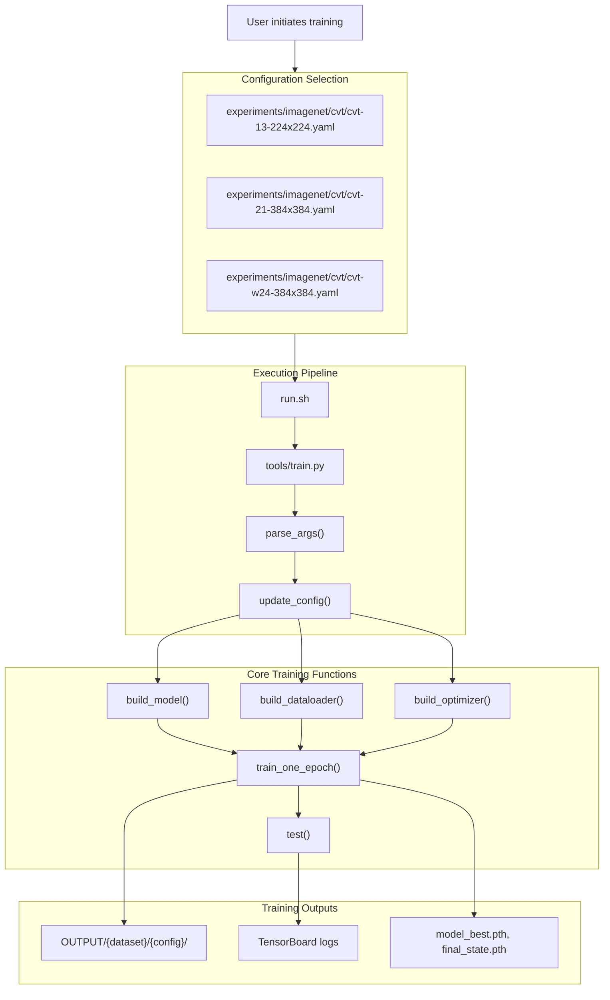
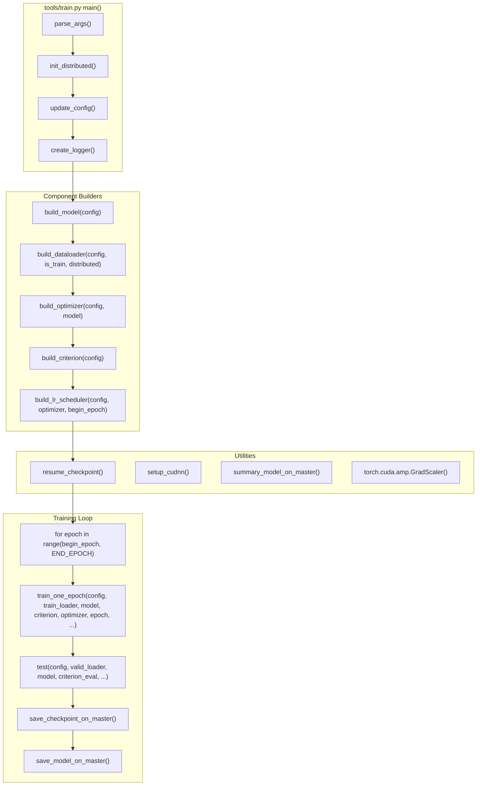

<!-- source: DeepWiki mcp.deepwiki.com · repo microsoft/CvT · page 2 Getting Started · fetched 2026-10-26 -->

# Getting Started

<details>
<summary>Relevant source files</summary>

The following files were used as context for generating this wiki page:

- [README.md](README.md)
- [tools/train.py](tools/train.py)

</details>


This page provides a quick start guide for training and evaluating CvT (Convolutional Vision Transformers) models. It covers installation requirements, data preparation, and basic usage for running training and evaluation experiments.

For detailed architecture information, see [Architecture & Design](#3). For comprehensive training guides, see [Training Models](#4.1). For configuration details, see [Configuration Reference](#4.3).

## Prerequisites and Installation

### System Requirements

CvT requires PyTorch and TorchVision as core dependencies. The codebase is developed and tested with PyTorch 1.7.1, though other versions may work but are not fully tested.

### Installation Steps

1. **Install PyTorch and TorchVision** following the [official PyTorch installation guide](https://pytorch.org)

2. **Install project dependencies**:
   ```bash
   python -m pip install -r requirements.txt --user -q
   ```

The main dependencies include standard deep learning packages for data loading, augmentation, and training utilities.

Sources: [README.md:27-34]()

## Data Preparation

### ImageNet Dataset Structure

CvT expects ImageNet data organized in the standard torchvision format with separate train and validation directories:

```
DATASET/
└── imagenet/
    ├── train/
    │   ├── class1/
    │   │   ├── img1.jpg
    │   │   ├── img2.jpg
    │   │   └── ...
    │   ├── class2/
    │   │   └── ...
    │   └── ...
    └── val/
        ├── class1/
        │   └── ...
        ├── class2/
        │   └── ...
        └── ...
```

This structure allows the dataset builders in [lib/dataset/]() to automatically discover and load class labels from directory names.

Sources: [README.md:36-65]()

## Basic Usage

### Quick Start Workflow

The following diagram shows the complete workflow from configuration to model outputs:



Sources: [README.md:85-114](), [tools/train.py:37-57](), [tools/train.py:60-211]()

### Training a Model

Use the `run.sh` script to launch training with the desired configuration:

```bash
bash run.sh -g 8 -t train --cfg experiments/imagenet/cvt/cvt-13-224x224.yaml
```

#### Script Parameters

| Parameter | Description | Default |
|-----------|-------------|---------|
| `-g\|--gpus` | Number of GPUs to use | 1 |
| `-t\|--job-type` | Job type: `train` or `test` | `aml` |
| `-p\|--port` | Master port for distributed training | 9000 |
| `-i\|--install-deps` | Install dependencies flag | False |

#### Configuration Override

You can override any configuration parameter from the command line:

```bash
bash run.sh -g 8 -t train --cfg experiments/imagenet/cvt/cvt-13-224x224.yaml TRAIN.LR 0.1
```

This modifies the learning rate to 0.1 while keeping all other configuration parameters from the YAML file.

Sources: [README.md:85-105]()

### Evaluating Pre-trained Models

To test a pre-trained model, use the test job type and specify the model file:

```bash
bash run.sh -t test --cfg experiments/imagenet/cvt/cvt-13-224x224.yaml TEST.MODEL_FILE ${PRETRAINED_MODEL_FILE}
```

The evaluation runs the `test()` function from [core/function.py]() which computes accuracy metrics on the validation dataset.

Sources: [README.md:110-114]()

## Training Pipeline Components

The following diagram shows how the main training components interact with specific code entities:



Sources: [tools/train.py:60-211]()

## Configuration Structure

### Experiment Organization

Configurations are organized in a hierarchical directory structure:

```
experiments/
├── {DATASET}/
│   ├── {ARCHITECTURE}/
│   │   ├── config1.yaml
│   │   ├── config2.yaml
│   │   └── ...
│   └── ...
└── ...
```

For CvT models on ImageNet, configurations are located at:
- `experiments/imagenet/cvt/cvt-13-224x224.yaml`
- `experiments/imagenet/cvt/cvt-21-224x224.yaml` 
- `experiments/imagenet/cvt/cvt-13-384x384.yaml`
- `experiments/imagenet/cvt/cvt-21-384x384.yaml`
- `experiments/imagenet/cvt/cvt-w24-384x384.yaml`

### Available Model Variants

| Model | Resolution | Parameters | GFLOPs | ImageNet-1k Top-1 |
|-------|------------|------------|--------|-------------------|
| CvT-13 | 224×224 | 20M | 4.5 | 81.6% |
| CvT-21 | 224×224 | 32M | 7.1 | 82.5% |
| CvT-13 | 384×384 | 20M | 16.3 | 83.0% |
| CvT-21 | 384×384 | 32M | 24.9 | 83.3% |

Sources: [README.md:69-83](), [README.md:7-14]()

## Output Structure

### Training Outputs

By default, all training outputs are saved to `OUTPUT/{dataset}/{training_config}/`:

```
OUTPUT/
└── imagenet/
    └── cvt-13-224x224/
        ├── config.yaml           # Final merged configuration
        ├── model_best.pth         # Best performing model
        ├── final_state.pth        # Final training state
        ├── checkpoint_*.pth       # Periodic checkpoints
        ├── log.txt               # Training logs
        └── tensorboard_logs/     # TensorBoard event files
```

The `save_checkpoint_on_master()` and `save_model_on_master()` functions handle saving checkpoints and models respectively.

Sources: [README.md:108](), [tools/train.py:171-199]()

## Next Steps

- **Model Training**: For detailed training procedures and advanced options, see [Training Models](#4.1)
- **Model Evaluation**: For comprehensive evaluation procedures, see [Model Evaluation](#4.2)
- **Architecture Details**: To understand the CvT model architecture, see [CvT Model Architecture](#3.1)
- **Configuration Options**: For complete configuration reference, see [Configuration Reference](#4.3)
- **Development**: To contribute or modify the codebase, see [Development](#5)

---

