# Page: Overview

# Overview

<details>
<summary>Relevant source files</summary>

The following files were used as context for generating this wiki page:

- [README.md](README.md)

</details>


## Purpose and Scope

This document provides a comprehensive overview of the Microsoft DKI LLM Paper Code Collection repository, which hosts three distinct research systems for large language model enhancement and optimization. The repository contains production-ready implementations of reinforcement learning pipelines, instruction tuning systems, and reward learning frameworks developed by Microsoft's Data Knowledge Intelligence (DKI) group.

This overview covers the high-level architecture, system relationships, and research domains. For detailed implementation guides, see the individual system pages: [WarriorCoder System](#2), [RePrompt System](#3), and [SER System](#4). For development setup and contribution guidelines, see [Contributing Guidelines](#5).

## Repository Architecture

The repository is organized into three primary research systems, each with dedicated documentation and implementation directories:

### Repository Structure Diagram

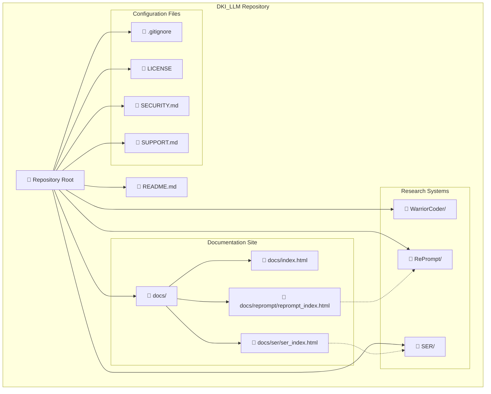

Sources: [README.md:1-42]()

### System Integration Overview

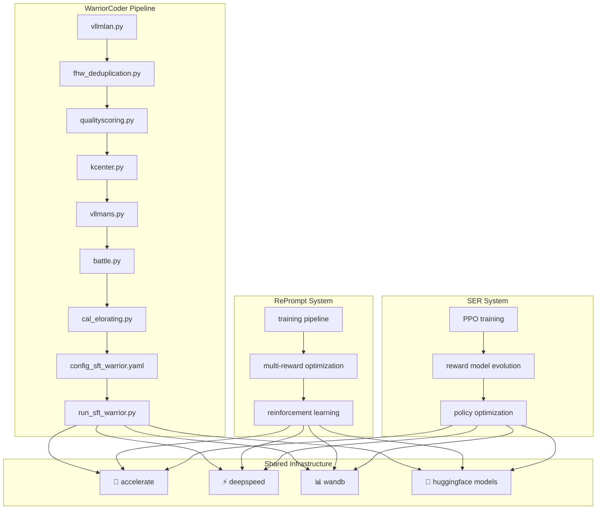

Sources: [README.md:12-21]()

## Research Systems Overview

The repository implements three complementary research directions in large language model enhancement:

### System Comparison Matrix

| System | Domain | Primary Method | Key Innovation | Training Framework |
|--------|---------|----------------|----------------|-------------------|
| **WarriorCoder** | Code Generation | Multi-stage Pipeline + Elo Rating | Challenging instruction synthesis | Supervised Fine-tuning |
| **RePrompt** | Text-to-Image | Reinforcement Learning | Reasoning-augmented prompting | Multi-reward RL |
| **SER** | Reward Learning | Self-evolution | Reduced human annotation dependency | PPO + Iterative RM |

### WarriorCoder System

WarriorCoder implements a comprehensive 7-stage pipeline for generating challenging coding instructions and training specialized coding language models. The system uses competitive evaluation through model battles and Elo rating systems to identify optimal training data.

**Core Components:**
- `vllmlan.py` - Instruction generation using vLLM
- `fhw_deduplication.py` - MinHash-based deduplication
- `qualityscoring.py` - LLM-based quality assessment
- `battle.py` - Pairwise model evaluation system
- `run_sft_warrior.py` - Supervised fine-tuning execution

### RePrompt System  

RePrompt focuses on improving text-to-image generation through reinforcement learning-based prompt optimization. The system integrates reasoning capabilities into prompt generation and uses multiple reward models for optimization.

**Core Features:**
- Reinforcement learning for prompt optimization
- Multi-reward system integration
- Support for multiple T2I backends (FLUX, SD3, PixArt)
- GPT-4V-based evaluation metrics

### SER System

SER (Self-Evolved Reward Learning) implements an iterative approach to reward model improvement that reduces dependency on human-annotated data for RLHF. The system uses self-evolution techniques to progressively improve reward models.

**Core Components:**
- PPO-based policy optimization
- Iterative reward model training
- Self-evolution mechanisms
- Reduced human annotation requirements

Sources: [README.md:14-21]()

## Technical Architecture

### Shared Technology Stack

All three systems leverage a common technology foundation:

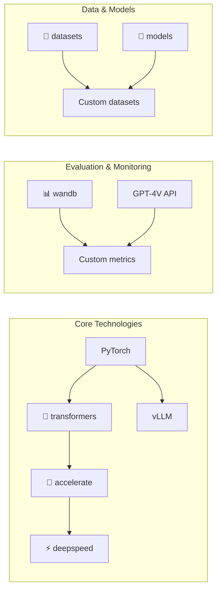

### Research Domain Relationships

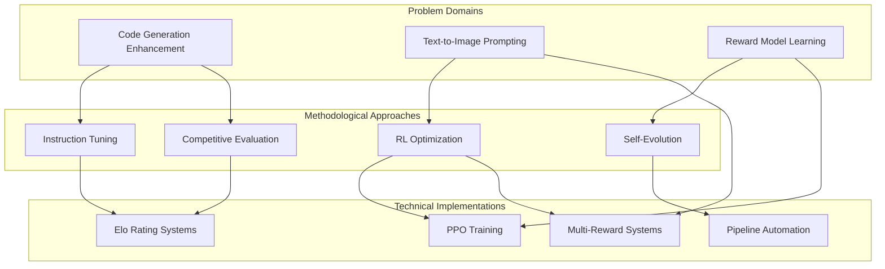

Sources: [README.md:6-21]()

## Getting Started

### System Selection Guide

Choose the appropriate system based on your research objectives:

- **WarriorCoder**: For improving code generation capabilities through challenging instruction synthesis and competitive evaluation
- **RePrompt**: For enhancing text-to-image generation through reinforcement learning-based prompt optimization  
- **SER**: For developing self-evolving reward models with reduced human annotation requirements

### Next Steps

1. **Environment Setup**: Each system has specific dependencies and setup requirements detailed in their respective sections
2. **System Deep-Dive**: Navigate to individual system pages for comprehensive implementation details:
   - [WarriorCoder System](#2) - Complete instruction generation and training pipeline
   - [RePrompt System](#3) - Text-to-image prompt optimization framework
   - [SER System](#4) - Self-evolved reward learning implementation
3. **Development**: See [Contributing Guidelines](#5) for development environment setup and contribution processes

### Repository Statistics

- **Primary Language**: Python
- **Framework Dependencies**: PyTorch, Hugging Face ecosystem, vLLM
- **Training Infrastructure**: Accelerate, DeepSpeed
- **Documentation**: GitHub Pages with comprehensive system guides
- **License**: MIT License

Sources: [README.md:1-42]()

---

# Page: Repository Structure

# Repository Structure

<details>
<summary>Relevant source files</summary>

The following files were used as context for generating this wiki page:

- [docs/.nojekyll](docs/.nojekyll)
- [docs/index.html](docs/index.html)

</details>


## Purpose and Scope

This document describes the organizational structure of the Microsoft DKI LLM Paper Code Collection repository, explaining how the three main research systems (WarriorCoder, RePrompt, and SER) are organized and how the documentation site relates to the codebase. For detailed information about each individual system's internal structure and components, see [WarriorCoder System](#2), [RePrompt System](#3), and [SER System](#4).

## Top-Level Repository Organization

The repository follows a multi-system architecture where each research paper's implementation is contained within its own top-level directory, accompanied by a centralized documentation site.

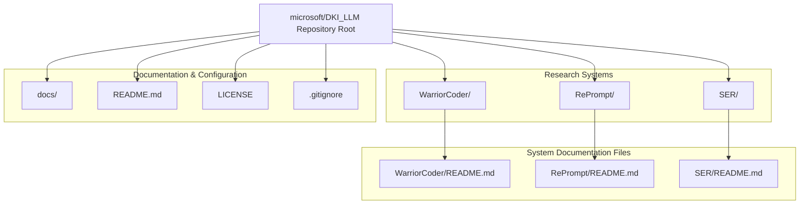

Sources: Based on repository structure analysis from high-level system diagrams

## Documentation Site Architecture

The repository uses GitHub Pages to host a centralized documentation site that provides navigation and detailed information for each research system.

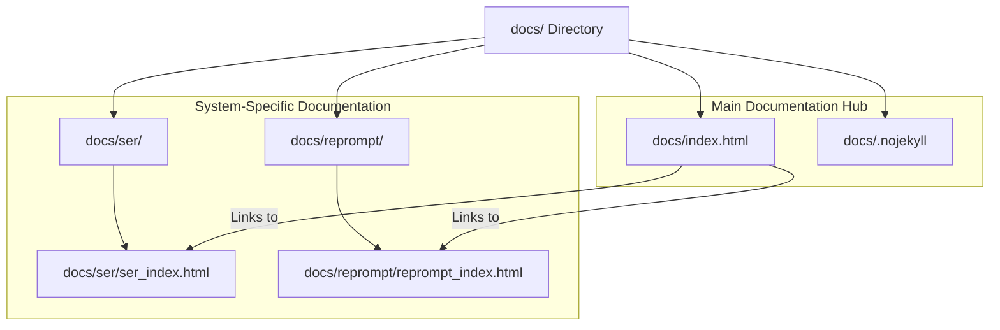

Sources: [docs/index.html:1-135](), [docs/.nojekyll:1-2]()

### Main Documentation Index

The primary documentation entry point is located at [docs/index.html:102-106]() and serves as a "Paper Code Collection" hub. The page uses a card-based layout to provide navigation to individual system documentation:

| System | Documentation Link | Description |
|--------|-------------------|-------------|
| SER | `docs/ser/ser_index.html` | ICLR2025: Self-evolved reward learning for LLMs |
| RePrompt | `docs/reprompt/reprompt_index.html` | Arxiv: RePrompt: Reasoning-Augmented Reprompting for Text-to-Image Generation via Reinforcement Learning |

The main index implements a responsive design with hover effects and uses the Open Sans font family for consistent typography [docs/index.html:13-17](). The `.nojekyll` file [docs/.nojekyll:1-2]() ensures GitHub Pages processes the site without Jekyll transformation.

Sources: [docs/index.html:114-119](), [docs/index.html:13-17](), [docs/.nojekyll:1-2]()

## System Integration Patterns

Each research system follows a consistent organizational pattern that separates code implementation from documentation while maintaining clear relationships between them.

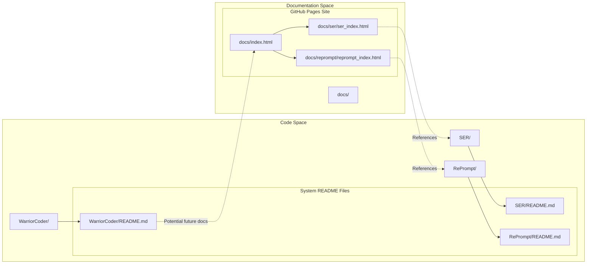

Sources: Based on repository structure analysis and [docs/index.html:114-119]()

## Directory Naming and Organization Conventions

The repository follows specific naming conventions that reflect the research publication timeline and system purposes:

### System Directory Structure

| Directory | Purpose | Associated Paper | Status |
|-----------|---------|------------------|--------|
| `WarriorCoder/` | Instruction generation and model training pipeline | Coding LLM enhancement research | Active development |
| `RePrompt/` | Text-to-image prompt optimization via RL | Arxiv paper implementation | Documented |
| `SER/` | Self-evolved reward learning system | ICLR2025 submission | Documented |

### Documentation Organization

The documentation follows a hierarchical structure where:
- `docs/index.html` serves as the main navigation hub
- Each system has its own subdirectory under `docs/` (e.g., `docs/ser/`, `docs/reprompt/`)
- System-specific documentation files use descriptive naming patterns (e.g., `ser_index.html`, `reprompt_index.html`)

The main index page [docs/index.html:104-106]() welcomes users with the message: "Welcome to DKI LLM GitHub Pages site where each link leads to an introduction of a paper and its related code."

Sources: [docs/index.html:104-106](), [docs/index.html:114-119]()

## Configuration and Meta Files

The repository includes standard configuration files that support both development and documentation hosting:

- `.gitignore` - Version control exclusions for development artifacts
- `LICENSE` - Repository licensing information  
- `README.md` - Main repository documentation
- `docs/.nojekyll` - Disables Jekyll processing for GitHub Pages [docs/.nojekyll:1-2]()

The `.nojekyll` file is particularly important as it allows the custom HTML documentation site to function properly without Jekyll's automatic processing interfering with the custom styling and structure.

Sources: [docs/.nojekyll:1-2]()

---

# Page: WarriorCoder System

# WarriorCoder System

<details>
<summary>Relevant source files</summary>

The following files were used as context for generating this wiki page:

- [WarriorCoder/README.md](WarriorCoder/README.md)

</details>


The WarriorCoder System is a comprehensive instruction generation and training pipeline designed to create challenging coding instructions and train specialized code language models. The system implements a multi-stage data processing approach that generates instructions, filters them for quality and difficulty, evaluates model responses through competitive battles, and trains models using the highest-quality response data.

This document covers the complete WarriorCoder pipeline from instruction generation through model training. For information about other research systems in this repository, see [RePrompt System](#3) and [SER System](#4).

## System Architecture Overview

The WarriorCoder system operates as a sequential 6-stage pipeline with two distinct computational environments: a data processing environment for instruction generation and evaluation, and a training environment for model fine-tuning.

### Complete Pipeline Flow

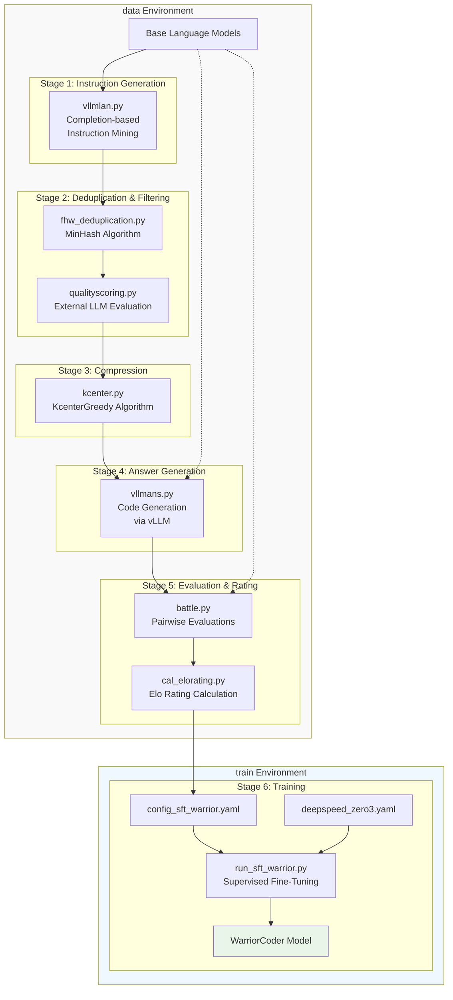

Sources: [WarriorCoder/README.md:1-101]()

## Environment Configuration

WarriorCoder requires two separate conda environments optimized for different computational workloads:

### Data Processing Environment (`data`)

The `data` environment handles instruction generation, filtering, and evaluation tasks requiring high-performance inference:

| Component | Purpose | Key Dependencies |
|-----------|---------|------------------|
| vllm | High-speed LLM inference | Core inference engine |
| datasketch | MinHash deduplication | Similarity detection |
| scikit-learn | Embedding operations | K-center algorithm |

### Training Environment (`train`)

The `train` environment provides distributed training capabilities with advanced optimization:

| Component | Version | Purpose |
|-----------|---------|---------|
| PyTorch | 2.2.0 (CUDA 12.1) | Core ML framework |
| TRL | 0.12.0 | Transformer Reinforcement Learning |
| Flash Attention | 2.7.4.post1 | Memory-efficient attention |
| warriortrain | Custom package | Training scripts and utilities |

Sources: [WarriorCoder/README.md:9-26]()

## Data Processing Pipeline

### Stage 1: Instruction Generation with vllmlan.py

The instruction generation stage uses completion-based mining to extract capabilities from existing code LLMs. The `vllmlan.py` script implements high-throughput instruction generation using vLLM inference optimization.

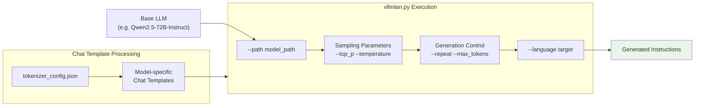

**Key Parameters:**
- `--path`: Hugging Face model identifier or local path
- `--top_p`: Nucleus sampling parameter (e.g., 0.99)
- `--temperature`: Sampling temperature (e.g., 1.2)
- `--repeat`: Number of instruction generations
- `--max_tokens`: Maximum context length (e.g., 2048)
- `--language`: Target programming language

Sources: [WarriorCoder/README.md:29-41]()

### Stage 2: Deduplication and Quality Assessment

#### MinHash Deduplication with fhw_deduplication.py

The deduplication stage implements MinHash algorithm to identify and remove near-duplicate instructions from the generated dataset.

#### Quality Scoring with qualityscoring.py

External LLM evaluation assesses instruction quality and difficulty through structured evaluation prompts.

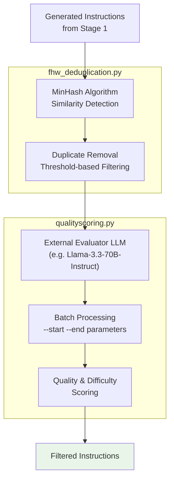

Sources: [WarriorCoder/README.md:42-56]()

### Stage 3: Embedding-based Compression with kcenter.py

The compression stage uses the KcenterGreedy algorithm to reduce dataset size while preserving instruction diversity through embedding space analysis.

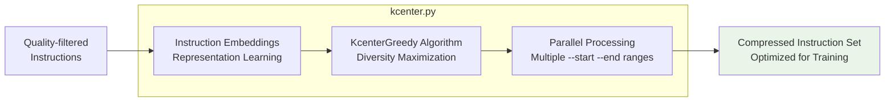

Sources: [WarriorCoder/README.md:57-66]()

## Model Evaluation and Training System

### Stage 4: Answer Generation with vllmans.py

Code generation uses vLLM-accelerated inference to generate multiple candidate answers for each instruction in the compressed dataset.

### Stage 5: Battle System and Elo Rating

#### Pairwise Evaluation with battle.py

The battle system conducts pairwise comparisons between model responses using uninvolved LLM evaluators to determine response quality rankings.

#### Elo Rating Calculation with cal_elorating.py

Elo rating system quantifies model performance and identifies the highest-quality responses for training data.

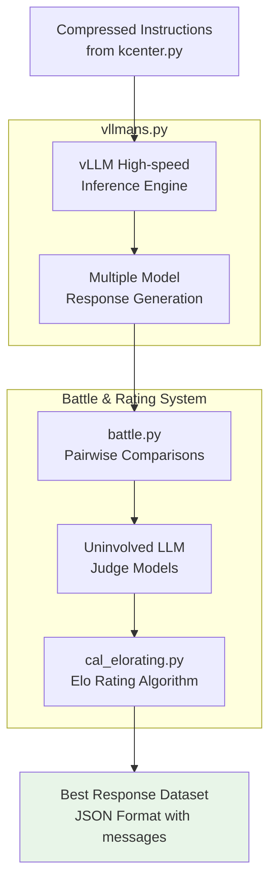

Sources: [WarriorCoder/README.md:67-88]()

### Stage 6: Training Configuration and Execution

#### Training Data Format

The final training dataset uses a structured JSON format optimized for chat-based fine-tuning:

```json
{
  "messages": [
    {
      "content": "instructions_in_natural_language", 
      "role": "user"
    }, 
    {
      "content": "best_response", 
      "role": "assistant"
    }
  ]
}
```

#### Configuration Files

| File | Purpose | Key Components |
|------|---------|----------------|
| `config_sft_warrior.yaml` | SFT training parameters | Learning rate, batch size, model config |
| `deepspeed_zero3.yaml` | Distributed training | ZeRO-3 optimization, memory management |

#### Training Execution with run_sft_warrior.py

The supervised fine-tuning process uses Accelerate and DeepSpeed for distributed training:

```bash
accelerate launch --config_file recipes/accelerate_configs/deepspeed_zero3.yaml scripts/run_sft_warrior.py recipes/config_sft_warrior.yaml
```

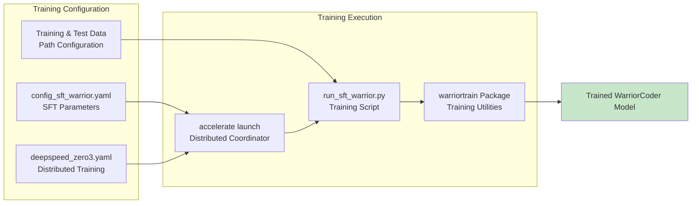

Sources: [WarriorCoder/README.md:84-101]()

## Implementation Notes

### Chat Template Compatibility

The system requires model-specific chat template configuration based on `tokenizer_config.json` files. Different base models implement varying conversation formats that must be properly configured for instruction generation.

### Parallel Processing Optimization

Both `kcenter.py` and `qualityscoring.py` support batch processing with `--start` and `--end` parameters, enabling parallel execution across multiple processes or machines for large-scale datasets.

### Memory and Performance Considerations

- **vLLM Integration**: High-throughput inference for both instruction generation (`vllmlan.py`) and answer generation (`vllmans.py`)
- **Flash Attention**: Memory-efficient attention mechanism for training large models
- **DeepSpeed ZeRO-3**: Advanced memory optimization for distributed training

Sources: [WarriorCoder/README.md:40-41](), [WarriorCoder/README.md:65](), [WarriorCoder/README.md:19-25]()

---

# Page: Data Generation Pipeline

# Data Generation Pipeline

<details>
<summary>Relevant source files</summary>

The following files were used as context for generating this wiki page:

- [WarriorCoder/fhw_deduplication.py](WarriorCoder/fhw_deduplication.py)
- [WarriorCoder/qualityscoring.py](WarriorCoder/qualityscoring.py)
- [WarriorCoder/vllmans.py](WarriorCoder/vllmans.py)
- [WarriorCoder/vllmlan.py](WarriorCoder/vllmlan.py)

</details>


## Purpose and Scope

The Data Generation Pipeline is the first stage of the WarriorCoder system responsible for creating, filtering, and scoring high-quality coding instructions. This pipeline transforms base language models into instruction generators and processes the output through multiple quality control stages before generating corresponding answers.

This document covers instruction generation, deduplication, quality assessment, and answer generation stages. For information about the subsequent model evaluation and training phases, see [Model Evaluation System](#2.2) and [Training Configuration](#2.3).

## Pipeline Overview

The data generation pipeline consists of four main stages that process coding instructions from generation to final dataset preparation:

### Data Generation Pipeline Flow

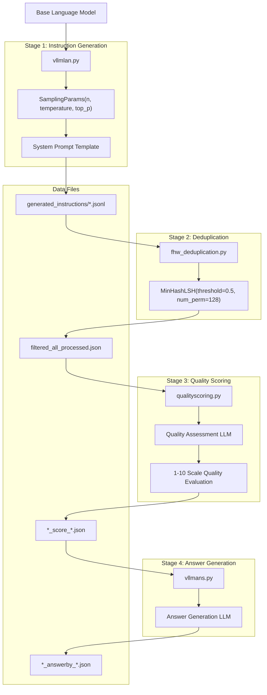

Sources: [WarriorCoder/vllmlan.py:1-42](), [WarriorCoder/fhw_deduplication.py:1-38](), [WarriorCoder/qualityscoring.py:1-43](), [WarriorCoder/vllmans.py:1-45]()

## Instruction Generation Stage

The instruction generation stage uses `vllmlan.py` to create diverse coding instructions using vLLM for high-throughput inference. The process is highly configurable and supports multiple programming languages.

### vllmlan.py Configuration

| Parameter | Purpose | Default | Code Reference |
|-----------|---------|---------|----------------|
| `--path` | Model path for instruction generation | Required | [WarriorCoder/vllmlan.py:7]() |
| `--n` | Number of samples per generation batch | 200 | [WarriorCoder/vllmlan.py:8]() |
| `--top_p` | Nucleus sampling parameter | 1.0 | [WarriorCoder/vllmlan.py:9]() |
| `--temperature` | Sampling temperature | 1.0 | [WarriorCoder/vllmlan.py:10]() |
| `--repeat` | Number of generation iterations | None | [WarriorCoder/vllmlan.py:11]() |
| `--max_tokens` | Maximum tokens per instruction | 2048 | [WarriorCoder/vllmlan.py:12]() |
| `--language` | Target programming language | Required | [WarriorCoder/vllmlan.py:13]() |

### Instruction Generation Architecture

```mermaid
flowchart LR
    subgraph "vllmlan.py Components"
        ARGS["ArgumentParser"] 
        TOKENIZER["AutoTokenizer.from_pretrained()"]
        LLM_ENGINE["LLM(tensor_parallel_size=8)"]
        SAMPLING["SamplingParams()"]
        TEMPLATE["System Prompt Template"]
    end
    
    subgraph "Generation Process"
        SYSMSG["system message: AI assistant for {language} coding"]
        USERMSG["user message: empty (prompt completion)"]
        STOPS["stop_tokens: ['<|eot_id|>', '<|end_of_text|>']"]
        GENERATE["llm.generate(prompts, sampling_params)"]
    end
    
    subgraph "Output Processing"
        EXTRACT["output.outputs[0].text"]
        JSONL["{'instruction': text} -> .jsonl"]
        FILENAME["generated_instructions/{name}_t_{temp}_p_{top_p}_{lang}_output.jsonl"]
    end
    
    ARGS --> TOKENIZER
    TOKENIZER --> LLM_ENGINE
    LLM_ENGINE --> SAMPLING
    SAMPLING --> TEMPLATE
    
    TEMPLATE --> SYSMSG
    SYSMSG --> USERMSG
    USERMSG --> STOPS
    STOPS --> GENERATE
    
    GENERATE --> EXTRACT
    EXTRACT --> JSONL
    JSONL --> FILENAME
```

The system prompt template is dynamically constructed based on the target language: [WarriorCoder/vllmlan.py:33]()

```
<|begin_of_text|><|start_header_id|>system<|end_header_id|>

You are an AI assistant designed to provide helpful, step-by-step guidance on {language} coding problems. The user will ask you a wide range of {language} coding questions.
Your purpose is to assist users in understanding {language} coding concepts, working through {language} code, and arriving at the correct {language} solutions.<|eot_id|><|start_header_id|>user<|end_header_id|>
```

Sources: [WarriorCoder/vllmlan.py:1-42]()

## Deduplication Process

The deduplication stage implements MinHash LSH (Locality Sensitive Hashing) via `fhw_deduplication.py` to remove near-duplicate instructions while preserving instruction diversity.

### MinHash LSH Configuration

The deduplication process uses the `datasketch` library with specific parameters optimized for instruction similarity detection:

- **Threshold**: 0.5 (instructions with >50% similarity are considered duplicates)
- **Permutations**: 128 (number of hash functions for MinHash signature)
- **Input**: `filtered_all.jsonl` 
- **Output**: `filtered_all_processed.json`

### Deduplication Algorithm Flow

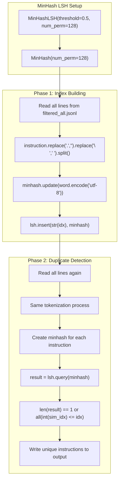

The deduplication logic ensures that only the first occurrence of similar instructions is retained: [WarriorCoder/fhw_deduplication.py:28]()

```python
if len(result) == 1 or all(int(sim_idx)<= idx for sim_idx in result):
```

Sources: [WarriorCoder/fhw_deduplication.py:1-38]()

## Quality Scoring Stage

The quality scoring stage uses `qualityscoring.py` to evaluate instruction quality using a separate LLM with structured assessment criteria. This stage processes instructions in configurable batches for distributed processing.

### Quality Assessment Parameters

| Component | Implementation | Code Reference |
|-----------|---------------|----------------|
| **Scoring Model** | `LLM(tensor_parallel_size=8, max_model_len=8192)` | [WarriorCoder/qualityscoring.py:22]() |
| **Batch Processing** | `--start` and `--end` arguments for slice processing | [WarriorCoder/qualityscoring.py:9-10]() |
| **Input Path** | `/blob/huawen/traindata/filtered_all_processed_instructions.json` | [WarriorCoder/qualityscoring.py:15]() |
| **Output Pattern** | `filtered_all_processed_instructions_score_{model_name}.json` | [WarriorCoder/qualityscoring.py:16]() |

### Quality Evaluation Criteria

The system prompt defines a comprehensive quality assessment framework: [WarriorCoder/qualityscoring.py:25]()

```
We are interested in understanding the quality of the following user query. Your task is to assess each prompt based on its clarity, specificity, coherence and difficulty.
```

### Quality Scoring Scale

| Score Range | Classification | Criteria |
|-------------|----------------|----------|
| **9-10** | Excellent | Very clear, specific, well-articulated, particularly challenging |
| **5-8** | Good | Clear and specific instructions, moderately assess AI capabilities |  
| **3-4** | Average | Fairly clear and specific, easy to answer |
| **1-2** | Poor | Ambiguous or include final response within instruction |

### Quality Assessment Workflow

```mermaid
flowchart TD
    subgraph "qualityscoring.py Process"
        INPUT_FILE["filtered_all_processed_instructions.json"]
        SLICE["lines[start:end] batch processing"]
        
        subgraph "Per Instruction Processing"
            PARSE["json.loads(line)"] 
            EXTRACT_INST["d['instruction']"]
            BUILD_PROMPT["system + user_prompt with assessment criteria"]
            CHAT_TEMPLATE["tokenizer.apply_chat_template()"]
            LLM_GENERATE["llm.generate(prompts=[text])"]
            EXTRACT_JUDGMENT["outputs[0].outputs[0].text"]
            ADD_FIELD["d['quality_judgement'] = judgment"]
            WRITE_JSON["json.dumps(d) to output file"]
        end
        
        OUTPUT_FILE["*_score_{model_name}.json"]
    end
    
    INPUT_FILE --> SLICE
    SLICE --> PARSE
    PARSE --> EXTRACT_INST
    EXTRACT_INST --> BUILD_PROMPT
    BUILD_PROMPT --> CHAT_TEMPLATE
    CHAT_TEMPLATE --> LLM_GENERATE
    LLM_GENERATE --> EXTRACT_JUDGMENT
    EXTRACT_JUDGMENT --> ADD_FIELD
    ADD_FIELD --> WRITE_JSON
    WRITE_JSON --> OUTPUT_FILE
```

The user prompt template requests structured output with double square bracket notation for scores: [WarriorCoder/qualityscoring.py:30]()

```
[Output Format]
Use double square brackets to format your scores, like so: [[5]].
```

Sources: [WarriorCoder/qualityscoring.py:1-43]()

## Answer Generation Stage

The answer generation stage uses `vllmans.py` to create responses for filtered and scored instructions, completing the instruction-response pairs needed for supervised fine-tuning.

### Answer Generation Configuration

```mermaid
flowchart LR
    subgraph "vllmans.py Components"
        ARGS_PARSE["--path (model), --datapath (input data)"]
        NAME_EXTRACT["Extract model and data names from paths"]
        TOKENIZER_INIT["AutoTokenizer.from_pretrained()"]
        LLM_INIT["LLM(tensor_parallel_size=8, max_model_len=8192)"]
        SAMPLING_PARAMS["SamplingParams(temperature=1.0, top_p=0.95)"]
    end
    
    subgraph "System Prompt"
        SYS_TEMPLATE["Python coding assistant system prompt"]
        HARDCODED["Currently hardcoded to Python language"]
    end
    
    subgraph "Batch Processing"
        READ_INPUT["Read all lines from input datapath"]
        BUILD_PROMPTS["Create chat templates for all instructions"] 
        BATCH_GENERATE["llm.generate(prompts=all_prompts)"]
        PAIR_RESPONSES["Zip lines with generated outputs"]
        WRITE_OUTPUT["Write instruction-response pairs"]
    end
    
    ARGS_PARSE --> NAME_EXTRACT
    NAME_EXTRACT --> TOKENIZER_INIT
    TOKENIZER_INIT --> LLM_INIT
    LLM_INIT --> SAMPLING_PARAMS
    SAMPLING_PARAMS --> SYS_TEMPLATE
    
    SYS_TEMPLATE --> HARDCODED
    HARDCODED --> READ_INPUT
    READ_INPUT --> BUILD_PROMPTS
    BUILD_PROMPTS --> BATCH_GENERATE
    BATCH_GENERATE --> PAIR_RESPONSES
    PAIR_RESPONSES --> WRITE_OUTPUT
```

### Answer Generation Process

The system processes all instructions in a single batch for efficiency: [WarriorCoder/vllmans.py:31-39]()

1. **Prompt Construction**: Each instruction is wrapped in a chat template with the system prompt
2. **Batch Generation**: All prompts are processed simultaneously via `llm.generate()`
3. **Response Pairing**: Generated responses are paired with their corresponding instructions
4. **Output Format**: Results are saved with the `response` field added to each instruction record

The output filename follows the pattern: [WarriorCoder/vllmans.py:29]()
```
/cosmos/fhw/zsw/filterans_answerby/{dataname}_answerby_{modelname}.json
```

### Data Format Transformation

| Stage | Input Format | Output Format | Key Fields |
|-------|--------------|---------------|------------|
| **Instruction Generation** | N/A | `{"instruction": "text"}` | `instruction` |
| **Deduplication** | Same | Same | `instruction` |
| **Quality Scoring** | Same | `{"instruction": "text", "quality_judgement": "assessment"}` | `instruction`, `quality_judgement` |
| **Answer Generation** | `{"prompt": "text"}` | `{"prompt": "text", "response": "answer"}` | `prompt`, `response` |

Sources: [WarriorCoder/vllmans.py:1-45]()

## Pipeline Integration

The complete data generation pipeline transforms base language models into instruction-response datasets through systematic quality control and processing stages. Each component is designed for distributed processing and handles large-scale data generation efficiently using vLLM's optimized inference capabilities.

The pipeline outputs structured datasets ready for the subsequent evaluation and training phases covered in [Model Evaluation System](#2.2) and [Training Configuration](#2.3).

Sources: [WarriorCoder/vllmlan.py:1-42](), [WarriorCoder/fhw_deduplication.py:1-38](), [WarriorCoder/qualityscoring.py:1-43](), [WarriorCoder/vllmans.py:1-45]()

---

# Page: Model Evaluation System

# Model Evaluation System

<details>
<summary>Relevant source files</summary>

The following files were used as context for generating this wiki page:

- [WarriorCoder/battle.py](WarriorCoder/battle.py)
- [WarriorCoder/cal_elorating.py](WarriorCoder/cal_elorating.py)

</details>


The Model Evaluation System is a core component of the WarriorCoder pipeline that conducts automated pairwise battles between different language models to determine their relative performance on coding tasks. This system implements a tournament-style evaluation using judge models and Elo rating calculations to rank model capabilities objectively.

This document covers the battle execution framework and Elo rating computation. For information about the data generation that feeds into this evaluation system, see [Data Generation Pipeline](#2.1). For training configuration that uses these evaluation results, see [Training Configuration](#2.3).

## System Architecture

The Model Evaluation System consists of two primary components: the battle execution engine and the Elo rating calculator. The system processes model responses through automated judging and maintains dynamic rankings.

### Battle System Pipeline

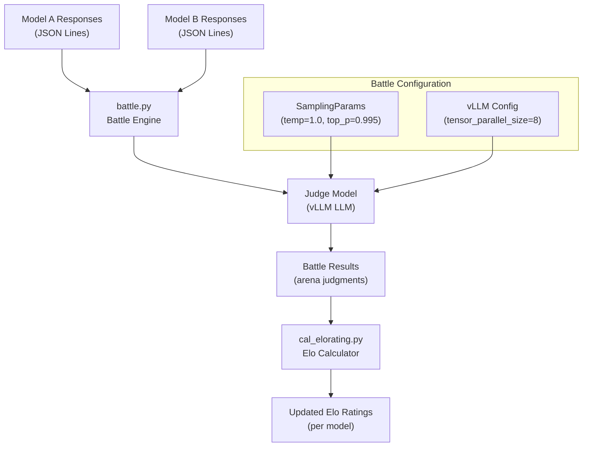

Sources: [WarriorCoder/battle.py:1-56](), [WarriorCoder/cal_elorating.py:1-49]()

## Battle Execution System

The `battle.py` script orchestrates pairwise model comparisons using a judge model to evaluate response quality. The system processes instruction-response pairs and generates comparative judgments.

### Battle Process Flow

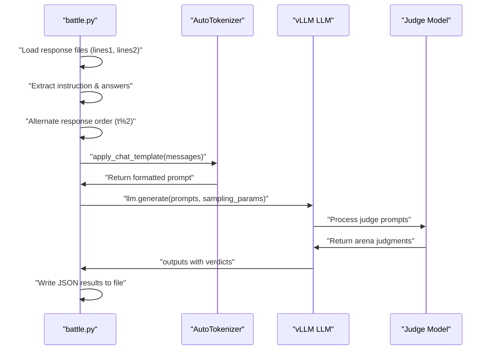

Sources: [WarriorCoder/battle.py:20-56]()

### Judge Prompt Structure

The battle system uses structured prompts to ensure consistent evaluation criteria. The judge model receives detailed instructions emphasizing objectivity and specific evaluation factors.

| Component | Purpose | Implementation |
|-----------|---------|----------------|
| Position Alternation | Avoid order bias | `t%2 == 0` alternates response positions |
| Evaluation Criteria | Standardized judging | Helpfulness, relevance, accuracy |
| Length Preference | Quality over quantity | "choose the SHORTER answer" for ties |
| Output Format | Structured verdicts | `[[A]]`, `[[B]]`, or `[[Tie]]` |

The system generates prompts with this structure at [WarriorCoder/battle.py:36-38](), alternating the order of Assistant A and B responses to eliminate position bias.

Sources: [WarriorCoder/battle.py:35-44]()

## Elo Rating System

The `cal_elorating.py` module implements a traditional Elo rating system adapted for multi-model tournaments. Each model maintains a dynamic rating that updates based on battle outcomes.

### Elo Calculation Process

```mermaid
graph TB
    BATTLE_RESULTS["Battle Results<br/>(JSON lines)"] --> PARSE["Parse JSON<br/>extract scores"]
    PARSE --> SCORE_MAP["Score Mapping<br/>curscore dict"]
    
    SCORE_MAP --> UPDATE_PAIRS["Pairwise Updates<br/>update_elo function"]
    
    subgraph "Model Ratings"
        ATHENE["athene_elo"]
        DEEPSEEK["deepseekcoder_elo"] 
        LLAMA["llama_elo"]
        QWEN["qwen_elo"]
        QWQ["qwq_elo"]
    end
    
    UPDATE_PAIRS --> ATHENE
    UPDATE_PAIRS --> DEEPSEEK
    UPDATE_PAIRS --> LLAMA
    UPDATE_PAIRS --> QWEN
    UPDATE_PAIRS --> QWQ
    
    subgraph "Elo Formula"
        FORMULA["new_elo = old_elo + K * (outcome - expected)"]
        K_FACTOR["K = 40"]
        EXPECTED["expected = 1/(1+10^((opponent_elo-player_elo)/400))"]
    end
    
    UPDATE_PAIRS --> FORMULA
    K_FACTOR --> FORMULA
    EXPECTED --> FORMULA
```

Sources: [WarriorCoder/cal_elorating.py:14-26](), [WarriorCoder/cal_elorating.py:28-43]()

### Elo Update Function

The `update_elo` function implements the standard Elo rating algorithm with a K-factor of 40, processing win/loss/tie outcomes between model pairs:

```python
def update_elo(A_elo, B_elo, A_score, B_score):
    # Win: A_score > B_score
    # Tie: A_score == B_score  
    # Loss: A_score < B_score
```

The function handles three outcome scenarios at [WarriorCoder/cal_elorating.py:14-26](), calculating expected performance using the standard Elo formula and updating both models' ratings accordingly.

Sources: [WarriorCoder/cal_elorating.py:14-26]()

## Model Comparison Matrix

The system evaluates all pairwise combinations of the supported models. The current implementation tracks five models with comprehensive cross-comparisons:

### Supported Models and Battle Matrix

| Model A | Model B | Update Line |
|---------|---------|-------------|
| athene | deepseekcoder | Line 34 |
| athene | llama | Line 35 |
| athene | qwen | Line 36 |
| athene | qwq | Line 37 |
| deepseekcoder | llama | Line 38 |
| deepseekcoder | qwen | Line 39 |
| deepseekcoder | qwq | Line 40 |
| llama | qwen | Line 41 |
| llama | qwq | Line 42 |
| qwen | qwq | Line 43 |

The system processes each battle result and updates all relevant model pair ratings within a single iteration, ensuring consistent and comprehensive ranking updates.

Sources: [WarriorCoder/cal_elorating.py:34-43]()

## Technical Configuration

### vLLM Parameters

The battle system uses specific vLLM configurations optimized for judge model inference:

| Parameter | Value | Purpose |
|-----------|-------|---------|
| `tensor_parallel_size` | 8 | Distributed inference |
| `dtype` | "float16" | Memory efficiency |
| `max_model_len` | 8192 | Context window |
| `enforce_eager` | True | Execution mode |

### Sampling Parameters

Judge model generation uses controlled sampling for consistent evaluation:

| Parameter | Value | Purpose |
|-----------|-------|---------|
| `temperature` | 1.0 | Moderate randomness |
| `top_p` | 0.995 | Nucleus sampling |
| `max_tokens` | 8192 | Response length limit |

Sources: [WarriorCoder/battle.py:48-49]()

## Output Format

The evaluation system produces structured JSON outputs for downstream processing. Battle results contain arena judgments with metadata, while Elo ratings are displayed as final numerical scores.

### Battle Results Schema

Each battle output includes:
- `arena`: Judge model's complete evaluation and verdict
- `t`: Battle index for tracking and debugging

### Elo Rating Output

The final Elo ratings are printed in model order:
1. athene_elo
2. deepseekcoder_elo  
3. llama_elo
4. qwen_elo
5. qwq_elo

Sources: [WarriorCoder/battle.py:52-55](), [WarriorCoder/cal_elorating.py:44-48]()

---

# Page: Training Configuration

# Training Configuration

<details>
<summary>Relevant source files</summary>

The following files were used as context for generating this wiki page:

- [WarriorCoder/warriortrain/recipes/config_sft_warrior.yaml](WarriorCoder/warriortrain/recipes/config_sft_warrior.yaml)

</details>


This document covers the supervised fine-tuning (SFT) configuration system used in the WarriorCoder pipeline for training coding-specialized language models. The configuration defines model parameters, data processing settings, training hyperparameters, and the chat template system that formats instruction-response pairs during training.

For information about the data generation and filtering stages that produce the training data, see [Data Generation Pipeline](#2.1). For details on executing the training process, see [Training Execution](#2.4).

## Configuration File Structure

The WarriorCoder training configuration is centralized in a single YAML file that defines all aspects of the SFT process. The configuration is organized into three main sections that control different aspects of the training pipeline.

```mermaid
flowchart TD
    CONFIG["config_sft_warrior.yaml"]
    
    subgraph "Model Arguments"
        MODEL_PATH["model_name_or_path"]
        TORCH_DTYPE["torch_dtype"]
        ATTN_IMPL["attn_implementation"]
    end
    
    subgraph "Data Training Arguments" 
        CHAT_TEMPLATE["chat_template"]
        DATASET_MIXER["dataset_mixer"]
        DATASET_SPLITS["dataset_splits"]
        PREPROCESSING["preprocessing_num_workers"]
    end
    
    subgraph "SFT Trainer Config"
        PRECISION["bf16"]
        EVAL_CONFIG["do_eval, eval_strategy"]
        GRADIENT_CONFIG["gradient_accumulation_steps"]
        LEARNING_CONFIG["learning_rate, lr_scheduler_type"]
        BATCH_CONFIG["per_device_train_batch_size"]
        SAVE_CONFIG["save_strategy, save_steps"]
    end
    
    CONFIG --> MODEL_PATH
    CONFIG --> TORCH_DTYPE
    CONFIG --> ATTN_IMPL
    CONFIG --> CHAT_TEMPLATE
    CONFIG --> DATASET_MIXER
    CONFIG --> DATASET_SPLITS
    CONFIG --> PREPROCESSING
    CONFIG --> PRECISION
    CONFIG --> EVAL_CONFIG
    CONFIG --> GRADIENT_CONFIG
    CONFIG --> LEARNING_CONFIG
    CONFIG --> BATCH_CONFIG
    CONFIG --> SAVE_CONFIG
```

Sources: [WarriorCoder/warriortrain/recipes/config_sft_warrior.yaml:1-43]()

## Model Arguments

The model configuration section specifies the base model and hardware optimizations used for training. These parameters directly control the underlying transformer architecture and computational efficiency.

| Parameter | Value | Purpose |
|-----------|-------|---------|
| `model_name_or_path` | `model_weights/deepseek-coder-6.7b-base` | Base model path for initialization |
| `model_revision` | `main` | Git revision/branch to use |
| `torch_dtype` | `bfloat16` | Mixed precision training format |
| `attn_implementation` | `flash_attention_2` | Attention mechanism optimization |

The configuration targets the DeepSeek Coder 6.7B base model and enables FlashAttention-2 for memory-efficient attention computation during training. The bfloat16 precision reduces memory usage while maintaining numerical stability.

Sources: [WarriorCoder/warriortrain/recipes/config_sft_warrior.yaml:1-5]()

## Data Training Configuration

The data training section controls how the instruction-response datasets are processed and formatted for supervised fine-tuning. This includes the chat template system and dataset mixing ratios.

```mermaid
flowchart LR
    subgraph "Data Pipeline"
        RAW_DATA["data/my directory"]
        DATASET_MIXER["dataset_mixer: data/my: 1.0"]
        DATASET_SPLITS["dataset_splits: train"]
        PREPROCESSING["preprocessing_num_workers: 128"]
    end
    
    subgraph "Chat Template Processing"
        CHAT_TEMPLATE["chat_template"]
        BOS_TOKEN["bos_token"]
        SYSTEM_CHECK["system role detection"]
        USER_FORMAT["### Instruction: format"]
        ASSISTANT_FORMAT["### Response: format"]
        EOT_TOKEN["<|EOT|> termination"]
    end
    
    RAW_DATA --> DATASET_MIXER
    DATASET_MIXER --> DATASET_SPLITS
    DATASET_SPLITS --> PREPROCESSING
    PREPROCESSING --> CHAT_TEMPLATE
    
    CHAT_TEMPLATE --> BOS_TOKEN
    CHAT_TEMPLATE --> SYSTEM_CHECK
    CHAT_TEMPLATE --> USER_FORMAT
    CHAT_TEMPLATE --> ASSISTANT_FORMAT
    CHAT_TEMPLATE --> EOT_TOKEN
```

The `dataset_mixer` configuration assigns full weight (1.0) to the `data/my` directory, indicating this contains the processed instruction dataset from the earlier pipeline stages. The system uses 128 worker processes for parallel data preprocessing to accelerate the data loading phase.

Sources: [WarriorCoder/warriortrain/recipes/config_sft_warrior.yaml:9-13]()

## SFT Training Parameters

The supervised fine-tuning configuration defines the core training hyperparameters that control the optimization process, evaluation strategy, and model checkpointing behavior.

### Training Hyperparameters

| Parameter | Value | Description |
|-----------|-------|-------------|
| `learning_rate` | `1.0e-05` | AdamW optimizer learning rate |
| `num_train_epochs` | `3` | Total training epochs |
| `lr_scheduler_type` | `cosine` | Cosine annealing schedule |
| `warmup_ratio` | `0.2` | Learning rate warmup proportion |

### Batch and Memory Configuration

| Parameter | Value | Description |
|-----------|-------|-------------|
| `per_device_train_batch_size` | `8` | Training batch size per GPU |
| `per_device_eval_batch_size` | `8` | Evaluation batch size per GPU |
| `gradient_accumulation_steps` | `16` | Steps to accumulate gradients |
| `max_seq_length` | `2048` | Maximum sequence length |
| `gradient_checkpointing` | `true` | Enable memory-efficient backprop |

The effective batch size is `per_device_train_batch_size × gradient_accumulation_steps × num_gpus`, allowing for large effective batch sizes while fitting within GPU memory constraints.

### Evaluation and Checkpointing

| Parameter | Value | Description |
|-----------|-------|-------------|
| `do_eval` | `true` | Enable evaluation during training |
| `eval_strategy` | `epoch` | Evaluate at end of each epoch |
| `save_strategy` | `steps` | Save checkpoints by step count |
| `save_steps` | `56` | Checkpoint frequency |
| `save_total_limit` | `30` | Maximum checkpoints to retain |

Sources: [WarriorCoder/warriortrain/recipes/config_sft_warrior.yaml:15-42]()

## Chat Template System

The chat template defines the exact format used to convert instruction-response pairs into training sequences. The template handles system prompts, user instructions, and assistant responses with specific formatting tokens.

```mermaid
flowchart TD
    subgraph "Template Logic Flow"
        START["Message Processing Starts"]
        SYSTEM_CHECK{"System message present?"}
        DEFAULT_SYSTEM["Add default system prompt"]
        BOS_ADD["Add bos_token"]
        
        subgraph "Message Formatting"
            USER_MSG["User: ### Instruction:\n{content}\n"]
            ASSISTANT_MSG["Assistant: ### Response:\n{content}\n<|EOT|>\n"]
            SYSTEM_MSG["System: {content}\n"]
        end
        
        GENERATION_CHECK{"add_generation_prompt?"}
        GENERATION_PROMPT["Add ### Response:"]
        END["Final formatted sequence"]
    end
    
    START --> SYSTEM_CHECK
    SYSTEM_CHECK -->|No| DEFAULT_SYSTEM
    SYSTEM_CHECK -->|Yes| BOS_ADD
    DEFAULT_SYSTEM --> BOS_ADD
    BOS_ADD --> USER_MSG
    USER_MSG --> ASSISTANT_MSG
    ASSISTANT_MSG --> GENERATION_CHECK
    GENERATION_CHECK -->|Yes| GENERATION_PROMPT
    GENERATION_CHECK -->|No| END
    GENERATION_PROMPT --> END
    
    SYSTEM_MSG -.-> BOS_ADD
```

### Template Components

The chat template implements a structured conversation format with these key elements:

- **System Role Detection**: Checks for existing system messages and adds a default DeepSeek Coder system prompt if none exists
- **Instruction Formatting**: User messages are formatted with `### Instruction:\n` prefix
- **Response Formatting**: Assistant messages use `### Response:\n` prefix and terminate with `<|EOT|>\n`
- **Generation Prompt**: Optionally adds `### Response:` for inference-time completion

The default system prompt establishes the model's identity as "an AI programming assistant, utilizing the Deepseek Coder model" and restricts responses to computer science topics.

Sources: [WarriorCoder/warriortrain/recipes/config_sft_warrior.yaml:8]()

---

# Page: Training Execution

# Training Execution

<details>
<summary>Relevant source files</summary>

The following files were used as context for generating this wiki page:

- [WarriorCoder/warriortrain/scripts/run_sft_warrior.py](WarriorCoder/warriortrain/scripts/run_sft_warrior.py)

</details>


This document covers the supervised fine-tuning execution process for the WarriorCoder system, including the main training script, data pipeline, and model output procedures. For information about training configuration parameters and chat templates, see [Training Configuration](#2.3). For details about the data generation and preprocessing stages, see [Data Generation Pipeline](#2.1).

## Training Script Overview

The WarriorCoder training execution is handled by the `run_sft_warrior.py` script, which implements a supervised fine-tuning pipeline using the HuggingFace Alignment Handbook framework and TRL (Transformer Reinforcement Learning) library.

The script follows a standard structure for modern LLM fine-tuning:

| Component | Purpose | Key Classes/Functions |
|-----------|---------|----------------------|
| Argument parsing | Configuration management | `H4ArgumentParser`, `ModelArguments`, `DataArguments`, `SFTConfig` |
| Data loading | Training/evaluation data | `load_dataset`, `apply_chat_template` |
| Model setup | Base model initialization | `AutoModelForCausalLM`, `get_tokenizer`, `setup_chat_format` |
| Training execution | Fine-tuning process | `SFTTrainer` |
| Output handling | Model saving and evaluation | `trainer.save_model`, `trainer.evaluate` |

Sources: [WarriorCoder/warriortrain/scripts/run_sft_warrior.py:1-228]()

## Training Execution Flow

```mermaid
flowchart TD
    START["main()"] --> PARSE["H4ArgumentParser<br/>(ModelArguments, DataArguments, SFTConfig)"]
    PARSE --> SEED["set_seed(training_args.seed)"]
    SEED --> LOG["Setup logging<br/>logging.basicConfig()"]
    LOG --> CHECKPOINT["get_checkpoint(training_args)"]
    
    CHECKPOINT --> LOAD_DATA["load_dataset('json')<br/>warrior_train.json<br/>warrior_test.json"]
    LOAD_DATA --> TOKENIZER["get_tokenizer(model_args, data_args)"]
    TOKENIZER --> MODEL["AutoModelForCausalLM.from_pretrained()"]
    MODEL --> CHAT_CHECK{"ChatML template<br/>check"}
    
    CHAT_CHECK -->|Yes| CHAT_SETUP["setup_chat_format(model, tokenizer)"]
    CHAT_CHECK -->|No| TEMPLATE["apply_chat_template()"]
    CHAT_SETUP --> TEMPLATE
    
    TEMPLATE --> TRAINER["SFTTrainer<br/>initialization"]
    TRAINER --> TRAIN["trainer.train()<br/>resume_from_checkpoint"]
    TRAIN --> SAVE["trainer.save_model()<br/>training_args.output_dir"]
    SAVE --> EVAL{"training_args.do_eval"}
    
    EVAL -->|Yes| EVALUATE["trainer.evaluate()"]
    EVAL -->|No| HUB_CHECK{"training_args.push_to_hub"}
    EVALUATE --> HUB_CHECK
    
    HUB_CHECK -->|Yes| PUSH["trainer.push_to_hub()"]
    HUB_CHECK -->|No| END["Training complete"]
    PUSH --> END
```

Sources: [WarriorCoder/warriortrain/scripts/run_sft_warrior.py:49-227]()

## Data Pipeline Execution

The training execution uses a specific data loading and preprocessing pipeline that prepares the WarriorCoder datasets for supervised fine-tuning:

```mermaid
flowchart LR
    subgraph "Data Files"
        TRAIN_JSON["warrior_train.json"]
        TEST_JSON["warrior_test.json"]
    end
    
    subgraph "Loading Stage"
        LOAD_DATASET["load_dataset('json')"]
        RAW_DATASETS["raw_datasets"]
        EVAL_RAW_DATASETS["eval_raw_datasets"]
    end
    
    subgraph "Processing Stage"
        GET_TOKENIZER["get_tokenizer()"]
        APPLY_CHAT["apply_chat_template()"]
        REMOVE_COLS["remove_columns"]
    end
    
    subgraph "Final Datasets"
        TRAIN_DATASET["train_dataset"]
        EVAL_DATASET["eval_dataset"]
    end
    
    TRAIN_JSON --> LOAD_DATASET
    TEST_JSON --> LOAD_DATASET
    LOAD_DATASET --> RAW_DATASETS
    LOAD_DATASET --> EVAL_RAW_DATASETS
    
    RAW_DATASETS --> APPLY_CHAT
    EVAL_RAW_DATASETS --> APPLY_CHAT
    GET_TOKENIZER --> APPLY_CHAT
    
    APPLY_CHAT --> REMOVE_COLS
    REMOVE_COLS --> TRAIN_DATASET
    REMOVE_COLS --> EVAL_DATASET
    
    TRAIN_DATASET --> SFTTRAINER["SFTTrainer"]
    EVAL_DATASET --> SFTTRAINER
```

The `apply_chat_template` function processes the raw conversation data with specific parameters:

- `task`: "sft" (supervised fine-tuning)
- `auto_insert_empty_system_msg`: False
- `preprocessing_num_workers`: Configurable parallelization
- Column names are removed after template application

Sources: [WarriorCoder/warriortrain/scripts/run_sft_warrior.py:88-154]()

## SFTTrainer Configuration and Execution

The core training execution is managed by the `SFTTrainer` class with the following configuration:

| Parameter | Value/Source | Purpose |
|-----------|--------------|---------|
| `model` | `model` or `model_args.model_name_or_path` | Base model for fine-tuning |
| `model_init_kwargs` | `model_kwargs` dict | Model initialization parameters |
| `args` | `training_args` (SFTConfig) | Training hyperparameters |
| `train_dataset` | `train_dataset` | Processed training data |
| `eval_dataset` | `eval_dataset` | Processed evaluation data |
| `dataset_text_field` | "text" | Field containing conversation text |
| `max_seq_length` | `training_args.max_seq_length` | Maximum sequence length |
| `tokenizer` | `tokenizer` | Tokenizer instance |
| `packing` | True | Enable sequence packing for efficiency |
| `peft_config` | `get_peft_config(model_args)` | Parameter-efficient fine-tuning config |

The training loop handles checkpoint resumption automatically:

```python
checkpoint = None
if training_args.resume_from_checkpoint is not None:
    checkpoint = training_args.resume_from_checkpoint
elif last_checkpoint is not None:
    checkpoint = last_checkpoint
train_result = trainer.train(resume_from_checkpoint=checkpoint)
```

Sources: [WarriorCoder/warriortrain/scripts/run_sft_warrior.py:159-187]()

## Model Output and Persistence

The training execution includes comprehensive model saving and optional evaluation:

```mermaid
flowchart TD
    TRAIN_COMPLETE["trainer.train() complete"] --> SAVE_MODEL["trainer.save_model()<br/>training_args.output_dir"]
    SAVE_MODEL --> LOG_METRICS["trainer.log_metrics('train')<br/>trainer.save_metrics('train')"]
    LOG_METRICS --> SAVE_STATE["trainer.save_state()"]
    
    SAVE_STATE --> MAIN_PROCESS{"trainer.accelerator<br/>.is_main_process"}
    MAIN_PROCESS -->|Yes| MODEL_CARD["trainer.create_model_card()"]
    MAIN_PROCESS -->|No| EVAL_CHECK{"training_args.do_eval"}
    
    MODEL_CARD --> CACHE_CONFIG["trainer.model.config<br/>.use_cache = True"]
    CACHE_CONFIG --> SAVE_CONFIG["trainer.model.config<br/>.save_pretrained()"]
    SAVE_CONFIG --> EVAL_CHECK
    
    EVAL_CHECK -->|Yes| EVALUATE["trainer.evaluate()<br/>metrics logging"]
    EVAL_CHECK -->|No| HUB_CHECK{"training_args<br/>.push_to_hub"}
    
    EVALUATE --> HUB_CHECK
    HUB_CHECK -->|Yes| PUSH_HUB["trainer.push_to_hub()"]
    HUB_CHECK -->|No| COMPLETE["Training Complete"]
    PUSH_HUB --> COMPLETE
```

The model card creation includes metadata:
- `finetuned_from`: Original base model path
- `dataset`: Dataset mixer keys
- `dataset_tags`: Same as dataset keys
- `tags`: ["alignment-handbook"]

Sources: [WarriorCoder/warriortrain/scripts/run_sft_warrior.py:188-223]()

## Special Handling for ChatML Format

The training execution includes special handling for ChatML (Chat Markup Language) format models:

```python
if "<|im_start|>" in tokenizer.chat_template and "gemma-tokenizer-chatml" not in tokenizer.name_or_path:
    model = AutoModelForCausalLM.from_pretrained(model_args.model_name_or_path, **model_kwargs)
    model, tokenizer = setup_chat_format(model, tokenizer)
    model_kwargs = None
```

This conditional setup ensures proper token handling for models that use ChatML formatting, while avoiding conflicts with Gemma tokenizers that already have ChatML support.

Sources: [WarriorCoder/warriortrain/scripts/run_sft_warrior.py:121-124]()

## Execution Command Structure

The script is designed to be executed as a standalone Python script with configuration provided through command-line arguments parsed by `H4ArgumentParser`. The execution flow ensures proper distributed training support through HuggingFace Accelerate, with logging that includes process rank and device information for multi-GPU setups.

Sources: [WarriorCoder/warriortrain/scripts/run_sft_warrior.py:49-78](), [WarriorCoder/warriortrain/scripts/run_sft_warrior.py:226-227]()

---

# Page: RePrompt System

# RePrompt System

<details>
<summary>Relevant source files</summary>

The following files were used as context for generating this wiki page:

- [RePrompt/README.md](RePrompt/README.md)
- [docs/reprompt/reprompt_index.html](docs/reprompt/reprompt_index.html)

</details>


This document covers the RePrompt (Reasoning-Augmented Reprompting) system, a reinforcement learning framework designed to enhance text-to-image generation by training language models to produce better prompts. RePrompt uses explicit reasoning to transform short, under-specified prompts into detailed, structured prompts that improve T2I generation quality through multi-reward optimization.

For information about other systems in this repository, see [WarriorCoder System](#2) and [SER System](#4).

## System Overview

RePrompt addresses the fundamental challenge in text-to-image generation where models struggle with short or vague user prompts. Instead of relying on handcrafted rules or stylistic rewrites, RePrompt trains a language model to generate structured, self-reflective prompts by optimizing for actual image-level outcomes using reinforcement learning.

The system operates through a multi-stage pipeline that combines supervised fine-tuning initialization with reinforcement learning optimization, using multiple reward models to assess generated images across different quality dimensions.

```mermaid
graph TB
    subgraph "RePrompt System Architecture"
        INPUT["User Input Prompt"]
        
        subgraph "Prompt Enhancement Model"
            SFT_MODEL["SFT Initialized Model<br/>(Qwen2.5-3B)"]
            REASONING["Reasoning Trace<br/>Generation"]
            ENHANCED["Enhanced Prompt<br/>Generation"]
        end
        
        subgraph "T2I Generation"
            T2I_MODELS["T2I Models<br/>(FLUX.1-dev, SD3, PixArt)"]
            IMAGES["Generated Images"]
        end
        
        subgraph "Reward Assessment"
            HUMAN_PREF["Human Preference<br/>Reward Model"]
            SEMANTIC["Semantic Alignment<br/>Reward Model"]
            VISUAL["Visual Composition<br/>Reward Model"]
            COMBINED_REWARD["Combined Reward"]
        end
        
        subgraph "RL Training"
            GRPO["GRPO Algorithm"]
            MODEL_UPDATE["Model Parameter<br/>Updates"]
        end
    end
    
    INPUT --> SFT_MODEL
    SFT_MODEL --> REASONING
    REASONING --> ENHANCED
    ENHANCED --> T2I_MODELS
    T2I_MODELS --> IMAGES
    
    IMAGES --> HUMAN_PREF
    IMAGES --> SEMANTIC
    IMAGES --> VISUAL
    
    HUMAN_PREF --> COMBINED_REWARD
    SEMANTIC --> COMBINED_REWARD
    VISUAL --> COMBINED_REWARD
    
    COMBINED_REWARD --> GRPO
    GRPO --> MODEL_UPDATE
    MODEL_UPDATE --> SFT_MODEL
```

Sources: [docs/reprompt/reprompt_index.html:6-7](), [docs/reprompt/reprompt_index.html:151-153](), [RePrompt/README.md:7]()

## Training Pipeline Components

The RePrompt system consists of four main execution phases, each implemented through specific scripts and configurations:

```mermaid
flowchart TD
    subgraph "Phase 1: Environment Setup"
        ENV_CREATE["conda create -n reprompt"]
        ENV_ACTIVATE["conda activate reprompt"] 
        PREPARE_SH["prepare.sh<br/>Dependency Installation"]
        GENEVAL_SETUP["GenEval Setup<br/>External Repository"]
        T2ICOMP_SETUP["T2I-CompBench Setup<br/>evaluation/ Directory"]
    end
    
    subgraph "Phase 2: SFT Initialization"
        SFT_CONFIG["configs/qwen25-3b-full-sft.yaml"]
        LLAMAFACTORY["llamafactory-cli train"]
        SFT_OUTPUT["output/Qwen2.5-3B-sft"]
    end
    
    subgraph "Phase 3: RL Training"
        RL_CONFIG["configs/rl_ds2.yaml"]
        TRAIN_DATA["data/generation_prompts_1k_filterd.txt"]
        TRAIN_SCRIPT["train_reprompt.py"]
        FLUX_MODEL["black-forest-labs/FLUX.1-dev"]
        RL_OUTPUT["/output/reprompt_with_flux"]
    end
    
    subgraph "Phase 4: Evaluation"
        GENEVAL_INFER["evaluation/reprompt_infer_geneval.py"]
        GENEVAL_EVAL["evaluation/geneval/eval.sh"]
        T2ICOMP_INFER["evaluation/reprompt_infer_t2icomp.py"]
    end
    
    ENV_CREATE --> ENV_ACTIVATE
    ENV_ACTIVATE --> PREPARE_SH
    PREPARE_SH --> GENEVAL_SETUP
    GENEVAL_SETUP --> T2ICOMP_SETUP
    
    T2ICOMP_SETUP --> SFT_CONFIG
    SFT_CONFIG --> LLAMAFACTORY
    LLAMAFACTORY --> SFT_OUTPUT
    
    SFT_OUTPUT --> RL_CONFIG
    RL_CONFIG --> TRAIN_DATA
    TRAIN_DATA --> TRAIN_SCRIPT
    TRAIN_SCRIPT --> FLUX_MODEL
    FLUX_MODEL --> RL_OUTPUT
    
    RL_OUTPUT --> GENEVAL_INFER
    GENEVAL_INFER --> GENEVAL_EVAL
    RL_OUTPUT --> T2ICOMP_INFER
```

Sources: [RePrompt/README.md:16-21](), [RePrompt/README.md:30-34](), [RePrompt/README.md:39-47](), [RePrompt/README.md:52-63]()

## Key System Components

### Training Configuration and Scripts

| Component | File Path | Purpose |
|-----------|-----------|---------|
| SFT Configuration | `configs/qwen25-3b-full-sft.yaml` | Supervised fine-tuning parameters for base model initialization |
| RL Configuration | `configs/rl_ds2.yaml` | Reinforcement learning training configuration with DeepSpeed |
| Main Training Script | `train_reprompt.py` | Core RL training loop implementation |
| Training Data | `data/generation_prompts_1k_filterd.txt` | Filtered prompt dataset for training |

### Evaluation Infrastructure

| Component | File Path | Purpose |
|-----------|-----------|---------|
| GenEval Inference | `evaluation/reprompt_infer_geneval.py` | Distributed inference on GenEval benchmark |
| GenEval Evaluation | `evaluation/geneval/eval.sh` | GenEval metric calculation script |
| T2I-CompBench Inference | `evaluation/reprompt_infer_t2icomp.py` | Distributed inference on T2I-CompBench |

### Model Integration Points

The system integrates with several external model components:

- **Base Language Model**: Qwen2.5-3B serves as the foundation for prompt enhancement
- **T2I Models**: FLUX.1-dev as primary generation backend, with support for SD3 and PixArt
- **Reward Models**: Multi-dimensional assessment including human preference, semantic alignment, and visual composition

Sources: [RePrompt/README.md:33](), [RePrompt/README.md:42-46](), [RePrompt/README.md:55](), [RePrompt/README.md:62]()

## Training Process Architecture

The RePrompt training process implements a sophisticated multi-reward reinforcement learning approach:

```mermaid
graph LR
    subgraph "Input Processing"
        RAW_PROMPT["Raw User Prompt"]
        TOKENIZER["Model Tokenizer"]
        INPUT_IDS["Input Token IDs"]
    end
    
    subgraph "Prompt Enhancement Generation"
        QWEN_MODEL["Qwen2.5-3B Model<br/>(output/Qwen2.5-3B-sft)"]
        REASONING_GEN["Reasoning Trace<br/>Generation"]
        ENHANCED_GEN["Enhanced Prompt<br/>Generation"]
        PROMPT_PAIRS["(Reasoning, Enhanced)<br/>Pairs"]
    end
    
    subgraph "Image Generation"
        FLUX_MODEL["FLUX.1-dev Model<br/>(black-forest-labs/FLUX.1-dev)"]
        T2I_INFERENCE["Text-to-Image<br/>Generation"]
        CANDIDATE_IMAGES["Candidate Images"]
    end
    
    subgraph "Multi-Reward Assessment"
        REWARD_MODELS["Reward Models"]
        PREFERENCE_SCORE["Human Preference<br/>Score"]
        SEMANTIC_SCORE["Semantic Alignment<br/>Score"]
        VISUAL_SCORE["Visual Composition<br/>Score"]
        WEIGHTED_REWARD["Weighted Combined<br/>Reward"]
    end
    
    subgraph "RL Update"
        GRPO_ALGORITHM["GRPO Algorithm"]
        GRADIENT_CALC["Policy Gradient<br/>Calculation"]
        PARAM_UPDATE["Parameter Update"]
    end
    
    RAW_PROMPT --> TOKENIZER
    TOKENIZER --> INPUT_IDS
    INPUT_IDS --> QWEN_MODEL
    QWEN_MODEL --> REASONING_GEN
    REASONING_GEN --> ENHANCED_GEN
    ENHANCED_GEN --> PROMPT_PAIRS
    
    PROMPT_PAIRS --> FLUX_MODEL
    FLUX_MODEL --> T2I_INFERENCE
    T2I_INFERENCE --> CANDIDATE_IMAGES
    
    CANDIDATE_IMAGES --> REWARD_MODELS
    REWARD_MODELS --> PREFERENCE_SCORE
    REWARD_MODELS --> SEMANTIC_SCORE
    REWARD_MODELS --> VISUAL_SCORE
    
    PREFERENCE_SCORE --> WEIGHTED_REWARD
    SEMANTIC_SCORE --> WEIGHTED_REWARD
    VISUAL_SCORE --> WEIGHTED_REWARD
    
    WEIGHTED_REWARD --> GRPO_ALGORITHM
    GRPO_ALGORITHM --> GRADIENT_CALC
    GRADIENT_CALC --> PARAM_UPDATE
    PARAM_UPDATE --> QWEN_MODEL
```

Sources: [RePrompt/README.md:42-47](), [docs/reprompt/reprompt_index.html:137]()

## Evaluation Methodology

RePrompt uses two primary evaluation benchmarks to assess prompt enhancement quality:

### GenEval Benchmark Integration

The GenEval evaluation pipeline uses distributed inference to assess spatial layout fidelity and compositional generalization:

```bash
torchrun --nnodes=1 --nproc_per_node=8 --node_rank=0 evaluation/reprompt_infer_geneval.py
sh evaluation/geneval/eval.sh
```

### T2I-CompBench Assessment

The T2I-CompBench evaluation focuses on compositional understanding across diverse T2I backbones:

```bash
torchrun --nnodes=1 --nproc_per_node=8 --node_rank=0 evaluation/reprompt_infer_t2icomp.py
```

Both evaluation scripts use PyTorch distributed training (`torchrun`) with 8 GPUs to handle the computational load of generating and assessing large numbers of images.

Sources: [RePrompt/README.md:55-56](), [RePrompt/README.md:62](), [RePrompt/README.md:23](), [RePrompt/README.md:25]()

## Command Execution Flow

The complete RePrompt training and evaluation workflow follows this sequence:

| Step | Command | Purpose |
|------|---------|---------|
| 1 | `conda create -n reprompt && conda activate reprompt` | Environment isolation |
| 2 | `sh prepare.sh` | Dependency installation |
| 3 | `FORCE_TORCHRUN=1 llamafactory-cli train configs/qwen25-3b-full-sft.yaml` | SFT initialization |
| 4 | `CUDA_VISIBLE_DEVICES=0,1,2,3,4,5,6,7 accelerate launch --config_file=configs/rl_ds2.yaml train_reprompt.py` | RL training |
| 5 | `torchrun --nnodes=1 --nproc_per_node=8 --node_rank=0 evaluation/reprompt_infer_geneval.py` | GenEval inference |
| 6 | `sh evaluation/geneval/eval.sh` | GenEval metric calculation |
| 7 | `torchrun --nnodes=1 --nproc_per_node=8 --node_rank=0 evaluation/reprompt_infer_t2icomp.py` | T2I-CompBench inference |

The system requires significant computational resources, utilizing 8 GPUs for both training and evaluation phases, with distributed training handled through Accelerate and PyTorch's distributed launcher.

Sources: [RePrompt/README.md:17-21](), [RePrompt/README.md:33](), [RePrompt/README.md:42-46](), [RePrompt/README.md:55-62]()

---

# Page: Environment Setup

# Environment Setup

<details>
<summary>Relevant source files</summary>

The following files were used as context for generating this wiki page:

- [RePrompt/prepare.sh](RePrompt/prepare.sh)

</details>


This document covers the environment setup process for the RePrompt system, which implements reasoning-augmented reprompting for text-to-image generation optimization. The setup involves installing specific dependencies for reinforcement learning, computer vision, natural language processing, and text-to-image model integration.

For information about the RePrompt training process and technical implementation details, see [Training Process](#3.2).

## Setup Overview

The RePrompt system requires a carefully orchestrated installation sequence to handle potential package conflicts, particularly with OpenCV and APEX compatibility issues. The setup process installs components for image reward modeling, natural language processing, reinforcement learning frameworks, and computer vision libraries.

## Installation Process

The primary setup is automated through the preparation script located at [RePrompt/prepare.sh:1-8](). This script follows a specific sequence to avoid dependency conflicts:

### Dependency Installation Flow

```mermaid
flowchart TD
    START["Setup Initiation"] --> REWARD["pip install image-reward"]
    REWARD --> OPENCV_RM1["pip uninstall opencv-python"]
    OPENCV_RM1 --> OPENCV_RM2["pip uninstall opencv-python-headless"]
    OPENCV_RM2 --> MAIN_REQ["pip install -r requirements.txt"]
    MAIN_REQ --> OPENCV_INSTALL["pip install opencv-python-headless"]
    OPENCV_INSTALL --> SPACY["python -m spacy download en_core_web_sm"]
    SPACY --> TRL["pip install -e trl"]
    TRL --> APEX_RM["pip uninstall apex"]
    APEX_RM --> COMPLETE["Environment Ready"]
    
    style START fill:#e8f5e8
    style COMPLETE fill:#c8e6c9
```

**Sources:** [RePrompt/prepare.sh:1-8]()

### Package Management Strategy

The installation sequence addresses several compatibility considerations:

| Step | Package | Purpose | Notes |
|------|---------|---------|--------|
| 1 | `image-reward` | Image quality assessment models | Installed first to establish base dependencies |
| 2-3 | OpenCV removal | Clear existing OpenCV installations | Prevents version conflicts |
| 4 | Main requirements | Core RePrompt dependencies | From requirements.txt file |
| 5 | `opencv-python-headless` | Computer vision without GUI | Headless version for server environments |
| 6 | `en_core_web_sm` | English language model for spaCy | NLP processing for prompt analysis |
| 7 | `trl` (editable) | Transformer Reinforcement Learning | Development installation for RL training |
| 8 | APEX removal | Clear NVIDIA APEX | Compatibility cleanup |

**Sources:** [RePrompt/prepare.sh:1-8]()

## System Integration Architecture

The environment setup enables integration between multiple system components:

```mermaid
graph TD
    subgraph "RePrompt Environment"
        SETUP["prepare.sh"] --> DEPS["Installed Dependencies"]
        
        subgraph "Core Dependencies"
            IMAGE_REWARD["image-reward<br/>Image Quality Models"]
            OPENCV["opencv-python-headless<br/>Computer Vision"]
            SPACY["en_core_web_sm<br/>NLP Language Model"]
            TRL_PKG["trl<br/>Reinforcement Learning"]
        end
        
        subgraph "External Integrations"
            T2I["Text-to-Image Models<br/>FLUX, SD3, PixArt"]
            GPT4V["GPT-4V<br/>Vision Evaluation"]
            HF["Hugging Face<br/>Model Hub"]
        end
        
        subgraph "RePrompt Components"
            TRAINING["Training Pipeline"]
            REWARD["Reward Models"]
            PROMPT_OPT["Prompt Optimization"]
        end
    end
    
    DEPS --> IMAGE_REWARD
    DEPS --> OPENCV
    DEPS --> SPACY
    DEPS --> TRL_PKG
    
    IMAGE_REWARD --> REWARD
    OPENCV --> TRAINING
    SPACY --> PROMPT_OPT
    TRL_PKG --> TRAINING
    
    T2I --> TRAINING
    GPT4V --> REWARD
    HF --> TRAINING
    
    REWARD --> PROMPT_OPT
    TRAINING --> PROMPT_OPT
```

**Sources:** [RePrompt/prepare.sh:1-8]()

## Execution Instructions

To set up the RePrompt environment, execute the preparation script:

```bash
bash RePrompt/prepare.sh
```

The script handles the complete installation sequence automatically, including dependency conflict resolution and package compatibility management.

## Critical Installation Notes

### OpenCV Conflict Resolution
The setup process deliberately removes existing OpenCV installations before installing the headless version [RePrompt/prepare.sh:2-3]() and [RePrompt/prepare.sh:5](). This prevents conflicts between different OpenCV variants that can cause import errors.

### TRL Development Installation
The Transformer Reinforcement Learning library is installed in editable mode [RePrompt/prepare.sh:7](), enabling development modifications to the reinforcement learning components used in prompt optimization.

### APEX Compatibility
The final step removes NVIDIA APEX [RePrompt/prepare.sh:8]() to prevent compatibility issues with other acceleration frameworks used in the RePrompt training pipeline.

**Sources:** [RePrompt/prepare.sh:1-8]()

---

# Page: Training Process

# Training Process

<details>
<summary>Relevant source files</summary>

The following files were used as context for generating this wiki page:

- [RePrompt/train_reprompt.py](RePrompt/train_reprompt.py)

</details>


This document covers the technical implementation of the RePrompt training pipeline, which uses Group Relative Policy Optimization (GRPO) to train language models for enhanced text-to-image prompt generation. The training process combines multiple reward signals including image generation quality assessment, format validation, and prompt length optimization.

For environment setup and dependencies, see [Environment Setup](#3.1). For the overall RePrompt system architecture, see [RePrompt System](#3).

## Training Architecture Overview

The RePrompt training process implements a reinforcement learning pipeline that optimizes prompt generation through multiple reward functions. The core training logic is orchestrated by the `GRPOTrainer` class, which trains a language model to generate better prompts for text-to-image generation.

```mermaid
flowchart TD
    subgraph "Training Data Flow"
        DATASET["dataset"]
        FORMATTED["Formatted Dataset with System Prompts"]
    end
    
    subgraph "Model Components"
        LLM["Language Model (gpt_path)"]
        DIFFUSION["Diffusion Models"]
        IMAGEREWARD["ImageReward Model"]
        GPT4V["GPT-4V API"]
    end
    
    subgraph "Reward Functions"
        REWARD_T2I["reward_t2i()"]
        FORMAT_REWARD["format_reward_func()"]
        LENGTH_REWARD["reward_len()"]
    end
    
    subgraph "Training Loop"
        GRPO["GRPOTrainer"]
        OPTIMIZER["GRPO Optimization"]
    end
    
    DATASET --> FORMATTED
    FORMATTED --> GRPO
    LLM --> GRPO
    
    GRPO --> REWARD_T2I
    GRPO --> FORMAT_REWARD
    GRPO --> LENGTH_REWARD
    
    REWARD_T2I --> DIFFUSION
    REWARD_T2I --> IMAGEREWARD
    REWARD_T2I --> GPT4V
    
    REWARD_T2I --> OPTIMIZER
    FORMAT_REWARD --> OPTIMIZER
    LENGTH_REWARD --> OPTIMIZER
    
    OPTIMIZER --> LLM
```

**Training Pipeline Components**

Sources: [RePrompt/train_reprompt.py:213-285]()

## Reward System Design

The training process uses a multi-faceted reward system with three distinct reward functions that evaluate different aspects of prompt generation quality.

### Image Quality Reward (`reward_t2i`)

The primary reward function evaluates the quality of images generated from the model's prompt outputs. It combines ImageReward scoring with GPT-4V evaluation for comprehensive assessment.

```mermaid
flowchart LR
    subgraph "Prompt Processing"
        COMPLETION["Model Completions"]
        EXTRACTION["Extract <answer> tags"]
        DIFFUSER_PROMPTS["Extracted Prompts"]
    end
    
    subgraph "Image Generation"
        FLUX["FLUX Pipeline"]
        SD3["Stable Diffusion 3"]
        PIXART["PixArt Sigma"]
        GENERATED_IMAGES["Generated Images"]
    end
    
    subgraph "Scoring Components"
        IMAGEREWARD_SCORER["ImageReward Model"]
        GPT4V_SCORER["GPT-4V Evaluation"]
        COMBINED_SCORE["Combined Score (0.5 * IR + 0.5 * GPT)"]
    end
    
    COMPLETION --> EXTRACTION
    EXTRACTION --> DIFFUSER_PROMPTS
    DIFFUSER_PROMPTS --> FLUX
    DIFFUSER_PROMPTS --> SD3
    DIFFUSER_PROMPTS --> PIXART
    
    FLUX --> GENERATED_IMAGES
    SD3 --> GENERATED_IMAGES
    PIXART --> GENERATED_IMAGES
    
    GENERATED_IMAGES --> IMAGEREWARD_SCORER
    GENERATED_IMAGES --> GPT4V_SCORER
    
    IMAGEREWARD_SCORER --> COMBINED_SCORE
    GPT4V_SCORER --> COMBINED_SCORE
```

**Reward Calculation Process:**

| Component | Weight | Score Range | Purpose |
|-----------|---------|-------------|---------|
| ImageReward | 0.5 | Normalized to [0,1] | Aesthetic and prompt-image alignment |
| GPT-4V | 0.5 | Normalized from [0,10] to [0,1] | Object counts, attributes, relationships |

Sources: [RePrompt/train_reprompt.py:232-249](), [RePrompt/train_reprompt.py:122-184](), [RePrompt/train_reprompt.py:188-198]()

### Format Validation Reward (`format_reward_func`)

This reward function ensures the model generates responses in the required structured format with proper reasoning and answer tags.

**Required Format Pattern:**
```
Let me solve this step by step.

<answer>[detailed prompt]</answer>
```

The function uses regex pattern matching to validate the complete format structure:

```python
pattern = r'Let me solve this step by step.\n\n<answer>.*?</answer>$'
```

**Reward Values:**
- `1.0`: Perfect format match
- `-1.0`: Format violation

Sources: [RePrompt/train_reprompt.py:251-257]()

### Length Optimization Reward (`reward_len`)

This reward function encourages optimal prompt length by extracting the content within `<answer>` tags and evaluating word count boundaries.

**Length Criteria:**
- **Optimal Range**: 15-77 words
- **Reward**: `1.0` for optimal length, `-1.0` for outside range, `0.0` for parsing errors

Sources: [RePrompt/train_reprompt.py:259-271]()

## Model Integration

### Diffusion Model Support

The `PromptScorer` class supports multiple state-of-the-art text-to-image models with model-specific configuration parameters.

```mermaid
graph TD
    subgraph "Diffusion Model Integration"
        SCORER["PromptScorer Class"]
        
        subgraph "Model Types"
            FLUX_MODEL["FLUX Models"]
            SD3_MODEL["Stable Diffusion 3"]
            PIXART_MODEL["PixArt Sigma"]
            SDXL_MODEL["SDXL Base"]
        end
        
        subgraph "Model Configurations"
            FLUX_CONFIG["height: 512, width: 512<br/>guidance_scale: 3.5<br/>steps: 50"]
            SD3_CONFIG["guidance_scale: 7.0<br/>steps: 28<br/>autocast: cuda"]
            PIXART_CONFIG["default parameters<br/>bfloat16 precision"]
            SDXL_CONFIG["steps: 20<br/>fp16 variant"]
        end
    end
    
    SCORER --> FLUX_MODEL
    SCORER --> SD3_MODEL  
    SCORER --> PIXART_MODEL
    SCORER --> SDXL_MODEL
    
    FLUX_MODEL --> FLUX_CONFIG
    SD3_MODEL --> SD3_CONFIG
    PIXART_MODEL --> PIXART_CONFIG
    SDXL_MODEL --> SDXL_CONFIG
```

**Model Detection Logic:**
- FLUX models: Detected by `'FLUX' in self.sdmodel_name`
- SD3 models: Detected by `'stable-diffusion-3' in self.sdmodel_name`  
- PixArt models: Detected by `"PixArt" in self.sdmodel_name`
- SDXL models: Detected by `"stable-diffusion-xl" in self.sdmodel_name`

Sources: [RePrompt/train_reprompt.py:50-80](), [RePrompt/train_reprompt.py:84-119]()

### ImageReward Integration

The ImageReward model provides aesthetic and prompt-alignment scoring for generated images. The integration uses the pre-trained `ImageReward-v1.0` model.

**Initialization:**
```python
self.imagereward_model = RM.load("ImageReward-v1.0")
```

Sources: [RePrompt/train_reprompt.py:81-82]()

### GPT-4V API Integration

GPT-4V evaluation provides sophisticated image assessment focusing on prompt alignment and image authenticity. The API integration includes error handling and score normalization.

**Evaluation Criteria:**
- Primary: Prompt alignment (object counts, attributes, entities, relationships)
- Secondary: Image authenticity
- Score normalization: `(score - 5) / 5.0` to convert [0,10] range to [0,1]

Sources: [RePrompt/train_reprompt.py:122-183]()

## Training Configuration

The training process uses `GRPOConfig` to define training parameters and optimization settings.

### Training Parameters

```mermaid
graph LR
    subgraph "GRPOConfig Parameters"
        OUTPUT_DIR["output_dir: args.outdir"]
        PRECISION["bf16: True"]  
        EPOCHS["num_train_epochs: 3"]
        GENERATIONS["num_generations: 4"]
        LEARNING_RATE["learning_rate: 2e-6"]
        GRAD_ACCUM["gradient_accumulation_steps: 2"]
        LOGGING["logging_steps: 1"]
        SAVE_STEPS["save_steps: 100"]
        SAVE_LIMIT["save_total_limit: 2"]
        RESUME["resume_from_checkpoint: args.resume"]
    end
    
    subgraph "Training Arguments"
        GRPO_CONFIG["GRPOConfig"]
    end
    
    OUTPUT_DIR --> GRPO_CONFIG
    PRECISION --> GRPO_CONFIG
    EPOCHS --> GRPO_CONFIG
    GENERATIONS --> GRPO_CONFIG
    LEARNING_RATE --> GRPO_CONFIG
    GRAD_ACCUM --> GRPO_CONFIG
    LOGGING --> GRPO_CONFIG
    SAVE_STEPS --> GRPO_CONFIG
    SAVE_LIMIT --> GRPO_CONFIG
    RESUME --> GRPO_CONFIG
```

### Command Line Arguments

| Argument | Default Value | Purpose |
|----------|---------------|---------|
| `--data` | `/data` | Training data file path |
| `--sdmodel_name` | `stabilityai/stable-diffusion-xl-base-1.0` | Diffusion model identifier |
| `--gpt_path` | `deepseek-ai/DeepSeek-R1-Distill-Qwen-1.5B` | Base language model path |
| `--max_new_tokens` | `-1` | Maximum generation length |
| `--resume` | `None` | Checkpoint resume path |
| `--outdir` | `Qwen2.5-3B-GRPO-FLUX-8k` | Output directory |

Sources: [RePrompt/train_reprompt.py:200-210](), [RePrompt/train_reprompt.py:274-277]()

## Training Execution

### Dataset Preparation

The training process transforms raw prompts into a structured conversational format with system instructions for the prompt optimization task.

**Data Transformation Process:**
1. Load prompts from file: `dataset = [x.strip() for x in list(open(args.data,'r'))]`
2. Format as conversations with system prompt, user request, and assistant response starter
3. Each sample includes original prompt (`ori_prompt`) for reward calculation

**System Prompt Template:**
```
You are Prompt Wizard assistant, designed to act as the ultimate creative muse for image generation model users. Your core purpose is to translate user request into an effective, detailed, imaginative, and optimized prompt that unlock the full potential of image generation model. You can reasoning style, subject's characteristics, background details, and interactions with color and lighting of the image. The reasoning process and final prompt are enclosed within  and<answer> </answer> tags, respectively.
```

Sources: [RePrompt/train_reprompt.py:221-229]()

### Training Loop

The `GRPOTrainer` orchestrates the complete training process by integrating the base language model, reward functions, and training dataset.

```mermaid
flowchart TD
    subgraph "Training Initialization"
        ACCELERATOR["Accelerator Setup"]
        SCORER_PREP["PromptScorer Preparation"] 
        DATASET_LOAD["Dataset Loading & Formatting"]
    end
    
    subgraph "GRPOTrainer Setup"
        MODEL_LOAD["Model Loading (args.gpt_path)"]
        REWARD_FUNCS["Reward Functions Integration"]
        TRAINING_ARGS["GRPOConfig Arguments"]
        TRAIN_DATASET["Formatted Training Dataset"]
    end
    
    subgraph "Training Execution" 
        TRAIN_LOOP["trainer.train()"]
        CHECKPOINTS["Model Checkpoints"]
        LOGGING["Training Metrics"]
    end
    
    ACCELERATOR --> SCORER_PREP
    SCORER_PREP --> DATASET_LOAD
    DATASET_LOAD --> MODEL_LOAD
    
    MODEL_LOAD --> REWARD_FUNCS
    REWARD_FUNCS --> TRAINING_ARGS
    TRAINING_ARGS --> TRAIN_DATASET
    TRAIN_DATASET --> TRAIN_LOOP
    
    TRAIN_LOOP --> CHECKPOINTS
    TRAIN_LOOP --> LOGGING
```

**Accelerator Configuration:**
- DeepSpeed integration with micro batch size per GPU set to 1
- Distributed training support via `accelerator.prepare()`

Sources: [RePrompt/train_reprompt.py:213-285]()

---

# Page: SER System

# SER System

<details>
<summary>Relevant source files</summary>

The following files were used as context for generating this wiki page:

- [SER/README.md](SER/README.md)
- [docs/ser/ser_index.html](docs/ser/ser_index.html)

</details>


The SER (Self-Evolved Reward Learning) system implements an iterative approach to improve reward models for large language models by using self-generated feedback data. This system addresses the challenge of training reliable reward models in RLHF by reducing dependency on human-annotated data through a self-evolution mechanism.

For information about the PPO training implementation details, see [PPO Training](#4.1). For dependency and environment setup information, see [Dependencies and Setup](#4.2).

## Overview

SER operates on the principle that a reward model can generate additional training data to iteratively improve itself. The system consists of four main stages: self-labeling, data selection based on learning status assessment, reward model retraining, and policy model training. The first three stages iterate multiple rounds until the reward model converges.

The system has been extensively tested on datasets including HH-RLHF, UltraFeedback, Summarize, and Stack Exchange, using base models such as Llama 3-8B, Mistral-7B, Llama 2-13B, and Llama 2-70B.

```mermaid
graph TB
    subgraph "SER System Pipeline"
        RM[reward_model] --> SL["Self-Labeling"]
        SL --> DS["Data Selection & Status Assessment"]
        DS --> RT["Reward Model Retraining"]
        RT --> RM
        RT --> PM["Policy Model Training"]
        
        subgraph "Data Sources"
            UF[UltraFeedback]
            HH[HH-RLHF] 
            SUM[Summarize]
            SE[StackExchange]
        end
        
        subgraph "Base Models"
            L3[Llama3-8B]
            M7[Mistral-7B]
            L2_13[Llama2-13B]
            L2_70[Llama2-70B]
        end
        
        UF --> SL
        HH --> SL
        SUM --> SL
        SE --> SL
        
        L3 --> RM
        M7 --> RM
        L2_13 --> RM
        L2_70 --> RM
    end
```

Sources: [SER/README.md:1-144](), [docs/ser/ser_index.html:138-140]()

## System Architecture

The SER system is structured around several key Python scripts and configuration files that orchestrate the complete training pipeline. The architecture follows a modular design with distinct phases for supervised fine-tuning, reward model training, data filtering, and policy optimization.

```mermaid
graph LR
    subgraph "Core Training Scripts"
        SFT[sft.py]
        RM[rm_training.py]
        FILTER[rm_loop_filter_by_self.py]
        PPO[ppo/ppo.py]
    end
    
    subgraph "Configuration Files"
        DS_CONFIG[sft/deepspeed_config.json]
        ENV[environment.yaml]
    end
    
    subgraph "Data Processing"
        TRAIN_DATA[data/reward]
        EVAL_DATA[data/evaluation]
        RL_DATA[data/rl]
        FILTER_DATA[filtered_pairs]
    end
    
    SFT --> RM
    RM --> FILTER
    FILTER --> PPO
    
    DS_CONFIG --> SFT
    ENV --> SFT
    ENV --> RM
    ENV --> PPO
    
    TRAIN_DATA --> RM
    EVAL_DATA --> RM
    RL_DATA --> PPO
    FILTER --> FILTER_DATA
    FILTER_DATA --> RM
```

Sources: [SER/README.md:29-131]()

## Training Pipeline

The SER training pipeline consists of five sequential steps, each implemented by specific scripts with detailed parameter configurations.

### Step 1: Environment Setup

The system requires a conda environment created from `environment.yaml`. This environment includes all necessary dependencies for distributed training, model inference, and data processing.

### Step 2: Data and Checkpoint Preparation  

The system supports multiple datasets and base models:

| Dataset | Source |
|---------|--------|
| UltraFeedback | HuggingFaceH4/ultrafeedback_binarized |
| Summarize | HuggingFaceH4/summarize-from-feedback |
| HH-RLHF | Anthropic/hh-rlhf |
| Stack Exchange | HuggingFaceH4/stack-exchange-preferences |

| Base Model | HuggingFace Path |
|------------|------------------|
| Llama 3-8B | meta-llama/Meta-Llama-3-8B |
| Mistral-7B | mistralai/Mistral-7B-v0.1 |
| Llama 2-13B | meta-llama/Llama-2-13b |
| Llama 2-70B | meta-llama/Llama-2-70b |

### Step 3: Supervised Fine-Tuning

The `sft.py` script initializes the base model using DeepSpeed for distributed training. Key parameters include:

- Sequence length: 512 tokens
- Training epochs: 8
- Batch size: 64 per device
- Learning rate: 2e-5 with cosine scheduling
- DeepSpeed configuration: `sft/deepspeed_config.json`

### Step 4: SER Loop Training

The core SER functionality is implemented through two scripts:

**Reward Model Training (`rm_training.py`)**:
- Uses Accelerate for multi-GPU training
- Batch sizes: 5 (train), 1 (eval)
- Training epochs: 2
- Evaluation every 2,500 steps
- Maximum sequence length: 512 tokens

**Data Filtering (`rm_loop_filter_by_self.py`)**:
- Filters pairwise data based on reward model confidence
- Separates useful and non-useful data for next iteration
- Uses configurable threshold parameters

### Step 5: Policy Model Training

The `ppo/ppo.py` script implements PPO (Proximal Policy Optimization) training:

- Learning rate: 1.4e-5
- Output max length: 128 tokens
- Batch size: 8, mini-batch size: 1
- PPO epochs: 4 per update
- KL divergence target: 0.1
- Total training steps: 20,000

```mermaid
graph TB
    subgraph "SER Training Flow"
        BASE[base_model] --> SFT_SCRIPT[sft.py]
        SFT_SCRIPT --> SFT_MODEL[sft_model]
        
        SFT_MODEL --> RM_TRAIN[rm_training.py]
        RM_TRAIN --> RM_MODEL[reward_model]
        
        RM_MODEL --> FILTER_SCRIPT[rm_loop_filter_by_self.py]
        FILTER_SCRIPT --> FILTERED[filtered_data]
        
        FILTERED --> RM_TRAIN
        RM_MODEL --> PPO_SCRIPT[ppo/ppo.py]
        PPO_SCRIPT --> POLICY[policy_model]
        
        subgraph "Configuration"
            DS_CONF[deepspeed_config.json]
            PARAMS[training_parameters]
        end
        
        DS_CONF --> SFT_SCRIPT
        PARAMS --> RM_TRAIN
        PARAMS --> PPO_SCRIPT
    end
```

Sources: [SER/README.md:14-131]()

## Key Components

### Supervised Fine-Tuning Module

The `sft.py` script serves as the foundation for reward model initialization. It utilizes DeepSpeed's ZeRO optimizer states and gradient accumulation for efficient distributed training. The script supports various model architectures and tokenizers, with configurable dataset loading and preprocessing.

### Reward Model Training Module

The `rm_training.py` script implements the core SER iterative learning mechanism. It supports:

- Accelerate-based distributed training across multiple GPUs
- Configurable evaluation strategies and checkpoint saving
- Integration with Weights & Biases for experiment tracking
- Custom dataset loading for reward modeling tasks

### Data Filtering Module

The `rm_loop_filter_by_self.py` script implements the learning status assessment and data selection mechanism. This component:

- Evaluates reward model confidence on unlabeled data
- Applies threshold-based filtering to select high-confidence samples
- Maintains separation between useful and remaining data for iterative training
- Supports configurable confidence thresholds

### PPO Training Module

The `ppo/ppo.py` script implements policy optimization using the trained reward model. Key features include:

- Integration with the reward model for policy gradient computation
- Configurable KL divergence constraints and adaptive control
- Batched generation for efficient policy sampling
- Support for early stopping and checkpoint management

Sources: [SER/README.md:29-131]()

---

# Page: PPO Training

# PPO Training

<details>
<summary>Relevant source files</summary>

The following files were used as context for generating this wiki page:

- [SER/ppo/ppo.py](SER/ppo/ppo.py)

</details>


This document covers the Proximal Policy Optimization (PPO) training implementation within the SER (Self-Evolved Reward) system. The PPO training component implements reinforcement learning from human feedback (RLHF) to align language models using a reward model. This is distinct from other training approaches in the repository - for supervised fine-tuning details, see [2.3](#2.3) and [2.4](#2.4).

## System Architecture

The PPO training system is built around the `PPOTrainer` from the TRL library and implements a complete RLHF pipeline with reward model integration. The system supports distributed training, LoRA fine-tuning, and flexible reward computation strategies.

### PPO Training Pipeline Architecture

```mermaid
graph TB
    subgraph "Configuration Layer"
        ScriptArguments["ScriptArguments"]
        PPOConfig["PPOConfig"]
        LoraConfig["LoraConfig"]
    end
    
    subgraph "Data Pipeline"
        load_dataset["load_dataset()"]
        build_dataset["build_dataset()"]
        preprocess_function["preprocess_function()"]
        collator["collator()"]
    end
    
    subgraph "Model Components"
        AutoModelForCausalLMWithValueHead["AutoModelForCausalLMWithValueHead"]
        AutoTokenizer["AutoTokenizer"]
        sentiment_pipe["sentiment_pipe (Reward Model)"]
    end
    
    subgraph "Training Core"
        PPOTrainer["PPOTrainer"]
        Adafactor["Adafactor optimizer"]
        get_scheduler["get_scheduler()"]
    end
    
    subgraph "Training Loop"
        generate["ppo_trainer.generate()"]
        sentiment_analysis["sentiment_pipe()"]
        score_normalization["score_normalization()"]
        ppo_step["ppo_trainer.step()"]
        log_stats["ppo_trainer.log_stats()"]
    end
    
    ScriptArguments --> PPOConfig
    ScriptArguments --> LoraConfig
    
    load_dataset --> build_dataset
    build_dataset --> preprocess_function
    build_dataset --> collator
    
    PPOConfig --> PPOTrainer
    AutoModelForCausalLMWithValueHead --> PPOTrainer
    AutoTokenizer --> PPOTrainer
    collator --> PPOTrainer
    Adafactor --> PPOTrainer
    get_scheduler --> PPOTrainer
    
    PPOTrainer --> generate
    generate --> sentiment_analysis
    sentiment_analysis --> score_normalization
    score_normalization --> ppo_step
    ppo_step --> log_stats
    
    log_stats --> generate
```

**Sources:** [SER/ppo/ppo.py:1-364]()

### Core Component Relationships

```mermaid
graph LR
    subgraph "Input Processing"
        dataset["train_dataset"]
        tokenizer["AutoTokenizer"]
        build_dataset_func["build_dataset()"]
    end
    
    subgraph "Model Stack"
        policy_model["AutoModelForCausalLMWithValueHead"]
        reward_model["sentiment_pipe"]
        lora_config["LoraConfig(r=16, alpha=32)"]
    end
    
    subgraph "Training Engine"
        ppo_trainer["PPOTrainer"]
        optimizer["Adafactor"]
        scheduler["get_scheduler()"]
    end
    
    dataset --> build_dataset_func
    tokenizer --> build_dataset_func
    build_dataset_func --> ppo_trainer
    
    policy_model --> ppo_trainer
    lora_config --> policy_model
    reward_model --> ppo_trainer
    
    optimizer --> ppo_trainer
    scheduler --> ppo_trainer
```

**Sources:** [SER/ppo/ppo.py:83-236]()

## Configuration System

The PPO training system uses the `ScriptArguments` dataclass to manage all configuration parameters. This provides a comprehensive set of hyperparameters for controlling training behavior, model selection, and optimization settings.

### Key Configuration Parameters

| Parameter Category | Key Parameters | Default Values |
|-------------------|----------------|----------------|
| Model Configuration | `model_name`, `tokenizer_name`, `reward_model_name` | Required strings |
| Training Hyperparameters | `learning_rate`, `batch_size`, `mini_batch_size` | `1.4e-5`, `16`, `1` |
| PPO-Specific | `ppo_epochs`, `target_kl`, `init_kl_coef` | `4`, `0.1`, `0.2` |
| Generation Settings | `output_max_length`, `input_max_length` | `1024`, `1024` |
| Training Control | `steps`, `epochs`, `save_freq` | `20000`, `4`, `200` |

The configuration system supports both dataset loading modes through the `load_from_json` flag, enabling training on custom JSON datasets or Hugging Face datasets.

**Sources:** [SER/ppo/ppo.py:16-71]()

## Model Setup and Initialization

### Policy Model with LoRA

The system initializes an `AutoModelForCausalLMWithValueHead` with LoRA (Low-Rank Adaptation) configuration for efficient fine-tuning. The LoRA setup uses specific parameters optimized for causal language modeling:

```python
lora_config = LoraConfig(
    r=16,
    lora_alpha=32,
    lora_dropout=0.05,
    bias="none",
    task_type="CAUSAL_LM",
)
```

The model initialization process handles device placement and supports distributed training through the `Accelerator` framework.

**Sources:** [SER/ppo/ppo.py:181-196]()

### Reward Model Pipeline

The reward model is implemented as a sentiment analysis pipeline using the `pipeline` function from Transformers. It supports both bfloat16 and float16 precision and handles device mapping for distributed setups:

```python
sentiment_pipe = pipeline(
    "sentiment-analysis",
    model=reward_model_name,
    device_map={"": current_device},
    model_kwargs={"torch_dtype": torch.bfloat16 if script_args.bf16 is True else torch.float16},
    tokenizer=tokenizer,
    return_token_type_ids=False,
)
```

**Sources:** [SER/ppo/ppo.py:245-252]()

## Training Process

### Data Processing Pipeline

The training process begins with dataset preprocessing through the `build_dataset` function. This function transforms raw questions into the required format for PPO training:

```mermaid
graph LR
    subgraph "Dataset Transformation"
        raw_question["examples['question']"]
        query_format["'Question: ' + question + '\n\nAnswer: '"]
        tokenize["tokenizer(query, truncation=True)"]
        filter_length["filter(len < input_max_length)"]
    end
    
    raw_question --> query_format
    query_format --> tokenize
    tokenize --> filter_length
    
    subgraph "Output Format"
        query_field["'query'"]
        input_ids["'input_ids'"]
    end
    
    filter_length --> query_field
    filter_length --> input_ids
```

**Sources:** [SER/ppo/ppo.py:112-138]()

### PPO Training Loop

The main training loop implements the standard PPO algorithm with two modes: with and without reward score normalization. The core steps are:

1. **Generation**: `ppo_trainer.generate()` produces responses to input questions
2. **Reward Computation**: `sentiment_pipe()` evaluates the quality of generated responses
3. **PPO Update**: `ppo_trainer.step()` performs the policy optimization step
4. **Logging**: `ppo_trainer.log_stats()` records training metrics

### Reward Score Processing

The system supports two reward processing modes controlled by `reward_score_normaliaztion`:

**With Normalization:**
```python
def score_normalization(score):
    if score < script_args.reward_baseline:
        score = script_args.reward_baseline
    return (score - script_args.reward_baseline) * (1 - -1) / (1 - script_args.reward_baseline) + -1
```

**Without Normalization:**
```python
rewards = [torch.tensor(output[0]["score"] - script_args.reward_baseline) for output in pipe_outputs]
```

**Sources:** [SER/ppo/ppo.py:168-171](), [SER/ppo/ppo.py:278-363]()

### Generation Parameters

The text generation process uses specific parameters optimized for PPO training:

| Parameter | Value | Purpose |
|-----------|-------|---------|
| `top_k` | `0.0` | Disables top-k sampling |
| `top_p` | `1.0` | Uses full probability distribution |
| `do_sample` | `True` | Enables sampling for diversity |
| `output_min_length` | `32` | Ensures minimum response length |
| `output_max_length` | `script_args.output_max_length` | Controls maximum response length |

**Sources:** [SER/ppo/ppo.py:265-275]()

### Training Loop Control Flow

```mermaid
graph TD
    start_epoch["Start Epoch Loop"]
    resume_check{"Resume from checkpoint?"}
    start_step["Start Step Loop"]
    generate_response["ppo_trainer.generate()"]
    compute_rewards["sentiment_pipe(texts)"]
    normalize_rewards{"Reward normalization enabled?"}
    apply_norm["score_normalization()"]
    apply_baseline["score - reward_baseline"]
    ppo_step["ppo_trainer.step()"]
    log_stats["ppo_trainer.log_stats()"]
    save_checkpoint{"step % save_freq == 0?"}
    save_model["ppo_trainer.save_pretrained()"]
    next_step["Next Step"]
    next_epoch["Next Epoch"]
    
    start_epoch --> resume_check
    resume_check --> start_step
    start_step --> generate_response
    generate_response --> compute_rewards
    compute_rewards --> normalize_rewards
    normalize_rewards -->|Yes| apply_norm
    normalize_rewards -->|No| apply_baseline
    apply_norm --> ppo_step
    apply_baseline --> ppo_step
    ppo_step --> log_stats
    log_stats --> save_checkpoint
    save_checkpoint -->|Yes| save_model
    save_checkpoint -->|No| next_step
    save_model --> next_step
    next_step --> start_step
    next_step --> next_epoch
```

**Sources:** [SER/ppo/ppo.py:278-363]()

## Integration and Dependencies

The PPO training system integrates with several key components:

- **Weights & Biases**: Experiment tracking through `wandb.login()` and PPO config
- **Accelerate**: Distributed training support via `Accelerator().local_process_index`
- **TRL Library**: Core PPO implementation through `PPOTrainer`, `PPOConfig`, and `AutoModelForCausalLMWithValueHead`
- **PEFT**: LoRA fine-tuning through `LoraConfig`
- **Transformers**: Tokenization, model loading, and reward model pipeline

The system automatically calculates the total training steps based on dataset size and batch configuration: `steps = int(len(dataset) / batch_size) * ppo_epochs`.

**Sources:** [SER/ppo/ppo.py:1-14](), [SER/ppo/ppo.py:144-164]()

---

# Page: Dependencies and Setup

# Dependencies and Setup

<details>
<summary>Relevant source files</summary>

The following files were used as context for generating this wiki page:

- [SER/requirements.txt](SER/requirements.txt)

</details>


This document covers the Python package dependencies and environment setup requirements for the SER (Self-Evolved Reward Learning) system. It provides a comprehensive breakdown of the required packages, their versions, and their roles within the SER training pipeline.

For information about the SER PPO training implementation details, see [PPO Training](#4.1). For general development environment setup across all systems, see [Development Environment](#5.1).

## Overview

The SER system requires a complex set of dependencies to support reinforcement learning, distributed training, model serving, and evaluation. The complete dependency specification is maintained in [SER/requirements.txt:1-121]().

## Core ML/DL Framework Dependencies

The SER system builds on several foundational machine learning frameworks that enable large language model training and inference.

### Primary Framework Stack

```mermaid
graph TD
    subgraph "Core ML Framework"
        TORCH["torch<br/>(implied dependency)"]
        TRANSFORMERS["transformers==4.39.2<br/>HuggingFace Models"]
        ACCELERATE["accelerate==0.28.0<br/>Distributed Training"]
        DEEPSPEED["deepspeed==0.14.0<br/>ZeRO Optimizer"]
    end
    
    subgraph "Reinforcement Learning"
        TRL["trl==0.8.1<br/>Transformers RL"]
        PEFT["peft==0.10.0<br/>Parameter Efficient FT"]
    end
    
    subgraph "High-Performance Inference"
        VLLM["vllm==0.4.0<br/>Fast LLM Serving"]
        XFORMERS["xformers==0.0.23.post1<br/>Memory Efficient Attention"]
        BITSANDBYTES["bitsandbytes==0.42.0<br/>Quantization"]
    end
    
    TORCH --> TRANSFORMERS
    TORCH --> ACCELERATE
    TORCH --> DEEPSPEED
    TRANSFORMERS --> TRL
    TRANSFORMERS --> PEFT
    TRANSFORMERS --> VLLM
    TORCH --> XFORMERS
    TORCH --> BITSANDBYTES
```

Sources: [SER/requirements.txt:1-121]()

## Data Processing and Evaluation Dependencies

The SER system requires comprehensive data handling and model evaluation capabilities for reward model training and policy optimization.

| Category | Package | Version | Purpose |
|----------|---------|---------|---------|
| **Data Processing** | `datasets` | 2.18.0 | HuggingFace datasets integration |
| | `pandas` | 2.2.1 | Data manipulation and analysis |
| | `pyarrow` | 15.0.2 | Columnar data format |
| | `multiprocess` | 0.70.16 | Parallel data processing |
| **Evaluation** | `evaluate` | 0.4.1 | HuggingFace evaluation metrics |
| | `bert-score` | 0.3.13 | Semantic similarity scoring |
| | `scikit-learn` | 1.4.1.post1 | ML evaluation metrics |
| **Tokenization** | `tokenizers` | 0.15.2 | Fast tokenization |
| | `sentencepiece` | 0.2.0 | Subword tokenization |
| | `tiktoken` | 0.6.0 | OpenAI tokenizer |

Sources: [SER/requirements.txt:18](), [SER/requirements.txt:24](), [SER/requirements.txt:64](), [SER/requirements.txt:9](), [SER/requirements.txt:105](), [SER/requirements.txt:92](), [SER/requirements.txt:102]()

## Distributed Computing and Serving Infrastructure

### Distributed Training and API Serving Stack

```mermaid
graph LR
    subgraph "Distributed Computing"
        RAY["ray==2.10.0<br/>Distributed Framework"]
        DEEPSPEED_DIST["deepspeed==0.14.0<br/>Model Parallelism"]
        ACCELERATE_DIST["accelerate==0.28.0<br/>Multi-GPU Training"]
    end
    
    subgraph "API Serving"
        FASTAPI["fastapi==0.110.0<br/>Web API Framework"]
        UVICORN["uvicorn==0.29.0<br/>ASGI Server"]
        STARLETTE["starlette==0.36.3<br/>Web Framework"]
    end
    
    subgraph "Experiment Tracking"
        WANDB["wandb==0.16.5<br/>Experiment Logging"]
        PROMETHEUS["prometheus-client==0.20.0<br/>Metrics Collection"]
    end
    
    RAY --> DEEPSPEED_DIST
    RAY --> ACCELERATE_DIST
    FASTAPI --> UVICORN
    FASTAPI --> STARLETTE
    WANDB --> PROMETHEUS
```

Sources: [SER/requirements.txt:82](), [SER/requirements.txt:19](), [SER/requirements.txt:1](), [SER/requirements.txt:26](), [SER/requirements.txt:112](), [SER/requirements.txt:115]()

## System Requirements and Setup Flow

### Dependency Installation Process

```mermaid
flowchart TD
    START["SER System Setup"]
    
    subgraph "Environment Preparation"
        PYTHON["Python 3.8+<br/>Base Environment"]
        CUDA["CUDA Toolkit<br/>GPU Support"]
        CONDA["conda/venv<br/>Virtual Environment"]
    end
    
    subgraph "Core Installation"
        REQUIREMENTS["pip install -r<br/>SER/requirements.txt"]
        TORCH_INSTALL["PyTorch Installation<br/>with CUDA support"]
        DEEPSPEED_SETUP["DeepSpeed Configuration<br/>ZeRO optimization"]
    end
    
    subgraph "Verification"
        IMPORT_TEST["Import Test<br/>transformers, accelerate, trl"]
        GPU_CHECK["GPU Availability<br/>torch.cuda.is_available()"]
        VLLM_TEST["vLLM Server Test<br/>Model loading"]
    end
    
    START --> PYTHON
    PYTHON --> CUDA
    CUDA --> CONDA
    CONDA --> REQUIREMENTS
    REQUIREMENTS --> TORCH_INSTALL
    TORCH_INSTALL --> DEEPSPEED_SETUP
    DEEPSPEED_SETUP --> IMPORT_TEST
    IMPORT_TEST --> GPU_CHECK
    GPU_CHECK --> VLLM_TEST
```

Sources: [SER/requirements.txt:1-121]()

## Critical Version Dependencies

Several packages have specific version requirements that are critical for SER system compatibility:

### Version-Sensitive Packages

| Package | Version | Compatibility Notes |
|---------|---------|---------------------|
| `transformers` | 4.39.2 | Required for specific model architectures |
| `accelerate` | 0.28.0 | DeepSpeed integration compatibility |
| `deepspeed` | 0.14.0 | ZeRO-3 offloading support |
| `vllm` | 0.4.0 | High-throughput inference engine |
| `trl` | 0.8.1 | PPO implementation for RLHF |
| `peft` | 0.10.0 | LoRA and QLoRA support |
| `bitsandbytes` | 0.42.0 | 4-bit quantization compatibility |

### GPU and CUDA Dependencies

The SER system requires GPU support for efficient training and inference:

- **CUDA Toolkit**: Version 11.8+ recommended
- **GPU Memory**: Minimum 24GB VRAM for training
- **Multi-GPU**: Supported via `accelerate` and `deepspeed`
- **Quantization**: 4-bit/8-bit via `bitsandbytes`

Sources: [SER/requirements.txt:105](), [SER/requirements.txt:1](), [SER/requirements.txt:19](), [SER/requirements.txt:114](), [SER/requirements.txt:107](), [SER/requirements.txt:65](), [SER/requirements.txt:10]()

## Optional Development Dependencies

Additional packages included for development, debugging, and extended functionality:

### Development Tools

| Category | Packages | Purpose |
|----------|----------|---------|
| **Parsing & Config** | `hjson`, `pyyaml`, `tyro` | Configuration file parsing |
| **Networking** | `aiohttp`, `requests`, `websockets` | HTTP client/server operations |
| **Utilities** | `click`, `rich`, `tqdm` | CLI tools and progress bars |
| **Scientific** | `numpy`, `scipy`, `matplotlib` | Numerical computing and plotting |

### Container and Deployment

- **Docker**: `docker-pycreds==0.4.0` for container credential management
- **Monitoring**: `psutil==5.9.8` for system resource monitoring
- **Async Support**: `asyncio` stack with `uvloop==0.19.0` for performance

Sources: [SER/requirements.txt:34](), [SER/requirements.txt:81](), [SER/requirements.txt:109](), [SER/requirements.txt:2](), [SER/requirements.txt:85](), [SER/requirements.txt:13](), [SER/requirements.txt:75](), [SER/requirements.txt:104](), [SER/requirements.txt:61](), [SER/requirements.txt:91](), [SER/requirements.txt:50]()

---

# Page: Contributing Guidelines

# Contributing Guidelines

<details>
<summary>Relevant source files</summary>

The following files were used as context for generating this wiki page:

- [CODE_OF_CONDUCT.md](CODE_OF_CONDUCT.md)
- [SECURITY.md](SECURITY.md)
- [SUPPORT.md](SUPPORT.md)

</details>


This document outlines the processes, policies, and procedures for contributing to the Microsoft DKI LLM Paper Code Collection repository. It covers community standards, security reporting, support channels, and the contribution workflow for all three research systems (WarriorCoder, RePrompt, and SER).

For information about setting up your development environment, see [Development Environment](#5.1).

## Code of Conduct

The Microsoft DKI LLM repository follows the Microsoft Open Source Code of Conduct, which establishes community standards for participation and collaboration.

```mermaid
flowchart TD
    CONTRIBUTOR["New Contributor"]
    COC_FILE["CODE_OF_CONDUCT.md"]
    MS_COC["Microsoft Open Source<br/>Code of Conduct"]
    FAQ["Microsoft COC FAQ"]
    CONTACT["opencode@microsoft.com"]
    
    CONTRIBUTOR --> COC_FILE
    COC_FILE --> MS_COC
    COC_FILE --> FAQ
    COC_FILE --> CONTACT
    
    MS_COC --> PARTICIPATION["Community Participation<br/>Standards"]
    FAQ --> CLARIFICATION["Policy Clarification"]
    CONTACT --> REPORT["Report Violations<br/>or Questions"]
```

**Community Standards Overview**

| Resource | Purpose | Contact Method |
|----------|---------|----------------|
| [Microsoft Open Source Code of Conduct](https://opensource.microsoft.com/codeofconduct) | Primary policy document | Web portal |
| [Microsoft Code of Conduct FAQ](https://opensource.microsoft.com/codeofconduct/faq) | Common questions and clarifications | Documentation |
| opencode@microsoft.com | Violations reporting and questions | Email |

Sources: [CODE_OF_CONDUCT.md:1-10]()

## Security Reporting Process

Security vulnerabilities must be reported through Microsoft's Security Response Center (MSRC) rather than public GitHub issues. This ensures responsible disclosure and proper handling of security concerns.

```mermaid
flowchart LR
    VULN_FOUND["Security Vulnerability<br/>Discovered"]
    NO_PUBLIC["❌ Do NOT use<br/>GitHub Issues"]
    MSRC_REPORT["https://msrc.microsoft.com/<br/>create-report"]
    EMAIL_ALT["Alternative:<br/>secure@microsoft.com"]
    PGP_KEY["Optional: PGP<br/>Encryption"]
    
    RESPONSE_24H["Response within<br/>24 hours"]
    TRIAGE["MSRC Triage<br/>Process"]
    BOUNTY["Bug Bounty<br/>Evaluation"]
    
    VULN_FOUND --> NO_PUBLIC
    VULN_FOUND --> MSRC_REPORT
    VULN_FOUND --> EMAIL_ALT
    
    MSRC_REPORT --> PGP_KEY
    EMAIL_ALT --> PGP_KEY
    
    MSRC_REPORT --> RESPONSE_24H
    EMAIL_ALT --> RESPONSE_24H
    
    RESPONSE_24H --> TRIAGE
    TRIAGE --> BOUNTY
```

**Required Security Report Information**

When reporting security vulnerabilities, include the following details to help with triage:

| Information Type | Description | Example |
|------------------|-------------|---------|
| Issue Type | Category of vulnerability | Buffer overflow, injection, XSS |
| File Paths | Source files affected | `WarriorCoder/vllmlan.py`, `SER/ppo.py` |
| Source Location | Specific code location | Tag, branch, commit, or direct URL |
| Configuration | Special setup requirements | Environment variables, model configs |
| Reproduction Steps | Step-by-step instructions | Detailed reproduction guide |
| Proof of Concept | Exploit code if available | Working example or demonstration |
| Impact Assessment | Potential exploitation scenarios | Risk level and attack vectors |

Sources: [SECURITY.md:1-42]()

## Getting Help and Support

The repository provides structured channels for getting help, filing issues, and accessing community support. The current support framework is in development as indicated by the template structure.

```mermaid
flowchart TD
    NEED_HELP["Need Help or<br/>Found Issue?"]
    
    subgraph "Current Process"
        SEARCH_ISSUES["🔍 Search Existing<br/>GitHub Issues"]
        FILE_NEW["📝 File New Issue<br/>on GitHub"]
        EXISTING_FOUND["Existing Issue<br/>Found"]
        NEW_ISSUE["New Bug/Feature<br/>Request"]
    end
    
    subgraph "Future Support (In Development)"
        CSS_INTAKE["CSS Support<br/>Intake Form"]
        COMMUNITY_CHANNEL["Community Support<br/>Channel (TBD)"]
        MAINTAINER_HELP["Repository Maintainer<br/>Instructions (TBD)"]
    end
    
    NEED_HELP --> SEARCH_ISSUES
    SEARCH_ISSUES --> EXISTING_FOUND
    SEARCH_ISSUES --> FILE_NEW
    FILE_NEW --> NEW_ISSUE
    
    NEED_HELP -.-> CSS_INTAKE
    NEED_HELP -.-> COMMUNITY_CHANNEL
    NEED_HELP -.-> MAINTAINER_HELP
    
    style CSS_INTAKE fill:#f9f9f9,stroke-dasharray: 5 5
    style COMMUNITY_CHANNEL fill:#f9f9f9,stroke-dasharray: 5 5
    style MAINTAINER_HELP fill:#f9f9f9,stroke-dasharray: 5 5
```

**Current Support Structure**

| Support Type | Status | Access Method | Scope |
|--------------|--------|---------------|--------|
| GitHub Issues | ✅ Active | Direct repository access | Bug reports, feature requests |
| Search existing issues | ✅ Active | GitHub issue search | Avoid duplicates |
| CSS Support | 🚧 In Development | [aka.ms/onboardsupport](https://aka.ms/onboardsupport) | Professional support |
| Community Help | 🚧 In Development | To be determined | General questions |

Sources: [SUPPORT.md:1-26]()

## Filing Issues and Bug Reports

The repository uses GitHub Issues as the primary mechanism for tracking bugs and feature requests. Contributors should follow the search-first approach to avoid duplicates.

**Issue Filing Workflow**

1. **Search Existing Issues**: Check if your issue has already been reported
2. **Verify System Scope**: Identify if the issue affects WarriorCoder, RePrompt, SER, or general repository infrastructure
3. **Gather Information**: Collect relevant details about the problem
4. **File New Issue**: Create a detailed issue report with appropriate labels

**Issue Categories by System**

| System | Issue Types | Key Files to Reference |
|--------|-------------|------------------------|
| WarriorCoder | Training pipeline, data generation, model battles | `WarriorCoder/vllmlan.py`, `WarriorCoder/run_sft_warrior.py` |
| RePrompt | T2I generation, RL training, reward models | `RePrompt/`, training scripts |
| SER | PPO training, reward learning, policy optimization | `SER/ppo.py`, reward model files |
| Infrastructure | Documentation, CI/CD, dependencies | Root-level config files, `docs/` |

Sources: [SUPPORT.md:15-17]()

## Contribution Workflow

The contribution process integrates with the repository's three-system architecture and follows Microsoft's open source policies.

```mermaid
flowchart TD
    subgraph "Contributor Onboarding"
        READ_COC["Read CODE_OF_CONDUCT.md"]
        REVIEW_SEC["Review SECURITY.md"]
        CHECK_SUPPORT["Check SUPPORT.md"]
    end
    
    subgraph "Development Process"
        FORK_REPO["Fork Repository"]
        SETUP_ENV["Setup Development<br/>Environment"]
        CHOOSE_SYSTEM["Choose System:<br/>WarriorCoder/RePrompt/SER"]
        
        subgraph "System-Specific Work"
            WC_DEV["WarriorCoder Development<br/>Pipeline modifications"]
            RP_DEV["RePrompt Development<br/>T2I improvements"]
            SER_DEV["SER Development<br/>Reward learning"]
        end
        
        TEST_CHANGES["Test Changes"]
        CREATE_PR["Create Pull Request"]
    end
    
    subgraph "Review Process"
        CODE_REVIEW["Code Review"]
        SECURITY_CHECK["Security Assessment"]
        INTEGRATION_TEST["Integration Testing"]
        MERGE_APPROVE["Merge Approval"]
    end
    
    READ_COC --> REVIEW_SEC
    REVIEW_SEC --> CHECK_SUPPORT
    CHECK_SUPPORT --> FORK_REPO
    
    FORK_REPO --> SETUP_ENV
    SETUP_ENV --> CHOOSE_SYSTEM
    
    CHOOSE_SYSTEM --> WC_DEV
    CHOOSE_SYSTEM --> RP_DEV
    CHOOSE_SYSTEM --> SER_DEV
    
    WC_DEV --> TEST_CHANGES
    RP_DEV --> TEST_CHANGES
    SER_DEV --> TEST_CHANGES
    
    TEST_CHANGES --> CREATE_PR
    CREATE_PR --> CODE_REVIEW
    CODE_REVIEW --> SECURITY_CHECK
    SECURITY_CHECK --> INTEGRATION_TEST
    INTEGRATION_TEST --> MERGE_APPROVE
```

**Contribution Guidelines by System**

| System Component | Contribution Focus | Key Considerations |
|------------------|-------------------|-------------------|
| WarriorCoder Pipeline | Data generation, model training improvements | Performance impact on 7-stage pipeline |
| RePrompt Training | RL algorithms, reward model enhancements | T2I model compatibility |
| SER Implementation | PPO training, reward learning optimization | Distributed training compatibility |
| Documentation | GitHub Pages site updates | Consistency across system documentation |
| Infrastructure | CI/CD, dependency management | Cross-system compatibility |

**Pre-Contribution Checklist**

- [ ] Read and acknowledge `CODE_OF_CONDUCT.md`
- [ ] Understand security reporting process from `SECURITY.md`
- [ ] Review support channels in `SUPPORT.md`
- [ ] Set up appropriate development environment for target system
- [ ] Identify which system(s) your contribution affects
- [ ] Search existing issues to avoid duplication
- [ ] Verify compatibility with existing training pipelines

Sources: [CODE_OF_CONDUCT.md:1-10](), [SECURITY.md:1-42](), [SUPPORT.md:1-26]()

---

# Page: Development Environment

# Development Environment

<details>
<summary>Relevant source files</summary>

The following files were used as context for generating this wiki page:

- [.gitignore](.gitignore)
- [LICENSE](LICENSE)

</details>


This section provides setup instructions and development guidelines for contributors to the Microsoft DKI LLM Paper Code Collection repository. It covers environment configuration, version control patterns, licensing requirements, and development workflow fundamentals that apply across all three research systems (WarriorCoder, RePrompt, and SER).

For system-specific environment setup, see [RePrompt Environment Setup](#3.1) and [SER Dependencies and Setup](#4.2). For general contribution guidelines, see [Contributing Guidelines](#5).

## Development Workspace Structure

The repository follows a modular architecture with separate development environments for each research system while sharing common development infrastructure and patterns.

### Repository Development Layout

```mermaid
graph TD
    subgraph "Repository Root"
        LICENSE["LICENSE<br/>MIT License"]
        GITIGNORE[".gitignore<br/>Visual Studio + Python patterns"]
        
        subgraph "Research Systems"
            WC_DIR["WarriorCoder/<br/>Instruction generation pipeline"]
            RP_DIR["RePrompt/<br/>T2I prompt optimization"]
            SER_DIR["SER/<br/>Self-evolved reward learning"]
        end
        
        subgraph "Documentation Site"
            DOCS_DIR["docs/<br/>GitHub Pages documentation"]
            DOCS_INDEX["docs/index.html<br/>Main documentation portal"]
            DOCS_SER["docs/ser/<br/>SER-specific docs"]
            DOCS_RP["docs/reprompt/<br/>RePrompt-specific docs"]
        end
        
        subgraph "Development Artifacts (Ignored)"
            VS_CACHE[".vs/<br/>Visual Studio cache"]
            PYCACHE["__pycache__/<br/>Python bytecode"]
            LOGS["*.log<br/>Training logs"]
            BUILD_OUTPUTS["bin/, obj/, artifacts/<br/>Build outputs"]
        end
    end
    
    LICENSE -.-> WC_DIR
    LICENSE -.-> RP_DIR  
    LICENSE -.-> SER_DIR
    
    GITIGNORE -.-> VS_CACHE
    GITIGNORE -.-> PYCACHE
    GITIGNORE -.-> LOGS
    GITIGNORE -.-> BUILD_OUTPUTS
    
    DOCS_INDEX --> DOCS_SER
    DOCS_INDEX --> DOCS_RP
```

Sources: [.gitignore:1-401](), [LICENSE:1-22]()

### Development Environment Types

The repository supports multiple development scenarios with different tooling requirements:

| Environment Type | Primary Tools | Target Systems | File Patterns |
|-----------------|---------------|----------------|---------------|
| Python ML Development | Python, Jupyter, vLLM | All three systems | `*.py`, `*.ipynb`, `requirements.txt` |
| Visual Studio Development | VS 2017/2019/2022, MSBuild | Documentation, C# components | `*.sln`, `*.csproj`, `*.cs` |
| Web Documentation | HTML, CSS, GitHub Pages | Documentation site | `docs/*.html`, `*.css`, `*.js` |
| Distributed Training | Accelerate, DeepSpeed, SLURM | WarriorCoder, SER training | `config_*.yaml`, `run_*.py` |

Sources: [.gitignore:35-36](), [.gitignore:329-330](), [.gitignore:382-387]()

## Version Control Configuration

The repository uses a comprehensive `.gitignore` configuration optimized for mixed Visual Studio and Python ML development workflows.

### Ignored Development Artifacts

```mermaid
graph TD
    subgraph "Visual Studio Artifacts"
        VS_USER["*.user, *.suo<br/>User-specific settings"]
        VS_CACHE_DIR[".vs/<br/>Visual Studio cache"]
        VS_BUILD["bin/, obj/, Debug/, Release/<br/>Build outputs"]
        VS_LOGS["*.log, *.tlog<br/>Build logs"]
    end
    
    subgraph "Python ML Artifacts"
        PY_CACHE["__pycache__/<br/>Python bytecode cache"]
        PY_LOGS["*.log<br/>Training logs"]
        JUPYTER["*.ipynb_checkpoints<br/>Jupyter checkpoints"]
        MODEL_CACHE["*.cache<br/>Model caches"]
    end
    
    subgraph "IDE and Editor Files"
        VSCODE[".vscode/*<br/>VS Code settings (partial)"]
        RIDER["*.sln.iml<br/>JetBrains Rider"]
        VIM["*~<br/>Vim temporary files"]
    end
    
    subgraph "Package Management"
        NUGET["*.nupkg, packages/<br/>NuGet packages"]
        NODE_MODS["node_modules/<br/>Node.js dependencies"]
        PYTHON_DIST["*.egg-info/<br/>Python distributions"]
    end
    
    GITIGNORE[".gitignore"] --> VS_USER
    GITIGNORE --> VS_CACHE_DIR
    GITIGNORE --> VS_BUILD
    GITIGNORE --> PY_CACHE
    GITIGNORE --> VSCODE
    GITIGNORE --> NUGET
```

Sources: [.gitignore:6-11](), [.gitignore:35-36](), [.gitignore:19-33](), [.gitignore:329-330](), [.gitignore:382-387]()

### Protected VS Code Configuration

The repository maintains selective VS Code configuration tracking:

```
.vscode/*           # Ignore all VS Code settings by default
!.vscode/settings.json    # Track shared settings
!.vscode/tasks.json       # Track build tasks
!.vscode/launch.json      # Track debug configurations
!.vscode/extensions.json  # Track recommended extensions
```

This pattern allows teams to share essential development configuration while preserving individual developer preferences.

Sources: [.gitignore:382-386]()

## License and Legal Requirements

### MIT License Compliance

The repository is licensed under the MIT License from Microsoft Corporation, requiring proper attribution in derivative works.

```mermaid
graph LR
    subgraph "License Requirements"
        COPY_NOTICE["Copyright Notice<br/>© Microsoft Corporation"]
        MIT_TEXT["MIT License Text<br/>Permission grants & disclaimers"]
        ATTRIBUTION["Attribution Requirement<br/>Include in distributions"]
    end
    
    subgraph "Development Implications"
        SOURCE_HEADERS["Source File Headers<br/>Optional but recommended"]
        DIST_INCLUDE["Distribution Inclusion<br/>Required in releases"]
        FORK_COMPLY["Fork Compliance<br/>Maintain license terms"]
    end
    
    LICENSE_FILE["LICENSE"] --> COPY_NOTICE
    LICENSE_FILE --> MIT_TEXT
    
    COPY_NOTICE --> SOURCE_HEADERS
    MIT_TEXT --> DIST_INCLUDE
    ATTRIBUTION --> FORK_COMPLY
```

Sources: [LICENSE:1-22]()

#### Key License Terms

| Aspect | Requirement | Implementation |
|--------|-------------|---------------|
| **Copyright Notice** | Must include "Copyright (c) Microsoft Corporation" | Present in [LICENSE:3]() |
| **Permission Grants** | Free use, modify, distribute, sublicense, sell | Defined in [LICENSE:5-9]() |
| **Attribution** | Include license text in distributions | Copy [LICENSE:1-22]() |
| **Warranty Disclaimer** | Software provided "AS IS" without warranty | Specified in [LICENSE:15-16]() |
| **Liability Limitation** | No liability for damages or claims | Protected in [LICENSE:17-21]() |

Sources: [LICENSE:3](), [LICENSE:5-9](), [LICENSE:15-21]()

## Development Workflow Integration

### Multi-System Development Support

The development environment is designed to support simultaneous work across all three research systems with shared tooling and patterns.

```mermaid
graph TB
    subgraph "Shared Development Infrastructure"
        GIT_CONFIG[".gitignore<br/>Unified ignore patterns"]
        LICENSE_BASE["LICENSE<br/>MIT license compliance"]
        DOCS_SYSTEM["docs/<br/>Unified documentation"]
    end
    
    subgraph "System-Specific Development"
        WC_DEV["WarriorCoder Development<br/>Python ML pipeline"]
        RP_DEV["RePrompt Development<br/>RL + T2I integration"]
        SER_DEV["SER Development<br/>PPO + reward modeling"]
    end
    
    subgraph "Common Tools and Patterns"
        PYTHON_ENV["Python Environment<br/>conda, pip, venv"]
        ML_TOOLS["ML Framework<br/>PyTorch, Transformers, Accelerate"]
        EXPERIMENT["Experiment Tracking<br/>Weights & Biases"]
        DISTRIBUTED["Distributed Training<br/>DeepSpeed, SLURM"]
    end
    
    GIT_CONFIG --> WC_DEV
    GIT_CONFIG --> RP_DEV
    GIT_CONFIG --> SER_DEV
    
    LICENSE_BASE --> WC_DEV
    LICENSE_BASE --> RP_DEV
    LICENSE_BASE --> SER_DEV
    
    PYTHON_ENV --> WC_DEV
    PYTHON_ENV --> RP_DEV
    PYTHON_ENV --> SER_DEV
    
    ML_TOOLS --> WC_DEV
    ML_TOOLS --> RP_DEV
    ML_TOOLS --> SER_DEV
```

Sources: [.gitignore:1-401](), [LICENSE:1-22]()

### Recommended Development Setup

For optimal development experience across all systems:

1. **Environment Isolation**: Use separate Python environments for each system to avoid dependency conflicts
2. **IDE Configuration**: Leverage the protected VS Code settings for consistent formatting and debugging
3. **Git Workflow**: Follow the comprehensive ignore patterns to avoid committing build artifacts or cache files
4. **License Compliance**: Ensure any derivative works properly attribute the MIT license terms

The development environment configuration supports both individual system development and cross-system integration work, with careful attention to the diverse tooling requirements of machine learning research and software development.

Sources: [.gitignore:382-387](), [LICENSE:3](), [LICENSE:15-21]()