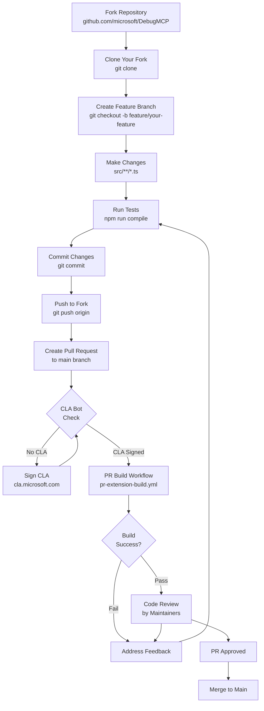
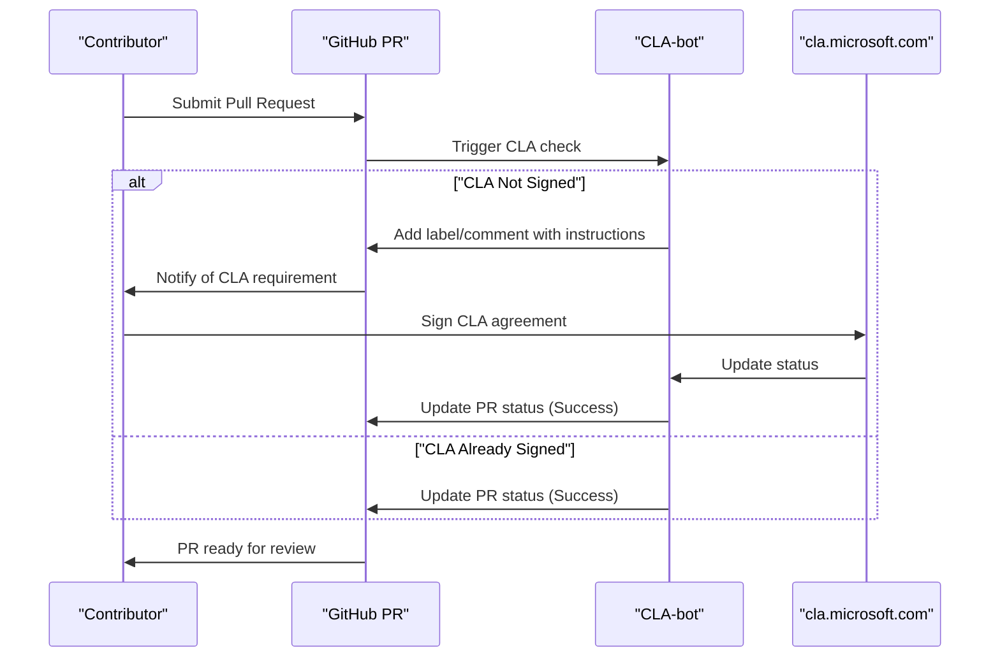

<!-- source: DeepWiki mcp.deepwiki.com · repo microsoft/DebugMCP · page 7.4 Contributing · fetched 2026-10-26 -->

# Contributing

Relevant source files

The following files were used as context for generating this wiki page:

- [CODE_OF_CONDUCT.md](CODE_OF_CONDUCT.md)
- [CONTRIBUTING.md](CONTRIBUTING.md)
- [LICENSE.txt](LICENSE.txt)
- [SECURITY.md](SECURITY.md)
- [SUPPORT.md](SUPPORT.md)

This page provides guidelines for contributing to the DebugMCP project, including the contribution process, legal requirements, and community standards. For instructions on building the extension locally, see **7.1 Building from Source**. For information about running tests, see **7.2 Running Tests**. For details on the automated build system, see **7.3 CI/CD Pipeline**.

## Getting Started

DebugMCP is an open-source project maintained by Microsoft. Contributions are welcome in the form of code, documentation, bug reports, and feature requests. The project follows Microsoft's standard open-source contribution model, which requires contributors to agree to a Contributor License Agreement (CLA) [CONTRIBUTING.md:3-6]().

### Support and Communication
This project uses GitHub Issues to track bugs and feature requests [SUPPORT.md:15-17](). Before filing a new issue, please search existing issues to avoid duplicates [SUPPORT.md:15-16]().

Sources: [CONTRIBUTING.md:1-7](), [SUPPORT.md:11-17]()

## Contribution Workflow

The following diagram illustrates the complete contribution workflow from initial fork to merge:

**Figure 1: Contribution Lifecycle**

Sources: [CONTRIBUTING.md:1-14](), [SUPPORT.md:13-17]()

## Contributor License Agreement (CLA)

All contributors must sign a Contributor License Agreement (CLA) declaring that they have the right to, and actually do, grant Microsoft the rights to use the contribution [CONTRIBUTING.md:3-6]().

### CLA Process

**Figure 2: CLA Verification Flow**

**Key Points**:
- The CLA-bot automatically determines if you need to provide a CLA when you submit a pull request [CONTRIBUTING.md:8-9]().
- You only need to do this once across all Microsoft repositories [CONTRIBUTING.md:10]().
- Follow the instructions provided by the bot in the PR comments [CONTRIBUTING.md:9-10]().

Sources: [CONTRIBUTING.md:1-11]()

## Security Policy

Microsoft takes the security of software products seriously [SECURITY.md:5-6]().

**Reporting Vulnerabilities**:
- **Do not report security vulnerabilities through public GitHub issues** [SECURITY.md:8-9]().
- Review the latest guidance for reporting at [https://aka.ms/SECURITY.md](https://aka.ms/SECURITY.md) [SECURITY.md:10-12]().

Sources: [SECURITY.md:1-14]()

## Code of Conduct

This project has adopted the [Microsoft Open Source Code of Conduct](https://opensource.microsoft.com/codeofconduct) [CODE_OF_CONDUCT.md:1-3]().

**Resources**:
- [Code of Conduct FAQ](https://opensource.microsoft.com/codeofconduct/faq) [CODE_OF_CONDUCT.md:8]().
- Contact [opencode@microsoft.com](mailto:opencode@microsoft.com) with questions or concerns [CODE_OF_CONDUCT.md:9]().

Sources: [CODE_OF_CONDUCT.md:1-11](), [CONTRIBUTING.md:12-14]()

## Issue Reporting and Support

### Bug Reports and Feature Requests
- Use GitHub Issues to track bugs and feature requests [SUPPORT.md:15-17]().
- Search existing issues before filing new ones to avoid duplicates [SUPPORT.md:15-16]().

### Microsoft Support Policy
Support for this project is limited to the resources listed in the `SUPPORT.md` file [SUPPORT.md:23-26](). There is currently no official Customer Service & Support (CSS) for this project [SUPPORT.md:1-5]().

Sources: [SUPPORT.md:1-26]()

## Development Guidelines

### Pull Request Checklist
Before submitting a pull request, ensure:
1. You have forked the repository and created a feature branch.
2. Code is formatted and passes basic compilation (`npm run compile`).
3. You are prepared to sign the CLA via the automated bot [CONTRIBUTING.md:8-9]().
4. Security vulnerabilities are **not** included in the PR or public comments [SECURITY.md:8-9]().

### Licensing
By contributing, you agree that your contributions will be licensed under the **MIT License** [LICENSE.txt:3](). 

**Permissions under MIT**:
- Permission is granted to deal in the software without restriction, including rights to use, copy, modify, merge, publish, and distribute [LICENSE.txt:5-9]().
- The copyright notice and permission notice must be included in all copies [LICENSE.txt:12-13]().

Sources: [LICENSE.txt:1-21](), [CONTRIBUTING.md:3-6]()

---

**Quick Summary for Contributors**:
| Requirement | Action | Link/Reference |
|-------------|--------|----------------|
| **Legal** | Sign the CLA | [cla.microsoft.com](https://cla.microsoft.com) |
| **Bugs** | File a GitHub Issue | [SUPPORT.md:15-17]() |
| **Security** | Report privately | [aka.ms/SECURITY.md](https://aka.ms/SECURITY.md) |
| **Conduct** | Follow MS standards | [CODE_OF_CONDUCT.md:1-3]() |
| **License** | MIT License | [LICENSE.txt:1-21]() |

---

