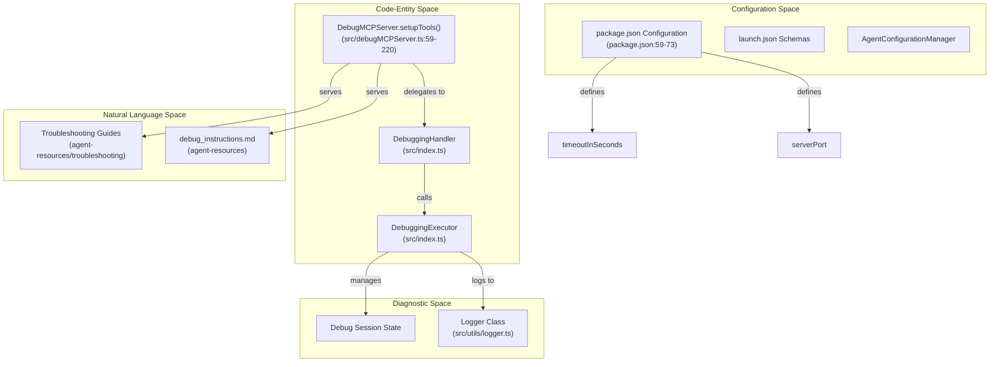
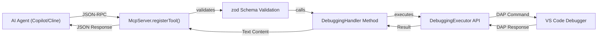
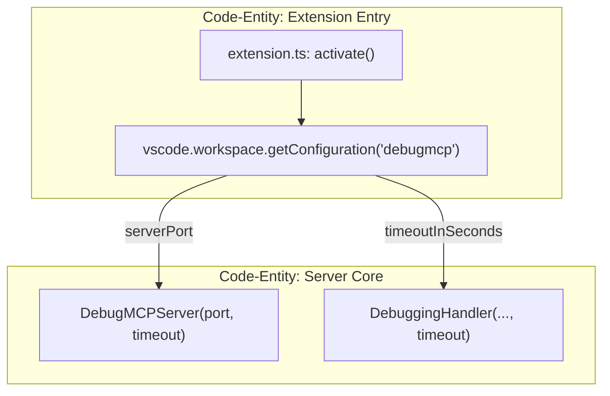

<!-- source: DeepWiki mcp.deepwiki.com · repo microsoft/DebugMCP · page 8 Reference · fetched 2026-10-26 -->

# Reference

Relevant source files

The following files were used as context for generating this wiki page:

- [README.md](README.md)
- [assets/DebugMCP.webp](assets/DebugMCP.webp)
- [assets/architecture.png](assets/architecture.png)
- [src/debugMCPServer.ts](src/debugMCPServer.ts)

This section provides comprehensive reference documentation for DebugMCP's APIs, configurations, and troubleshooting resources. It serves as a technical reference for developers working with the extension, integrating AI agents, or contributing to the codebase.

The reference material is organized into four main areas:
- **MCP Tools API** ([MCP Tools API](#8.1)): Complete specification for all 13 debugging tools.
- **Configuration Reference** ([Configuration Reference](#8.2)): Extension settings, server configuration, and agent integration.
- **Troubleshooting Guide** ([Troubleshooting Guide](#8.3)): Language-specific debugging issues and solutions.
- **Agent Resources** ([Agent Resources](#8.4)): Documentation resources queryable by AI agents.

For architectural information about how these components work together, see [Architecture Overview](#3). For usage guides and tutorials, see [Getting Started](#2).

---

## Reference Material Structure

The DebugMCP reference system consists of code-based APIs (MCP tools), declarative configurations (JSON schemas), runtime resources (markdown documents), and diagnostic information (troubleshooting guides).

Sources: [src/debugMCPServer.ts:1-54](), [package.json:59-73](), [src/utils/logger.ts:1-110]()

---

## MCP Tools Quick Reference

DebugMCP exposes 13 debugging tools through the Model Context Protocol. Each tool is registered in `DebugMCPServer.setupTools()` and delegates to corresponding `DebuggingHandler` methods.

### Tool Registration Map

| Tool Name | Handler Method | Parameters | Line Reference |
|-----------|---------------|------------|----------------|
| `get_debug_instructions` | N/A (Direct Load) | none | [src/debugMCPServer.ts:61-68]() |
| `start_debugging` | `handleStartDebugging()` | `fileFullPath`, `workingDirectory`, `testName?`, `configurationName?` | [src/debugMCPServer.ts:71-97]() |
| `stop_debugging` | `handleStopDebugging()` | none | [src/debugMCPServer.ts:100-105]() |
| `step_over` | `handleStepOver()` | none | [src/debugMCPServer.ts:108-113]() |
| `step_into` | `handleStepInto()` | none | [src/debugMCPServer.ts:115-121]() |
| `step_out` | `handleStepOut()` | none | [src/debugMCPServer.ts:123-129]() |
| `continue_execution` | `handleContinue()` | none | [src/debugMCPServer.ts:131-137]() |
| `restart_debugging` | `handleRestart()` | none | [src/debugMCPServer.ts:139-145]() |
| `add_breakpoint` | `handleAddBreakpoint()` | `fileFullPath`, `lineContent` | [src/debugMCPServer.ts:148-158]() |
| `remove_breakpoint` | `handleRemoveBreakpoint()` | `fileFullPath`, `line` | [src/debugMCPServer.ts:161-171]() |
| `clear_all_breakpoints` | `handleClearAllBreakpoints()` | none | [src/debugMCPServer.ts:174-180]() |
| `list_breakpoints` | `handleListBreakpoints()` | none | [src/debugMCPServer.ts:183-189]() |
| `get_variables_values` | `handleGetVariables()` | `scope?` | [src/debugMCPServer.ts:192-201]() |
| `evaluate_expression` | `handleEvaluateExpression()` | `expression` | [src/debugMCPServer.ts:204-213]() |

Sources: [src/debugMCPServer.ts:59-215]()

### Tool Execution Flow

All tools follow a consistent implementation pattern using `zod` schema validation and the `@modelcontextprotocol/sdk`:

Sources: [src/debugMCPServer.ts:46-54](), [src/debugMCPServer.ts:71-97]()

---

## Configuration System Overview

DebugMCP uses two primary configuration options defined in `package.json` and managed via the VS Code Settings API.

### Extension Configuration Schema

| Configuration Key | Default | Type | Description |
|-------------------|---------|------|-------------|
| `debugmcp.serverPort` | `3001` | `number` | The port on which the MCP server listens for connections. |
| `debugmcp.timeoutInSeconds` | `180` | `number` | Timeout for debugging operations (e.g., waiting for session start). |

Sources: [package.json:59-73]()

### Configuration Flow

The `DebugMCPServer` receives these values during instantiation from the extension's entry point.

Sources: [src/debugMCPServer.ts:22-36](), [package.json:62-71]()

---

## Resource System

DebugMCP exposes documentation resources that AI agents can query. Resources are loaded from markdown files in the `agent-resources` directory.

### Resource URI Scheme

| Resource URI | Source File Path | Purpose |
|--------------|------------------|---------|
| `debugmcp://docs/debug_instructions` | `agent-resources/debug_instructions.md` | Core debugging workflow and best practices. |
| `debugmcp://docs/troubleshooting/python` | `agent-resources/troubleshooting/python.md` | Python-specific environment and debugger setup. |
| `debugmcp://docs/troubleshooting/javascript` | `agent-resources/troubleshooting/javascript.md` | Node.js and JS debugger configuration. |
| `debugmcp://docs/troubleshooting/java` | `agent-resources/troubleshooting/java.md` | Java/JUnit debugging guidance. |
| `debugmcp://docs/troubleshooting/csharp` | `agent-resources/troubleshooting/csharp.md` | .NET Core and C# debugging tips. |

Sources: [src/debugMCPServer.ts:227-262]()

---

## Logging and Diagnostics

The `Logger` class provides a centralized mechanism for tracking extension behavior and troubleshooting issues.

### Logger Severity Levels

| Level | Method | Purpose |
|-------|--------|---------|
| `DEBUG` | `logger.debug()` | Verbose technical details for developers. |
| `INFO` | `logger.info()` | Standard operational events (server start, session init). |
| `WARN` | `logger.warn()` | Potential issues that don't stop execution. |
| `ERROR` | `logger.error()` | Critical failures and exceptions. |

Sources: [src/utils/logger.ts:5-20](), [src/utils/logger.ts:32-60]()

### Diagnostic Commands

The logger includes helper methods for environment capture:
- `logger.logSystemInfo()`: Captures VS Code version, OS, and architecture. [src/utils/logger.ts:80-92]()
- `logger.logEnvironment()`: Captures environment variables relevant to debugging. [src/utils/logger.ts:94-105]()

---

## Server Endpoint Reference

The DebugMCP server uses the `StreamableHTTPServerTransport` from the MCP SDK to provide an HTTP-based communication channel.

### Endpoint Specification

- **Default URL**: `http://localhost:3001/sse`
- **Transport Type**: SSE (Server-Sent Events) with POST for client-to-server messages.
- **Protocol**: Model Context Protocol (MCP) 1.0.

Sources: [src/debugMCPServer.ts:28](), [src/debugMCPServer.ts:331-337]()

---

## Package Metadata

| Property | Value |
|----------|-------|
| **Extension ID** | `ozzafar.debugmcpextension` |
| **Publisher** | `ozzafar` |
| **Version** | `1.0.9` |
| **Engine Requirement** | `^1.104.0` |

Sources: [package.json:2-27](), [README.md:9-10]()

### Activation Events

The extension activates on `onStartupFinished` to ensure the MCP server is available immediately, and on `onDebug` to support active debugging sessions.

Sources: [package.json:38-41]()

---

