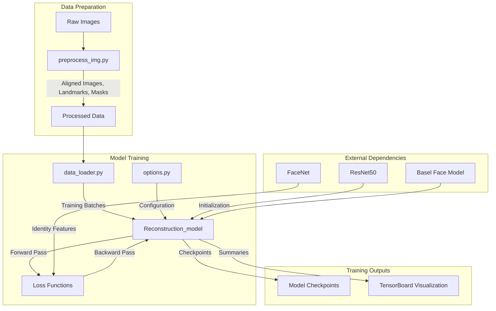
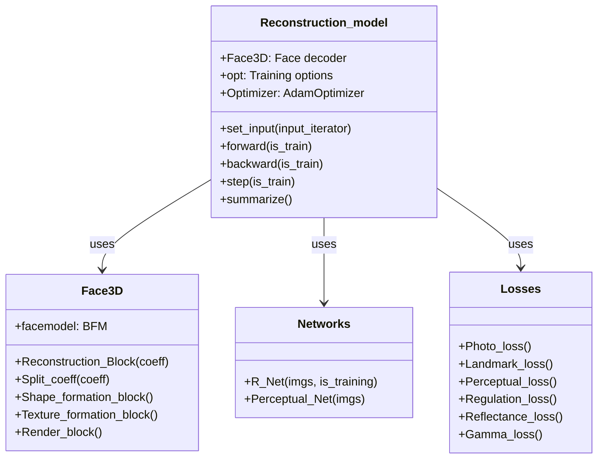
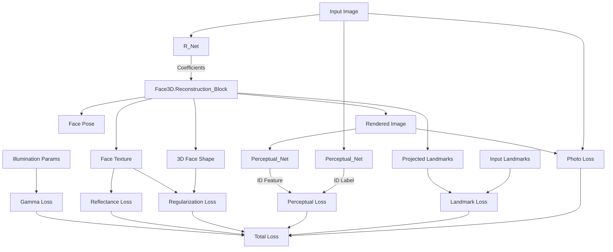
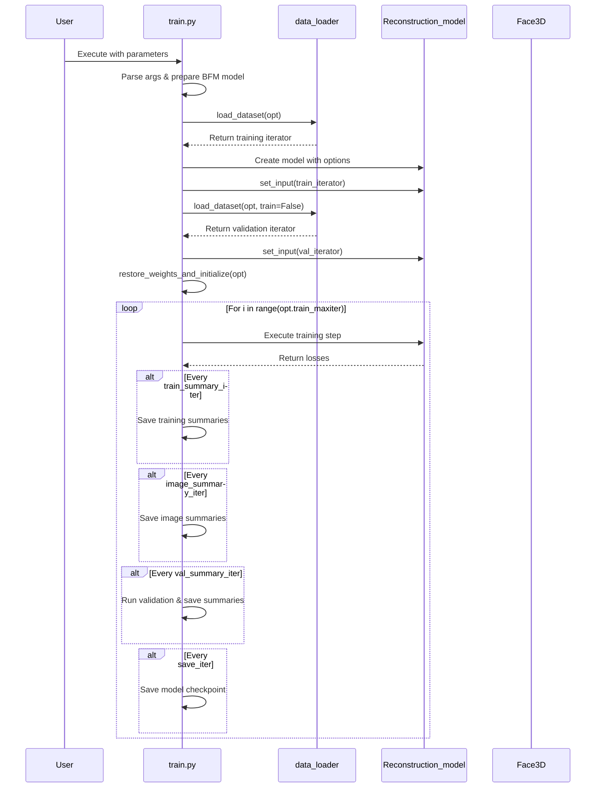

<!-- source: DeepWiki mcp.deepwiki.com · repo microsoft/Deep3DFaceReconstruction · page 3.2 Training Pipeline · fetched 2026-10-26 -->

# Training Pipeline

<details>
<summary>Relevant source files</summary>

The following files were used as context for generating this wiki page:

- [images/example.png](images/example.png)
- [losses.py](losses.py)
- [options.py](options.py)
- [readme.md](readme.md)
- [reconstruction_model.py](reconstruction_model.py)
- [train.py](train.py)

</details>


This document provides a comprehensive guide to training your own models using the Deep3DFaceReconstruction system. It covers data preparation, model architecture, loss functions, training procedure, and monitoring of training progress. For running inference with pre-trained models, see [Inference with demo.py](#3.1). For detailed information on data preprocessing, see [Data Preprocessing](#3.3).

## Overview

The training pipeline optimizes a convolutional neural network (R-Net) to predict 3D face model coefficients from single input images. These coefficients parameterize the 3D morphable face model (BFM) to generate accurate 3D reconstructions. The system employs a weakly-supervised approach with multiple loss functions that don't require ground-truth 3D scans.



Sources: [train.py](), [readme.md:152-196]()

## Training Requirements

Before you begin training, ensure you have the following prerequisites:

1. **Environment**:
   - Linux operating system (training is only supported on Linux)
   - TensorFlow 1.12
   - Python 3.6 with necessary packages (numpy, scipy, pillow, argparse)
   - [tf_mesh_renderer](https://github.com/google/tf_mesh_renderer) for rendering capabilities

2. **Pre-trained Models**:
   - [Facenet](https://github.com/davidsandberg/facenet) (version 20170512-110547) for identity feature extraction
   - [ResNet50-v1](https://github.com/tensorflow/models/blob/master/research/slim/README.md) pre-trained on ImageNet for initializing the reconstruction network
   - 68-facial-landmark detector for computing landmark loss during training

3. **3D Face Model**:
   - Basel Face Model 2009 (BFM09)
   - Expression Basis transferred from Facewarehouse

Sources: [readme.md:152-157](), [readme.md:159-164]()

## Training Preparation

Follow these steps to prepare for training:

1. **Download Pre-trained Models**:
   ```
   # Facenet weights
   # Place in ./weights/id_net

   # ResNet-50 weights
   # Place resnet_v1_50.ckpt in ./weights/resnet

   # 68 landmark detector
   # Place in ./network
   ```

2. **Data Pre-processing**:
   - Obtain 5-point facial landmarks for your training images using dlib or MTCNN
   - Run the preprocessing script to align images and generate 68 landmarks and skin masks:
   ```
   python preprocess_img.py --img_path <raw_img_path> --save_path <save_path_for_processed_data>
   ```

Sources: [readme.md:159-175]()

## Training Model Architecture

The training pipeline is built around the `Reconstruction_model` class, which integrates several components:



Sources: [reconstruction_model.py:1-13](), [reconstruction_model.py:21-42]()

Key components:

1. **R-Net**: A modified ResNet-50 architecture that predicts coefficients from aligned face images
2. **Face3D**: A decoder that transforms coefficients into 3D face shape, texture, and rendering
3. **Perceptual Network**: FaceNet-based architecture that extracts identity features
4. **Loss Functions**: Multiple loss components to guide the training process

## Forward Pass

During the forward pass, the following sequence occurs:



Sources: [reconstruction_model.py:21-41]()

## Loss Functions

The training employs multiple specialized loss functions to achieve accurate face reconstruction:

| Loss Function | Description | Weight Parameter |
|---------------|-------------|------------------|
| Photo Loss | Measures pixel-wise difference between input and rendered images in skin regions | `w_photo` (1.92) |
| Landmark Loss | Ensures projected 3D landmarks align with 2D landmarks, with higher weights for mouth and nose | `w_lm` (1.6e-3) |
| Perceptual Loss | Preserves identity using cosine similarity of features from a face recognition network | `w_id` (0.2) |
| Regularization Loss | Constrains face model coefficients to ensure plausible faces | `w_reg` (3.0e-4) |
| Reflectance Loss | Encourages uniform skin albedo | `w_ref` (5.0) |
| Gamma Loss | Ensures nearly-monochromatic lighting | `w_gamma` (10.0) |

Sources: [losses.py:7-76](), [options.py:36-46]()

### Detailed Loss Implementation

The total loss is a weighted combination of all individual losses:

```
total_loss = w_photo * photo_loss + w_lm * landmark_loss + w_id * perceptual_loss 
             + w_reg * reg_loss + w_ref * reflect_loss + w_gamma * gamma_loss
```

Each loss component is specifically designed for the face reconstruction task:

1. **Photometric Loss** - Computes the root mean square error between the input image and the rendered image, using skin masks to focus on face regions [losses.py:8-21]()

2. **Landmark Loss** - Uses different weights for different facial regions, with higher weights for landmarks around mouth and nose regions [losses.py:34-44]()

3. **Perceptual Loss** - Based on cosine similarity between identity features extracted by the face recognition network [losses.py:23-32]()

4. **Regularization Loss** - L2 regularization on identity, expression, and texture coefficients [losses.py:46-54]()

5. **Reflectance Loss** - Minimizes texture variance in skin regions to ensure uniform albedo [losses.py:56-67]()

6. **Gamma Loss** - Enforces consistent illumination across color channels [losses.py:69-75]()

Sources: [reconstruction_model.py:31-41](), [losses.py:7-76]()

## Training Process

The training process is orchestrated by the `train.py` script:



Sources: [train.py:63-138]()

## Training Configuration Options

Training behavior is controlled by the `Option` class in `options.py`:

| Parameter | Description | Default |
|-----------|-------------|---------|
| `model_dir` | Directory for model output | 'result' |
| `model_name` | Name of the model | 'model_test' |
| `data_path` | Path to training data | ['./processed_data'] |
| `val_data_path` | Path to validation data | ['./processed_data'] |
| `batch_size` | Batch size for training | 16 |
| `lr` | Learning rate with piecewise schedule | [1e-4, 2e-5] |
| `boundaries` | LR schedule boundaries | [100000] |
| `augment` | Whether to use data augmentation | True |
| `train_maxiter` | Maximum training iterations | 200000 |
| `train_summary_iter` | Frequency for training summaries | 50 |
| `image_summary_iter` | Frequency for image summaries | 200 |
| `val_summary_iter` | Frequency for validation summaries | 1000 |
| `save_iter` | Frequency for saving checkpoints | 10000 |

Sources: [options.py:7-63]()

## Running Training

To train a model, use the following command:

```bash
python train.py --data_path <custom_data_path> --val_data_path <custom_val_data_path> --model_name <custom_model_name>
```

Training artifacts will be saved in `result/<custom_model_name>/`:
- Model checkpoints: Saved every `save_iter` iterations
- Summary logs: For TensorBoard visualization

Note: Training with default parameters (batch size 16, 200K iterations) takes approximately 20 hours on a single Tesla M40 GPU.

Sources: [train.py:17-26](), [readme.md:179-196]()

## Monitoring Training Progress

You can monitor training progress using TensorBoard:

```bash
tensorboard --logdir=result/<custom_model_name> --port=10001
```

TensorBoard will display:
1. **Scalar metrics**:
   - Photometric error
   - Landmark error
   - Identity similarity error
   - Regularization errors
   
2. **Image visualizations**:
   - Input images
   - Reconstructed faces
   - Combined visualizations

Sources: [reconstruction_model.py:64-86](), [readme.md:187-189]()

## Evaluating Trained Models

To evaluate a trained model:

```bash
python demo.py --use_pb 0 --pretrain_weights <custom_weights>.ckpt
```

This runs inference on test images in the `./input` directory and saves results in `./output`:
- 3D face meshes (`.obj` files)
- Reconstruction parameters (`.mat` files)
- Rendered images

Sources: [readme.md:190-196]()

## Implementation Details

The core training implementation resides in:

1. **train.py**: The main training script that handles data loading, model creation, training loop, and checkpoint management [train.py:63-138]()

2. **reconstruction_model.py**: Defines the `Reconstruction_model` class that performs forward and backward passes during training [reconstruction_model.py:9-86]()

3. **losses.py**: Implements all loss functions used for training [losses.py:7-76]()

4. **options.py**: Contains the configuration options for training [options.py:7-63]()

5. **data_loader.py**: Handles loading and batching of training data

The backward pass to update model weights is implemented in [reconstruction_model.py:44-56](), which:
1. Gets all trainable variables (focusing on ResNet and fully-connected layers)
2. Computes gradients with respect to the total loss
3. Applies gradients using the Adam optimizer with learning rate scheduling

Sources: [train.py](), [reconstruction_model.py]()

---

