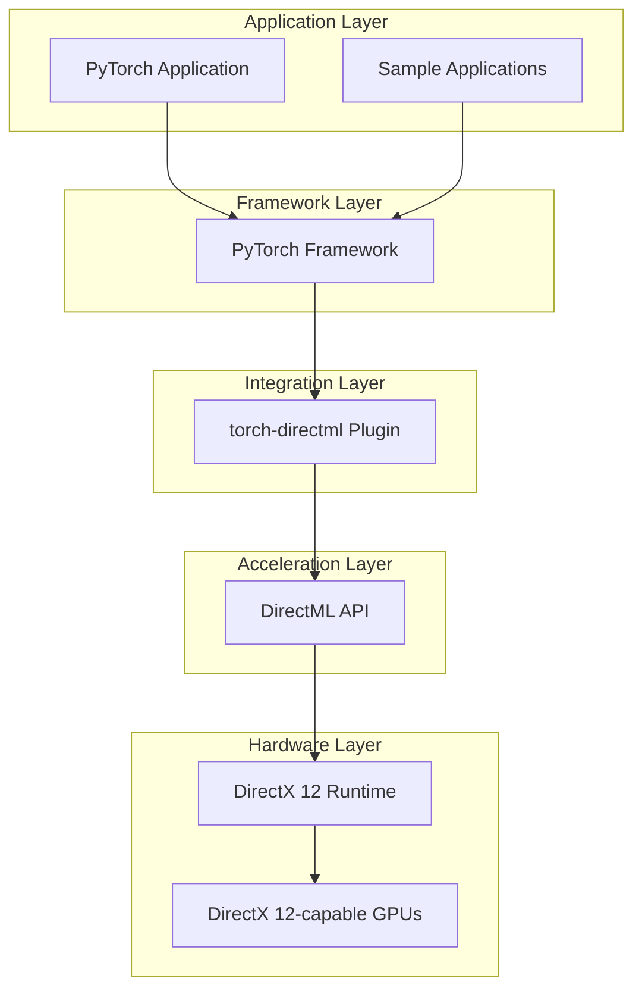
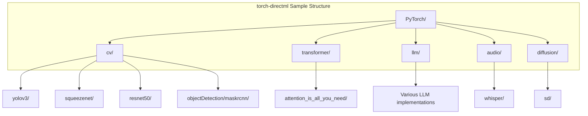
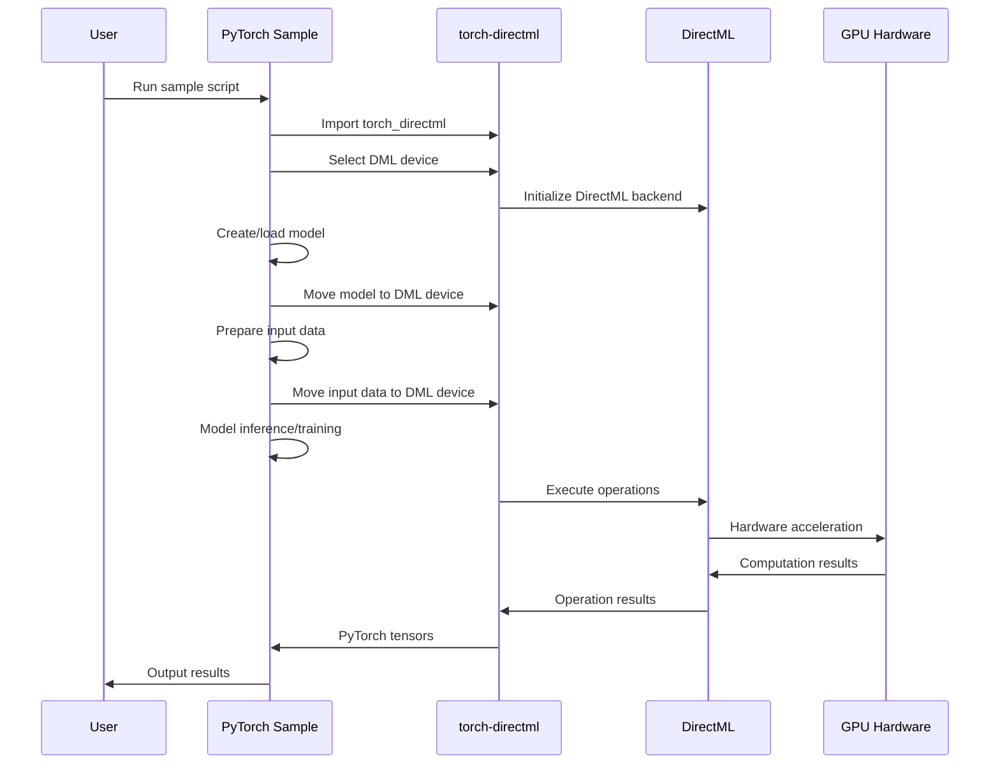

<!-- source: DeepWiki mcp.deepwiki.com · repo microsoft/DirectML · page 5.1 PyTorch Integration · fetched 2026-10-26 -->

# PyTorch Integration

<details>
<summary>Relevant source files</summary>

The following files were used as context for generating this wiki page:

- [PyTorch/README.md](PyTorch/README.md)

</details>


## Purpose and Scope

This document provides an overview of the PyTorch integration with DirectML through the `torch-directml` plugin. It covers functionality, installation, supported platforms, and available sample applications that demonstrate how to use PyTorch with DirectML. For information about ONNX Runtime integration with DirectML, see [ONNX Runtime Integration](#5.2).

## Introduction to torch-directml

PyTorch with DirectML enables training and inference of complex machine learning models on DirectX 12-compatible hardware. This integration is implemented through `torch-directml`, a plugin for PyTorch that connects PyTorch's frontend with DirectML's hardware acceleration capabilities.

DirectML is a high-performance, hardware-accelerated DirectX 12 library for machine learning that provides GPU acceleration for common machine learning tasks across a broad range of hardware and drivers, including DirectX 12-capable GPUs from vendors such as AMD, Intel, NVIDIA, and Qualcomm.

Sources: [PyTorch/README.md:1-7]()

## System Architecture

The following diagram illustrates how `torch-directml` integrates with both PyTorch and DirectML:



The `torch-directml` plugin serves as an integration layer between PyTorch and DirectML, allowing PyTorch models to execute on DirectX 12-compatible GPUs from various hardware vendors.

Sources: [PyTorch/README.md:3-7]()

## Installation and Setup

PyTorch with DirectML is available as a PyPI package and can be installed using pip:

```
pip install torch-directml
```

The package supports Python versions 3.8 to 3.12 and is compatible with both Windows and Windows Subsystem for Linux (WSL).

For detailed setup instructions, Microsoft Learn provides comprehensive guides for:
- [Windows setup](https://learn.microsoft.com/windows/ai/directml/pytorch-windows)
- [WSL 2 setup](https://learn.microsoft.com/windows/ai/directml/pytorch-wsl)

Sources: [PyTorch/README.md:9-15]()

## Supported Platforms and Hardware

`torch-directml` supports the following platforms:

| Platform | Support |
|----------|---------|
| Windows | ✓ |
| Windows Subsystem for Linux (WSL 2) | ✓ |

The integration works with all DirectX 12-capable GPUs from the following vendors:
- AMD
- Intel
- NVIDIA
- Qualcomm

This cross-vendor support enables developers to run their PyTorch models on a wide range of hardware devices.

Sources: [PyTorch/README.md:5, 10]()

## Sample Applications

### Sample Structure and Organization

The DirectML repository contains a variety of sample applications demonstrating the use of PyTorch with DirectML across different machine learning domains:



These samples cover a diverse range of machine learning applications across multiple domains:

| Domain | Sample | Description | Location |
|--------|--------|-------------|----------|
| Transformer | Attention is All You Need | The original transformer model | `transformer/attention_is_all_you_need/` |
| Computer Vision | YOLOv3 | Real-time object detection | `cv/yolov3/` |
| Computer Vision | SqueezeNet | Small image classification model | `cv/squeezenet/` |
| Computer Vision | ResNet50 | Image classification model | `cv/resnet50/` |
| Computer Vision | MaskRCNN | Object detection model | `cv/objectDetection/maskrcnn/` |
| Language Models | Various LLMs | Text generation and chatbot applications | `llm/` |
| Audio | Whisper | General-purpose speech recognition | `audio/whisper/` |
| Diffusion | Stable Diffusion Turbo & XL Turbo | Text-to-image generation | `diffusion/sd/` |

These samples serve as practical examples for developers looking to leverage PyTorch with DirectML for their own machine learning projects.

Sources: [PyTorch/README.md:17-27]()

### Sample Applications Workflow

The following diagram illustrates the general workflow for PyTorch samples using DirectML:



This workflow represents the typical pattern used in the sample applications, with `torch-directml` acting as the intermediary between PyTorch models and the DirectML hardware acceleration.

Sources: [PyTorch/README.md:17-27]()

## External Resources

For more information about PyTorch with DirectML, refer to these resources:

- [torch-directml PyPI project](https://pypi.org/project/torch-directml)
- [PyTorch homepage](https://pytorch.org)
- [DirectML Overview on Microsoft Learn](https://learn.microsoft.com/windows/ai/directml/dml)

Sources: [PyTorch/README.md:28-30]()

---

