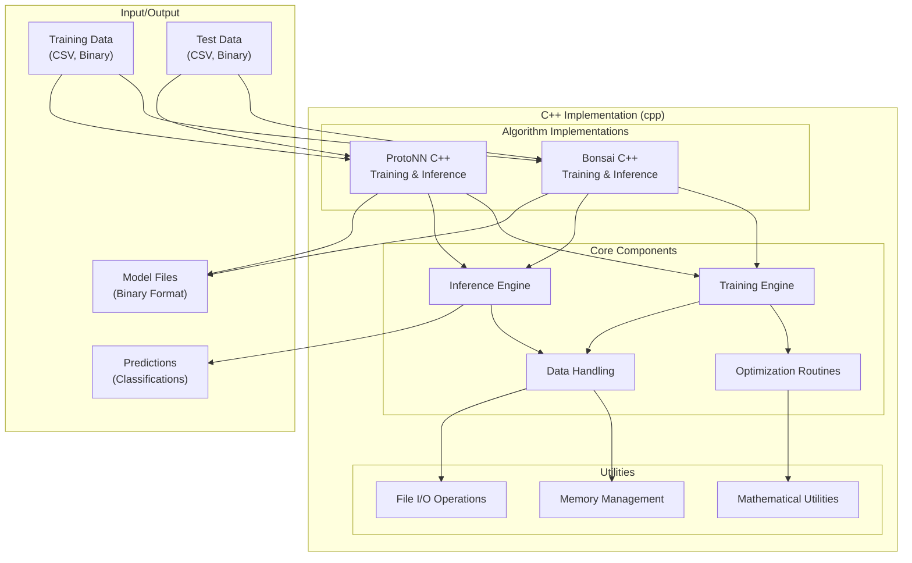
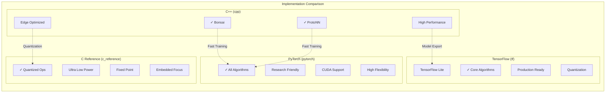
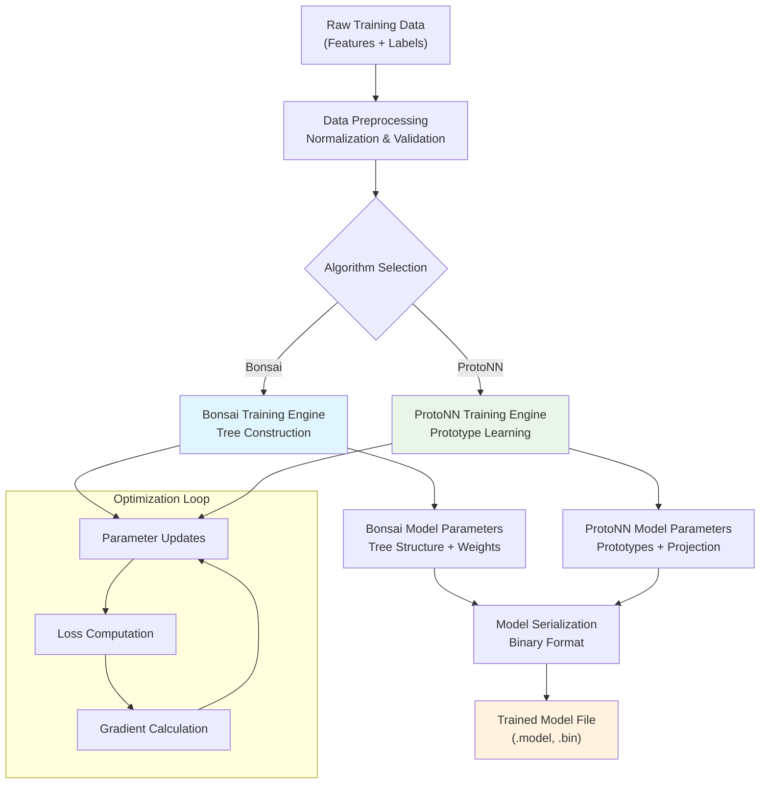
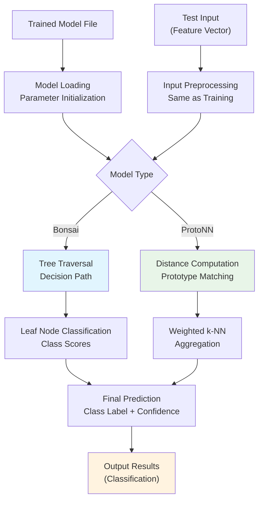
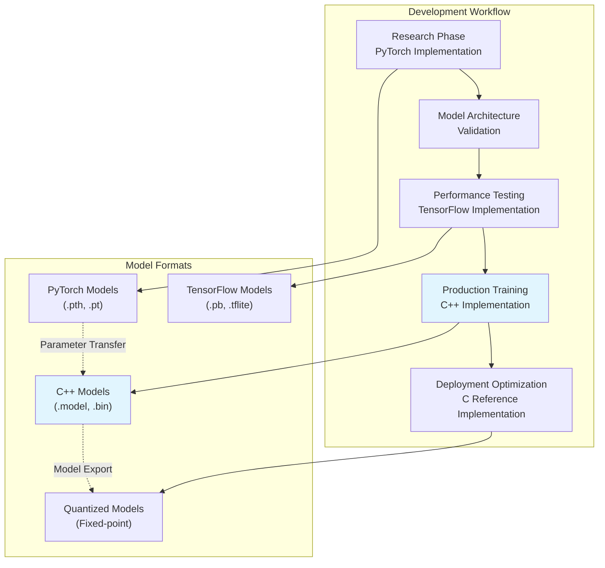
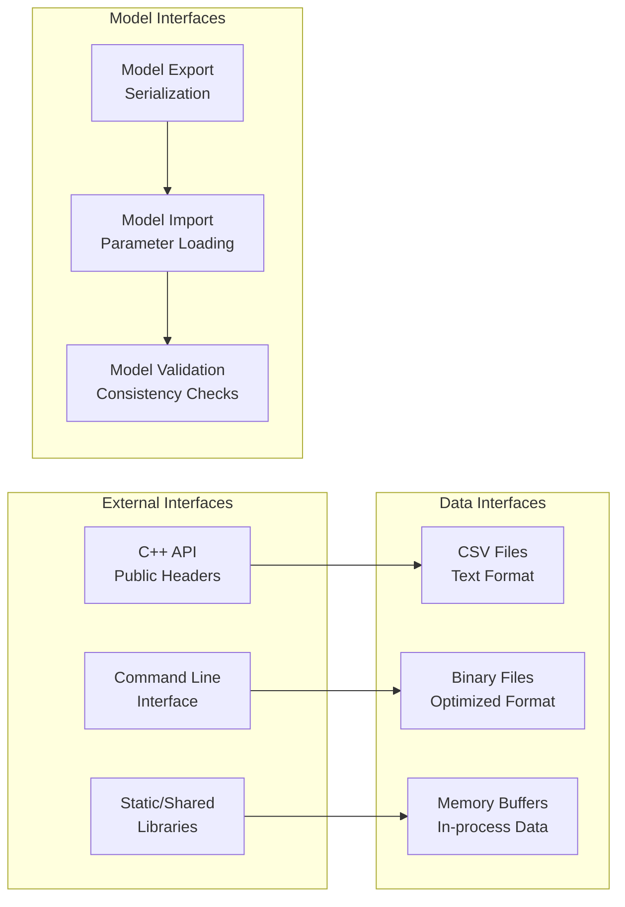

<!-- source: DeepWiki mcp.deepwiki.com · repo microsoft/EdgeML · page 3.3 C++ Implementation · fetched 2026-10-26 -->

# C++ Implementation

Relevant source files

The following files were used as context for generating this wiki page:

- [README.md](README.md)
- [c_reference/Makefile](c_reference/Makefile)
- [c_reference/README.md](c_reference/README.md)
- [c_reference/config.mk](c_reference/config.mk)
- [c_reference/include/classifier.h](c_reference/include/classifier.h)
- [c_reference/include/fastgrnn.h](c_reference/include/fastgrnn.h)
- [c_reference/include/utils.h](c_reference/include/utils.h)
- [c_reference/src/classifier.c](c_reference/src/classifier.c)
- [c_reference/src/utils.c](c_reference/src/utils.c)
- [c_reference/tests/fastgrnn/test_fastgrnn_lr.c](c_reference/tests/fastgrnn/test_fastgrnn_lr.c)
- [c_reference/tests/rnnpool/test_rnnpool.c](c_reference/tests/rnnpool/test_rnnpool.c)
- [examples/pytorch/DROCC/README.md](examples/pytorch/DROCC/README.md)
- [examples/pytorch/DROCC/data_process_scripts/process_cifar.py](examples/pytorch/DROCC/data_process_scripts/process_cifar.py)
- [examples/pytorch/DROCC/data_process_scripts/process_mnist.py](examples/pytorch/DROCC/data_process_scripts/process_mnist.py)
- [examples/pytorch/DROCC/main_cifar.py](examples/pytorch/DROCC/main_cifar.py)
- [examples/pytorch/DROCC/main_drocclf_mnist.py](examples/pytorch/DROCC/main_drocclf_mnist.py)
- [examples/pytorch/DROCC/main_tabular.py](examples/pytorch/DROCC/main_tabular.py)
- [examples/pytorch/DROCC/main_timeseries.py](examples/pytorch/DROCC/main_timeseries.py)
- [pytorch/README.md](pytorch/README.md)
- [pytorch/edgeml_pytorch/trainer/drocc_trainer.py](pytorch/edgeml_pytorch/trainer/drocc_trainer.py)
- [pytorch/edgeml_pytorch/trainer/drocclf_trainer.py](pytorch/edgeml_pytorch/trainer/drocclf_trainer.py)
- [tf/README.md](tf/README.md)

## Purpose and Scope

The C++ implementation provides efficient training and inference capabilities for two core EdgeML algorithms: **Bonsai** and **ProtoNN**. This implementation focuses on high-performance computation for edge devices where C++ offers better memory management and execution speed compared to Python-based frameworks.

For information about other algorithm implementations, see [PyTorch Implementation](#3.1) and [TensorFlow Implementation](#3.2). For quantized inference optimizations, see [C Reference Implementation](#3.4).

Sources: [README.md:41]()

## Supported Algorithms

The C++ implementation specifically targets two algorithms from the EdgeML suite:

| Algorithm | Type | Description |
|-----------|------|-------------|
| **Bonsai** | Tree-based Classifier | Strong and shallow non-linear tree-based classifier optimized for edge devices |
| **ProtoNN** | Prototype-based kNN | Prototype-based k-nearest neighbors classifier with efficient memory usage |

Both algorithms are designed to produce models with extremely small memory footprints suitable for IoT devices and edge computing scenarios.

Sources: [README.md:15-16](), [README.md:41]()

## Architecture Overview

Sources: [README.md:41]()

## Implementation Comparison Matrix

The C++ implementation serves a specific role within the broader EdgeML ecosystem:

Sources: [README.md:37-44]()

## Core Components and Data Flow

### Training Pipeline

### Inference Pipeline

Sources: [README.md:15-16]()

## Key Advantages of C++ Implementation

### Performance Characteristics

| Aspect | C++ Advantage | Benefit |
|--------|---------------|---------|
| **Memory Management** | Manual memory control | Minimal overhead, predictable usage |
| **Execution Speed** | Compiled native code | Faster inference for real-time applications |
| **Resource Efficiency** | No runtime dependencies | Suitable for constrained environments |
| **Deterministic Behavior** | No garbage collection | Consistent latency for edge devices |

### Use Cases

The C++ implementation is particularly suited for:

1. **Production Edge Deployment**: Where Python frameworks are too heavy
2. **Real-time Inference**: Applications requiring consistent low latency
3. **Resource-Constrained Devices**: IoT sensors with limited memory/CPU
4. **Embedded Systems**: Integration into existing C++ codebases
5. **High-Throughput Processing**: Batch inference scenarios

Sources: [README.md:8-11]()

## Integration with EdgeML Ecosystem

### Model Exchange Flow

### Cross-Platform Compatibility

The C++ implementation provides a bridge between research environments and production deployment:

- **Model Import**: Can load parameters trained in PyTorch/TensorFlow
- **Model Export**: Generates models compatible with C reference implementation
- **Format Standardization**: Uses consistent parameter formats across implementations
- **Validation**: Ensures numerical consistency with Python implementations

Sources: [README.md:37-44]()

## Development and Build Considerations

### Dependencies and Requirements

The C++ implementation is designed for minimal dependencies:

- **Standard C++ Libraries**: STL containers and algorithms
- **Mathematical Libraries**: BLAS/LAPACK for linear algebra operations
- **Compiler Requirements**: C++11 or later standard
- **Platform Support**: Cross-platform compatibility (Linux, Windows, macOS)

### Integration Points

The C++ implementation serves as a crucial component in the EdgeML pipeline, providing the performance and efficiency needed for edge deployment while maintaining compatibility with the research-oriented Python implementations.

Sources: [README.md:41](), [README.md:8-11]()

---

