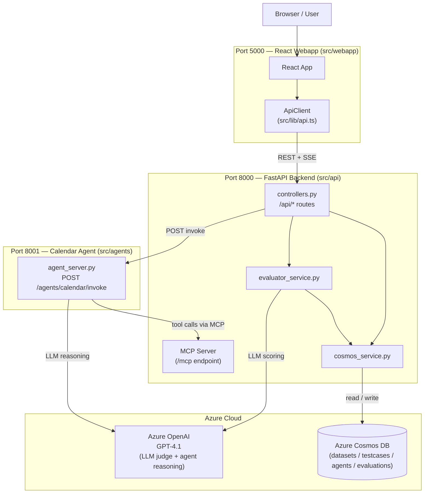
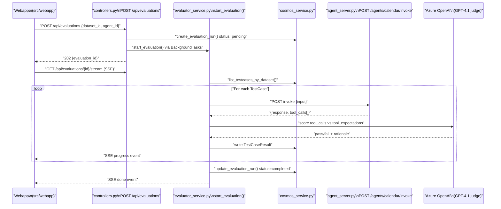
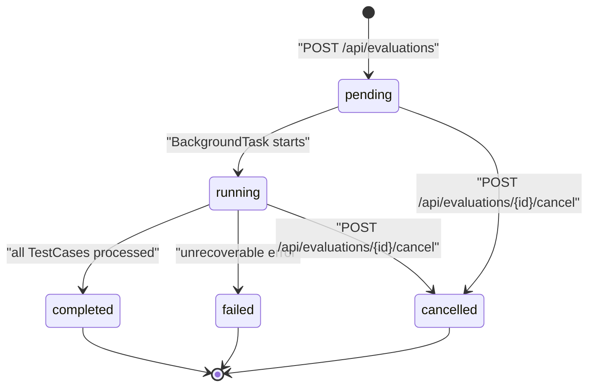

<!-- source: DeepWiki mcp.deepwiki.com · repo microsoft/EvalsforAgentsInterop · page 1 Overview · fetched 2026-10-26 -->

# Overview

<details>
<summary>Relevant source files</summary>

The following files were used as context for generating this wiki page:

- [AUTHORS.md](AUTHORS.md)
- [CODE_OF_CONDUCT.md](CODE_OF_CONDUCT.md)
- [CONTRIBUTING.md](CONTRIBUTING.md)
- [README.md](README.md)
- [src/api/README.md](src/api/README.md)

</details>


This page introduces the **EvalsforAgentsInterop** repository: its purpose, the problem it solves, and the high-level architecture of its three services. For setup instructions see [Getting Started](#1.1). For detailed per-service documentation, see [System Architecture](#2), [Backend API](#3), [Calendar Agent](#4), and [Web Application](#5).

---

## Purpose

EvalsforAgentsInterop is a platform for testing and evaluating AI agents that communicate via the [Model Context Protocol (MCP)](https://modelcontextprotocol.io). It provides:

- A structured way to define **evaluation datasets** — collections of test cases with expected tool call sequences and natural language assertions.
- A **backend engine** that runs evaluation campaigns against any conformant agent endpoint, using an LLM-as-judge (Azure OpenAI GPT-4.1) to score results.
- A **web UI** to manage datasets, register agents, launch evaluation runs, and inspect results in real time.
- A **sample Calendar Agent** demonstrating how to build an agent that connects to the platform's MCP server and can be evaluated against the included datasets.

The core problem the project addresses is **agent interoperability testing**: verifying that an AI agent uses the correct tools, with the correct arguments, in response to a given user input — across a repeatable, automated test suite.

Sources: [README.md:1-30](), [src/api/README.md:1-10]()

---

## Three-Service Architecture

The system is composed of three independently runnable services:

| Service | Directory | Default Port | Technology |
|---|---|---|---|
| Backend API | `src/api/` | 8000 | Python / FastAPI |
| Calendar Agent | `src/agents/` | 8001 | Python / FastAPI |
| Web Application | `src/webapp/` | 5000 | React / TypeScript |

All three services are orchestrated together via `docker-compose.yml` and share a single `.env` file at the repository root.

Sources: [README.md:6-28](), [README.md:208-223]()

---

## High-Level Service Topology

**Figure 1: Service topology and data flow**



Sources: [README.md:6-28](), [src/api/README.md:55-70]()

---

## Azure Dependencies

The platform depends on two Azure services:

| Azure Service | Role |
|---|---|
| **Azure Cosmos DB** (NoSQL, Serverless) | Persistent store for datasets, test cases, agent registrations, and evaluation runs. Four containers: `datasets`, `testcases`, `agents`, `evaluations`. |
| **Azure OpenAI** (GPT-4.1 deployment) | Shared by both the evaluation engine (as LLM judge scoring tool calls) and the Calendar Agent (for reasoning). |

Azure infrastructure is provisioned via Bicep templates in the `infra/` directory. Authentication uses `DefaultAzureCredential`; a `COSMOS_KEY` is optional for local development but a managed identity is recommended for production.

Sources: [README.md:31-60](), [src/api/README.md:139-170]()

---

## Core Data Flow: Evaluation Run

**Figure 2: Evaluation run flow mapped to source files**



Sources: [src/api/README.md:56-68](), [src/api/README.md:17-53]()

---

## Key Concepts

### Datasets and Test Cases

A **Dataset** is a named collection of **TestCase** records. Each `TestCase` specifies:
- `input` — the natural language prompt sent to the agent
- `tool_expectations` — a list of expected tool calls with per-argument assertions (expressed as natural language rubrics)
- `expected_response` — what the agent's reply should convey

Sample datasets live under `data/eval/` and are seeded into Cosmos DB via `src/api/cosmos_preload.py`. See [Evaluation Datasets](#6) for the full format specification.

### Agent Invocation Contract

Any agent under evaluation must expose an HTTP POST endpoint accepting:

```
dataset_id, test_case_id, agent_id, evaluation_run_id, input
```

and returning:

```
response (string), tool_calls (array of {name, arguments})
```

The Calendar Agent in `src/agents/agent_server.py` is the reference implementation. See [Calendar Agent](#4) for full details.

### LLM Judge

After each agent invocation, `evaluator_service.py` sends the agent's actual `tool_calls` alongside the `tool_expectations` from the `TestCase` to Azure OpenAI. The model returns a pass/fail determination and a rationale for each test case.

### EvaluationRun States

An `EvaluationRun` document in Cosmos DB progresses through the following states:



Sources: [src/api/README.md:55-68](), [README.md:226-296]()

---

## Project Layout

```
evals-for-agent-interop/
├── .env.example           # Template for all service configuration
├── docker-compose.yml     # Orchestrates api, agent, webapp containers
├── Dockerfile.api
├── Dockerfile.agent
├── Dockerfile.webapp
├── infra/                 # Bicep templates for Azure resources
├── data/                  # Evaluation dataset JSON files
│   └── eval/
│       ├── simple/
│       ├── email-agent/
│       └── meeting-agent/
├── src/
│   ├── api/               # FastAPI backend (port 8000)
│   │   ├── main.py
│   │   ├── controllers.py
│   │   ├── models.py
│   │   ├── cosmos_service.py
│   │   ├── evaluator_service.py
│   │   ├── config.py
│   │   └── cosmos_preload.py
│   ├── agents/            # Calendar Agent (port 8001)
│   │   └── agent_server.py
│   └── webapp/            # React frontend (port 5000)
│       └── src/
│           └── lib/
│               └── api.ts
└── tests/
    ├── conftest.py
    ├── unit/
    ├── integration/
    └── mocks/
```

Sources: [README.md:205-223](), [src/api/README.md:5-15]()

---

## Where to Go Next

| Topic | Wiki Page |
|---|---|
| Prerequisites, environment variables, Docker setup | [Getting Started](#1.1) |
| Inter-service dependencies and module graph | [System Architecture](#2) |
| FastAPI routes, Pydantic models, evaluation engine | [Backend API](#3) |
| Calendar Agent implementation and MCP integration | [Calendar Agent](#4) |
| React frontend and `ApiClient` | [Web Application](#5) |
| Dataset JSON format and seeding | [Evaluation Datasets](#6) |
| Running unit and integration tests | [Testing](#7) |

---

