# Page: Overview

# Overview

<details>
<summary>Relevant source files</summary>

The following files were used as context for generating this wiki page:

- [AUTHORS.md](AUTHORS.md)
- [CODE_OF_CONDUCT.md](CODE_OF_CONDUCT.md)
- [CONTRIBUTING.md](CONTRIBUTING.md)
- [README.md](README.md)
- [src/api/README.md](src/api/README.md)

</details>


This page introduces the **EvalsforAgentsInterop** repository: its purpose, the problem it solves, and the high-level architecture of its three services. For setup instructions see [Getting Started](#1.1). For detailed per-service documentation, see [System Architecture](#2), [Backend API](#3), [Calendar Agent](#4), and [Web Application](#5).

---

## Purpose

EvalsforAgentsInterop is a platform for testing and evaluating AI agents that communicate via the [Model Context Protocol (MCP)](https://modelcontextprotocol.io). It provides:

- A structured way to define **evaluation datasets** — collections of test cases with expected tool call sequences and natural language assertions.
- A **backend engine** that runs evaluation campaigns against any conformant agent endpoint, using an LLM-as-judge (Azure OpenAI GPT-4.1) to score results.
- A **web UI** to manage datasets, register agents, launch evaluation runs, and inspect results in real time.
- A **sample Calendar Agent** demonstrating how to build an agent that connects to the platform's MCP server and can be evaluated against the included datasets.

The core problem the project addresses is **agent interoperability testing**: verifying that an AI agent uses the correct tools, with the correct arguments, in response to a given user input — across a repeatable, automated test suite.

Sources: [README.md:1-30](), [src/api/README.md:1-10]()

---

## Three-Service Architecture

The system is composed of three independently runnable services:

| Service | Directory | Default Port | Technology |
|---|---|---|---|
| Backend API | `src/api/` | 8000 | Python / FastAPI |
| Calendar Agent | `src/agents/` | 8001 | Python / FastAPI |
| Web Application | `src/webapp/` | 5000 | React / TypeScript |

All three services are orchestrated together via `docker-compose.yml` and share a single `.env` file at the repository root.

Sources: [README.md:6-28](), [README.md:208-223]()

---

## High-Level Service Topology

**Figure 1: Service topology and data flow**

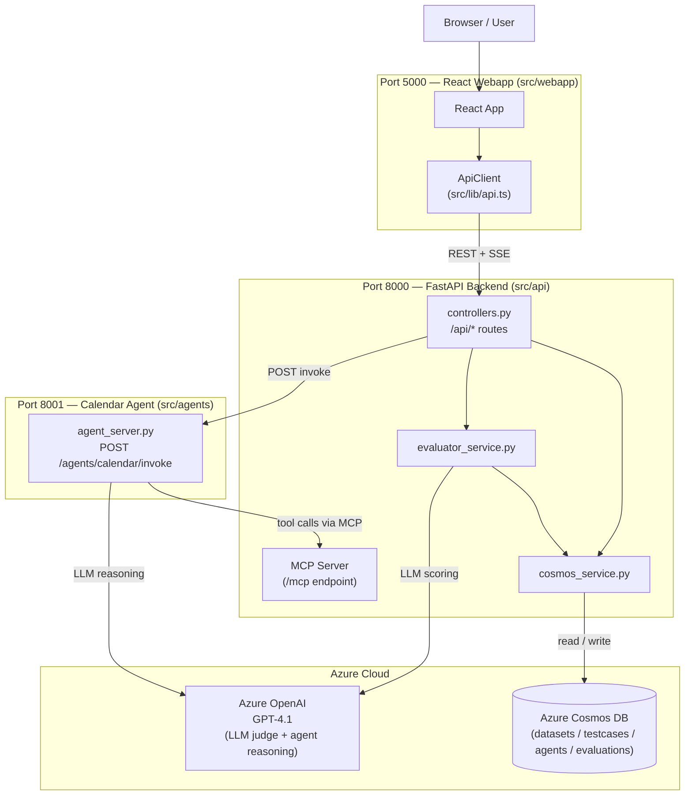

Sources: [README.md:6-28](), [src/api/README.md:55-70]()

---

## Azure Dependencies

The platform depends on two Azure services:

| Azure Service | Role |
|---|---|
| **Azure Cosmos DB** (NoSQL, Serverless) | Persistent store for datasets, test cases, agent registrations, and evaluation runs. Four containers: `datasets`, `testcases`, `agents`, `evaluations`. |
| **Azure OpenAI** (GPT-4.1 deployment) | Shared by both the evaluation engine (as LLM judge scoring tool calls) and the Calendar Agent (for reasoning). |

Azure infrastructure is provisioned via Bicep templates in the `infra/` directory. Authentication uses `DefaultAzureCredential`; a `COSMOS_KEY` is optional for local development but a managed identity is recommended for production.

Sources: [README.md:31-60](), [src/api/README.md:139-170]()

---

## Core Data Flow: Evaluation Run

**Figure 2: Evaluation run flow mapped to source files**

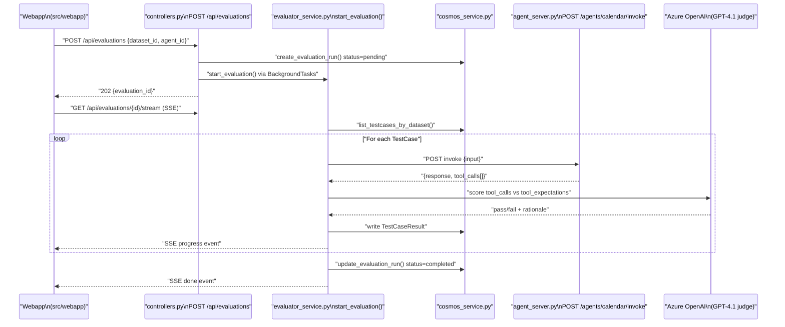

Sources: [src/api/README.md:56-68](), [src/api/README.md:17-53]()

---

## Key Concepts

### Datasets and Test Cases

A **Dataset** is a named collection of **TestCase** records. Each `TestCase` specifies:
- `input` — the natural language prompt sent to the agent
- `tool_expectations` — a list of expected tool calls with per-argument assertions (expressed as natural language rubrics)
- `expected_response` — what the agent's reply should convey

Sample datasets live under `data/eval/` and are seeded into Cosmos DB via `src/api/cosmos_preload.py`. See [Evaluation Datasets](#6) for the full format specification.

### Agent Invocation Contract

Any agent under evaluation must expose an HTTP POST endpoint accepting:

```
dataset_id, test_case_id, agent_id, evaluation_run_id, input
```

and returning:

```
response (string), tool_calls (array of {name, arguments})
```

The Calendar Agent in `src/agents/agent_server.py` is the reference implementation. See [Calendar Agent](#4) for full details.

### LLM Judge

After each agent invocation, `evaluator_service.py` sends the agent's actual `tool_calls` alongside the `tool_expectations` from the `TestCase` to Azure OpenAI. The model returns a pass/fail determination and a rationale for each test case.

### EvaluationRun States

An `EvaluationRun` document in Cosmos DB progresses through the following states:

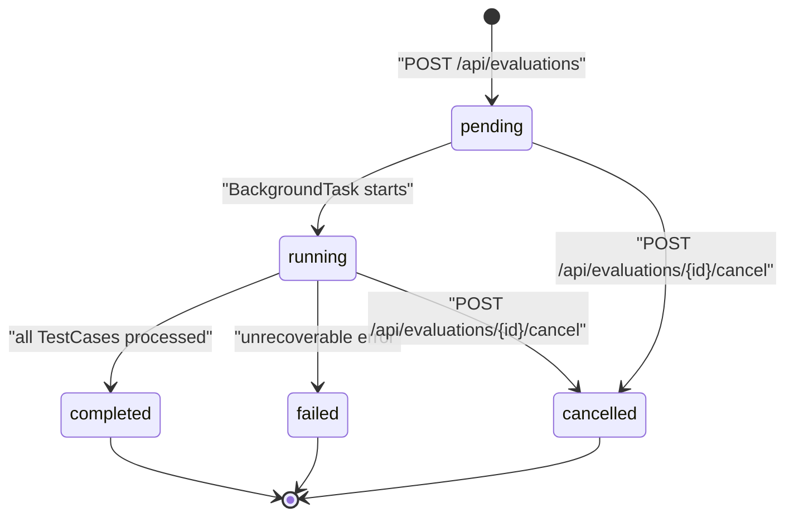

Sources: [src/api/README.md:55-68](), [README.md:226-296]()

---

## Project Layout

```
evals-for-agent-interop/
├── .env.example           # Template for all service configuration
├── docker-compose.yml     # Orchestrates api, agent, webapp containers
├── Dockerfile.api
├── Dockerfile.agent
├── Dockerfile.webapp
├── infra/                 # Bicep templates for Azure resources
├── data/                  # Evaluation dataset JSON files
│   └── eval/
│       ├── simple/
│       ├── email-agent/
│       └── meeting-agent/
├── src/
│   ├── api/               # FastAPI backend (port 8000)
│   │   ├── main.py
│   │   ├── controllers.py
│   │   ├── models.py
│   │   ├── cosmos_service.py
│   │   ├── evaluator_service.py
│   │   ├── config.py
│   │   └── cosmos_preload.py
│   ├── agents/            # Calendar Agent (port 8001)
│   │   └── agent_server.py
│   └── webapp/            # React frontend (port 5000)
│       └── src/
│           └── lib/
│               └── api.ts
└── tests/
    ├── conftest.py
    ├── unit/
    ├── integration/
    └── mocks/
```

Sources: [README.md:205-223](), [src/api/README.md:5-15]()

---

## Where to Go Next

| Topic | Wiki Page |
|---|---|
| Prerequisites, environment variables, Docker setup | [Getting Started](#1.1) |
| Inter-service dependencies and module graph | [System Architecture](#2) |
| FastAPI routes, Pydantic models, evaluation engine | [Backend API](#3) |
| Calendar Agent implementation and MCP integration | [Calendar Agent](#4) |
| React frontend and `ApiClient` | [Web Application](#5) |
| Dataset JSON format and seeding | [Evaluation Datasets](#6) |
| Running unit and integration tests | [Testing](#7) |

---

# Page: Getting Started

# Getting Started

<details>
<summary>Relevant source files</summary>

The following files were used as context for generating this wiki page:

- [.gitignore](.gitignore)
- [CODE_OF_CONDUCT.md](CODE_OF_CONDUCT.md)
- [CONTRIBUTING.md](CONTRIBUTING.md)
- [README.md](README.md)
- [src/api/README.md](src/api/README.md)

</details>


This page covers prerequisites, environment configuration, and how to run the three services locally — both manually and via Docker Compose. It also describes how to deploy the required Azure infrastructure using the provided Bicep templates.

For a conceptual overview of what the platform does and how the services relate to each other, see [Overview](#1). For instructions on contributing to the project, see [Contributing](#1.2).

---

## Prerequisites

Before running the project, you need the following:

| Requirement | Details |
|---|---|
| **Azure Cosmos DB** | NoSQL API account with four containers: `datasets`, `testcases`, `agents`, `evaluations` |
| **Azure OpenAI** | A GPT-4.1 deployment, used both by the evaluation judge and the sample agent |
| **Azure CLI** | Required for `az login` (DefaultAzureCredential) or for Bicep deployment |
| **Docker Desktop** | Required for the Docker-based workflow |
| **Python 3.11+** | Required for manual local development |
| **Node.js** | Required if running the webapp manually |

Sources: [README.md:72-76](), [src/api/README.md:138-143]()

---

## Azure Infrastructure Setup

The `infra/` directory contains Bicep templates and deployment scripts that provision all required Azure resources.

**What gets deployed:**
- **Azure Cosmos DB** (Serverless) — four containers: `datasets`, `testcases`, `agents`, `evaluations`
- **Azure AI Foundry** resource — for hosting LLMs (GPT-4.1 must be deployed manually after provisioning)

### Deploy with Scripts

```
cd infra

# Bash
./deploy.sh

# PowerShell (Windows)
.\deploy.ps1

# Or manual Azure CLI
az deployment group create \
  --resource-group evals-interop-dev-rg \
  --template-file main.bicep \
  --parameters @main.parameters.json
```

After deployment completes:
1. Manually deploy GPT-4.1 in the Azure AI Foundry portal.
2. Copy output values from the deployment script into your `.env` file at the repo root.

Sources: [README.md:31-67](), [infra/README.md]()

---

## Environment Configuration

All three services share a single `.env` file at the **repo root**. Copy the example template and fill in your credentials:

```
cp .env.example .env
```

The table below lists all required environment variables. Optional variables with defaults are noted.

| Variable | Used By | Description |
|---|---|---|
| `COSMOS_ENDPOINT` | API | Cosmos DB account URI, e.g. `https://account.documents.azure.com:443/` |
| `COSMOS_KEY` | API | Cosmos DB primary key (omit if using managed identity) |
| `COSMOS_DATABASE_NAME` | API | Database name, typically `interopevals` |
| `COSMOS_DATASETS_CONTAINER_NAME` | API | Container name for datasets |
| `COSMOS_TESTCASES_CONTAINER_NAME` | API | Container name for test cases |
| `COSMOS_AGENTS_CONTAINER_NAME` | API | Container name for agents |
| `AZURE_OPENAI_ENDPOINT` | API + Agent | Azure OpenAI resource endpoint |
| `AZURE_OPENAI_API_KEY` | API + Agent | Azure OpenAI API key |
| `AZURE_OPENAI_DEPLOYMENT` | API + Agent | Model deployment name, e.g. `gpt-4.1` |
| `AZURE_OPENAI_API_VERSION` | API + Agent | API version, e.g. `2024-12-01-preview` |
| `MCP_SERVER_URL` | Agent | URL the agent uses to connect to the MCP server on the API |
| `MAX_CONCURRENT_TESTS` | API | Max parallel test case executions (default: `5`) |

These variables are loaded by `config.py` in the API ([src/api/config.py]()) and by the agent server ([src/agents/agent_server.py]()).

Sources: [README.md:77-94](), [src/api/README.md:152-170]()

---

## Port Assignments

**Service-to-Port Map**

| Service | Port | Entry Point |
|---|---|---|
| FastAPI Backend | `8000` | `src/api/main.py` |
| Calendar Agent | `8001` | `src/agents/agent_server.py` |
| React Webapp | `5000` | `src/webapp/` |

Access points when running locally:

| URL | Purpose |
|---|---|
| `http://localhost:5000` | Web UI |
| `http://localhost:8000/api/docs` | Swagger UI |
| `http://localhost:8000/api/redoc` | ReDoc |
| `http://localhost:8001/agents/calendar/invoke` | Agent invocation endpoint |

Sources: [README.md:199-203](), [src/api/README.md:202-205]()

---

## Option A: Run Locally Without Docker

### 1. Install Dependencies

```
# Optional: create a virtual environment
python -m venv .venv
source .venv/bin/activate        # Linux/macOS
.venv\Scripts\activate           # Windows

# Install per-service requirements
pip install -r src/api/requirements.txt
pip install -r src/agents/requirements.txt

# Webapp
cd src/webapp && npm install
```

### 2. Start Each Service

**API** (port 8000):
```
python -m uvicorn src.api.main:app --host 0.0.0.0 --port 8000 --reload
```

**Agent** (port 8001):
```
python -m uvicorn src.agents.agent_server:app --host 0.0.0.0 --port 8001 --reload
```

**Webapp** (port 5000):
```
cd src/webapp
npm run dev
```

### 3. VS Code Launch Profiles

The workspace ships with `.vscode/launch.json` containing pre-configured profiles:

| Profile | What it starts |
|---|---|
| `API` | FastAPI on port 8000, hot reload enabled |
| `Agent` | Agent server on port 8001, hot reload enabled |
| `WebApp` | React dev server on port 5000 |
| `API + Agent + WebApp` | All three services simultaneously |

Open the **Run and Debug** panel (`Ctrl+Shift+D`), select a profile, press `F5`.

Sources: [README.md:125-155]()

---

## Option B: Run with Docker Compose

### Start All Services

```
docker-compose up --build
```

First build: 5–10 minutes. Subsequent builds: seconds to minutes.

### Useful Docker Commands

```
# Start (no rebuild)
docker-compose up

# Rebuild a single service
docker-compose build api
docker-compose build agent
docker-compose build webapp

# Tail logs for one service
docker-compose logs -f api

# Stop everything
docker-compose down
```

### Docker Networking

When services run inside containers, they cannot reach each other at `localhost`. Docker Compose assigns each container a hostname matching its service name.

**Service-to-Service Communication (inside Docker network)**

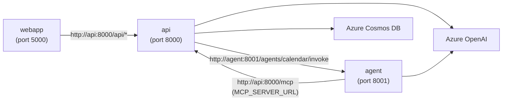

Key override: `docker-compose.yml` automatically sets `MCP_SERVER_URL=http://api:8000/mcp` for the agent container, replacing the `localhost` value in `.env`.

**Host-to-Container access (your browser / tools)** still uses `localhost:PORT` as normal.

Sources: [README.md:167-197]()

---

## Load Sample Data

After the services are running, seed Cosmos DB with the bundled evaluation datasets using `cosmos_preload.py`:

```
cd src/api

# Preview what will be uploaded (no writes)
python cosmos_preload.py --dry-run

# Upload sample datasets
python cosmos_preload.py

# Overwrite existing data
python cosmos_preload.py --force
```

`cosmos_preload.py` reads from the `data/` directory and calls `cosmos_service.py` to write `Dataset` and `TestCase` documents. For details on the dataset format, see [Evaluation Datasets](#6).

Sources: [README.md:116-122](), [src/api/README.md:172-179]()

---

## Project Structure Reference

The diagram below maps service names to their file system locations and key entry-point files.

**Repo Layout → Code Entities**

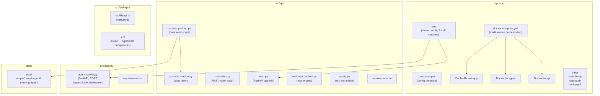

Sources: [README.md:206-223](), [src/api/README.md:6-14]()

---

## Troubleshooting

### Docker Compose: Vite Version Mismatch

**Error:**
```
✘ [ERROR] Cannot start service: Host version "0.25.11" does not match binary version "0.25.12"
```

**Fix:**
```
cd src/webapp
rm -rf node_modules
npm install
cd ../..
docker-compose build --no-cache webapp
docker-compose up
```

### Rate Limiting During Evaluations

If Azure OpenAI returns 429s during evaluation runs, reduce concurrency by setting `MAX_CONCURRENT_TESTS` in `.env`:

```
MAX_CONCURRENT_TESTS=2
```

The default is `5`. This controls how many test cases the evaluation engine runs in parallel. Lower values reduce load at the cost of longer run times. The setting is consumed by `config.py` and used in `evaluator_service.py`.

Sources: [README.md:304-348]()

---

## Azure App Service Deployment (Manual)

To deploy the API to Azure App Service instead of running it locally:

```
# Create App Service
az webapp create --resource-group <rg> --plan <plan> \
  --name <app-name> --runtime "PYTHON:3.11"

# Set required environment variables
az webapp config appsettings set --name <app-name> --resource-group <rg> \
  --settings COSMOS_ENDPOINT=<endpoint> COSMOS_DATABASE_NAME=interopevals

# Assign managed identity (removes need for COSMOS_KEY in production)
az webapp identity assign --name <app-name> --resource-group <rg>

# Deploy
az webapp up --name <app-name> --resource-group <rg>
```

When using managed identity, `COSMOS_KEY` can be omitted and `cosmos_service.py` will authenticate via `DefaultAzureCredential`. Ensure `az login` has been run or that the App Service identity has been granted the appropriate Cosmos DB role.

Sources: [src/api/README.md:207-223]()

---

# Page: Contributing

# Contributing

<details>
<summary>Relevant source files</summary>

The following files were used as context for generating this wiki page:

- [AUTHORS.md](AUTHORS.md)
- [CODE_OF_CONDUCT.md](CODE_OF_CONDUCT.md)
- [CONTRIBUTING.md](CONTRIBUTING.md)
- [README.md](README.md)
- [SECURITY.md](SECURITY.md)

</details>


This page covers the process and guidelines for contributing to the EvalsforAgentsInterop project: the code of conduct, how to report bugs and request features, pull request conventions, code style requirements, and project authorship. For information on setting up a local development environment before contributing, see [Getting Started](#1.1).

---

## Code of Conduct

This project follows the [Microsoft Open Source Code of Conduct](CODE_OF_CONDUCT.md). Key points:

- All participants are expected to follow the conduct standards described at `https://opensource.microsoft.com/codeofconduct/`
- Questions or concerns can be sent to `opencode@microsoft.com`
- Microsoft employees can use `aka.ms/opensource/moderation-support`

Sources: [CODE_OF_CONDUCT.md:1-10]()

---

## Contributor License Agreement (CLA)

Most contributions require agreeing to a **Contributor License Agreement (CLA)**, which asserts that you have the right to grant Microsoft rights to use your contribution.

- The CLA process is automated: a CLA-bot checks each pull request and decorates it with the appropriate label or comment.
- If a CLA is required, follow the bot's instructions. This only needs to be done once across all Microsoft repositories.
- The CLA portal is at `https://cla.microsoft.com`.

Sources: [CONTRIBUTING.md:1-7]()

---

## Reporting Bugs

| Step | Detail |
|---|---|
| Search first | Check existing GitHub issues before opening a new one |
| Use templates | Apply issue templates when they are available |
| Reproduce steps | List exact steps to reproduce the problem |
| System info | Include OS version, Docker version, Python version, and Node.js version |

Sources: [CONTRIBUTING.md:12-16]()

---

## Requesting Features

| Step | Detail |
|---|---|
| Check for duplicates | Search existing issues and discussions first |
| Describe the use case | Explain what problem the feature solves |
| Scope fit | Consider whether the feature aligns with the project's evaluation-platform purpose |

Sources: [CONTRIBUTING.md:18-21]()

---

## Contribution Workflow

**Diagram: Pull Request Flow**

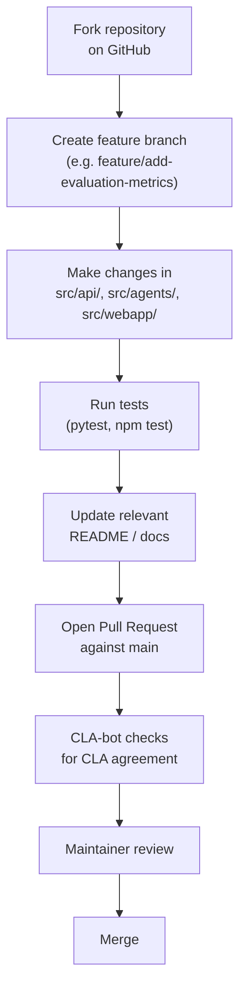

Sources: [CONTRIBUTING.md:22-27]()

---

## Pull Request Guidelines

### Branch Naming

Use descriptive names with a type prefix:

```
feature/add-evaluation-metrics
fix/docker-build-error
docs/update-agent-endpoints
```

### Commit Messages

Follow conventional commit format:

```
feat: add support for custom evaluation criteria
fix: resolve Docker build issues with Node.js dependencies
docs: update API documentation for agent endpoints
```

### Checklist Before Submitting

| Requirement | Detail |
|---|---|
| Tests pass | Verify with both Docker and manual local setup |
| New tests written | Cover any new functionality |
| Documentation updated | Update affected `README.md` files in `src/api/`, `src/agents/`, or `src/webapp/` |
| Focused scope | One feature or fix per PR |

Sources: [CONTRIBUTING.md:38-51]()

---

## Code Style

### Python (applies to `src/api/` and `src/agents/`)

| Rule | Detail |
|---|---|
| Style guide | PEP 8 |
| Type hints | Use where appropriate |
| Docstrings | Required for functions and classes |

### TypeScript / React (applies to `src/webapp/`)

| Rule | Detail |
|---|---|
| Linting | Use existing ESLint and Prettier configurations |
| Patterns | Follow React hooks patterns |
| Structure | Maintain consistent component structure |

### General

- Use meaningful variable and function names
- Add comments for complex logic
- Keep functions small and focused

Sources: [CONTRIBUTING.md:53-68]()

---

## Areas for Contribution

**Diagram: Contribution Areas Mapped to Code Entities**

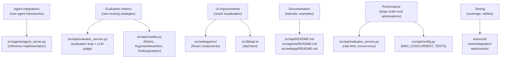

Sources: [CONTRIBUTING.md:71-78]()

---

## Questions and Support

- Check existing GitHub issues and discussions first
- Review service-specific documentation under the `src/` subdirectories (`src/api/README.md`, `src/agents/README.md`, `src/webapp/README.md`)
- Contact maintainers via GitHub issues

Sources: [CONTRIBUTING.md:80-85]()

---

## Security Vulnerabilities

**Do not report security vulnerabilities through public GitHub issues.**

Report security issues through the guidance at `https://aka.ms/SECURITY.md`. This follows standard Microsoft repository security policy.

Sources: [SECURITY.md:1-13]()

---

## Authors

All launch authors are affiliated with Microsoft.

### Developers

| Name | GitHub |
|---|---|
| Aadharsh Kannan | `@aadharshkannan` |
| AJ Fehr | `@ajmfehr` |
| Daniel Evora | `@danevora` |
| Darshini Jois | — |
| Grant Harris | `@gwharris7` |
| Heather Acuna | `@h-acuna` |
| Isha Arora | `@IshaArora3` |
| Sruthi Kilari | `@sruthikilari` |

### Other Contributors

| Name | GitHub |
|---|---|
| Ahmed Zakaria | `@azakariaMSFT` |
| James Oleinik | `@jamesol-msft` |
| Robert Bruckner | `@RobertBruckner` |
| Terell Cobb | — |

Sources: [AUTHORS.md:1-21]()

---

# Page: System Architecture

# System Architecture

<details>
<summary>Relevant source files</summary>

The following files were used as context for generating this wiki page:

- [CODE_OF_CONDUCT.md](CODE_OF_CONDUCT.md)
- [CONTRIBUTING.md](CONTRIBUTING.md)
- [README.md](README.md)
- [src/api/README.md](src/api/README.md)
- [src/api/controllers.py](src/api/controllers.py)

</details>


This page describes the structural layout of the EvalsforAgentsInterop platform: the three deployed services, how they communicate, the Azure dependencies they share, and the internal module structure of the backend API. It is oriented toward developers who need to understand how components fit together before working on any one of them.

For details on individual subsystems, see:
- Backend API internals: [Backend API](#3)
- REST endpoint reference: [REST API Endpoints](#3.1)
- Evaluation engine behavior: [Evaluation Engine](#3.3)
- Frontend components: [Web Application](#5)
- Calendar Agent implementation: [Calendar Agent](#4)

---

## Service Topology

The platform is split into three independently deployable services plus two Azure-managed cloud services. Each service runs on a dedicated port and has a distinct responsibility.

| Service | Port | Technology | Directory |
|---|---|---|---|
| Backend API | 8000 | FastAPI (Python) | `src/api/` |
| Calendar Agent | 8001 | FastAPI (Python) | `src/agents/` |
| Web Application | 5000 | React + TypeScript | `src/webapp/` |
| Azure Cosmos DB | — | NoSQL (cloud) | — |
| Azure OpenAI | — | GPT-4.1 (cloud) | — |

**Top-Level Service Topology**

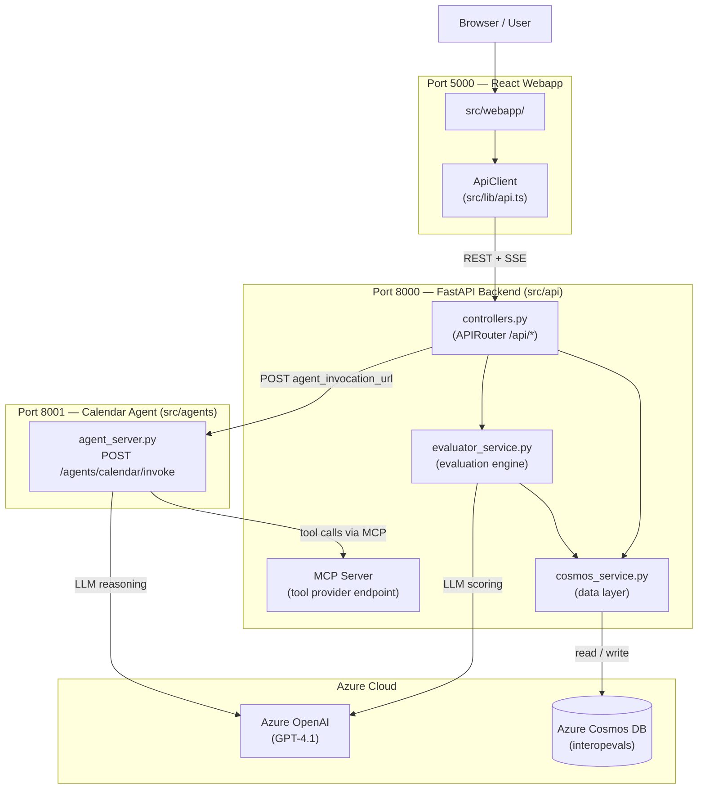

Sources: [README.md:6-29](), [src/api/README.md:1-54]()

---

## Cross-Service Communication

### Webapp → API

The webapp communicates exclusively with the backend API. The `ApiClient` class in `src/lib/api.ts` issues typed HTTP requests to `controllers.py`. Real-time evaluation progress uses Server-Sent Events (SSE) over `GET /api/evaluations/{id}/stream`.

### API → Agent

When an evaluation run processes a test case, `evaluator_service.py` calls the registered `agent_invocation_url` with a structured JSON payload. This is an HTTP POST — the API makes no assumptions about what language or framework the agent uses, only that it conforms to the invocation contract.

**Agent Invocation Contract**

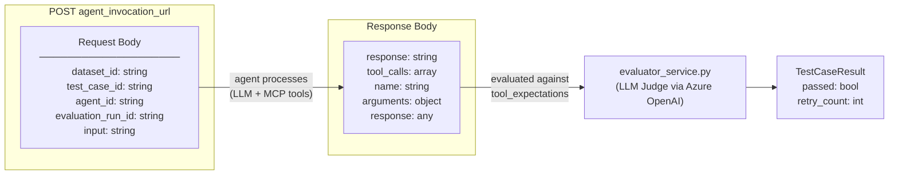

Sources: [README.md:227-295](), [src/api/README.md:56-67]()

### Agent → API (MCP)

The sample `agent_server.py` connects back to the API's MCP server endpoint to discover and call tools (e.g., calendar operations). This is optional for custom agents — only agents that use the provided MCP tool server need this reverse connection.

---

## Backend API: Internal Module Structure

All backend modules live under `src/api/`. The table below summarizes each file's role.

| File | Role |
|---|---|
| `main.py` | FastAPI app init; mounts `controllers.py`; initializes MCP session manager |
| `controllers.py` | `APIRouter` with prefix `/api`; all HTTP handlers |
| `models.py` | Pydantic data models (`Dataset`, `TestCase`, `Agent`, `EvaluationRun`, etc.) |
| `cosmos_service.py` | `CosmosService` class; all Cosmos DB read/write logic |
| `evaluator_service.py` | `EvaluatorService` class; evaluation loop, LLM judge, rate limiting |
| `config.py` | Loads environment variables; exposes rate limit and Cosmos DB settings |
| `cosmos_preload.py` | One-time data seeding script; reads from `data/` and writes to Cosmos DB |

**Backend API Module Dependency Graph**

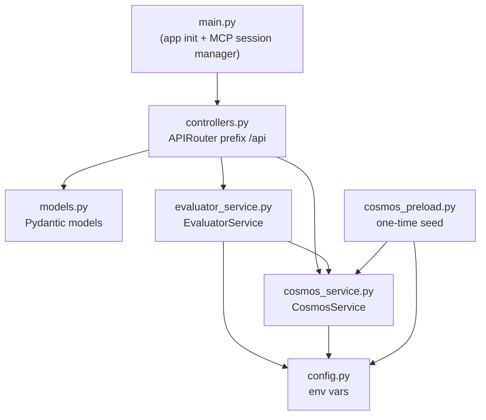

Sources: [src/api/README.md:6-16](), [src/api/controllers.py:1-26]()

---

## Key Dependency Boundaries

The module structure enforces a clean layering:

1. **`controllers.py`** depends on `cosmos_service.py` and `evaluator_service.py` but never calls Azure OpenAI directly.
2. **`evaluator_service.py`** owns all LLM judge logic and calls `cosmos_service.py` to read test cases and write results.
3. **`cosmos_service.py`** is the sole module that communicates with Azure Cosmos DB.
4. **`config.py`** is a leaf — it has no internal dependencies and is imported by both `cosmos_service.py` and `evaluator_service.py`.

This means that swapping the data layer requires only changes to `cosmos_service.py` and its consumers, not the controllers or models.

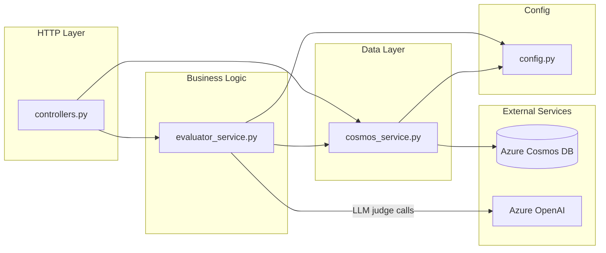

Sources: [src/api/controllers.py:20-26](), [src/api/README.md:6-16]()

---

## Azure Dependencies

Both the backend API and the Calendar Agent require Azure credentials. The two Azure services used are:

| Azure Service | Used By | Purpose |
|---|---|---|
| Azure Cosmos DB | `cosmos_service.py` | Stores datasets, test cases, agents, evaluation runs |
| Azure OpenAI (GPT-4.1) | `evaluator_service.py` | LLM judge scoring of agent tool calls |
| Azure OpenAI (GPT-4.1) | `agent_server.py` | LLM reasoning within the sample Calendar Agent |

Cosmos DB containers created by the platform:

| Container | Contents |
|---|---|
| `datasets` | `Dataset` documents |
| `testcases` | `TestCase` documents |
| `agents` | `Agent` registration documents |
| `evaluations` | `EvaluationRun` and `TestCaseResult` documents |

Sources: [src/api/README.md:140-170](), [README.md:34-58]()

---

## Core Data Model Relationships

The entity relationships below show how the primary Pydantic models in `models.py` connect to each other. IDs are auto-generated with typed prefixes (`dataset_*`, `tc_*`, `eval_*`, `agent_*`).

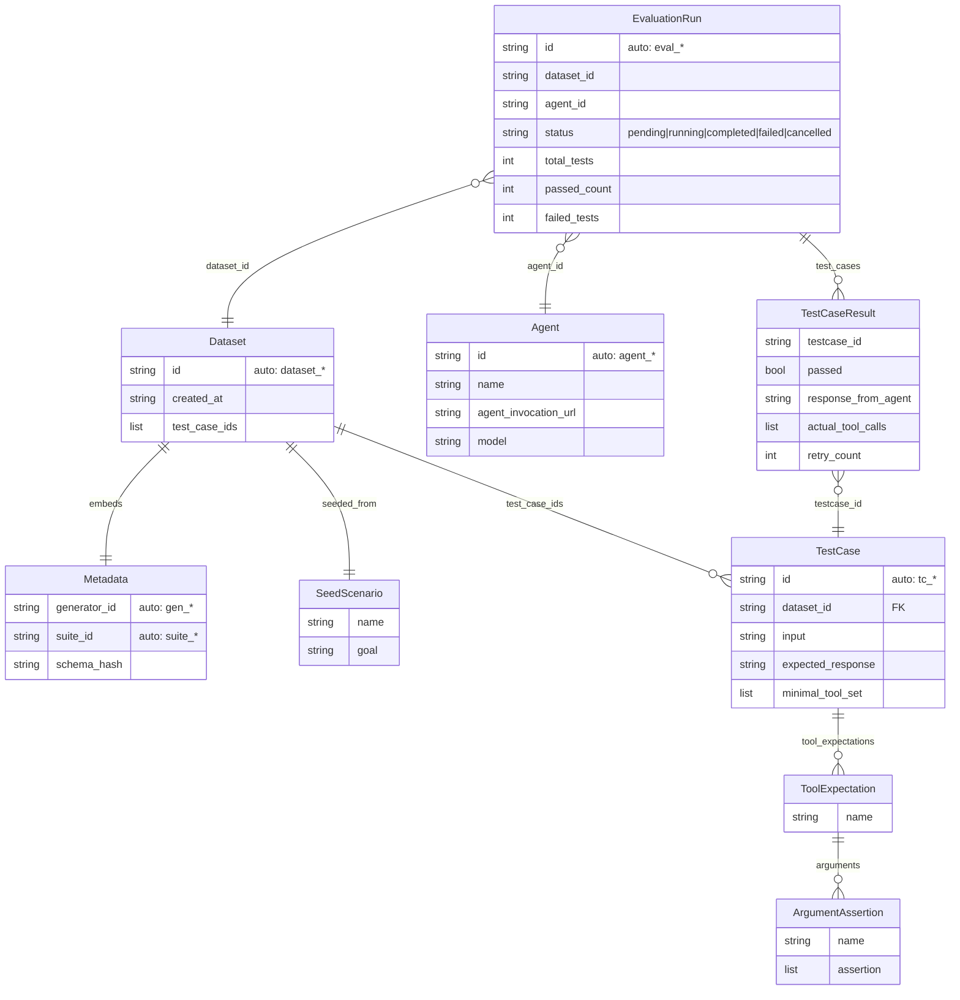

Sources: [src/api/README.md:69-134](), [src/api/controllers.py:5-19]()

---

## EvaluationRun State Machine

An `EvaluationRun` moves through a fixed set of statuses. `controllers.py` creates the record at `pending`, and `evaluator_service.py` drives the remaining transitions.

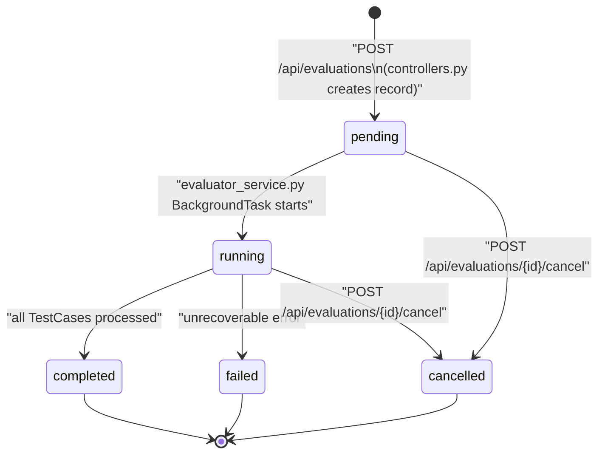

Sources: [src/api/controllers.py:266-280](), [src/api/controllers.py:330-359](), [src/api/README.md:55-67]()

---

# Page: Backend API

# Backend API

<details>
<summary>Relevant source files</summary>

The following files were used as context for generating this wiki page:

- [src/api/README.md](src/api/README.md)
- [src/api/controllers.py](src/api/controllers.py)

</details>


This page covers the FastAPI backend service (`src/api/`): its startup, module structure, and the roles of its three core dependencies. For the full list of REST endpoints with request/response shapes, see [REST API Endpoints](#3.1). For Pydantic model definitions, see [Data Models](#3.2). For the evaluation engine internals, see [Evaluation Engine](#3.3).

---

## Role in the System

The backend is the central hub of the platform. It runs on **port 8000** and is the only service that talks directly to Azure Cosmos DB and Azure OpenAI. The React webapp communicates with it exclusively over REST and SSE. The Calendar Agent on port 8001 receives invocation requests from it during evaluation runs.

**File layout:**

| File | Purpose |
|---|---|
| `main.py` | FastAPI app initialization, MCP session manager startup |
| `controllers.py` | `APIRouter` definitions, all `/api/*` endpoints |
| `models.py` | Pydantic data models for all request/response bodies |
| `cosmos_service.py` | Async Cosmos DB abstraction (`CosmosService`) |
| `evaluator_service.py` | Evaluation engine (`EvaluatorService`) |
| `config.py` | Environment variable loading, rate limit settings |
| `cosmos_preload.py` | One-time data seeding script |

Sources: [src/api/README.md:1-15]()

---

## Module Dependency Graph

**Diagram: Internal Module Dependencies (`src/api/`)**

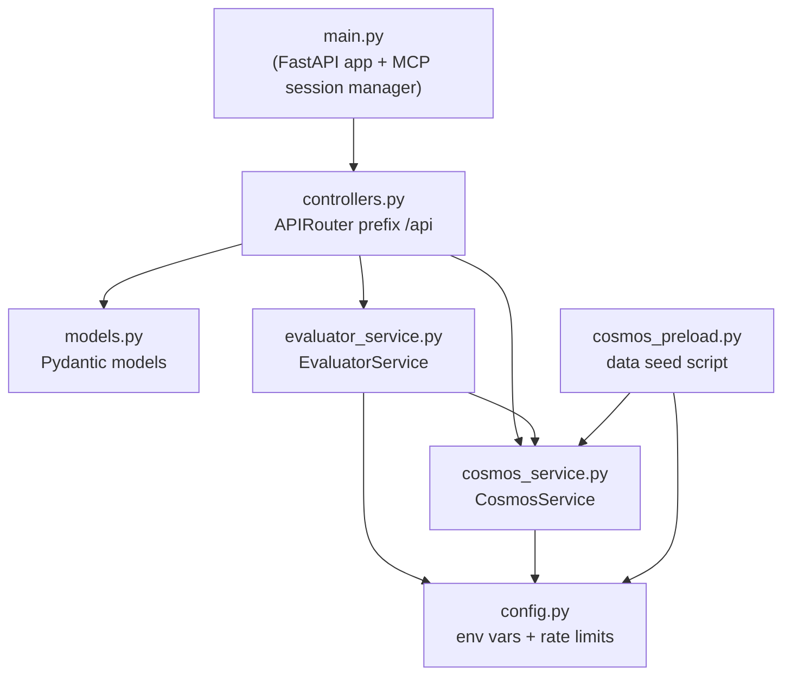

Sources: [src/api/controllers.py:1-26](), [src/api/README.md:1-15]()

---

## App Initialization (`main.py`)

The FastAPI application is created in `main.py`. On startup it:

1. Instantiates the FastAPI app with OpenAPI docs mounted at `/api/docs` and `/api/redoc`.
2. Registers the `APIRouter` from `controllers.py` (prefix: `/api`).
3. Initializes an MCP session manager that exposes the tool-provider endpoint consumed by the Calendar Agent.

The `controllers.py` module eagerly constructs two singletons at import time:

- `db = get_cosmos_service()` — the `CosmosService` instance
- `evaluator = get_evaluator_service(db)` — the `EvaluatorService` instance, receiving `db` as a dependency

Sources: [src/api/controllers.py:20-25]()

---

## Three Core Dependencies

**Diagram: Runtime Dependency Wiring**

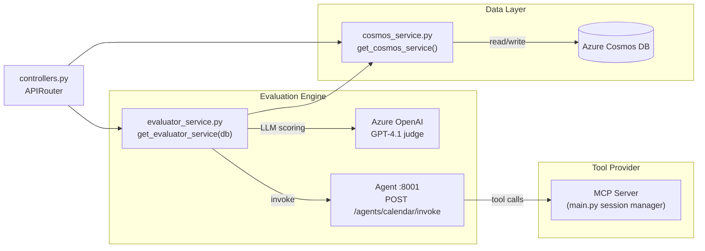

Sources: [src/api/controllers.py:20-26](), [src/api/README.md:55-68]()

### `CosmosService`

Defined in `cosmos_service.py`, obtained via `get_cosmos_service()`. Provides async CRUD operations over four Cosmos DB containers:

| Container env var | Holds |
|---|---|
| `COSMOS_DATASETS_CONTAINER_NAME` | `Dataset` documents |
| `COSMOS_TESTCASES_CONTAINER_NAME` | `TestCase` documents |
| `COSMOS_AGENTS_CONTAINER_NAME` | `Agent` documents |
| *(evaluations container)* | `EvaluationRun` documents |

Authentication uses `DefaultAzureCredential` (managed identity in production) or `COSMOS_KEY` for local development.

Sources: [src/api/README.md:154-170]()

### `EvaluatorService`

Defined in `evaluator_service.py`, obtained via `get_evaluator_service(db)`. Receives a `CosmosService` instance at construction time. Responsible for:

- Creating `EvaluationRun` records in Cosmos DB.
- Running the per-test-case loop asynchronously (agent call → LLM judge → result write) via FastAPI `BackgroundTasks`.
- Streaming progress updates to connected SSE clients.
- Managing cancellation and retry/rate-limit logic.

The `controllers.py` `create_evaluation` handler calls `evaluator.create_evaluation_run()` synchronously, then enqueues `evaluator.start_evaluation()` as a background task, returning HTTP 202 immediately.

Sources: [src/api/controllers.py:266-280]()

### MCP Session Manager (`main.py`)

Initialized in `main.py` at app startup. Manages persistent MCP (Model Context Protocol) sessions and exposes a tool-provider endpoint. The Calendar Agent on port 8001 connects to this endpoint to discover and invoke tools during its conversation loop. The session manager is not used in unit tests because it has external connection requirements — the test suite patches it out via `app_with_mocks`. For details on the test fixture, see [Test Configuration and Fixtures](#7.1).

---

## Request Routing Overview

All endpoints are registered under the `/api` prefix via `router = APIRouter(prefix="/api")` in `controllers.py`.

**Diagram: Endpoint Groups and Handler Functions**

```mermaid
graph TD
    router["APIRouter\nprefix /api"]

    subgraph "Datasets"
        D1["POST /datasets\ncreate_dataset()"]
        D2["GET /datasets\nlist_datasets()"]
        D3["GET /datasets/{id}\nget_dataset()"]
        D4["DELETE /datasets/{id}\ndelete_dataset()"]
    end

    subgraph "Test Cases"
        TC1["POST /datasets/{id}/testcases\nadd_testcase()"]
        TC2["GET /datasets/{id}/testcases\nlist_testcases()"]
        TC3["GET /datasets/{id}/testcases/{tc_id}\nget_testcase()"]
        TC4["PUT /datasets/{id}/testcases/{tc_id}\nupdate_testcase()"]
        TC5["DELETE /datasets/{id}/testcases/{tc_id}\ndelete_testcase()"]
    end

    subgraph "Agents"
        A1["POST /agents\ncreate_agent()"]
        A2["GET /agents\nlist_agents()"]
        A3["GET /agents/{id}\nget_agent()"]
        A4["PUT /agents/{id}\nupdate_agent()"]
        A5["DELETE /agents/{id}\ndelete_agent()"]
    end

    subgraph "Evaluations"
        E1["POST /evaluations\ncreate_evaluation()"]
        E2["GET /evaluations\nlist_evaluations()"]
        E3["GET /evaluations/{id}\nget_evaluation()"]
        E4["GET /evaluations/{id}/results\nget_evaluation_results()"]
        E5["GET /evaluations/{id}/results/{tc_id}\nget_test_result()"]
        E6["POST /evaluations/{id}/cancel\ncancel_evaluation()"]
        E7["DELETE /evaluations/{id}\ndelete_evaluation()"]
        E8["GET /evaluations/{id}/stream\nSSE stream"]
    end

    router --> D1 & D2 & D3 & D4
    router --> TC1 & TC2 & TC3 & TC4 & TC5
    router --> A1 & A2 & A3 & A4 & A5
    router --> E1 & E2 & E3 & E4 & E5 & E6 & E7 & E8
```

Sources: [src/api/controllers.py:29-370](), [src/api/README.md:17-53]()

---

## Configuration and Environment Variables

All configuration is loaded in `config.py` and consumed by `CosmosService` and `EvaluatorService`.

| Variable | Used By | Purpose |
|---|---|---|
| `COSMOS_ENDPOINT` | `CosmosService` | Cosmos DB account URL |
| `COSMOS_KEY` | `CosmosService` | Auth key (optional; falls back to managed identity) |
| `COSMOS_DATABASE_NAME` | `CosmosService` | Target database name |
| `COSMOS_DATASETS_CONTAINER_NAME` | `CosmosService` | Datasets container |
| `COSMOS_TESTCASES_CONTAINER_NAME` | `CosmosService` | Test cases container |
| `COSMOS_AGENTS_CONTAINER_NAME` | `CosmosService` | Agents container |
| `AZURE_OPENAI_ENDPOINT` | `EvaluatorService` | OpenAI resource URL |
| `AZURE_OPENAI_API_KEY` | `EvaluatorService` | OpenAI auth key |
| `AZURE_OPENAI_DEPLOYMENT` | `EvaluatorService` | Model deployment name (e.g. `gpt-4.1`) |
| `AZURE_OPENAI_API_VERSION` | `EvaluatorService` | API version string |

Rate limit behaviour (retry count, backoff intervals) is also sourced from `config.py` and applied inside `EvaluatorService`. See [Evaluation Engine](#3.3) for the retry logic details.

Sources: [src/api/README.md:154-170]()

---

## Interactive API Documentation

When the server is running, auto-generated documentation is available at:

- **Swagger UI**: `http://localhost:8000/api/docs`
- **ReDoc**: `http://localhost:8000/api/redoc`

Sources: [src/api/README.md:203-206]()

---

# Page: REST API Endpoints

# REST API Endpoints

<details>
<summary>Relevant source files</summary>

The following files were used as context for generating this wiki page:

- [src/api/README.md](src/api/README.md)
- [src/api/controllers.py](src/api/controllers.py)
- [tests/unit/test_controllers.py](tests/unit/test_controllers.py)

</details>


This page documents all HTTP endpoints exposed by the FastAPI backend (`src/api/controllers.py`), grouped by resource. It covers URL paths, HTTP methods, request body shapes, response shapes, and status codes. For the data models that appear in these requests and responses, see [Data Models](#3.2). For how the evaluation engine processes requests asynchronously, see [Evaluation Engine](#3.3). For the SSE client implementation in the frontend, see [API Client](#5.1).

All endpoints are mounted under the `/api` prefix via the `APIRouter` defined at [src/api/controllers.py:23]().

---

## Endpoint Summary

**Resource routing diagram:**

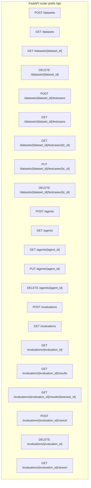

**Flat reference table:**

| Method | Path | Handler Function | Description |
|--------|------|-----------------|-------------|
| `POST` | `/api/datasets` | `create_dataset` | Create a new dataset |
| `GET` | `/api/datasets` | `list_datasets` | List datasets (paginated) |
| `GET` | `/api/datasets/{dataset_id}` | `get_dataset` | Get a single dataset |
| `DELETE` | `/api/datasets/{dataset_id}` | `delete_dataset` | Delete a dataset |
| `POST` | `/api/datasets/{dataset_id}/testcases` | `add_testcase` | Add test case to dataset |
| `GET` | `/api/datasets/{dataset_id}/testcases` | `list_testcases` | List all test cases in dataset |
| `GET` | `/api/datasets/{dataset_id}/testcases/{tc_id}` | `get_testcase` | Get a single test case |
| `PUT` | `/api/datasets/{dataset_id}/testcases/{tc_id}` | `update_testcase` | Replace a test case's fields |
| `DELETE` | `/api/datasets/{dataset_id}/testcases/{tc_id}` | `delete_testcase` | Delete a test case |
| `POST` | `/api/agents` | `create_agent` | Register a new agent |
| `GET` | `/api/agents` | `list_agents` | List agents (paginated) |
| `GET` | `/api/agents/{agent_id}` | `get_agent` | Get a single agent |
| `PUT` | `/api/agents/{agent_id}` | `update_agent` | Update agent registration |
| `DELETE` | `/api/agents/{agent_id}` | `delete_agent` | Delete an agent |
| `POST` | `/api/evaluations` | `create_evaluation` | Start an evaluation run |
| `GET` | `/api/evaluations` | `list_evaluations` | List evaluation runs |
| `GET` | `/api/evaluations/{evaluation_id}` | `get_evaluation` | Get a single evaluation run |
| `GET` | `/api/evaluations/{evaluation_id}/results` | `get_evaluation_results` | Get all test case results |
| `GET` | `/api/evaluations/{evaluation_id}/results/{testcase_id}` | `get_test_result` | Get one test case result |
| `POST` | `/api/evaluations/{evaluation_id}/cancel` | `cancel_evaluation` | Cancel a running evaluation |
| `DELETE` | `/api/evaluations/{evaluation_id}` | `delete_evaluation` | Delete an evaluation run |
| `GET` | `/api/evaluations/{evaluation_id}/stream` | (in `main.py`) | SSE stream of progress events |

Sources: [src/api/controllers.py:29-370](), [src/api/README.md:19-53]()

---

## Health Endpoints

These are mounted at the root level, not under `/api`.

| Method | Path | Status | Response |
|--------|------|--------|----------|
| `GET` | `/` | `200` | `{ "message": "...", "docs": "..." }` |
| `GET` | `/health` | `200` | `{ "status": "ok" }` |

Sources: [tests/unit/test_controllers.py:16-30]()

---

## Datasets — `/api/datasets`

### `POST /api/datasets`

Creates a new dataset. All IDs (`id`, `generator_id`, `suite_id`) and timestamps are auto-generated by the server.

**Request body** (`CreateDatasetRequest`):

| Field | Type | Required | Description |
|-------|------|----------|-------------|
| `name` | `string` | Yes | Display name for the dataset |
| `goal` | `string` | Yes | Evaluation goal description |
| `input` | `object` | No | Additional seed input parameters |
| `schema_hash` | `string` | No | Optional hash for schema versioning |

**Response** (`DatasetResponse`, `201 Created`):

| Field | Type | Description |
|-------|------|-------------|
| `id` | `string` | Auto-generated, format `dataset_*` |
| `metadata` | `Metadata` | Contains `generator_id`, `suite_id`, `schema_hash` |
| `seed` | `SeedScenario` | Contains `name`, `goal`, `input` |
| `test_case_ids` | `string[]` | Initially empty |
| `created_at` | `string` | ISO 8601 timestamp |

**Error responses:**
- `422 Unprocessable Entity` — missing required fields (`name` or `goal`)
- `500 Internal Server Error` — unexpected failure

---

### `GET /api/datasets`

Returns a paginated list of all datasets.

**Query parameters:**

| Parameter | Type | Default | Description |
|-----------|------|---------|-------------|
| `skip` | `int` | `0` | Number of records to skip |
| `limit` | `int` | `100` | Maximum records to return |

**Response:** `List[DatasetResponse]`, `200 OK`

---

### `GET /api/datasets/{dataset_id}`

Returns a single dataset by its ID.

**Response:** `DatasetResponse`, `200 OK`

**Error responses:**
- `404 Not Found` — dataset ID does not exist

---

### `DELETE /api/datasets/{dataset_id}`

Deletes a dataset. Does not automatically delete associated test cases in the testcases container.

**Response:** `204 No Content`

**Error responses:**
- `404 Not Found` — dataset ID does not exist

Sources: [src/api/controllers.py:29-91](), [tests/unit/test_controllers.py:33-106]()

---

## Test Cases — `/api/datasets/{dataset_id}/testcases`

All test case endpoints validate that the parent dataset exists before operating.

**Endpoint-to-handler mapping:**

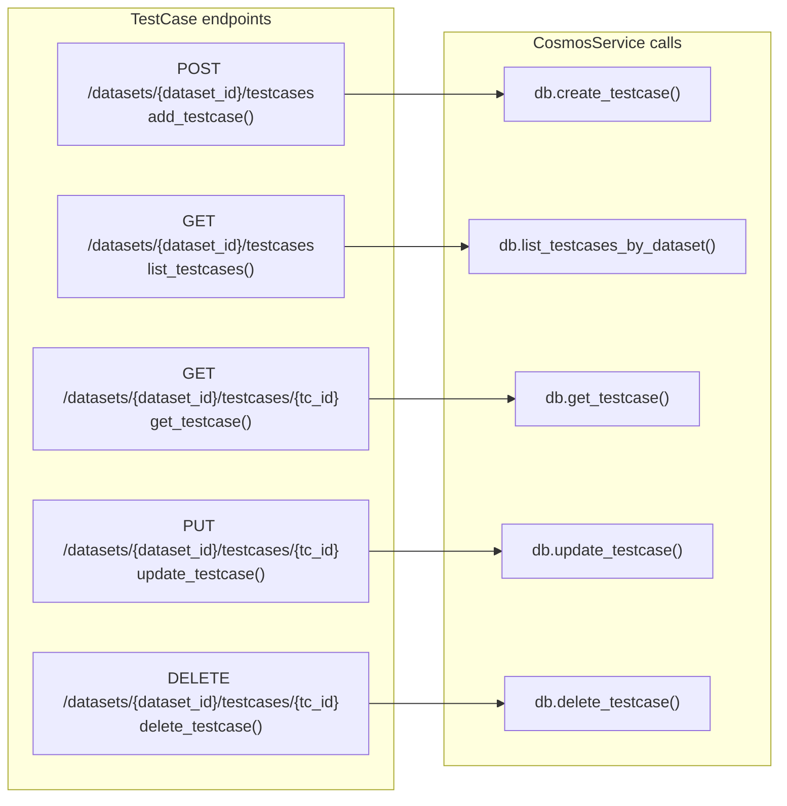

### `POST /api/datasets/{dataset_id}/testcases`

Adds a new test case to an existing dataset. The test case ID is auto-generated; `dataset_id` is taken from the URL path, not the request body.

**Request body** (`TestCaseCreate`):

| Field | Type | Required | Description |
|-------|------|----------|-------------|
| `name` | `string` | Yes | Display name |
| `description` | `string` | No | Human-readable description |
| `input` | `string` | Yes | Natural language input sent to the agent |
| `minimal_tool_set` | `string[]` | No | Names of tools the agent must use |
| `tool_expectations` | `ToolExpectation[]` | No | Per-tool argument assertions |
| `expected_response` | `string` | No | Expected natural language response |
| `response_quality_expectation` | `ResponseQualityAssertion` | No | Rubric for response quality |
| `references_seed` | `object` | No | Seed data referenced by this test case |

**Response** (`TestCaseResponse`, `201 Created`):

| Field | Type | Description |
|-------|------|-------------|
| `id` | `string` | Auto-generated, format `tc_*` |
| `dataset_id` | `string` | Parent dataset ID (from URL) |
| `name` | `string` | Falls back to `id` if blank |
| `description` | `string` | |
| `input` | `string` | |
| `minimal_tool_set` | `string[]` | |
| `tool_expectations` | `ToolExpectation[]` | |
| `expected_response` | `string` | |
| `response_quality_expectation` | `ResponseQualityAssertion` | |
| `references_seed` | `object` | |

**Error responses:**
- `404 Not Found` — `dataset_id` does not exist

---

### `GET /api/datasets/{dataset_id}/testcases`

Returns all test cases belonging to the specified dataset.

**Response:** `List[TestCaseResponse]`, `200 OK`

**Error responses:**
- `404 Not Found` — `dataset_id` does not exist

---

### `GET /api/datasets/{dataset_id}/testcases/{tc_id}`

Returns a single test case.

**Response:** `TestCaseResponse`, `200 OK`

**Error responses:**
- `404 Not Found` — test case not found

---

### `PUT /api/datasets/{dataset_id}/testcases/{tc_id}`

Replaces all mutable fields of an existing test case. The `id` and `dataset_id` are preserved and cannot be changed.

**Request body:** `TestCaseCreate` (same schema as POST)

**Response:** `TestCaseResponse`, `200 OK`

**Error responses:**
- `404 Not Found` — dataset or test case not found

---

### `DELETE /api/datasets/{dataset_id}/testcases/{tc_id}`

Deletes a test case.

**Response:** `204 No Content`

**Error responses:**
- `404 Not Found` — test case not found

Sources: [src/api/controllers.py:93-222](), [tests/unit/test_controllers.py:401-520]()

---

## Agents — `/api/agents`

Agents represent external agent servers that can be evaluated. The `agent_invocation_url` field is the endpoint the evaluation engine calls during a run.

### `POST /api/agents`

Registers a new agent.

**Request body** (`AgentCreate`):

| Field | Type | Required | Description |
|-------|------|----------|-------------|
| `name` | `string` | Yes | Display name |
| `description` | `string` | No | What the agent does |
| `model` | `string` | Yes | LLM model identifier (e.g., `gpt-4.1`) |
| `agent_invocation_url` | `string` | Yes | URL for `POST` agent invocation calls |

**Response** (`Agent`, `201 Created`):

| Field | Type | Description |
|-------|------|-------------|
| `id` | `string` | Auto-generated, format `agent_*` |
| `name` | `string` | |
| `description` | `string` | |
| `model` | `string` | |
| `agent_invocation_url` | `string` | |
| `createdAt` | `string` | ISO 8601 timestamp (preserved on update) |

**Error responses:**
- `422 Unprocessable Entity` — missing required fields

---

### `GET /api/agents`

Returns a paginated list of registered agents.

**Query parameters:**

| Parameter | Type | Default |
|-----------|------|---------|
| `skip` | `int` | `0` |
| `limit` | `int` | `100` |

**Response:** `List[Agent]`, `200 OK`

---

### `GET /api/agents/{agent_id}`

Returns a single agent registration.

**Response:** `Agent`, `200 OK`

**Error responses:**
- `404 Not Found`

---

### `PUT /api/agents/{agent_id}`

Updates an agent registration. The `id` and `createdAt` fields are preserved from the original record.

**Request body:** `AgentCreate` (same schema as POST)

**Response:** `Agent`, `200 OK`

**Error responses:**
- `404 Not Found`

---

### `DELETE /api/agents/{agent_id}`

Deletes an agent registration.

**Response:** `204 No Content`

**Error responses:**
- `404 Not Found`

Sources: [src/api/controllers.py:224-262](), [tests/unit/test_controllers.py:109-177](), [tests/unit/test_controllers.py:527-565]()

---

## Evaluations — `/api/evaluations`

Evaluation endpoints interact with `EvaluatorService` (via the `evaluator` module-level instance), not directly with `CosmosService`. The `create_evaluation` handler starts a background task for the actual evaluation loop.

**Lifecycle overview:**

```mermaid
sequenceDiagram
    participant "Client"
    participant "POST /api/evaluations\ncreate_evaluation()"
    participant "evaluator.create_evaluation_run()"
    participant "BackgroundTasks"
    participant "GET /api/evaluations/{id}/stream"

    "Client"->>"POST /api/evaluations\ncreate_evaluation()": EvaluationRunCreate body
    "POST /api/evaluations\ncreate_evaluation()"->> "evaluator.create_evaluation_run()": eval_request
    "evaluator.create_evaluation_run()"-->>"POST /api/evaluations\ncreate_evaluation()": EvaluationRun (status=pending)
    "POST /api/evaluations\ncreate_evaluation()">>"BackgroundTasks": add_task(evaluator.start_evaluation, eval_run.id)
    "POST /api/evaluations\ncreate_evaluation()"-->>"Client": 201 EvaluationRun
    "Client"->>"GET /api/evaluations/{id}/stream": SSE connect
    "BackgroundTasks"-->>"GET /api/evaluations/{id}/stream": progress events
```

### `POST /api/evaluations`

Creates an evaluation run and immediately starts it in the background via `BackgroundTasks`.

**Request body** (`EvaluationRunCreate`):

| Field | Type | Required | Description |
|-------|------|----------|-------------|
| `name` | `string` | Yes | Display name for this run |
| `dataset_id` | `string` | Yes | ID of the dataset to evaluate against |
| `agent_id` | `string` | Yes | ID of the registered agent |
| `agent_endpoint` | `string` | Yes | URL to call during test execution |
| `verbose_logging` | `bool` | No | Enable detailed logging in evaluator |

**Response** (`EvaluationRun`, `201 Created`):

| Field | Type | Description |
|-------|------|-------------|
| `id` | `string` | Auto-generated, format `eval_*` |
| `name` | `string` | |
| `dataset_id` | `string` | |
| `agent_id` | `string` | |
| `agent_endpoint` | `string` | |
| `status` | `EvaluationRunStatus` | Initial value: `pending` |
| `total_tests` | `int` | Total number of test cases |
| `passed_count` | `int` | Count of passed test cases |
| `failed_tests` | `int` | Count of failed test cases |
| `total_rate_limit_hits` | `int` | Cumulative 429 responses encountered |
| `total_retry_wait_seconds` | `float` | Total time spent waiting on retries |
| `started_at` | `string \| null` | ISO 8601, set when background task begins |
| `completed_at` | `string \| null` | ISO 8601, set when all tests finish |
| `created_at` | `string` | ISO 8601 creation timestamp |
| `status_history` | `StatusHistoryEntry[]` | Log of status transitions and rate limit events |
| `test_cases` | `TestCaseResult[]` | Per-test results (populated as evaluation runs) |

**Error responses:**
- `400 Bad Request` — invalid request parameters (e.g., bad dataset or agent ID)
- `500 Internal Server Error` — unexpected failure

---

### `GET /api/evaluations`

Returns a filtered, paginated list of evaluation runs.

**Query parameters:**

| Parameter | Type | Default | Description |
|-----------|------|---------|-------------|
| `skip` | `int` | `0` | Records to skip |
| `limit` | `int` | `100` | Maximum records to return |
| `agent_id` | `string` | `null` | Filter to only runs for this agent |

**Response:** `List[EvaluationRun]`, `200 OK`

---

### `GET /api/evaluations/{evaluation_id}`

Returns the full state of a single evaluation run, including all `test_cases` results collected so far.

**Response:** `EvaluationRun`, `200 OK`

**Error responses:**
- `404 Not Found`

---

### `GET /api/evaluations/{evaluation_id}/results`

Returns only the `test_cases` list from an `EvaluationRun`. Equivalent to fetching the run and reading `.test_cases`.

**Response:** `List[TestCaseResult]`, `200 OK`

Each `TestCaseResult` contains:

| Field | Type | Description |
|-------|------|-------------|
| `testcase_id` | `string` | ID of the evaluated `TestCase` |
| `passed` | `bool` | Judge verdict |
| `response_from_agent` | `string` | Raw text response from the agent |
| `actual_tool_calls` | `object[]` | Tool calls the agent actually made |
| `expected_tools` | `string[]` | Tool names from `minimal_tool_set` |
| `tool_expectations` | `ToolExpectation[]` | Full expectation objects |
| `retry_count` | `int` | Number of retries for this test case |
| `rationale` | `string` | LLM judge explanation |

**Error responses:**
- `404 Not Found` — evaluation run not found

---

### `GET /api/evaluations/{evaluation_id}/results/{testcase_id}`

Returns a single `TestCaseResult` from within an evaluation run.

**Response:** `TestCaseResult`, `200 OK`

**Error responses:**
- `404 Not Found` — evaluation run not found, or no result exists for `testcase_id`

---

### `POST /api/evaluations/{evaluation_id}/cancel`

Marks a `pending` or `running` evaluation as `cancelled`. The evaluation is preserved with any partial results already collected.

**Response:** `EvaluationRun` with `status = "cancelled"`, `200 OK`

**Error responses:**
- `404 Not Found` — evaluation not found
- `400 Bad Request` — evaluation already in a terminal state (`completed`, `failed`, `cancelled`)
- `500 Internal Server Error`

---

### `DELETE /api/evaluations/{evaluation_id}`

Permanently deletes an evaluation run and its results.

**Response:** `204 No Content`

**Error responses:**
- `404 Not Found`
- `500 Internal Server Error`

Sources: [src/api/controllers.py:265-370](), [tests/unit/test_controllers.py:267-308](), [tests/unit/test_controllers.py:572-834]()

---

## SSE Stream — `/api/evaluations/{evaluation_id}/stream`

The `GET /api/evaluations/{evaluation_id}/stream` endpoint returns a persistent `text/event-stream` (Server-Sent Events) response that pushes real-time progress updates as the evaluation background task runs. This endpoint is wired in `main.py`, not `controllers.py`.

**Connection behavior:**

- Clients connect before or during an evaluation run.
- Events are emitted after each test case completes, on status transitions, and when the run finishes.
- The `done` event signals the stream is complete and the client should close the connection.

**Typical event sequence:**

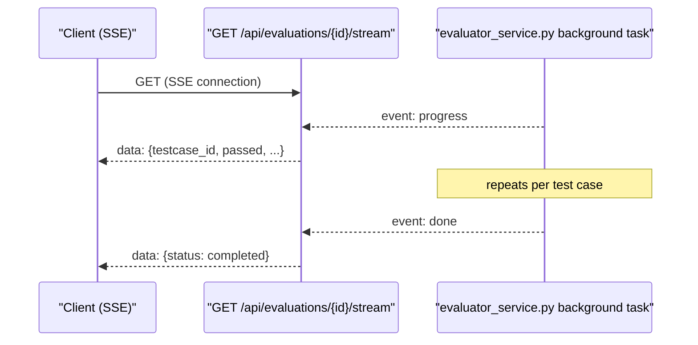

The frontend connects to this stream via `apiClient` in `src/lib/api.ts`. For full details on the client-side handling, see [API Client](#5.1).

Sources: [src/api/README.md:52-67](), [tests/unit/test_controllers.py:291-298]()

---

## Status Codes Summary

| Code | Meaning | When Used |
|------|---------|-----------|
| `200 OK` | Success with body | GET, PUT, POST cancel |
| `201 Created` | Resource created | POST dataset, testcase, agent, evaluation |
| `204 No Content` | Success, no body | DELETE operations |
| `400 Bad Request` | Business rule violation | Cancel completed evaluation; invalid eval params |
| `404 Not Found` | Resource missing | Any `{id}` path parameter that doesn't exist |
| `422 Unprocessable Entity` | Validation failure | Missing required request fields (Pydantic) |
| `500 Internal Server Error` | Unexpected exception | Wrapped in `try/except` blocks throughout |

Sources: [src/api/controllers.py:29-370](), [tests/unit/test_controllers.py:13-834]()

---

## Interactive Documentation

The FastAPI app auto-generates OpenAPI documentation:

- **Swagger UI**: `http://localhost:8000/api/docs`
- **ReDoc**: `http://localhost:8000/api/redoc`
- **OpenAPI JSON**: `http://localhost:8000/openapi.json`

The OpenAPI schema is verified in tests to confirm endpoint registration, parameter names, and response schemas. See [src/api/README.md:202-205]() and [tests/unit/test_controllers.py:194-210]().

---

# Page: Data Models

# Data Models

<details>
<summary>Relevant source files</summary>

The following files were used as context for generating this wiki page:

- [src/api/controllers.py](src/api/controllers.py)
- [tests/integration/test_evaluation_flow.py](tests/integration/test_evaluation_flow.py)
- [tests/unit/test_models.py](tests/unit/test_models.py)

</details>


All Pydantic models used by the backend API are defined in `src/api/models.py`. This page documents every model's fields, required inputs, auto-generated values, and defaults. It covers only the Python data layer; for how these models are exposed through REST endpoints see [REST API Endpoints](#3.1), and for how the evaluation engine uses them at runtime see [Evaluation Engine](#3.3).

---

## Model Map

The diagram below maps every class name to the file that defines it and shows the relationships between models.

**Core Model Relationships**

```mermaid
erDiagram
    Dataset {
        string id "auto: dataset_*"
        string created_at "auto: ISO datetime"
        list test_case_ids "default: []"
    }
    Metadata {
        string generator_id "auto: gen_*"
        string suite_id "auto: suite_*"
        string version "default: 1.0"
        string created_at "auto: ISO datetime"
        string schema_hash "optional"
    }
    SeedScenario {
        string goal "required"
        string name "default: empty string"
        dict input "default: {}"
    }
    Rubric {
        string id "auto: rubric_*"
        string name "required"
        string azure_foundry_id "required"
        float threshold "required"
    }
    TestCase {
        string id "auto: tc_*"
        string dataset_id "required, FK"
        string name "optional"
        string description "optional"
        string input "required"
        string expected_response "required"
        list minimal_tool_set "default: []"
    }
    ToolExpectation {
        string name "required"
        list arguments "default: []"
    }
    ArgumentAssertion {
        string name "required"
        list assertion "required"
        list rubrics "default: []"
    }
    ResponseQualityAssertion {
        string assertion "required"
    }
    Agent {
        string id "auto: agent_*"
        string name "required"
        string description "optional"
        string model "optional"
        string agent_invocation_url "required"
        string createdAt "auto: ISO datetime"
    }
    EvaluationRun {
        string id "auto: eval_*"
        string name "required"
        string dataset_id "required, FK"
        string agent_id "required, FK"
        string agent_endpoint "required"
        string status "default: pending"
        int total_tests "default: 0"
        int completed_tests "default: 0"
        int passed_count "default: 0"
        int failed_tests "default: 0"
        int total_rate_limit_hits "default: 0"
        float total_retry_wait_seconds "default: 0"
        int timeout_seconds "default: 300"
        bool agent_auth_required "default: true"
        bool verbose_logging "default: false"
        datetime started_at "optional"
        datetime completed_at "optional"
        datetime created_at "auto"
        list test_cases "default: []"
        list status_history "default: []"
    }
    StatusHistoryEntry {
        string message "required"
        datetime timestamp "auto: now()"
        bool is_rate_limit "default: false"
        int retry_attempt "optional"
        int max_attempts "optional"
        float wait_seconds "optional"
    }
    TestCaseResult {
        string testcase_id "required, FK"
        bool passed "required"
        string response_from_agent "required"
        list expected_tools "required"
        list tool_expectations "required"
        list actual_tool_calls "default: []"
        string execution_error "optional"
        int retry_count "optional"
    }
    AssertionResult {
        bool passed "required"
        string llm_judge_output "required"
    }
    ExpectedToolResult {
        string name_of_tool "required"
        bool was_called "required"
    }
    ResponseQualityResult {
        bool passed "required"
        string llm_judge_output "required"
    }

    Dataset ||--|| Metadata : "embeds metadata"
    Dataset ||--|| SeedScenario : "embeds seed"
    Dataset ||--o{ TestCase : "test_case_ids"
    TestCase ||--o{ ToolExpectation : "tool_expectations"
    TestCase ||--o| ResponseQualityAssertion : "response_quality_expectation"
    ToolExpectation ||--o{ ArgumentAssertion : "arguments"
    ArgumentAssertion ||--o{ Rubric : "rubrics"
    EvaluationRun }o--|| Agent : "agent_id"
    EvaluationRun }o--|| Dataset : "dataset_id"
    EvaluationRun ||--o{ TestCaseResult : "test_cases"
    EvaluationRun ||--o{ StatusHistoryEntry : "status_history"
    TestCaseResult }o--|| TestCase : "testcase_id"
    TestCaseResult ||--o{ ExpectedToolResult : "expected_tools"
    TestCaseResult ||--o| ResponseQualityResult : "response_quality_assertion"
```

Sources: [src/api/models.py](), [tests/unit/test_models.py:1-650]()

---

## Auto-Generated ID Prefixes

Every persisted entity gets an auto-generated string `id` at construction time. No caller needs to supply one.

| Model | ID Prefix | Example |
|---|---|---|
| `Metadata` | `gen_` (generator_id) / `suite_` (suite_id) | `gen_abc123` / `suite_xyz` |
| `Rubric` | `rubric_` | `rubric_7f3a` |
| `Dataset` | `dataset_` | `dataset_8c2d` |
| `TestCase` | `tc_` | `tc_1e4f` |
| `Agent` | `agent_` | `agent_9b0c` |
| `EvaluationRun` | `eval_` | `eval_3d7e` |

Sources: [tests/unit/test_models.py:15-25](), [tests/unit/test_models.py:80-88](), [tests/unit/test_models.py:137-147](), [tests/unit/test_models.py:188-189](), [tests/unit/test_models.py:196-207](), [tests/unit/test_models.py:256-270]()

---

## Dataset-Related Models

### `Metadata`

Embedded inside every `Dataset`. All fields have defaults and no field is mandatory at call time.

| Field | Type | Default / Auto |
|---|---|---|
| `generator_id` | `str` | Auto: `gen_` + UUID fragment |
| `suite_id` | `str` | Auto: `suite_` + UUID fragment |
| `version` | `str` | `"1.0"` |
| `created_at` | `str` | Auto: ISO 8601 timestamp |
| `schema_hash` | `str` | `None` (optional) |

Sources: [tests/unit/test_models.py:12-40]()

---

### `SeedScenario`

Describes the original intent of a dataset; embedded inside `Dataset`.

| Field | Type | Required | Default |
|---|---|---|---|
| `goal` | `str` | ✅ | — |
| `name` | `str` | ❌ | `""` |
| `input` | `dict` | ❌ | `{}` |

Sources: [tests/unit/test_models.py:43-62]()

---

### `Dataset`

Top-level container grouping a set of `TestCase` records.

| Field | Type | Required | Default / Auto |
|---|---|---|---|
| `id` | `str` | ❌ | Auto: `dataset_*` |
| `metadata` | `Metadata` | ✅ | — |
| `seed` | `SeedScenario` | ✅ | — |
| `test_case_ids` | `list[str]` | ❌ | `[]` |
| `created_at` | `str` | ❌ | Auto: ISO 8601 |

`created_at` serializes as a plain ISO 8601 string in `model_dump()` output, not as a Python `datetime` object.

Sources: [tests/unit/test_models.py:134-159](), [src/api/controllers.py:38-56]()

---

### `TestCase`

A single evaluation scenario stored under a `Dataset`.

| Field | Type | Required | Default |
|---|---|---|---|
| `id` | `str` | ❌ | Auto: `tc_*` |
| `dataset_id` | `str` | ✅ | — |
| `name` | `str` | ❌ | `None` |
| `description` | `str` | ❌ | `None` |
| `input` | `str` | ✅ (see note) | — |
| `expected_response` | `str` | ✅ | — |
| `minimal_tool_set` | `list[str]` | ❌ | `[]` |
| `tool_expectations` | `list[ToolExpectation]` | ❌ | `[]` |
| `response_quality_expectation` | `ResponseQualityAssertion` | ❌ | `None` |
| `references_seed` | any | ❌ | `None` |

> `dataset_id` is always set from the URL path parameter in the controllers, not from the request body.

Sources: [tests/unit/test_models.py:162-190](), [src/api/controllers.py:106-133]()

---

### `ToolExpectation`

Declares which tool should be called during a test case and what its arguments must satisfy.

| Field | Type | Required | Default |
|---|---|---|---|
| `name` | `str` | ✅ | — |
| `arguments` | `list[ArgumentAssertion]` | ❌ | `[]` |

Sources: [tests/unit/test_models.py:114-132]()

---

### `ArgumentAssertion`

Declares what constraints must hold for a single argument of a tool call.

| Field | Type | Required | Default |
|---|---|---|---|
| `name` | `str` | ✅ | — |
| `assertion` | `list[str]` | ✅ | — |
| `rubrics` | `list[Rubric]` | ❌ | `[]` |

Sources: [tests/unit/test_models.py:90-112]()

---

### `Rubric`

An optional scoring rubric that can be attached to an `ArgumentAssertion`. Identifies an Azure AI Foundry evaluator by its string ID.

| Field | Type | Required | Default / Auto |
|---|---|---|---|
| `id` | `str` | ❌ | Auto: `rubric_*` |
| `name` | `str` | ✅ | — |
| `azure_foundry_id` | `str` | ✅ | — |
| `threshold` | `float` | ✅ | — |

Sources: [tests/unit/test_models.py:64-88]()

---

### `ResponseQualityAssertion`

An open-ended assertion about the natural-language quality of the agent's response, distinct from tool-call correctness.

| Field | Type | Required |
|---|---|---|
| `assertion` | `str` | ✅ |

Sources: [tests/integration/test_evaluation_flow.py:156-179]()

---

## Agent Model

### `Agent`

Represents a registered agent endpoint. All persisted `Agent` objects are stored in the `agents` Cosmos container.

| Field | Type | Required | Default / Auto |
|---|---|---|---|
| `id` | `str` | ❌ | Auto: `agent_*` |
| `name` | `str` | ✅ | — |
| `description` | `str` | ❌ | `None` |
| `model` | `str` | ❌ | `None` |
| `agent_invocation_url` | `str` | ✅ | — |
| `createdAt` | `str` | ❌ | Auto: ISO 8601 |

`createdAt` is stored and serialized as a plain ISO 8601 string (not a `datetime`) in `model_dump()` output, matching the camelCase convention used by the frontend.

Sources: [tests/unit/test_models.py:192-221]()

---

## Evaluation Models

### `EvaluationRunStatus`

A string enum controlling the lifecycle of an `EvaluationRun`. See [Evaluation Engine](#3.3) for the full state machine.

| Value | Meaning |
|---|---|
| `pending` | Created, background task not yet started |
| `running` | Background task is actively processing test cases |
| `completed` | All test cases finished successfully |
| `failed` | Unrecoverable error during processing |
| `cancelled` | Manually cancelled via `POST /api/evaluations/{id}/cancel` |

Sources: [tests/unit/test_models.py:224-250]()

---

### `EvaluationRun`

The central evaluation record. Written once at creation and updated incrementally as each test case is processed.

**Identity and target fields**

| Field | Type | Required | Default / Auto |
|---|---|---|---|
| `id` | `str` | ❌ | Auto: `eval_*` |
| `name` | `str` | ✅ | — |
| `dataset_id` | `str` | ✅ | — |
| `agent_id` | `str` | ✅ | — |
| `agent_endpoint` | `str` | ✅ | — |

**Status and timing fields**

| Field | Type | Default |
|---|---|---|
| `status` | `EvaluationRunStatus` | `pending` |
| `created_at` | `datetime` | Auto: `now()` |
| `started_at` | `datetime` | `None` |
| `completed_at` | `datetime` | `None` |

**Progress counters**

| Field | Type | Default |
|---|---|---|
| `total_tests` | `int` | `0` |
| `completed_tests` | `int` | `0` |
| `passed_count` | `int` | `0` |
| `failed_tests` | `int` | `0` |

**Rate-limit and retry tracking**

| Field | Type | Default |
|---|---|---|
| `total_rate_limit_hits` | `int` | `0` |
| `total_retry_wait_seconds` | `float` | `0.0` |
| `status_history` | `list[StatusHistoryEntry]` | `[]` |

**Configuration overrides**

| Field | Type | Default |
|---|---|---|
| `agent_auth_required` | `bool` | `True` |
| `timeout_seconds` | `int` | `300` |
| `verbose_logging` | `bool` | `False` |

**Results**

| Field | Type | Default |
|---|---|---|
| `test_cases` | `list[TestCaseResult]` | `[]` |

Sources: [tests/unit/test_models.py:253-530](), [tests/integration/test_evaluation_flow.py:340-409]()

---

### `StatusHistoryEntry`

Appended to `EvaluationRun.status_history` each time the evaluation encounters a notable event, primarily rate-limit hits.

| Field | Type | Required | Default |
|---|---|---|---|
| `message` | `str` | ✅ | — |
| `timestamp` | `datetime` | ❌ | Auto: `now()` |
| `is_rate_limit` | `bool` | ❌ | `False` |
| `retry_attempt` | `int` | ❌ | `None` |
| `max_attempts` | `int` | ❌ | `None` |
| `wait_seconds` | `float` | ❌ | `None` |

Sources: [tests/unit/test_models.py:350-400]()

---

### `TestCaseResult`

Records the outcome of running a single `TestCase` against the agent. Stored inside `EvaluationRun.test_cases`.

| Field | Type | Required | Default |
|---|---|---|---|
| `testcase_id` | `str` | ✅ | — |
| `passed` | `bool` | ✅ | — |
| `response_from_agent` | `str` | ✅ | — |
| `expected_tools` | `list[ExpectedToolResult]` | ✅ | — |
| `tool_expectations` | `list` | ✅ | — |
| `actual_tool_calls` | `list[dict]` | ❌ | `[]` |
| `response_quality_assertion` | `ResponseQualityResult` | ❌ | `None` |
| `execution_error` | `str` | ❌ | `None` |
| `retry_count` | `int` | ❌ | `None` |

`actual_tool_calls` stores raw dicts with the shape `{"name": str, "arguments": dict, "response": any}`.

Sources: [tests/unit/test_models.py:290-308](), [tests/integration/test_evaluation_flow.py:356-469]()

---

### `ExpectedToolResult`

Records whether a specific tool that was expected in `minimal_tool_set` was actually invoked.

| Field | Type | Required |
|---|---|---|
| `name_of_tool` | `str` | ✅ |
| `was_called` | `bool` | ✅ |

Sources: [tests/unit/test_models.py:326-337](), [tests/integration/test_evaluation_flow.py:362-368]()

---

### `AssertionResult`

Captures the LLM judge's verdict on a single `ArgumentAssertion`.

| Field | Type | Required |
|---|---|---|
| `passed` | `bool` | ✅ |
| `llm_judge_output` | `str` | ✅ |

Sources: [tests/unit/test_models.py:313-325]()

---

### `ResponseQualityResult`

Captures the LLM judge's verdict on the overall response quality (`response_quality_expectation`).

| Field | Type | Required |
|---|---|---|
| `passed` | `bool` | ✅ |
| `llm_judge_output` | `str` | ✅ |

Sources: [tests/integration/test_evaluation_flow.py:365-371]()

---

## Request and Response Models

These models are used exclusively at the API boundary; they are not stored in Cosmos DB directly.

**Model purpose map**

```mermaid
flowchart LR
    subgraph "Request models (inbound)"
        CDS["CreateDatasetRequest"]
        TCC["TestCaseCreate"]
        AC["AgentCreate"]
        ERC["EvaluationRunCreate"]
    end

    subgraph "Domain models (persisted)"
        DS["Dataset"]
        TC["TestCase"]
        AG["Agent"]
        ER["EvaluationRun"]
    end

    subgraph "Response models (outbound)"
        DSR["DatasetResponse"]
        TCR["TestCaseResponse"]
    end

    CDS -->|"controllers.py create_dataset"| DS
    TCC -->|"controllers.py add_testcase"| TC
    AC -->|"controllers.py create_agent"| AG
    ERC -->|"evaluator_service.py create_evaluation_run"| ER

    DS -->|"serialized as"| DSR
    TC -->|"serialized as"| TCR
    AG -->|"returned directly"| AG
    ER -->|"returned directly"| ER
```

Sources: [src/api/controllers.py:1-19](), [src/api/controllers.py:29-58](), [src/api/controllers.py:225-228](), [src/api/controllers.py:266-280]()

---

### `CreateDatasetRequest`

The POST body for `POST /api/datasets`. Controllers build a `Dataset` + `Metadata` + `SeedScenario` from this.

| Field | Type | Required |
|---|---|---|
| `name` | `str` | ✅ |
| `goal` | `str` | ✅ |
| `input` | `dict` | ❌ |
| `schema_hash` | `str` | ❌ |

Sources: [src/api/controllers.py:29-58]()

---

### `TestCaseCreate`

The request body for creating or updating a `TestCase`. Mirrors `TestCase` minus the auto-generated and FK fields.

| Field | Type | Required |
|---|---|---|
| `name` | `str` | ❌ |
| `description` | `str` | ❌ |
| `input` | `str` | ✅ |
| `expected_response` | `str` | ✅ |
| `minimal_tool_set` | `list[str]` | ❌ |
| `tool_expectations` | `list[ToolExpectation]` | ❌ |
| `response_quality_expectation` | `ResponseQualityAssertion` | ❌ |
| `references_seed` | any | ❌ |

Sources: [src/api/controllers.py:94-133]()

---

### `AgentCreate`

The request body for `POST /api/agents` and `PUT /api/agents/{id}`. Mirrors `Agent` minus auto-generated fields.

| Field | Type | Required |
|---|---|---|
| `name` | `str` | ✅ |
| `description` | `str` | ❌ |
| `model` | `str` | ❌ |
| `agent_invocation_url` | `str` | ✅ |

Sources: [src/api/controllers.py:225-228]()

---

### `EvaluationRunCreate`

The request body for `POST /api/evaluations`.

| Field | Type | Required | Default |
|---|---|---|---|
| `name` | `str` | ✅ | — |
| `dataset_id` | `str` | ✅ | — |
| `agent_id` | `str` | ✅ | — |
| `agent_endpoint` | `str` | ✅ | — |
| `verbose_logging` | `bool` | ❌ | `False` |

Sources: [tests/unit/test_models.py:597-649]()

---

### `DatasetResponse` and `TestCaseResponse`

Flat response shapes returned by GET endpoints. They mirror their domain counterparts but ensure all nested objects are fully serialized. `Agent` and `EvaluationRun` are returned directly as their domain models without a separate response wrapper.

Sources: [src/api/controllers.py:61-84](), [src/api/controllers.py:136-153]()

---

## Serialization Notes

- All `datetime` fields serialize as ISO 8601 strings in `model_dump()` output. This is validated by [tests/unit/test_models.py:149-159]() for `Dataset.created_at` and [tests/unit/test_models.py:209-221]() for `Agent.createdAt`.
- `Agent` uses camelCase `createdAt` (not snake_case) to match the frontend's field naming convention.
- `actual_tool_calls` inside `TestCaseResult` stores raw `dict` objects, not typed models, preserving the full tool call payload from the agent including the `response` key.

Sources: [tests/unit/test_models.py:149-159](), [tests/unit/test_models.py:209-221](), [tests/integration/test_evaluation_flow.py:424-469]()

---

# Page: Evaluation Engine

# Evaluation Engine

<details>
<summary>Relevant source files</summary>

The following files were used as context for generating this wiki page:

- [src/api/README.md](src/api/README.md)
- [tests/integration/test_evaluation_flow.py](tests/integration/test_evaluation_flow.py)
- [tests/unit/test_controllers.py](tests/unit/test_controllers.py)
- [tests/unit/test_models.py](tests/unit/test_models.py)

</details>


This page covers `src/api/evaluator_service.py`: the asynchronous engine that orchestrates evaluation runs, invokes agents, scores results via an LLM judge, and persists results. For documentation of the REST endpoints that trigger and monitor evaluations, see [REST API Endpoints](#3.1). For the Pydantic models referenced throughout this page, see [Data Models](#3.2).

---

## Overview

The evaluation engine lives in `evaluator_service.py` as the `EvaluatorService` class. It is instantiated at startup in `main.py` and injected into `controllers.py` via FastAPI dependency injection. When a client submits an evaluation request, the controller creates the run record, then hands off execution to `EvaluatorService` as a FastAPI `BackgroundTask`. The HTTP response (202) returns immediately with the new evaluation ID; actual test execution proceeds asynchronously.

**Primary responsibilities:**

| Responsibility | Where |
|---|---|
| Create / read / delete `EvaluationRun` records | `EvaluatorService` methods delegating to `CosmosService` |
| Iterate over every `TestCase` in the dataset | `start_evaluation()` background task |
| POST each test input to the agent endpoint | inner loop in `start_evaluation()` |
| Score agent tool calls against `ToolExpectation` via Azure OpenAI | LLM judge call inside the loop |
| Handle HTTP 429 with exponential backoff | retry logic in `start_evaluation()` |
| Write `TestCaseResult` and update counters per test | `CosmosService.update_evaluation_run()` |
| Support cancellation at any point in the loop | `cancel_evaluation_run()` + cancellation flag |
| Emit SSE progress events to connected clients | streamed from the loop |

Sources: [src/api/README.md:57-68](), [tests/unit/test_controllers.py:575-834]()

---

## Module Dependency Map

**Diagram: evaluator_service.py dependencies**

```mermaid
graph TD
    controllers["controllers.py\nAPIRouter /api/evaluations*"]
    evaluator["evaluator_service.py\nEvaluatorService"]
    cosmos["cosmos_service.py\nCosmosService"]
    config["config.py\nRETRY_MAX_ATTEMPTS\nRETRY_BASE_DELAY\nRETRY_MAX_DELAY\nEVALUATION_TIMEOUT_SECONDS"]
    oai["Azure OpenAI\nGPT-4.1 judge"]
    agent["Agent endpoint\nPOST agent_invocation_url"]
    models["models.py\nEvaluationRun\nTestCaseResult\nStatusHistoryEntry"]

    controllers -->|"create_evaluation_run()\nstart_evaluation()\ncancel_evaluation_run()\ndelete_evaluation_run()"| evaluator
    evaluator -->|"list_testcases_by_dataset()\ncreate_evaluation_run()\nupdate_evaluation_run()\nget_evaluation_run()"| cosmos
    evaluator -->|"RETRY_* / TIMEOUT settings"| config
    evaluator -->|"LLM scoring"| oai
    evaluator -->|"POST invoke"| agent
    evaluator -->|"reads/writes"| models
```

Sources: [src/api/README.md:6-14](), [tests/unit/test_controllers.py:575-598]()

---

## EvaluatorService Public Interface

The controller interacts with `EvaluatorService` exclusively through the following methods:

| Method | Description |
|---|---|
| `create_evaluation_run(run_create)` | Persists a new `EvaluationRun` in status `pending` and returns it |
| `start_evaluation(evaluation_id, background_tasks)` | Schedules the evaluation loop as a `BackgroundTask` |
| `list_evaluation_runs(agent_id, skip, limit)` | Queries Cosmos for all runs, optionally filtered by `agent_id` |
| `get_evaluation_run(evaluation_id)` | Fetches a single `EvaluationRun` by ID |
| `cancel_evaluation_run(evaluation_id)` | Sets a cancellation flag; raises `ValueError` if run is terminal |
| `delete_evaluation_run(evaluation_id)` | Removes the run record; returns `True` on success |

Sources: [tests/unit/test_controllers.py:589-590](), [tests/unit/test_controllers.py:623](), [tests/unit/test_controllers.py:646-657](), [tests/unit/test_controllers.py:783-834]()

---

## EvaluationRun State Machine

**Diagram: EvaluationRun status transitions**

```mermaid
stateDiagram-v2
    [*] --> pending : "POST /api/evaluations\ncreate_evaluation_run()"

    pending --> running : "BackgroundTask starts\nstarted_at = now()"
    pending --> cancelled : "cancel_evaluation_run()"

    running --> completed : "all TestCases processed\ncompleted_at = now()"
    running --> failed : "unrecoverable exception"
    running --> cancelled : "cancel_evaluation_run()\ncancellation flag detected"

    completed --> [*]
    failed --> [*]
    cancelled --> [*]
```

The `EvaluationRunStatus` enum in `models.py` defines all five values: `pending`, `running`, `completed`, `failed`, `cancelled`.

Every time the evaluation hits a rate-limit event, a `StatusHistoryEntry` is appended to `EvaluationRun.status_history`. This history is separate from the terminal status transitions above and is available for display in the UI.

Sources: [tests/unit/test_models.py:224-250](), [tests/unit/test_models.py:406-559](), [tests/integration/test_evaluation_flow.py:26-48]()

---

## Execution Flow

**Diagram: Per-evaluation-run execution sequence**

```mermaid
sequenceDiagram
    participant C as "controllers.py"
    participant E as "EvaluatorService\n(evaluator_service.py)"
    participant DB as "CosmosService\n(cosmos_service.py)"
    participant A as "Agent\n(agent_invocation_url)"
    participant OAI as "Azure OpenAI\n(LLM judge)"

    C->>DB: "create_evaluation_run (status=pending)"
    C->>E: "start_evaluation() via BackgroundTasks"
    C-->>C: "return 202 + evaluation_id"

    E->>DB: "update status=running, started_at=now()"
    E->>DB: "list_testcases_by_dataset(dataset_id)"
    DB-->>E: "[TestCase, ...]"

    loop "for each TestCase"
        E->>A: "POST agent_invocation_url\n{dataset_id, test_case_id, agent_id, evaluation_run_id, input}"
        alt "HTTP 429"
            E->>E: "exponential backoff\nappend StatusHistoryEntry(is_rate_limit=True)\ntotal_rate_limit_hits += 1"
            E->>A: "retry POST"
        end
        A-->>E: "{response, tool_calls[]}"
        E->>OAI: "score tool_calls vs tool_expectations"
        OAI-->>E: "pass/fail + rationale per assertion"
        E->>DB: "update_evaluation_run (append TestCaseResult)\ncompleted_tests += 1\npassed_count or failed_tests += 1"
        E-->>C: "SSE event: progress update"
        alt "cancellation flag set"
            E->>DB: "update status=cancelled"
            E-->>C: "SSE event: cancelled"
        end
    end

    E->>DB: "update status=completed, completed_at=now()"
    E-->>C: "SSE event: done"
```

Sources: [src/api/README.md:57-68](), [tests/integration/test_evaluation_flow.py:291-469](), [tests/unit/test_controllers.py:575-598]()

---

## Agent Invocation Contract

Inside the loop, the engine sends an HTTP POST to `EvaluationRun.agent_endpoint`. The expected request and response shapes are:

**Request body sent to agent:**

```
{
  "dataset_id":        string,
  "test_case_id":      string,
  "agent_id":          string,
  "evaluation_run_id": string,
  "input":             string   ← TestCase.input
}
```

**Response body expected from agent:**

```
{
  "response":    string,
  "tool_calls":  [
    { "name": string, "arguments": object, "response": any },
    ...
  ]
}
```

The `tool_calls` array is then compared to `TestCase.tool_expectations` by the LLM judge. For full agent-side documentation, see [Calendar Agent](#4).

Sources: [tests/integration/test_evaluation_flow.py:153-201]()

---

## LLM Judge Scoring

After the agent responds, the engine submits the actual `tool_calls` alongside the `TestCase.tool_expectations` (including `ArgumentAssertion` criteria) to Azure OpenAI (GPT-4.1). The judge returns a pass/fail verdict and a rationale string per assertion.

Results are stored in `TestCaseResult`:

| Field | Type | Description |
|---|---|---|
| `testcase_id` | `str` | FK to `TestCase.id` |
| `passed` | `bool` | Overall pass/fail |
| `response_from_agent` | `str` | Raw agent response text |
| `actual_tool_calls` | `list` | Full tool call log `[{name, arguments, response}]` |
| `expected_tools` | `list[ExpectedToolResult]` | Per-tool was-called tracking |
| `tool_expectations` | `list` | Expectation snapshot at time of run |
| `response_quality_assertion` | `ResponseQualityResult` | LLM judge output on response quality |
| `execution_error` | `str \| None` | Error text if the test case raised an exception |
| `retry_count` | `int` | Number of retries consumed by this test case |

Sources: [tests/unit/test_models.py:290-336](), [tests/integration/test_evaluation_flow.py:341-416]()

---

## Rate Limiting and Retry Logic

When the agent endpoint returns HTTP 429, the engine does **not** fail the test case immediately. Instead, it applies exponential backoff and retries up to `RETRY_MAX_ATTEMPTS` times.

**Configuration values** (from `src/api/config.py`):

| Config Symbol | Type | Role |
|---|---|---|
| `RETRY_MAX_ATTEMPTS` | `int` | Maximum retry attempts per 429 response |
| `RETRY_BASE_DELAY` | `float` | Initial wait in seconds before first retry |
| `RETRY_MAX_DELAY` | `float` | Cap on computed backoff delay |
| `EVALUATION_TIMEOUT_SECONDS` | `int` | Hard timeout for the entire evaluation run |

**Per rate-limit event**, the engine:

1. Computes the delay: `min(RETRY_BASE_DELAY * 2^attempt, RETRY_MAX_DELAY)`
2. Appends a `StatusHistoryEntry` to `EvaluationRun.status_history` with `is_rate_limit=True`, `retry_attempt`, `max_attempts`, and `wait_seconds`
3. Increments `EvaluationRun.total_rate_limit_hits`
4. Adds the wait duration to `EvaluationRun.total_retry_wait_seconds`
5. Sleeps, then retries the agent POST

The `StatusHistoryEntry` model fields used for tracking:

| Field | Default | Description |
|---|---|---|
| `message` | required | Human-readable description |
| `timestamp` | `datetime.now(utc)` | Auto-generated |
| `is_rate_limit` | `False` | Marks rate-limit events |
| `retry_attempt` | `None` | Which attempt number this is |
| `max_attempts` | `None` | Value of `RETRY_MAX_ATTEMPTS` at time of hit |
| `wait_seconds` | `None` | Actual sleep duration |

Sources: [tests/unit/test_models.py:563-593](), [tests/unit/test_models.py:350-400](), [src/api/README.md:57-64]()

---

## Cancellation

Any evaluation in `pending` or `running` status can be cancelled by calling `cancel_evaluation_run(evaluation_id)`. The method:

- Sets an internal cancellation flag checked at the start of each test-case iteration.
- If the run is already `completed`, `failed`, or `cancelled`, it raises `ValueError` (which the controller surfaces as HTTP 400).
- If the run does not exist, the method returns `None` (controller returns HTTP 404).

On cancellation, the engine:
1. Detects the flag before or after the current test case finishes.
2. Writes `status = cancelled` to `EvaluationRun` via `CosmosService`.
3. Emits a final SSE event to connected clients.

Sources: [tests/unit/test_controllers.py:770-834](), [tests/unit/test_models.py:533-560]()

---

## SSE Streaming

The endpoint `GET /api/evaluations/{id}/stream` (served by `controllers.py`) opens a Server-Sent Events connection. The evaluation loop emits events at these points:

| Event trigger | Payload |
|---|---|
| Test case completed | Progress counter, `passed` flag, test case ID |
| Rate-limit backoff | Status history entry |
| Status change | New `EvaluationRunStatus` value |
| Run finished | `done` sentinel event |

Clients (the React webapp) connect to this stream immediately after receiving the 202 from `POST /api/evaluations`. For UI-side handling, see [Evaluation Results UI](#5.3).

Sources: [src/api/README.md:63-68]()

---

## EvaluationRun Progress Fields

The following fields on `EvaluationRun` are updated incrementally by the engine as each test case completes:

| Field | Initial | Updated When |
|---|---|---|
| `status` | `pending` | Each state transition |
| `started_at` | `None` | Loop begins (`running`) |
| `completed_at` | `None` | Loop ends (`completed`/`cancelled`/`failed`) |
| `total_tests` | `0` | Set from dataset size before loop starts |
| `completed_tests` | `0` | Incremented after every test case result |
| `passed_count` | `0` | Incremented on `TestCaseResult.passed == True` |
| `failed_tests` | `0` | Incremented on `TestCaseResult.passed == False` |
| `total_rate_limit_hits` | `0` | Incremented on each 429 |
| `total_retry_wait_seconds` | `0.0` | Accumulates sleep durations |
| `status_history` | `[]` | Entry appended on rate-limit events |
| `test_cases` | `[]` | Appended after each test case result is written |

Sources: [tests/unit/test_models.py:403-530](), [tests/integration/test_evaluation_flow.py:340-416]()

---

# Page: Calendar Agent

# Calendar Agent

<details>
<summary>Relevant source files</summary>

The following files were used as context for generating this wiki page:

- [CODE_OF_CONDUCT.md](CODE_OF_CONDUCT.md)
- [CONTRIBUTING.md](CONTRIBUTING.md)
- [README.md](README.md)
- [src/agents/agent_server.py](src/agents/agent_server.py)

</details>


This page documents the sample Calendar Agent implementation in `src/agents/agent_server.py`. It covers the agent's FastAPI endpoints, its data models, how it connects to the MCP server for tool access, the Azure OpenAI conversation loop, and how to register it with the evaluation platform.

For the evaluation engine that calls the agent, see [Evaluation Engine](#3.3). For the full agent invocation contract expected by the platform, see [REST API Endpoints](#3.1). For the mock agent used in tests, see [Mock Agent Server](#7.4).

---

## Overview

The Calendar Agent is a standalone FastAPI server running on **port 8001**. It is a sample, reference implementation of an agent that conforms to the platform's invocation contract. It connects to the Backend API's MCP (Model Context Protocol) server to discover and call tools, and uses Azure OpenAI (GPT-4.1) to reason over user requests and drive tool selection.

**Key design points:**

- Each invocation creates a **fresh `CalendarAgent` instance** with its own MCP connection, which is torn down after the request completes.
- MCP tools are discovered dynamically at connection time and converted to OpenAI function-calling format.
- The conversation loop runs up to **10 iterations**, allowing multi-step tool chains.
- The agent is **stateless across requests** — all context lives in the per-request message history.

Sources: [src/agents/agent_server.py:1-6]()

---

## Data Models

The agent defines four Pydantic models:

| Model | Role |
|---|---|
| `InvokeRequest` | Body of `POST /agents/calendar/invoke`; identifies the test context and carries the user input string |
| `InvokeResponse` | Body returned from the endpoint; contains the final text response and all tool call records |
| `ToolCall` | One record of a single tool invocation: name, list of `ToolArgument`, and optional MCP response |
| `ToolArgument` | A single key/value pair representing one argument to a tool call |

**`InvokeRequest` fields:**

| Field | Type | Description |
|---|---|---|
| `dataset_id` | `str` | ID of the dataset this test case belongs to |
| `test_case_id` | `str` | ID of the specific test case being run |
| `agent_id` | `str` | ID of the registered agent |
| `evaluation_run_id` | `str` | ID of the evaluation run that triggered the invocation |
| `input` | `str` | The user's natural-language instruction to the agent |

**`InvokeResponse` fields:**

| Field | Type | Description |
|---|---|---|
| `response` | `str` | Final natural-language response from the agent |
| `tool_calls` | `List[ToolCall]` | Ordered list of every tool the agent invoked |

Sources: [src/agents/agent_server.py:35-61]()

---

## Endpoints

The FastAPI `app` exposes three HTTP endpoints:

**Endpoint map:**

```mermaid
flowchart LR
    subgraph "Port 8001 — agent_server.py"
        root["GET /\nroot()"]
        info["GET /agents/calendar\nagent_info()"]
        invoke["POST /agents/calendar/invoke\ninvoke_agent()"]
    end

    EvalSvc["evaluator_service.py\n(evaluation engine)"]
    Browser["Browser / Health check"]

    Browser --> root
    Browser --> info
    EvalSvc -->|"InvokeRequest"| invoke
    invoke -->|"InvokeResponse"| EvalSvc
```

Sources: [src/agents/agent_server.py:385-441]()

### `GET /`

Health check. Returns `{"status": "ok", "agent": "calendar", "version": "1.0.0"}`.

### `GET /agents/calendar`

Returns metadata about the running agent instance: name, description, the `AZURE_OPENAI_DEPLOYMENT` value, and the configured `MCP_SERVER_URL`.

### `POST /agents/calendar/invoke`

The primary evaluation endpoint. Accepts an `InvokeRequest` body and returns an `InvokeResponse`. This is the URL that should be registered in the platform as the agent's `agent_invocation_url`.

**Correlation headers:** The handler reads `x-correlationid` and `x-testcaseid` from the incoming HTTP headers and forwards them to the MCP server connection. This enables request tracing through the tool execution layer.

Sources: [src/agents/agent_server.py:395-430]()

---

## `CalendarAgent` Class

`CalendarAgent` at [src/agents/agent_server.py:67-372]() is the core logic class. It is instantiated once **per request** inside `invoke_agent()` and discarded after the response is returned.

### Initialization

`__init__` configures two clients:

1. **`AsyncAzureOpenAI`** — Prefers `AZURE_OPENAI_API_KEY` if set; falls back to `DefaultAzureCredential` (Entra ID) for local development.
2. **MCP connection state** — Stores `mcp_server_url` from the environment variable `MCP_SERVER_URL`; all MCP connection handles are `None` until `connect_mcp()` is called.

**Environment variables consumed by `CalendarAgent`:**

| Variable | Default | Purpose |
|---|---|---|
| `AZURE_OPENAI_API_KEY` | _(none)_ | API key auth (preferred in Docker) |
| `AZURE_OPENAI_ENDPOINT` | `https://oai-exp.openai.azure.com/` | Azure OpenAI resource endpoint |
| `AZURE_OPENAI_API_VERSION` | `2024-12-01-preview` | API version |
| `AZURE_OPENAI_DEPLOYMENT` | `gpt-4.1` | Model deployment name |
| `MCP_SERVER_URL` | _(none)_ | URL of the Backend API's MCP endpoint |

Sources: [src/agents/agent_server.py:70-112]()

---

### MCP Connection Lifecycle

Each request creates, uses, and destroys its own MCP connection. The transport used is the **streamable HTTP** transport (not the deprecated SSE transport).

**Connection lifecycle diagram:**

```mermaid
sequenceDiagram
    participant H as "invoke_agent()"
    participant A as "CalendarAgent"
    participant MCP as "MCP Server (port 8000)"

    H->>A: "CalendarAgent(mcp_server_url)"
    H->>A: "connect_mcp_with_headers(correlation_headers)"
    A->>MCP: "streamablehttp_client(mcp_server_url, headers)"
    MCP-->>A: "(read_stream, write_stream, get_session_id)"
    A->>MCP: "ClientSession.initialize()"
    A->>MCP: "session.list_tools()"
    MCP-->>A: "[Tool, ...]"
    A->>A: "_update_tools_from_mcp(tools)"
    H->>A: "invoke(request)"
    Note over A,MCP: "Tool calls happen here via session.call_tool()"
    H->>A: "disconnect_mcp()"
    A->>MCP: "session.__aexit__()"
```

The method `_update_tools_from_mcp` converts each MCP `Tool` object into an OpenAI function-calling schema entry (`{"type": "function", "function": {...}}`), storing the result in `self.tools`.

If `MCP_SERVER_URL` is not configured, or the connection fails, `mcp_connected` is set to `False` and the agent proceeds without tools, returning error payloads for any tool call attempts.

Sources: [src/agents/agent_server.py:114-196](), [src/agents/agent_server.py:198-210]()

---

### Conversation Loop (`invoke`)

The `invoke` method at [src/agents/agent_server.py:212-335]() runs a multi-turn conversation loop with Azure OpenAI.

**Loop diagram:**

```mermaid
flowchart TD
    Start["invoke(request)"] --> Init["Build messages list\n(system prompt + user input)"]
    Init --> LLM["client.chat.completions.create(\nmodel, messages, tools, tool_choice=auto)"]
    LLM --> Check{"message.tool_calls?"}
    Check -->|"No"| Done["Return InvokeResponse\n(final_response, tool_calls)"]
    Check -->|"Yes"| AppendAssistant["Append assistant message to messages"]
    AppendAssistant --> ForEach["For each tool_call in message.tool_calls"]
    ForEach --> Execute["_execute_tool(function_name, function_args)"]
    Execute --> Record["Append ToolCall to tool_calls list"]
    Record --> AppendTool["Append tool result message to messages"]
    AppendTool --> IterCheck{"iteration < max_iterations (10)?"}
    IterCheck -->|"Yes"| LLM
    IterCheck -->|"No"| MaxDone["Return InvokeResponse\n(max iterations reached)"]
```

**System prompt behavior:** The system prompt instructs the model to always use tools rather than describing actions, to use default values if parameters are missing, and to include all key details in the final confirmation. For calendar scheduling, it explicitly instructs the model to avoid conflicting time slots.

Sources: [src/agents/agent_server.py:212-335]()

---

### Tool Execution (`_execute_tool`)

`_execute_tool` at [src/agents/agent_server.py:337-372]() dispatches tool calls through the active MCP session:

1. If `self.mcp_connected` is `True`, calls `self.mcp_session.call_tool(function_name, arguments)`.
2. Parses the MCP response: if the content has a `.text` attribute, parses it as JSON; otherwise, converts to string.
3. If the MCP connection is unavailable, returns `{"error": "...", "mcp_connected": False}`.

Any `json.JSONDecodeError` or other exception from the MCP call is **re-raised** (not swallowed), which will propagate up to the `invoke_agent` route handler and result in an HTTP 500 response.

Sources: [src/agents/agent_server.py:337-372]()

---

## Per-Request Flow (Full)

This diagram maps the full request lifecycle to the specific code entities involved:

```mermaid
sequenceDiagram
    participant ES as "evaluator_service.py"
    participant IA as "invoke_agent() :8001"
    participant CA as "CalendarAgent"
    participant MCP as "MCP Server :8000"
    participant OAI as "AsyncAzureOpenAI"

    ES->>IA: "POST /agents/calendar/invoke\n{InvokeRequest}"
    IA->>CA: "CalendarAgent(mcp_server_url)"
    IA->>CA: "connect_mcp_with_headers(headers)"
    CA->>MCP: "streamablehttp_client + ClientSession.initialize()"
    CA->>MCP: "session.list_tools()"
    MCP-->>CA: "tool schemas"
    CA->>CA: "_update_tools_from_mcp()"
    IA->>CA: "invoke(request)"
    loop "Up to 10 iterations"
        CA->>OAI: "chat.completions.create(messages, tools)"
        OAI-->>CA: "message with tool_calls"
        CA->>MCP: "session.call_tool(name, args)"
        MCP-->>CA: "tool result"
    end
    CA-->>IA: "InvokeResponse"
    IA->>CA: "disconnect_mcp()"
    IA-->>ES: "InvokeResponse JSON"
```

Sources: [src/agents/agent_server.py:395-430]()

---

## Registering the Agent with the Platform

To register the Calendar Agent so the evaluation platform can invoke it, use the Agent Management UI (see [Agent Management UI](#5.2)) or the REST API directly.

**Required registration fields:**

| Field | Value |
|---|---|
| `name` | Any descriptive label (e.g., `"Calendar Agent"`) |
| `agent_invocation_url` | `http://localhost:8001/agents/calendar/invoke` (local) or `http://agent:8001/agents/calendar/invoke` (Docker) |
| `model` | The model name, e.g., `gpt-4.1` |

Once registered, an `Agent` record is stored in Cosmos DB (see [Data Models](#3.2)) and can be selected when creating evaluation runs.

Sources: [src/agents/agent_server.py:379-441](), [README.md:171-180]()

---

## Running the Agent Server

**Without Docker:**

```bash
python -m uvicorn src.agents.agent_server:app --host 0.0.0.0 --port 8001 --reload
```

**With Docker Compose:** The agent service starts automatically alongside the API and Webapp when running `docker-compose up`. The `MCP_SERVER_URL` is automatically overridden to use the Docker service name (`http://api:8000/mcp`).

**Environment file:** The agent reads from the `.env` file at the repo root (loaded via `load_dotenv()` at [src/agents/agent_server.py:24]()).

Sources: [src/agents/agent_server.py:448-450](), [README.md:141-148](), [README.md:157-179]()

---

# Page: Web Application

# Web Application

<details>
<summary>Relevant source files</summary>

The following files were used as context for generating this wiki page:

- [CODE_OF_CONDUCT.md](CODE_OF_CONDUCT.md)
- [CONTRIBUTING.md](CONTRIBUTING.md)
- [README.md](README.md)
- [src/webapp/src/lib/api.ts](src/webapp/src/lib/api.ts)

</details>


This page covers the React/TypeScript frontend located at `src/webapp/`. It describes the webapp's role in the overall system, how it communicates with the backend API, and which page components handle which user workflows.

For details on the specific API client implementation and type definitions, see [API Client](#5.1). For the Agent Management pages, see [Agent Management UI](#5.2). For the evaluation results display, see [Evaluation Results UI](#5.3).

---

## Role and Responsibilities

The webapp is the primary user interface for the evaluation platform. It runs on **port 5000** as a Vite-served React development server (or a static build in Docker). It has no direct connection to Azure Cosmos DB or Azure OpenAI — all data access is brokered through the FastAPI backend on port 8000.

The webapp is responsible for:

- Browsing and inspecting evaluation datasets and their test cases
- Registering, editing, and deleting agents
- Launching evaluation runs and observing live progress
- Viewing per-test-case results, tool call traces, and pass/fail breakdowns
- Cancelling in-progress evaluation runs

Sources: [README.md:23-28](), [src/webapp/src/lib/api.ts:1-33]()

---

## Technology Stack

| Layer | Technology |
|---|---|
| UI framework | React 18 (TypeScript) |
| Build tool | Vite |
| HTTP communication | Fetch API (wrapped in `ApiClient`) |
| Base URL config | `src/lib/config.ts` (`API_BASE_URL`) |
| Container port | 5000 |

Sources: [README.md:150-155](), [src/webapp/src/lib/api.ts:35]()

---

## Service Topology

**Diagram: Webapp in the Three-Service Architecture**

```mermaid
graph LR
    Browser["Browser / User"]

    subgraph "Port 5000 — src/webapp/"
        ReactApp["React App"]
        ApiClientMod["apiClient\nsrc/lib/api.ts"]
        ConfigMod["API_BASE_URL\nsrc/lib/config.ts"]
        ReactApp --> ApiClientMod
        ApiClientMod --> ConfigMod
    end

    subgraph "Port 8000 — FastAPI"
        Controllers["controllers.py\n/api/*"]
    end

    Browser --> ReactApp
    ApiClientMod -->|"REST + SSE\nHTTP/JSON"| Controllers
```

Sources: [src/webapp/src/lib/api.ts:35](), [README.md:23-28]()

---

## Page Components Overview

The webapp is organized into several major page-level components. Each page corresponds to a primary resource in the system.

**Diagram: Page Components and API Resources**

```mermaid
graph TD
    subgraph "src/webapp/src/"
        App["App\n(routing root)"]

        DatasetsPage["DatasetsPage\n/datasets"]
        DatasetDetailPage["DatasetDetailPage\n/datasets/:id"]

        AgentsPage["AgentsPage\n/agents"]
        AgentDetailPage["AgentDetailPage\n/agents/:id"]

        EvaluationResultsPage["EvaluationResultsPage\n/evaluations/:id"]
    end

    subgraph "apiClient methods"
        getDatasets["getDatasets()"]
        getDataset["getDataset()"]
        getTestCases["getTestCases()"]
        getAgents["getAgents()"]
        createAgent["createAgent()"]
        updateAgent["updateAgent()"]
        deleteAgent["deleteAgent()"]
        createEvaluation["createEvaluation()"]
        getEvaluation["getEvaluation()"]
        cancelEvaluation["cancelEvaluation()"]
    end

    App --> DatasetsPage
    App --> DatasetDetailPage
    App --> AgentsPage
    App --> AgentDetailPage
    App --> EvaluationResultsPage

    DatasetsPage --> getDatasets
    DatasetDetailPage --> getDataset
    DatasetDetailPage --> getTestCases
    AgentsPage --> getAgents
    AgentsPage --> createAgent
    AgentDetailPage --> updateAgent
    AgentDetailPage --> deleteAgent
    AgentDetailPage --> createEvaluation
    EvaluationResultsPage --> getEvaluation
    EvaluationResultsPage --> cancelEvaluation
```

Sources: [src/webapp/src/lib/api.ts:244-484]()

---

## Communication with the Backend

All backend communication is routed through the `apiClient` singleton, which is an instance of the `ApiClient` class defined in [src/webapp/src/lib/api.ts:237-485](). The singleton is exported as:

```
export const apiClient = new ApiClient(API_BASE_URL);
```

`API_BASE_URL` is resolved from `src/lib/config.ts` and points to `http://localhost:8000/api` in local development.

**Diagram: ApiClient Method Groups and Backend Routes**

```mermaid
graph LR
    subgraph "ApiClient — src/lib/api.ts"
        DatasetMethods["Dataset Methods\ngetDatasets()\ngetDataset()\ncreateDataset()\ndeleteDataset()"]
        TestCaseMethods["Test Case Methods\ngetTestCases()\ngetTestCase()\ncreateTestCase()\nupdateTestCase()\ndeleteTestCase()"]
        AgentMethods["Agent Methods\ngetAgents()\ngetAgent()\ncreateAgent()\nupdateAgent()\ndeleteAgent()"]
        EvalMethods["Evaluation Methods\ncreateEvaluation()\ngetEvaluations()\ngetEvaluation()\ncancelEvaluation()\ndeleteEvaluation()"]
    end

    subgraph "Backend — controllers.py"
        D["/api/datasets"]
        TC["/api/datasets/:id/testcases"]
        A["/api/agents"]
        E["/api/evaluations"]
        EC["/api/evaluations/:id/cancel"]
    end

    DatasetMethods --> D
    TestCaseMethods --> TC
    AgentMethods --> A
    EvalMethods --> E
    EvalMethods --> EC
```

Sources: [src/webapp/src/lib/api.ts:244-484]()

---

## Key TypeScript Types

The frontend uses a set of TypeScript interfaces that mirror the Pydantic models on the backend. These are all defined in [src/webapp/src/lib/api.ts:39-235]().

| Interface | Purpose |
|---|---|
| `BackendDataset` | Dataset with inlined `test_cases` array for detail views |
| `DatasetResponse` | Raw dataset from the API (no inlined test cases) |
| `BackendTestCase` | A single test case with `tool_expectations` and `expected_response` |
| `BackendAgent` | Agent registration record (name, URL, model) |
| `EvaluationRun` | Full evaluation run with status, counts, and `test_cases` results |
| `TestCaseResult` | Per-test-case outcome including `passed`, `actual_tool_calls`, timing fields |
| `StatusHistoryEntry` | Timestamped status log entry, including rate limit metadata |
| `CreateEvaluationRequest` | Request body for `POST /api/evaluations` |
| `EvaluationRunStatus` | Union type: `"pending" \| "running" \| "completed" \| "failed" \| "cancelled"` |

Sources: [src/webapp/src/lib/api.ts:39-235]()

---

## Major User Workflows

The table below maps user-facing workflows to the components and API methods involved.

| Workflow | Entry Point | Key `apiClient` Calls |
|---|---|---|
| Browse datasets | `DatasetsPage` | `getDatasets()` |
| Inspect test cases | `DatasetDetailPage` | `getDataset()`, `getTestCases()` |
| Register an agent | `AgentsPage` | `createAgent()` |
| Edit / delete an agent | `AgentDetailPage` | `updateAgent()`, `deleteAgent()` |
| Start an evaluation run | `AgentDetailPage` | `createEvaluation()` |
| Watch live evaluation progress | `EvaluationResultsPage` | `getEvaluation()` (polled) |
| Cancel a running evaluation | `EvaluationResultsPage` | `cancelEvaluation()` |
| View per-test-case results | `EvaluationResultsPage` | `getEvaluation()` (includes `test_cases`) |

Sources: [src/webapp/src/lib/api.ts:422-484](), [README.md:23-28]()

---

## Running the Webapp

**Local development (without Docker):**

```bash
cd src/webapp
npm install
npm run dev
```

The dev server is accessible at `http://localhost:5000`.

**Docker:**

```bash
docker-compose up --build webapp
```

If you encounter a Vite binary version mismatch error during Docker builds, delete `src/webapp/node_modules` and rebuild with `--no-cache`.

Sources: [README.md:150-155](), [README.md:308-337]()

---

# Page: API Client

# API Client

<details>
<summary>Relevant source files</summary>

The following files were used as context for generating this wiki page:

- [src/webapp/src/hooks/useEvaluation.ts](src/webapp/src/hooks/useEvaluation.ts)
- [src/webapp/src/lib/api.ts](src/webapp/src/lib/api.ts)

</details>


This page documents the frontend API layer: the `ApiClient` class defined in `src/webapp/src/lib/api.ts` and the `useEvaluation` React hook defined in `src/webapp/src/hooks/useEvaluation.ts`. These two modules are the exclusive bridge between the React webapp and the FastAPI backend at port 8000.

For documentation of the backend REST endpoints themselves, see [REST API Endpoints](#3.1). For how the `apiClient` is used in specific UI pages, see [Agent Management UI](#5.2) and [Evaluation Results UI](#5.3).

---

## Module Overview

**`src/webapp/src/lib/api.ts`** exports:
- All shared TypeScript interfaces that mirror backend Pydantic models
- The `ApiClient` class with one method per backend operation
- A singleton `apiClient` instance configured from `API_BASE_URL`

**`src/webapp/src/hooks/useEvaluation.ts`** exports:
- The `useEvaluation` React hook, which wraps `apiClient` calls with React state and optional polling

**Exported singleton:**

```
export const apiClient = new ApiClient(API_BASE_URL);
```

[src/webapp/src/lib/api.ts:487-487]()

All React components import `apiClient` from this module rather than constructing their own instances.

Sources: [src/webapp/src/lib/api.ts:1-488](), [src/webapp/src/hooks/useEvaluation.ts:1-73]()

---

## Type Definitions

### Dataset Types

| Type | Purpose | Key Fields |
|---|---|---|
| `DatasetResponse` | Raw response from `GET /datasets` | `id`, `metadata`, `seed`, `test_case_ids`, `created_at` |
| `BackendDataset` | Frontend-combined view | `DatasetResponse` + `test_cases: BackendTestCase[]` |
| `Metadata` | Embedded in dataset | `generator_id`, `suite_id`, `created_at`, `version`, `schema_hash` |
| `SeedDataset` | Dataset origin info | `name`, `goal`, `input` |

`BackendDataset` is not returned directly by the API — it is assembled client-side by `getDataset()`, which fetches the dataset header and then the test cases separately. In list view (`getDatasets()`), `test_cases` is always set to an empty array for performance; counts are derived from `test_case_ids.length`.

[src/webapp/src/lib/api.ts:76-107]()

### Test Case Types

| Type | Purpose |
|---|---|
| `BackendTestCase` | A single test case returned from the API |
| `ToolExpectation` | Expected tool call with argument assertions |
| `ArgumentAssertion` | Per-argument assertion list and rubrics |
| `Rubric` | Evaluation rubric with a threshold score |
| `ResponseQualityAssertion` | Optional assertion on the agent's text response |

[src/webapp/src/lib/api.ts:39-74]()

### Agent Types

| Type | Purpose | Key Fields |
|---|---|---|
| `BackendAgent` | Agent record from API | `id`, `name`, `description`, `model`, `agent_invocation_url`, `createdAt` |
| `CreateAgentRequest` | Payload for creating/updating agents | `name`, `description`, `model`, `agent_invocation_url` |

[src/webapp/src/lib/api.ts:109-128]()

### Evaluation Types

**`EvaluationRunStatus`** is a union type:

```
"pending" | "running" | "completed" | "failed" | "cancelled"
```

[src/webapp/src/lib/api.ts:137-137]()

**`EvaluationRun`** is the primary evaluation record. Key fields:

| Field | Type | Description |
|---|---|---|
| `id` | `string` | Auto-generated `eval_*` ID |
| `status` | `EvaluationRunStatus` | Current lifecycle state |
| `total_tests` | `number` | Total test cases in the run |
| `completed_tests` | `number` | Tests finished so far |
| `passed_count` | `number` | Tests that passed |
| `failed_tests` | `number` | Tests that failed |
| `test_cases` | `TestCaseResult[]` | Per-test results |
| `status_message` | `string \| null` | Current activity for live display |
| `status_history` | `StatusHistoryEntry[]` | Chronological activity log |
| `total_rate_limit_hits` | `number` | Cumulative rate limit events |
| `total_retry_wait_seconds` | `number` | Total time spent in retry backoff |
| `verbose_logging` | `boolean` | Whether detailed assertion logs are enabled |
| `warnings` | `string[]` | Warning messages (e.g., rate limit notices) |

[src/webapp/src/lib/api.ts:193-216]()

**`TestCaseResult`** captures per-test-case execution detail:

| Field | Type | Description |
|---|---|---|
| `testcase_id` | `string` | Links back to a `BackendTestCase` |
| `passed` | `boolean` | Overall pass/fail |
| `response_from_agent` | `string` | Raw agent text response |
| `actual_tool_calls` | `array` | Tool calls the agent made |
| `tool_expectations` | `ToolExpectationResult[]` | Structured assertion results |
| `retry_count` | `number` | Retries due to rate limiting |
| `agent_call_duration_seconds` | `number \| null` | Agent call wall time |
| `judge_call_duration_seconds` | `number \| null` | LLM judge call time |
| `total_duration_seconds` | `number \| null` | End-to-end test case time |
| `execution_error` | `string \| null` | Error message if test errored |

[src/webapp/src/lib/api.ts:172-191]()

**`StatusHistoryEntry`** records a single timestamped event in the evaluation activity log:

| Field | Type | Description |
|---|---|---|
| `timestamp` | `string` | ISO 8601 timestamp |
| `message` | `string` | Human-readable status message |
| `is_rate_limit` | `boolean` | Whether this is a rate limit event |
| `retry_attempt` | `number \| null` | Which retry attempt (1-based) |
| `max_attempts` | `number \| null` | Max retries configured |
| `wait_seconds` | `number \| null` | Seconds waited before retry |

[src/webapp/src/lib/api.ts:218-225]()

---

## The `ApiClient` Class

**Diagram: `ApiClient` Methods Mapped to Backend Endpoints**

```mermaid
graph LR
    subgraph "ApiClient (src/webapp/src/lib/api.ts)"
        subgraph "Datasets"
            grd["getRawDatasets(skip, limit)"]
            grds["getRawDataset(datasetId)"]
            gd["getDatasets(skip, limit)"]
            gds["getDataset(datasetId)"]
            cd["createDataset(data)"]
            dd["deleteDataset(datasetId)"]
        end
        subgraph "TestCases"
            gtcs["getTestCases(datasetId)"]
            gtc["getTestCase(datasetId, testCaseId)"]
            ctc["createTestCase(datasetId, data)"]
            utc["updateTestCase(datasetId, testCaseId, data)"]
            dtc["deleteTestCase(datasetId, testCaseId)"]
        end
        subgraph "Agents"
            gas["getAgents(skip, limit)"]
            ga["getAgent(agentId)"]
            ca["createAgent(data)"]
            ua["updateAgent(agentId, data)"]
            da["deleteAgent(agentId)"]
        end
        subgraph "Evaluations"
            ce["createEvaluation(data)"]
            ges["getEvaluations(skip, limit, agentId)"]
            ge["getEvaluation(evaluationId)"]
            cane["cancelEvaluation(evaluationId)"]
            dele["deleteEvaluation(evaluationId)"]
        end
    end

    subgraph "Backend REST (port 8000 /api)"
        EP1["GET /datasets"]
        EP2["GET /datasets/:id"]
        EP3["POST /datasets"]
        EP4["DELETE /datasets/:id"]
        EP5["GET /datasets/:id/testcases"]
        EP6["GET /datasets/:id/testcases/:tcid"]
        EP7["POST /datasets/:id/testcases"]
        EP8["PUT /datasets/:id/testcases/:tcid"]
        EP9["DELETE /datasets/:id/testcases/:tcid"]
        EP10["GET /agents"]
        EP11["GET /agents/:id"]
        EP12["POST /agents"]
        EP13["PUT /agents/:id"]
        EP14["DELETE /agents/:id"]
        EP15["POST /evaluations"]
        EP16["GET /evaluations"]
        EP17["GET /evaluations/:id"]
        EP18["POST /evaluations/:id/cancel"]
        EP19["DELETE /evaluations/:id"]
    end

    grd --> EP1
    grds --> EP2
    gd --> EP1
    gds --> EP2
    cd --> EP3
    dd --> EP4
    gtcs --> EP5
    gtc --> EP6
    ctc --> EP7
    utc --> EP8
    dtc --> EP9
    gas --> EP10
    ga --> EP11
    ca --> EP12
    ua --> EP13
    da --> EP14
    ce --> EP15
    ges --> EP16
    ge --> EP17
    cane --> EP18
    dele --> EP19
```

Sources: [src/webapp/src/lib/api.ts:237-485]()

### Constructor and Base URL

`ApiClient` is constructed with a `baseUrl` string and uses it as the prefix for all `fetch` calls. The singleton is exported as:

```
export const apiClient = new ApiClient(API_BASE_URL);
```

`API_BASE_URL` is imported from `src/webapp/src/lib/config.ts`.

[src/webapp/src/lib/api.ts:237-242](), [src/webapp/src/lib/api.ts:487-487]()

### Dataset Methods

| Method | Signature | Notes |
|---|---|---|
| `getRawDatasets` | `(skip?, limit?) → DatasetResponse[]` | Pagination via query params |
| `getRawDataset` | `(datasetId) → DatasetResponse` | No test cases included |
| `getDatasets` | `(skip?, limit?) → BackendDataset[]` | Wraps `getRawDatasets`; sets `test_cases: []` |
| `getDataset` | `(datasetId) → BackendDataset` | Fetches dataset + test cases; combines them |
| `createDataset` | `(data: CreateDatasetRequest) → DatasetResponse` | POST with `seed` string + optional metadata |
| `deleteDataset` | `(datasetId) → void` | DELETE, no body |

The distinction between `getRawDatasets`/`getDatasets` and `getRawDataset`/`getDataset` is intentional. The "raw" variants return the exact API response. The convenience variants assemble the `BackendDataset` shape expected by UI components.

[src/webapp/src/lib/api.ts:244-311]()

### Test Case Methods

| Method | Signature | Notes |
|---|---|---|
| `getTestCases` | `(datasetId) → BackendTestCase[]` | List all test cases for a dataset |
| `getTestCase` | `(datasetId, testCaseId) → BackendTestCase` | Single fetch |
| `createTestCase` | `(datasetId, data: CreateTestCaseRequest) → BackendTestCase` | POST |
| `updateTestCase` | `(datasetId, testCaseId, data: BackendTestCase) → BackendTestCase` | PUT |
| `deleteTestCase` | `(datasetId, testCaseId) → void` | DELETE |

[src/webapp/src/lib/api.ts:313-361]()

### Agent Methods

| Method | Signature | Notes |
|---|---|---|
| `getAgents` | `(skip?, limit?) → BackendAgent[]` | Paginated list |
| `getAgent` | `(agentId) → BackendAgent` | Single agent |
| `createAgent` | `(data: CreateAgentRequest) → BackendAgent` | POST |
| `updateAgent` | `(agentId, data: CreateAgentRequest) → BackendAgent` | PUT |
| `deleteAgent` | `(agentId) → void` | DELETE |

[src/webapp/src/lib/api.ts:363-420]()

### Evaluation Methods

| Method | Signature | Notes |
|---|---|---|
| `createEvaluation` | `(data: CreateEvaluationRequest) → EvaluationRun` | Returns 202 with initial `EvaluationRun` |
| `getEvaluations` | `(skip?, limit?, agentId?) → EvaluationRun[]` | Optional `agentId` filter |
| `getEvaluation` | `(evaluationId) → EvaluationRun` | Full run with `test_cases` results |
| `cancelEvaluation` | `(evaluationId) → EvaluationRun` | POST to `/cancel` sub-route |
| `deleteEvaluation` | `(evaluationId) → void` | DELETE |

`CreateEvaluationRequest` fields:

| Field | Type | Required | Default |
|---|---|---|---|
| `name` | `string` | yes | — |
| `dataset_id` | `string` | yes | — |
| `agent_id` | `string` | yes | — |
| `agent_endpoint` | `string` | yes | — |
| `agent_auth_required` | `boolean` | no | `false` |
| `timeout_seconds` | `number` | no | backend default |
| `verbose_logging` | `boolean` | no | `false` |

[src/webapp/src/lib/api.ts:422-484]()

---

## The `useEvaluation` Hook

`useEvaluation` is a React hook that manages the state of a single evaluation run: fetching it, optionally polling for updates while it is active, and providing a `refetch` function.

**Diagram: `useEvaluation` Internal State and Effects**

```mermaid
stateDiagram-v2
    [*] --> "loading=true": "hook mounts\nor evaluationId changes"
    "loading=true" --> "fetchEvaluation()": "useEffect triggers"
    "fetchEvaluation()" --> "apiClient.getEvaluation()": "await"
    "apiClient.getEvaluation()" --> "apiClient.getTestCases()": "if data.dataset_id exists"
    "apiClient.getTestCases()" --> "state: evaluation+testCases set\nloading=false": "success"
    "apiClient.getEvaluation()" --> "state: error set\nloading=false": "fetch throws"
    "state: evaluation+testCases set\nloading=false" --> "polling active?": "check enablePolling\nand status"
    "polling active?" --> "setInterval 3000ms": "status is pending or running"
    "setInterval 3000ms" --> "fetchEvaluation()": "every 3s"
    "polling active?" --> "[*]": "status is completed\nfailed or cancelled"
    "setInterval 3000ms" --> "[*]": "status changes to terminal\nor component unmounts\n(clearInterval)"
```

Sources: [src/webapp/src/hooks/useEvaluation.ts:1-73]()

### Hook Signature

```
function useEvaluation(
    evaluationId: string | undefined,
    enablePolling: boolean = false
): {
    evaluation: EvaluationRun | null,
    testCases: BackendTestCase[],
    loading: boolean,
    error: string | null,
    refetch: () => void,
}
```

[src/webapp/src/hooks/useEvaluation.ts:4-73]()

### Parameters

| Parameter | Type | Default | Description |
|---|---|---|---|
| `evaluationId` | `string \| undefined` | — | ID of the evaluation to track; if `undefined`, hook is a no-op |
| `enablePolling` | `boolean` | `false` | When `true`, the hook polls every 3 seconds while the evaluation is in an active state |

### Return Values

| Value | Type | Description |
|---|---|---|
| `evaluation` | `EvaluationRun \| null` | Current evaluation run data |
| `testCases` | `BackendTestCase[]` | Test cases for the dataset (used to resolve names) |
| `loading` | `boolean` | `true` until first successful or failed fetch |
| `error` | `string \| null` | Error message if the fetch failed |
| `refetch` | `() => void` | Resets `loading` to `true` and re-runs `fetchEvaluation` |

### Fetch Behavior

On each call to the internal `fetchEvaluation` function ([src/webapp/src/hooks/useEvaluation.ts:10-42]()):

1. `apiClient.getEvaluation(evaluationId)` is called.
2. If `data.dataset_id` is present, `apiClient.getTestCases(data.dataset_id)` is called to populate `testCases`. A failure here is non-fatal — a warning is logged and `testCases` is set to `[]`.
3. On success, `loading` is set to `false`.
4. On any top-level error, `error` is set, `evaluation` and `testCases` are cleared, and `loading` is set to `false`.

### Polling Behavior

The polling effect ([src/webapp/src/hooks/useEvaluation.ts:49-59]()) is activated when all of the following are true:

- `enablePolling` is `true`
- `evaluation` is non-null
- `evaluation.status` is **not** one of `"completed"`, `"failed"`, or `"cancelled"`

When active, `setInterval` fires `fetchEvaluation()` every **3000 ms**. The interval is cleared via the effect cleanup function when the component unmounts or when the status transitions to a terminal state.

**Diagram: Data Flow from Backend to React Component via `useEvaluation`**

```mermaid
flowchart TD
    C["React Component\n(e.g. EvaluationResultsPage)"]
    H["useEvaluation(evaluationId, enablePolling)"]
    FE["fetchEvaluation()\nuseCallback"]
    GE["apiClient.getEvaluation(evaluationId)\nGET /api/evaluations/:id"]
    GTC["apiClient.getTestCases(dataset_id)\nGET /api/datasets/:id/testcases"]
    ST["React State\nevaluation: EvaluationRun | null\ntestCases: BackendTestCase[]\nloading: boolean\nerror: string | null"]
    POLL["setInterval(3000ms)\nif enablePolling && status is active"]
    BE["FastAPI Backend\nport 8000"]

    C -->|"calls"| H
    H -->|"useEffect on mount\nor evaluationId change"| FE
    FE -->|"await"| GE
    GE -->|"fetch"| BE
    BE -->|"EvaluationRun JSON"| GE
    GE -->|"data.dataset_id present"| GTC
    GTC -->|"fetch"| BE
    BE -->|"BackendTestCase[] JSON"| GTC
    GTC -->|"setTestCases"| ST
    GE -->|"setEvaluation"| ST
    ST -->|"returned to"| C
    H -->|"useEffect on status"| POLL
    POLL -->|"calls every 3s"| FE
```

Sources: [src/webapp/src/hooks/useEvaluation.ts:1-73](), [src/webapp/src/lib/api.ts:459-465](), [src/webapp/src/lib/api.ts:314-320]()

---

## Feature Annotations in the Module

The top of `src/webapp/src/lib/api.ts` documents several named feature areas that correspond to backend capabilities exposed through the type system. These are purely documentation markers — they are not runtime flags.

| Feature Tag | Types Involved | Description |
|---|---|---|
| `rate-limit-retry` | `TestCaseResult.retry_count`, `EvaluationRun.total_rate_limit_hits`, `EvaluationRun.warnings`, `EvaluationRun.total_retry_wait_seconds` | Surfaces retry metrics to the UI |
| `timing-metrics` | `TestCaseResult.completed_at`, `agent_call_duration_seconds`, `judge_call_duration_seconds`, `total_duration_seconds` | Per-test timing data |
| `verbose-logging` | `CreateEvaluationRequest.verbose_logging`, `EvaluationRun.verbose_logging` | Controls assertion-level status updates |
| `status-updates` | `EvaluationRun.status_message`, `EvaluationRun.status_history`, `StatusHistoryEntry` | Live status during running evaluations |
| `cancel-evaluation` | `ApiClient.cancelEvaluation()`, `EvaluationRunStatus` union | Allows stopping a running evaluation |

[src/webapp/src/lib/api.ts:1-33]()

---

# Page: Agent Management UI

# Agent Management UI

<details>
<summary>Relevant source files</summary>

The following files were used as context for generating this wiki page:

- [src/webapp/src/components/agents/AgentDetailPage.tsx](src/webapp/src/components/agents/AgentDetailPage.tsx)
- [src/webapp/src/components/agents/AgentsPage.tsx](src/webapp/src/components/agents/AgentsPage.tsx)
- [src/webapp/src/lib/api.ts](src/webapp/src/lib/api.ts)

</details>


This page documents the agent management section of the React frontend: the `AgentsPage` and `AgentDetailPage` components. It covers listing, registering, editing, and deleting agents, viewing per-agent evaluation history, and triggering new evaluation runs.

For documentation of the API client methods used by these components, see [API Client](#5.1). For the evaluation results view that opens after triggering a run, see [Evaluation Results UI](#5.3). For the backend endpoints that these components call, see [REST API Endpoints](#3.1).

---

## Component Overview

**Component structure diagram**

```mermaid
graph TD
    subgraph "Route: /agents"
        AP["AgentsPage\n(AgentsPage.tsx)"]
        AF["AgentForm\n(AgentForm.tsx)"]
        DT["DataTable\n(shared/DataTable.tsx)"]
        SF["SearchFilterControls\n(shared/SearchFilterControls.tsx)"]
        NDC["NoDataCard\n(shared/NoDataCard.tsx)"]
    end

    subgraph "Route: /agents/:id"
        ADP["AgentDetailPage\n(AgentDetailPage.tsx)"]
        SFC2["SearchFilterControls\n(shared/SearchFilterControls.tsx)"]
    end

    subgraph "Hooks"
        UA["useAgents()"]
        UAE["useAgentEvaluations(id)"]
        UD["useDatasets()"]
        UTS["useTableState()"]
    end

    subgraph "API Layer"
        AC["apiClient\n(lib/api.ts)"]
    end

    AP --> AF
    AP --> DT
    AP --> SF
    AP --> NDC
    AP --> UA
    AP --> UD
    AP --> UTS

    ADP --> SFC2
    ADP --> UAE
    ADP --> UD
    ADP --> UTS

    UA --> AC
    UAE --> AC
    UD --> AC
    AP --> AC
    ADP --> AC
```

Sources: [src/webapp/src/components/agents/AgentsPage.tsx:1-60](), [src/webapp/src/components/agents/AgentDetailPage.tsx:1-66]()

---

## AgentsPage

`AgentsPage` is rendered at route `/agents`. It is the primary interface for managing registered agents.

### Layout and Table

When agents exist, the page renders a `SearchFilterControls` bar above a `DataTable`. The table columns are:

| Column | Source field | Notes |
|--------|-------------|-------|
| **Agent name** | `agent.name`, `agent.description` | Includes icon from `getAgentIcon(agent.id)` |
| **Registered** | `agent.createdAt` | Formatted with `toLocaleDateString()` |
| **Model** | `agent.model` | Rendered as a `Badge` |
| **Action** | — | "Run Evals" button + dropdown (Open, Edit, Delete) |

Column definitions are declared as `TableColumn[]` at [src/webapp/src/components/agents/AgentsPage.tsx:125-296]().

### Search and Filter

`useTableState` manages the search, filter, and sort state:

- **Search**: matches against `agent.name`
- **Filter**: `model` — multiselect dropdown built from the distinct `model` values across all agents
- **Sort**: by `name` (default, ascending)

[src/webapp/src/components/agents/AgentsPage.tsx:106-122]()

### Actions Per Row

Each row in the table exposes three actions via a `DropdownMenu`:

| Action | Handler | Effect |
|--------|---------|--------|
| Open Agent | `handleOpenAgent` | `navigate(/agents/${agent.id})` |
| Edit Agent | `handleEditAgent` | Opens edit dialog pre-populated with agent data |
| Delete Agent | `handleDeleteAgent` | Opens `AlertDialog` for confirmation |

The **Run Evals** button is also in-line per row and opens the run evaluation dialog. Clicking anywhere else on the row also navigates to the agent detail page.

Sources: [src/webapp/src/components/agents/AgentsPage.tsx:310-393]()

---

## Registering an Agent

Clicking **Register Agent** opens a `Dialog` containing `AgentForm` in `mode="create"`.

The form collects:

| Field | Required | Maps to |
|-------|----------|---------|
| Name | Yes | `CreateAgentRequest.name` |
| Description | No | `CreateAgentRequest.description` |
| Model | No | `CreateAgentRequest.model` |
| Agent Invocation URL | Yes | `CreateAgentRequest.agent_invocation_url` |

On submit, `handleCreateAgent` calls `apiClient.createAgent(data)`, which issues a `POST /api/agents`. On success, the agent list is refreshed via `refetchAgents()`.

Sources: [src/webapp/src/components/agents/AgentsPage.tsx:324-347](), [src/webapp/src/lib/api.ts:389-399]()

---

## Editing an Agent

Clicking **Edit Agent** from any row's dropdown opens a `Dialog` with `AgentForm` in `mode="edit"`. The form is pre-populated from the `Agent` object.

`handleUpdateAgent` calls `apiClient.updateAgent(editingAgent.id, data)`, which issues a `PUT /api/agents/{id}`. On success, `refetchAgents()` is called.

An alternative trigger exists via the URL query parameter `?edit={agentId}`: on mount, `AgentsPage` reads this parameter and opens the edit dialog automatically, then removes the parameter from the URL.

Sources: [src/webapp/src/components/agents/AgentsPage.tsx:93-103](), [src/webapp/src/components/agents/AgentsPage.tsx:349-375](), [src/webapp/src/lib/api.ts:401-411]()

---

## Deleting an Agent

Clicking **Delete Agent** sets `agentToDelete` state and opens an `AlertDialog` with a confirmation prompt showing the agent name.

On confirm, `confirmDeleteAgent` calls `apiClient.deleteAgent(agentToDelete.id)`, which issues `DELETE /api/agents/{id}`. On success, `refetchAgents()` is called.

Sources: [src/webapp/src/components/agents/AgentsPage.tsx:377-393](), [src/webapp/src/lib/api.ts:413-420]()

---

## Running an Evaluation (from AgentsPage)

**Evaluation launch flow**

```mermaid
sequenceDiagram
    participant "User"
    participant "AgentsPage"
    participant "apiClient"
    participant "Router (navigate)"

    "User"->>"AgentsPage": Click "Run Evals" on agent row
    "AgentsPage"->>"AgentsPage": setSelectedAgent(agentId)\nsetRunDialogOpen(true)
    "User"->>"AgentsPage": Select dataset from dropdown\n(optional: enable verbose logging)
    "User"->>"AgentsPage": Click "Run Evaluation"
    "AgentsPage"->>"apiClient": createEvaluation({\n  name, dataset_id,\n  agent_id, agent_endpoint,\n  verbose_logging\n})
    "apiClient"->>"AgentsPage": EvaluationRun { id, ... }
    "AgentsPage"->>"Router (navigate)": navigate(/evaluations/${evaluationRun.id})
```

Sources: [src/webapp/src/components/agents/AgentsPage.tsx:395-447]()

The dialog presents:
- A `<select>` populated from all available datasets (name + test case count)
- A checkbox for **verbose logging** (`verbose_logging` flag sent in `CreateEvaluationRequest`)

The `CreateEvaluationRequest` is assembled as:

```
name:              "{agent.name} - {dataset.seed.name}"
dataset_id:        selectedDataset
agent_id:          selectedAgent
agent_endpoint:    agent.agent_invocation_url
agent_auth_required: true
timeout_seconds:   300
verbose_logging:   verboseLogging
```

[src/webapp/src/components/agents/AgentsPage.tsx:401-447](), [src/webapp/src/lib/api.ts:423-442]()

---

## AgentDetailPage

`AgentDetailPage` is rendered at route `/agents/:id`. It shows a single agent's metadata and its full evaluation history.

### Agent Metadata Display

The page header shows:

- Agent name (heading)
- Description (subtext)
- Model badge (from `agent.model`)
- Registration date (from `agent.createdAt`)
- Fluent UI breadcrumb: **Agents** → **{agent.name}**

Agent data is fetched on mount via `apiClient.getAgent(id)` (GET `/api/agents/{id}`).

Sources: [src/webapp/src/components/agents/AgentDetailPage.tsx:105-131](), [src/webapp/src/components/agents/AgentDetailPage.tsx:330-396]()

### Evaluation History

Evaluations for the current agent are loaded via the `useAgentEvaluations(id)` hook, which calls `apiClient.getEvaluations(0, 100, agentId)`.

Each evaluation is enriched in `processedEvaluations` (via `useMemo`) with:

| Derived field | Computation |
|--------------|-------------|
| `passRate` | `passed_count / total_tests * 100` |
| `passRateDisplay` | `Math.round(passRate) + "%"` |
| `datasetName` | Looked up from `datasets` array by `dataset_id` |
| `date` | `new Date(evaluation.created_at)` |
| `dateDisplay` | Locale-formatted date + time string |

Sources: [src/webapp/src/components/agents/AgentDetailPage.tsx:133-174]()

### Evaluation List Controls

The evaluation list uses `useTableState` with:
- **Search**: matches against evaluation `name`
- **Filter**: `dataset` — multiselect by `datasetName`
- **Sort**: by `date` (newest first by default; togglable)

Sources: [src/webapp/src/components/agents/AgentDetailPage.tsx:176-204]()

### Evaluation Cards

Each evaluation in the list renders as a clickable `Card`. Clicking navigates to `/evaluations/{evaluation.id}`.

**Card contents:**

| Element | Condition | Value |
|---------|-----------|-------|
| Date/time string | Always | `evaluation.dateDisplay` (blue text) |
| Evaluation name | Always | `evaluation.name` |
| Status badge | Always | One of: `completed`, `running`, `failed`, `pending`, `cancelled` |
| Dataset name and test count | Always | `"{datasetName} • {N} tests"` |
| Pass rate badge | `status === "completed"` only | Green if ≥ 80%, red otherwise |
| `DotsThree` dropdown | Always | "Delete Evaluation Run" option |

Sources: [src/webapp/src/components/agents/AgentDetailPage.tsx:475-614]()

**Pass rate badge color thresholds:**

| Pass rate | Badge background | Text color |
|-----------|-----------------|------------|
| ≥ 80% | `#F1FAF1` (light green) | `#0D7717` (dark green) |
| < 80% | `#FDF6F6` (light red) | `#C4314B` (dark red) |

### Deleting an Evaluation (from Detail Page)

Clicking **Delete Evaluation Run** in the evaluation card dropdown sets `evaluationToDelete` and opens an `AlertDialog`. On confirm, `confirmDeleteEvaluation` calls `apiClient.deleteEvaluation(evaluationToDelete.id)` and then calls `refetchEvaluations()`.

Sources: [src/webapp/src/components/agents/AgentDetailPage.tsx:206-233]()

### Running an Evaluation (from Detail Page)

A **Run Evals** button appears in the top-right of the evaluation history section. It opens a `Dialog` with the same dataset selector and verbose logging checkbox as on `AgentsPage`.

`handleStartEvaluation` calls `apiClient.createEvaluation(...)` and navigates to `/evaluations/{evaluationRun.id}`.

Sources: [src/webapp/src/components/agents/AgentDetailPage.tsx:235-279](), [src/webapp/src/components/agents/AgentDetailPage.tsx:642-719]()

---

## API Operations Summary

**API call map for agent management**

```mermaid
flowchart LR
    subgraph "AgentsPage"
        AP_list["getAgents()"]
        AP_create["createAgent(data)"]
        AP_update["updateAgent(id, data)"]
        AP_delete["deleteAgent(id)"]
        AP_eval["createEvaluation(data)"]
    end

    subgraph "AgentDetailPage"
        ADP_get["getAgent(id)"]
        ADP_evals["getEvaluations(skip, limit, agentId)"]
        ADP_eval["createEvaluation(data)"]
        ADP_deeval["deleteEvaluation(id)"]
    end

    subgraph "Backend Routes (/api/...)"
        R1["GET /agents"]
        R2["POST /agents"]
        R3["PUT /agents/{id}"]
        R4["DELETE /agents/{id}"]
        R5["GET /agents/{id}"]
        R6["GET /evaluations?agent_id=..."]
        R7["POST /evaluations"]
        R8["DELETE /evaluations/{id}"]
    end

    AP_list --> R1
    AP_create --> R2
    AP_update --> R3
    AP_delete --> R4
    ADP_get --> R5
    ADP_evals --> R6
    AP_eval --> R7
    ADP_eval --> R7
    ADP_deeval --> R8
```

Sources: [src/webapp/src/lib/api.ts:363-484](), [src/webapp/src/components/agents/AgentsPage.tsx:324-447](), [src/webapp/src/components/agents/AgentDetailPage.tsx:206-279]()

---

## State and Loading Behavior

**AgentsPage states:**

| State | Condition | UI shown |
|-------|-----------|----------|
| Loading | `isLoading === true` | `CircleNotch` spinner |
| Error | `error !== null` | `NoDataCard` with error message |
| Empty | `agents.length === 0` | `NoDataCard` with "Register Your First Agent" CTA |
| Populated | Default | `SearchFilterControls` + `DataTable` |

**AgentDetailPage states:**

| State | Condition | UI shown |
|-------|-----------|----------|
| Loading agent | `isLoading === true` | `CircleNotch` spinner |
| Agent error/not found | `error || !agent` | Alert with back button |
| Evaluations loading | `evaluationsLoading === true` | `Card` with spinner |
| No evaluations | `entries.length === 0` | Empty state card + "Run Evals" button |
| Has evaluations | Default | Filter controls + evaluation card list |

Sources: [src/webapp/src/components/agents/AgentsPage.tsx:449-476](), [src/webapp/src/components/agents/AgentDetailPage.tsx:281-328](), [src/webapp/src/components/agents/AgentDetailPage.tsx:398-616]()

---

# Page: Evaluation Results UI

# Evaluation Results UI

<details>
<summary>Relevant source files</summary>

The following files were used as context for generating this wiki page:

- [src/webapp/src/components/results/EvaluationResultsPage.tsx](src/webapp/src/components/results/EvaluationResultsPage.tsx)
- [src/webapp/src/hooks/useEvaluation.ts](src/webapp/src/hooks/useEvaluation.ts)
- [src/webapp/src/lib/api.ts](src/webapp/src/lib/api.ts)

</details>


This page documents the `EvaluationResultsPage` component, the `useEvaluation` hook, and the data types that drive the evaluation results view in the React frontend. It covers progress display, status rendering, per-test-case result cards, rate limit surfaces, the activity log, and the cancel flow.

For information about how evaluations are created and triggered from the agent detail page, see [Agent Management UI](#5.2). For the backend evaluation engine that produces the data shown here, see [Evaluation Engine](#3.3). For the `apiClient` methods and `EvaluationRun` type definitions used throughout this component, see [API Client](#5.1).

---

## Component Overview

The page is implemented in a single exported function component, `EvaluationResultsPage`, in [src/webapp/src/components/results/EvaluationResultsPage.tsx]().

It reads the evaluation ID from the URL parameter `id` (via React Router's `useParams`), then delegates all data fetching to the `useEvaluation` hook. Secondary lookups for agent name and dataset name use the `useAgents` and `useDatasets` hooks respectively.

**Component: `EvaluationResultsPage`**

**Diagram: Component and Hook Dependencies**

```mermaid
graph TD
    ERP["EvaluationResultsPage\n(EvaluationResultsPage.tsx)"]
    UE["useEvaluation\n(useEvaluation.ts)"]
    UA["useAgents"]
    UD["useDatasets"]
    API["apiClient\n(api.ts)"]
    ER["EvaluationRun"]
    TC["BackendTestCase[]"]
    SH["StatusHistoryEntry[]"]

    ERP --> UE
    ERP --> UA
    ERP --> UD
    UE --> API
    API -->|"getEvaluation(id)"| ER
    API -->|"getTestCases(dataset_id)"| TC
    ER -->|"status_history"| SH
    API -->|"cancelEvaluation(id)"| ERP
```

Sources: [src/webapp/src/components/results/EvaluationResultsPage.tsx:73-96](), [src/webapp/src/hooks/useEvaluation.ts:1-73]()

---

## Data Loading and Polling

The `useEvaluation` hook in [src/webapp/src/hooks/useEvaluation.ts]() manages all async state for this page.

**Diagram: `useEvaluation` Polling State Machine**

```mermaid
stateDiagram-v2
    [*] --> "loading=true" : "hook mounts"
    "loading=true" --> "loading=false" : "fetchEvaluation() resolves"
    "loading=false" --> "polling" : "enablePolling=true AND status is pending or running"
    "polling" --> "polling" : "setInterval 3000ms fires, fetchEvaluation()"
    "polling" --> "stopped" : "status becomes completed, failed, or cancelled"
    "stopped" --> [*]
    "loading=false" --> [*] : "status already terminal on first load"
```

`EvaluationResultsPage` calls `useEvaluation(id, true)`, enabling polling. The hook calls `fetchEvaluation` once on mount, then sets up a 3-second `setInterval` that continues as long as the evaluation `status` is `"pending"` or `"running"`. The interval is cleared when the status becomes `"completed"`, `"failed"`, or `"cancelled"`.

[src/webapp/src/hooks/useEvaluation.ts:49-58]()

In addition to fetching the `EvaluationRun`, the hook also fetches the `BackendTestCase[]` list from the dataset (via `apiClient.getTestCases(data.dataset_id)`) to resolve human-readable test case names. Failure to fetch test cases is treated as non-fatal — the `evaluation` state is still set.

[src/webapp/src/hooks/useEvaluation.ts:21-41]()

| Return value | Type | Purpose |
|---|---|---|
| `evaluation` | `EvaluationRun \| null` | Full evaluation run object |
| `testCases` | `BackendTestCase[]` | Dataset test cases, for name resolution |
| `loading` | `boolean` | True during initial fetch only |
| `error` | `string \| null` | Error message if fetch failed |
| `refetch` | `() => void` | Manually re-trigger fetch (used by cancel handler) |

Sources: [src/webapp/src/hooks/useEvaluation.ts:4-73]()

---

## Status State Rendering

The page renders different UI sections depending on the `evaluation.status` field. The status values match those described in the backend state machine (see [Evaluation Engine](#3.3)).

**Diagram: Status → UI Section Mapping**

```mermaid
flowchart TD
    S["evaluation.status"]
    S -->|"pending or running"| PB["Progress Card\n(progress bar + cancel button)"]
    S -->|"running or pending"| WC["Waiting Card\n(spinner, no results yet)"]
    S -->|"failed"| FA["Alert: failed message"]
    S -->|"cancelled"| CA["Alert: cancelled + partial count"]
    S -->|"any terminal"| AL["Activity Log Card\n(status_history)"]
    S -->|"any"| SS["Summary Stats Cards\n(total, passed, failed, pass rate)"]
    S -->|"any"| TC["Test Case Result Cards"]
```

Sources: [src/webapp/src/components/results/EvaluationResultsPage.tsx:261-617]()

### `pending` and `running`

A progress card is shown containing:

- A `<Progress>` bar driven by `progressPercentage = (completed_tests / total_tests) * 100`
- The text label `"Preparing"` (pending) or `"Progress"` (running)
- A `status_message` field from the evaluation for live activity text
- Rate limit statistics (if `total_rate_limit_hits > 0`)
- A collapsible **Activity Log** (`<details>` element) showing recent `status_history` entries
- A **Cancel Evaluation** button

[src/webapp/src/components/results/EvaluationResultsPage.tsx:261-371]()

### `failed`

An `<Alert>` is shown with a red-toned message directing users to check logs.

[src/webapp/src/components/results/EvaluationResultsPage.tsx:601-608]()

### `cancelled`

An `<Alert>` is shown with amber styling, displaying how many tests completed before cancellation.

[src/webapp/src/components/results/EvaluationResultsPage.tsx:611-617]()

---

## Summary Statistics Cards

Four metric cards are always shown once `evaluation` is loaded:

| Card | Value source | Label |
|---|---|---|
| Total Test Cases | `evaluation.total_tests` | Total Test Cases |
| Passed | `evaluation.passed_count` | Passed |
| Failed | `evaluation.failed_tests` | Failed |
| Pass Rate | `passed_count / total_tests * 100` | Pass Rate |

Pass rate is computed as a percentage of **total** tests, not just completed tests, so a partial run shows a conservative percentage.

[src/webapp/src/components/results/EvaluationResultsPage.tsx:117-127](), [src/webapp/src/components/results/EvaluationResultsPage.tsx:374-410]()

---

## Rate Limit Warning Surfaces

Rate limit information is surfaced in three places:

**Diagram: Rate Limit Data Flow to UI**

```mermaid
flowchart LR
    BE["EvaluatorService\n(evaluator_service.py)"]
    DB[("CosmosDB")]
    ER["EvaluationRun\n.warnings[]\n.total_rate_limit_hits\n.total_retry_wait_seconds\n.status_history[is_rate_limit]"]
    TC2["TestCaseResult\n.retry_count"]

    BE -->|"writes"| DB
    DB -->|"getEvaluation()"| ER
    ER -->|"warnings.length > 0"| W1["Top-level Alert banner"]
    ER -->|"total_rate_limit_hits > 0"| W2["Amber stats block\nin progress card"]
    ER -->|"status_history entries\nwhere is_rate_limit=true"| W3["Amber rows in\nActivity Log"]
    TC2 -->|"retry_count > 0"| W4["Amber badge on\ntest case card"]
```

| Surface | Trigger | Shows |
|---|---|---|
| Top-level `<Alert>` | `evaluation.warnings.length > 0` | First 5 warning strings, with overflow count |
| Progress card amber block | `total_rate_limit_hits > 0` | Hit count + total wait seconds |
| Activity log amber rows | `entry.is_rate_limit === true` | Entry message + wait seconds badge |
| Test case card badge | `testCase.retry_count > 0` | Retry count with `Warning` icon |

Sources: [src/webapp/src/components/results/EvaluationResultsPage.tsx:239-258](), [src/webapp/src/components/results/EvaluationResultsPage.tsx:293-350](), [src/webapp/src/components/results/EvaluationResultsPage.tsx:506-528]()

---

## Activity Log

The activity log renders the `status_history` array from `EvaluationRun`. Each entry is a `StatusHistoryEntry` with these fields:

| Field | Type | Purpose |
|---|---|---|
| `timestamp` | `string` | ISO datetime, displayed as `toLocaleTimeString()` |
| `message` | `string` | Human-readable status description |
| `is_rate_limit` | `boolean?` | If true, row gets amber background |
| `wait_seconds` | `number?` | Seconds waited; shown as `+Xs` badge |
| `retry_attempt` | `number?` | Which retry attempt (1-based) |
| `max_attempts` | `number?` | Max retries configured |

The log appears in two forms depending on status:

- **During `pending`/`running`**: A `<details>` collapsible element inside the progress card. Entries are shown in **reverse chronological order** (newest first).
- **After terminal status**: A full `<Card>` titled "Evaluation Activity Log" with entries in **chronological order**. This card is only shown when `status_history.length > 0`.

[src/webapp/src/components/results/EvaluationResultsPage.tsx:311-350](), [src/webapp/src/components/results/EvaluationResultsPage.tsx:413-458]()

---

## Per-Test-Case Result Cards

Each entry in `evaluation.test_cases` (a `TestCaseResult[]`) is rendered as a clickable `<Card>`. Clicking navigates to `/evaluations/{id}/testcases/{testcaseId}` for a detail view.

**Diagram: `TestCaseResult` Fields to Card UI Elements**

```mermaid
flowchart LR
    subgraph "TestCaseResult (api.ts)"
        TID["testcase_id"]
        PASS["passed"]
        RAG["response_from_agent"]
        RC["retry_count"]
        CA2["completed_at"]
        TDS["total_duration_seconds"]
        ACDS["agent_call_duration_seconds"]
        JCDS["judge_call_duration_seconds"]
    end

    subgraph "Card UI"
        NAME["Test case name\n(resolved via testCases[])"]
        BADGE["Passed / Failed badge"]
        PREVIEW["Response preview\n(line-clamp-2)"]
        RBADGE["Retry count badge\n(amber, with Warning icon)"]
        DTTM["Completion timestamp"]
        TIMING["Timing string\n(agent: Xs, judge: Xs)"]
    end

    TID --> NAME
    PASS --> BADGE
    RAG --> PREVIEW
    RC --> RBADGE
    CA2 --> DTTM
    TDS --> TIMING
    ACDS --> TIMING
    JCDS --> TIMING
```

Test case names are resolved by looking up `testcase_id` against the `testCases` array fetched from the dataset. If no match is found, the fallback label is `"Test Case {testcaseId}"`.

[src/webapp/src/components/results/EvaluationResultsPage.tsx:107-111](), [src/webapp/src/components/results/EvaluationResultsPage.tsx:466-556]()

---

## Cancel Evaluation Flow

The cancel button is rendered inside the progress card and is only visible when `status` is `"pending"` or `"running"`.

**Diagram: Cancel Flow**

```mermaid
sequenceDiagram
    participant "User"
    participant "EvaluationResultsPage"
    participant "apiClient"
    participant "Backend POST /evaluations/{id}/cancel"

    "User"->>"EvaluationResultsPage": "clicks Cancel Evaluation"
    "EvaluationResultsPage"->>"EvaluationResultsPage": "setIsCancelling(true)"
    "EvaluationResultsPage"->>"apiClient": "cancelEvaluation(id)"
    "apiClient"->>"Backend POST /evaluations/{id}/cancel": "POST"
    "Backend POST /evaluations/{id}/cancel"->>"apiClient": "200 EvaluationRun (status=cancelled)"
    "apiClient"->>"EvaluationResultsPage": "resolves"
    "EvaluationResultsPage"->>"EvaluationResultsPage": "refetch() — reload evaluation"
    "EvaluationResultsPage"->>"EvaluationResultsPage": "setIsCancelling(false)"
```

While cancellation is in-flight, the button shows a spinner and the label changes to `"Cancelling..."`. The button is `disabled` during this state. After `cancelEvaluation` resolves, `refetch()` is called to reload the evaluation, which will then show `status === "cancelled"` and render the cancelled alert.

[src/webapp/src/components/results/EvaluationResultsPage.tsx:83-95](), [src/webapp/src/components/results/EvaluationResultsPage.tsx:352-367](), [src/webapp/src/lib/api.ts:467-475]()

---

## Breadcrumb Navigation

The page renders a Fluent UI `<Breadcrumb>` with three segments:

```
Agents  >  {agentName}  >  {evaluationName}
```

Each segment is a `<BreadcrumbButton>`. Long names are truncated using `truncateBreadcrumbLongName` (threshold: 30 characters), and a `<Tooltip>` shows the full name on hover. Agent name is resolved by matching `evaluation.agent_id` against the `agents` list from `useAgents`.

[src/webapp/src/components/results/EvaluationResultsPage.tsx:163-225]()

---

## Key Type Reference

The following types from [src/webapp/src/lib/api.ts]() are central to this page:

| Type | Key Fields Used | Where |
|---|---|---|
| `EvaluationRun` | `status`, `total_tests`, `completed_tests`, `passed_count`, `failed_tests`, `warnings`, `status_message`, `status_history`, `total_rate_limit_hits`, `total_retry_wait_seconds`, `test_cases` | All sections |
| `TestCaseResult` | `testcase_id`, `passed`, `response_from_agent`, `retry_count`, `completed_at`, `total_duration_seconds`, `agent_call_duration_seconds`, `judge_call_duration_seconds` | Test case cards |
| `StatusHistoryEntry` | `timestamp`, `message`, `is_rate_limit`, `wait_seconds` | Activity log |
| `EvaluationRunStatus` | `"pending" \| "running" \| "completed" \| "failed" \| "cancelled"` | Status rendering |

Sources: [src/webapp/src/lib/api.ts:137](), [src/webapp/src/lib/api.ts:172-191](), [src/webapp/src/lib/api.ts:193-216](), [src/webapp/src/lib/api.ts:218-225]()

---

# Page: Evaluation Datasets

# Evaluation Datasets

<details>
<summary>Relevant source files</summary>

The following files were used as context for generating this wiki page:

- [data/eval/simple/email_collaboration.json](data/eval/simple/email_collaboration.json)
- [data/eval/simple/meeting_scheduler.json](data/eval/simple/meeting_scheduler.json)
- [src/api/README.md](src/api/README.md)

</details>


This page explains the structure of evaluation datasets used by the platform: how JSON files on disk are organized, what each field means, and how `cosmos_preload.py` seeds them into Azure Cosmos DB. It covers the shared schema common to all dataset types.

For details about specific dataset collections, see:
- [Simple Datasets](#6.1) — `email_collaboration` and `meeting_scheduler`
- [Email Agent Contracts](#6.2) — privacy and multi-project email scenarios
- [Meeting Agent Contracts](#6.3) — multi-step calendar scheduling scenarios

For how the evaluation engine consumes these datasets at runtime, see [Evaluation Engine](#3.3).

---

## Directory Layout

All evaluation datasets are stored as JSON files under `data/eval/`. Each subdirectory groups datasets by domain or contract type.

```
data/
└── eval/
    ├── simple/
    │   ├── email_collaboration.json
    │   └── meeting_scheduler.json
    ├── email-agent/
    │   ├── Manager_Leave_Email_Responder_Privacy.json
    │   └── Manager_Leave_Email_Responder_MultiProject.json
    └── meeting-agent/
        ├── EarliestSlot.json
        ├── Confirmation.json
        └── Cancel_PineTreeProject.json
```

| Directory | Contents | Complexity |
|---|---|---|
| `data/eval/simple/` | Single-tool and two-tool scenarios | Low — direct tool call assertions |
| `data/eval/email-agent/` | Email agent behavioral contracts | Medium — multi-step, privacy constraints |
| `data/eval/meeting-agent/` | Calendar scheduling contracts | High — 4-step tool pipelines, timezone handling |

Sources: [data/eval/simple/email_collaboration.json:1-232](), [data/eval/simple/meeting_scheduler.json:1-553]()

---

## Dataset JSON Structure

Each file on disk represents a single `Dataset` with all `TestCase` objects embedded under a `test_cases` array. When loaded into Cosmos DB by `cosmos_preload.py`, the test cases are split into individual documents and the dataset retains only their IDs under `test_case_ids`.

**Dataset structure diagram:**

```mermaid
erDiagram
    Dataset {
        string id "prefix: dataset_"
        string created_at
        int quality_veto
        list test_case_ids "populated after preload"
    }
    Metadata {
        string generator_id "prefix: gen_"
        string suite_id "prefix: suite_"
        string created_at
        string version
        string schema_hash
    }
    SeedScenario {
        string name
        string goal
        string synthetic_domain
        object input
    }
    TestCase {
        string id "prefix: tc_"
        string dataset_id "FK to Dataset"
        string name
        string description
        string input
        list minimal_tool_set
        string expected_response
        object references_seed
    }
    ToolExpectation {
        string name "tool function name"
    }
    ArgumentAssertion {
        string name "argument name"
        list assertion "natural language checks"
    }
    Rubric {
        string id "prefix: rubric_"
        string name
        string azure_foundry_id
        object payload
        float threshold
    }
    ResponseQualityAssertion {
        string assertion
        list rubrics
    }

    Dataset ||--|| Metadata : "metadata"
    Dataset ||--|| SeedScenario : "seed"
    Dataset ||--o{ TestCase : "test_cases (disk) / test_case_ids (DB)"
    TestCase ||--o{ ToolExpectation : "tool_expectations"
    TestCase ||--|| ResponseQualityAssertion : "response_quality_expectation"
    ToolExpectation ||--o{ ArgumentAssertion : "arguments"
    ArgumentAssertion ||--o{ Rubric : "rubrics"
    ResponseQualityAssertion ||--o{ Rubric : "rubrics"
```

Sources: [data/eval/simple/email_collaboration.json:1-15](), [data/eval/simple/meeting_scheduler.json:1-15](), [src/api/README.md:71-121]()

---

## Field Reference

### Dataset

| Field | Type | Description |
|---|---|---|
| `id` | `string` | Unique identifier, conventionally prefixed `dataset_` |
| `metadata` | `Metadata` | Embedded provenance metadata |
| `seed` | `SeedScenario` | The scenario description used to generate this dataset |
| `test_cases` | `TestCase[]` | Embedded in on-disk JSON; split into separate documents on load |
| `test_case_ids` | `string[]` | Populated in Cosmos DB after the preload splits test cases out |
| `quality_veto` | `int` | Quality control flag; `0` means the dataset passed review |
| `created_at` | `string` | ISO 8601 timestamp |

Sources: [data/eval/simple/email_collaboration.json:1-15](), [data/eval/simple/meeting_scheduler.json:1-15]()

### Metadata

| Field | Type | Example |
|---|---|---|
| `generator_id` | `string` | `"gen_9393a62e37964a83"` |
| `suite_id` | `string` | `"suite_c390c7a0c0eb419a"` |
| `created_at` | `string` | `"2025-10-31T16:57:24.803323+00:00"` |
| `version` | `string` | `"1.0"` |
| `schema_hash` | `string` | SHA-256 of the schema; may be empty string |

Sources: [data/eval/simple/meeting_scheduler.json:3-9]()

### SeedScenario

The `seed` object captures the high-level intent used to generate test cases.

| Field | Type | Description |
|---|---|---|
| `name` | `string` | Human-readable dataset name |
| `goal` | `string` | What the dataset is designed to test |
| `synthetic_domain` | `string` | Domain context (e.g., `"Meeting scheduling and calendar management"`) |
| `input` | `object` | Generator parameters; often empty (`{}`) for static datasets |

Sources: [data/eval/simple/email_collaboration.json:13-16](), [data/eval/simple/meeting_scheduler.json:11-16]()

### TestCase

| Field | Type | Description |
|---|---|---|
| `id` | `string` | Unique identifier, conventionally prefixed `tc_` |
| `dataset_id` | `string` | FK reference to parent `Dataset.id` |
| `name` | `string` | Short descriptive name |
| `description` | `string` | Narrative description of the scenario |
| `input` | `string` | The natural-language prompt sent to the agent under test |
| `minimal_tool_set` | `string[]` | Minimum set of tool names required to complete the task |
| `tool_expectations` | `ToolExpectation[]` | Per-tool call assertions evaluated by the LLM judge |
| `expected_response` | `string` | Reference natural-language response for quality scoring |
| `response_quality_expectation` | `ResponseQualityAssertion` | Assertion and rubrics applied to the agent's text response |
| `references_seed` | `object` | Optional context documents (e.g., mock calendar JSON) provided as background data |

Sources: [data/eval/simple/email_collaboration.json:17-58](), [data/eval/simple/meeting_scheduler.json:17-64]()

### ToolExpectation

Each `ToolExpectation` corresponds to a single expected tool call that the agent should make.

| Field | Type | Description |
|---|---|---|
| `name` | `string` | Exact tool function name (e.g., `"sendMail"`, `"mcp_CalendarTools_graph_createEvent"`) |
| `arguments` | `ArgumentAssertion[]` | Per-argument assertion checks |

Sources: [data/eval/simple/email_collaboration.json:24-50](), [data/eval/simple/meeting_scheduler.json:25-46]()

### ArgumentAssertion

Each entry in a `ToolExpectation.arguments` array specifies what the LLM judge should verify for one argument of a tool call.

| Field | Type | Description |
|---|---|---|
| `name` | `string` | The argument name (e.g., `"toRecipients"`, `"subject"`, `"body"`) |
| `assertion` | `string[]` | List of natural-language checks the judge applies to the argument's value |
| `rubrics` | `Rubric[]` | Optional scored rubrics using Azure AI Foundry evaluators |

The `assertion` list allows multiple independent conditions. The LLM judge evaluates each one separately.

Example from `email_collaboration.json`:
```json
{
  "name": "body",
  "assertion": [
    "The 'body' field mentions semi-finals moved to Saturday May 18th due to field maintenance",
    "The 'body' field includes championship game on Memorial Day weekend",
    "The 'body' field references referee assignments by coordinator Mike"
  ],
  "rubrics": []
}
```

Sources: [data/eval/simple/email_collaboration.json:27-49](), [data/eval/simple/meeting_scheduler.json:27-44]()

### Rubric

Rubrics attach scored, named evaluators (backed by Azure AI Foundry built-in evaluators) to individual argument assertions or to the `response_quality_expectation`.

| Field | Type | Description |
|---|---|---|
| `id` | `string` | Unique rubric identifier, prefixed `rubric_` |
| `name` | `string` | Short label (e.g., `"task_compliance"`, `"information_completeness"`) |
| `azure_foundry_id` | `string` | Azure AI Foundry evaluator URI (e.g., `"azureai://built-in/evaluators/task_adherence"`) |
| `payload` | `object` | Template variables for the evaluator; uses `<$response$>` and `<$expected_response$>` placeholders |
| `threshold` | `float` | Minimum passing score (typically `0.7`) |

Sources: [data/eval/simple/meeting_scheduler.json:82-112]()

### ResponseQualityAssertion

The `response_quality_expectation` field applies assertions to the agent's final text response rather than its tool calls.

| Field | Type | Description |
|---|---|---|
| `assertion` | `string` | Natural-language description of what the response should contain |
| `rubrics` | `Rubric[]` | Optional Azure AI Foundry scored evaluators |

Sources: [data/eval/simple/email_collaboration.json:53-57](), [data/eval/simple/meeting_scheduler.json:47-50]()

---

## Evaluation Assertion Flow

This diagram shows how the structured fields in a `TestCase` map to evaluation decisions made by the LLM judge at runtime.

```mermaid
flowchart TD
    TC["TestCase\n(tc_*)"]
    TLS["minimal_tool_set\nstring[]"]
    TE["ToolExpectation[]\ntool_expectations"]
    AA["ArgumentAssertion[]\narguments"]
    RUB["Rubric[]\nrubrics"]
    RQA["ResponseQualityAssertion\nresponse_quality_expectation"]
    JUDGE["LLM Judge\n(evaluator_service.py)"]
    PASS["TestCaseResult.passed\nbool"]

    TC --> TLS
    TC --> TE
    TC --> RQA
    TE --> AA
    AA --> RUB
    RQA --> RUB

    TLS -->|"checks tool names\nwere called"| JUDGE
    AA -->|"assertion strings\nevaluated per argument"| JUDGE
    RUB -->|"azure_foundry_id\nthreshold"| JUDGE
    RQA -->|"assertion string\non text response"| JUDGE
    JUDGE --> PASS
```

Sources: [src/api/README.md:96-121](), [data/eval/simple/meeting_scheduler.json:82-153]()

---

## Seeding Datasets into Cosmos DB

The `cosmos_preload.py` script reads dataset JSON files from the `data/` directory and writes them to Azure Cosmos DB, splitting each embedded `test_cases` array into separate TestCase documents.

**Seeding flow:**

```mermaid
flowchart LR
    subgraph "Disk"
        FILES["data/eval/**/*.json\nDataset + embedded test_cases"]
    end

    subgraph "cosmos_preload.py"
        READ["Read JSON files"]
        SPLIT["Split test_cases\nfrom Dataset body"]
        DSWRITE["Write Dataset doc\n(test_case_ids only)"]
        TCWRITE["Write each TestCase doc\nindividually"]
    end

    subgraph "Azure Cosmos DB"
        DSCONT["datasets container\n(COSMOS_DATASETS_CONTAINER_NAME)"]
        TCCONT["testcases container\n(COSMOS_TESTCASES_CONTAINER_NAME)"]
    end

    FILES --> READ
    READ --> SPLIT
    SPLIT --> DSWRITE
    SPLIT --> TCWRITE
    DSWRITE --> DSCONT
    TCWRITE --> TCCONT
```

### CLI Usage

```bash
# From src/api directory

# Preview which documents will be created (no writes)
python cosmos_preload.py --dry-run

# Load all datasets from data/eval/ into Cosmos DB
python cosmos_preload.py

# Overwrite documents that already exist
python cosmos_preload.py --force
```

The script depends on environment variables for Cosmos DB connection details. Required variables:

| Variable | Description |
|---|---|
| `COSMOS_ENDPOINT` | Cosmos DB account endpoint URL |
| `COSMOS_KEY` | Account key (omit when using managed identity) |
| `COSMOS_DATABASE_NAME` | Database name (default: `interopevals`) |
| `COSMOS_DATASETS_CONTAINER_NAME` | Container for `Dataset` documents |
| `COSMOS_TESTCASES_CONTAINER_NAME` | Container for `TestCase` documents |

Sources: [src/api/README.md:155-180]()

---

## Model-to-Code Mapping

The following diagram maps each JSON field concept to its corresponding Pydantic class in `models.py` and its Cosmos DB container.

```mermaid
flowchart TD
    subgraph "models.py — Pydantic Classes"
        MDS["Dataset\n.id, .metadata, .seed\n.test_case_ids, .created_at"]
        MMD["Metadata\n.generator_id, .suite_id\n.schema_hash, .version"]
        MSS["SeedScenario\n.name, .goal\n.synthetic_domain, .input"]
        MTC["TestCase\n.id, .dataset_id, .input\n.minimal_tool_set\n.expected_response"]
        MTE["ToolExpectation\n.name, .arguments"]
        MAA["ArgumentAssertion\n.name, .assertion, .rubrics"]
        MRB["Rubric\n.id, .name\n.azure_foundry_id\n.payload, .threshold"]
        MRQA["ResponseQualityAssertion\n.assertion, .rubrics"]
    end

    subgraph "Cosmos DB Containers"
        CDSC["datasets container"]
        CTCC["testcases container"]
    end

    subgraph "cosmos_preload.py"
        CPL["cosmos_preload.py\n(seed script)"]
    end

    MDS -->|"stored in"| CDSC
    MTC -->|"stored in"| CTCC
    MDS --> MMD
    MDS --> MSS
    MTC --> MTE
    MTC --> MRQA
    MTE --> MAA
    MAA --> MRB
    MRQA --> MRB
    CPL -->|"reads data/eval/**/*.json\nwrites"| CDSC
    CPL -->|"splits and writes"| CTCC
```

Sources: [src/api/README.md:71-121](), [data/eval/simple/email_collaboration.json:1-232](), [data/eval/simple/meeting_scheduler.json:1-553]()

---

## Intentionally Failing Test Cases

Some test cases in the simple datasets contain deliberately incorrect assertions — for example, `email_collaboration.json` `tc_f4ec95d51ff84519` asserts `toRecipients` should be `chen.research@university.edu` while the input specifies `kim.research@university.edu`, and `tc_9f2e8a1b6c4d7k5j` expects `riley.chen@clientcorp.com` while the input says `riley.kim@clientcorp.com`.

These cases verify that the evaluation pipeline correctly identifies mismatches between agent behavior and dataset expectations. They serve as a built-in sanity check that the LLM judge is sensitive to incorrect tool argument values.

Sources: [data/eval/simple/email_collaboration.json:73-74](), [data/eval/simple/email_collaboration.json:196-197]()

---

# Page: Simple Datasets

# Simple Datasets

<details>
<summary>Relevant source files</summary>

The following files were used as context for generating this wiki page:

- [data/eval/simple/email_collaboration.json](data/eval/simple/email_collaboration.json)
- [data/eval/simple/meeting_scheduler.json](data/eval/simple/meeting_scheduler.json)

</details>


This page documents the two evaluation datasets under `data/eval/simple/`: `email_collaboration.json` and `meeting_scheduler.json`. These datasets are designed as baseline ("simple") capability tests — they verify fundamental tool usage before testing more complex agent contracts.

For the broader dataset format and how datasets are seeded into the system via `cosmos_preload.py`, see page [6](). For more complex multi-step evaluation contracts, see [Email Agent Contracts](#6.2) and [Meeting Agent Contracts](#6.3).

---

## File Locations

| File | Dataset ID | Tool Focus |
|---|---|---|
| `data/eval/simple/email_collaboration.json` | `dataset_dataset_ee6f00f762394612` | `sendMail` only |
| `data/eval/simple/meeting_scheduler.json` | `dataset_3d22091b228746d9` | `mcp_CalendarTools_graph_createEvent`, `mcp_CalendarTools_graph_listEvents`, `sendMail` |

**Dataset structure diagram** — how the files map to the Pydantic data model:

```mermaid
graph TD
    subgraph "data/eval/simple/"
        EC["email_collaboration.json"]
        MS["meeting_scheduler.json"]
    end

    subgraph "Top-level fields (models.py: Dataset)"
        ID["id"]
        META["metadata\n(generator_id, suite_id, schema_hash)"]
        SEED["seed\n(name, goal, synthetic_domain)"]
        TC["test_cases[]"]
        QV["quality_veto"]
        CA["created_at"]
    end

    subgraph "test_cases[] fields (models.py: TestCase)"
        TCID["id"]
        TCINPUT["input"]
        MTS["minimal_tool_set[]"]
        TE["tool_expectations[]"]
        ER["expected_response"]
        RQE["response_quality_expectation"]
        RS["references_seed"]
    end

    subgraph "tool_expectations[] fields (models.py: ToolExpectation, ArgumentAssertion)"
        TENAME["name (tool name)"]
        TEARGS["arguments[]\n  name\n  assertion[]\n  rubrics[]"]
    end

    EC --> ID
    EC --> META
    EC --> SEED
    EC --> TC
    MS --> TC
    TC --> TCID
    TC --> TCINPUT
    TC --> MTS
    TC --> TE
    TC --> ER
    TC --> RQE
    TC --> RS
    TE --> TENAME
    TE --> TEARGS
```

Sources: [data/eval/simple/email_collaboration.json:1-15](), [data/eval/simple/meeting_scheduler.json:1-15]()

---

## Dataset: email_collaboration

**File:** [data/eval/simple/email_collaboration.json]()

**Seed goal:** _"Test an agent's ability to send emails for various subjects and recipients."_

All 5 test cases in this dataset require exactly one tool call: `sendMail`. They cover a variety of real-world email composition scenarios.

### Test Cases

| Test Case ID | Name | Recipient Address (input) | Assertion Address | Tool |
|---|---|---|---|---|
| `tc_e4db542b0bce41ae` | Soccer League Update | `coaches@springfieldyouth.org` | `coaches@springfieldyouth.org` | `sendMail` |
| `tc_f4ec95d51ff84519` | Research Paper Collaboration | `kim.research@university.edu` | `chen.research@university.edu` ⚠️ | `sendMail` |
| `tc_df573bad8a6145c4` | Neighborhood Block Party Planning | `blockparty2024@gmail.com` | `blockparty2024@gmail.com` | `sendMail` |
| `tc_3b190ba3e9b042f6` | Family Reunion Planning | `johnsonreunion@gmail.com` | `johnsonreunion@gmail.com` | `sendMail` |
| `tc_9f2e8a1b6c4d7k5j` | Client Meeting Follow-up | `riley.kim@clientcorp.com` | `riley.chen@clientcorp.com` ⚠️ | `sendMail` |

> ⚠️ **Address mismatches**: Two test cases have a discrepancy between the email address stated in the `input` field and the address asserted in `tool_expectations`. `tc_f4ec95d51ff84519` requests `kim.research@university.edu` in the input but asserts `chen.research@university.edu`; `tc_9f2e8a1b6c4d7k5j` requests `riley.kim@clientcorp.com` but asserts `riley.chen@clientcorp.com`. This means an agent that follows the literal input will fail the `toRecipients` assertion for these two cases.

Sources: [data/eval/simple/email_collaboration.json:16-232]()

### sendMail Assertion Structure

Every test case in this dataset asserts three `sendMail` arguments:

```mermaid
graph LR
    SM["sendMail\n(ToolExpectation)"]
    TR["toRecipients\n(ArgumentAssertion)"]
    SB["subject\n(ArgumentAssertion)"]
    BD["body\n(ArgumentAssertion)"]

    SM --> TR
    SM --> SB
    SM --> BD

    TR --> A1["assertion[]\nContains specific recipient address"]
    SB --> A2["assertion[]\nMatches topic keywords"]
    BD --> A3["assertion[]\n3-6 specific content requirements\n(rubrics: [])"]
```

All `rubrics` arrays in this dataset are empty. Assertions are evaluated solely as LLM-judged string checks. The `body` argument carries the most assertions — typically 5–6 content requirements covering the specific facts stated in the `input`.

**Body assertion counts per test case:**

| Test Case | Body Assertion Count |
|---|---|
| Soccer League Update | 6 |
| Research Paper Collaboration | 5 |
| Neighborhood Block Party Planning | 5 |
| Family Reunion Planning | 6 |
| Client Meeting Follow-up | 5 |

Sources: [data/eval/simple/email_collaboration.json:24-58](), [data/eval/simple/email_collaboration.json:67-100](), [data/eval/simple/email_collaboration.json:109-143](), [data/eval/simple/email_collaboration.json:151-186](), [data/eval/simple/email_collaboration.json:194-228]()

---

## Dataset: meeting_scheduler

**File:** [data/eval/simple/meeting_scheduler.json]()

**Seed goal:** _"Test an agent's ability to manage a user's calendar by listing and creating events."_

This dataset contains 7 test cases. They vary from single-tool calls (`mcp_CalendarTools_graph_createEvent` only) to three-tool chains (`mcp_CalendarTools_graph_listEvents` → `mcp_CalendarTools_graph_createEvent` → `sendMail`).

### Test Cases

| Test Case ID | Name | Tool Chain | Uses `references_seed` |
|---|---|---|---|
| `tc_4d51149759f07a89` | Daily Standup Creation | `createEvent` | ✓ (mock calendar) |
| `tc_3c40038648e96978` | Meeting Reschedule | `listEvents` → `createEvent` → `sendMail` | ✓ (mock calendar) |
| `tc_5e62250860g18b90` | Summarize Upcoming Events | `listEvents` | ✓ (mock calendar) |
| `tc_6f73361971h29c01` | Recurring Meeting Schedule | `createEvent` | ✗ |
| `tc_3f8b2e5a9c1d7j4k` | Client Proposal Presentation | `createEvent` → `sendMail` | ✗ |
| `tc_6d9a1f3e8c5b4h7k` | Quarterly Board Meeting | `createEvent` → `sendMail` | ✗ |
| `tc_8b5d2g9a4c7f1e3h` | Portfolio Review Meeting | `createEvent` → `sendMail` | ✗ |

> The `references_seed` field, when populated, contains a mock calendar JSON document embedded as `content_md`. This gives the agent a realistic set of existing events to reason about when checking for conflicts or summarizing a schedule. See [data/eval/simple/meeting_scheduler.json:52-63]() for an example of the embedded calendar structure.

### Tool Chain Patterns

**Tool usage by test case:**

```mermaid
graph TD
    subgraph "dataset_3d22091b228746d9"
        subgraph "single-tool"
            TC1["tc_4d51149759f07a89\nDaily Standup Creation"]
            TC3["tc_5e62250860g18b90\nSummarize Upcoming Events"]
            TC4["tc_6f73361971h29c01\nRecurring Meeting Schedule"]
        end
        subgraph "two-tool chain"
            TC5["tc_3f8b2e5a9c1d7j4k\nClient Proposal Presentation"]
            TC6["tc_6d9a1f3e8c5b4h7k\nQuarterly Board Meeting"]
            TC7["tc_8b5d2g9a4c7f1e3h\nPortfolio Review Meeting"]
        end
        subgraph "three-tool chain"
            TC2["tc_3c40038648e96978\nMeeting Reschedule"]
        end
    end

    CE["mcp_CalendarTools_graph_createEvent"]
    LE["mcp_CalendarTools_graph_listEvents"]
    SM["sendMail"]

    TC1 --> CE
    TC3 --> LE
    TC4 --> CE
    TC5 --> CE
    TC5 --> SM
    TC6 --> CE
    TC6 --> SM
    TC7 --> CE
    TC7 --> SM
    TC2 --> LE
    TC2 --> CE
    TC2 --> SM
```

Sources: [data/eval/simple/meeting_scheduler.json:16-550]()

### Tool Assertion Detail

**`mcp_CalendarTools_graph_createEvent` argument assertions:**

| Test Case | `subject` | `start` | `end` | `attendees_addresses` | `location` | `isOnlineMeeting` |
|---|---|---|---|---|---|---|
| Daily Standup Creation | ✓ | ✓ (tomorrow 9 AM) | ✓ (30 min) | — | — | — |
| Meeting Reschedule | ✓ | ✓ (not 3 PM, free slot) | ✓ (1 hr) | ✓ (`devon.torres@example.com`) | — | — |
| Recurring Meeting Schedule | ✓ | ✓ (Friday 2 PM) | ✓ (45 min) | ✓ (`devon.torres@example.com`) | — | — |
| Client Proposal Presentation | ✓ | — | — | ✓ (4 addresses) | — | ✓ (true) |
| Quarterly Board Meeting | ✓ | — | — | ✓ (4 addresses) | ✓ (boardroom) | — |
| Portfolio Review Meeting | ✓ | — | — | ✓ (3 addresses) | — | ✓ (true) |

**`sendMail` argument assertions in meeting_scheduler:**

| Test Case | `toRecipients` | `subject` | `body` |
|---|---|---|---|
| Meeting Reschedule | `devon.torres@example.com` | Reschedule indication | New time, conflict explanation, original 3 PM time, professional tone |
| Client Proposal Presentation | `team.lead@company.com`, `sales.rep@company.com` | — | Q3 slides, pricing proposal, Thursday deadline |
| Quarterly Board Meeting | `chair@`, `director1@`, `director2@`, `cfo@company.com` | — | Reports by Dec 15, budget approval, merger proposal |
| Portfolio Review Meeting | `portfolio.manager@`, `financial.advisor@`, `risk.analyst@wealth.com` | — | Q4 analysis, tech sector allocations, $2.5M rebalancing |

Sources: [data/eval/simple/meeting_scheduler.json:23-214](), [data/eval/simple/meeting_scheduler.json:390-549]()

### Rubrics in meeting_scheduler

Three test cases attach `rubrics` to individual argument assertions on the `mcp_CalendarTools_graph_listEvents` call: `tc_3c40038648e96978` (Meeting Reschedule), `tc_5e62250860g18b90` (Summarize Upcoming Events). Both the `startDateTime` and `endDateTime` arguments carry the same three rubric evaluators.

The rubrics used are Azure AI built-in evaluators referenced by `azure_foundry_id`:

| Rubric ID | `name` | `azure_foundry_id` | Threshold |
|---|---|---|---|
| `rubric_5d728eb2ee714899` | `task_compliance` | `azureai://built-in/evaluators/task_adherence` | 0.7 |
| `rubric_7b8f25e532d24bbf` | `information_completeness` | `azureai://built-in/evaluators/response_completeness` | 0.7 |
| `rubric_14c6875d32cf4c1f` | `output_coherence` | `azureai://built-in/evaluators/coherence` | 0.7 |

The `payload` for each rubric uses template variables `<$response$>` and `<$expected_response$>`, which are populated at evaluation time by the evaluation engine (see page [3.3]()).

The `Meeting Reschedule` test case also carries a single rubric (`task_compliance`) on its `response_quality_expectation`, making it the most heavily rubric-annotated test case in either simple dataset.

Sources: [data/eval/simple/meeting_scheduler.json:80-152](), [data/eval/simple/meeting_scheduler.json:254-330](), [data/eval/simple/meeting_scheduler.json:210-224]()

---

## Assertion Structure Reference

The following diagram maps assertion fields to the corresponding Pydantic model fields (defined in `models.py`) for a complete test case:

```mermaid
graph LR
    subgraph "TestCase (models.py)"
        TCNODE["id\ndataset_id\nname\ndescription\ninput\nminimal_tool_set\ntool_expectations\nexpected_response\nresponse_quality_expectation\nreferences_seed"]
    end

    subgraph "ToolExpectation (models.py)"
        TENAME2["name\n(e.g. sendMail,\nmcp_CalendarTools_graph_createEvent)"]
        TEARGS2["arguments: ArgumentAssertion[]"]
    end

    subgraph "ArgumentAssertion (models.py)"
        AANAME["name\n(e.g. toRecipients,\nsubject, body,\nstart, end,\nattendees_addresses)"]
        AAASSERT["assertion: list[str]\n(natural language checks)"]
        AARUBRICS["rubrics: list[Rubric]\n(optional Azure AI evaluators)"]
    end

    subgraph "ResponseQualityAssertion (models.py)"
        RQASSERTION["assertion: str"]
        RQRUBRICS["rubrics: list[Rubric]"]
    end

    subgraph "Rubric (models.py)"
        RUBID["id"]
        RUBNAME["name"]
        RUBAZID["azure_foundry_id"]
        RUBPAY["payload"]
        RUBTHRESH["threshold"]
    end

    TCNODE --> TENAME2
    TCNODE --> TEARGS2
    TCNODE --> RQASSERTION
    TEARGS2 --> AANAME
    TEARGS2 --> AAASSERT
    TEARGS2 --> AARUBRICS
    RQASSERTION --> RQRUBRICS
    AARUBRICS --> RUBID
    RQRUBRICS --> RUBNAME
```

Sources: [data/eval/simple/email_collaboration.json:24-57](), [data/eval/simple/meeting_scheduler.json:80-153]()

---

# Page: Email Agent Contracts

# Email Agent Contracts

<details>
<summary>Relevant source files</summary>

The following files were used as context for generating this wiki page:

- [data/eval/email-agent/Manager_Leave_Email_Responder_MultiProject_v0.1_contract.json](data/eval/email-agent/Manager_Leave_Email_Responder_MultiProject_v0.1_contract.json)
- [data/eval/email-agent/Manager_Leave_Email_Responder_Privacy_v0.1_contract.json](data/eval/email-agent/Manager_Leave_Email_Responder_Privacy_v0.1_contract.json)

</details>


This page documents the two evaluation dataset contracts stored under `data/eval/email-agent/`. These contracts define scenarios in which an AI agent acts as a proxy email responder for a temporarily unavailable manager, and specify the tool calls, argument assertions, and rubrics used to evaluate the agent's behavior.

For background on how datasets and contracts are structured, see page [6](). For the simpler single-tool datasets, see page [6.1](). For meeting agent contracts, see page [6.3]().

---

## Overview

Both contracts in this directory share a common pattern: the agent must retrieve relevant email context using `SearchMessages`, then draft and send a reply using `sendMail`. The key evaluation challenge is that the agent must do this correctly **without leaking sensitive information** (manager's absence, internal notes) and **with accurate project context** derived from email history.

| Field | Privacy Contract | MultiProject Contract |
|---|---|---|
| **File** | `Manager_Leave_Email_Responder_Privacy_v0.1_contract.json` | `Manager_Leave_Email_Responder_MultiProject_v0.1_contract.json` |
| **Dataset ID** | `dataset_d7e576c353a24e14` | `dataset_315e6fbd434f4462` |
| **Suite ID** | `Manager_Leave_Email_Responder_Privacy_v0.2` | `Manager_Leave_Email_Responder_MultiProject_v0.1` |
| **Version** | 1.1 | 1.0 |
| **Primary org** | Adatum Corporation | Trey Research |
| **Client orgs** | Northwind Traders | Northwind Traders, Lakeshore Retail, Adatum Corporation |
| **Test cases** | 5+ | 3 |
| **Core tools required** | `SearchMessages`, `sendMail` | `SearchMessages`, `sendMail` |

---

## Contract 1: Manager_Leave_Email_Responder_Privacy

**File:** [data/eval/email-agent/Manager_Leave_Email_Responder_Privacy_v0.1_contract.json:1-15]()

### Scenario

An AI assistant operates on behalf of **Aaliyah Brooks** (Senior Client Success Manager, Adatum Corporation), who is unavailable due to a family emergency. The agent must respond to emails from Northwind Traders — a key client in an active supply chain dashboard implementation — without revealing that Aaliyah is away.

### Stakeholders

| Name | Role | Organization | Email | Priority |
|---|---|---|---|---|
| Aaliyah Brooks | Senior CSM | Adatum Corporation | `aaliyah.brooks@adatum.com` | Primary (inbox owner) |
| Violet Martinez | Supply Chain Transformation Lead | Northwind Traders | `violet.martinez@northwindtraders.com` | Primary client |
| Marcus Patel | Project Analyst | Adatum Corporation | `marcus.patel@adatum.com` | CC escalation target |
| Ellis Turner | IT Integration Lead | Northwind Traders | `ellis.turner@northwindtraders.com` | Secondary client |
| Fatima Hassan | Product Manager | Adatum Corporation | `fatima.hassan@adatum.com` | Optional CC |
| Hannah Jarvis | Client Operations Coordinator | Northwind Traders | `hannah.jarvis@northwindtraders.com` | Optional |

Sources: [data/eval/email-agent/Manager_Leave_Email_Responder_Privacy_v0.1_contract.json:13]()

### Operational Constraints

The `seed.synthetic_domain` field defines the behavioral rules the agent is evaluated against:

- **Never** disclose the manager's absence, directly or indirectly.
- Respond within 4 business hours (America/New_York, 08:00–18:00).
- CC or BCC internal backup members per escalation protocol when technical issues arise.
- Exclude internal-only notes, CRM comments, and confidential attachments from any client-facing reply.
- When information conflicts, favor the most recent confirmed agreement.

Sources: [data/eval/email-agent/Manager_Leave_Email_Responder_Privacy_v0.1_contract.json:12-15]()

### Test Cases

[data/eval/email-agent/Manager_Leave_Email_Responder_Privacy_v0.1_contract.json:16-1413]()

| Test Case ID | Name | Tools Required | Scenario Type |
|---|---|---|---|
| `tc_26b696661b3e45d6` | Reply to Northwind timeline inquiry | `SearchMessages`, `sendMail` | Happy path — all data available |
| `tc_1778301a82854653` | Draft email on vague "Any update?" query | `SearchMessages`, `sendMail` | Minimal context, vague input |
| `tc_37d87f0ac28a47e1` | Clarify commitment vs. project tracker conflict | `SearchMessages`, `sendMail` | Data conflict / reconciliation |
| `tc_12bd4f0135d84860` | Reply about missing/corrupted data feed log | `sendMail` | Missing attachment edge case |
| `tc_797538ac29df4088` | After-hours urgent client escalation | `SearchMessages`, `sendMail` | After-hours / limited data |

### Tool Expectations: SearchMessages

The `SearchMessages` call is validated on the following arguments:

| Argument | Typical Assertion |
|---|---|
| `queryString` | Must contain project keywords (`timeline`, `supply chain dashboard`, `issue`, `update`) and/or sender filter (`from:violet.martinez@northwindtraders.com`) |
| `sender` | Must be a valid address from Northwind or Adatum domains |
| `size` | Must be in range 1–50 |
| `enableTopResults` | Must be `true` |

Sources: [data/eval/email-agent/Manager_Leave_Email_Responder_Privacy_v0.1_contract.json:23-168]()

### Tool Expectations: sendMail

The `sendMail` call is validated on the following arguments:

| Argument | Typical Assertion |
|---|---|
| `to` | Must contain `violet.martinez@northwindtraders.com` (or `ellis.turner@northwindtraders.com` for technical cases) |
| `cc` | Must include `marcus.patel@adatum.com` per escalation protocol |
| `bcc` | Must be `null` or omitted |
| `subject` | Must reference the project name and the relevant topic (e.g., timeline, issue) |
| `body` | Must be ≥ 150 characters; must NOT disclose manager absence or internal-only information; must include actionable content grounded in prior project context |
| `attachmentUris` | Must be `null` or empty unless attachments are explicitly required |

Sources: [data/eval/email-agent/Manager_Leave_Email_Responder_Privacy_v0.1_contract.json:170-407]()

### Tool Call Flow: Privacy Contract

**Diagram: Privacy Contract — Agent Tool Execution Flow**

```mermaid
flowchart TD
    INPUT["input: client email description\n(e.g. 'vague update request from Northwind')"]

    SM1["SearchMessages\n────────────────\nqueryString: project keywords\n+ from:violet.martinez@northwindtraders.com\nsender: violet.martinez OR aaliyah.brooks\nsize: 1-50\nenableTopResults: true"]

    CONTEXT["Retrieved email thread\n+ prior commitments\n+ project documents"]

    MAIL["sendMail\n────────────────\nto: [violet.martinez@northwindtraders.com]\ncc: [marcus.patel@adatum.com]\nbcc: null\nsubject: references project + topic\nbody: >= 150 chars\n  - professional tone\n  - NO manager absence disclosure\n  - NO internal-only content\n  - grounded in retrieved context"]

    RESULT["TestCaseResult\npassed: bool\nactual_tool_calls: [SearchMessages, sendMail]"]

    INPUT --> SM1
    SM1 --> CONTEXT
    CONTEXT --> MAIL
    MAIL --> RESULT
```

Sources: [data/eval/email-agent/Manager_Leave_Email_Responder_Privacy_v0.1_contract.json:23-407]()

---

## Contract 2: Manager_Leave_Email_Responder_MultiProject

**File:** [data/eval/email-agent/Manager_Leave_Email_Responder_MultiProject_v0.1_contract.json:1-15]()

### Scenario

An AI assistant operates on behalf of **Robin Doyle** (Director of Business Development, Trey Research), who is suddenly unavailable. Multiple high-profile clients may email simultaneously about **different ongoing projects**, each with distinct history, tone, and commitments. The agent must identify which project is being referenced — sometimes from subtle or indirect cues — and respond with the correct context.

### Organizations and Projects

| Client Organization | Domain | Active Project | Key Contact |
|---|---|---|---|
| Northwind Traders | `northwindtraders.com` | Logistics Optimization | Sawyer Miller |
| Lakeshore Retail | `lakeshore-retail.com` | Customer Engagement Analytics Pilot | Taylor Winslow |
| Adatum Corporation | `adatum.com` | Post-Implementation Support (IT escalation) | Amelie Garner |

### Stakeholders

| Name | Role | Organization | Email |
|---|---|---|---|
| Robin Doyle | Director of Business Development | Trey Research | `robin.doyle@treyresearch.net` |
| Peyton Davis | Senior Project Manager | Trey Research | `peyton.davis@treyresearch.net` |
| Mia Steele | Account Executive | Trey Research | `mia.steele@treyresearch.net` |
| Sawyer Miller | VP Operations | Northwind Traders | `sawyer.miller@northwindtraders.com` |
| Taylor Winslow | Customer Insights Lead | Lakeshore Retail | `taylor.winslow@lakeshore-retail.com` |
| Amelie Garner | Director of IT | Adatum Corporation | `amelie.garner@adatum.com` |

Sources: [data/eval/email-agent/Manager_Leave_Email_Responder_MultiProject_v0.1_contract.json:13]()

### Operational Constraints

- Respond to VIP clients within 1 hour during working hours (08:30–18:00, America/Chicago).
- Only reply as proxy for Robin Doyle; do not create new commitments.
- Escalate urgent or ambiguous messages to Peyton Davis (`peyton.davis@treyresearch.net`).
- Apply client-appropriate tone: direct for Northwind, semi-formal for Lakeshore, technical for Adatum.
- Reveal Robin's unavailability only if strictly necessary, using discreet wording.

Sources: [data/eval/email-agent/Manager_Leave_Email_Responder_MultiProject_v0.1_contract.json:13]()

### Test Cases

[data/eval/email-agent/Manager_Leave_Email_Responder_MultiProject_v0.1_contract.json:16-1683]()

| Test Case ID | Name | Client | Project | Tools | Key Challenge |
|---|---|---|---|---|---|
| `tc_145ba405b8b44ffc` | Reply to Sawyer Miller with project status | Northwind Traders | Logistics Optimization | `SearchMessages` ×3, `sendMail` | Missing Phase 2 review attachment; escalation needed |
| `tc_90bec64383c249f5` | Reply to Taylor Winslow with status + clarification | Lakeshore Retail | Analytics Pilot | `SearchMessages`, `sendMail` | Oblique project reference ("our dashboard thing from last week") |
| `tc_9b9c65f115104cf2` | Reply to Amelie Garner reconciling issue ownership | Adatum Corporation | Post-Implementation Support | `SearchMessages` ×2, `sendMail` | Conflicting tracker ownership; multilingual input (German greeting) |

### Project Routing Logic

The core evaluation challenge in the MultiProject contract is project disambiguation. The agent must map incoming email signals to the correct project context.

**Diagram: MultiProject Contract — Sender-to-Project Routing**

```mermaid
flowchart LR
    subgraph "Incoming Emails (dataset_315e6fbd434f4462)"
        S1["sawyer.miller@northwindtraders.com\n'Phase 2 review doc missing'"]
        S2["taylor.winslow@lakeshore-retail.com\n'our dashboard thing from last week'"]
        S3["amelie.garner@adatum.com\n'Guten Morgen / critical outage'"]
    end

    subgraph "SearchMessages Calls"
        SM_NW["SearchMessages\nqueryString: from:sawyer.miller@northwindtraders.com\n+ logistics optimization project\nsize: 10\nenableTopResults: true"]
        SM_LK["SearchMessages\nqueryString: from:taylor.winslow@lakeshore-retail.com\n+ analytics/dashboard\nsize: <= 30\nenableTopResults: true"]
        SM_AD["SearchMessages\nqueryString: from:amelie.garner@adatum.com\n+ support/troubleshooting/escalation\nsize: <= 20\nenableTopResults: true"]
    end

    subgraph "Projects"
        P1["Logistics Optimization\n(Northwind Traders)\nProject ID: TR-NW-LOG-2024-01"]
        P2["Customer Engagement Analytics Pilot\n(Lakeshore Retail)"]
        P3["Post-Implementation Support\n(Adatum Corporation)\nProject ID: ADATUM-SUP-2024-06"]
    end

    subgraph "sendMail"
        M1["to: sawyer.miller@northwindtraders.com\ncc: peyton.davis@treyresearch.net\nbody: phase/milestone/escalation contact"]
        M2["to: taylor.winslow@lakeshore-retail.com\ncc: peyton.davis@treyresearch.net\nbody: pilot status + clarification request"]
        M3["to: amelie.garner@adatum.com\ncc: peyton.davis@treyresearch.net\nbody: ownership reconciliation + escalation"]
    end

    S1 --> SM_NW --> P1 --> M1
    S2 --> SM_LK --> P2 --> M2
    S3 --> SM_AD --> P3 --> M3
```

Sources: [data/eval/email-agent/Manager_Leave_Email_Responder_MultiProject_v0.1_contract.json:16-1683]()

### Tool Expectations: SearchMessages (MultiProject)

Compared to the Privacy contract, the MultiProject contract is stricter about `size` and uses sender-scoped `queryString` filters to distinguish between projects:

| Test Case | `queryString` Pattern | `size` | `enableTopResults` |
|---|---|---|---|
| `tc_145ba405b8b44ffc` | `from:sawyer.miller@northwindtraders.com` + `logistics optimization project` | `10` | `true` |
| `tc_90bec64383c249f5` | `from:taylor.winslow@lakeshore-retail.com` + analytics/dashboard keywords | `<= 30` | `true` |
| `tc_9b9c65f115104cf2` | `from:amelie.garner@adatum.com` + `support`/`troubleshooting`/`escalation` | `<= 20` | `true` |

`tc_145ba405b8b44ffc` expects `SearchMessages` to be called **three times** — the tool expectations block repeats the same assertion set for each expected invocation, covering different angles of the query (sender filter, subject filter, manager-side filter).

Sources: [data/eval/email-agent/Manager_Leave_Email_Responder_MultiProject_v0.1_contract.json:27-515]()

### Tool Expectations: sendMail (MultiProject)

| Argument | `tc_145ba405b8b44ffc` (Northwind) | `tc_90bec64383c249f5` (Lakeshore) | `tc_9b9c65f115104cf2` (Adatum) |
|---|---|---|---|
| `to` | `sawyer.miller@northwindtraders.com` | `taylor.winslow@lakeshore-retail.com` | `amelie.garner@adatum.com` |
| `cc` | `peyton.davis@treyresearch.net` | `peyton.davis@treyresearch.net` | `peyton.davis@treyresearch.net` |
| `subject` | References "Logistics Optimization Project" + both org names | Oblique reference to analytics pilot/dashboard | References escalation/support; German greeting elements |
| `body` min length | 250 characters | 300 characters | 200 characters |
| `body` content | Phase, milestone dates, escalation contact, client deliverables | Current pilot status + clarification request + quoted thread | Ownership reconciliation; references urgency; escalates to Peyton Davis |

Sources: [data/eval/email-agent/Manager_Leave_Email_Responder_MultiProject_v0.1_contract.json:517-640]()

---

## Rubric Types

Both contracts apply per-argument rubrics in addition to a top-level `response_quality_expectation`. All rubrics use a threshold of `0.7`.

**Diagram: Rubric Name to Azure Evaluator Mapping**

```mermaid
flowchart LR
    subgraph "Rubric Names (in contract JSON)"
        R1["task_compliance"]
        R2["contextual_completeness\n/ information_completeness\n/ content_completeness"]
        R3["professional_coherence\n/ output_coherence"]
        R4["factual_grounding"]
        R5["content_relevance"]
        R6["writing_fluency"]
        R7["response_completeness"]
    end

    subgraph "azure_foundry_id"
        E1["azureai://built-in/evaluators/task_adherence"]
        E2["azureai://built-in/evaluators/response_completeness"]
        E3["azureai://built-in/evaluators/coherence"]
        E4["azureai://built-in/evaluators/groundedness"]
        E5["azureai://built-in/evaluators/relevance"]
        E6["azureai://built-in/evaluators/fluency"]
    end

    R1 --> E1
    R2 --> E2
    R3 --> E3
    R4 --> E4
    R5 --> E5
    R6 --> E6
    R7 --> E2
```

Each argument assertion carries its own rubric list. The same rubric set is applied at the `response_quality_expectation` level to evaluate the overall agent response, not just individual tool calls.

The rubric `payload` template always uses `<$response$>` and `<$expected_response$>` as placeholders, which the evaluation engine resolves at runtime from `TestCaseResult.response_from_agent` and `TestCase.expected_response`.

Sources: [data/eval/email-agent/Manager_Leave_Email_Responder_Privacy_v0.1_contract.json:33-75](), [data/eval/email-agent/Manager_Leave_Email_Responder_MultiProject_v0.1_contract.json:38-70]()

---

## Dataset and Test Case ID Reference

**Diagram: Dataset and Test Case Structure Across Both Contracts**

```mermaid
erDiagram
    PRIVACY_DATASET {
        string id "dataset_d7e576c353a24e14"
        string suite_id "Manager_Leave_Email_Responder_Privacy_v0.2"
        string version "1.1"
    }
    MULTIPROJECT_DATASET {
        string id "dataset_315e6fbd434f4462"
        string suite_id "Manager_Leave_Email_Responder_MultiProject_v0.1"
        string version "1.0"
    }
    TC_PRIVACY_1 {
        string id "tc_26b696661b3e45d6"
        string name "Timeline inquiry - happy path"
        string tools "SearchMessages, sendMail"
    }
    TC_PRIVACY_2 {
        string id "tc_1778301a82854653"
        string name "Vague update request"
        string tools "SearchMessages, sendMail"
    }
    TC_PRIVACY_3 {
        string id "tc_37d87f0ac28a47e1"
        string name "Commitment vs tracker conflict"
        string tools "SearchMessages, sendMail"
    }
    TC_PRIVACY_4 {
        string id "tc_12bd4f0135d84860"
        string name "Missing data feed log"
        string tools "sendMail"
    }
    TC_PRIVACY_5 {
        string id "tc_797538ac29df4088"
        string name "After-hours escalation"
        string tools "SearchMessages, sendMail"
    }
    TC_MP_1 {
        string id "tc_145ba405b8b44ffc"
        string name "Sawyer Miller - logistics status"
        string tools "SearchMessages x3, sendMail"
    }
    TC_MP_2 {
        string id "tc_90bec64383c249f5"
        string name "Taylor Winslow - analytics pilot"
        string tools "SearchMessages, sendMail"
    }
    TC_MP_3 {
        string id "tc_9b9c65f115104cf2"
        string name "Amelie Garner - issue ownership"
        string tools "SearchMessages x2, sendMail"
    }

    PRIVACY_DATASET ||--o{ TC_PRIVACY_1 : "test_cases"
    PRIVACY_DATASET ||--o{ TC_PRIVACY_2 : "test_cases"
    PRIVACY_DATASET ||--o{ TC_PRIVACY_3 : "test_cases"
    PRIVACY_DATASET ||--o{ TC_PRIVACY_4 : "test_cases"
    PRIVACY_DATASET ||--o{ TC_PRIVACY_5 : "test_cases"
    MULTIPROJECT_DATASET ||--o{ TC_MP_1 : "test_cases"
    MULTIPROJECT_DATASET ||--o{ TC_MP_2 : "test_cases"
    MULTIPROJECT_DATASET ||--o{ TC_MP_3 : "test_cases"
```

Sources: [data/eval/email-agent/Manager_Leave_Email_Responder_Privacy_v0.1_contract.json:16-1413](), [data/eval/email-agent/Manager_Leave_Email_Responder_MultiProject_v0.1_contract.json:16-1683]()

---

## Edge Cases Covered

Both contracts deliberately include adversarial and atypical input scenarios to stress-test agent behavior. The `seed.synthetic_domain` field in each contract enumerates them.

### Privacy Contract Edge Cases

- Vague client messages with minimal context ("Any update on those issues?")
- Client references a commitment that conflicts with internal records
- Attachment linked in the email is missing or corrupted
- Client escalates urgency outside working hours
- Internal CRM notes contain remarks not suitable for the client (e.g., "Client pushing too hard on timeline")
- Client directly asks about the manager's availability ("Will Aaliyah be on the next call?")

Sources: [data/eval/email-agent/Manager_Leave_Email_Responder_Privacy_v0.1_contract.json:12]()

### MultiProject Contract Edge Cases

- Emails that reference "the deliverable" without naming the project
- Multiple clients emailing with overlapping terminology simultaneously
- Client uses an informal project nickname ("the Lightning Run thing")
- Client requests a new commitment the agent must politely defer
- Email thread includes internal side-threads irrelevant to the reply
- Brief multilingual elements (German greeting from Amelie Garner)
- Conflicting issue ownership in the project tracker

Sources: [data/eval/email-agent/Manager_Leave_Email_Responder_MultiProject_v0.1_contract.json:13]()

---

## `references_seed` Reference Data

Each test case includes a `references_seed` object containing the mock data the agent is expected to retrieve and use. These are structured as typed artifacts:

| `kind` | Description | Example field |
|---|---|---|
| `email` | A mock email message with `to`, `cc`, `bcc`, `subject`, `body_md`, `status` | Prior thread from Violet Martinez |
| `docx` | A mock document with `title`, `content_md`, `sections`, `metadata.sha256` | Project timeline, CRM call notes, project tracker |

The `metadata.path` inside `docx` entries reflects the mock file path used during synthetic data generation (e.g., `output\mocks\tc-drafting-email-1-latest_timeline_document-doc.json`). These paths are not filesystem paths the agent resolves at runtime; they are informational labels in the seed data.

Sources: [data/eval/email-agent/Manager_Leave_Email_Responder_Privacy_v0.1_contract.json:455-476](), [data/eval/email-agent/Manager_Leave_Email_Responder_MultiProject_v0.1_contract.json:678-703]()

---

# Page: Meeting Agent Contracts

# Meeting Agent Contracts

<details>
<summary>Relevant source files</summary>

The following files were used as context for generating this wiki page:

- [data/eval/meeting-agent/Cancel_MeetingScheduler_PineTreeProject_v0.1_contract.json](data/eval/meeting-agent/Cancel_MeetingScheduler_PineTreeProject_v0.1_contract.json)
- [data/eval/meeting-agent/Client_MeetingScheduler_Confirmation_v0.1_contract.json](data/eval/meeting-agent/Client_MeetingScheduler_Confirmation_v0.1_contract.json)
- [data/eval/meeting-agent/Client_MeetingScheduler_EarliestSlot_v0.1_contract.json](data/eval/meeting-agent/Client_MeetingScheduler_EarliestSlot_v0.1_contract.json)

</details>


This page documents the three evaluation contract datasets located in `data/eval/meeting-agent/`. Each contract defines a multi-step scheduling or cancellation scenario using a set of test cases with tool-level argument assertions and LLM rubric evaluations.

For background on dataset structure, how test cases and rubrics are defined, and how data is seeded into Cosmos DB, see [Evaluation Datasets](#6). For simpler scheduling datasets without stakeholder complexity, see [Simple Datasets](#6.1). For the email agent contracts, see [Email Agent Contracts](#6.2).

---

## Contract Overview

The `data/eval/meeting-agent/` directory contains three contract files, each representing a distinct scheduling scenario domain:

| Contract File | Dataset ID | Suite ID | Primary Domain |
|---|---|---|---|
| `Client_MeetingScheduler_EarliestSlot_v0.1_contract.json` | `dataset_94f45d2f1aff49e7` | `Client_MeetingScheduler_EarliestSlot_v0.2` | Find and book the earliest mutual slot for a customer consultation |
| `Client_MeetingScheduler_Confirmation_v0.1_contract.json` | `dataset_3b08ad4ed12b4559` | `Client_MeetingScheduler_Confirmation_v0.2` | Respond to customer-proposed times, verify calendar, send confirmation |
| `Cancel_MeetingScheduler_PineTreeProject_v0.1_contract.json` | `dataset_9361f6019e7145e9` | `Cancel_MeetingScheduler_PineTreeProject_v0.2` | Cancel all project meetings and notify the team |

**Diagram: Dataset Contract Map**

```mermaid
graph TD
    DIR["data/eval/meeting-agent/"]

    F1["Client_MeetingScheduler_EarliestSlot_v0.1_contract.json"]
    F2["Client_MeetingScheduler_Confirmation_v0.1_contract.json"]
    F3["Cancel_MeetingScheduler_PineTreeProject_v0.1_contract.json"]

    D1["dataset_94f45d2f1aff49e7"]
    D2["dataset_3b08ad4ed12b4559"]
    D3["dataset_9361f6019e7145e9"]

    S1["suite_id: Client_MeetingScheduler_EarliestSlot_v0.2"]
    S2["suite_id: Client_MeetingScheduler_Confirmation_v0.2"]
    S3["suite_id: Cancel_MeetingScheduler_PineTreeProject_v0.2"]

    DIR --> F1 --> D1 --> S1
    DIR --> F2 --> D2 --> S2
    DIR --> F3 --> D3 --> S3
```

Sources: [data/eval/meeting-agent/Client_MeetingScheduler_EarliestSlot_v0.1_contract.json:1-15](), [data/eval/meeting-agent/Client_MeetingScheduler_Confirmation_v0.1_contract.json:1-15](), [data/eval/meeting-agent/Cancel_MeetingScheduler_PineTreeProject_v0.1_contract.json:1-15]()

---

## Standard Tool Pipeline

The two scheduling contracts (EarliestSlot and Confirmation) use the same four-tool pipeline. Tool names below are the exact identifiers used in `minimal_tool_set` and `tool_expectations` fields in the JSON contracts.

**Diagram: Four-Step Scheduling Pipeline**

```mermaid
flowchart LR
    SM["SearchMessages"]
    LE["mcp_CalendarTools_graph_listEvents"]
    CE["mcp_CalendarTools_graph_createEvent"]
    SML["sendMail"]

    SM -->|"scheduling email found"| LE
    LE -->|"free slot identified"| CE
    CE -->|"event created"| SML
```

The Cancel/PineTree contract uses only `mcp_CalendarTools_graph_listEvents` and `sendMail` — there is no event creation step.

Each tool has argument-level assertions evaluated by the LLM judge:

| Tool | Key Arguments Asserted |
|---|---|
| `SearchMessages` | `queryString`, `sender`, `size` |
| `mcp_CalendarTools_graph_listEvents` | `userId`, `startDateTime`, `endDateTime`, `filter`, `top` |
| `mcp_CalendarTools_graph_createEvent` | `subject`, `start_dateTime`, `start_timeZone`, `end_dateTime`, `end_timeZone`, `attendees_addresses`, `body_content`, `isOnlineMeeting`, `onlineMeetingProvider` |
| `sendMail` | `to`, `cc`, `subject`, `body` |

Sources: [data/eval/meeting-agent/Client_MeetingScheduler_EarliestSlot_v0.1_contract.json:23-844](), [data/eval/meeting-agent/Client_MeetingScheduler_Confirmation_v0.1_contract.json:23-818]()

---

## EarliestSlot Contract

**File**: `data/eval/meeting-agent/Client_MeetingScheduler_EarliestSlot_v0.1_contract.json`  
**Dataset ID**: `dataset_94f45d2f1aff49e7`

### Scenario

An AI assistant embedded in Fabrikam's Customer Success team receives a meeting request (via email or CRM) to schedule a consultation call with Northwind Traders before quarter-end. The agent must check all required participants' calendars across both organizations, find the earliest mutual time window, create an online meeting event with agenda, and send an HTML confirmation email to all stakeholders.

**Primary time zone**: `America/Chicago`. Graham Barnes (Northwind Traders) uses `America/New_York`, which the agent must account for during availability checks.

### Stakeholders

| Name | Email | Role | Organization | Time Zone | Notes |
|---|---|---|---|---|---|
| Natasha Jones | `natasha.jones@fabrikam.com` | Senior Customer Success Manager | Fabrikam, Inc. | America/Chicago | Request originator |
| Caleb Miller | `caleb.miller@fabrikam.com` | Solutions Architect | Fabrikam, Inc. | America/Chicago | Prefers meetings after 9:30 AM |
| Jamie Evans | `jamie.evans@northwindtraders.com` | Logistics Systems Lead | Northwind Traders | America/Chicago | Prefers early afternoons |
| Graham Barnes | `graham.barnes@northwindtraders.com` | Director of IT Operations | Northwind Traders | America/New_York | Avoids meetings after 16:00 ET |
| Felix Henderson | `felix.henderson@fabrikam.com` | Account Executive | Fabrikam, Inc. | America/Chicago | Optional |
| Eric Solomon | `eric.solomon@northwindtraders.com` | Customer Support Specialist | Northwind Traders | America/Chicago | Optional |

Sources: [data/eval/meeting-agent/Client_MeetingScheduler_EarliestSlot_v0.1_contract.json:13-14]()

### Test Cases

| Test Case ID | Name | Scenario Type | Tool Set |
|---|---|---|---|
| `tc_26989084a20e431f` | Schedule Internal Meeting Using Calendar Integration and Send Confirmation Email | Happy path — all inputs clear, no ambiguity | SearchMessages, listEvents, createEvent, sendMail |
| `tc_6f88a5772cde4f10` | Propose Meeting Time Using CRM and Calendar Data | Ambiguous CRM comment — infer stakeholders and time windows from email history | SearchMessages, listEvents, createEvent, sendMail |

Sources: [data/eval/meeting-agent/Client_MeetingScheduler_EarliestSlot_v0.1_contract.json:16-919]()

### Tool Expectations: tc_26989084a20e431f (Happy Path)

This test case has the most specific, deterministic assertions because all inputs are unambiguous.

**`SearchMessages`**:
- `queryString`: must search for messages from Natasha Jones containing "consultation", "configuration", "logistics", or "Northwind Traders"
- `sender`: must be a valid email
- `size`: must limit results (e.g., `20`)

**`mcp_CalendarTools_graph_listEvents`**:
- `userId`: must identify relevant participant(s)
- `startDateTime` / `endDateTime`: must bracket the candidate date window
- `filter` / `top`: optional, but if provided must be valid

**`mcp_CalendarTools_graph_createEvent`**:
- `subject`: must contain `"Fabrikam"`, `"Northwind Traders"`, and/or `"Configuration Consultation"`
- `start_dateTime`: ISO 8601 for **June 13, 2025, 1:00 PM CT**
- `end_dateTime`: ISO 8601 for **June 13, 2025, 2:00 PM CT**
- `start_timeZone` / `end_timeZone`: `America/Chicago` or equivalent
- `attendees_addresses`: exactly `natasha.jones@fabrikam.com`, `caleb.miller@fabrikam.com`, `jamie.evans@northwindtraders.com`, `graham.barnes@northwindtraders.com` — no additional addresses
- `body_content`: must reference configuration questions and quarter-end urgency
- `isOnlineMeeting`: `true`
- `onlineMeetingProvider`: `teamsForBusiness` or equivalent

**`sendMail`**:
- `to`: the same four addresses as `attendees_addresses`
- `subject`: must include confirmation keywords, meeting date/time, and stakeholder names
- `body`: HTML format, >100 characters, must include Teams link, attendee list, and quarter-end urgency context

Sources: [data/eval/meeting-agent/Client_MeetingScheduler_EarliestSlot_v0.1_contract.json:29-844]()

### Mock Reference Data

Each test case includes a `references_seed` map providing the data the agent should have access to at runtime:

| Key | Kind | Content |
|---|---|---|
| `tc_tc-scheduling-email-1_mock_0` | `email` | Meeting request from Natasha Jones with preferred slots (June 13 or 14 after 1 PM CT) |
| `tc_tc-scheduling-email-1_mock_1` | `docx` | Fabrikam internal calendar: Natasha Jones and Caleb Miller, June 10–21, 2025 |
| `tc_tc-scheduling-email-1_mock_2` | `docx` | Northwind Traders calendar: Jamie Evans and Graham Barnes, June 10–21, 2025 |

**What makes June 13 at 1 PM CT the correct slot**: Graham Barnes has a `Weekly IT Status Review` at 3 PM ET (= 2 PM CT) on June 13, making only the window before 2 PM CT viable. Caleb Miller has no conflicts on June 13 afternoon. June 14 is blocked for Natasha Jones by a private event at 1 PM CT.

Sources: [data/eval/meeting-agent/Client_MeetingScheduler_EarliestSlot_v0.1_contract.json:882-919]()

---

## Confirmation Contract

**File**: `data/eval/meeting-agent/Client_MeetingScheduler_Confirmation_v0.1_contract.json`  
**Dataset ID**: `dataset_3b08ad4ed12b4559`

### Scenario

A Northwind Traders customer contact sends an email with proposed time slots as a follow-up to the manager's earlier request. The agent must read the inbound email, look up the manager's calendar, identify the earliest slot from the customer's proposed options that avoids all conflicts (including tentative holds and focus time), create a meeting event, and confirm scheduling to the customer — restating the chosen time in both parties' local time zones.

**Primary time zones**: Manager `America/Chicago`; customer `America/New_York`. One optional stakeholder uses `Europe/Berlin`.

### Stakeholders

| Name | Email | Role | Organization | Time Zone |
|---|---|---|---|---|
| Abigail Jackson | `abigail.jackson@fabrikam.com` | Agent Manager, Customer Engagement | Fabrikam, Inc. | America/Chicago |
| Parker McLean | `parker.mclean@northwindtraders.com` | Senior Operations Manager | Northwind Traders | America/New_York |
| Devon Torres | `devon.torres@fabrikam.com` | Account Executive (cc only) | Fabrikam, Inc. | America/Chicago |
| Kai Carter | `kai.carter@northwindtraders.com` | Head of Procurement (optional cc) | Northwind Traders | Europe/Berlin |
| Liam Davis | `liam.davis@fabrikam.com` | Customer Success Associate (optional) | Fabrikam, Inc. | America/Chicago |

Sources: [data/eval/meeting-agent/Client_MeetingScheduler_Confirmation_v0.1_contract.json:13-14]()

### Test Cases

| Test Case ID | Name | Scenario Type |
|---|---|---|
| `tc_952792a420ad4fd1` | Send Earliest Available Meeting Confirmation Email with Calendar Invite | Unambiguous slot list, no timezone confusion |
| `tc_8cd25c4983474094` | Confirm Meeting Time with Overlapping Hours via Email Including Time Zone Clarification | Ambiguous formats ("10a EST", "afternoon"), partial overlap requiring conversion |

Sources: [data/eval/meeting-agent/Client_MeetingScheduler_Confirmation_v0.1_contract.json:16-1125]()

### Stakeholder and Tool Flow

**Diagram: Confirmation Contract Agent Actions**

```mermaid
flowchart TD
    subgraph "northwindtraders.com"
        PM["parker.mclean\n(sends proposed slots via email)"]
        KC["kai.carter\n(optional cc)"]
    end

    subgraph "fabrikam.com"
        AJ["abigail.jackson\n(manager, America/Chicago)"]
        DT["devon.torres\n(cc for visibility)"]
    end

    subgraph "Agent Tool Calls"
        SM["SearchMessages\n(queryString: scheduling keywords)"]
        LE["mcp_CalendarTools_graph_listEvents\n(check abigail.jackson calendar)"]
        CE["mcp_CalendarTools_graph_createEvent\n(attendees: parker.mclean + abigail.jackson)"]
        ML["sendMail\n(to: parker.mclean, cc: devon.torres)"]
    end

    PM -->|"inbound email"| SM
    SM --> LE
    LE --> CE
    CE --> ML
    ML -->|"confirmation"| PM
    ML -.->|"cc"| DT
```

Sources: [data/eval/meeting-agent/Client_MeetingScheduler_Confirmation_v0.1_contract.json:29-818]()

### Tool Expectations

**`SearchMessages`**:
- `queryString`: scheduling-related keywords — "time", "follow-up", "availability", "schedule", "meeting", "afternoon"

**`mcp_CalendarTools_graph_listEvents`**:
- `startDateTime` / `endDateTime`: must cover the proposed date range
- `filter` (`tc_8cd25c4983474094` only): must be valid and contextually matched

**`mcp_CalendarTools_graph_createEvent`**:
- `subject`: must reference meeting context ("Renewal Follow-up", "QBR")
- `start_dateTime` / `end_dateTime`: ISO 8601, must fall within working hours (9am–5pm)
- `start_timeZone` / `end_timeZone`: must match context (e.g., `America/Chicago`)
- `attendees_addresses`: must include both `parker.mclean@northwindtraders.com` and `abigail.jackson@fabrikam.com`
- `body_content`: must include agenda and renewal/business context
- `isOnlineMeeting`: `true`
- `onlineMeetingProvider`: contextually valid

**`sendMail`**:
- `to`: must include `parker.mclean@northwindtraders.com`
- `cc`: must reference at least one Fabrikam stakeholder (e.g., `devon.torres@fabrikam.com`)
- `subject`: must reference meeting context ("QBR Follow-up", "Renewal Discussion")
- `body`: must contain meeting confirmation details and agenda

Sources: [data/eval/meeting-agent/Client_MeetingScheduler_Confirmation_v0.1_contract.json:29-818]()

### Manager Calendar Constraints

The seed data provides Abigail Jackson's March 2025 calendar (`America/Chicago`). The agent must correctly avoid all of the following when evaluating the customer's proposed slots:

| Event ID | Subject | Date/Time (CST) | Block Type |
|---|---|---|---|
| `evt-24001` | Weekly Team Sync | Mon 3/17 10:00–11:00 | `busy` |
| `evt-24002` | 1:1 with Devon Torres | Mon 3/17 15:00–15:30 | `busy` |
| `evt-24003` | OOO: Personal Appointment | Tue 3/18 13:00–16:00 | `OOO` |
| `evt-24004` | Hold: Renewal Discussion Follow-up | Wed 3/19 09:30–10:30 | `tentative` |
| `evt-24005` | Focus Time | Wed 3/19 14:00–15:30 | `focus_time` |
| `evt-24007` | Hold: Client Strategy Review | Thu 3/20 14:00–14:30 | `tentative` |
| `evt-24008` | OOO: Conference Attendance | Fri 3/21 09:00–17:00 | `OOO` |

The customer's proposed slots (from "Priya" at Northwind Traders, in the mock email) and why each creates complexity:

| Customer Proposal | Maps to (CST) | Issue |
|---|---|---|
| Tues 3/18 after 3pm ET | After 2pm CST | Abigail is OOO 1pm–4pm CST |
| Wed 3/19 10:30–11:30 ET | 9:30–10:30 CST | Tentative hold `evt-24004` occupies this slot |
| Wed 3/19 4pm–4:30pm ET | 3pm–3:30pm CST | After Focus Time ends; may be valid |
| Fri 3/21 11am ET | 10am CST | Abigail is OOO all day |
| Thu 3/20 9am ET | 8am CST | Before working hours (9am start) |

The expected resolution requires the agent to perform accurate CST/ET conversion and treat tentative holds and focus time as unavailable.

Sources: [data/eval/meeting-agent/Client_MeetingScheduler_Confirmation_v0.1_contract.json:865-892]()

---

## Cancel/PineTreeProject Contract

**File**: `data/eval/meeting-agent/Cancel_MeetingScheduler_PineTreeProject_v0.1_contract.json`  
**Dataset ID**: `dataset_9361f6019e7145e9`

### Scenario

An AI operations assistant at Northwind Traders receives an internal directive to cancel all Pine Tree project meetings and notify the project team that the initiative is suspended due to global warming regulatory concerns. The agent must:

1. Identify all Pine Tree-related calendar events — including those that only reference the project in the body or agenda, not the title
2. Build the correct recipient list from email history, calendar attendee lists, and distribution rosters
3. Send an empathetic, professional notification email

This contract does **not** use `mcp_CalendarTools_graph_createEvent` — it is a cancellation flow.

### Stakeholders

All stakeholders are internal to `northwindtraders.com`. Time zones span three regions.

| Name | Email | Role | Time Zone |
|---|---|---|---|
| Andre Lawson | `andre.lawson@northwindtraders.com` | Sustainability Program Manager (primary) | America/New_York |
| Amari Rivera | `amari.rivera@northwindtraders.com` | Head of Strategy, Pine Tree Project (primary) | Europe/Berlin |
| Hailey Clark | `hailey.clark@northwindtraders.com` | Senior Research Analyst (secondary) | Asia/Singapore |
| Jamie Evans | `jamie.evans@northwindtraders.com` | Operations Supervisor (secondary) | Europe/Berlin |
| Wesley Brooks | `wesley.brooks@northwindtraders.com` | Executive Assistant (optional) | America/New_York |
| Parker McLean | `parker.mclean@northwindtraders.com` | Junior Sustainability Analyst (optional) | America/New_York |
| Christopher Reed | `christoper.reed@northwindtraders.com` | HR Business Partner (optional) | America/New_York |
| Eugenia Lopez | `eugenia.lopez@northwindtraders.com` | IT Systems Admin (optional) | Europe/Berlin |

Sources: [data/eval/meeting-agent/Cancel_MeetingScheduler_PineTreeProject_v0.1_contract.json:13-14]()

### Test Cases

| Test Case ID | Name | `minimal_tool_set` |
|---|---|---|
| `tc_a469c719c0014a4b` | Identify All Pine Tree Project Meetings to Cancel | `mcp_CalendarTools_graph_listEvents` |
| `tc_4070062c1cfa46d5` | Identify Meetings to Cancel and Email Team Announcement | `mcp_CalendarTools_graph_listEvents`, `sendMail` |
| `tc_4d48ce3dd95d49f1` | Identify Meetings and Notify Full Team via Inferred Membership | `SearchMessages`, `mcp_CalendarTools_graph_listEvents`, `sendMail` |
| `tc_0c029d41e1794600` | Identify Recurring Meetings to Cancel While Preserving One-Time Exceptions | `mcp_CalendarTools_graph_listEvents` |

**Diagram: PineTree Contract — Test Case Tool Coverage**

```mermaid
graph LR
    SM["SearchMessages"]
    LE["mcp_CalendarTools_graph_listEvents"]
    ML["sendMail"]

    TC1["tc_a469c719c0014a4b\nIdentify Meetings Only"]
    TC2["tc_4070062c1cfa46d5\nIdentify + Email Alias"]
    TC3["tc_4d48ce3dd95d49f1\nIdentify + Inferred Recipients"]
    TC4["tc_0c029d41e1794600\nRecurring vs One-Time"]

    TC1 --> LE
    TC2 --> LE
    TC2 --> ML
    TC3 --> SM
    TC3 --> LE
    TC3 --> ML
    TC4 --> LE
```

Sources: [data/eval/meeting-agent/Cancel_MeetingScheduler_PineTreeProject_v0.1_contract.json:16-807]()

### Tool Expectations

**`mcp_CalendarTools_graph_listEvents`** (all four test cases):
- `filter`: must demonstrate the agent is searching for Pine Tree-related calendar events
- `startDateTime` (`tc_0c029d41e1794600` only): must represent the current or near-current date
- `endDateTime` (`tc_0c029d41e1794600` only): must represent approximately 60 days ahead

**`SearchMessages`** (`tc_4d48ce3dd95d49f1` only):
- `queryString`: must show the agent is searching for messages related to "Pine Tree"

**`sendMail`** (`tc_4070062c1cfa46d5` and `tc_4d48ce3dd95d49f1`):
- `to`: must include `ai.pinetree@northwindtraders.com` or individual members such as `hailey.clark@northwindtraders.com`, `andre.lawson@northwindtraders.com`, `amari.rivera@northwindtraders.com`
- `subject`: must allude to Pine Tree Project suspension
- `body`: must inform recipients that the project is suspended and meetings are cancelled

Sources: [data/eval/meeting-agent/Cancel_MeetingScheduler_PineTreeProject_v0.1_contract.json:23-600]()

### Meeting Identification Complexity

The mock calendar data intentionally includes events that reference Pine Tree only in body or agenda text, not in the subject line. The agent must read event bodies to correctly identify them:

| Event Subject | Pine Tree Reference Location | `isCancelled` in Mock |
|---|---|---|
| `Pine Tree Weekly Stakeholder Sync` | Title | `false` |
| `Monthly Sustainability Review Meeting` | Body/agenda | `true` (already cancelled) |
| `PineTree: Ops + Partner Alignment` | Title | `false` |
| `Stakeholder Debrief (project delay discussion)` | Body only | `false` |
| `Q2 Risk Mitigation Working Session` | Body only | `true` (already cancelled) |
| `Weekly Project Lead 1:1` | Body/agenda only — no title reference | `false` |

For `tc_0c029d41e1794600`, the agent must additionally distinguish recurring from one-time events:

| Category | Events | Action |
|---|---|---|
| **Cancel** (recurring) | `Pine Tree Weekly Stakeholder Sync`, `Pine Tree EMEA Regional Sync`, `Pine Tree Q4 Development Standup` | Cancel series |
| **Keep** (one-time closeout) | `Pine Tree Final Budget Review and Reconciliation`, `Pine Tree Project Closeout Meeting - Lessons Learned` | Preserve |

Sources: [data/eval/meeting-agent/Cancel_MeetingScheduler_PineTreeProject_v0.1_contract.json:103-145](), [data/eval/meeting-agent/Cancel_MeetingScheduler_PineTreeProject_v0.1_contract.json:682-807]()

### Distribution List Data Quality Issues

The mock seed data includes multiple distribution lists (`pine.tree.project@northwindtraders.com`, `pine-tree-team@northwindtraders.com`, `pine.tree.americas@northwindtraders.com`, etc.) that contain intentional data quality defects:

| Issue | Example |
|---|---|
| Duplicate member entries | `andre.lawson@northwindtraders.com` appears twice in the same list |
| Inactive members (`isActive: false`) still listed | `kiana.anderson@northwindtraders.com` |
| Known email bounces | `dakota.sanchez@northwindtraders.com` |
| Missing recent joiners | Noted in `known_issues` field of the distribution list record |
| Former members still on roster | `status: "former"` members not removed |

The contract's behavioral expectation is to err on the side of notifying more recipients, not fewer, within internal confidentiality constraints.

Sources: [data/eval/meeting-agent/Cancel_MeetingScheduler_PineTreeProject_v0.1_contract.json:133-145](), [data/eval/meeting-agent/Cancel_MeetingScheduler_PineTreeProject_v0.1_contract.json:382-393]()

---

## Shared Evaluation Rubrics

All three contracts apply the same four LLM-as-judge rubrics to every argument assertion, at a uniform threshold of `0.7`. These rubrics appear under two distinct evaluation layers:

1. **Per-argument assertions**: each `ArgumentAssertion` entry in `tool_expectations` carries its own `rubrics` array
2. **Response quality**: each test case has a top-level `response_quality_expectation` with the same rubric set evaluated against the agent's overall response

| Rubric Name | `azure_foundry_id` | Threshold |
|---|---|---|
| `task_compliance` | `azureai://built-in/evaluators/task_adherence` | `0.7` |
| `content_relevance` | `azureai://built-in/evaluators/relevance` | `0.7` |
| `output_coherence` | `azureai://built-in/evaluators/coherence` | `0.7` |
| `response_completeness` | `azureai://built-in/evaluators/response_completeness` | `0.7` |

Each rubric's `payload` uses two template tokens that the evaluation engine substitutes at runtime:
- `<$response$>` — the agent's actual response
- `<$expected_response$>` — the test case's `expected_response` field

Sources: [data/eval/meeting-agent/Client_MeetingScheduler_EarliestSlot_v0.1_contract.json:38-69](), [data/eval/meeting-agent/Client_MeetingScheduler_Confirmation_v0.1_contract.json:38-79](), [data/eval/meeting-agent/Cancel_MeetingScheduler_PineTreeProject_v0.1_contract.json:30-65]()

---

## Edge Cases and Negative Test Scenarios

The contract `seed.synthetic_domain` fields enumerate edge cases intended for coverage across the generated test inputs.

### Scheduling Edge Cases (EarliestSlot / Confirmation)

| Scenario | Exercised In |
|---|---|
| Customer times outside manager's working hours (before 9am local time) | Confirmation contract — "Thu 9am NY time" = 8am CST |
| Ambiguous time formats ("10a EST", "afternoon if you can") | `tc_8cd25c4983474094` |
| Tentative calendar holds must not be double-booked | Confirmation: `evt-24004`, `evt-24007` |
| Focus time blocks treated as unavailable | Confirmation: `evt-24005`, `evt-24010` |
| OOO blocks overlapping with proposed customer slots | Confirmation: `evt-24003`, `evt-24008` |
| Ambiguous participant list from CRM (no explicit email list) | `tc_6f88a5772cde4f10` |
| Cross-timezone meetings spanning Chicago, New York, and Berlin | All three contracts |
| DST off-by-one-hour errors | Confirmation seed section J |
| Customer offers 30-minute window; only 20 minutes are open | Confirmation seed section G |
| Cancelled events still showing as recurring on some attendees' calendars | Confirmation: `evt-24006` (cancelled) |

### Cancellation Edge Cases (PineTree)

| Scenario | Exercised In |
|---|---|
| Pine Tree meetings identified only by body/agenda text | `tc_a469c719c0014a4b` mock calendar |
| Already-cancelled events (`isCancelled: true`) must not be re-actioned | All PineTree test cases |
| Recurring vs. one-time event distinction | `tc_0c029d41e1794600` |
| Stale, inactive, or duplicate distribution list members | All PineTree test cases (mock roster data) |
| Recipients inferred from email thread history, not an explicit list | `tc_4d48ce3dd95d49f1` |
| Overlapping or duplicate calendar invites sent to different attendee subsets | PineTree mock data: `evt_839655`, duplicate entries |
| Out-of-office auto-replies from stakeholders (Asia/Singapore time zone) | PineTree seed section G |

Sources: [data/eval/meeting-agent/Client_MeetingScheduler_Confirmation_v0.1_contract.json:13-14](), [data/eval/meeting-agent/Cancel_MeetingScheduler_PineTreeProject_v0.1_contract.json:10-14]()

---

# Page: Testing

# Testing

<details>
<summary>Relevant source files</summary>

The following files were used as context for generating this wiki page:

- [pytest.ini](pytest.ini)
- [requirements-test.txt](requirements-test.txt)
- [tests/conftest.py](tests/conftest.py)

</details>


This page covers the structure and execution of the test suite for the EvalsforAgentsInterop backend. It describes the directory layout, `pytest` configuration, marker categories, async support, and how to run tests and generate coverage reports.

For detailed documentation of the shared fixtures, see [Test Configuration and Fixtures](#7.1). For unit test coverage, see [Unit Tests](#7.2). For integration test coverage, see [Integration Tests](#7.3). For the mock agent server used in integration tests, see [Mock Agent Server](#7.4).

---

## Directory Layout

All tests reside under the `tests/` directory at the repository root.

```
tests/
├── conftest.py           # Shared fixtures (mock_cosmos_service, test clients)
├── unit/
│   ├── test_models.py    # Pydantic model validation
│   └── test_controllers.py  # CRUD endpoint tests
├── integration/
│   └── test_evaluation_flow.py  # End-to-end pipeline tests
└── mocks/
    └── mock_agent_server.py  # Lightweight ASGI mock agent
```

**Test infrastructure layout (mapping directories to roles):**

```mermaid
graph TD
    subgraph "pytest.ini"
        CFG["asyncio_mode=auto\nstrict-markers\nmarkers: unit | integration | slow"]
    end

    subgraph "tests/conftest.py"
        EL["event_loop\nscope=session"]
        MCS["mock_cosmos_service\nAsyncMock in-memory store"]
        AWM["app_with_mocks\nminimal FastAPI + patched db/evaluator"]
        TC["test_client\nTestClient (sync)"]
        AC["async_client\nhttpx.AsyncClient (async)"]
        MCS --> AWM
        AWM --> TC
        AWM --> AC
    end

    subgraph "tests/unit/"
        TM["test_models.py"]
        TCT["test_controllers.py"]
    end

    subgraph "tests/integration/"
        TEF["test_evaluation_flow.py"]
    end

    subgraph "tests/mocks/"
        MAS["mock_agent_server.py\nmock_agent_app ASGI"]
    end

    CFG -.->|"configures"| TC
    CFG -.->|"configures"| AC
    TC --> TM
    TC --> TCT
    AC --> TEF
    MAS --> TEF
```

Sources: [tests/conftest.py:1-278](), [pytest.ini:1-33]()

---

## pytest Configuration

Configuration is in [`pytest.ini`](pytest.ini) at the repository root.

| Setting | Value | Effect |
|---|---|---|
| `testpaths` | `tests` | Restricts test discovery to `tests/` |
| `python_files` | `test_*.py` | File discovery pattern |
| `python_classes` | `Test*` | Class discovery pattern |
| `python_functions` | `test_*` | Function discovery pattern |
| `asyncio_mode` | `auto` | All `async def` test functions run under `pytest-asyncio` automatically |
| `--strict-markers` | enabled | Undeclared markers cause an error |
| `--tb=short` | enabled | Shortened tracebacks |
| `-p no:warnings` | enabled | Suppresses Python warnings in output |
| `log_cli` | `true` | Live log output at `INFO` level during test run |

Sources: [pytest.ini:1-33]()

---

## Marker Categories

Three markers are declared in `pytest.ini`. Apply them with `@pytest.mark.<marker>`.

| Marker | Purpose | Typical Use |
|---|---|---|
| `unit` | Fast tests with no external dependencies | `test_models.py`, `test_controllers.py` |
| `integration` | Tests that wire multiple components together | `test_evaluation_flow.py` |
| `slow` | Tests with significant latency (e.g., retries, backoff) | Subset of integration tests |

**Selective execution examples:**

```bash
# Run only unit tests
pytest -m unit

# Run integration tests, skipping slow ones
pytest -m "integration and not slow"

# Run everything
pytest
```

Sources: [pytest.ini:22-25]()

---

## Async Test Support

The suite uses `pytest-asyncio` with `asyncio_mode = auto`. This means:

- Any `async def test_*` function is automatically treated as an async test without requiring an explicit `@pytest.mark.asyncio` decorator.
- A session-scoped `event_loop` fixture is defined in `conftest.py` to share one event loop across all tests in a session, avoiding re-creation overhead.

The `async_client` fixture wraps the test app in `httpx.AsyncClient` via `ASGITransport`, which allows awaiting HTTP calls directly against the ASGI app without starting a real server.

```mermaid
flowchart LR
    subgraph "conftest.py fixtures"
        EL["event_loop\nscope=session\nasyncio.get_event_loop_policy()"]
        AWM["app_with_mocks\nFastAPI test app"]
        AC["async_client\nhttpx.AsyncClient\nASGITransport"]
        EL --> AC
        AWM --> AC
    end

    subgraph "tests/integration/"
        TEF["test_evaluation_flow.py\nasync def test_*()"]
    end

    AC --> TEF
```

Sources: [tests/conftest.py:16-21](), [tests/conftest.py:208-214](), [pytest.ini:11]()

---

## Test Dependencies

Test dependencies are listed separately from the main application in `requirements-test.txt`.

| Package | Version | Role |
|---|---|---|
| `pytest` | `>=8.0.0` | Core test runner |
| `pytest-asyncio` | `>=0.23.0` | Async test support |
| `pytest-cov` | `>=4.1.0` | Coverage reporting |
| `httpx` | `>=0.27.0` | `AsyncClient` and `ASGITransport` |
| `pytest-mock` | `>=3.12.0` | `mocker` fixture for patching |
| `ruff` | `>=0.1.0` | Linting (optional) |
| `mypy` | `>=1.8.0` | Type checking (optional) |

Install with:

```bash
pip install -r requirements-test.txt
pip install -r src/api/requirements.txt
```

Sources: [requirements-test.txt:1-21]()

---

## Why a Minimal Test App (Not `main.py`)

The main application in `src/api/main.py` initializes an MCP session manager on startup. This manager holds persistent state that cannot be safely shared or re-initialized across individual tests. To avoid this, `conftest.py` constructs a minimal `FastAPI` app that includes only `src.api.controllers.router` and patches `src.api.controllers.db` and `src.api.controllers.evaluator` at the module level.

```mermaid
flowchart TD
    subgraph "What is NOT used in tests"
        MAIN["main.py\n(MCP session manager startup)"]
    end

    subgraph "What IS used in tests (app_with_mocks)"
        ROUTER["src.api.controllers.router"]
        PATCH_DB["patch: src.api.controllers.db\n→ mock_cosmos_service"]
        PATCH_EVAL["patch: src.api.controllers.evaluator\n→ mock_evaluator"]
        TESTAPP["FastAPI(title='Test API')\nminimal app"]
        ROUTER --> TESTAPP
        PATCH_DB --> TESTAPP
        PATCH_EVAL --> TESTAPP
    end

    MAIN -.->|"avoided because MCP\nsession is not reusable"| TESTAPP
```

Sources: [tests/conftest.py:171-197]()

---

## Running Tests

**Run the full suite:**

```bash
pytest
```

**Run with coverage (requires `pytest-cov`):**

```bash
pytest --cov=src/api --cov-report=html
```

This generates an HTML report in `htmlcov/` by default. The `pytest.ini` comment at [pytest.ini:31-32]() documents this invocation.

**Run a specific test file:**

```bash
pytest tests/unit/test_models.py
pytest tests/integration/test_evaluation_flow.py
```

**Run a specific test class or function:**

```bash
pytest tests/unit/test_controllers.py::TestDatasetEndpoints
pytest tests/unit/test_models.py::test_dataset_auto_id
```

---

## Fixture Dependency Graph

The fixtures in `conftest.py` compose in a clear dependency chain. All test modules consume one or more of these fixtures.

```mermaid
graph TD
    MCS["mock_cosmos_service\nAsyncMock\n_datasets, _testcases,\n_agents, _evaluations"]
    AWM["app_with_mocks\npatch(controllers.db)\npatch(controllers.evaluator)"]
    TC["test_client\nTestClient (sync)"]
    AC["async_client\nhttpx.AsyncClient"]
    EL["event_loop\nscope=session"]

    SD["sample_dataset_request\ndict fixture"]
    ST["sample_testcase_request\ndict fixture"]
    SA["sample_agent_request\ndict fixture"]
    SE["sample_evaluation_request\ndict fixture"]

    MCS --> AWM
    AWM --> TC
    AWM --> AC
    EL --> AC

    TC --> TCT["test_controllers.py"]
    TC --> TM["test_models.py"]
    AC --> TEF["test_evaluation_flow.py"]

    SD -.->|"used by"| TCT
    ST -.->|"used by"| TCT
    SA -.->|"used by"| TCT
    SE -.->|"used by"| TCT
```

Sources: [tests/conftest.py:16-277]()

---

For detailed documentation of what each test class and function validates, see the child pages: [Test Configuration and Fixtures](#7.1), [Unit Tests](#7.2), [Integration Tests](#7.3), and [Mock Agent Server](#7.4).

---

# Page: Test Configuration and Fixtures

# Test Configuration and Fixtures

<details>
<summary>Relevant source files</summary>

The following files were used as context for generating this wiki page:

- [pytest.ini](pytest.ini)
- [requirements-test.txt](requirements-test.txt)
- [tests/conftest.py](tests/conftest.py)

</details>


This page documents the pytest configuration in `pytest.ini` and the shared fixtures defined in `tests/conftest.py`. These are the foundational building blocks used by all unit and integration tests in the repository. For documentation on what the unit tests validate, see [Unit Tests](#7.2). For the integration test suite built on top of these fixtures, see [Integration Tests](#7.3). For the mock agent server used in integration tests, see [Mock Agent Server](#7.4).

---

## pytest Configuration

All pytest behavior is controlled by `pytest.ini` at the repository root.

Sources: [pytest.ini:1-33]()

| Setting | Value | Effect |
|---|---|---|
| `testpaths` | `tests` | Limits test discovery to the `tests/` directory |
| `python_files` | `test_*.py` | Only files matching this pattern are collected |
| `python_classes` | `Test*` | Only classes with this prefix are collected |
| `python_functions` | `test_*` | Only functions with this prefix are collected |
| `asyncio_mode` | `auto` | All `async def` test functions run automatically under `pytest-asyncio` without needing `@pytest.mark.asyncio` |
| `--strict-markers` | (flag) | Any test using an unregistered marker causes an error |
| `--tb=short` | (flag) | Traceback output is abbreviated |
| `-p no:warnings` | (flag) | Python warnings are suppressed in test output |
| `log_cli` | `true` | Log output is written to the terminal during the test run |
| `log_cli_level` | `INFO` | Minimum log level captured during tests |

### Registered Markers

```
unit        — Fast tests, no external dependencies
integration — Tests that may require running services
slow        — Tests that are deliberately excluded with -m "not slow"
```

Run a specific marker group with:
```
pytest -m unit
pytest -m integration
pytest -m "not slow"
```

Generate a coverage report with:
```
pytest --cov=src/api --cov-report=html
```

---

## Test Dependencies

Sources: [requirements-test.txt:1-21]()

| Package | Version | Role |
|---|---|---|
| `pytest` | ≥8.0.0 | Test runner and collection framework |
| `pytest-asyncio` | ≥0.23.0 | Async test support (`asyncio_mode = auto`) |
| `pytest-cov` | ≥4.1.0 | Coverage reporting (`--cov` flag) |
| `httpx` | ≥0.27.0 | Provides `AsyncClient` and `ASGITransport` for async HTTP testing |
| `pytest-mock` | ≥3.12.0 | Additional mock utilities |
| `ruff` | ≥0.1.0 | Linting (optional) |
| `mypy` | ≥1.8.0 | Type checking (optional) |

Application dependencies (FastAPI, Pydantic, etc.) are installed separately from `src/api/requirements.txt`.

---

## Shared Fixtures (`tests/conftest.py`)

All fixtures are defined in `tests/conftest.py` and are automatically available to every test module without any import.

### Fixture Dependency Graph

**Diagram: Fixture dependency relationships in `tests/conftest.py`**

```mermaid
graph TD
    MCS["mock_cosmos_service\n(AsyncMock, function scope)"]
    AWM["app_with_mocks\n(FastAPI, function scope)"]
    TC["test_client\n(TestClient, function scope)"]
    AC["async_client\n(AsyncClient, function scope)"]
    EL["event_loop\n(asyncio.EventLoop, session scope)"]

    MCS --> AWM
    AWM --> TC
    AWM --> AC
    EL -.->|"required by\npytest-asyncio"| AC

    SDR["sample_dataset_request\n(dict)"]
    STR["sample_testcase_request\n(dict)"]
    SAR["sample_agent_request\n(dict)"]
    SER["sample_evaluation_request\n(dict)"]
```

Sources: [tests/conftest.py:16-277]()

---

### `event_loop` — Session-Scoped Event Loop

[tests/conftest.py:16-21]()

```python
@pytest.fixture(scope="session")
def event_loop():
```

Creates a single `asyncio` event loop that persists for the entire test session. This is required because `pytest-asyncio` with `asyncio_mode = auto` needs a consistent loop when fixtures across multiple test modules share async state. The loop is closed after the last test completes.

---

### `mock_cosmos_service` — In-Memory Database

[tests/conftest.py:28-164]()

```python
@pytest.fixture
def mock_cosmos_service():
```

Replaces `cosmos_service.py` with an `AsyncMock` that stores all data in four in-memory Python dictionaries. This allows tests to exercise full CRUD logic without a live Azure Cosmos DB connection.

**Diagram: `mock_cosmos_service` internal storage structure**

```mermaid
erDiagram
    MockCosmosService {
        dict _datasets "keyed by dataset.id"
        dict _testcases "keyed by testcase.id"
        dict _agents "keyed by agent.id"
        dict _evaluations "keyed by eval_run.id"
    }

    MockDatasetOps {
        func create_dataset
        func get_dataset
        func list_datasets
        func delete_dataset
    }

    MockTestcaseOps {
        func create_testcase
        func get_testcase
        func list_testcases_by_dataset
        func update_testcase
        func delete_testcase
    }

    MockAgentOps {
        func create_agent
        func get_agent
        func list_agents
        func delete_agent
        func update_agent
    }

    MockEvaluationOps {
        func create_evaluation_run
        func get_evaluation_run
        func list_evaluation_runs
        func update_evaluation_run
        func delete_evaluation_run
    }

    MockCosmosService ||--|| MockDatasetOps : "_datasets"
    MockCosmosService ||--|| MockTestcaseOps : "_testcases"
    MockCosmosService ||--|| MockAgentOps : "_agents"
    MockCosmosService ||--|| MockEvaluationOps : "_evaluations"
```

Sources: [tests/conftest.py:28-164]()

Each method on the mock mirrors the signature of the real `CosmosService`. Notable behavioral details:

| Method | Behavior |
|---|---|
| `create_testcase` | Also appends the test case ID to the parent dataset's `test_case_ids` list |
| `delete_testcase` | Also removes the test case ID from the parent dataset's `test_case_ids` list |
| `get_testcase(id, dataset_id)` | Returns `None` if the `dataset_id` does not match the stored record |
| `delete_testcase(id, dataset_id)` | Returns `False` if `dataset_id` does not match |
| `list_datasets(skip, limit)` | Supports offset pagination using Python list slicing |
| `update_agent(agent_id, agent)` | Returns `None` if `agent_id` is not found |

The fixture has **function scope** (default), so each test starts with a clean, empty set of dictionaries.

---

### `app_with_mocks` — Patched FastAPI Application

[tests/conftest.py:171-197]()

```python
@pytest.fixture
def app_with_mocks(mock_cosmos_service):
```

Creates a minimal `FastAPI` instance that mounts only `src.api.controllers.router` and two simple health-check routes. The global `db` and `evaluator` symbols in `controllers.py` are patched using `unittest.mock.patch` so the router sees `mock_cosmos_service` instead of the real database and a `MagicMock` instead of `EvaluatorService`.

**Why not import `main.py` directly?**

The comment in the fixture explains the reason explicitly:

> `the main app has MCP session manager that can't be reused across tests`

`main.py` initializes an MCP session manager at startup as part of the FastAPI lifespan context. This manager maintains persistent SSE connections and async tasks that are incompatible with test isolation—reusing it across tests causes event loop conflicts and state leakage. The minimal test app avoids this entirely by never importing `main.py`.

**Diagram: How `app_with_mocks` patches the controller layer**

```mermaid
graph LR
    subgraph "test process"
        MCS["mock_cosmos_service\n(AsyncMock)"]
        ME["mock_evaluator\n(MagicMock)"]
        AWM["test_app\n(FastAPI)"]
        ROUTER["controllers.router\n(APIRouter)"]
    end

    subgraph "patched symbols in controllers.py"
        DB["src.api.controllers.db"]
        EV["src.api.controllers.evaluator"]
    end

    MCS -->|"patch target"| DB
    ME -->|"patch target"| EV
    ROUTER --> AWM
    DB --> ROUTER
    EV --> ROUTER
```

Sources: [tests/conftest.py:171-197]()

The fixture yields a 3-tuple `(test_app, mock_cosmos_service, mock_evaluator)`. The `test_client` and `async_client` fixtures unpack only the app from this tuple.

---

### `test_client` — Synchronous HTTP Client

[tests/conftest.py:200-205]()

```python
@pytest.fixture
def test_client(app_with_mocks):
```

Wraps `app_with_mocks` in `fastapi.testclient.TestClient`. Used by unit tests in `tests/unit/` that make synchronous HTTP calls and do not require async capabilities.

---

### `async_client` — Asynchronous HTTP Client

[tests/conftest.py:208-214]()

```python
@pytest.fixture
async def async_client(app_with_mocks) -> AsyncGenerator[AsyncClient, None]:
```

Wraps `app_with_mocks` in `httpx.AsyncClient` using `httpx.ASGITransport`. The transport routes requests directly to the ASGI app in-process without binding a network socket. Used by integration tests in `tests/integration/` that exercise async behavior and SSE streaming.

---

## Sample Data Fixtures

Four lightweight fixtures provide pre-built request dictionaries. They are consumed directly by test functions as parameters, avoiding repetition of boilerplate JSON in individual test bodies.

Sources: [tests/conftest.py:220-277]()

| Fixture | Key Fields |
|---|---|
| `sample_dataset_request` | `name`, `goal`, `input` (dict), `schema_hash` |
| `sample_testcase_request` | `name`, `input`, `minimal_tool_set` (list), `tool_expectations` (list with one `sendMail` entry), `expected_response` |
| `sample_agent_request` | `name`, `description`, `model` (`gpt-4o`), `agent_invocation_url` (`http://localhost:8001/agents/calendar/invoke`) |
| `sample_evaluation_request` | `name`, `dataset_id`, `agent_id`, `agent_endpoint`, `agent_auth_required` (`False`), `timeout_seconds` (`60`) |

These fixtures match the shape expected by the Pydantic models in `models.py`. The `tool_expectations` entry in `sample_testcase_request` uses the `sendMail` tool with a single argument assertion on the `to` field, which mirrors the structure documented in [Data Models](#3.2).

---

## Fixture Scope Summary

| Fixture | Scope | Depends On |
|---|---|---|
| `event_loop` | `session` | — |
| `mock_cosmos_service` | `function` | — |
| `app_with_mocks` | `function` | `mock_cosmos_service` |
| `test_client` | `function` | `app_with_mocks` |
| `async_client` | `function` | `app_with_mocks` |
| `sample_dataset_request` | `function` | — |
| `sample_testcase_request` | `function` | — |
| `sample_agent_request` | `function` | — |
| `sample_evaluation_request` | `function` | — |

All non-`event_loop` fixtures are function-scoped, ensuring full isolation between individual test cases. Every test begins with an empty in-memory store and a fresh FastAPI app instance.

---

# Page: Unit Tests

# Unit Tests

<details>
<summary>Relevant source files</summary>

The following files were used as context for generating this wiki page:

- [tests/conftest.py](tests/conftest.py)
- [tests/unit/test_controllers.py](tests/unit/test_controllers.py)
- [tests/unit/test_models.py](tests/unit/test_models.py)

</details>


This page documents the two unit test modules in `tests/unit/`: `test_controllers.py` and `test_models.py`. These tests validate API endpoint behavior and Pydantic model correctness in isolation, using an in-memory mock in place of Cosmos DB and a patched evaluator service. For how those mocks are constructed and wired up, see [Test Configuration and Fixtures](#7.1). For end-to-end pipeline tests that invoke real async agent logic, see [Integration Tests](#7.3).

---

## Overview

Unit tests are organized into two files:

| File | What it tests |
|------|--------------|
| `tests/unit/test_controllers.py` | HTTP endpoint behavior via `TestClient` and `app_with_mocks` |
| `tests/unit/test_models.py` | Pydantic model validation, auto-generated fields, defaults, and config values |

All tests in these files are synchronous. They use the `test_client` and `app_with_mocks` fixtures from `tests/conftest.py`, which substitute the real `CosmosService` with an `AsyncMock`-backed in-memory store and replace the `evaluator` module-level variable with a plain `MagicMock`.

---

## Test Class Map — Controllers

**Diagram: `test_controllers.py` class and endpoint coverage**

```mermaid
graph TD
    subgraph "tests/unit/test_controllers.py"
        TH["TestHealthEndpoints"]
        TD["TestDatasetEndpoints"]
        TA["TestAgentEndpoints"]
        TTC["TestTestCaseEndpoints"]
        TAUD["TestAPIDocumentation"]
        TCEE["TestCancelEvaluationEndpoint"]
        TDEE["TestDeleteEvaluationEndpoint"]
        TEES["TestEvaluationEndpointStructure"]
        TERSS["TestEvaluationRunStatusSchema"]
        TERCS["TestEvaluationRunCreateSchema"]
        TSHES["TestStatusHistoryEntrySchema"]
        TTCCE["TestTestCaseCRUDEndpoints"]
        TAUE["TestAgentUpdateEndpoint"]
        TEFE["TestEvaluationFunctionalEndpoints"]
        TCDFE["TestCancelDeleteEvaluationFunctional"]
    end

    TH -->|"GET /"| R1["root"]
    TH -->|"GET /health"| R2["health"]
    TD -->|"POST /api/datasets"| R3["create_dataset"]
    TD -->|"GET /api/datasets"| R4["list_datasets"]
    TD -->|"GET /api/datasets/{id}"| R5["get_dataset"]
    TD -->|"DELETE /api/datasets/{id}"| R6["delete_dataset"]
    TA -->|"POST /api/agents"| R7["create_agent"]
    TA -->|"GET /api/agents"| R8["list_agents"]
    TA -->|"GET /api/agents/{id}"| R9["get_agent"]
    TA -->|"DELETE /api/agents/{id}"| R10["delete_agent"]
    TTCCE -->|"POST /api/datasets/{id}/testcases"| R11["add_testcase"]
    TTCCE -->|"GET /api/datasets/{id}/testcases"| R12["list_testcases"]
    TTCCE -->|"PUT /api/datasets/{id}/testcases/{tc_id}"| R13["update_testcase"]
    TTCCE -->|"DELETE /api/datasets/{id}/testcases/{tc_id}"| R14["delete_testcase"]
    TAUE -->|"PUT /api/agents/{id}"| R15["update_agent"]
    TEFE -->|"POST /api/evaluations"| R16["create_evaluation"]
    TEFE -->|"GET /api/evaluations"| R17["list_evaluations"]
    TEFE -->|"GET /api/evaluations/{id}"| R18["get_evaluation"]
    TEFE -->|"GET /api/evaluations/{id}/results"| R19["get_results"]
    TCDFE -->|"POST /api/evaluations/{id}/cancel"| R20["cancel_evaluation"]
    TCDFE -->|"DELETE /api/evaluations/{id}"| R21["delete_evaluation"]
```

Sources: [tests/unit/test_controllers.py:1-835]()

---

## Controller Test Details

### `TestHealthEndpoints`

[tests/unit/test_controllers.py:13-30]()

| Test | Route | Expected |
|------|-------|----------|
| `test_root_endpoint` | `GET /` | 200, body contains `message` and `docs` keys |
| `test_health_endpoint` | `GET /health` | 200, `{"status": "ok"}` |

Both routes are defined directly on `test_app` inside the `app_with_mocks` fixture [tests/conftest.py:188-196](), not on the API router.

---

### `TestDatasetEndpoints` and `TestTestCaseCRUDEndpoints`

[tests/unit/test_controllers.py:33-106](), [tests/unit/test_controllers.py:401-520]()

These two classes together cover the full CRUD surface for datasets and their child test cases.

| Test | Scenario |
|------|----------|
| `test_create_dataset` | 201 with `id`, `seed.name`, `seed.goal` in body |
| `test_create_dataset_missing_goal` | 422 when `goal` is absent |
| `test_list_datasets_empty` | 200 with `[]` before any data |
| `test_list_datasets_with_data` | 200 with ≥1 item after create |
| `test_get_dataset_not_found` | 404 for unknown ID |
| `test_get_dataset_by_id` | 200 with matching `id` |
| `test_delete_dataset` | 204, then 404 on follow-up GET |
| `test_delete_dataset_not_found` | 404 for unknown ID |
| `test_add_testcase_to_dataset` | 201, body has `dataset_id` and `name` |
| `test_list_testcases_for_dataset` | 200, items carry correct `dataset_id` |
| `test_get_testcase_by_id` | 200, correct `id` and `name` |
| `test_get_testcase_not_found` | 404 |
| `test_update_testcase` | 200, `name` updated, `id` preserved |
| `test_update_testcase_not_found` | 404 |
| `test_delete_testcase` | 204, then 404 on follow-up GET |
| `test_delete_testcase_not_found` | 404 |

The dataset fixture used is `sample_dataset_request` and the test case fixture is `sample_testcase_request`, both defined in `tests/conftest.py` [tests/conftest.py:221-253]().

---

### `TestAgentEndpoints` and `TestAgentUpdateEndpoint`

[tests/unit/test_controllers.py:109-177](), [tests/unit/test_controllers.py:527-565]()

| Test | Scenario |
|------|----------|
| `test_create_agent` | 201, body has `id`, `name`, `model` |
| `test_create_agent_missing_fields` | 422 when required fields absent |
| `test_list_agents_empty` | 200 with `[]` |
| `test_list_agents_with_data` | 200 with ≥1 item |
| `test_get_agent_not_found` | 404 |
| `test_get_agent_by_id` | 200, correct `id` |
| `test_delete_agent` | 204, then 404 |
| `test_update_agent` | 200, updated `name` and `model`, same `id` |
| `test_update_agent_not_found` | 404 |
| `test_update_agent_preserves_created_at` | `createdAt` unchanged after PUT |

Agent input comes from `sample_agent_request` [tests/conftest.py:257-264]().

---

### OpenAPI Schema Tests

A distinct group of classes validates the API contract by inspecting `/openapi.json` rather than calling endpoints directly. This approach avoids the need to mock async evaluator logic for schema-level assertions.

**Diagram: OpenAPI schema inspection test classes**

```mermaid
graph LR
    subgraph "Schema Inspection Classes"
        TAUD["TestAPIDocumentation"]
        TCEE["TestCancelEvaluationEndpoint"]
        TDEE["TestDeleteEvaluationEndpoint"]
        TEES["TestEvaluationEndpointStructure"]
        TERSS["TestEvaluationRunStatusSchema"]
        TERCS["TestEvaluationRunCreateSchema"]
        TSHES["TestStatusHistoryEntrySchema"]
    end

    OAS["/openapi.json"]

    TAUD -->|"paths has /api/datasets, /api/agents, /api/evaluations"| OAS
    TCEE -->|"POST /api/evaluations/{evaluation_id}/cancel exists"| OAS
    TDEE -->|"DELETE /api/evaluations/{evaluation_id} returns 204"| OAS
    TEES -->|"agent_id, skip, limit params; results endpoints exist"| OAS
    TERSS -->|"EvaluationRunStatus enum has cancelled; status_history; timing; rate_limit fields"| OAS
    TERCS -->|"EvaluationRunCreate has verbose_logging; agent_endpoint is required"| OAS
    TSHES -->|"StatusHistoryEntry has is_rate_limit, retry_attempt, wait_seconds"| OAS
```

Sources: [tests/unit/test_controllers.py:194-394]()

Key assertions per class:

| Class | What it checks in the schema |
|-------|------------------------------|
| `TestAPIDocumentation` | `/api/datasets`, `/api/agents`, `/api/evaluations` paths all present |
| `TestCancelEvaluationEndpoint` | `POST /api/evaluations/{evaluation_id}/cancel` registered; `GET` absent |
| `TestDeleteEvaluationEndpoint` | `DELETE /api/evaluations/{evaluation_id}` registered; responds 204 |
| `TestEvaluationEndpointStructure` | `agent_id`, `skip`, `limit` query params; `/results` and `/results/{testcase_id}` paths |
| `TestEvaluationRunStatusSchema` | `EvaluationRunStatus` enum includes `cancelled`; `EvaluationRun` schema has `status_history`, `started_at`, `completed_at`, `created_at`, `total_rate_limit_hits`, `total_retry_wait_seconds` |
| `TestEvaluationRunCreateSchema` | `EvaluationRunCreate` schema has `verbose_logging`; `agent_endpoint` is in `required` list |
| `TestStatusHistoryEntrySchema` | `StatusHistoryEntry` schema exists and has `is_rate_limit`, `retry_attempt`, `wait_seconds` |

---

### Functional Evaluation Tests

[tests/unit/test_controllers.py:572-834]()

These classes use `app_with_mocks` directly (not `test_client`) so they can configure the mock evaluator per test with `AsyncMock` return values.

```mermaid
sequenceDiagram
    participant T as "Test Method"
    participant AM as "app_with_mocks fixture"
    participant ME as "mock_evaluator (MagicMock)"
    participant TC as "TestClient(app)"
    participant C as "controllers.py router"

    T->>AM: "unpack (app, mock_db, mock_evaluator)"
    T->>ME: "set .create_evaluation_run = AsyncMock(return_value=mock_eval)"
    T->>TC: "client.post('/api/evaluations', json=...)"
    TC->>C: "route handler invoked"
    C->>ME: "await evaluator.create_evaluation_run(...)"
    ME-->>C: "mock_eval"
    C-->>TC: "201 JSON"
    TC-->>T: "response"
```

Sources: [tests/unit/test_controllers.py:572-834](), [tests/conftest.py:171-205]()

| Class | Tests |
|-------|-------|
| `TestEvaluationFunctionalEndpoints` | Create, list, get by ID, get-not-found, get-results, get single result, single-result-not-found |
| `TestCancelDeleteEvaluationFunctional` | Cancel success (→ `cancelled`), cancel-not-found (404), cancel-already-completed (400 via `ValueError`), delete success (204), delete-not-found (404) |

The `cancel_already_completed` test asserts that when `evaluator.cancel_evaluation_run` raises `ValueError`, the controller returns 400 [tests/unit/test_controllers.py:804-814]().

---

## Test Class Map — Models

**Diagram: `test_models.py` class and model coverage**

```mermaid
graph TD
    subgraph "tests/unit/test_models.py"
        TMM["TestMetadataModel"]
        TSS["TestSeedScenarioModel"]
        TR["TestRubricModel"]
        TAA["TestArgumentAssertionModel"]
        TTE["TestToolExpectationModel"]
        TDM["TestDatasetModel"]
        TTCM["TestTestCaseModel"]
        TAM["TestAgentModel"]
        TERSE["TestEvaluationRunStatusEnum"]
        TERM["TestEvaluationRunModel"]
        TTCRM["TestTestCaseResultModel"]
        TARM["TestAssertionResultModels"]
        TSHE["TestStatusHistoryEntry"]
        TERE["TestEvaluationRunEnhancements"]
        TCEF["TestCancelledEvaluationFlow"]
        TCS["TestConfigurationSettings"]
        TERCE["TestEvaluationRunCreateEnhancements"]
    end

    TMM --> Metadata["src.api.models.Metadata"]
    TSS --> SeedScenario["src.api.models.SeedScenario"]
    TR --> Rubric["src.api.models.Rubric"]
    TAA --> ArgumentAssertion["src.api.models.ArgumentAssertion"]
    TTE --> ToolExpectation["src.api.models.ToolExpectation"]
    TDM --> Dataset["src.api.models.Dataset"]
    TTCM --> TestCase["src.api.models.TestCase"]
    TAM --> Agent["src.api.models.Agent"]
    TERSE --> EvaluationRunStatus["src.api.models.EvaluationRunStatus"]
    TERM --> EvaluationRun["src.api.models.EvaluationRun"]
    TTCRM --> TestCaseResult["src.api.models.TestCaseResult"]
    TARM --> AssertionResult["src.api.models.AssertionResult"]
    TARM --> ExpectedToolResult["src.api.models.ExpectedToolResult"]
    TSHE --> StatusHistoryEntry["src.api.models.StatusHistoryEntry"]
    TERE --> EvaluationRun
    TCEF --> EvaluationRun
    TCS --> config["src.api.config"]
    TERCE --> EvaluationRunCreate["src.api.models.EvaluationRunCreate"]
```

Sources: [tests/unit/test_models.py:1-650]()

---

## Model Test Details

### Core Model Validation

[tests/unit/test_models.py:12-222]()

| Class | Model | Key assertions |
|-------|-------|---------------|
| `TestMetadataModel` | `Metadata` | `generator_id` starts with `gen_`; `suite_id` starts with `suite_`; `version` defaults to `"1.0"` |
| `TestSeedScenarioModel` | `SeedScenario` | `ValidationError` if no `goal`; `name` defaults to `""`; `input` defaults to `{}` |
| `TestRubricModel` | `Rubric` | Requires `name`, `azure_foundry_id`, `threshold`; `id` starts with `rubric_` |
| `TestArgumentAssertionModel` | `ArgumentAssertion` | Requires `name` and `assertion`; `rubrics` defaults to `[]` |
| `TestToolExpectationModel` | `ToolExpectation` | Requires `name`; `arguments` defaults to `[]` |
| `TestDatasetModel` | `Dataset` | `id` starts with `dataset_`; `test_case_ids` defaults to `[]`; `created_at` serializes as `str` |
| `TestTestCaseModel` | `TestCase` | Requires `dataset_id`; `id` starts with `tc_`; `minimal_tool_set` defaults to `[]` |
| `TestAgentModel` | `Agent` | `id` starts with `agent_`; `createdAt` serializes as `str` in `model_dump()` |

---

### `EvaluationRunStatus` Enum

[tests/unit/test_models.py:224-250]()

`TestEvaluationRunStatusEnum` verifies all five status values:

| Value | Enum member |
|-------|------------|
| `"pending"` | `EvaluationRunStatus.pending` |
| `"running"` | `EvaluationRunStatus.running` |
| `"completed"` | `EvaluationRunStatus.completed` |
| `"failed"` | `EvaluationRunStatus.failed` |
| `"cancelled"` | `EvaluationRunStatus.cancelled` |

The `cancelled` value is separately asserted in `test_status_cancelled` because it was added as an enhancement to the original state machine (see [Evaluation Engine](#3.3) for lifecycle details).

---

### `EvaluationRun` Default Values

[tests/unit/test_models.py:253-288]()

`TestEvaluationRunModel` checks field defaults when only required fields are supplied:

| Field | Default |
|-------|---------|
| `id` | auto-generated, starts with `eval_` |
| `status` | `EvaluationRunStatus.pending` |
| `total_tests` | `0` |
| `test_cases` | `[]` |
| `agent_auth_required` | `True` |
| `timeout_seconds` | `300` |
| `completed_tests` | `0` |
| `failed_tests` | `0` |
| `passed_count` | `0` |

---

### `StatusHistoryEntry` Model

[tests/unit/test_models.py:350-400]()

`TestStatusHistoryEntry` validates the model used to record rate-limit events inside an `EvaluationRun`.

| Test | What it checks |
|------|---------------|
| `test_status_history_entry_creation` | `message` stored; `timestamp` not None |
| `test_status_history_entry_auto_timestamp` | `timestamp` falls between `before` and `after` wall-clock reads |
| `test_status_history_entry_with_rate_limit_info` | `is_rate_limit`, `retry_attempt`, `max_attempts`, `wait_seconds` all stored |
| `test_status_history_entry_default_values` | `is_rate_limit=False`; `retry_attempt`, `max_attempts`, `wait_seconds` all `None` |

---

### `EvaluationRun` Enhancement Fields

[tests/unit/test_models.py:403-530]()

`TestEvaluationRunEnhancements` and `TestCancelledEvaluationFlow` together verify the fields added to support evaluation observability:

| Field group | Fields covered |
|-------------|---------------|
| Status history | `status_history` (list of `StatusHistoryEntry`) |
| Timing | `started_at`, `completed_at`, `created_at` |
| Rate-limit tracking | `total_rate_limit_hits`, `total_retry_wait_seconds` |
| Logging | `verbose_logging` |
| Cancellation | `status = EvaluationRunStatus.cancelled` |
| Progress | `total_tests`, `completed_tests`, `passed_count`, `failed_tests` |

`TestCancelledEvaluationFlow.test_evaluation_can_transition_to_cancelled` [tests/unit/test_models.py:536-560]() simulates in-place mutation: the test sets `run.status` to `cancelled` and appends a `StatusHistoryEntry`, then asserts the updated values.

---

### Configuration Settings

[tests/unit/test_models.py:563-594]()

`TestConfigurationSettings` directly imports `src.api.config` and checks the presence and types of rate-limit and retry settings:

| Setting | Type constraint |
|---------|----------------|
| `RETRY_MAX_ATTEMPTS` | `int`, > 0 |
| `RETRY_BASE_DELAY` | numeric, > 0 |
| `RETRY_MAX_DELAY` | numeric, ≥ `RETRY_BASE_DELAY` |
| `EVALUATION_TIMEOUT_SECONDS` | `int` |

---

### `EvaluationRunCreate` Request Model

[tests/unit/test_models.py:596-650]()

`TestEvaluationRunCreateEnhancements` checks the request schema used when `POST /api/evaluations` is called:

| Test | Assertion |
|------|-----------|
| `test_evaluation_run_create_basic` | All four required fields stored correctly |
| `test_evaluation_run_create_with_verbose` | `verbose_logging=True` accepted |
| `test_evaluation_run_create_requires_name` | `ValidationError` when `name` missing |
| `test_evaluation_run_create_requires_endpoint` | `ValidationError` when `agent_endpoint` missing |

---

## Fixture Dependencies

The diagram below shows which fixtures each test file depends on and where those fixtures originate.

**Diagram: fixture dependency graph for unit tests**

```mermaid
graph TD
    conftest["tests/conftest.py"]

    subgraph "conftest fixtures"
        mock_cosmos_service["mock_cosmos_service\n(AsyncMock in-memory CRUD)"]
        app_with_mocks["app_with_mocks\n(FastAPI + patched db + mock evaluator)"]
        test_client["test_client\n(TestClient wrapping app_with_mocks)"]
        sample_dataset_request["sample_dataset_request"]
        sample_testcase_request["sample_testcase_request"]
        sample_agent_request["sample_agent_request"]
        sample_evaluation_request["sample_evaluation_request"]
    end

    mock_cosmos_service --> app_with_mocks
    app_with_mocks --> test_client

    subgraph "tests/unit/test_controllers.py"
        TC_simple["TestHealthEndpoints\nTestDatasetEndpoints\nTestAgentEndpoints\nTestTestCaseCRUDEndpoints\nTestAgentUpdateEndpoint\nTestAPIDocumentation"]
        TC_schema["TestCancelEvaluationEndpoint\nTestDeleteEvaluationEndpoint\nTestEvaluationEndpointStructure\nTestEvaluationRunStatusSchema\nTestEvaluationRunCreateSchema\nTestStatusHistoryEntrySchema"]
        TC_functional["TestEvaluationFunctionalEndpoints\nTestCancelDeleteEvaluationFunctional"]
    end

    subgraph "tests/unit/test_models.py"
        TM_all["All model test classes\n(no network or DB fixtures needed)"]
    end

    test_client --> TC_simple
    test_client --> TC_schema
    app_with_mocks --> TC_functional
    sample_dataset_request --> TC_simple
    sample_testcase_request --> TC_simple
    sample_agent_request --> TC_simple
    sample_evaluation_request --> TC_functional
```

Sources: [tests/conftest.py:28-277](), [tests/unit/test_controllers.py:1-50](), [tests/unit/test_models.py:1-20]()

---

# Page: Integration Tests

# Integration Tests

<details>
<summary>Relevant source files</summary>

The following files were used as context for generating this wiki page:

- [tests/conftest.py](tests/conftest.py)
- [tests/integration/test_evaluation_flow.py](tests/integration/test_evaluation_flow.py)
- [tests/mocks/mock_agent_server.py](tests/mocks/mock_agent_server.py)

</details>


This page covers the integration test suite in `tests/integration/test_evaluation_flow.py`. These tests validate end-to-end behavior of the evaluation pipeline without requiring live Azure resources — Azure Cosmos DB is replaced by `mock_cosmos_service` and Azure OpenAI / real agents are replaced by `mock_agent_app`. For test configuration, shared fixtures, and the `pytest.ini` setup, see [Test Configuration and Fixtures](#7.1). For the mock agent server itself, see [Mock Agent Server](#7.4).

---

## Test File Layout

The integration test module contains five test classes, each targeting a distinct slice of the pipeline.

**Diagram: Test Classes in `test_evaluation_flow.py`**

```mermaid
graph TD
    TF["tests/integration/test_evaluation_flow.py"]
    TF --> TEL["TestEvaluationLifecycle"]
    TF --> TMAI["TestMockAgentIntegration"]
    TF --> TEWMA["TestEvaluationWithMockAgent"]
    TF --> TFEP["TestFullEvaluationPipeline"]
    TF --> TCDP["TestCosmosDBPersistence"]

    TEL -->|"uses"| EM["EvaluationRun model\n(src/api/models.py)"]
    TMAI -->|"uses"| MA["mock_agent_app\n(tests/mocks/mock_agent_server.py)"]
    TEWMA -->|"uses"| MA
    TEWMA -->|"uses"| TC["TestCase model\n(src/api/models.py)"]
    TFEP -->|"uses"| MCS["mock_cosmos_service\n(tests/conftest.py)"]
    TCDP -->|"uses"| MCS
```

Sources: [tests/integration/test_evaluation_flow.py:1-30](), [tests/conftest.py:28-164]()

---

## Fixture Dependencies

Each test class pulls from a combination of fixtures defined in `tests/conftest.py` and the `mock_agent_app` ASGI app from `tests/mocks/mock_agent_server.py`. No test in this module contacts a live network endpoint or real database.

**Diagram: Fixture Wiring for Integration Tests**

```mermaid
flowchart LR
    MCS["mock_cosmos_service\n(in-memory dicts:\n_datasets, _testcases,\n_agents, _evaluations)"]
    AWM["app_with_mocks\n(FastAPI test app\npatches: controllers.db\n+ controllers.evaluator)"]
    TC["test_client\n(TestClient)"]
    AC["async_client\n(httpx.AsyncClient)"]
    MAA["mock_agent_app\n(ASGI)\ntests/mocks/mock_agent_server.py"]

    MCS --> AWM
    AWM --> TC
    AWM --> AC

    TEL["TestEvaluationLifecycle"] -->|"no fixtures"| EM["EvaluationRun\n(models.py)"]
    TMAI["TestMockAgentIntegration"] -->|"direct ASGI"| MAA
    TEWMA["TestEvaluationWithMockAgent"] -->|"direct ASGI"| MAA
    TFEP["TestFullEvaluationPipeline"] -->|"fixture"| MCS
    TFEP -->|"fixture"| TC
    TCDP["TestCosmosDBPersistence"] -->|"fixture"| MCS
```

Sources: [tests/conftest.py:28-214](), [tests/mocks/mock_agent_server.py:28-197]()

---

## `TestEvaluationLifecycle`

[tests/integration/test_evaluation_flow.py:15-48]()

This class validates that `EvaluationRun` model state transitions follow the correct sequence without any HTTP layer or database involvement.

| Test Method | What It Validates |
|---|---|
| `test_evaluation_creation` | Placeholder stub — confirms the creation flow hook is in place |
| `test_evaluation_status_transitions` | `EvaluationRun` starts at `pending`, transitions to `running` (setting `started_at`), then to `completed` (setting `completed_at`) |

Both tests import directly from `src.api.models` and manipulate `EvaluationRun` and `EvaluationRunStatus` in memory. The status transition test exercises the state machine defined on the Pydantic model itself, not through the API layer. For the full state machine specification, see [Evaluation Engine](#3.3).

Sources: [tests/integration/test_evaluation_flow.py:15-48]()

---

## `TestMockAgentIntegration`

[tests/integration/test_evaluation_flow.py:51-145]()

This class exercises `mock_agent_app` directly over an in-process ASGI transport using `httpx.AsyncClient`. No real network I/O occurs. Each test method uses a keyword-based prompt to trigger a specific behavior branch in `invoke_mock_agent`.

**Diagram: Keyword Dispatch in `mock_agent_app`**

```mermaid
flowchart TD
    REQ["POST /agents/mock/invoke\n{user_prompt: ...}"]
    REQ --> K1{"\"timeout\" in prompt?"}
    K1 -->|"yes"| R1["HTTP 504"]
    K1 -->|"no"| K2{"\"rate_limit\" in prompt?"}
    K2 -->|"yes"| R2["HTTP 429"]
    K2 -->|"no"| K3{"\"server_error\" in prompt?"}
    K3 -->|"yes"| R3["HTTP 500"]
    K3 -->|"no"| K4{"\"no_tools\" in prompt?"}
    K4 -->|"yes"| R4["tool_calls: []"]
    K4 -->|"no"| K5{"\"wrong_tool\" in prompt?"}
    K5 -->|"yes"| R5["tool_calls: [sendTeamsMessage]"]
    K5 -->|"no"| R6["tool_calls: [sendMail] (default success)"]
```

Sources: [tests/mocks/mock_agent_server.py:88-122](), [tests/integration/test_evaluation_flow.py:51-145]()

| Test Method | Prompt Keyword | Expected Outcome |
|---|---|---|
| `test_mock_agent_success_response` | `"Send an email to the client"` | HTTP 200, `tool_calls[0].name == "sendMail"` |
| `test_mock_agent_no_tools_scenario` | `"no_tools scenario"` | HTTP 200, empty `tool_calls` |
| `test_mock_agent_rate_limit_simulation` | `"rate_limit test"` | HTTP 429 |
| `test_mock_email_agent` | `"Reply to the client email"` on `/agents/email/invoke` | HTTP 200, `sendMail` with `cc` field |
| `test_mock_meeting_agent` | `"Schedule a meeting with the client"` on `/agents/meeting/invoke` | HTTP 200, all four meeting tools present |

The meeting agent test (`test_mock_meeting_agent`) verifies the full four-tool pipeline: `searchMessages`, `listEvents`, `createEvent`, and `sendMail` — matching the structure of the meeting evaluation contracts described in [Meeting Agent Contracts](#6.3).

Sources: [tests/integration/test_evaluation_flow.py:54-145]()

---

## `TestEvaluationWithMockAgent`

[tests/integration/test_evaluation_flow.py:148-288]()

This class bridges the Pydantic model layer with the mock agent ASGI server. Each test constructs a `TestCase` object with specific `ToolExpectation` and `minimal_tool_set` values, then invokes the mock agent and validates that the response matches or mismatches expectations as appropriate.

### `test_evaluate_test_case_success`

[tests/integration/test_evaluation_flow.py:152-201]()

Creates a `TestCase` expecting `sendMail` with a `to` argument assertion. Calls `/agents/mock/invoke` with the default success prompt. Verifies:
- `sendMail` appears in `tool_calls`
- The returned `sendMail` call has `to`, `subject`, and `body` arguments

### `test_evaluate_test_case_tool_mismatch`

[tests/integration/test_evaluation_flow.py:203-242]()

Creates a `TestCase` expecting `sendMail`, but uses the `"wrong_tool"` prompt keyword. Verifies:
- `sendTeamsMessage` is returned instead of `sendMail`
- `expected_tools` and `actual_tools` sets do not match

This test demonstrates how the evaluation pipeline detects incorrect tool usage without the LLM judge — the mismatch between `minimal_tool_set` and the actual returned tools is directly checkable.

### `test_evaluate_meeting_workflow_complete`

[tests/integration/test_evaluation_flow.py:244-288]()

Creates a `TestCase` with all four meeting tools in `minimal_tool_set`. Calls `/agents/meeting/invoke`. Verifies:
- All four expected tools appear in `tool_calls`
- `searchMessages` precedes `createEvent` in the returned list (ordering assertion)

Sources: [tests/integration/test_evaluation_flow.py:148-288]()

---

## `TestFullEvaluationPipeline`

[tests/integration/test_evaluation_flow.py:291-469]()

This class uses `mock_cosmos_service` to simulate the full data lifecycle: creating entities, running the evaluation loop, persisting results, and reading them back.

### `test_create_dataset_agent_and_evaluate`

[tests/integration/test_evaluation_flow.py:295-337]()

Exercises the complete entity creation chain against the in-memory mock service:

1. Creates a `Dataset` via `mock_cosmos_service.create_dataset`
2. Creates a `TestCase` linked to that dataset via `mock_cosmos_service.create_testcase`
3. Creates an `Agent` via `mock_cosmos_service.create_agent`
4. Reads back each entity and verifies existence

This test also indirectly validates that `create_testcase` correctly appends the test case ID to `dataset.test_case_ids`, which is part of the `mock_cosmos_service` fixture logic in `tests/conftest.py`.

### `test_evaluation_run_with_test_results`

[tests/integration/test_evaluation_flow.py:339-416]()

Simulates a two-test evaluation run where one test passes and one fails:

- Creates an `EvaluationRun` with `total_tests=2`
- Constructs two `TestCaseResult` objects using `ExpectedToolResult` and `ResponseQualityResult`
- Updates the run to `completed` status and writes back to the mock service
- Reads the run and verifies `passed_count == 1`, `failed_tests == 1`, and individual result `passed` flags

**Diagram: Data Flow in `test_evaluation_run_with_test_results`**

```mermaid
sequenceDiagram
    participant Test as "test method"
    participant MCS as "mock_cosmos_service"
    participant ER as "EvaluationRun"

    Test->>MCS: "create_evaluation_run(eval_run)"
    MCS-->>Test: "eval_run (status=pending)"

    Test->>ER: "build TestCaseResult tc_001 (passed=True)"
    Test->>ER: "build TestCaseResult tc_002 (passed=False)"
    Test->>ER: "set status=completed, passed_count=1, failed_tests=1"

    Test->>MCS: "update_evaluation_run(eval_run)"
    Test->>MCS: "get_evaluation_run(eval_run.id)"
    MCS-->>Test: "retrieved EvaluationRun"

    Test->>Test: "assert retrieved.passed_count == 1"
    Test->>Test: "assert retrieved.failed_tests == 1"
    Test->>Test: "assert tc_001.passed is True"
    Test->>Test: "assert tc_002.passed is False"
```

### `test_evaluation_tracks_tool_call_details`

[tests/integration/test_evaluation_flow.py:418-469]()

Verifies that nested tool call data — including `arguments` (multi-recipient `to`, `cc`) and `response` fields — round-trips through the mock persistence layer without data loss. Creates a `TestCaseResult` with a detailed `actual_tool_calls` entry, stores it inside an `EvaluationRun`, and retrieves it to assert all fields are intact.

Sources: [tests/integration/test_evaluation_flow.py:291-469]()

---

## `TestCosmosDBPersistence`

[tests/integration/test_evaluation_flow.py:472-530]()

This class validates the `mock_cosmos_service` fixture's CRUD contract. It does not touch any HTTP layer or agent logic.

| Test Method | Operations Verified |
|---|---|
| `test_dataset_crud_operations` | `create_dataset`, `get_dataset`, `list_datasets`, `delete_dataset` — including verify-after-delete returns `None` |
| `test_evaluation_run_persistence` | `create_evaluation_run`, `update_evaluation_run` (status and field mutation), `get_evaluation_run` read-back |

These tests are effectively self-contained tests of the fixture itself, ensuring that the in-memory backing dictionaries (`_datasets`, `_evaluations`) behave like a real Cosmos DB layer for the purposes of the rest of the test suite.

Sources: [tests/integration/test_evaluation_flow.py:472-530](), [tests/conftest.py:28-164]()

---

## Combined Mock Strategy

The integration tests use two independent mocking mechanisms that never need to be wired together at runtime:

| Replacement | Real Component | Mock Implementation |
|---|---|---|
| Azure Cosmos DB | `CosmosService` (cosmos_service.py) | `mock_cosmos_service` fixture — in-memory `dict` per entity type |
| Agent endpoint (port 8001) | `agent_server.py` (Calendar Agent) | `mock_agent_app` — ASGI app via `ASGITransport` |
| Azure OpenAI (LLM judge) | `evaluator_service.py` | Not exercised in integration tests; tool call matching is done directly in test assertions |

The `mock_cosmos_service` fixture is an `AsyncMock` with its methods replaced by real `async def` functions that operate on plain Python dicts. This gives tests the full async interface without any I/O. The `mock_agent_app` is a real FastAPI application run in-process via `httpx.ASGITransport`, so routing and response serialization are exercised exactly as they would be over HTTP.

Sources: [tests/conftest.py:28-164](), [tests/mocks/mock_agent_server.py:28-197](), [tests/integration/test_evaluation_flow.py:54-104]()

---

# Page: Mock Agent Server

# Mock Agent Server

<details>
<summary>Relevant source files</summary>

The following files were used as context for generating this wiki page:

- [tests/integration/test_evaluation_flow.py](tests/integration/test_evaluation_flow.py)
- [tests/mocks/mock_agent_server.py](tests/mocks/mock_agent_server.py)

</details>


This page documents `tests/mocks/mock_agent_server.py`, a lightweight in-process ASGI application used to replace real agent endpoints during integration testing. It provides deterministic, keyword-driven responses so the evaluation pipeline can be exercised without requiring Azure OpenAI or a live agent process.

For documentation on the real Calendar Agent it replaces, see [Calendar Agent](#4). For how this mock is wired into the integration test suite, see [Integration Tests](#7.3). For the general test fixture setup, see [Test Configuration and Fixtures](#7.1).

---

## Overview

The mock server is a standard FastAPI application exposed as the module-level variable `mock_agent_app` [tests/mocks/mock_agent_server.py:28](). Tests import this ASGI app directly and mount it via `httpx.ASGITransport`, meaning no actual network socket is opened.

It exposes three agent `POST /invoke` routes, each with a different response strategy:

| Route | Strategy |
|---|---|
| `POST /agents/mock/invoke` | Keyword-driven: inspects `user_prompt` to select behavior |
| `POST /agents/email/invoke` | Fixed: always returns a `sendMail` tool call with CC field |
| `POST /agents/meeting/invoke` | Fixed: always returns the full 4-tool meeting workflow |
| `POST /agents/calendar/invoke` | Alias: delegates to `/agents/mock/invoke` |

---

## Data Models

The server defines two Pydantic models mirroring the agent invocation contract described in [System Architecture](#2).

[tests/mocks/mock_agent_server.py:14-24]()

| Model | Fields | Notes |
|---|---|---|
| `InvokeRequest` | `user_prompt: str`, `dataset_id: Optional[str]`, `test_case_id: Optional[str]` | `dataset_id` and `test_case_id` are accepted but ignored by mock logic |
| `InvokeResponse` | `response: str`, `tool_calls: List[Dict[str, Any]]` | `tool_calls` defaults to `[]` |

---

## MOCK_RESPONSES Dictionary

`MOCK_RESPONSES` [tests/mocks/mock_agent_server.py:32-65]() is a module-level dict with four named response templates. The `/agents/mock/invoke` handler selects from this dict based on keywords in `user_prompt`.

| Key | `tool_calls` content | Intended scenario |
|---|---|---|
| `"success"` | Single `sendMail` call with `to`, `subject`, `body` | Agent completes task correctly |
| `"no_tools"` | `[]` (empty list) | Agent responds but calls no tools |
| `"wrong_tool"` | Single `sendTeamsMessage` call | Agent calls an incorrect tool |
| `"error"` | `[]` (empty list) | Agent reports failure with no tool activity |

---

## Keyword-Driven Routing (`/agents/mock/invoke`)

The `/agents/mock/invoke` handler [tests/mocks/mock_agent_server.py:88-122]() performs a case-insensitive substring search over `user_prompt` to determine which response or HTTP error to return. Checks are evaluated in priority order.

**Routing Logic Diagram**

```mermaid
flowchart TD
    A["POST /agents/mock/invoke\nrequest.user_prompt"] --> B{"\"timeout\" in prompt?"}
    B -->|"Yes"| C["raise HTTPException\nstatus_code=504"]
    B -->|"No"| D{"\"rate_limit\" or \"429\" in prompt?"}
    D -->|"Yes"| E["raise HTTPException\nstatus_code=429"]
    D -->|"No"| F{"\"server_error\" or \"500\" in prompt?"}
    F -->|"Yes"| G["raise HTTPException\nstatus_code=500"]
    F -->|"No"| H{"\"no_tools\" in prompt?"}
    H -->|"Yes"| I["InvokeResponse(**MOCK_RESPONSES[\"no_tools\"])\ntool_calls=[]"]
    H -->|"No"| J{"\"wrong_tool\" in prompt?"}
    J -->|"Yes"| K["InvokeResponse(**MOCK_RESPONSES[\"wrong_tool\"])\ntool_calls=[sendTeamsMessage]"]
    J -->|"No"| L{"\"error\" in prompt?"}
    L -->|"Yes"| M["InvokeResponse(**MOCK_RESPONSES[\"error\"])\ntool_calls=[]"]
    L -->|"No"| N["InvokeResponse(**MOCK_RESPONSES[\"success\"])\ntool_calls=[sendMail]"]
```

Sources: [tests/mocks/mock_agent_server.py:99-122]()

---

## Fixed-Response Routes

The email and meeting routes always return the same response regardless of `user_prompt` content.

### `/agents/email/invoke`

[tests/mocks/mock_agent_server.py:131-149]()

Always returns a single `sendMail` tool call. The `arguments` include:
- `to`: `["recipient@example.com"]`
- `cc`: `["priya.desai@treyresearch.net"]`
- `bcc`: `[]`
- `subject`: `"RE: Client Request"`
- `body`: a templated reply string

The presence of the `cc` field is explicitly verified in `TestMockAgentIntegration.test_mock_email_agent` [tests/integration/test_evaluation_flow.py:107-122]().

### `/agents/meeting/invoke`

[tests/mocks/mock_agent_server.py:152-185]()

Always returns four tool calls in the canonical meeting workflow order:

```
searchMessages → listEvents → createEvent → sendMail
```

| Step | Tool | Key Arguments |
|---|---|---|
| 1 | `searchMessages` | `queryString` (inbox search) |
| 2 | `listEvents` | `userId` (calendar owner) |
| 3 | `createEvent` | `subject`, `attendees` |
| 4 | `sendMail` | `to`, `subject` (confirmation) |

This fixed ordering is used to assert `searchMessages` precedes `createEvent` in `TestEvaluationWithMockAgent.test_evaluate_meeting_workflow_complete` [tests/integration/test_evaluation_flow.py:244-288]().

---

## Module Structure Diagram

```mermaid
graph TD
    subgraph "tests/mocks/mock_agent_server.py"
        MA["mock_agent_app\n(FastAPI instance)"]
        IR["InvokeRequest\n(Pydantic model)"]
        IResp["InvokeResponse\n(Pydantic model)"]
        MR["MOCK_RESPONSES\n(dict: success|no_tools|wrong_tool|error)"]

        invoke_mock["invoke_mock_agent()\nPOST /agents/mock/invoke\nkeyword dispatch"]
        invoke_cal["invoke_calendar_agent()\nPOST /agents/calendar/invoke\nalias to invoke_mock_agent"]
        invoke_email["invoke_email_agent()\nPOST /agents/email/invoke\nfixed sendMail response"]
        invoke_meeting["invoke_meeting_agent()\nPOST /agents/meeting/invoke\nfixed 4-tool response"]
        helper["get_mock_agent_app()\nreturns mock_agent_app"]

        MA --> invoke_mock
        MA --> invoke_cal
        MA --> invoke_email
        MA --> invoke_meeting
        invoke_mock --> MR
        invoke_mock --> IR
        invoke_cal --> invoke_mock
        invoke_email --> IResp
        invoke_meeting --> IResp
        helper --> MA
    end
```

Sources: [tests/mocks/mock_agent_server.py:1-196]()

---

## How Tests Use the Mock

Tests in `TestMockAgentIntegration` [tests/integration/test_evaluation_flow.py:51-145]() import `mock_agent_app` and mount it via `httpx.ASGITransport`. No network port is used.

```
from tests.mocks.mock_agent_server import mock_agent_app
from httpx import AsyncClient, ASGITransport

transport = ASGITransport(app=mock_agent_app)
async with AsyncClient(transport=transport, base_url="http://test") as client:
    response = await client.post("/agents/mock/invoke", json={"user_prompt": "..."})
```

The `user_prompt` value is the sole control mechanism. The table below maps test intent to the prompt keyword to use:

| Test scenario | Keyword(s) in `user_prompt` | Expected HTTP status | Expected `tool_calls` |
|---|---|---|---|
| Happy path / default | *(any text)* | 200 | `[sendMail]` |
| No tool calls | `no_tools` | 200 | `[]` |
| Wrong tool selected | `wrong_tool` | 200 | `[sendTeamsMessage]` |
| Error response | `error` | 200 | `[]` |
| Rate limit simulation | `rate_limit` or `429` | 429 | — |
| Timeout simulation | `timeout` | 504 | — |
| Server error simulation | `server_error` or `500` | 500 | — |

Sources: [tests/mocks/mock_agent_server.py:88-122](), [tests/integration/test_evaluation_flow.py:54-145]()

---

## Standalone Execution

The file can be run directly to serve the mock agent on port 8002 [tests/mocks/mock_agent_server.py:194-196](). This allows manual inspection or temporary use as a stand-in for the real agent during development. The `get_mock_agent_app()` helper [tests/mocks/mock_agent_server.py:189-191]() provides a function-based accessor for environments that prefer factory-style app retrieval over direct module import.