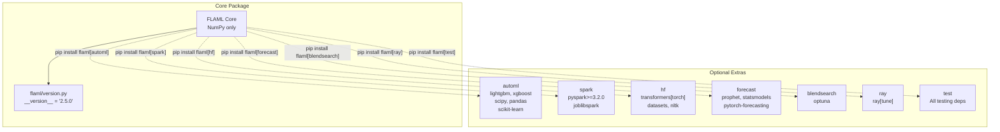
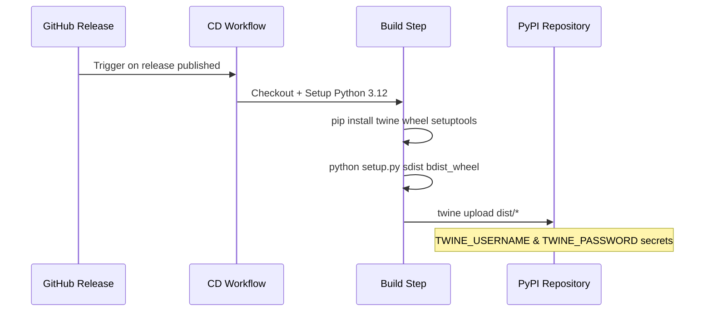
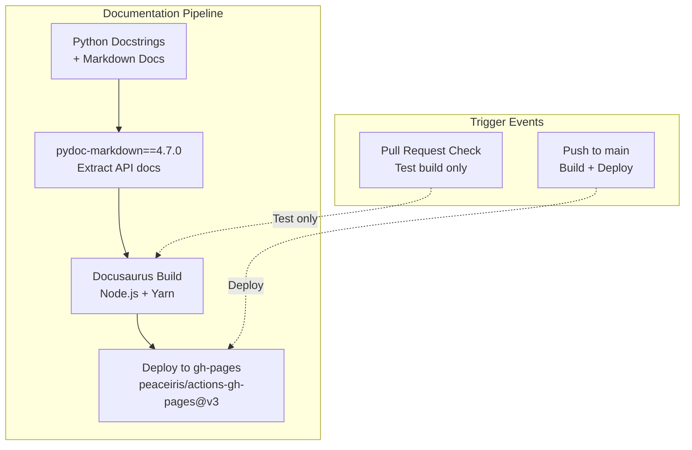
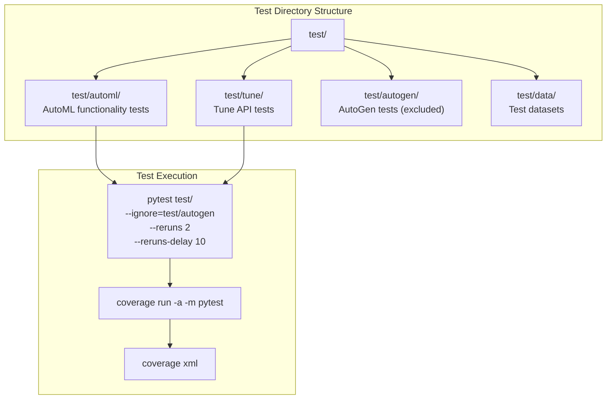
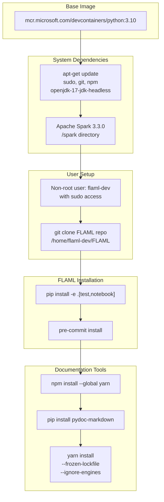
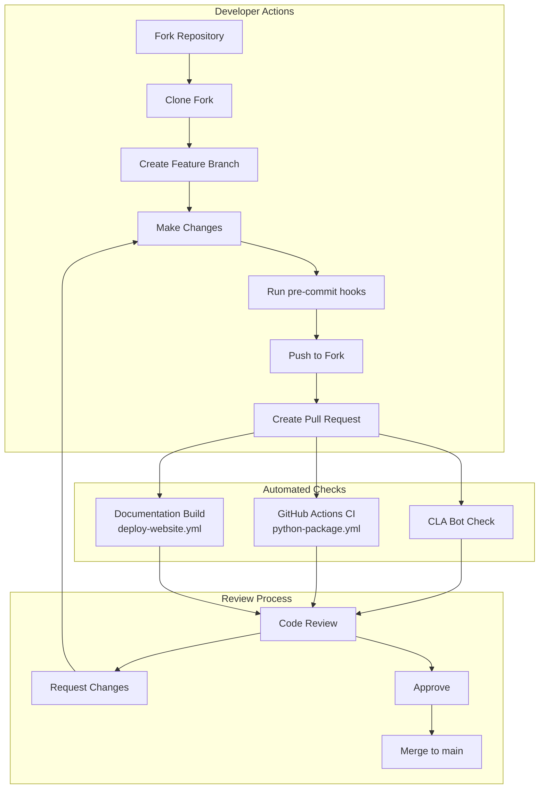

<!-- source: DeepWiki mcp.deepwiki.com · repo microsoft/FLAML · page 10 Development and Contributing · fetched 2026-10-26 -->

# Development and Contributing

<details>
<summary>Relevant source files</summary>

The following files were used as context for generating this wiki page:

- [.github/workflows/CD.yml](.github/workflows/CD.yml)
- [.github/workflows/deploy-website.yml](.github/workflows/deploy-website.yml)
- [.github/workflows/python-package.yml](.github/workflows/python-package.yml)
- [Dockerfile](Dockerfile)
- [README.md](README.md)
- [flaml/autogen/agentchat/contrib/retrieve_assistant_agent.py](flaml/autogen/agentchat/contrib/retrieve_assistant_agent.py)
- [flaml/autogen/agentchat/contrib/retrieve_user_proxy_agent.py](flaml/autogen/agentchat/contrib/retrieve_user_proxy_agent.py)
- [flaml/version.py](flaml/version.py)
- [setup.py](setup.py)
- [test/automl/test_training_log.py](test/automl/test_training_log.py)
- [test/test_autovw.py](test/test_autovw.py)
- [website/package.json](website/package.json)
- [website/yarn.lock](website/yarn.lock)

</details>


This document provides technical guidance for developers contributing to FLAML. It covers the build system, testing infrastructure, CI/CD pipelines, documentation system, and development environment setup. For information about using FLAML as a library, see [Overview](#1). For package installation options, see [Installation and Setup](#2).

## Overview

FLAML uses a modular development architecture with:
- **Build System**: `setup.py` with optional extras for different feature sets
- **CI/CD**: GitHub Actions workflows for testing, coverage, and deployment
- **Testing**: pytest-based test suite with coverage tracking
- **Documentation**: Docusaurus-based website with pydoc-markdown for API docs
- **Development Environment**: Docker container with pre-configured dependencies

The contribution process follows standard GitHub workflows with pull requests, automated testing, and code review requirements.

---

## Package Structure and Build System

### setup.py Configuration

FLAML uses a minimal core with optional extras pattern defined in [setup.py:1-166](). The package structure is:



**Sources**: [setup.py:1-166](), [flaml/version.py:1-2]()

### Key Extras Definitions

| Extra Name | Dependencies | Purpose |
|------------|--------------|---------|
| `automl` | lightgbm>=2.3.1, xgboost>=0.90, scipy>=1.4.1, pandas>=1.1.4, scikit-learn>=1.0.0 | Core AutoML functionality |
| `spark` | pyspark>=3.2.0, joblibspark>=0.5.0 | Distributed Spark estimators |
| `hf` | transformers[torch]>=4.26, datasets, nltk, rouge_score, seqeval | HuggingFace NLP models |
| `forecast` | prophet>=1.1.5, statsmodels>=0.12.2, hcrystalball>=0.1.10, pytorch-forecasting>=0.10.4 | Time series forecasting |
| `blendsearch` | optuna>=2.8.0, packaging | Advanced search with Optuna |
| `ray` | ray[tune]>=1.13,<2.5.0 | Distributed execution via Ray |
| `test` | pytest>=6.1.1, coverage>=5.3, plus all other deps | Full testing suite |

**Sources**: [setup.py:36-154]()

### Version Management

The package version is maintained in a single source of truth:

```python
# flaml/version.py
__version__ = "2.5.0"
```

This version is read by [setup.py:12-15]() during build:

```python
version = {}
with open(os.path.join(here, "flaml/version.py")) as fp:
    exec(fp.read(), version)
__version__ = version["__version__"]
```

**Sources**: [flaml/version.py:1-2](), [setup.py:11-15]()

---

## GitHub Actions CI/CD Workflows

### Build and Test Workflow

The primary CI workflow is defined in [.github/workflows/python-package.yml:1-142]():

```mermaid
graph TB
    subgraph "Trigger Events"
        Push["Push to main<br/>flaml/**, test/**, notebook/**"]
        PR["Pull Request to main"]
        Schedule["Cron: Every other day at 02:00 UTC"]
        MergeGroup["Merge Group Checks"]
    end
    
    subgraph "Test Matrix"
        Matrix["Matrix Strategy<br/>fail-fast: false"]
        OS["OS: ubuntu-latest, windows-latest"]
        Python["Python: 3.10, 3.11, 3.12, 3.13"]
    end
    
    subgraph "Build Job Steps"
        Checkout["actions/checkout@v4"]
        SetupPython["actions/setup-python@v5"]
        InstallBase["pip install -e .<br/>pip install -e .[test]"]
        InstallSpark["Install pyspark<br/>version-specific"]
        InstallForecast["Install forecast extra<br/>Linux only"]
        PipFreeze["pip freeze"]
        CheckDeps["python test/check_dependency.py"]
        RunTests["pytest test/ --reruns 2"]
        Coverage["coverage run pytest<br/>Python 3.11 only"]
        Codecov["Upload to Codecov<br/>Python 3.11 only"]
        SaveDeps["Save dependencies<br/>to branch"]
    end
    
    Push --> Matrix
    PR --> Matrix
    Schedule --> Matrix
    MergeGroup --> Matrix
    
    Matrix --> OS
    Matrix --> Python
    
    Checkout --> SetupPython
    SetupPython --> InstallBase
    InstallBase --> InstallSpark
    InstallSpark --> InstallForecast
    InstallForecast --> PipFreeze
    PipFreeze --> CheckDeps
    CheckDeps --> RunTests
    RunTests --> Coverage
    Coverage --> Codecov
    Codecov --> SaveDeps
```



**Sources**: [.github/workflows/python-package.yml:1-142]()

### Test Matrix Configuration

The workflow tests across multiple Python versions and operating systems:

| Python Version | Ubuntu | Windows | Special Configuration |
|----------------|--------|---------|----------------------|
| 3.10 | ✓ | ✓ | Standard test suite |
| 3.11 | ✓ | ✓ | Coverage tracking + pyspark 3.5.1 |
| 3.12 | ✓ | ✓ | pyspark 4.0.1 |
| 3.13 | ✓ | ✓ | pyspark 4.1.0 |

**Note**: The forecast extra is only installed on Linux due to prophet dependency constraints. Ray support is currently disabled for Python >= 3.11.

**Sources**: [.github/workflows/python-package.yml:38-95]()

### Coverage Tracking

Coverage is collected only for Python 3.11 on Ubuntu [.github/workflows/python-package.yml:110-122]():

```bash
coverage run -a -m pytest test --ignore=test/autogen --reruns 2 --reruns-delay 10
coverage xml
# Upload to Codecov
```

Test reruns are configured with `--reruns 2 --reruns-delay 10` to handle flaky tests.

**Sources**: [.github/workflows/python-package.yml:105-122]()

### Dependency Tracking

The workflow saves installed dependencies to a separate branch `unit-tests-installed-dependencies` on every main branch push [.github/workflows/python-package.yml:124-142]():

```bash
pip freeze > installed_all_dependencies_${python_version}_${os}.txt
python test/check_dependency.py > installed_first_tier_dependencies_${python_version}_${os}.txt
git add installed_*dependencies*.txt
git commit -m "Update installed dependencies..."
git push origin "$BRANCH" --force
```

This enables tracking dependency drift over time.

**Sources**: [.github/workflows/python-package.yml:123-142]()

---

## Continuous Deployment Workflow

### PyPI Publishing

The CD workflow [.github/workflows/CD.yml:1-44]() automatically publishes to PyPI when a GitHub release is created:



**Sources**: [.github/workflows/CD.yml:1-44]()

The workflow creates both source distribution (`sdist`) and wheel (`bdist_wheel`) packages. PyPI credentials are stored as GitHub secrets:
- `TWINE_USERNAME`
- `TWINE_PASSWORD`

After PyPI publication, the conda-forge bot automatically picks up the new version and creates a conda package.

**Sources**: [.github/workflows/CD.yml:36-43](), [README.md:1-7]()

---

## Documentation System

### Docusaurus Website

The documentation website uses Docusaurus and is deployed via [.github/workflows/deploy-website.yml:1-102]():



**Sources**: [.github/workflows/deploy-website.yml:1-102]()

### pydoc-markdown Configuration

The workflow uses pydoc-markdown to extract API documentation from Python docstrings [.github/workflows/deploy-website.yml:41-47]():

```bash
python -m pip install --upgrade pip
pip install pydoc-markdown==4.7.0 setuptools
pydoc-markdown
```

Configuration is expected in `website/pydoc-markdown.yml` (not shown in provided files).

**Sources**: [.github/workflows/deploy-website.yml:41-47]()

### Website Dependencies

The documentation website dependencies are defined in [website/package.json:1-57]():

| Package | Version | Purpose |
|---------|---------|---------|
| `@docusaurus/core` | 0.0.0-4193 | Core Docusaurus framework |
| `@docusaurus/preset-classic` | 0.0.0-4193 | Classic theme and plugins |
| `@easyops-cn/docusaurus-search-local` | ^0.21.1 | Local search functionality |
| `rehype-katex` | 4 | LaTeX math rendering |
| `remark-math` | 3 | Markdown math support |

Build scripts [website/package.json:16-26]():
- `start`: Development server
- `build`: Production build
- `deploy`: Deploy to hosting
- `clear`: Clear cache

**Sources**: [website/package.json:1-57]()

### Documentation Build Process

The workflow distinguishes between pull requests (test only) and main branch (deploy) [.github/workflows/deploy-website.yml:24-102]():

```bash
# Pull Request: Test build only
if [ -e yarn.lock ]; then
  yarn install --frozen-lockfile --ignore-engines
  yarn build
fi

# Main Branch: Build and deploy
yarn build
# Deploy to GitHub Pages using peaceiris/actions-gh-pages@v3
```

**Sources**: [.github/workflows/deploy-website.yml:48-102]()

---

## Testing Infrastructure

### Test Suite Organization

The test suite is located in the `test/` directory with the following structure:



**Sources**: [.github/workflows/python-package.yml:105-116](), [test/automl/test_training_log.py:1-118]()

### Test Execution Pattern

Tests are run with pytest and include retry logic for flaky tests [.github/workflows/python-package.yml:105-116]():

```bash
# Standard test execution
pytest test/ --ignore=test/autogen --reruns 2 --reruns-delay 10

# Coverage collection (Python 3.11 only)
coverage run -a -m pytest test --ignore=test/autogen --reruns 2 --reruns-delay 10
coverage xml
```

The `--ignore=test/autogen` flag excludes AutoGen tests (AutoGen has moved to a separate repository).

**Sources**: [.github/workflows/python-package.yml:105-116]()

### Test Dependencies

Testing requires the `test` extra which includes [setup.py:53-97]():

- **Testing Framework**: pytest>=6.1.1, pytest-rerunfailures>=13.0, coverage>=5.3
- **ML Libraries**: All automl, spark, forecast extras
- **Deep Learning**: torch, torchvision, pytorch-lightning, tensorboardX
- **Evaluation**: transformers[torch], datasets, evaluate, nltk, rouge_score, seqeval
- **Integration**: mlflow-skinny<=2.22.1, optuna, openml
- **Utilities**: psutil, nbconvert, nbformat, ipykernel, packaging, dill

**Sources**: [setup.py:53-97]()

### Example Test: Training Log

The training log test [test/automl/test_training_log.py:11-118]() demonstrates key testing patterns:

```python
def test_training_log(self, path="test_training_log.log", estimator_list="auto", use_ray=False):
    with TemporaryDirectory() as d:
        filename = os.path.join(d, path)
        
        # Run AutoML with logging
        automl = AutoML()
        automl_settings = {
            "time_budget": 1,
            "metric": "mse",
            "task": "regression",
            "log_file_name": filename,
            "log_training_metric": True,
            "mem_thres": 1024 * 1024,
            "n_jobs": 1,
            "model_history": True,
        }
        X_train, y_train = fetch_california_housing(return_X_y=True, data_home="test")
        automl.fit(X_train=X_train, y_train=y_train, **automl_settings)
        
        # Verify log file exists
        self.assertTrue(os.path.exists(filename))
        
        # Test warm start from log
        with training_log_reader(filename) as reader:
            for record in reader.records():
                print(record)
```

This test covers:
- Temporary directory usage for test isolation
- AutoML configuration with logging
- Log file verification
- Training log reading
- Warm start functionality

**Sources**: [test/automl/test_training_log.py:11-118]()

### Dependency Checking

Tests include dependency verification via `test/check_dependency.py` [.github/workflows/python-package.yml:99-101]():

```bash
python test/check_dependency.py
```

This ensures that all required dependencies are correctly installed before running tests.

**Sources**: [.github/workflows/python-package.yml:99-101]()

---

## Docker Development Environment

### Dockerfile Configuration

A complete development environment is provided via [Dockerfile:1-41]():



**Sources**: [Dockerfile:1-41]()

### Key Environment Variables

The Dockerfile sets up Spark environment variables [Dockerfile:12-14]():

```bash
SPARK_HOME=/spark
PYTHONPATH=/spark/python/lib/py4j-0.10.9.5-src.zip:/spark/python
PATH="${PATH}:${SPARK_HOME}/bin"
```

This enables Spark testing without additional configuration.

**Sources**: [Dockerfile:12-14]()

### Development Setup

The container includes:

1. **Java Runtime**: OpenJDK 17 for Spark [Dockerfile:7-10]()
2. **Spark 3.3.0**: Downloaded and extracted to `/spark` [Dockerfile:11]()
3. **Non-root User**: `flaml-dev` with sudo access [Dockerfile:16-20]()
4. **FLAML Installation**: Editable install with test and notebook extras [Dockerfile:27]()
5. **Pre-commit Hooks**: Automatically installed [Dockerfile:30]()
6. **Documentation Tools**: yarn and pydoc-markdown [Dockerfile:33-36]()

To use the development container:

```bash
docker build -t flaml-dev .
docker run -it flaml-dev
```

**Sources**: [Dockerfile:1-41]()

---

## Contributing Workflow

### Contributor License Agreement

Contributors must agree to Microsoft's Contributor License Agreement (CLA) [README.md:108-116]():

> Most contributions require you to agree to a Contributor License Agreement (CLA) declaring that you have the right to, and actually do, grant us the rights to use your contribution.

A CLA bot automatically checks pull requests and provides instructions.

**Sources**: [README.md:108-116]()

### Pull Request Process



**Sources**: [README.md:106-121](), [.github/workflows/python-package.yml:15-23]()

### Pre-commit Hooks

The development environment includes pre-commit hooks [Dockerfile:29-30]():

```bash
pre-commit install
```

Contributors should install these locally:

```bash
pip install pre-commit
pre-commit install
```

**Sources**: [Dockerfile:29-30](), [setup.py:68]()

### Code of Conduct

The project follows the [Microsoft Open Source Code of Conduct](https://opensource.microsoft.com/codeofconduct) [README.md:118-120]().

**Sources**: [README.md:118-120]()

### Testing Requirements

All pull requests must:
1. Pass the test suite across all Python versions and operating systems
2. Maintain or improve code coverage (tracked for Python 3.11)
3. Pass documentation build checks
4. Include tests for new functionality

**Sources**: [.github/workflows/python-package.yml:1-142](), [.github/workflows/deploy-website.yml:1-102]()

---

## Summary

The FLAML development infrastructure provides:

- **Modular Build System**: Optional extras for different feature sets via `setup.py`
- **Comprehensive CI/CD**: GitHub Actions for testing, coverage, and deployment
- **Multi-version Testing**: Python 3.10-3.13 across Ubuntu and Windows
- **Documentation Pipeline**: Automated API doc extraction and Docusaurus deployment
- **Docker Environment**: Pre-configured development container with all dependencies
- **Quality Controls**: Pre-commit hooks, test reruns, and coverage tracking

To start contributing:
1. Fork the repository and clone locally
2. Install development dependencies: `pip install -e .[test]`
3. Install pre-commit hooks: `pre-commit install`
4. Make changes and run tests: `pytest test/`
5. Submit pull request and ensure CI checks pass

For detailed subsystem information, see [Build System and CI/CD](#10.1), [Testing](#10.2), and [Documentation](#10.3).

**Sources**: [README.md:1-127](), [setup.py:1-166](), [.github/workflows/python-package.yml:1-142](), [Dockerfile:1-41]()

---

