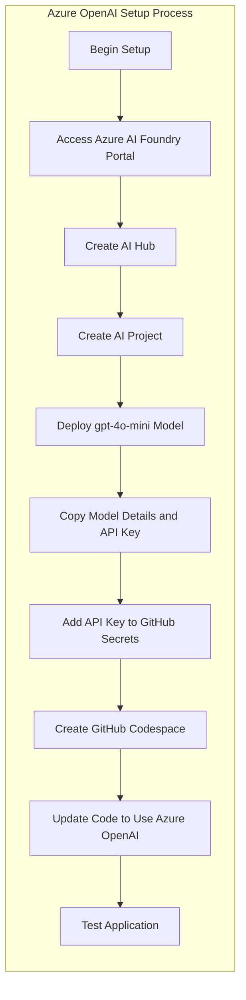
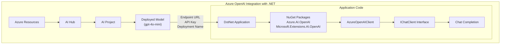
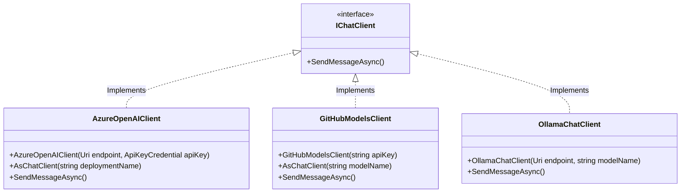

<!-- source: DeepWiki mcp.deepwiki.com · repo microsoft/Generative-AI-for-beginners-dotnet · page 2.2 Azure OpenAI Setup · fetched 2026-10-26 -->

# Azure OpenAI Setup

<details>
<summary>Relevant source files</summary>

The following files were used as context for generating this wiki page:

- [02-SetupDevEnvironment/getting-started-azure-openai.md](02-SetupDevEnvironment/getting-started-azure-openai.md)
- [translations/de/02-SetupDevEnvironment/getting-started-azure-openai.md](translations/de/02-SetupDevEnvironment/getting-started-azure-openai.md)
- [translations/de/02-SetupDevEnvironment/getting-started-ollama.md](translations/de/02-SetupDevEnvironment/getting-started-ollama.md)
- [translations/es/02-SetupDevEnvironment/getting-started-azure-openai.md](translations/es/02-SetupDevEnvironment/getting-started-azure-openai.md)
- [translations/es/02-SetupDevEnvironment/getting-started-ollama.md](translations/es/02-SetupDevEnvironment/getting-started-ollama.md)
- [translations/fr/02-SetupDevEnvironment/getting-started-ollama.md](translations/fr/02-SetupDevEnvironment/getting-started-ollama.md)
- [translations/ja/02-SetupDevEnvironment/getting-started-azure-openai.md](translations/ja/02-SetupDevEnvironment/getting-started-azure-openai.md)
- [translations/ja/02-SetupDevEnvironment/getting-started-ollama.md](translations/ja/02-SetupDevEnvironment/getting-started-ollama.md)
- [translations/ko/02-SetupDevEnvironment/getting-started-azure-openai.md](translations/ko/02-SetupDevEnvironment/getting-started-azure-openai.md)

</details>


This guide explains how to set up and use Azure OpenAI (specifically Azure AI Foundry) for your .NET generative AI applications in this course. Azure OpenAI provides access to state-of-the-art language models hosted on Microsoft's cloud infrastructure, offering scalability and enterprise-grade security.

If you're interested in alternative model options:
- For GitHub Models setup, see [Development Environment Setup](#2)
- For Ollama local model execution, see [Ollama Local Setup](#2.3)

## Setup Process Overview

The setup process involves creating resources in the Azure AI Foundry, configuring a GitHub Codespace for development, and integrating your Azure OpenAI endpoint with .NET application code.



Sources: [02-SetupDevEnvironment/getting-started-azure-openai.md:1-152]()

## Creating Azure AI Foundry Resources

Azure AI Foundry provides a platform for deploying and managing AI models. Follow these steps to set up the required resources.

### Creating a Hub and Project

1. Navigate to the [Azure AI Foundry Portal](https://ai.azure.com)
2. Sign in with your Azure account
3. Select **All hubs + projects** from the left menu and click **+ New hub**
4. Fill in the details for your hub:
   - Hub name (e.g., "MyAIHub")
   - Choose your closest region
   - Select appropriate subscription and resource group
5. Click **Next**, review details, and click **Create**
6. Once created, click **Create Project**
7. Name your project (e.g., "GenAINET") and click **Create**

Sources: [02-SetupDevEnvironment/getting-started-azure-openai.md:10-31]()

### Deploying a Language Model

Next, you'll deploy the gpt-4o-mini model:

1. Navigate to your project in the Azure AI Foundry portal
2. Click **Models and Endpoints** from the left menu
3. Click the **Deploy Model** button
4. Select **Deploy base model** from the dropdown
5. Search for **gpt-4o-mini** in the model catalog
6. Select the model and click **Confirm**
7. Specify a deployment name (e.g., "gpt-4o-mini") 
8. Click **Deploy** and wait for provisioning
9. After deployment, note the **Model Name**, **Target URI**, and **API Key**

> **Note:** The endpoint may appear as `https://<your-hub-name>.openai.azure.com/openai/deployments/gpt-4o-mini/chat/completions?api-version=2024-08-01-preview`. You only need `https://<your-hub-name>.openai.azure.com/` as the endpoint.

Sources: [02-SetupDevEnvironment/getting-started-azure-openai.md:33-50]()

## Integration with Development Environment

With your Azure OpenAI model deployed, the next steps involve setting up your development environment.

### Adding API Key to GitHub Codespace Secrets

For security, add your API key to GitHub Codespace secrets:

1. Ensure you've forked the course repository to your GitHub account
2. Go to the **Settings** tab of your forked repository
3. Expand **Secrets and variables** in the left menu and select **Codespaces**
4. Create a new secret named **AZURE_AI_KEY**
5. Paste the API key you copied from Azure AI Foundry

Sources: [02-SetupDevEnvironment/getting-started-azure-openai.md:52-61]()

### Creating a GitHub Codespace

1. Open the repository's main page and fork it to your GitHub account
2. Click the **Code** dropdown button and select the **Codespaces** tab
3. Choose **...** (three dots) and select **New with options...**
4. From the **Dev container configuration** dropdown, select **C# (.NET)**
5. Click **Create codespace**

Sources: [02-SetupDevEnvironment/getting-started-azure-openai.md:63-84]()

## Azure OpenAI Integration with .NET Code

After setting up your development environment, you need to update the sample code to use your Azure OpenAI deployment.



Sources: [02-SetupDevEnvironment/getting-started-azure-openai.md:86-101]()

### Required NuGet Packages

First, you need to add the necessary NuGet packages:

```bash
dotnet add package Azure.AI.OpenAI --version 2.2.0-beta.2
dotnet add package Microsoft.Extensions.AI.OpenAI --version 9.3.0-preview.1.25114.11
```

Sources: [02-SetupDevEnvironment/getting-started-azure-openai.md:98-101]()

### Code Implementation

Update your application code to use Azure OpenAI:

1. Add the required using statements:
   ```csharp
   using System.ClientModel;
   using Azure.AI.OpenAI;
   using Microsoft.Extensions.AI;
   ```

2. Create variables for your deployment configuration:
   ```csharp
   var deploymentName = "gpt-4o-mini"; // Your deployment name
   var endpoint = new Uri("https://<your-hub-name>.openai.azure.com/"); // Your endpoint
   var apiKey = new ApiKeyCredential(Environment.GetEnvironmentVariable("AZURE_AI_KEY"));
   ```

3. Initialize the Azure OpenAI client:
   ```csharp
   IChatClient client = new AzureOpenAIClient(
       endpoint,
       apiKey)
   .AsChatClient(deploymentName);
   ```

4. Run your application:
   ```bash
   dotnet run
   ```

Sources: [02-SetupDevEnvironment/getting-started-azure-openai.md:104-148]()

## Client Architecture Integration

The diagram below shows how the Azure OpenAI client fits into the larger client architecture of the course, allowing you to switch between different AI providers.



Sources: [02-SetupDevEnvironment/getting-started-azure-openai.md:86-131]()

## Summary

In this guide, you learned how to:
1. Create an Azure AI Foundry hub and project
2. Deploy a language model (gpt-4o-mini)
3. Configure a GitHub Codespace with your Azure OpenAI credentials
4. Update sample code to integrate with Azure OpenAI

With this setup, you can now leverage Azure's powerful language models in your .NET applications for the remainder of the course.

## Additional Resources

- [Azure AI Foundry Documentation](https://learn.microsoft.com/azure/ai-services)
- [Working with GitHub Codespaces](https://docs.github.com/en/codespaces/getting-started)
- [How to Deploy Models in Azure AI Foundry](https://learn.microsoft.com/azure/ai-services/deploy)
- [Azure.AI.OpenAI NuGet Package](https://www.nuget.org/packages/Azure.AI.OpenAI)

Sources: [02-SetupDevEnvironment/getting-started-azure-openai.md:152-161]()

---

