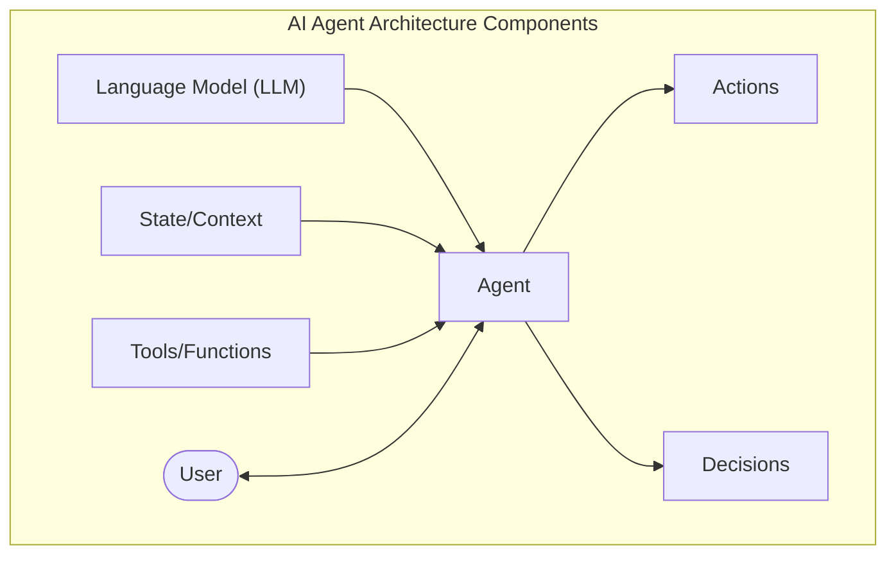
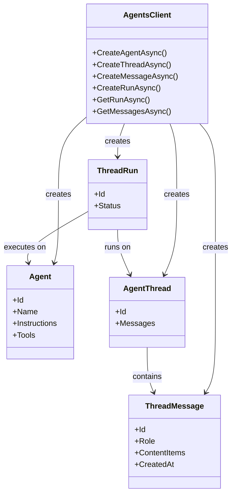
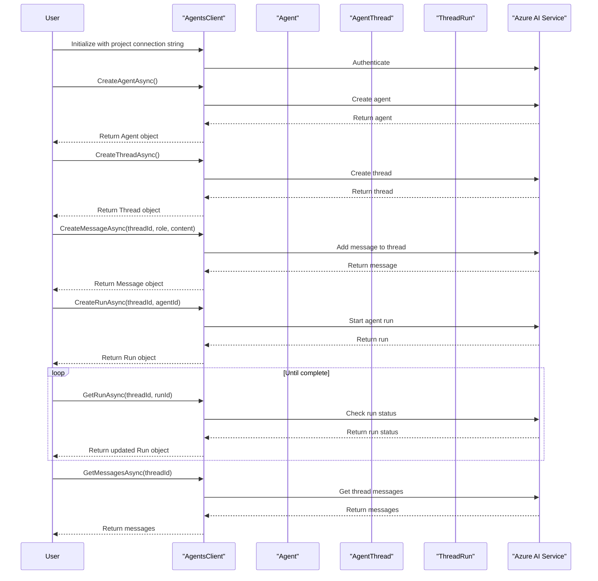
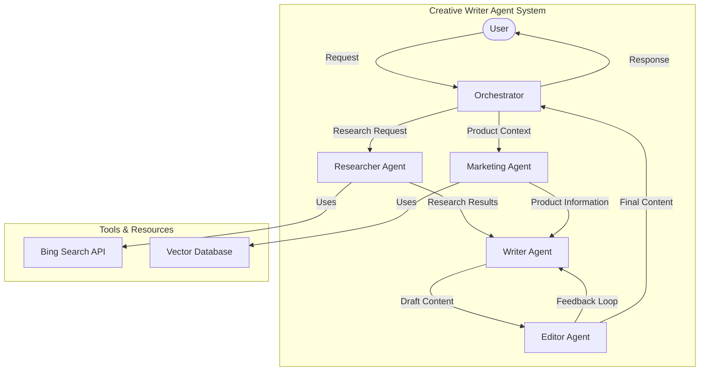

<!-- source: DeepWiki mcp.deepwiki.com · repo microsoft/Generative-AI-for-beginners-dotnet · page 3.4 AI Agents · fetched 2026-10-26 -->

# AI Agents

<details>
<summary>Relevant source files</summary>

The following files were used as context for generating this wiki page:

- [03-CoreGenerativeAITechniques/04-agents.md](03-CoreGenerativeAITechniques/04-agents.md)
- [03-CoreGenerativeAITechniques/images/project-connection-string.png](03-CoreGenerativeAITechniques/images/project-connection-string.png)
- [04-PracticalSamples/readme.md](04-PracticalSamples/readme.md)
- [images/main-logo.jpg](images/main-logo.jpg)

</details>


This document explains how to build and use AI agents in .NET applications within the Generative AI for beginners dotnet course. It covers the fundamental concepts, implementation details, and practical examples of creating autonomous AI entities that can execute tasks with minimal human intervention.

For information about practical implementations of agents in sample applications, see [Practical Applications](#5) and specifically the [Creative Writer Agent](#5.2).

## Purpose and Overview

AI agents are autonomous AI entities that go beyond simple chat interactions by making independent decisions, maintaining context, using tools to access external systems, and collaborating with other agents to solve complex problems. Unlike traditional chatbots, agents can initiate actions based on their programming and execute complex workflows with limited human oversight.

Key attributes of AI agents include:
- **Autonomy**: The ability to initiate actions based on their programming
- **Decision-making**: Using AI models to make choices based on pre-defined objectives
- **Adaptability**: Learning and adjusting to improve performance over time
- **Tool usage**: Leveraging external functions and APIs to accomplish tasks

In this implementation, agents are built using the Azure AI Agent Service and the Azure AI Projects library.

Sources: [03-CoreGenerativeAITechniques/04-agents.md:10-13]()

## Architecture of AI Agents

AI agents in this codebase are composed of three primary components:

1. **LLM (Language Model)**: The underlying model that powers the agent's reasoning and responses
2. **State**: Context storage that helps guide decisions based on past interactions
3. **Tools**: Interfaces to external systems (similar to function calling) that allow the agent to take actions



Sources: [03-CoreGenerativeAITechniques/04-agents.md:33-34]()

### Core Components in Azure AI Projects

The Azure AI Projects library provides several key classes for implementing agents:



- **AgentsClient**: The overall client that creates and hosts agents, manages threads, and handles cloud connections
- **Agent**: Holds instructions and tool definitions for the agent's purpose and capabilities
- **ThreadMessage**: Messages exchanged between users and agents (similar to prompts)
- **ThreadRun**: Execution context for an agent operating on a thread with messages

Sources: [03-CoreGenerativeAITechniques/04-agents.md:37-42]()

## Implementation with Azure AI Agent Service

The Azure AI Agent Service is used to create and manage agents. It provides a cloud-based infrastructure for hosting agents and managing their state and interactions.

### Setup Requirements

To use the Azure AI Agent Service, you need to:

1. Create a Basic Agent in Azure AI Foundry
2. Obtain a project connection string from the AI Foundry portal
3. Use the Azure AI Projects library in your .NET application

Sources: [03-CoreGenerativeAITechniques/04-agents.md:26-29]()

### Workflow for Creating and Using an Agent

The typical workflow for creating and using an agent follows these steps:



Sources: [03-CoreGenerativeAITechniques/04-agents.md:44-141]()

## Creating a Simple Math Tutor Agent

Let's examine how to build a simple math tutor agent that can solve and explain math problems.

### 1. Initialize the AgentsClient

First, create an `AgentsClient` using your project connection string:

```csharp
string projectConnectionString = "< YOU GET THIS FROM THE PROJECT IN AI FOUNDRY >";
AgentsClient client = new(projectConnectionString, new DefaultAzureCredential());
```

Sources: [03-CoreGenerativeAITechniques/04-agents.md:52-55]()

### 2. Create the Agent

Next, create the agent with specific instructions and tools:

```csharp
Agent tutorAgent = (await client.CreateAgentAsync(
    model: "gpt-4o",
    name: "Math Tutor",
    instructions: "You are a personal math tutor. Write and run code to answer math questions.",
    tools: [new CodeInterpreterToolDefinition()])).Value;
```

Note the use of `CodeInterpreterToolDefinition` which allows the agent to create and execute code to solve math problems.

Sources: [03-CoreGenerativeAITechniques/04-agents.md:63-69]()

### 3. Create a Thread and Add Messages

Create a thread for the conversation and add the initial user message:

```csharp
AgentThread thread = (await client.CreateThreadAsync()).Value;

ThreadMessage userMessage = (await client.CreateMessageAsync(
    thread.Id,
    MessageRole.User,
    "Hello, I need to solve the equation `3x + 11 = 14`. Can you help me?")
).Value;
```

You can also add an agent message with additional instructions:

```csharp
ThreadMessage agentMessage = (await client.CreateMessageAsync(
    thread.Id,
    MessageRole.Agent,
    "Please address the user as their name. The user has a basic account, so just share the answer to the question.")
).Value;
```

Sources: [03-CoreGenerativeAITechniques/04-agents.md:79-99]()

### 4. Run the Agent and Handle Results

Start the agent run and monitor its status:

```csharp
ThreadRun run = (await client.CreateRunAsync(
    thread.Id,
    assistantId: tutorAgent.Id, 
    additionalInstructions: "You are working in FREE TIER EXPERIENCE mode`, every user has premium account for a short period of time. Explain detailed the steps to answer the user questions")
).Value;

do
{
    await Task.Delay(TimeSpan.FromMilliseconds(100));
    run = (await client.GetRunAsync(thread.Id, run.Id)).Value;

    Console.WriteLine($"Run Status: {run.Status}");
}
while (run.Status == RunStatus.Queued || run.Status == RunStatus.InProgress);
```

Finally, retrieve and display the messages from the thread:

```csharp
Response<PageableList<ThreadMessage>> afterRunMessagesResponse = await client.GetMessagesAsync(thread.Id);
IReadOnlyList<ThreadMessage> messages = afterRunMessagesResponse.Value.Data;

// sort by creation date
messages = messages.OrderBy(m => m.CreatedAt).ToList();

foreach (ThreadMessage msg in messages)
{
    Console.Write($"{msg.CreatedAt:yyyy-MM-dd HH:mm:ss} - {msg.Role,10}: ");

    foreach (MessageContent contentItem in msg.ContentItems)
    {
        if (contentItem is MessageTextContent textItem)
            Console.Write(textItem.Text);
    }
    Console.WriteLine();
}
```

Sources: [03-CoreGenerativeAITechniques/04-agents.md:101-141]()

## Advanced Agent Systems: Multi-Agent Orchestration

For more complex tasks, multiple specialized agents can be orchestrated to work together. The Creative Writer Agent is an example of a multi-agent system that generates high-quality written content.



The Creative Writer Agent system consists of four specialized agents:

1. **Researcher Agent**: Gathers context and data using Bing search and summarizes findings
2. **Marketing Agent**: Interprets user intent and queries the vector database for relevant information
3. **Writer Agent**: Synthesizes research and marketing data to produce content
4. **Editor Agent**: Reviews drafts, offers corrections, and determines readiness for publication

This multi-agent system demonstrates how specialized agents can collaborate to produce more sophisticated results than a single agent could achieve alone.

Sources: [04-PracticalSamples/readme.md:336-345](), [04-PracticalSamples/readme.md:394-493]()

### Implementation of Multi-Agent Systems

In the Creative Writer Agent example, agents are implemented using the Semantic Kernel's `ChatCompletionAgent` class and orchestrated using the `AgentGroupChat` class:

```csharp
// Initialize specialized agents
ChatCompletionAgent researcherAgent = new(promptTemplate)
{
    Name = ResearcherName,
    Kernel = bingKernel,
    Arguments = functionChoiceBehavior,
    LoggerFactory = loggerFactory
};

ChatCompletionAgent marketingAgent = new(promptTemplate)
{
    Name = MarketingName,
    Kernel = vectorSearchKernel,
    Arguments = functionChoiceBehavior,
    LoggerFactory = loggerFactory
};

// Configure the Agent Group Chat
AgentGroupChat chat = new(writerAgent, editorAgent)
{
    LoggerFactory = kernel.LoggerFactory,
    ExecutionSettings = new AgentGroupChatSettings
    {
        SelectionStrategy = new SequentialSelectionStrategy() 
        { 
            InitialAgent = writerAgent
        },
        TerminationStrategy = new NoFeedbackLeftTerminationStrategy()
    }
};
```

Key elements of multi-agent orchestration include:
- Specialized kernels for different agent capabilities
- Strategic agent selection and termination policies
- Inter-agent communication and context sharing

Sources: [04-PracticalSamples/readme.md:394-493]()

## Best Practices for AI Agents

When building AI agents, consider these best practices:

1. **Single-purpose design**: Focus each agent on doing one thing well. Narrow down their purpose as much as possible.
2. **Clear instructions**: Provide detailed, unambiguous instructions to guide the agent's behavior.
3. **Appropriate tools**: Equip agents with the specific tools they need to accomplish their tasks.
4. **Monitoring and telemetry**: Implement logging and monitoring to track agent performance and detect issues.
5. **Error handling**: Implement robust error handling to manage unexpected situations.

Sources: [03-CoreGenerativeAITechniques/04-agents.md:11-13]()

## Summary

AI Agents represent the evolution of language models from simple assistants to autonomous entities capable of taking action. By leveraging the Azure AI Agent Service and the Azure AI Projects library, developers can create sophisticated AI systems that can:

- Make independent decisions based on instructions and context
- Use tools to interact with external systems and data
- Maintain context across multiple interactions
- Collaborate with other agents to solve complex problems

The Math Tutor example demonstrates how to build a simple agent, while the Creative Writer Agent shows how multiple specialized agents can work together in a more complex system.

Sources: [03-CoreGenerativeAITechniques/04-agents.md:147-157]()

## Additional Resources

- [Build a minimal agent with .NET](https://learn.microsoft.com/dotnet/ai/quickstarts/quickstart-assistants?pivots=openai)
- [Multi-agent orchestration](https://techcommunity.microsoft.com/blog/educatordeveloperblog/using-azure-ai-agent-service-with-autogen--semantic-kernel-to-build-a-multi-agen/4363121)
- [Semantic Kernel Agent Framework](https://learn.microsoft.com/semantic-kernel/frameworks/agent/?pivots=programming-language-csharp)
- [AI Agents - Beginners Series to GenAI](https://github.com/microsoft/generative-ai-for-beginners/tree/main/17-ai-agents)

For more advanced agent examples, see:
- [AgentLabs-02-Functions](./src/AgentLabs-02-Functions)
- [AgentLabs-03-OpenAPIs](./src/AgentLabs-03-OpenAPIs)
- [AgentLabs-03-PythonParksInformationServer](./src/AgentLabs-03-PythonParksInformationServer)

Sources: [03-CoreGenerativeAITechniques/04-agents.md:160-165]()

---

