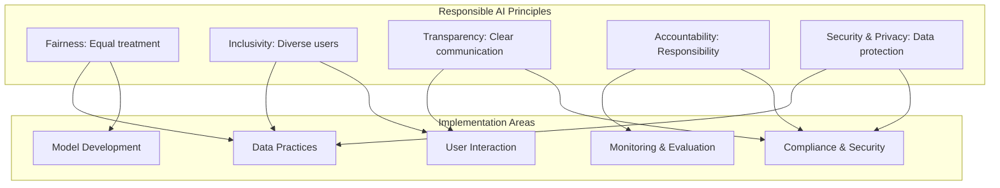
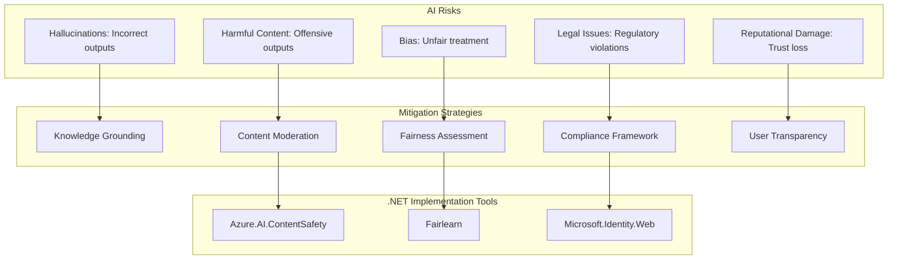
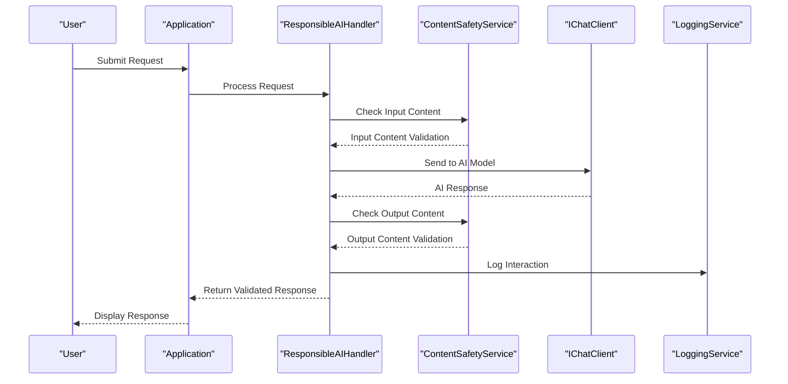
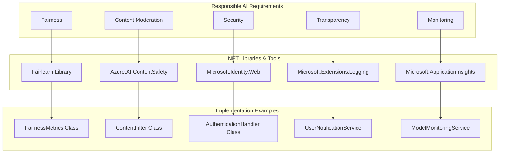

<!-- source: DeepWiki mcp.deepwiki.com · repo microsoft/Generative-AI-for-beginners-dotnet · page 6 Responsible AI · fetched 2026-10-26 -->

# Responsible AI

Relevant source files

The following files were used as context for generating this wiki page:

- [05-ResponsibleGenAI/images/05-videocover.jpg](05-ResponsibleGenAI/images/05-videocover.jpg)
- [05-ResponsibleGenAI/readme.md](05-ResponsibleGenAI/readme.md)

This page provides guidelines and best practices for implementing responsible AI principles in .NET applications that leverage generative AI capabilities. It covers the core principles of responsible AI, explains their importance, and provides practical guidance on applying them in .NET projects.

Sources: [05-ResponsibleGenAI/readme.md:1-5]()

## Responsible AI Principles

When developing generative AI solutions, adhere to these five core principles:

1. **Fairness**: Ensure AI models treat all users equally and avoid biases
2. **Inclusivity**: Design AI systems to accommodate diverse user groups and scenarios
3. **Transparency**: Clearly communicate when users are interacting with AI and how their data is utilized
4. **Accountability**: Take responsibility for the outcomes of your AI systems and continuously monitor them
5. **Security and Privacy**: Protect user data through robust security measures and compliance

### Relationship Between Principles and Implementation

Sources: [05-ResponsibleGenAI/readme.md:7-16]()

## Why Prioritize Responsible AI?

Implementing responsible AI practices is not just an ethical consideration but also a business imperative. Here are key reasons why responsible AI should be prioritized:

### Technical Challenges

| Challenge | Description | Potential Mitigation |
|-----------|-------------|----------------------|
| **Hallucinations** | Generative AI systems can produce outputs that are factually incorrect or contextually irrelevant | Use validation techniques, knowledge-grounding methods, and content constraints |
| **Harmful Content** | AI models may unintentionally generate offensive, biased, or inappropriate outputs | Implement content moderation tools like Azure AI Content Safety |
| **Lack of Fairness** | AI can amplify biases present in training data, leading to unequal treatment | Conduct auditing of data, fairness evaluations with tools like Fairlearn |

### Business and Legal Considerations

- **Legal Compliance**: Meet regulatory requirements such as GDPR and mitigate legal risks
- **Reputation Management**: Maintain trust by avoiding ethical pitfalls and ensuring fair use
- **Business Benefits**: Ethical AI fosters user trust, enhancing user retention and adoption

### Risks and Mitigation Strategies

Sources: [05-ResponsibleGenAI/readme.md:19-33]()

## Implementing Responsible AI in .NET Applications

The following practices help ensure that your generative AI solutions in .NET adhere to responsible AI principles:

### 1. Audit Your Data Sources

- Review and refine training data to avoid biases and inaccuracies
- Use tools like Fairlearn to assess and address fairness issues
- Document data sources and cleaning procedures

### 2. Implement Feedback Mechanisms

- Create interfaces for users to flag issues with model outputs
- Develop logging systems to capture feedback
- Establish processes to review and act on feedback

### 3. Integrate Content Moderation

- Utilize Azure AI Content Safety to filter inappropriate content
- Implement pre-processing checks on user inputs
- Validate AI-generated outputs before displaying them

### 4. Secure Your Models

- Encrypt sensitive data using standard .NET encryption libraries
- Enforce authentication using Microsoft.Identity.Web
- Implement proper access controls for AI endpoints

### 5. Test for Edge Cases

- Create test suites that include diverse and unusual inputs
- Simulate adversarial attacks to ensure robustness
- Regularly evaluate model performance across different user groups

### 6. Ensure Transparency

- Inform users when they are interacting with AI
- Provide clear explanations of how AI is being used
- Document limitations and potential biases

### 7. Implement Continuous Monitoring

- Track model performance metrics over time
- Monitor for biases and inaccuracies
- Regularly update models based on monitoring insights

### Integration with .NET GenAI Application Architecture

Sources: [05-ResponsibleGenAI/readme.md:35-70]()

## Responsible AI Components in .NET

The following diagram shows how responsible AI principles map to specific .NET libraries and implementations:

Sources: [05-ResponsibleGenAI/readme.md:71-74]()

## Recommended Tools for Responsible AI Implementation

| Tool | Purpose | Integration Point |
|------|---------|-------------------|
| [Fairlearn](https://fairlearn.org) | Evaluate and address fairness issues | Data preparation and model evaluation phases |
| [Azure AI Content Safety](https://azure.microsoft.com/products/ai-services/ai-content-safety) | Moderate content effectively | Pre-processing user inputs and post-processing AI outputs |
| [Microsoft.Identity.Web](https://github.com/AzureAD/microsoft-identity-web) | Implement authentication and authorization | Application security layer |
| [Microsoft.Extensions.Logging](https://learn.microsoft.com/dotnet/core/extensions/logging) | Implement transparent logging | Throughout the application for monitoring AI interactions |

Sources: [05-ResponsibleGenAI/readme.md:78-87]()

## Conclusion

Responsible AI implementation in .NET generative AI applications requires a systematic approach that considers ethical, technical, and business aspects. By adhering to the principles of fairness, inclusivity, transparency, accountability, and security, developers can build AI systems that earn user trust and provide long-term value.

The tools and practices outlined in this page provide a foundation for implementing responsible AI in .NET applications. As the field evolves, staying current with best practices and regulatory requirements is essential to ensuring that your AI systems remain both effective and ethically sound.

Sources: [05-ResponsibleGenAI/readme.md:72-76]()

---

