# Page: Overview

# Overview

<details>
<summary>Relevant source files</summary>

The following files were used as context for generating this wiki page:

- [02-SetupDevEnvironment/src/BasicChat-03Ollama/Program.cs](02-SetupDevEnvironment/src/BasicChat-03Ollama/Program.cs)
- [README.md](README.md)

</details>


## Purpose and Scope

The Generative AI for Beginners .NET course is a comprehensive, hands-on learning resource designed specifically for .NET developers interested in incorporating generative AI capabilities into their applications. This course focuses on practical implementation rather than theory, providing working code samples, step-by-step guidance, and real-world applications to help developers quickly build production-ready generative AI features.

This overview document introduces the course structure, available development options, core technologies, and implementation techniques. For specific setup instructions, see [Development Environment Setup](#2).

Sources: [README.md:19-24](), [README.md:39-47]()

## Course Structure

The course consists of five main lessons, each focusing on different aspects of generative AI development in .NET:

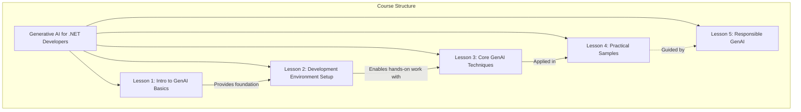

Each lesson includes:
- Short instructional videos (5-10 minutes)
- Complete, runnable code samples
- Step-by-step guidance
- Reference links for deeper learning

| Lesson | Title | Key Coverage |
|--------|-------|-------------|
| 1 | Intro to Generative AI Basics | Overview of generative models and applications in .NET |
| 2 | Setting Up for .NET Development | Configuration of development environments and AI providers |
| 3 | Core Generative AI Techniques | Text generation, multimodal capabilities, function calling, RAG, agents |
| 4 | Practical .NET Generative AI Samples | Real-world implementations and complete application examples |
| 5 | Responsible Use of Generative AI | Ethical considerations, bias mitigation, and security best practices |

Sources: [README.md:56-64](), [README.md:49-54]()

## Development Environment Options

The course supports multiple development environments to accommodate different preferences and requirements:

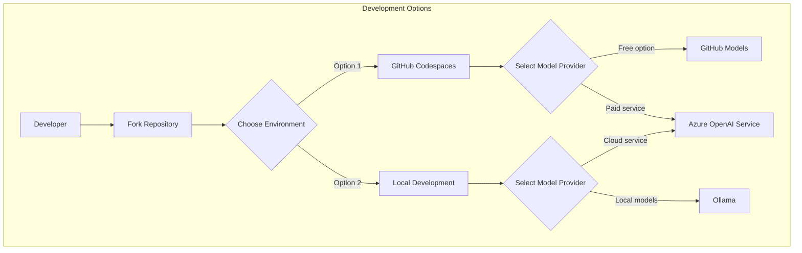

### Key Development Choices:

1. **GitHub Codespaces**
   - Pre-configured environment with minimal setup
   - Quick start option with GitHub Models integration
   - Supports Azure OpenAI for production-grade applications

2. **Local Development**
   - Full control over development environment
   - Can use Ollama for local model execution
   - Example: `OllamaChatClient` connects to locally hosted models

Sources: [README.md:80-102](), [02-SetupDevEnvironment/src/BasicChat-03Ollama/Program.cs:4-7]()

## Core Technologies and Libraries

The course leverages several key .NET libraries for generative AI development:

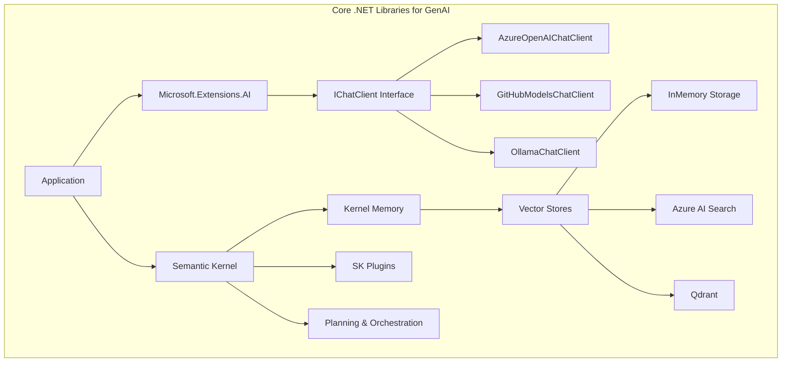

### Microsoft.Extensions.AI (MEAI)
- Provides a standardized interface for working with different AI models
- Abstracts model provider specifics through the `IChatClient` interface
- Supports text generation, function calling, and multimodal features

### Semantic Kernel
- Orchestration framework for AI capabilities
- Supports memory management through vector stores
- Enables RAG implementations and agent development

Sources: [README.md:44-47]()

## GenAI Techniques Implementation

The course covers several core generative AI techniques and their implementation in .NET:

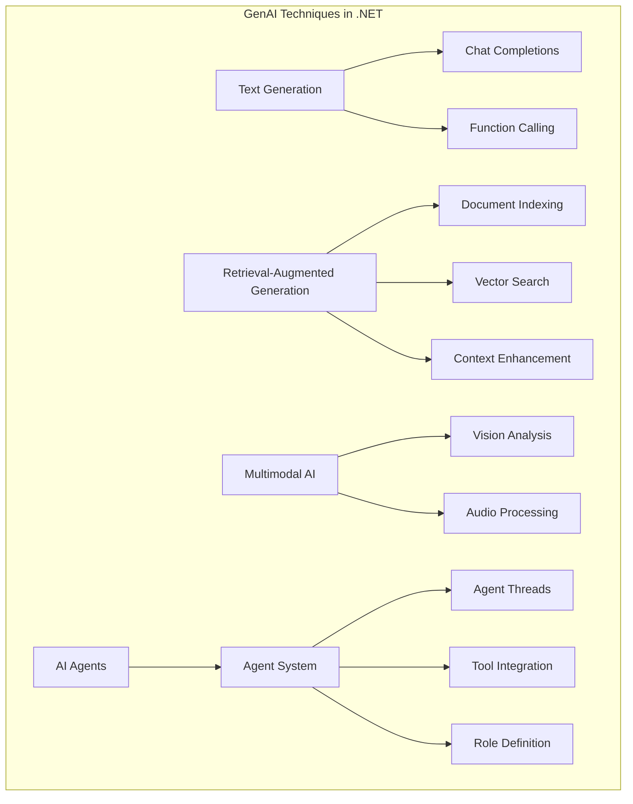

### Key Techniques:

1. **Text Generation and Function Calling**
   - Basic chat completions using various model providers
   - Function calling for structured outputs and API integrations

2. **Retrieval-Augmented Generation (RAG)**
   - Document indexing and vector embedding
   - Semantic search and knowledge retrieval
   - Context enhancement for improved AI responses

3. **Multimodal AI**
   - Vision analysis for image understanding
   - Audio processing and transcription

4. **AI Agents**
   - Building multi-role agent systems
   - Thread management for conversation context
   - Tool integration for extended capabilities

Sources: [README.md:62-63]()

## Practical Applications

The course includes complete sample applications demonstrating real-world implementations:

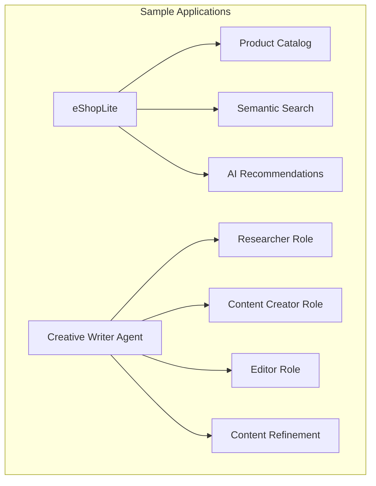

### eShopLite
- Demonstrates e-commerce scenarios enhanced with generative AI
- Includes semantic search and product recommendations
- Shows RAG implementation in a practical context

### Creative Writer Agent
- Multi-agent system working together on content creation
- Shows role specialization and collaboration patterns
- Demonstrates agent orchestration techniques

Sources: [README.md:63-64]()

## Getting Started

To begin using this course:

1. Fork the repository to your GitHub account
2. Choose your preferred development environment:
   - GitHub Codespaces for instant setup
   - Local development with desired model providers
3. Follow the lessons in sequence to build your generative AI skills

For detailed setup instructions, see [Development Environment Setup](#2).

Sources: [README.md:80-95]()

---

# Page: Development Environment Setup

# Development Environment Setup

<details>
<summary>Relevant source files</summary>

The following files were used as context for generating this wiki page:

- [02-SetupDevEnvironment/getting-started-azure-openai.md](02-SetupDevEnvironment/getting-started-azure-openai.md)
- [02-SetupDevEnvironment/getting-started-ollama.md](02-SetupDevEnvironment/getting-started-ollama.md)
- [02-SetupDevEnvironment/images/github-models-webpage.png](02-SetupDevEnvironment/images/github-models-webpage.png)
- [02-SetupDevEnvironment/readme.md](02-SetupDevEnvironment/readme.md)
- [03-CoreGenerativeAITechniques/src/BasicChat-04OllamaSK/Program.cs](03-CoreGenerativeAITechniques/src/BasicChat-04OllamaSK/Program.cs)
- [translations/de/02-SetupDevEnvironment/getting-started-azure-openai.md](translations/de/02-SetupDevEnvironment/getting-started-azure-openai.md)
- [translations/de/02-SetupDevEnvironment/getting-started-ollama.md](translations/de/02-SetupDevEnvironment/getting-started-ollama.md)
- [translations/es/02-SetupDevEnvironment/getting-started-azure-openai.md](translations/es/02-SetupDevEnvironment/getting-started-azure-openai.md)
- [translations/es/02-SetupDevEnvironment/getting-started-ollama.md](translations/es/02-SetupDevEnvironment/getting-started-ollama.md)
- [translations/fr/02-SetupDevEnvironment/getting-started-ollama.md](translations/fr/02-SetupDevEnvironment/getting-started-ollama.md)
- [translations/ja/02-SetupDevEnvironment/getting-started-azure-openai.md](translations/ja/02-SetupDevEnvironment/getting-started-azure-openai.md)
- [translations/ja/02-SetupDevEnvironment/getting-started-ollama.md](translations/ja/02-SetupDevEnvironment/getting-started-ollama.md)
- [translations/ko/02-SetupDevEnvironment/getting-started-azure-openai.md](translations/ko/02-SetupDevEnvironment/getting-started-azure-openai.md)

</details>


This document outlines how to set up your development environment for the Generative AI for .NET Developers course. It covers creating a GitHub Codespace and configuring it to work with different AI model providers: GitHub Models, Azure OpenAI, or Ollama.

For information about the actual techniques and code samples you'll implement after setup, see [Core GenAI Techniques](#3).

## Overview of Model Provider Options

The course supports three main options for accessing AI models, each with different trade-offs:

1. **GitHub Models (Recommended)**: A free service that allows testing and interaction with various AI models directly within your development environment.

2. **Azure OpenAI**: A paid service providing enterprise-grade AI capabilities with robust security and scalability features.

3. **Ollama**: Run AI models locally within your Codespace or local machine for complete control, but with higher resource requirements.

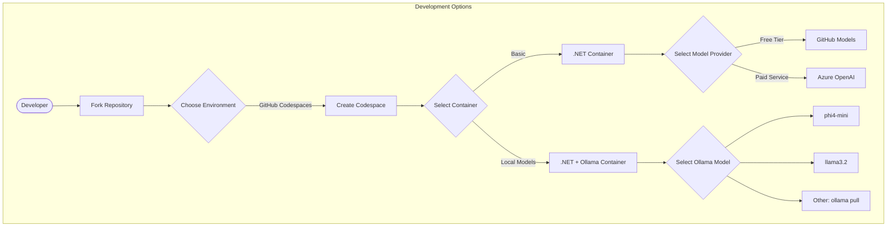

Sources: [02-SetupDevEnvironment/readme.md:22-34](), [02-SetupDevEnvironment/getting-started-azure-openai.md:4-9](), [02-SetupDevEnvironment/getting-started-ollama.md:3-9]()

## GitHub Codespace Setup Process

Setting up your development environment begins with creating a GitHub Codespace:

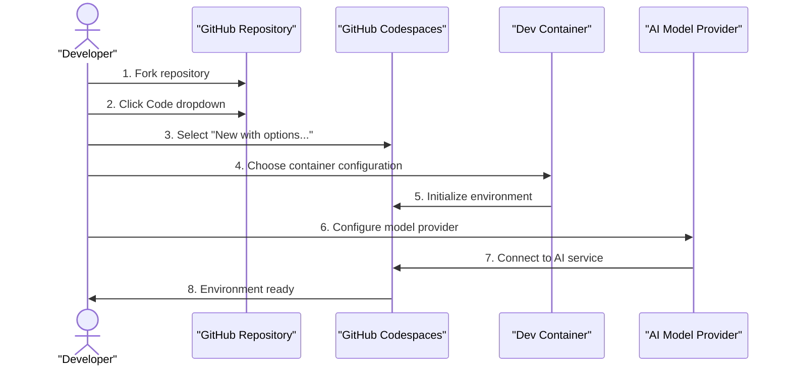

To create a GitHub Codespace:

1. Open the repository by [right-clicking here](https://github.com/microsoft/Generative-AI-for-beginners-dotnet) and selecting "Open in new window"
2. Fork the repository to your GitHub account using the Fork button in the top right 
3. Click the Code dropdown button and select the Codespaces tab
4. Select the "..." option (three dots) and choose "New with options..."

Sources: [02-SetupDevEnvironment/readme.md:95-103](), [02-SetupDevEnvironment/getting-started-azure-openai.md:63-71](), [02-SetupDevEnvironment/getting-started-ollama.md:10-17]()

### Development Container Options

When creating your Codespace, you must choose one of these container configurations:

1. **C# (.NET)**: The standard container with core .NET development tools. Has a fast startup time and is recommended for GitHub Models or Azure OpenAI integration.

2. **C# (.NET) - Ollama**: Includes .NET tools plus Ollama for local model execution. Has a longer startup time (approximately 5 minutes).

Sources: [02-SetupDevEnvironment/readme.md:106-113](), [02-SetupDevEnvironment/getting-started-azure-openai.md:74-81](), [02-SetupDevEnvironment/getting-started-ollama.md:22-28]()

## Model Provider Configuration

### GitHub Models Setup (Recommended)

To configure GitHub Models:

1. **Create a Personal Access Token (PAT)**:
   - Navigate to GitHub Settings → Developer settings → Personal access tokens → Tokens (classic)
   - Generate a new token with a descriptive name (e.g., `GenAI-DotNet-Course-Token`)
   - Set an expiration date (7 days recommended)
   - No additional permissions needed

2. **Verify your setup**:
   - Open a terminal in your Codespace (Ctrl+\` on Windows, Cmd+\` on macOS)
   - Navigate to the sample project: `cd 02-SetupDevEnvironment\src\BasicChat-01MEAI`
   - Run the application: `dotnet run`

The default client implementation in the sample code works with GitHub Models automatically.

Sources: [02-SetupDevEnvironment/readme.md:53-94](), [02-SetupDevEnvironment/readme.md:120-146]()

### Azure OpenAI Setup

To use Azure OpenAI:

1. **Create Azure AI Foundry resources**:
   - Go to the [Azure AI Foundry Portal](https://ai.azure.com)
   - Create a new hub and project
   - Deploy a language model (e.g., gpt-4o-mini)
   - Note the Model Name, Target URI, and API Key

2. **Add the API key to Codespace secrets**:
   - In your forked repository, go to Settings → Secrets and variables → Codespaces
   - Add a secret named `AZURE_AI_KEY` with your API key

3. **Update the sample code**:
   - Add required NuGet packages:
     ```bash
     dotnet add package Azure.AI.OpenAI
     dotnet add package Microsoft.Extensions.AI.OpenAI
     ```
   - Update Program.cs to use Azure OpenAI client:
     ```csharp
     var deploymentName = "gpt-4o-mini"; 
     var endpoint = new Uri("https://yourhub.openai.azure.com/");
     var apiKey = new ApiKeyCredential(Environment.GetEnvironmentVariable("AZURE_AI_SECRET"));

     IChatClient client = new AzureOpenAIClient(
         endpoint, 
         apiKey)
     .AsChatClient(deploymentName);
     ```

Sources: [02-SetupDevEnvironment/getting-started-azure-openai.md:10-132]()

### Ollama Setup

To use Ollama for local model execution:

1. **Create a Codespace with the Ollama container**:
   - Select "C# (.NET) - Ollama" as the container configuration

2. **Pull required models**:
   - Basic examples require a model like phi4-mini or llama3.2:
     ```bash
     ollama pull phi4-mini
     ```
   - For more advanced RAG examples, you'll need additional models:
     ```bash
     ollama pull all-minilm
     ```

3. **Verify your setup**:
   - Navigate to the Ollama sample directory: `cd 02-SetupDevEnvironment/src/BasicChat-03Ollama/`
   - Run the application: `dotnet run`

Ollama client initialization in code:

```csharp
IChatClient client = new OllamaChatClient(
    new Uri("http://localhost:11434/"), 
    "phi4-mini");
```

Sources: [02-SetupDevEnvironment/getting-started-ollama.md:33-80](), [02-SetupDevEnvironment/readme.md:38-52]()

## Model Integration Architecture

The course uses a consistent architecture across samples to interact with different model providers through a common interface:

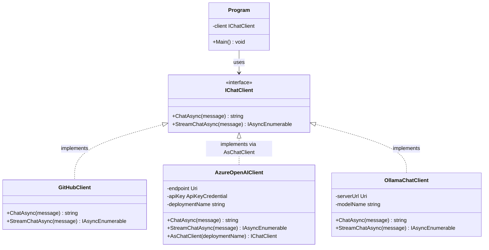

This abstraction allows the same application code to work with different model providers by simply changing the client implementation. The specific implementation is determined by your configuration.

Sources: [02-SetupDevEnvironment/getting-started-azure-openai.md:126-132](), [02-SetupDevEnvironment/getting-started-ollama.md:76-80](), [03-CoreGenerativeAITechniques/src/BasicChat-04OllamaSK/Program.cs:8-15]()

## Verifying Your Setup

To confirm your environment is properly configured:

1. Open a terminal in your Codespace
2. Navigate to the appropriate sample project directory:
   - GitHub Models: `02-SetupDevEnvironment\src\BasicChat-01MEAI`
   - Azure OpenAI: `02-SetupDevEnvironment\src\BasicChat-01MEAI` (after code updates)
   - Ollama: `02-SetupDevEnvironment\src\BasicChat-03Ollama`
3. Run the application: `dotnet run`
4. A successful response will look similar to:

```
AI, or artificial intelligence, refers to the simulation of human intelligence in machines 
that are programmed to think and learn like humans. It is a broad field of computer science 
that focuses on creating systems capable of performing tasks that typically require human intelligence...
```

Sources: [02-SetupDevEnvironment/readme.md:120-146](), [02-SetupDevEnvironment/getting-started-azure-openai.md:133-148](), [02-SetupDevEnvironment/getting-started-ollama.md:33-62]()

## Model Provider Comparison

| Provider | Cost | Setup Complexity | Speed | Requirements |
|----------|------|------------------|-------|--------------|
| GitHub Models | Free tier available | Minimal (PAT token only) | Fast (cloud-based) | GitHub account |
| Azure OpenAI | Paid service | Moderate (Azure subscription, resource creation) | Fast (cloud-based) | Azure subscription |
| Ollama | Free | Higher (larger container, model downloads) | Varies with hardware | More system resources |

Sources: [02-SetupDevEnvironment/readme.md:22-34]()

## Additional Notes for Ollama Users

If working with Ollama locally (not in Codespaces), you must:

1. Install Ollama on your machine
2. Pull required models before running examples:
   - For basic examples: `ollama pull phi4-mini` or `ollama pull llama3.2`
   - For RAG examples: `ollama pull phi4-mini` and `ollama pull all-minilm`

Sources: [02-SetupDevEnvironment/readme.md:36-52]()

## Summary

This document has guided you through setting up a development environment for the Generative AI for .NET Developers course. You've learned how to:

1. Create a GitHub Codespace with the appropriate development container
2. Configure your chosen AI model provider (GitHub Models, Azure OpenAI, or Ollama)
3. Verify your setup by running a sample application

With your environment now configured, you're ready to explore [Core GenAI Techniques](#3) and start building AI-powered applications with .NET.

## Additional Resources

- [GitHub Codespaces Documentation](https://docs.github.com/en/codespaces)
- [GitHub Models Documentation](https://docs.github.com/en/github-models/prototyping-with-ai-models)
- [Azure OpenAI Documentation](https://learn.microsoft.com/azure/ai-services)
- [Ollama Models Library](https://ollama.com/search)

Sources: [02-SetupDevEnvironment/readme.md:152-164](), [02-SetupDevEnvironment/getting-started-azure-openai.md:156-167](), [02-SetupDevEnvironment/getting-started-ollama.md:106-114]()

---

# Page: GitHub Codespaces Setup

# GitHub Codespaces Setup

<details>
<summary>Relevant source files</summary>

The following files were used as context for generating this wiki page:

- [.devcontainer/devcontainer.json](.devcontainer/devcontainer.json)
- [02-SetupDevEnvironment/getting-started-ollama.md](02-SetupDevEnvironment/getting-started-ollama.md)
- [02-SetupDevEnvironment/images/github-models-webpage.png](02-SetupDevEnvironment/images/github-models-webpage.png)
- [02-SetupDevEnvironment/readme.md](02-SetupDevEnvironment/readme.md)
- [03-CoreGenerativeAITechniques/src/BasicChat-04OllamaSK/Program.cs](03-CoreGenerativeAITechniques/src/BasicChat-04OllamaSK/Program.cs)

</details>


## Purpose and Scope

This document provides a step-by-step guide for setting up GitHub Codespaces as the recommended development environment for the Generative AI for .NET Developers course. GitHub Codespaces offers a fully configured cloud development environment with all necessary tools pre-installed, making it ideal for working with generative AI models without complex local setup.

For alternative development environment options:
- For Azure OpenAI configuration, see [Azure OpenAI Setup](#2.2)
- For local model execution, see [Ollama Local Setup](#2.3)

Sources: [02-SetupDevEnvironment/readme.md:1-16]()

## GitHub Codespaces Overview

GitHub Codespaces provides a cloud-hosted development environment that allows you to code, build, test, and debug applications directly in your browser. For this course, Codespaces eliminates the need to configure local dependencies and ensures consistent development experiences across different machines.

### Development Environment Options

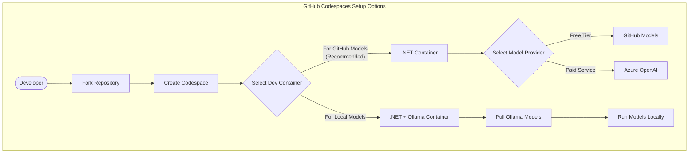

Sources: [02-SetupDevEnvironment/readme.md:22-34](), [02-SetupDevEnvironment/getting-started-ollama.md:1-28]()

## Prerequisites: GitHub Access Token Setup

Before creating your Codespace, you'll need to set up a GitHub access token to interact with GitHub Models.

### Creating a Personal Access Token

1. Navigate to GitHub Settings (profile picture → Settings)
2. Access Developer Settings (scroll down in left sidebar)
3. Select Personal access tokens → Tokens (classic)
4. Generate a new token with:
   - Descriptive name (e.g., `GenAI-DotNet-Course-Token`)
   - 7-day expiration (recommended)
   - No additional permissions needed

> **Security Tip**: Always use the minimum required scope and shortest practical expiration time for access tokens.

Sources: [02-SetupDevEnvironment/readme.md:53-93]()

## Creating Your GitHub Codespace

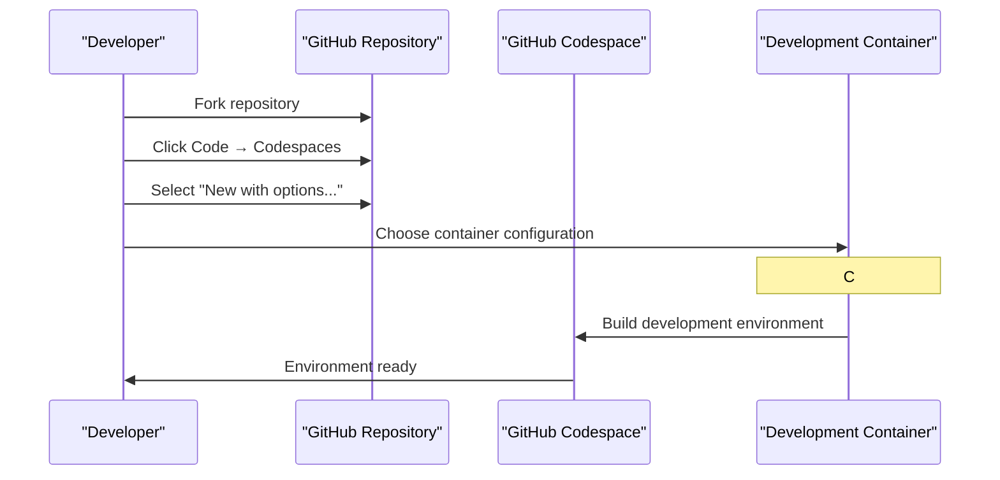

Follow these steps to create your Codespace:

1. Open the [repository](https://github.com/microsoft/Generative-AI-for-beginners-dotnet) in a new window
2. Fork the repository to your GitHub account using the Fork button
3. Click the Code dropdown button and select the Codespaces tab
4. Select the "..." (three dots) option and choose "New with options..."
5. Select your development container (see next section)
6. Click "Create codespace" to initiate the setup process

Sources: [02-SetupDevEnvironment/readme.md:95-118]()

## Development Container Selection

GitHub Codespaces uses development containers to provide consistent environments. For this course, two container options are available:

| Container Option | Purpose | Startup Time | Best For |
|------------------|---------|-------------|----------|
| **C# (.NET)** | Core .NET development tools | Fast | GitHub Models or Azure OpenAI integration (recommended) |
| **C# (.NET) - Ollama** | .NET tools + Ollama for local models | ~5 minutes | Running models locally without external services |

The container configuration is defined in the `.devcontainer/devcontainer.json` file, which specifies:
- Base image: .NET 9.0
- Additional features: Docker-in-Docker, Azure CLI, GitHub CLI
- VS Code extensions: GitHub Copilot, C# Dev Kit, Azure GitHub Copilot
- Port forwarding: 17057
- Post-creation commands: Installing .NET workloads including Aspire

Sources: [02-SetupDevEnvironment/readme.md:106-118](), [.devcontainer/devcontainer.json:1-48]()

## Container Components and Architecture

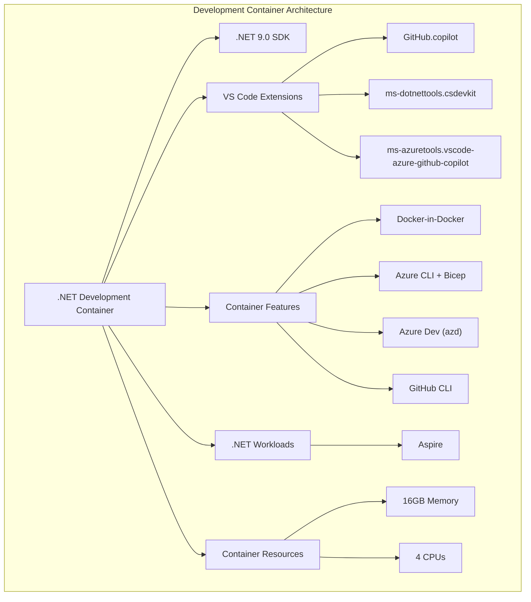

Sources: [.devcontainer/devcontainer.json:4-47]()

## Verifying Your Codespace Setup

After your Codespace is fully loaded, verify your setup by running a sample application:

1. Open a terminal with **Ctrl+`** (Windows) or **Cmd+`** (macOS)
2. Navigate to the sample project:
   ```bash
   cd 02-SetupDevEnvironment\src\BasicChat-01MEAI
   ```
3. Run the application:
   ```bash
   dotnet run
   ```
4. You should see a response from the AI model explaining what artificial intelligence is

### Expected Output
```
AI, or artificial intelligence, refers to the simulation of human intelligence in machines that are programmed to think and learn like humans. It is a broad field of computer science that focuses on creating systems and algorithms capable of performing tasks that typically require human intelligence. These tasks include problem-solving...
```

Sources: [02-SetupDevEnvironment/readme.md:122-146]()

## Testing with Different Models (Ollama Option)

If you're using the Ollama container, you can easily switch between different local models:

1. Pull a different model:
   ```bash
   ollama pull phi3.5
   ```

2. Update the model initialization in your application:
   ```csharp
   IChatClient client = new OllamaChatClient(new Uri("http://localhost:11434/"), "phi3.5");
   ```

The client configuration for Ollama models works through the `OllamaApiClient` class which connects to the Ollama service running locally within the container:

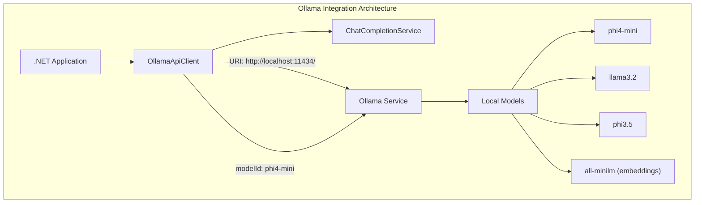

Sources: [02-SetupDevEnvironment/getting-started-ollama.md:33-98](), [03-CoreGenerativeAITechniques/src/BasicChat-04OllamaSK/Program.cs:1-40]()

## Troubleshooting

If you encounter issues with your Codespace setup:

- **Slow Codespace Creation**: Select a region closer to your location when creating the codespace
- **Model Access Issues**: Verify your GitHub access token is correctly set and not expired
- **Ollama Model Loading**: Ensure you've pulled the required models with `ollama pull <model-name>`
- **General Issues**: Open an issue in the [GitHub repository](https://github.com/microsoft/Generative-AI-for-beginners-dotnet/issues/new?template=Blank+issue) for assistance

Sources: [02-SetupDevEnvironment/readme.md:146-146](), [02-SetupDevEnvironment/getting-started-ollama.md:98-98]()

## Next Steps

With your development environment successfully set up, you're ready to explore the core generative AI techniques covered in this course.

👉 Proceed to [Core Generative AI Techniques](#3)

Sources: [02-SetupDevEnvironment/readme.md:160-164](), [02-SetupDevEnvironment/getting-started-ollama.md:110-114]()

---

# Page: Azure OpenAI Setup

# Azure OpenAI Setup

<details>
<summary>Relevant source files</summary>

The following files were used as context for generating this wiki page:

- [02-SetupDevEnvironment/getting-started-azure-openai.md](02-SetupDevEnvironment/getting-started-azure-openai.md)
- [translations/de/02-SetupDevEnvironment/getting-started-azure-openai.md](translations/de/02-SetupDevEnvironment/getting-started-azure-openai.md)
- [translations/de/02-SetupDevEnvironment/getting-started-ollama.md](translations/de/02-SetupDevEnvironment/getting-started-ollama.md)
- [translations/es/02-SetupDevEnvironment/getting-started-azure-openai.md](translations/es/02-SetupDevEnvironment/getting-started-azure-openai.md)
- [translations/es/02-SetupDevEnvironment/getting-started-ollama.md](translations/es/02-SetupDevEnvironment/getting-started-ollama.md)
- [translations/fr/02-SetupDevEnvironment/getting-started-ollama.md](translations/fr/02-SetupDevEnvironment/getting-started-ollama.md)
- [translations/ja/02-SetupDevEnvironment/getting-started-azure-openai.md](translations/ja/02-SetupDevEnvironment/getting-started-azure-openai.md)
- [translations/ja/02-SetupDevEnvironment/getting-started-ollama.md](translations/ja/02-SetupDevEnvironment/getting-started-ollama.md)
- [translations/ko/02-SetupDevEnvironment/getting-started-azure-openai.md](translations/ko/02-SetupDevEnvironment/getting-started-azure-openai.md)

</details>


This guide explains how to set up and use Azure OpenAI (specifically Azure AI Foundry) for your .NET generative AI applications in this course. Azure OpenAI provides access to state-of-the-art language models hosted on Microsoft's cloud infrastructure, offering scalability and enterprise-grade security.

If you're interested in alternative model options:
- For GitHub Models setup, see [Development Environment Setup](#2)
- For Ollama local model execution, see [Ollama Local Setup](#2.3)

## Setup Process Overview

The setup process involves creating resources in the Azure AI Foundry, configuring a GitHub Codespace for development, and integrating your Azure OpenAI endpoint with .NET application code.

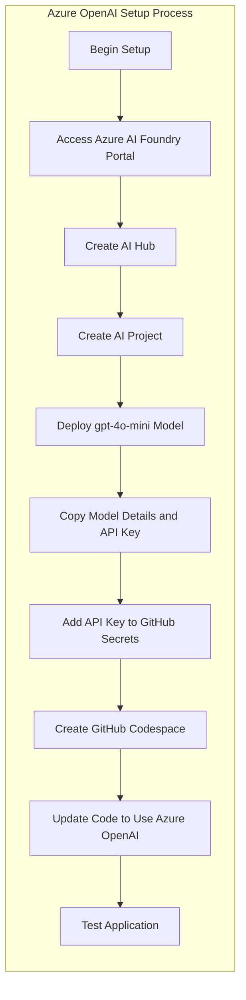

Sources: [02-SetupDevEnvironment/getting-started-azure-openai.md:1-152]()

## Creating Azure AI Foundry Resources

Azure AI Foundry provides a platform for deploying and managing AI models. Follow these steps to set up the required resources.

### Creating a Hub and Project

1. Navigate to the [Azure AI Foundry Portal](https://ai.azure.com)
2. Sign in with your Azure account
3. Select **All hubs + projects** from the left menu and click **+ New hub**
4. Fill in the details for your hub:
   - Hub name (e.g., "MyAIHub")
   - Choose your closest region
   - Select appropriate subscription and resource group
5. Click **Next**, review details, and click **Create**
6. Once created, click **Create Project**
7. Name your project (e.g., "GenAINET") and click **Create**

Sources: [02-SetupDevEnvironment/getting-started-azure-openai.md:10-31]()

### Deploying a Language Model

Next, you'll deploy the gpt-4o-mini model:

1. Navigate to your project in the Azure AI Foundry portal
2. Click **Models and Endpoints** from the left menu
3. Click the **Deploy Model** button
4. Select **Deploy base model** from the dropdown
5. Search for **gpt-4o-mini** in the model catalog
6. Select the model and click **Confirm**
7. Specify a deployment name (e.g., "gpt-4o-mini") 
8. Click **Deploy** and wait for provisioning
9. After deployment, note the **Model Name**, **Target URI**, and **API Key**

> **Note:** The endpoint may appear as `https://<your-hub-name>.openai.azure.com/openai/deployments/gpt-4o-mini/chat/completions?api-version=2024-08-01-preview`. You only need `https://<your-hub-name>.openai.azure.com/` as the endpoint.

Sources: [02-SetupDevEnvironment/getting-started-azure-openai.md:33-50]()

## Integration with Development Environment

With your Azure OpenAI model deployed, the next steps involve setting up your development environment.

### Adding API Key to GitHub Codespace Secrets

For security, add your API key to GitHub Codespace secrets:

1. Ensure you've forked the course repository to your GitHub account
2. Go to the **Settings** tab of your forked repository
3. Expand **Secrets and variables** in the left menu and select **Codespaces**
4. Create a new secret named **AZURE_AI_KEY**
5. Paste the API key you copied from Azure AI Foundry

Sources: [02-SetupDevEnvironment/getting-started-azure-openai.md:52-61]()

### Creating a GitHub Codespace

1. Open the repository's main page and fork it to your GitHub account
2. Click the **Code** dropdown button and select the **Codespaces** tab
3. Choose **...** (three dots) and select **New with options...**
4. From the **Dev container configuration** dropdown, select **C# (.NET)**
5. Click **Create codespace**

Sources: [02-SetupDevEnvironment/getting-started-azure-openai.md:63-84]()

## Azure OpenAI Integration with .NET Code

After setting up your development environment, you need to update the sample code to use your Azure OpenAI deployment.

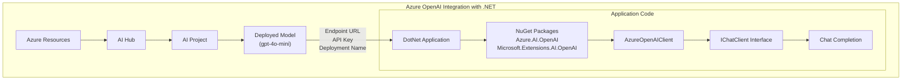

Sources: [02-SetupDevEnvironment/getting-started-azure-openai.md:86-101]()

### Required NuGet Packages

First, you need to add the necessary NuGet packages:

```bash
dotnet add package Azure.AI.OpenAI --version 2.2.0-beta.2
dotnet add package Microsoft.Extensions.AI.OpenAI --version 9.3.0-preview.1.25114.11
```

Sources: [02-SetupDevEnvironment/getting-started-azure-openai.md:98-101]()

### Code Implementation

Update your application code to use Azure OpenAI:

1. Add the required using statements:
   ```csharp
   using System.ClientModel;
   using Azure.AI.OpenAI;
   using Microsoft.Extensions.AI;
   ```

2. Create variables for your deployment configuration:
   ```csharp
   var deploymentName = "gpt-4o-mini"; // Your deployment name
   var endpoint = new Uri("https://<your-hub-name>.openai.azure.com/"); // Your endpoint
   var apiKey = new ApiKeyCredential(Environment.GetEnvironmentVariable("AZURE_AI_KEY"));
   ```

3. Initialize the Azure OpenAI client:
   ```csharp
   IChatClient client = new AzureOpenAIClient(
       endpoint,
       apiKey)
   .AsChatClient(deploymentName);
   ```

4. Run your application:
   ```bash
   dotnet run
   ```

Sources: [02-SetupDevEnvironment/getting-started-azure-openai.md:104-148]()

## Client Architecture Integration

The diagram below shows how the Azure OpenAI client fits into the larger client architecture of the course, allowing you to switch between different AI providers.

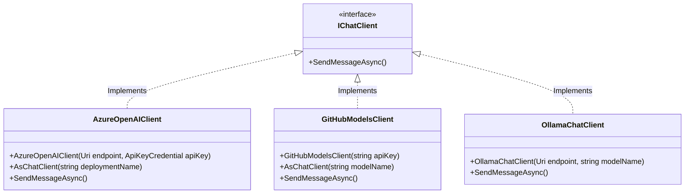

Sources: [02-SetupDevEnvironment/getting-started-azure-openai.md:86-131]()

## Summary

In this guide, you learned how to:
1. Create an Azure AI Foundry hub and project
2. Deploy a language model (gpt-4o-mini)
3. Configure a GitHub Codespace with your Azure OpenAI credentials
4. Update sample code to integrate with Azure OpenAI

With this setup, you can now leverage Azure's powerful language models in your .NET applications for the remainder of the course.

## Additional Resources

- [Azure AI Foundry Documentation](https://learn.microsoft.com/azure/ai-services)
- [Working with GitHub Codespaces](https://docs.github.com/en/codespaces/getting-started)
- [How to Deploy Models in Azure AI Foundry](https://learn.microsoft.com/azure/ai-services/deploy)
- [Azure.AI.OpenAI NuGet Package](https://www.nuget.org/packages/Azure.AI.OpenAI)

Sources: [02-SetupDevEnvironment/getting-started-azure-openai.md:152-161]()

---

# Page: Ollama Local Setup

# Ollama Local Setup

<details>
<summary>Relevant source files</summary>

The following files were used as context for generating this wiki page:

- [02-SetupDevEnvironment/getting-started-ollama.md](02-SetupDevEnvironment/getting-started-ollama.md)
- [02-SetupDevEnvironment/images/github-models-webpage.png](02-SetupDevEnvironment/images/github-models-webpage.png)
- [02-SetupDevEnvironment/readme.md](02-SetupDevEnvironment/readme.md)
- [03-CoreGenerativeAITechniques/src/BasicChat-04OllamaSK/Program.cs](03-CoreGenerativeAITechniques/src/BasicChat-04OllamaSK/Program.cs)

</details>


This guide explains how to set up and use Ollama for local model execution in the Generative AI for .NET Developers course. Ollama allows you to run AI models locally on your machine or within a devcontainer, without requiring connections to cloud services like GitHub Models or Azure OpenAI. This approach provides a free alternative with complete local control over model execution.

For cloud-based alternatives, see [GitHub Codespaces Setup](#2.1) or [Azure OpenAI Setup](#2.2).

## What is Ollama?

Ollama is an open-source tool that enables running various Large Language Models (LLMs) locally on your machine. It provides a simple API that makes it easy to download, run, and interact with these models through a unified interface.

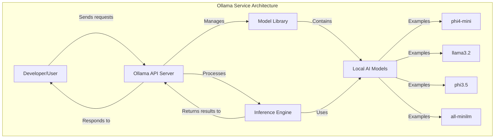

Sources: [02-SetupDevEnvironment/getting-started-ollama.md:1-9](). [02-SetupDevEnvironment/readme.md:36-39]().

## Setup Options

You can set up Ollama in two ways:

1. Using GitHub Codespaces with the Ollama-enabled container
2. Installing Ollama locally on your machine

### Option 1: GitHub Codespaces Setup with Ollama

This option provides a pre-configured environment with Ollama already installed and set up.

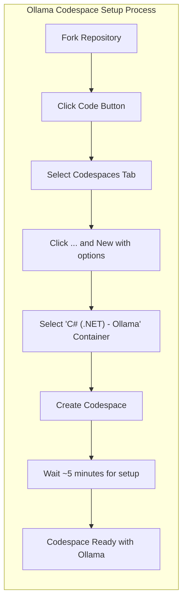

Follow these steps to create a Codespace with Ollama:

1. Fork the repository to your GitHub account
2. Click the **Code** dropdown button and select the **Codespaces** tab
3. Click the **...** (three dots) and choose **New with options...**
4. From the **Dev container configuration** dropdown, select **C# (.NET) - Ollama**
5. Click **Create codespace**
6. Wait for the environment to be set up (approximately 5 minutes)

Sources: [02-SetupDevEnvironment/getting-started-ollama.md:10-32]().

### Option 2: Local Installation

If you prefer to run Ollama on your local machine:

1. Visit [Ollama's website](https://ollama.com) to download and install the appropriate version for your operating system
2. After installation, use the terminal to pull the required models

Sources: [02-SetupDevEnvironment/readme.md:36-39]().

## Required Models

Depending on which parts of the course you want to run, you'll need different Ollama models:

| Lesson | Project | Required Models | Pull Command |
|--------|---------|-----------------|-------------|
| Lesson 2 | [BasicChat-03Ollama](https://github.com/microsoft/Generative-AI-for-beginners-dotnet/tree/main/02-SetupDevEnvironment/src/BasicChat-03Ollama) | phi4-mini or llama3.2 | `ollama pull phi4-mini` |
| Lesson 3 | [RAGSimple-10SKOllama](https://github.com/microsoft/Generative-AI-for-beginners-dotnet/tree/main/03-CoreGenerativeAITechniques/src/RAGSimple-10SKOllama) | phi4-mini and all-minilm | `ollama pull phi4-mini`<br>`ollama pull all-minilm` |

Sources: [02-SetupDevEnvironment/readme.md:40-51]().

## Verifying Your Setup

After setting up your environment, verify that Ollama is working correctly:

1. Open a terminal (Ctrl+\` on Windows or Cmd+\` on macOS)
2. Navigate to the sample project directory:
   ```bash
   cd 02-SetupDevEnvironment/src/BasicChat-03Ollama/
   ```
3. Run the application:
   ```bash
   dotnet run
   ```
4. You should see an AI response to a predefined question about artificial intelligence

Sources: [02-SetupDevEnvironment/getting-started-ollama.md:33-62]().

## Swapping Models

One advantage of Ollama is the ability to easily switch between different models:

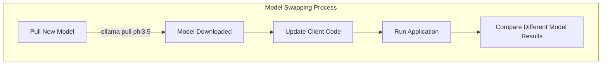

To try a different model:

1. Pull the desired model using the `ollama pull` command:
   ```bash
   ollama pull phi3.5
   ```

2. Modify the code to use the new model. In your application, update the model name in the client initialization:
   ```csharp
   IChatClient client = new OllamaChatClient(new Uri("http://localhost:11434/"), "phi3.5");
   ```

3. Run the application again to see the different response patterns

Sources: [02-SetupDevEnvironment/getting-started-ollama.md:64-98]().

## Integration with .NET

Ollama integrates with the .NET code in this course through two primary methods:

1. Using the `Microsoft.Extensions.AI` library with `OllamaChatClient`
2. Using Semantic Kernel with `OllamaApiClient`

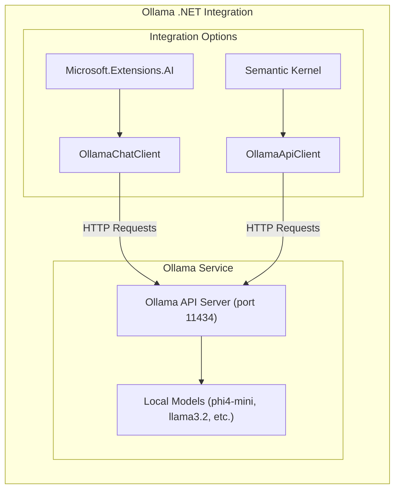

### Semantic Kernel Integration Example

The code below shows how to create a chat completion service using Ollama with Semantic Kernel:

```csharp
var modelId = "phi4-mini";
var uri = "http://localhost:11434/";

// create client
var chat = new OllamaApiClient(uri, modelId)
    .AsChatCompletionService();
```

Sources: [03-CoreGenerativeAITechniques/src/BasicChat-04OllamaSK/Program.cs:7-14]().

## System Architecture

The following diagram illustrates how Ollama fits into the overall development environment architecture of the course:

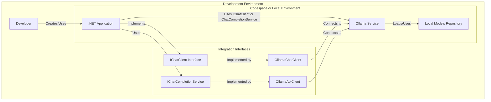

Sources: [02-SetupDevEnvironment/getting-started-ollama.md:1-9](). [03-CoreGenerativeAITechniques/src/BasicChat-04OllamaSK/Program.cs:1-40]().

## Advantages and Considerations

### Advantages of Using Ollama

- Free to use with no usage limits
- Complete privacy as all processing happens locally
- No dependency on external services or API keys
- Ability to work offline once models are downloaded

### Considerations

- Requires more hardware resources than cloud-based options
- Slower startup time for the devcontainer (approximately 5 minutes)
- Model download size can be substantial (several GB for larger models)
- Inference speed depends on your local hardware capabilities

Sources: [02-SetupDevEnvironment/readme.md:26-39]().

## Summary

Ollama provides a powerful option for running AI models locally in your development environment. It offers a free and private alternative to cloud-based services, with the flexibility to swap between different models easily. By following the setup instructions in this guide, you can configure your environment to use Ollama for all the examples in this course.

Next, you'll explore how to implement core generative AI techniques using the environment you've just set up.

---

# Page: Core GenAI Techniques

# Core GenAI Techniques

<details>
<summary>Relevant source files</summary>

The following files were used as context for generating this wiki page:

- [.devcontainer/Ollama/devcontainer.json](.devcontainer/Ollama/devcontainer.json)
- [03-CoreGenerativeAITechniques/01-lm-completions-functions.md](03-CoreGenerativeAITechniques/01-lm-completions-functions.md)
- [03-CoreGenerativeAITechniques/02-retrieval-augmented-generation.md](03-CoreGenerativeAITechniques/02-retrieval-augmented-generation.md)
- [03-CoreGenerativeAITechniques/03-vision-audio.md](03-CoreGenerativeAITechniques/03-vision-audio.md)
- [03-CoreGenerativeAITechniques/readme.md](03-CoreGenerativeAITechniques/readme.md)
- [03-CoreGenerativeAITechniques/src/RAGSimple-10SKOllama/Program.cs](03-CoreGenerativeAITechniques/src/RAGSimple-10SKOllama/Program.cs)
- [03-CoreGenerativeAITechniques/src/RAGSimple-10SKOllama/RAGSimple-10SKOllama.csproj](03-CoreGenerativeAITechniques/src/RAGSimple-10SKOllama/RAGSimple-10SKOllama.csproj)
- [03-CoreGenerativeAITechniques/src/RAGSimple-10SKOllama/SpectreConsoleOutput.cs](03-CoreGenerativeAITechniques/src/RAGSimple-10SKOllama/SpectreConsoleOutput.cs)
- [03-CoreGenerativeAITechniques/src/RAGSimple-15Ollama-DeepSeekR1/Program.cs](03-CoreGenerativeAITechniques/src/RAGSimple-15Ollama-DeepSeekR1/Program.cs)
- [03-CoreGenerativeAITechniques/src/RAGSimple-15Ollama-DeepSeekR1/RAGSimple-15Ollama-DeepSeekR1.csproj](03-CoreGenerativeAITechniques/src/RAGSimple-15Ollama-DeepSeekR1/RAGSimple-15Ollama-DeepSeekR1.csproj)
- [03-CoreGenerativeAITechniques/src/RAGSimple-15Ollama-DeepSeekR1/SpectreConsoleOutput.cs](03-CoreGenerativeAITechniques/src/RAGSimple-15Ollama-DeepSeekR1/SpectreConsoleOutput.cs)

</details>


This page provides an overview of the fundamental generative AI techniques used in .NET applications. The techniques covered here form the foundation for building sophisticated AI-powered applications using Microsoft's .NET ecosystem. For detailed implementation guides, refer to the specific sub-sections dedicated to each technique.

For setup of development environments, see [Development Environment Setup](#2).

## Overview of Techniques

The core generative AI techniques covered in this course include:

1. **Text Completions and Function Calling** - Basic interactions with language models through prompts and responses, including the ability to call functions based on user input
2. **Retrieval-Augmented Generation (RAG)** - Enhancing model responses with information retrieved from external data sources
3. **Vision and Audio AI** - Processing and generating visual and audio content using AI models
4. **AI Agents** - Creating autonomous AI systems that can perform complex tasks

These techniques can be implemented using various .NET libraries including Microsoft.Extensions.AI (MEAI) and Semantic Kernel.

Sources: [03-CoreGenerativeAITechniques/readme.md:1-26]()

## Text Completions and Function Calling

Text completions are the most basic form of interaction with language models, where the model generates a single response based on a provided prompt. Chat applications extend this concept by maintaining a conversation history with different message types (System, User, Assistant) for context.

Function calling allows AI to interact with external systems by calling predefined functions in your code based on user input, creating a bridge between natural language and code execution.

### Text Completions Architecture

```mermaid
flowchart LR
    subgraph "Text Completions"
        User(["User"]) -->|"Submits prompt"| IChatClient["IChatClient"]
        IChatClient -->|"Sends to model"| ModelService["Model Service\n(GitHub/Azure/Ollama)"]
        ModelService -->|"Returns completion"| IChatClient
        IChatClient -->|"Returns response"| User
    end

    subgraph "Implementations"
        IChatClient --- MEAI["MEAI\nChatCompletionsClient"]
        IChatClient --- SK["Semantic Kernel"]
    end
```

Sources: [03-CoreGenerativeAITechniques/01-lm-completions-functions.md:13-45]()

### Chat Flow Architecture

```mermaid
flowchart TD
    User(["User"]) -->|"Message"| ConversationHistory["Conversation History"]
    
    subgraph "Message Types"
        SystemMsg["System Message\n(Guides behavior)"]
        UserMsg["User Message\n(Input/prompt)"]
        AssistantMsg["Assistant Message\n(AI response)"]
    end
    
    ConversationHistory --> SystemMsg
    ConversationHistory --> UserMsg
    ConversationHistory --> AssistantMsg
    
    ConversationHistory -->|"All messages"| IChatClient["IChatClient"]
    IChatClient -->|"Prompt + History"| LLM["Language Model"]
    LLM -->|"Response"| IChatClient
    IChatClient -->|"New response"| ConversationHistory
    ConversationHistory -->|"Updated conversation"| User
```

Sources: [03-CoreGenerativeAITechniques/01-lm-completions-functions.md:53-101]()

### Function Calling Flow

```mermaid
flowchart TD
    User(["User"]) -->|"Request"| Client["IChatClient"]
    
    subgraph "Function Setup"
        FunctionDef["Function Definition\nC# Method with Description"]
        AIFunctionFactory["AIFunctionFactory.Create()"]
        ChatOptions["ChatOptions with Tools"]
    end
    
    FunctionDef -->|"Register"| AIFunctionFactory
    AIFunctionFactory -->|"Add to"| ChatOptions
    
    Client -->|"Message + ChatOptions"| LLM["Language Model"]
    LLM -->|"Determines function needed"| FunctionInvocation["Function Invocation"]
    FunctionInvocation -->|"Execute"| CodeFunction["C# Function"]
    CodeFunction -->|"Result"| LLM
    LLM -->|"Final response with function output"| Client
    Client -->|"Response"| User
```

Sources: [03-CoreGenerativeAITechniques/01-lm-completions-functions.md:107-166]()

## Retrieval-Augmented Generation (RAG)

RAG is a technique that augments language model responses with information retrieved from external data sources. This approach improves accuracy, provides up-to-date information, and enables domain-specific knowledge incorporation.

### RAG Architecture

```mermaid
flowchart TD
    User(["User"]) -->|"Question"| QueryProcessor["Query Processor"]
    
    subgraph "Indexing Phase"
        Documents[(Knowledge Source)] -->|"Process"| EmbeddingGenerator["Embedding Generator"]
        EmbeddingGenerator -->|"Store vectors"| VectorStore[(Vector Store)]
    end
    
    subgraph "Retrieval Phase"
        QueryProcessor -->|"Convert to embedding"| QueryEmbedding["Query Embedding"]
        QueryEmbedding -->|"Vector search"| VectorStore
        VectorStore -->|"Relevant documents"| RelevantDocs["Relevant Documents"]
    end
    
    subgraph "Generation Phase"
        QueryProcessor -->|"Original query"| PromptBuilder["Prompt Builder"]
        RelevantDocs -->|"Contextual info"| PromptBuilder
        PromptBuilder -->|"Enhanced prompt"| LLM["Language Model"]
        LLM -->|"Informed response"| User
    end
```

Sources: [03-CoreGenerativeAITechniques/02-retrieval-augmented-generation.md:11-22](), [03-CoreGenerativeAITechniques/02-retrieval-augmented-generation.md:24-37]()

### RAG Implementation Components

```mermaid
graph TD
    subgraph "RAG Implementation"
        MovieData["Movie Data\nPOCO Class"] -->|"Populate"| VectorStore["Vector Store\nInMemoryVectorStore"]
        
        UserQuery["User Query"] -->|"Generate embedding"| QueryEmbedding["Query Embedding\nIEmbeddingGenerator"]
        
        QueryEmbedding -->|"Search"| VectorStore
        VectorStore -->|"Results"| SearchResults["Search Results"]
        
        UserQuery -->|"Original query"| Conversation["Conversation\nList<ChatMessage>"]
        SearchResults -->|"Add as context"| Conversation
        Conversation -->|"Send to model"| ChatClient["Chat Client\nIChatClient"]
        ChatClient -->|"Response"| FinalResponse["Final Response"]
    end
```

Sources: [03-CoreGenerativeAITechniques/02-retrieval-augmented-generation.md:42-166]()

### Key Components of RAG

| Component | Description | Implementation |
|-----------|-------------|----------------|
| Vector Store | Stores vector representations of documents | `InMemoryVectorStore`, Azure AI Search, Qdrant |
| Embedding Generator | Converts text to vector representations | `IEmbeddingGenerator<string, Embedding<float>>` |
| Vector Search | Finds semantically similar content | `VectorSearchOptions`, `VectorizedSearchAsync()` |
| Knowledge Retrieval | Integrates retrieved information into prompts | Adding search results as `ChatRole.User` messages |

Sources: [03-CoreGenerativeAITechniques/02-retrieval-augmented-generation.md:42-166](), [03-CoreGenerativeAITechniques/src/RAGSimple-10SKOllama/Program.cs:28-128]()

## Vision and Audio AI

Vision AI enables applications to understand and interpret images, while Audio AI provides capabilities for handling spoken language and sound.

### Vision AI Architecture

```mermaid
flowchart LR
    subgraph "Vision AI Flow"
        User(["User"]) -->|"Question about image"| QueryMsg["Text Message\nChatMessage"]
        ImageSource["Image Source"] -->|"Load as bytes"| AIContent["AIContent\nDataContent"]
        
        QueryMsg --> ConversationHistory["Conversation\nList<ChatMessage>"]
        AIContent -->|"Add as content"| ImageMsg["Image Message\nChatMessage"]
        ImageMsg --> ConversationHistory
        
        ConversationHistory -->|"Send to model"| IChatClient["IChatClient"]
        IChatClient -->|"Multimodal processing"| VisionModel["Vision-enabled Model"]
        VisionModel -->|"Image understanding"| Response["Response Message"]
        Response --> ConversationHistory
        Response -->|"Text description/answer"| User
    end
```

Sources: [03-CoreGenerativeAITechniques/03-vision-audio.md:13-76]()

### Audio AI Architecture

```mermaid
flowchart TD
    subgraph "Audio AI Flow"
        User(["User"]) -->|"Speaks"| Microphone["Microphone Input\nAudioConfig"]
        
        Microphone -->|"Audio stream"| TranslationRecognizer["TranslationRecognizer"]
        
        SpeechConfig["SpeechTranslationConfig\nLanguage settings"] -->|"Configure"| TranslationRecognizer
        
        TranslationRecognizer -->|"Process audio"| SpeechService["Azure AI Speech Service"]
        
        SpeechService -->|"Recognition result"| TranslationResult["TranslationRecognitionResult"]
        
        TranslationResult -->|"Transcribed/translated text"| Output["Text Output"]
        Output -->|"Display"| User
    end
```

Sources: [03-CoreGenerativeAITechniques/03-vision-audio.md:81-146]()

## AI Agents

AI Agents are autonomous systems that can process information, make decisions, and execute tasks based on instructions.

### AI Agents Architecture

```mermaid
graph TD
    subgraph "AI Agents System"
        User(["User"]) -->|"Input"| AgentsClient["AgentsClient"]
        
        AgentsClient -->|"Creates"| Agent["Agent"]
        AgentsClient -->|"Creates"| Thread["Agent Thread"]
        AgentsClient -->|"Creates"| ThreadRun["Thread Run"]
        
        Agent -->|"Uses"| Instructions["Instructions"]
        Agent -->|"Uses"| LLM["Language Model"]
        Agent -->|"Uses"| Tools["Tools/Functions"]
        
        Thread -->|"Contains"| Messages["Thread Messages"]
        ThreadRun -->|"Executes"| Agent
        ThreadRun -->|"On"| Thread
        
        Thread -->|"Response"| User
    end
```

Sources: (Based on the course structure diagram provided in the original request)

## Integration with .NET Libraries

The core generative AI techniques are implemented using key .NET libraries that provide standardized interfaces for AI functionality.

### Library Architecture

```mermaid
graph TD
    subgraph ".NET GenAI Libraries"
        App["Application"] -->|"Uses"| MEAI["Microsoft.Extensions.AI"]
        App -->|"Uses"| SK["Semantic Kernel"]
        
        MEAI -->|"Provides"| IChatClient["IChatClient Interface"]
        MEAI -->|"Provides"| IEmbeddingGenerator["IEmbeddingGenerator Interface"]
        MEAI -->|"Provides"| AIFunction["AI Function Calling"]
        
        SK -->|"Provides"| KernelMemory["Kernel Memory\nRAG Implementation"]
        SK -->|"Provides"| PluginsFramework["Plugins Framework"]
        SK -->|"Provides"| AgentsFramework["Agents Framework"]
        
        subgraph "Model Connectors"
            IChatClient --- AzureConnector["Azure OpenAI Connector"]
            IChatClient --- GitHubConnector["GitHub Models Connector"]
            IChatClient --- OllamaConnector["Ollama Connector"]
        end
    end
```

Sources: [03-CoreGenerativeAITechniques/01-lm-completions-functions.md:19-46](), [03-CoreGenerativeAITechniques/src/RAGSimple-10SKOllama/Program.cs:28-82]()

## Code Implementation Patterns

Common code patterns and interfaces used across the different generative AI techniques:

| Pattern | Description | Interfaces/Classes | Example Use Case |
|---------|-------------|-------------------|------------------|
| Chat Client | Handles communication with language models | `IChatClient`, `ChatCompletionsClient` | Text completions, function calling |
| Embedding Generation | Converts text to vector representations | `IEmbeddingGenerator`, `EmbeddingsClient` | RAG implementation, semantic search |
| Conversation History | Manages context for multi-turn conversations | `List<ChatMessage>` | Chat applications, RAG |
| Function Integration | Allows LLMs to call code | `AIFunctionFactory`, `ChatOptions` | Function calling, tools integration |
| Vector Storage | Stores and retrieves vector embeddings | `InMemoryVectorStore`, `VectorSearchOptions` | RAG implementation |
| Content Handling | Manages different content types | `AIContent`, `DataContent` | Vision AI, multimodal interactions |

Sources: [03-CoreGenerativeAITechniques/01-lm-completions-functions.md:23-45](), [03-CoreGenerativeAITechniques/01-lm-completions-functions.md:74-100](), [03-CoreGenerativeAITechniques/01-lm-completions-functions.md:123-145](), [03-CoreGenerativeAITechniques/02-retrieval-augmented-generation.md:67-131](), [03-CoreGenerativeAITechniques/03-vision-audio.md:27-75]()

## Detailed Sub-Sections

For detailed implementation guides on each core technique, refer to the following sections:

- [Text Completions and Function Calling](#3.1)
- [Retrieval-Augmented Generation (RAG)](#3.2)
- [Vision and Audio AI](#3.3)
- [AI Agents](#3.4)

---

# Page: Text Completions and Function Calling

# Text Completions and Function Calling

<details>
<summary>Relevant source files</summary>

The following files were used as context for generating this wiki page:

- [03-CoreGenerativeAITechniques/01-lm-completions-functions.md](03-CoreGenerativeAITechniques/01-lm-completions-functions.md)
- [03-CoreGenerativeAITechniques/readme.md](03-CoreGenerativeAITechniques/readme.md)
- [03-CoreGenerativeAITechniques/src/BasicChat-01MEAI/Program.cs](03-CoreGenerativeAITechniques/src/BasicChat-01MEAI/Program.cs)
- [03-CoreGenerativeAITechniques/src/BasicChat-03Ollama/Program.cs](03-CoreGenerativeAITechniques/src/BasicChat-03Ollama/Program.cs)
- [03-CoreGenerativeAITechniques/src/MEAIFunctions/MEAIFunctions.csproj](03-CoreGenerativeAITechniques/src/MEAIFunctions/MEAIFunctions.csproj)
- [03-CoreGenerativeAITechniques/src/MEAIFunctions/Program.cs](03-CoreGenerativeAITechniques/src/MEAIFunctions/Program.cs)
- [03-CoreGenerativeAITechniques/src/MEAIFunctionsOllama/MEAIFunctionsOllama.csproj](03-CoreGenerativeAITechniques/src/MEAIFunctionsOllama/MEAIFunctionsOllama.csproj)
- [03-CoreGenerativeAITechniques/src/MEAIFunctionsOllama/Program.cs](03-CoreGenerativeAITechniques/src/MEAIFunctionsOllama/Program.cs)

</details>


## Purpose and Scope

This document details the implementation of text completions and function calling in .NET applications using Microsoft.Extensions.AI (MEAI). It covers the core techniques for interacting with Large Language Models (LLMs), from single completions to conversational interfaces with function-calling capabilities. For information about more advanced techniques like Retrieval-Augmented Generation (RAG), see [Retrieval-Augmented Generation (RAG)](#3.2).

## Text Completions Overview

Text completions represent the most fundamental form of interaction with language models. A text completion is a single response generated by a model based on a provided prompt. These one-shot interactions are useful for specific tasks such as content summarization, sentiment analysis, or text transformation.

```mermaid
flowchart LR
    subgraph "Text Completion Process"
        Input["User Input\n(Prompt)"] --> ModelProcessing["Language Model\nProcessing"]
        ModelProcessing --> Response["Text Completion\n(Single Response)"]
    end
```

Sources: [03-CoreGenerativeAITechniques/01-lm-completions-functions.md:13-16](). [03-CoreGenerativeAITechniques/01-lm-completions-functions.md:18-45]().

### Implementation with Microsoft.Extensions.AI

The Microsoft.Extensions.AI library provides a standardized interface for text completions across different model providers. The core component is the `IChatClient` interface, which can be implemented for various model providers:

```mermaid
classDiagram
    class IChatClient {
        +GetResponseAsync(string prompt) Task~ChatResponse~
        +GetResponseAsync(List~ChatMessage~ conversation) Task~ChatResponse~
    }
    IChatClient <|-- ChatCompletionsClient
    IChatClient <|-- OllamaChatClient
    
    class ChatCompletionsClient {
        +endpoint: Uri
        +credential: AzureKeyCredential
        +AsChatClient(string modelId)
    }
    
    class OllamaChatClient {
        +endpoint: Uri
        +modelId: string
    }
```

Sources: [03-CoreGenerativeAITechniques/src/BasicChat-01MEAI/Program.cs:14-17](). [03-CoreGenerativeAITechniques/src/BasicChat-03Ollama/Program.cs:4-5]().

### Text Completion Example

The basic workflow for a text completion involves:
1. Instantiating an `IChatClient` with the appropriate model provider
2. Creating a prompt
3. Sending the prompt to the model
4. Processing the response

#### Using GitHub Models (Cloud-Based)

```mermaid
sequenceDiagram
    participant App as ".NET Application"
    participant MEAI as "Microsoft.Extensions.AI"
    participant GitHub as "GitHub Models API"
    
    App->>MEAI: Create ChatCompletionsClient
    App->>MEAI: Build prompt
    App->>MEAI: GetResponseAsync(prompt)
    MEAI->>GitHub: Send prompt to model
    GitHub-->>MEAI: Return completion
    MEAI-->>App: Return ChatResponse
```

Sources: [03-CoreGenerativeAITechniques/src/BasicChat-01MEAI/Program.cs:14-31]().

#### Using Ollama (Local Models)

```mermaid
sequenceDiagram
    participant App as ".NET Application"
    participant MEAI as "Microsoft.Extensions.AI"
    participant Ollama as "Ollama Local API"
    
    App->>MEAI: Create OllamaChatClient
    App->>MEAI: Build prompt
    App->>MEAI: GetResponseAsync(prompt)
    MEAI->>Ollama: Send prompt to local model
    Ollama-->>MEAI: Return completion
    MEAI-->>App: Return ChatResponse
```

Sources: [03-CoreGenerativeAITechniques/src/BasicChat-03Ollama/Program.cs:4-17]().

## Chat Applications

While text completions represent single-turn interactions, chat applications involve multi-turn conversations with the model. Building a chat application requires managing the conversation history to provide context for each new response.

### Chat Roles

Chat applications use different message roles to structure the conversation:

| Role | Description | Purpose |
|------|-------------|---------|
| System | Initial instruction that guides model behavior | Sets context, tone, and boundaries |
| User | Input from the end-user | Questions, statements, or commands |
| Assistant | Response generated by the model | The model's replies based on context |

Sources: [03-CoreGenerativeAITechniques/01-lm-completions-functions.md:58-64]().

### Managing Chat History

To maintain context during a conversation, you must track all previous messages. Each new message in the conversation adds to the context used by the model to generate the next response.

```mermaid
flowchart TD
    subgraph "Chat Conversation Flow"
        SystemMsg["System Message\n(Initial Instructions)"] --> History
        
        subgraph "Conversation Turn 1"
            User1["User Message 1"] --> History
            History --> Model1["Model Processing"]
            Model1 --> Assistant1["Assistant Response 1"]
            Assistant1 --> History
        end
        
        subgraph "Conversation Turn 2"
            User2["User Message 2"] --> History
            History --> Model2["Model Processing"]
            Model2 --> Assistant2["Assistant Response 2"]
            Assistant2 --> History
        end
        
        subgraph "Conversation Turn N"
            UserN["User Message N"] --> History
            History --> ModelN["Model Processing"]
            ModelN --> AssistantN["Assistant Response N"]
        end
    end
    
    History["Conversation History\n(List<ChatMessage>)"]
```

Sources: [03-CoreGenerativeAITechniques/01-lm-completions-functions.md:65-101]().

### Chat Implementation Example

The implementation pattern for a chat application involves:
1. Creating a list to store the conversation history
2. Adding a system message to set the initial context
3. In a loop:
   - Collecting user input
   - Adding the user message to the history
   - Sending the entire history to the model
   - Adding the model's response to the history
   - Displaying the response to the user

Sources: [03-CoreGenerativeAITechniques/01-lm-completions-functions.md:71-101]().

## Function Calling

Function calling enables language models to invoke specific methods in your code based on the user's input. This creates a bridge between natural language understanding and programmatic actions, allowing the model to access external systems and data.

```mermaid
flowchart LR
    subgraph "Function Calling Architecture"
        User["User Input"] --> Client["IChatClient"]
        Client --> Model["Language Model"]
        Model -->|"Determines function needed"| FunctionCall["Function Call Decision"]
        FunctionCall -->|"No function needed"| DirectResponse["Direct Text Response"]
        FunctionCall -->|"Function needed"| Invoke["Invoke .NET Method"]
        Invoke --> Result["Function Result"]
        Result --> Model
        Model --> FinalResponse["Final Response (with function data)"]
    end
```

Sources: [03-CoreGenerativeAITechniques/01-lm-completions-functions.md:107-168]().

### Implementation Steps

Setting up function calling with MEAI requires:

1. **Define the function** that the model can call, decorated with a `Description` attribute
2. **Create a `ChatOptions` object** that specifies available functions using `AIFunctionFactory.Create()`
3. **Configure the `IChatClient`** with function invocation capabilities using `.AsBuilder().UseFunctionInvocation().Build()`
4. **Pass the `ChatOptions`** when making requests to the model

```mermaid
classDiagram
    class AIFunctionFactory {
        +Create(Delegate function) AIFunction
    }
    
    class ChatOptions {
        +Tools: IReadOnlyList~AITool~
    }
    
    class IChatClient {
        +AsBuilder() IChatClientBuilder
        +GetResponseAsync(string prompt, ChatOptions options) Task~ChatResponse~
    }
    
    class IChatClientBuilder {
        +UseFunctionInvocation() IChatClientBuilder
        +Build() IChatClient
    }
    
    ChatOptions --> AIFunctionFactory: Uses to create tools
    IChatClient --> IChatClientBuilder: Creates
    IChatClientBuilder --> IChatClient: Builds enhanced
```

Sources: [03-CoreGenerativeAITechniques/src/MEAIFunctions/Program.cs:14-33](). [03-CoreGenerativeAITechniques/01-lm-completions-functions.md:123-167]().

### Function Calling Example

The function calling process:
1. User asks a question that might require external data
2. The model determines if it needs to call a function
3. If needed, the model invokes the specified function
4. The model incorporates the function's result into its response

#### With GitHub Models

```mermaid
sequenceDiagram
    participant User
    participant App as ".NET Application"
    participant MEAI as "Microsoft.Extensions.AI"
    participant GitHub as "GitHub Models API"
    participant Function as ".NET Function"
    
    User->>App: "Do I need an umbrella today?"
    App->>MEAI: GetResponseAsync(question, options)
    MEAI->>GitHub: Send question with function definitions
    GitHub-->>MEAI: Request to call GetTheWeather()
    MEAI->>Function: Invoke GetTheWeather()
    Function-->>MEAI: Return weather data
    MEAI->>GitHub: Send question + function result
    GitHub-->>MEAI: Generate final response
    MEAI-->>App: Return ChatResponse
    App->>User: "Based on the weather (rainy), you should bring an umbrella"
```

Sources: [03-CoreGenerativeAITechniques/src/MEAIFunctions/Program.cs:14-44]().

#### With Ollama (Local Models)

The same pattern applies to local models using Ollama, with the difference being the client initialization:

```mermaid
sequenceDiagram
    participant User
    participant App as ".NET Application"
    participant MEAI as "Microsoft.Extensions.AI"
    participant Ollama as "Ollama Local API"
    participant Function as ".NET Function"
    
    App->>MEAI: Create OllamaChatClient with function invocation
    User->>App: "Do I need an umbrella today?"
    App->>MEAI: GetResponseAsync(question, options)
    MEAI->>Ollama: Send question with function definitions
    Ollama-->>MEAI: Request to call GetTheWeather()
    MEAI->>Function: Invoke GetTheWeather()
    Function-->>MEAI: Return weather data
    MEAI->>Ollama: Send question + function result
    Ollama-->>MEAI: Generate final response
    MEAI-->>App: Return ChatResponse
    App->>User: "Based on the weather (rainy), you should bring an umbrella"
```

Sources: [03-CoreGenerativeAITechniques/src/MEAIFunctionsOllama/Program.cs:7-45]().

## Integration Options

The Microsoft.Extensions.AI library provides a consistent interface across different model providers, allowing you to use the same code patterns regardless of where the model is hosted.

```mermaid
flowchart TD
    subgraph "Model Provider Options"
        App[".NET Application\nusing IChatClient"]
        
        App -->|"Cloud-Based"| GitHub["GitHub Models\n(ChatCompletionsClient)"]
        App -->|"Cloud-Based"| AzureAI["Azure AI\n(ChatCompletionsClient)"]
        App -->|"Local"| Ollama["Ollama\n(OllamaChatClient)"]
        
        subgraph "Models Available"
            GitHub --> GH1["gpt-4o-mini"]
            GitHub --> GH2["Phi-3.5-MoE-instruct"]
            
            AzureAI --> AZ1["GPT-4"]
            AzureAI --> AZ2["Azure OpenAI Models"]
            
            Ollama --> OL1["phi4-mini"]
            Ollama --> OL2["llama3.2"]
            Ollama --> OL3["Custom: ollama pull <model>"]
        end
    end
```

Sources: [03-CoreGenerativeAITechniques/01-lm-completions-functions.md:24-50](). [03-CoreGenerativeAITechniques/src/BasicChat-01MEAI/Program.cs:14-17](). [03-CoreGenerativeAITechniques/src/BasicChat-03Ollama/Program.cs:4-5]().

## Key Dependencies

The implementation relies on the following NuGet packages:

| Package | Purpose |
|---------|---------|
| `Microsoft.Extensions.AI` | Core library for AI capabilities |
| `Microsoft.Extensions.AI.AzureAIInference` | Support for Azure AI services |
| `Microsoft.Extensions.AI.Ollama` | Support for Ollama local models |

Sources: [03-CoreGenerativeAITechniques/src/MEAIFunctions/MEAIFunctions.csproj:11-15](). [03-CoreGenerativeAITechniques/src/MEAIFunctionsOllama/MEAIFunctionsOllama.csproj:10-13]().

## Summary

Text completions and function calling form the foundation of interactive AI applications in .NET. Using Microsoft.Extensions.AI, you can implement these capabilities with a consistent programming model across different model providers, whether cloud-based or local. These techniques enable a wide range of applications, from simple text processing to complex interactive systems with access to external data and services.

For building more sophisticated applications that need to work with external data, see [Retrieval-Augmented Generation (RAG)](#3.2).

---

# Page: Retrieval-Augmented Generation (RAG)

# Retrieval-Augmented Generation (RAG)

<details>
<summary>Relevant source files</summary>

The following files were used as context for generating this wiki page:

- [.devcontainer/Ollama/devcontainer.json](.devcontainer/Ollama/devcontainer.json)
- [03-CoreGenerativeAITechniques/02-retrieval-augmented-generation.md](03-CoreGenerativeAITechniques/02-retrieval-augmented-generation.md)
- [03-CoreGenerativeAITechniques/03-vision-audio.md](03-CoreGenerativeAITechniques/03-vision-audio.md)
- [03-CoreGenerativeAITechniques/src/RAGSimple-10SKOllama/Program.cs](03-CoreGenerativeAITechniques/src/RAGSimple-10SKOllama/Program.cs)
- [03-CoreGenerativeAITechniques/src/RAGSimple-10SKOllama/RAGSimple-10SKOllama.csproj](03-CoreGenerativeAITechniques/src/RAGSimple-10SKOllama/RAGSimple-10SKOllama.csproj)
- [03-CoreGenerativeAITechniques/src/RAGSimple-10SKOllama/SpectreConsoleOutput.cs](03-CoreGenerativeAITechniques/src/RAGSimple-10SKOllama/SpectreConsoleOutput.cs)
- [03-CoreGenerativeAITechniques/src/RAGSimple-15Ollama-DeepSeekR1/Program.cs](03-CoreGenerativeAITechniques/src/RAGSimple-15Ollama-DeepSeekR1/Program.cs)
- [03-CoreGenerativeAITechniques/src/RAGSimple-15Ollama-DeepSeekR1/RAGSimple-15Ollama-DeepSeekR1.csproj](03-CoreGenerativeAITechniques/src/RAGSimple-15Ollama-DeepSeekR1/RAGSimple-15Ollama-DeepSeekR1.csproj)
- [03-CoreGenerativeAITechniques/src/RAGSimple-15Ollama-DeepSeekR1/SpectreConsoleOutput.cs](03-CoreGenerativeAITechniques/src/RAGSimple-15Ollama-DeepSeekR1/SpectreConsoleOutput.cs)
- [translations/de/03-CoreGenerativeAITechniques/02-retrieval-augmented-generation.md](translations/de/03-CoreGenerativeAITechniques/02-retrieval-augmented-generation.md)
- [translations/fr/03-CoreGenerativeAITechniques/02-retrieval-augmented-generation.md](translations/fr/03-CoreGenerativeAITechniques/02-retrieval-augmented-generation.md)
- [translations/ja/03-CoreGenerativeAITechniques/02-retrieval-augmented-generation.md](translations/ja/03-CoreGenerativeAITechniques/02-retrieval-augmented-generation.md)
- [translations/ko/03-CoreGenerativeAITechniques/02-retrieval-augmented-generation.md](translations/ko/03-CoreGenerativeAITechniques/02-retrieval-augmented-generation.md)
- [translations/pt/03-CoreGenerativeAITechniques/02-retrieval-augmented-generation.md](translations/pt/03-CoreGenerativeAITechniques/02-retrieval-augmented-generation.md)
- [translations/tw/03-CoreGenerativeAITechniques/02-retrieval-augmented-generation.md](translations/tw/03-CoreGenerativeAITechniques/02-retrieval-augmented-generation.md)
- [translations/zh/03-CoreGenerativeAITechniques/02-retrieval-augmented-generation.md](translations/zh/03-CoreGenerativeAITechniques/02-retrieval-augmented-generation.md)

</details>


Retrieval-Augmented Generation (RAG) is a technique that enhances large language model responses by retrieving relevant information from external knowledge sources. This page documents the RAG implementation in the .NET Generative AI course, covering the core concepts, architecture, and implementation details in the codebase.

## Core Concepts of RAG

RAG consists of two primary phases: **Retrieval** and **Generation**.

- **Retrieval**: When a user submits a query, the system uses a retrieval mechanism to gather information from an external knowledge store (vector database, document collection, etc.)
- **Generation**: The retrieved information augments the user's prompt, allowing the AI model to produce more accurate and informed responses.

Key benefits of RAG include:
- Improved accuracy with relevant context
- Up-to-date information beyond the model's knowledge cutoff
- Domain-specific knowledge integration

Sources: [03-CoreGenerativeAITechniques/02-retrieval-augmented-generation.md:11-16](), [03-CoreGenerativeAITechniques/02-retrieval-augmented-generation.md:18-23]()

## RAG Architecture

**RAG Implementation Flow Diagram**

```mermaid
flowchart TD
    User(["User"]) -->|"Query"| QueryEmbedding["QueryEmbeddingGenerator"]
    
    subgraph "Indexing Phase"
        direction TB
        DataSource[("Knowledge Source")] -->|"Extract Content"| EmbeddingModel["EmbeddingModel"]
        EmbeddingModel -->|"Store Vectors"| VectorStore[("VectorStore")]
    end
    
    QueryEmbedding -->|"Vectorized Query"| VectorSearch["VectorizedSearch"]
    VectorSearch -->|"Search Request"| VectorStore
    VectorStore -->|"Relevant Records"| ContextBuilder["ContextBuilder"]
    
    ContextBuilder -->|"User Query + Context"| LLMPrompt["LanguageModelPrompt"]
    LLMPrompt -->|"Enhanced Prompt"| LanguageModel["LanguageModel"]
    
    LanguageModel -->|"Generated Response"| User
```

Sources: [03-CoreGenerativeAITechniques/02-retrieval-augmented-generation.md:11-16]()

**RAG Code Components**

```mermaid
classDiagram
    class IEmbeddingGenerator {
        +GenerateEmbeddingVectorAsync(input) ReadOnlyMemory~float~
    }
    
    class VectorStore {
        +GetCollection~TKey, TRecord~(name) IVectorStoreCollection
        +CreateCollectionIfNotExistsAsync()
        +UpsertAsync(record)
        +VectorizedSearchAsync(vector, options) SearchResults
    }
    
    class ChatClient {
        +GetResponseAsync(messages) ChatResponse
    }
    
    class VectorRecord {
        +Key
        +Data
        +Vector ReadOnlyMemory~float~
    }
    
    class KernelMemory {
        +ImportTextAsync(text, id)
        +AskStreamingAsync(question) MemoryAnswer
    }
    
    IEmbeddingGenerator ..> VectorRecord : creates vectors
    VectorStore o-- VectorRecord : stores
    VectorRecord -- ChatClient : enhances prompt
    KernelMemory -- IEmbeddingGenerator : uses
    KernelMemory -- VectorStore : uses internally
```

Sources: [03-CoreGenerativeAITechniques/02-retrieval-augmented-generation.md:35-99](), [03-CoreGenerativeAITechniques/src/RAGSimple-10SKOllama/Program.cs:26-104]()

## Implementations of RAG

The codebase provides several implementations of RAG:

1. **Using Microsoft.Extensions.AI with Vector Data**
   - Vector store with POCO objects and attributes
   - Embedding generation from external models
   - Vector search and LLM prompt augmentation

2. **Using Semantic Kernel**
   - Integrated memory components
   - Simplified API for importing and querying knowledge

3. **Using Local Models with Ollama**
   - Self-hosted models for both embedding and text generation
   - Support for models like phi4-mini, llama3.2, and deepseek-r1

### RAG with Microsoft.Extensions.AI

This implementation uses Microsoft.Extensions.VectorData and Microsoft.Extensions.AI for embedding generation and vector storage.

**Key Components:**
- Custom POCO classes with vector attributes
- In-memory vector store
- External embedding models

**Data Model Example:**

The implementation uses a `Movie` class with specialized vector store attributes:

```
[VectorStoreRecordKey]     // Marks the unique key property
[VectorStoreRecordData]    // Marks properties that contain data
[VectorStoreRecordVector]  // Specifies vector field with dimensions
```

Sources: [03-CoreGenerativeAITechniques/02-retrieval-augmented-generation.md:46-60]()

**Implementation Flow:**
1. Define data model with vector attributes
2. Create and populate vector store
3. Generate embeddings for knowledge data
4. Process user query and generate embedding
5. Perform vector search
6. Augment LLM prompt with search results
7. Generate response

Sources: [03-CoreGenerativeAITechniques/02-retrieval-augmented-generation.md:66-132](), [03-CoreGenerativeAITechniques/02-retrieval-augmented-generation.md:142-166]()

### RAG with Semantic Kernel and Kernel Memory

This implementation uses Microsoft's Semantic Kernel framework with Kernel Memory for a more integrated approach.

**Memory Configuration Diagram**

```mermaid
flowchart TD
    subgraph "KernelMemory Configuration"
        Config["OllamaConfig"] -->|"Configure Text Model"| KMBuilder["KernelMemoryBuilder"]
        Config -->|"Configure Embedding Model"| KMBuilder
        KMBuilder -->|"Build()"| Memory["KernelMemory Instance"]
    end
    
    subgraph "Knowledge Import"
        Facts["Facts List"] -->|"ImportTextAsync()"| Memory
    end
    
    subgraph "Query Flow"
        UserQuery["User Question"] -->|"AskStreamingAsync()"| Memory
        Memory -->|"StreamingResponse"| Results["MemoryAnswer with Results"]
        Results -->|"Contains"| AnswerText["Generated Answer"]
        Results -->|"Contains"| TokenUsage["Token Usage Stats"]
        Results -->|"Contains"| Sources["Relevant Sources"]
    end
```

Sources: [03-CoreGenerativeAITechniques/src/RAGSimple-10SKOllama/Program.cs:52-128]()

**Key Components:**
- `KernelMemoryBuilder` for configuration
- `OllamaConfig` for model settings
- Memory for importing and querying text data
- Streaming results with detailed source information

### Implementation with Local Models (Ollama)

The codebase includes examples of using locally-hosted models through Ollama for both text generation and embedding creation.

**Ollama Integration Diagram**

```mermaid
flowchart TD
    subgraph "Ollama Setup"
        OllamaEndpoint["http://localhost:11434"] --> ChatModel["Chat Model (phi4-mini/deepseek-r1)"]
        OllamaEndpoint --> EmbeddingModel["Embedding Model (all-minilm)"]
    end
    
    subgraph "Kernel Configuration"
        KernelBuilder["Kernel.CreateBuilder()"]
        KernelBuilder -->|"AddOllamaChatCompletion()"| Kernel["Configured Kernel"]
    end
    
    subgraph "Memory Configuration"
        MemoryBuilder["KernelMemoryBuilder"]
        MemoryBuilder -->|"WithOllamaTextGeneration()"| Memory["Kernel Memory"]
        MemoryBuilder -->|"WithOllamaTextEmbeddingGeneration()"| Memory
    end
    
    OllamaEndpoint -.-> KernelBuilder
    ChatModel -.-> KernelBuilder
    OllamaEndpoint -.-> MemoryBuilder
    ChatModel -.-> MemoryBuilder
    EmbeddingModel -.-> MemoryBuilder
```

Sources: [03-CoreGenerativeAITechniques/src/RAGSimple-10SKOllama/Program.cs:32-81](), [03-CoreGenerativeAITechniques/src/RAGSimple-15Ollama-DeepSeekR1/Program.cs:32-76]()

**Key Components:**
- Ollama configuration for text and embedding models
- Kernel configuration for direct chat completion
- Memory configuration for semantic search capabilities

## Implementation Details

### Vector Storage

The codebase supports multiple vector storage options:

1. **In-Memory Vector Store**:
   - Used for development and examples
   - Provided by `Microsoft.SemanticKernel.Connectors.InMemory`

2. **Azure AI Search**:
   - Scalable managed search service
   - Supports vector search and hybrid search

3. **Qdrant**:
   - Open-source vector database

### Embedding Models

Embeddings convert text to vector representations that capture semantic meaning. The implementation supports:

1. **GitHub-hosted models**:
   - `text-embedding-3-small`
   - Through `Microsoft.Extensions.AI.AzureAIInference`

2. **Ollama-hosted models**:
   - `all-minilm`
   - Through `Microsoft.KernelMemory.AI.Ollama`

**Embedding Generation**:

```
IEmbeddingGenerator<string, Embedding<float>> generator = 
    new EmbeddingsClient(endpoint, credential).AsEmbeddingGenerator(modelId);

ReadOnlyMemory<float> vector = await generator.GenerateEmbeddingVectorAsync(text);
```

Sources: [03-CoreGenerativeAITechniques/02-retrieval-augmented-generation.md:83-99]()

### Vector Search and Context Enrichment

**Search Process**:
1. Convert user query to embedding
2. Configure search options (top results, vector property name)
3. Perform vector search based on similarity
4. Process and evaluate results

```
var queryEmbedding = await generator.GenerateEmbeddingVectorAsync(query);
var searchOptions = new VectorSearchOptions { Top = 1, VectorPropertyName = "Vector" };
var searchResults = await movies.VectorizedSearchAsync(queryEmbedding, searchOptions);
```

Sources: [03-CoreGenerativeAITechniques/02-retrieval-augmented-generation.md:111-131]()

### Response Generation

The final step in RAG is augmenting the language model's prompt with retrieved context:

1. Create conversation with system and user messages
2. Add retrieved information as additional messages
3. Send to language model for response
4. Process and display results

Sources: [03-CoreGenerativeAITechniques/02-retrieval-augmented-generation.md:142-166]()

## Integration with Development Environment

The codebase includes Docker container configurations with pre-installed Ollama models:

```
postCreateCommand: "sudo dotnet workload update && sudo dotnet workload install aspire && sudo dotnet workload list && ollama pull all-minilm && ollama pull llama3.2 && ollama pull phi4-mini"
```

Sources: [.devcontainer/Ollama/devcontainer.json:40]()

## Related Sections

- For more on text completions and function calling, see [Text Completions and Function Calling](#3.1)
- For Vision and Audio AI capabilities, see [Vision and Audio AI](#3.3)
- For information about AI Agents, see [AI Agents](#3.4)
- For Semantic Kernel details, see [Semantic Kernel](#4.2)

## Implementation Samples

The repository includes several sample implementations:

1. **RAGSimple-01SK**: Basic RAG using only Semantic Kernel
2. **RAGSimple-02MEAIVectorsMemory**: RAG using Microsoft.Extensions.AI and vector memory
3. **RAGSimple-10SKOllama**: RAG using Semantic Kernel with Ollama for local models
4. **RAGSimple-15Ollama-DeepSeekR1**: RAG using Ollama with the DeepSeek-R1 model

Sources: [03-CoreGenerativeAITechniques/02-retrieval-augmented-generation.md:38-40](), [03-CoreGenerativeAITechniques/src/RAGSimple-10SKOllama/Program.cs](), [03-CoreGenerativeAITechniques/src/RAGSimple-15Ollama-DeepSeekR1/Program.cs]()

---

# Page: Vision and Audio AI

# Vision and Audio AI

<details>
<summary>Relevant source files</summary>

The following files were used as context for generating this wiki page:

- [03-CoreGenerativeAITechniques/02-retrieval-augmented-generation.md](03-CoreGenerativeAITechniques/02-retrieval-augmented-generation.md)
- [03-CoreGenerativeAITechniques/03-vision-audio.md](03-CoreGenerativeAITechniques/03-vision-audio.md)
- [03-CoreGenerativeAITechniques/src/CoreGenerativeAITechniques.sln](03-CoreGenerativeAITechniques/src/CoreGenerativeAITechniques.sln)
- [03-CoreGenerativeAITechniques/src/Vision-01MEAI-GitHubModels/Program.cs](03-CoreGenerativeAITechniques/src/Vision-01MEAI-GitHubModels/Program.cs)
- [03-CoreGenerativeAITechniques/src/Vision-02MEAI-Ollama/Program.cs](03-CoreGenerativeAITechniques/src/Vision-02MEAI-Ollama/Program.cs)
- [03-CoreGenerativeAITechniques/src/Vision-03MEAI-AOAI/Program.cs](03-CoreGenerativeAITechniques/src/Vision-03MEAI-AOAI/Program.cs)
- [03-CoreGenerativeAITechniques/src/Vision-04MEAI-AOAI-Spectre/Program.cs](03-CoreGenerativeAITechniques/src/Vision-04MEAI-AOAI-Spectre/Program.cs)
- [03-CoreGenerativeAITechniques/src/Vision-04MEAI-AOAI-Spectre/Vision-04MEAI-AOAI-Spectre.csproj](03-CoreGenerativeAITechniques/src/Vision-04MEAI-AOAI-Spectre/Vision-04MEAI-AOAI-Spectre.csproj)

</details>


This document explains the implementation of vision and audio AI capabilities in the Generative AI for .NET Developers repository. It covers how to process and analyze images, videos, and audio inputs using various AI models and services.

## Overview

Vision and audio AI extend language models to handle multimedia inputs, enabling applications that can:

- Analyze images and extract information from them
- Process video content by analyzing extracted frames
- Convert speech to text and process audio inputs

These capabilities are implemented using multimodal models through the Microsoft.Extensions.AI library, and in the case of audio, through Azure AI Speech Services.

```mermaid
flowchart TD
    subgraph "Vision and Audio AI Components"
        direction LR
        User([Developer]) -->|"Submit Image/Audio"| InputType{"Input Type"}
        
        InputType -->|"Image"| VisionProcessing["Vision Processing"]
        InputType -->|"Audio"| AudioProcessing["Audio Processing"]
        
        VisionProcessing -->|"Uses"| MultimodalModels["Multimodal Models"]
        MultimodalModels -->|"GitHub Models"| GithubVision["GitHub gpt-4o-mini"]
        MultimodalModels -->|"Ollama"| OllamaVision["Ollama llama3.2-vision"]
        MultimodalModels -->|"Azure OpenAI"| AzureVision["Azure OpenAI Vision"]
        
        VisionProcessing -->|"For Video"| OpenCVFrames["OpenCV Frame Extraction"]
        
        AudioProcessing -->|"Uses"| AzureSpeech["Azure AI Speech Services"]
        AzureSpeech --> SpeechToText["Speech Recognition"]
        AzureSpeech --> Translation["Speech Translation"]
    end
```

Sources: [03-CoreGenerativeAITechniques/03-vision-audio.md:1-10](), [03-CoreGenerativeAITechniques/src/CoreGenerativeAITechniques.sln:28-39]()

## Vision AI Implementation

Vision AI allows applications to process and analyze images by sending them to multimodal models. In this codebase, vision capabilities are primarily implemented through the Microsoft.Extensions.AI (MEAI) library using the `IChatClient` interface.

### Basic Image Analysis Workflow

```mermaid
sequenceDiagram
    participant App as ".NET Application"
    participant ChatClient as "IChatClient"
    participant AIModel as "Multimodal AI Model"
    
    App->>App: Load image as byte array
    App->>App: Create DataContent object
    App->>App: Create ChatMessage with image content
    App->>ChatClient: GetResponseAsync(messages)
    ChatClient->>AIModel: Send image and prompt
    AIModel->>AIModel: Process image
    AIModel->>ChatClient: Return analysis
    ChatClient->>App: Return response
```

Sources: [03-CoreGenerativeAITechniques/src/Vision-01MEAI-GitHubModels/Program.cs:1-53]()

### Implementation Options

The repository demonstrates three primary methods for implementing vision AI:

#### 1. GitHub Models (gpt-4o-mini)

GitHub Models provides a simple way to access multimodal capabilities through AI inference models:

```csharp
IChatClient chatClient = new ChatCompletionsClient(
    endpoint: new Uri("https://models.inference.ai.azure.com"),
    new AzureKeyCredential(githubToken))
    .AsChatClient("gpt-4o-mini");

// Create image content
AIContent imageContent = new DataContent(File.ReadAllBytes(imagePath), "image/jpeg");

// Add to messages
var imageMessage = new ChatMessage(ChatRole.User, [imageContent]);
messages.Add(imageMessage);

// Get response
var response = await chatClient.GetResponseAsync(messages);
```

Sources: [03-CoreGenerativeAITechniques/src/Vision-01MEAI-GitHubModels/Program.cs:13-53]()

#### 2. Ollama (Local Models)

For local execution, Ollama with vision-capable models like llama3.2-vision can be used:

```csharp
IChatClient chatClient = new OllamaChatClient(
    new Uri("http://localhost:11434/"), 
    "llama3.2-vision");

// Create image content and get response (similar to GitHub Models)
```

Sources: [03-CoreGenerativeAITechniques/src/Vision-02MEAI-Ollama/Program.cs:1-37]()

#### 3. Azure OpenAI

For production applications, Azure OpenAI can be used with GPT-4 Vision models:

```csharp
IChatClient chatClient = new AzureOpenAIClient(
    new Uri(endpoint), credential)
    .AsChatClient(modelId: modelId);

// Create image content and get response (similar to other implementations)
```

Sources: [03-CoreGenerativeAITechniques/src/Vision-03MEAI-AOAI/Program.cs:17-26]()

### Advanced Video Analysis with OpenCV

For video analysis, the codebase uses OpenCV to extract frames which are then sent to multimodal models:

```mermaid
flowchart TD
    subgraph "Video Analysis System"
        VideoFile["Video File"] -->|"Load"| OpenCV["OpenCV VideoCapture"]
        OpenCV -->|"Extract"| Frames["Video Frames"]
        Frames -->|"Sample at Intervals"| SelectedFrames["Selected Key Frames"]
        SelectedFrames -->|"Convert to"| ImageContent["AIContent Objects"]
        ImageContent -->|"Add to"| Messages["Chat Messages"]
        Messages -->|"Send to"| MultimodalModel["Multimodal Model"]
        MultimodalModel -->|"Return"| Analysis["Video Analysis Results"]
    end
```

Sources: [03-CoreGenerativeAITechniques/src/Vision-03MEAI-AOAI/Program.cs:27-59](), [03-CoreGenerativeAITechniques/src/Vision-04MEAI-AOAI-Spectre/Program.cs:21-102]()

The key steps in video analysis are:

1. Load the video using OpenCV's `VideoCapture`
2. Extract frames at regular intervals to get a representative sample
3. Convert each frame to an `AIContent` object
4. Add frames to the chat messages
5. Send the complete message set to the multimodal model
6. Process the streaming response

This approach enables analyzing the content and context of videos without sending the entire video file.

## Audio AI Implementation

Audio AI capabilities are implemented using Azure AI Speech Services. Unlike vision AI, which uses MEAI, audio processing currently requires a direct integration with Azure Cognitive Services.

### Speech-to-Text with Azure Cognitive Services

```mermaid
flowchart LR
    subgraph "Speech-to-Text System"
        Mic["Microphone Input"] -->|"Capture"| AudioConfig["AudioConfig"]
        AudioConfig -->|"Configure"| SpeechConfig["SpeechTranslationConfig"]
        SpeechConfig -->|"Create"| Recognizer["TranslationRecognizer"]
        Recognizer -->|"Recognize"| RecognitionResult["Translation Recognition Result"]
        RecognitionResult -->|"Process"| OutputHandler["Output Handler"]
        
        SpeechConfig -.->|"Set Source Language"| SourceLang["en-US"]
        SpeechConfig -.->|"Set Target Language"| TargetLang["es-ES"]
    end
```

Sources: [03-CoreGenerativeAITechniques/03-vision-audio.md:83-144]()

The implementation requires:

1. Creating a `SpeechTranslationConfig` with your Azure AI Speech service key and region
2. Setting source and target languages
3. Creating an `AudioConfig` from the microphone
4. Initializing a `TranslationRecognizer`
5. Calling `RecognizeOnceAsync()` to process speech input

```csharp
var speechTranslationConfig = SpeechTranslationConfig.FromSubscription(speechKey, speechRegion);
speechTranslationConfig.SpeechRecognitionLanguage = "en-US";
speechTranslationConfig.AddTargetLanguage("es-ES");

using var audioConfig = AudioConfig.FromDefaultMicrophoneInput();
using var translationRecognizer = new TranslationRecognizer(speechTranslationConfig, audioConfig);

var translationRecognitionResult = await translationRecognizer.RecognizeOnceAsync();
```

Sources: [03-CoreGenerativeAITechniques/03-vision-audio.md:101-122]()

### Real-Time Audio Processing

The repository also includes an example of real-time audio conversation in the `Audio-02-RealTimeAudio` project. This implementation allows for continuous audio input processing rather than single-shot recognition.

## Integration with Generative AI Architecture

Vision and Audio AI components integrate with the broader architecture through standardized interfaces and consistent patterns:

```mermaid
flowchart TB
    subgraph "GenAI Architecture Integration"
        IChatClient["IChatClient Interface"]
        
        subgraph "Vision AI"
            VisionAnalysis["Vision Analysis"]
            FrameExtraction["Frame Extraction (OpenCV)"]
            VisionAnalysis --> IChatClient
            VisionAnalysis --> FrameExtraction
        end
        
        subgraph "Audio AI"
            SpeechServices["Azure AI Speech Services"]
            SpeechTranslation["Speech Translation"]
            SpeechRecognition["Speech Recognition"]
            SpeechServices --> SpeechTranslation
            SpeechServices --> SpeechRecognition
        end
        
        subgraph "Model Providers"
            GitHubModels["GitHub Models"]
            Ollama["Ollama Local Models"]
            AzureOpenAI["Azure OpenAI"]
            IChatClient --> GitHubModels
            IChatClient --> Ollama
            IChatClient --> AzureOpenAI
        end
    end
```

Sources: [03-CoreGenerativeAITechniques/src/CoreGenerativeAITechniques.sln:28-39](), [03-CoreGenerativeAITechniques/03-vision-audio.md:1-162]()

## Model Compatibility and Requirements

The following table shows which vision and audio capabilities are supported by different model providers:

| Feature | GitHub Models | Ollama | Azure OpenAI | Azure AI Speech |
|---------|--------------|--------|-------------|-----------------|
| Basic Image Analysis | ✅ gpt-4o-mini | ✅ llama3.2-vision | ✅ GPT-4 Vision | ❌ |
| Video Analysis | ✅ | ✅ | ✅ | ❌ |
| Speech-to-Text | ❌ | ❌ | ❌ | ✅ |
| Real-time Audio | ❌ | ❌ | ❌ | ✅ |

Sources: [03-CoreGenerativeAITechniques/03-vision-audio.md:93-94](), [03-CoreGenerativeAITechniques/src/CoreGenerativeAITechniques.sln:28-39]()

## Conclusion

Vision and Audio AI capabilities extend the basic text generation abilities of AI models to handle multimedia inputs. The implementation in this repository demonstrates how to:

1. Use the `IChatClient` interface with multimodal models for image analysis
2. Process videos by extracting frames with OpenCV
3. Implement speech-to-text with Azure AI Speech Services

These capabilities enable more comprehensive AI applications that can interact with users through multiple sensory channels.

For more information on other generative AI techniques, see [Retrieval-Augmented Generation (RAG)](#3.2) or [AI Agents](#3.4).

---

# Page: AI Agents

# AI Agents

<details>
<summary>Relevant source files</summary>

The following files were used as context for generating this wiki page:

- [03-CoreGenerativeAITechniques/04-agents.md](03-CoreGenerativeAITechniques/04-agents.md)
- [03-CoreGenerativeAITechniques/images/project-connection-string.png](03-CoreGenerativeAITechniques/images/project-connection-string.png)
- [04-PracticalSamples/readme.md](04-PracticalSamples/readme.md)
- [images/main-logo.jpg](images/main-logo.jpg)

</details>


This document explains how to build and use AI agents in .NET applications within the Generative AI for beginners dotnet course. It covers the fundamental concepts, implementation details, and practical examples of creating autonomous AI entities that can execute tasks with minimal human intervention.

For information about practical implementations of agents in sample applications, see [Practical Applications](#5) and specifically the [Creative Writer Agent](#5.2).

## Purpose and Overview

AI agents are autonomous AI entities that go beyond simple chat interactions by making independent decisions, maintaining context, using tools to access external systems, and collaborating with other agents to solve complex problems. Unlike traditional chatbots, agents can initiate actions based on their programming and execute complex workflows with limited human oversight.

Key attributes of AI agents include:
- **Autonomy**: The ability to initiate actions based on their programming
- **Decision-making**: Using AI models to make choices based on pre-defined objectives
- **Adaptability**: Learning and adjusting to improve performance over time
- **Tool usage**: Leveraging external functions and APIs to accomplish tasks

In this implementation, agents are built using the Azure AI Agent Service and the Azure AI Projects library.

Sources: [03-CoreGenerativeAITechniques/04-agents.md:10-13]()

## Architecture of AI Agents

AI agents in this codebase are composed of three primary components:

1. **LLM (Language Model)**: The underlying model that powers the agent's reasoning and responses
2. **State**: Context storage that helps guide decisions based on past interactions
3. **Tools**: Interfaces to external systems (similar to function calling) that allow the agent to take actions

```mermaid
graph TD
    subgraph "AI Agent Architecture Components"
        LLM["Language Model (LLM)"] --> Agent["Agent"]
        State["State/Context"] --> Agent
        Tools["Tools/Functions"] --> Agent
        
        Agent --> Actions["Actions"]
        Agent --> Decisions["Decisions"]
        
        User(["User"]) <--> Agent
    end
```

Sources: [03-CoreGenerativeAITechniques/04-agents.md:33-34]()

### Core Components in Azure AI Projects

The Azure AI Projects library provides several key classes for implementing agents:

```mermaid
classDiagram
    class AgentsClient {
        +CreateAgentAsync()
        +CreateThreadAsync()
        +CreateMessageAsync()
        +CreateRunAsync()
        +GetRunAsync()
        +GetMessagesAsync()
    }
    
    class Agent {
        +Id
        +Name
        +Instructions
        +Tools
    }
    
    class AgentThread {
        +Id
        +Messages
    }
    
    class ThreadMessage {
        +Id
        +Role
        +ContentItems
        +CreatedAt
    }
    
    class ThreadRun {
        +Id
        +Status
    }
    
    AgentsClient --> Agent : creates
    AgentsClient --> AgentThread : creates
    AgentsClient --> ThreadMessage : creates
    AgentsClient --> ThreadRun : creates
    AgentThread --> ThreadMessage : contains
    ThreadRun --> Agent : executes on
    ThreadRun --> AgentThread : runs on
```

- **AgentsClient**: The overall client that creates and hosts agents, manages threads, and handles cloud connections
- **Agent**: Holds instructions and tool definitions for the agent's purpose and capabilities
- **ThreadMessage**: Messages exchanged between users and agents (similar to prompts)
- **ThreadRun**: Execution context for an agent operating on a thread with messages

Sources: [03-CoreGenerativeAITechniques/04-agents.md:37-42]()

## Implementation with Azure AI Agent Service

The Azure AI Agent Service is used to create and manage agents. It provides a cloud-based infrastructure for hosting agents and managing their state and interactions.

### Setup Requirements

To use the Azure AI Agent Service, you need to:

1. Create a Basic Agent in Azure AI Foundry
2. Obtain a project connection string from the AI Foundry portal
3. Use the Azure AI Projects library in your .NET application

Sources: [03-CoreGenerativeAITechniques/04-agents.md:26-29]()

### Workflow for Creating and Using an Agent

The typical workflow for creating and using an agent follows these steps:

```mermaid
sequenceDiagram
    participant User
    participant Client as "AgentsClient"
    participant Agent as "Agent"
    participant Thread as "AgentThread"
    participant Run as "ThreadRun"
    participant AzureAI as "Azure AI Service"
    
    User->>Client: Initialize with project connection string
    Client->>AzureAI: Authenticate
    User->>Client: CreateAgentAsync()
    Client->>AzureAI: Create agent
    AzureAI-->>Client: Return agent
    Client-->>User: Return Agent object
    
    User->>Client: CreateThreadAsync()
    Client->>AzureAI: Create thread
    AzureAI-->>Client: Return thread
    Client-->>User: Return Thread object
    
    User->>Client: CreateMessageAsync(threadId, role, content)
    Client->>AzureAI: Add message to thread
    AzureAI-->>Client: Return message
    Client-->>User: Return Message object
    
    User->>Client: CreateRunAsync(threadId, agentId)
    Client->>AzureAI: Start agent run
    AzureAI-->>Client: Return run
    Client-->>User: Return Run object
    
    loop Until complete
        User->>Client: GetRunAsync(threadId, runId)
        Client->>AzureAI: Check run status
        AzureAI-->>Client: Return run status
        Client-->>User: Return updated Run object
    end
    
    User->>Client: GetMessagesAsync(threadId)
    Client->>AzureAI: Get thread messages
    AzureAI-->>Client: Return messages
    Client-->>User: Return messages
```

Sources: [03-CoreGenerativeAITechniques/04-agents.md:44-141]()

## Creating a Simple Math Tutor Agent

Let's examine how to build a simple math tutor agent that can solve and explain math problems.

### 1. Initialize the AgentsClient

First, create an `AgentsClient` using your project connection string:

```csharp
string projectConnectionString = "< YOU GET THIS FROM THE PROJECT IN AI FOUNDRY >";
AgentsClient client = new(projectConnectionString, new DefaultAzureCredential());
```

Sources: [03-CoreGenerativeAITechniques/04-agents.md:52-55]()

### 2. Create the Agent

Next, create the agent with specific instructions and tools:

```csharp
Agent tutorAgent = (await client.CreateAgentAsync(
    model: "gpt-4o",
    name: "Math Tutor",
    instructions: "You are a personal math tutor. Write and run code to answer math questions.",
    tools: [new CodeInterpreterToolDefinition()])).Value;
```

Note the use of `CodeInterpreterToolDefinition` which allows the agent to create and execute code to solve math problems.

Sources: [03-CoreGenerativeAITechniques/04-agents.md:63-69]()

### 3. Create a Thread and Add Messages

Create a thread for the conversation and add the initial user message:

```csharp
AgentThread thread = (await client.CreateThreadAsync()).Value;

ThreadMessage userMessage = (await client.CreateMessageAsync(
    thread.Id,
    MessageRole.User,
    "Hello, I need to solve the equation `3x + 11 = 14`. Can you help me?")
).Value;
```

You can also add an agent message with additional instructions:

```csharp
ThreadMessage agentMessage = (await client.CreateMessageAsync(
    thread.Id,
    MessageRole.Agent,
    "Please address the user as their name. The user has a basic account, so just share the answer to the question.")
).Value;
```

Sources: [03-CoreGenerativeAITechniques/04-agents.md:79-99]()

### 4. Run the Agent and Handle Results

Start the agent run and monitor its status:

```csharp
ThreadRun run = (await client.CreateRunAsync(
    thread.Id,
    assistantId: tutorAgent.Id, 
    additionalInstructions: "You are working in FREE TIER EXPERIENCE mode`, every user has premium account for a short period of time. Explain detailed the steps to answer the user questions")
).Value;

do
{
    await Task.Delay(TimeSpan.FromMilliseconds(100));
    run = (await client.GetRunAsync(thread.Id, run.Id)).Value;

    Console.WriteLine($"Run Status: {run.Status}");
}
while (run.Status == RunStatus.Queued || run.Status == RunStatus.InProgress);
```

Finally, retrieve and display the messages from the thread:

```csharp
Response<PageableList<ThreadMessage>> afterRunMessagesResponse = await client.GetMessagesAsync(thread.Id);
IReadOnlyList<ThreadMessage> messages = afterRunMessagesResponse.Value.Data;

// sort by creation date
messages = messages.OrderBy(m => m.CreatedAt).ToList();

foreach (ThreadMessage msg in messages)
{
    Console.Write($"{msg.CreatedAt:yyyy-MM-dd HH:mm:ss} - {msg.Role,10}: ");

    foreach (MessageContent contentItem in msg.ContentItems)
    {
        if (contentItem is MessageTextContent textItem)
            Console.Write(textItem.Text);
    }
    Console.WriteLine();
}
```

Sources: [03-CoreGenerativeAITechniques/04-agents.md:101-141]()

## Advanced Agent Systems: Multi-Agent Orchestration

For more complex tasks, multiple specialized agents can be orchestrated to work together. The Creative Writer Agent is an example of a multi-agent system that generates high-quality written content.

```mermaid
graph TD
    subgraph "Creative Writer Agent System"
        User([User]) -->|Request| Orchestrator["Orchestrator"]
        
        Orchestrator -->|Research Request| Researcher["Researcher Agent"]
        Orchestrator -->|Product Context| Marketing["Marketing Agent"]
        
        Researcher -->|"Research Results"| Writer["Writer Agent"]
        Marketing -->|"Product Information"| Writer
        
        Writer -->|"Draft Content"| Editor["Editor Agent"]
        Editor -->|"Feedback Loop"| Writer
        
        Editor -->|"Final Content"| Orchestrator
        Orchestrator -->|Response| User
    end
    
    subgraph "Tools & Resources"
        Researcher -->|"Uses"| BingSearch["Bing Search API"]
        Marketing -->|"Uses"| VectorDB["Vector Database"]
    end
```

The Creative Writer Agent system consists of four specialized agents:

1. **Researcher Agent**: Gathers context and data using Bing search and summarizes findings
2. **Marketing Agent**: Interprets user intent and queries the vector database for relevant information
3. **Writer Agent**: Synthesizes research and marketing data to produce content
4. **Editor Agent**: Reviews drafts, offers corrections, and determines readiness for publication

This multi-agent system demonstrates how specialized agents can collaborate to produce more sophisticated results than a single agent could achieve alone.

Sources: [04-PracticalSamples/readme.md:336-345](), [04-PracticalSamples/readme.md:394-493]()

### Implementation of Multi-Agent Systems

In the Creative Writer Agent example, agents are implemented using the Semantic Kernel's `ChatCompletionAgent` class and orchestrated using the `AgentGroupChat` class:

```csharp
// Initialize specialized agents
ChatCompletionAgent researcherAgent = new(promptTemplate)
{
    Name = ResearcherName,
    Kernel = bingKernel,
    Arguments = functionChoiceBehavior,
    LoggerFactory = loggerFactory
};

ChatCompletionAgent marketingAgent = new(promptTemplate)
{
    Name = MarketingName,
    Kernel = vectorSearchKernel,
    Arguments = functionChoiceBehavior,
    LoggerFactory = loggerFactory
};

// Configure the Agent Group Chat
AgentGroupChat chat = new(writerAgent, editorAgent)
{
    LoggerFactory = kernel.LoggerFactory,
    ExecutionSettings = new AgentGroupChatSettings
    {
        SelectionStrategy = new SequentialSelectionStrategy() 
        { 
            InitialAgent = writerAgent
        },
        TerminationStrategy = new NoFeedbackLeftTerminationStrategy()
    }
};
```

Key elements of multi-agent orchestration include:
- Specialized kernels for different agent capabilities
- Strategic agent selection and termination policies
- Inter-agent communication and context sharing

Sources: [04-PracticalSamples/readme.md:394-493]()

## Best Practices for AI Agents

When building AI agents, consider these best practices:

1. **Single-purpose design**: Focus each agent on doing one thing well. Narrow down their purpose as much as possible.
2. **Clear instructions**: Provide detailed, unambiguous instructions to guide the agent's behavior.
3. **Appropriate tools**: Equip agents with the specific tools they need to accomplish their tasks.
4. **Monitoring and telemetry**: Implement logging and monitoring to track agent performance and detect issues.
5. **Error handling**: Implement robust error handling to manage unexpected situations.

Sources: [03-CoreGenerativeAITechniques/04-agents.md:11-13]()

## Summary

AI Agents represent the evolution of language models from simple assistants to autonomous entities capable of taking action. By leveraging the Azure AI Agent Service and the Azure AI Projects library, developers can create sophisticated AI systems that can:

- Make independent decisions based on instructions and context
- Use tools to interact with external systems and data
- Maintain context across multiple interactions
- Collaborate with other agents to solve complex problems

The Math Tutor example demonstrates how to build a simple agent, while the Creative Writer Agent shows how multiple specialized agents can work together in a more complex system.

Sources: [03-CoreGenerativeAITechniques/04-agents.md:147-157]()

## Additional Resources

- [Build a minimal agent with .NET](https://learn.microsoft.com/dotnet/ai/quickstarts/quickstart-assistants?pivots=openai)
- [Multi-agent orchestration](https://techcommunity.microsoft.com/blog/educatordeveloperblog/using-azure-ai-agent-service-with-autogen--semantic-kernel-to-build-a-multi-agen/4363121)
- [Semantic Kernel Agent Framework](https://learn.microsoft.com/semantic-kernel/frameworks/agent/?pivots=programming-language-csharp)
- [AI Agents - Beginners Series to GenAI](https://github.com/microsoft/generative-ai-for-beginners/tree/main/17-ai-agents)

For more advanced agent examples, see:
- [AgentLabs-02-Functions](./src/AgentLabs-02-Functions)
- [AgentLabs-03-OpenAPIs](./src/AgentLabs-03-OpenAPIs)
- [AgentLabs-03-PythonParksInformationServer](./src/AgentLabs-03-PythonParksInformationServer)

Sources: [03-CoreGenerativeAITechniques/04-agents.md:160-165]()

---

# Page: .NET Libraries for GenAI

# .NET Libraries for GenAI

<details>
<summary>Relevant source files</summary>

The following files were used as context for generating this wiki page:

- [01-IntroToGenAI/images/ai-toolkit-extension.png](01-IntroToGenAI/images/ai-toolkit-extension.png)
- [01-IntroToGenAI/images/meai-architecture-diagram.png](01-IntroToGenAI/images/meai-architecture-diagram.png)
- [01-IntroToGenAI/images/semantic-kernel-core.png](01-IntroToGenAI/images/semantic-kernel-core.png)
- [01-IntroToGenAI/images/semantic-kernel.png](01-IntroToGenAI/images/semantic-kernel.png)
- [01-IntroToGenAI/readme.md](01-IntroToGenAI/readme.md)

</details>


This page provides an overview of the key .NET libraries used for generative AI development in the course. We'll focus on the primary libraries that enable .NET developers to integrate and work with generative AI models: Microsoft.Extensions.AI (MEAI) and Semantic Kernel. For specific implementation details of these libraries, see [Microsoft.Extensions.AI (MEAI)](#4.1) and [Semantic Kernel](#4.2).

## Libraries Overview

The .NET ecosystem offers robust libraries specifically designed for generative AI development. These libraries provide abstractions, interfaces, and utilities that simplify working with various AI models and services through a consistent API.

```mermaid
flowchart TD
    subgraph ".NET GenAI Libraries"
        MEAI[".NET Extensions.AI (MEAI)"]
        SK["Semantic Kernel"]
    end

    subgraph "AI Services"
        AzureOAI["Azure OpenAI"]
        GitHubModels["GitHub Models"]
        OllamaModels["Ollama Local Models"]
    end

    subgraph "GenAI Techniques"
        ChatCompletions["Chat Completions"]
        FunctionCalling["Function Calling"]
        RAG["Retrieval-Augmented Generation"]
        VisionAnalysis["Vision Analysis"]
        Agents["AI Agents"]
    end

    MEAI --> AzureOAI
    MEAI --> GitHubModels
    MEAI --> OllamaModels
    SK --> AzureOAI
    SK --> GitHubModels
    SK --> OllamaModels

    MEAI --> ChatCompletions
    MEAI --> FunctionCalling
    MEAI --> VisionAnalysis
    
    SK --> ChatCompletions
    SK --> FunctionCalling
    SK --> RAG
    SK --> Agents
```

**Diagram: .NET Libraries and their capabilities for GenAI**

Sources: [01-IntroToGenAI/readme.md:59-92](), [01-IntroToGenAI/readme.md:95-117]()

## Microsoft.Extensions.AI (MEAI)

Microsoft.Extensions.AI (MEAI) provides unified abstractions and middleware to simplify integration of AI services into .NET applications. It enables developers to work with different AI services through a common interface, lowering the friction for building .NET AI applications.

### Core Components and Architecture

MEAI offers a consistent API for interacting with various AI services, allowing developers to switch between services without changing their application code.

```mermaid
flowchart TD
    subgraph "Microsoft.Extensions.AI Architecture"
        IChatClient["IChatClient Interface"] --> AzureClient["Azure OpenAI Client"]
        IChatClient --> GitHubClient["GitHub Models Client"]
        IChatClient --> OllamaClient["Ollama Client"]
        
        Middleware["Middleware Components"] --> Logging["Logging"]
        Middleware --> Caching["Caching"]
        Middleware --> Telemetry["Telemetry"]
        
        IChatClient --> Middleware
    end
    
    subgraph "AI Services"
        AzureClient --> AzureAI["Azure AI Services"]
        GitHubClient --> GHModels["GitHub Models"]
        OllamaClient --> OllamaLocalModels["Ollama Local Models"]
    end
    
    subgraph "AI Capabilities"
        IChatClient --> ChatCompletions["Chat Completions"]
        IChatClient --> FunctionCalling["Function Calling"]
        IChatClient --> VisionAnalysis["Vision Analysis"]
    end
```

**Diagram: Microsoft.Extensions.AI Architecture**

Sources: [01-IntroToGenAI/readme.md:64-85]()

### IChatClient Interface

The `IChatClient` interface is at the core of MEAI, providing a common API for interacting with different AI services:

```
public interface IChatClient : IDisposable 
{ 
    Task<ChatCompletion> CompleteAsync(...); 
    IAsyncEnumerable<StreamingChatCompletionUpdate> CompleteStreamingAsync(...); 
    ChatClientMetadata Metadata { get; } 
    TService? GetService<TService>(object? key = null) where TService : class; 
}
```

This interface allows developers to:
- Request chat completions synchronously or via streaming
- Access metadata about the client
- Get the underlying service if needed

With MEAI, developers can develop against the same API surface regardless of which AI service they're using, making it easier to switch between services or add new ones as needed.

Sources: [01-IntroToGenAI/readme.md:71-78]()

## Semantic Kernel

Semantic Kernel is an open-source SDK that enables developers to integrate generative AI language models into their .NET applications. It provides abstractions for AI services and memory (vector) stores, as well as tools for creating plugins that can be orchestrated by AI.

### Architecture Components

```mermaid
graph TD
    subgraph "Semantic Kernel Architecture"
        App["Application"] --> Kernel["Kernel Core"]
        
        Kernel --> AIServices["AI Service Connectors"]
        Kernel --> VectorStores["Vector Store Connectors"]
        Kernel --> Functions["Functions & Plugins"]
        Kernel --> PromptTemplating["Prompt Templating"]
        Kernel --> Filters["Filters"]
        
        AIServices --> ChatCompletion["Chat Completion"]
        AIServices --> TextToImage["Text to Image"]
        AIServices --> TextToSpeech["Text to Speech"]
        AIServices --> AudioToText["Audio to Text"]
        
        VectorStores --> InMemory["In-Memory"]
        VectorStores --> AzureSearch["Azure AI Search"]
        VectorStores --> Qdrant["Qdrant"]
        
        Functions --> PluginSystem["Plugin System"]
        Functions --> Planning["Planning & Orchestration"]
        
        PromptTemplating --> PromptDesign["Prompt Design"]
        PromptTemplating --> Testing["Testing"]
        PromptTemplating --> Optimization["Optimization"]
    end
```

**Diagram: Semantic Kernel Architecture Components**

Sources: [01-IntroToGenAI/readme.md:95-117]()

### Kernel Core

The Kernel Core is the heart of Semantic Kernel, providing:

- Access to AI services and models
- Management of functions and plugins
- Monitoring of agents
- Active middleware for applications

It selects the best AI service for specific tasks, builds and sends prompts to the service, and returns responses to the application.

```mermaid
flowchart LR
    subgraph "Semantic Kernel - Kernel Core"
        App["Application"] -->|"Request"| Kernel["Kernel Core"]
        Kernel -->|"1. Select AI Service"| AIServices["AI Services"]
        Kernel -->|"2. Build Prompt"| PromptBuilder["Prompt Builder"]
        Kernel -->|"3. Retrieve Functions"| Functions["Functions & Plugins"]
        
        AIServices -->|"Response"| Kernel
        Kernel -->|"Result"| App
    end
```

**Diagram: Semantic Kernel Kernel Core Workflow**

Sources: [01-IntroToGenAI/readme.md:102-106]()

### Key Components

Semantic Kernel includes several key components:

1. **AI Service Connectors**: Provide a common interface for interacting with different AI services like Chat Completion, Text to Image, Text to Speech, and Audio to Text.

2. **Vector Store Connectors**: Enable working with various vector stores through a consistent interface, supporting embeddings, vectors, and other data representations.

3. **Functions and Plugins**: Offer utilities for common AI tasks such as function processing, prompt templating, and text search.

4. **Prompt Templating**: Provides tools for prompt engineering, including design, testing, and optimization to enhance AI model performance.

5. **Filters**: Control when and how functions run to improve security and ensure responsible AI practices.

Sources: [01-IntroToGenAI/readme.md:108-117]()

## Library Comparison and Use Cases

Both MEAI and Semantic Kernel offer capabilities for working with AI services, but they serve different purposes and have different strengths. The following table compares key aspects of these libraries:

| Feature | Microsoft.Extensions.AI | Semantic Kernel |
|---------|------------------------|-----------------|
| Primary Focus | Unified abstraction for AI services | Comprehensive SDK for AI orchestration |
| Key Strength | Simplicity and consistency | Rich ecosystem of connectors and plugins |
| Chat Capabilities | ✓ | ✓ |
| Function Calling | ✓ | ✓ |
| RAG Support | Limited | Comprehensive |
| Agent Support | Limited | Comprehensive |
| Vector Store Integration | Limited | Multiple providers |
| Middleware Support | ✓ | ✓ (via filters) |
| Plugin System | Limited | Comprehensive |

### When to Use Each Library

- **Use Microsoft.Extensions.AI when**:
  - You need a simple, consistent way to interact with AI services
  - Your primary focus is chat completions and function calling
  - You want middleware for logging, caching, and telemetry

- **Use Semantic Kernel when**:
  - You need comprehensive RAG capabilities
  - You want to build AI agents
  - You need to work with multiple vector stores
  - You want to leverage the plugin system for extensibility

In many cases, both libraries can be used together in the same application, with MEAI providing the core AI service abstractions and Semantic Kernel providing higher-level capabilities like RAG and agents.

```mermaid
graph TD
    subgraph "Library Selection Guide"
        Start["Start"] --> Question["What is your primary need?"]
        
        Question -->|"Basic Chat & Function Calling"| MEAI["Microsoft.Extensions.AI"]
        Question -->|"RAG & Agents"| SK["Semantic Kernel"]
        Question -->|"Complete Solution"| Both["Use Both Libraries"]
        
        MEAI --> Chat["Chat Completions"]
        MEAI --> Functions["Function Calling"]
        MEAI --> Vision["Vision Analysis"]
        
        SK --> RAG["Retrieval-Augmented Generation"]
        SK --> Agents["AI Agents"]
        SK --> Memory["Memory & Vector Stores"]
        
        Both --> Integration["Integrated Solution"]
    end
```

**Diagram: Library Selection Guide**

Sources: [01-IntroToGenAI/readme.md:59-117]()

## Integration with AI Services

Both libraries support integration with various AI services, including:

### Azure OpenAI

Azure OpenAI provides enterprise-grade models hosted on Microsoft Azure. Both MEAI and Semantic Kernel offer connectors for Azure OpenAI, allowing developers to leverage models like GPT-4 and DALL-E with enterprise security and compliance features.

For Azure OpenAI setup, see [Azure OpenAI Setup](#2.2).

### GitHub Models

GitHub Models offers free model access for development and testing. Both libraries provide connectors for GitHub Models, making it easy to get started with GenAI development without the need for paid subscriptions.

### Ollama Local Models

Ollama enables running models locally on your development machine. Both libraries support integration with Ollama, allowing developers to work with models like Llama and Phi without sending data to external services.

For Ollama setup, see [Ollama Local Setup](#2.3).

```mermaid
flowchart TD
    subgraph "AI Service Integration"
        MEAI[".NET Extensions.AI"]
        SK["Semantic Kernel"]
        
        MEAI --> MEAIConnectors["MEAI Connectors"]
        SK --> SKConnectors["SK Connectors"]
        
        MEAIConnectors --> AzureOAI1["Azure OpenAI"]
        MEAIConnectors --> GitHubModels1["GitHub Models"]
        MEAIConnectors --> Ollama1["Ollama Local Models"]
        
        SKConnectors --> AzureOAI2["Azure OpenAI"]
        SKConnectors --> GitHubModels2["GitHub Models"]
        SKConnectors --> Ollama2["Ollama Local Models"]
    end
    
    subgraph "Development Environment"
        AzureOAI1 --> AzureSetup["Azure OpenAI Setup"]
        AzureOAI2 --> AzureSetup
        
        GitHubModels1 --> GitHubSetup["GitHub Models Setup"]
        GitHubModels2 --> GitHubSetup
        
        Ollama1 --> OllamaSetup["Ollama Local Setup"]
        Ollama2 --> OllamaSetup
    end
```

**Diagram: AI Service Integration**

Sources: [01-IntroToGenAI/readme.md:59-92]()

## Practical Applications

The libraries covered in this page are used throughout the course for various practical applications:

- **Text Completions and Function Calling**: Implemented using MEAI to interact with large language models for generating text and calling functions.
  
- **Retrieval-Augmented Generation (RAG)**: Implemented using Semantic Kernel for enhanced text generation with contextual information from external sources.
  
- **AI Agents**: Built using Semantic Kernel's agent capabilities to create autonomous AI systems that can perform complex tasks.

- **eShopLite Demo**: Uses RAG techniques to enhance an e-commerce application with AI capabilities.
  
- **Creative Writer Agent**: Leverages the agent capabilities of Semantic Kernel to create an AI system that can research, write, and edit content.

For more information on these applications, see [Core GenAI Techniques](#3) and [Practical Applications](#5).

## Conclusion

The .NET libraries for generative AI development, Microsoft.Extensions.AI and Semantic Kernel, provide powerful tools for building AI-powered applications. They offer abstractions and utilities that simplify working with different AI services and enable developers to implement various generative AI techniques.

By understanding the capabilities and use cases of these libraries, developers can choose the right tools for their specific needs and build robust AI applications with .NET.

For deeper exploration of these libraries, refer to:
- [Microsoft.Extensions.AI (MEAI)](#4.1)
- [Semantic Kernel](#4.2)
- [Core GenAI Techniques](#3)
- [Practical Applications](#5)

Sources: [01-IntroToGenAI/readme.md:124-132]()

---

# Page: Microsoft.Extensions.AI (MEAI)

# Microsoft.Extensions.AI (MEAI)

<details>
<summary>Relevant source files</summary>

The following files were used as context for generating this wiki page:

- [01-IntroToGenAI/readme.md](01-IntroToGenAI/readme.md)

</details>


## Purpose and Scope

Microsoft.Extensions.AI (MEAI) is a .NET library that provides unified abstractions and middleware for integrating AI services into .NET applications. This document covers the architecture, core components, and usage patterns of MEAI within the Generative AI for .NET Developers codebase. For information about Semantic Kernel, which builds on similar concepts but provides additional orchestration capabilities, see [Semantic Kernel](#4.2).

## Overview

MEAI simplifies AI development by offering a consistent API for working with different AI services like Azure OpenAI, GitHub models, and Ollama. It enables developers to switch between AI providers with minimal code changes while providing middleware capabilities for cross-cutting concerns like logging, caching, and telemetry.

```mermaid
graph TD
    subgraph "Microsoft.Extensions.AI Architecture"
        App["Application Code"] --> MEAI["MEAI Abstractions"]
        MEAI --> Implementations["Service Implementations"]
        MEAI --> Middleware["Middleware Components"]
        
        Implementations --> AzureOpenAI["Azure OpenAI Client"]
        Implementations --> GitHubModels["GitHub Models Client"]
        Implementations --> Ollama["Ollama Client"]
        Implementations --> OtherProviders["Other AI Providers"]
        
        Middleware --> Logging["Logging Middleware"]
        Middleware --> Caching["Caching Middleware"]
        Middleware --> Telemetry["Telemetry Middleware"]
    end
```

Sources: [01-IntroToGenAI/readme.md:64-92]()

## Core Components

MEAI is built around a set of interfaces and implementations that provide a unified API for working with AI services. The library follows the principles of dependency injection and middleware pipelines familiar to .NET developers.

### Key Interfaces

The core of MEAI is built around several key interfaces that abstract AI capabilities:

```mermaid
classDiagram
    class IChatClient {
        +CompleteAsync() Task~ChatCompletion~
        +CompleteStreamingAsync() IAsyncEnumerable~StreamingChatCompletionUpdate~
        +ChatClientMetadata Metadata
        +GetService<TService>() TService?
    }
    
    class ChatClientFactory {
        +CreateClient() IChatClient
    }
    
    class ITextEmbeddingClient {
        +EmbedAsync() Task~TextEmbedding~
        +TextEmbeddingClientMetadata Metadata
    }
    
    class IFunctionCallHandler {
        +HandleFunctionCallAsync() Task~object~
    }
    
    ChatClientFactory ..> IChatClient : Creates
```

Sources: [01-IntroToGenAI/readme.md:71-79]()

#### IChatClient

The `IChatClient` interface is the primary abstraction for chat-based interactions with AI models. It provides methods for generating completions, whether synchronously or as streaming responses.

```csharp
public interface IChatClient : IDisposable 
{ 
    Task<ChatCompletion> CompleteAsync(...); 
    IAsyncEnumerable<StreamingChatCompletionUpdate> CompleteStreamingAsync(...); 
    ChatClientMetadata Metadata { get; } 
    TService? GetService<TService>(object? key = null) where TService : class; 
}
```

This unified interface allows applications to switch between different AI providers simply by changing the implementation rather than modifying the application code.

Sources: [01-IntroToGenAI/readme.md:71-79]()

## Middleware Architecture

MEAI implements a middleware pipeline pattern that allows for cross-cutting concerns to be addressed consistently. This approach should be familiar to ASP.NET Core developers.

```mermaid
flowchart LR
    subgraph "MEAI Middleware Pipeline"
        App["Application"] --> LoggingMiddleware["Logging Middleware"]
        LoggingMiddleware --> CachingMiddleware["Caching Middleware"]
        CachingMiddleware --> TelemetryMiddleware["Telemetry Middleware"]
        TelemetryMiddleware --> ServiceImplementation["AI Service Implementation"]
        ServiceImplementation --> TelemetryMiddleware
        TelemetryMiddleware --> CachingMiddleware
        CachingMiddleware --> LoggingMiddleware
        LoggingMiddleware --> App
    end
```

Each middleware component in the pipeline can:
- Process the request before it reaches the AI service
- Modify or intercept the response after it returns from the service
- Perform additional operations like logging, metrics collection, or caching

Sources: [01-IntroToGenAI/readme.md:83-84]()

## Service Implementations

MEAI provides implementations for various AI services, enabling developers to work with different models through a consistent interface.

### Supported AI Services

| Service | Description | Use Cases |
|---------|-------------|-----------|
| Azure OpenAI | Microsoft's hosted version of OpenAI models | Production applications with SLA requirements |
| GitHub Models | Models accessible through GitHub's API | Development and testing with free tier access |
| Ollama | Local model execution through Ollama | Local development, offline scenarios, privacy requirements |
| Other providers | Extensible to support additional services | Specialized needs or future AI services |

Each service implementation adheres to the same interfaces, allowing developers to switch between them based on project requirements.

```mermaid
graph TD
    subgraph "MEAI Service Integration"
        IChatClient["IChatClient Interface"] --> AzureOpenAIClient["AzureOpenAIClient"]
        IChatClient --> GitHubModelsClient["GitHubModelsClient"]
        IChatClient --> OllamaClient["OllamaClient"]
        
        ITextEmbeddingClient["ITextEmbeddingClient Interface"] --> AzureOpenAIEmbedding["AzureOpenAIEmbeddingClient"]
        ITextEmbeddingClient --> OtherEmbedding["Other Embedding Clients"]
        
        AzureOpenAIClient -->|"Connects to"| AzureOpenAIService["Azure OpenAI Service"]
        GitHubModelsClient -->|"Connects to"| GitHubAPI["GitHub Models API"]
        OllamaClient -->|"Connects to"| OllamaService["Local Ollama Instance"]
    end
```

Sources: [01-IntroToGenAI/readme.md:85-87]()

## Integration with .NET Applications

MEAI is designed to integrate seamlessly with .NET's dependency injection system, making it easy to register and consume AI services in your applications.

### Registration and Configuration

MEAI services can be registered in the dependency injection container during application startup:

```csharp
// Example registration pattern for MEAI services
services.AddMEAI(options => {
    options.AddAzureOpenAI(azureOptions => {
        // Configure Azure OpenAI options
    });
    
    options.AddGitHubModels(githubOptions => {
        // Configure GitHub Models options
    });
    
    options.AddOllama(ollamaOptions => {
        // Configure Ollama options
    });
});
```

### Usage Pattern

Once registered, MEAI services can be injected and used throughout the application:

```csharp
// Example injection and usage pattern
public class MyAIService
{
    private readonly IChatClient _chatClient;
    
    public MyAIService(IChatClient chatClient)
    {
        _chatClient = chatClient;
    }
    
    public async Task<string> GetCompletionAsync(string prompt)
    {
        var chatCompletion = await _chatClient.CompleteAsync(prompt);
        return chatCompletion.Content;
    }
}
```

## MEAI in the Generative AI Ecosystem

MEAI serves as a foundational library for .NET generative AI applications. It provides the core abstractions that other libraries and applications can build upon.

```mermaid
graph TD
    subgraph ".NET GenAI Ecosystem"
        MEAI["Microsoft.Extensions.AI"] --> TextCompletions["Text Completions"]
        MEAI --> FunctionCalling["Function Calling"]
        MEAI --> VisionAnalysis["Vision Analysis"]
        MEAI --> AudioProcessing["Audio Processing"]
        
        SK["Semantic Kernel"] --> RAG["Retrieval-Augmented Generation"]
        SK --> Agents["AI Agents"]
        
        MEAI --> SK["Can be used with Semantic Kernel"]
        
        subgraph "Applications"
            TextCompletions --> ChatApps["Chat Applications"]
            FunctionCalling --> ToolUse["Tool-Using Applications"]
            VisionAnalysis --> ImageApps["Image Analysis Applications"]
            AudioProcessing --> SpeechApps["Speech Applications"]
            RAG --> KnowledgeApps["Knowledge Applications"]
            Agents --> CreativeWriterAgent["Creative Writer Agent"]
        end
    end
```

Sources: [01-IntroToGenAI/readme.md:64-92]()

## Key Advantages of MEAI

- **Unified API**: Consistent interfaces regardless of the underlying AI service
- **Middleware Support**: Built-in support for cross-cutting concerns
- **Provider Flexibility**: Easy switching between different AI services
- **Integration**: Seamless integration with .NET's dependency injection system
- **Extensibility**: Support for adding custom service implementations and middleware

## Conclusion

Microsoft.Extensions.AI (MEAI) provides a solid foundation for building generative AI applications in .NET. By abstracting away the details of specific AI services, MEAI allows developers to focus on their application logic while maintaining the flexibility to switch between different AI providers as needed.

The unified API, middleware support, and integration with .NET's dependency injection system make MEAI a powerful tool for .NET developers looking to incorporate generative AI capabilities into their applications.

---

# Page: Semantic Kernel

# Semantic Kernel

<details>
<summary>Relevant source files</summary>

The following files were used as context for generating this wiki page:

- [01-IntroToGenAI/images/ai-toolkit-extension.png](01-IntroToGenAI/images/ai-toolkit-extension.png)
- [01-IntroToGenAI/images/meai-architecture-diagram.png](01-IntroToGenAI/images/meai-architecture-diagram.png)
- [01-IntroToGenAI/images/semantic-kernel-core.png](01-IntroToGenAI/images/semantic-kernel-core.png)
- [01-IntroToGenAI/images/semantic-kernel-full-loop.png](01-IntroToGenAI/images/semantic-kernel-full-loop.png)
- [01-IntroToGenAI/images/semantic-kernel.png](01-IntroToGenAI/images/semantic-kernel.png)
- [01-IntroToGenAI/readme.md](01-IntroToGenAI/readme.md)

</details>


Semantic Kernel (SK) is an open-source SDK that enables developers to integrate generative AI capabilities into .NET applications. This document covers the architecture, core components, and usage patterns of Semantic Kernel within the Generative AI for beginners .NET course. For information about Microsoft.Extensions.AI (MEAI), see [Microsoft.Extensions.AI (MEAI)](#4.1).

## Overview

Semantic Kernel provides a framework for AI orchestration, connecting generative AI models, plugins, and memory to build AI-powered applications. It abstracts the complexities of working with different AI services and vector stores, allowing developers to focus on building intelligence into their applications rather than managing the underlying infrastructure.

Key capabilities include:
- Integration with multiple AI services through a unified interface
- Management of vector stores for retrieval-augmented generation (RAG)
- Creation and orchestration of plugins and functions
- Prompt management and optimization
- Responsible AI controls via filters

Sources: [01-IntroToGenAI/readme.md:94-122](). [01-IntroToGenAI/images/semantic-kernel.png]()

## Architecture

Semantic Kernel follows a modular architecture that enables flexible integration with various AI services and data stores.

```mermaid
flowchart TD
    subgraph "Semantic Kernel Architecture"
        Application["Application"] --> Kernel["Kernel Core"]
        
        subgraph "Core Components"
            Kernel --> AIConnectors["AI Service Connectors"]
            Kernel --> VectorConnectors["Vector Store Connectors"]
            Kernel --> FunctionsPlugins["Functions & Plugins"]
            Kernel --> PromptTemplating["Prompt Templating"]
            Kernel --> Filters["Filters"]
        end
        
        subgraph "AI Services"
            AIConnectors --> AzureOpenAI["Azure OpenAI"]
            AIConnectors --> GitHubModels["GitHub Models"]
            AIConnectors --> OllamaModels["Ollama Local Models"]
        end
        
        subgraph "Vector Stores"
            VectorConnectors --> InMemory["In-Memory"]
            VectorConnectors --> AzureSearch["Azure AI Search"]
            VectorConnectors --> Qdrant["Qdrant"]
        end
        
        subgraph "AI Capabilities"
            FunctionsPlugins --> ChatCompletion["Chat Completion"]
            FunctionsPlugins --> Embeddings["Embeddings Generation"]
            FunctionsPlugins --> Planning["Planning & Orchestration"]
            PromptTemplating --> PromptMgmt["Prompt Design & Optimization"]
        end
    end
```

Sources: [01-IntroToGenAI/readme.md:94-122](). [01-IntroToGenAI/images/semantic-kernel.png]()

## Core Components

### Kernel Core

The Kernel is the central component of Semantic Kernel, acting as the orchestrator that coordinates between your application, AI services, and other components. It serves as:

- A service container for registering and retrieving AI services, functions, and plugins
- A middleware layer that manages request flow between components
- A decision-maker that selects appropriate AI services for specific tasks
- A monitor for agent activities and function execution

```mermaid
flowchart LR
    subgraph "Kernel Core Flow"
        Application["Application"] -->|"1. Makes request"| Kernel["Kernel Core"]
        Kernel -->|"2. Selects appropriate service"| AIService["AI Service"]
        Kernel -->|"3. Retrieves relevant functions"| Functions["Functions/Plugins"]
        Kernel -->|"4. Builds & sends prompt"| AIService
        AIService -->|"5. Returns response"| Kernel
        Kernel -->|"6. Post-processes with filters"| Filters["Filters"]
        Filters -->|"7. Returns final result"| Application
    end
```

Sources: [01-IntroToGenAI/readme.md:100-107](). [01-IntroToGenAI/images/semantic-kernel-core.png]()

### AI Service Connectors

AI Service Connectors provide a unified abstraction layer to interact with different AI providers:

- Chat and text completion services
- Embedding generation services
- Image generation and analysis services
- Audio processing services

This abstraction allows switching between different AI services (like Azure OpenAI, GitHub Models, or local Ollama models) without changing your application code.

Sources: [01-IntroToGenAI/readme.md:108-110]()

### Vector Store Connectors

Vector Store Connectors enable Semantic Kernel to work with various vector databases:

- In-Memory storage for development and testing
- Azure AI Search for enterprise-grade search capabilities
- Qdrant for high-performance vector storage

These connectors allow storing and retrieving vector embeddings, which are essential for implementing RAG patterns and semantic search.

Sources: [01-IntroToGenAI/readme.md:111-112]()

### Functions and Plugins

Functions and Plugins are the building blocks that extend Semantic Kernel's capabilities:

- **Native Functions**: Code-based functions written in C# or other supported languages
- **Semantic Functions**: AI-powered functions that use natural language to perform tasks
- **Plugins**: Collections of related functions that can be registered with the kernel

Functions can be automatically orchestrated by AI models, allowing complex workflows where an AI determines which functions to call and when.

Sources: [01-IntroToGenAI/readme.md:113-115]()

### Prompt Templating

Prompt Templating provides tools for designing, testing, and optimizing prompts:

- Template-based prompt creation with variable substitution
- Prompt versioning and management
- Utilities for testing prompt effectiveness

Effective prompt engineering is crucial for getting high-quality results from AI models, and these tools help streamline that process.

Sources: [01-IntroToGenAI/readme.md:116-117]()

### Filters

Filters provide control mechanisms around when and how functions are executed:

- Security controls to prevent unsafe operations
- Rate limiting to manage API usage
- Logging for monitoring and debugging
- Responsible AI safeguards

These filters ensure AI operations adhere to security, compliance, and ethical guidelines.

Sources: [01-IntroToGenAI/readme.md:118-119]()

## The Semantic Kernel Lifecycle

The following diagram illustrates the full interaction cycle in a Semantic Kernel application:

```mermaid
sequenceDiagram
    participant App as Application
    participant Kernel as Kernel Core
    participant Plugins as Functions/Plugins
    participant AI as AI Service
    participant Memory as Vector Store
    
    App->>Kernel: Initialize and configure
    App->>Kernel: Register plugins & functions
    App->>Kernel: Make request
    Kernel->>Plugins: Retrieve relevant functions
    Kernel->>Memory: Query for context (if using RAG)
    Memory-->>Kernel: Return relevant information
    Kernel->>AI: Send prompt with context
    AI-->>Kernel: Return generated response
    Kernel->>Plugins: Execute any required functions
    Kernel-->>App: Return final result
```

Sources: [01-IntroToGenAI/images/semantic-kernel-full-loop.png](). [01-IntroToGenAI/readme.md:118-122]()

## Integration with AI Services

Semantic Kernel integrates with multiple AI services through a consistent interface:

| AI Service | Description | Use Cases |
|------------|-------------|-----------|
| Azure OpenAI | Microsoft's managed OpenAI service | Production applications requiring SLAs and enterprise features |
| GitHub Models | GitHub-hosted AI models | Development and testing |
| Ollama | Local models running on your machine | Offline development, privacy-sensitive scenarios |

This unified interface allows developers to switch between AI providers based on their needs without changing application code.

Sources: [01-IntroToGenAI/readme.md:108-110]()

## Vector Store Integration

Semantic Kernel integrates with vector stores to enable retrieval-augmented generation (RAG) and semantic search:

| Vector Store | Description | Use Cases |
|--------------|-------------|-----------|
| In-Memory | Temporary storage in application memory | Development, testing, small-scale applications |
| Azure AI Search | Fully managed search service with vector capabilities | Enterprise applications, large-scale search |
| Qdrant | High-performance vector database | Applications requiring fast similarity search |

These integrations form the foundation for implementing memory in AI applications, allowing them to reference and recall information.

Sources: [01-IntroToGenAI/readme.md:111-112]()

## Creating and Using Plugins

Plugins in Semantic Kernel are collections of related functions that extend the capabilities of AI models:

```mermaid
flowchart TD
    subgraph "Semantic Kernel Plugin System"
        Kernel["Kernel Core"] --> PluginReg["Plugin Registration"]
        PluginReg --> NativePlugins["Native Plugins (C#)"]
        PluginReg --> SemanticPlugins["Semantic Plugins (Prompts)"]
        PluginReg --> OpenAPIPlugins["OpenAPI Plugins (External Services)"]
        
        subgraph "Function Types"
            NativePlugins --> CodeFunctions["Code-Based Functions"]
            SemanticPlugins --> AIFunctions["AI-Powered Functions"]
            OpenAPIPlugins --> APIFunctions["API-Connected Functions"]
        end
        
        subgraph "Orchestration"
            Kernel --> Planning["Planning System"]
            Planning --> FunctionSelection["Function Selection"]
            FunctionSelection --> FunctionExecution["Function Execution"]
            FunctionExecution --> ResultProcessing["Result Processing"]
        end
    end
```

Plugins can be:
- Native plugins written in C# or other supported languages
- Semantic plugins powered by AI models
- OpenAPI plugins that connect to external services

The planning system in Semantic Kernel can automatically orchestrate these plugins, deciding which functions to call based on the user's request.

Sources: [01-IntroToGenAI/readme.md:113-115]()

## Working with Semantic Kernel

To use Semantic Kernel in a .NET application, you follow these general steps:

1. Create a kernel builder
2. Configure AI services
3. Register plugins and functions
4. Execute functions through the kernel

Here's a conceptual flow of working with Semantic Kernel:

```mermaid
flowchart LR
    subgraph "Working with Semantic Kernel"
        Init["Initialize Kernel"] --> ConfigAI["Configure AI Services"]
        ConfigAI --> RegisterPlugins["Register Plugins & Functions"]
        RegisterPlugins --> ExecuteFunc["Execute Functions"]
        ExecuteFunc --> ProcessResult["Process Results"]
    end
```

The kernel serves as the central coordination point, managing the flow between your application code, the AI services, and the various plugins and functions.

Sources: [01-IntroToGenAI/readme.md:100-107]()

## Example Use Cases

Semantic Kernel enables various AI-powered scenarios in the course, including:

### Retrieval-Augmented Generation (RAG)

```mermaid
flowchart TD
    subgraph "RAG Implementation with Semantic Kernel"
        Input["User Query"] --> Embedding["Generate Query Embedding"]
        Embedding --> VectorSearch["Search Vector Store"]
        VectorSearch --> Context["Retrieve Context"]
        Context --> Augmentation["Augment Prompt with Context"]
        Augmentation --> Generation["Generate Response"]
        Generation --> Response["Return Response to User"]
    end
```

RAG enhances AI responses by incorporating relevant information from a knowledge base, making responses more accurate and grounded in specific data.

### AI Agents

```mermaid
flowchart TD
    subgraph "AI Agent with Semantic Kernel"
        User["User Request"] --> AgentKernel["Agent Kernel"]
        AgentKernel --> Planning["Planning"]
        Planning --> ToolSelection["Tool Selection"]
        ToolSelection --> Execution["Function Execution"]
        Execution --> Memory["Memory Update"]
        Memory --> Response["Response Generation"]
        Response --> User
    end
```

Agents use Semantic Kernel to reason about user requests, select appropriate tools, and generate responses that accomplish user goals.

Sources: [01-IntroToGenAI/readme.md:112-115]()

## Conclusion

Semantic Kernel provides a comprehensive framework for building AI-powered applications in .NET. By abstracting the complexities of working with different AI models and services, it allows developers to focus on creating intelligent features rather than managing infrastructure.

The core components—Kernel, AI Service Connectors, Vector Store Connectors, Functions and Plugins, Prompt Templating, and Filters—work together to provide a flexible and powerful system for AI orchestration.

Whether implementing RAG patterns, creating AI agents, or building other intelligent applications, Semantic Kernel offers the tools and abstractions needed to leverage generative AI effectively in .NET development.

---

# Page: Practical Applications

# Practical Applications

<details>
<summary>Relevant source files</summary>

The following files were used as context for generating this wiki page:

- [03-CoreGenerativeAITechniques/04-agents.md](03-CoreGenerativeAITechniques/04-agents.md)
- [03-CoreGenerativeAITechniques/images/project-connection-string.png](03-CoreGenerativeAITechniques/images/project-connection-string.png)
- [04-PracticalSamples/readme.md](04-PracticalSamples/readme.md)
- [04-PracticalSamples/src/src/McpSample.AppHost/Properties/launchSettings.json](04-PracticalSamples/src/src/McpSample.AppHost/Properties/launchSettings.json)
- [04-PracticalSamples/src/src/McpSample.AppHost/appsettings.Development.json](04-PracticalSamples/src/src/McpSample.AppHost/appsettings.Development.json)
- [04-PracticalSamples/src/src/McpSample.AppHost/appsettings.json](04-PracticalSamples/src/src/McpSample.AppHost/appsettings.json)
- [04-PracticalSamples/src/src/McpSample.AspNetCoreSseServer/McpEndpointRouteBuilderExtensions.cs](04-PracticalSamples/src/src/McpSample.AspNetCoreSseServer/McpEndpointRouteBuilderExtensions.cs)
- [04-PracticalSamples/src/src/McpSample.AspNetCoreSseServer/McpSample.AspNetCoreSseServer.csproj](04-PracticalSamples/src/src/McpSample.AspNetCoreSseServer/McpSample.AspNetCoreSseServer.csproj)
- [04-PracticalSamples/src/src/McpSample.AspNetCoreSseServer/Program.cs](04-PracticalSamples/src/src/McpSample.AspNetCoreSseServer/Program.cs)
- [04-PracticalSamples/src/src/McpSample.AspNetCoreSseServer/Properties/launchSettings.json](04-PracticalSamples/src/src/McpSample.AspNetCoreSseServer/Properties/launchSettings.json)
- [images/main-logo.jpg](images/main-logo.jpg)

</details>


This page provides an overview of the practical examples included in the Generative AI for beginners .NET course. These applications demonstrate real-world implementations of the GenAI techniques covered in the course, showing how they can be integrated into actual software projects.

For information about core generative AI techniques that these applications build upon, see [Core GenAI Techniques](#3).

## Overview of Practical Applications

The course includes two primary practical applications that demonstrate different aspects of generative AI:

1. **eShopLite Demos** - A sample e-commerce application for outdoor gear that showcases semantic search capabilities and real-time audio interactions
2. **Creative Writer Agent** - A multi-agent system that collaboratively generates creative content using specialized AI agents

Both examples demonstrate how to integrate generative AI capabilities into practical applications using the .NET ecosystem.

## Relationship Between Techniques and Applications

**Practical Applications Integration**

```mermaid
flowchart TD
    subgraph "Core GenAI Techniques"
        TextComp["Text Completions"]
        FuncCall["Function Calling"]
        RAG["Retrieval-Augmented Generation"]
        Audio["Audio Processing"]
        Agents["AI Agents"]
    end
    
    subgraph "Practical Applications"
        eShopLite["eShopLite Demo"]
        eShopLiteRT["eShopLite Real-time Audio"]
        CreativeWriter["Creative Writer Agent"]
    end
    
    TextComp --> eShopLite
    FuncCall --> eShopLite
    RAG --> eShopLite
    Audio --> eShopLiteRT
    
    Agents --> CreativeWriter
    RAG --> CreativeWriter
    
    subgraph ".NET Libraries"
        MEAI["Microsoft.Extensions.AI"]
        SK["Semantic Kernel"]
        Aspire[".NET Aspire"]
    end
    
    MEAI -.-> eShopLite
    MEAI -.-> eShopLiteRT
    SK -.-> eShopLite
    SK -.-> CreativeWriter
    Aspire -.-> eShopLite
    Aspire -.-> CreativeWriter
```

Sources: 
- [04-PracticalSamples/readme.md:1-28]()
- [03-CoreGenerativeAITechniques/04-agents.md:1-30]()

## eShopLite Demos

eShopLite is a sample e-commerce application for outdoor gear and camping enthusiasts that demonstrates how to enhance a traditional application with generative AI capabilities. The demos showcase how to integrate semantic search, conversational assistance, and real-time audio analysis in a practical application.

### eShopLite with Semantic Search - In Memory

This version of eShopLite demonstrates how to enhance product search capabilities using vector embeddings and semantic understanding. The application uses Semantic Kernel to create a search system that can understand the context of user queries and provide more relevant results than traditional keyword-based search.

**eShopLite Semantic Search Architecture**

```mermaid
flowchart TD
    subgraph "User Interaction"
        User([Customer]) -->|"Natural language query: 'do you have something for cooking?'"| App["eShopLite Web UI"]
        App -->|Display relevant products| User
    end
    
    subgraph "Search Process"
        App -->|Forward query| ProductsService["Products Service"]
        ProductsService -->|"GenerateEmbeddingAsync(search)"| EmbeddingClient["EmbeddingClient"]
        EmbeddingClient -->|"Vector representation"| VectorQuery["Query Vector"]
        
        VectorQuery -->|"VectorizedSearchAsync()"| ProductsCollection["_productsCollection"]
        ProductsCollection -->|"Relevant products"| SearchResults["Search Results"]
        
        SearchResults -->|"Format with product info"| Prompt["Conversational Prompt"]
        Prompt -->|"CompleteChatAsync()"| ChatClient["ChatClient"]
        ChatClient -->|"Friendly response"| ProductsService
    end
    
    subgraph "Indexing Process"
        Products[(Product Database)] -->|"Load product data"| ProductsService
        ProductsService -->|"For each product"| ProductProcessing["Product Processing"]
        ProductProcessing -->|"GenerateEmbeddingAsync(productInfo)"| EmbeddingClient
        EmbeddingClient -->|"ToFloats()"| ProductVector["Product Vector"]
        ProductVector -->|"UpsertAsync()"| ProductsCollection
    end
```

Sources:
- [04-PracticalSamples/readme.md:30-50]()
- [04-PracticalSamples/readme.md:85-151]()

Key implementation aspects:

1. **Vector Generation**: Products are processed to generate vector embeddings that capture their semantic meaning:
   ```csharp
   var productInfo = $"[{product.Name}] is a product that costs [{product.Price}] and is described as [{product.Description}]";
   var result = await _embeddingClient.GenerateEmbeddingAsync(productInfo);
   productVector.Vector = result.Value.ToFloats();
   ```

2. **Vector Search**: User queries are converted to vectors and compared with product vectors to find semantic matches:
   ```csharp
   var result = await _embeddingClient.GenerateEmbeddingAsync(search);
   var vectorSearchQuery = result.Value.ToFloats();
   var searchResults = await _productsCollection.VectorizedSearchAsync(vectorSearchQuery, searchOptions);
   ```

3. **Enhanced Responses**: The application uses a language model to generate friendly, contextual responses based on the search results:
   ```csharp
   var prompt = @$"You are an intelligent assistant helping clients with their search about outdoor products. Generate a catchy and friendly message using the following information:
       - User Question: {search}
       - Found Product Name: {firstProduct.Name}
       - Found Product Description: {firstProduct.Description}
       - Found Product Price: {firstProduct.Price}";
   ```

The eShopLite demo uses .NET Aspire to coordinate the various services and containers required for the application.

Sources:
- [04-PracticalSamples/readme.md:56-217]()

### eShopLite with Semantic Search - Azure AI Search

This variant of the eShopLite demo uses Azure AI Search instead of an in-memory vector store. It provides a more scalable and reliable solution for real-world scenarios by leveraging Azure's cloud-based search service.

Key advantages of the Azure AI Search implementation:

- Persistent search indexes that survive application restarts
- Scalability for large product catalogs
- Advanced search features provided by Azure AI Search
- Integrated with Azure's monitoring and management capabilities

Sources:
- [04-PracticalSamples/readme.md:239-245]()

### eShopLite with Realtime Audio

The realtime audio version of eShopLite demonstrates how to implement AI-powered voice interactions using GPT-4o. This allows customers to have natural voice conversations with the e-commerce system.

**eShopLite Real-time Audio Architecture**

```mermaid
flowchart TD
    subgraph "Audio Interaction Flow"
        User([Customer]) -->|"Voice input"| AudioInput["Stream audioInput"]
        ConversationManager["ConversationManager"] -->|"Voice response"| AudioOutput["Speaker audioOutput"]
        AudioOutput -->|"Speaks to"| User
    end
    
    subgraph "Conversation Processing"
        AudioInput -->|"RunAsync()"| ConversationManager
        ConversationManager -->|"ConfigureSessionAsync()"| Session["ConversationSession"]
        
        ConversationManager -->|"Create AI functions"| Functions["AI Functions"]
        Functions -->|"Add to session tools"| SessionOptions["ConversationSessionOptions"]
        
        subgraph "AI Tools"
            SemanticSearchTool["contosoSemanticSearchTool"]
            SearchByNameTool["contosoSearchByProductNameTool"]
        end
        
        SessionOptions -->|"Configure"| Session
        Session -->|"Process audio"| WhisperModel["whisper-1 Model"]
        Session -->|"Generate response"| VoiceModel["ConversationVoice.Shimmer"]
    end
    
    subgraph "UI Updates"
        ConversationManager -.->|"addMessageAsync()"| UIMessages["UI Message Updates"]
        ConversationManager -.->|"addChatMessageAsync()"| UIChatMessages["UI Chat Updates"]
    end
```

Sources:
- [04-PracticalSamples/readme.md:247-324]()

Key implementation aspects:

1. **Conversation Setup**: The application configures a conversation session with the necessary tools and options:
   ```csharp
   var sessionOptions = new ConversationSessionOptions()
   {
       Instructions = prompt,
       Voice = ConversationVoice.Shimmer,
       InputTranscriptionOptions = new() { Model = "whisper-1" },
   };
   ```

2. **AI Functions**: The application creates custom AI functions for semantic search and product search:
   ```csharp
   var contosoSemanticSearchTool = AIFunctionFactory.Create(_contosoProductContext.SemanticSearchOutdoorProductsAsync);
   var contosoSearchByProductNameTool = AIFunctionFactory.Create(_contosoProductContext.SearchOutdoorProductsByNameAsync);
   ```

3. **Real-time Audio Processing**: The application handles audio input and output streams to enable voice conversations:
   ```csharp
   public async Task RunAsync(
       Stream audioInput, 
       Speaker audioOutput, 
       Func<string, Task> addMessageAsync, 
       Func<string, bool, Task> addChatMessageAsync, 
       CancellationToken cancellationToken)
   ```

Sources:
- [04-PracticalSamples/readme.md:259-316]()

## Creative Writer Agent

The Creative Writer Agent is a multi-agent system that demonstrates how to build a complex AI workflow using specialized agents that collaborate to generate high-quality written content. This application showcases how AI agents can work together to achieve tasks that would be challenging for a single agent.

**Creative Writer Agent Architecture**

```mermaid
graph TD
    subgraph "User Interaction"
        User([User]) -->|"CreateWriterRequest"| App["Creative Writer Application"]
        App -->|"Final Content"| User
    end
    
    subgraph "Core Components"
        App -->|"CreateSessionAsync()"| Session["CreativeWriterSession"]
        Session -->|"ProcessStreamingRequest()"| AgentFlow["Agent Workflow"]
    end
    
    subgraph "Agent Workflow"
        AgentFlow -->|"Research context"| Researcher["Researcher Agent"]
        AgentFlow -->|"Product context"| Marketing["Marketing Agent"]
        
        Researcher -->|"Research results"| Writer["Writer Agent"]
        Marketing -->|"Product results"| Writer
        
        Writer -->|"Draft content"| Editor["Editor Agent"]
        Editor -->|"Edits & feedback"| Response["Response to user"]
    end
    
    subgraph "Agent Specializations"
        Researcher -->|"Uses"| BingSearch["Bing Search API"]
        Marketing -->|"Uses"| VectorSearch["Vector Search"]
        Writer -->|"Uses"| ContentGen["Content Generation"]
        Editor -->|"Uses"| ContentReview["Content Review"]
    end
    
    subgraph "Technical Implementation"
        Session -->|"Initializes"| BingKernel["bingKernel (Bing Search)"]
        Session -->|"Initializes"| VectorKernel["vectorSearchKernel (Vector Search)"]
        Session -->|"Initializes"| DefaultKernel["defaultKernel (Base Kernel)"]
    end
```

Sources:
- [04-PracticalSamples/readme.md:326-456]()

The system consists of four specialized agents:

1. **Researcher**: Leverages Bing Search to gather context, data, and information about the requested topic
2. **Marketing**: Interprets user intent and leverages the Vector DB for precise information retrieval
3. **Writer**: Synthesizes findings from both the Researcher and Marketing agents to create a cohesive draft
4. **Editor**: Reviews the content, suggests corrections, and determines if it's ready for publication

Key implementation aspects:

1. **Agent Initialization**: The system creates and configures specialized agents with specific prompts and roles:
   ```csharp
   ChatCompletionAgent researcherAgent = new(ReadFileForPromptTemplateConfig("./Agents/Prompts/researcher.yaml"))
   {
       Name = ResearcherName,
       Kernel = bingKernel,
       Arguments = CreateFunctionChoiceAutoBehavior(),
       LoggerFactory = bingKernel.LoggerFactory
   };
   ```

2. **Agent Interaction Flow**: Agents communicate sequentially, with each agent building on the work of previous agents:
   ```csharp
   // Populate the Writer Agent with contextual data
   writerAgent.Arguments["research_context"] = createWriterRequest.Research;
   writerAgent.Arguments["research_results"] = sbResearchResults.ToString();
   writerAgent.Arguments["product_context"] = createWriterRequest.Products;
   writerAgent.Arguments["product_results"] = sbProductResults.ToString();
   writerAgent.Arguments["assignment"] = createWriterRequest.Writing;
   ```

3. **Agent Group Configuration**: The Writer and Editor agents are organized into an agent group that manages their interactions:
   ```csharp
   AgentGroupChat chat = new(writerAgent, editorAgent)
   {
       LoggerFactory = kernel.LoggerFactory,
       ExecutionSettings = new AgentGroupChatSettings
       {
           SelectionStrategy = new SequentialSelectionStrategy() 
           { 
               InitialAgent = writerAgent
           },
           TerminationStrategy = new NoFeedbackLeftTerminationStrategy()
       }
   };
   ```

The Creative Writer Agent leverages .NET Aspire for monitoring and orchestration, providing insights into the interactions between agents and system performance.

Sources:
- [04-PracticalSamples/readme.md:367-496]()

## Implementation Tools and Frameworks

**Technology Stack Integration**

```mermaid
flowchart TD
    subgraph "Applications"
        eShopLite["eShopLite Demos"]
        CreativeWriter["Creative Writer Agent"]
    end
    
    subgraph ".NET Framework Integration"
        Aspire[".NET Aspire"]
        MEAI["Microsoft.Extensions.AI"]
        SK["Semantic Kernel"]
        MCP["Model Context Protocol"]
    end
    
    subgraph "AI Services"
        AzureOAI["Azure OpenAI"]
        GitHubModels["GitHub Models"]
        Ollama["Ollama Local Models"]
        BingAPI["Bing Search API"]
    end
    
    subgraph "Data Storage"
        InMemory["In-Memory Vector Store"]
        AzureSearch["Azure AI Search"]
        Qdrant["Qdrant Vector DB"]
    end
    
    eShopLite --> Aspire
    eShopLite --> MEAI
    eShopLite --> SK
    
    CreativeWriter --> Aspire
    CreativeWriter --> SK
    CreativeWriter --> MCP
    
    Aspire --> AzureOAI
    MEAI --> AzureOAI
    MEAI --> GitHubModels
    MEAI --> Ollama
    
    SK --> InMemory
    SK --> AzureSearch
    SK --> Qdrant
    
    CreativeWriter --> BingAPI
```

Sources:
- [04-PracticalSamples/readme.md:503-518]()
- [04-PracticalSamples/src/src/McpSample.AspNetCoreSseServer/Program.cs:1-22]()

## Monitoring and Telemetry

Both practical applications demonstrate the importance of monitoring and telemetry for GenAI applications. .NET Aspire provides powerful tools for monitoring and tracing the behavior of AI components:

1. **Tracing Capabilities**: The Aspire dashboard visualizes the flow of requests through the system, making it easier to understand how the AI components interact with each other and with other services.

2. **Telemetry Integration**: Azure Application Insights integration helps track AI model usage, performance, and user interactions.

This observability is crucial for understanding AI system behavior, identifying bottlenecks, and continuously improving the user experience.

Sources:
- [04-PracticalSamples/readme.md:225-236]()
- [04-PracticalSamples/readme.md:497-502]()

## Summary

The practical applications in this course demonstrate how to integrate generative AI capabilities into real-world .NET applications:

1. **eShopLite** showcases semantic search and real-time audio capabilities in an e-commerce context, demonstrating how GenAI can enhance traditional applications with natural language understanding and voice interactions.

2. **Creative Writer Agent** demonstrates a complex multi-agent system where specialized AI agents collaborate to produce high-quality content, showing how agents can be combined to solve complex problems.

Both examples leverage the .NET ecosystem, including .NET Aspire, Semantic Kernel, and Microsoft.Extensions.AI, to build robust and observable AI systems.

These practical examples serve as reference implementations that you can adapt and extend for your own generative AI applications.

Sources:
- [04-PracticalSamples/readme.md:503-518]()

---

# Page: eShopLite Demo

# eShopLite Demo

<details>
<summary>Relevant source files</summary>

The following files were used as context for generating this wiki page:

- [03-CoreGenerativeAITechniques/04-agents.md](03-CoreGenerativeAITechniques/04-agents.md)
- [03-CoreGenerativeAITechniques/images/project-connection-string.png](03-CoreGenerativeAITechniques/images/project-connection-string.png)
- [04-PracticalSamples/readme.md](04-PracticalSamples/readme.md)
- [04-PracticalSamples/src/src/McpSample.AppHost/Properties/launchSettings.json](04-PracticalSamples/src/src/McpSample.AppHost/Properties/launchSettings.json)
- [04-PracticalSamples/src/src/McpSample.AppHost/appsettings.Development.json](04-PracticalSamples/src/src/McpSample.AppHost/appsettings.Development.json)
- [04-PracticalSamples/src/src/McpSample.AppHost/appsettings.json](04-PracticalSamples/src/src/McpSample.AppHost/appsettings.json)
- [04-PracticalSamples/src/src/McpSample.AspNetCoreSseServer/McpEndpointRouteBuilderExtensions.cs](04-PracticalSamples/src/src/McpSample.AspNetCoreSseServer/McpEndpointRouteBuilderExtensions.cs)
- [04-PracticalSamples/src/src/McpSample.AspNetCoreSseServer/McpSample.AspNetCoreSseServer.csproj](04-PracticalSamples/src/src/McpSample.AspNetCoreSseServer/McpSample.AspNetCoreSseServer.csproj)
- [04-PracticalSamples/src/src/McpSample.AspNetCoreSseServer/Program.cs](04-PracticalSamples/src/src/McpSample.AspNetCoreSseServer/Program.cs)
- [04-PracticalSamples/src/src/McpSample.AspNetCoreSseServer/Properties/launchSettings.json](04-PracticalSamples/src/src/McpSample.AspNetCoreSseServer/Properties/launchSettings.json)
- [images/main-logo.jpg](images/main-logo.jpg)

</details>


## Purpose and Scope

This document details the eShopLite demonstration application, a simple e-commerce platform for outdoor gear that showcases practical Generative AI implementations in a .NET environment. The eShopLite demo illustrates how to integrate AI capabilities into a real-world application using semantic search, natural language processing, and real-time audio analysis.

For information about the Creative Writer Agent demo, see [Creative Writer Agent](#5.2).

## System Overview

eShopLite is a reference application that demonstrates different approaches to implementing Generative AI in a business context. The application provides a working e-commerce storefront enhanced with AI capabilities to improve search functionality, customer interactions, and product discovery.

Several variants of the eShopLite demo showcase different AI implementation techniques:

- **eShopLite with semantic search (in-memory)**: Uses vector embeddings stored in memory to enable semantic search capabilities
- **eShopLite with semantic search (Azure AI Search)**: Leverages Azure AI Search for more scalable semantic search
- **eShopLite with real-time audio**: Demonstrates real-time audio analysis and conversation capabilities

Sources: [04-PracticalSamples/readme.md:30-40](), [04-PracticalSamples/readme.md:38-53]()

## Architecture

eShopLite leverages .NET Aspire for application composition and monitoring, combined with containerized services for each component of the system.

### System Architecture Diagram

```mermaid
graph TD
    subgraph "eShopLite System"
        User([Customer]) -->|Interacts with| Store["Store Service<br>(Web Frontend)"]
        
        Store -->|Queries products| ProductsAPI["Products API<br>(Product Data)"]
        
        ProductsAPI -->|Stores product<br>information| SQL[("SQL Database<br>(Product Storage)")]
        
        subgraph "AI Components"
            ProductsAPI -->|Generates embeddings| AOAI["Azure OpenAI<br>Embedding Service"]
            Store -->|Semantic queries| AOAI
            
            Store -->|Vector search| VectorDB["Vector Database<br>(Product Embeddings)"]
            
            ProductsAPI -->|Stores vectors| VectorDB
            
            AOAI -->|Embeddings| VectorDB
            
            AudioService["Real-time Audio<br>(In audio variant)"] -->|Speech processing| AOAI
            Store -->|Audio inputs| AudioService
        end
        
        subgraph "Monitoring & Orchestration"
            AspireDashboard["Aspire Dashboard<br>(Monitoring)"]
            AppInsights["Azure Application<br>Insights"]
            
            Store -.->|Telemetry| AppInsights
            ProductsAPI -.->|Telemetry| AppInsights
            SQL -.->|Telemetry| AppInsights
            
            AspireDashboard -.->|Monitors| Store
            AspireDashboard -.->|Monitors| ProductsAPI
            AspireDashboard -.->|Monitors| SQL
        end
    end
```

Sources: [04-PracticalSamples/readme.md:54-83](), [04-PracticalSamples/readme.md:226-227]()

### Component Responsibilities

| Component | Description | Responsibility |
|-----------|-------------|----------------|
| Store Service | Web frontend | Provides user interface, handles search queries, and presents results |
| Products API | Backend service | Manages product data, generates embeddings, and interfaces with databases |
| SQL Database | Relational database | Stores product information persistently |
| Vector Database | Vector storage | Stores product embedding vectors for semantic search |
| Azure OpenAI | AI service | Provides embedding generation and semantic processing |
| Aspire Dashboard | Monitoring tool | Provides visibility into service performance and interactions |
| Application Insights | Telemetry service | Collects usage data and application performance metrics |

Sources: [04-PracticalSamples/readme.md:56-66](), [04-PracticalSamples/readme.md:226-236]()

## Semantic Search Implementation

The eShopLite demo showcases two implementations of semantic search:

1. **In-memory semantic search**: Vector embeddings stored in memory
2. **Azure AI Search-based semantic search**: More scalable implementation using Azure AI Search

### Semantic Search Flow

```mermaid
flowchart LR
    subgraph "eShopLite Semantic Search"
        User([User]) -->|"Query: 'something for cooking'"| Store["Store<br>Web Frontend"]
        
        Store -->|"Generate query embedding"| EmbeddingGen["EmbeddingClient<br>GenerateEmbeddingAsync"]
        
        EmbeddingGen -->|"Vector representation"| VectorSearch["Vector Search<br>_productsCollection.VectorizedSearchAsync"]
        
        VectorSearch -->|"Similar products"| ResultProcess["Result Processing<br>Filter & Score"]
        
        ResultProcess -->|"Relevant product"| PromptEnhance["Prompt Enhancement<br>with product details"]
        
        PromptEnhance -->|"Enhanced context"| ChatCompletion["ChatClient<br>CompleteChatAsync"]
        
        ChatCompletion -->|"User-friendly response"| Store
        
        Store -->|"Display result"| User
        
        subgraph "Indexing Phase"
            direction TB
            Products[(Product Data)] -->|"Iterate products"| ProductVectors["Product Vectors<br>Creation"]
            ProductVectors -->|"Generate embeddings"| ProductEmbedding["EmbeddingClient<br>GenerateEmbeddingAsync"]
            ProductEmbedding -->|"Store vectors"| VectorDB[(Vector Database)]
            VectorSearch -.->|"Lookup"| VectorDB
        end
    end
```

Sources: [04-PracticalSamples/readme.md:133-150](), [04-PracticalSamples/readme.md:163-216]()

### In-Memory Implementation

The in-memory implementation uses the following components:

1. **Azure OpenAI**: Provides embedding generation through EmbeddingClient
2. **In-memory vector collection**: Stores product embedding vectors
3. **Vector similarity search**: Finds products similar to user queries

Key components in the code include:

- **EmbeddingClient**: Creates vector embeddings for products and queries
- **ChatClient**: Generates human-friendly responses based on search results
- **ProductVector**: Model that combines product data with vector representations

The search process follows these steps:

1. The user submits a natural language query (e.g., "something for cooking")
2. The system generates an embedding vector for the query
3. The query vector is compared to product vectors using similarity search
4. The most relevant products are identified based on vector similarity
5. Product details are incorporated into a prompt for the language model
6. The language model generates a natural, conversational response about the relevant products

Sources: [04-PracticalSamples/readme.md:90-97](), [04-PracticalSamples/readme.md:130-151](), [04-PracticalSamples/readme.md:164-216]()

### Azure AI Search Implementation

The Azure AI Search implementation provides greater scalability and persistence for production scenarios. It uses Azure AI Search to store and query vector embeddings, allowing for:

- Persistence of embeddings across application restarts
- Larger scale vector storage and retrieval
- Integration with other Azure services

This implementation follows the same general flow as the in-memory version but leverages Azure AI Search's vector search capabilities for improved performance and scalability.

Sources: [04-PracticalSamples/readme.md:239-245]()

## Real-Time Audio Implementation

The eShopLite with real-time audio extends the platform with spoken conversation capabilities, allowing users to interact with the system through natural voice interactions.

### Real-Time Audio Architecture

```mermaid
flowchart TD
    subgraph "eShopLite Real-time Audio"
        User([User]) -->|"Speaks query"| AudioInput["Audio Input<br>Stream"]
        
        AudioInput -->|"Audio stream"| ConversationManager["ConversationManager<br>RunAsync"]
        
        ConversationManager -->|"Configure session"| SessionOptions["ConversationSessionOptions<br>Voice & Transcription"]
        
        SessionOptions -->|"Apply options"| Session["Conversation Session<br>Start & Configure"]
        
        ConversationManager -->|"Add tools"| AIFunctions["AI Functions<br>Product Search Tools"]
        
        AIFunctions -->|"Register tools"| SessionOptions
        
        Session -->|"Process audio"| Transcription["Input Transcription<br>Whisper-1 Model"]
        
        Transcription -->|"Transcribed text"| GPT4["GPT-4o<br>Process & Respond"]
        
        GPT4 -->|"Response text"| TextToSpeech["Text-to-Speech<br>Conversion"]
        
        GPT4 -->|"Function calls"| ProductSearch["Product Search<br>Functions"]
        
        ProductSearch -->|"Search results"| GPT4
        
        TextToSpeech -->|"Audio response"| Speaker["Audio Output<br>Speaker"]
        
        Speaker -->|"Speaks response"| User
    end
```

Sources: [04-PracticalSamples/readme.md:256-263](), [04-PracticalSamples/readme.md:276-318]()

The real-time audio implementation includes:

1. **Conversation Session**: Manages the overall conversation state
2. **Input Transcription**: Converts spoken input to text using the Whisper model
3. **AI Functions**: Tools for searching products during conversation
4. **Text-to-Speech**: Converts AI responses to spoken audio

The `ConversationManager` class handles the audio processing workflow, integrating speech recognition, semantic understanding, product searches, and spoken responses into a cohesive experience.

Key components include:

- **Audio Input Stream**: Captures user's voice input
- **Conversation Session**: Maintains context throughout the interaction
- **AI Functions**: Registered tools for semantic and product name searches
- **GPT-4o**: Processes transcribed input and generates relevant responses
- **Speaker**: Outputs the AI's spoken responses

Sources: [04-PracticalSamples/readme.md:259-324]()

## Integration with Azure Services

eShopLite demonstrates integration with multiple Azure services to enable its AI capabilities:

### Azure OpenAI Configuration

The application configures Azure OpenAI deployments for chat completion and embeddings:

```mermaid
graph TD
    subgraph "Azure OpenAI Integration"
        AspireConfig["Aspire Configuration"] -->|"Configure deployments"| AOAIDeployments["Azure OpenAI Deployments"]
        
        AOAIDeployments -->|"Chat model"| ChatDeployment["GPT-4o-mini<br>Chat Deployment"]
        AOAIDeployments -->|"Embedding model"| EmbeddingDeployment["text-embedding-ada-002<br>Embedding Deployment"]
        
        ChatDeployment -->|"Initialize"| ChatClient["ChatClient<br>CompleteChatAsync"]
        EmbeddingDeployment -->|"Initialize"| EmbeddingClient["EmbeddingClient<br>GenerateEmbeddingAsync"]
        
        ChatClient -->|"Used by"| Store["Store Service"]
        EmbeddingClient -->|"Used by"| ProductsAPI["Products API"]
        EmbeddingClient -->|"Used by"| Store
    end
```

The system configures the Azure OpenAI client with specific model deployments, properly versioned and configured for the application's needs. This includes separate deployments for chat completion and embedding generation.

Sources: [04-PracticalSamples/readme.md:58-83](), [04-PracticalSamples/readme.md:91-125]()

### Monitoring and Telemetry

eShopLite leverages .NET Aspire and Azure Application Insights for comprehensive monitoring:

1. **.NET Aspire Dashboard**: Provides a unified view of all services, their connections, and performance metrics
2. **Azure Application Insights**: Collects detailed telemetry data on user interactions and system performance

The monitoring infrastructure enables:
- Real-time visibility into service health
- Tracing of requests across service boundaries
- Performance analysis of AI operations
- Identification of bottlenecks and areas for optimization

Sources: [04-PracticalSamples/readme.md:226-236]()

## Development Environment

### Aspire Configuration

eShopLite uses .NET Aspire for service composition and monitoring. The configuration includes:

- **AppHost**: Coordinates the various services and their connections
- **Containers**: Defines the containerized services (Store, Products, SQL)
- **References**: Establishes dependencies between services
- **Environment Variables**: Configures service parameters and connection details

Sources: [04-PracticalSamples/readme.md:56-83](), [04-PracticalSamples/src/src/McpSample.AppHost/appsettings.json:1-9](), [04-PracticalSamples/src/src/McpSample.AppHost/Properties/launchSettings.json:1-29]()

## Summary

The eShopLite demo showcases practical implementations of Generative AI in a business application context. It demonstrates:

1. **Semantic search using vector embeddings**: Enhancing product discovery with natural language understanding
2. **Integration with Azure AI services**: Leveraging cloud-based AI capabilities for production-ready applications
3. **Real-time audio processing**: Enabling voice-based interactions with AI systems
4. **Application monitoring**: Using .NET Aspire and Azure Application Insights for comprehensive system visibility

These implementations serve as reference examples for developers looking to incorporate similar AI capabilities into their own .NET applications.

Sources: [04-PracticalSamples/readme.md:503-506]()

---

# Page: Creative Writer Agent

# Creative Writer Agent

<details>
<summary>Relevant source files</summary>

The following files were used as context for generating this wiki page:

- [03-CoreGenerativeAITechniques/04-agents.md](03-CoreGenerativeAITechniques/04-agents.md)
- [03-CoreGenerativeAITechniques/images/project-connection-string.png](03-CoreGenerativeAITechniques/images/project-connection-string.png)
- [04-PracticalSamples/readme.md](04-PracticalSamples/readme.md)
- [images/main-logo.jpg](images/main-logo.jpg)

</details>


The Creative Writer Agent is a practical implementation of AI agent technology that generates high-quality, researched content based on user input. It demonstrates how multiple specialized AI agents can work together to produce comprehensive written materials by combining research, domain knowledge, and writing expertise.

For general information about AI agents and their capabilities, see [AI Agents](#3.4).

## Purpose and Scope

This document covers the architecture, components, and workflow of the Creative Writer Agent demo application in the Generative AI for beginners .NET course. It illustrates:

- How multiple specialized AI agents collaborate in a workflow
- Integration of external services (Bing Search, Vector Database)
- Implementation of agent-based content generation using Semantic Kernel
- Orchestration of the entire system using .NET Aspire

The Creative Writer Agent serves as a practical example of advanced agent implementation techniques that can be applied to various content generation scenarios.

Sources: [04-PracticalSamples/readme.md:327-346]()

## System Overview

The Creative Writer Agent combines four specialized AI agents that work together to produce high-quality written content:

```mermaid
flowchart TD
    subgraph "Creative Writer System"
        User(["User"]) -->|"Submits request with\nresearch context, products\nand writing assignment"| System
        
        subgraph System ["CreativeWriterSession"]
            direction TB
            Researcher["Researcher Agent"] -->|"Research results"| Writer
            Marketing["Marketing Agent"] -->|"Product insights"| Writer
            Writer["Writer Agent"] -->|"Draft content"| Editor
            Editor["Editor Agent"] -->|"Final content"| Output
        end
        
        System -->|"Returns completed\ncontent"| User
    end
    
    subgraph "External Services"
        Researcher -->|"Performs web search"| BingSearch["Bing Search API"]
        Marketing -->|"Retrieves product data"| VectorDB["Vector Database"]
    end
```

The system accepts user input containing research topics, product information, and writing requirements, then processes this information through the specialized agents to produce a cohesive piece of content.

Sources: [04-PracticalSamples/readme.md:338-344](), [04-PracticalSamples/readme.md:347-350]()

## Agent Roles and Responsibilities

Each agent in the Creative Writer system has a specific role and responsibility:

| Agent | Primary Role | Tools Used | Output |
|-------|-------------|------------|--------|
| Researcher | Gathers contextual information and relevant data | Bing Search API | Concise research summary |
| Marketing | Interprets user intent and product context | Vector Database | Product insights and marketing angles |
| Writer | Synthesizes research and marketing insights | Language model | Draft article/content |
| Editor | Reviews and refines the content | Language model | Polished, publication-ready content |

The system is designed around a clear separation of concerns, with each agent specializing in a different aspect of the content creation process.

Sources: [04-PracticalSamples/readme.md:338-344]()

## Technical Architecture

The Creative Writer Agent is built on top of Semantic Kernel and integrated with multiple services:

```mermaid
graph TD
    subgraph "Creative Writer Implementation"
        direction LR
        Controller["ChatController"] -->|"CreateSessionAsync()"| App["CreativeWriterApp"]
        App -->|"Creates"| Session["CreativeWriterSession"]
        Session -->|"ProcessStreamingRequest()"| Agents
        
        subgraph Agents ["Agent Initialization"]
            ResearcherAgent["ChatCompletionAgent\n(Researcher)"] 
            MarketingAgent["ChatCompletionAgent\n(Marketing)"]
            WriterAgent["ChatCompletionAgent\n(Writer)"]
            EditorAgent["ChatCompletionAgent\n(Editor)"]
            AgentChat["AgentGroupChat\n(Writer + Editor)"]
        end
        
        subgraph Kernels ["Kernel Configuration"]
            DefaultKernel["defaultKernel"]
            BingKernel["bingKernel"]
            VectorKernel["vectorSearchKernel"]
        end
        
        ResearcherAgent -->|"Uses"| BingKernel
        MarketingAgent -->|"Uses"| VectorKernel
        WriterAgent -->|"Uses"| DefaultKernel
        EditorAgent -->|"Uses"| DefaultKernel
        AgentChat -->|"Manages"| WriterAgent
        AgentChat -->|"Manages"| EditorAgent
    end
    
    subgraph "External Dependencies"
        BingKernel --> BingPlugin["BingTextSearch Plugin"]
        VectorKernel --> VectorPlugin["Vector Search Plugin"]
    end
```

The system uses multiple specialized Semantic Kernel instances to handle different aspects of the content creation process.

Sources: [04-PracticalSamples/readme.md:351-378](), [04-PracticalSamples/readme.md:394-413](), [04-PracticalSamples/readme.md:453-493]()

## Implementation Details

### Session Creation and Kernel Configuration

The Creative Writer application creates a session that encapsulates three different Semantic Kernel instances:

1. **Default Kernel**: Used for general language processing tasks
2. **Bing Kernel**: Configured with Bing search capabilities for research
3. **Vector Search Kernel**: Configured for product information retrieval

```csharp
internal async Task<CreativeWriterSession> CreateSessionAsync(HttpResponse response)
{
    // Configure default kernel with function invocation filters
    defaultKernel.FunctionInvocationFilters.Add(new FunctionInvocationFilter(response));

    // Configure Bing kernel for search capabilities
    Kernel bingKernel = defaultKernel.Clone();
    BingTextSearch textSearch = new(apiKey: configuration["BingAPIKey"]!);
    KernelPlugin searchPlugin = textSearch.CreateWithSearch("BingSearchPlugin");
    bingKernel.Plugins.Add(searchPlugin);

    // Configure vector search kernel for product data retrieval
    Kernel vectorSearchKernel = defaultKernel.Clone();
    await ConfigureVectorSearchKernel(vectorSearchKernel);

    // Return a session with all configured kernels
    return new CreativeWriterSession(defaultKernel, bingKernel, vectorSearchKernel);
}
```

Sources: [04-PracticalSamples/readme.md:371-389]()

### Agent Initialization and Configuration

Each agent is initialized with a specific prompt template that guides its behavior and defines its role:

```csharp
// Initialize the Researcher Agent
ChatCompletionAgent researcherAgent = new(ReadFileForPromptTemplateConfig("./Agents/Prompts/researcher.yaml"))
{
    Name = ResearcherName,
    Kernel = bingKernel,
    Arguments = CreateFunctionChoiceAutoBehavior(),
    LoggerFactory = bingKernel.LoggerFactory
};

// Initialize the Marketing Agent
ChatCompletionAgent marketingAgent = new(ReadFileForPromptTemplateConfig("./Agents/Prompts/marketing.yaml"))
{
    Name = MarketingName,
    Kernel = vectorSearchKernel,
    Arguments = CreateFunctionChoiceAutoBehavior(),
    LoggerFactory = vectorSearchKernel.LoggerFactory
};

// Initialize the Writer and Editor Agents
ChatCompletionAgent writerAgent = new(ReadFileForPromptTemplateConfig("./Agents/Prompts/writer.yaml"))
{
    Name = WriterName, 
    Kernel = kernel,
    Arguments = new Dictionary<string, string>(), 
    LoggerFactory = kernel.LoggerFactory 
};

ChatCompletionAgent editorAgent = new(ReadFileForPromptTemplateConfig("./Agents/Prompts/editor.yaml"))
{
    Name = EditorName, 
    Kernel = kernel, 
    LoggerFactory = kernel.LoggerFactory
};
```

Sources: [04-PracticalSamples/readme.md:394-413](), [04-PracticalSamples/readme.md:453-470]()

### Request Processing Workflow

The workflow for processing a content creation request follows these steps:

1. **Request Intake**: The system receives a request with research context, product information, and writing requirements
2. **Research Phase**: The Researcher Agent gathers information using Bing Search
3. **Marketing Phase**: The Marketing Agent retrieves product information from the Vector Database
4. **Writing Phase**: The Writer Agent synthesizes this information to create draft content
5. **Editing Phase**: The Editor Agent reviews and refines the content
6. **Response Streaming**: Results are streamed back to the client in real-time

```mermaid
sequenceDiagram
    participant User
    participant Controller as "ChatController"
    participant Session as "CreativeWriterSession"
    participant Researcher as "ResearcherAgent"
    participant Marketing as "MarketingAgent" 
    participant Writer as "WriterAgent"
    participant Editor as "EditorAgent"
    
    User->>Controller: Submit content request
    Controller->>Session: CreateSessionAsync()
    Controller->>Session: ProcessStreamingRequest()
    
    Session->>Researcher: InvokeAsync(research_context)
    Researcher-->>Session: Research results
    Session-->>User: Stream research progress
    
    Session->>Marketing: InvokeAsync(product_context)
    Marketing-->>Session: Product insights
    Session-->>User: Stream marketing progress
    
    Session->>Writer: Configure with research and product results
    
    Session->>Session: Create AgentGroupChat with Writer and Editor
    
    Session->>Writer: Initial content generation
    Writer-->>Editor: Draft content
    Session-->>User: Stream writing progress
    
    Editor->>Editor: Review content
    Editor-->>User: Final content
```

Sources: [04-PracticalSamples/readme.md:414-449](), [04-PracticalSamples/readme.md:471-493]()

### Agent Group Chat for Writer and Editor Collaboration

The Writer and Editor agents are configured to work together through an `AgentGroupChat`, which manages their interactions:

```csharp
// Populate the Writer Agent with contextual data
writerAgent.Arguments["research_context"] = createWriterRequest.Research;
writerAgent.Arguments["research_results"] = sbResearchResults.ToString();
writerAgent.Arguments["product_context"] = createWriterRequest.Products;
writerAgent.Arguments["product_results"] = sbProductResults.ToString();
writerAgent.Arguments["assignment"] = createWriterRequest.Writing;

// Configure the Agent Group Chat
AgentGroupChat chat = new(writerAgent, editorAgent)
{
    LoggerFactory = kernel.LoggerFactory,
    ExecutionSettings = new AgentGroupChatSettings
    {
        // Start with the Writer Agent
        SelectionStrategy = new SequentialSelectionStrategy() 
        { 
            InitialAgent = writerAgent
        },
        // End when the Editor has finished
        TerminationStrategy = new NoFeedbackLeftTerminationStrategy()
    }
};
```

This setup ensures a sequential interaction where the Writer creates content first, and then the Editor reviews and finalizes it.

Sources: [04-PracticalSamples/readme.md:471-493]()

## Monitoring and Observability

The Creative Writer Agent is integrated with .NET Aspire, which provides comprehensive monitoring and telemetry:

1. **Tracing**: Visualizes the interactions between agents and components
2. **Telemetry**: Provides insights into system performance and user behavior
3. **Logging**: Captures detailed information about the execution flow

These capabilities enable developers to understand the internal workings of the system, identify potential bottlenecks, and optimize performance.

Sources: [04-PracticalSamples/readme.md:497-500]()

## Integration with Other Systems

The Creative Writer Agent demonstrates integration with several external systems:

1. **Bing Search**: Used by the Researcher Agent to gather information
2. **Vector Database**: Used by the Marketing Agent to retrieve product information
3. **Language Models**: Used by all agents for natural language understanding and generation

This modular approach allows for flexible integration with different data sources and AI services.

Sources: [04-PracticalSamples/readme.md:338-344]()

## Conclusion

The Creative Writer Agent demonstrates how multiple specialized AI agents can work together to create high-quality content. By separating concerns into research, marketing, writing, and editing phases, the system produces content that is well-researched, relevant, coherent, and polished.

This implementation showcases advanced agent orchestration techniques using Semantic Kernel and .NET Aspire, providing a template for building similar agent-based systems for other complex tasks.

Sources: [04-PracticalSamples/readme.md:503-507]()

---

# Page: Responsible AI

# Responsible AI

<details>
<summary>Relevant source files</summary>

The following files were used as context for generating this wiki page:

- [05-ResponsibleGenAI/images/05-videocover.jpg](05-ResponsibleGenAI/images/05-videocover.jpg)
- [05-ResponsibleGenAI/readme.md](05-ResponsibleGenAI/readme.md)

</details>


This page provides guidelines and best practices for implementing responsible AI principles in .NET applications that leverage generative AI capabilities. It covers the core principles of responsible AI, explains their importance, and provides practical guidance on applying them in .NET projects.

Sources: [05-ResponsibleGenAI/readme.md:1-5]()

## Responsible AI Principles

When developing generative AI solutions, adhere to these five core principles:

1. **Fairness**: Ensure AI models treat all users equally and avoid biases
2. **Inclusivity**: Design AI systems to accommodate diverse user groups and scenarios
3. **Transparency**: Clearly communicate when users are interacting with AI and how their data is utilized
4. **Accountability**: Take responsibility for the outcomes of your AI systems and continuously monitor them
5. **Security and Privacy**: Protect user data through robust security measures and compliance

### Relationship Between Principles and Implementation

```mermaid
graph TD
    subgraph "Responsible AI Principles"
        Fairness["Fairness: Equal treatment"]
        Inclusivity["Inclusivity: Diverse users"]
        Transparency["Transparency: Clear communication"]
        Accountability["Accountability: Responsibility"]
        Security["Security & Privacy: Data protection"]
    end
    
    subgraph "Implementation Areas"
        DataPractices["Data Practices"]
        ModelDevelopment["Model Development"]
        UserInteraction["User Interaction"]
        Monitoring["Monitoring & Evaluation"]
        Compliance["Compliance & Security"]
    end
    
    Fairness --> DataPractices
    Fairness --> ModelDevelopment
    
    Inclusivity --> DataPractices
    Inclusivity --> UserInteraction
    
    Transparency --> UserInteraction
    Transparency --> Compliance
    
    Accountability --> Monitoring
    Accountability --> Compliance
    
    Security --> DataPractices
    Security --> Compliance
```

Sources: [05-ResponsibleGenAI/readme.md:7-16]()

## Why Prioritize Responsible AI?

Implementing responsible AI practices is not just an ethical consideration but also a business imperative. Here are key reasons why responsible AI should be prioritized:

### Technical Challenges

| Challenge | Description | Potential Mitigation |
|-----------|-------------|----------------------|
| **Hallucinations** | Generative AI systems can produce outputs that are factually incorrect or contextually irrelevant | Use validation techniques, knowledge-grounding methods, and content constraints |
| **Harmful Content** | AI models may unintentionally generate offensive, biased, or inappropriate outputs | Implement content moderation tools like Azure AI Content Safety |
| **Lack of Fairness** | AI can amplify biases present in training data, leading to unequal treatment | Conduct auditing of data, fairness evaluations with tools like Fairlearn |

### Business and Legal Considerations

- **Legal Compliance**: Meet regulatory requirements such as GDPR and mitigate legal risks
- **Reputation Management**: Maintain trust by avoiding ethical pitfalls and ensuring fair use
- **Business Benefits**: Ethical AI fosters user trust, enhancing user retention and adoption

### Risks and Mitigation Strategies

```mermaid
flowchart TD
    subgraph "AI Risks"
        Hallucinations["Hallucinations: Incorrect outputs"]
        HarmfulContent["Harmful Content: Offensive outputs"]
        Bias["Bias: Unfair treatment"]
        LegalIssues["Legal Issues: Regulatory violations"]
        ReputationalDamage["Reputational Damage: Trust loss"]
    end
    
    subgraph "Mitigation Strategies"
        Validation["Knowledge Grounding"]
        ContentModeration["Content Moderation"]
        FairnessAssessment["Fairness Assessment"]
        ComplianceFramework["Compliance Framework"]
        Transparency["User Transparency"]
    end
    
    Hallucinations --> Validation
    HarmfulContent --> ContentModeration
    Bias --> FairnessAssessment
    LegalIssues --> ComplianceFramework
    ReputationalDamage --> Transparency
    
    subgraph ".NET Implementation Tools"
        AzureContentSafety["Azure.AI.ContentSafety"]
        Fairlearn["Fairlearn"]
        MicrosoftIdentityWeb["Microsoft.Identity.Web"]
    end
    
    ContentModeration --> AzureContentSafety
    FairnessAssessment --> Fairlearn
    ComplianceFramework --> MicrosoftIdentityWeb
```

Sources: [05-ResponsibleGenAI/readme.md:19-33]()

## Implementing Responsible AI in .NET Applications

The following practices help ensure that your generative AI solutions in .NET adhere to responsible AI principles:

### 1. Audit Your Data Sources

- Review and refine training data to avoid biases and inaccuracies
- Use tools like Fairlearn to assess and address fairness issues
- Document data sources and cleaning procedures

### 2. Implement Feedback Mechanisms

- Create interfaces for users to flag issues with model outputs
- Develop logging systems to capture feedback
- Establish processes to review and act on feedback

### 3. Integrate Content Moderation

- Utilize Azure AI Content Safety to filter inappropriate content
- Implement pre-processing checks on user inputs
- Validate AI-generated outputs before displaying them

### 4. Secure Your Models

- Encrypt sensitive data using standard .NET encryption libraries
- Enforce authentication using Microsoft.Identity.Web
- Implement proper access controls for AI endpoints

### 5. Test for Edge Cases

- Create test suites that include diverse and unusual inputs
- Simulate adversarial attacks to ensure robustness
- Regularly evaluate model performance across different user groups

### 6. Ensure Transparency

- Inform users when they are interacting with AI
- Provide clear explanations of how AI is being used
- Document limitations and potential biases

### 7. Implement Continuous Monitoring

- Track model performance metrics over time
- Monitor for biases and inaccuracies
- Regularly update models based on monitoring insights

### Integration with .NET GenAI Application Architecture

```mermaid
sequenceDiagram
    participant User as "User"
    participant App as "Application"
    participant RAIHandler as "ResponsibleAIHandler"
    participant ContentSafety as "ContentSafetyService"
    participant ChatClient as "IChatClient"
    participant Logging as "LoggingService"
    
    User->>App: Submit Request
    App->>RAIHandler: Process Request
    RAIHandler->>ContentSafety: Check Input Content
    ContentSafety-->>RAIHandler: Input Content Validation
    RAIHandler->>ChatClient: Send to AI Model
    ChatClient-->>RAIHandler: AI Response
    RAIHandler->>ContentSafety: Check Output Content
    ContentSafety-->>RAIHandler: Output Content Validation
    RAIHandler->>Logging: Log Interaction
    RAIHandler-->>App: Return Validated Response
    App-->>User: Display Response
```

Sources: [05-ResponsibleGenAI/readme.md:35-70]()

## Responsible AI Components in .NET

The following diagram shows how responsible AI principles map to specific .NET libraries and implementations:

```mermaid
graph TD
    subgraph "Responsible AI Requirements"
        Fairness["Fairness"]
        ContentModeration["Content Moderation"]
        Security["Security"]
        Transparency["Transparency"]
        Monitoring["Monitoring"]
    end
    
    subgraph ".NET Libraries & Tools"
        FairlearnLib["Fairlearn Library"]
        AzureContentSafety["Azure.AI.ContentSafety"]
        IdentityWeb["Microsoft.Identity.Web"]
        LoggingLib["Microsoft.Extensions.Logging"]
        TelemetryLib["Microsoft.ApplicationInsights"]
    end
    
    Fairness --> FairlearnLib
    ContentModeration --> AzureContentSafety
    Security --> IdentityWeb
    Transparency --> LoggingLib
    Monitoring --> TelemetryLib
    
    subgraph "Implementation Examples"
        FairnessMetrics["FairnessMetrics Class"]
        ContentFilter["ContentFilter Class"]
        AuthHandler["AuthenticationHandler Class"]
        UserNotification["UserNotificationService"]
        ModelMonitor["ModelMonitoringService"]
    end
    
    FairlearnLib --> FairnessMetrics
    AzureContentSafety --> ContentFilter
    IdentityWeb --> AuthHandler
    LoggingLib --> UserNotification
    TelemetryLib --> ModelMonitor
```

Sources: [05-ResponsibleGenAI/readme.md:71-74]()

## Recommended Tools for Responsible AI Implementation

| Tool | Purpose | Integration Point |
|------|---------|-------------------|
| [Fairlearn](https://fairlearn.org) | Evaluate and address fairness issues | Data preparation and model evaluation phases |
| [Azure AI Content Safety](https://azure.microsoft.com/products/ai-services/ai-content-safety) | Moderate content effectively | Pre-processing user inputs and post-processing AI outputs |
| [Microsoft.Identity.Web](https://github.com/AzureAD/microsoft-identity-web) | Implement authentication and authorization | Application security layer |
| [Microsoft.Extensions.Logging](https://learn.microsoft.com/dotnet/core/extensions/logging) | Implement transparent logging | Throughout the application for monitoring AI interactions |

Sources: [05-ResponsibleGenAI/readme.md:78-87]()

## Conclusion

Responsible AI implementation in .NET generative AI applications requires a systematic approach that considers ethical, technical, and business aspects. By adhering to the principles of fairness, inclusivity, transparency, accountability, and security, developers can build AI systems that earn user trust and provide long-term value.

The tools and practices outlined in this page provide a foundation for implementing responsible AI in .NET applications. As the field evolves, staying current with best practices and regulatory requirements is essential to ensuring that your AI systems remain both effective and ethically sound.

Sources: [05-ResponsibleGenAI/readme.md:72-76]()

---

# Page: Project Structure and Organization

# Project Structure and Organization

<details>
<summary>Relevant source files</summary>

The following files were used as context for generating this wiki page:

- [03-CoreGenerativeAITechniques/src/BasicChat-02SK/BasicChat-02SK.csproj](03-CoreGenerativeAITechniques/src/BasicChat-02SK/BasicChat-02SK.csproj)
- [03-CoreGenerativeAITechniques/src/BasicChat-04OllamaSK/BasicChat-04OllamaSK.csproj](03-CoreGenerativeAITechniques/src/BasicChat-04OllamaSK/BasicChat-04OllamaSK.csproj)
- [03-CoreGenerativeAITechniques/src/CoreGenerativeAITechniques.sln](03-CoreGenerativeAITechniques/src/CoreGenerativeAITechniques.sln)
- [03-CoreGenerativeAITechniques/src/RAGSimple-02MEAIVectorsMemory/RAGSimple-02MEAIVectorsMemory.csproj](03-CoreGenerativeAITechniques/src/RAGSimple-02MEAIVectorsMemory/RAGSimple-02MEAIVectorsMemory.csproj)
- [03-CoreGenerativeAITechniques/src/RAGSimple-03MEAIVectorsAISearch/RAGSimple-03MEAIVectorsAISearch.csproj](03-CoreGenerativeAITechniques/src/RAGSimple-03MEAIVectorsAISearch/RAGSimple-03MEAIVectorsAISearch.csproj)
- [03-CoreGenerativeAITechniques/src/RAGSimple-04MEAIVectorsQdrant/RAGSimple-04MEAIVectorsQdrant.csproj](03-CoreGenerativeAITechniques/src/RAGSimple-04MEAIVectorsQdrant/RAGSimple-04MEAIVectorsQdrant.csproj)
- [03-CoreGenerativeAITechniques/src/SKFunctions01/SKFunctions01.csproj](03-CoreGenerativeAITechniques/src/SKFunctions01/SKFunctions01.csproj)
- [03-CoreGenerativeAITechniques/src/Vision-04MEAI-AOAI-Spectre/Program.cs](03-CoreGenerativeAITechniques/src/Vision-04MEAI-AOAI-Spectre/Program.cs)
- [03-CoreGenerativeAITechniques/src/Vision-04MEAI-AOAI-Spectre/Vision-04MEAI-AOAI-Spectre.csproj](03-CoreGenerativeAITechniques/src/Vision-04MEAI-AOAI-Spectre/Vision-04MEAI-AOAI-Spectre.csproj)

</details>


This document provides a comprehensive overview of the project structure and organization for the Generative AI for beginners .NET course repository. It explains the repository's overall architecture, solution structure, project organization, and naming conventions. For detailed information about development environment configuration, see [Development Configuration](#7.2).

## Repository Overview

The Generative AI for beginners .NET repository is structured to provide a progressive learning path through various generative AI techniques using .NET technologies. The repository contains multiple projects organized into logical categories, each demonstrating different approaches to implementing generative AI capabilities.

The course material is divided into focused learning areas, with parallel implementations using different libraries and model providers to showcase various approaches to the same problems.

## Core Solution Structure

The solution is organized into seven primary technical categories, each containing multiple projects that demonstrate different implementations of the same concept.

```mermaid
graph TD
    subgraph "Core Solution Structure"
        direction LR
        Root["GenAI for .NET Developers"] --> BasicChat["01 Basic Chat"]
        Root --> Functions["02 Functions"]
        Root --> RAG["03 RAG"]
        Root --> Vision["04 Vision Analysis"]
        Root --> Audio["05 Audio"]
        Root --> Agents["06 Agents"]
        Root --> Reasoning["07 Reasoning"]
    end

    subgraph "Implementation Approaches"
        direction LR
        BasicChat --> MEAI_Chat["MEAI Implementations"]
        BasicChat --> SK_Chat["Semantic Kernel Implementations"]
        BasicChat --> Ollama_Chat["Ollama Implementations"]
        
        Functions --> MEAI_Func["MEAI Functions"]
        Functions --> SK_Func["SK Functions"]
        
        RAG --> MEAI_RAG["MEAI Vector Implementations"]
        RAG --> SK_RAG["SK RAG Implementations"]
        
        Vision --> Vision_MEAI["Vision with MEAI"]
        Vision --> Vision_Spectre["Vision with Spectre UI"]
        
        Audio --> Audio_Speech["Speech Processing"]
        Audio --> Audio_Realtime["Realtime Audio"]
        
        Agents --> Agents_Simple["Simple Agents"]
        Agents --> Agents_Func["Function-enabled Agents"]
        Agents --> Agents_API["API-enabled Agents"]
        
        Reasoning --> SK_Reasoning["SK Reasoning"]
    end

    classDef sectionClass stroke-width:2px;
    class Root,BasicChat,Functions,RAG,Vision,Audio,Agents,Reasoning sectionClass;
```

Sources: [03-CoreGenerativeAITechniques/src/CoreGenerativeAITechniques.sln:14-56]()

## Project Organization by Category

The solution follows a consistent pattern, with each technical category containing multiple projects that demonstrate different implementations or approaches. Below is a breakdown of each category and its associated projects.

### 1. Basic Chat Projects

Basic chat projects demonstrate fundamental text chat capabilities using different libraries and model providers:

| Project Name | Purpose | Key Technologies |
|--------------|---------|------------------|
| BasicChat-01MEAI | Basic chat using Microsoft.Extensions.AI | MEAI, Azure OpenAI/GitHub Models |
| BasicChat-02SK | Basic chat using Semantic Kernel | Semantic Kernel, Azure OpenAI |
| BasicChat-03Ollama | Basic chat using Ollama with MEAI | MEAI, Ollama |
| BasicChat-04OllamaSK | Basic chat using Ollama with Semantic Kernel | Semantic Kernel, Ollama |

Sources: [03-CoreGenerativeAITechniques/src/CoreGenerativeAITechniques.sln:6-13](), [03-CoreGenerativeAITechniques/src/BasicChat-04OllamaSK/BasicChat-04OllamaSK.csproj:1-17](), [03-CoreGenerativeAITechniques/src/BasicChat-02SK/BasicChat-02SK.csproj:1-18]()

### 2. Functions Projects

Functions projects demonstrate function calling capabilities for LLMs:

| Project Name | Purpose | Key Technologies |
|--------------|---------|------------------|
| SKFunctions01 | Function calling with Semantic Kernel | Semantic Kernel |
| MEAIFunctions | Function implementations for MEAI | MEAI, Azure OpenAI/GitHub Models |
| MEAIFunctionsOllama | Function implementations for MEAI with Ollama | MEAI, Ollama |

Sources: [03-CoreGenerativeAITechniques/src/CoreGenerativeAITechniques.sln:16-18](), [03-CoreGenerativeAITechniques/src/CoreGenerativeAITechniques.sln:52-55](), [03-CoreGenerativeAITechniques/src/SKFunctions01/SKFunctions01.csproj:1-18]()

### 3. RAG (Retrieval-Augmented Generation) Projects

RAG projects demonstrate different vector database implementations and retrieval techniques:

| Project Name | Purpose | Key Technologies |
|--------------|---------|------------------|
| RAGSimple-02MEAIVectorsMemory | RAG with in-memory vector store | MEAI, InMemory vector storage |
| RAGSimple-03MEAIVectorsAISearch | RAG with Azure AI Search | MEAI, Azure AI Search |
| RAGSimple-04MEAIVectorsQdrant | RAG with Qdrant vector database | MEAI, Qdrant |
| RAGSimple-10SKOllama | RAG with Semantic Kernel and Ollama | Semantic Kernel, Ollama |
| RAGSimple-15Ollama-DeepSeekR1 | RAG with DeepSeek R1 model | Ollama, DeepSeek models |
| MEAIVectorsShared | Shared utilities for RAG demos | Reusable components |

Sources: [03-CoreGenerativeAITechniques/src/CoreGenerativeAITechniques.sln:20-31](), [03-CoreGenerativeAITechniques/src/RAGSimple-02MEAIVectorsMemory/RAGSimple-02MEAIVectorsMemory.csproj:1-17](), [03-CoreGenerativeAITechniques/src/RAGSimple-03MEAIVectorsAISearch/RAGSimple-03MEAIVectorsAISearch.csproj:1-23](), [03-CoreGenerativeAITechniques/src/RAGSimple-04MEAIVectorsQdrant/RAGSimple-04MEAIVectorsQdrant.csproj:1-20]()

### 4-7. Other Technical Categories

The remaining categories follow similar organizational patterns:

- **Vision Analysis**: Projects demonstrating computer vision capabilities with different model providers
- **Audio**: Projects for speech recognition and real-time audio processing
- **Agents**: Projects showcasing AI agent patterns with increasing complexity
- **Reasoning**: Projects focused on reasoning capabilities in LLMs

Sources: [03-CoreGenerativeAITechniques/src/CoreGenerativeAITechniques.sln:28-58]()

## Project Naming Conventions

Projects follow a consistent naming convention that indicates the technique, implementation approach, and model provider. Understanding these naming patterns helps navigate the codebase:

```mermaid
graph LR
    subgraph "Project Naming Pattern"
        direction TB
        Name["ProjectName"] --> Technique["Technique Area"]
        Name --> Number["Implementation Number"]
        Name --> Approach["Technology Approach"]
        Name --> Provider["Optional: Model Provider"]
    end

    subgraph "Examples"
        direction TB
        Example1["BasicChat-01MEAI"]
        Example2["Vision-03MEAI-AOAI"]
        Example3["RAGSimple-04MEAIVectorsQdrant"]
        Example4["Audio-02-RealTimeAudio"]
        
        Example1 --> Tech1["BasicChat"]
        Example1 --> Num1["01"]
        Example1 --> App1["MEAI"]
        
        Example2 --> Tech2["Vision"]
        Example2 --> Num2["03"]
        Example2 --> App2["MEAI"]
        Example2 --> Prov2["AOAI (Azure OpenAI)"]
        
        Example3 --> Tech3["RAGSimple"]
        Example3 --> Num3["04"]
        Example3 --> App3["MEAIVectors"]
        Example3 --> Prov3["Qdrant"]
    end
```

Sources: [03-CoreGenerativeAITechniques/src/CoreGenerativeAITechniques.sln:6-60]()

### Key Naming Components

| Prefix/Component | Description |
|-----------------|-------------|
| BasicChat | Basic text completion projects |
| RAGSimple | Retrieval-Augmented Generation projects |
| Vision | Computer vision projects |
| Audio | Audio processing projects |
| AgentLabs | AI agent implementation projects |
| ReasoningLabs | Reasoning capability projects |
| MEAI | Microsoft.Extensions.AI implementation |
| SK | Semantic Kernel implementation |
| Ollama | Uses Ollama for local model execution |
| AOAI | Uses Azure OpenAI |
| Vectors | Uses vector embeddings |
| Memory/AISearch/Qdrant | Vector storage mechanism |
| Spectre | Uses Spectre.Console for UI |

## Technology Stack and Dependencies

The repository leverages two primary frameworks for generative AI development in .NET:

1. **Microsoft.Extensions.AI (MEAI)**: A lightweight library providing AI client interfaces
2. **Semantic Kernel (SK)**: A more comprehensive SDK with orchestration, plugins, and memory capabilities

```mermaid
graph TD
    subgraph "Core Technology Stack"
        direction LR
        Dev["Developer"] --> AIClients["AI Client Libraries"]
        
        subgraph "Primary Frameworks"
            direction TB
            AIClients --> MEAI["Microsoft.Extensions.AI"]
            AIClients --> SK["Semantic Kernel"]
        end
        
        subgraph "Model Providers"
            direction TB
            MEAI --> MEAI_AOAI["Azure OpenAI Client"]
            MEAI --> MEAI_GitHub["GitHub Models Client"]
            MEAI --> MEAI_Ollama["Ollama Client"]
            
            SK --> SK_AOAI["SK Azure OpenAI Connector"]
            SK --> SK_Ollama["SK Ollama Connector"]
        end
        
        subgraph "Vector Stores"
            direction TB
            MEAI --> InMemoryV["In-Memory Vector Store"]
            MEAI --> AISearchV["Azure AI Search Vector Store"]
            MEAI --> QdrantV["Qdrant Vector Store"]
            
            SK --> SK_InMem["SK In-Memory Connector"]
            SK --> SK_AISearch["SK Azure AI Search Connector"]
            SK --> SK_Qdrant["SK Qdrant Connector"]
        end
    end
```

Sources: [03-CoreGenerativeAITechniques/src/BasicChat-04OllamaSK/BasicChat-04OllamaSK.csproj:11-15](), [03-CoreGenerativeAITechniques/src/BasicChat-02SK/BasicChat-02SK.csproj:12-16](), [03-CoreGenerativeAITechniques/src/RAGSimple-02MEAIVectorsMemory/RAGSimple-02MEAIVectorsMemory.csproj:9-13](), [03-CoreGenerativeAITechniques/src/RAGSimple-03MEAIVectorsAISearch/RAGSimple-03MEAIVectorsAISearch.csproj:11-16](), [03-CoreGenerativeAITechniques/src/RAGSimple-04MEAIVectorsQdrant/RAGSimple-04MEAIVectorsQdrant.csproj:10-14]()

### Common Dependencies

The projects share common dependencies with some variations based on their specific requirements:

| Category | Package Names | Purpose |
|----------|--------------|---------|
| Core AI | Microsoft.Extensions.AI, Microsoft.SemanticKernel | Primary AI frameworks |
| Model Providers | Microsoft.Extensions.AI.Ollama, Microsoft.SemanticKernel.Connectors.Ollama | Model provider interfaces |
| Vector Storage | Microsoft.Extensions.VectorData.Abstractions, Microsoft.SemanticKernel.Connectors.InMemory, Microsoft.SemanticKernel.Connectors.AzureAISearch, Microsoft.SemanticKernel.Connectors.Qdrant | Vector database technologies |
| Configuration | Microsoft.Extensions.Configuration, Microsoft.Extensions.Configuration.UserSecrets | Configuration management |
| Specialized Tools | OpenCvSharp4, Spectre.Console | Vision processing, console UI |

Sources: [03-CoreGenerativeAITechniques/src/Vision-04MEAI-AOAI-Spectre/Vision-04MEAI-AOAI-Spectre.csproj:18-27](), [03-CoreGenerativeAITechniques/src/RAGSimple-02MEAIVectorsMemory/RAGSimple-02MEAIVectorsMemory.csproj:9-13](), [03-CoreGenerativeAITechniques/src/RAGSimple-03MEAIVectorsAISearch/RAGSimple-03MEAIVectorsAISearch.csproj:11-16](), [03-CoreGenerativeAITechniques/src/BasicChat-04OllamaSK/BasicChat-04OllamaSK.csproj:11-15]()

## Project Inter-dependencies

The solution uses shared projects and linked files to promote code reuse across demonstration projects:

```mermaid
graph TD
    subgraph "Project Dependencies"
        direction TB
        RAG_Projects["RAG Projects"] --> MEAIVectorsShared["MEAIVectorsShared"]
        
        Vision_Projects["Vision Projects"] --> SharedHelpers["Shared Helper Classes"]
        Vision_Projects --> VideosHelper["VideosHelper"]
        Vision_Projects --> PromptsHelper["PromptsHelper"]
        Vision_Projects --> SpectreConsoleOutput["SpectreConsoleOutput"]
    end
```

Sources: [03-CoreGenerativeAITechniques/src/Vision-04MEAI-AOAI-Spectre/Vision-04MEAI-AOAI-Spectre.csproj:12-16](), [03-CoreGenerativeAITechniques/src/RAGSimple-02MEAIVectorsMemory/RAGSimple-02MEAIVectorsMemory.csproj:14-16](), [03-CoreGenerativeAITechniques/src/RAGSimple-03MEAIVectorsAISearch/RAGSimple-03MEAIVectorsAISearch.csproj:19-21](), [03-CoreGenerativeAITechniques/src/RAGSimple-04MEAIVectorsQdrant/RAGSimple-04MEAIVectorsQdrant.csproj:16-18]()

## Sample Project Structure

To illustrate a typical project structure, here's a breakdown of the Vision Analysis project implementation:

```mermaid
flowchart TD
    subgraph "Vision-04MEAI-AOAI-Spectre Project"
        direction TB
        Program["Program.cs"] --> SpectreOutput["SpectreConsoleOutput"]
        Program --> VideoHelper["VideosHelper"]
        Program --> Prompts["PromptsHelper"]
        
        Program --> OpenCV["OpenCvSharp"]
        Program --> AOAI["Azure.AI.OpenAI"]
        
        subgraph "Processing Flow"
            direction LR
            Input["Video Input"] --> FrameExtraction["Frame Extraction (OpenCV)"]
            FrameExtraction --> ImageConversion["Image Processing"]
            ImageConversion --> AIAnalysis["AI Analysis (Azure OpenAI)"]
            AIAnalysis --> ResultDisplay["Result Display (Spectre Console)"]
        end
    end
```

Sources: [03-CoreGenerativeAITechniques/src/Vision-04MEAI-AOAI-Spectre/Program.cs:1-157](), [03-CoreGenerativeAITechniques/src/Vision-04MEAI-AOAI-Spectre/Vision-04MEAI-AOAI-Spectre.csproj:12-27]()

## Target Frameworks and Compatibility

The course samples use either .NET 8.0 or .NET 9.0 (preview) depending on required features:

| Target Framework | Project Types | Notes |
|------------------|--------------|-------|
| .NET 8.0 | Vision projects with Spectre.Console | Stable framework for production scenarios |
| .NET 9.0 | Most RAG, Chat, and Functions examples | Preview framework with latest AI features |

Sources: [03-CoreGenerativeAITechniques/src/Vision-04MEAI-AOAI-Spectre/Vision-04MEAI-AOAI-Spectre.csproj:5](), [03-CoreGenerativeAITechniques/src/BasicChat-04OllamaSK/BasicChat-04OllamaSK.csproj:5](), [03-CoreGenerativeAITechniques/src/RAGSimple-02MEAIVectorsMemory/RAGSimple-02MEAIVectorsMemory.csproj:4]()

## Summary

The Generative AI for beginners .NET repository follows a consistent organization pattern that enables:

1. Progressive learning through increasingly complex techniques
2. Parallel implementation approaches using different libraries (MEAI vs. SK)
3. Flexibility across model providers (Azure OpenAI, GitHub Models, Ollama)
4. Shared code components for reusability
5. Standardized project structures for easier comprehension

This organizational approach allows developers to focus on the specific GenAI concepts while seeing multiple implementation options, making it easier to understand the underlying patterns regardless of the specific technology stack chosen.

---

# Page: Solution Structure

# Solution Structure

<details>
<summary>Relevant source files</summary>

The following files were used as context for generating this wiki page:

- [03-CoreGenerativeAITechniques/src/BasicChat-02SK/BasicChat-02SK.csproj](03-CoreGenerativeAITechniques/src/BasicChat-02SK/BasicChat-02SK.csproj)
- [03-CoreGenerativeAITechniques/src/BasicChat-04OllamaSK/BasicChat-04OllamaSK.csproj](03-CoreGenerativeAITechniques/src/BasicChat-04OllamaSK/BasicChat-04OllamaSK.csproj)
- [03-CoreGenerativeAITechniques/src/CoreGenerativeAITechniques.sln](03-CoreGenerativeAITechniques/src/CoreGenerativeAITechniques.sln)
- [03-CoreGenerativeAITechniques/src/RAGSimple-02MEAIVectorsMemory/RAGSimple-02MEAIVectorsMemory.csproj](03-CoreGenerativeAITechniques/src/RAGSimple-02MEAIVectorsMemory/RAGSimple-02MEAIVectorsMemory.csproj)
- [03-CoreGenerativeAITechniques/src/RAGSimple-03MEAIVectorsAISearch/RAGSimple-03MEAIVectorsAISearch.csproj](03-CoreGenerativeAITechniques/src/RAGSimple-03MEAIVectorsAISearch/RAGSimple-03MEAIVectorsAISearch.csproj)
- [03-CoreGenerativeAITechniques/src/RAGSimple-04MEAIVectorsQdrant/RAGSimple-04MEAIVectorsQdrant.csproj](03-CoreGenerativeAITechniques/src/RAGSimple-04MEAIVectorsQdrant/RAGSimple-04MEAIVectorsQdrant.csproj)
- [03-CoreGenerativeAITechniques/src/SKFunctions01/SKFunctions01.csproj](03-CoreGenerativeAITechniques/src/SKFunctions01/SKFunctions01.csproj)
- [03-CoreGenerativeAITechniques/src/Vision-04MEAI-AOAI-Spectre/Program.cs](03-CoreGenerativeAITechniques/src/Vision-04MEAI-AOAI-Spectre/Program.cs)
- [03-CoreGenerativeAITechniques/src/Vision-04MEAI-AOAI-Spectre/Vision-04MEAI-AOAI-Spectre.csproj](03-CoreGenerativeAITechniques/src/Vision-04MEAI-AOAI-Spectre/Vision-04MEAI-AOAI-Spectre.csproj)

</details>


This document provides a detailed overview of the solution structure in the Generative AI for .NET Developers course. It outlines the organization of projects, key components, and the relationships between different modules in the codebase. For information about development configuration and setup, see [Development Configuration](#7.2).

## Repository Organization

The Generative AI for .NET Developers course is organized around a modular solution structure that demonstrates various generative AI techniques through practical example projects. The primary solution file contains multiple projects grouped by technique category, allowing for a progressive learning experience from basic concepts to advanced implementations.

```mermaid
graph TD
    Solution["CoreGenerativeAITechniques.sln"]
    
    Solution --> BasicChat["01 Basic Chat"]
    Solution --> Functions["02 Functions"]
    Solution --> RAG["03 RAG"]
    Solution --> Vision["04 Vision Analysis"]
    Solution --> Audio["05 Audio"]
    Solution --> Agents["06 Agents"]
    Solution --> Reasoning["07 Reasoning"]
    
    BasicChat --> MEAI["BasicChat-01MEAI"]
    BasicChat --> SK["BasicChat-02SK"]
    BasicChat --> Ollama["BasicChat-03Ollama"]
    BasicChat --> OllamaSK["BasicChat-04OllamaSK"]
    
    Functions --> SKFunctions["SKFunctions01"]
    Functions --> MEAIFunctions["MEAIFunctions"]
    Functions --> MEAIFunctionsOllama["MEAIFunctionsOllama"]
    
    RAG --> MEAIVectorsMemory["RAGSimple-02MEAIVectorsMemory"]
    RAG --> MEAIVectorsShared["MEAIVectorsShared"]
    RAG --> MEAIVectorsAISearch["RAGSimple-03MEAIVectorsAISearch"]
    RAG --> MEAIVectorsQdrant["RAGSimple-04MEAIVectorsQdrant"]
    RAG --> SKOllama["RAGSimple-10SKOllama"]
    RAG --> OllamaDeepSeek["RAGSimple-15Ollama-DeepSeekR1"]
    
    Vision --> GitHubModels["Vision-01MEAI-GitHubModels"]
    Vision --> VisionOllama["Vision-02MEAI-Ollama"]
    Vision --> VisionAOAI["Vision-03MEAI-AOAI"]
    Vision --> VisionAOAISpectre["Vision-04MEAI-AOAI-Spectre"]
    
    Audio --> SpeechMic["Audio-01-SpeechMic"]
    Audio --> RealTimeAudio["Audio-02-RealTimeAudio"]
    
    Agents --> AgentLabsSimple["AgentLabs-01-Simple"]
    Agents --> AgentLabsFunctions["AgentLabs-02-Functions"]
    Agents --> AgentLabsOpenAPIs["AgentLabs-03-OpenAPIs"]
    
    Reasoning --> ReasoningLabsSK["ReasoningLabs-01-SK"]
```

Sources: [03-CoreGenerativeAITechniques/src/CoreGenerativeAITechniques.sln:1-385]()

## Implementation Frameworks

The solution demonstrates three primary implementation patterns for generative AI in .NET applications:

1. **Microsoft.Extensions.AI (MEAI)**: Core library providing standardized AI integration for .NET applications
2. **Semantic Kernel (SK)**: SDK for integrating LLMs with conventional programming
3. **Ollama**: Framework for running open-source large language models locally

These implementation patterns connect to various model providers and storage backends as illustrated below:

```mermaid
graph TD
    subgraph "Implementation Frameworks"
        MEAI["Microsoft.Extensions.AI"]
        SK["Semantic Kernel"]
        Ollama["Ollama Local Runtime"]
    end
    
    subgraph "Model Providers"
        AOAI["Azure OpenAI Service"]
        GitHub["GitHub Models"]
        OllamaModels["Ollama Models"]
    end
    
    subgraph "Vector Stores"
        InMemory["In-Memory Storage"]
        AzureAISearch["Azure AI Search"]
        Qdrant["Qdrant Vector DB"]
    end
    
    MEAI -->|"Connects to"| AOAI
    MEAI -->|"Connects to"| GitHub
    MEAI -->|"Connects to"| OllamaModels
    
    SK -->|"Connects to"| AOAI
    SK -->|"Connects to"| GitHub
    SK -->|"Connects to"| OllamaModels
    
    MEAI -->|"RAG storage"| InMemory
    MEAI -->|"RAG storage"| AzureAISearch
    MEAI -->|"RAG storage"| Qdrant
    
    SK -->|"RAG storage"| InMemory
    SK -->|"RAG storage"| AzureAISearch
    SK -->|"RAG storage"| Qdrant
```

Sources: [03-CoreGenerativeAITechniques/src/BasicChat-01MEAI/BasicChat-01MEAI.csproj](), [03-CoreGenerativeAITechniques/src/BasicChat-02SK/BasicChat-02SK.csproj:1-19](), [03-CoreGenerativeAITechniques/src/BasicChat-03Ollama/BasicChat-03Ollama.csproj](), [03-CoreGenerativeAITechniques/src/BasicChat-04OllamaSK/BasicChat-04OllamaSK.csproj:1-18]()

## Project Categories and Dependencies

The solution is organized into seven primary categories, each containing multiple example projects:

### 1. Basic Chat

Projects demonstrating fundamental chat completion capabilities using different frameworks:

| Project | Purpose | Key Dependencies |
|---------|---------|------------------|
| BasicChat-01MEAI | Basic chat using Microsoft.Extensions.AI | Microsoft.Extensions.AI |
| BasicChat-02SK | Basic chat using Semantic Kernel | Microsoft.SemanticKernel |
| BasicChat-03Ollama | Basic chat using Ollama directly | Ollama client libraries |
| BasicChat-04OllamaSK | Basic chat using SK with Ollama | Microsoft.SemanticKernel.Connectors.Ollama |

Sources: [03-CoreGenerativeAITechniques/src/BasicChat-02SK/BasicChat-02SK.csproj:1-19](), [03-CoreGenerativeAITechniques/src/BasicChat-04OllamaSK/BasicChat-04OllamaSK.csproj:1-18]()

### 2. Functions

Projects demonstrating function calling capabilities with generative AI:

| Project | Purpose | Key Dependencies |
|---------|---------|------------------|
| SKFunctions01 | Function calling with Semantic Kernel | Microsoft.SemanticKernel |
| MEAIFunctions | Function calling with MEAI | Microsoft.Extensions.AI |
| MEAIFunctionsOllama | Function calling with MEAI and Ollama | Microsoft.Extensions.AI.Ollama |

Sources: [03-CoreGenerativeAITechniques/src/SKFunctions01/SKFunctions01.csproj:1-19]()

### 3. RAG (Retrieval-Augmented Generation)

Projects demonstrating RAG patterns with different vector stores:

| Project | Purpose | Key Dependencies |
|---------|---------|------------------|
| MEAIVectorsShared | Shared code for RAG examples | Vector data utilities |
| RAGSimple-02MEAIVectorsMemory | RAG with in-memory vector store | Microsoft.SemanticKernel.Connectors.InMemory |
| RAGSimple-03MEAIVectorsAISearch | RAG with Azure AI Search | Microsoft.SemanticKernel.Connectors.AzureAISearch |
| RAGSimple-04MEAIVectorsQdrant | RAG with Qdrant database | Microsoft.SemanticKernel.Connectors.Qdrant |
| RAGSimple-10SKOllama | RAG with Semantic Kernel and Ollama | Microsoft.SemanticKernel, Ollama connectors |
| RAGSimple-15Ollama-DeepSeekR1 | RAG with DeepSeek model via Ollama | Ollama connectors |

Sources: [03-CoreGenerativeAITechniques/src/RAGSimple-02MEAIVectorsMemory/RAGSimple-02MEAIVectorsMemory.csproj:1-17](), [03-CoreGenerativeAITechniques/src/RAGSimple-03MEAIVectorsAISearch/RAGSimple-03MEAIVectorsAISearch.csproj:1-24](), [03-CoreGenerativeAITechniques/src/RAGSimple-04MEAIVectorsQdrant/RAGSimple-04MEAIVectorsQdrant.csproj:1-21]()

### 4. Vision Analysis

Projects demonstrating vision AI capabilities:

| Project | Purpose | Key Dependencies |
|---------|---------|------------------|
| Vision-01MEAI-GitHubModels | Vision analysis using GitHub Models | Microsoft.Extensions.AI, OpenCvSharp4 |
| Vision-02MEAI-Ollama | Vision analysis using Ollama | Microsoft.Extensions.AI.Ollama, OpenCvSharp4 |
| Vision-03MEAI-AOAI | Vision analysis using Azure OpenAI | Azure.AI.OpenAI, OpenCvSharp4 |
| Vision-04MEAI-AOAI-Spectre | Vision analysis with rich console output | Spectre.Console, Azure.AI.OpenAI, OpenCvSharp4 |

Sources: [03-CoreGenerativeAITechniques/src/Vision-04MEAI-AOAI-Spectre/Vision-04MEAI-AOAI-Spectre.csproj:1-30](), [03-CoreGenerativeAITechniques/src/Vision-04MEAI-AOAI-Spectre/Program.cs:1-157]()

### 5. Audio

Projects demonstrating audio AI capabilities:

| Project | Purpose | Key Dependencies |
|---------|---------|------------------|
| Audio-01-SpeechMic | Speech recognition from microphone | Speech recognition libraries |
| Audio-02-RealTimeAudio | Real-time audio processing | Audio processing libraries |

### 6. Agents

Projects demonstrating AI agent capabilities:

| Project | Purpose | Key Dependencies |
|---------|---------|------------------|
| AgentLabs-01-Simple | Simple AI agent implementation | Agent framework libraries |
| AgentLabs-02-Functions | Agents with function calling | Agent framework, function libraries |
| AgentLabs-03-OpenAPIs | Agents with OpenAPI integration | Agent framework, OpenAPI libraries |

### 7. Reasoning

Projects demonstrating reasoning capabilities:

| Project | Purpose | Key Dependencies |
|---------|---------|------------------|
| ReasoningLabs-01-SK | Reasoning with Semantic Kernel | Microsoft.SemanticKernel |

## Project Structure Example: Vision Analysis

To illustrate the typical project structure, let's examine the `Vision-04MEAI-AOAI-Spectre` project which demonstrates vision analysis using Azure OpenAI with Spectre Console for enhanced output formatting:

```mermaid
flowchart TD
    subgraph "Vision-04MEAI-AOAI-Spectre Project"
        Program["Program.cs"]
        
        Program -->|"1. Initialize"| Setup["Setup Environment"]
        Setup -->|"Configure"| AOAI["Azure OpenAI Client"]
        
        Program -->|"2. Process"| VideoAnalysis["Video Processing"]
        VideoAnalysis -->|"Extract Frames"| OpenCV["OpenCvSharp4"]
        OpenCV -->|"Generate"| Frames["Video Frames"]
        
        Program -->|"3. Analyze"| AIAnalysis["AI Vision Analysis"]
        Frames -->|"Input to"| AIAnalysis
        AOAI -->|"Powers"| AIAnalysis
        
        Program -->|"4. Display"| Display["Results Display"]
        AIAnalysis -->|"Structured Data"| Display
        Display -->|"Renders with"| Spectre["Spectre.Console"]
    end
```

This project demonstrates a complete workflow:
1. Setup and configuration of Azure OpenAI client
2. Video processing with frame extraction using OpenCV
3. Vision analysis with the extracted frames sent to Azure OpenAI
4. Rich console output formatting using Spectre.Console

The project structure follows the pattern found in most examples in the solution, with specialized components depending on the technique being demonstrated.

Sources: [03-CoreGenerativeAITechniques/src/Vision-04MEAI-AOAI-Spectre/Program.cs:1-157](), [03-CoreGenerativeAITechniques/src/Vision-04MEAI-AOAI-Spectre/Vision-04MEAI-AOAI-Spectre.csproj:1-30]()

## Package Dependencies

The solution uses a variety of NuGet packages across its projects. Here's a summary of the key dependencies:

| Package | Description | Projects Using |
|---------|-------------|----------------|
| Microsoft.Extensions.AI | Core AI integration library | MEAI-based projects |
| Microsoft.Extensions.AI.Ollama | Ollama integration for MEAI | Ollama projects |
| Microsoft.SemanticKernel | Core Semantic Kernel SDK | SK-based projects |
| Microsoft.SemanticKernel.Connectors.Ollama | Ollama connector for SK | SK projects using Ollama |
| Microsoft.SemanticKernel.Connectors.InMemory | In-memory vector store for SK | RAG projects with in-memory storage |
| Microsoft.SemanticKernel.Connectors.AzureAISearch | Azure AI Search connector | RAG projects with Azure AI Search |
| Microsoft.SemanticKernel.Connectors.Qdrant | Qdrant connector for SK | RAG projects with Qdrant |
| Microsoft.Extensions.VectorData.Abstractions | Vector data abstraction | RAG projects |
| OpenCvSharp4 | .NET wrapper for OpenCV | Vision projects |
| Azure.AI.OpenAI | Client for Azure OpenAI | Azure OpenAI projects |
| Spectre.Console | Rich console UI | Projects with enhanced console output |

Sources: [03-CoreGenerativeAITechniques/src/BasicChat-02SK/BasicChat-02SK.csproj:1-19](), [03-CoreGenerativeAITechniques/src/BasicChat-04OllamaSK/BasicChat-04OllamaSK.csproj:1-18](), [03-CoreGenerativeAITechniques/src/Vision-04MEAI-AOAI-Spectre/Vision-04MEAI-AOAI-Spectre.csproj:1-30](), [03-CoreGenerativeAITechniques/src/RAGSimple-02MEAIVectorsMemory/RAGSimple-02MEAIVectorsMemory.csproj:1-17](), [03-CoreGenerativeAITechniques/src/RAGSimple-03MEAIVectorsAISearch/RAGSimple-03MEAIVectorsAISearch.csproj:1-24](), [03-CoreGenerativeAITechniques/src/RAGSimple-04MEAIVectorsQdrant/RAGSimple-04MEAIVectorsQdrant.csproj:1-21](), [03-CoreGenerativeAITechniques/src/SKFunctions01/SKFunctions01.csproj:1-19]()

## Model Providers Integration

The solution demonstrates integration with multiple model providers, each supporting different capabilities:

```mermaid
graph TD
    subgraph "Model Providers"
        AOAI["Azure OpenAI Service"]
        GitHub["GitHub Models"]
        OllamaLocal["Ollama Local Models"]
    end
    
    subgraph "Model Types"
        AOAI -->|"Hosts"| GPT4["GPT-4 & GPT-4o"]
        AOAI -->|"Hosts"| GPT35["GPT-3.5 Turbo"]
        GitHub -->|"Hosts"| Phi2["Phi-2"]
        OllamaLocal -->|"Hosts"| Llama3["llama3.2"]
        OllamaLocal -->|"Hosts"| Phi4["phi4-mini"]
        OllamaLocal -->|"Hosts"| DeepSeek["DeepSeek"]
    end
    
    subgraph "Capabilities"
        Text["Text Generation"]
        Images["Image Understanding"]
        Functions["Function Calling"]
        Reasoning["Reasoning"]
        
        GPT4 --> Text
        GPT4 --> Images
        GPT4 --> Functions
        GPT4 --> Reasoning
        
        GPT35 --> Text
        GPT35 --> Functions
        
        Phi2 --> Text
        
        Llama3 --> Text
        Llama3 --> Reasoning
        
        Phi4 --> Text
        
        DeepSeek --> Text
        DeepSeek --> Reasoning
    end
```

This integration framework allows the solution to demonstrate various AI techniques with different model providers, showcasing the flexibility and interoperability of the .NET AI ecosystem.

Sources: [03-CoreGenerativeAITechniques/src/CoreGenerativeAITechniques.sln:1-385]()

## Conclusion

The solution structure for the Generative AI for .NET Developers course is designed to provide a comprehensive learning path through various generative AI techniques and implementation patterns. By organizing projects into thematic categories and demonstrating multiple implementation approaches, the solution enables developers to explore different aspects of generative AI development in .NET systematically.

Each project in the solution follows similar patterns but focuses on specific techniques, services, or integration points, providing a rich set of examples that developers can learn from and adapt to their own applications.

---

# Page: Development Configuration

# Development Configuration

<details>
<summary>Relevant source files</summary>

The following files were used as context for generating this wiki page:

- [.devcontainer/devcontainer.json](.devcontainer/devcontainer.json)
- [.gitignore](.gitignore)
- [03-CoreGenerativeAITechniques/src/ReasoningLabs-01-SK/Program.cs](03-CoreGenerativeAITechniques/src/ReasoningLabs-01-SK/Program.cs)
- [03-CoreGenerativeAITechniques/src/ReasoningLabs-01-SK/ReasoningLabs-01-SK.csproj](03-CoreGenerativeAITechniques/src/ReasoningLabs-01-SK/ReasoningLabs-01-SK.csproj)
- [LICENSE](LICENSE)

</details>


This document provides a detailed explanation of the development configuration options and settings used throughout the Generative AI for .NET Developers course codebase. It covers development container settings, environment configuration, and project-specific configurations that ensure consistent development experiences across different environments. For information about the overall solution structure and component organization, see [Solution Structure](#7.1).

## Development Container Configuration

The repository uses GitHub Codespaces as the primary development environment, configured through a dedicated configuration file. This setup ensures a consistent experience regardless of the developer's local machine.

### Container Definition and Features

The development container is defined in the repository's devcontainer configuration file:

```mermaid
graph TD
    subgraph "Development Container Configuration"
        Container["C# .NET Container"] --> BaseImage[".NET 9.0 Base Image"]
        Container --> Features["Container Features"]
        Container --> VSConfig["VS Code Configuration"]
        Container --> PostCommands["Post-Creation Commands"]
        
        Features --> DockerInDocker["Docker-in-Docker"]
        Features --> AzureCLI["Azure CLI with Bicep"]
        Features --> AzureDev["Azure Developer CLI"]
        Features --> GithubCLI["GitHub CLI"]
        Features --> SSHd["SSH daemon"]
        
        VSConfig --> Extensions["Extensions"]
        Extensions --> GHCopilot["GitHub Copilot"]
        Extensions --> CSDevKit["C# Dev Kit"]
        Extensions --> AzureGHCopilot["Azure GitHub Copilot"]
        
        PostCommands --> UpdateWorkloads["Update .NET Workloads"]
        PostCommands --> InstallAspire["Install .NET Aspire"]
        PostCommands --> DevCerts["Setup HTTPS Certificates"]
    end
```

Sources: [.devcontainer/devcontainer.json:1-48]()

### Hardware Requirements

The development container specifies minimum hardware requirements to ensure optimal performance when working with large language models:

| Requirement | Minimum Value |
|-------------|---------------|
| Memory      | 16 GB         |
| CPUs        | 4 cores       |

Sources: [.devcontainer/devcontainer.json:44-47]()

### Port Forwarding

The container configuration includes port forwarding settings to expose services running inside the container:

- Port 17057 is forwarded for HTTP protocol access

Sources: [.devcontainer/devcontainer.json:31-36]()

## Environment Configuration

### Configuration Methods

The projects in this repository support multiple configuration methods for providing AI service credentials and other settings:

```mermaid
flowchart TD
    subgraph "AI Service Configuration Methods"
        App[".NET Application"] --> ConfigMethod{Configuration Method}
        
        ConfigMethod -->|"Method 1"| EnvVars["Environment Variables"]
        ConfigMethod -->|"Method 2"| UserSecrets["User Secrets"]
        
        EnvVars --> AzureVars["Azure OpenAI Variables"]
        AzureVars --> AzureDeployment["AZURE_OPENAI_DEPLOYMENT"]
        AzureVars --> AzureEndpoint["AZURE_OPENAI_ENDPOINT"]
        AzureVars --> AzureApiKey["AZURE_OPENAI_APIKEY"]
        AzureVars --> AzureModel["AZURE_OPENAI_MODEL"]
        
        UserSecrets --> SecretManager["ConfigurationBuilder().AddUserSecrets()"]
        SecretManager --> SecretStore[("User Profile Secret Store")]
        
        AzureDeployment --> AIService["AI Service Client"]
        AzureEndpoint --> AIService
        AzureApiKey --> AIService
        AzureModel --> AIService
        SecretStore --> AIService
        
        AIService --> AzureOpenAI["AzureOpenAIChatCompletionService"]
        AIService --> OpenAIAPI["OpenAIChatCompletionService"]
        AIService --> Ollama["Ollama Local Models"]
    end
```

Sources: [03-CoreGenerativeAITechniques/src/ReasoningLabs-01-SK/Program.cs:1-52]()

### Storing API Keys and Endpoints

The codebase demonstrates two primary methods for handling sensitive configuration like API keys:

1. **Environment Variables**
   ```csharp
   var deploymentName = Environment.GetEnvironmentVariable("AZURE_OPENAI_DEPLOYMENT");
   var endpoint = Environment.GetEnvironmentVariable("AZURE_OPENAI_ENDPOINT");
   var apiKey = Environment.GetEnvironmentVariable("AZURE_OPENAI_APIKEY");
   var modelId = Environment.GetEnvironmentVariable("AZURE_OPENAI_MODEL");
   ```

2. **User Secrets**
   ```csharp
   var config = new ConfigurationBuilder().AddUserSecrets<Program>().Build();
   deploymentName = config["AZURE_OPENAI_DEPLOYMENT"];
   endpoint = config["AZURE_OPENAI_ENDPOINT"];
   apiKey = config["AZURE_OPENAI_APIKEY"];
   modelId = config["AZURE_OPENAI_MODEL"];
   ```

Sources: [03-CoreGenerativeAITechniques/src/ReasoningLabs-01-SK/Program.cs:9-22]()

### AI Service Client Configuration

The configuration values are then used to initialize appropriate AI service clients:

1. **Azure OpenAI Configuration**
   ```csharp
   var chatService = new AzureOpenAIChatCompletionService(
       deploymentName: deploymentName, 
       endpoint: endpoint,
       apiKey: apiKey,
       modelId: modelId
   );
   ```

2. **OpenAI API Configuration**
   ```csharp
   var chatService = new OpenAIChatCompletionService(
       modelId: "o3-mini",  // OpenAI API endpoint
       apiKey: ""  // Your OpenAI API key
   );
   ```

Sources: [03-CoreGenerativeAITechniques/src/ReasoningLabs-01-SK/Program.cs:24-39]()

## Project Configuration

### Project File Structure

The projects in this repository are configured with standard .NET project settings:

```mermaid
graph TD
    subgraph "Project Configuration Structure"
        CSProj[".csproj File"] --> PropertyGroup["PropertyGroup"]
        CSProj --> ItemGroup["ItemGroup"]
        
        PropertyGroup --> OutputType["OutputType: Exe"]
        PropertyGroup --> TargetFramework["TargetFramework: net9.0"]
        PropertyGroup --> RootNamespace["RootNamespace"]
        PropertyGroup --> ImplicitUsings["ImplicitUsings: enable"]
        PropertyGroup --> Nullable["Nullable: enable"]
        PropertyGroup --> UserSecretsId["UserSecretsId: unique-guid"]
        
        ItemGroup --> PackageReferences["Package References"]
        PackageReferences --> UserSecretsPkg["Microsoft.Extensions.Configuration.UserSecrets"]
        PackageReferences --> SKPkg["Microsoft.SemanticKernel"]
        
        UserSecretsId --> SecretStore[("User Profile Secret Store")]
    end
```

Sources: [03-CoreGenerativeAITechniques/src/ReasoningLabs-01-SK/ReasoningLabs-01-SK.csproj:1-17]()

### Key Project Settings

The sample project file demonstrates several important configuration settings:

| Setting | Value | Purpose |
|---------|-------|---------|
| TargetFramework | net9.0 | Specifies .NET 9.0 as the target framework |
| ImplicitUsings | enable | Enables implicit using directives |
| Nullable | enable | Enables nullable reference types |
| UserSecretsId | unique GUID | Identifies this project's user secrets store |

Sources: [03-CoreGenerativeAITechniques/src/ReasoningLabs-01-SK/ReasoningLabs-01-SK.csproj:3-9]()

### Common Package References

Projects typically include these key NuGet packages:

| Package | Version | Purpose |
|---------|---------|---------|
| Microsoft.Extensions.Configuration.UserSecrets | 9.0.2 | Enables user secrets management |
| Microsoft.SemanticKernel | 1.38.0 | Core SDK for working with AI models |

Additional packages might be included based on specific project requirements.

Sources: [03-CoreGenerativeAITechniques/src/ReasoningLabs-01-SK/ReasoningLabs-01-SK.csproj:12-15]()

## Source Control Configuration

### Git Ignore Settings

The repository includes a comprehensive `.gitignore` file to prevent committing sensitive information and build artifacts:

| Category | Examples |
|----------|----------|
| User-specific files | *.rsuser, *.suo, *.user |
| Build results | bin/, obj/, Debug/, Release/ |
| .NET Core files | project.lock.json, artifacts/ |
| VS Code files | .vscode/ (except specific allowed files) |
| Secrets | .env files, user secrets |

The `.gitignore` configuration helps maintain security by ensuring that sensitive configuration data like API keys and endpoints are never committed to the repository.

Sources: [.gitignore:1-401]()

## Recommended Development Workflow

Based on the configuration settings, the recommended development workflow is:

1. Fork or clone the repository
2. Open in GitHub Codespaces for the preconfigured environment
3. Configure AI service credentials using user secrets or environment variables
4. Build and run projects

For local development without Codespaces, developers should ensure they have:
- .NET 9.0 SDK
- Required workloads (especially .NET Aspire)
- Configured user secrets for API keys

Sources: [.devcontainer/devcontainer.json:1-48](), [03-CoreGenerativeAITechniques/src/ReasoningLabs-01-SK/Program.cs:1-52]()