# Page: Overview

# Overview

<details>
<summary>Relevant source files</summary>

The following files were used as context for generating this wiki page:

- [README.md](README.md)

</details>


Graphormer is a deep learning package designed for molecule modeling tasks. It provides a framework for researchers and developers to train custom models for applications in AI for molecule science, such as material discovery and drug discovery. This document introduces the purpose, key components, and architecture of the Graphormer system.

Sources: [README.md:1-5]()

## Purpose and Scope

Graphormer extends transformer architectures to graph-structured data, achieving state-of-the-art performance on molecular property prediction tasks. The framework has demonstrated its effectiveness by winning the 1st place in the quantum prediction track of the Open Graph Benchmark Large-Scale Challenge (KDD Cup 2021) and the Open Catalyst Challenge.

This page provides an introduction to the Graphormer repository and its high-level architecture. For installation instructions, see [Installation](#2), and for detailed model architecture information, see [Core Model Architecture](#3).

Sources: [README.md:3-4](), [README.md:13-17](), [README.md:29-31](), [README.md:41]()

## Key Features

Graphormer offers several key features that make it a powerful tool for molecule modeling:

- Support for interfaces and datasets from PyG (PyTorch Geometric), DGL (Deep Graph Library), OGB (Open Graph Benchmark), and OCP (Open Catalyst Project)
- Integration with the fairseq backbone for efficient training
- Pre-trained models on datasets such as PCQM4M and PCQM4Mv2
- Specialized components for graph encoding and processing
- Support for various graph-related tasks through a flexible task system

Sources: [README.md:13-18]()

## System Architecture

The Graphormer system consists of several interconnected components that work together to provide a comprehensive framework for graph-based deep learning.

### High-Level Architecture

Below is a diagram showing the main components of the Graphormer system and their relationships:

```mermaid
graph TD
    subgraph "Core Graphormer Framework"
        ModelSystem["Model System"] 
        TaskSystem["Task System"]
        DataSystem["Data System"]
        PretrainSystem["Pre-trained Model System"]
    end
    
    subgraph "User Interfaces & Utilities"
        Training["Training Scripts"]
        Evaluation["Evaluation Scripts"]
        Installation["Installation System"]
        Documentation["Documentation"]
    end
    
    ModelSystem <--> TaskSystem
    ModelSystem <-- "loads models" --> PretrainSystem
    TaskSystem <--> DataSystem
    
    Core --> UseAndUtilities
    
    Installation -.-> "|sets up environment|" Core
    Training --> "|configures and runs|" Core
    Evaluation --> "|tests|" Core
    Documentation -.-> "|describes|" Core
    Documentation -.-> "|guides|" UseAndUtilities
```

Sources: [README.md:13-18]()

### Core Components

1. **Model System**: Implements the Graphormer model architecture with specialized components for graph processing
2. **Task System**: Handles various graph prediction tasks (e.g., molecular property prediction, catalyst modeling)
3. **Data System**: Manages data loading and processing from different sources (PyG, DGL, OGB)
4. **Pre-trained Model System**: Provides access to pre-trained models for transfer learning

### Graphormer Model Architecture

The following diagram illustrates the component architecture of the Graphormer model:

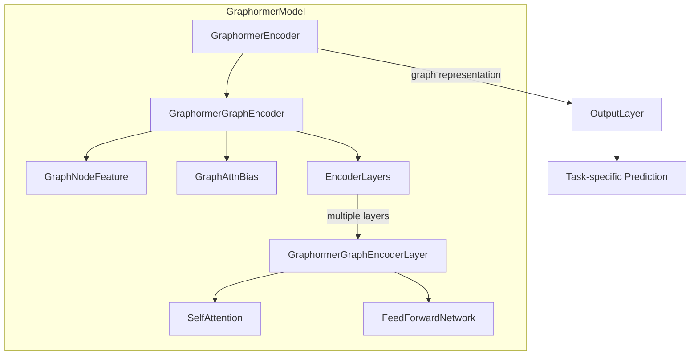

The Graphormer model architecture adapts the transformer architecture for graph-structured data. It consists of:

- **Graphormer Encoder**: The main encoding component
- **Graph Node Feature**: Extracts and processes node features from the input graph
- **Graph Attention Bias**: Calculates attention biases based on graph structure
- **Encoder Layers**: A stack of transformer-like layers adapted for graphs
- **Self-Attention & Feed-Forward Networks**: Core components of the transformer architecture

Sources: [README.md:65-81]()

## Data Flow

The data flow through the Graphormer system during training and inference is illustrated below:

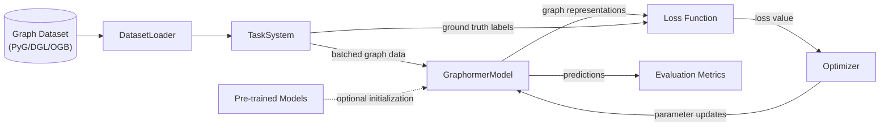

This diagram shows how:
1. Graph data is loaded from supported formats (PyG, DGL, OGB)
2. The Task System processes the data and feeds it to the Graphormer model
3. The model can optionally be initialized with pre-trained weights
4. During training, the model outputs are compared to ground truth labels to compute a loss
5. The optimizer updates model parameters based on the loss
6. During inference, model predictions are evaluated against metrics

Sources: [README.md:13-17]()

## Usage Workflow

The typical workflow for using Graphormer involves installation, training, and evaluation as shown in the sequence diagram below:

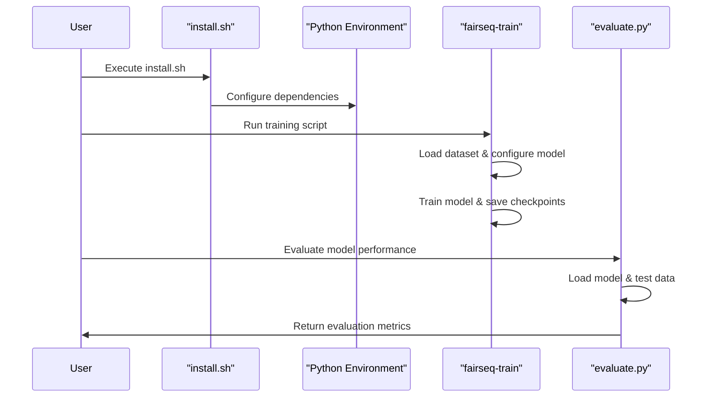

Users typically:
1. Set up the environment using the installation script
2. Train models using fairseq-based training scripts
3. Evaluate model performance using the evaluation scripts

Sources: [README.md:53-59]()

## Available Resources

Graphormer provides several resources to help users get started:

1. **Pre-trained Models**: Models trained on PCQM4M, PCQM4Mv2, and other datasets
2. **Example Scripts**: Command-line examples for common tasks
3. **Documentation**: Comprehensive documentation available online
4. **Benchmarks**: Technical reports describing performance on various datasets

For more information on these resources, see [Examples](https://github.com/microsoft/Graphormer/tree/main/examples) and the project [documentation](https://graphormer.readthedocs.io).

Sources: [README.md:44-50]()

## Conclusion

Graphormer provides a powerful and flexible framework for graph-based deep learning with a focus on molecular modeling tasks. Its modular architecture, support for various data formats, and integration with established libraries make it suitable for both research and practical applications in fields such as material discovery and drug discovery.

To dive deeper into specific components, refer to the following pages:
- [Installation](#2) for setup instructions
- [Core Model Architecture](#3) for details on the model architecture
- [Task System](#4) for information on supported tasks
- [Data System](#5) for data handling capabilities
- [Pre-trained Models](#6) for using pre-trained models
- [Training and Evaluation](#7) for training and evaluation guidance

Sources: [README.md:1-104]()

---

# Page: Key Features

# Key Features

<details>
<summary>Relevant source files</summary>

The following files were used as context for generating this wiki page:

- [README.md](README.md)

</details>


This document outlines the key features and capabilities of the Graphormer framework, a deep learning package designed for molecule modeling tasks. For information about the overall system architecture, see [System Architecture](#1.2).

## Overview of Graphormer

Graphormer is a state-of-the-art graph transformer model that applies the transformer architecture to graph-structured data. Unlike traditional graph neural networks that rely on message passing, Graphormer introduces several innovative structural encoding methods that enable more powerful graph representations, leading to superior performance on various molecular modeling tasks.

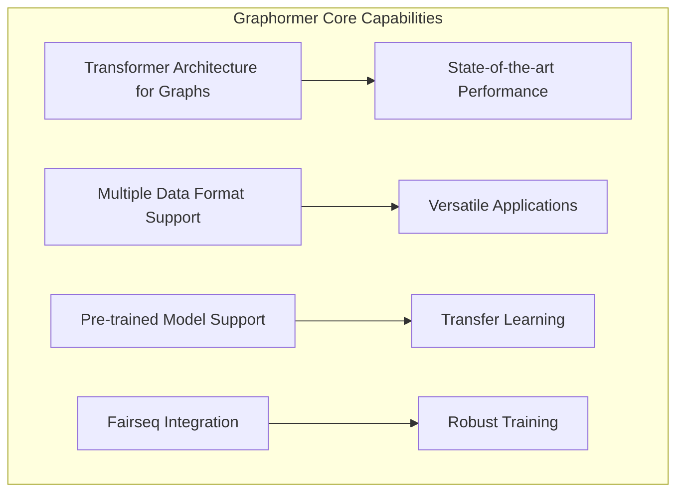

Sources: [README.md:3-4](), [README.md:12-18]()

## Model Architecture Innovations

Graphormer's architecture introduces several key innovations that effectively adapt transformers for graph data:

1. **Centrality Encoding**: Incorporates graph-theoretic properties into node representations
2. **Spatial Encoding**: Captures structural information through shortest path distances between nodes
3. **Edge Encoding**: Represents edge features and connections in the attention bias
4. **Graph-level Global Attention**: Enables information exchange across the entire graph structure

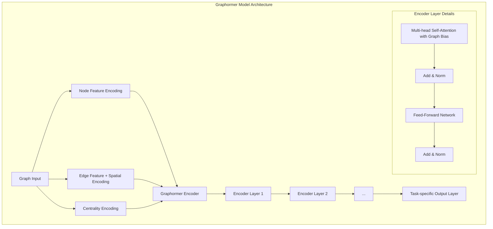

Sources: [README.md:63-82]()

## Flexible Data Integration

Graphormer provides comprehensive support for various graph data formats and libraries, making it highly adaptable to different research and application contexts:

| Supported Format | Description |
|-----------------|-------------|
| PyG | PyTorch Geometric, a library for deep learning on irregular structures |
| DGL | Deep Graph Library, a package for graph neural networks |
| OGB | Open Graph Benchmark, a collection of benchmark datasets and tasks |
| OCP | Open Catalyst Project, focuses on catalyst modeling datasets |

This flexibility allows researchers to easily adapt Graphormer to their existing workflows without significant data transformation overhead.

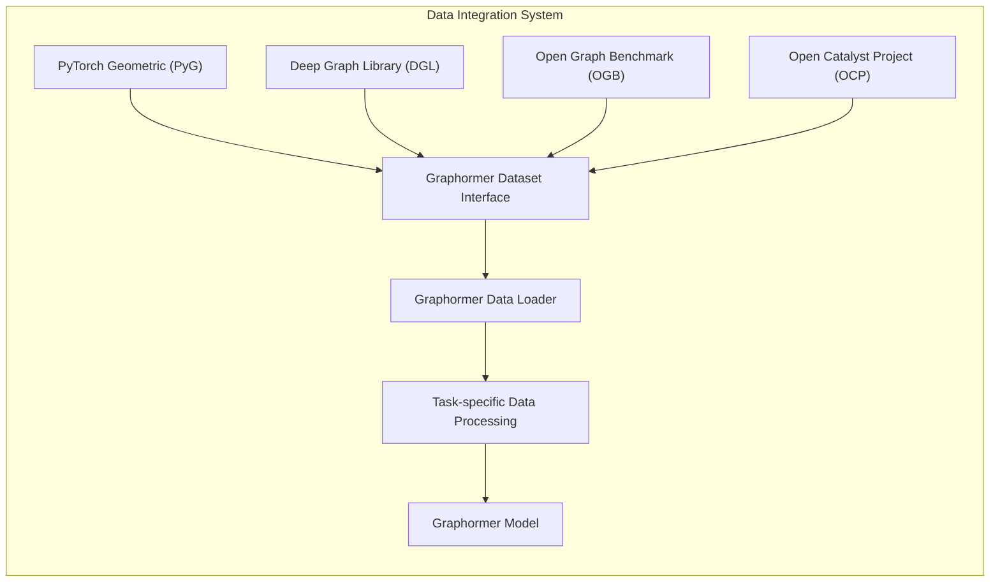

Sources: [README.md:16]()

## Comprehensive Task Support

Graphormer supports a variety of graph-related tasks through dedicated task classes, making it adaptable to different applications in molecular science:

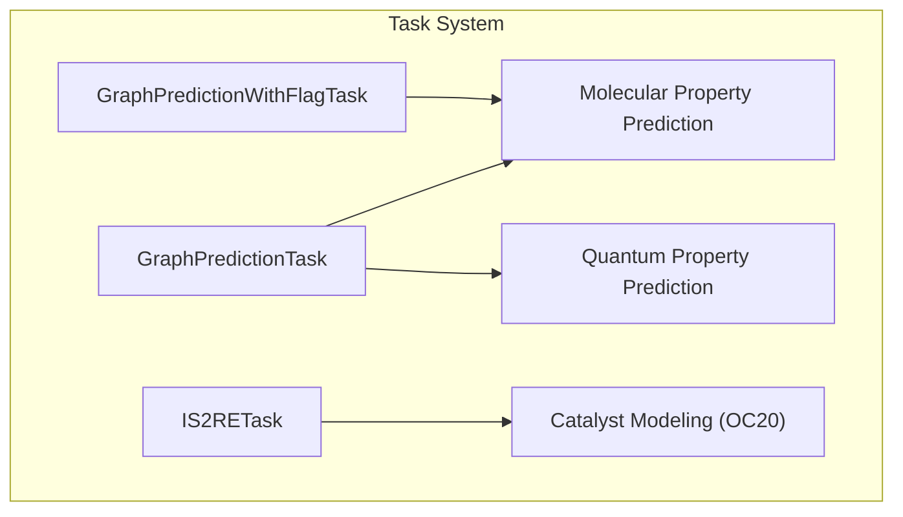

The modular task system allows for:
- Easy adaptation to new molecular modeling tasks
- Customization of loss functions and evaluation metrics
- Task-specific data preprocessing and augmentation

Sources: [README.md:14](), [README.md:29]()

## Pre-trained Models

Graphormer provides pre-trained models on large-scale molecular datasets, enabling transfer learning for downstream tasks:

| Pre-trained Model | Dataset | Description |
|-------------------|---------|-------------|
| PCQM4M | PCQM4M | Pre-trained on quantum chemical calculations dataset |
| PCQM4Mv2 | PCQM4Mv2 | Updated version with more molecular data |
| OC20 | Open Catalyst 2020 | For catalyst modeling applications |

These pre-trained models can significantly accelerate research by providing a strong initialization for various molecular modeling tasks, particularly valuable when working with limited labeled data.

Sources: [README.md:15]()

## Fairseq Integration

Graphormer integrates with the Fairseq framework, leveraging its robust infrastructure for:

- Distributed training across multiple GPUs and nodes
- Mixed precision training for improved computational efficiency
- Checkpointing and model serialization
- Advanced optimization techniques
- Experiment management

This integration provides a solid foundation for scaling up training to large datasets and complex models.

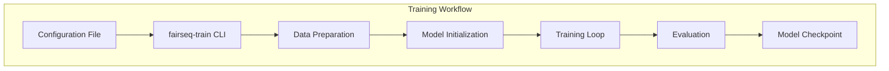

Sources: [README.md:17]()

## Performance Achievements

Graphormer has demonstrated exceptional performance in major competitions and benchmarks:

1. **1st place** in the quantum prediction track of the Open Graph Benchmark Large-Scale Challenge (KDD CUP 2021)
2. **Winner** of the Open Catalyst Challenge for catalyst modeling
3. **State-of-the-art** results on molecular property prediction benchmarks

These achievements validate Graphormer's effectiveness in capturing complex molecular structures and properties, making it a powerful tool for researchers in molecular science and drug discovery.

Sources: [README.md:29](), [README.md:41]()

## Technical Innovations

Graphormer introduces several technical innovations that differentiate it from traditional graph neural networks:

1. **Structural Encoding**: Novel methods to encode graph structure information into the transformer architecture
2. **Attention Mechanism**: Graph-specific attention bias that captures the connectivity patterns
3. **Scalability**: Efficient implementation that scales to large molecular graphs
4. **Generalizability**: Strong performance across diverse molecular datasets and tasks

These innovations address the limitations of previous approaches and establish a new paradigm for graph representation learning.

Sources: [README.md:63-82]()

---

# Page: System Architecture

# System Architecture

<details>
<summary>Relevant source files</summary>

The following files were used as context for generating this wiki page:

- [README.md](README.md)
- [examples/customized_dataset/customized_dataset.py](examples/customized_dataset/customized_dataset.py)
- [graphormer/data/dataset.py](graphormer/data/dataset.py)
- [graphormer/models/graphormer.py](graphormer/models/graphormer.py)
- [graphormer/tasks/graph_prediction.py](graphormer/tasks/graph_prediction.py)
- [graphormer/tasks/is2re.py](graphormer/tasks/is2re.py)

</details>


This document provides a comprehensive overview of the Graphormer system architecture, describing the main components, their interactions, and how data flows through the system. It explains the technical foundation of how Graphormer implements graph transformer models for molecular modeling tasks.

For information about installation procedures, see [Installation](#2), and for details about the core model design and theory, see [Core Model Architecture](#3).

## High-Level Architecture Overview

Graphormer is structured as a modular system with several key subsystems that work together to implement graph transformer functionality for molecular modeling tasks.

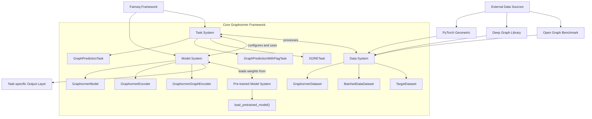

Sources: [graphormer/models/graphormer.py:33-152](), [graphormer/tasks/graph_prediction.py:133-221](), [graphormer/data/dataset.py:62-97]()

## Model System

The Model System is the core of the Graphormer architecture, implementing the graph transformer model that processes graph-structured data.

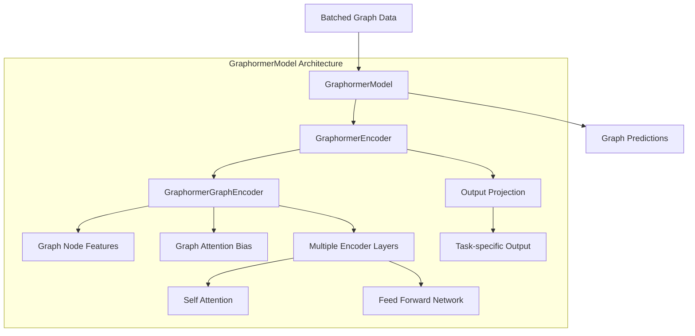

Sources: [graphormer/models/graphormer.py:33-152]()

The Model System consists of the following key components:

1. **GraphormerModel**: The top-level model class that inherits from `FairseqEncoderModel`. It serves as the entry point for model operations and handles initialization and loading of pre-trained models.

2. **GraphormerEncoder**: Encapsulates the encoding process and manages the conversion of graph inputs to embeddings and predictions.

3. **GraphormerGraphEncoder**: Implements the core graph transformer architecture, including specialized components for processing graph structure information.

The model includes several important architectural features:

| Feature | Description | Configuration Parameter |
|---------|-------------|-------------------------|
| Encoder Layers | Transformer encoder layers adapted for graphs | `encoder_layers` |
| Attention Heads | Multi-head self-attention mechanism | `encoder_attention_heads` |
| Embedding Dimension | Size of node embeddings | `encoder_embed_dim` |
| FFN Dimension | Feed-forward network dimension | `encoder_ffn_embed_dim` |
| Pre-LayerNorm | Apply LayerNorm before self-attention | `pre_layernorm` |
| Graph-specific Components | Special encodings for graph structure | `edge_type`, `multi_hop_max_dist` |

Sources: [graphormer/models/graphormer.py:155-252]()

## Task System

The Task System defines how Graphormer handles different graph-related machine learning tasks, providing task-specific data handling, training procedures, and evaluation methods.

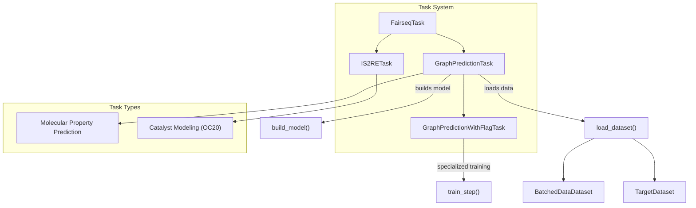

Sources: [graphormer/tasks/graph_prediction.py:133-221](), [graphormer/tasks/graph_prediction.py:271-362](), [graphormer/tasks/is2re.py:240-302]()

The Task System includes the following main task implementations:

1. **GraphPredictionTask**: The base task for graph property prediction (classification or regression), which handles loading datasets, building models, and managing the training/evaluation workflow.

2. **GraphPredictionWithFlagTask**: An extended version of the graph prediction task that implements the FREE Large-scale Adversarial (FLAG) augmentation technique for improved training.

3. **IS2RETask**: A specialized task for the Initial Structure to Relaxed Energy prediction task in the Open Catalyst 2020 (OC20) dataset, which predicts material properties for catalyst discovery.

Key task configurations:

| Configuration | Description | Default |
|---------------|-------------|---------|
| `dataset_name` | Name of the dataset to use | "pcqm4m" |
| `dataset_source` | Source of graph dataset (pyg, dgl, ogb, smiles) | "pyg" |
| `max_nodes` | Maximum number of nodes per graph | 128 |
| `multi_hop_max_dist` | Maximum distance for multi-hop edges | 5 |
| `spatial_pos_max` | Maximum spatial position | 1024 |

Sources: [graphormer/tasks/graph_prediction.py:43-130]()

## Data System

The Data System handles loading, processing, and batching of graph data from various sources for use by the Graphormer model.

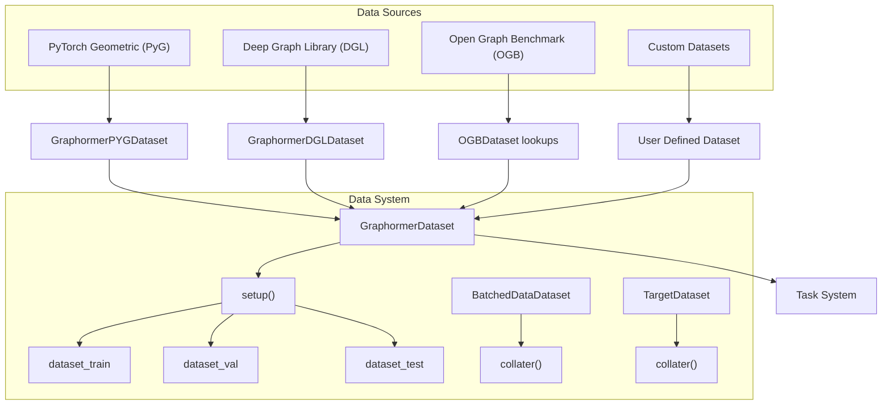

Sources: [graphormer/data/dataset.py:62-97](), [graphormer/data/dataset.py:20-43](), [examples/customized_dataset/customized_dataset.py:6-24]()

The Data System consists of these main components:

1. **GraphormerDataset**: The central class that manages dataset loading, processing, and splitting into train/validation/test sets. It supports multiple data sources including PyG, DGL, and OGB.

2. **BatchedDataDataset**: Handles batching of graph data and implements the collation function to create properly formatted batches for the model.

3. **TargetDataset**: Handles the target labels/values for supervised learning tasks.

4. **EpochShuffleDataset**: A wrapper that provides epoch-level shuffling of datasets.

The Data System supports customized datasets through a registration mechanism:

```python
@register_dataset("customized_qm9_dataset")
def create_customized_dataset():
    dataset = QM9(label_keys=["mu"])
    # Set up train/valid/test splits
    # ...
    return {
        "dataset": dataset,
        "train_idx": train_idx,
        "valid_idx": valid_idx,
        "test_idx": test_idx,
        "source": "dgl"
    }
```

Sources: [examples/customized_dataset/customized_dataset.py:6-24]()

## Pre-trained Model System

Graphormer supports pre-trained models through a simple loading mechanism, allowing transfer learning from models trained on large datasets.

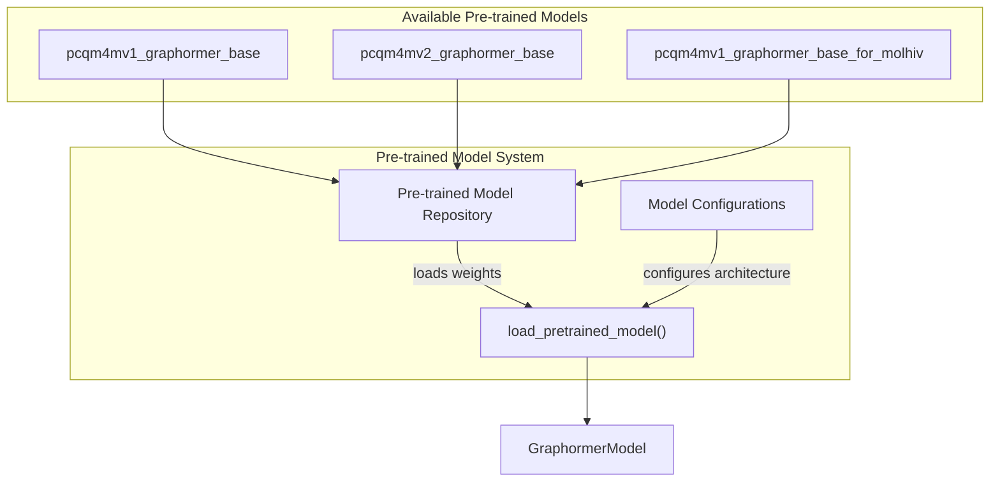

Sources: [graphormer/models/graphormer.py:41-45](), [graphormer/models/graphormer.py:281-305]()

The pre-trained model system allows users to:

1. Specify a pre-trained model by name in the configuration
2. Optionally load or omit the output layer parameters (useful for transfer learning)
3. Access models pre-trained on large molecular datasets like PCQM4M

The system configures the model architecture automatically based on the pre-trained model specification:

```python
if args.pretrained_model_name != "none":
    self.load_state_dict(load_pretrained_model(args.pretrained_model_name))
    if not args.load_pretrained_model_output_layer:
        self.encoder.reset_output_layer_parameters()
```

Sources: [graphormer/models/graphormer.py:41-45]()

## Data Flow During Training and Inference

The following diagram illustrates how data flows through the Graphormer system during training and inference:

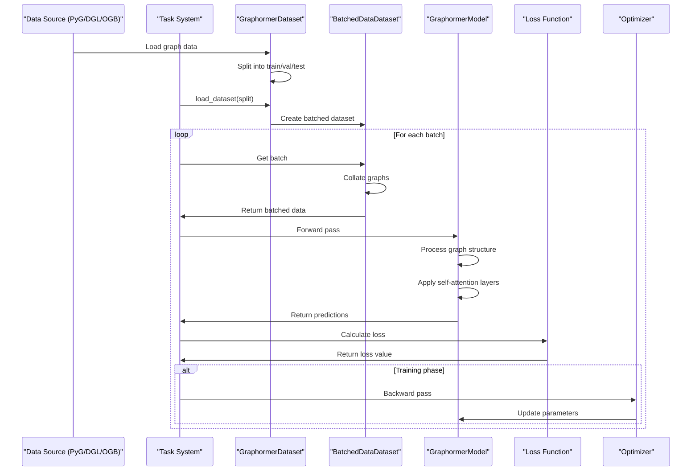

Sources: [graphormer/tasks/graph_prediction.py:181-221](), [graphormer/models/graphormer.py:151-152]()

During training, the system:

1. Loads data from the specified source (PyG, DGL, OGB) through the GraphormerDataset
2. The task system manages batching and feeding data to the model
3. The model processes the graph data through its transformer-based architecture
4. Loss is calculated and backpropagation updates the model parameters

During inference, the same flow is followed except for the backpropagation step.

## Comparison of Model Architectures

Graphormer provides several model architectures with different parameter sizes:

| Architecture | Embed Dim | Layers | Attention Heads | FFN Dim | Parameters | Use Case |
|--------------|-----------|--------|----------------|---------|------------|----------|
| graphormer_slim | 80 | 12 | 8 | 80 | ~0.5M | Resource-constrained environments |
| graphormer_base | 768 | 12 | 32 | 768 | ~47M | Standard usage |
| graphormer_large | 1024 | 24 | 32 | 1024 | ~130M | High-performance requirements |

Sources: [graphormer/models/graphormer.py:255-354]()

## Integration with External Libraries

Graphormer is built on top of Fairseq, a sequence modeling toolkit, and extends it for graph-structured data. It integrates with several external libraries:

1. **Fairseq**: Provides the core training infrastructure, including task management, model building, and distributed training capabilities.

2. **PyTorch Geometric (PyG)**: A library for deep learning on irregular data structures like graphs.

3. **Deep Graph Library (DGL)**: A framework for building graph neural networks.

4. **Open Graph Benchmark (OGB)**: A collection of benchmark datasets for graph-related machine learning tasks.

Graphormer provides adapters for each of these data sources, allowing users to leverage datasets from any of these libraries with minimal effort.

Sources: [graphormer/data/dataset.py:62-97]()

---

# Page: Installation

# Installation

<details>
<summary>Relevant source files</summary>

The following files were used as context for generating this wiki page:

- [docs/Installation-Guide.rst](docs/Installation-Guide.rst)
- [install.sh](install.sh)

</details>


This document provides detailed instructions for setting up the Graphormer environment and installing all required dependencies. Graphormer requires specific package versions to ensure compatibility between components.

## System Requirements

- Linux operating system (currently the only supported platform)
- Python 3.9
- CUDA-capable GPU with CUDA 11.1 support (for optimal performance)

For information about using Graphormer after installation, see [Training and Evaluation](#7).

## Installation Workflow

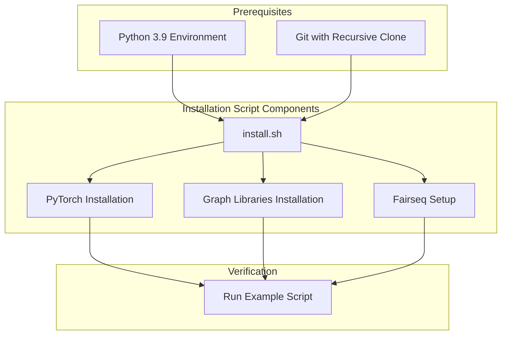

Sources: [install.sh:1-23](), [docs/Installation-Guide.rst:1-26]()

## Step-by-Step Installation

### 1. Set Up Python Environment

Creating a dedicated virtual environment is strongly recommended to avoid package conflicts:

```bash
conda create -n graphormer python=3.9
conda activate graphormer
```

Sources: [docs/Installation-Guide.rst:10-17]()

### 2. Clone the Repository

Clone the Graphormer repository with the `--recursive` flag to include the fairseq submodule:

```bash
git clone --recursive https://github.com/microsoft/Graphormer.git
cd Graphormer
```

Sources: [docs/Installation-Guide.rst:19-25]()

### 3. Run the Installation Script

Execute the installation script to install all dependencies:

```bash
bash install.sh
```

Sources: [docs/Installation-Guide.rst:19-25]()

## Dependency Structure

The following diagram illustrates how the dependencies installed by `install.sh` relate to Graphormer's core components:

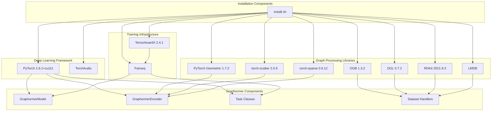

Sources: [install.sh:6-16]()

## Detailed Dependency Explanation

The `install.sh` script installs the following key dependencies:

| Component | Version | Purpose |
|-----------|---------|---------|
| PyTorch | 1.9.1+cu111 | Core deep learning framework |
| TorchAudio | - | Prevents version conflicts during fairseq installation |
| torch-scatter | 2.0.9 | Efficient scatter operations for graph data |
| torch-sparse | 0.6.12 | Sparse tensor operations for graph data |
| PyTorch Geometric | 1.7.2 | Graph neural network library |
| TensorboardX | 2.4.1 | Training visualization and logging |
| OGB | 1.3.2 | Open Graph Benchmark datasets |
| RDKit | 2021.9.3 | Molecular data processing |
| DGL | 0.7.2 | Deep Graph Library for alternative graph representations |
| LMDB | - | Lightning Memory-Mapped Database for efficient data storage |
| Fairseq | - | Sequence modeling toolkit (installed from submodule) |

Sources: [install.sh:6-16]()

## Installation Process Details

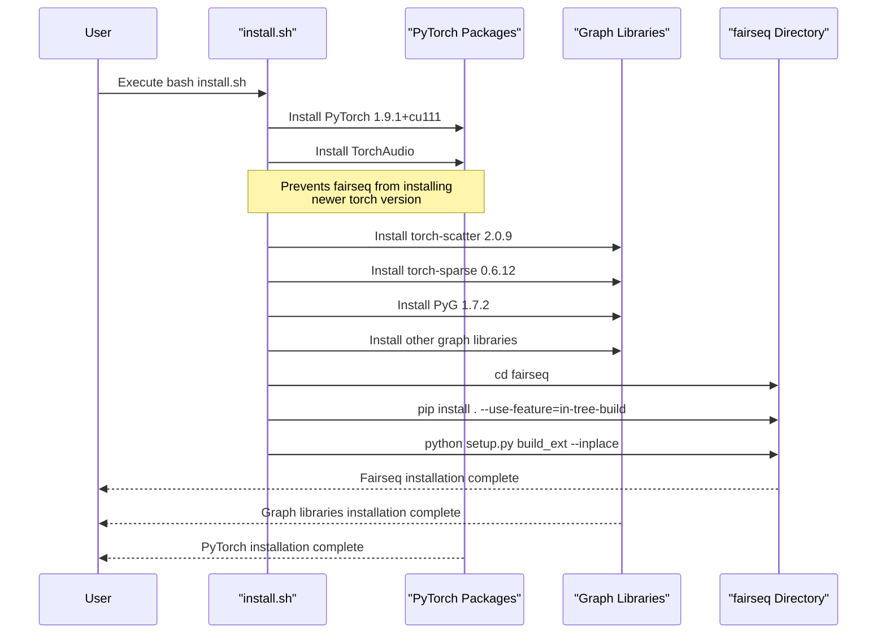

Sources: [install.sh:7-22]()

## Troubleshooting

### Missing Fairseq Submodule
If the fairseq directory is empty or incomplete, initialize and update the submodule:
```bash
git submodule update --init --recursive
```

Sources: [install.sh:19-20]()

### CUDA Version Conflicts
The installation script specifies PyTorch with CUDA 11.1 support. If your system uses a different CUDA version, you may need to modify the installation script to use compatible PyTorch wheels.

### Dependency Version Conflicts
If you encounter conflicts with existing packages, create a fresh virtual environment and reinstall Graphormer.

## Verification

After installation, verify that Graphormer is correctly installed by running one of the example scripts from the repository. For instance, to run the PCQM4Mv2 property prediction example:

```bash
cd examples/property_prediction/
bash pcqv2.sh
```

A successful run confirms that the installation is complete and the system is functioning properly.

---

# Page: Core Model Architecture

# Core Model Architecture

<details>
<summary>Relevant source files</summary>

The following files were used as context for generating this wiki page:

- [graphormer/models/graphormer.py](graphormer/models/graphormer.py)

</details>


This document describes the core architectural components of Graphormer, a graph neural network model that adapts the Transformer architecture for graph-structured data. For information about specific implementations of the graph encoder, see [Graph Encoder](#3.1). For details on the task system that uses this architecture, see [Task System](#4).

## Purpose and Overview

Graphormer extends the Transformer architecture to effectively process graph-structured data by introducing specialized graph-aware attention mechanisms and structural encodings. The model is designed to capture both node features and graph topology through its graph-aware self-attention mechanism.

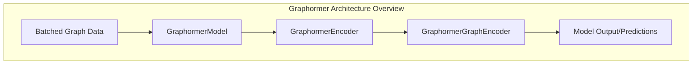

Sources: [graphormer/models/graphormer.py:33-152](). [graphormer/models/graphormer.py:155-252]()

## Main Components

The Graphormer architecture consists of three primary nested components that work together to process graph data:

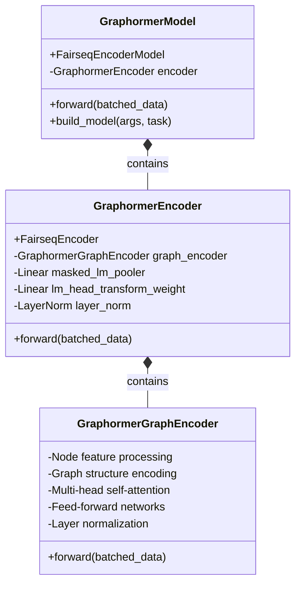

Sources: [graphormer/models/graphormer.py:33-152](). [graphormer/models/graphormer.py:155-252]()

### GraphormerModel

`GraphormerModel` is the top-level model class that extends `FairseqEncoderModel`. It serves as the main entry point for the model and is responsible for:

- Initializing the encoder component
- Applying parameter initialization if specified
- Loading pre-trained models when requested
- Forwarding input data to the encoder
- Defining model configuration options through command-line arguments

The model is registered using Fairseq's model registry system with the name "graphormer" to make it available for training and inference.

Sources: [graphormer/models/graphormer.py:33-152]()

### GraphormerEncoder

`GraphormerEncoder` extends `FairseqEncoder` and serves as an intermediate layer between the main model class and the graph-specific encoder. Its responsibilities include:

- Initializing the graph encoder with appropriate parameters
- Processing the encoder outputs through a transformation pipeline
- Applying layer normalization and activation functions
- Projecting embeddings to output dimensions for prediction tasks
- Managing output layer parameters

The encoder also handles the option to share input and output embeddings, which can reduce model parameters.

Sources: [graphormer/models/graphormer.py:155-252]()

### GraphormerGraphEncoder

This is the core component that implements the graph-specific processing. It's imported from the modules directory and is responsible for:

- Processing node and edge features
- Computing attention biases based on graph structure
- Implementing the multi-head self-attention mechanism
- Running the feed-forward networks in each encoder layer
- Managing the encoder layer stack

For more detailed information on this component, see [Graph Encoder](#3.1).

## Data Flow

The following sequence diagram illustrates how data flows through the Graphormer model during a forward pass:

```mermaid
sequenceDiagram
    participant Input as "Batched Graph Data"
    participant Model as "GraphormerModel"
    participant Encoder as "GraphormerEncoder"
    participant GraphEncoder as "GraphormerGraphEncoder"
    participant Output as "Model Output"
    
    Input->>Model: forward(batched_data)
    Model->>Encoder: forward(batched_data)
    Encoder->>GraphEncoder: forward(batched_data)
    GraphEncoder-->>Encoder: inner_states, graph_rep
    Note over Encoder: Extract last layer states
    Encoder->>Encoder: Apply layer norm and activation
    Encoder->>Encoder: Apply output projection
    Encoder-->>Model: Processed embeddings
    Model-->>Output: Final predictions
```

Sources: [graphormer/models/graphormer.py:151-152](). [graphormer/models/graphormer.py:217-241]()

## Model Configurations

Graphormer comes with four pre-configured architectures that vary in size and capacity:

| Architecture | Embed Dim | Layers | Attention Heads | FFN Dim | Description |
|--------------|-----------|--------|-----------------|---------|-------------|
| Base | 1024 | 6 | 8 | 4096 | Default configuration with moderate capacity |
| Graphormer Base | 768 | 12 | 32 | 768 | Used for pre-training on PCQM4Mv1/v2 datasets |
| Graphormer Slim | 80 | 12 | 8 | 80 | Lightweight model with fewer parameters |
| Graphormer Large | 1024 | 24 | 32 | 1024 | Highest capacity with more layers and parameters |

The model architecture can be selected and configured through command-line arguments, allowing customization of:
- Dropout rates (general, attention, activation)
- Embedding dimensions
- Number of layers and attention heads
- Activation functions
- Normalization strategies (pre-layernorm vs. post-layernorm)

Sources: [graphormer/models/graphormer.py:255-354]()

## Initialization and Parameter Configuration

Graphormer provides several options for model initialization:

1. **Custom Initialization**: When `apply_graphormer_init` is set to true, the model applies specialized parameter initialization through the `init_graphormer_params` function.

2. **Pre-trained Models**: The model can load weights from pre-trained checkpoints through the `pretrained_model_name` parameter.

3. **Output Layer Resetting**: When loading pre-trained models, the option `load_pretrained_model_output_layer` controls whether to keep or reset the output layer parameters, which is useful for transfer learning to different tasks.

The base architecture defines sensible defaults for all parameters, which can be customized through command-line arguments defined in the `add_args` method.

Sources: [graphormer/models/graphormer.py:39-45](). [graphormer/models/graphormer.py:47-132]()

## Detailed Architecture Diagram

The following diagram shows a more detailed view of the internal components and their connections:

```mermaid
graph TD
    subgraph "GraphormerModel"
        Input["Batched Graph Data"] --> Encoder["GraphormerEncoder"]
        
        subgraph "GraphormerEncoder"
            GraphEncoder["GraphormerGraphEncoder"]
            GraphEncoder --> InnerStates["Inner States"]
            InnerStates --> LMHead["LM Head Transform"]
            LMHead --> Activation["Activation Function"]
            Activation --> LayerNorm["Layer Normalization"]
            LayerNorm --> Projection["Output Projection"]
        end
        
        subgraph "GraphormerGraphEncoder"
            NodeFeatures["Node Feature Processing"]
            AttnBias["Graph Attention Bias Calculation"]
            EncoderStack["Encoder Layer Stack"]
            
            NodeFeatures --> EncoderStack
            AttnBias --> EncoderStack
            
            subgraph "EncoderLayer"
                PreLN1["Pre LayerNorm (optional)"]
                SelfAttn["Multi-Head Self-Attention"]
                PostLN1["Post LayerNorm"]
                PreLN2["Pre LayerNorm (optional)"]
                FFN["Feed-Forward Network"]
                PostLN2["Post LayerNorm"]
                
                PreLN1 --> SelfAttn
                SelfAttn --> PostLN1
                PostLN1 --> PreLN2
                PreLN2 --> FFN
                FFN --> PostLN2
            end
        end
        
        Projection --> Output["Model Output"]
    end
```

Sources: [graphormer/models/graphormer.py:33-152](). [graphormer/models/graphormer.py:155-252]()

## Key Architectural Features

1. **Graph-aware Self-attention**: Extends vanilla transformer attention by incorporating graph structural information into the attention mechanism.

2. **Structural Encodings**: Captures graph topology through specialized positional encodings including degree features and spatial information.

3. **Pre/Post LayerNorm Options**: Provides flexibility in applying layer normalization either before or after self-attention and feed-forward networks, which can affect training stability and performance.

4. **Flexible Input/Output Embedding Sharing**: Supports optional sharing of input and output embeddings to reduce model parameters.

5. **Multi-scale Architecture Variants**: Offers several model sizes (base, slim, large) to balance between computational efficiency and model capacity.

6. **Pre-training Integration**: Built-in support for loading pre-trained models with options to reset the output layer for transfer learning.

Sources: [graphormer/models/graphormer.py:39-45](). [graphormer/models/graphormer.py:124-132](). [graphormer/models/graphormer.py:255-354]()

---

# Page: Graph Encoder

# Graph Encoder

<details>
<summary>Relevant source files</summary>

The following files were used as context for generating this wiki page:

- [graphormer/models/graphormer.py](graphormer/models/graphormer.py)
- [graphormer/modules/graphormer_graph_encoder.py](graphormer/modules/graphormer_graph_encoder.py)

</details>


The Graph Encoder is a core component of the Graphormer architecture responsible for transforming graph-structured data into vector representations that can be used for downstream tasks such as molecular property prediction. It adapts the Transformer architecture to handle graph structures by incorporating graph-specific inductive biases.

For information about the overall Graphormer model architecture, see [Core Model Architecture](#3), and for details about specific encoder layers, see [Encoder Layers](#3.2).

## Architecture Overview

The Graph Encoder consists of two main components:
1. **GraphormerEncoder** - The high-level encoder that wraps the graph encoder implementation
2. **GraphormerGraphEncoder** - The core implementation that processes graph data

```mermaid
flowchart TD
    subgraph "GraphormerEncoder"
        GE["GraphormerEncoder"]
        GGE["GraphormerGraphEncoder"]
        MLPPooler["Masked LM Pooler"]
        HeadTransform["LM Head Transform"]
        OutputProj["Output Projection"]
        
        GE --> GGE
        GE --> MLPPooler
        GE --> HeadTransform
        GE --> OutputProj
    end
    
    subgraph "GraphormerGraphEncoder"
        NodeFeature["GraphNodeFeature"]
        AttnBias["GraphAttnBias"]
        EncoderLayers["Encoder Layers Stack"]
        
        GGE --> NodeFeature
        GGE --> AttnBias
        GGE --> EncoderLayers
    end
    
    BatchedData["Batched Graph Data"] --> GE
    GE --> Representations["Graph Representations"]
```

Sources: [graphormer/models/graphormer.py:155-252](), [graphormer/modules/graphormer_graph_encoder.py:45-263]()

## GraphormerEncoder

The `GraphormerEncoder` class serves as a high-level wrapper for the graph encoding process. It initializes the `GraphormerGraphEncoder` with parameters configured through the model architecture and handles additional processing for the encoded representations.

Key responsibilities include:
- Initializing and configuring the `GraphormerGraphEncoder`
- Managing the output layer for prediction tasks
- Processing the encoded representations for downstream tasks

```mermaid
classDiagram
    class GraphormerEncoder {
        +graph_encoder: GraphormerGraphEncoder
        +masked_lm_pooler: nn.Linear
        +lm_head_transform_weight: nn.Linear
        +layer_norm: LayerNorm
        +embed_out: nn.Linear
        +forward(batched_data, perturb, masked_tokens)
        +reset_output_layer_parameters()
    }
    
    GraphormerEncoder --> GraphormerGraphEncoder: contains
```

Sources: [graphormer/models/graphormer.py:155-252]()

## GraphormerGraphEncoder

The `GraphormerGraphEncoder` is the core implementation of the graph encoding process. It processes graph-structured data by:
1. Extracting node features using `GraphNodeFeature`
2. Computing attention biases based on graph structure using `GraphAttnBias`
3. Processing these through a stack of `GraphormerGraphEncoderLayer`s

### Initialization and Parameters

The `GraphormerGraphEncoder` is initialized with parameters that define the model's capacity and behavior:

| Parameter              | Description                                           |
|------------------------|-------------------------------------------------------|
| num_atoms              | Size of atom type vocabulary                          |
| num_in_degree          | Maximum in-degree to consider                         |
| num_out_degree         | Maximum out-degree to consider                        |
| num_edges              | Size of edge type vocabulary                          |
| num_spatial            | Number of spatial embeddings                          |
| num_edge_dis           | Number of edge distance embeddings                    |
| edge_type              | Type of edge features to use                          |
| multi_hop_max_dist     | Maximum distance for multi-hop attention bias         |
| num_encoder_layers     | Number of transformer layers                          |
| embedding_dim          | Size of embeddings                                    |
| ffn_embedding_dim      | Size of feed-forward network                          |
| num_attention_heads    | Number of attention heads                             |
| dropout                | Dropout probability                                   |
| attention_dropout      | Attention dropout probability                         |
| activation_dropout     | Activation dropout probability                        |
| pre_layernorm          | Whether to apply layer norm before attention          |

Sources: [graphormer/modules/graphormer_graph_encoder.py:45-163]()

### Forward Pass

The forward pass through the `GraphormerGraphEncoder` processes batched graph data as follows:

```mermaid
flowchart TD
    Input["Batched Graph Data"] --> PaddingMask["Compute Padding Mask"]
    Input --> NodeFeature["Extract Node Features"]
    Input --> AttnBias["Compute Attention Bias"]
    
    NodeFeature --> AddPerturb["Add Perturbation (if provided)"]
    AddPerturb --> Scale["Apply Embedding Scale"]
    Scale --> Dropout["Apply Dropout"]
    
    Dropout --> TransposeDim["Transpose Dimensions"]
    TransposeDim --> EncoderLayers["Process through Encoder Layers"]
    
    PaddingMask --> EncoderLayers
    AttnBias --> EncoderLayers
    
    EncoderLayers --> ExtractGraphRep["Extract Graph Representation"]
    EncoderLayers --> InnerStates["Inner States"]
    
    ExtractGraphRep --> Output["Graph Representation"]
    InnerStates --> AllStates["All Encoded States"]
```

Key steps in the forward pass:
1. Compute padding mask for multi-head attention
2. Extract node features using `GraphNodeFeature`
3. Compute attention biases using `GraphAttnBias`
4. Apply embedding scale, quantization noise, and layer normalization if configured
5. Process through the stack of encoder layers
6. Extract the graph-level representation and return it along with all encoded states

Sources: [graphormer/modules/graphormer_graph_encoder.py:192-263]()

## Key Components

### GraphNodeFeature

The `GraphNodeFeature` component processes node features such as atom types, in-degree, and out-degree. It embeds these features into vectors of the model's hidden dimension, creating the initial node representations that will be processed by the encoder layers.

### GraphAttnBias

The `GraphAttnBias` component computes attention biases based on graph structure. It uses information such as:
- Multi-hop distances between nodes
- Spatial positions of nodes
- Edge types and features

These biases are added to the attention scores in the self-attention mechanism, allowing the model to incorporate graph structural information into the attention computation.

### Encoder Layers

The `GraphormerGraphEncoder` contains a stack of `GraphormerGraphEncoderLayer`s, each consisting of:
- A multi-head self-attention mechanism
- A feed-forward network
- Layer normalization components

Each layer processes the output of the previous layer, gradually refining the node representations. The structure and function of these layers are detailed in [Encoder Layers](#3.2).

## Usage in the Graphormer Model

The Graph Encoder is used by the `GraphormerModel` class, which is the main entry point for the Graphormer architecture. The model initializes the encoder and uses it to process graph data, then passes the encoded representations to task-specific heads for prediction.

```mermaid
classDiagram
    class GraphormerModel {
        +encoder: GraphormerEncoder
        +forward(batched_data)
    }
    
    class GraphormerEncoder {
        +graph_encoder: GraphormerGraphEncoder
        +forward(batched_data, perturb, masked_tokens)
    }
    
    class GraphormerGraphEncoder {
        +graph_node_feature: GraphNodeFeature
        +graph_attn_bias: GraphAttnBias
        +layers: ModuleList[GraphormerGraphEncoderLayer]
        +forward(batched_data, perturb, last_state_only)
    }
    
    GraphormerModel --> GraphormerEncoder: contains
    GraphormerEncoder --> GraphormerGraphEncoder: contains
```

Sources: [graphormer/models/graphormer.py:33-152](), [graphormer/models/graphormer.py:155-252](), [graphormer/modules/graphormer_graph_encoder.py:45-263]()

## Configuration Examples

The Graphormer architecture provides several predefined configurations for the Graph Encoder, such as:

| Configuration | Embedding Dim | Encoder Layers | Attention Heads | FFN Dim | Description |
|---------------|---------------|----------------|-----------------|---------|-------------|
| Base          | 768           | 12             | 32              | 768     | Standard configuration for most tasks |
| Slim          | 80            | 12             | 8               | 80      | Lightweight configuration for resource-constrained environments |
| Large         | 1024          | 24             | 32              | 1024    | High-capacity configuration for complex tasks |

These configurations can be selected using the appropriate model architecture name when initializing the model.

Sources: [graphormer/models/graphormer.py:279-354]()

---

# Page: Encoder Layers

# Encoder Layers

<details>
<summary>Relevant source files</summary>

The following files were used as context for generating this wiki page:

- [graphormer/modules/graphormer_graph_encoder.py](graphormer/modules/graphormer_graph_encoder.py)
- [graphormer/modules/graphormer_graph_encoder_layer.py](graphormer/modules/graphormer_graph_encoder_layer.py)

</details>


Encoder Layers form the core computational component of the Graphormer model. They process and transform graph representations through a series of self-attention and feed-forward neural network operations. This document explains the structure and functionality of encoder layers in the Graphormer architecture. For information about the overall Graph Encoder, see [Graph Encoder](#3.1).

## Structure and Components

The Encoder Layers in Graphormer follow a transformer-like architecture but are adapted specifically for graph data. The layers are stacked sequentially to form a deep neural network where each layer refines the graph representations.

```mermaid
flowchart TD
    subgraph "GraphormerGraphEncoder"
        GL1["Layer 1"] --> GL2["Layer 2"]
        GL2 --> GL3["Layer 3"]
        GL3 --> GLN["..."]
        GLN --> GLF["Layer N"]
    end
    
    Input["Graph Representation\n(Node Features + Attention Bias)"] --> GL1
    GLF --> Output["Final Graph Representation"]
    
    classDef layer fill:white,stroke:#333,stroke-width:1px;
    class GL1,GL2,GL3,GLN,GLF layer;
```

Sources: [graphormer/modules/graphormer_graph_encoder.py:128-147]()

### Single Encoder Layer Architecture

Each encoder layer in Graphormer is implemented by the `GraphormerGraphEncoderLayer` class and contains two main processing blocks: a self-attention mechanism and a feed-forward network, each followed by residual connections and normalization layers.

```mermaid
flowchart TD
    Input["Input Tensor (T×B×C)"] --> PreLN1{"PreLayerNorm?"}
    PreLN1 -->|"Yes"| LN1["Self-Attention LayerNorm"]
    PreLN1 -->|"No"| SA["Self Attention"]
    
    LN1 --> SA
    SA --> D1["Dropout"]
    D1 --> Add1(("+"))
    Input --> Add1
    Add1 --> PostLN1{"PreLayerNorm?"}
    
    PostLN1 -->|"No"| LN2["Self-Attention LayerNorm"]
    PostLN1 -->|"Yes"| PreLN2{"PreLayerNorm?"}
    
    LN2 --> PreLN2
    
    PreLN2 -->|"Yes"| LN3["Feed-Forward LayerNorm"]
    PreLN2 -->|"No"| FC1["FC1 (Linear)"]
    
    LN3 --> FC1
    FC1 --> Act["Activation Function"]
    Act --> D2["Activation Dropout"]
    D2 --> FC2["FC2 (Linear)"]
    FC2 --> D3["Dropout"]
    D3 --> Add2(("+"))
    Add1 --> Add2
    
    Add2 --> PostLN2{"PreLayerNorm?"}
    PostLN2 -->|"No"| LN4["Feed-Forward LayerNorm"]
    PostLN2 -->|"Yes"| Output
    
    LN4 --> Output["Output Tensor (T×B×C)"]
```

Sources: [graphormer/modules/graphormer_graph_encoder_layer.py:21-150]()

## Key Components

### Self-Attention Mechanism

The self-attention module processes input graph representations by determining the relationships between different nodes in the graph. It uses multi-head attention to capture various types of relationships.

- **Implementation**: Uses `MultiheadAttention` class
- **Key Features**: 
  - Takes graph-specific attention biases into account
  - Handles padding masks for variable-sized graphs
  - Supports multiple attention heads for learning different relationship patterns

```mermaid
flowchart LR
    X["Input X\n(T×B×C)"] --> Q["Query\nProjection"]
    X --> K["Key\nProjection"]
    X --> V["Value\nProjection"]
    
    Q --> QS["Reshape to\nB×H×T×D"]
    K --> KS["Reshape to\nB×H×T×D"]
    V --> VS["Reshape to\nB×H×T×D"]
    
    QS & KS --> Scores["Attention\nScores"]
    AttnBias["Graph Attention\nBias"] --> Scores
    
    Scores --> Softmax["Softmax"]
    
    Softmax & VS --> Weighted["Weighted\nValues"]
    
    Weighted --> Concat["Concatenate\nHeads"]
    
    Concat --> OutProj["Output\nProjection"]
    
    OutProj --> Out["Output\n(T×B×C)"]
```

Sources: [graphormer/modules/graphormer_graph_encoder_layer.py:93-109]() [graphormer/modules/graphormer_graph_encoder_layer.py:126-134]()

### Feed-Forward Network

The feed-forward network acts as a position-wise transformation that processes each node representation independently.

- **Structure**: Two linear transformations with an activation function in between
- **Process Flow**:
  1. Input → First linear layer (`fc1`) → Activation function
  2. Activation function output → Second linear layer (`fc2`) → Output

Sources: [graphormer/modules/graphormer_graph_encoder_layer.py:71-82]() [graphormer/modules/graphormer_graph_encoder_layer.py:143-146]()

### Normalization and Residual Connections

Normalization and residual connections are essential for stable and effective training of deep neural networks:

- **Layer Normalization**: Applied either before (pre-layernorm) or after (post-layernorm) the self-attention and feed-forward modules
- **Residual Connections**: Add the input to the output of each sub-module to help with gradient flow

Sources: [graphormer/modules/graphormer_graph_encoder_layer.py:123-149]()

## Initialization and Configuration

The encoder layers are created and stacked in the `GraphormerGraphEncoder` class. The number of layers and their configuration are controlled by parameters specified during initialization.

Key configuration parameters include:

| Parameter | Description |
|-----------|-------------|
| `num_encoder_layers` | Number of encoder layers to stack |
| `embedding_dim` | Size of input and output embeddings |
| `ffn_embedding_dim` | Size of feed-forward network's hidden layer |
| `num_attention_heads` | Number of attention heads in multi-head attention |
| `dropout` | General dropout rate |
| `attention_dropout` | Dropout rate for attention weights |
| `activation_dropout` | Dropout rate after activation function |
| `activation_fn` | Activation function (e.g., "gelu", "relu") |
| `pre_layernorm` | Whether to apply layer norm before or after sub-modules |
| `layerdrop` | Probability of dropping a layer during training |

Sources: [graphormer/modules/graphormer_graph_encoder.py:46-76]() [graphormer/modules/graphormer_graph_encoder_layer.py:22-36]()

## Data Flow Through Encoder Layers

```mermaid
sequenceDiagram
    participant Input as Input (T×B×C)
    participant Attn as Self-Attention
    participant FF as Feed-Forward
    participant Output as Output (T×B×C)
    
    Input->>Attn: Node representations
    Note over Attn: Apply attention with<br>graph-specific biases
    Attn->>Attn: Add residual connection<br>Apply layer norm
    Attn->>FF: Transformed representations
    Note over FF: Apply position-wise<br>feed-forward network
    FF->>FF: Add residual connection<br>Apply layer norm
    FF->>Output: Refined representations
```

Sources: [graphormer/modules/graphormer_graph_encoder_layer.py:111-150]()

## Usage in Graphormer Model

Within the Graphormer architecture, encoder layers are used sequentially to process graph data:

1. Graph node features and attention biases are extracted from the input batched data
2. The extracted features pass through each encoder layer in sequence
3. Each layer refines the representations using self-attention and feed-forward transformations
4. The output of the final layer provides the final graph representation

```mermaid
flowchart TD
    subgraph "GraphormerGraphEncoder"
        direction TB
        GNF["GraphNodeFeature"] --> Feats["Node Embeddings"]
        GAB["GraphAttnBias"] --> Bias["Attention Biases"]
        
        Feats & Bias --> EncoderStack["Encoder Layers Stack"]
        
        EncoderStack --> GraphRep["Graph Representation"]
    end
    
    BatchedData["Batched Graph Data"] --> GNF
    BatchedData --> GAB
    GraphRep --> TaskSpecific["Task-Specific Predictions"]
```

Sources: [graphormer/modules/graphormer_graph_encoder.py:192-263]()

## Implementation Details

The core implementation of the encoder layers is defined in `GraphormerGraphEncoderLayer` class, which is instantiated multiple times to form a stack of layers. During forward propagation, each layer processes the output of the previous layer:

- The `GraphormerGraphEncoder` creates multiple encoder layers in its initialization
- The `forward` method of `GraphormerGraphEncoder` iterates through all layers, passing data sequentially
- Each layer processes its input and produces an output with the same dimensions
- The final layer's output represents the processed graph embeddings

The implementation supports both pre-layer normalization (Pre-LN) and post-layer normalization (Post-LN) variants, controlled by the `pre_layernorm` flag. Pre-LN tends to be more stable during training, while Post-LN follows the original transformer architecture.

Sources: [graphormer/modules/graphormer_graph_encoder.py:128-147]() [graphormer/modules/graphormer_graph_encoder.py:245-253]() [graphormer/modules/graphormer_graph_encoder_layer.py:124-149]()

---

# Page: Task System

# Task System

<details>
<summary>Relevant source files</summary>

The following files were used as context for generating this wiki page:

- [examples/customized_dataset/customized_dataset.py](examples/customized_dataset/customized_dataset.py)
- [graphormer/data/dataset.py](graphormer/data/dataset.py)
- [graphormer/tasks/graph_prediction.py](graphormer/tasks/graph_prediction.py)
- [graphormer/tasks/is2re.py](graphormer/tasks/is2re.py)

</details>


The Task System in Graphormer provides the framework for defining and configuring different types of graph-related tasks. It serves as the integration layer between the Data System and the Model System, handling dataset loading, preprocessing, and managing the interaction with models during training and inference.

This document covers the core task classes, configuration options, and how to use or extend the Task System. For information about the Data System that task classes interact with, see [Data System](#5).

## Task System Architecture

The Task System is built on top of Fairseq's task framework, with specialized task classes for graph-related operations. Each task class is responsible for loading appropriate datasets, configuring graph-specific parameters, and defining how graphs are processed during training and evaluation.

```mermaid
classDiagram
    class FairseqTask {
        +load_dataset(split)
        +build_model(cfg)
    }
    
    class GraphPredictionTask {
        +dm: GraphormerDataset
        +load_dataset(split)
        +build_model(cfg)
        +max_nodes()
    }
    
    class GraphPredictionWithFlagTask {
        +flag_m: int
        +flag_step_size: float
        +flag_mag: float
        +train_step()
    }
    
    class IS2RETask {
        +load_dataset(split)
    }
    
    FairseqTask <|-- GraphPredictionTask
    GraphPredictionTask <|-- GraphPredictionWithFlagTask
    FairseqTask <|-- IS2RETask
    
    class GraphormerDataset {
        +dataset_train
        +dataset_val
        +dataset_test
        +setup()
    }
    
    GraphPredictionTask --> GraphormerDataset: uses
```

Sources: [graphormer/tasks/graph_prediction.py:133-247](), [graphormer/tasks/is2re.py:240-302](), [graphormer/data/dataset.py:62-97]()

## Task Types

Graphormer provides several task types to handle different graph prediction scenarios:

| Task Class | Purpose | Applicable Datasets | Source File |
|------------|---------|---------------------|------------|
| `GraphPredictionTask` | Basic graph property prediction | General graph datasets (PyG, DGL, OGB) | [graphormer/tasks/graph_prediction.py]() |
| `GraphPredictionWithFlagTask` | Enhanced graph prediction with FLAG optimization | General graph datasets | [graphormer/tasks/graph_prediction.py]() |
| `IS2RETask` | Initial Structure to Relaxed Energy prediction | OC20 dataset | [graphormer/tasks/is2re.py]() |

Sources: [graphormer/tasks/graph_prediction.py:133-247](), [graphormer/tasks/is2re.py:240-302]()

### GraphPredictionTask

The `GraphPredictionTask` is the primary task class for general graph prediction, supporting classification and regression. It handles loading graph data from various sources (PyG, DGL, OGB), processing it through the Graphormer model, and evaluating the predictions.

```mermaid
flowchart LR
    subgraph "GraphPredictionTask"
        direction TB
        Init["__init__(cfg)"] --> Setup["setup_task(cfg)"]
        Setup --> LoadData["load_dataset(split)"]
        LoadData --> BuildModel["build_model(cfg)"]
    end
    
    GraphormerDataset["GraphormerDataset"] --> Init
    BatchedDataDataset["BatchedDataDataset"] --> LoadData
    TargetDataset["TargetDataset"] --> LoadData
    NestedDictionaryDataset["NestedDictionaryDataset"] --> LoadData
```

Sources: [graphormer/tasks/graph_prediction.py:133-247]()

### GraphPredictionWithFlagTask

The `GraphPredictionWithFlagTask` extends the basic `GraphPredictionTask` with the Free Large-scale Adversarial Gradient (FLAG) optimization technique, which adds adversarial perturbations during training to improve model robustness and generalization.

```mermaid
flowchart TD
    subgraph "GraphPredictionWithFlagTask Training Process"
        A["Initialize perturbation"] --> B["Forward pass"]
        B --> C["Compute loss"]
        C --> D["Backward pass"]
        D --> E["Update perturbation"]
        E --> F["Repeat for flag_m iterations"]
        F --> G["Update model parameters"]
    end
```

Sources: [graphormer/tasks/graph_prediction.py:271-362]()

### IS2RETask

The `IS2RETask` is specialized for the Initial Structure to Relaxed Energy prediction task from the Open Catalyst 2020 (OC20) dataset. It handles loading and processing atomic structures with periodic boundary conditions.

```mermaid
flowchart LR
    subgraph "IS2RETask Data Flow"
        LMDB["LMDBDataset"] --> PBC["PBCDataset"]
        PBC --> Atoms["AtomDataset"]
        PBC --> Tags["KeywordDataset (tags)"]
        PBC --> Pos["KeywordDataset (pos)"]
        PBC --> Targets["KeywordDataset (energy, deltapos)"]
        
        Atoms & Tags & Pos & Targets --> NDD["NestedDictionaryDataset"]
    end
```

Sources: [graphormer/tasks/is2re.py:240-302]()

## Task Configuration

Each task type has its own configuration class that defines the parameters that can be set for that task. These configurations are passed to the task when it's created.

### GraphPredictionConfig

The `GraphPredictionConfig` dataclass defines parameters for the graph prediction task:

```mermaid
classDiagram
    class GraphPredictionConfig {
        +dataset_name: str
        +num_classes: int
        +max_nodes: int
        +dataset_source: str
        +num_atoms: int
        +num_edges: int
        +num_in_degree: int
        +num_out_degree: int
        +num_spatial: int
        +num_edge_dis: int
        +multi_hop_max_dist: int
        +spatial_pos_max: int
        +edge_type: str
        +seed: int
        +pretrained_model_name: str
        +load_pretrained_model_output_layer: bool
        +train_epoch_shuffle: bool
        +user_data_dir: str
    }
```

Key configuration parameters include:

- `dataset_name`: Name of the dataset to use (default: "pcqm4m")
- `num_classes`: Number of classes for classification or regression targets
- `max_nodes`: Maximum number of nodes per graph (default: 128)
- `dataset_source`: Source of graph dataset (options: "pyg", "dgl", "ogb", "smiles")
- Various parameters for controlling graph encoding and processing

Sources: [graphormer/tasks/graph_prediction.py:43-131]()

### GraphPredictionWithFlagConfig

The `GraphPredictionWithFlagConfig` extends the base configuration with FLAG-specific parameters:

```mermaid
classDiagram
    class GraphPredictionConfig {
        +dataset_name: str
        +num_classes: int
        +max_nodes: int
        +dataset_source: str
        +...other parameters
    }
    
    class GraphPredictionWithFlagConfig {
        +flag_m: int
        +flag_step_size: float
        +flag_mag: float
    }
    
    GraphPredictionConfig <|-- GraphPredictionWithFlagConfig
```

FLAG-specific parameters:
- `flag_m`: Number of iterations to optimize perturbations (default: 3)
- `flag_step_size`: Learning rate for perturbation optimization (default: 1e-3)
- `flag_mag`: Magnitude bound for perturbations (default: 1e-3)

Sources: [graphormer/tasks/graph_prediction.py:249-268]()

## Integration with Data System

The Task System integrates closely with the Data System through the `GraphormerDataset` class, which provides a unified interface for loading datasets from different sources.

```mermaid
flowchart TD
    subgraph "Task System"
        direction LR
        GPT["GraphPredictionTask"]
        GPWFT["GraphPredictionWithFlagTask"]
        IS2RE["IS2RETask"]
    end
    
    subgraph "Data System"
        direction LR
        GD["GraphormerDataset"]
        PyG["PyG Source"]
        DGL["DGL Source"]
        OGB["OGB Source"]
        Custom["Custom Dataset"]
        
        PyG --> GD
        DGL --> GD
        OGB --> GD
        Custom --> GD
    end
    
    GPT --> GD
    GPWFT --> GD
```

The task classes use `GraphormerDataset` to:
1. Load data from the specified source
2. Split the data into train, validation, and test sets
3. Process the data into the format required by the model

Sources: [graphormer/tasks/graph_prediction.py:139-159](), [graphormer/data/dataset.py:62-97]()

## Custom Dataset Support

The Task System provides support for using custom datasets through the `user_data_dir` parameter in `GraphPredictionConfig`. This allows researchers to bring their own dataset implementations while leveraging the existing task framework.

```mermaid
flowchart TD
    subgraph "Custom Dataset Registration"
        Register["@register_dataset"]
        Create["create_customized_dataset()"]
        Dataset["YourGraphDataset"]
        
        Register --> Create
        Create --> Dataset
    end
    
    subgraph "Task System"
        Config["GraphPredictionConfig"]
        Task["GraphPredictionTask"]
        
        Config -- "user_data_dir" --> Task
    end
    
    Dataset --> Task
```

Example of registering a custom dataset:

Sources: [examples/customized_dataset/customized_dataset.py:1-24](), [graphormer/tasks/graph_prediction.py:139-174]()

## Task System Usage

The Task System is used by specifying the appropriate task type and configuration when training or evaluating a model. In practice, this is typically done through Fairseq's command-line interface.

### Task Creation Process

```mermaid
sequenceDiagram
    participant User
    participant Fairseq as "Fairseq CLI"
    participant Registry as "Task Registry"
    participant Task as "Task Instance"
    participant Data as "Data System"
    
    User->>Fairseq: fairseq-train --task graph_prediction
    Fairseq->>Registry: Get task by name "graph_prediction"
    Registry->>Task: Create GraphPredictionTask
    Task->>Data: Initialize GraphormerDataset
    Data->>Task: Return processed dataset
    Task->>Fairseq: Return configured task
    Fairseq->>User: Start training with task
```

Sources: [graphormer/tasks/graph_prediction.py:133-137](), [graphormer/tasks/graph_prediction.py:176-179]()

## Advanced Feature: FLAG Training

The `GraphPredictionWithFlagTask` implements an advanced training process using the FLAG (Free Large-scale Adversarial Gradients) technique. This technique adds perturbed features during training to improve model robustness and generalization.

The FLAG training process is implemented in the `train_step` method and follows these steps:

1. Initialize a random perturbation tensor
2. Forward pass with the perturbed features
3. Calculate loss and backpropagate
4. Update the perturbation using gradient information
5. Repeat for `flag_m` iterations
6. Update model parameters

This specialized training loop demonstrates how the Task System can be extended to implement advanced training algorithms.

Sources: [graphormer/tasks/graph_prediction.py:283-362]()

## Summary

The Task System in Graphormer provides a flexible framework for handling different types of graph prediction tasks. It bridges the Data System and Model System, allowing for easy experimentation with different datasets, model architectures, and training strategies. The system's modular design makes it easy to extend with new task types or customize existing ones for specific research needs.

---

# Page: Graph Prediction Task

# Graph Prediction Task

<details>
<summary>Relevant source files</summary>

The following files were used as context for generating this wiki page:

- [examples/customized_dataset/customized_dataset.py](examples/customized_dataset/customized_dataset.py)
- [graphormer/data/dataset.py](graphormer/data/dataset.py)
- [graphormer/tasks/graph_prediction.py](graphormer/tasks/graph_prediction.py)
- [graphormer/tasks/is2re.py](graphormer/tasks/is2re.py)

</details>


## Purpose and Scope

The Graph Prediction Task in Graphormer provides a framework for performing predictions on graph-structured data. This task handles both graph-level classification and regression problems, where the goal is to predict properties or categories of entire graphs. It implements dataset loading, model configuration, and training procedures specifically tailored for graph prediction.

For node-level or edge-level prediction tasks, different approaches would be needed. Similarly, for the specialized IS2RE (Initial Structure to Relaxed Energy) task used in catalyst modeling, see [IS2RE Task](#4.2).

Sources: [graphormer/tasks/graph_prediction.py:133-137]()

## Architecture Overview

```mermaid
flowchart TD
    subgraph "GraphPredictionTask System"
        GPC["GraphPredictionConfig"]
        GPT["GraphPredictionTask"]
        GPWFC["GraphPredictionWithFlagConfig"]
        GPWFT["GraphPredictionWithFlagTask"]
        
        GPC --> GPT
        GPC --> GPWFC
        GPWFC --> GPWFT
        GPT --> GPWFT
    end
    
    subgraph "Data Processing"
        GD["GraphormerDataset"]
        BDD["BatchedDataDataset"]
        TD["TargetDataset"]
        ESD["EpochShuffleDataset"]
        
        GD --> BDD
        GD --> TD
        GD -->|"optional"| ESD
    end
    
    subgraph "Dataset Sources"
        PyG["PyG Source"]
        DGL["DGL Source"]
        OGB["OGB Source"]
        Custom["Custom Datasets"]
    end
    
    GPT -->|"loads & manages"| GD
    GPWFT -->|"enhances training with\nFLAG perturbations"| GD
    
    PyG --> GD
    DGL --> GD
    OGB --> GD
    Custom --> GD
    
    GD -->|"train/val/test split"| Model["Graphormer Model"]
    GPT -->|"builds"| Model
```

The Graph Prediction Task is built on the FairseqTask framework and provides specialized functionality for graph-based learning tasks. It supports both standard training (GraphPredictionTask) and an advanced training approach using FLAG (Free Large-scale Adversarial Augmentation) through GraphPredictionWithFlagTask.

Sources: [graphormer/tasks/graph_prediction.py:133-246](), [graphormer/tasks/graph_prediction.py:271-362]()

## Data Flow

```mermaid
sequenceDiagram
    participant User
    participant GPT as GraphPredictionTask
    participant GDS as GraphormerDataset
    participant BDD as BatchedDataDataset
    participant TD as TargetDataset
    participant Model as GraphormerModel
    
    User->>GPT: Initialize task with config
    GPT->>GDS: Create dataset(source, name)
    
    User->>GPT: load_dataset("train")
    GPT->>GDS: Get dataset_train
    GDS->>GPT: Return train data
    GPT->>BDD: Wrap data with BatchedDataDataset
    GPT->>TD: Create TargetDataset for labels
    GPT->>GPT: Create NestedDictionaryDataset
    
    opt If train_epoch_shuffle is true
        GPT->>GPT: Wrap with EpochShuffleDataset
    end
    
    User->>GPT: build_model(cfg)
    GPT->>Model: Create and initialize model
    
    User->>GPT: Begin training
    loop For each batch
        GPT->>Model: Forward pass (graph data)
        Model->>GPT: Return predictions
        GPT->>GPT: Calculate loss and update model
    end
```

This diagram illustrates the data flow during task initialization, dataset loading, and the training process. The task handles dataset preparation, model creation, and coordinates the training loop.

Sources: [graphormer/tasks/graph_prediction.py:139-180](), [graphormer/tasks/graph_prediction.py:181-221](), [graphormer/tasks/graph_prediction.py:223-232]()

## Configuration Parameters

The Graph Prediction Task is highly configurable through its configuration classes. Below are the key parameters:

| Parameter | Default | Description |
|-----------|---------|-------------|
| dataset_name | "pcqm4m" | Name of the dataset to use |
| num_classes | -1 | Number of classes (for classification) or regression targets |
| max_nodes | 128 | Maximum number of nodes per graph |
| dataset_source | "pyg" | Source of graph dataset (pyg, dgl, ogb, smiles) |
| num_atoms | 512 * 9 | Number of atom types in the graph |
| num_edges | 512 * 3 | Number of edge types in the graph |
| num_in_degree | 512 | Number of in degree types in the graph |
| num_out_degree | 512 | Number of out degree types in the graph |
| multi_hop_max_dist | 5 | Maximum distance of multi-hop edges |
| spatial_pos_max | 1024 | Maximum spatial position value |
| edge_type | "multi_hop" | Edge type in the graph |
| pretrained_model_name | "none" | Name of pretrained model to use |
| train_epoch_shuffle | False | Whether to shuffle dataset at each epoch |
| user_data_dir | "" | Path to user-defined dataset module |

For FLAG training (GraphPredictionWithFlagTask), additional parameters include:

| Parameter | Default | Description |
|-----------|---------|-------------|
| flag_m | 3 | Number of iterations for FLAG optimization |
| flag_step_size | 1e-3 | Learning rate for FLAG optimization |
| flag_mag | 1e-3 | Magnitude bound for perturbations |

Sources: [graphormer/tasks/graph_prediction.py:43-131](), [graphormer/tasks/graph_prediction.py:249-268]()

## Dataset Integration

The Graph Prediction Task can work with various types of graph datasets through the GraphormerDataset class:

```mermaid
flowchart TD
    subgraph "Dataset Sources"
        PyG["PyTorch Geometric (PyG)"]
        DGL["Deep Graph Library (DGL)"]
        OGB["Open Graph Benchmark (OGB)"]
        Custom["Custom Datasets"]
    end
    
    subgraph "GraphormerDataset"
        GPYGD["GraphormerPYGDataset"]
        GDGLD["GraphormerDGLDataset"]
        GOGBD["OGBDataset"]
    end
    
    PyG -->|"processed by"| GPYGD
    DGL -->|"processed by"| GDGLD
    OGB -->|"processed by"| GOGBD
    Custom -->|"can be"| PyG
    Custom -->|"can be"| DGL
    
    GPYGD --> GD["GraphormerDataset"]
    GDGLD --> GD
    GOGBD --> GD
    
    GD -->|"train_data"| Train["Training Set"]
    GD -->|"valid_data"| Valid["Validation Set"]
    GD -->|"test_data"| Test["Test Set"]
```

This diagram shows how different dataset sources are integrated into the GraphormerDataset class, which then provides train, validation, and test splits to the task.

Sources: [graphormer/data/dataset.py:62-96](), [graphormer/tasks/graph_prediction.py:139-180]()

## FLAG Training Method

The GraphPredictionWithFlagTask extends the base GraphPredictionTask to implement FLAG (Free Large-scale Adversarial Augmentation), an advanced training method that improves model robustness:

```mermaid
flowchart TD
    subgraph "FLAG Training Process"
        Input["Input Graph Data"]
        InitPerturb["Initialize Perturbation\n(random noise)"]
        ForwardPass["Forward Pass\nwith Perturbed Data"]
        Loss["Calculate Loss"]
        Backward["Backward Pass"]
        UpdatePerturb["Update Perturbation\nusing Gradients"]
        UpdateModel["Update Model Parameters"]
        
        Input --> InitPerturb
        InitPerturb --> ForwardPass
        ForwardPass --> Loss
        Loss --> Backward
        Backward --> UpdatePerturb
        
        UpdatePerturb -->|"Repeat for\nflag_m iterations"| ForwardPass
        
        UpdatePerturb -->|"After flag_m iterations"| UpdateModel
    end
```

FLAG training creates adversarial perturbations to the input data during training, which helps the model become more robust to variations in the input. The process involves multiple forward and backward passes per batch, gradually refining the perturbation before updating the model parameters.

Sources: [graphormer/tasks/graph_prediction.py:271-362]()

## Custom Dataset Support

The Graph Prediction Task supports custom datasets through a registration mechanism:

```mermaid
flowchart LR
    subgraph "Custom Dataset Registration"
        UDM["User Dataset Module"]
        RD["@register_dataset\nDecorator"]
        DCF["Dataset Creation\nFunction"]
        
        UDM -->|"contains"| RD
        RD -->|"decorates"| DCF
        DCF -->|"returns dataset dict"| DR["Dataset Registry"]
    end
    
    subgraph "Task Initialization"
        UC["user_data_dir\nConfiguration"]
        IM["Import Module"]
        GRD["Get Registered Dataset"]
        CGD["Create GraphormerDataset"]
        
        UC -->|"points to"| IM
        IM -->|"populates"| DR
        DR -->|"provides"| GRD
        GRD -->|"used by"| CGD
    end
```

To use a custom dataset:
1. Create a Python module with dataset creation functions
2. Decorate functions with `@register_dataset("dataset_name")`
3. Return a dictionary with the dataset and split indices
4. Specify the module path in `user_data_dir` configuration

Sources: [graphormer/tasks/graph_prediction.py:141-153](), [graphormer/tasks/graph_prediction.py:161-174](), [examples/customized_dataset/customized_dataset.py:1-24]()

## Example Custom Dataset Implementation

Here's how a custom dataset is registered and structured:

```python
# Structure of a custom dataset function
@register_dataset("customized_qm9_dataset")
def create_customized_dataset():
    # Load or create the dataset
    dataset = QM9(label_keys=["mu"])
    
    # Create train/valid/test splits
    train_idx, valid_idx, test_idx = ...
    
    # Return dictionary with required fields
    return {
        "dataset": dataset,         # The actual dataset object
        "train_idx": train_idx,     # Indices for training set
        "valid_idx": valid_idx,     # Indices for validation set
        "test_idx": test_idx,       # Indices for test set
        "source": "dgl"             # Dataset source (dgl or pyg)
    }
```

The task will then use this registered dataset when configured with the matching dataset name.

Sources: [examples/customized_dataset/customized_dataset.py:1-24]()

## Dataset Loading Process

When loading a dataset split (train, valid, or test), the Graph Prediction Task processes the data through several wrapper classes:

```mermaid
flowchart TD
    BD["Base Dataset\n(PyG/DGL/OGB)"]
    GD["GraphormerDataset"]
    BDD["BatchedDataDataset"]
    TD["TargetDataset"]
    NDD["NestedDictionaryDataset"]
    ESD["EpochShuffleDataset\n(optional)"]
    
    BD -->|"wrapped by"| GD
    GD -->|"dataset_train/val/test"| BDD
    GD -->|"for labels"| TD
    
    BDD -->|"batched_data"| NDD
    TD -->|"target"| NDD
    
    NDD -->|"if train_epoch_shuffle=True"| ESD
```

This pipeline prepares the raw graph data for efficient batch processing during training and evaluation.

Sources: [graphormer/tasks/graph_prediction.py:181-221](), [graphormer/data/dataset.py:20-59]()

## Integration with the Larger Graphormer System

The Graph Prediction Task is part of the larger Graphormer system:

```mermaid
flowchart TD
    subgraph "Task System"
        GPT["GraphPredictionTask"]
        GPWFT["GraphPredictionWithFlagTask"]
        IS2RE["IS2RETask"]
    end
    
    subgraph "Data System"
        GD["GraphormerDataset"]
        DS["Dataset Sources\n(PyG/DGL/OGB)"]
        DC["Data Collation"]
        
        DS --> GD
        GD --> DC
    end
    
    subgraph "Model System"
        GM["GraphormerModel"]
        GE["GraphormerEncoder"]
        GGE["GraphormerGraphEncoder"]
        
        GM --> GE
        GE --> GGE
    end
    
    GPT -->|"loads"| GD
    GPT -->|"builds"| GM
    GPWFT -->|"extends with\nFLAG training"| GPT
    
    IS2RE -->|"alternative task\nfor OC20 dataset"| GM
```

The Graph Prediction Task interfaces with both the data system (for dataset handling) and the model system (for creating and training Graphormer models).

Sources: [graphormer/tasks/graph_prediction.py:133-246](), [graphormer/tasks/is2re.py:240-301]()

## Summary

The Graph Prediction Task is a central component of the Graphormer framework that:

1. Handles loading and processing of graph datasets from various sources
2. Configures and builds Graphormer models for graph prediction
3. Supports standard training and advanced FLAG training techniques
4. Enables custom dataset integration
5. Works with both classification and regression tasks on graph data

This task provides the foundation for applications like molecular property prediction and other graph-level prediction problems.

Sources: [graphormer/tasks/graph_prediction.py:133-246]()

---

# Page: IS2RE Task

# IS2RE Task

<details>
<summary>Relevant source files</summary>

The following files were used as context for generating this wiki page:

- [examples/customized_dataset/customized_dataset.py](examples/customized_dataset/customized_dataset.py)
- [graphormer/data/dataset.py](graphormer/data/dataset.py)
- [graphormer/tasks/graph_prediction.py](graphormer/tasks/graph_prediction.py)
- [graphormer/tasks/is2re.py](graphormer/tasks/is2re.py)

</details>


## Overview

The IS2RE (Initial Structure to Relaxed Energy) task is a specialized implementation within Graphormer for handling catalyst modeling tasks from the Open Catalyst 2020 (OC20) challenge. This task predicts the energy of a relaxed adsorption system given only the initial structure, bypassing the need for costly relaxation calculations.

For general graph prediction tasks not specific to catalyst modeling, see [Graph Prediction Task](#4.1).

## Understanding the IS2RE Task

The IS2RE task focuses on predicting relaxed energy values for catalyst systems from initial atomic configurations. This is a critical capability for computational catalyst discovery as it allows researchers to quickly evaluate candidate materials without performing expensive density functional theory (DFT) relaxations.

```mermaid
flowchart LR
    subgraph "IS2RE Task Workflow"
        IS["Initial Structure"] --> GM["Graphormer Model"]
        GM --> RE["Predicted Relaxed Energy"]
    end
    
    subgraph "Input Structure Components"
        AT["Atomic Positions"] --> IS
        ANs["Atomic Numbers"] --> IS
        UC["Unit Cell Parameters"] --> IS
        TG["Atom Tags"] --> IS
    end
```

Sources: [graphormer/tasks/is2re.py:241-301]()

## Data Handling and Processing

The IS2RE task implements a unique data loading and processing pipeline tailored to handle periodic structures with adsorbates on catalyst surfaces.

### Data Source and Loading

Data is loaded from LMDB databases that contain atomic structures, relaxed positions, energies, and other properties relevant to catalyst systems.

```mermaid
flowchart TD
    LD["LMDBDataset"] --> PD["PBCDataset"]
    PD --> |"Expands with\nperiodic images"| DataComponents
    
    subgraph DataComponents["Dataset Components"]
        AD["AtomDataset\n(atomic numbers)"]
        TD["TagsDataset\n(atom roles)"]
        POS["PositionDataset\n(coordinates)"]
        RM["RealMaskDataset\n(original vs. periodic)"]
        DE["DeltaPosDataset\n(position changes)"]
        RE["RelaxedEnergyDataset\n(target values)"]
    end
    
    DataComponents --> |"Combined into"| ND["NestedDictionaryDataset"]
    ND --> |"Optional shuffling"| FD["Final Dataset"]
```

Sources: [graphormer/tasks/is2re.py:25-55](), [graphormer/tasks/is2re.py:57-122](), [graphormer/tasks/is2re.py:250-301]()

### Periodic Boundary Conditions

The `PBCDataset` class applies periodic boundary conditions (PBC) to the catalyst structures, which is essential for properly representing extended surfaces. It creates additional periodic images of atoms within a cutoff distance to properly represent bonding across unit cell boundaries.

```mermaid
flowchart LR
    subgraph "Periodic Boundary Application"
        OrigStructure["Original Unit Cell"] --> CellOffsets["Apply Cell Offsets"]
        CellOffsets --> ExtendedStructure["Extended Structure with\nPeriodic Images"]
        ExtendedStructure --> FilterByCutoff["Filter by Distance Cutoff"]
        FilterByCutoff --> FinalStructure["Final Structure\nfor Training"]
    end
```

Sources: [graphormer/tasks/is2re.py:57-122]()

## Dataset Structure

The IS2RE task organizes data into several categories to handle the specialized needs of catalyst modeling.

### Dataset Splits

The task supports multiple dataset splits for comprehensive model evaluation:

| Split Type | Description |
|------------|-------------|
| train | Training data |
| val_id | In-distribution validation data |
| val_ood_ads | Out-of-distribution adsorbate validation data |
| val_ood_cat | Out-of-distribution catalyst validation data |
| val_ood_both | Out-of-distribution adsorbate and catalyst validation data |
| test_id | In-distribution test data |
| test_ood_ads | Out-of-distribution adsorbate test data |
| test_ood_cat | Out-of-distribution catalyst test data |
| test_ood_both | Out-of-distribution adsorbate and catalyst test data |

These splits enable rigorous testing of model generalization to new adsorbates, catalysts, or both.

Sources: [graphormer/tasks/is2re.py:251-261]()

### Atom Representation

The `AtomDataset` class maps atomic numbers to indices in a predefined list, handling 53 different atomic elements commonly found in catalyst systems. This provides a consistent representation of atoms across the dataset.

```mermaid
flowchart TD
    AN["Atomic Numbers"] --> AM["Atom Mapper"]
    AM --> |"Maps to indices"| AI["Atom Indices\nfor Model Input"]
```

Sources: [graphormer/tasks/is2re.py:138-217]()

## Integration with Graphormer Framework

The IS2RE task fits into the broader Graphormer architecture as a specialized task implementation. It inherits from the `FairseqTask` base class but implements custom data handling specific to catalyst systems.

```mermaid
classDiagram
    FairseqTask <|-- IS2RETask
    IS2RETask --> LMDBDataset
    IS2RETask --> PBCDataset
    IS2RETask --> AtomDataset
    IS2RETask --> KeywordDataset
    
    class FairseqTask {
        +load_dataset()
        +build_model()
    }
    
    class IS2RETask {
        +load_dataset()
        +target_dictionary
    }
    
    class LMDBDataset {
        +env: lmdb.Environment
        +__getitem__()
    }
    
    class PBCDataset {
        +dataset
        +cell_offsets
        +cutoff
        +__getitem__()
    }
    
    class AtomDataset {
        +dataset
        +atom_list
        +atom_mapper
        +__getitem__()
    }
    
    class KeywordDataset {
        +dataset
        +keyword
        +is_scalar
        +__getitem__()
    }
```

Sources: [graphormer/tasks/is2re.py:241-301](), [graphormer/tasks/graph_prediction.py:133-246]()

## Using the IS2RE Task

To use the IS2RE task, you need to:

1. Prepare your data in LMDB format with the required structure
2. Configure your Graphormer model for the IS2RE task
3. Train the model using the appropriate command-line arguments

The task can be registered and used through the Fairseq training framework by specifying "is2re" as the task name.

### Data Structure Requirements

The LMDB database for IS2RE should contain entries with the following components:

| Component | Description | Type |
|-----------|-------------|------|
| pos | Initial atomic positions | Tensor(N, 3) |
| pos_relaxed | Relaxed atomic positions | Tensor(N, 3) |
| cell | Unit cell parameters | Tensor(3, 3) |
| atomic_numbers | Atomic numbers of elements | Tensor(N) |
| tags | Atom role tags | Tensor(N) |
| y_relaxed | Relaxed energy (target value) | float |

Sources: [graphormer/tasks/is2re.py:25-55]()

### Task Output

The IS2RE task primarily outputs predictions for:
- Relaxed energy values (main target)
- Optionally, the change in atomic positions (deltapos)

These outputs are used to evaluate the model's ability to predict relaxation results without performing the actual relaxation.

## Comparison with Other Tasks

Unlike the general `GraphPredictionTask` which works with various graph types, the IS2RE task is specifically designed for materials science applications with:

1. Periodic boundary condition handling
2. Support for atomic systems with unit cells
3. Specialized atom representation
4. Handling of multiple dataset splits for generalization testing

This specialization makes it well-suited for the Open Catalyst challenge while maintaining integration with the broader Graphormer framework.

Sources: [graphormer/tasks/graph_prediction.py:133-246](), [graphormer/tasks/is2re.py:241-301]()

## Customizing the IS2RE Task

While the IS2RE task is specialized for the OC20 dataset, the implementation demonstrates how to create custom tasks for specific scientific domains. Users can follow a similar pattern to create task implementations for other specialized applications requiring periodic boundary conditions or atomic representations.

Compared to creating a custom dataset for the general `GraphPredictionTask` (as shown in [examples/customized_dataset/customized_dataset.py]()) the IS2RE task requires more specialized data handling but offers domain-specific functionality for catalyst modeling.

Sources: [examples/customized_dataset/customized_dataset.py:1-24]()

---

# Page: Data System

# Data System

<details>
<summary>Relevant source files</summary>

The following files were used as context for generating this wiki page:

- [docs/Datasets.rst](docs/Datasets.rst)
- [examples/customized_dataset/customized_dataset.py](examples/customized_dataset/customized_dataset.py)
- [graphormer/data/dataset.py](graphormer/data/dataset.py)
- [graphormer/tasks/graph_prediction.py](graphormer/tasks/graph_prediction.py)
- [graphormer/tasks/is2re.py](graphormer/tasks/is2re.py)

</details>


The Graphormer Data System provides a flexible and extensible framework for handling graph-structured data from various sources. It's responsible for loading, processing, and batching graph data to feed into the Graphormer model. For information about specific tasks that use this data, see [Task System](#4).

## Overview

The Data System in Graphormer supports multiple graph library formats including PyTorch Geometric (PyG), Deep Graph Library (DGL), and Open Graph Benchmark (OGB), enabling researchers to work with a wide range of graph datasets. It also provides mechanisms for creating custom datasets with specialized preprocessing or splitting strategies.

```mermaid
flowchart TD
    subgraph "Data System"
        GraphormerDataset["GraphormerDataset"]
        BatchedDataDataset["BatchedDataDataset"]
        TargetDataset["TargetDataset"]
        EpochShuffleDataset["EpochShuffleDataset"]
    end

    subgraph "Data Sources"
        PyG["PyTorch Geometric (PyG)"]
        DGL["Deep Graph Library (DGL)"]
        OGB["Open Graph Benchmark (OGB)"]
        Custom["Custom Datasets"]
    end

    subgraph "Task System"
        Tasks["Task Classes"]
    end

    PyG --> GraphormerPYGDataset["GraphormerPYGDataset"]
    DGL --> GraphormerDGLDataset["GraphormerDGLDataset"]
    OGB --> |"OGBDatasetLookupTable"| GraphormerDataset
    Custom --> |"register_dataset"| GraphormerDataset

    GraphormerPYGDataset --> GraphormerDataset
    GraphormerDGLDataset --> GraphormerDataset

    GraphormerDataset --> |"dataset_train\ndataset_val\ndataset_test"| BatchedDataDataset
    BatchedDataDataset --> |"collater"| Tasks
    BatchedDataDataset --> TargetDataset
    
    GraphormerDataset --> |"optional"| EpochShuffleDataset
    EpochShuffleDataset --> Tasks
```

Diagram: Graphormer Data System Architecture

Sources: [graphormer/data/dataset.py:62-97](), [graphormer/tasks/graph_prediction.py:25-30](), [graphormer/tasks/graph_prediction.py:133-221]()

## Data Flow During Training

The following diagram illustrates how data flows through the system during the training process:

```mermaid
sequenceDiagram
    participant DataSource as "Data Source<br>(PyG/DGL/OGB/Custom)"
    participant GDataset as "GraphormerDataset"
    participant BDataset as "BatchedDataDataset"
    participant TDataset as "TargetDataset"
    participant Task as "Task<br>(GraphPredictionTask)"
    participant Model as "Graphormer Model"

    DataSource->>GDataset: Load graph dataset
    GDataset->>GDataset: Split into train/val/test
    Task->>GDataset: load_dataset(split)
    GDataset->>BDataset: Create batched dataset
    GDataset->>TDataset: Extract target values
    
    Note over BDataset,TDataset: Dataset preparation complete
    
    Task->>BDataset: Get batch of graphs
    BDataset->>BDataset: Apply collater function
    Task->>TDataset: Get corresponding targets
    Task->>Model: Forward pass with batched graphs
    Model->>Task: Return predictions
    Task->>Task: Calculate loss using targets
```

Diagram: Data Flow in Graphormer Training Process

Sources: [graphormer/tasks/graph_prediction.py:181-221](), [graphormer/data/dataset.py:20-60]()

## Core Components

### GraphormerDataset

The `GraphormerDataset` class is the central component of the data system, responsible for:
- Loading datasets from various sources (PyG, DGL, OGB)
- Handling dataset splits (train/validation/test)
- Providing access to the processed data for the task system

```python
class GraphormerDataset:
    def __init__(
        self,
        dataset: Optional[Union[PYGDataset, DGLDataset]] = None,
        dataset_spec: Optional[str] = None,
        dataset_source: Optional[str] = None,
        seed: int = 0,
        train_idx = None,
        valid_idx = None,
        test_idx = None,
    ):
        # ...implementation...
```

The class supports both built-in datasets (by specifying the `dataset_spec` and `dataset_source`) and custom datasets (by providing a `dataset` object directly).

Sources: [graphormer/data/dataset.py:62-97]()

### BatchedDataDataset

The `BatchedDataDataset` class handles batching of graph data for efficient processing:

```python
class BatchedDataDataset(FairseqDataset):
    def __init__(
        self, dataset, max_node=128, multi_hop_max_dist=5, spatial_pos_max=1024
    ):
        # ...implementation...
```

It provides a `collater` method that transforms a list of graph samples into a batched format suitable for model input.

Sources: [graphormer/data/dataset.py:20-43]()

### TargetDataset

The `TargetDataset` class extracts and handles target values (labels) from the dataset:

```python
class TargetDataset(FairseqDataset):
    def __init__(self, dataset):
        # ...implementation...
```

It provides methods to retrieve target values and to collate them into batches.

Sources: [graphormer/data/dataset.py:46-60]()

### EpochShuffleDataset

The `EpochShuffleDataset` class provides functionality for shuffling the dataset at each epoch:

```python
class EpochShuffleDataset(BaseWrapperDataset):
    def __init__(self, dataset, num_samples, seed):
        # ...implementation...
```

This is useful for training to ensure that the model sees different batches in each epoch.

Sources: [graphormer/data/dataset.py:99-115]()

## Dataset Sources

Graphormer supports datasets from multiple sources, each with its own adapter in the data system:

| Source | Description | Implementation |
|--------|-------------|----------------|
| PyG | PyTorch Geometric datasets | GraphormerPYGDataset |
| DGL | Deep Graph Library datasets | GraphormerDGLDataset |
| OGB | Open Graph Benchmark datasets | OGBDatasetLookupTable |
| Custom | User-defined datasets | register_dataset decorator |

```mermaid
classDiagram
    class GraphormerDataset {
        +dataset
        +train_idx
        +valid_idx
        +test_idx
        +dataset_train
        +dataset_val
        +dataset_test
        +setup()
    }
    
    class GraphormerPYGDataset {
        +train_data
        +valid_data
        +test_data
    }
    
    class GraphormerDGLDataset {
        +train_data
        +valid_data
        +test_data
    }
    
    GraphormerDataset --> GraphormerPYGDataset : for PyG source
    GraphormerDataset --> GraphormerDGLDataset : for DGL source
    GraphormerDataset --> OGBDatasetLookupTable : for OGB source
    
    note for GraphormerDataset "Central dataset handler"
    note for GraphormerPYGDataset "Adapter for PyG datasets"
    note for GraphormerDGLDataset "Adapter for DGL datasets"
```

Diagram: Dataset Source Adapters

Sources: [graphormer/data/dataset.py:62-97](), [docs/Datasets.rst:12-19]()

## Task Integration

The data system integrates with the Task System through the task's `load_dataset` method. Here's how a task typically uses the data system:

```mermaid
flowchart TB
    subgraph "Task Implementation"
        load_dataset["load_dataset(split)"]
        setup_task["setup_task()"]
    end
    
    subgraph "Data System"
        GraphormerDataset
        BatchedDataDataset
        TargetDataset
        NestedDictionaryDataset["NestedDictionaryDataset"]
    end
    
    setup_task --> GraphormerDataset
    load_dataset --> GraphormerDataset
    GraphormerDataset --> |"dataset_train/val/test"| BatchedDataDataset
    BatchedDataDataset --> |"batched_data"| NestedDictionaryDataset
    GraphormerDataset --> |"extract targets"| TargetDataset
    TargetDataset --> |"target"| NestedDictionaryDataset
    NestedDictionaryDataset --> |"self.datasets[split]"| load_dataset
```

Diagram: Task and Data System Integration

Sources: [graphormer/tasks/graph_prediction.py:181-221](), [graphormer/tasks/is2re.py:240-302]()

## Custom Datasets

Graphormer provides a mechanism for users to create and register custom datasets. This is done using the `register_dataset` decorator:

```mermaid
flowchart LR
    subgraph "User Code"
        CustomDatasetFunction["@register_dataset
        def create_dataset()"]
    end
    
    subgraph "Graphormer Core"
        DATASET_REGISTRY["DATASET_REGISTRY
        dictionary"]
        GraphPredictionTask["GraphPredictionTask"]
    end
    
    CustomDatasetFunction --> |"registers"| DATASET_REGISTRY
    GraphPredictionTask --> |"looks up"| DATASET_REGISTRY
    DATASET_REGISTRY --> |"provides"| GraphormerDataset
```

Diagram: Custom Dataset Registration

Sources: [graphormer/tasks/graph_prediction.py:139-153](), [examples/customized_dataset/customized_dataset.py:1-24]()

### Example: Custom QM9 Dataset

Here's an example of creating a custom dataset based on the QM9 dataset from DGL, with a custom splitting strategy:

```python
from graphormer.data import register_dataset
from dgl.data import QM9
import numpy as np
from sklearn.model_selection import train_test_split

@register_dataset("customized_qm9_dataset")
def create_customized_dataset():
    dataset = QM9(label_keys=["mu"])
    num_graphs = len(dataset)

    # customized dataset split
    train_valid_idx, test_idx = train_test_split(
        np.arange(num_graphs), test_size=num_graphs // 10, random_state=0
    )
    train_idx, valid_idx = train_test_split(
        train_valid_idx, test_size=num_graphs // 5, random_state=0
    )
    return {
        "dataset": dataset,
        "train_idx": train_idx,
        "valid_idx": valid_idx,
        "test_idx": test_idx,
        "source": "dgl"
    }
```

To use this custom dataset, you would:
1. Create a folder for your custom dataset implementation
2. Place your implementation file in that folder
3. Specify the folder path using `--user-data-dir` when running Graphormer
4. Set `--dataset-name` to your registered dataset name (e.g., "customized_qm9_dataset")

Sources: [examples/customized_dataset/customized_dataset.py:1-24](), [docs/Datasets.rst:82-126]()

## Configuration Parameters

The Data System is configured through several parameters in the task configuration. For example, in `GraphPredictionConfig`:

| Parameter | Description | Default Value |
|-----------|-------------|---------------|
| dataset_name | Name of the dataset | "pcqm4m" |
| dataset_source | Source of the dataset (pyg, dgl, ogb) | "pyg" |
| max_nodes | Maximum number of nodes per graph | 128 |
| multi_hop_max_dist | Maximum distance of multi-hop edges | 5 |
| spatial_pos_max | Maximum spatial position | 1024 |
| train_epoch_shuffle | Whether to shuffle the dataset at each epoch | False |
| user_data_dir | Path to the module of user-defined dataset | "" |

Sources: [graphormer/tasks/graph_prediction.py:43-130]()

## Summary

The Graphormer Data System provides a flexible and extensible framework for handling graph data from various sources. Its key features include:

1. Support for multiple graph library formats (PyG, DGL, OGB)
2. Efficient batching and processing of graph data
3. Extraction and handling of target values
4. Dataset shuffling for improved training
5. Custom dataset creation and registration

This architecture allows Graphormer to work with a wide range of graph datasets and tasks, making it a versatile tool for graph-based machine learning research.

---

# Page: Dataset Sources

# Dataset Sources

<details>
<summary>Relevant source files</summary>

The following files were used as context for generating this wiki page:

- [docs/Datasets.rst](docs/Datasets.rst)
- [graphormer/data/pyg_datasets/pyg_dataset.py](graphormer/data/pyg_datasets/pyg_dataset.py)
- [graphormer/data/pyg_datasets/pyg_dataset_lookup_table.py](graphormer/data/pyg_datasets/pyg_dataset_lookup_table.py)

</details>


## Purpose and Scope

This document details the various dataset sources supported by Graphormer and explains how to utilize them for graph-based machine learning tasks. Graphormer is designed to work with multiple graph library formats, providing flexibility for researchers and practitioners working with graph-structured data. For information about implementing custom datasets, see [Custom Datasets](#5.2).

## Overview of Supported Dataset Sources

Graphormer supports three major graph dataset sources:

1. **PyG (PyTorch Geometric)** - A graph neural network library built on PyTorch
2. **DGL (Deep Graph Library)** - A versatile library for deep learning on graphs
3. **OGB (Open Graph Benchmark)** - A collection of realistic, large-scale, and diverse benchmark datasets for machine learning on graphs

These sources provide access to numerous datasets suitable for various graph learning tasks, including molecular property prediction, quantum chemistry, and materials science.

```mermaid
flowchart TD
    subgraph DataSourceSystem["Graphormer Data Source System"]
        direction LR
        DatasetSpec["Dataset Specification\n--dataset-source & --dataset-name"]
        
        subgraph Sources["Supported Dataset Sources"]
            PyG["PyTorch Geometric\n(PyG)"]
            DGL["Deep Graph Library\n(DGL)"]
            OGB["Open Graph Benchmark\n(OGB)"]
        end
        
        DatasetSpec --> Sources
        
        Sources --> GraphormerDataset["GraphormerDataset"]
        GraphormerDataset --> DataSystem["Data System"]
        DataSystem --> TaskSystem["Task System"]
    end
```

Sources: [docs/Datasets.rst:12-19]()

## Dataset Source Integration with Graphormer

The following diagram illustrates how external dataset sources are wrapped and integrated into the Graphormer architecture:

```mermaid
classDiagram
    class ExternalDataset{
        Dataset from external library
    }
    
    class GraphormerPYGDataset{
        +dataset: Dataset
        +train_idx
        +valid_idx
        +test_idx
        +train_data
        +valid_data
        +test_data
        +__getitem__(idx)
        +index_select(idx)
        +create_subset(subset)
    }
    
    class PYGDatasetLookupTable{
        +GetPYGDataset(dataset_spec, seed)
    }
    
    ExternalDataset <-- GraphormerPYGDataset : wraps
    GraphormerPYGDataset --> TaskSystem : feeds data to
    PYGDatasetLookupTable --> GraphormerPYGDataset : creates
```

Sources: [graphormer/data/pyg_datasets/pyg_dataset.py:17-106](), [graphormer/data/pyg_datasets/pyg_dataset_lookup_table.py:67-119]()

## Available Datasets by Source

The following table lists all available datasets from each supported source:

| Dataset Source | Dataset Name | Type/Task | Labels/Classes |
|----------------|--------------|-----------|----------------|
| **DGL**        | `qm7b`       | Quantum chemistry | 14 |
|                | `qm9`        | Quantum chemistry | Depends on `label_keys` |
|                | `qm9edge`    | Quantum chemistry | Depends on `label_keys` |
|                | `minigc`     | Graph classification | 8 |
|                | `gin`        | Graph isomorphism | 1 |
|                | `fakenews`   | Fake news detection | 1 |
| **PyG**        | `moleculenet` | Molecular properties | 1 |
|                | `zinc`       | Molecular graphs | 1 |
| **OGB**        | `ogbg-molhiv` | Molecular property prediction | 1 |
|                | `ogbg-molpcba` | Molecular property prediction | 128 |
|                | `pcqm4m`     | Quantum chemistry | 1 |
|                | `pcqm4mv2`   | Quantum chemistry | 1 |

Sources: [docs/Datasets.rst:34-60]()

## Dataset Source Specification

To use existing datasets from supported libraries, you can specify both the source and name using command-line parameters:

- `--dataset-source`: Specifies the source library (dgl, pyg, or ogb)
- `--dataset-name`: Specifies the dataset name within that source

For example, to use the ZINC dataset from PyTorch Geometric:

```
--dataset-source pyg --dataset-name zinc
```

When a dataset requires additional parameters, the syntax becomes:

```
--dataset-name <dataset_name>:<param_1>=<value_1>,<param_2>=<value_2>,...
```

For list parameters, values are concatenated with '+'. For example, to specify multiple label keys for QM9:

```
--dataset-name qm9:label_keys=mu+alpha+homo
```

Sources: [docs/Datasets.rst:10-25]()

## Dataset Split Handling

When dataset splits (train, validation, test) are not configured in the original dataset source, Graphormer automatically partitions the dataset with the following ratios:

- 70% for training (`train`)
- 20% for validation (`valid`)
- 10% for testing (`test`)

This is implemented in the `GraphormerPYGDataset` class:

```mermaid
sequenceDiagram
    participant User
    participant Dataset as GraphormerPYGDataset
    participant External as External Dataset
    
    User->>Dataset: Initialize with dataset source
    
    alt Dataset has predefined splits
        Dataset->>External: Use provided train/valid/test sets
    else Dataset without predefined splits
        Dataset->>Dataset: Split with train_test_split (sklearn)
        Dataset->>Dataset: 70% train, 20% valid, 10% test
    end
    
    Dataset->>Dataset: Create dataset subsets
    Dataset->>User: Return processed dataset
```

Sources: [graphormer/data/pyg_datasets/pyg_dataset.py:18-66](), [docs/Datasets.rst:27-29]()

## Implementation Details for PyG Datasets

PyG datasets are handled through the `GraphormerPYGDataset` wrapper and the `PYGDatasetLookupTable` class. The lookup table resolves dataset specifications into actual PyG dataset instances:

```mermaid
flowchart TD
    DatasetSpec["Dataset Specification\n(e.g., 'zinc')"] --> PYGDatasetLookupTable["PYGDatasetLookupTable.GetPYGDataset()"]
    
    PYGDatasetLookupTable --> |"resolves to"| Dataset["MyZINC/MyQM9/etc."]
    Dataset --> Wrapper["GraphormerPYGDataset"]
    
    Wrapper --> |"preprocess_item()"| ProcessedData["Processed Graph Data"]
```

The PyG dataset implementation includes custom download and process methods to properly handle distributed training environments.

Sources: [graphormer/data/pyg_datasets/pyg_dataset_lookup_table.py:11-101]()

## Data Preprocessing

When retrieving items from a dataset, Graphormer applies preprocessing through the `preprocess_item` function to convert the graph data into the format required by the model:

```mermaid
flowchart LR
    Raw["Raw Dataset Item"] --> GetItem["__getitem__()"]
    GetItem --> Preprocess["preprocess_item()"]
    Preprocess --> Model["Graphormer Model Input Format"]
```

The preprocessing step transforms the graph data structure from the source library's format into Graphormer's internal format, which includes:
- Node features and edge features
- Graph structural information
- Labels for the prediction task

Sources: [graphormer/data/pyg_datasets/pyg_dataset.py:95-106]()

## Dataset Usage Workflow

The following diagram illustrates the typical workflow for using datasets in Graphormer:

```mermaid
flowchart TD
    Start["Start Training"] --> Config["Configure Dataset Source and Name"]
    Config --> Load["Load Dataset via Source Library"]
    Load --> Wrap["Wrap with GraphormerDataset"]
    Wrap --> Split["Split into Train/Valid/Test"]
    Split --> Process["Process and Preprocess Data"]
    Process --> Train["Feed to Model for Training"]
```

By supporting multiple dataset sources, Graphormer provides a unified interface for working with graph data from various libraries, simplifying the process of experimenting with different datasets and tasks.

Sources: [docs/Datasets.rst:4-31]()

---

# Page: Custom Datasets

# Custom Datasets

<details>
<summary>Relevant source files</summary>

The following files were used as context for generating this wiki page:

- [docs/Datasets.rst](docs/Datasets.rst)
- [examples/customized_dataset/customized_dataset.py](examples/customized_dataset/customized_dataset.py)
- [graphormer/data/dataset.py](graphormer/data/dataset.py)
- [graphormer/tasks/graph_prediction.py](graphormer/tasks/graph_prediction.py)
- [graphormer/tasks/is2re.py](graphormer/tasks/is2re.py)

</details>


This page documents how to create and use custom datasets with Graphormer. The system provides a flexible mechanism to integrate datasets beyond the pre-defined ones in supported graph libraries. For information about pre-defined datasets and their sources, see [Dataset Sources](#5.1).

## Dataset Integration Architecture

The following diagram illustrates how custom datasets integrate with Graphormer's overall architecture:

```mermaid
flowchart TD
    subgraph "Custom Dataset Definition"
        RegisterFunction["@register_dataset decorator"]
        DatasetFunction["Dataset creation function"]
        DatasetObject["Graph dataset object\n(PyG or DGL)"]
        IndexSplits["train_idx, valid_idx, test_idx"]
        
        RegisterFunction --> DatasetFunction
        DatasetFunction --> ReturnDict["Dictionary return value"]
        DatasetObject --> ReturnDict
        IndexSplits --> ReturnDict
    end
    
    subgraph "Graphormer Task System"
        TaskClass["GraphPredictionTask"]
        ImportModule["__import_user_defined_datasets()"]
        DatasetRegistry["DATASET_REGISTRY"]
        GraphormerDS["GraphormerDataset"]
        
        ImportModule --> DatasetRegistry
        TaskClass --> ImportModule
        DatasetRegistry --> GraphormerDS
    end
    
    subgraph "Dataset Processing"
        BatchedDataDS["BatchedDataDataset"]
        TargetDS["TargetDataset"]
    end
    
    RegisterFunction --> DatasetRegistry
    ReturnDict --> GraphormerDS
    GraphormerDS --> BatchedDataDS
    GraphormerDS --> TargetDS
    
    BatchedDataDS --> TrainingLoop["Training Loop"]
    TargetDS --> TrainingLoop
```

Sources: [graphormer/tasks/graph_prediction.py:139-153](), [graphormer/tasks/graph_prediction.py:161-174](), [graphormer/data/dataset.py:62-87]()

## Custom Dataset Components

A custom dataset in Graphormer requires these key components:

| Component | Description | Required |
|-----------|-------------|----------|
| Dataset Object | A graph dataset from PyG or DGL | Yes |
| Train/Valid/Test Indices | Custom data split indices | Yes |
| Source Identifier | The underlying graph library used ("pyg" or "dgl") | Yes |
| Registration Function | Function decorated with `@register_dataset` | Yes |

Sources: [examples/customized_dataset/customized_dataset.py:1-24](), [docs/Datasets.rst:83-127]()

## Creating a Custom Dataset

### 1. Create a directory structure

Create a folder to hold your custom dataset implementation:

```
your_project/
├── customized_dataset/
│   └── your_dataset.py
```

Sources: [docs/Datasets.rst:88-90]()

### 2. Define and register your dataset function

In your Python script, import the necessary libraries and define a function that creates and returns your dataset:

```mermaid
flowchart LR
    subgraph "your_dataset.py"
        Import["Import libraries\n(graphormer.data, graph libraries)"] 
        --> RegisterDecorator["@register_dataset('dataset_name')"]
        --> Function["def create_dataset()"]
        --> LoadData["Load/create graph dataset"]
        --> CreateSplit["Create train/valid/test splits"]
        --> ReturnDict["Return dictionary with required fields"]
    end
```

The function must return a dictionary with the following structure:

| Field | Type | Description |
|-------|------|-------------|
| `dataset` | PyG or DGL dataset | The actual graph dataset object |
| `train_idx` | numpy array | Indices for training split |
| `valid_idx` | numpy array | Indices for validation split |
| `test_idx` | numpy array | Indices for test split |
| `source` | string | Source library ("pyg" or "dgl") |

Sources: [examples/customized_dataset/customized_dataset.py:6-24](), [docs/Datasets.rst:96-121]()

## Dataset Loading Process

The following diagram illustrates how custom datasets are loaded and used during the training process:

```mermaid
sequenceDiagram
    participant User
    participant TaskSystem as "GraphPredictionTask"
    participant ImportSystem as "__import_user_defined_datasets()"
    participant Registry as "DATASET_REGISTRY"
    participant GraphormerDS as "GraphormerDataset"
    participant DataLoader as "Data Loaders"

    User->>TaskSystem: Specify --user-data-dir and --dataset-name
    TaskSystem->>ImportSystem: Import user dataset modules
    ImportSystem->>Registry: Register custom datasets
    TaskSystem->>Registry: Look up dataset by name
    Registry->>GraphormerDS: Provide dataset information
    GraphormerDS->>GraphormerDS: Initialize with custom dataset
    GraphormerDS->>GraphormerDS: setup() (prepare train/val/test splits)
    TaskSystem->>DataLoader: Create data loaders for each split
    DataLoader->>User: Return batched data for training
```

Sources: [graphormer/tasks/graph_prediction.py:139-153](), [graphormer/tasks/graph_prediction.py:161-174](), [graphormer/data/dataset.py:89-96]()

## Using Custom Datasets

To use a custom dataset in training, you need to:

1. Create and register your dataset as described above
2. Use the `--user-data-dir` parameter to specify the directory containing your dataset definition
3. Set `--dataset-name` to the name used in your `@register_dataset` decorator

Important command-line parameters:

| Parameter | Description | Example |
|-----------|-------------|---------|
| `--user-data-dir` | Path to directory containing custom dataset definition | `--user-data-dir customized_dataset` |
| `--dataset-name` | Name of the registered dataset | `--dataset-name customized_qm9_dataset` |

**Note**: Do not use `--dataset-source` when using a custom dataset. The source is specified within the dataset definition.

Sources: [graphormer/tasks/graph_prediction.py:139-153](), [docs/Datasets.rst:124-126]()

## Example Implementation

The following example shows a custom dataset created from the QM9 dataset in DGL with a customized train/valid/test split:

```mermaid
flowchart TD
    subgraph "customized_dataset.py"
        ImportLibs["Import libraries"] --> RegisterDS["@register_dataset('customized_qm9_dataset')"]
        RegisterDS --> CreateDS["def create_customized_dataset()"]
        CreateDS --> LoadQM9["Load QM9 dataset from DGL"]
        LoadQM9 --> CustomSplit["Create custom data splits using sklearn"]
        CustomSplit --> ReturnDict["Return dictionary with dataset and splits"]
    end
    
    subgraph "Command Line"
        CmdArgs["Training command with:\n--user-data-dir customized_dataset\n--dataset-name customized_qm9_dataset"]
    end
    
    ReturnDict --> CmdArgs
```

The implementation includes:
1. Importing required libraries
2. Registering a dataset named `customized_qm9_dataset`
3. Creating the QM9 dataset with the desired label
4. Implementing a custom train/validation/test split (70/20/10)
5. Returning a dictionary with the required fields

Sources: [examples/customized_dataset/customized_dataset.py:1-24](), [docs/Datasets.rst:96-119]()

## Integration with Graphormer's Data System

The following diagram shows how custom datasets fit into Graphormer's data processing pipeline:

```mermaid
graph TD
    subgraph "Dataset Registration and Loading"
        RegisteredDS["DATASET_REGISTRY lookup"] --> GraphormerDataset
        GraphormerDataset --> |"dataset_train"| BatchedDataDataset
        GraphormerDataset --> |"dataset_val"| BatchedDataDataset2["BatchedDataDataset"]
        GraphormerDataset --> |"dataset_test"| BatchedDataDataset3["BatchedDataDataset"]
    end
    
    subgraph "Data Processing"
        BatchedDataDataset --> |"batched_data"| NestedDict["NestedDictionaryDataset"]
        TargetDataset --> |"target"| NestedDict
        NestedDict --> |"Optional shuffle"| EpochShuffle["EpochShuffleDataset"]
    end
    
    subgraph "Model Training"
        EpochShuffle --> Model["Graphormer Model"]
        NestedDict --> Model
    end
```

Sources: [graphormer/tasks/graph_prediction.py:181-221](), [graphormer/data/dataset.py:20-43](), [graphormer/data/dataset.py:46-59]()

## Supported Data Sources and Requirements

Graphormer supports two main graph library formats for custom datasets:

| Source | Identifier | Requirements |
|--------|------------|--------------|
| PyTorch Geometric | "pyg" | Dataset should implement the PyG interfaces |
| Deep Graph Library | "dgl" | Dataset should implement the DGL interfaces |

Your custom dataset should be based on one of these libraries and specified in the `source` field of the return dictionary.

Sources: [graphormer/data/dataset.py:62-80]()

## Advanced Usage

### Custom Data Processing

For advanced use cases, you can extend the dataset processing beyond the standard implementation:

1. Create a custom dataset class that inherits from the appropriate base class (PyG or DGL)
2. Implement custom processing methods to transform the graph data
3. Register and use the custom dataset as described above

### Multiple Custom Datasets

You can define multiple custom datasets in the same directory. The system will scan all Python files in the specified directory and register all datasets decorated with `@register_dataset`.

Sources: [graphormer/tasks/graph_prediction.py:161-174](), [docs/Datasets.rst:126-127]()

---

# Page: Pre-trained Models

# Pre-trained Models

<details>
<summary>Relevant source files</summary>

The following files were used as context for generating this wiki page:

- [README.md](README.md)
- [graphormer/pretrain/__init__.py](graphormer/pretrain/__init__.py)

</details>


This document provides an overview of the pre-trained models available in the Graphormer framework, how to load them, and their applications for various molecular modeling tasks. For information about training your own models from scratch, see [Training and Evaluation](#7).

## Available Pre-trained Models

Graphormer offers several pre-trained models that have been trained on large-scale molecular datasets. These models can be used directly for inference or fine-tuned for specific downstream tasks.

| Model Name | Description | Dataset | Application |
|------------|-------------|---------|-------------|
| pcqm4mv1_graphormer_base | Base Graphormer model trained on PCQM4Mv1 | PCQM4Mv1 | General molecular property prediction |
| pcqm4mv2_graphormer_base | Updated base model trained on PCQM4Mv2 | PCQM4Mv2 | General molecular property prediction |
| oc20is2re_graphormer3d_base | 3D Graphormer for catalyst modeling | OC20 IS2RE | Initial Structure to Relaxed Energy prediction |
| pcqm4mv1_graphormer_base_for_molhiv | Specialized model for HIV prediction | PCQM4Mv1 | MolHIV classification task |

Sources: [graphormer/pretrain/__init__.py:4-9]()

## Model Loading Workflow

The following diagram illustrates how pre-trained models are loaded and used in the Graphormer framework:

```mermaid
flowchart LR
    subgraph "Pre-trained Model System"
        URLS["PRETRAINED_MODEL_URLS dictionary"]
        LoadFunc["load_pretrained_model()"]
    end
    
    subgraph "Application Code"
        UserCode["User Script"]
        TaskConfig["Task Configuration"]
    end
    
    subgraph "Model System"
        GraphormerModel["GraphormerModel"]
    end
    
    UserCode -->|"Requests model"| LoadFunc
    LoadFunc -->|"Checks"| URLS
    URLS -->|"Gets URL"| LoadFunc
    LoadFunc -->|"Downloads via\nload_state_dict_from_url()"| StateDict["Model State Dict"]
    StateDict -->|"Initializes"| GraphormerModel
    TaskConfig -->|"Configures"| GraphormerModel
```

Sources: [graphormer/pretrain/__init__.py:11-19]()

## Loading Pre-trained Models

Graphormer provides a straightforward function to load pre-trained models. The function handles downloading the model weights from the appropriate URL and returns the model state dictionary.

```python
# Example of loading a pre-trained model
from graphormer.pretrain import load_pretrained_model

# Load the PCQM4Mv2 pre-trained model
model_state = load_pretrained_model("pcqm4mv2_graphormer_base")

# The returned state can be used to initialize a Graphormer model
```

The `load_pretrained_model` function supports distributed training by handling the appropriate file naming when running in a distributed setting.

Sources: [graphormer/pretrain/__init__.py:11-19]()

## Transfer Learning Architecture

The following diagram shows how pre-trained models fit into the transfer learning workflow for fine-tuning on downstream tasks:

```mermaid
graph TD
    subgraph "Pre-training Phase"
        LargeDataset["Large-scale Dataset\n(PCQM4M/PCQM4Mv2/OC20)"]
        PretrainTask["Pre-training Task"]
        PretrainModel["Graphormer Model"]
        
        LargeDataset -->|"Training data"| PretrainTask
        PretrainTask -->|"Configures"| PretrainModel
    end
    
    subgraph "Transfer Learning Phase"
        DownstreamDataset["Downstream Dataset\n(MolHIV/Custom)"]
        TaskSystem["Graph Prediction Task"]
        FinetuneModel["Graphormer Model"]
        
        DownstreamDataset -->|"Fine-tuning data"| TaskSystem
        TaskSystem -->|"Configures"| FinetuneModel
    end
    
    PretrainModel -->|"load_pretrained_model()"| ModelWeights["Pre-trained Weights"]
    ModelWeights -->|"Initialize"| FinetuneModel
```

Sources: [graphormer/pretrain/__init__.py:4-19](), [README.md:13-18]()

## Applications of Pre-trained Models

### Molecular Property Prediction

The pre-trained models `pcqm4mv1_graphormer_base` and `pcqm4mv2_graphormer_base` are primarily designed for molecular property prediction tasks. These models were trained on the PCQM4M dataset, which contains quantum mechanical properties of molecules.

The `pcqm4mv1_graphormer_base_for_molhiv` model is specifically optimized for HIV activity prediction, demonstrating how pre-trained models can be specialized for specific molecular tasks.

### Open Catalyst Challenge

The `oc20is2re_graphormer3d_base` model is designed for the Open Catalyst 2020 (OC20) dataset, specifically for the Initial Structure to Relaxed Energy (IS2RE) task. This model leverages 3D information of molecular structures to predict catalyst properties.

Graphormer won the Open Catalyst Challenge by using these specialized pre-trained models, showcasing their effectiveness in complex molecular modeling tasks.

Sources: [README.md:13-18](), [README.md:29-31]()

## Model Integration with Graphormer Architecture

The following diagram shows how pre-trained models integrate with the overall Graphormer architecture:

```mermaid
graph TD
    subgraph "Pre-trained Model System"
        PretrainedModelURLs["PRETRAINED_MODEL_URLS"]
        LoadFunction["load_pretrained_model()"]
    end
    
    subgraph "Graphormer Model"
        GraphormerEncoder["GraphormerEncoder"]
        GraphormerGraphEncoder["GraphormerGraphEncoder"]
        NodeFeature["GraphNodeFeature"]
        AttnBias["GraphAttnBias"]
        EncoderLayers["EncoderLayers"]
    end
    
    subgraph "Task System"
        GraphPredictionTask["GraphPredictionTask"]
        IS2RETask["IS2RETask"]
    end
    
    PretrainedModelURLs -->|"provides URL"| LoadFunction
    LoadFunction -->|"initializes"| GraphormerEncoder
    GraphormerEncoder -->|"contains"| GraphormerGraphEncoder
    GraphormerGraphEncoder -->|"contains"| NodeFeature
    GraphormerGraphEncoder -->|"contains"| AttnBias
    GraphormerGraphEncoder -->|"contains"| EncoderLayers
    
    GraphormerEncoder -->|"used by"| GraphPredictionTask
    GraphormerEncoder -->|"used by"| IS2RETask
```

Sources: [graphormer/pretrain/__init__.py:4-19]()

## Future Developments

According to the Graphormer roadmap, more pre-trained models are expected to be added to the model zoo in future releases. Advanced pre-trained versions of Graphormer are also available exclusively on Azure Quantum Elements, as mentioned in the project documentation.

Sources: [README.md:5](), [README.md:15]()

## Technical Performance

The pre-trained models have demonstrated state-of-the-art performance on several benchmarks:

- The PCQM4Mv1/v2 models helped win the 1st place in the quantum prediction track of the Open Graph Benchmark Large-Scale Challenge (KDD CUP 2021)
- The OC20 IS2RE model contributed to winning the Open Catalyst Challenge

For detailed performance metrics and benchmarks, refer to the technical report "Benchmarking Graphormer on Large-Scale Molecular Modeling Datasets" mentioned in the project documentation.

Sources: [README.md:22-23](), [README.md:28-29](), [README.md:41]()

---

# Page: Using Pre-trained Models

# Using Pre-trained Models

<details>
<summary>Relevant source files</summary>

The following files were used as context for generating this wiki page:

- [examples/property_prediction/hiv_pre.sh](examples/property_prediction/hiv_pre.sh)
- [graphormer/pretrain/__init__.py](graphormer/pretrain/__init__.py)

</details>


This document details how to leverage pre-trained Graphormer models for various graph learning tasks. Pre-trained models allow you to benefit from models already trained on large datasets, which can significantly reduce training time and improve performance on downstream tasks through transfer learning.

For information on training your own models from scratch, see [Training and Evaluation](#7).

## Available Pre-trained Models

Graphormer provides several pre-trained models specialized for different tasks. These models are hosted in the Microsoft Azure Blob Storage and can be loaded directly via the provided API.

| Model Name | Description | Dataset | Use Case |
|------------|-------------|---------|----------|
| `pcqm4mv1_graphormer_base` | Base model trained on PCQM4Mv1 | PCQM4Mv1 | General molecular property prediction |
| `pcqm4mv2_graphormer_base` | Updated base model trained on PCQM4Mv2 | PCQM4Mv2 | General molecular property prediction |
| `oc20is2re_graphormer3d_base` | 3D model for catalyst modeling | OC20 | Initial Structure to Relaxed Energy prediction |
| `pcqm4mv1_graphormer_base_for_molhiv` | Specialized base model for HIV prediction | PCQM4Mv1 | HIV property prediction |

Sources: [graphormer/pretrain/__init__.py:4-9]()

## Loading Pre-trained Models

Graphormer provides a simple API to load pre-trained models through the `load_pretrained_model` function.

```mermaid
flowchart LR
    A["User Code"] -->|"Call load_pretrained_model(name)"| B["load_pretrained_model"]
    B -->|"Check if name is valid"| C{"Is name in\nPRETRAINED_MODEL_URLS?"}
    C -->|"No"| D["Raise ValueError"]
    C -->|"Yes"| E{"Is distributed\ntraining?"}
    E -->|"No"| F["load_state_dict_from_url"]
    E -->|"Yes"| G["load with dist.rank\nand barrier"]
    F --> H["Return model state dict"]
    G --> H
```

The loading process works as follows:

1. Call the `load_pretrained_model` function with the name of the desired pre-trained model
2. The function checks if the model name is valid
3. Based on whether distributed training is being used, it loads the model state dictionary
4. Returns the model state dictionary that can be loaded into a Graphormer model

Example code to load a pre-trained model:

```python
from graphormer.pretrain import load_pretrained_model

# Load the PCQM4Mv2 pre-trained model
model_state_dict = load_pretrained_model("pcqm4mv2_graphormer_base")
```

Sources: [graphormer/pretrain/__init__.py:11-19]()

## Pre-trained Model Integration

The following diagram illustrates how pre-trained models integrate into the Graphormer architecture:

```mermaid
graph TD
    subgraph "Graphormer Architecture"
        A["GraphormerModel"] --> B["GraphormerEncoder"]
        B --> C["GraphormerGraphEncoder"]
        C --> D["EncoderLayers"]
        D --> E["Self-Attention Mechanisms"]
    end
    
    subgraph "Pre-trained Model System"
        F["PRETRAINED_MODEL_URLS"] --> G["load_pretrained_model"]
        G --> H["Model State Dictionary"]
    end
    
    H -->|"Initialize weights"| A
```

When using a pre-trained model, the weights from the pre-trained model state dictionary are loaded into the Graphormer model architecture before training or inference, initializing the model with learned representations.

Sources: [graphormer/pretrain/__init__.py:11-19]()

## Using Pre-trained Models for Downstream Tasks

Pre-trained models can be used for various downstream tasks by specifying the pre-trained model name in the training configuration. The workflow for using pre-trained models is as follows:

```mermaid
sequenceDiagram
    participant User
    participant CLI as "fairseq-train CLI"
    participant PretrainSystem as "Pretrain System"
    participant Model as "Graphormer Model"
    participant Task as "Task System"
    
    User->>CLI: Run with --pretrained-model-name
    CLI->>PretrainSystem: Call load_pretrained_model()
    PretrainSystem->>PretrainSystem: Fetch model from URL
    PretrainSystem->>Model: Initialize with pre-trained weights
    Model->>Task: Process graph data with pre-initialized model
    Task->>User: Return predictions/losses
```

When using a pre-trained model for a downstream task:

1. The model architecture should match or be compatible with the pre-trained model's architecture
2. The task-specific head may be randomly initialized while the backbone uses pre-trained weights
3. You can fine-tune all parameters or freeze certain layers depending on your needs

Sources: [graphormer/pretrain/__init__.py:11-19](), [examples/property_prediction/hiv_pre.sh:35]()

## Example: HIV Property Prediction with Pre-trained Model

The Graphormer repository includes an example script for HIV property prediction using a pre-trained model. Here's how it's configured:

```mermaid
flowchart TD
    A["Training Script\n(hiv_pre.sh)"] -->|"Configures"| B["fairseq-train"]
    B -->|"--pretrained-model-name"| C["pcqm4mv1_graphormer_base_for_molhiv"]
    B -->|"--dataset-name"| D["ogbg-molhiv"]
    B -->|"--task"| E["graph_prediction_with_flag"]
    B -->|"--arch"| F["graphormer_base"]
    C -->|"Initializes"| F
    F -->|"Processes"| D
    E -->|"Defines objective for"| F
```

Key configuration parameters for using the pre-trained model:

| Parameter | Value in Example | Purpose |
|-----------|------------------|---------|
| `--pretrained-model-name` | `pcqm4mv1_graphormer_base_for_molhiv` | Specifies which pre-trained model to use |
| `--arch` | `graphormer_base` | Defines the architecture (must be compatible with pre-trained model) |
| `--encoder-layers` | `12` | Number of transformer encoder layers |
| `--encoder-embed-dim` | `768` | Dimension of embeddings |
| `--encoder-attention-heads` | `32` | Number of attention heads |

The full training command can be found in the HIV prediction example script.

Sources: [examples/property_prediction/hiv_pre.sh:1-40]()

## Best Practices for Using Pre-trained Models

When using pre-trained models with Graphormer, consider the following best practices:

1. **Model compatibility**: Ensure that your architecture configuration matches the pre-trained model architecture
2. **Learning rate**: Use a smaller learning rate when fine-tuning pre-trained models (example uses 2e-4)
3. **Warmup updates**: Gradually increase the learning rate during early training (example uses 16% of total updates)
4. **Task adaptation**: For classification tasks like HIV prediction, use appropriate loss functions (e.g., `binary_logloss_with_flag`)
5. **Epochs**: Pre-trained models typically require fewer training epochs (example uses 4 epochs)

These practices help ensure effective knowledge transfer from the pre-trained model to your specific task.

Sources: [examples/property_prediction/hiv_pre.sh:6-26]()

## Troubleshooting

If you encounter issues with pre-trained models, consider the following:

1. **Model availability**: Some models may be temporarily unavailable (as noted in the comments for `oc20is2re_graphormer3d_base`)
2. **Distributed training**: When using distributed training, the pre-trained model loading process uses rank-specific file names
3. **Memory requirements**: Pre-trained models may have large memory footprints, so ensure your hardware has sufficient resources
4. **Version compatibility**: Ensure your Graphormer version is compatible with the pre-trained model you're trying to use

Sources: [graphormer/pretrain/__init__.py:7](), [graphormer/pretrain/__init__.py:14-19]()

---

# Page: Training and Evaluation

# Training and Evaluation

<details>
<summary>Relevant source files</summary>

The following files were used as context for generating this wiki page:

- [docs/Parameters.rst](docs/Parameters.rst)
- [graphormer/criterions/multiclass_cross_entropy.py](graphormer/criterions/multiclass_cross_entropy.py)

</details>


This document details the procedures and tools for training and evaluating Graphormer models. It focuses on the command-line interfaces, configuration parameters, and execution workflows. For specific configuration options, see [Training Configuration](#7.1) and [Evaluation Process](#7.2).

## Training Framework Overview

Graphormer extends the Fairseq training framework, utilizing `fairseq-train` with graph-specific parameters. The training system integrates various components for model training and evaluation:

```mermaid
flowchart TD
    DatasetLoader["GraphormerDataset Loader"] --> TaskSystem["Task System (GraphPredictionTask/IS2RETask)"]
    TaskSystem --> TrainingLoop["fairseq-train Training Loop"]
    TrainingLoop --> Model["Graphormer Model"]
    Model --> Criterion["Loss Criterion (e.g., GraphPredictionMulticlassCrossEntropy)"]
    Criterion --> Optimizer["Optimizer"]
    Optimizer --> Model
    TrainingLoop --> Checkpoints["Checkpoint Saving"]
    TrainingLoop --> Metrics["Metric Logging"]
```

Sources: docs/Parameters.rst

## Command-line Interface

As documented in the parameters reference, Graphormer reuses the `fairseq-train` command-line tools from the Fairseq library:

> Graphormer reuses the `fairseq-train` command-line tools of fairseq for training, and here we mainly document the additional parameters in Graphormer and parameters of `fairseq-train` used by Graphormer.

The basic command structure is:

```bash
fairseq-train [options]
```

Sources: docs/Parameters.rst:6-7

## Training Parameters Configuration

The following table outlines essential parameters for training Graphormer models:

| Category | Parameter | Options/Type | Description |
|----------|-----------|--------------|-------------|
| Task | `--task` | graph_prediction, is2re | Task type for training |
| Model | `--arch` | graphormer_base, graphormer_slim, graphormer_large | Graphormer architecture |
| Loss | `--criterion` | l1_loss, binary_logloss, multiclass_cross_entropy | Loss function |
| Optimization | `--optimizer` | adam, adamw | Optimizer type |
| Optimization | `--lr` | float | Learning rate |
| Optimization | `--lr-scheduler` | polynomial_decay, cosine | Learning rate scheduler |
| Training | `--batch-size` | int | Batch size |
| Training | `--max-epoch` | int | Maximum training epochs |
| Training | `--save-dir` | string | Directory to save checkpoints |
| Training | `--fp16` | bool | Enable mixed precision training |
| Pretrained | `--pretrained-model-name` | pcqm4mv1_graphormer_base, pcqm4mv2_graphormer_base | Pretrained model name |

Sources: docs/Parameters.rst:56-147

## Loss Functions (Criterions)

Graphormer implements various loss functions for different task types. The criterion selection is made via the `--criterion` parameter:

```mermaid
graph TD
    Criterions["Graphormer Criterions"] --> Regression["Regression Criterions"]
    Criterions --> Classification["Classification Criterions"]
    
    Regression --> L1Loss["l1_loss (GraphPredictionL1Loss)"]
    Regression --> MAEDeltaPos["mae_deltapos (MAEIS2RECriterion)"]
    
    Classification --> BinaryLogLoss["binary_logloss (GraphPredictionBinaryLogLoss)"]
    Classification --> MultiClassCE["multiclass_cross_entropy (GraphPredictionMulticlassCrossEntropy)"]
    
    FLAGVariants["FLAG Adversarial Variants"] --> L1LossFlag["l1_loss_with_flag"]
    FLAGVariants --> BinaryLogLossFlag["binary_logloss_with_flag"]
    FLAGVariants --> MultiClassCEFlag["multiclass_cross_entropy_with_flag (GraphPredictionMulticlassCrossEntropyWithFlag)"]
```

The implementation of multiclass cross-entropy loss can be found in [graphormer/criterions/multiclass_cross_entropy.py](). This file includes:

- Standard implementation in the `GraphPredictionMulticlassCrossEntropy` class
- FLAG-augmented version in the `GraphPredictionMulticlassCrossEntropyWithFlag` class

Sources: graphormer/criterions/multiclass_cross_entropy.py, docs/Parameters.rst:66-82

## Training Data Flow

The training data flow in Graphormer follows this sequence:

```mermaid
sequenceDiagram
    participant DL as "GraphormerDataset"
    participant TS as "TaskSystem"
    participant M as "GraphormerModel"
    participant C as "Criterion"
    participant O as "Optimizer"
    
    DL->>TS: load_dataset()
    loop Each Batch
        TS->>DL: next_batch()
        DL->>TS: batched_data
        TS->>M: forward(**net_input)
        M->>TS: logits
        TS->>C: calculate_loss(logits, targets)
        C->>TS: loss
        TS->>O: backward(loss)
        O->>M: update_parameters()
        TS->>TS: log_metrics()
    end
```

In the multiclass cross-entropy criterion, for example, the forward method processes each batch by:
1. Computing logits from the model
2. Getting targets from the sample
3. Calculating correct predictions
4. Computing the loss
5. Returning the loss and logging outputs

Sources: graphormer/criterions/multiclass_cross_entropy.py:18-47

## Evaluation Process

Model evaluation calculates task-specific metrics on validation/test data:

```mermaid
flowchart LR
    TrainedModel["Trained Graphormer Model"] --> Dataloader["GraphormerDataset (Test Split)"]
    Dataloader --> ForwardPass["Model Forward Pass"]
    ForwardPass --> MetricCalculation["reduce_metrics()"]
    MetricCalculation --> Report["Performance Metrics"]
```

### Evaluation Metrics

The metrics depend on the task type:

| Task Type | Primary Metric | Implementation |
|-----------|----------------|----------------|
| Regression | Mean Absolute Error (MAE) | `l1_loss` criterion |
| Binary Classification | Accuracy | `binary_logloss` criterion |
| Multiclass Classification | Accuracy | `multiclass_cross_entropy` criterion |

For multiclass classification, accuracy is calculated by comparing predicted classes with targets:

```python
ncorrect = (torch.argmax(logits, dim=-1).reshape(-1) == targets.reshape(-1)).sum()
```

Metrics are aggregated using the `reduce_metrics` static method of each criterion class. For the multiclass cross-entropy criterion, this is implemented in [graphormer/criterions/multiclass_cross_entropy.py:49-60]():

```python
@staticmethod
def reduce_metrics(logging_outputs) -> None:
    """Aggregate logging outputs from data parallel training."""
    loss_sum = sum(log.get("loss", 0) for log in logging_outputs)
    sample_size = sum(log.get("sample_size", 0) for log in logging_outputs)

    metrics.log_scalar("loss", loss_sum / sample_size, sample_size, round=3)
    if len(logging_outputs) > 0 and "ncorrect" in logging_outputs[0]:
        ncorrect = sum(log.get("ncorrect", 0) for log in logging_outputs)
        metrics.log_scalar(
            "accuracy", 100.0 * ncorrect / sample_size, sample_size, round=1
        )
```

Sources: graphormer/criterions/multiclass_cross_entropy.py:34-60

## Example Training Workflow

A complete training and evaluation workflow:

```mermaid
sequenceDiagram
    participant User
    participant FT as "fairseq-train"
    participant DL as "GraphormerDataset"
    participant GM as "GraphormerModel"
    participant C as "Criterion"
    participant E as "Evaluation Script"
    
    User->>FT: Execute with parameters
    FT->>FT: Setup task (GraphPredictionTask)
    FT->>DL: Load dataset
    FT->>GM: Initialize model architecture
    loop Training Loop
        FT->>DL: Get batch
        FT->>GM: Forward pass
        GM->>C: Calculate loss
        C->>GM: Backpropagate
        FT->>GM: Update parameters
        FT->>FT: Validate on dev set
        FT->>FT: Save checkpoint
    end
    User->>E: Run evaluation
    E->>DL: Load test data
    E->>GM: Load trained model
    E->>GM: Forward pass on test data
    E->>E: Calculate metrics
    E->>User: Report results
```

### Example Command

```bash
fairseq-train --task graph_prediction \
    --criterion l1_loss \
    --arch graphormer_base \
    --optimizer adam \
    --lr 0.0001 \
    --lr-scheduler polynomial_decay \
    --batch-size 32 \
    --max-epoch 100 \
    --save-dir checkpoints/ \
    --dataset-name pcqm4m \
    --dataset-source ogb
```

Sources: docs/Parameters.rst

## Advanced Training Features

### Pretrained Model Usage

Graphormer provides pretrained models that can be used for transfer learning:

```bash
fairseq-train --pretrained-model-name pcqm4mv2_graphormer_base \
    --load-pretrained-model-output-layer
```

Available pretrained models:
- `pcqm4mv1_graphormer_base`: Trained on PCQM4M v1 dataset
- `pcqm4mv2_graphormer_base`: Trained on PCQM4M v2 dataset

Sources: docs/Parameters.rst:104-114

### FLAG Adversarial Training

FLAG (Free Large-scale Adversarial Augmentation) is supported via specialized criterions with the "_with_flag" suffix:

```bash
fairseq-train --criterion multiclass_cross_entropy_with_flag
```

The implementation of FLAG for multiclass classification is in [graphormer/criterions/multiclass_cross_entropy.py:72-108](). The key difference in the FLAG implementation is the use of the `perturb` parameter during the forward pass:

```python
perturb = sample.get("perturb", None)
logits = model(**sample["net_input"], perturb=perturb)
```

Sources: docs/Parameters.rst:78-82, docs/Parameters.rst:209, graphormer/criterions/multiclass_cross_entropy.py:72-108

### Performance Optimization

To improve training speed, mixed precision training is available:

```bash
fairseq-train --fp16
```

Data loading can be optimized with buffer size parameter:

```bash
fairseq-train --data-buffer-size 10
```

Sources: docs/Parameters.rst:128-134

## Conclusion

This page covered the technical aspects of training and evaluating Graphormer models, including command-line parameters, loss functions, and the training/evaluation workflow. The implementation leverages Fairseq's infrastructure while adding graph-specific components to handle graph-structured data effectively.

---

# Page: Training Configuration

# Training Configuration

<details>
<summary>Relevant source files</summary>

The following files were used as context for generating this wiki page:

- [docs/Parameters.rst](docs/Parameters.rst)
- [examples/oc20/oc20.sh](examples/oc20/oc20.sh)
- [examples/property_prediction/pcqv1.sh](examples/property_prediction/pcqv1.sh)
- [examples/property_prediction/pcqv2.sh](examples/property_prediction/pcqv2.sh)
- [graphormer/criterions/multiclass_cross_entropy.py](graphormer/criterions/multiclass_cross_entropy.py)

</details>


This page describes the configuration options and parameters for training Graphormer models. It covers all aspects of model training, from basic settings like task selection and loss functions to advanced options like mixed precision training and optimization parameters. For information about evaluating trained models, see [Evaluation Process](#7.2).

## Training Framework Overview

Graphormer leverages the `fairseq-train` command-line tool from the Fairseq framework for model training. The training configuration is controlled through command-line arguments that specify the task, dataset, model architecture, optimization parameters, and other training settings.

```mermaid
flowchart TD
    subgraph "Training Configuration Components"
        ConfigA["Task Configuration\n--task, --criterion"]
        ConfigB["Model Architecture\n--arch, --encoder-layers, etc."]
        ConfigC["Optimization Parameters\n--optimizer, --lr, etc."] 
        ConfigD["Dataset Settings\n--dataset-name, --dataset-source"]
        ConfigE["Training Features\n--fp16, --ddp-backend, etc."]
    end

    FairseqTrain["fairseq-train command"] --> ConfigA
    FairseqTrain --> ConfigB
    FairseqTrain --> ConfigC
    FairseqTrain --> ConfigD
    FairseqTrain --> ConfigE
    
    ConfigA & ConfigB & ConfigC & ConfigD & ConfigE --> Train["Training Process"]
    Train --> Checkpoints["Model Checkpoints\n--save-dir"]
```

Sources: [docs/Parameters.rst:5-7](). [examples/property_prediction/pcqv2.sh:7-24]()

## Task and Criterion Configuration

The first step in configuring Graphormer training is to specify the task and criterion (loss function) appropriate for your application.

### Task Selection

The `--task` parameter defines the type of graph prediction task:

- `graph_prediction`: Standard graph-level prediction task where the goal is to predict a property for the entire graph
- `is2re`: Initial Structure to Relaxed Energy task for catalyst modeling in the Open Catalyst Challenge

### Loss Functions

The `--criterion` parameter specifies the loss function:

| Criterion | Description | Application |
|-----------|-------------|-------------|
| `l1_loss` | Mean Absolute Error (MAE) | Regression tasks |
| `binary_logloss` | Binary Cross Entropy | Binary classification |
| `multiclass_cross_entropy` | Multi-class Cross Entropy | Multi-class classification |
| `mae_deltapos` | Custom loss for IS2RE | OC20 catalyst challenge |
| `*_with_flag` variants | Loss functions with FLAG augmentation | Improved training with perturbations |

```mermaid
graph TD
    subgraph "Tasks"
        GP["GraphPredictionTask\n--task graph_prediction"]
        IS2RE["IS2RETask\n--task is2re"]
    end
    
    subgraph "Loss Functions"
        L1["L1 Loss\n--criterion l1_loss"]
        BCE["Binary LogLoss\n--criterion binary_logloss"]
        MCE["Multiclass CE\n--criterion multiclass_cross_entropy"]
        MAE["MAE DeltaPos\n--criterion mae_deltapos"]
        FLAG["FLAG Variants\n--criterion *_with_flag"]
    end
    
    subgraph "Applications"
        MolProp["Molecular Property Prediction"]
        OC20["OC20 Catalyst Challenge"]
    end
    
    GP --> L1
    GP --> BCE
    GP --> MCE
    GP --> FLAG
    IS2RE --> MAE
    
    L1 & BCE & MCE & FLAG --> MolProp
    MAE --> OC20
```

Sources: [docs/Parameters.rst:56-82](). [graphormer/criterions/multiclass_cross_entropy.py:12-108]()

## Model Architecture Configuration

Graphormer provides several architecture options, from pre-defined architectures to fine-grained control over specific components.

### Pre-defined Architectures

Use the `--arch` parameter to select a pre-defined architecture:

- `graphormer_base`: Standard architecture with balanced performance and size
- `graphormer_slim`: Smaller model requiring fewer computational resources
- `graphormer_large`: Larger model with potentially higher performance

### Architecture Components

Fine-grained control is available through these parameters:

| Parameter | Description | Default |
|-----------|-------------|---------|
| `--encoder-layers` | Number of Graphormer encoder layers | Depends on architecture |
| `--encoder-embed-dim` | Encoder embedding dimension | Depends on architecture |
| `--encoder-ffn-embed-dim` | Encoder FFN embedding dimension | Depends on architecture |
| `--encoder-attention-heads` | Number of attention heads | Depends on architecture |
| `--activation-fn` | Activation function (`gelu` or `relu`) | `gelu` |
| `--encoder-normalize-before` | Apply layer normalization before encoder blocks | Not set by default |

Sources: [docs/Parameters.rst:9-54](). [examples/property_prediction/pcqv1.sh:12-25]()

## Pre-trained Models

Graphormer supports transfer learning through pre-trained models:

```mermaid
flowchart LR
    PT["--pretrained-model-name"] --> PT1["pcqm4mv1_graphormer_base\nPCQM4M v1 dataset"]
    PT --> PT2["pcqm4mv2_graphormer_base\nPCQM4M v2 dataset"]
    PT --> PT3["none\nTrain from scratch"]
    
    Load["--load-pretrained-model-output-layer"] --> Yes["Yes\nLoad all weights including\noutput layer"]
    Load --> No["No\nLoad only encoder weights,\ninitialize output layer randomly"]
    
    PT1 & PT2 -- "load weights" --> TM["Target Model"]
    Yes & No -- "control" --> TM
```

Sources: [docs/Parameters.rst:104-114]()

## Optimization Parameters

Proper optimization settings are crucial for effective model training.

### Optimizer and Learning Rate

- `--optimizer`: Select optimizer (e.g., `adam`)
- `--lr`: Set base learning rate
- `--lr-scheduler`: Choose learning rate scheduler (e.g., `polynomial_decay`)
- `--warmup-updates`: Number of warmup steps
- `--total-num-update`: Total number of updates for schedulers
- `--clip-norm`: Gradient clipping norm
- `--weight-decay`: Weight decay coefficient

### Training Process Control

- `--batch-size`: Number of examples in a batch
- `--max-epoch`: Force stop training at specified epoch
- `--update-freq`: Accumulate gradients across multiple batches
- `--seed`: Random seed for reproducibility

```mermaid
graph TD
    subgraph "Optimization Configuration"
        OPT["--optimizer"] --> ADAM["adam"]
        LR["--lr"] --> RATE["Learning Rate Value"]
        SHED["--lr-scheduler"] --> POLY["polynomial_decay"]
        SHED --> IWSQ["inverse_sqrt"]
        
        WARM["--warmup-updates"] --> STEPS["Warmup Steps"]
        TOTAL["--total-num-update"] --> UPDATES["Total Updates"]
        
        CLIP["--clip-norm"] --> NORM["Gradient Norm"]
        DECAY["--weight-decay"] --> WD["Weight Decay Value"]
    end
    
    subgraph "Training Process"
        BATCH["--batch-size"] --> BS["Batch Size"]
        MAXE["--max-epoch"] --> EPOCHS["Maximum Epochs"]
        SEED["--seed"] --> RNG["Random Seed"]
        UPDATEF["--update-freq"] --> ACCUM["Gradient Accumulation"]
    end
    
    OPT & LR & SHED & WARM & TOTAL & CLIP & DECAY --> TrainProcess["Training Process"]
    BATCH & MAXE & SEED & UPDATEF --> TrainProcess
```

Sources: [docs/Parameters.rst:117-146](). [examples/oc20/oc20.sh:5-50]()

## Advanced Training Features

### Mixed Precision Training

- `--fp16`: Enable mixed precision training for faster computation and reduced memory usage

### Distributed Training

- `--ddp-backend`: Backend for distributed training (`legacy_ddp`, `c10d`, etc.)
- `--num-workers`: Number of data loading workers

### Checkpointing and Logging

- `--save-dir`: Path to save checkpoints
- `--save-interval-updates`: Save checkpoint every N updates
- `--keep-interval-updates`: Keep the last N checkpoints
- `--tensorboard-logdir`: Path for TensorBoard logs

Sources: [docs/Parameters.rst:128-146](). [examples/oc20/oc20.sh:36-50]()

## Dataset Configuration

Dataset-specific parameters control how graph data is processed during training:

- `--dataset-name`: Name of the dataset (e.g., `pcqm4m`, `pcqm4mv2`)
- `--dataset-source`: Source of the dataset (`ogb`, `pyg`, `dgl`)
- `--num-classes`: Number of prediction targets
- `--data-buffer-size`: Number of batches to preload

Additional dataset structural parameters:
- `--num-atoms`: Maximum number of atom types
- `--num-edges`: Maximum number of edge types
- `--num-in-degree`, `--num-out-degree`: Number of in/out degree types
- `--multi-hop-max-dist`: Maximum distance for multi-hop edges
- `--spatial-pos-max`: Maximum spatial position

Sources: [docs/Parameters.rst:149-206]()

## Example Training Commands

### Molecular Property Prediction (PCQM4Mv2)

```
fairseq-train \
--user-dir ../../graphormer \
--num-workers 16 \
--ddp-backend=legacy_ddp \
--dataset-name pcqm4mv2 \
--dataset-source ogb \
--task graph_prediction \
--criterion l1_loss \
--arch graphormer_base \
--num-classes 1 \
--attention-dropout 0.1 --act-dropout 0.1 --dropout 0.0 \
--optimizer adam --adam-betas '(0.9, 0.999)' --adam-eps 1e-8 --clip-norm 5.0 --weight-decay 0.0 \
--lr-scheduler polynomial_decay --power 1 --warmup-updates 60000 --total-num-update 1000000 \
--lr 2e-4 --end-learning-rate 1e-9 \
--batch-size 256 \
--fp16 \
--data-buffer-size 20 \
--save-dir ./ckpts
```

Sources: [examples/property_prediction/pcqv2.sh:7-24]()

### Catalyst Modeling (OC20)

```
fairseq-train --user-dir ../../graphormer  \
       /home/$USER/ocp/data/is2re/all --valid-subset val_id,val_ood_ads,val_ood_cat,val_ood_both --best-checkpoint-metric loss \
       --num-workers 0 --ddp-backend=c10d \
       --task is2re --criterion mae_deltapos --arch graphormer3d_base  \
       --optimizer adam --adam-betas '(0.9, 0.98)' --adam-eps 1e-6 --clip-norm $clip_norm \
       --lr-scheduler polynomial_decay --lr $lr --warmup-updates $warmup_steps --total-num-update $total_steps --batch-size $batch_size \
       --dropout 0.0 --attention-dropout 0.1 --weight-decay 0.001 --update-freq $update_freq --seed $seed \
       --fp16 --fp16-init-scale 4 --fp16-scale-window 256 --tensorboard-logdir $tsb_dir \
       --embed-dim $hidden_size --ffn-embed-dim $hidden_size --attention-heads $num_head \
       --max-update $total_steps --log-interval 100 --log-format simple \
       --save-interval-updates 5000 --validate-interval-updates 2500 --keep-interval-updates 30 --no-epoch-checkpoints  \
       --save-dir $save_dir --layers $layers --blocks $blocks --required-batch-size-multiple 1  --node-loss-weight $node_loss_weight
```

Sources: [examples/oc20/oc20.sh:39-50]()

## Configuration Best Practices

- **Architecture Selection**: Start with `graphormer_base` for most applications, then scale up or down based on dataset size and computational resources
- **Learning Rate**: Typical values range from 1e-4 to 5e-4, with warmup steps of 5-10% of total updates
- **Batch Size**: Adjust based on available GPU memory; larger batch sizes generally improve training stability
- **Mixed Precision**: Enable `--fp16` for faster training and reduced memory usage on modern GPUs
- **Regularization**: Adjust dropout rates (`--attention-dropout`, `--act-dropout`, `--dropout`) based on overfitting/underfitting

This comprehensive configuration system allows for fine-tuned control over the training process, enabling optimal performance across various graph learning tasks.

---

# Page: Evaluation Process

# Evaluation Process

<details>
<summary>Relevant source files</summary>

The following files were used as context for generating this wiki page:

- [graphormer/evaluate/evaluate.py](graphormer/evaluate/evaluate.py)

</details>


## Purpose

This document describes the evaluation process for Graphormer models, detailing how to assess model performance on graph prediction tasks. It covers both pre-trained and custom-trained model evaluation, available metrics, and the evaluation workflow. For information about training configuration, see [Training Configuration](#7.1).

## Evaluation System Overview

The Graphormer evaluation system provides a standardized way to measure model performance across different graph-related tasks. It supports evaluation of both pre-trained models (provided with the repository) and custom-trained models (from user checkpoints).

```mermaid
flowchart TD
    subgraph EvaluationSystem["Evaluation System"]
        CLI["Command Line Interface"]
        EvalFunction["eval() Function"]
        MetricsCalculation["Metrics Calculation"]
        
        CLI --> |"passes arguments"| EvalFunction
        EvalFunction --> |"computes predictions"| MetricsCalculation
    end
    
    subgraph InputSources["Input Sources"]
        PretrainedModel["Pre-trained Model"]
        CheckpointModel["Custom Checkpoint"]
        TestDataset["Test Dataset"]
    end
    
    subgraph OutputResults["Evaluation Results"]
        MAE["Mean Absolute Error"]
        AUC["ROC-AUC Score"]
        OGBMetrics["OGB-specific Metrics"]
    end
    
    InputSources --> EvaluationSystem
    EvaluationSystem --> OutputResults
```

Sources: [graphormer/evaluate/evaluate.py:20-105]()

## Evaluation Workflow

The evaluation process follows a structured workflow from model loading to metrics calculation:

```mermaid
sequenceDiagram
    participant User
    participant CLI as evaluate.py
    participant Task as Task Setup
    participant Model as Model Loading
    participant DataLoader as Data Loading
    participant Inference as Inference Engine
    participant Metrics as Metrics Calculation
    
    User->>CLI: Run with arguments (split, metric, etc.)
    CLI->>Task: Initialize task
    CLI->>Model: Build model architecture
    
    alt Pre-trained Model
        Model->>Model: Load from pre-trained state
    else Custom Model
        Model->>Model: Load from checkpoint
    end
    
    CLI->>DataLoader: Load dataset split
    DataLoader->>DataLoader: Create batch iterator
    
    loop For each batch
        Inference->>DataLoader: Get next batch
        DataLoader-->>Inference: Provide batch data
        Inference->>Model: Forward pass
        Model-->>Inference: Get predictions
        Inference->>Inference: Collect predictions and ground truth
    end
    
    Inference->>Metrics: Provide predictions and ground truth
    
    alt Pre-trained PCQM4Mv1/v2
        Metrics->>Metrics: Use OGB evaluator
    else Custom Models
        Metrics->>Metrics: Calculate AUC or MAE
    end
    
    Metrics-->>User: Return evaluation results
```

Sources: [graphormer/evaluate/evaluate.py:20-105]()

## Model Preparation and Loading

The evaluation process begins with setting up the task and model. The system supports two methods for model loading:

1. **Pre-trained models**: Loads model weights from pre-defined pre-trained models
2. **Custom-trained models**: Loads model weights from checkpoint files

```mermaid
flowchart TD
    Config["Configuration"] --> TaskSetup["Task Setup"]
    TaskSetup --> ModelBuild["Build Model"]
    
    subgraph ModelLoading["Model Loading"]
        PretrainedCheck{"Use pre-trained?"}
        
        PretrainedCheck -->|"Yes"| LoadPretrained["Load Pre-trained Model"]
        PretrainedCheck -->|"No"| LoadCheckpoint["Load from Checkpoint"]
        
        LoadPretrained --> DeviceTransfer["Transfer to CUDA"]
        LoadCheckpoint --> DeviceTransfer
    end
    
    ModelBuild --> PretrainedCheck
    DeviceTransfer --> DatasetLoading["Load Dataset"]
```

Sources: [graphormer/evaluate/evaluate.py:20-39]()

## Data Processing Pipeline

The evaluation system uses the Fairseq batch iterator for efficient data loading and processing:

```mermaid
flowchart LR
    subgraph DataLoader["Data Loading System"]
        LoadDataset["load_dataset(split)"]
        BatchIterator["get_batch_iterator()"]
        IterationSetup["next_epoch_itr()"]
        ProgressBar["progress_bar"]
    end
    
    LoadDataset --> BatchIterator
    BatchIterator --> IterationSetup
    IterationSetup --> ProgressBar
    
    ProgressBar --> |"batches"| InferenceLoop["Inference Loop"]
```

Sources: [graphormer/evaluate/evaluate.py:40-67]()

## Inference and Metrics Calculation

During inference, the model processes batches of graph data to generate predictions, which are compared against ground truth labels to calculate performance metrics.

### Inference Process

| Step | Description | Code Reference |
|------|-------------|----------------|
| 1. Model Preparation | Set model to evaluation mode | `model.eval()` |
| 2. Batch Processing | Process each batch with GPU acceleration | `utils.move_to_cuda(sample)` |
| 3. Forward Pass | Run model inference on graph input | `y = model(**sample["net_input"])` |
| 4. Prediction Collection | Collect model predictions and ground truth | `y_pred.extend(y.detach().cpu())` |
| 5. Metrics Calculation | Calculate performance metrics | Depends on metric type |

Sources: [graphormer/evaluate/evaluate.py:69-84]()

### Supported Metrics

The evaluation system supports different metrics depending on the task and model type:

1. **For pre-trained models**:
   - PCQM4Mv1/v2: Uses OGB evaluators with Mean Absolute Error (MAE)

2. **For custom models**:
   - Area Under the ROC Curve (AUC): For classification tasks
   - Mean Absolute Error (MAE): For regression tasks

```mermaid
flowchart TD
    Results["Results Collection"] --> ModelTypeCheck{"Model Type?"}
    
    ModelTypeCheck -->|"Pre-trained"| PretrainedCheck{"Which pre-trained?"}
    ModelTypeCheck -->|"Custom"| MetricCheck{"Metric Type?"}
    
    PretrainedCheck -->|"PCQM4Mv1"| PCQM4Mv1["PCQM4MEvaluator"]
    PretrainedCheck -->|"PCQM4Mv2"| PCQM4Mv2["PCQM4Mv2Evaluator"]
    
    MetricCheck -->|"auc"| AUC["Calculate ROC-AUC Score"]
    MetricCheck -->|"mae"| MAE["Calculate Mean Absolute Error"]
    
    PCQM4Mv1 --> FinalResults["Log Results"]
    PCQM4Mv2 --> FinalResults
    AUC --> FinalResults
    MAE --> FinalResults
```

Sources: [graphormer/evaluate/evaluate.py:85-105]()

## Command-line Interface

The evaluation script provides a command-line interface with several important arguments:

| Argument | Description | Example |
|----------|-------------|---------|
| `--split` | Dataset split to evaluate on (e.g., 'test', 'valid') | `--split valid` |
| `--metric` | Evaluation metric to use (e.g., 'auc', 'mae') | `--metric mae` |
| `--pretrained_model_name` | Name of pre-trained model to evaluate | `--pretrained_model_name pcqm4mv2_graphormer_base` |
| `--save_dir` | Directory containing checkpoints to evaluate | `--save_dir checkpoints/` |

Sources: [graphormer/evaluate/evaluate.py:107-130]()

## Evaluation Code Structure

The evaluation functionality is implemented in the `eval()` function, which handles the entire process from model loading to metrics calculation:

```mermaid
classDiagram
    class EvaluationModule {
        +eval(args, use_pretrained, checkpoint_path, logger)
        +main()
    }
    
    class FairseqComponents {
        +checkpoint_utils
        +utils
        +options
        +tasks
        +progress_bar
    }
    
    class Evaluators {
        +PCQM4MEvaluator
        +PCQM4Mv2Evaluator
        +roc_auc_score()
    }
    
    EvaluationModule --> FairseqComponents: uses
    EvaluationModule --> Evaluators: uses for metrics
```

Sources: [graphormer/evaluate/evaluate.py:3-16](), [graphormer/evaluate/evaluate.py:20-105]()

## Evaluating Pre-trained Models

To evaluate pre-trained models, the system uses specialized evaluators from the OGB library. These pre-trained models are accessed using their identifier (e.g., "pcqm4mv1_graphormer_base").

Example evaluation workflow for pre-trained models:

1. Set the pre-trained model name in the arguments
2. The evaluation function loads the pre-trained model state
3. Run inference on the specified dataset split
4. Apply the appropriate OGB evaluator to calculate metrics

The system currently supports the following pre-trained models:
- `pcqm4mv1_graphormer_base`: Graphormer base model trained on PCQM4Mv1 dataset
- `pcqm4mv2_graphormer_base`: Graphormer base model trained on PCQM4Mv2 dataset

Sources: [graphormer/evaluate/evaluate.py:85-96](), [graphormer/evaluate/evaluate.py:119-120]()

## Evaluating Custom Models

For custom-trained models, the evaluation process uses saved checkpoints:

1. Specify the directory containing model checkpoints
2. Choose the appropriate evaluation metric ('auc' or 'mae')
3. The system evaluates each checkpoint found in the directory
4. Results are logged with the checkpoint filename

```mermaid
flowchart TD
    CLI["CLI Input"] --> CheckDir["Check save_dir"]
    CheckDir --> |"for each checkpoint"| LoadCheckpoint["Load Checkpoint"]
    LoadCheckpoint --> EvalFunction["Call eval() Function"]
    EvalFunction --> MetricCalc{"Calculate Metrics"}
    
    MetricCalc -->|"auc"| AUC["Calculate ROC-AUC"]
    MetricCalc -->|"mae"| MAE["Calculate MAE"]
    
    AUC --> LogResults["Log Results"]
    MAE --> LogResults
```

Sources: [graphormer/evaluate/evaluate.py:97-105](), [graphormer/evaluate/evaluate.py:121-125]()

## Integration with Training

The evaluation process is designed to work seamlessly with the Graphormer training system. After training a model (see [Training Configuration](#7.1)), you can evaluate it using the same task and model configurations.

The evaluation system reuses much of the same infrastructure as the training system, including:
- Task setup
- Model building
- Data loading
- Batch processing

This ensures consistency between training and evaluation results.

Sources: [graphormer/evaluate/evaluate.py:20-39]()

---

# Page: Example Applications

# Example Applications

<details>
<summary>Relevant source files</summary>

The following files were used as context for generating this wiki page:

- [examples/property_prediction/README.md](examples/property_prediction/README.md)

</details>


This page documents real-world applications of Graphormer, showcasing how the framework can be utilized for various graph-based machine learning tasks. It details specific benchmark datasets, performance metrics, and practical use cases where Graphormer has demonstrated state-of-the-art results. For information about the underlying architecture, see [Core Model Architecture](#3), and for training procedures, see [Training and Evaluation](#7).

## Molecular Property Prediction

Graphormer excels at predicting molecular properties from graph representations of molecules, which is critical for drug discovery, material science, and computational chemistry.

```mermaid
flowchart LR
    subgraph Input["Input Molecule"]
        MolStructure["Molecular Structure"]
    end
    
    subgraph Processing["Graphormer Processing"]
        GraphRep["Graph Representation"] --> NodeFeatures["Node Features\n(Atoms)"]
        GraphRep --> EdgeFeatures["Edge Features\n(Bonds)"]
        NodeFeatures --> GraphormerModel["GraphormerModel"]
        EdgeFeatures --> GraphormerModel
        SpatialEncoding["Spatial Encoding\n(3D Structure)"] --> GraphormerModel
    end
    
    subgraph Output["Predicted Properties"]
        Energy["Energy"]
        Toxicity["Toxicity"]
        Solubility["Solubility"]
        Other["Other Properties"]
    end
    
    MolStructure --> GraphRep
    GraphormerModel --> Energy
    GraphormerModel --> Toxicity
    GraphormerModel --> Solubility
    GraphormerModel --> Other
```

Sources: [examples/property_prediction/README.md:37-58]()

### PCQM4M Dataset (Open Graph Benchmark - KDD Cup 2021)

The PCQM4M dataset is part of the Open Graph Benchmark Large-Scale Challenge and focuses on quantum chemistry. Graphormer has achieved state-of-the-art results on both PCQM4Mv1 and PCQM4Mv2 datasets, predicting molecular properties such as HOMO-LUMO energy gap.

To train Graphormer on PCQM4M datasets:
- For PCQM4Mv1: Execute `pcqv1.sh`
- For PCQM4Mv2: Execute `pcqv2.sh`

Note that batch size should be adjusted to achieve a total batch size of 1024.

Performance comparison on PCQM4Mv2:

| Method | Parameters | Valid MAE |
|--------|------------|-----------|
| GCN | 2.0M | 0.1379 |
| GIN | 3.8M | 0.1195 |
| GCN-VN | 4.9M | 0.1153 |
| GIN-VN | 6.7M | 0.1083 |
| Graphormer-v2 | 48.3M | 0.0865 |

Sources: [examples/property_prediction/README.md:1-36]()

### OGBG-MolHIV (HIV Molecule Classification)

The OGBG-MolHIV dataset is a binary classification task for predicting whether a molecule inhibits HIV virus replication. Graphormer demonstrates superior performance through pre-training and fine-tuning.

To fine-tune a pre-trained Graphormer model on OGBG-MolHIV:
- Execute `hiv_pre.sh`

Performance comparison:

| Method | Parameters | Test AUC (%) |
|--------|------------|--------------|
| GCN-GraphNorm | 526K | 78.83 |
| PNA | 326K | 79.05 |
| PHC-GNN | 111K | 79.34 |
| DeeperGCN-FLAG | 532K | 79.42 |
| DGN | 114K | 79.70 |
| Graphormer | 47.0M | 80.51 |
| Graphormer-v2 | 48.3M | 80.56 |

Sources: [examples/property_prediction/README.md:37-58]()

### ZINC-500K (Molecular Graph Regression)

The ZINC-500K dataset is widely used for benchmarking graph neural networks in chemistry. It involves predicting a molecular property (constrained solubility) based on the molecular graph.

To train Graphormer-Slim on ZINC-500K:
- Execute `zinc.sh`

Performance comparison:

| Method | Parameters | Test MAE |
|--------|------------|----------|
| GIN | 509.5K | 0.526 |
| GraphSage | 505.3K | 0.398 |
| GAT | 531.3K | 0.384 |
| GCN | 505.1K | 0.367 |
| GT | 588.9K | 0.226 |
| GatedGCN-PE | 505.0K | 0.214 |
| MPNN (sum) | 480.8K | 0.145 |
| PNA | 387.2K | 0.142 |
| SAN | 508.6K | 0.139 |
| Graphormer-Slim | 489.3K | 0.122 |

Sources: [examples/property_prediction/README.md:59-84]()

## OC20 Catalyst Challenge (IS2RE Task)

The Open Catalyst 2020 (OC20) challenge focuses on catalytic materials discovery for renewable energy applications. The Initial Structure to Relaxed Energy (IS2RE) task involves predicting the energy of a relaxed adsorbate-catalyst system given only the initial structure.

```mermaid
flowchart TD
    subgraph Input["Input Structure"]
        InitialStructure["Initial System Structure"]
        Catalyst["Catalyst Surface"]
        Adsorbate["Chemical Adsorbate"]
    end
    
    subgraph GraphormerProcessing["Graphormer IS2RE Processing"]
        IS2RETask["IS2RETask"]
        InitialGraph["Initial Structure Graph"]
        GraphormerModel["Graphormer Model"]
    end
    
    subgraph Output["Prediction"]
        RelaxedEnergy["Relaxed Energy\n(Without Relaxation Simulation)"]
    end
    
    InitialStructure --> InitialGraph
    Catalyst --> InitialStructure
    Adsorbate --> InitialStructure
    InitialGraph --> IS2RETask
    IS2RETask --> GraphormerModel
    GraphormerModel --> RelaxedEnergy
```

The IS2RE task is particularly challenging because it requires the model to approximate the outcome of a complex physical relaxation process without explicitly simulating it. Graphormer's ability to model spatial and structural information makes it well-suited for this task.

Key aspects of the OC20 IS2RE application:
- Prediction of relaxed energy directly from initial structure
- Handling of complex 3D spatial information
- Representation of both catalyst surface and adsorbate molecules
- Capture of quantum chemical interactions

This task demonstrates Graphormer's capability to learn complex physical processes and provide computationally efficient approximations of expensive simulations.

Sources: [examples/property_prediction/README.md:85-96]()

## Application Workflow

The following diagram illustrates the typical workflow when applying Graphormer to a molecular prediction task:

```mermaid
sequenceDiagram
    participant User
    participant DataPrep as "Data Preparation"
    participant Training as "Training Script"
    participant GraphormerModel as "Graphormer Model"
    participant Evaluation as "Evaluation"
    
    User->>DataPrep: Prepare molecular dataset
    DataPrep->>DataPrep: Convert molecules to graph format
    DataPrep->>Training: Load dataset
    
    User->>Training: Configure hyperparameters
    User->>Training: Execute training script (e.g., pcqv2.sh)
    
    Training->>GraphormerModel: Initialize model
    
    loop Training Process
        Training->>GraphormerModel: Forward pass with batch
        GraphormerModel->>Training: Return predictions
        Training->>Training: Calculate loss
        Training->>GraphormerModel: Update parameters
    end
    
    Training->>Training: Save checkpoint
    
    User->>Evaluation: Load trained model
    User->>Evaluation: Run inference on test set
    Evaluation->>GraphormerModel: Forward pass with test data
    GraphormerModel->>Evaluation: Return predictions
    Evaluation->>User: Report metrics (MAE, AUC, etc.)
```

This workflow shows how users interact with the Graphormer system from data preparation through training to final evaluation. The execution of specific scripts (like `pcqv2.sh`, `hiv_pre.sh`, or `zinc.sh`) encapsulates this process for different applications.

Sources: [examples/property_prediction/README.md:5-12](), [examples/property_prediction/README.md:42-47](), [examples/property_prediction/README.md:67-69]()

## Code to Application Mapping

The following diagram maps the example applications to their corresponding code components in the Graphormer repository:

```mermaid
graph TD
    subgraph "Applications"
        MolecularProperty["Molecular Property Prediction"]
        PCQM["PCQM4M"]
        HIV["OGBG-MolHIV"]
        ZINC["ZINC-500K"]
        OC20["OC20 IS2RE"]
        
        MolecularProperty --> PCQM
        MolecularProperty --> HIV
        MolecularProperty --> ZINC
    end
    
    subgraph "Code Components"
        TaskSystem["Task System"]
        GraphPrediction["GraphPredictionTask"]
        GraphPredictionFlag["GraphPredictionWithFlagTask"]
        IS2RE["IS2RETask"]
        
        Scripts["Scripts"]
        PCQv1Script["pcqv1.sh"]
        PCQv2Script["pcqv2.sh"]
        HIVScript["hiv_pre.sh"]
        ZINCScript["zinc.sh"]
        
        TaskSystem --> GraphPrediction
        TaskSystem --> GraphPredictionFlag
        TaskSystem --> IS2RE
        
        Scripts --> PCQv1Script
        Scripts --> PCQv2Script
        Scripts --> HIVScript
        Scripts --> ZINCScript
    end
    
    PCQM --> GraphPrediction
    PCQM --> PCQv1Script
    PCQM --> PCQv2Script
    
    HIV --> GraphPredictionFlag
    HIV --> HIVScript
    
    ZINC --> GraphPrediction
    ZINC --> ZINCScript
    
    OC20 --> IS2RE
```

This mapping shows how each application example relates to specific task implementations and scripts in the codebase, helping users understand the relationship between the high-level applications and their implementation details.

Sources: [examples/property_prediction/README.md:5-12](), [examples/property_prediction/README.md:42-47](), [examples/property_prediction/README.md:67-69]()

## Performance Summary

Graphormer has consistently demonstrated state-of-the-art performance across multiple graph-based machine learning benchmarks:

| Application | Dataset | Metric | Graphormer Performance | Best Previous Result |
|-------------|---------|--------|------------------------|----------------------|
| Molecular Property | PCQM4Mv2 | Valid MAE | 0.0865 (Graphormer-v2) | 0.1083 (GIN-VN) |
| Molecular Property | PCQM4Mv1 | Valid MAE | 0.1201 (Graphormer-v2) | 0.1395 (GIN-VN) |
| Molecular Property | OGBG-MolHIV | Test AUC (%) | 80.56 (Graphormer-v2) | 79.70 (DGN) |
| Molecular Property | ZINC-500K | Test MAE | 0.122 (Graphormer-Slim) | 0.139 (SAN) |

These results demonstrate Graphormer's versatility and effectiveness across different molecular property prediction tasks, highlighting its potential for practical applications in drug discovery, materials science, and computational chemistry.

Sources: [examples/property_prediction/README.md:17-36](), [examples/property_prediction/README.md:49-58](), [examples/property_prediction/README.md:71-84]()

---

# Page: Molecular Property Prediction

# Molecular Property Prediction

<details>
<summary>Relevant source files</summary>

The following files were used as context for generating this wiki page:

- [examples/oc20/oc20.sh](examples/oc20/oc20.sh)
- [examples/property_prediction/README.md](examples/property_prediction/README.md)
- [examples/property_prediction/hiv_pre.sh](examples/property_prediction/hiv_pre.sh)
- [examples/property_prediction/pcqv1.sh](examples/property_prediction/pcqv1.sh)
- [examples/property_prediction/pcqv2.sh](examples/property_prediction/pcqv2.sh)

</details>


## Purpose and Scope

This document details how to use Graphormer for molecular property prediction tasks. Molecular property prediction involves predicting physical, chemical, or biological properties of molecules based on their structures, which are naturally represented as graphs. For information about the OC20 Catalyst Challenge, see [OC20 Catalyst Challenge](#8.2).

## Overview

Molecular property prediction is one of the primary applications of Graphormer. The system leverages Graphormer's powerful graph encoding capabilities to achieve state-of-the-art performance on various molecular property prediction benchmarks.

```mermaid
flowchart TD
    subgraph "Molecular Property Prediction"
        MolecularGraph["Molecular Graph"] --> GraphormerEncoder["GraphormerEncoder"]
        GraphormerEncoder --> PropertyPrediction["Property Value(s)"]
    end
    
    subgraph "Data Formats"
        SMILES["SMILES String"] --> |"Conversion"| MolecularGraph
        PyG["PyG Format"] --> MolecularGraph
        OGB["OGB Format"] --> MolecularGraph
    end
    
    subgraph "Property Types"
        PropertyPrediction --> Regression["Regression Tasks\n(HOMO-LUMO gap, etc.)"]
        PropertyPrediction --> Classification["Classification Tasks\n(HIV activity, etc.)"]
    end
```

Sources: [examples/property_prediction/README.md]()

## Supported Datasets

Graphormer supports several benchmark datasets for molecular property prediction:

### PCQM4M/PCQM4Mv2 (OGB-LSC)

The PCQM4M dataset from the Open Graph Benchmark Large-Scale Challenge (OGB-LSC) contains quantum chemical properties of molecules. The primary prediction task is the HOMO-LUMO energy gap, a regression task.

### OGBG-MolHIV

Part of the Open Graph Benchmark (OGB), this dataset involves predicting HIV activity of molecules, a binary classification task.

### ZINC-500K

A subset of the ZINC database used for regression tasks, specifically predicting the constrained solubility property.

```mermaid
graph TD
    subgraph "GraphormerDatasets"
        PCQM4M["PCQM4M/v2\n(Regression)"]
        MolHIV["OGBG-MolHIV\n(Classification)"]
        ZINC["ZINC-500K\n(Regression)"]
    end
    
    subgraph "TaskSystem"
        GraphPredictionTask["GraphPredictionTask"]
        GraphPredictionWithFlagTask["GraphPredictionWithFlagTask"]
    end
    
    PCQM4M --> GraphPredictionTask
    MolHIV --> GraphPredictionWithFlagTask
    ZINC --> GraphPredictionTask
    
    subgraph "LossFunctions"
        L1Loss["L1Loss"] 
        BinaryLogLoss["BinaryLogLossWithFlag"]
    end
    
    GraphPredictionTask --> L1Loss
    GraphPredictionWithFlagTask --> BinaryLogLoss
```

Sources: [examples/property_prediction/README.md](), [examples/property_prediction/pcqv1.sh](), [examples/property_prediction/pcqv2.sh](), [examples/property_prediction/hiv_pre.sh]()

## System Architecture for Molecular Property Prediction

When predicting molecular properties, Graphormer processes molecule graphs through the following pipeline:

```mermaid
flowchart LR
    MoleculeGraph["Molecule Graph"] --> DataSystem["GraphormerDataset"]
    DataSystem --> |"BatchedGraph"| TaskSystem["GraphPredictionTask"]
    TaskSystem --> |"ProcessedGraph"| GraphormerModel["Graphormer Model"]
    GraphormerModel --> |"GraphRepresentation"| Prediction["Property Prediction"]
    
    subgraph "GraphormerModel Components"
        NodeFeatures["Node Features\n(Atom Attributes)"] 
        EdgeFeatures["Edge Features\n(Bond Information)"]
        GraphStructure["Graph Structure\n(Adjacency)"]
        SpatialEncoding["Spatial Encoding\n(Distance Encoding)"]
        CentralityEncoding["Centrality Encoding\n(Degree Encoding)"]
    end
    
    NodeFeatures --> GraphormerModel
    EdgeFeatures --> GraphormerModel
    GraphStructure --> GraphormerModel
    SpatialEncoding --> GraphormerModel
    CentralityEncoding --> GraphormerModel
```

Sources: [examples/property_prediction/pcqv1.sh](), [examples/property_prediction/pcqv2.sh](), [examples/property_prediction/hiv_pre.sh]()

## Training Models for Property Prediction

Graphormer provides several example scripts for training models on different molecular datasets.

### Training on PCQM4Mv2

```bash
bash pcqv2.sh
```

The script configures Graphormer for the PCQM4Mv2 dataset with the following key parameters:

| Parameter | Value | Purpose |
|-----------|-------|---------|
| --dataset-name | pcqm4mv2 | Dataset identifier |
| --dataset-source | ogb | Dataset source (Open Graph Benchmark) |
| --task | graph_prediction | Task type for regression |
| --criterion | l1_loss | Loss function for regression |
| --arch | graphormer_base | Model architecture |
| --batch-size | 256 | Training batch size |
| --lr | 2e-4 | Learning rate |
| --warmup-updates | 60000 | Number of warmup steps |
| --total-num-update | 1000000 | Total number of training steps |

Sources: [examples/property_prediction/pcqv2.sh]()

### Training on OGBG-MolHIV

```bash
bash hiv_pre.sh
```

This script fine-tunes a pre-trained Graphormer model on the OGBG-MolHIV dataset:

| Parameter | Value | Purpose |
|-----------|-------|---------|
| --dataset-name | ogbg-molhiv | Dataset identifier |
| --task | graph_prediction_with_flag | Task type with FLAG augmentation |
| --criterion | binary_logloss_with_flag | Loss function for binary classification |
| --num-classes | 1 | Number of output classes |
| --pretrained-model-name | pcqm4mv1_graphormer_base_for_molhiv | Pre-trained model to use |
| --flag-m | 3 | FLAG augmentation iterations |
| --flag-step-size | 0.01 | FLAG step size |

Sources: [examples/property_prediction/hiv_pre.sh]()

## Performance Benchmarks

Graphormer achieves state-of-the-art performance on molecular property prediction tasks:

### PCQM4Mv2 (Regression, MAE)

| Method | Parameters | Valid MAE |
|--------|------------|-----------|
| GCN | 2.0M | 0.1379 |
| GIN | 3.8M | 0.1195 |
| GCN-VN | 4.9M | 0.1153 |
| GIN-VN | 6.7M | 0.1083 |
| Graphormer-v2 | 48.3M | **0.0865** |

### OGBG-MolHIV (Classification, ROC-AUC)

| Method | Parameters | Test AUC (%) |
|--------|------------|--------------|
| GCN-GraphNorm | 526K | 78.83 |
| PNA | 326K | 79.05 |
| PHC-GNN | 111K | 79.34 |
| DeeperGCN-FLAG | 532K | 79.42 |
| DGN | 114K | 79.70 |
| Graphormer | 47.0M | 80.51 |
| Graphormer-v2 | 48.3M | **80.56** |

### ZINC-500K (Regression, MAE)

| Method | Parameters | Test MAE |
|--------|------------|----------|
| GIN | 509.5K | 0.526 |
| GraphSage | 505.3K | 0.398 |
| GAT | 531.3K | 0.384 |
| GCN | 505.1K | 0.367 |
| GT | 588.9K | 0.226 |
| GatedGCN-PE | 505.0K | 0.214 |
| MPNN (sum) | 480.8K | 0.145 |
| PNA | 387.2K | 0.142 |
| SAN | 508.6K | 0.139 |
| Graphormer-Slim | 489.3K | **0.122** |

Sources: [examples/property_prediction/README.md]()

## Implementation Details

The molecular property prediction pipeline uses the following components from the Graphormer framework:

```mermaid
graph TD
    subgraph "User Scripts"
        TrainingScripts["Training Scripts\n(pcqv1.sh, pcqv2.sh, hiv_pre.sh)"]
    end
    
    subgraph "Core Components"
        TaskSystem["TaskSystem"]
        ModelSystem["ModelSystem"] 
        DataSystem["DataSystem"]
        CriterionSystem["CriterionSystem"]
    end
    
    TrainingScripts --> |"configures"| TaskSystem
    TrainingScripts --> |"configures"| ModelSystem
    TrainingScripts --> |"configures"| DataSystem
    TrainingScripts --> |"configures"| CriterionSystem
    
    subgraph "Tasks"
        GraphPredictionTask["GraphPredictionTask"]
        GraphPredictionWithFlagTask["GraphPredictionWithFlagTask"]
    end
    
    subgraph "Models"
        GraphormerBase["GraphormerBase"]
    end
    
    subgraph "Datasets"
        OGBDatasets["OGBDatasets"]
    end
    
    subgraph "Loss Functions"
        L1Loss["L1Loss"]
        BinaryLogLoss["BinaryLogLossWithFlag"]
    end
    
    TaskSystem --> GraphPredictionTask
    TaskSystem --> GraphPredictionWithFlagTask
    ModelSystem --> GraphormerBase
    DataSystem --> OGBDatasets
    CriterionSystem --> L1Loss
    CriterionSystem --> BinaryLogLoss
```

Sources: [examples/property_prediction/pcqv1.sh](), [examples/property_prediction/pcqv2.sh](), [examples/property_prediction/hiv_pre.sh]()

## Advanced Usage

### Fine-tuning Pre-trained Models

The Graphormer framework supports transferring knowledge from pre-trained models to downstream tasks. For example, the `hiv_pre.sh` script demonstrates fine-tuning a pre-trained model on the OGBG-MolHIV dataset:

```bash
--pretrained-model-name pcqm4mv1_graphormer_base_for_molhiv
```

This approach typically improves performance on datasets with fewer training examples, leveraging knowledge from larger pre-training datasets like PCQM4M.

### Using FLAG Augmentation

For classification tasks like OGBG-MolHIV, the FLAG (Free Large-scale Adversarial Augmentation) technique can improve model performance and robustness:

```bash
--task graph_prediction_with_flag
--criterion binary_logloss_with_flag
--flag-m 3
--flag-step-size 0.01
--flag-mag 0
```

FLAG generates adversarial examples during training to improve model robustness.

Sources: [examples/property_prediction/hiv_pre.sh]()

## Conclusion

Graphormer provides a powerful framework for molecular property prediction, consistently achieving state-of-the-art performance across various benchmark datasets. The model's transformer-based architecture, combined with specialized graph structural encodings, allows it to effectively capture complex molecular structures and their relationships to various properties.