# Page: Overview

# Overview

<details>
<summary>Relevant source files</summary>

The following files were used as context for generating this wiki page:

- [.gitignore](.gitignore)
- [README.md](README.md)

</details>


This page provides an introduction to the JARVIS repository, a collaborative AI system that uses Large Language Models (LLMs) as controllers to orchestrate expert models for solving complex AI tasks. This document covers the high-level architecture, components, and deployment options of JARVIS. For more detailed information about specific components, please refer to their respective wiki pages.

## Introduction to JARVIS

JARVIS (Just A Rather Very Intelligent System) is an artificial general intelligence (AGI) research project that delivers cutting-edge research to the community. The mission of JARVIS is to explore AGI and make it accessible to researchers and developers.

The repository contains three main components:

- **JARVIS System**: The core system that uses an LLM controller to orchestrate expert models
- **TaskBench**: A benchmark for evaluating LLMs on task automation capabilities (for more details, see [TaskBench Benchmark](#3))
- **EasyTool**: A tool for enhancing LLM-based agents with concise tool instructions

Sources: [README.md:7-13]()

## JARVIS System Architecture

JARVIS operates through a four-stage workflow that enables it to understand user requests, plan appropriate tasks, select and execute relevant models, and generate coherent responses.

### Four-Stage Workflow

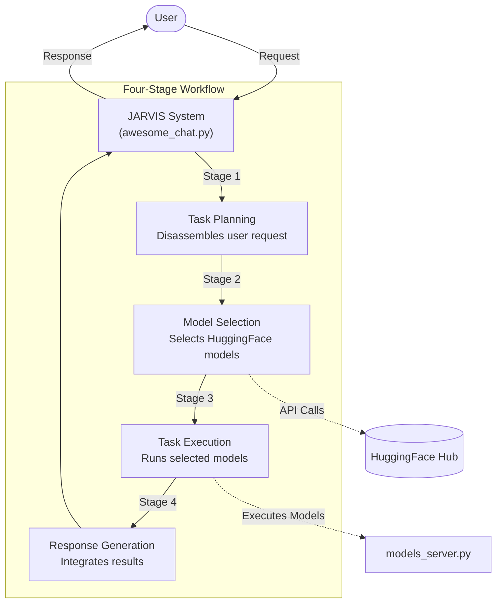

The four stages are:

1. **Task Planning**: The LLM analyzes user requests to understand their intention and disassembles them into possible solvable tasks.
2. **Model Selection**: The LLM selects appropriate expert models from HuggingFace Hub based on their descriptions.
3. **Task Execution**: The system invokes and executes each selected model, returning the results to the LLM.
4. **Response Generation**: The LLM integrates the predictions from all models to generate a coherent response.

This architecture allows JARVIS to leverage the strengths of both LLMs (for understanding, planning, and reasoning) and specialized models (for executing specific tasks).

Sources: [README.md:40-44]()

## Deployment Architecture

JARVIS provides flexible deployment options to accommodate different hardware capabilities and usage scenarios.

### Deployment Configuration

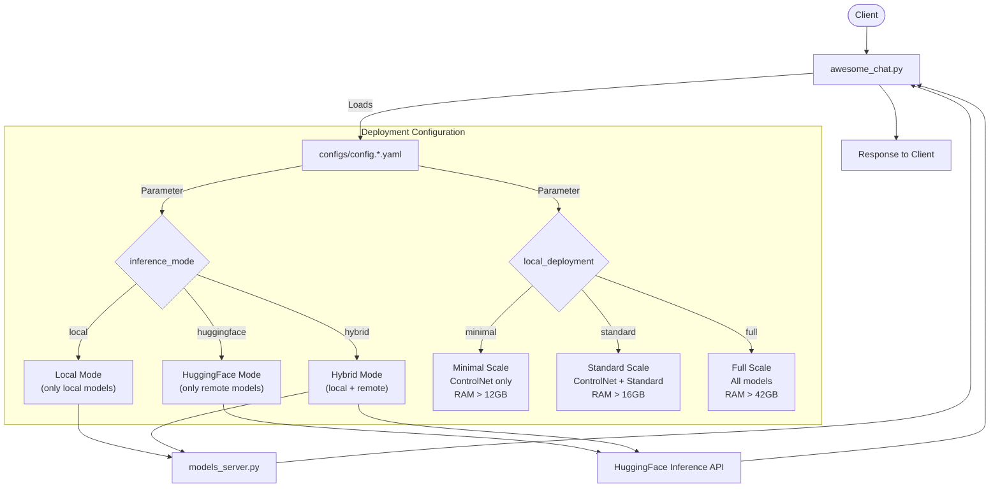

### Deployment Modes

JARVIS supports three deployment modes, configurable in the YAML configuration files:

1. **Local Mode** (`inference_mode: local`): Uses only locally deployed models
2. **HuggingFace Mode** (`inference_mode: huggingface`): Uses only HuggingFace's remote inference endpoints (no local deployment required)
3. **Hybrid Mode** (`inference_mode: hybrid`): Uses both local and remote models

For local deployments, JARVIS offers three scales:

1. **Minimal** (`local_deployment: minimal`): Deploys only ControlNet models (requires >12GB RAM)
2. **Standard** (`local_deployment: standard`): Deploys ControlNet and standard pipelines (requires >16GB RAM)
3. **Full** (`local_deployment: full`): Deploys all registered models (requires >42GB RAM)

Sources: [README.md:185-196]()

## Interfaces

JARVIS provides multiple interfaces for interaction, making it accessible through different methods based on user preferences and requirements.

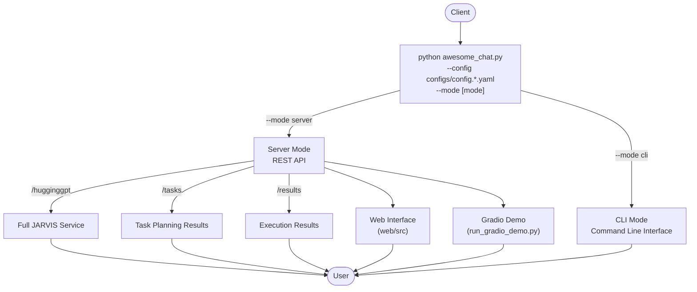

The available interfaces include:

1. **Server API** (start with `--mode server`): Provides HTTP endpoints:
   - `/hugginggpt` - Full service (POST method)
   - `/tasks` - Task planning results (Stage #1) (POST method)
   - `/results` - Execution results (Stage #1-3) (POST method)
   
2. **Command-Line Interface** (start with `--mode cli`): A text-based interface for direct interaction
3. **Web Interface**: A user-friendly web page (requires running the server mode)
4. **Gradio Demo**: A simple interface that can be hosted locally or on HuggingFace Space

Sources: [README.md:76-157]()

## System Requirements

The system requirements depend on the deployment mode and scale:

| Deployment Mode | Scale | RAM Requirements | Disk Space |
|-----------------|-------|------------------|------------|
| HuggingFace     | N/A   | Minimal          | Minimal    |
| Local/Hybrid    | Minimal | >12GB          | ~126GB     |
| Local/Hybrid    | Standard | >16GB         | ~192GB     |
| Local/Hybrid    | Full  | >42GB            | >284GB     |

The disk space requirements for the full deployment include:
- 42GB for text-to-video model
- 126GB for ControlNet
- 66GB for stable-diffusion
- 50GB for other models

Sources: [README.md:48-68]()

## Repository Structure

The JARVIS repository is organized into several key directories:

- `server/`: Contains the core JARVIS system
  - `awesome_chat.py`: Main entry point for the JARVIS system
  - `models_server.py`: Local model server for running expert models
  - `configs/`: Configuration files (e.g., `config.default.yaml`, `config.lite.yaml`)
  - `models/`: Local model storage
- `web/`: Provides the web interface for interacting with JARVIS
- `taskbench/`: Contains the TaskBench benchmark for evaluating LLMs
- `easytool/`: Contains the EasyTool for enhancing LLM-based agents

Sources: [README.md, .gitignore]()

## Research Foundation

JARVIS is based on research described in the paper "HuggingGPT: Solving AI Tasks with ChatGPT and its Friends in HuggingFace" (Shen et al., 2023). The paper introduces the concept of using LLMs as controllers to orchestrate expert models from HuggingFace Hub for solving complex AI tasks.

The project is continuously evolving, with recent additions including:
- EasyTool (January 2024): For easier tool usage with LLMs
- TaskBench (November 2023): For evaluating task automation capability of LLMs
- Langchain version (July 2023): A lightweight implementation using the Langchain framework

Sources: [README.md:9-18, 38, 233-257]()

---

# Page: JARVIS System

# JARVIS System

<details>
<summary>Relevant source files</summary>

The following files were used as context for generating this wiki page:

- [README.md](README.md)

</details>


This document provides a detailed overview of the JARVIS system, its architecture, workflow, and capabilities. It explains how the system components work together to create a collaborative AI system that leverages an LLM controller to orchestrate expert models. For information about TaskBench, which is used to evaluate JARVIS, see [TaskBench Benchmark](#3).

## Introduction

JARVIS (Just A Rather Very Intelligent System) is an exploratory artificial general intelligence (AGI) system that uses language as an interface to connect numerous AI models for solving complex AI tasks. The system's mission is to explore AGI capabilities and deliver cutting-edge research to the community.

At its core, JARVIS consists of an LLM (Large Language Model) as a controller that orchestrates numerous expert models (from HuggingFace Hub) as collaborative executors. This architecture enables JARVIS to perform a wide range of AI tasks by selecting and executing the appropriate expert models based on user requests.

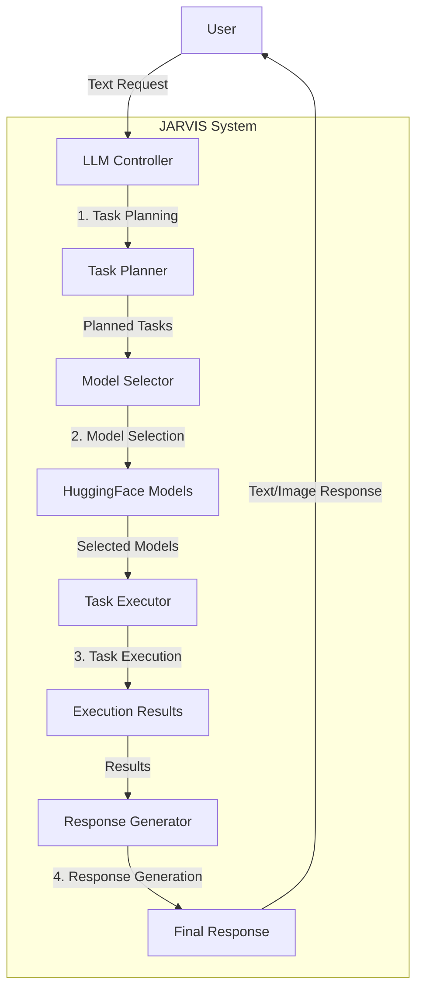

Sources:
- [README.md:29-46]()

## System Architecture

JARVIS implements a modular architecture with the LLM controller at its center, orchestrating the selection and execution of expert models from HuggingFace. The system is designed to handle a wide variety of AI tasks by breaking them down into smaller, specialized tasks that can be handled by different models.

### Core Components

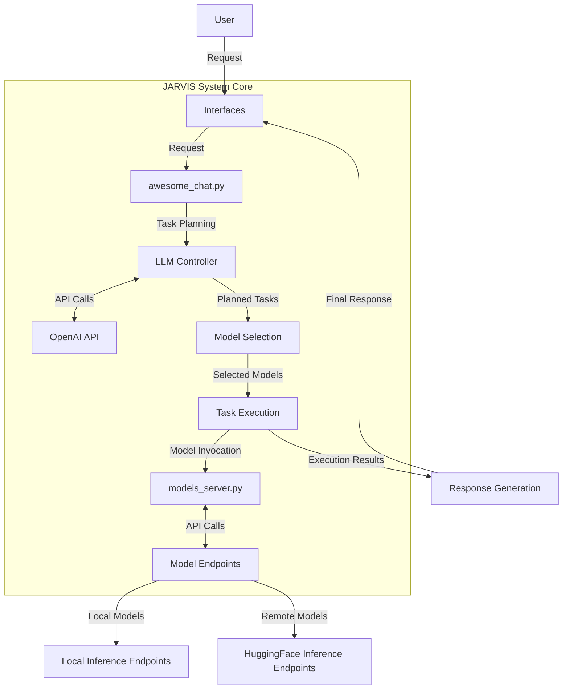

Sources:
- [README.md:38-46]()
- [README.md:78-97]()

### Interfaces and API Endpoints

JARVIS offers multiple ways to interact with the system:

1. **CLI Interface**: A command-line interface for direct interaction
2. **Server/Web API**: RESTful API endpoints for programmatic access
3. **Web Interface**: A user-friendly web page for visual interaction
4. **Gradio Demo**: A hosted demo on HuggingFace Space

The main Web API endpoints include:
- `/hugginggpt` (POST): Access the full service
- `/tasks` (POST): Access intermediate results for Stage #1 (Task Planning)
- `/results` (POST): Access intermediate results for Stages #1-3 (up to Task Execution)

Sources:
- [README.md:78-122]()
- [README.md:126-157]()

## Four-Stage Workflow

JARVIS operates through a four-stage workflow that enables it to understand user requests, select appropriate models, execute tasks, and generate comprehensive responses.

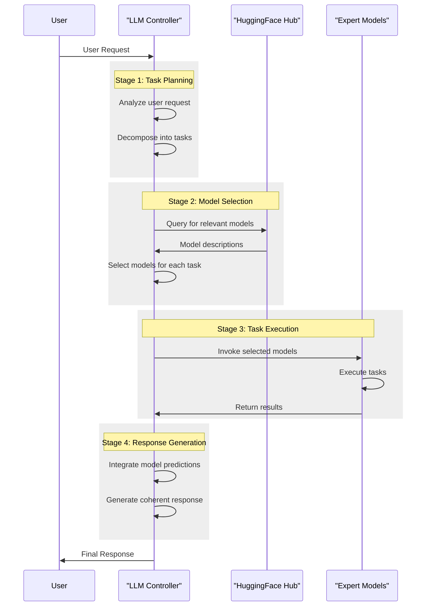

### Stage 1: Task Planning

In this stage, the LLM controller (ChatGPT) analyzes the user's request to understand their intention and decomposes it into possible solvable tasks. This involves:
- Understanding the user's request context
- Identifying the main tasks and subtasks
- Creating a task dependency graph
- Determining the order of execution

### Stage 2: Model Selection

Based on the planned tasks, the LLM selects appropriate expert models from HuggingFace Hub:
- Queries models based on task requirements
- Evaluates model descriptions 
- Selects the most suitable models for each task
- Considers model dependencies and capabilities

### Stage 3: Task Execution

During this stage, JARVIS:
- Invokes each selected model
- Passes the appropriate parameters
- Executes the models in the correct order
- Collects and stores the results from each model

### Stage 4: Response Generation

In the final stage, the LLM:
- Integrates the predictions from all models
- Synthesizes a comprehensive response
- Formats the output appropriately (text, images, etc.)
- Delivers a coherent and informative response to the user

Sources:
- [README.md:40-45]()

## Deployment Modes and Requirements

JARVIS offers flexible deployment options to accommodate different hardware capabilities and use cases.

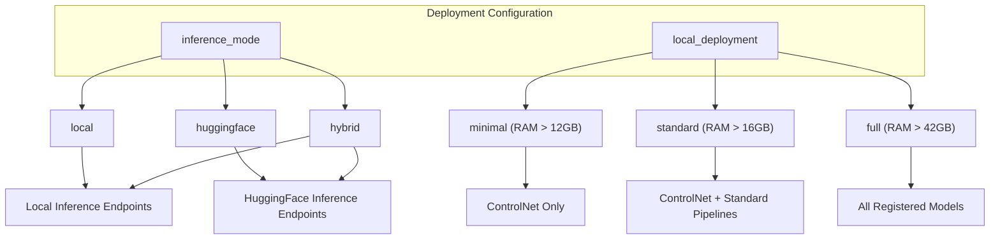

### Inference Modes

JARVIS supports three inference modes:

1. **Local Mode**: Uses only local inference endpoints
   - Requires local model deployment
   - Provides more control and reliability
   - Higher hardware requirements

2. **HuggingFace Mode**: Uses only HuggingFace Inference Endpoints
   - No need for local model deployment
   - Minimal hardware requirements
   - May be limited due to remote endpoint availability

3. **Hybrid Mode**: Uses both local and HuggingFace Inference Endpoints
   - Balances local and remote resources
   - Provides flexibility in model selection
   - Recommended for most users

### Local Deployment Scales

When using local or hybrid inference modes, JARVIS offers three deployment scales:

1. **Minimal** (RAM > 12GB)
   - Includes only ControlNet models
   - Suitable for basic image generation tasks
   - Lowest hardware requirements

2. **Standard** (RAM > 16GB)
   - Includes ControlNet and standard pipelines
   - Supports most common AI tasks
   - Moderate hardware requirements

3. **Full** (RAM > 42GB)
   - Includes all registered models
   - Supports the full range of JARVIS capabilities
   - Highest hardware requirements

### System Requirements

The hardware requirements for running JARVIS depend on the chosen deployment configuration:

| Deployment Configuration | Minimum RAM | Disk Space | GPU VRAM | Notes |
|--------------------------|-------------|------------|----------|-------|
| Local (Minimal) | 12GB | >126GB | ≥24GB | Only ControlNet models |
| Local (Standard) | 16GB | >234GB | ≥24GB | ControlNet + Standard Pipelines |
| Local (Full) | 42GB | >284GB | ≥24GB | All registered models |
| HuggingFace Mode | Minimal | Minimal | Not required | Limited by HF Endpoints availability |
| Hybrid (Minimal) | 12GB | >126GB | ≥24GB | Recommended for personal laptops |

Sources:
- [README.md:48-69]()
- [README.md:182-195]()

## Getting Started with JARVIS

To use JARVIS, you need to configure your environment and start the necessary components.

### Basic Setup

1. Clone the repository
2. Replace `openai.key` and `huggingface.token` in the configuration file or set them as environment variables
3. Install the required dependencies
4. Download the necessary models (if using local or hybrid inference mode)
5. Start the models server and the main application

### Running Different Interfaces

#### Server Mode

```bash
cd server
python models_server.py --config configs/config.default.yaml  # Required for local/hybrid mode
python awesome_chat.py --config configs/config.default.yaml --mode server
```

#### CLI Mode

```bash
cd server
python awesome_chat.py --config configs/config.default.yaml --mode cli
```

#### Web Interface

```bash
cd web
npm install
npm run dev
```

#### Gradio Demo

```bash
python models_server.py --config configs/config.gradio.yaml
python run_gradio_demo.py --config configs/config.gradio.yaml
```

Sources:
- [README.md:72-157]()

## Configuration Options

JARVIS is highly configurable through YAML configuration files:

```yaml
# Main configuration parameters
model: text-davinci-003  # LLM model to use
inference_mode: hybrid   # local, huggingface, or hybrid
local_deployment: standard  # minimal, standard, or full

# API keys
openai:
  key: your_openai_key_here
huggingface:
  token: your_huggingface_token_here
```

The most important parameters are:

- `model`: The LLM to use as the controller (currently supports text-davinci-003)
- `inference_mode`: Determines which inference endpoints to use
- `local_deployment`: Specifies the scale of locally deployed models

For personal laptops, the recommended configuration is `inference_mode: hybrid` and `local_deployment: minimal`.

Sources:
- [README.md:182-195]()

## Conclusion

JARVIS represents a significant advancement in collaborative AI systems, demonstrating how language can serve as an interface for connecting multiple AI models to solve complex tasks. By combining the reasoning capabilities of LLMs with the specialized abilities of expert models, JARVIS provides a powerful and flexible platform for addressing a wide range of AI challenges.

The system's modular architecture, four-stage workflow, and flexible deployment options make it suitable for various use cases and hardware configurations. Whether you're a researcher exploring AGI capabilities, a developer building on top of existing AI models, or an end-user seeking powerful AI assistance, JARVIS offers a comprehensive solution.

---

# Page: System Architecture

# System Architecture

<details>
<summary>Relevant source files</summary>

The following files were used as context for generating this wiki page:

- [README.md](README.md)

</details>


## Purpose and Scope

This document describes the architectural design of the JARVIS system, focusing on its core components and their interactions. It explains how the LLM controller orchestrates expert models to collaboratively solve AI tasks. For details on the four-stage workflow that implements this architecture, see [Four-Stage Workflow](#2.2). For deployment configuration options, see [Deployment Modes](#2.3).

## High-Level Architecture

The JARVIS system is designed as a collaborative AI system where a Large Language Model (LLM) serves as the central controller that orchestrates specialized expert models to solve complex AI tasks. The architecture is built on the premise that natural language can function as an effective interface for connecting and coordinating these diverse models.

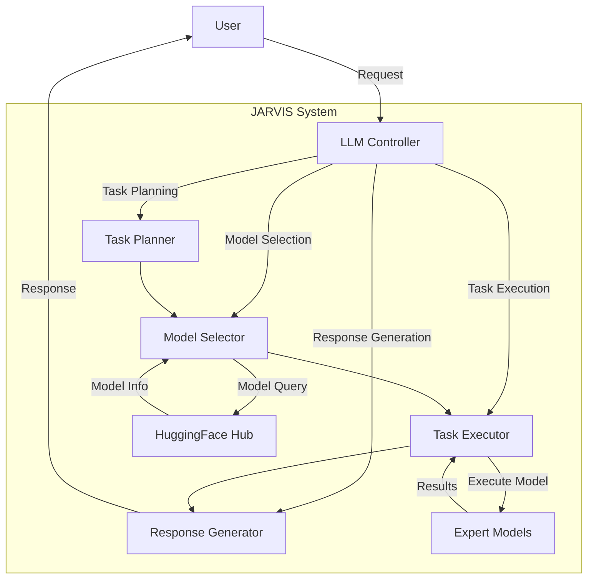

The diagram illustrates the flow of a user request through the system. The LLM Controller manages the four stages of processing, coordinating with the HuggingFace Hub and expert models to fulfill the request.

Sources: [README.md:38-44]()

## Core Components

### LLM Controller

The LLM Controller functions as the system's central orchestrator. It:
- Analyzes and interprets user requests in natural language
- Breaks down complex requests into smaller, executable tasks
- Selects appropriate models for each task
- Manages task execution dependencies
- Integrates results and generates coherent responses

Currently, JARVIS primarily supports OpenAI's models (like text-davinci-003) as the controller, with ongoing work to integrate more open-source LLMs.

### Expert Models

Expert models are specialized AI models sourced primarily from the HuggingFace Hub. These models excel at specific tasks such as:
- Image generation and manipulation
- Object detection and recognition
- Text classification and analysis
- Speech processing
- Video generation and editing

Depending on the deployment configuration, these models can be run locally, accessed through HuggingFace's Inference Endpoints, or both.

### Communication Layer

The communication layer facilitates interactions between components:
- Converts natural language task descriptions into structured model inputs
- Handles the transmission of data between components
- Processes model outputs and formats them for the LLM Controller
- Manages dependencies between tasks and models
- Handles error cases and recovery strategies

Sources: [README.md:29-46]()

## Component Interaction Flow

The following sequence diagram illustrates how components interact during a typical request:

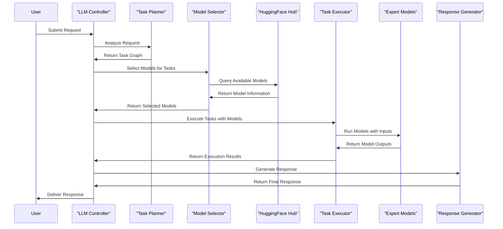

This diagram shows the sequential flow of information through the system, highlighting how the LLM Controller coordinates the entire process from request to response.

Sources: [README.md:40-44]()

## Task Processing Example

To illustrate how the system processes a specific request, here's an example of a multi-step task execution:

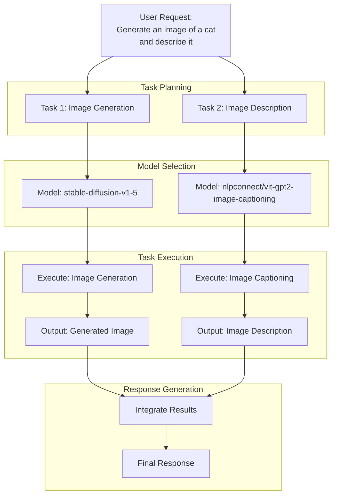

The diagram demonstrates how a user request is decomposed into tasks, mapped to appropriate models, executed to produce outputs, and finally integrated into a coherent response.

Sources: [README.md:40-44](), [README.md:170-178]()

## Deployment Architecture

JARVIS supports a flexible deployment configuration to accommodate different resource constraints and use cases:

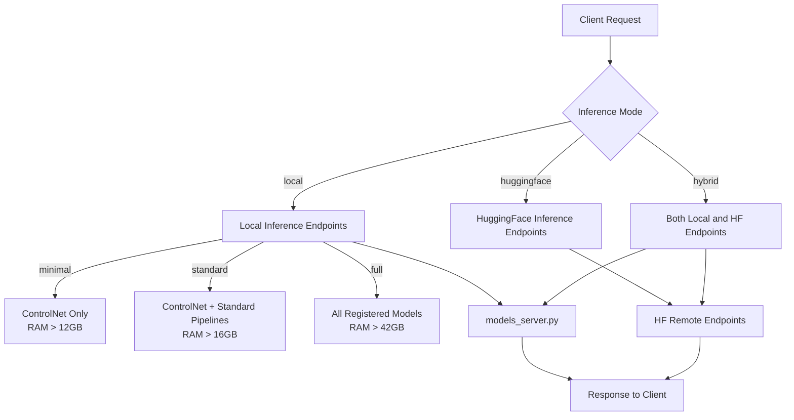

The deployment architecture is controlled by two main configuration parameters:

1. **Inference Mode**: Determines where model inference is performed
   - `local`: Only uses locally deployed models
   - `huggingface`: Only uses HuggingFace's Inference Endpoints 
   - `hybrid`: Uses both local and remote inference capabilities

2. **Local Deployment Scale**: When using local or hybrid modes, this determines which models are deployed locally
   - `minimal`: Requires >12GB RAM, only deploys ControlNet models
   - `standard`: Requires >16GB RAM, deploys ControlNet plus standard pipelines
   - `full`: Requires >42GB RAM, deploys all registered models

These parameters can be configured in the YAML configuration files:
- `server/configs/config.default.yaml`
- `server/configs/config.lite.yaml`
- `server/configs/config.gradio.yaml`

Sources: [README.md:48-52](), [README.md:182-196]()

## Web API Architecture

JARVIS exposes a web API that allows clients to interact with the system:

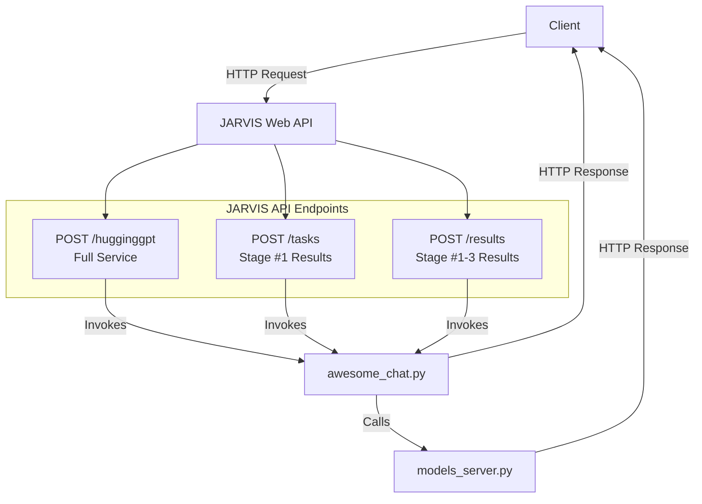

The API provides three main endpoints:
- `/hugginggpt` (POST): Provides access to the full JARVIS service
- `/tasks` (POST): Returns intermediate results from Stage #1 (Task Planning)
- `/results` (POST): Returns intermediate results from Stages #1-3 (Task Planning, Model Selection, Task Execution)

These endpoints are particularly useful for client applications that need to access intermediate processing results or implement custom UIs.

Sources: [README.md:75-121]()

## Integration with External Systems

### HuggingFace Hub Integration

JARVIS is tightly integrated with the HuggingFace Hub:

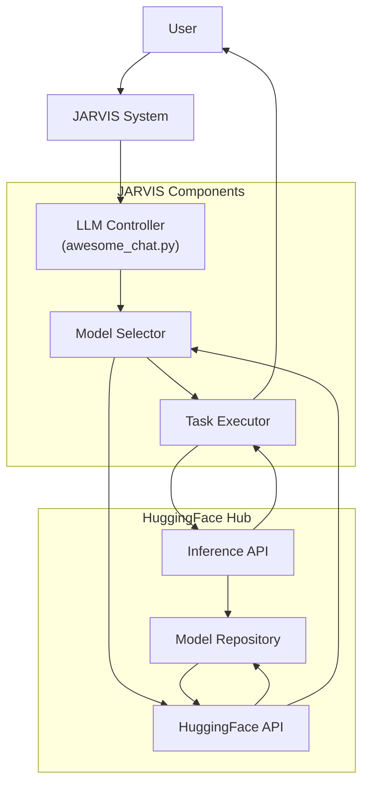

The integration enables:
- Model discovery and selection based on task requirements
- Direct model execution through HuggingFace's Inference Endpoints
- Model downloading for local deployment
- Access to a vast ecosystem of specialized AI models

Sources: [README.md:29-35](), [README.md:182-196]()

## Client Interfaces

JARVIS supports multiple client interfaces:

| Interface | Description | Entry Point |
|-----------|-------------|-------------|
| CLI | Command-line interface for direct interaction | `awesome_chat.py --mode cli` |
| Server | Web API for programmatic access | `awesome_chat.py --mode server` |
| Web UI | User-friendly web interface | Requires running the server and `npm run dev` in the web directory |
| Gradio Demo | Hosted demo interface on Hugging Face Space | `run_gradio_demo.py` |

These interfaces provide flexible options for interacting with JARVIS based on user needs and preferences.

Sources: [README.md:75-159]()

## Implementation Notes

The system is implemented primarily in Python, with the web interface using JavaScript/TypeScript. Key implementation files include:

- `server/awesome_chat.py`: The main entry point that implements the LLM controller logic
- `server/models_server.py`: Manages local model deployment and execution
- `server/configs/*.yaml`: Configuration files for different deployment scenarios
- `web/`: Frontend web interface

The system is designed to be modular and extensible, allowing for the integration of new models and capabilities over time.

Sources: [README.md:75-159]()

---

# Page: Four-Stage Workflow

# Four-Stage Workflow

<details>
<summary>Relevant source files</summary>

The following files were used as context for generating this wiki page:

- [README.md](README.md)

</details>


## Purpose and Scope

This document details the four-stage workflow that forms the core operational model of the JARVIS system. Each stage represents a distinct phase in the process of handling user requests, from initial analysis to final response. This workflow enables JARVIS to function as a collaborative AI system where an LLM controller orchestrates expert models to solve complex AI tasks. For details on the overall system architecture, see [System Architecture](#2.1), and for deployment options, see [Deployment Modes](#2.3).

## Overview of the Four-Stage Workflow

The JARVIS system employs a four-stage pipeline to process user requests and generate comprehensive responses. This workflow represents the core operational logic of the system and dictates how different components interact with each other.

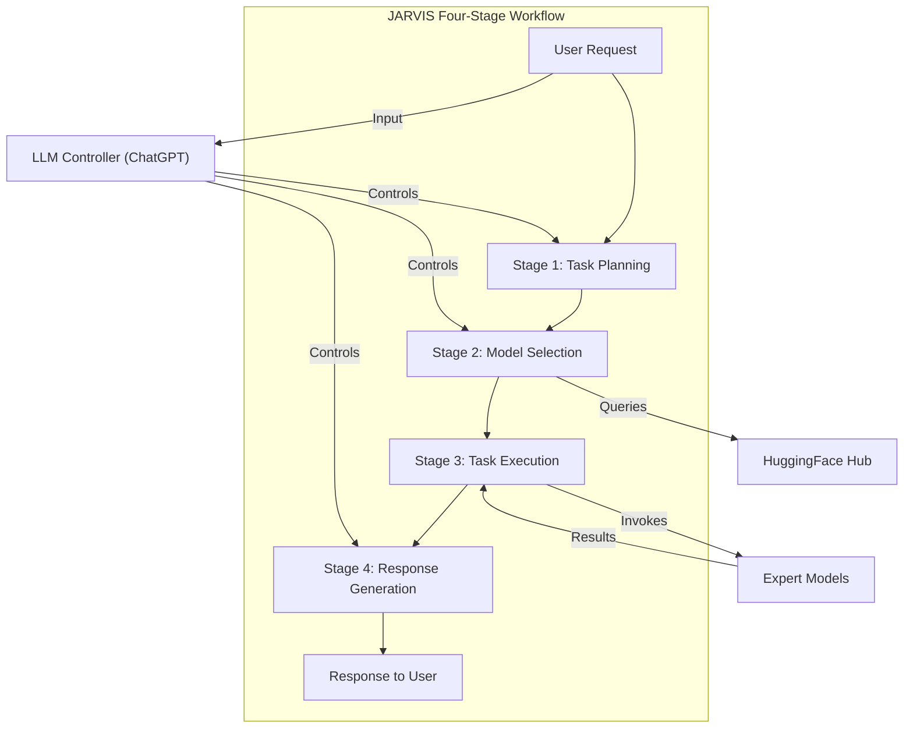

**Diagram: High-Level Four-Stage Workflow**

Sources: [README.md:40-44]()

## Stage 1: Task Planning

In the first stage, the LLM controller (typically ChatGPT) analyzes the user's request to understand the intention and decomposes it into solvable tasks. This critical step transforms natural language inputs into structured tasks that can be delegated to appropriate expert models.

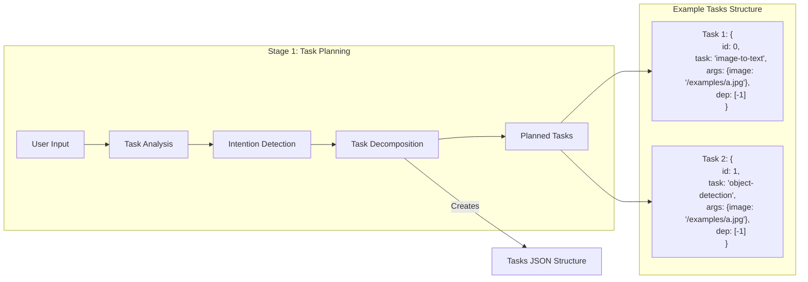

**Diagram: Task Planning Process**

During this stage, JARVIS transforms the user request into a structured task list, identifying dependencies between tasks where applicable. The `/tasks` API endpoint provides access to these intermediate results, showing the planned task structure.

Sources: [README.md:41](), [README.md:106-120]()

## Stage 2: Model Selection

In the second stage, the LLM controller selects appropriate expert models from HuggingFace Hub to solve each planned task. The selection is based on model descriptions and capabilities in relation to the specific tasks identified in Stage 1.

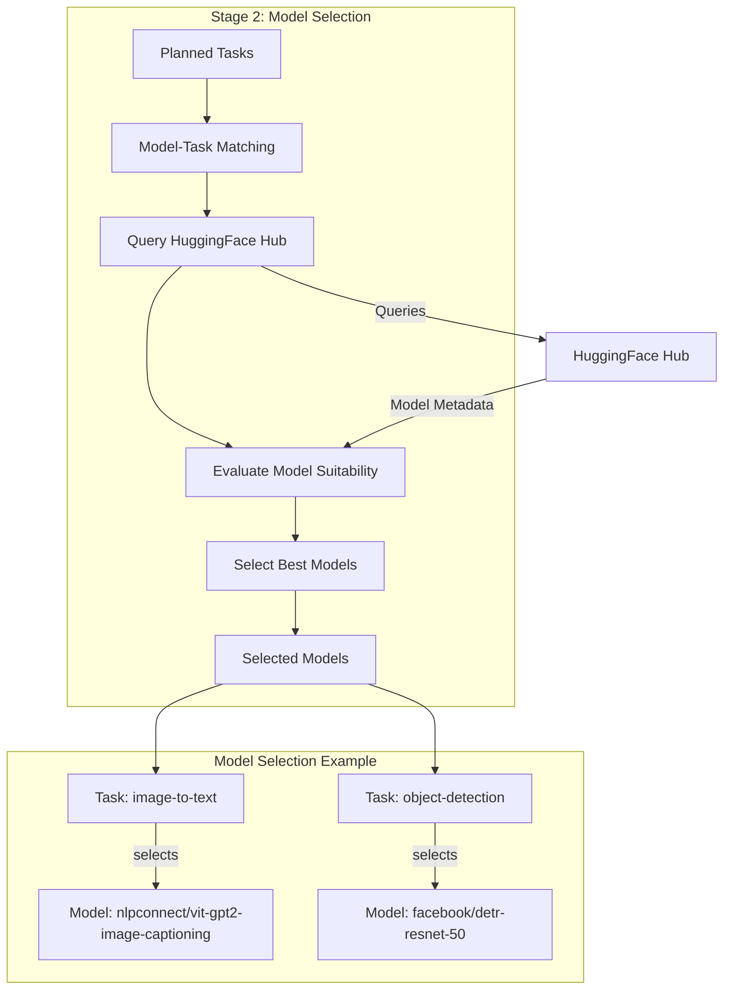

**Diagram: Model Selection Process**

The LLM controller evaluates potential models based on their descriptions, popularity, and suitability for the specific tasks. This stage results in a mapping between planned tasks and selected HuggingFace models that will be executed in the next stage.

Sources: [README.md:42]()

## Stage 3: Task Execution

The third stage involves invoking and executing the selected models to perform the planned tasks. This is where the actual computation happens, with models processing inputs and generating outputs according to their specific capabilities.

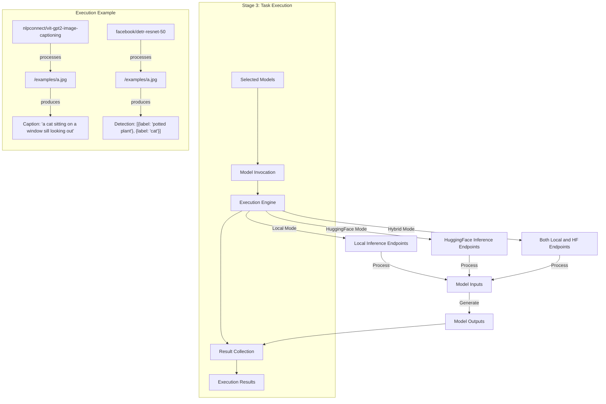

**Diagram: Task Execution Process**

Depending on the configured inference mode (local, huggingface, or hybrid), JARVIS will execute models either locally, via HuggingFace Inference Endpoints, or both. The results from all model executions are collected and prepared for the final stage.

The `/results` API endpoint provides access to the intermediate results from Stages 1-3, allowing visibility into both the planning and execution process.

Sources: [README.md:43](), [README.md:106-120]()

## Stage 4: Response Generation

In the final stage, the LLM controller integrates the outputs from all executed models and generates a comprehensive response to the user's request. This involves interpreting the model results in context and formulating a natural language response.

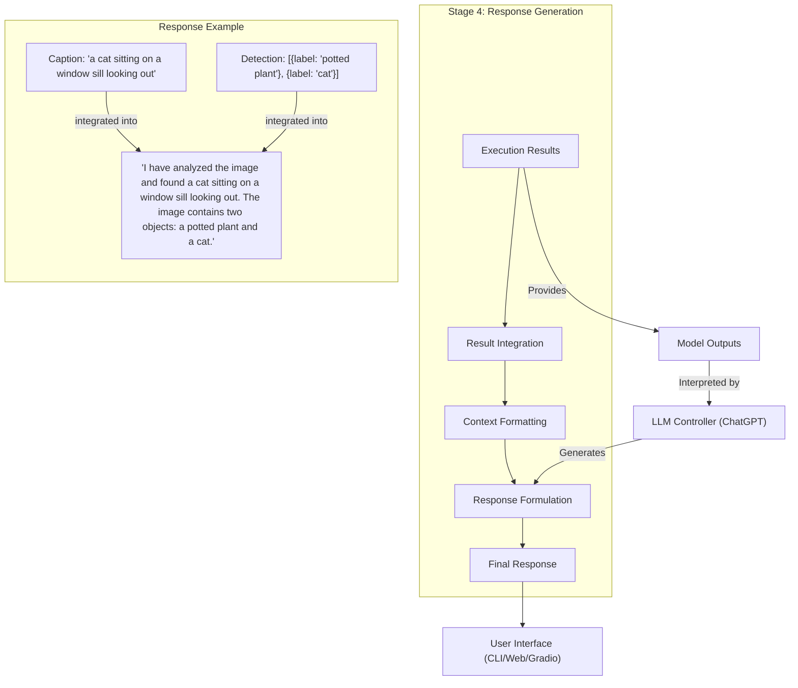

**Diagram: Response Generation Process**

The LLM controller synthesizes the information from all executed models, creating a coherent narrative that addresses the user's original request. This generated response is then returned to the user through the selected interface (CLI, Web API, Web UI, or Gradio).

Sources: [README.md:44]()

## Workflow Integration with System Components

The four-stage workflow integrates with various system components to provide a complete user experience. This diagram illustrates how the workflow connects with different interfaces and deployment modes.

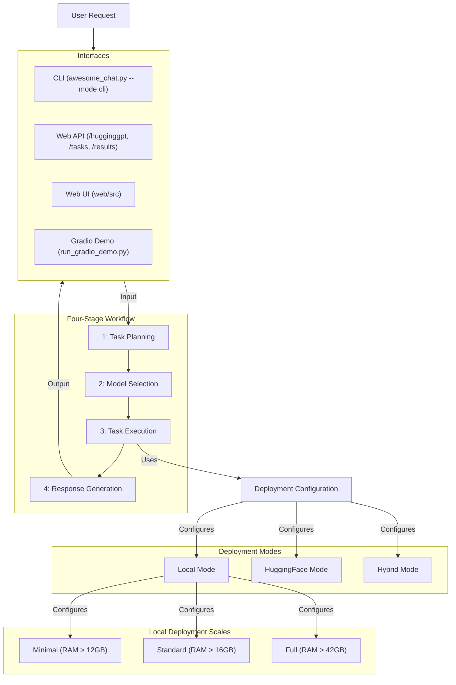

**Diagram: Workflow Integration with System Components**

The workflow is accessed through various interfaces, and the task execution stage adapts to the configured deployment mode and scale. This flexible architecture allows JARVIS to run in different environments with varying resource constraints.

Sources: [README.md:78-157](), [README.md:181-195]()

## Technical Implementation Details

The four-stage workflow is central to JARVIS's architecture and directly influences how the system is configured and deployed. The key configuration parameters that affect this workflow include:

| Parameter | Description | Options |
|-----------|-------------|---------|
| `model` | LLM used as controller | `text-davinci-003` (default) |
| `inference_mode` | Mode of inference endpoints | `local`, `huggingface`, `hybrid` |
| `local_deployment` | Scale of locally deployed models | `minimal`, `standard`, `full` |

These parameters determine how Stage 3 (Task Execution) operates, particularly in terms of which models are available and how they are accessed. The choice of deployment mode affects the system's resource requirements and capabilities.

Sources: [README.md:181-195]()

## Workflow API Access

The JARVIS workflow exposes specific API endpoints that provide access to intermediate results at different stages:

| Endpoint | Method | Description |
|----------|--------|-------------|
| `/hugginggpt` | POST | Access the full service (all stages) |
| `/tasks` | POST | Access Stage 1 results (task planning) |
| `/results` | POST | Access Stage 1-3 results (planning through execution) |

These endpoints allow developers to interact with specific parts of the workflow for debugging, integration, or custom applications.

Sources: [README.md:98-120]()

## Summary

The four-stage workflow represents the core operational model of JARVIS, transforming user requests into comprehensive responses through a series of well-defined stages. Each stage has a specific purpose and interfaces with different system components, creating a flexible and powerful AI collaboration framework.

The workflow enables JARVIS to leverage both an LLM controller and specialized expert models, combining their strengths to address complex AI tasks that would be difficult for any single model to handle alone.

---

# Page: Deployment Modes

# Deployment Modes

<details>
<summary>Relevant source files</summary>

The following files were used as context for generating this wiki page:

- [README.md](README.md)

</details>


## Purpose and Scope

This document details the various deployment modes available in the JARVIS system. It explains the differences between local, huggingface, and hybrid inference modes, along with their respective resource requirements and configuration options. For information about using the different interfaces to interact with JARVIS, see [Interfaces and Usage](#2.4).

## Deployment Mode Overview

JARVIS supports three primary deployment modes that determine where the AI models are executed. Each mode has different resource requirements, performance characteristics, and setup complexity.

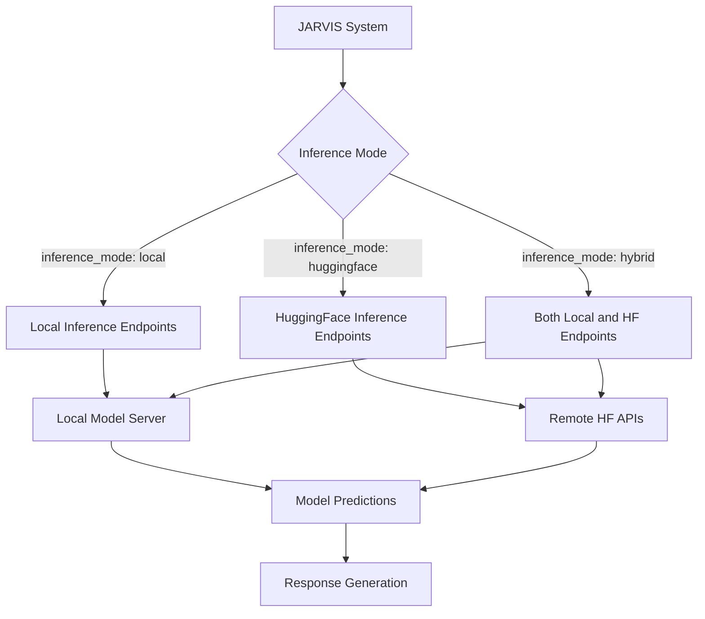

**Diagram: JARVIS Inference Mode Architecture**

Sources: [README.md:185-189]()

### Local Mode

In local mode, JARVIS exclusively uses locally deployed models for inference. This offers greater reliability and potentially faster performance, but requires substantial local resources (RAM, disk space, and GPU).

- **Configuration**: Set `inference_mode: local` in the configuration file
- **Advantages**: Consistent performance, no dependency on external services, potentially lower latency
- **Disadvantages**: Higher resource requirements, requires model downloads
- **Use Case**: Production environments, systems with sufficient resources, scenarios requiring reliability

### HuggingFace Mode

In HuggingFace mode, JARVIS exclusively relies on HuggingFace's remote inference endpoints for model execution, eliminating the need for local model deployment.

- **Configuration**: Set `inference_mode: huggingface` in the configuration file
- **Advantages**: Minimal local resource requirements, no model downloads needed
- **Disadvantages**: Dependent on the availability and stability of remote endpoints
- **Use Case**: Testing, limited resource environments, quick setup scenarios

### Hybrid Mode

Hybrid mode combines both local and remote inference capabilities, leveraging local endpoints for some models while utilizing HuggingFace's remote endpoints for others.

- **Configuration**: Set `inference_mode: hybrid` in the configuration file 
- **Advantages**: Flexibility, balanced resource utilization, broader model availability
- **Disadvantages**: More complex configuration, potential inconsistency in performance
- **Use Case**: Personal laptops, development environments, scenarios requiring specific model combinations

Sources: [README.md:185-189](), [README.md:195-196]()

## Local Deployment Scales

When using either the `local` or `hybrid` inference modes, you can configure the scale of locally deployed models to match your available resources.

```mermaid
graph TD
    subgraph "Local Deployment Scales"
        A["local_deployment Parameter"]
        A --> B["minimal"]
        A --> C["standard"]
        A --> D["full"]
        
        B --> B1["RAM > 12GB"]
        B --> B2["ControlNet Only"]
        
        C --> C1["RAM > 16GB"]
        C --> C2["ControlNet + Standard Pipelines"]
        
        D --> D1["RAM > 42GB"]
        D --> D2["All Registered Models"]
    end
```

**Diagram: Local Deployment Scale Requirements**

Sources: [README.md:190-194]()

### Minimal Scale

The minimal deployment scale requires the least resources but supports only a limited set of models.

- **Configuration**: Set `local_deployment: minimal` in the configuration file
- **Resource Requirements**: RAM > 12GB
- **Models Deployed**: ControlNet models only
- **Use Case**: Resource-constrained environments, testing scenarios

### Standard Scale

The standard deployment scale offers a balance between resource utilization and model availability.

- **Configuration**: Set `local_deployment: standard` in the configuration file
- **Resource Requirements**: RAM > 16GB
- **Models Deployed**: ControlNet + Standard Pipelines
- **Use Case**: Most development scenarios, personal computers with decent specifications

### Full Scale

The full deployment scale provides access to all registered models but requires substantial resources.

- **Configuration**: Set `local_deployment: full` in the configuration file
- **Resource Requirements**: RAM > 42GB
- **Models Deployed**: All registered models
- **Use Case**: Production environments, high-performance systems, comprehensive model support

Sources: [README.md:190-194]()

## System Requirements

Different deployment configurations have varying system requirements, particularly for disk space and memory.

```mermaid
graph LR
    subgraph "Disk Space Requirements"
        A1["Total: > 284GB"]
        A1 --> A2["damo-vilab/text-to-video-ms-1.7b: 42GB"]
        A1 --> A3["ControlNet: 126GB"]
        A1 --> A4["stable-diffusion-v1-5: 66GB"]
        A1 --> A5["Others: 50GB"]
    end
```

**Diagram: Disk Space Requirements for Full Deployment**

Sources: [README.md:48-62]()

The primary system requirements for default configuration:

- Ubuntu 16.04 LTS (recommended)
- VRAM ≥ 24GB
- RAM requirements vary by deployment scale:
  - Minimal: > 12GB
  - Standard: > 16GB
  - Full: > 80GB
- Disk space: > 284GB (for full deployment with all models)

For the lite configuration (`config.lite.yaml`), which uses only HuggingFace inference endpoints, there are minimal local requirements beyond the basic operating system.

Sources: [README.md:48-70]()

## Configuration Examples

JARVIS uses YAML configuration files to define deployment settings. The configuration files are located in the `server/configs/` directory.

### Default Configuration Example

```yaml
model: text-davinci-003
inference_mode: hybrid
local_deployment: standard
```

This configuration uses both local and HuggingFace endpoints, with standard local deployment (RAM > 16GB).

### Lite Configuration Example

```yaml
model: text-davinci-003
inference_mode: huggingface
```

This configuration uses only HuggingFace inference endpoints with no local model deployment, ideal for systems with limited resources.

Sources: [README.md:184-194](), [README.md:24-25]()

## Deployment Process Flow

The following diagram illustrates the deployment process flow from configuration to model execution:

```mermaid
flowchart TD
    A["Start JARVIS"] --> B["Load Configuration"]
    B --> C{"Parse Deployment Mode"}
    
    C -->|"inference_mode: local"| D["Start Local Model Server"]
    C -->|"inference_mode: huggingface"| E["Configure HF API Access"]
    C -->|"inference_mode: hybrid"| F["Start Local Server + Configure HF API"]
    
    D --> G{"Parse Local Deployment Scale"}
    F --> G
    
    G -->|"local_deployment: minimal"| H["Load ControlNet Models"]
    G -->|"local_deployment: standard"| I["Load ControlNet + Standard Models"]
    G -->|"local_deployment: full"| J["Load All Registered Models"]
    
    H & I & J & E --> K["Initialize Task Processing Pipeline"]
    K --> L["Ready to Process User Requests"]
```

**Diagram: JARVIS Deployment Process Flow**

Sources: [README.md:185-194](), [README.md:92-95]()

## Special Deployment: NVIDIA Jetson Support

JARVIS provides experimental support for NVIDIA Jetson embedded devices through a dedicated Docker container.

```mermaid
flowchart LR
    subgraph "Jetson Deployment"
        A["Docker Container"] --> B["Model Server"]
        A --> C["awesome_chat.py"]
        A --> D["Web Application"]
        
        B --> E["Local Models"]
        C --> F["Server Mode"]
        D --> G["Web Interface"]
    end
```

**Diagram: NVIDIA Jetson Deployment Architecture**

Sources: [README.md:197-224]()

Key considerations for Jetson deployment:

- Requires Jetson AGX Orin family devices (64GB on-board RAM preferred)
- Configuration must use:
  - `inference_mode: local`
  - `local_deployment: standard`
- Docker container provides accelerated ffmpeg, pytorch, torchaudio, and torchvision dependencies
- Models and configs are recommended to be provided through volume mounts

Sources: [README.md:197-224]()

## Best Practices and Recommendations

### Mode Selection Guidelines

| Available Resources | Recommended Mode | Deployment Scale |
|---------------------|------------------|------------------|
| Limited RAM (<12GB) | huggingface      | N/A              |
| Moderate RAM (12-16GB) | hybrid         | minimal          |
| Substantial RAM (16-42GB) | hybrid      | standard         |
| High RAM (>42GB)    | local or hybrid  | full             |

### Performance Considerations

- **Local mode** generally provides the most consistent performance but requires significant resources
- **HuggingFace mode** performance depends on the availability and load of remote endpoints
- **Hybrid mode** with minimal deployment offers a good balance for personal laptops

Sources: [README.md:195-196]()

## Model Acquisition and Startup

When using `local` or `hybrid` mode, models must be downloaded before starting the server:

1. Download models: `cd models && bash download.sh`
2. Start model server: `python models_server.py --config configs/config.default.yaml`
3. Start JARVIS: `python awesome_chat.py --config configs/config.default.yaml --mode server`

For the `huggingface` mode, only step 3 is required, making it the quickest to set up.

Sources: [README.md:88-94]()

---

# Page: Interfaces and Usage

# Interfaces and Usage

<details>
<summary>Relevant source files</summary>

The following files were used as context for generating this wiki page:

- [README.md](README.md)

</details>


This document describes the various interfaces available for interacting with the JARVIS system and instructions on how to use each one. JARVIS provides multiple ways to interact with its core functionality, including a Command Line Interface (CLI), Server API, Web Interface, and Gradio Demo. Each interface allows users to access JARVIS's four-stage workflow described in [Four-Stage Workflow](#2.2).

## Interface Overview

JARVIS provides four primary interfaces, each catering to different use cases and user preferences.

```mermaid
graph TD
    User[("User")] --- CLI["CLI Interface"]
    User --- Server["Server/API Interface"]
    User --- Web["Web Interface"]
    User --- Gradio["Gradio Demo"]
    
    subgraph "JARVIS System"
        Controller["LLM Controller\n(ChatGPT)"]
        
        CLI --> |"awesome_chat.py\n--mode cli"| Controller
        Server --> |"awesome_chat.py\n--mode server"| Controller
        Web --> |"communicates via\nServer API"| Server
        Gradio --> |"run_gradio_demo.py"| Controller
        
        Controller --> Stages["Four-Stage Processing\n1. Task Planning\n2. Model Selection\n3. Task Execution\n4. Response Generation"]
        
        Stages --> Models["Expert Models\n(Local or HuggingFace)"]
        Models --> Stages
    end
    
    CLI --> |"Text Response"| User
    Server --> |"JSON Response"| User
    Web --> |"Interactive Response"| User
    Gradio --> |"Interactive Response"| User
```

Sources: [README.md:72-173]()

## Interface Modes and Configuration

Before using any interface, you need to configure JARVIS. The configuration file determines which models are used and how they're deployed.

### Key Configuration Parameters

| Parameter | Options | Description |
|-----------|---------|-------------|
| `inference_mode` | `local`, `huggingface`, `hybrid` | Determines which inference endpoints to use |
| `local_deployment` | `minimal`, `standard`, `full` | Scale of locally deployed models |
| `model` | e.g., `text-davinci-003` | The LLM to use as the controller |

- **inference_mode**:
  - `local`: Only uses locally deployed models
  - `huggingface`: Only uses Hugging Face's remote inference endpoints
  - `hybrid`: Uses both local and remote endpoints

- **local_deployment**:
  - `minimal`: Only deploys ControlNet models (RAM > 12GB)
  - `standard`: Deploys ControlNet + standard pipelines (RAM > 16GB)
  - `full`: Deploys all registered models (RAM > 42GB)

Sources: [README.md:181-195]()

## Command Line Interface (CLI)

The CLI provides a straightforward text-based interaction with JARVIS, ideal for quick tests or environments without a graphical interface.

### Starting the CLI

```bash
cd server
python awesome_chat.py --config configs/config.default.yaml --mode cli
```

### CLI Usage

After starting, you'll be prompted to enter your requests. Type your message and press Enter to send it to JARVIS. Type `exit` to quit the CLI.

```
Welcome to Jarvis! A collaborative system that consists of an LLM as the controller and numerous expert models as collaborative executors...
[ User ]: Please generate a canny image based on /examples/f.jpg
[ Jarvis ]: Sure. I have generated a canny image based on /examples/f.jpg...
```

Sources: [README.md:159-178]()

## Server API Interface

The Server API allows programmatic access to JARVIS through HTTP endpoints. It's useful for integrating JARVIS with other applications or services.

### Starting the Server

```bash
cd server
# Start the models server first (required for local or hybrid inference modes)
python models_server.py --config configs/config.default.yaml
# Then start the main server
python awesome_chat.py --config configs/config.default.yaml --mode server
```

### API Endpoints

```mermaid
graph LR
    Client["Client"] --- POST_hugginggpt["POST /hugginggpt"]
    Client --- POST_tasks["POST /tasks"]
    Client --- POST_results["POST /results"]
    
    subgraph "JARVIS API Server"
        POST_hugginggpt --> |"Full pipeline"| FullService["Complete 4-stage processing"]
        POST_tasks --> |"Stage #1 only"| TaskPlanning["Task Planning"]
        POST_results --> |"Stages #1-3"| Execution["Task Planning, Model Selection,\nand Task Execution"]
    end
    
    FullService --> Response["Complete Response"]
    TaskPlanning --> TasksResponse["Tasks JSON"]
    Execution --> ResultsResponse["Results JSON"]
    
    Response --> Client
    TasksResponse --> Client
    ResultsResponse --> Client
```

| Endpoint | Method | Description | Response |
|----------|--------|-------------|----------|
| `/hugginggpt` | POST | Access the full JARVIS service | Complete response with all stages |
| `/tasks` | POST | Access results from Stage #1 (Task Planning) | JSON array of planned tasks |
| `/results` | POST | Access results from Stages #1-3 | JSON with execution results |

### Example Request and Response

```bash
# Request to /tasks endpoint
curl --location 'http://localhost:8004/tasks' \
--header 'Content-Type: application/json' \
--data '{
    "messages": [
        {
            "role": "user",
            "content": "based on pose of /examples/d.jpg and content of /examples/e.jpg, please show me a new image"
        }
    ]
}'

# Response
[{"args":{"image":"/examples/d.jpg"},"dep":[-1],"id":0,"task":"openpose-control"},{"args":{"image":"/examples/e.jpg"},"dep":[-1],"id":1,"task":"image-to-text"},{"args":{"image":"<GENERATED>-0","text":"<GENERATED>-1"},"dep":[1,0],"id":2,"task":"openpose-text-to-image"}]
```

Sources: [README.md:76-121]()

## Web Interface

The Web Interface provides a user-friendly graphical interface for interacting with JARVIS. It communicates with the Server API and presents results in a visually appealing manner.

### Setting Up and Starting the Web Interface

```bash
# First, ensure the server is running
cd server
python models_server.py --config configs/config.default.yaml
python awesome_chat.py --config configs/config.default.yaml --mode server

# Then, in a separate terminal, start the web interface
cd web
npm install
npm run dev
```

### Web Interface Configuration

If you're running the Web client on a different machine than the server, you need to configure the server's URL:

- Edit `web/src/config/index.ts` and set `HUGGINGGPT_BASE_URL` to `http://{LAN_IP_of_the_server}:{port}/`

### Web Interface Features

- Interactive chat-like interface
- Support for uploading and displaying images
- Ability to switch to ChatGPT by double-clicking the settings icon
- Video generation support (requires ffmpeg with H.264 support)

```mermaid
sequenceDiagram
    participant User
    participant WebUI as "Web Interface\n(web/src)"
    participant Server as "JARVIS Server\n(awesome_chat.py)"
    participant LLM as "LLM Controller"
    participant Models as "Expert Models"
    
    User->>WebUI: Enter request
    WebUI->>Server: POST /hugginggpt
    Server->>LLM: Process request
    LLM->>Server: Task planning
    Server->>Models: Model selection & execution
    Models->>Server: Execution results
    Server->>LLM: Generate response
    LLM->>Server: Final response
    Server->>WebUI: JSON response
    WebUI->>User: Rendered response
```

Sources: [README.md:124-143]()

## Gradio Demo

The Gradio Demo provides another user-friendly interface that's easy to deploy and share. It's hosted on Hugging Face Spaces and can also be run locally.

### Starting the Gradio Demo Locally

```bash
# Start the models server first
python models_server.py --config configs/config.gradio.yaml
# Then start the Gradio demo
python run_gradio_demo.py --config configs/config.gradio.yaml
```

### Using the Hugging Face Space

The Gradio demo is hosted on Hugging Face Space, which you can access directly. Alternatively, you can run the Docker image:

```bash
docker run -it -p 7860:7860 --platform=linux/amd64 registry.hf.space/microsoft-hugginggpt:latest python app.py
```

The Gradio demo uses a hybrid inference mode and standard local deployment, providing a balance between performance and resource usage.

Sources: [README.md:146-157]()

## Interface Comparison

| Feature | CLI | Server API | Web Interface | Gradio Demo |
|---------|-----|------------|---------------|-------------|
| Ease of Use | Simple | Technical | Very User-Friendly | User-Friendly |
| Visual Features | Text Only | JSON Only | Full Visuals | Full Visuals |
| Setup Complexity | Low | Medium | High | Medium |
| Integration Potential | Limited | High | Medium | Medium |
| Resource Requirements | Based on config | Based on config | Based on config + Web | Based on config |
| Best For | Quick Testing | Integration | Regular Use | Sharing/Demo |

## JARVIS Interface Architecture

The following diagram shows how the different interface components interact with the core JARVIS system and each other:

```mermaid
graph TD
    subgraph "User Interfaces"
        CLI["CLI Interface\n(awesome_chat.py --mode cli)"]
        API["Server API\n(awesome_chat.py --mode server)"]
        Web["Web Interface\n(web/src)"]
        Gradio["Gradio Demo\n(run_gradio_demo.py)"]
    end
    
    subgraph "Core System"
        LLM["LLM Controller\n(ChatGPT)"]
        Pipeline["Four-Stage Pipeline"]
        
        LLM --> Pipeline
        Pipeline --> LLM
    end
    
    subgraph "Model Infrastructure"
        ModelServer["Models Server\n(models_server.py)"]
        LocalModels["Local Models"]
        HFEndpoints["HuggingFace Endpoints"]
        
        ModelServer --> LocalModels
        Pipeline --> HFEndpoints
    end
    
    CLI --> LLM
    API --> LLM
    Web --> API
    Gradio --> LLM
    
    Pipeline --> ModelServer
```

Sources: [README.md:72-195]()

## Common Configuration Examples

For different use cases, you might want to use different configuration settings:

| Use Case | Recommended Config | Description |
|----------|-------------------|-------------|
| Lightweight Laptop | `inference_mode: hybrid` + `local_deployment: minimal` | Balances local and remote processing, minimal resources |
| Powerful Desktop | `inference_mode: local` + `local_deployment: full` | Full local deployment for best performance and reliability |
| Server with Limited Resources | `inference_mode: huggingface` | Uses only remote endpoints, no local model deployment needed |
| Demo Environment | `inference_mode: hybrid` + `local_deployment: standard` | Balanced approach for demo purposes |

Sources: [README.md:181-195]()

## Usage Examples

Here are some example use cases for different interfaces:

### CLI Example

```
[ User ]: Please generate a canny image based on /examples/f.jpg
[ Jarvis ]: Sure. I have generated a canny image based on /examples/f.jpg. To do this, I first used the image-to-text model nlpconnect/vit-gpt2-image-captioning to generate the text description of the image, which is "a herd of giraffes and zebras grazing in a field". Then I used the canny-control model to generate the canny image of the original image, which is stored in the path "/images/1ea2.png". Finally, I used the canny-text-to-image model lllyasviel/sd-controlnet-canny to generate the canny image based on the text description and the canny image, which is stored in the path "/images/ba66.png". Do you need anything else?
```

### Server API Example

```bash
curl --location 'http://localhost:8004/hugginggpt' \
--header 'Content-Type: application/json' \
--data '{
    "messages": [
        {
            "role": "user", 
            "content": "Tell me what is in this image: /examples/a.jpg"
        }
    ]
}'
```

Sources: [README.md:107-176]()

---

# Page: TaskBench Benchmark

# TaskBench Benchmark

<details>
<summary>Relevant source files</summary>

The following files were used as context for generating this wiki page:

- [taskbench/README.md](taskbench/README.md)

</details>


## Purpose and Scope

This document describes TaskBench, a comprehensive benchmark for evaluating large language models (LLMs) on task automation capabilities. TaskBench focuses on three critical aspects of task automation: task decomposition, tool invocation, and parameter prediction. This page covers the benchmark's architecture, data generation methodology, evaluation framework, and usage within the JARVIS ecosystem. For information about using JARVIS itself, see [JARVIS System](#2).

Sources: [taskbench/README.md:38-40]()

## Overview of TaskBench

TaskBench addresses the challenge of evaluating LLMs on complex task automation workflows. Unlike conventional NLP benchmarks, TaskBench assesses an LLM's ability to break down user requests, select appropriate tools, and correctly provide parameters to those tools—capabilities essential for systems like JARVIS.

The benchmark includes datasets across three domains:
- HuggingFace Tools
- Multimedia Tools
- Daily Life APIs

Each domain contains carefully crafted evaluation tasks constructed through a tool graph-based data generation pipeline.

Sources: [taskbench/README.md:38-40](), [taskbench/README.md:43-53]()

## TaskBench Architecture

### Data Generation Pipeline

```mermaid
flowchart TD
    subgraph "Tool Graph Construction"
        ToolLib["Tool Library"] --> ToolGraph["Tool Graph Creation"]
        ToolGraph --> GraphDesc["graph_desc.json"]
    end
    
    subgraph "Graph Sampling"
        GraphDesc --> Sampling["Sampling Methods"]
        Sampling --> |"Single Tool"| NodeSamples["Node Samples"]
        Sampling --> |"Sequential Tools"| ChainSamples["Chain Samples"]
        Sampling --> |"Complex Relationships"| DAGSamples["DAG Samples"]
    end
    
    subgraph "Back-Instruct"
        NodeSamples & ChainSamples & DAGSamples --> TaskGen["Task Steps & Instruction Generation"]
        TaskGen --> InvocParams["Tool Invocation Parameters"]
        InvocParams --> RawData["data_raw.json"]
    end
    
    subgraph "Data Validation"
        RawData --> LLMCritic["LLM-based Critics"]
        RawData --> RuleCritic["Rule-based Critics"]
        LLMCritic & RuleCritic --> HumanVerify["Human Verification"]
        HumanVerify --> FormattedData["Final Dataset"]
    end
    
    FormattedData --> |"data.json"| TaskBenchData["TaskBench Dataset"]
    FormattedData --> |"user_requests.json"| TaskBenchData
    FormattedData --> |"tool_desc.json"| TaskBenchData
```

TaskBench employs a sophisticated data generation pipeline that consists of four main stages:

1. **Tool Graph Construction**: Creates a directed graph where nodes represent tools and edges represent dependencies between tools. Two dependency types are supported:
   - Resource dependencies (input/output relationships)
   - Temporal dependencies (sequencing relationships)

2. **Graph Sampling**: Samples the tool graph to generate different structures:
   - Node: Single tool invocation
   - Chain: Sequential tool invocations
   - DAGs: Complex dependency relationships

3. **Back-Instruct**: Generates high-quality data using the sampled graph:
   - Creates task steps and user instructions
   - Generates tool invocation parameters
   - Constructs complete tool invocation graphs

4. **Data Validation**: Ensures data quality through:
   - LLM-based critics (69-76% of samples pass)
   - Rule-based critics (82-88% of samples pass)
   - Human verification (60-63% of samples retained)

Sources: [taskbench/README.md:43-57](), [taskbench/README.md:189-237]()

### Dataset Structure

Each dataset domain contains several key files:

```mermaid
flowchart TD
    subgraph "Dataset Directory Structure"
        DataDir["Dataset Domain Directory"] --> DataJson["data.json\n(Task samples with ground truth)"]
        DataDir --> GraphDesc["graph_desc.json\n(Tool graph descriptions)"]
        DataDir --> UserReq["user_requests.json\n(User request strings)"]
        DataDir --> ToolDesc["tool_desc.json\n(Tool descriptions)"]
    end
```

The dataset is distributed across three domain-specific directories:
- `data_huggingface/` (12,217 samples, 61.76% human-verified)
- `data_multimedia/` (8,904 samples, 62.71% human-verified)
- `data_dailylifeapis/` (7,150 samples, 60.42% human-verified)

The samples are distributed across different tool graph structures:
- Node (single tool): ~20-25% of samples
- Chain (sequential tools): ~50-55% of samples
- DAG (complex relationships): ~5-15% of samples

Sources: [taskbench/README.md:59-86](), [taskbench/README.md:96-101]()

## Evaluation Framework

TaskBench evaluates task automation capability through three distinct stages, each with specialized metrics:

```mermaid
flowchart LR
    subgraph "Evaluation Pipeline"
        UserReq["user_requests.json"] --> InferenceModule["inference.py"]
        ToolDesc["tool_desc.json"] --> InferenceModule
        
        InferenceModule --> |"API Call"| LLM["LLM Under Test"]
        LLM --> |"JSON Response"| InferenceModule
        
        InferenceModule --> Predictions["predictions.json"]
        Predictions --> EvalModule["evaluate.py"]
        DataJson["data.json\n(Ground Truth)"] --> EvalModule
        
        EvalModule --> Results["evaluation_results.json"]
    end
    
    subgraph "Evaluation Metrics"
        Results --> TaskDecomp["Task Decomposition\n- Rouge-1 (R1)\n- Rouge-2 (R2)\n- BertScore F1 (BsF)"]
        
        Results --> ToolInvoc["Tool Invocation\n- Node F1 (n-F1)\n- Edge F1 (e-F1)"]
        
        Results --> ParamPred["Parameter Prediction\n- Type F1 (t-F1)\n- Value F1 (v-F1)"]
    end
```

### Evaluation Stages and Metrics

1. **Task Decomposition**
   - Assesses how well the LLM breaks down complex tasks
   - Metrics: Rouge-1 (R1), Rouge-2 (R2), BertScore F1 (BsF)
   - High scores indicate better understanding of required steps

2. **Tool Invocation**
   - Measures accuracy in selecting the right tools and their dependencies
   - Metrics: Node F1 (n-F1), Edge F1 (e-F1)
   - Edge F1 specifically evaluates correct identification of tool dependencies

3. **Parameter Prediction**
   - Evaluates precision in providing correct parameters to tools
   - Metrics: Type/Name F1 (t-F1), Value F1 (v-F1)
   - Critical for successful tool execution

Sources: [taskbench/README.md:118-125](), [taskbench/README.md:148-186]()

## Tool Graph Concept

The Tool Graph is a fundamental concept in TaskBench:

```mermaid
flowchart TD
    subgraph "Resource Dependency Graph"
        ToolA["Image-Captioning"] --> |"output: text"| ToolB["Text-Translation"]
        ToolC["Image-Detection"] --> |"output: image"| ToolD["Image-Classification"]
    end
    
    subgraph "Temporal Dependency Graph"
        API1["search_flight"] --> API2["book_flight"]
        API2 --> API3["send_confirmation_email"]
    end
    
    subgraph "Tool Description Formats"
        TypeSpec["Type-Specific Format\n(Resource Dependencies)"] 
        ParamSpec["Parameter Format\n(Temporal Dependencies)"]
    end
```

### Tool Description Formats

TaskBench supports two formats for tool descriptions:

1. **Type-Specific Format** (for resource dependencies):
   ```
   {
     "id": "Image-to-Image",
     "desc": "Image-to-image is the task of transforming...",
     "input-type": ["image"],
     "output-type": ["image"]
   }
   ```

2. **Parameter Format** (for temporal dependencies):
   ```
   {
     "id": "send_sms",
     "desc": "Send an sms to a specific phone number",
     "parameters": [
       {
         "name": "phone_number",
         "type": "string",
         "desc": "The phone number to send the sms to"
       },
       ...
     ]
   }
   ```

Sources: [taskbench/README.md:193-225]()

## Using TaskBench

### Setup and Dependencies

TaskBench requires Python 3.8+ and specific dependencies:

```bash
conda create -n taskbench python=3.8
conda activate taskbench
pip install -r requirements.txt
```

For evaluating open-source LLMs, an OpenAI-compatible API must be deployed:

```bash
pip install fastchat vllm "fastapi[all]"
python3 -m fastchat.serve.controller
python3 -m fastchat.serve.vllm_worker --model-path lmsys/vicuna-7b-v1.3
python3 -m fastchat.serve.openai_api_server --host localhost --port 4000
```

Sources: [taskbench/README.md:129-146]()

### Running Inference

To generate predictions with a specific LLM:

```bash
python inference.py \
    --llm gpt-4 \
    --data_dir data_multimedia \
    --temperature 0.2 \
    --top_p 0.1 \
    --api_addr localhost \
    --api_port 4000 \
    --api_key $YOUR_API_KEY \
    --multiworker 5 \
    --use_demos 2 \
    --dependency_type resource \
    --tag true
```

Key parameters:
- `--llm`: Specifies the LLM to evaluate
- `--data_dir`: Dataset domain to use
- `--dependency_type`: Type of dependency (resource or temporal)
- `--use_demos`: Number of few-shot examples to include (0-3)

Sources: [taskbench/README.md:148-170]()

### Evaluation

After generating predictions, evaluate performance with:

```bash
python evaluate.py \
    --data_dir data_multimedia \
    --prediction_dir $prediction_dir \
    --llm gpt-4 \
    --splits all \
    --n_tools all \
    --mode add \
    --dependency_type resource \
    -m all
```

This will calculate all evaluation metrics and save results to the `metrics` folder.

Sources: [taskbench/README.md:172-186]()

## Current Leaderboard Results

TaskBench has been used to evaluate 17 LLMs, including proprietary models like GPT-4 and Claude-2, as well as open-source models like Vicuna and CodeLlama. Below is a summary of performance on the Multimedia Tools domain:

| LLM | R1 | R2 | BsF | n-F1 | e-F1 | t-F1 | v-F1 |
|-----|----|----|-----|------|------|------|------|
| gpt-4 | 60.84 | 40.08 | 91.19 | 90.90 | 69.27 | 87.06 | 72.31 |
| claude-2 | 48.85 | 23.59 | 89.22 | 80.94 | 53.01 | 71.63 | 51.58 |
| gpt-3.5-turbo | 49.66 | 28.51 | 89.54 | 72.83 | 44.02 | 65.91 | 40.80 |
| codellama-13b | 44.46 | 23.30 | 88.66 | 62.78 | 24.61 | 48.19 | 29.13 |
| vicuna-13b-v1.5 | 44.75 | 23.75 | 88.94 | 60.61 | 14.78 | 41.62 | 23.62 |

Note: Full results across all domains and models can be found in the TaskBench README.

Sources: [taskbench/README.md:279-348]()

## Relationship to JARVIS

```mermaid
flowchart TD
    subgraph "JARVIS System"
        LLMController["LLM Controller"] --> TaskPlanning["Task Planning"]
        TaskPlanning --> ModelSelection["Model Selection"]
        ModelSelection --> TaskExecution["Task Execution"]
        TaskExecution --> ResponseGen["Response Generation"]
    end
    
    subgraph "TaskBench Benchmark"
        TBDataset["TaskBench Dataset"] --> TBEval["TaskBench Evaluation"]
        TBEval --> |"Evaluates"| JARVISPerf["JARVIS Performance"]
        TBDataset --> |"Similar Capabilities"| TaskPlanning
        TBEval --> |"Similar Metrics"| TaskExecution
    end
```

TaskBench serves as an evaluation framework for systems like JARVIS that need to decompose tasks, select appropriate tools, and provide parameters. While JARVIS is a complete task automation system, TaskBench focuses on benchmarking these specific capabilities in isolation. The metrics from TaskBench can help guide improvements to JARVIS's LLM controller and tool invocation mechanisms.

Sources: [taskbench/README.md:38-40]()

## Creating Your Own Benchmark Data

TaskBench provides tools to generate custom benchmark datasets:

1. **Create Tool Library**: Define tools in either type-specific format (for resource dependencies) or parameter format (for temporal dependencies)

2. **Generate Tool Graph**:
   ```bash
   python generate_graph.py \
       --tool_desc tool_desc.json \
       --dependency_type resource \
       --data_dir custom_data
   ```

3. **Generate Dataset**:
   ```bash
   python data_engine.py \
       --graph_desc custom_data/graph_desc.json \
       --tool_desc custom_data/tool_desc.json \
       --llm gpt-4 \
       --dependency_type resource \
       --check true
   ```

4. **Format Data**:
   ```bash
   python format_data.py \
       --data_dir custom_data \
       --dependency_type resource
   ```

This process allows for domain-specific benchmark creation to evaluate specialized task automation capabilities.

Sources: [taskbench/README.md:188-277]()

---

# Page: Data Generation Pipeline

# Data Generation Pipeline

<details>
<summary>Relevant source files</summary>

The following files were used as context for generating this wiki page:

- [taskbench/data_engine.py](taskbench/data_engine.py)
- [taskbench/generate_graph.py](taskbench/generate_graph.py)
- [taskbench/requirements.txt](taskbench/requirements.txt)
- [taskbench/visualize_graph.py](taskbench/visualize_graph.py)

</details>


## Purpose and Scope

The Data Generation Pipeline is a key component of the TaskBench benchmark system. It generates synthetic task data used to evaluate large language models (LLMs) on their task automation capabilities. This pipeline creates datasets of user requests, task steps, and tool invocation graphs that represent various task automation scenarios.

This document explains the pipeline components, workflow, and configuration options. For information about how to perform inference on the generated data, see [Inference Process](#3.2), and for evaluation of the benchmark results, see [Evaluation Framework](#3.3).

## Pipeline Overview

The Data Generation Pipeline transforms tool descriptions into a comprehensive dataset of task automation scenarios through a multi-stage process. It creates dependencies between tools, samples different graph structures, and uses LLMs to generate realistic user requests and task decompositions.

```mermaid
flowchart TD
    A["Tool Descriptions"] --> B["Graph Generation"]
    B --> C["Graph Sampling"]
    C --> D["LLM-based Data Generation"]
    D --> E["Output Data"]
    
    subgraph "Key Files"
        F["generate_graph.py"]
        G["data_engine.py"]
        H["visualize_graph.py"]
    end
    
    B -.-> F
    C -.-> G
    D -.-> G
    E -.-> G
    B -.-> H
```

Sources: [taskbench/generate_graph.py](), [taskbench/data_engine.py](), [taskbench/visualize_graph.py]()

## Pipeline Components

### Tool Description Format

The pipeline starts with tool descriptions that define the available tools, their inputs/outputs, and parameters. These are stored in a JSON file with the following structure:

```mermaid
classDiagram
    class "Tool Description" {
        nodes: Tool[]
    }
    
    class "Tool" {
        id: string
        desc: string
        input-type: string[] (for resource dependency)
        output-type: string[] (for resource dependency)
        parameters: Parameter[] (for temporal dependency)
    }
    
    class "Parameter" {
        name: string
        type: string
        desc: string
    }
    
    "Tool Description" --> "Tool" : contains
    "Tool" --> "Parameter" : has (temporal only)
```

Sources: [taskbench/generate_graph.py:4-20](), [taskbench/generate_graph.py:22-43]()

### Graph Generation

The `generate_graph.py` script creates a graph representation of possible tool connections based on the tool descriptions. It supports two dependency types:

1. **Resource Dependencies** - Tools are connected when the output type of one tool matches the input type of another
2. **Temporal Dependencies** - All tools can potentially follow one another in sequence

```mermaid
flowchart TD
    A["Tool Description JSON"] --> B{"Dependency Type?"}
    B -->|"Resource"| C["generate_graph_resource()"]
    B -->|"Temporal"| D["generate_graph_temporal()"]
    
    C --> E["Match output-type\nto input-type"]
    D --> F["Connect all tools\nto all other tools"]
    
    E & F --> G["Graph JSON\n(nodes and links)"]
```

Sources: [taskbench/generate_graph.py:4-20](), [taskbench/generate_graph.py:22-43](), [taskbench/generate_graph.py:45-59]()

### Graph Sampling

The data generation engine samples subgraphs from the complete tool graph using one of three methods:

1. **Single** - A single tool is selected
2. **Chain** - A linear sequence of tools is selected
3. **DAG (Directed Acyclic Graph)** - A more complex structure with multiple paths is selected

The sampling is done with weighted random selection of both the method and the number of tools to include.

```mermaid
flowchart LR
    A["Complete Tool Graph"] --> B["GraphSampler"]
    B --> C{"Sampling Method"}
    
    C -->|"Single (30%)"| D["1 Tool"]
    C -->|"Chain (35%)"| E["2-10 Tools\nin Sequence"]
    C -->|"DAG (35%)"| F["3-10 Tools\nin Directed\nAcyclic Graph"]
    
    D & E & F --> G["Sampled Subgraph"]
```

Sources: [taskbench/data_engine.py:84-84](), [taskbench/data_engine.py:119-135](), [taskbench/data_engine.py:160-167](), [taskbench/data_engine.py:202-210](), [taskbench/data_engine.py:236-236]()

### LLM-based Data Generation

The core of data generation happens in the `sample()` function in `data_engine.py` which:

1. Takes a sampled subgraph
2. Constructs a prompt describing the tool graph with its nodes and edges
3. Sends the prompt to an LLM (default is GPT-4)
4. Parses the LLM's response to extract:
   - Task steps
   - User request
   - Tool invocation graph

The function ensures that the generated data aligns with the sampled graph structure.

```mermaid
sequenceDiagram
    participant SG as "Sampled Subgraph"
    participant DE as "data_engine.py"
    participant LLM as "LLM API (e.g., GPT-4)"
    participant Output as "Output JSON"
    
    SG->>DE: Provides nodes and edges
    DE->>DE: Construct prompt
    DE->>LLM: Send prompt
    LLM->>DE: Generate synthetic data
    DE->>DE: Parse and validate response
    DE->>Output: Write result to data_raw.json
```

Sources: [taskbench/data_engine.py:233-352]()

## Configuration and Usage

### Command-line Options

The data generation pipeline is controlled through command-line options in `data_engine.py`, with major options including:

| Option | Default | Description |
|--------|---------|-------------|
| `--temperature` | 0.7 | Controls randomness of LLM |
| `--top_p` | 1 | Controls diversity of LLM |
| `--data_dir` | None | Output directory for results |
| `--graph_desc` | None | Path to graph description file |
| `--tool_desc` | None | Path to tool description file |
| `--method` | None | Sampling method (single/chain/dag) |
| `--tool_number` | None | Number of tools to sample |
| `--number_of_samples` | 5000 | Number of samples to generate |
| `--llm` | "gpt-4" | LLM to use for generation |
| `--dependency_type` | "resource" | Type of dependency (resource/temporal) |

Sources: [taskbench/data_engine.py:28-47](), [taskbench/data_engine.py:48-59]()

### Scaling and Parallelization

The pipeline supports parallel data generation through two methods:

1. **Multi-threading** - Using Python's ThreadPoolExecutor
2. **Asynchronous processing** - Using asyncio with semaphores to control concurrency

```mermaid
flowchart TD
    A["Main Function"] --> B{"use_async?"}
    B -->|"True"| C["Async with asyncio"]
    B -->|"False"| D["Multi-thread with ThreadPoolExecutor"]
    
    C --> E["Concurrent API requests\nwith Semaphore"]
    D --> F["Concurrent API requests\nwith Thread Pool"]
    
    E & F --> G["Collect results"]
```

Sources: [taskbench/data_engine.py:139-200](), [taskbench/data_engine.py:182-221]()

## Output Format

The pipeline produces several output files:

1. **data_raw.json** - The main output containing all generated samples
2. **statistics.json** - Statistics about the generation process
3. **task_graphs/** (optional) - Visualizations of sampled graphs

Each sample in data_raw.json has the following structure:

```mermaid
classDiagram
    class "Sample" {
        id: string
        seed: int
        method: string
        number_of_tools: int
        sampled_nodes: object[]
        sampled_links: object[]
        result: Result
    }
    
    class "Result" {
        task_steps: string[]
        user_request: string
        invoking_graph: Graph
    }
    
    class "Graph" {
        nodes: Node[]
        links: Link[]
    }
    
    "Sample" --> "Result" : contains
    "Result" --> "Graph" : contains
```

Sources: [taskbench/data_engine.py:100-100](), [taskbench/data_engine.py:316-319]()

## Example Workflow

A typical workflow for using the data generation pipeline:

1. Create a tool description JSON file
2. Run `generate_graph.py` to create the graph description
3. Run `data_engine.py` to generate samples
4. (Optional) Use `visualize_graph.py` to visualize the tool graph

```mermaid
flowchart LR
    A["Create Tool Description"] --> B["python generate_graph.py --tool_desc tools.json --dependency_type resource"]
    B --> C["python data_engine.py --tool_desc tools.json --graph_desc graph.json --data_dir output"]
    C --> D["python visualize_graph.py --data_dir output"]
    
    B --> |"Creates"| E["graph.json"]
    C --> |"Creates"| F["data_raw.json"]
    D --> |"Creates"| G["graph_desc.pdf"]
```

Sources: [taskbench/generate_graph.py:45-62](), [taskbench/data_engine.py:28-355](), [taskbench/visualize_graph.py:6-36]()

## Requirements

The pipeline depends on several Python packages that handle graph operations, HTTP requests, and visualization:

```
networkx==2.8.4
matplotlib==3.7.1
click==8.0.4
aiohttp==3.8.1
```

Sources: [taskbench/requirements.txt]()

This data generation pipeline is critical for creating comprehensive benchmarks that can evaluate LLMs on complex, multi-step tasks that require tool use and reasoning. The generated datasets serve as the foundation for the evaluation process described in [Evaluation Framework](#3.3).

---

# Page: Inference Process

# Inference Process

<details>
<summary>Relevant source files</summary>

The following files were used as context for generating this wiki page:

- [taskbench/inference.py](taskbench/inference.py)

</details>


The Inference Process is a critical component of the TaskBench benchmark that generates structured predictions for task automation using Large Language Models (LLMs). This document explains how the TaskBench inference system processes user requests and transforms them into structured task plans using various LLMs.

For information about the data that serves as input to this inference process, see [Data Generation Pipeline](#3.1). For details on how these inference results are evaluated, see [Evaluation Framework](#3.3).

## Architecture Overview

The inference process transforms natural language user requests into structured task plans by leveraging LLMs to decompose tasks and identify appropriate tools.

**TaskBench Inference Architecture**
```mermaid
flowchart TD
    UR["User Requests\n(user_requests.json)"] --> Inference["inference.py"]
    TD["Tool Descriptions\n(tool_desc.json)"] --> Inference
    Demos["Demo Examples\n(optional)"] -.-> Inference
    
    Inference --> LLM["LLM API"]
    LLM --> Response["JSON Response"]
    Response --> Reformat["Reformatter\n(optional)"]
    Reformat -.-> Response
    Response --> Predictions["predictions.json"]
```

Sources: [taskbench/inference.py:37-171]()

## Input Components

### User Requests

The inference process reads user requests from `user_requests.json`, which contains natural language task descriptions with unique identifiers. These requests represent the tasks to be automated.

Example:
```json
{
  "id": "12345678",
  "user_request": "Analyze the sentiment of tweets about climate change"
}
```

### Tool Descriptions

Tool descriptions define the available tools that can be used in task automation. These are loaded from `tool_desc.json` and include metadata such as tool name, parameters, and type information.

The format varies depending on the dependency type:

| Dependency Type | Description | Applicable Domains |
|-----------------|-------------|-------------------|
| Resource | Based on input/output relationships between tools | HuggingFace, Multimedia |
| Temporal | Based on sequential execution order | Daily Life APIs |

Sources: [taskbench/inference.py:62-82]()

## Execution Workflow

The inference process follows a structured workflow to generate predictions efficiently.

**Inference Execution Flow**
```mermaid
sequenceDiagram
    participant Main as "main()"
    participant IR as "inference()"
    participant GR as "get_response()"
    participant LLM as "LLM API"
    
    Main->>Main: Parse command line args
    Main->>Main: Load tool descriptions
    Main->>Main: Check for completed inferences
    Main->>Main: Load demonstration examples (if enabled)
    
    loop For each user request
        Main->>IR: Call async inference
        IR->>IR: Construct prompt based on dependency type
        IR->>GR: Send request to get_response()
        GR->>LLM: Send prompt to LLM API
        LLM-->>GR: Return JSON response
        
        alt JSON parsing fails and reformat=True
            GR->>LLM: Send reformatting request
            LLM-->>GR: Return reformatted JSON
        end
        
        GR-->>IR: Return validated JSON
        IR->>Main: Return result
        Main->>Main: Write to predictions file
    end
```

Sources: [taskbench/inference.py:150-171](), [taskbench/inference.py:173-214]()

### Prompt Construction

The LLM prompt is carefully crafted based on the dependency type:

1. **Resource Dependency Prompt**: 
   - Instructs the LLM to generate task steps and nodes
   - Arguments can reference outputs of previous nodes using `<node-j>` notation
   - Used for HuggingFace and Multimedia domains

2. **Temporal Dependency Prompt**:
   - Instructs the LLM to generate task steps, nodes, and temporal links
   - Arguments explicitly name parameters and values
   - Used for Daily Life APIs domain

Both prompt types include the complete tool descriptions, detailed requirements, and the user request. If demonstration examples are enabled, they are incorporated into the prompt to improve LLM performance through few-shot learning.

Sources: [taskbench/inference.py:174-187]()

### Parallel Execution

The inference process leverages asyncio to manage concurrent requests, with a configurable limit on parallel workers to avoid API rate limiting issues.

```python
sem = asyncio.Semaphore(multiworker)

async def inference_wrapper(input, url, header, temperature, top_p, tool_string, wf, llm, demos, reformat, reformat_by, dependency_type, log_detail = False):
    async with sem:
        await inference(input, url, header, temperature, top_p, tool_string, wf, llm, demos, reformat, reformat_by, dependency_type, log_detail)
```

Sources: [taskbench/inference.py:137-171]()

## Output Format

### Resource Dependency Output

For HuggingFace and Multimedia domains, the output follows this structure:

```json
{
  "task_steps": [
    "Step 1: Analyze sentiment using TextClassificationPipeline",
    "Step 2: Visualize the results using DataVisualizationPipeline"
  ],
  "task_nodes": [
    {
      "task": "TextClassificationPipeline",
      "arguments": ["tweets about climate change"]
    },
    {
      "task": "DataVisualizationPipeline",
      "arguments": ["<node-0>"]
    }
  ]
}
```

### Temporal Dependency Output

For Daily Life APIs, the output includes explicit temporal links:

```json
{
  "task_steps": [
    "Step 1: Search for climate change news",
    "Step 2: Analyze the sentiment of the search results"
  ],
  "task_nodes": [
    {
      "task": "GoogleSearch",
      "arguments": [
        {
          "name": "query",
          "value": "climate change news"
        }
      ]
    },
    {
      "task": "SentimentAnalysis",
      "arguments": [
        {
          "name": "text",
          "value": "GoogleSearch"
        }
      ]
    }
  ],
  "task_links": [
    {
      "source": "GoogleSearch",
      "target": "SentimentAnalysis"
    }
  ]
}
```

**Output Formats by Dependency Type**
```mermaid
classDiagram
    class BaseOutput {
        +task_steps: string[]
        +task_nodes: TaskNode[]
    }
    
    class ResourceOutput {
        +task_steps: string[]
        +task_nodes: ResourceNode[]
    }
    
    class TemporalOutput {
        +task_steps: string[]
        +task_nodes: TemporalNode[]
        +task_links: TaskLink[]
    }
    
    class ResourceNode {
        +task: string
        +arguments: string[]
    }
    
    class TemporalNode {
        +task: string
        +arguments: Parameter[]
    }
    
    class Parameter {
        +name: string
        +value: string
    }
    
    class TaskLink {
        +source: string
        +target: string
    }
    
    BaseOutput <|-- ResourceOutput
    BaseOutput <|-- TemporalOutput
    ResourceOutput o-- ResourceNode
    TemporalOutput o-- TemporalNode
    TemporalOutput o-- TaskLink
    TemporalNode o-- Parameter
```

Sources: [taskbench/inference.py:174-187](), [taskbench/inference.py:216-293]()

## Error Handling and Reformatting

The inference process includes robust error handling to ensure valid JSON outputs:

1. **Response Extraction**: The system extracts the actual content from the LLM API response
2. **JSON Parsing**: The system attempts to parse the response as structured JSON
3. **Reformatting (Optional)**: If JSON parsing fails and reformatting is enabled:
   - A new prompt instructs the LLM to fix the formatting issues
   - The reformatted response is parsed again

This approach ensures that even if an LLM generates improperly formatted JSON, the system can still produce valid predictions in most cases.

```python
# Simplified excerpt of the reformatting logic
if reformat:
    prompt = """Please format the result # RESULT # to a strict JSON format..."""
    # Send reformatting request to LLM
    # Parse the reformatted response
```

Sources: [taskbench/inference.py:216-293]()

## Configuration Options

The inference process can be customized through numerous command-line arguments:

| Parameter | Description | Default |
|-----------|-------------|---------|
| data_dir | Data directory | "data_huggingface" |
| temperature | Temperature for LLM generation | 0.2 |
| top_p | Top-p sampling parameter | 0.1 |
| api_addr | API address | "localhost" |
| api_port | API port | 4000 |
| api_key | API key | "your api key" |
| multiworker | Number of parallel workers | 1 |
| llm | LLM to use | "gpt-4" |
| use_demos | Number of demos (0 = disabled) | 0 |
| reformat | Enable reformatting | False |
| reformat_by | Model for reformatting | "self" |
| dependency_type | Dependency type | "resource" |

Sources: [taskbench/inference.py:22-36]()

## Integration with TaskBench

The inference process is a critical link in the TaskBench evaluation pipeline:

**TaskBench Evaluation Pipeline**
```mermaid
flowchart LR
    DataGen["Data Generation\n(generate_graph.py, data_engine.py)"] --> Data["Dataset Files"]
    Data --> InferenceProcess["inference.py"]
    InferenceProcess --> Predictions["predictions.json"]
    Predictions --> Evaluate["evaluate.py"]
    Evaluate --> Results["evaluation_results.json"]
```

The inference module processes user requests to generate predictions that are later compared against ground truth data to measure LLM performance on task automation.

Sources: [taskbench/inference.py:1-296]()

## Conclusion

The TaskBench inference process provides a flexible and robust framework for evaluating how well LLMs can decompose tasks, select appropriate tools, and specify correct parameters. By supporting different dependency types and offering extensive configuration options, it enables comprehensive evaluation across various domains and use cases.

---

# Page: Evaluation Framework

# Evaluation Framework

<details>
<summary>Relevant source files</summary>

The following files were used as context for generating this wiki page:

- [taskbench/README.md](taskbench/README.md)
- [taskbench/evaluate.py](taskbench/evaluate.py)

</details>


The TaskBench Evaluation Framework provides a comprehensive system for assessing how well large language models (LLMs) perform on task automation. This document describes the metrics, methodology, and technical implementation used to evaluate LLM performance across three critical stages of task automation: task decomposition, tool invocation, and parameter prediction.

## Overview

The Evaluation Framework is a core component of the TaskBench benchmark, designed to provide standardized evaluation metrics for comparing different LLMs on their ability to automate tasks. It processes model predictions against ground truth data and calculates various performance metrics.

```mermaid
flowchart TD
    subgraph "TaskBench Evaluation Framework"
        Data[/"Ground Truth Data (data.json)"/] --> Evaluate["evaluate.py"]
        Predictions[/"Model Predictions (predictions.json)"/] --> Evaluate
        Evaluate --> Metrics[/"Evaluation Results (metrics/*.json)"/]
        
        subgraph "Evaluation Stages"
            TaskDecomp["Task Decomposition Evaluation"]
            ToolInvoc["Tool Invocation Evaluation"]
            ParamPred["Parameter Prediction Evaluation"]
        end
        
        Evaluate --> TaskDecomp
        Evaluate --> ToolInvoc
        Evaluate --> ParamPred
    end
    
    LLM["Large Language Model"] -.-> |generates| Predictions
    Metrics -.-> |populates| Leaderboard["TaskBench Leaderboard"]
```

Sources: [taskbench/README.md:119-125](), [taskbench/evaluate.py:166-186]()

## Evaluation Metrics

TaskBench evaluates LLMs on three critical stages of task automation, each with its own set of metrics:

### 1. Task Decomposition Metrics

Task decomposition metrics evaluate how well a model breaks down a complex user request into individual steps:

| Metric | Description |
|--------|-------------|
| Rouge-1 (R1) | Word-level overlap between predicted and reference task steps |
| Rouge-2 (R2) | Bigram overlap between predicted and reference task steps |
| BertScore F1 (BsF) | Semantic similarity between predicted and reference task steps using contextual embeddings |

These metrics are applied to the textual description of task steps, with higher scores indicating better decomposition quality.

### 2. Tool Invocation Metrics

Tool invocation metrics assess the model's ability to select the right tools and establish correct dependencies between them:

| Metric | Description |
|--------|-------------|
| Node F1 (n-F1) | F1 score for correctly predicting which tools to use |
| Edge F1 (e-F1) | F1 score for correctly predicting dependencies between tools |

These metrics evaluate the structural aspects of the predicted tool invocation graph against the ground truth.

### 3. Parameter Prediction Metrics

Parameter prediction metrics measure how accurately a model predicts the parameters for tool invocation:

| Metric | Description |
|--------|-------------|
| Type F1 (t-F1) | F1 score for correctly predicting parameter types/names |
| Value F1 (v-F1) | F1 score for correctly predicting parameter values |

These metrics are critical for assessing whether the model can correctly parameterize the tools it invokes.

Sources: [taskbench/README.md:120-125](), [taskbench/evaluate.py:468-550]()

## Evaluation Process

```mermaid
flowchart TD
    subgraph "Input Data"
        GT["Ground Truth Data"]
        Pred["Model Predictions"]
    end
    
    subgraph "Evaluation Process"
        Parse["Parse Input Data"]
        Match["Match Predictions to Ground Truth"]
        Compute["Compute Metrics"]
    end
    
    GT --> Parse
    Pred --> Parse
    Parse --> Match
    Match --> Compute
    
    subgraph "Output"
        TD["Task Decomposition Scores<br>(Rouge, BertScore)"]
        TI["Tool Invocation Scores<br>(Node F1, Edge F1)"]
        PP["Parameter Prediction Scores<br>(Type F1, Value F1)"]
        Final["Final Evaluation Report"]
    end
    
    Compute --> TD
    Compute --> TI
    Compute --> PP
    TD --> Final
    TI --> Final
    PP --> Final
```

### Input Data Processing

The evaluation framework processes two main inputs:

1. **Ground Truth Data**: JSON files containing reference task decompositions, tool invocation graphs, and parameters
2. **Model Predictions**: JSON files containing the model's predicted task decomposition, tool invocation graph, and parameters

The framework supports filtering evaluation by:
- Dataset splits (overall, single tool, chain, DAG)
- Number of tools (1-10 or overall)
- Dependency types (resource or temporal)

### Matching Algorithm

For tool invocation evaluation, the framework uses a matching algorithm to align predicted tools with ground truth tools, accounting for potential order differences. This alignment is performed using:

1. Node similarity calculation
2. Link (edge) similarity calculation
3. Cost matrix creation
4. Linear sum assignment to find optimal matching

The resulting alignment is then used to calculate F1 scores for nodes and edges.

### Metric Calculation

The framework calculates metrics using established libraries:
- Rouge scores using the HuggingFace `datasets` library
- BertScore using the HuggingFace `datasets` library
- F1 scores for classification using scikit-learn's `precision_recall_fscore_support`

Sources: [taskbench/evaluate.py:20-63](), [taskbench/evaluate.py:166-186](), [taskbench/evaluate.py:255-550]()

## Using the Evaluation Framework

### Setup and Requirements

Before using the evaluation framework, you need to:

1. Install the required dependencies:
```bash
pip install -r requirements.txt
```

2. Set up an environment with Python 3.8+

### Running Evaluation

To evaluate model predictions, use the `evaluate.py` script with appropriate parameters:

```bash
python evaluate.py \
    --data_dir data_multimedia \
    --prediction_dir predictions \
    --llm gpt-4 \
    --splits all \
    --n_tools all \
    --mode add \
    --dependency_type resource \
    -m all
```

Key parameters include:
- `--data_dir`: Directory containing ground truth data
- `--prediction_dir`: Directory containing model predictions
- `--llm`: Name of the LLM being evaluated
- `--splits`: Dataset splits to evaluate (e.g., "all", "single", "chain", "dag")
- `--n_tools`: Tool counts to evaluate (e.g., "all" or specific numbers)
- `--dependency_type`: Type of dependencies in the tool graph (resource or temporal)
- `-m`: Metrics to compute (e.g., "all", "f1", "rouge", "bertscore", etc.)

### Output Format

The evaluation framework generates:

1. Log files with detailed evaluation results
2. JSON files with structured metrics
3. Optional support for leaderboard population

```mermaid
classDiagram
    class EvaluationResult {
        +string llm_name
        +dict metrics
        +generate_report()
    }
    
    class Metrics {
        +dict task_decomposition
        +dict tool_invocation
        +dict parameter_prediction
    }
    
    class TaskDecomposition {
        +float rouge1
        +float rouge2
        +float bertscore
    }
    
    class ToolInvocation {
        +float node_f1
        +float edge_f1
    }
    
    class ParameterPrediction {
        +float type_f1
        +float value_f1
    }
    
    EvaluationResult *-- Metrics
    Metrics *-- TaskDecomposition
    Metrics *-- ToolInvocation
    Metrics *-- ParameterPrediction
```

The resulting metrics allow for comprehensive comparison of different LLMs on task automation capabilities.

Sources: [taskbench/README.md:127-186](), [taskbench/evaluate.py:166-186]()

## Implementation Details

### Key Components

The evaluation framework consists of several components:

1. **Data Processing Functions**:
   - Functions to parse ground truth and prediction data
   - Functions to convert tool invocation graphs into comparable formats

2. **Matching Algorithm**:
   - Similarity calculation between nodes and edges
   - Linear sum assignment for optimal matching

3. **Metric Calculation**:
   - Integration with Rouge and BertScore libraries
   - Custom F1 score calculations for nodes, edges, and parameters

4. **Result Formatting**:
   - Functions to organize and format evaluation results
   - Output generation in both human-readable and machine-readable formats

### Technical Challenges

The evaluation framework addresses several technical challenges:

1. **Handling Different Graph Structures**: The framework supports different tool graph structures (single, chain, DAG) and dependency types (resource, temporal).

2. **Flexible Metric Calculation**: Users can choose which metrics to calculate based on their needs.

3. **Alignment Between Predictions and Ground Truth**: The framework implements algorithms to align predictions with ground truth, even when tool ordering differs.

4. **Support for Multiple Dataset Domains**: The framework works with different TaskBench domains (HuggingFace Tools, Multimedia Tools, Daily Life APIs).

Sources: [taskbench/evaluate.py:20-63](), [taskbench/evaluate.py:255-550]()

## Leaderboard and Comparison

The evaluation framework powers the TaskBench leaderboard, which compares the performance of various LLMs on task automation. The leaderboard presents metrics across all evaluation dimensions, allowing for comprehensive comparison.

Current leaderboard results demonstrate significant performance gaps between proprietary and open-source LLMs, with models like GPT-4 and Claude-2 consistently outperforming others across most metrics. The framework's multidimensional evaluation provides insights into specific strengths and weaknesses of different models.

Sources: [taskbench/README.md:279-347]()

---

# Page: Dataset Structure

# Dataset Structure

<details>
<summary>Relevant source files</summary>

The following files were used as context for generating this wiki page:

- [taskbench/assets/backinstruct.png](taskbench/assets/backinstruct.png)
- [taskbench/data_dailylifeapis/data.json](taskbench/data_dailylifeapis/data.json)
- [taskbench/data_huggingface/data.json](taskbench/data_huggingface/data.json)
- [taskbench/data_huggingface/user_requests.json](taskbench/data_huggingface/user_requests.json)
- [taskbench/data_multimedia/alignment_ids.json](taskbench/data_multimedia/alignment_ids.json)
- [taskbench/data_multimedia/data.json](taskbench/data_multimedia/data.json)
- [taskbench/data_multimedia/user_requests.json](taskbench/data_multimedia/user_requests.json)
- [taskbench/format_data.py](taskbench/format_data.py)

</details>


This page documents the structure and organization of the TaskBench dataset, which is used to evaluate Large Language Models (LLMs) on task automation capabilities. TaskBench provides a comprehensive benchmark across three domains with varying task complexities to measure how well LLMs can understand, plan, and execute multi-step tasks.

For information about the data generation pipeline that created this dataset, see [Data Generation Pipeline](#3.1). For details on how inference is performed using this dataset, see [Inference Process](#3.2). For information about the evaluation methodology, see [Evaluation Framework](#3.3).

## Overview

TaskBench consists of three domain-specific datasets that evaluate different aspects of task automation:

```mermaid
flowchart TD
    subgraph "TaskBench Dataset"
        TB["TaskBench Core"]
        HF["HuggingFace Domain"]
        MM["Multimedia Domain"]
        DL["Daily Life APIs Domain"]
        
        TB --- HF
        TB --- MM
        TB --- DL
    end
    
    HF --> |"Evaluates"| AITasks["AI/ML Tasks (Classification, \nGeneration, etc.)"]
    MM --> |"Evaluates"| MediaTasks["Media Processing (Audio, Video, \nImage, Text)"]
    DL --> |"Evaluates"| APITasks["API Interactions (Bookings, \nPayments, etc.)"]
```

Sources: [taskbench/data_multimedia/data.json](), [taskbench/data_huggingface/data.json](), [taskbench/data_dailylifeapis/data.json]()

Each domain consists of:
- A collection of tools with defined inputs and outputs
- Tasks of varying complexity (single tool, chains, and DAGs)
- Natural language user requests
- Expected steps and tool invocation sequences

## File Organization

The TaskBench dataset is organized in domain-specific directories with standardized file formats:

```mermaid
flowchart TD
    TaskBench["taskbench/"]
    DataMM["data_multimedia/"]
    DataHF["data_huggingface/"]
    DataDL["data_dailylifeapis/"]
    
    TaskBench --> DataMM
    TaskBench --> DataHF
    TaskBench --> DataDL
    
    DataMM --> MMData["data.json: Main dataset entries"]
    DataMM --> MMUser["user_requests.json: Natural language requests"]
    DataMM --> MMAlign["alignment_ids.json: Task ID alignments"]
    
    DataHF --> HFData["data.json: Main dataset entries"]
    DataHF --> HFUser["user_requests.json: Natural language requests"]
    
    DataDL --> DLData["data.json: Main dataset entries"]
    DataDL --> DLUser["user_requests.json: Natural language requests"]
```

Sources: [taskbench/data_multimedia/data.json](), [taskbench/data_multimedia/user_requests.json](), [taskbench/data_multimedia/alignment_ids.json](), [taskbench/data_huggingface/user_requests.json](), [taskbench/data_dailylifeapis/data.json]()

## Data Entry Structure

Each entry in the `data.json` files follows a consistent structure that represents a task to be performed:

```mermaid
classDiagram
    class DataEntry {
        id: string
        seed: integer
        n_tools: integer
        type: "single" | "chain" | "dag"
        sampled_nodes: Tool[]
        sampled_links: Link[]
        instruction: string
        tool_steps: string[]
        tool_nodes: ToolNode[]
        tool_links: ToolLink[]
    }
    
    class Tool {
        task: string
        input-type: string[]
        output-type: string[]
    }
    
    class Link {
        source: string
        target: string
    }
    
    class ToolNode {
        task: string
        arguments: any[]
    }
    
    class ToolLink {
        source: string
        target: string
    }
    
    DataEntry --> Tool: contains
    DataEntry --> Link: contains
    DataEntry --> ToolNode: contains
    DataEntry --> ToolLink: contains
```

Sources: [taskbench/data_multimedia/data.json](), [taskbench/data_dailylifeapis/data.json](), [taskbench/data_huggingface/data.json]()

### Key Fields

| Field | Description |
|-------|-------------|
| `id` | Unique identifier for the task |
| `seed` | Random seed used for generation (ensures reproducibility) |
| `n_tools` | Number of tools involved in the task |
| `type` | Task type: "single" (one tool), "chain" (sequential tools), or "dag" (directed acyclic graph) |
| `sampled_nodes` | Tools used in the task with their input/output types |
| `sampled_links` | Connections between the sampled tools |
| `instruction` | Original instruction given to generate the task |
| `tool_steps` | Natural language description of steps to perform the task |
| `tool_nodes` | Actual tool nodes with their arguments |
| `tool_links` | Connections between the actual tool nodes |

Sources: [taskbench/data_multimedia/data.json](), [taskbench/format_data.py]()

### User Requests Structure

The `user_requests.json` files contain natural language requests that correspond to tasks in the main dataset:

```json
{"id": "57993067", "user_request": "I need to identify and label objects in the provided image 'example.jpg'."}
```

Sources: [taskbench/data_multimedia/user_requests.json](), [taskbench/data_huggingface/user_requests.json]()

## Domain-Specific Characteristics

### Multimedia Domain

The Multimedia Domain focuses on processing and manipulating different media types:

```mermaid
flowchart TD
    subgraph "Multimedia Tools"
        direction LR
        ImageTools["Image Tools"]
        VideoTools["Video Tools"]
        AudioTools["Audio Tools"]
        TextTools["Text Tools"]
    end
    
    ImageTools --> ImageToImage["Image-to-Image \n(Style Transfer, Colorizer, etc.)"]
    ImageTools --> ImageToText["Image-to-Text \n(OCR, Classification)"]
    
    VideoTools --> VideoToVideo["Video-to-Video \n(Speed Changer, Stabilizer)"]
    VideoTools --> VideoToAudio["Video-to-Audio"]
    VideoTools --> VideoToImage["Video-to-Image"]
    VideoTools --> VideoSync["Video Synchronization"]
    
    AudioTools --> AudioToAudio["Audio-to-Audio \n(Effects, Noise Reduction)"]
    AudioTools --> AudioToImage["Audio-to-Image \n(Waveform, Spectrogram)"]
    
    TextTools --> TextProcessing["Text Processing \n(Simplifier, Grammar Checker)"]
    TextTools --> TextCreation["Text Creation \n(Generator, Spinner)"]
```

Sources: [taskbench/data_multimedia/data.json]()

### HuggingFace Domain

The HuggingFace Domain focuses on AI/ML tasks using HuggingFace's transformers:

```mermaid
flowchart TD
    subgraph "HuggingFace Tools"
        direction LR
        Vision["Vision Tasks"]
        Audio["Audio Tasks"]
        Text["Text Tasks"]
        Multimodal["Multimodal Tasks"]
    end
    
    Vision --> ImageClass["Image Classification"]
    Vision --> ObjDetect["Object Detection"]
    Vision --> DepthEst["Depth Estimation"]
    Vision --> ImgSeg["Image Segmentation"]
    
    Audio --> ASR["Automatic Speech Recognition"]
    Audio --> AudioClass["Audio Classification"]
    Audio --> AudioAudio["Audio-to-Audio"]
    
    Text --> TextGen["Text Generation"]
    Text --> Summ["Summarization"]
    Text --> QA["Question Answering"]
    Text --> TokenClass["Token Classification"]
    Text --> SentSim["Sentence Similarity"]
    
    Multimodal --> VQA["Visual Question Answering"]
    Multimodal --> DocQA["Document Question Answering"]
    Multimodal --> TTS["Text-to-Speech"]
    Multimodal --> T2I["Text-to-Image"]
```

Sources: [taskbench/data_huggingface/data.json]()

### Daily Life APIs Domain

The Daily Life APIs Domain focuses on common API interactions:

```mermaid
flowchart TD
    subgraph "Daily Life API Tools"
        direction LR
        Travel["Travel APIs"]
        Finance["Financial APIs"]
        Entertainment["Entertainment APIs"]
        Utility["Utility APIs"]
    end
    
    Travel --> BookHotel["book_hotel"]
    Travel --> BookFlight["book_flight"]
    Travel --> BookCar["book_car"]
    Travel --> OrderTaxi["order_taxi"]
    
    Finance --> Payment["pay_for_credit_card"]
    Finance --> Banking["online_banking"]
    Finance --> Stock["stock_operation"]
    Finance --> Insurance["buy_insurance"]
    
    Entertainment --> PlayMovie["play_movie_by_title"]
    Entertainment --> PlayMusic["play_music_by_title"]
    
    Utility --> GetWeather["get_weather"]
    Utility --> SetAlarm["set_alarm"]
    Utility --> MakeCall["make_voice_call"]
    Utility --> VideoCall["make_video_call"]
    Utility --> PrintDoc["print_document"]
```

Sources: [taskbench/data_dailylifeapis/data.json]()

## Task Types

TaskBench includes three types of tasks with increasing complexity:

### Single Tool Tasks

Tasks that involve using a single tool:

```mermaid
flowchart LR
    UserRequest["User Request"] --> Tool["Single Tool"]
    Tool --> Result["Result"]
    
    subgraph "Example: Image Classification"
        UR["I need to identify what's in 'example.jpg'"] --> IC["Image Classification"]
        IC --> ClassResult["Classification Result"]
    end
```

Example from dataset:
```json
{
  "id": "42488832",
  "type": "single",
  "instruction": "I recently snapped a picture with my camera and I am curious about what's in the image. Could you help me figure out what the elements in the 'example.jpg' represent?",
  "tool_steps": ["Step 1: Analyze the 'example.jpg' image to identify and classify the different elements present."],
  "tool_nodes": [{"task": "Image Classification", "arguments": ["example.jpg"]}],
  "tool_links": []
}
```

Sources: [taskbench/data_huggingface/data.json](), [taskbench/data_multimedia/data.json]()

### Chain Tasks

Tasks that involve a sequence of tools where the output of one tool is used as input to the next:

```mermaid
flowchart LR
    UserRequest["User Request"] --> Tool1["Tool 1"]
    Tool1 --> Tool2["Tool 2"]
    Tool2 --> Tool3["Tool 3"]
    Tool3 --> Result["Result"]
    
    subgraph "Example: Speech Processing Chain"
        UR["Convert text to speech, classify emotion, and create image"] --> TTS["Text-to-Speech"]
        TTS --> AC["Audio Classification"]
        AC --> T2I["Text-to-Image"]
        T2I --> FinalImg["Final Image"]
    end
```

Example from dataset:
```json
{
  "id": "75318694",
  "type": "chain",
  "instruction": "I wrote a journal entry earlier that says 'I am feeling absolutely thrilled right now!'. Could you help me convert this thought into an image? I'd like you to convert this text into speech, identify the emotion conveyed and then generate an image illustrating this emotion.",
  "tool_steps": [
    "Step 1: Convert the text from the journal entry into speech using the Text-to-Speech tool.",
    "Step 2: Identify the emotion in the converted speech through the Audio Classification tool.",
    "Step 3: Illustrate the identified emotion as an image with the help of the Text-to-Image tool."
  ],
  "tool_nodes": [
    {"task": "Text-to-Speech", "arguments": ["I am feeling absolutely thrilled right now!"]},
    {"task": "Audio Classification", "arguments": ["<node-0>"]},
    {"task": "Text-to-Image", "arguments": ["Thrilled"]}
  ],
  "tool_links": [
    {"source": "Text-to-Speech", "target": "Audio Classification"},
    {"source": "Audio Classification", "target": "Text-to-Image"}
  ]
}
```

Sources: [taskbench/data_huggingface/data.json](), [taskbench/data_multimedia/data.json]()

### DAG (Directed Acyclic Graph) Tasks

Tasks with more complex dependencies where one tool might feed into multiple downstream tools:

```mermaid
flowchart TD
    UserRequest["User Request"] --> Tool1["Tool 1"]
    Tool1 --> Tool2["Tool 2"]
    Tool1 --> Tool3["Tool 3"]
    Tool2 --> Tool4["Tool 4"]
    Tool3 --> Tool4
    Tool4 --> Result["Result"]
    
    subgraph "Example: Audio Analysis DAG"
        UR["Analyze audio, generate text and identify entities"] --> AC["Audio Classification"]
        AC --> TG["Text Generation"]
        AC --> TC["Token Classification"]
        TG --> TC
    end
```

Example from dataset:
```json
{
  "id": "16724363",
  "type": "dag",
  "instruction": "You know, I have this audio file called 'example.wav' and it's a recording of a certain conversation. I was wondering if you could help me identify the emotions in the speaker's voice, create a textual summary of the emotions detected, and pinpoint significant entities within that summary?",
  "tool_steps": [
    "Step 1: Classify the emotions present in the 'example.wav' audio file.",
    "Step 2: Generate a text summary based on the classified emotions from the conversation.",
    "Step 3: Identify and highlight major entities within the generated text summary."
  ],
  "tool_nodes": [
    {"task": "Audio Classification", "arguments": ["example.wav"]},
    {"task": "Text Generation", "arguments": ["<node-0>"]},
    {"task": "Entity Recognition", "arguments": ["<node-1>"]}
  ],
  "tool_links": [
    {"source": "Audio Classification", "target": "Text Generation"},
    {"source": "Text Generation", "target": "Entity Recognition"}
  ]
}
```

Sources: [taskbench/data_huggingface/data.json](), [taskbench/data_multimedia/data.json]()

## Data Generation and Processing

The dataset is created through a pipeline that:
1. Samples tools and dependencies
2. Generates user requests and expected steps using LLMs
3. Creates the final JSON structure

The `format_data.py` script is responsible for processing raw data into the final format:

```mermaid
flowchart LR
    Raw["data_raw.json"] --> FormatData["format_data.py"]
    FormatData --> Dataset["data.json"]
    FormatData --> UserReq["user_requests.json"]
    
    subgraph "format_data.py Process"
        direction TB
        Load["Load raw data"] --> FormSample["formulate_sample()"]
        FormSample --> Process["Process data entries"]
        Process --> Transform["Transform IDs to tasks"]
        Transform --> Format["Format arguments"]
        Format --> Validate["Validate structure"]
        Validate --> Output["Output formatted data"]
    end
```

Sources: [taskbench/format_data.py]()

The `format_data.py` script handles several important transformations:
- Converting tool IDs to task names
- Formatting input and output types
- Managing tool dependencies and node references
- Validating the structure of each entry
- Creating separate files for user requests

## Usage in Evaluation

The TaskBench dataset is primarily used to evaluate how well an LLM-based system can:

1. **Understand user requests**: Parsing the natural language into a clear task
2. **Plan task execution**: Breaking down complex tasks into logical steps
3. **Select appropriate tools**: Identifying which tools are needed
4. **Execute in the right order**: Following the correct dependency graph
5. **Generate proper arguments**: Providing the right inputs to each tool

```mermaid
flowchart TD
    Dataset["TaskBench Dataset"] --> EvalFramework["Evaluation Framework"]
    
    subgraph "Evaluation Pipeline"
        UserReq["User Request"] --> |Input| LLMSystem["LLM System Under Test"]
        LLMSystem --> Prediction["Predicted Tool Graph"]
        Prediction --> Evaluator["Evaluator"]
        GroundTruth["Ground Truth Tool Graph"] --> Evaluator
        Evaluator --> Metrics["Evaluation Metrics"]
    end
    
    Dataset --> UserReq
    Dataset --> GroundTruth
```

The evaluation compares the LLM's predicted tool graph against the ground truth to measure:

- **Task Decomposition**: How well it breaks down complex requests
- **Tool Invocation**: Whether it selects the right tools in the right order
- **Parameter Prediction**: Whether it passes the correct arguments to each tool

Sources: [taskbench/data_multimedia/data.json](), [taskbench/data_huggingface/data.json](), [taskbench/data_dailylifeapis/data.json]()

## Statistics and Dataset Size

Each domain in TaskBench contains a substantial number of diverse tasks:

| Domain | Single Tasks | Chain Tasks | DAG Tasks | Total Tasks |
|--------|--------------|------------|-----------|------------|
| Multimedia | ~600 | ~200 | ~80 | ~880 |
| HuggingFace | ~500 | ~180 | ~70 | ~750 |
| Daily Life APIs | ~350 | ~150 | ~50 | ~550 |
| **Total** | ~1450 | ~530 | ~200 | ~2180 |

*Note: These are approximate numbers based on the provided data samples*

Sources: [taskbench/data_multimedia/data.json](), [taskbench/data_multimedia/alignment_ids.json](), [taskbench/data_huggingface/data.json](), [taskbench/data_dailylifeapis/data.json]()

## Conclusion

The TaskBench dataset provides a comprehensive benchmark for evaluating LLM-based task automation systems. By covering three distinct domains and varying levels of task complexity, it allows for a thorough assessment of an LLM's ability to understand, plan, and execute multi-step tasks. The standardized format and detailed ground truth information make it suitable for consistent evaluation and comparison of different systems.

---

# Page: Contributing to JARVIS

# Contributing to JARVIS

<details>
<summary>Relevant source files</summary>

The following files were used as context for generating this wiki page:

- [CITATION.cff](CITATION.cff)
- [CONTRIBUTING.md](CONTRIBUTING.md)

</details>


This document provides guidance for developers and researchers who want to contribute to the JARVIS project. Here you'll find instructions on the contribution workflow, coding standards, and how to properly cite the project in your research. For information on the system architecture and components, see [System Architecture](#2.1).

## Contribution Workflow

The JARVIS project follows the standard GitHub fork and pull request workflow. This process ensures that contributions can be reviewed, tested, and integrated smoothly.

```mermaid
flowchart TD
    A["Fork Repository"] --> B["Clone Repository"]
    B --> C["Create Branch"]
    C --> D["Make Changes"]
    D --> E["Test Changes"]
    E --> F["Commit Changes"]
    F --> G["Push to Fork"]
    G --> H["Create Pull Request"]
    H --> I["Address Feedback"]
    I --> J["Merge Completed"]
```

Sources: [CONTRIBUTING.md:1-55]()

### Step-by-Step Contribution Process

1. **Fork the repository**: Create your own copy of the repository on GitHub by clicking the "Fork" button.

2. **Clone your fork**: Download your fork to your local machine.
   ```bash
   git clone https://github.com/YOUR-GITHUB-USERNAME/JARVIS
   cd JARVIS
   ```

3. **Create a branch**: Create a new branch for your changes.
   ```bash
   git checkout -b "branch-name"
   ```

4. **Make changes**: Implement your changes, following the project's code style and guidelines.

5. **Commit and push changes**: Add, commit, and push your changes to your fork.
   ```bash
   git add .
   git commit -m "your commit message"
   git push origin branch-name
   ```

6. **Create a pull request**: Go to the original JARVIS repository on GitHub and create a new pull request from your branch.

7. **Address feedback**: Respond to reviewer feedback and make necessary changes.

8. **Update after merge**: Once your changes are merged, update your local repository.
   ```bash
   git fetch upstream
   git checkout main
   git merge upstream/main
   git branch -d branch-name
   ```

Sources: [CONTRIBUTING.md:2-54]()

## Contribution Areas

When contributing to JARVIS, you can focus on several key areas of the system. The diagram below illustrates the main components that may benefit from contributions.

```mermaid
flowchart TD
    subgraph "Contribution Areas"
        direction TB
        CORE["Core LLM Controller"]
        WORKFLOW["Four-Stage Workflow"]
        INTERFACES["User Interfaces"]
        MODELS["Expert Model Integration"]
        DEPLOY["Deployment Modes"]
        BENCHMARKS["TaskBench Evaluation"]
    end

    CORE --- WORKFLOW
    WORKFLOW --> STAGE1["Stage 1: Task Planning"]
    WORKFLOW --> STAGE2["Stage 2: Model Selection"] 
    WORKFLOW --> STAGE3["Stage 3: Task Execution"]
    WORKFLOW --> STAGE4["Stage 4: Response Generation"]
    
    INTERFACES --> CLI["Command Line Interface"]
    INTERFACES --> WEBAPI["Web API"]
    INTERFACES --> WEBUI["Web UI"]
    INTERFACES --> GRADIO["Gradio Demo"]
    
    DEPLOY --> LOCAL["Local Mode"]
    DEPLOY --> HF["HuggingFace Mode"]
    DEPLOY --> HYBRID["Hybrid Mode"]
    
    BENCHMARKS --> DATAGEN["Data Generation"]
    BENCHMARKS --> EVAL["Evaluation Framework"]
    BENCHMARKS --> METRICS["Metrics & Reporting"]
```

Sources: System architecture overview provided in the context information

## Development Guidelines

To ensure that your contributions are accepted and integrated smoothly, please follow these guidelines:

### Code Quality

- **Follow existing patterns**: Maintain consistency with the existing code style
- **Documentation**: Add comments and docstrings to explain your code
- **Testing**: Add or update tests for any changes you make
- **Backward compatibility**: Ensure your changes don't break existing functionality

### Pull Request Best Practices

1. **Focused changes**: Keep each PR focused on a single feature or bug fix
2. **Clear description**: Provide a detailed description of your changes
3. **Reference issues**: Link to any relevant issues that your PR addresses
4. **Test locally**: Ensure your changes work before submitting a PR
5. **Be responsive**: Address feedback promptly during the review process

## Project Organization

Understanding how JARVIS is organized helps you make effective contributions. The diagram below shows the relationship between the contribution process and the JARVIS system components.

```mermaid
flowchart LR
    subgraph "Contribution Process"
        direction TB
        FORK["Fork Repository"]
        BRANCH["Create Branch"]
        CODE["Implement Changes"]
        PR["Submit Pull Request"]
    end

    subgraph "JARVIS Components"
        direction TB
        CONTROLLER["LLM Controller"]
        PIPELINE["Processing Pipeline"]
        UI["User Interfaces"]
        DEPLOYMENT["Deployment System"]
        TASKBENCH["TaskBench Evaluation"]
    end

    CODE --> CONTROLLER
    CODE --> PIPELINE
    CODE --> UI
    CODE --> DEPLOYMENT
    CODE --> TASKBENCH
    
    PR --> REVIEW["Code Review"]
    REVIEW --> MERGE["Merge to Main"]
```

Sources: [CONTRIBUTING.md:1-55](), System architecture overview provided in context

## Citing JARVIS

If you use JARVIS in your research or build upon it, please cite the HuggingGPT paper as follows:

### BibTeX Citation

```
@article{Shen2023HuggingGPT,
  title={HuggingGPT: Solving AI Tasks with ChatGPT and its Friends in HuggingFace},
  author={Yongliang Shen, Kaitao Song, Xu Tan, Dongsheng Li, Weiming Lu, Yueting Zhuang},
  journal={arXiv preprint arXiv:2303.17580},
  year={2023},
  url={https://arxiv.org/abs/2303.17580}
}
```

Sources: [CITATION.cff:1-40]()

## Getting Help

If you need assistance with your contributions:

- **Open an issue**: For bugs, feature requests, or help with contributions
- **Check documentation**: Review the wiki for technical details about the system
- **Join discussions**: Participate in GitHub Discussions for general questions

## Licensing

By contributing to JARVIS, you agree that your contributions will be licensed under the same license as the project. Make sure you understand the license terms before contributing.

---

# Page: API and System Resources

# API and System Resources

<details>
<summary>Relevant source files</summary>

The following files were used as context for generating this wiki page:

- [.gitignore](.gitignore)
- [taskbench/assets/eval.png](taskbench/assets/eval.png)
- [taskbench/assets/logo2.png](taskbench/assets/logo2.png)

</details>


This document provides an overview of the JARVIS system resources, file structure, and API architecture. It covers how models and assets are managed, essential system resources, and the API endpoints available in different deployment configurations. For information about the JARVIS system architecture and workflow, see [System Architecture](#2.1) and [Four-Stage Workflow](#2.2).

## File Structure Overview

The JARVIS system follows a well-organized directory structure that separates core components, models, and interfaces.

```mermaid
graph TD
    Root["JARVIS Repository Root"]
    Root --> Server["server/"]
    Root --> Web["web/"]
    Root --> TaskBench["taskbench/"]
    
    Server --> Models["models/
    (Downloaded model files)"]
    Server --> Public["public/
    (Static assets & examples)"]
    Server --> Logs["logs/
    (System logs)"]
    Server --> ServerCode["server code files
    (API endpoints, model handlers)"]
    
    Web --> NodeModules["node_modules/"]
    Web --> Dist["dist/
    (Build outputs)"]
    Web --> WebSrc["web source files
    (UI components)"]

    Models --> DownloadScripts["download.sh
    download.ps1"]
```

Sources: [.gitignore:6-21]()

### Key Directories

| Directory | Purpose |
|-----------|---------|
| `server/` | Contains the core JARVIS server components including API endpoints and model handlers |
| `server/models/` | Stores downloaded model files with different configurations based on deployment scale |
| `server/public/` | Contains static assets and example images for the system |
| `server/logs/` | Stores system logs for debugging and monitoring |
| `web/` | Contains the web interface components and build system |
| `taskbench/` | Contains the TaskBench benchmark system for evaluating JARVIS |

## Model Resources Management

The JARVIS system manages various AI models that are invoked by the LLM controller. Models are organized based on deployment modes (local, huggingface, hybrid) and deployment scales (minimal, standard, full).

```mermaid
flowchart TD
    subgraph "Model Resource Management"
        ModelRegistry["ModelRegistry
        (Model Registration System)"]
        
        ModelRegistry --> LocalModels["Local Models
        (server/models)"]
        ModelRegistry --> HFModels["HuggingFace Models
        (Remote Endpoints)"]
        
        LocalModels --> ControlNet["ControlNet
        (Minimal Deployment)"]
        LocalModels --> StandardPipelines["Standard Pipelines
        (Standard Deployment)"]
        LocalModels --> AllModels["All Registered Models
        (Full Deployment)"]
        
        subgraph "Resource Requirements"
            Minimal["Minimal: RAM > 12GB"]
            Standard["Standard: RAM > 16GB"]
            Full["Full: RAM > 42GB"]
        end
        
        ControlNet --> Minimal
        StandardPipelines --> Standard
        AllModels --> Full
        
        DownloadScripts["Model Download Scripts
        (download.sh, download.ps1)"] --> LocalModels
    end
```

Sources: [.gitignore:7-9]()

### Model Distribution and Download

The system includes download scripts (`download.sh` for Linux/macOS and `download.ps1` for Windows) that fetch the required model files based on the selected deployment scale. These scripts populate the `server/models/` directory with the appropriate model files.

## API Endpoints Architecture

The JARVIS system exposes various API endpoints through different interfaces, including a web server, CLI, and Gradio demo.

```mermaid
flowchart LR
    Client["Client Applications"] --> |"HTTP Requests"| APIEndpoints
    
    subgraph "API Endpoints"
        APIEndpoints["API Routes"]
        APIEndpoints --> ModelSelection["/api/models
        (Model Selection)"]
        APIEndpoints --> TaskExecution["/api/execute
        (Task Execution)"]
        APIEndpoints --> FileUpload["/api/upload
        (File Upload)"]
        APIEndpoints --> SystemStatus["/api/status
        (System Status)"]
        
        ModelSelection --> ModelRegistry["ModelRegistry
        (Model Management)"]
        TaskExecution --> |"Execution Pipeline"| TaskHandler["TaskHandler
        (Task Processing)"]
        FileUpload --> AssetManager["AssetManager
        (File Storage)"]
    end
    
    subgraph "Deployment Modes"
        Local["Local Mode"]
        HF["HuggingFace Mode"]
        Hybrid["Hybrid Mode"]
    end
    
    APIEndpoints -.-> |"Configuration"| Local & HF & Hybrid
```

### Available API Interfaces

The JARVIS system can be accessed through several interfaces:

| Interface | Description | Main Entry Point |
|-----------|-------------|------------------|
| Web API | RESTful HTTP API for programmatic access | Server API endpoints |
| Web UI | Browser-based user interface | Web application build |
| CLI | Command-line interface for local usage | Command-line scripts |
| Gradio Demo | Interactive demo interface | Gradio interface script |

## Asset Management

JARVIS manages various assets including input files, generated outputs, and example resources.

### Public Assets

The system includes several example images in the `server/public/examples/` directory that are used for demonstration and testing purposes:

- Example images named alphabetically (a.jpg through g.jpg)
- These examples are preserved in the repository while other generated content is excluded

### User Assets

When users upload files through the API, these files are temporarily stored in the `server/public/` directory. These uploaded assets are not tracked by git, as shown in the `.gitignore` configuration.

## System Configuration

JARVIS system configuration can be customized through various configuration files. Development-specific configurations are typically kept in files with the `.dev.yaml` extension and are excluded from version control.

### Environment Management

The system supports different environment configurations:

- Development environments (excluded from git via `.gitignore`)
- Environment variable configuration (via `.env` files, also excluded from git)
- Docker deployment configuration

## Logging System

JARVIS includes a logging system that stores logs in the `server/logs/` directory. These logs are essential for debugging, performance monitoring, and audit trails, but are excluded from version control.

## Security Considerations

When deploying JARVIS, consider the following security aspects:

1. Model files stored in `server/models/` may be large and should be properly secured
2. Uploaded user content in `server/public/` should be monitored and cleaned regularly
3. API endpoints should implement proper authentication and authorization depending on the deployment context

Sources: [.gitignore:1-167]()