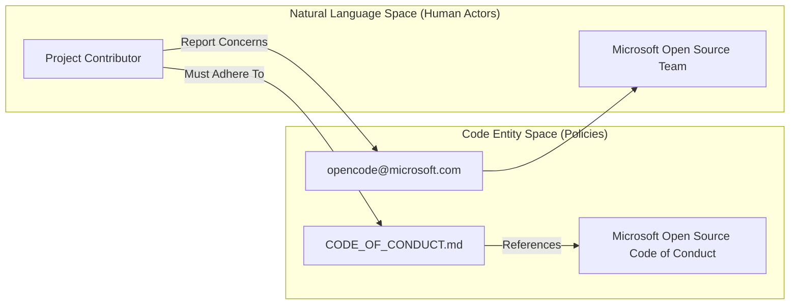

<!-- source: DeepWiki mcp.deepwiki.com · repo microsoft/LEMA · page 6.1 License, Notice, and Code of Conduct · fetched 2026-10-26 -->

# License, Notice, and Code of Conduct

<details>
<summary>Relevant source files</summary>

The following files were used as context for generating this wiki page:

- [CODE_OF_CONDUCT.md](CODE_OF_CONDUCT.md)
- [LICENSE](LICENSE)
- [NOTICE.md](NOTICE.md)

</details>


This page outlines the legal framework, attribution requirements, and community standards governing the LEMA (Learning From Mistakes) codebase. It details the MIT license terms, the specific third-party attributions required by `NOTICE.md`, and the Microsoft Open Source Code of Conduct for contributors.

## Software License

The LEMA project is released under the **MIT License**. This is a permissive free software license that allows for reuse within proprietary software provided that all copies of the licensed software include a copy of the MIT License terms and the copyright notice [LICENSE:1-21]().

### License Terms Summary

| Provision | Description |
| :--- | :--- |
| **Copyright** | Copyright (c) Microsoft Corporation [LICENSE:3-3](). |
| **Permissions** | Permission is granted to deal in the Software without restriction, including rights to use, copy, modify, merge, publish, distribute, sublicense, and/or sell [LICENSE:5-9](). |
| **Conditions** | The copyright notice and permission notice must be included in all copies or substantial portions of the Software [LICENSE:12-13](). |
| **Disclaimer** | The software is provided "as is", without warranty of any kind, express or implied [LICENSE:15-21](). |

**Sources:**
- [LICENSE:1-21]()

## Third-Party Notices and Attributions

The LEMA repository incorporates significant components and datasets from third-party sources. Under the terms of their respective licenses, the project maintains a `NOTICE.md` file that attributes these works and reproduces their license text [NOTICE.md:1-87]().

### Integrated Third-Party Components

The following table maps the integrated third-party assets to their respective sources and licenses as defined in the repository:

| Component | Source | License Type |
| :--- | :--- | :--- |
| **QLoRA Implementation** | [artidoro/qlora](https://github.com/artidoro/qlora) | MIT [NOTICE.md:9-34]() |
| **GSM8K Test Data** | [openai/grade-school-math](https://github.com/openai/grade-school-math) | MIT [NOTICE.md:35-60]() |
| **MATH Test Data** | [hendrycks/math](https://github.com/hendrycks/math) | MIT [NOTICE.md:61-86]() |

### Dependency Attribution Flow

The diagram below illustrates how third-party code and data are ingested into the LEMA environment and the corresponding attribution requirements.

**LEMA Attribution and Data Flow**
```mermaid
graph TD
    subgraph "Third-Party Space"
        [qlora_repo] --> |"Code Logic"| QLoRA_Logic["QLoRA Implementation"]
        [gsm8k_repo] --> |"Test Sets"| GSM8K_Data["GSM8K Test Data"]
        [math_repo] --> |"Test Sets"| MATH_Data["MATH Test Data"]
    end

    subgraph "LEMA Code Entity Space"
        QLoRA_Logic --> qlora_py["qlora.py"]
        GSM8K_Data --> gsm8k_jsonl["gsm8k_test.jsonl"]
        MATH_Data --> math_jsonl["math_test.jsonl"]
    end

    subgraph "Legal Requirements"
        qlora_py -.-> NOTICE["NOTICE.md"]
        gsm8k_jsonl -.-> NOTICE
        math_jsonl -.-> NOTICE
    end

    style NOTICE stroke-width:2px
```

**Sources:**
- [NOTICE.md:1-8]()
- [NOTICE.md:9-34]()
- [NOTICE.md:35-60]()
- [NOTICE.md:61-86]()

## Code of Conduct

LEMA follows the **Microsoft Open Source Code of Conduct**. This policy defines the expectations for community behavior and provides resources for reporting concerns.

### Participation Guidelines
Contributors are expected to adhere to the standards set by Microsoft to ensure a welcoming and respectful environment [CODE_OF_CONDUCT.md:1-3]().

### Reporting and Resources
- **Official Policy:** [Microsoft Open Source Code of Conduct](https://opensource.microsoft.com/codeofconduct) [CODE_OF_CONDUCT.md:7-7]().
- **FAQ:** [Microsoft Code of Conduct FAQ](https://opensource.microsoft.com/codeofconduct/faq) [CODE_OF_CONDUCT.md:8-8]().
- **Contact:** Questions or concerns should be directed to [opencode@microsoft.com](mailto:opencode@microsoft.com) [CODE_OF_CONDUCT.md:9-9]().

### Governance Interaction Model

The following diagram maps the relationship between the project's technical contributors and the governance entities.

**LEMA Governance and Conduct Model**


**Sources:**
- [CODE_OF_CONDUCT.md:1-10]()

---

