# Page: LEMA: Overview and Architecture

# LEMA: Overview and Architecture

<details>
<summary>Relevant source files</summary>

The following files were used as context for generating this wiki page:

- [README.md](README.md)
- [pictures/overall.png](pictures/overall.png)

</details>


The **Learning From Mistakes (LEMA)** framework is a specialized fine-tuning methodology designed to improve the multi-step reasoning capabilities of Large Language Models (LLMs). By mimicking the human process of learning from errors, LEMA transitions models from standard imitation learning to a **mistake-correction paradigm**.

## Purpose and Scope
Standard Supervised Fine-Tuning (SFT) typically focuses on training models to follow correct reasoning paths. LEMA extends this by training models to identify, explain, and correct reasoning errors. This repository provides the complete pipeline for:
1.  **Synthesizing correction data** using teacher LLMs (e.g., GPT-4).
2.  **Fine-tuning** models using QLoRA for efficient parameter updates.
3.  **Evaluating** performance across mathematical (GSM8K, MATH) and commonsense (CSQA) reasoning benchmarks.

For detailed installation instructions, see [Environment Setup and Dependencies](#1.2).

## Core Methodology
The LEMA methodology follows a three-stage process:
1.  **Mistake Generation**: A student model attempts to solve a problem. If the answer is incorrect, the failed reasoning path is collected.
2.  **Correction Synthesis**: A teacher LLM is prompted with the problem and the failed reasoning path to generate a structured correction.
3.  **Correction-Tuning**: The student model is fine-tuned on these (Problem, Mistake, Correction) triplets.

For a deep dive into the paradigm and supported benchmarks, see [Core Concepts and Methodology](#1.1).

### High-Level System Architecture
The following diagram illustrates the relationship between the major subsystems, from data generation to final evaluation.

**Diagram: LEMA System Workflow**
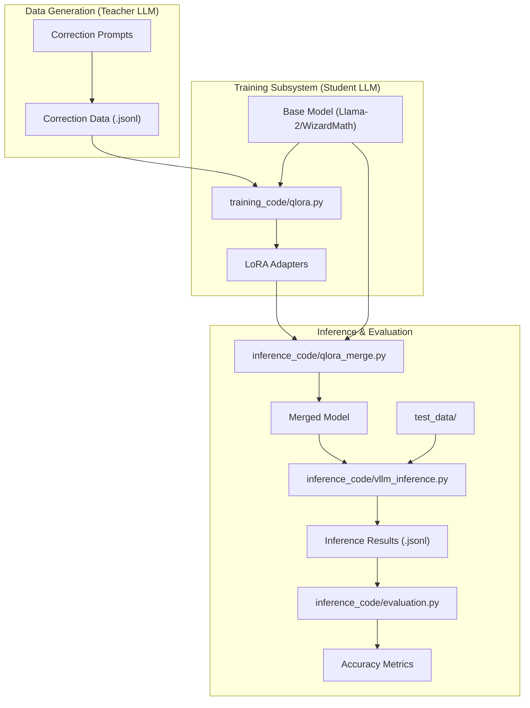
**Sources:** [README.md:21-40](), [README.md:94-116]()

## Major Subsystems

### 1. Data Synthesis
The framework utilizes specific prompt templates to guide a teacher model in generating corrections. These prompts are categorized by the nature of the reasoning task:
*   **Math Reasoning**: Focuses on identifying the first incorrect step and providing a corrected derivation [prompts/gsm8k_correction.txt]().
*   **Commonsense Reasoning**: Focuses on categorical errors (e.g., taxonomic, specificity) and providing a logical justification for the correct choice [prompts/csqa_correction.txt]().

### 2. Training Pipeline
LEMA uses **QLoRA** (Quantized Low-Rank Adaptation) to enable the fine-tuning of large models (up to 70B parameters) on consumer-grade or limited enterprise hardware.
*   **Entrypoint**: `training_code/llama_2_70b_gsm8k.sh` [training_code/llama_2_70b_gsm8k.sh:1-35]()
*   **Core Logic**: The `train()` function in `qlora.py` manages model quantization via `BitsAndBytesConfig` and adapter injection via `peft` [training_code/qlora.py:615-863]().

### 3. Inference and Evaluation
Post-training, the framework requires a specific sequence to validate performance:
1.  **Merging**: The `qlora_merge.py` script integrates adapter weights into the base model using `PeftModel.merge_and_unload()` [inference_code/qlora_merge.py:28-55]().
2.  **Batch Inference**: The `vllm_inference.py` script leverages the **vLLM** engine for high-throughput greedy decoding [inference_code/vllm_inference.py:53-102]().
3.  **Scoring**: The `evaluation.py` script handles dataset-specific answer extraction, such as LaTeX normalization for MATH or numerical filtering for GSM8K [inference_code/evaluation.py:75-155]().

## Code Entity Mapping
The following diagram maps the logical framework components to their specific implementations in the codebase.

**Diagram: Logical Components to Code Entities**
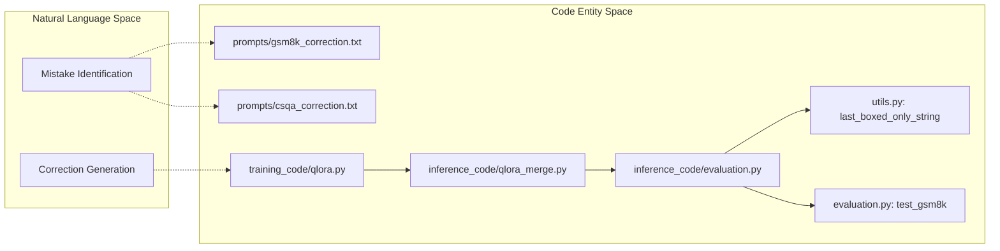
**Sources:** [inference_code/evaluation.py:75-100](), [inference_code/qlora_merge.py:1-20](), [training_code/qlora.py:1-50]()

## Quick Links to Details
*   For the mathematical foundation and mistake-correction logic, see **[Core Concepts and Methodology](#1.1)**.
*   For hardware requirements and library dependencies, see **[Environment Setup and Dependencies](#1.2)**.
*   For details on the training scripts and hyperparameters, see **[Training Pipeline](#3)**.
*   For the evaluation and answer extraction logic, see **[Inference and Evaluation Pipeline](#4)**.

---

# Page: Core Concepts and Methodology

# Core Concepts and Methodology

<details>
<summary>Relevant source files</summary>

The following files were used as context for generating this wiki page:

- [README.md](README.md)
- [test_data/csqa_dev.jsonl](test_data/csqa_dev.jsonl)
- [test_data/gsm8k_test.jsonl](test_data/gsm8k_test.jsonl)
- [test_data/math_test.jsonl](test_data/math_test.jsonl)

</details>


This page provides a technical deep dive into the **Learning From Mistakes (LEMA)** methodology. LEMA is a training paradigm designed to enhance the reasoning capabilities of Large Language Models (LLMs) by fine-tuning them on mistake-correction data pairs rather than just correct solutions [README.md:21-26]().

## The Mistake-Correction Paradigm

Standard Supervised Fine-Tuning (SFT) typically focuses on maximizing the likelihood of a "Golden" correct answer given a question. LEMA introduces a third component: the **Incorrect Reasoning Path**.

### Conceptual Data Flow
The LEMA process mimics human learning by identifying a failure, explaining the cause of the failure, and providing a corrected path.

1.  **Question**: The original problem (e.g., from GSM8K or MATH).
2.  **Incorrect Reasoning**: A generated reasoning path that leads to a wrong answer.
3.  **Correction**: A teacher LLM (e.g., GPT-4) identifies the specific error and provides the correct logic.

### Comparison: SFT vs. LEMA
| Feature | Standard SFT | LEMA (Ours) |
| :--- | :--- | :--- |
| **Input** | Question | Question + Incorrect Reasoning |
| **Target** | Correct Solution | Explanation of Mistake + Corrected Solution |
| **Learning Goal** | Imitate correctness | Recognize and rectify errors |

**Sources:** [README.md:21-40]()

## Supported Benchmarks and Tasks

LEMA is implemented and evaluated across three primary domains: mathematical reasoning and commonsense reasoning.

### 1. Mathematical Reasoning (GSM8K & MATH)
For math tasks, the model is trained to identify arithmetic or logical slips. The evaluation pipeline handles complex LaTeX and numerical extraction to verify performance.
*   **GSM8K**: Grade school math word problems [test_data/gsm8k_test.jsonl:1-12]().
*   **MATH**: Competition-level mathematics requiring rigorous LaTeX formatting [test_data/math_test.jsonl:1-12]().

### 2. Commonsense Reasoning (CSQA)
For CommonsenseQA (CSQA), the methodology shifts to a structured explanation schema. The model must explain why candidate answers are incorrect before selecting the most relevant one.
*   **Schema**: Explanation -> Reason -> Mistakes -> Corrected Answer [test_data/csqa_dev.jsonl:1-16]().

**Sources:** [README.md:27-41](), [test_data/gsm8k_test.jsonl:1-12](), [test_data/math_test.jsonl:1-12](), [test_data/csqa_dev.jsonl:1-16]()

## System Architecture: Data to Model

The following diagram illustrates the relationship between the natural language reasoning tasks and the code entities responsible for processing them.

### Data Processing and Training Flow
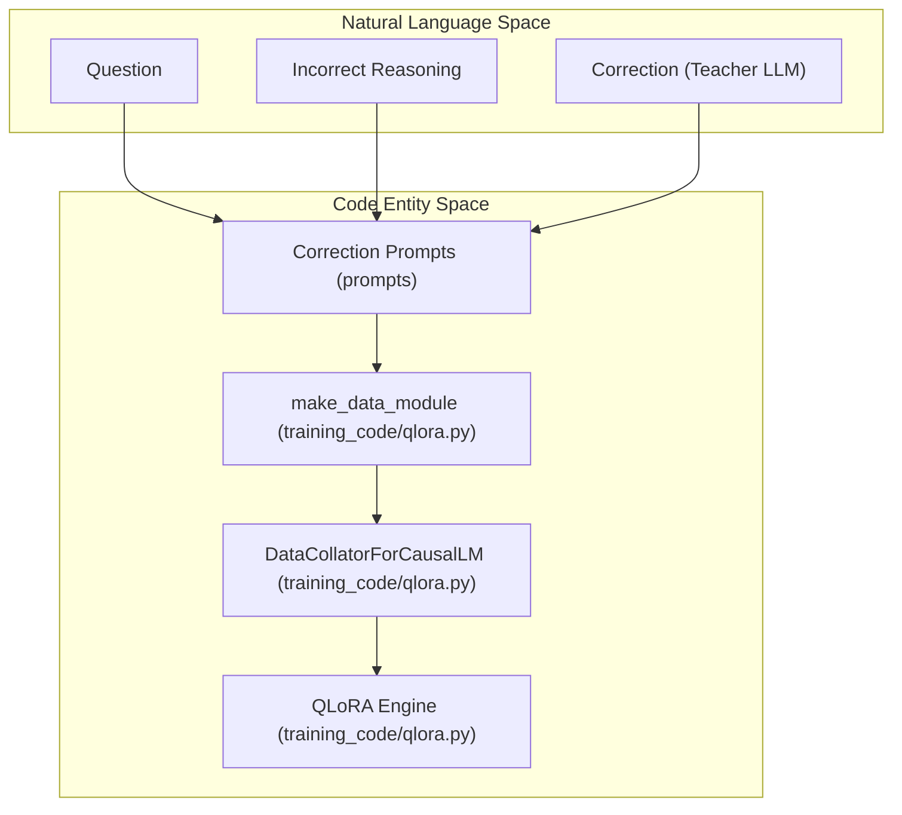
**Sources:** [README.md:60-68](), [training_code/qlora.py:642-658](), [training_code/qlora.py:516-525]()

## Model Variants and Published Weights

The LEMA methodology has been applied to various Llama-2 base models, with weights published on HuggingFace under the `LEMAv1` organization [README.md:6-7]().

### Model Types
1.  **PEFT Adapters**: LoRA weights that must be merged with base Llama-2 models.
    *   Example: `LEMAv1/peft-Llama-2-70b-csqa` [README.md:16]().
2.  **Merged Models**: Full model weights with adapters already integrated for immediate use.
    *   Example: `LEMAv1/merged-Llama-2-70b-gsm8k` [README.md:18]().

### Performance Improvements
LEMA consistently improves upon base Llama-2 models and even specialized models like WizardMath.

| Base Model | Benchmark | Base Accuracy | LEMA Accuracy |
| :--- | :--- | :--- | :--- |
| LLaMA-2-7B | GSM8K | 14.6 | 54.1 |
| LLaMA-2-70B | GSM8K | 56.8 | 83.5 |
| WizardMath-70B | MATH | 22.7 | 27.1 |

**Sources:** [README.md:27-41](), [README.md:84-99]()

## Technical Execution Pipeline

The transition from training to a verifiable result involves a specific sequence of script executions.

### Inference and Evaluation Pipeline
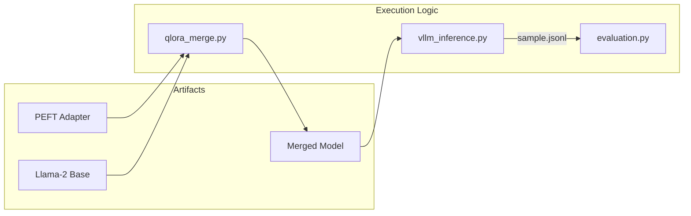

### Key Functions and Entrypoints
*   **Merging**: The `save_trained_model()` function in `qlora_merge.py` handles the `PeftModel.merge_and_unload()` operation to prepare the model for high-throughput inference [README.md:94-99]().
*   **Inference**: The `inference()` function in `vllm_inference.py` utilizes the vLLM engine for batch processing of test datasets [README.md:101-108]().
*   **Accuracy Calculation**: The `evaluation.py` script dispatches to specific extraction functions (e.g., LaTeX stripping for MATH or numerical filtering for GSM8K) to produce final metrics [README.md:110-116]().

**Sources:** [README.md:94-116](), [training_code/qlora.py:848-860]()

---

# Page: Environment Setup and Dependencies

# Environment Setup and Dependencies

<details>
<summary>Relevant source files</summary>

The following files were used as context for generating this wiki page:

- [README.md](README.md)
- [requirements.txt](requirements.txt)

</details>


This page details the technical requirements and configuration steps necessary to initialize the LEMA environment. The framework relies on specific versions of Python, CUDA, and several key libraries (PyTorch, HuggingFace Transformers, QLoRA, and vLLM) to ensure reproducibility of the reasoning performance reported in the research.

## System Requirements

LEMA is optimized for high-performance computing environments, particularly those utilizing NVIDIA GPUs.

### Hardware and Version Specifications
*   **Python**: Version `3.10.11` is recommended for compatibility with the dependency stack [README.md:52-52]().
*   **CUDA/cuDNN**: The environment is validated against **CUDA 11.7** and **cuDNN 8** [README.md:54-54]().
*   **Base Image**: The project recommends using the official `pytorch/pytorch:2.0.1-cuda11.7-cudnn8-devel` Docker image [README.md:47-47]().
*   **Compute**: Training large models like Llama-2-70B requires significant VRAM. The inference pipeline supports distributed execution via `tensor_parallel_size` [README.md:108-108]().

### Sources:
* [README.md:47-56]()
* [README.md:108-108]()

---

## Dependency Stack

The LEMA framework integrates several subsystems for training (QLoRA), inference (vLLM), and infrastructure management (Azure ML/Ray).

### Core Libraries
The following table summarizes the primary dependencies defined in `requirements.txt`:

| Library | Version | Role |
| :--- | :--- | :--- |
| `torch` | `2.0.1` | Primary tensor library and autograd engine [README.md:54-54](). |
| `transformers` | `4.31.0` | Model architecture, tokenization, and configuration [requirements.txt:2-2](). |
| `peft` | `0.4.0` | Parameter-Efficient Fine-Tuning (LoRA/QLoRA) [requirements.txt:4-4](). |
| `bitsandbytes` | `0.41.0` | 4-bit and 8-bit quantization for QLoRA [requirements.txt:7-7](). |
| `vllm` | `0.1.4` | High-throughput batch inference [requirements.txt:23-23](). |
| `accelerate` | `0.21.0` | Distributed training and device placement [requirements.txt:3-3](). |
| `ray` | `2.6.1` | Distributed compute orchestration [requirements.txt:25-25](). |

### Infrastructure Integration
LEMA includes support for cloud-native workflows:
*   **Azure ML**: Integration via `azureml-core` and `azureml-mlflow` for experiment tracking and resource management [requirements.txt:21-22]().
*   **Ray-on-AML**: A specific integration library (`ray-on-aml`) allows running Ray clusters on Azure Machine Learning compute instances [requirements.txt:26-26]().

### Sources:
* [requirements.txt:1-30]()
* [README.md:54-56]()
* [README.md:89-90]()

---

## Installation and Authentication

### Environment Initialization
The setup follows a standard Conda-based installation flow.

```bash
# Clone the repository
git clone https://github.com/microsoft/LEMA.git
cd LEMA

# Create and activate environment
conda create -n LEMA python=3.10.11
conda activate LEMA

# Install specific PyTorch version
pip install torch==2.0.1

# Install remaining dependencies
pip install -r requirements.txt
```

### HuggingFace Authentication
Accessing the Llama-2 base models requires an authenticated HuggingFace account with granted access from Meta.
```bash
huggingface-cli login
```
This authentication is mandatory for both the training scripts [README.md:73-73]() and the evaluation pipeline [README.md:91-91]().

### Sources:
* [README.md:49-56]()
* [README.md:73-73]()
* [README.md:91-91]()

---

## Software Component Architecture

The following diagram bridges the high-level environment requirements to the specific code entities that utilize them.

### Dependency and Implementation Mapping
"This diagram maps external library dependencies to the core LEMA scripts and their respective roles."

```mermaid
graph TD
    subgraph "External_Dependencies"
        [bitsandbytes] --> QL["QLoRA Engine"]
        [peft] --> QL
        [vllm] --> INF["Inference Engine"]
        [ray-on-aml] --> DIST["Distributed Orchestration"]
    end

    subgraph "Code_Entity_Space"
        QL --> T_CODE["training_code/qlora.py"]
        INF --> I_CODE["inference_code/vllm_inference.py"]
        DIST --> I_CODE
    end

    subgraph "Data_Flow"
        T_CODE -- "Saves Adapters" --> ADAP["SavePeftModelCallback"]
        ADAP -- "Input to" --> MERGE["inference_code/qlora_merge.py"]
        MERGE -- "Merged Model" --> I_CODE
    end
```

### Sources:
* [requirements.txt:4-26]()
* [README.md:67-68]()
* [README.md:81-82]()
* [README.md:96-99]()

---

## Infrastructure and Distributed Prerequisites

LEMA utilizes `vLLM` and `Ray` for efficient inference across multiple GPUs. 

### NCCL Configuration
When running distributed inference (e.g., Llama-2-70B across 4 GPUs), it may be necessary to disable Peer-to-Peer (P2P) communication depending on the hardware topology to avoid hangs:
```bash
export NCCL_IGNORE_DISABLED_P2P=1
```
This environment variable is specifically recommended before executing `vllm_inference.py` [README.md:102-103]().

### Distributed Inference Parameters
The `vllm_inference.py` script leverages the following configuration for Ray/vLLM integration:
*   `--tensor_parallel_size`: Defines the number of GPUs to shard the model across [README.md:108-108]().
*   `Ray`: Orchestrates the `vLLM` worker processes, particularly when running on Azure ML via `ray-on-aml` [requirements.txt:25-26]().

### Sources:
* [README.md:101-109]()
* [requirements.txt:25-26]()

---

# Page: Data Generation: Correction Prompts

# Data Generation: Correction Prompts

<details>
<summary>Relevant source files</summary>

The following files were used as context for generating this wiki page:

- [README.md](README.md)
- [prompts/prompt_correction_csqa.txt](prompts/prompt_correction_csqa.txt)
- [prompts/prompt_correction_gsm8k.txt](prompts/prompt_correction_gsm8k.txt)
- [prompts/prompt_correction_math.txt](prompts/prompt_correction_math.txt)

</details>


The LEMA (Learning From Mistakes) framework relies on a data synthesis phase where a teacher LLM is prompted to generate mistake-correction pairs. Instead of simply training on correct solutions, LEMA generates "incorrect" reasoning traces and then uses specific prompts to identify the errors and provide corrected paths. This mimics human pedagogical methods where students learn by analyzing their own failures.

## Correction Methodology

The core of the data generation process is the **Correction Prompt**. This prompt instructs a teacher LLM (such as GPT-4) to act as an evaluator and tutor. The input to these prompts typically consists of a question and an "Original Solution" (which is often a sampled incorrect output from a smaller model or a perturbed reasoning chain). The teacher LLM is then tasked with producing:
1.  **Identification**: Locating the specific step where the reasoning first deviated from the correct path.
2.  **Explanation**: Describing *why* that specific step is logically or mathematically unsound.
3.  **Correction**: Providing a valid completion of the reasoning starting from the last correct point.

### Relationship Between System Components

The following diagram illustrates how the prompt templates interface with the teacher LLM to generate the training data used by the fine-tuning engine.

**Data Synthesis Flow**
```mermaid
graph TD
    subgraph "Natural Language Space"
        [User_Prompt] --> [Teacher_LLM]
        [Original_Mistake] --> [Teacher_LLM]
    end

    subgraph "Code Entity Space"
        [Teacher_LLM] -- "Generates" --> [Correction_Data_JSONL]
        [Correction_Data_JSONL] -- "Consumed by" --> [make_data_module]
        [make_data_module] -- "Feeds" --> [qlora.py:train]
    end

    [prompts/prompt_correction_gsm8k.txt] -. "Template for" .-> [User_Prompt]
    [prompts/prompt_correction_csqa.txt] -. "Template for" .-> [User_Prompt]
```

**Sources:**
*   [README.md:21-26]()
*   [README.md:58-62]()

---

## GSM8K and MATH Correction Prompts

For mathematical reasoning, the prompts focus on sequential logic. The teacher LLM is provided with a few-shot context where it sees a math word problem followed by a step-by-step "Original Solution" that contains a calculation or conceptual error. 

The prompt structure forces the model to output a structured block containing an `Incorrect Step` identifier, an `Explanation` of the error, and a `Correct Solution`. This format is consistent across both the GSM8K (grade school math) and MATH (competition level) datasets, though the complexity of the few-shot examples differs to match the target difficulty.

For details on the specific step-by-step identification logic and LaTeX formatting requirements, see **[GSM8K and MATH Correction Prompts](#2.1)**.

**Sources:**
*   [prompts/prompt_correction_gsm8k.txt:1-82]()
*   [prompts/prompt_correction_math.txt:1-112]()

---

## CommonsenseQA Correction Prompt

Unlike the mathematical datasets, the CommonsenseQA (CSQA) prompt deals with multi-choice questions and qualitative reasoning. The correction prompt for CSQA is more elaborate, requiring the teacher LLM to evaluate five distinct candidate answers.

The generated correction data for CSQA follows a schema of `Explanations` (for all choices), `Reasons and Final Answer`, a `Mistakes` section identifying flaws in the initial reasoning, and a final `Corrected Answer` block. This targets four specific types of reasoning errors:
*   Contextual relevance
*   Taxonomic errors
*   Likely vs. serious conflation
*   Specificity issues

For details on the structured schema and the reasoning error categories, see **[CommonsenseQA Correction Prompt](#2.2)**.

**Sources:**
*   [prompts/prompt_correction_csqa.txt:1-69]()

---

## Prompt Template Mapping

The following table maps the dataset types to their respective prompt templates within the repository:

| Dataset | Prompt File Path | Primary Logic Type |
| :--- | :--- | :--- |
| **GSM8K** | `prompts/prompt_correction_gsm8k.txt` | Arithmetic/Step-based |
| **MATH** | `prompts/prompt_correction_math.txt` | Advanced Symbolic/LaTeX |
| **CSQA** | `prompts/prompt_correction_csqa.txt` | Commonsense/Elimination |

**Sources:**
*   [prompts/prompt_correction_gsm8k.txt:1-1]()
*   [prompts/prompt_correction_math.txt:1-1]()
*   [prompts/prompt_correction_csqa.txt:1-1]()

---

# Page: GSM8K and MATH Correction Prompts

# GSM8K and MATH Correction Prompts

<details>
<summary>Relevant source files</summary>

The following files were used as context for generating this wiki page:

- [prompts/prompt_correction_gsm8k.txt](prompts/prompt_correction_gsm8k.txt)
- [prompts/prompt_correction_math.txt](prompts/prompt_correction_math.txt)

</details>


The LEMA (Learning From Mistakes) framework relies on a "Teacher" LLM to synthesize training data by correcting erroneous reasoning steps in math problems. This page details the structured few-shot prompts used to guide the Teacher LLM in identifying mistakes and generating corrected rationales for the **GSM8K** (Grade School Math 8K) and **MATH** (Competition Mathematics) datasets.

## Prompt Purpose and Logic

The correction prompts are designed to transform a triplet of (Question, Incorrect Solution, Ground Truth Answer) into a structured correction entry. The goal is to produce a "Mistake-Correction" pair that can be used for supervised fine-tuning (SFT). 

The Teacher LLM is instructed to:
1.  **Locate**: Identify the specific step where the reasoning first deviates from the correct path.
2.  **Explain**: Articulate in natural language why that specific step is logically or computationally flawed.
3.  **Correct**: Rewrite the solution starting from the point of failure, ensuring the final answer matches the known ground truth.

### Prompt Structure
Both GSM8K and MATH prompts follow a consistent block-based structure:
*   **System Instruction**: A high-level directive to identify errors and provide corrections [prompts/prompt_correction_gsm8k.txt:1-1](), [prompts/prompt_correction_math.txt:1-1]().
*   **Few-Shot Examples**: Multiple examples containing a `Question`, an `Original Solution` (partitioned into steps), an `Incorrect Step` identifier, an `Explanation`, and the `Correct Solution` [prompts/prompt_correction_gsm8k.txt:3-18]().
*   **Target Input**: The new problem and incorrect solution to be processed by the model.

---

## GSM8K Correction Prompt

The GSM8K prompt focuses on multi-step arithmetic word problems. The few-shot examples highlight common errors such as misinterpreting problem constraints or failing to account for all variables.

### Example Schema
| Field | Description |
| :--- | :--- |
| **Question** | The natural language math word problem. |
| **Original Solution** | A step-by-step reasoning chain (Step 1, Step 2, etc.) enclosed in curly braces `{}`. |
| **Incorrect Step** | A pointer to the specific step index (e.g., `Step 2`). |
| **Explanation** | A concise description of the logical fallacy (e.g., "The original solution incorrectly assumes that there are four ships instead of three") [prompts/prompt_correction_gsm8k.txt:31-32](). |
| **Correct Solution** | The revised reasoning chain leading to the final answer. |

### Data Flow: Natural Language to Correction Entity

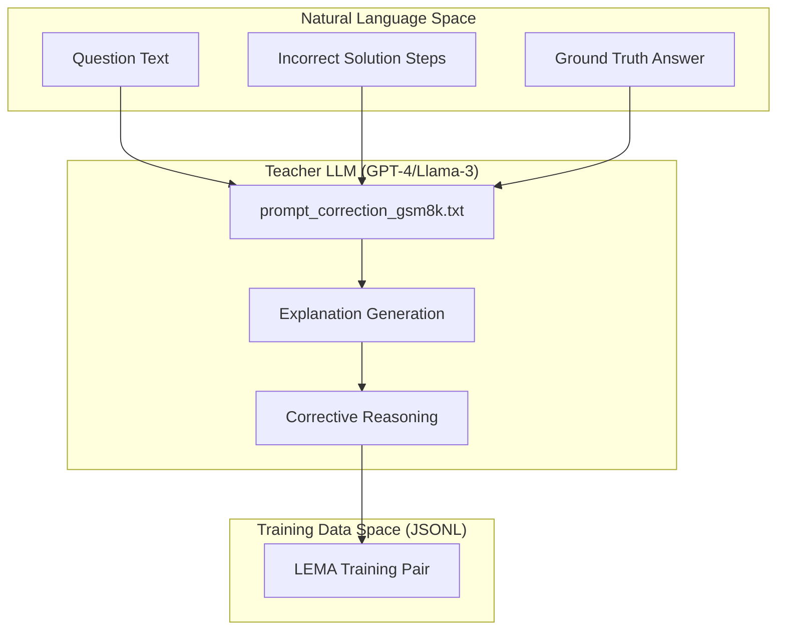
**Sources:** [prompts/prompt_correction_gsm8k.txt:1-82]()

---

## MATH Correction Prompt

The MATH dataset prompt handles more complex competition-level problems involving LaTeX formatting, algebraic proofs, and geometric reasoning.

### Key Differences from GSM8K
1.  **LaTeX Integration**: The prompt explicitly handles LaTeX environments such as `\begin{cases}` and `[asy]` (Asymptote) code for geometry [prompts/prompt_correction_math.txt:4-7](), [prompts/prompt_correction_math.txt:60-67]().
2.  **Mathematical Rigor**: Explanations often target conceptual misunderstandings, such as incorrect assumptions about geometric properties or boundary conditions in piecewise functions [prompts/prompt_correction_math.txt:79-80]().
3.  **Final Answer Formatting**: Uses the `\boxed{}` notation standard for the MATH benchmark [prompts/prompt_correction_math.txt:17-17](), [prompts/prompt_correction_math.txt:29-29]().

### Prompt Components Association

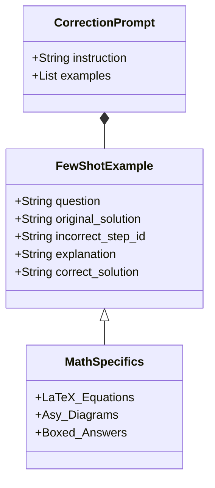
**Sources:** [prompts/prompt_correction_math.txt:1-112]()

---

## Correction Patterns and Examples

The prompts instruct the teacher to identify specific types of reasoning failures:

### 1. Calculation Errors
In the MATH prompt, a common example involves a simple arithmetic mistake within a functional evaluation.
*   **Mistake**: $f(2) = 2(2)^2 - 3 = 8$ [prompts/prompt_correction_math.txt:13-13]().
*   **Explanation**: "The calculation for $f(2)$ in the first case is wrong. It should be $f(2) = 2(2)^2 - 3 = 2(4) - 3 = 8 - 3 = 5$" [prompts/prompt_correction_math.txt:21-21]().

### 2. Constraint Misinterpretation
In the GSM8K prompt, the teacher identifies when a model ignores a specific numerical constraint in the text.
*   **Mistake**: Calculating shoe cost by assuming the entire budget was spent [prompts/prompt_correction_gsm8k.txt:7-7]().
*   **Explanation**: "The problem states that Alexis has $16 left from her budget, not that she spent her entire budget" [prompts/prompt_correction_gsm8k.txt:11-11]().

### 3. Conceptual/Assumption Errors
Identifying when a model makes an incorrect mathematical assumption.
*   **Mistake**: Assuming the two given sides of a right triangle are always the legs when seeking the *least* possible third side [prompts/prompt_correction_math.txt:93-93]().
*   **Explanation**: "To find the least possible length of the third side, we should assume that the given side lengths are the hypotenuse and one of the legs" [prompts/prompt_correction_math.txt:102-102]().

**Sources:** [prompts/prompt_correction_gsm8k.txt:1-82](), [prompts/prompt_correction_math.txt:1-112]()

---

# Page: CommonsenseQA Correction Prompt

# CommonsenseQA Correction Prompt

<details>
<summary>Relevant source files</summary>

The following files were used as context for generating this wiki page:

- [prompts/prompt_correction_csqa.txt](prompts/prompt_correction_csqa.txt)

</details>


The CommonsenseQA (CSQA) correction prompt is a specialized few-shot template designed to instruct a teacher LLM to identify and rectify reasoning errors in commonsense tasks. Unlike mathematical tasks where errors are often computational, CSQA errors involve nuances in semantics, taxonomic relationships, and contextual relevance. This prompt facilitates the generation of the "Learning from Mistakes" (LEMA) dataset by transforming incorrect or suboptimal reasoning chains into structured corrections.

### Purpose and Scope
The correction prompt targets the gap between a model's initial incorrect prediction and the ground truth by forcing the teacher model to explicitly articulate the nature of the mistake before providing a corrected solution [prompts/prompt_correction_csqa.txt:1-18](). This structured output—consisting of Explanations, Reasons, Mistakes, and Corrected Answers—is later used to fine-tune student models (e.g., Llama-2-70B) to recognize and avoid similar pitfalls [qlora.py:1-20]().

---

### Prompt Structure and Schema
The template follows a rigid few-shot structure to ensure the generated data is parsable and consistent. Each example in the prompt consists of the following components:

| Component | Description |
| :--- | :--- |
| **Question** | The original commonsense question from the CSQA dataset [prompts/prompt_correction_csqa.txt:3](). |
| **Candidate Answers** | The five multiple-choice options provided in the dataset [prompts/prompt_correction_csqa.txt:4](). |
| **Original Answer** | A JSON-like block containing the initial (incorrect) `Explanations` for each candidate and the `Reasons and Final Answer` [prompts/prompt_correction_csqa.txt:5-16](). |
| **Mistakes** | A natural language description of why the original reasoning was flawed [prompts/prompt_correction_csqa.txt:17](). |
| **Corrected Answer** | A revised JSON-like block containing corrected `Explanations` and a valid `Reasons and Final Answer` [prompts/prompt_correction_csqa.txt:18-29](). |

#### Data Flow: Natural Language to Code Entity
The following diagram illustrates how the components of the `prompt_correction_csqa.txt` template map to the data structures used during inference and evaluation.

**CSQA Data Processing Flow**
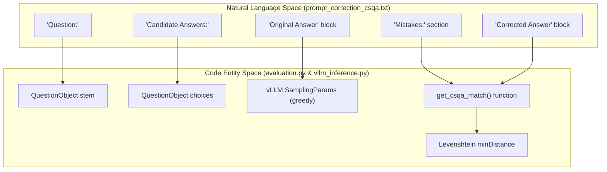
**Sources:** [prompts/prompt_correction_csqa.txt:1-30](), [evaluation.py:126-150](), [vllm_inference.py:65-80]()

---

### Targeted Reasoning Errors
The CSQA correction prompt specifically instructs the teacher model to address four primary categories of reasoning errors identified in commonsense benchmarks:

1.  **Contextual Relevance**: Correcting instances where a model chooses an answer that is technically possible but contextually inferior (e.g., choosing "floor" over "trouble" when a cat rips things apart) [prompts/prompt_correction_csqa.txt:11-17]().
2.  **Taxonomic Errors**: Identifying failures to recognize category memberships (e.g., failing to acknowledge that a "rose garden" is a specific instance of "red flowers") [prompts/prompt_correction_csqa.txt:45-52]().
3.  **Likely vs. Serious Conflation**: Distinguishing between a consequence that is "serious" (like illness) versus one that is "likely" or "immediate" (like a stomach ache) based on the question's phrasing [prompts/prompt_correction_csqa.txt:66-75]().
4.  **Specificity vs. Generality**: Correcting the dismissal of specific answers as "too specific" when they are actually the most relevant choice given the constraints of the question [prompts/prompt_correction_csqa.txt:54-56]().

---

### Pipeline Interface and Evaluation
Once the teacher LLM generates the correction using the prompt, the output is processed through the LEMA evaluation pipeline.

#### Answer Extraction
The `evaluation.py` script utilizes the `get_csqa_match` function to handle the extraction of the final answer from the corrected block. Because LLMs may slightly rephrase the candidate answers (e.g., "rose garden" vs "the rose garden"), the system employs a Levenshtein distance-based matching strategy [evaluation.py:136-148]().

#### Evaluation Logic
1.  **Input**: The generated text from `vllm_inference.py` [vllm_inference.py:85-95]().
2.  **Matching**: `get_csqa_match` iterates through the `choices` list from the original `csqa_dev.jsonl` [evaluation.py:137-140]().
3.  **Distance Calculation**: It calculates the `minDistance` between the model's predicted string and the ground truth candidates [evaluation.py:141-145]().
4.  **Metric**: The system records a "1" if the matched candidate corresponds to the `answerKey` and "0" otherwise [evaluation.py:149-155]().

**System Component Interaction**
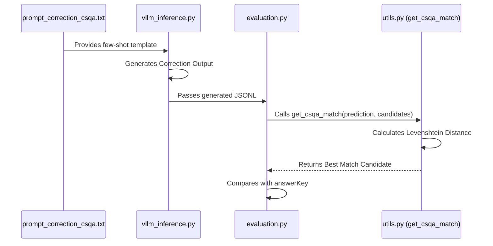
**Sources:** [evaluation.py:126-155](), [vllm_inference.py:30-50](), [prompts/prompt_correction_csqa.txt:1-29]()

### Technical Implementation Details
*   **Prompt File**: `prompts/prompt_correction_csqa.txt` [prompts/prompt_correction_csqa.txt:1-80]()
*   **Matching Function**: `get_csqa_match` in `evaluation.py` [evaluation.py:136-148]()
*   **Dataset Schema**: The prompt expects a format compatible with the CSQA `QuestionObject`, which includes `stem` and `choices` [evaluation.py:126-130]().
*   **Inference Settings**: During the generation of corrections, `vllm_inference.py` typically uses a `temperature=0` (greedy decoding) via `SamplingParams` to ensure the most logical correction is generated [vllm_inference.py:73-76]().

**Sources:**
* [prompts/prompt_correction_csqa.txt:1-80]()
* [evaluation.py:126-155]()
* [vllm_inference.py:65-95]()
* [qlora.py:1-20]()

---

# Page: Training Pipeline

# Training Pipeline

<details>
<summary>Relevant source files</summary>

The following files were used as context for generating this wiki page:

- [README.md](README.md)
- [training_code/llama_2_70b_gsm8k.sh](training_code/llama_2_70b_gsm8k.sh)
- [training_code/qlora.py](training_code/qlora.py)

</details>


The LEMA training pipeline leverages **QLoRA** (Quantized Low-Rank Adaptation) to efficiently fine-tune Large Language Models on mistake-correction data pairs [README.md:67-67](). By utilizing 4-bit quantization and adapter-based tuning, the system can fine-tune models as large as Llama-2-70B on consumer-grade or mid-range enterprise hardware [README.md:35-36]().

The pipeline is designed to ingest structured correction data (Incorrect Step, Explanation, Correct Solution) and produce PEFT (Parameter-Efficient Fine-Tuning) adapters that enhance the model's reasoning capabilities across benchmarks like GSM8K, MATH, and CommonsenseQA [README.md:27-40]().

### Pipeline Architecture

The training process is orchestrated by a shell script that invokes a specialized Python engine. The engine handles model quantization, data tokenization, and the training loop.

#### Data to Code Entity Mapping
The following diagram illustrates how the conceptual training components map to specific code entities within the `training_code` directory.

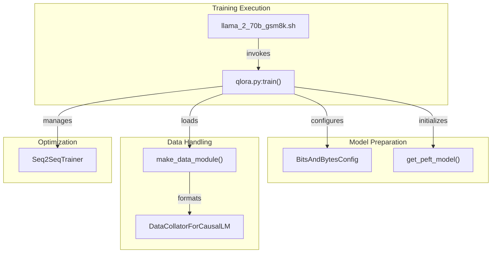
**Sources:** [training_code/qlora.py:721-721](), [training_code/llama_2_70b_gsm8k.sh:1-1]()

---

### Training Configuration
The pipeline is highly configurable via command-line arguments. The primary entry point for users is the `llama_2_70b_gsm8k.sh` script, which defines hyperparameters such as:
*   **Quantization:** 4-bit NormalFloat (`nf4`) with double quantization [training_code/llama_2_70b_gsm8k.sh:26-28]().
*   **LoRA Settings:** Rank (`lora_r`), Alpha, and target modules (typically `all` linear layers) [training_code/llama_2_70b_gsm8k.sh:20-22]().
*   **Optimization:** Paged AdamW optimizer with constant learning rate schedules [training_code/llama_2_70b_gsm8k.sh:10-16]().

For a comprehensive breakdown of all available flags and their recommended values for different datasets, see **[Training Script Configuration (llama_2_70b_gsm8k.sh)](#3.1)**.

**Sources:** [training_code/llama_2_70b_gsm8k.sh:1-51]()

---

### QLoRA Implementation Engine
The core logic resides in `qlora.py`. This script manages the complex lifecycle of a quantized training run:
1.  **Argument Parsing:** Uses `ModelArguments`, `DataArguments`, and `TrainingArguments` dataclasses to validate inputs [training_code/qlora.py:80-206]().
2.  **Model Quantization:** Implements `get_accelerate_model` to load base models (e.g., Llama-2) in 4-bit while preparing them for adapter insertion [training_code/qlora.py:410-410]().
3.  **Data Processing:** Utilizes `make_data_module` and a custom `DataCollatorForCausalLM` to handle sequence padding and instruction-based formatting [training_code/qlora.py:530-530]().
4.  **Checkpointing:** Employs `SavePeftModelCallback` to ensure that only the lightweight adapter weights are saved, rather than the full quantized base model [training_code/qlora.py:454-454]().

For a deep dive into the internal functions and the hardware-specific optimizations (including IPEX/XPU support), see **[QLoRA Fine-Tuning Engine (qlora.py)](#3.2)**.

**Sources:** [training_code/qlora.py:80-721]()

---

### Pipeline Flow: From Data to Adapter
This diagram bridges the gap between the raw training data and the final generated artifacts.

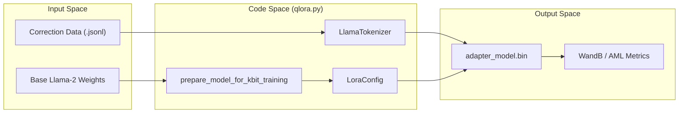
**Sources:** [training_code/qlora.py:31-41](), [training_code/qlora.py:530-550](), [training_code/llama_2_70b_gsm8k.sh:46-50]()

---

# Page: Training Script Configuration (llama_2_70b_gsm8k.sh)

# Training Script Configuration (llama_2_70b_gsm8k.sh)

<details>
<summary>Relevant source files</summary>

The following files were used as context for generating this wiki page:

- [README.md](README.md)
- [training_code/llama_2_70b_gsm8k.sh](training_code/llama_2_70b_gsm8k.sh)

</details>


The `llama_2_70b_gsm8k.sh` script serves as the primary entry point for fine-tuning Llama-2-70B models using the Learning from Mistakes (LEMA) methodology. It leverages the QLoRA (Quantized Low-Rank Adaptation) framework to enable high-parameter model training on consumer-grade or limited enterprise hardware by utilizing 4-bit quantization and parameter-efficient fine-tuning.

## Script Overview and Execution Flow

The script uses the `accelerate launch` utility to manage distributed training environments and executes `qlora.py` with a specific set of hyperparameters tailored for reasoning tasks like GSM8K and MATH.

### Data and Model Association Diagram
This diagram illustrates how the shell script variables map to the internal `qlora.py` argument structures and the resulting data flow into the training engine.

**Training Configuration Data Flow**
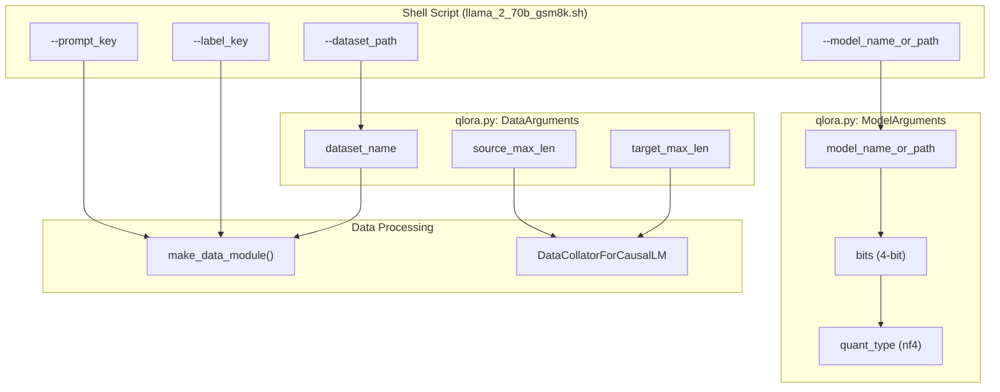
**Sources:** [training_code/llama_2_70b_gsm8k.sh:1-6](), [training_code/qlora.py:165-227]()

---

## Hyperparameter Configurations

The script defines several categories of hyperparameters that control the model's learning behavior, memory footprint, and adapter structure.

### 1. Model Quantization and LoRA Settings
The configuration utilizes 4-bit NormalFloat (`nf4`) quantization with double quantization to minimize memory usage while maintaining performance for the 70B parameter model.

| Parameter | Value | Description |
| :--- | :--- | :--- |
| `bits` | 4 | Quantization level for base model weights [training_code/llama_2_70b_gsm8k.sh:26](). |
| `quant_type` | nf4 | Uses NormalFloat4, optimized for normally distributed weights [training_code/llama_2_70b_gsm8k.sh:28](). |
| `double_quant` | True | Quantizes the quantization constants for further memory savings [training_code/llama_2_70b_gsm8k.sh:27](). |
| `lora_r` | 64 | The rank of the adapter matrices [training_code/llama_2_70b_gsm8k.sh:21](). |
| `lora_alpha` | 16 | Scaling factor for LoRA [training_code/llama_2_70b_gsm8k.sh:22](). |
| `lora_modules` | all | Applies LoRA to all linear layers in the transformer block [training_code/llama_2_70b_gsm8k.sh:20](). |

### 2. Learning Rate and Optimizer
LEMA uses a constant learning rate schedule, which has been found effective for fine-tuning on correction data pairs.

*   **Learning Rate:** Set to `0.0001` for models $\ge$ 34B parameters and `0.0002` for smaller models [training_code/llama_2_70b_gsm8k.sh:9]().
*   **Optimizer:** `paged_adamw_32bit` is used to handle memory spikes by paging optimizer states to CPU RAM [training_code/llama_2_70b_gsm8k.sh:16]().
*   **Schedule:** A `constant` scheduler with a `warmup_ratio` of `0.0` [training_code/llama_2_70b_gsm8k.sh:10-11]().

### 3. Sequence Length and Batching Strategy
The script differentiates settings between the GSM8K and MATH datasets to account for the varying complexity and length of reasoning chains.

| Setting | GSM8K Value | MATH Value | Source |
| :--- | :--- | :--- | :--- |
| `source_max_len` | 512 | 768 | [training_code/llama_2_70b_gsm8k.sh:12]() |
| `target_max_len` | 512 | 768 | [training_code/llama_2_70b_gsm8k.sh:13]() |
| `per_device_train_batch_size` | 6 | 3 | [training_code/llama_2_70b_gsm8k.sh:14]() |
| `gradient_accumulation_steps` | 4 | 8 | [training_code/llama_2_70b_gsm8k.sh:15]() |

**Total Batch Size Calculation:**
The effective batch size is calculated as:
`per_device_train_batch_size` × `gradient_accumulation_steps` × `num_gpus`.
For GSM8K on 4 GPUs: $6 \times 4 \times 4 = 96$ [training_code/llama_2_70b_gsm8k.sh:15]().

---

## Infrastructure and Logging

### Hardware Efficiency
To fit the 70B model during training, the script enables:
*   **Gradient Checkpointing:** Reduces VRAM usage by recomputing activations during the backward pass [training_code/llama_2_70b_gsm8k.sh:29]().
*   **Group by Length:** Groups sequences of similar lengths into batches to minimize padding tokens and increase throughput [training_code/llama_2_70b_gsm8k.sh:44]().
*   **BF16 Training:** Uses BFloat16 precision for training stability on supported hardware (e.g., A100/H100) [training_code/llama_2_70b_gsm8k.sh:24]().

### Reporting and Checkpointing
The script integrates with Weights & Biases (WandB) and Azure Machine Learning (AML) for experiment tracking.

**Reporting Architecture**
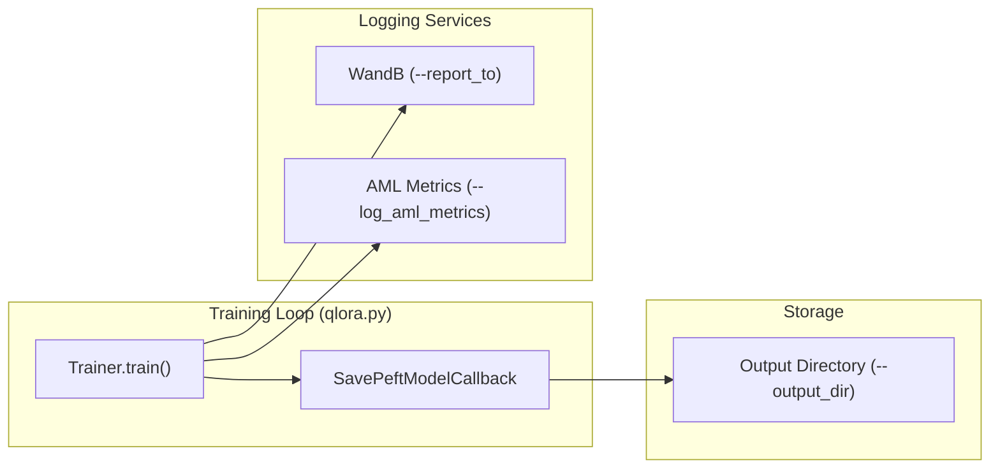
**Sources:** [training_code/llama_2_70b_gsm8k.sh:46-50](), [training_code/qlora.py:532-550]()

*   **Checkpointing:** Models are saved every 100 steps (`save_steps 100`) with a limit of 40 total checkpoints kept on disk [training_code/llama_2_70b_gsm8k.sh:40-41]().
*   **Logging:** Training metrics are logged every 10 steps (`logging_steps 10`) [training_code/llama_2_70b_gsm8k.sh:38]().

**Sources:**
* `training_code/llama_2_70b_gsm8k.sh`
* `training_code/qlora.py`
* `README.md`

---

# Page: QLoRA Fine-Tuning Engine (qlora.py)

# QLoRA Fine-Tuning Engine (qlora.py)

<details>
<summary>Relevant source files</summary>

The following files were used as context for generating this wiki page:

- [training_code/qlora.py](training_code/qlora.py)

</details>


The `qlora.py` script is the core training engine of the LEMA framework. It implements the QLoRA (Quantized Low-Rank Adaptation) algorithm, enabling efficient fine-tuning of large language models (up to 70B parameters) on consumer-grade or mid-range hardware by combining 4-bit quantization with LoRA adapters [training_code/qlora.py:1-42]().

## System Architecture and Data Flow

The training engine follows a structured pipeline from argument parsing to model saving. It leverages the Hugging Face `transformers` and `peft` libraries to handle model quantization, adapter injection, and distributed training.

### High-Level Training Flow
The following diagram bridges the logical training stages to the specific code entities responsible for them.

**Diagram: Training Engine Logic to Code Entity Mapping**
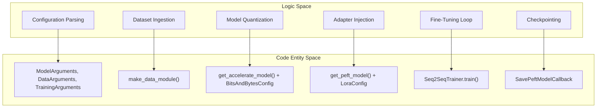
**Sources:** [training_code/qlora.py:80-210](), [training_code/qlora.py:734-800](), [training_code/qlora.py:612-732](), [training_code/qlora.py:840-870]()

---

## Configuration Dataclasses

The engine uses four primary dataclasses to manage configuration, extending standard Hugging Face arguments:

| Class | Purpose | Key Parameters |
| :--- | :--- | :--- |
| `ModelArguments` | Model identification and loading. | `model_name_or_path`, `trust_remote_code` [training_code/qlora.py:80-93]() |
| `DataArguments` | Dataset paths and sequence lengths. | `dataset_path`, `source_max_len`, `target_max_len`, `prompt_key` [training_code/qlora.py:95-133]() |
| `TrainingArguments` | Optimization and QLoRA specifics. | `bits` (4 or 8), `quant_type` (nf4/fp4), `lora_r`, `lora_alpha`, `double_quant` [training_code/qlora.py:135-210]() |
| `GenerationArguments` | Evaluation-time decoding parameters. | `max_new_tokens`, `do_sample`, `temperature` [training_code/qlora.py:212-230]() |

**Sources:** [training_code/qlora.py:80-230]()

---

## Model Loading and Quantization

The `get_accelerate_model` function is responsible for the hardware-aware initialization of the model.

### Quantization Pipeline
1.  **Device Detection**: Checks for CUDA or Intel XPU (via `is_ipex_available`) [training_code/qlora.py:49-69]().
2.  **Quantization Config**: Initializes `BitsAndBytesConfig` using `args.bits`, `args.quant_type` (defaulting to `nf4`), and `args.double_quant` [training_code/qlora.py:633-640]().
3.  **Model Loading**: Loads the base model via `AutoModelForCausalLM.from_pretrained` with `low_cpu_mem_usage=True` [training_code/qlora.py:642-658]().
4.  **K-Bit Preparation**: Calls `prepare_model_for_kbit_training` to enable gradient checkpointing and prepare the model for adapter attachment [training_code/qlora.py:688-689]().

### Adapter Insertion
If `full_finetune` is false, the engine identifies all linear layers (e.g., `q_proj`, `v_proj`, `k_proj`) and injects LoRA adapters using `get_peft_model` [training_code/qlora.py:702-730]().

**Sources:** [training_code/qlora.py:612-732]()

---

## Data Processing and Ingestion

The data pipeline converts raw JSONL files (mistake-correction pairs) into tokenized tensors suitable for causal language modeling.

### `make_data_module` and `DataCollatorForCausalLM`
The engine uses a custom data module to handle the formatting of source (instruction/mistake) and target (correction) text.

**Diagram: Data Ingestion Flow**
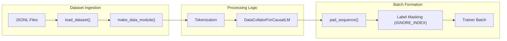
**Sources:** [training_code/qlora.py:504-610](), [training_code/qlora.py:456-502]()

### Key Data Functions:
*   **`extract_nlp_data`**: Parses custom dataset formats, specifically extracting keys defined by `prompt_key` and `label_key` [training_code/qlora.py:516-522]().
*   **`DataCollatorForCausalLM`**: This class ensures that the model only calculates loss on the target tokens (the correction) and not the source tokens (the prompt/mistake). It achieves this by setting the `labels` for source tokens to `IGNORE_INDEX` (-100) [training_code/qlora.py:480-502]().

---

## Training Lifecycle and Checkpointing

The `train()` function acts as the entry point, orchestrating the setup and execution of the `Seq2SeqTrainer` [training_code/qlora.py:734-870]().

### Hardware-Specific Logic (IPEX/XPU)
The engine includes specific support for Intel GPUs (XPU). It checks for `intel_extension_for_pytorch` and, if present, ensures version compatibility between `torch` and `ipex` before proceeding [training_code/qlora.py:49-69]().

### `SavePeftModelCallback`
Standard Hugging Face trainers often save the full model state. This engine uses a custom `SavePeftModelCallback` to ensure that only the LoRA adapter weights and the `adapter_config.json` are saved during checkpointing, significantly reducing disk usage [training_code/qlora.py:438-454]().

### Checkpoint Resumption
The script automatically detects existing checkpoints in the `output_dir`. If a directory named `checkpoint-XXXX` is found, the trainer will attempt to resume training from the latest one [training_code/qlora.py:840-855]().

**Sources:** [training_code/qlora.py:438-454](), [training_code/qlora.py:840-870](), [training_code/qlora.py:49-69]()

---

# Page: Inference and Evaluation Pipeline

# Inference and Evaluation Pipeline

<details>
<summary>Relevant source files</summary>

The following files were used as context for generating this wiki page:

- [README.md](README.md)
- [inference_code/evaluation.py](inference_code/evaluation.py)
- [inference_code/qlora_merge.py](inference_code/qlora_merge.py)
- [inference_code/vllm_inference.py](inference_code/vllm_inference.py)

</details>


The LEMA inference and evaluation pipeline transforms trained LoRA adapters into final accuracy metrics through a three-stage workflow. This process involves merging the parameter-efficient adapters back into the base model weights, executing high-throughput batch inference using the vLLM engine, and applying dataset-specific extraction logic to calculate performance scores.

### Pipeline Overview

The transition from a trained adapter to a performance metric follows a linear progression. First, the `qlora_merge.py` script prepares a standalone model [README.md:94-99](). Next, `vllm_inference.py` generates model completions in bulk [README.md:101-109](). Finally, `evaluation.py` parses these completions to determine if the reasoning reached the correct conclusion [README.md:111-115]().

#### System Architecture and Code Entities
The following diagram illustrates how the logical stages of the pipeline map to specific scripts and functions within the `inference_code` directory.

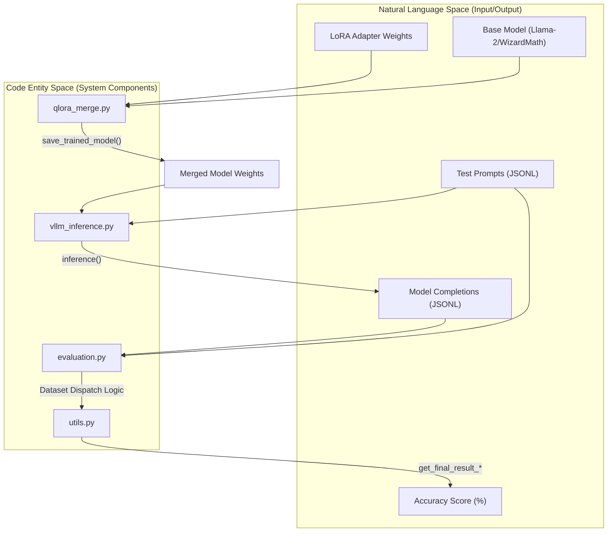
**Sources:** [inference_code/qlora_merge.py:21-53](), [inference_code/vllm_inference.py:12-54](), [inference_code/evaluation.py:35-97]()

---

### 4.1 Adapter Merging
The initial step after training is weight consolidation. Because LEMA uses QLoRA for parameter-efficient tuning, the resulting checkpoints contain only the adapter weights. The `save_trained_model()` function in `qlora_merge.py` loads the base model in `torch.bfloat16` and uses `PeftModel.merge_and_unload()` to create a unified model architecture compatible with standard inference engines.

For details, see [Adapter Merging (qlora_merge.py)](#4.1).

**Sources:** [inference_code/qlora_merge.py:21-53](), [inference_code/qlora_merge.py:65-75]()

---

### 4.2 vLLM Batch Inference
LEMA utilizes the [vLLM](https://github.com/vllm-project/vllm) library to maximize inference throughput. The `vllm_inference.py` script manages the lifecycle of the vLLM `LLM` engine, configuring critical parameters such as `gpu_memory_utilization` and `tensor_parallel_size` for multi-GPU setups. It processes inputs in batches (default `batch_size=128`) and utilizes greedy decoding (`temperature=0.0`) via `SamplingParams` to ensure reproducible results.

For details, see [vLLM Batch Inference (vllm_inference.py)](#4.2).

**Sources:** [inference_code/vllm_inference.py:27-36](), [inference_code/vllm_inference.py:41-51]()

---

### 4.3 Answer Extraction and Accuracy Evaluation
The final stage converts raw text completions into structured accuracy metrics. The `evaluation.py` script acts as a dispatcher, identifying the dataset type (e.g., GSM8K, MATH, or CSQA) and calling specialized extraction functions from `utils.py`. 

#### Data Flow to Code Mapping
The following diagram shows how raw model outputs are processed by specific extraction utilities to bridge the gap between free-form text and the final evaluation metric.

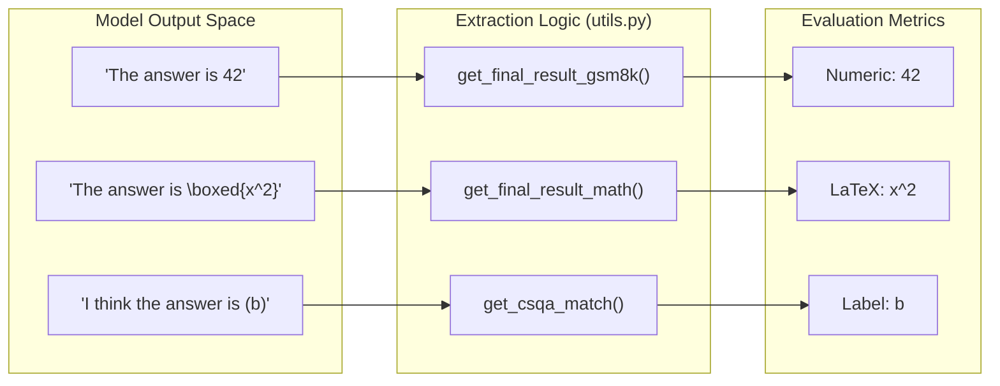

The evaluation logic handles complex edge cases, such as LaTeX normalization for the MATH benchmark, numerical filtering for GSM8K, and Levenshtein distance matching for CommonsenseQA options.

For details, see [Answer Extraction and Accuracy Evaluation](#4.3).

**Sources:** [inference_code/evaluation.py:37-92](), [inference_code/evaluation.py:9](), [README.md:110-116]()

---

# Page: Adapter Merging (qlora_merge.py)

# Adapter Merging (qlora_merge.py)

<details>
<summary>Relevant source files</summary>

The following files were used as context for generating this wiki page:

- [README.md](README.md)
- [inference_code/qlora_merge.py](inference_code/qlora_merge.py)

</details>


The LEMA framework utilizes **QLoRA** (Quantized Low-Rank Adaptation) for parameter-efficient fine-tuning. Because QLoRA trains only a small set of adapter weights while keeping the base model frozen and quantized, the resulting checkpoints are not standalone models. The `qlora_merge.py` script serves as a mandatory post-training utility that integrates these LoRA adapter weights back into the full-parameter base model, producing a unified model ready for high-performance inference via engines like **vLLM** [README.md:81-82]().

## Functional Overview

The merging process follows a linear pipeline: loading the base model in high precision, applying the PEFT (Parameter-Efficient Fine-Tuning) adapter, performing a mathematical merge of the weights, and applying a configuration patch to ensure compatibility with long-sequence reasoning tasks.

### Logic Flow: Adapter to Merged Model

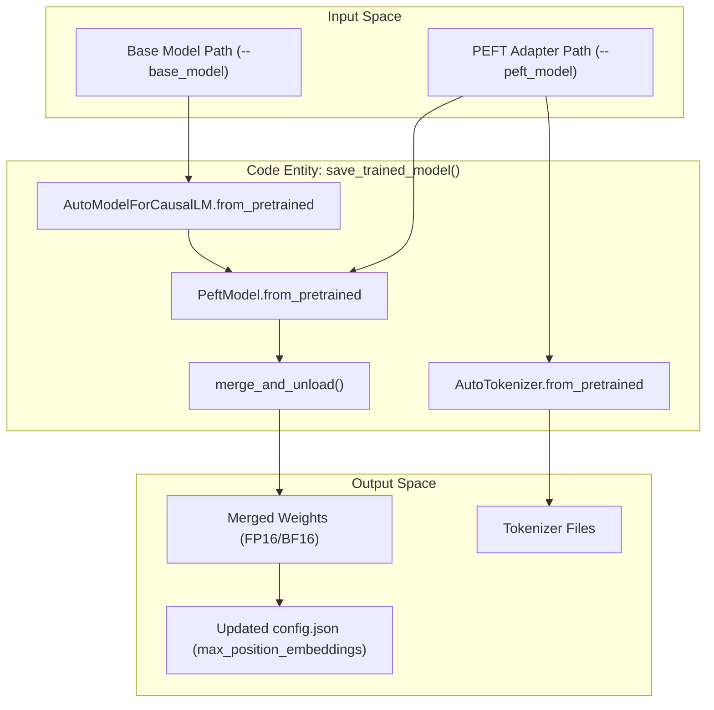
**Sources:** [inference_code/qlora_merge.py:21-53](), [inference_code/qlora_merge.py:65-71]()

## Key Implementation Details

### Model Loading and Precision
The script explicitly loads the base model using `torch.bfloat16` precision [inference_code/qlora_merge.py:27](). This is critical for maintaining the numerical accuracy of the LEMA models (e.g., Llama-2-70b) after they have been fine-tuned on complex reasoning tasks. The `device_map="auto"` argument is used to handle multi-GPU memory distribution automatically during the loading phase [inference_code/qlora_merge.py:28]().

### The Merging Mechanism
The core of the script is the `merge_and_unload()` method provided by the `peft` library. 
1. **`PeftModel.from_pretrained`**: Wraps the base model with the LoRA layers found in the `peft_model_path` [inference_code/qlora_merge.py:42]().
2. **`merge_and_unload()`**: Physically adds the LoRA adapter weights ($W = W_0 + BA$) to the base model's weight matrices and removes the adapter overhead, returning a standard `transformers` model object [inference_code/qlora_merge.py:46]().

### Tokenizer Handling
The tokenizer is loaded from the `peft_model_path` rather than the base model path [inference_code/qlora_merge.py:32-33](). This ensures that any special tokens or vocabulary modifications introduced during the LEMA training phase are preserved. The script forces `padding_side="right"` and `truncation_side="left"` to align with standard causal language modeling requirements [inference_code/qlora_merge.py:34-35]().

### The Max Position Embeddings Patch
A specific post-processing step is applied to the `config.json` of the merged model. The script checks the `max_position_embeddings` attribute; if it is less than 4096, it is manually updated to 4096 [inference_code/qlora_merge.py:65-72](). This patch ensures that the model can handle the longer sequence lengths often required for multi-step mistake correction and mathematical reasoning.

## CLI Arguments and Usage

The script is executed via the command line with four primary arguments:

| Argument | Type | Description |
| :--- | :--- | :--- |
| `--base_model` | `str` | Path or HuggingFace ID of the original model (e.g., `meta-llama/Llama-2-70b-hf`). |
| `--peft_model` | `str` | Path to the directory containing `adapter_model.bin`. |
| `--save_merged_model_path` | `str` | Destination directory for the final merged model. |
| `--trust_remote_code` | `bool` | Whether to allow custom code from the model repository (default: `False`). |

**Example Execution:**
```bash
python qlora_merge.py \
--base_model meta-llama/Llama-2-70b-hf \
--peft_model LEMAv1/peft-Llama-2-70b-gsm8k \
--save_merged_model_path ./Llama-2-70b-GSM8K-LEMA-merged
```
**Sources:** [README.md:96-99](), [inference_code/qlora_merge.py:56-61]()

## System Entity Mapping

The following diagram maps the CLI arguments and file-system artifacts to the internal `save_trained_model` execution context.

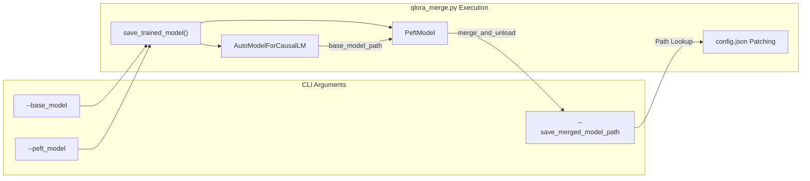
**Sources:** [inference_code/qlora_merge.py:21-25](), [inference_code/qlora_merge.py:63-65]()

## Sources
- `README.md`: [81-82](), [96-99]()
- `inference_code/qlora_merge.py`: [21-53](), [56-61](), [63-75]()

---

# Page: vLLM Batch Inference (vllm_inference.py)

# vLLM Batch Inference (vllm_inference.py)

<details>
<summary>Relevant source files</summary>

The following files were used as context for generating this wiki page:

- [inference_code/vllm_inference.py](inference_code/vllm_inference.py)

</details>


The `vllm_inference.py` script serves as the high-throughput inference engine for the LEMA framework. It leverages the **vLLM** library to perform batch processing of test prompts on fine-tuned and merged models. The script is designed to run within an Azure Machine Learning (AML) environment, utilizing Ray for distributed compute and tensor parallelism to handle large-scale models like Llama-2-70B.

## Overview and Lifecycle

The script follows a linear lifecycle: initializing the Ray-on-AML environment (implied by imports), loading a merged model into the vLLM engine, reading JSONL test data, executing inference in manual batches, and persisting results for downstream evaluation.

### Inference Lifecycle Diagram

The following diagram illustrates the flow from input data to the final generated samples.

**vLLM Inference Data Flow**
```mermaid
graph TD
    subgraph "Input Space"
        A["JSONL Test Data"]
    end

    subgraph "Code Entity Space: vllm_inference.py"
        B["inference() Function"]
        C["LLM Engine (vllm.LLM)"]
        D["SamplingParams (Greedy)"]
        E["Manual Batching Loop"]
        F["llm.generate()"]
    end

    subgraph "Output Space"
        G["JSONL Results (samples)"]
    end

    A -->|"Read 'prompt' field"| B
    B --> C
    B --> D
    B --> E
    E -->|"batch_size=128"| F
    F -->|"result.outputs[0].text"| G
```
**Sources:** [inference_code/vllm_inference.py:12-54]()

## Engine Configuration

The script initializes the vLLM engine with specific hardware and performance optimizations. 

### vLLM Engine Settings
The `LLM` class is instantiated with parameters tailored for high-memory GPU environments:
*   **Model Path**: Loads the model from `--merged_model_path`, which typically contains the base model weights merged with LEMA LoRA adapters [inference_code/vllm_inference.py:27-27]().
*   **Tensor Parallelism**: Controlled by `--tensor_parallel_size` (default: 4), allowing the model to be partitioned across multiple GPUs [inference_code/vllm_inference.py:28-28](), [inference_code/vllm_inference.py:64-64]().
*   **Memory Management**: `gpu_memory_utilization` is set to `0.8` to reserve buffer for KV cache and prevent OOM (Out-of-Memory) errors during large batch operations [inference_code/vllm_inference.py:31-31]().
*   **Throughput**: `max_num_batched_tokens` is set to `8192` to optimize the number of tokens processed in a single iteration [inference_code/vllm_inference.py:30-30]().

### Sampling Parameters
For evaluation consistency, the script uses **Greedy Decoding**:
*   `temperature=0.0`: Ensures deterministic output by selecting the most likely next token [inference_code/vllm_inference.py:33-33]().
*   `top_p=1.0`: Disables nucleus sampling [inference_code/vllm_inference.py:33-33]().
*   `max_tokens=2048`: Sets a hard limit on the generated sequence length, accommodating long reasoning chains required for MATH and GSM8K [inference_code/vllm_inference.py:33-33]().

**Sources:** [inference_code/vllm_inference.py:27-33](), [inference_code/vllm_inference.py:63-65]()

## Batching Logic and Data Format

While vLLM handles continuous batching internally, `vllm_inference.py` implements a manual batching layer to manage memory and logging effectively.

### Input Format
The script expects a JSONL file where each line contains a `prompt` key:
```json
{"prompt": "Question: ... Answer: "}
```
**Sources:** [inference_code/vllm_inference.py:21-22]()

### Batch Processing Loop
1.  **Read**: All prompts are loaded into a list `test_prompts` [inference_code/vllm_inference.py:22-22]().
2.  **Chunk**: The list is divided into chunks of `batch_size = 128` [inference_code/vllm_inference.py:35-36]().
3.  **Generate**: Each batch is passed to `llm.generate()` [inference_code/vllm_inference.py:46-46]().
4.  **Collect**: The first output choice (`result.outputs[0].text`) is extracted and stored in a dictionary under the key `samples` [inference_code/vllm_inference.py:49-50]().

### Output Format
The results are saved as a JSONL file where each line represents a single completion:
```json
{"samples": ["The generated solution text..."]}
```
**Sources:** [inference_code/vllm_inference.py:52-54]()

## Distributed Compute Integration

The script is built to function within the `Ray_On_AML` ecosystem, which facilitates running distributed workloads on Azure Machine Learning clusters.

**Distributed Inference Architecture**
```mermaid
graph LR
    subgraph "Azure ML Compute Cluster"
        subgraph "Ray Head Node"
            RN["Ray_On_AML"]
            MS["vllm_inference.py (Main)"]
        end
        
        subgraph "Ray Worker Nodes"
            TP1["GPU 0 (TP Rank 0)"]
            TP2["GPU 1 (TP Rank 1)"]
            TP3["GPU 2 (TP Rank 2)"]
            TP4["GPU 3 (TP Rank 3)"]
        end
    end

    MS -->|"Init vLLM Engine"| RN
    RN -->|"Tensor Parallelism"| TP1 & TP2 & TP3 & TP4
```
**Sources:** [inference_code/vllm_inference.py:7-9](), [inference_code/vllm_inference.py:28-28]()

## CLI Arguments Reference

| Argument | Type | Default | Description |
| :--- | :--- | :--- | :--- |
| `--testdata_folder` | `str` | Required | Path to the directory containing test files. |
| `--testdata_file` | `str` | Required | Specific JSONL file name to process. |
| `--output_folder` | `str` | Required | Directory where the inference results will be saved. |
| `--output_file` | `str` | `sample.jsonl` | Filename for the output results. |
| `--merged_model_path` | `str` | Required | Path to the model (after `qlora_merge.py`). |
| `--tensor_parallel_size`| `int` | `4` | Number of GPUs to split the model across. |
| `--trust_remote_code` | `bool`| `False` | Whether to allow custom code from HuggingFace. |

**Sources:** [inference_code/vllm_inference.py:58-66]()

---

# Page: Answer Extraction and Accuracy Evaluation

# Answer Extraction and Accuracy Evaluation

<details>
<summary>Relevant source files</summary>

The following files were used as context for generating this wiki page:

- [inference_code/evaluation.py](inference_code/evaluation.py)
- [inference_code/utils.py](inference_code/utils.py)

</details>


This page details the evaluation subsystem of the LEMA framework, focusing on how model-generated completions are parsed, normalized, and compared against ground-truth labels. The logic is primarily housed in `evaluation.py` and `utils.py`, providing specialized pipelines for mathematical notation (MATH), numerical reasoning (GSM8K, ASDiv, MAWPS, SVAMP), and commonsense reasoning (CSQA).

## Evaluation Architecture and Data Flow

The evaluation process operates as a post-processing step after batch inference. It consumes the JSONL output from `vllm_inference.py` and the original test dataset to calculate accuracy.

### Data Dispatch Logic
The `evaluation.py` script acts as the entry point, dispatching samples to specific extraction functions based on the filename of the test data.

| Dataset Category | Dispatch Condition | Key Extraction Function |
| :--- | :--- | :--- |
| **MATH** | `'math' in args.test_data_file` | `get_final_result_math` |
| **GSM8K** | `'gsm8k' in args.test_data_file` | `get_final_result_gsm8k` |
| **ASDiv/MAWPS/SVAMP** | `'asdiv'`, `'mawps'`, or `'svamp'` | `get_final_result_gsm8k` (with rounding) |
| **CSQA** | `'csqa' in args.test_data_file` | `get_csqa_match` |

**Sources:**
- `inference_code/evaluation.py:37-92`

### Pipeline Overview
The following diagram illustrates the flow from raw model output to final accuracy score:

**Evaluation Pipeline Flow**
```mermaid
graph TD
    A["inference_file (JSONL)"] --> B["evaluation.py"]
    C["test_data_file (JSONL)"] --> B
    B --> D{"Dataset Type?"}
    
    D -- "MATH" --> E["get_final_result_math"]
    D -- "GSM8K" --> F["get_final_result_gsm8k"]
    D -- "CSQA" --> G["get_csqa_match"]
    
    E --> H["LaTeX Normalization (_strip_string)"]
    F --> I["Numerical Extraction (eval)"]
    G --> J["Levenshtein Distance (minDistance)"]
    
    H & I & J --> K["Comparison Logic"]
    K --> L["Accuracy Score (acc_list)"]
```
**Sources:**
- `inference_code/evaluation.py:12-97`
- `inference_code/utils.py:49-65`
- `inference_code/utils.py:140-207`

---

## MATH LaTeX Normalization

The MATH dataset evaluation requires handling diverse LaTeX representations of the same mathematical entity. The `get_final_result_math` function isolates the model's answer and passes it through a normalization pipeline.

### Extraction Logic
1. **Boxed Extraction**: The system first attempts to find the content within a `\boxed{...}` or `\fbox{...}` environment using `last_boxed_only_string` `[inference_code/utils.py:218-243]()`.
2. **Fallback**: If no boxed content is found, it splits by common markers like `"The answer is "` `[inference_code/utils.py:246-253]()`.

### Normalization Pipeline (`_strip_string`)
The `_strip_string` function standardizes the extracted LaTeX string to ensure fair comparison:

*   **Fraction Handling**: Converts `\tfrac` and `\dfrac` to `\frac` `[inference_code/utils.py:153-155]()`. It also uses `_fix_fracs` to handle shorthand like `\frac12` by converting it to `\frac{1}{2}` `[inference_code/utils.py:68-97]()`.
*   **Square Roots**: `_fix_sqrt` ensures square roots are properly braced (e.g., `\sqrt3` becomes `\sqrt{3}`) `[inference_code/utils.py:125-137]()`.
*   **Unit/Symbol Removal**: Strips linebreaks, inverse spaces (`\!`), `\left/\right` delimiters, degree symbols (`^\circ`), and percentage signs `[inference_code/utils.py:141-176]()`.
*   **Numerical Cleanup**: Standardizes leading zeros (e.g., `.5` to `0.5`) and converts the specific case of `0.5` to `\frac{1}{2}` `[inference_code/utils.py:177-203]()`.

**Sources:**
- `inference_code/utils.py:68-243`

---

## GSM8K and Numerical Extraction

For GSM8K and related arithmetic datasets (ASDiv, MAWPS, SVAMP), the system focuses on extracting a final numerical value.

### Numerical Extraction Logic
The `get_final_result_gsm8k` function (referenced in `evaluation.py` `[inference_code/evaluation.py:41]()`) processes the completion to find the last numerical sequence.
*   **Filtering**: It removes common distractors like commas (used as thousands separators).
*   **Expression Handling**: If the extracted string contains basic arithmetic operators, the system uses `eval()` to compute the final scalar value.

### Rounding Behavior
For the ASDiv, MAWPS, and SVAMP datasets, both the predicted result and the ground-truth label are rounded to two decimal places before comparison to account for floating-point variations:
```python
pred_result = round(pred_result, 2)
label_result = round(label_result, 2)
```
**Sources:**
- `inference_code/evaluation.py:69-82`

---

## CSQA Matching and Levenshtein Distance

CommonsenseQA (CSQA) evaluation differs because the model output is often a natural language phrase that must be matched against a set of fixed candidates.

### Levenshtein Distance (`minDistance`)
The system implements a standard edit distance algorithm to find the closest match between the model's predicted answer string and the ground-truth label.
*   **Implementation**: A dynamic programming approach using two rows (`v1`, `v2`) to compute the minimum number of insertions, deletions, or substitutions required to transform one string into another `[inference_code/utils.py:7-46]()`.

### Matching Logic (`get_csqa_match`)
1. **Cleaning**: The prediction is truncated at common prompt markers like `\n\nQ: ` and the prefix `The answer is: ` is removed `[inference_code/utils.py:50-57]()`.
2. **Scoring**: The script calculates the `minDistance` between the cleaned prediction and every available candidate in the `candidates` list `[inference_code/utils.py:59]()`.
3. **Selection**: The candidate with the lowest distance is selected. If this candidate matches the ground-truth `label`, the sample is marked correct `[inference_code/utils.py:60-65]()`.

**Sources:**
- `inference_code/utils.py:7-65`
- `inference_code/evaluation.py:84-92`

---

## Code Entity Mapping

The following diagram maps the high-level evaluation tasks to the specific functions and files responsible for them.

**Entity Mapping: Natural Language Tasks to Code Entities**
```mermaid
classDiagram
    class EvaluationCLI {
        evaluation.py
        --
        main() logic
        acc_list calculation
    }
    class MathPipeline {
        utils.py
        --
        get_final_result_math()
        _strip_string()
        _fix_fracs()
        _fix_sqrt()
        last_boxed_only_string()
    }
    class GSM8KPipeline {
        utils.py
        --
        get_final_result_gsm8k()
    }
    class CSQAPipeline {
        utils.py
        --
        get_csqa_match()
        minDistance()
    }

    EvaluationCLI --> MathPipeline : "if 'math' in file"
    EvaluationCLI --> GSM8KPipeline : "if 'gsm8k' in file"
    EvaluationCLI --> CSQAPipeline : "if 'csqa' in file"
```

**Sources:**
- `inference_code/evaluation.py:37-92`
- `inference_code/utils.py:7-246`

---

# Page: Test Data Reference

# Test Data Reference

<details>
<summary>Relevant source files</summary>

The following files were used as context for generating this wiki page:

- [test_data/csqa_dev.jsonl](test_data/csqa_dev.jsonl)
- [test_data/gsm8k_test.jsonl](test_data/gsm8k_test.jsonl)
- [test_data/gsm8k_test_wizardmath_prompt.jsonl](test_data/gsm8k_test_wizardmath_prompt.jsonl)
- [test_data/math_test.jsonl](test_data/math_test.jsonl)
- [test_data/math_test_wizardmath_prompt.jsonl](test_data/math_test_wizardmath_prompt.jsonl)

</details>


This page provides a high-level overview of the benchmark test datasets included in the LEMA repository. These datasets are used to evaluate the reasoning capabilities of models after they have undergone the "Learning from Mistakes" fine-tuning process. The repository contains test sets for mathematical reasoning (GSM8K, MATH) and commonsense reasoning (CommonsenseQA).

## Dataset Overview

The test data is primarily stored in the `test_data/` directory in JSONL format. These files are consumed by the inference engine to generate model predictions and by the evaluation scripts to calculate accuracy metrics.

### Data Flow Architecture

The following diagram illustrates how the test data files interact with the primary code entities in the inference and evaluation pipeline.

**Test Data Consumption Pipeline**
```mermaid
graph TD
    subgraph "Test Data Files"
        GSM["gsm8k_test.jsonl"]
        MATH["math_test.jsonl"]
        CSQA["csqa_dev.jsonl"]
    end

    subgraph "Inference Space"
        VLLM["vllm_inference.py"]
        INF_FUNC["inference() function"]
    end

    subgraph "Evaluation Space"
        EVAL["evaluation.py"]
        MAIN_EVAL["main() entrypoint"]
        EXTRACT["utils.py (Answer Extraction)"]
    end

    GSM -->|"--testdata_file"| VLLM
    MATH -->|"--testdata_file"| VLLM
    CSQA -->|"--testdata_file"| VLLM
    
    VLLM --> INF_FUNC
    INF_FUNC -->| "JSONL Output" | MAIN_EVAL
    
    MAIN_EVAL --> EXTRACT
    EXTRACT -->| "Final Metrics" | Results["Accuracy/Score"]
```
**Sources:** [vllm_inference.py:1-20](), [evaluation.py:1-30]()

## Math Benchmark Datasets (GSM8K and MATH)

The repository includes standard test sets for **GSM8K** (Grade School Math 8K) and the **MATH** dataset. These datasets are characterized by multi-step mathematical reasoning.

### Key Characteristics
*   **Format**: JSONL files containing `prompt` and `completion` keys [test_data/gsm8k_test.jsonl:1-5]().
*   **Prompt Variants**: The repository provides two versions of prompts for these datasets:
    1.  **Standard**: Uses a direct instruction ("Please solve the following math problem") [test_data/gsm8k_test.jsonl:1]().
    2.  **WizardMath**: Uses an Alpaca-style instruction template ("Below is an instruction... ### Instruction... ### Response") [test_data/gsm8k_test_wizardmath_prompt.jsonl:1]().
*   **Metadata**: The MATH dataset includes additional fields for `type` (e.g., Algebra, Geometry) and `level` (Level 1 to 5) to allow for fine-grained performance analysis [test_data/math_test.jsonl:1-5]().

For details on schema structure and prompt formatting, see **[Math Benchmark Datasets (GSM8K and MATH)](#5.1)**.

**Sources:** [test_data/gsm8k_test.jsonl:1-13](), [test_data/gsm8k_test_wizardmath_prompt.jsonl:1-11](), [test_data/math_test.jsonl:1-12]()

## CommonsenseQA Dataset

The **CommonsenseQA (CSQA)** dataset is used to evaluate the model's ability to perform reasoning based on general world knowledge.

### Key Characteristics
*   **Schema**: Unlike the math datasets, CSQA entries include a `candidates` list containing the multiple-choice options [test_data/csqa_dev.jsonl:1-5]().
*   **Evaluation Logic**: Because models may generate long-form explanations before the final answer, the evaluation pipeline uses specialized matching logic (e.g., Levenshtein distance) to map the model's output to one of the valid candidates [test_data/csqa_dev.jsonl:1]().
*   **Prompting**: The prompt instructs the model to explain each candidate answer before selecting the most relevant one [test_data/csqa_dev.jsonl:1]().

For details on the `QuestionObject` structure and label-to-text mapping, see **[CommonsenseQA Dataset (csqa_dev.jsonl)](#5.2)**.

**Sources:** [test_data/csqa_dev.jsonl:1-17]()

## Integration with Pipeline

The following table describes how these files are referenced by the system's CLI arguments.

| Dataset | Inference CLI Argument (`vllm_inference.py`) | Evaluation CLI Argument (`evaluation.py`) |
| :--- | :--- | :--- |
| **GSM8K** | `--testdata_file test_data/gsm8k_test.jsonl` | `--dataset gsm8k` |
| **MATH** | `--testdata_file test_data/math_test.jsonl` | `--dataset math` |
| **CSQA** | `--testdata_file test_data/csqa_dev.jsonl` | `--dataset csqa` |

**Sources:** [vllm_inference.py:1-20](), [evaluation.py:1-30]()

### Mapping Natural Language to Code Entities

The pipeline bridges the gap between raw JSONL data and programmatic evaluation through specific utility functions.

**Data Entity Mapping**
```mermaid
classDiagram
    class JSONL_Record {
        +String prompt
        +String completion
        +List candidates
    }
    class vllm_inference {
        +inference(testdata_file)
    }
    class evaluation_py {
        +main()
    }
    class utils_py {
        +get_csqa_match(prediction, candidates)
        +last_boxed_only_string(string)
    }

    JSONL_Record --> vllm_inference : "Loaded as Input"
    vllm_inference --> evaluation_py : "Produces prediction.jsonl"
    evaluation_py --> utils_py : "Calls for normalization"
```
**Sources:** [vllm_inference.py:1-50](), [evaluation.py:1-50](), [test_data/csqa_dev.jsonl:1]()

---

# Page: Math Benchmark Datasets (GSM8K and MATH)

# Math Benchmark Datasets (GSM8K and MATH)

<details>
<summary>Relevant source files</summary>

The following files were used as context for generating this wiki page:

- [test_data/gsm8k_test.jsonl](test_data/gsm8k_test.jsonl)
- [test_data/gsm8k_test_wizardmath_prompt.jsonl](test_data/gsm8k_test_wizardmath_prompt.jsonl)
- [test_data/math_test.jsonl](test_data/math_test.jsonl)
- [test_data/math_test_wizardmath_prompt.jsonl](test_data/math_test_wizardmath_prompt.jsonl)

</details>


This page documents the technical structure and schema of the GSM8K and MATH test datasets used within the LEMA framework. These datasets serve as the primary benchmarks for evaluating the mathematical reasoning capabilities of models fine-tuned using the "Learning from Mistakes" methodology.

## Dataset Schemas

The benchmark files are stored in JSONL (JSON Lines) format, where each line represents a single test case consisting of a prompt and a ground-truth completion.

### GSM8K Schema
The GSM8K (Grade School Math 8K) test set contains high-quality grade school math word problems.
*   **`prompt`**: Contains the question text prefixed with a standard instruction and suffixed with a chain-of-thought trigger (`Answer: Let's think step by step.`).
*   **`completion`**: Contains the full step-by-step reasoning path and the final numerical answer.

Example entry:
```json
{
  "prompt": "Please solve the following math problem.\nQuestion: Janet’s ducks lay 16 eggs per day... \nAnswer: Let's think step by step.\n",
  "completion": "Janet sells 16 - 3 - 4 = 9 duck eggs a day. ... The answer is 18."
}
```
**Sources:** `[test_data/gsm8k_test.jsonl:1-1]()`

### MATH Schema
The MATH dataset contains challenging competition-level problems. In addition to the standard fields, it includes metadata for categorization.
*   **`type`**: The mathematical sub-field (e.g., "Algebra", "Calculus").
*   **`level`**: Difficulty rating from Level 1 to Level 5.
*   **`completion`**: Contains LaTeX formatted reasoning and a final answer enclosed in a `\boxed{}` command.

Example entry:
```json
{
  "prompt": "Please solve the following math problem.\nQuestion: How many vertical asymptotes... \nAnswer: Let's think step by step.\n",
  "completion": "... the graph has \\boxed{2} vertical asymptotes.\nThe answer is 2.",
  "type": "Algebra", 
  "level": "Level 3"
}
```
**Sources:** `[test_data/math_test.jsonl:1-1]()`

---

## WizardMath Prompt Variants

The repository provides specialized versions of the test sets formatted for **WizardMath**. These variants use an instruction-following template rather than the simple "Question/Answer" format.

| Feature | Standard Prompt | WizardMath Prompt |
| :--- | :--- | :--- |
| **Header** | `Please solve the following math problem.` | `Below is an instruction that describes a task...` |
| **Question Tag** | `Question:` | `### Instruction:` |
| **Response Tag** | `Answer:` | `### Response:` |

**Sources:** `[test_data/gsm8k_test_wizardmath_prompt.jsonl:1-1]()`, `[test_data/math_test_wizardmath_prompt.jsonl:1-1]()`

---

## Data Flow in Inference and Evaluation

The test files are consumed by the inference engine to generate model outputs and then by the evaluation script to verify accuracy.

### Data Flow Diagram: Natural Language to Code Entity

This diagram illustrates how the raw JSONL files are mapped to specific variables and processing logic within the Python scripts.

**Title: Dataset Ingestion and Entity Mapping**
```mermaid
graph TD
    subgraph "Natural Language Space (JSONL Files)"
        A1["gsm8k_test.jsonl"]
        A2["math_test.jsonl"]
    end

    subgraph "Code Entity Space (vllm_inference.py)"
        B1["--testdata_file (CLI Arg)"]
        B2["inference() function"]
        B3["json.loads(line)"]
        B4["prompt_list (List[str])"]
    end

    subgraph "Code Entity Space (evaluation.py)"
        C1["--data_file (CLI Arg)"]
        C2["evaluate() function"]
        C3["extract_answer()"]
        C4["GSM8K/MATH Dispatch Logic"]
    end

    A1 & A2 --> B1
    B1 --> B2
    B2 --> B3
    B3 --> B4
    
    A1 & A2 --> C1
    C1 --> C2
    C2 --> C3
    C3 --> C4
```
**Sources:** `[vllm_inference.py:28-66]()`, `[evaluation.py:126-155]()`

---

## System Integration Details

### 1. vLLM Inference (`vllm_inference.py`)
The script `vllm_inference.py` loads the test files using the `--testdata_file` argument. It iterates through the JSONL, extracting the `prompt` field to populate a batch for the vLLM engine.
*   The `inference()` function reads the file line-by-line.
*   Prompts are sent to `llm.generate(prompt_list, sampling_params)`.
*   The output is saved as a new JSONL containing the original prompt, the completion, and the model's generated response.

**Sources:** `[vllm_inference.py:75-92]()`

### 2. Accuracy Evaluation (`evaluation.py`)
The `evaluation.py` script compares the model's generated text against the `completion` field in the test data.
*   **GSM8K Processing**: Uses numerical extraction to find the final digit sequence.
*   **MATH Processing**: Employs heavy LaTeX normalization (stripping units, fixing fractions) to compare the contents of the `\boxed{}` tags.

### Component Interaction Diagram

**Title: Inference to Evaluation Pipeline**
```mermaid
graph LR
    subgraph "Input Data"
        JSONL["test_data/*.jsonl"]
    end

    subgraph "Inference System"
        VLLM["vllm_inference.py"]
        ENG["vLLM Engine"]
    end

    subgraph "Evaluation System"
        EVAL["evaluation.py"]
        UTIL["utils.py (Math Normalization)"]
    end

    JSONL --> VLLM
    VLLM --> ENG
    ENG --> |"Generated Responses"| EVAL
    JSONL --> |"Ground Truth"| EVAL
    EVAL --> UTIL
    UTIL --> |"Final Score"| Final["Accuracy Metric"]
```
**Sources:** `[vllm_inference.py:68-80]()`, `[evaluation.py:157-175]()`

---

## Summary of Test Files

| File Path | Problem Count | Format Type |
| :--- | :--- | :--- |
| `test_data/gsm8k_test.jsonl` | 1319 | Standard |
| `test_data/gsm8k_test_wizardmath_prompt.jsonl` | 1319 | WizardMath |
| `test_data/math_test.jsonl` | 5000 | Standard |
| `test_data/math_test_wizardmath_prompt.jsonl` | 5000 | WizardMath |

**Sources:** `[test_data/gsm8k_test.jsonl:1-1319]()`, `[test_data/math_test.jsonl:1-5000]()`

---

# Page: CommonsenseQA Dataset (csqa_dev.jsonl)

# CommonsenseQA Dataset (csqa_dev.jsonl)

<details>
<summary>Relevant source files</summary>

The following files were used as context for generating this wiki page:

- [test_data/csqa_dev.jsonl](test_data/csqa_dev.jsonl)

</details>


The CommonsenseQA (CSQA) development set is a critical component of the LEMA evaluation pipeline, used to assess the model's ability to perform commonsense reasoning and select appropriate answers from a set of candidates. Unlike the standard CSQA format which uses single-letter labels (A-E), the LEMA version focuses on text-based matching and reasoning explanations.

## Dataset Schema

The `csqa_dev.jsonl` file follows a specific JSON Lines format designed to facilitate few-shot prompting and automated evaluation. Each line represents a single `QuestionObject`.

### QuestionObject Structure

Each entry in the dataset contains the following fields:

| Field | Type | Description |
| :--- | :--- | :--- |
| `prompt` | String | The full input string provided to the model, including the question, candidate answers, and a "Let's think step by step" trigger. |
| `answer` | String | The ground truth text label for the correct answer. |
| `candidates` | List[String] | A list of all possible answer choices as strings. |

### Data Representation in Code

While the raw file contains the fields above, the system is designed to handle the standard CSQA `QuestionObject` structure during the training and evaluation phases. The following diagram maps the JSON schema to the logical entities used in the evaluation script.

**Diagram: CSQA Data Entity Mapping**

```mermaid
graph TD
    subgraph "Natural Language Space (csqa_dev.jsonl)"
        A["prompt"]
        B["answer"]
        C["candidates"]
    end

    subgraph "Code Entity Space (evaluation.py)"
        D["Question Stem"]
        E["Ground Truth (ans)"]
        F["Candidate List (options)"]
        G["get_csqa_match()"]
    end

    A -.-> D
    B -.-> E
    C -.-> F
    F -.-> G
    E -.-> G
```

**Sources:**
- [test_data/csqa_dev.jsonl:1-17]()
- [evaluation.py:122-136]()

## Evaluation and Answer Extraction

The evaluation of CSQA results is handled by `evaluation.py`. Because the model is prompted to provide explanations before its final choice, the system must extract the final answer from a potentially long reasoning chain.

### The `get_csqa_match` Function

The extraction logic uses the `get_csqa_match` function defined in `utils.py`. This function performs the following steps:
1. **Normalization**: The model output is stripped of leading/trailing whitespace and converted to lowercase.
2. **Levenshtein Distance**: The function iterates through the `candidates` list provided in the JSONL entry.
3. **Best Match Selection**: It calculates the edit distance between the model's predicted string and each candidate. The candidate with the minimum distance is selected as the predicted answer.

**Sources:**
- [utils.py:46-56]()
- [evaluation.py:133-134]()

### Dataset Consumption Flow

The dataset is consumed by the `evaluate` function in `evaluation.py`. When the `--dataset` flag is set to `csqa`, the script executes the following logic:

**Diagram: CSQA Evaluation Data Flow**

```mermaid
sequenceDiagram
    participant J as csqa_dev.jsonl
    participant E as evaluation.py (main)
    participant U as utils.py (get_csqa_match)
    
    E->>J: Load JSONL entries
    loop For each entry
        E->>E: Extract 'answer' as target
        E->>E: Extract 'candidates' as options
        E->>U: Pass (prediction, options)
        U-->>E: Return best matching candidate
        E->>E: Compare match to target
    end
    E->>E: Calculate final accuracy
```

**Sources:**
- [evaluation.py:122-136]()
- [utils.py:46-56]()

## Comparison to Standard CSQA

The `csqa_dev.jsonl` file in this repository differs from the original CommonsenseQA development set in its prompt construction:

1.  **Label-to-Text Mapping**: Instead of requiring the model to output "A", "B", or "C", the LEMA prompt specifically asks the model to "first explain each candidate answer, then select only one answer" [test_data/csqa_dev.jsonl:1-2]().
2.  **Prompt Structure**: The prompt includes the full text of candidates directly: `Candidate Answers: bank, library, department store, mall, new york.` [test_data/csqa_dev.jsonl:1]().
3.  **Inference Trigger**: Every prompt ends with `Answer: Let's think step by step.\n` to invoke Chain-of-Thought (CoT) reasoning [test_data/csqa_dev.jsonl:1-17]().

**Sources:**
- [test_data/csqa_dev.jsonl:1-17]()
- [evaluation.py:122-136]()

---

# Page: Project Governance and Contributing

# Project Governance and Contributing

<details>
<summary>Relevant source files</summary>

The following files were used as context for generating this wiki page:

- [.gitignore](.gitignore)
- [CODE_OF_CONDUCT.md](CODE_OF_CONDUCT.md)
- [LICENSE](LICENSE)
- [NOTICE.md](NOTICE.md)
- [SECURITY.md](SECURITY.md)
- [SUPPORT.md](SUPPORT.md)

</details>


This page provides the administrative and policy framework for the LEMA (Learning From Mistakes) project. It outlines the legal requirements for using and contributing to the codebase, the expected standards of conduct within the community, and the formal procedures for reporting security vulnerabilities or seeking technical support.

As an open-source project managed by Microsoft, LEMA adheres to standardized corporate policies regarding intellectual property and community interaction.

## Legal and Ethical Framework

The LEMA project is released under the **MIT License**, granting broad permissions for use, modification, and distribution provided that the copyright notice is preserved [LICENSE:1-21](). Contributors must also adhere to the **Microsoft Open Source Code of Conduct**, which establishes expectations for a welcoming and respectful environment [CODE_OF_CONDUCT.md:1-10]().

Because LEMA integrates external research artifacts—specifically the QLoRA training implementation and benchmark datasets like GSM8K and MATH—users must also comply with the attributions and third-party licenses documented in the project's notice file [NOTICE.md:1-87]().

For detailed information on these topics, see **[License, Notice, and Code of Conduct](#6.1)**.

### Governance Entity Relationships

The following diagram illustrates how various administrative documents govern the repository entities.

**Administrative Policy Mapping**
```mermaid
graph TD
    subgraph "Legal_Space [Legal & Policy Space]"
        direction TB
        "MIT_License [MIT License]"
        "CoC [Code of Conduct]"
        "Notice_File [NOTICE.md]"
    end

    subgraph "Code_Entity_Space [Project Assets]"
        direction TB
        "Core_Logic [LEMA Source Code]"
        "Third_Party [External Components]"
        "Contrib [Contributors]"
    end

    "MIT_License" -- "governs" --> "Core_Logic"
    "Notice_File" -- "attributes" --> "Third_Party"
    "CoC" -- "regulates" --> "Contrib"

    style "Core_Logic" stroke-dasharray: 5 5
```
**Sources:** [LICENSE:1-21](), [CODE_OF_CONDUCT.md:1-10](), [NOTICE.md:1-8]()

## Security and Support

Microsoft maintains a strict policy for handling security concerns. Vulnerabilities must never be reported via public GitHub issues. Instead, they should be routed through the **Microsoft Security Response Center (MSRC)** [SECURITY.md:11-13](). This ensures that potential exploits are triaged and mitigated in a coordinated fashion [SECURITY.md:39-41]().

For non-security related issues, such as bug reports or feature requests, the project utilizes standard GitHub Issues [SUPPORT.md:3-7](). General technical questions regarding the LEMA methodology or execution can be directed to the project maintainers via the provided support email [SUPPORT.md:9-9]().

For detailed reporting instructions and contact addresses, see **[Security Policy and Support Channels](#6.2)**.

### Support and Reporting Workflow

The following diagram maps the communication channels to the specific types of project feedback.

**Communication Channel Logic**
```mermaid
graph TD
    "User_Input [User Observation]" --> "Is_Security [Is it a Security Bug?]"
    
    "Is_Security" -- "Yes" --> "MSRC_Portal [MSRC Reporting Portal]"
    "Is_Security" -- "No" --> "Issue_Type [Feedback Type]"
    
    "Issue_Type" -- "Bug/Feature" --> "GH_Issues [GitHub Issues]"
    "Issue_Type" -- "Usage Question" --> "Email_Support [Direct Email Contact]"

    subgraph "Code_Reference [Codebase Context]"
        "MSRC_Portal" -.-> "SECURITY.md"
        "GH_Issues" -.-> "SUPPORT.md"
        "Email_Support" -.-> "an1006634493@stu.xjtu.edu.cn"
    end
```
**Sources:** [SECURITY.md:9-17](), [SUPPORT.md:3-9]()

## Summary of Child Pages

*   **[License, Notice, and Code of Conduct](#6.1)**: Detailed breakdown of the MIT license, required notices for third-party code (QLoRA) and data (GSM8K/MATH), and the Microsoft Code of Conduct.
*   **[Security Policy and Support Channels](#6.2)**: Comprehensive instructions for the Coordinated Vulnerability Disclosure process and contact information for project-specific support.

---

# Page: License, Notice, and Code of Conduct

# License, Notice, and Code of Conduct

<details>
<summary>Relevant source files</summary>

The following files were used as context for generating this wiki page:

- [CODE_OF_CONDUCT.md](CODE_OF_CONDUCT.md)
- [LICENSE](LICENSE)
- [NOTICE.md](NOTICE.md)

</details>


This page outlines the legal framework, attribution requirements, and community standards governing the LEMA (Learning From Mistakes) codebase. It details the MIT license terms, the specific third-party attributions required by `NOTICE.md`, and the Microsoft Open Source Code of Conduct for contributors.

## Software License

The LEMA project is released under the **MIT License**. This is a permissive free software license that allows for reuse within proprietary software provided that all copies of the licensed software include a copy of the MIT License terms and the copyright notice [LICENSE:1-21]().

### License Terms Summary

| Provision | Description |
| :--- | :--- |
| **Copyright** | Copyright (c) Microsoft Corporation [LICENSE:3-3](). |
| **Permissions** | Permission is granted to deal in the Software without restriction, including rights to use, copy, modify, merge, publish, distribute, sublicense, and/or sell [LICENSE:5-9](). |
| **Conditions** | The copyright notice and permission notice must be included in all copies or substantial portions of the Software [LICENSE:12-13](). |
| **Disclaimer** | The software is provided "as is", without warranty of any kind, express or implied [LICENSE:15-21](). |

**Sources:**
- [LICENSE:1-21]()

## Third-Party Notices and Attributions

The LEMA repository incorporates significant components and datasets from third-party sources. Under the terms of their respective licenses, the project maintains a `NOTICE.md` file that attributes these works and reproduces their license text [NOTICE.md:1-87]().

### Integrated Third-Party Components

The following table maps the integrated third-party assets to their respective sources and licenses as defined in the repository:

| Component | Source | License Type |
| :--- | :--- | :--- |
| **QLoRA Implementation** | [artidoro/qlora](https://github.com/artidoro/qlora) | MIT [NOTICE.md:9-34]() |
| **GSM8K Test Data** | [openai/grade-school-math](https://github.com/openai/grade-school-math) | MIT [NOTICE.md:35-60]() |
| **MATH Test Data** | [hendrycks/math](https://github.com/hendrycks/math) | MIT [NOTICE.md:61-86]() |

### Dependency Attribution Flow

The diagram below illustrates how third-party code and data are ingested into the LEMA environment and the corresponding attribution requirements.

**LEMA Attribution and Data Flow**
```mermaid
graph TD
    subgraph "Third-Party Space"
        [qlora_repo] --> |"Code Logic"| QLoRA_Logic["QLoRA Implementation"]
        [gsm8k_repo] --> |"Test Sets"| GSM8K_Data["GSM8K Test Data"]
        [math_repo] --> |"Test Sets"| MATH_Data["MATH Test Data"]
    end

    subgraph "LEMA Code Entity Space"
        QLoRA_Logic --> qlora_py["qlora.py"]
        GSM8K_Data --> gsm8k_jsonl["gsm8k_test.jsonl"]
        MATH_Data --> math_jsonl["math_test.jsonl"]
    end

    subgraph "Legal Requirements"
        qlora_py -.-> NOTICE["NOTICE.md"]
        gsm8k_jsonl -.-> NOTICE
        math_jsonl -.-> NOTICE
    end

    style NOTICE stroke-width:2px
```

**Sources:**
- [NOTICE.md:1-8]()
- [NOTICE.md:9-34]()
- [NOTICE.md:35-60]()
- [NOTICE.md:61-86]()

## Code of Conduct

LEMA follows the **Microsoft Open Source Code of Conduct**. This policy defines the expectations for community behavior and provides resources for reporting concerns.

### Participation Guidelines
Contributors are expected to adhere to the standards set by Microsoft to ensure a welcoming and respectful environment [CODE_OF_CONDUCT.md:1-3]().

### Reporting and Resources
- **Official Policy:** [Microsoft Open Source Code of Conduct](https://opensource.microsoft.com/codeofconduct) [CODE_OF_CONDUCT.md:7-7]().
- **FAQ:** [Microsoft Code of Conduct FAQ](https://opensource.microsoft.com/codeofconduct/faq) [CODE_OF_CONDUCT.md:8-8]().
- **Contact:** Questions or concerns should be directed to [opencode@microsoft.com](mailto:opencode@microsoft.com) [CODE_OF_CONDUCT.md:9-9]().

### Governance Interaction Model

The following diagram maps the relationship between the project's technical contributors and the governance entities.

**LEMA Governance and Conduct Model**
```mermaid
graph LR
    subgraph "Natural Language Space (Human Actors)"
        Contributor["Project Contributor"]
        Admin["Microsoft Open Source Team"]
    end

    subgraph "Code Entity Space (Policies)"
        Contributor --> |"Must Adhere To"| COC["CODE_OF_CONDUCT.md"]
        COC --> |"References"| MS_Policy["Microsoft Open Source Code of Conduct"]
        Contributor --> |"Report Concerns"| Email["opencode@microsoft.com"]
        Email --> Admin
    end
```

**Sources:**
- [CODE_OF_CONDUCT.md:1-10]()

---

# Page: Security Policy and Support Channels

# Security Policy and Support Channels

<details>
<summary>Relevant source files</summary>

The following files were used as context for generating this wiki page:

- [SECURITY.md](SECURITY.md)
- [SUPPORT.md](SUPPORT.md)

</details>


This page documents the procedures for reporting security vulnerabilities and accessing general support for the LEMA (Learning From Mistakes) codebase. As a Microsoft-managed project, LEMA adheres to standard Microsoft Open Source policies regarding security disclosures and community support.

## Security Policy

Microsoft takes the security of all source code repositories seriously, including those within the Microsoft GitHub organization [SECURITY.md:3-5](). LEMA follows the principle of **Coordinated Vulnerability Disclosure (CVD)** [SECURITY.md:39-39]().

### Reporting a Vulnerability

Users who believe they have identified a security vulnerability meeting [Microsoft's definition](https://aka.ms/security.md/definition) must follow the secure reporting pipeline rather than using public channels [SECURITY.md:7-7]().

**Prohibition on Public Disclosure:**
Do **not** report security vulnerabilities through public GitHub issues [SECURITY.md:11-11](). Publicly disclosing a vulnerability before a fix is available increases risk to all users.

#### Submission Channels
There are two primary methods for reporting vulnerabilities:

1.  **MSRC Portal:** The preferred method is via the Microsoft Security Response Center (MSRC) at [https://msrc.microsoft.com/create-report](https://msrc.microsoft.com/create-report) [SECURITY.md:13-13]().
2.  **Email:** Reports can be sent to `secure@microsoft.com` [SECURITY.md:15-15]().

#### Secure Communication
For email submissions, Microsoft encourages the use of PGP encryption. The PGP key can be downloaded from the [Microsoft Security Response Center PGP Key page](https://aka.ms/security.md/msrc/pgp) [SECURITY.md:15-16]().

### Reporting Requirements
To facilitate rapid triage, reports should include the following technical details [SECURITY.md:19-29]():
*   **Issue Type:** (e.g., buffer overflow, injection, etc.)
*   **Source Locations:** Full paths of related source files and specific locations (tag/branch/commit or URL).
*   **Reproduction:** Step-by-step instructions and any special configurations required.
*   **Artifacts:** Proof-of-concept (PoC) or exploit code if available.
*   **Impact:** Assessment of how an attacker might exploit the issue.

### Response Timeline and Bug Bounty
*   **Response:** Microsoft aims to respond to reports within 24 hours [SECURITY.md:17-17]().
*   **Bug Bounty:** Reports may be eligible for the [Microsoft Bug Bounty Program](https://aka.ms/security.md/msrc/bounty). Complete and detailed reports contribute to higher bounty awards [SECURITY.md:31-31]().

**Sources:**
*   [SECURITY.md:1-42]()

---

## Support Channels

Support for the LEMA project is provided through community-driven and direct contact channels.

### GitHub Issues
The primary mechanism for tracking non-security related items is **GitHub Issues** [SUPPORT.md:5-5](). This includes:
*   Bug reports (non-security).
*   Feature requests.
*   Documentation improvements.

Users are requested to search existing issues before filing new ones to avoid duplicates [SUPPORT.md:5-7]().

### General Questions and Help
For questions regarding the usage of the LEMA framework, the correction prompting strategy, or the QLoRA training pipeline, users should contact the project maintainers directly via email at `an1006634493@stu.xjtu.edu.cn` [SUPPORT.md:9-9]().

### Support Data Flow

The following diagram illustrates the routing of different types of inquiries based on the project's support policy.

**Inquiry Routing Logic**
```mermaid
graph TD
    "User_Inquiry" --> "Is_Security_Vulnerability?"{"Is Security Vulnerability?"}
    
    "Is_Security_Vulnerability?" -- "Yes" --> "MSRC_Portal"["MSRC Portal / secure@microsoft.com"]
    "Is_Security_Vulnerability?" -- "No" --> "Is_Bug_or_Feature?"{"Is Bug or Feature?"}
    
    "Is_Bug_or_Feature?" -- "Yes" --> "GitHub_Issues"["GitHub Issues (public)"]
    "Is_Bug_or_Feature?" -- "No" --> "Direct_Contact"["Contact an1006634493@stu.xjtu.edu.cn"]

    subgraph "Microsoft Security Response Center"
        "MSRC_Portal"
    end

    subgraph "Project Maintenance"
        "GitHub_Issues"
        "Direct_Contact"
    end
```

**Sources:**
*   [SUPPORT.md:1-14]()
*   [SECURITY.md:9-17]()

---

## Summary of Contact Information

| Purpose | Channel | Encryption / Link |
| :--- | :--- | :--- |
| **Security Vulnerability** | MSRC Portal | [msrc.microsoft.com](https://msrc.microsoft.com/create-report) |
| **Security Vulnerability** | Email | [secure@microsoft.com](mailto:secure@microsoft.com) (PGP Optional) |
| **Bugs & Features** | GitHub Issues | [LEMA Issues](https://github.com/microsoft/LEMA/issues) |
| **General Help** | Email | `an1006634493@stu.xjtu.edu.cn` |

**Sources:**
*   [SECURITY.md:13-15]()
*   [SUPPORT.md:5-9]()

---

# Page: Glossary

# Glossary

<details>
<summary>Relevant source files</summary>

The following files were used as context for generating this wiki page:

- [README.md](README.md)
- [inference_code/evaluation.py](inference_code/evaluation.py)
- [inference_code/utils.py](inference_code/utils.py)
- [inference_code/vllm_inference.py](inference_code/vllm_inference.py)
- [prompts/prompt_correction_csqa.txt](prompts/prompt_correction_csqa.txt)
- [requirements.txt](requirements.txt)
- [training_code/qlora.py](training_code/qlora.py)

</details>


This page provides technical definitions and implementation details for terms, abbreviations, and domain concepts specific to the LEMA (Learning From Mistakes) codebase. It serves as a reference for engineers to understand how conceptual terms map to specific code entities and data structures.

## Core Methodology Terms

### LEMA (Learning From Mistakes)
The core fine-tuning paradigm introduced in this project. Unlike standard Supervised Fine-Tuning (SFT) which trains models only on correct solutions, LEMA trains models on **Mistake-Correction pairs**. The model learns to identify a reasoning error and then generate the correct path.
*   **Implementation**: The training is performed using the `qlora.py` engine [training_code/qlora.py:1-400]().
*   **Data Flow**: Mistake-correction data is synthesized by a teacher LLM using specific prompts [prompts/prompt_correction_csqa.txt:1-57]().

### Correction Data Pair
A structured training example consisting of an incorrect reasoning process followed by a correction.
*   **GSM8K/MATH Structure**: Usually contains "Incorrect Step", "Explanation of Mistake", and "Correct Solution".
*   **CSQA Structure**: Contains "Original Answer" (with mistakes), a "Mistakes" section identifying the error, and a "Corrected Answer" section [prompts/prompt_correction_csqa.txt:17-29]().

## System Architecture and Data Flow

The following diagram maps the conceptual data flow to the specific scripts and functions responsible for each stage.

**Diagram: LEMA Technical Data Flow**

```mermaid
graph TD
    subgraph "Data Preparation"
        A["Teacher LLM"] -- "Prompting" --> B["Correction Data"]
        style A stroke-dasharray: 5 5
    end

    subgraph "Training Phase (qlora.py)"
        B --> C["make_data_module"]
        C --> D["DataCollatorForCausalLM"]
        D --> E["Seq2SeqTrainer.train()"]
        E --> F["PEFT Adapters (Checkpoints)"]
    end

    subgraph "Inference Phase"
        F --> G["qlora_merge.py"]
        H["Base Model (Llama-2)"] --> G
        G --> I["Merged Model Weights"]
        I --> J["vllm_inference.py"]
    end

    subgraph "Evaluation Phase"
        J --> K["sample.jsonl"]
        K --> L["evaluation.py"]
        M["Ground Truth (test_data)"] --> L
        L --> N["Accuracy Metric"]
    end
```
**Sources**: [training_code/qlora.py:25-45](), [inference_code/vllm_inference.py:12-55](), [inference_code/evaluation.py:12-98]()

## Training & Model Terms

### QLoRA (Quantized Low-Rank Adaptation)
The primary training method used to fine-tune large models (like Llama-2-70B) on consumer-grade or limited enterprise hardware by quantizing the base model to 4-bit and training small adapter layers.
*   **Key Function**: `get_accelerate_model` in `qlora.py` handles the 4-bit quantization via `BitsAndBytesConfig` [training_code/qlora.py:30]().
*   **Key Parameters**: `lora_r` (rank), `lora_alpha`, and `bits` (quantization level) [training_code/qlora.py:179-190]().

### Adapter Merging
The process of combining the trained LoRA weights with the original frozen base model weights to create a standalone model compatible with high-performance inference engines like vLLM.
*   **Script**: `qlora_merge.py` [README.md:96-99]().
*   **Mechanism**: Uses `PeftModel.from_pretrained` followed by `merge_and_unload()`.

### Paged Optimizer
A memory management technique for training, specifically `paged_adamw_32bit`. It allows the optimizer state to be offloaded to CPU RAM when GPU memory is full, preventing Out-Of-Memory (OOM) errors.
*   **Code Pointer**: Defined as the default optimizer in `TrainingArguments` [training_code/qlora.py:204]().

## Inference & Evaluation Terms

### vLLM
A high-throughput inference engine used for generating model outputs during the evaluation phase.
*   **Integration**: Used in `vllm_inference.py` with `tensor_parallel_size` to distribute the model across multiple GPUs [inference_code/vllm_inference.py:27-31]().

### Answer Extraction
The process of parsing the model's free-text response to find the final numerical or categorical answer for scoring.
*   **GSM8K**: Uses `get_final_result_gsm8k` to find numerical values [inference_code/evaluation.py:41-42]().
*   **MATH**: Uses `last_boxed_only_string` and `_strip_string` to extract and normalize LaTeX answers from `\boxed{}` commands [inference_code/utils.py:140-243]().
*   **CSQA**: Uses `get_csqa_match` which utilizes Levenshtein distance (`minDistance`) to match model output to one of the multiple-choice candidates [inference_code/utils.py:7-65]().

**Diagram: Answer Extraction Logic (evaluation.py)**

```mermaid
graph TD
    subgraph "Input Processing"
        A["pred_info['samples'][0]"] --> B{"Dataset Type?"}
    end

    subgraph "Extraction Dispatch"
        B -- "gsm8k" --> C["get_final_result_gsm8k"]
        B -- "math" --> D["get_final_result_math"]
        B -- "csqa" --> E["get_csqa_match"]
        B -- "asdiv/svamp" --> F["Round(gsm8k_result, 2)"]
    end

    subgraph "Validation"
        C --> G["Exact Match Comparison"]
        D --> G
        E --> H["Levenshtein Distance Match"]
        F --> G
    end
```
**Sources**: [inference_code/evaluation.py:35-95](), [inference_code/utils.py:49-65]()

## Domain Concepts Table

| Term | Definition | Code Reference |
| :--- | :--- | :--- |
| **Double Quant** | A second round of quantization for the quantization constants themselves to save more memory. | [training_code/qlora.py:171-174]() |
| **NF4** | NormalFloat 4-bit; a data type optimized for normally distributed weights in LLMs. | [training_code/qlora.py:175-178]() |
| **Tensor Parallelism** | Splitting model layers across multiple GPUs to fit large models like Llama-70B. | [inference_code/vllm_inference.py:28]() |
| **Source Max Len** | The maximum number of tokens allowed for the input prompt during training. | [training_code/qlora.py:113-116]() |
| **Target Max Len** | The maximum number of tokens allowed for the generated correction during training. | [training_code/qlora.py:117-120]() |
| **Prompt Key** | The JSON key in the training data representing the input question/mistake. | [training_code/qlora.py:125-128]() |
| **Label Key** | The JSON key in the training data representing the expected correction output. | [training_code/qlora.py:129-132]() |

**Sources**: [training_code/qlora.py:113-204](), [inference_code/vllm_inference.py:28]()