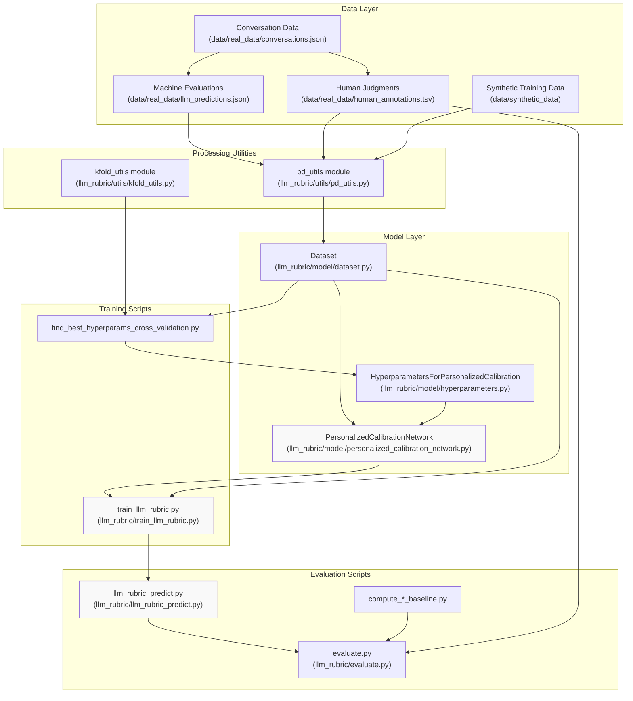
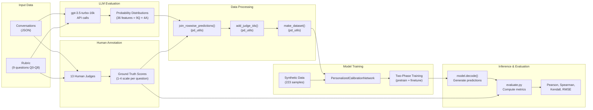
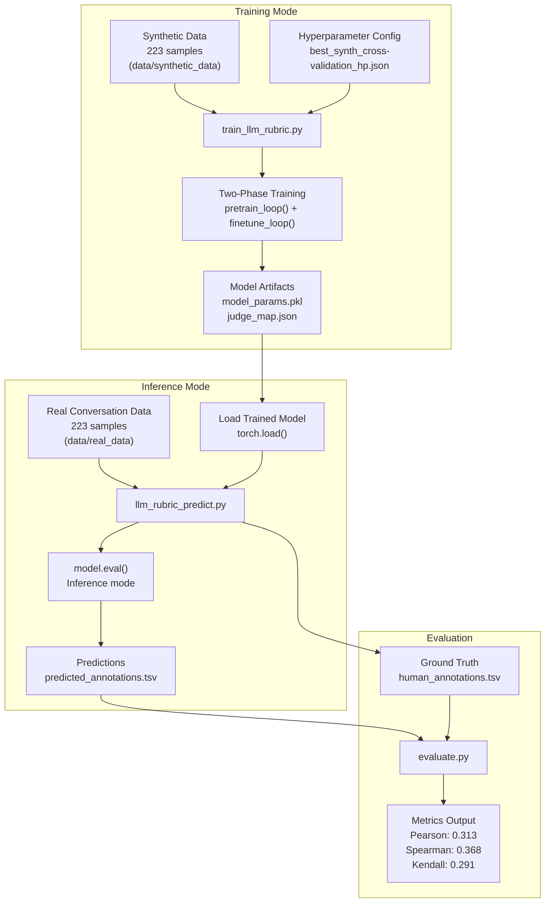

<!-- source: DeepWiki mcp.deepwiki.com · repo microsoft/LLM-Rubric · page 1 Overview · fetched 2026-10-26 -->

# Overview

<details>
<summary>Relevant source files</summary>

The following files were used as context for generating this wiki page:

- [README.md](README.md)

</details>


## Purpose and Scope

This document provides an introduction to the LLM-Rubric system: a framework for automated evaluation of natural language texts using multidimensional rubrics, large language model (LLM) predictions, and personalized neural network calibration. This overview covers the core problem, solution approach, system architecture, and key components at a high level.

For detailed installation steps, see [Installation](#2.1). For conceptual explanations of personalized calibration, see [Core Concepts](#3). For step-by-step usage instructions, see [User Guides](#4).

**Sources**: [README.md:1-6]()

---

## Problem Statement

Evaluating natural language texts—such as conversational dialogues, generated responses, or document quality—requires assessing multiple dimensions simultaneously (e.g., naturalness, conciseness, factual accuracy). While large language models can produce probability distributions over potential judgments for each evaluation criterion, these predictions often fail to align well with human judges. Furthermore, human judges themselves do not fully agree with one another, exhibiting individual preferences and assessment patterns.

The challenge is to create an automated evaluation system that:
1. Leverages LLM evaluation capabilities across multiple rubric dimensions
2. Learns to predict individual human judge behavior rather than assuming a single "correct" answer
3. Generalizes from synthetic training data to real-world evaluation scenarios
4. Provides calibrated predictions that account for judge-specific biases and preferences

**Sources**: [README.md:1-6]()

---

## Solution Approach

LLM-Rubric addresses these challenges through a three-stage pipeline:

| Stage | Description | Key Components |
|-------|-------------|----------------|
| **1. Multi-Dimensional LLM Evaluation** | An LLM (gpt-3.5-turbo-16k) is prompted with rubric questions for each text, producing probability distributions over answer choices (typically 1-4 scale) | Rubric questions Q0-Q8, LLM API calls |
| **2. Personalized Calibration Network** | A small feed-forward neural network (`PersonalizedCalibrationNetwork`) learns to map LLM distributions to individual human judge predictions using both judge-specific and judge-independent parameters | PyTorch neural network with personalized weights |
| **3. Training on Synthetic, Evaluation on Real** | Model is trained on synthetic data (223 samples), then applied to real conversation data without further fine-tuning | Two-phase training: pretraining + finetuning |

The core innovation is the personalized calibration approach: instead of training a single model to predict an "average" human judgment, the network learns separate parameters for each judge while sharing common feature extraction layers. This allows the system to predict how each specific judge would evaluate a text.

**Sources**: [README.md:1-6](), [README.md:79-102]()

---

## System Architecture

### Core Components

The LLM-Rubric system consists of the following key components, mapping natural language concepts to code entities:



**Component Descriptions**:

- **`PersonalizedCalibrationNetwork`**: The core neural network class ([llm_rubric/model/personalized_calibration_network.py]()) that implements judge-specific and judge-independent parameters for calibrated prediction
- **`Dataset`**: Pydantic-numpy data structure ([llm_rubric/model/dataset.py]()) encapsulating input features (X), judge IDs (A), and target labels (Y)
- **`HyperparametersForPersonalizedCalibration`**: Configuration class ([llm_rubric/model/hyperparameters.py]()) defining network architecture and training parameters
- **`pd_utils`**: Data transformation utilities ([llm_rubric/utils/pd_utils.py]()) for converting between row-wise and column-wise formats, merging evaluations with judgments, and creating model-ready datasets
- **`kfold_utils`**: Cross-validation utilities ([llm_rubric/utils/kfold_utils.py]()) for splitting data into training and test folds

**Sources**: [README.md:32-56](), [README.md:79-102](), Diagrams 1-3

---

## Data Flow Pipeline

The following diagram shows how data flows through the system from raw inputs to final predictions:



**Pipeline Stages**:

1. **LLM Evaluation**: Raw conversations and rubric questions are sent to `gpt-3.5-turbo-16k` which produces probability distributions over 4 possible answers for each of 9 questions (36 total features)

2. **Data Processing**: The `join_rowwise_predictions()` function ([llm_rubric/utils/pd_utils.py]()) pivots LLM outputs from row-wise format to columnar features; `add_judge_ids()` maps human judge names to integer IDs; `make_dataset()` creates the final `Dataset` object

3. **Model Training**: The `PersonalizedCalibrationNetwork` is trained on synthetic data using a two-phase process: pretraining (20 epochs by default) followed by finetuning (30 epochs by default)

4. **Inference**: The trained model's `decode()` method generates predictions for each judge on real conversation data

5. **Evaluation**: The `evaluate.py` script computes correlation metrics (Pearson, Spearman, Kendall) and RMSE by comparing predictions against human judgments

**Sources**: [README.md:79-102](), Diagrams 2, 3, 5

---

## Training vs Inference Modes

The system operates in two distinct modes with different data sources and objectives:



**Training Mode** ([llm_rubric/train_llm_rubric.py]()):
- Uses synthetic data to learn general patterns of LLM-to-human calibration
- Trains the `PersonalizedCalibrationNetwork` with judge-specific and judge-independent parameters
- Saves trained weights in `model_params.pkl` and judge ID mappings in `judge_map.json`
- Hyperparameters loaded from `best_synth_cross-validation_hp.json` ([README.md:82-85]())

**Inference Mode** ([llm_rubric/llm_rubric_predict.py]()):
- Loads pre-trained model artifacts
- Applies the model to real conversation data without additional training
- Uses `model.eval()` to set batch normalization and dropout to inference mode
- Generates predictions via the `model.decode()` method

**Key Insight**: The separation between synthetic training data and real evaluation data tests the model's ability to generalize learned calibration patterns to new conversational contexts.

**Sources**: [README.md:79-102](), Diagram 3

---

## Baseline Comparison Framework

LLM-Rubric is evaluated against six baseline systems to demonstrate its effectiveness:

| Baseline Type | System Name | Description | Implementation |
|---------------|-------------|-------------|----------------|
| **Machine** | `expected_llm` | Expected value: E[X] = Σ p_i × score_i | [llm_rubric/compute_machine_baseline.py]() |
| **Machine** | `argmax_llm` | Most probable answer: argmax(p_i) + 1 | [llm_rubric/compute_machine_baseline.py]() |
| **Machine** | `sample_llm` | Random sample from LLM distribution | [llm_rubric/compute_machine_baseline.py]() |
| **Human** | `group_constant` | Overall mean across all judges | [llm_rubric/compute_human_baseline.py]() |
| **Human** | `ann_constant` | Per-annotator mean | [llm_rubric/compute_human_baseline.py]() |
| **Random** | `random` | Uniform random selection (1-4) | [llm_rubric/compute_random_baseline.py]() |

**Example Baseline Results** ([README.md:68-75]()):
```
                        rmse   pearson  spearman   kendall
system
random              1.453309 -0.054438 -0.043663 -0.036858
sample_llm          1.207228  0.039810  0.045245  0.040967
argmax_llm          1.201643  0.140091  0.086990  0.081134
expected_llm        0.918676  0.177301  0.086675  0.065928
```

**LLM-Rubric Performance** ([README.md:99-102]()):
```
test pearsonr   0.313
test spearmanr  0.368
test kendallt   0.291
```

LLM-Rubric outperforms all baselines, demonstrating that learning judge-specific calibration patterns yields better human judgment prediction than simple aggregation strategies.

**Sources**: [README.md:62-78](), Diagram 6

---

## Key Innovations

### 1. Personalized Calibration

The `PersonalizedCalibrationNetwork` class implements two types of parameters:
- **Judge-independent parameters**: Shared feature extraction layers that learn common patterns across all judges
- **Judge-specific parameters**: Personalized weights for each individual judge that capture their unique preferences and biases

This architecture is defined in [llm_rubric/model/personalized_calibration_network.py]() and enables the model to predict how each specific judge would evaluate a text, rather than predicting a generic "average" judgment.

### 2. Two-Phase Training Strategy

Training consists of two phases ([README.md:82-85]()):
- **Pretraining** (20 epochs): Trains both shared and judge-specific parameters
- **Finetuning** (30 epochs): Continues training with potentially different hyperparameters or loss functions

This staged approach allows the model to first learn general calibration patterns before specializing to individual judge behaviors.

### 3. Synthetic-to-Real Transfer

The model is trained exclusively on synthetic data but evaluated on real conversation data. This tests whether learned calibration patterns generalize across different conversational contexts and domains, making the system more robust and practical for real-world deployment.

**Sources**: [README.md:1-6](), [README.md:79-102]()

---

## Repository Structure Overview

The codebase is organized into the following key directories:

```
LLM-Rubric/
├── llm_rubric/              # Main package
│   ├── model/               # Neural network implementation
│   │   ├── personalized_calibration_network.py
│   │   ├── hyperparameters.py
│   │   └── dataset.py
│   ├── utils/               # Data processing utilities
│   │   ├── pd_utils.py      # DataFrame transformations
│   │   ├── kfold_utils.py   # Cross-validation
│   │   └── llm_evaluator.py # LLM API interface
│   ├── train_llm_rubric.py  # Training script
│   ├── llm_rubric_predict.py # Inference script
│   ├── evaluate.py           # Metrics computation
│   └── compute_*_baseline.py # Baseline systems
├── data/
│   ├── real_data/           # Real conversations + annotations
│   └── synthetic_data/      # Training data
├── experiments/             # Hyperparameters and results
└── scripts/                 # Bash scripts for workflows
```

For detailed project structure documentation, see [Project Structure](#9.1).

**Sources**: Repository structure observation

---

## Getting Started

To begin using LLM-Rubric:

1. **Install dependencies**: Follow [Installation](#2.1) instructions using Poetry and Python 3.10
2. **Run quick start**: Complete the [Quick Start Tutorial](#2.2) to train and evaluate a model on the included datasets
3. **Compute baselines**: Use [Computing Baselines](#4.1) to establish performance benchmarks
4. **Train your model**: Follow [Training a Model](#4.2) for step-by-step training instructions
5. **Make predictions**: Use [Making Predictions](#4.3) to generate predictions on new data
6. **Evaluate results**: Apply [Evaluating Results](#4.4) to compute metrics and compare systems

For research and citation information, see the ACL 2024 paper reference in [README.md:8-28]().

**Sources**: [README.md:32-103]()

---

