# Page: Overview

# Overview

<details>
<summary>Relevant source files</summary>

The following files were used as context for generating this wiki page:

- [README.md](README.md)

</details>


## Purpose and Scope

This document provides an introduction to the LLM-Rubric system: a framework for automated evaluation of natural language texts using multidimensional rubrics, large language model (LLM) predictions, and personalized neural network calibration. This overview covers the core problem, solution approach, system architecture, and key components at a high level.

For detailed installation steps, see [Installation](#2.1). For conceptual explanations of personalized calibration, see [Core Concepts](#3). For step-by-step usage instructions, see [User Guides](#4).

**Sources**: [README.md:1-6]()

---

## Problem Statement

Evaluating natural language texts—such as conversational dialogues, generated responses, or document quality—requires assessing multiple dimensions simultaneously (e.g., naturalness, conciseness, factual accuracy). While large language models can produce probability distributions over potential judgments for each evaluation criterion, these predictions often fail to align well with human judges. Furthermore, human judges themselves do not fully agree with one another, exhibiting individual preferences and assessment patterns.

The challenge is to create an automated evaluation system that:
1. Leverages LLM evaluation capabilities across multiple rubric dimensions
2. Learns to predict individual human judge behavior rather than assuming a single "correct" answer
3. Generalizes from synthetic training data to real-world evaluation scenarios
4. Provides calibrated predictions that account for judge-specific biases and preferences

**Sources**: [README.md:1-6]()

---

## Solution Approach

LLM-Rubric addresses these challenges through a three-stage pipeline:

| Stage | Description | Key Components |
|-------|-------------|----------------|
| **1. Multi-Dimensional LLM Evaluation** | An LLM (gpt-3.5-turbo-16k) is prompted with rubric questions for each text, producing probability distributions over answer choices (typically 1-4 scale) | Rubric questions Q0-Q8, LLM API calls |
| **2. Personalized Calibration Network** | A small feed-forward neural network (`PersonalizedCalibrationNetwork`) learns to map LLM distributions to individual human judge predictions using both judge-specific and judge-independent parameters | PyTorch neural network with personalized weights |
| **3. Training on Synthetic, Evaluation on Real** | Model is trained on synthetic data (223 samples), then applied to real conversation data without further fine-tuning | Two-phase training: pretraining + finetuning |

The core innovation is the personalized calibration approach: instead of training a single model to predict an "average" human judgment, the network learns separate parameters for each judge while sharing common feature extraction layers. This allows the system to predict how each specific judge would evaluate a text.

**Sources**: [README.md:1-6](), [README.md:79-102]()

---

## System Architecture

### Core Components

The LLM-Rubric system consists of the following key components, mapping natural language concepts to code entities:

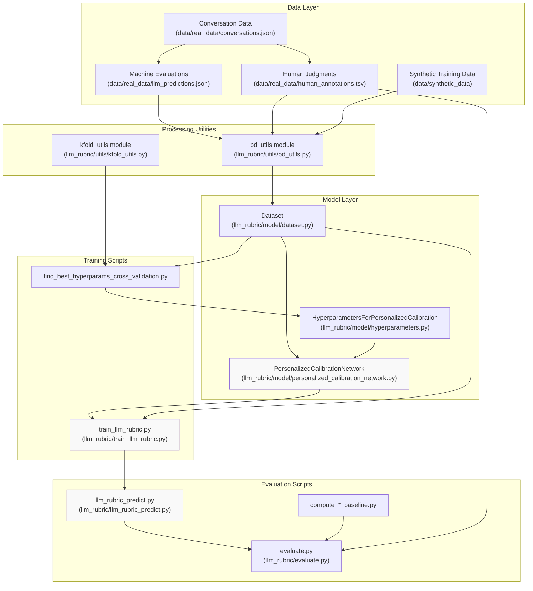

**Component Descriptions**:

- **`PersonalizedCalibrationNetwork`**: The core neural network class ([llm_rubric/model/personalized_calibration_network.py]()) that implements judge-specific and judge-independent parameters for calibrated prediction
- **`Dataset`**: Pydantic-numpy data structure ([llm_rubric/model/dataset.py]()) encapsulating input features (X), judge IDs (A), and target labels (Y)
- **`HyperparametersForPersonalizedCalibration`**: Configuration class ([llm_rubric/model/hyperparameters.py]()) defining network architecture and training parameters
- **`pd_utils`**: Data transformation utilities ([llm_rubric/utils/pd_utils.py]()) for converting between row-wise and column-wise formats, merging evaluations with judgments, and creating model-ready datasets
- **`kfold_utils`**: Cross-validation utilities ([llm_rubric/utils/kfold_utils.py]()) for splitting data into training and test folds

**Sources**: [README.md:32-56](), [README.md:79-102](), Diagrams 1-3

---

## Data Flow Pipeline

The following diagram shows how data flows through the system from raw inputs to final predictions:

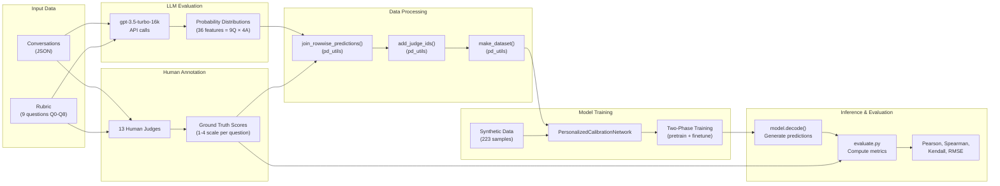

**Pipeline Stages**:

1. **LLM Evaluation**: Raw conversations and rubric questions are sent to `gpt-3.5-turbo-16k` which produces probability distributions over 4 possible answers for each of 9 questions (36 total features)

2. **Data Processing**: The `join_rowwise_predictions()` function ([llm_rubric/utils/pd_utils.py]()) pivots LLM outputs from row-wise format to columnar features; `add_judge_ids()` maps human judge names to integer IDs; `make_dataset()` creates the final `Dataset` object

3. **Model Training**: The `PersonalizedCalibrationNetwork` is trained on synthetic data using a two-phase process: pretraining (20 epochs by default) followed by finetuning (30 epochs by default)

4. **Inference**: The trained model's `decode()` method generates predictions for each judge on real conversation data

5. **Evaluation**: The `evaluate.py` script computes correlation metrics (Pearson, Spearman, Kendall) and RMSE by comparing predictions against human judgments

**Sources**: [README.md:79-102](), Diagrams 2, 3, 5

---

## Training vs Inference Modes

The system operates in two distinct modes with different data sources and objectives:

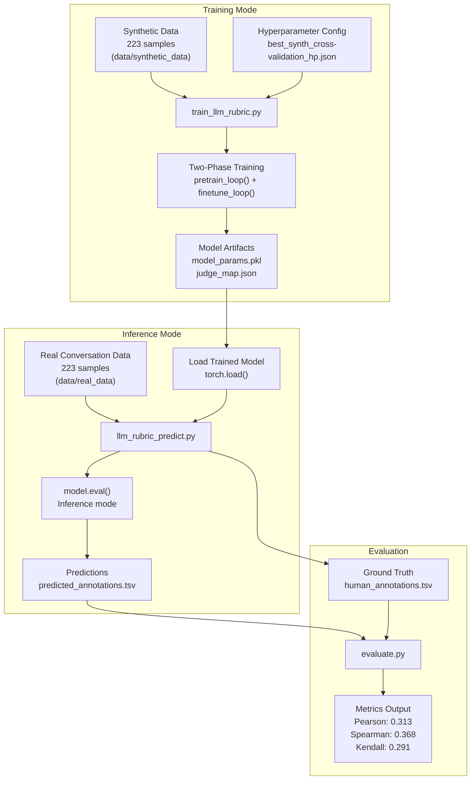

**Training Mode** ([llm_rubric/train_llm_rubric.py]()):
- Uses synthetic data to learn general patterns of LLM-to-human calibration
- Trains the `PersonalizedCalibrationNetwork` with judge-specific and judge-independent parameters
- Saves trained weights in `model_params.pkl` and judge ID mappings in `judge_map.json`
- Hyperparameters loaded from `best_synth_cross-validation_hp.json` ([README.md:82-85]())

**Inference Mode** ([llm_rubric/llm_rubric_predict.py]()):
- Loads pre-trained model artifacts
- Applies the model to real conversation data without additional training
- Uses `model.eval()` to set batch normalization and dropout to inference mode
- Generates predictions via the `model.decode()` method

**Key Insight**: The separation between synthetic training data and real evaluation data tests the model's ability to generalize learned calibration patterns to new conversational contexts.

**Sources**: [README.md:79-102](), Diagram 3

---

## Baseline Comparison Framework

LLM-Rubric is evaluated against six baseline systems to demonstrate its effectiveness:

| Baseline Type | System Name | Description | Implementation |
|---------------|-------------|-------------|----------------|
| **Machine** | `expected_llm` | Expected value: E[X] = Σ p_i × score_i | [llm_rubric/compute_machine_baseline.py]() |
| **Machine** | `argmax_llm` | Most probable answer: argmax(p_i) + 1 | [llm_rubric/compute_machine_baseline.py]() |
| **Machine** | `sample_llm` | Random sample from LLM distribution | [llm_rubric/compute_machine_baseline.py]() |
| **Human** | `group_constant` | Overall mean across all judges | [llm_rubric/compute_human_baseline.py]() |
| **Human** | `ann_constant` | Per-annotator mean | [llm_rubric/compute_human_baseline.py]() |
| **Random** | `random` | Uniform random selection (1-4) | [llm_rubric/compute_random_baseline.py]() |

**Example Baseline Results** ([README.md:68-75]()):
```
                        rmse   pearson  spearman   kendall
system
random              1.453309 -0.054438 -0.043663 -0.036858
sample_llm          1.207228  0.039810  0.045245  0.040967
argmax_llm          1.201643  0.140091  0.086990  0.081134
expected_llm        0.918676  0.177301  0.086675  0.065928
```

**LLM-Rubric Performance** ([README.md:99-102]()):
```
test pearsonr   0.313
test spearmanr  0.368
test kendallt   0.291
```

LLM-Rubric outperforms all baselines, demonstrating that learning judge-specific calibration patterns yields better human judgment prediction than simple aggregation strategies.

**Sources**: [README.md:62-78](), Diagram 6

---

## Key Innovations

### 1. Personalized Calibration

The `PersonalizedCalibrationNetwork` class implements two types of parameters:
- **Judge-independent parameters**: Shared feature extraction layers that learn common patterns across all judges
- **Judge-specific parameters**: Personalized weights for each individual judge that capture their unique preferences and biases

This architecture is defined in [llm_rubric/model/personalized_calibration_network.py]() and enables the model to predict how each specific judge would evaluate a text, rather than predicting a generic "average" judgment.

### 2. Two-Phase Training Strategy

Training consists of two phases ([README.md:82-85]()):
- **Pretraining** (20 epochs): Trains both shared and judge-specific parameters
- **Finetuning** (30 epochs): Continues training with potentially different hyperparameters or loss functions

This staged approach allows the model to first learn general calibration patterns before specializing to individual judge behaviors.

### 3. Synthetic-to-Real Transfer

The model is trained exclusively on synthetic data but evaluated on real conversation data. This tests whether learned calibration patterns generalize across different conversational contexts and domains, making the system more robust and practical for real-world deployment.

**Sources**: [README.md:1-6](), [README.md:79-102]()

---

## Repository Structure Overview

The codebase is organized into the following key directories:

```
LLM-Rubric/
├── llm_rubric/              # Main package
│   ├── model/               # Neural network implementation
│   │   ├── personalized_calibration_network.py
│   │   ├── hyperparameters.py
│   │   └── dataset.py
│   ├── utils/               # Data processing utilities
│   │   ├── pd_utils.py      # DataFrame transformations
│   │   ├── kfold_utils.py   # Cross-validation
│   │   └── llm_evaluator.py # LLM API interface
│   ├── train_llm_rubric.py  # Training script
│   ├── llm_rubric_predict.py # Inference script
│   ├── evaluate.py           # Metrics computation
│   └── compute_*_baseline.py # Baseline systems
├── data/
│   ├── real_data/           # Real conversations + annotations
│   └── synthetic_data/      # Training data
├── experiments/             # Hyperparameters and results
└── scripts/                 # Bash scripts for workflows
```

For detailed project structure documentation, see [Project Structure](#9.1).

**Sources**: Repository structure observation

---

## Getting Started

To begin using LLM-Rubric:

1. **Install dependencies**: Follow [Installation](#2.1) instructions using Poetry and Python 3.10
2. **Run quick start**: Complete the [Quick Start Tutorial](#2.2) to train and evaluate a model on the included datasets
3. **Compute baselines**: Use [Computing Baselines](#4.1) to establish performance benchmarks
4. **Train your model**: Follow [Training a Model](#4.2) for step-by-step training instructions
5. **Make predictions**: Use [Making Predictions](#4.3) to generate predictions on new data
6. **Evaluate results**: Apply [Evaluating Results](#4.4) to compute metrics and compare systems

For research and citation information, see the ACL 2024 paper reference in [README.md:8-28]().

**Sources**: [README.md:32-103]()

---

# Page: Getting Started

# Getting Started

<details>
<summary>Relevant source files</summary>

The following files were used as context for generating this wiki page:

- [README.md](README.md)
- [poetry.lock](poetry.lock)
- [pyproject.toml](pyproject.toml)

</details>


This page provides an overview of how to set up and begin using the LLM-Rubric system for automated evaluation of natural language texts. It covers the prerequisites, system workflow, and points to detailed guides for installation and running your first evaluation.

For detailed information about the core concepts and architecture, see [Core Concepts](#3). For step-by-step guides on specific tasks, see [User Guides](#4).

## Prerequisites

The LLM-Rubric system requires:

- **Python 3.10**: The codebase is compatible with Python versions 3.10 through 3.12
- **Poetry**: Used for dependency management and installation
- **PyTorch 2.3.0**: The neural network framework used for the PersonalizedCalibrationNetwork

For complete installation instructions including platform-specific steps for PyTorch, see [Installation](#2.1).

**Sources:** [README.md:32-56](), [pyproject.toml:9-17]()

## System Workflow Overview

The LLM-Rubric evaluation process follows a structured workflow from raw data to final performance metrics:

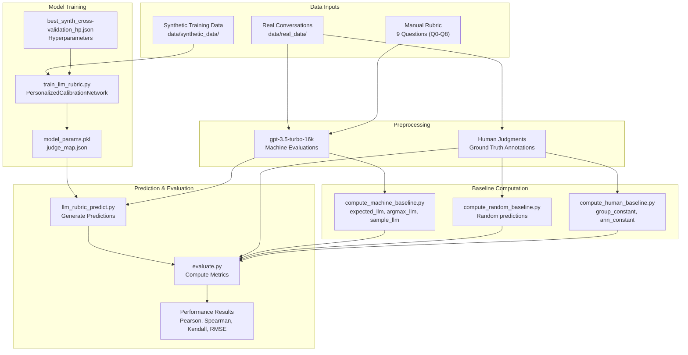

**Workflow: End-to-End Evaluation Process**

The system operates in three main phases:

1. **Baseline Computation**: Establish comparison benchmarks using various strategies (machine-derived, human-derived, and random)
2. **Model Training**: Train the PersonalizedCalibrationNetwork on synthetic data with optimized hyperparameters
3. **Prediction & Evaluation**: Apply the trained model to real conversations and compute correlation metrics

**Sources:** [README.md:58-103]()

## Execution Pipeline

The following diagram shows how shell scripts orchestrate the Python modules to execute the complete pipeline:

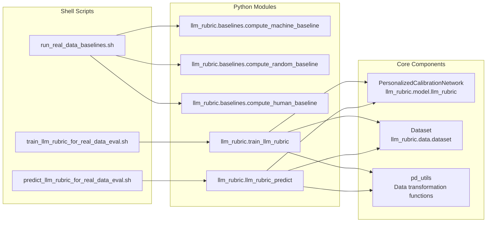

**Execution Pipeline: Scripts to Code Entities**

**Sources:** [README.md:62-103]()

## Data Organization

The repository includes pre-processed data for immediate experimentation:

| Data Type | Location | Contents |
|-----------|----------|----------|
| Real Conversations | `data/real_data/` | Natural language conversations for evaluation |
| Human Judgments | `data/real_data/*.tsv` | Ground truth annotations from 13-24 judges |
| Machine Evaluations | `data/real_data/*_predictions.json` | LLM probability distributions per criterion |
| Synthetic Data | `data/synthetic_data/` | Training data with fold assignments |
| Hyperparameters | `experiments/real_data/best_synth_cross-validation_hp.json` | Pre-optimized model configuration |

The data formats follow specific schemas with TSV files for human judgments (columnar format with Q0-Q8 columns) and JSON files for machine evaluations (row-wise format with probability distributions).

For detailed information about data formats and schemas, see [Data Formats and Schema](#5.1).

**Sources:** [README.md:60-103]()

## Quick Start Summary

To begin using LLM-Rubric, follow these high-level steps:

1. **Install Dependencies**: Use Poetry to set up the virtual environment and install required packages
2. **Compute Baselines**: Run baseline scripts to establish comparison benchmarks
3. **Train Model**: Execute the training script on synthetic data with pre-configured hyperparameters
4. **Generate Predictions**: Apply the trained model to real conversation data
5. **Evaluate Results**: Compare model predictions against baselines using correlation metrics

Each step is automated through shell scripts that orchestrate the Python modules.

For a complete walkthrough with detailed commands and expected outputs, see [Quick Start Tutorial](#2.2).

For individual task guides, see:
- [Computing Baselines](#4.1)
- [Training a Model](#4.2)
- [Making Predictions](#4.3)
- [Evaluating Results](#4.4)

**Sources:** [README.md:58-103]()

## Expected Performance

When running the complete pipeline on the included real conversation data, the system produces:

- **Baselines**: Performance metrics for 7 baseline methods (3 machine-based, 2 human-based, 1 random, 1 LLM-Rubric)
- **Model Output**: Trained PersonalizedCalibrationNetwork parameters saved to `model_params.pkl`
- **Predictions**: Per-judge, per-criterion predictions on 223 conversation samples
- **Metrics**: Pearson, Spearman, and Kendall correlation coefficients plus RMSE

Typical results show:
- Pearson correlation: ~0.31
- Spearman correlation: ~0.37
- Kendall tau: ~0.29

These metrics indicate moderate to strong correlation between model predictions and human judge assessments.

**Sources:** [README.md:66-103]()

## Next Steps

After completing the quick start:

1. **Understand the Architecture**: Learn about the PersonalizedCalibrationNetwork and its judge-specific parameters ([Core Concepts](#3))
2. **Explore Hyperparameter Tuning**: Optimize model configuration for your own data ([Hyperparameter Tuning](#4.5))
3. **Work with Custom Data**: Adapt the system to evaluate your own conversation datasets ([Data Reference](#5))
4. **Extend the Model**: Modify the neural network architecture or training process ([Model Reference](#6))

**Sources:** [README.md:1-103]()

---

# Page: Installation

# Installation

<details>
<summary>Relevant source files</summary>

The following files were used as context for generating this wiki page:

- [README.md](README.md)
- [poetry.lock](poetry.lock)
- [pyproject.toml](pyproject.toml)

</details>


This page provides detailed instructions for installing the LLM-Rubric system and its dependencies. The installation process uses Poetry for dependency management and requires Python 3.10 or higher. For information about running your first evaluation after installation, see [Quick Start Tutorial](#2.2).

## Prerequisites

The LLM-Rubric system requires:

- **Python Version**: 3.10, 3.11, or 3.12 (3.13+ not supported)
- **Operating System**: macOS, Linux, or Windows
- **Package Manager**: Poetry 1.8.0 or higher
- **PyTorch**: 2.3.0 (installed separately before other dependencies)

**Sources:** [pyproject.toml:10](), [README.md:35-39](), [poetry.lock:746]()

---

## Installation Workflow

The following diagram shows the complete installation process:

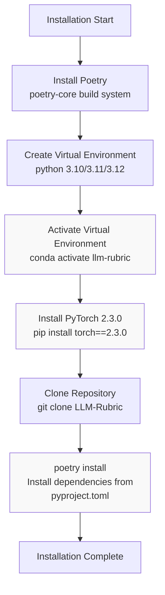

**Sources:** [README.md:32-56]()

---

## Step 1: Install Poetry

Poetry is the dependency management tool used by LLM-Rubric. Install it using the official installer:

```bash
curl -sSL https://install.python-poetry.org | python3 -
```

Verify the installation:

```bash
poetry --version
```

Expected output: `Poetry (version 1.8.3)`

**Sources:** [README.md:34]()

---

## Step 2: Create and Activate Virtual Environment

Create a virtual environment with Python 3.10 using your preferred environment manager:

### Using Conda

```bash
conda create -n llm-rubric python=3.10
conda activate llm-rubric
```

### Using venv

```bash
python3.10 -m venv llm-rubric-env
source llm-rubric-env/bin/activate  # On Linux/macOS
# OR
llm-rubric-env\Scripts\activate  # On Windows
```

**Important:** Ensure the virtual environment is activated for all subsequent steps.

**Sources:** [README.md:35-40]()

---

## Step 3: Install PyTorch

PyTorch must be installed **before** installing other dependencies. Installation commands differ by platform:

| Platform | Command |
|----------|---------|
| **macOS** | `pip install torch==2.3.0` |
| **Linux** | `pip install torch==2.3.0 --index-url https://download.pytorch.org/whl/cpu` |
| **Windows** | `pip install torch==2.3.0 --index-url https://download.pytorch.org/whl/cpu` |

### Platform-Specific Notes

- **macOS**: Default PyPI package includes Metal Performance Shaders (MPS) support for Apple Silicon
- **Linux/Windows**: The CPU-only version is used; modify for CUDA if GPU support is needed

Verify PyTorch installation:

```python
python -c "import torch; print(f'PyTorch {torch.__version__}')"
```

Expected output: `PyTorch 2.3.0`

**Sources:** [README.md:42-50]()

---

## Step 4: Install LLM-Rubric

Clone the repository and install dependencies using Poetry:

```bash
git clone https://github.com/microsoft/LLM-Rubric.git
cd LLM-Rubric
poetry install
```

### What Gets Installed

The `poetry install` command reads [pyproject.toml:9-17]() and installs the following dependency tree:

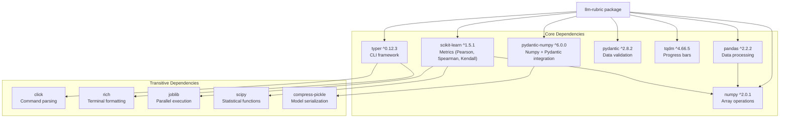

**Sources:** [pyproject.toml:9-17](), [poetry.lock:1-747]()

---

## Step 5: Verify Installation

After installation completes, verify that the package is correctly installed:

### Check Python Environment

```bash
python -c "import llm_rubric; print('LLM-Rubric installed successfully')"
```

### Check Core Dependencies

```python
python -c "
import torch
import pandas as pd
import numpy as np
from sklearn.metrics import mean_squared_error
import pydantic
print(f'torch: {torch.__version__}')
print(f'pandas: {pd.__version__}')
print(f'numpy: {np.__version__}')
print(f'pydantic: {pydantic.__version__}')
print('All dependencies loaded successfully')
"
```

Expected output includes version numbers matching:
- torch: 2.3.0
- pandas: 2.2.2
- numpy: 2.0.1
- pydantic: 2.8.2

### Verify Scripts Are Available

The installation makes several command-line scripts available. Check that the repository scripts directory is accessible:

```bash
ls scripts/
```

You should see files including:
- `run_real_data_baselines.sh`
- `train_llm_rubric_for_real_data_eval.sh`
- `predict_llm_rubric_for_real_data_eval.sh`

**Sources:** [README.md:58-103](), [pyproject.toml:9-17]()

---

## Dependency Version Requirements

The following table summarizes critical version constraints enforced by [pyproject.toml:10]() and [poetry.lock:746]():

| Package | Version Constraint | Reason |
|---------|-------------------|---------|
| **Python** | `>=3.10,<3.13` | Compatibility with numpy 2.0.1 and PyTorch 2.3.0 |
| **PyTorch** | `==2.3.0` | Specific version for reproducibility |
| **numpy** | `^2.0.1` | Required by numpy 2.x API changes |
| **pandas** | `^2.2.2` | Data processing compatibility |
| **scikit-learn** | `^1.5.1` | Metrics computation |
| **pydantic** | `^2.8.2` | Data validation v2 API |
| **pydantic-numpy** | `^6.0.0` | Integration with pydantic v2 + numpy 2.x |

**Sources:** [pyproject.toml:10-17](), [poetry.lock:156-207](), [poetry.lock:210-280]()

---

## Troubleshooting

### Poetry Not Found After Installation

If `poetry` command is not recognized, add Poetry to your PATH:

```bash
export PATH="$HOME/.local/bin:$PATH"  # Linux/macOS
```

For Windows, add `%APPDATA%\Python\Scripts` to your PATH environment variable.

### Python Version Mismatch

If you encounter errors about Python version compatibility:

```bash
python --version  # Verify it shows 3.10, 3.11, or 3.12
```

Create a new virtual environment with the correct Python version before retrying installation.

### PyTorch Import Errors

If PyTorch fails to import, ensure it was installed **before** running `poetry install`:

```bash
pip list | grep torch  # Verify torch==2.3.0 is listed
```

If not present, install PyTorch following Step 3, then re-run `poetry install`.

### Platform-Specific PyTorch Issues

For Linux/Windows users, if the default PyTorch installation fails, ensure you're using the CPU-specific index URL:

```bash
pip uninstall torch
pip install torch==2.3.0 --index-url https://download.pytorch.org/whl/cpu
```

**Sources:** [README.md:40-50]()

---

## Next Steps

After successful installation, proceed to [Quick Start Tutorial](#2.2) to run your first evaluation with the included datasets.

For development setup and contributing guidelines, see [Development Guide](#9).

**Sources:** [README.md:58-103]()

---

# Page: Quick Start Tutorial

# Quick Start Tutorial

<details>
<summary>Relevant source files</summary>

The following files were used as context for generating this wiki page:

- [README.md](README.md)
- [scripts/run_real_data_baselines.sh](scripts/run_real_data_baselines.sh)

</details>


## Purpose and Scope

This tutorial walks through the complete LLM-Rubric workflow using the included real conversation and synthetic training datasets. You will learn how to:

1. Compute baseline predictions using multiple methods
2. Train a PersonalizedCalibrationNetwork on synthetic data
3. Generate predictions on real conversation data
4. Evaluate and compare all methods

For detailed installation instructions, see [Installation](#2.1). For in-depth explanations of individual components, refer to [User Guides](#4).

---

## Overview of the Workflow

The quick start demonstrates the end-to-end evaluation pipeline on pre-provided data. The workflow consists of three main phases executed sequentially:

```mermaid
graph LR
    subgraph Phase1["Phase 1: Baseline Computation"]
        A["Compute Machine Baselines<br/>(sample_llm, argmax_llm, expected_llm)"]
        B["Compute Random Baseline"]
        C["Compute Human Baselines<br/>(group_constant, ann_constant)"]
    end
    
    subgraph Phase2["Phase 2: Model Training"]
        D["Load Best Hyperparameters<br/>from synthetic data CV"]
        E["Train PersonalizedCalibrationNetwork<br/>on synthetic data"]
        F["Save model artifacts<br/>(weights + judge_map)"]
    end
    
    subgraph Phase3["Phase 3: Prediction & Evaluation"]
        G["Generate LLM-Rubric predictions<br/>on real data"]
        H["Run evaluation script<br/>on all systems"]
        I["Compare correlation metrics<br/>(Pearson, Spearman, Kendall)"]
    end
    
    A --> B
    B --> C
    C --> D
    D --> E
    E --> F
    F --> G
    G --> H
    H --> I
```

**Sources:** [README.md:58-103]()

---

## Phase 1: Computing Baselines

Baselines provide comparison benchmarks for evaluating the LLM-Rubric model. The system computes three categories of baselines from the provided data.

### Running the Baseline Script

Execute all baseline computations with a single shell script:

```bash
bash scripts/run_real_data_baselines.sh
```

This script sequentially computes machine baselines, random baseline, human baselines, and evaluates them using the provided evaluation script.

**Sources:** [scripts/run_real_data_baselines.sh:1-38]()

### Data Flow for Baseline Computation

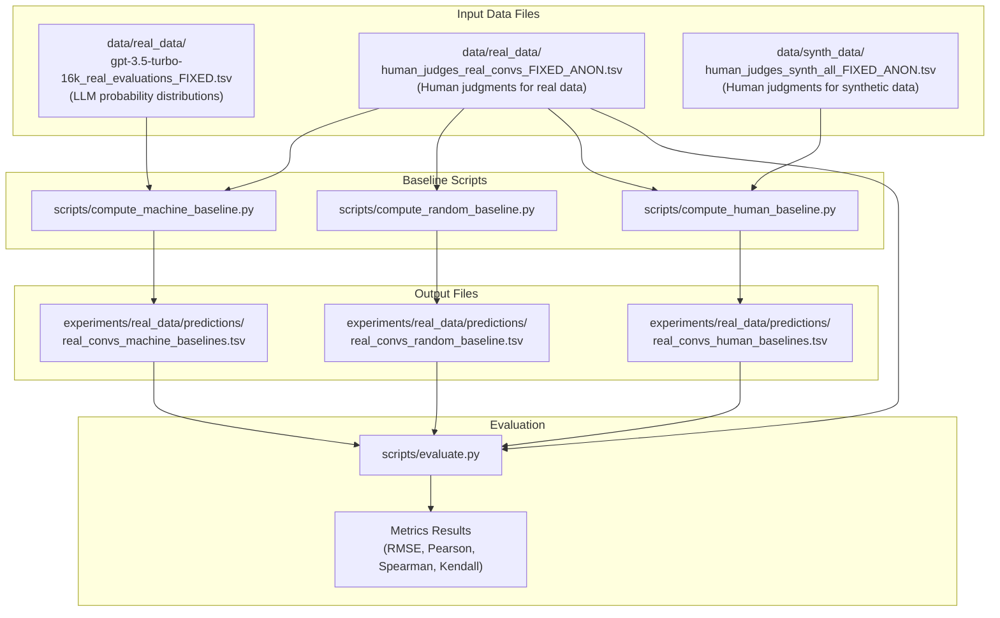

**Sources:** [scripts/run_real_data_baselines.sh:1-38]()

### Baseline Methods Summary

| Baseline Type | Method Name | Script | Description |
|--------------|-------------|--------|-------------|
| Machine | `sample_llm` | `compute_machine_baseline.py` | Sample from LLM probability distribution |
| Machine | `argmax_llm` | `compute_machine_baseline.py` | Select answer with highest probability |
| Machine | `expected_llm` | `compute_machine_baseline.py` | Compute expected value: Σ(p_i × score_i) |
| Random | `random` | `compute_random_baseline.py` | Uniform random selection from {1,2,3,4} |
| Human | `group_constant` | `compute_human_baseline.py` | Overall mean across all judges (from training data) |
| Human | `ann_constant` | `compute_human_baseline.py` | Per-annotator mean (from training data) |

**Sources:** [scripts/run_real_data_baselines.sh:3-26](), [README.md:62-77]()

### Expected Output

After running the baseline script, you should see output similar to:

```
                            rmse   pearson  spearman   kendall    N      mean       std
criterion system
Q0        random        1.453309 -0.054438 -0.043663 -0.036858  223  2.587444  1.152196
          sample_llm    1.207228  0.039810  0.045245  0.040967  223  3.322870  0.794469
          argmax_llm    1.201643  0.140091  0.086990  0.081134  223  3.614350  0.563597
          expected_llm  0.918676  0.177301  0.086675  0.065928  223  3.282864  0.300516
```

This table shows that:
- `N=223`: 223 real conversation samples evaluated
- Random baseline performs worst (near-zero or negative correlations)
- Machine baselines show positive but modest correlations with human judgments
- `expected_llm` achieves the best baseline performance

**Sources:** [README.md:66-75]()

---

## Phase 2: Training the Model

The PersonalizedCalibrationNetwork is trained on synthetic data to learn how to calibrate LLM probability distributions to match individual human judge preferences.

### Hyperparameter Configuration

The optimal hyperparameters have been pre-computed using cross-validation on synthetic data. These are stored in:

```
experiments/real_data/best_synth_cross-validation_hp.json
```

The file contains:

```json
{
  "input_size": 36,
  "output_size": 9,
  "num_judges": 13,
  "all_data_size": 223,
  "finetune_output": -1,
  "num_answers": 4,
  "batch_size": 64,
  "learning_rate": 0.001,
  "layer1_size": 25,
  "layer2_size": 25,
  "pretraining_epochs": 20,
  "finetuning_epochs": 30,
  "random_seed": 43
}
```

**Key Parameters:**
- `input_size=36`: 9 criteria × 4 answer probabilities
- `output_size=9`: Predictions for Q0-Q8
- `layer1_size=25`, `layer2_size=25`: Hidden layer dimensions
- `pretraining_epochs=20`, `finetuning_epochs=30`: Two-phase training

**Sources:** [README.md:81-86]()

### Training Execution

Train the model using the pre-determined best hyperparameters:

```bash
bash scripts/train_llm_rubric_for_real_data_eval.sh
```

This script performs:
1. Loads synthetic training data (223 samples with human judgments)
2. Loads corresponding LLM evaluations
3. Initializes PersonalizedCalibrationNetwork with specified hyperparameters
4. Executes pretraining phase (20 epochs) to learn general patterns
5. Executes finetuning phase (30 epochs) to refine predictions
6. Saves model parameters and judge mappings

**Sources:** [README.md:88-89]()

### Training Process Diagram

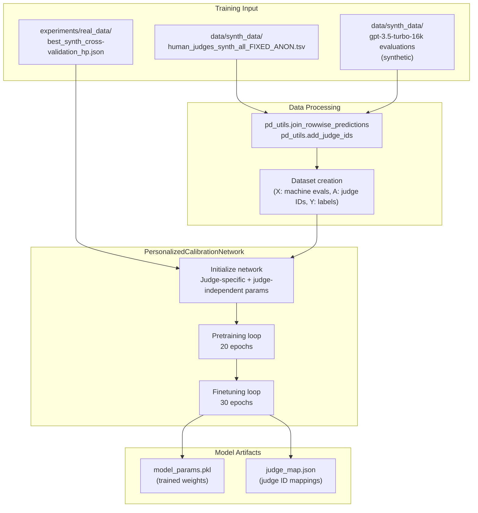

**Sources:** [README.md:88-89]()

---

## Phase 3: Prediction and Evaluation

After training, the model generates predictions on real conversation data and is evaluated against human judgments.

### Running Prediction and Evaluation

Execute prediction and evaluation with:

```bash
bash scripts/predict_llm_rubric_for_real_data_eval.sh
```

This script:
1. Loads the trained model parameters (`model_params.pkl`)
2. Loads the judge mapping (`judge_map.json`)
3. Processes real conversation data
4. Generates predictions for all judge-conversation pairs
5. Computes correlation metrics against ground truth human judgments

**Sources:** [README.md:91-102]()

### Expected Output

The prediction script produces output similar to:

```
Number of judges
24
Total rows: 223
9 4
test pearsonr 0.31304019363805424
test spearmanr 0.367664375396213
test kendallt 0.29084198763627717
```

**Interpretation:**
- 24 judges evaluated the real conversations
- 223 conversation samples total
- Pearson correlation: 0.313
- Spearman correlation: 0.368
- Kendall tau: 0.291

These correlations measure how well LLM-Rubric predictions align with human judgments on the overall satisfaction question (Q0).

**Sources:** [README.md:93-102]()

### Complete Evaluation Pipeline

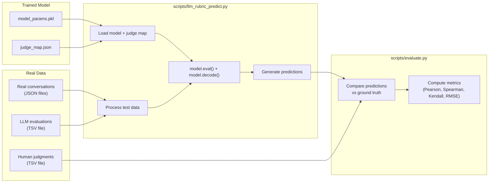

**Sources:** [README.md:91-102]()

---

## Complete Workflow Command Summary

Execute the entire workflow with these three commands:

```bash
# Step 1: Compute baselines
bash scripts/run_real_data_baselines.sh

# Step 2: Train model on synthetic data
bash scripts/train_llm_rubric_for_real_data_eval.sh

# Step 3: Predict on real data and evaluate
bash scripts/predict_llm_rubric_for_real_data_eval.sh
```

**Sources:** [README.md:58-103]()

---

## Files Created During Quick Start

After completing the quick start, you will have the following output files:

| File Path | Description | Created By |
|-----------|-------------|------------|
| `experiments/real_data/predictions/real_convs_machine_baselines.tsv` | Machine baseline predictions | Phase 1 |
| `experiments/real_data/predictions/real_convs_random_baseline.tsv` | Random baseline predictions | Phase 1 |
| `experiments/real_data/predictions/real_convs_human_baselines.tsv` | Human baseline predictions | Phase 1 |
| `experiments/real_data/model_params.pkl` | Trained model weights | Phase 2 |
| `experiments/real_data/judge_map.json` | Judge ID mappings | Phase 2 |
| `experiments/real_data/predictions/llm_rubric_predictions.tsv` | LLM-Rubric predictions | Phase 3 |

**Sources:** [scripts/run_real_data_baselines.sh:1-38](), [README.md:88-102]()

---

## Next Steps

After completing this quick start tutorial:

- **Understand the Architecture**: See [System Architecture](#3.1) for details on how components interact
- **Explore Data Formats**: See [Data Formats and Schema](#5.1) to understand input/output structure
- **Custom Hyperparameters**: See [Hyperparameter Tuning](#4.5) to optimize for your own data
- **Train on Custom Data**: See [Training a Model](#4.2) for detailed training instructions
- **Baseline Methods**: See [Baseline Systems](#7) for detailed explanations of each baseline

**Sources:** [README.md:1-125]()

---

# Page: Core Concepts

# Core Concepts

<details>
<summary>Relevant source files</summary>

The following files were used as context for generating this wiki page:

- [README.md](README.md)
- [llm_rubric/model/torch_impl.py](llm_rubric/model/torch_impl.py)

</details>


This document explains the fundamental concepts underlying the LLM-Rubric system, including personalized calibration, the distinction between machine evaluations and human judgments, judge-specific parameters, and the evaluation framework. For architectural details about how these concepts are implemented, see [System Architecture](#3.1). For a detailed explanation of the neural network, see [Personalized Calibration Network](#3.2). For definitions of specific terminology, see [Key Terminology](#3.3).

## Personalized Calibration

**Personalized calibration** is the core innovation of LLM-Rubric. The fundamental problem is that large language model (LLM) predictions often fail to align well with human judgments, and furthermore, human judges themselves do not fully agree with one another. Rather than treating this as a limitation, LLM-Rubric leverages these individual differences.

The system learns to calibrate LLM probability distributions to match **individual** human judges' preferences. This is accomplished through a feed-forward neural network that includes both:
- **Judge-independent parameters**: Shared weights that capture general patterns
- **Judge-specific parameters**: Personalized weights for each judge's unique rating behavior

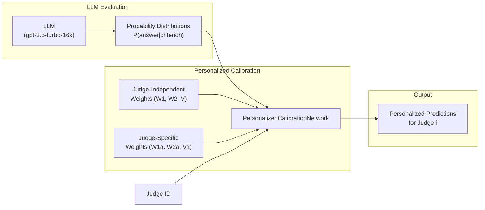

**Diagram: Personalized Calibration Flow**

The calibration network takes as input:
1. **Machine evaluations** (`X`): A 36-dimensional feature vector representing LLM probability distributions across 9 criteria and 4 possible answers
2. **Judge ID** (`A`): An integer identifier for the specific human judge

It outputs personalized predictions that match how that specific judge would evaluate the text.

**Sources:** [README.md:1-2](), [llm_rubric/model/torch_impl.py:47-163]()

## The Rubric Framework

The rubric consists of **9 evaluation questions** (Q0-Q8) that assess different dimensions of natural language text quality:

| Criterion | Purpose | Question Type |
|-----------|---------|---------------|
| Q0 | Overall assessment | Summary question |
| Q1-Q8 | Specific dimensions | Component questions |

Each question can be answered on a **1-4 scale**:
- 1: Poor
- 2: Fair
- 3: Good
- 4: Excellent

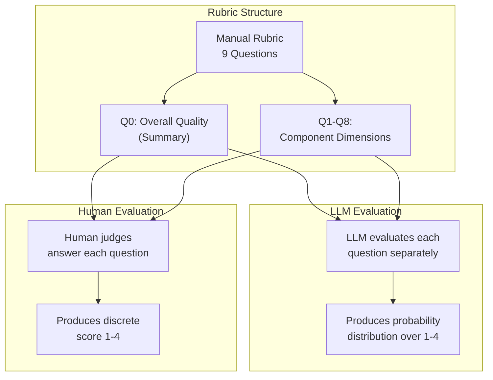

**Diagram: Rubric Framework Structure**

The **summary question (Q0)** is particularly important as it assesses overall user satisfaction or quality. LLM-Rubric uses a two-phase training approach where finetuning focuses specifically on predicting Q0 accurately.

**Sources:** [README.md:1-2](), [llm_rubric/model/torch_impl.py:9-22]()

## Machine Evaluations vs Human Judgments

The LLM-Rubric system bridges two fundamentally different types of assessments:

### Machine Evaluations

Machine evaluations are **probability distributions** generated by prompting an LLM with each rubric question. For each of the 9 criteria and 4 possible answers, the LLM provides a probability:

```
Criterion Q1:
  answer1_prob: 0.05
  answer2_prob: 0.20
  answer3_prob: 0.45
  answer4_prob: 0.30
```

This produces a **36-dimensional feature vector** (9 criteria × 4 answers) that captures the LLM's uncertainty and confidence distribution across all possible responses.

### Human Judgments

Human judgments are **discrete scores** where each judge selects a single answer (1, 2, 3, or 4) for each criterion. Multiple judges may evaluate the same text, producing a **9-dimensional label vector** per judge.

### The Calibration Gap

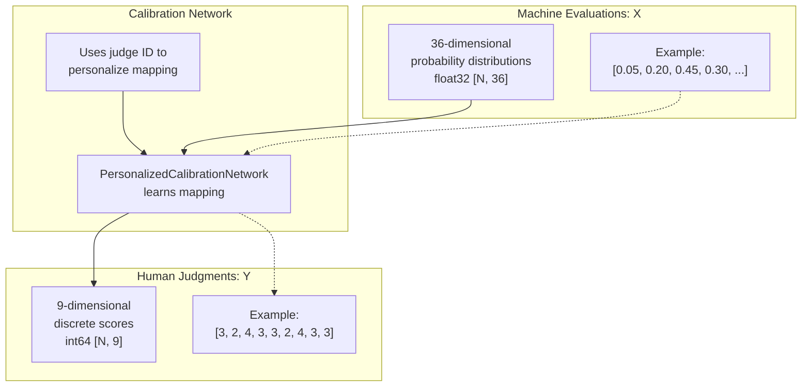

**Diagram: Machine Evaluations to Human Judgments Mapping**

The calibration network learns to transform the continuous probability distributions into predictions that match discrete human judgments, while accounting for judge-specific biases and preferences.

**Sources:** [llm_rubric/model/torch_impl.py:25-44](), [README.md:1-2]()

## Judge-Specific Personalization

Human judges exhibit **systematic differences** in how they rate texts. Some judges may be more lenient, others more critical. Some may weight certain criteria more heavily. The `PersonalizedCalibrationNetwork` captures these differences through judge-specific parameters.

### Parameter Architecture

| Parameter | Shape | Purpose |
|-----------|-------|---------|
| `W1` | `[input_size+1, layer1_size]` | Judge-independent first layer weights |
| `W1a` | `[num_judges, input_size+1, layer1_size]` | Judge-specific first layer weights |
| `W2` | `[layer1_size+1, layer2_size]` | Judge-independent second layer weights |
| `W2a` | `[num_judges, layer1_size+1, layer2_size]` | Judge-specific second layer weights |
| `V` | `[output_size, layer2_size+1, num_answers]` | Judge-independent output weights |
| `Va` | `[num_judges, output_size, layer2_size+1, num_answers]` | Judge-specific output weights |

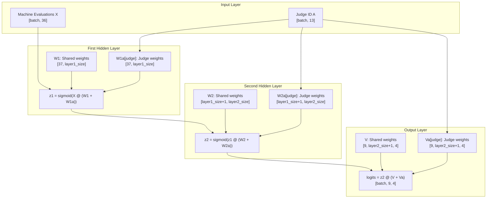

**Diagram: Judge-Specific Parameter Flow**

In the forward pass [llm_rubric/model/torch_impl.py:112-134](), the judge ID is used to look up judge-specific parameters:
```python
W1a_lookup = self.W1a[X_human_judges[:,0]]
z1_pre = torch.einsum("bi,bio->bo", input_and_bias, self.W1[None, :, :] + W1a_lookup)
```

The effective weight at each layer is the **sum** of the shared weight and the judge-specific weight, allowing the network to capture both general patterns and individual preferences.

**Sources:** [llm_rubric/model/torch_impl.py:47-110](), [llm_rubric/model/torch_impl.py:112-134]()

## Two-Phase Training Strategy

LLM-Rubric employs a **two-phase training strategy** to effectively learn from the data:

### Phase 1: Pretraining

During pretraining [llm_rubric/model/torch_impl.py:165-184](), the model learns to predict **all 9 criteria** (Q0-Q8) simultaneously. This phase:
- Uses all available training data
- Learns general patterns across all dimensions
- Typically runs for 20 epochs
- Optimizes cross-entropy loss across all outputs

```python
loss = model.loss(X_machine_evals_th, X_human_judges_th, Y_human_judgments_th)
```

### Phase 2: Finetuning

During finetuning [llm_rubric/model/torch_impl.py:186-210](), the model focuses specifically on the **summary question (Q0)**. This phase:
- Narrows focus to the most important criterion
- Refines predictions for overall quality assessment
- Typically runs for 30 epochs
- Only computes loss on the finetune_output index

```python
loss = model.loss(
    X_machine_evals_th, X_human_judges_th, Y_human_judgments_th,
    I=[model.hyperparameters.finetune_output],
)
```

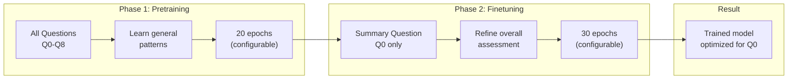

**Diagram: Two-Phase Training Pipeline**

The hyperparameters controlling these phases are configurable:
- `pretraining_epochs`: Number of epochs for phase 1
- `finetuning_epochs`: Number of epochs for phase 2
- `finetune_output`: Index of the criterion to focus on during finetuning (typically 0 for Q0)

**Sources:** [llm_rubric/model/torch_impl.py:165-210](), [llm_rubric/model/torch_impl.py:9-22]()

## The Evaluation Framework

LLM-Rubric uses multiple correlation metrics to evaluate prediction quality. Different metrics capture different aspects of prediction accuracy:

### Correlation Metrics

| Metric | Type | Purpose | Code Implementation |
|--------|------|---------|---------------------|
| **Pearson** | Parametric | Measures linear correlation | `scipy.stats.pearsonr` |
| **Spearman** | Non-parametric | Measures monotonic correlation | `scipy.stats.spearmanr` |
| **Kendall** | Non-parametric | Measures rank correlation | `scipy.stats.kendalltau` |
| **RMSE** | Error | Measures prediction error magnitude | Root mean squared error |

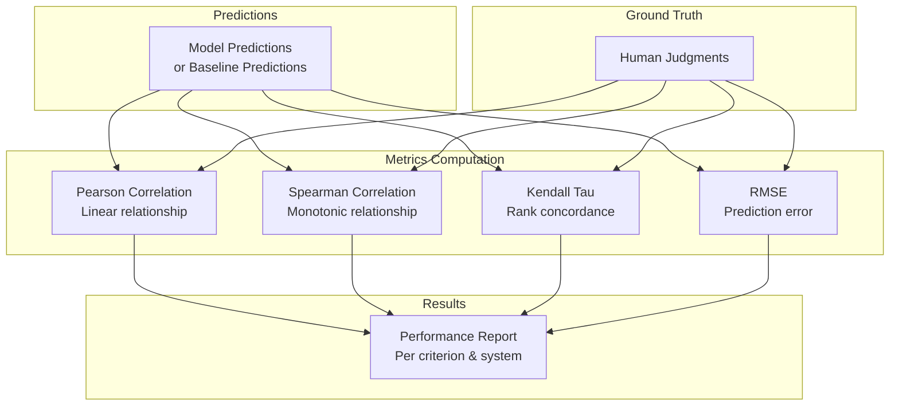

**Diagram: Evaluation Metrics Framework**

### Why Multiple Metrics Matter

- **Pearson** is sensitive to linear relationships and outliers
- **Spearman** is robust to monotonic transformations and non-linear relationships
- **Kendall** focuses on pairwise orderings, useful for ranking tasks
- **RMSE** provides interpretable error magnitude in the original scale (1-4)

Example output from evaluation [README.md:68-75]():
```
                        rmse   pearson  spearman   kendall    N      mean       std
criterion system
Q0        random        1.453309 -0.054438 -0.043663 -0.036858  223  2.587444  1.152196
          sample_llm    1.207228  0.039810  0.045245  0.040967  223  3.322870  0.794469
          argmax_llm    1.201643  0.140091  0.086990  0.081134  223  3.614350  0.563597
          expected_llm  0.918676  0.177301  0.086675  0.065928  223  3.282864  0.300516
```

The evaluation framework enables systematic comparison between:
- LLM-Rubric predictions
- Machine baselines (expected_llm, argmax_llm, sample_llm)
- Human baselines (group_constant, ann_constant)
- Random baseline (performance floor)

**Sources:** [README.md:66-102]()

## Data Representation

The LLM-Rubric system operates on three core tensors encapsulated in the `Dataset` class [llm_rubric/model/torch_impl.py:25-44]():

| Tensor | Alias | Shape | Data Type | Contents |
|--------|-------|-------|-----------|----------|
| `machine_evaluations` | `X` | `[N, 36]` | float32 | LLM probability distributions (9 criteria × 4 answers) |
| `human_judges` | `A` | `[N, 13]` | int64 | Judge ID encodings (one-hot or integer) |
| `human_judgments` | `Y` | `[N, 9]` | int64 | Human discrete scores for Q0-Q8 |

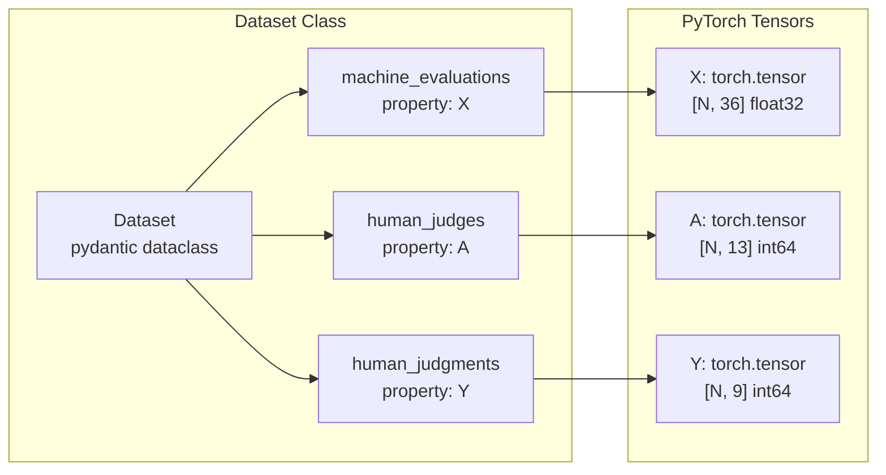

**Diagram: Dataset Structure and Tensor Properties**

The `Dataset` class provides convenient property accessors that convert numpy arrays to PyTorch tensors:
```python
@property
def X(self):
    return torch.tensor(self.machine_evaluations)
```

This abstraction ensures consistent data representation throughout training and inference while maintaining type safety through pydantic validation.

**Sources:** [llm_rubric/model/torch_impl.py:25-44]()

---

# Page: System Architecture

# System Architecture

<details>
<summary>Relevant source files</summary>

The following files were used as context for generating this wiki page:

- [README.md](README.md)
- [llm_rubric/model/torch_impl.py](llm_rubric/model/torch_impl.py)

</details>


## Purpose and Scope

This document describes the overall architecture of the LLM-Rubric system, including the data flow from raw conversation texts through LLM evaluation to calibrated predictions. It covers the major components, their interactions, and how data is transformed through the pipeline.

For detailed information about the neural network architecture itself, see [PersonalizedCalibrationNetwork](#3.2). For data format specifications, see [Data Formats and Schema](#5.1). For step-by-step usage instructions, refer to the User Guides ([section 4](#4)).

---

## System Overview

The LLM-Rubric system implements a calibration framework that learns to map LLM probability distributions to individual human judge preferences. The architecture consists of four primary layers:

1. **Data Layer**: Raw conversation data, human annotations, and LLM evaluations
2. **Processing Layer**: Data transformation and feature engineering utilities
3. **Model Layer**: `PersonalizedCalibrationNetwork` neural network with judge-specific parameters
4. **Evaluation Layer**: Baseline systems and metric computation

The system operates in two distinct modes: **training mode** (on synthetic data) and **prediction mode** (on real conversation data). Hyperparameter optimization uses k-fold cross-validation on synthetic data to find optimal model configurations before final training.

---

## High-Level Data Flow

The following diagram illustrates the complete data transformation pipeline from raw inputs to final predictions:

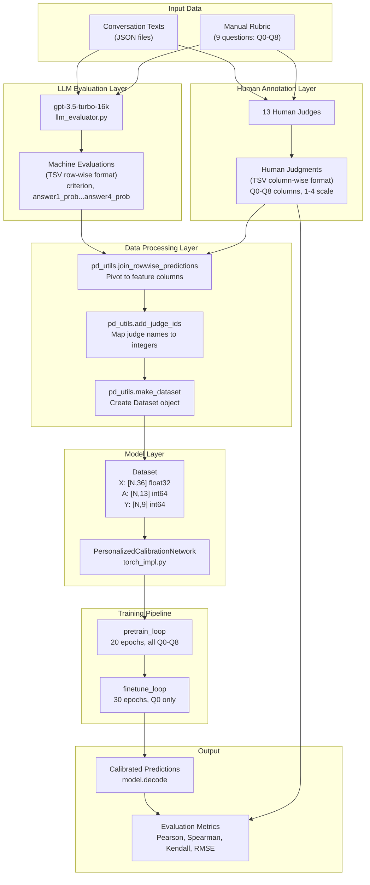

**Sources:** [README.md:1-103](), [llm_rubric/model/torch_impl.py:1-210]()

---

## Core Components and Code Mapping

The following table maps conceptual system components to their implementation in the codebase:

| Component | Code Entity | File Path | Description |
|-----------|-------------|-----------|-------------|
| **Neural Network** | `PersonalizedCalibrationNetwork` | [llm_rubric/model/torch_impl.py:47-163]() | Feed-forward network with judge-specific parameters |
| **Configuration** | `Hyperparameters` dataclass | [llm_rubric/model/torch_impl.py:8-23]() | Model hyperparameters and training settings |
| **Data Container** | `Dataset` dataclass | [llm_rubric/model/torch_impl.py:25-44]() | Encapsulates X, A, Y tensors for PyTorch |
| **Pretraining** | `pretrain_loop` function | [llm_rubric/model/torch_impl.py:165-184]() | Trains on all criteria Q0-Q8 |
| **Finetuning** | `finetune_loop` function | [llm_rubric/model/torch_impl.py:186-210]() | Trains on summary question Q0 only |
| **Data Transformation** | `pd_utils` module | `llm_rubric/utils/pd_utils.py` | Functions for joining, filtering, and transforming data |
| **Cross-Validation** | `kfold_utils` module | `llm_rubric/utils/kfold_utils.py` | K-fold splitting and fold iteration |
| **LLM Interface** | `llm_evaluator` module | `llm_rubric/utils/llm_evaluator.py` | API wrapper for GPT-3.5-turbo evaluations |
| **Training Script** | `train_llm_rubric.py` | `llm_rubric/train_llm_rubric.py` | Main training entry point |
| **Prediction Script** | `llm_rubric_predict.py` | `llm_rubric/llm_rubric_predict.py` | Inference entry point |
| **Evaluation Script** | `evaluate.py` | `llm_rubric/evaluate.py` | Metric computation for all systems |

**Sources:** [llm_rubric/model/torch_impl.py:1-210](), [README.md:79-92]()

---

## Data Processing Pipeline

The data processing layer transforms raw machine evaluations and human judgments into model-ready tensors. This pipeline is consistent across both training and prediction modes.

### Feature Engineering Flow

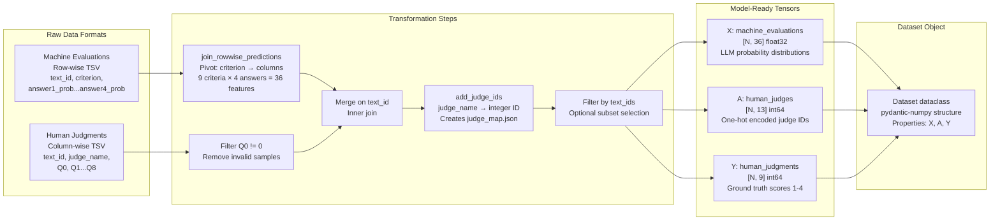

### Tensor Structure

The `Dataset` object exposes three tensor properties:

| Tensor | Shape | Data Type | Content |
|--------|-------|-----------|---------|
| **X** (machine_evaluations) | `[N, 36]` | `float32` | LLM probability distributions: 9 criteria × 4 answer probabilities |
| **A** (human_judges) | `[N, 13]` | `int64` | Judge ID encodings (0-12 for 13 judges) stored as one-hot-like structure |
| **Y** (human_judgments) | `[N, 9]` | `int64` | Human annotations: Q0-Q8 on 1-4 scale |

The input features (X) are flattened from the row-wise machine evaluation format where each criterion (Q0-Q8) has four probability values (answer1_prob through answer4_prob), resulting in 9 × 4 = 36 total features.

**Sources:** [llm_rubric/model/torch_impl.py:25-44]()

---

## Training and Inference Architecture

### Training Mode

Training occurs exclusively on synthetic conversation data (223 samples) and follows a two-phase approach:

```mermaid
graph TD
    subgraph "Data Preparation"
        A["Synthetic Data<br/>223 samples"]
        B["Load human judgments<br/>+ machine evaluations"]
        C["pd_utils transformations<br/>join_rowwise_predictions<br/>add_judge_ids"]
        D["make_dataset<br/>Create Dataset object"]
    end
    
    subgraph "Model Initialization"
        E["Hyperparameters<br/>From best_synth_cross-validation_hp.json<br/>or hyperparameter search"]
        F["PersonalizedCalibrationNetwork<br/>Initialize weights:<br/>W1, W1a, W2, W2a, V, Va"]
        G["Adam Optimizer<br/>learning_rate from hyperparams"]
    end
    
    subgraph "Two-Phase Training"
        H["Phase 1: Pretraining<br/>pretrain_loop<br/>20 epochs<br/>All criteria Q0-Q8"]
        I["Phase 2: Finetuning<br/>finetune_loop<br/>30 epochs<br/>Q0 only (finetune_output=-1)"]
    end
    
    subgraph "Model Artifacts"
        J["model_params.pkl<br/>Saved weights:<br/>W1, W1a, W2, W2a, V, Va"]
        K["judge_map.json<br/>Judge name → ID mapping"]
    end
    
    A --> B
    B --> C
    C --> D
    D --> E
    E --> F
    F --> G
    
    G --> H
    H --> I
    
    I --> J
    I --> K
```

The pretraining phase ([llm_rubric/model/torch_impl.py:165-184]()) trains on all rubric questions to learn general calibration patterns. The finetuning phase ([llm_rubric/model/torch_impl.py:186-210]()) specializes the model for the summary question Q0, which typically assesses overall quality or user satisfaction.

**Sources:** [llm_rubric/model/torch_impl.py:165-210](), [README.md:79-92]()

### Inference Mode

Prediction applies the trained model to real conversation data:

```mermaid
graph TD
    subgraph "Input Data"
        A["Real Conversation Data<br/>Test samples"]
        B["Load human judgments<br/>+ machine evaluations"]
        C["pd_utils transformations<br/>Same pipeline as training"]
        D["Create test Dataset"]
    end
    
    subgraph "Load Trained Model"
        E["Load model_params.pkl<br/>Restore weights"]
        F["Load judge_map.json<br/>Restore judge ID mapping"]
        G["model.eval()<br/>Set to evaluation mode"]
    end
    
    subgraph "Inference"
        H["model.forward(X, A)<br/>Forward pass through network"]
        I["model.decode(X, A)<br/>Convert logits to expected values<br/>pred = Σ(prob_i × score_i)"]
    end
    
    subgraph "Evaluation"
        J["Compare predictions to<br/>ground truth Y"]
        K["Compute metrics:<br/>Pearson, Spearman,<br/>Kendall, RMSE"]
    end
    
    A --> B
    B --> C
    C --> D
    
    E --> G
    F --> G
    D --> G
    
    G --> H
    H --> I
    I --> J
    J --> K
```

The `model.decode` method ([llm_rubric/model/torch_impl.py:151-162]()) converts output logits to expected values by computing the weighted sum: `prediction = Σ(prob_i × score_i)` where probabilities are derived via softmax over answer logits and scores are `[1.0, 2.0, 3.0, 4.0]`.

**Sources:** [llm_rubric/model/torch_impl.py:151-162]()

---

## Neural Network Forward Pass

The `PersonalizedCalibrationNetwork` implements a personalized feed-forward architecture where judge-specific parameters are added to judge-independent base weights:

```mermaid
graph TB
    subgraph "Input Layer"
        A["X: Machine Evaluations<br/>[batch, 36]"]
        B["A: Judge IDs<br/>[batch, 13]"]
    end
    
    subgraph "Hidden Layer 1"
        C["Concatenate bias column<br/>[batch, 37]"]
        D["W1 + W1a[judge_id]<br/>Base + personalized weights"]
        E["z1 = sigmoid(input · weights)<br/>[batch, layer1_size]"]
    end
    
    subgraph "Hidden Layer 2"
        F["Concatenate bias column<br/>[batch, layer1_size+1]"]
        G["W2 + W2a[judge_id]<br/>Base + personalized weights"]
        H["z2 = sigmoid(z1 · weights)<br/>[batch, layer2_size]"]
    end
    
    subgraph "Output Layer"
        I["Concatenate bias column<br/>[batch, layer2_size+1]"]
        J["V + Va[judge_id]<br/>Base + personalized weights"]
        K["logits = z2 · weights<br/>[batch, 9, 4]<br/>9 questions, 4 answers"]
    end
    
    A --> C
    B --> D
    C --> D
    D --> E
    E --> F
    B --> G
    F --> G
    G --> H
    H --> I
    B --> J
    I --> J
    J --> K
```

The network architecture includes three sets of weight matrices, each with both judge-independent and judge-specific components:

| Weight Matrix | Shape | Purpose |
|---------------|-------|---------|
| **W1** | `[input_size+1, layer1_size]` | Judge-independent first layer |
| **W1a** | `[num_judges, input_size+1, layer1_size]` | Judge-specific first layer |
| **W2** | `[layer1_size+1, layer2_size]` | Judge-independent second layer |
| **W2a** | `[num_judges, layer1_size+1, layer2_size]` | Judge-specific second layer |
| **V** | `[output_size, layer2_size+1, num_answers]` | Judge-independent output layer |
| **Va** | `[num_judges, output_size, layer2_size+1, num_answers]` | Judge-specific output layer |

At each layer, the effective weight matrix is computed as `W + Wa[judge_id]`, enabling the model to learn both shared calibration patterns across all judges and individual judge preferences.

**Sources:** [llm_rubric/model/torch_impl.py:47-134]()

---

## Hyperparameter Optimization Workflow

Hyperparameter selection uses 5-fold cross-validation on synthetic data with parallel job execution:

```mermaid
graph TD
    subgraph "Search Space Definition"
        A["HyperparameterGrid<br/>batch_size: [32, 64]<br/>learning_rate: [0.001, 0.01]<br/>layer1_size: [25, 50, 100]<br/>layer2_size: [25, 50, 100]<br/>epochs: various"]
        B["Cartesian Product<br/>All combinations"]
    end
    
    subgraph "Cross-Validation Setup"
        C["Synthetic Data<br/>with fold assignments"]
        D["5-Fold Split<br/>kfold_utils.train_test_dataframe_iter"]
    end
    
    subgraph "Parallel Execution"
        E["Job Matrix<br/>5 folds × N hyperparams"]
        F["multiprocessing<br/>4 worker processes"]
    end
    
    subgraph "Per-Job Training"
        G["Initialize PCN with hyperparams"]
        H["pretrain_loop + finetune_loop"]
        I["Evaluate on test fold"]
        J["Save results JSON"]
    end
    
    subgraph "Aggregation"
        K["Load all result files"]
        L["Group by hyperparameter set"]
        M["Calculate mean across folds"]
        N["Select best by log_loss_finetune"]
        O["Save to best_synth_cross-validation_hp.json"]
    end
    
    A --> B
    B --> E
    C --> D
    D --> E
    E --> F
    F --> G
    G --> H
    H --> I
    I --> J
    J --> K
    K --> L
    L --> M
    M --> N
    N --> O
```

The hyperparameter search explores a grid of configurations, training a separate model for each (fold, hyperparameter set) combination. Results are aggregated across folds to identify the configuration with the best average performance, typically using `log_loss_finetune` as the selection criterion. The best hyperparameters are saved to `experiments/real_data/best_synth_cross-validation_hp.json` for use in final model training on real data.

**Sources:** [README.md:82-86]()

---

## Baseline Systems Integration

The architecture includes multiple baseline systems for comparison, evaluated through a unified interface:

```mermaid
graph TB
    subgraph "Baseline Types"
        A["Machine Baselines<br/>compute_machine_baseline.py"]
        B["Human Baselines<br/>compute_human_baseline.py"]
        C["Random Baseline<br/>compute_random_baseline.py"]
    end
    
    subgraph "Machine Strategies"
        D["expected_llm<br/>E[X] = Σ(prob_i × score_i)"]
        E["argmax_llm<br/>argmax(prob_i) + 1"]
        F["sample_llm<br/>random.choice(probs)"]
    end
    
    subgraph "Human Strategies"
        G["group_constant<br/>Overall mean across judges"]
        H["ann_constant<br/>Per-annotator mean"]
    end
    
    subgraph "LLM-Rubric Model"
        I["PersonalizedCalibrationNetwork<br/>Learned calibration"]
    end
    
    subgraph "Unified Evaluation"
        J["evaluate.py<br/>Compute metrics for all systems"]
        K["Metrics: RMSE, Pearson,<br/>Spearman, Kendall"]
    end
    
    A --> D
    A --> E
    A --> F
    B --> G
    B --> H
    
    D --> J
    E --> J
    F --> J
    G --> J
    H --> J
    C --> J
    I --> J
    
    J --> K
```

All baseline systems and the LLM-Rubric model produce predictions in the same format, enabling direct comparison through the `evaluate.py` script. This unified evaluation framework computes correlation coefficients and RMSE for each system, quantifying how well each approach predicts individual human judge preferences.

**Sources:** [README.md:62-77]()

---

## File Organization and Entry Points

The codebase is organized around distinct workflows with dedicated entry point scripts:

| Workflow | Entry Point | Purpose |
|----------|-------------|---------|
| **Baseline Computation** | `scripts/run_real_data_baselines.sh` | Compute machine, human, and random baseline predictions |
| **Hyperparameter Search** | `scripts/find_hyperparams_for_real_data_eval.sh` | Run cross-validation to find optimal hyperparameters |
| **Model Training** | `scripts/train_llm_rubric_for_real_data_eval.sh` | Train PersonalizedCalibrationNetwork on synthetic data |
| **Prediction & Evaluation** | `scripts/predict_llm_rubric_for_real_data_eval.sh` | Generate predictions on real data and compute metrics |

Each script orchestrates calls to Python modules in the `llm_rubric` package, which contains:

- `llm_rubric/model/torch_impl.py` - Core neural network implementation
- `llm_rubric/utils/pd_utils.py` - Data transformation functions
- `llm_rubric/utils/kfold_utils.py` - Cross-validation utilities
- `llm_rubric/utils/llm_evaluator.py` - LLM API interface
- `llm_rubric/train_llm_rubric.py` - Training orchestration
- `llm_rubric/llm_rubric_predict.py` - Inference orchestration
- `llm_rubric/evaluate.py` - Metric computation

**Sources:** [README.md:58-103]()

---

## Summary

The LLM-Rubric architecture implements a calibration framework that transforms LLM probability distributions into personalized predictions aligned with individual human judge preferences. The system's modular design separates data processing, model training, and evaluation into distinct layers, enabling experimentation with different configurations while maintaining consistent evaluation protocols. The two-phase training strategy (pretraining on all criteria, finetuning on summary question) balances learning general calibration patterns with specialization for the primary evaluation objective.

---

# Page: Personalized Calibration Network

# Personalized Calibration Network

<details>
<summary>Relevant source files</summary>

The following files were used as context for generating this wiki page:

- [README.md](README.md)
- [llm_rubric/model/torch_impl.py](llm_rubric/model/torch_impl.py)

</details>


## Purpose and Scope

This page documents the `PersonalizedCalibrationNetwork` class, the core neural network model in the LLM-Rubric system. The network learns to calibrate LLM probability distributions to match individual human judge preferences through judge-specific parameter learning. This page covers the network architecture, parameter structure, forward pass computation, and the personalization mechanism.

For information about the training process (pretraining and finetuning loops), see [Training Process](#6.2). For hyperparameter configuration details, see [Hyperparameters Configuration](#6.3). For the broader system context, see [System Architecture](#3.1).

## Network Architecture Overview

The `PersonalizedCalibrationNetwork` is a feed-forward neural network implemented in PyTorch with a unique personalization structure. The network combines **judge-independent** parameters (shared across all judges) with **judge-specific** parameters (unique to each judge) at each layer to produce personalized predictions.

### Architecture Components

The network consists of:
- **Input layer**: Accepts LLM probability distributions (36 dimensions = 9 criteria × 4 answer probabilities)
- **Hidden layer 1**: Configurable size (default 25 neurons), uses sigmoid activation
- **Hidden layer 2**: Configurable size (default 25 neurons), uses sigmoid activation  
- **Output layer**: Produces logits for 9 questions × 4 answer options

```mermaid
graph TB
    subgraph "Input"
        X["X: Machine Evaluations<br/>[batch, 36]"]
        A["A: Judge IDs<br/>[batch, 13]"]
    end
    
    subgraph "Layer 1: First Hidden Layer"
        W1["W1: Shared Weights<br/>[37, layer1_size]"]
        W1a["W1a: Judge-Specific Weights<br/>[num_judges, 37, layer1_size]"]
        Z1["z1: Activated Output<br/>[batch, layer1_size]<br/>sigmoid activation"]
    end
    
    subgraph "Layer 2: Second Hidden Layer"
        W2["W2: Shared Weights<br/>[layer1_size+1, layer2_size]"]
        W2a["W2a: Judge-Specific Weights<br/>[num_judges, layer1_size+1, layer2_size]"]
        Z2["z2: Activated Output<br/>[batch, layer2_size]<br/>sigmoid activation"]
    end
    
    subgraph "Output Layer"
        V["V: Shared Output Weights<br/>[output_size, layer2_size+1, num_answers]"]
        Va["Va: Judge-Specific Output Weights<br/>[num_judges, output_size, layer2_size+1, num_answers]"]
        Logits["Logits: Answer Scores<br/>[batch, 9, 4]"]
    end
    
    X --> W1
    A --> W1a
    X --> W1a
    W1 --> Z1
    W1a --> Z1
    
    Z1 --> W2
    A --> W2a
    Z1 --> W2a
    W2 --> Z2
    W2a --> Z2
    
    Z2 --> V
    A --> Va
    Z2 --> Va
    V --> Logits
    Va --> Logits
```

**Weight Combination Pattern**: At each layer, the network computes `W_combined = W + W_a[judge_id]`, where `W` is shared across judges and `W_a[judge_id]` is the judge-specific adjustment. This allows the model to learn both general calibration patterns and judge-specific preferences.

Sources: [llm_rubric/model/torch_impl.py:47-110]()

## Input and Output Structure

### Input Tensors

The network accepts three inputs through the `Dataset` class:

| Tensor | Name | Shape | Type | Description |
|--------|------|-------|------|-------------|
| `X` | `machine_evaluations` | `[N, 36]` | `float32` | LLM probability distributions: 9 criteria × 4 answer probabilities |
| `A` | `human_judges` | `[N, 13]` | `int64` | One-hot encoded judge identifiers (0-12 for 13 judges) |
| `Y` | `human_judgments` | `[N, 9]` | `int64` | Ground truth human ratings (1-4 scale) for 9 questions |

The `Dataset` class provides PyTorch tensor properties that wrap the numpy arrays:

```
Dataset.X → torch.tensor(machine_evaluations)
Dataset.A → torch.tensor(human_judges)
Dataset.Y → torch.tensor(human_judgments)
```

### Output Structure

The `forward()` method returns logits with shape `[batch, 9, 4]`:
- **Dimension 0**: Batch size
- **Dimension 1**: 9 questions (Q0-Q8, where Q0 is the summary question)
- **Dimension 2**: 4 answer options (corresponding to ratings 1, 2, 3, 4)

The `decode()` method converts these logits to expected values on the 1-4 scale by:
1. Applying softmax to get probability distributions
2. Computing weighted sum: `prediction = Σ(prob_i × value_i)` where values = [1.0, 2.0, 3.0, 4.0]

Sources: [llm_rubric/model/torch_impl.py:26-45](), [llm_rubric/model/torch_impl.py:151-162]()

## Network Parameters

### Judge-Independent Parameters

These parameters are shared across all judges and learn general calibration patterns:

| Parameter | Shape | Description |
|-----------|-------|-------------|
| `W1` | `[input_size+1, layer1_size]` | First layer weights (37 × 25 with defaults) |
| `W2` | `[layer1_size+1, layer2_size]` | Second layer weights (26 × 25 with defaults) |
| `V` | `[output_size, layer2_size+1, num_answers]` | Output layer weights (9 × 26 × 4) |

The `+1` dimensions account for bias terms, which are implemented by concatenating a column of ones to the activations rather than using separate bias parameters.

### Judge-Specific Parameters

These parameters capture individual judge preferences and calibration adjustments:

| Parameter | Shape | Description |
|-----------|-------|-------------|
| `W1a` | `[num_judges, input_size+1, layer1_size]` | Per-judge first layer adjustments (13 × 37 × 25) |
| `W2a` | `[num_judges, layer1_size+1, layer2_size]` | Per-judge second layer adjustments (13 × 26 × 25) |
| `Va` | `[num_judges, output_size, layer2_size+1, num_answers]` | Per-judge output adjustments (13 × 9 × 26 × 4) |

All parameters are initialized with random values drawn from a standard normal distribution using `torch.randn()` with a fixed random seed for reproducibility.

Sources: [llm_rubric/model/torch_impl.py:56-109]()

## Personalization Mechanism

The core innovation of the network is how it combines shared and judge-specific parameters. For a given judge ID, the effective weight matrix at each layer is:

```
W_effective = W_shared + W_judge_specific[judge_id]
```

This additive combination allows:
- **Shared parameters** to learn common patterns across all judges
- **Judge-specific parameters** to learn deviations from the common pattern for each individual judge

```mermaid
graph LR
    subgraph "Judge ID Lookup"
        A["Judge ID: 7"]
    end
    
    subgraph "Layer 1 Weight Combination"
        W1["W1<br/>Shared<br/>[37, 25]"]
        W1a["W1a[7]<br/>Judge-Specific<br/>[37, 25]"]
        W1_eff["W1_effective<br/>W1 + W1a[7]<br/>[37, 25]"]
    end
    
    subgraph "Layer 2 Weight Combination"
        W2["W2<br/>Shared<br/>[26, 25]"]
        W2a["W2a[7]<br/>Judge-Specific<br/>[26, 25]"]
        W2_eff["W2_effective<br/>W2 + W2a[7]<br/>[26, 25]"]
    end
    
    subgraph "Output Layer Weight Combination"
        V["V<br/>Shared<br/>[9, 26, 4]"]
        Va["Va[7]<br/>Judge-Specific<br/>[9, 26, 4]"]
        V_eff["V_effective<br/>V + Va[7]<br/>[9, 26, 4]"]
    end
    
    A --> W1a
    A --> W2a
    A --> Va
    
    W1 --> W1_eff
    W1a --> W1_eff
    
    W2 --> W2_eff
    W2a --> W2_eff
    
    V --> V_eff
    Va --> V_eff
```

The implementation uses efficient tensor indexing and Einstein summation (`torch.einsum`) to perform batched matrix multiplications with judge-specific weight lookups:

```
W1a_lookup = self.W1a[X_human_judges[:,0]]  # Shape: [batch, 37, 25]
z1_pre = torch.einsum("bi,bio->bo", input_and_bias, self.W1[None,:,:] + W1a_lookup)
```

This approach is more efficient than creating separate networks for each judge and enables knowledge transfer across judges during training.

Sources: [llm_rubric/model/torch_impl.py:112-134]()

## Forward Pass Computation

The forward pass executes through three stages with bias augmentation and sigmoid activations:

```mermaid
graph TB
    subgraph "Stage 1: Input Processing"
        Input["Input X<br/>[batch, 36]"]
        Bias1["Concatenate bias=1<br/>[batch, 37]"]
        Lookup1["Lookup W1a[judge_id]<br/>[batch, 37, 25]"]
        Einsum1["Einstein sum:<br/>bi,bio->bo"]
        Sigmoid1["Sigmoid activation"]
        Z1["z1<br/>[batch, 25]"]
    end
    
    subgraph "Stage 2: First Hidden Layer"
        Bias2["Concatenate bias=1<br/>[batch, 26]"]
        Lookup2["Lookup W2a[judge_id]<br/>[batch, 26, 25]"]
        Einsum2["Einstein sum:<br/>bi,bio->bo"]
        Sigmoid2["Sigmoid activation"]
        Z2["z2<br/>[batch, 25]"]
    end
    
    subgraph "Stage 3: Output Layer"
        Bias3["Concatenate bias=1<br/>[batch, 26]"]
        Lookup3["Lookup Va[judge_id]<br/>[batch, 9, 26, 4]"]
        Einsum3["Einstein sum:<br/>bi,bqia->bqa"]
        Logits["Logits<br/>[batch, 9, 4]"]
    end
    
    Input --> Bias1
    Bias1 --> Einsum1
    Lookup1 --> Einsum1
    Einsum1 --> Sigmoid1
    Sigmoid1 --> Z1
    
    Z1 --> Bias2
    Bias2 --> Einsum2
    Lookup2 --> Einsum2
    Einsum2 --> Sigmoid2
    Sigmoid2 --> Z2
    
    Z2 --> Bias3
    Bias3 --> Einsum3
    Lookup3 --> Einsum3
    Einsum3 --> Logits
```

### Detailed Computation Steps

**Layer 1**: 
1. Concatenate bias: `input_and_bias = torch.cat([X_machine_evals, ones], axis=1)` → `[batch, 37]`
2. Lookup judge weights: `W1a_lookup = self.W1a[X_human_judges[:,0]]` → `[batch, 37, 25]`
3. Combined matmul: `z1_pre = einsum("bi,bio->bo", input_and_bias, W1 + W1a_lookup)` → `[batch, 25]`
4. Activation: `z1 = sigmoid(z1_pre)` → `[batch, 25]`

**Layer 2**:
1. Concatenate bias: `z1_and_bias = torch.cat([z1, ones], axis=1)` → `[batch, 26]`
2. Lookup judge weights: `W2a_lookup = self.W2a[X_human_judges[:,0]]` → `[batch, 26, 25]`
3. Combined matmul: `z2_pre = einsum("bi,bio->bo", z1_and_bias, W2 + W2a_lookup)` → `[batch, 25]`
4. Activation: `z2 = sigmoid(z2_pre)` → `[batch, 25]`

**Output Layer**:
1. Concatenate bias: `z2_and_bias = torch.cat([z2, ones], axis=1)` → `[batch, 26]`
2. Lookup judge weights: `Va_lookup = self.Va[X_human_judges[:,0]]` → `[batch, 9, 26, 4]`
3. Combined matmul: `logits = einsum("bi,bqia->bqa", z2_and_bias, V + Va_lookup)` → `[batch, 9, 4]`

The use of Einstein summation notation enables efficient batched operations with judge-specific weights without explicit loops.

Sources: [llm_rubric/model/torch_impl.py:112-134]()

## Loss Function and Decoding

### Loss Computation

The `loss()` method computes cross-entropy loss between predicted logits and ground truth judgments:

1. **Forward pass**: Generate logits `[batch, 9, 4]`
2. **Permute**: Rearrange to `[batch, 4, 9]` for cross-entropy input format
3. **Optional filtering**: If parameter `I` is provided (used during finetuning), select only specific question indices
4. **Cross-entropy**: Apply `torch.nn.functional.cross_entropy()` with:
   - Target values adjusted by `-1` (since judgments are 1-4 but class indices are 0-3)
   - `ignore_index=-1` to skip invalid/missing judgments
   - `reduction='none'` followed by `.mean()` for batch averaging

The loss function signature: `loss(X, A, Y, I=None)` where `I` is an optional list of question indices to focus on (used during finetuning to train only on Q0).

### Prediction Decoding

The `decode()` method converts logits to expected rating values:

1. **Forward pass**: Generate logits `[batch, 9, 4]`
2. **Permute**: Rearrange to `[batch, 4, 9]`
3. **Optional filtering**: Select question subset if `I` is provided
4. **Softmax**: Convert logits to probabilities: `probs = softmax(logits, dim=1)`
5. **Expected value**: Compute `pred = Σ(values[i] × probs[i])` where `values = [1.0, 2.0, 3.0, 4.0]`

This produces continuous predictions on the 1-4 scale rather than discrete class predictions, which better matches the regression-like nature of the evaluation task.

```mermaid
graph LR
    subgraph "Loss Computation Path"
        L1["Logits<br/>[batch, 9, 4]"]
        L2["Permute<br/>[batch, 4, 9]"]
        L3["Filter questions if I specified"]
        L4["Adjust Y by -1<br/>(1-4 → 0-3)"]
        L5["Cross-Entropy Loss"]
    end
    
    subgraph "Decode Prediction Path"
        D1["Logits<br/>[batch, 9, 4]"]
        D2["Permute<br/>[batch, 4, 9]"]
        D3["Filter questions if I specified"]
        D4["Softmax<br/>→ probabilities"]
        D5["Weighted sum<br/>values=[1,2,3,4]"]
        D6["Predictions<br/>[batch, questions]"]
    end
    
    L1 --> L2
    L2 --> L3
    L3 --> L4
    L4 --> L5
    
    D1 --> D2
    D2 --> D3
    D3 --> D4
    D4 --> D5
    D5 --> D6
```

Sources: [llm_rubric/model/torch_impl.py:137-162]()

## Hyperparameters

The network architecture is controlled by the `Hyperparameters` dataclass, which uses Pydantic for validation and configuration management:

| Parameter | Default | Description |
|-----------|---------|-------------|
| `input_size` | - | Input feature dimensions (36 for 9 criteria × 4 answers) |
| `output_size` | - | Number of questions to predict (9 for Q0-Q8) |
| `num_judges` | - | Number of unique human judges (13 in the dataset) |
| `num_answers` | 4 | Number of rating options (1-4 scale) |
| `layer1_size` | 100 | First hidden layer size (neurons) |
| `layer2_size` | 100 | Second hidden layer size (neurons) |
| `batch_size` | 32 | Training batch size |
| `learning_rate` | 0.01 | Adam optimizer learning rate |
| `pretraining_epochs` | 50 | Epochs for pretraining phase |
| `finetuning_epochs` | 50 | Epochs for finetuning phase |
| `finetune_output` | -1 | Question index to focus on during finetuning (-1 = all questions) |
| `all_data_size` | - | Total training dataset size |
| `random_seed` | 43 | Random seed for reproducibility |

The `Hyperparameters` class is frozen and hashable (`eq=True, frozen=True`), allowing it to be used as a dictionary key for hyperparameter search caching.

For detailed information on hyperparameter tuning and selection, see [Hyperparameter Tuning](#4.5) and [Hyperparameters Configuration](#6.3).

Sources: [llm_rubric/model/torch_impl.py:9-23]()

## Model Initialization and Parameter Count

The model parameters are initialized using PyTorch's random normal distribution with a fixed random seed specified in the hyperparameters. The seed is set before each parameter initialization to ensure reproducibility:

```
torch.manual_seed(self.hyperparameters.random_seed)
```

### Parameter Count Calculation

With default hyperparameters (layer1_size=25, layer2_size=25, 13 judges):

**Judge-Independent Parameters**:
- `W1`: 37 × 25 = 925
- `W2`: 26 × 25 = 650  
- `V`: 9 × 26 × 4 = 936
- **Subtotal**: 2,511 parameters

**Judge-Specific Parameters** (per judge):
- `W1a`: 37 × 25 = 925 per judge
- `W2a`: 26 × 25 = 650 per judge
- `Va`: 9 × 26 × 4 = 936 per judge
- **Subtotal**: 2,511 parameters per judge × 13 judges = 32,643 parameters

**Total**: 35,154 parameters (2,511 shared + 32,643 judge-specific)

This relatively small model size enables efficient training on limited datasets while providing sufficient capacity for personalized calibration.

Sources: [llm_rubric/model/torch_impl.py:48-110]()

---

# Page: Key Terminology

# Key Terminology

<details>
<summary>Relevant source files</summary>

The following files were used as context for generating this wiki page:

- [README.md](README.md)
- [data/real_data/real_data.json](data/real_data/real_data.json)
- [data/synth_data/synth_data.json](data/synth_data/synth_data.json)

</details>


This page defines the core terminology used throughout the LLM-Rubric system. Understanding these terms is essential for working with the codebase, interpreting results, and extending the system. For architectural details, see [System Architecture](#3.1). For model implementation details, see [Personalized Calibration Network](#3.2).

---

## Core Evaluation Concepts

### Rubric

A **rubric** is a manually constructed evaluation framework that defines how to assess multiple dimensions of interest in natural language texts. In this system, the rubric consists of 9 questions (Q0-Q8) designed to evaluate different aspects of conversational quality.

**Code Entity**: The rubric questions are embedded in the prompts sent to `gpt-3.5-turbo-16k` via [llm_evaluator.py]().

**Structure**: Each rubric question expects a response on a 4-point scale (answer1, answer2, answer3, answer4), representing different quality levels.

Sources: [README.md:1-2]()

---

### Criteria (Q0-Q8)

**Criteria** are the individual evaluation questions in the rubric. The system uses 9 criteria indexed from Q0 to Q8:

| Criterion | Description | Role in System |
|-----------|-------------|----------------|
| **Q0** | Overall satisfaction/quality | Primary prediction target; summary assessment |
| **Q1-Q8** | Dimension-specific questions | Intermediate features (e.g., naturalness, conciseness, citation quality) |

**Data Format**: In human judgment files (TSV), criteria appear as column names. In machine evaluation files (JSON), criteria appear as the `criterion` field in row-wise format.

**Validation Rule**: Q0 != 0 is required for valid samples [pd_utils.py:filter operations]().

```mermaid
graph TD
    subgraph "Rubric Structure"
        R["Rubric<br/>(9 Questions)"]
        Q0["Q0<br/>Overall Satisfaction<br/>Target Variable"]
        Q1_8["Q1-Q8<br/>Dimension-Specific<br/>Input Features"]
    end
    
    R --> Q0
    R --> Q1_8
    
    Q0 --> |"1-4 scale"| H0["Human Rating"]
    Q1_8 --> |"1-4 scale per Q"| H1_8["Human Ratings"]
    
    Q0 --> |"prob dist"| M0["LLM Distribution<br/>4 answer probs"]
    Q1_8 --> |"prob dist per Q"| M1_8["LLM Distributions<br/>4 answer probs × 8"]
```

Sources: [README.md:1-2](), [data/real_data/real_data.json:1](), [data/synth_data/synth_data.json:1]()

---

### Dimensions of Interest

**Dimensions of interest** are the specific aspects of text quality being evaluated, such as:
- Naturalness of conversation flow
- Conciseness of responses
- Citation quality and accuracy
- Relevance to user needs
- Helpfulness of information

Each dimension corresponds to one of the Q1-Q8 criteria. These dimensions are domain-specific and can be customized for different evaluation scenarios.

Sources: [README.md:1-2]()

---

## Data and Predictions

### Text ID

A **text_id** is a unique identifier for each conversation or text being evaluated. 

**Code Entity**: String field used for joining data [pd_utils.py:join operations]()

**Format**: In the provided datasets, text_id values are MongoDB ObjectId strings (e.g., `"65c5b4b9f174b2897703736a"`)

Sources: [data/real_data/real_data.json:1]()

---

### LLM Predictions / Machine Evaluations

**LLM predictions** (also called **machine evaluations**) are probability distributions over the 4 possible answer choices for each rubric question, generated by prompting a large language model (`gpt-3.5-turbo-16k`).

**Format**: For each text and criterion, the LLM produces:
```
{
  "criterion": "Q0",
  "answer1_prob": 0.15,
  "answer2_prob": 0.35,
  "answer3_prob": 0.40,
  "answer4_prob": 0.10
}
```

**Tensor Representation**: After preprocessing, machine evaluations become the **X tensor**:
- Shape: `[N, 36]` where N = number of samples
- 36 features = 9 criteria × 4 answer probabilities
- Data type: `float32`

**Code Entity**: Generated by [llm_evaluator.py]() and processed by [pd_utils.py:join_rowwise_predictions]()

```mermaid
graph LR
    subgraph "LLM Evaluation Process"
        T["Text<br/>(Conversation)"]
        R["Rubric<br/>(Q0-Q8)"]
        LLM["gpt-3.5-turbo-16k"]
        D["Probability Distribution<br/>Per Criterion"]
        X["X Tensor<br/>[N, 36]<br/>float32"]
    end
    
    T --> LLM
    R --> LLM
    LLM --> D
    D --> |"9 criteria × 4 probs"| X
```

Sources: [README.md:1-2](), [data/real_data/machine_eval.json](), Diagram 1, Diagram 5

---

### Human Judgments

**Human judgments** are the ground truth annotations provided by human judges for each rubric question on a 1-4 scale.

**Format**: Each judgment consists of:
- `text_id`: Identifier of the evaluated text
- `judge`: Name/identifier of the annotator
- `Q0` through `Q8`: Integer ratings (1-4)

**Tensor Representation**: After preprocessing, human judgments become the **Y tensor**:
- Shape: `[N, 9]` where N = number of samples
- 9 dimensions = Q0 through Q8
- Data type: `int64`
- Value range: 1-4

**Code Entity**: Loaded from TSV files and processed by [pd_utils.py:make_dataset]()

Sources: [data/real_data/real_data_human_judgements.tsv](), Diagram 1, Diagram 5

---

### Judge / Annotator

A **judge** (also called an **annotator**) is a human who provides ratings for texts according to the rubric. The system supports personalized calibration to account for individual differences in how judges interpret the rubric.

**Number of Judges**: 13 human judges in the provided datasets

**Judge ID Mapping**: Judge names are mapped to integer IDs (0-12) for efficient neural network processing.

**Code Entity**: 
- Processed by [pd_utils.py:add_judge_ids]()
- Stored in `judge_map.json` after training

**Tensor Representation**: Judge identities become the **A tensor**:
- Shape: `[N, 13]` where N = number of samples
- One-hot encoding of judge IDs
- Data type: `int64`

```mermaid
graph TD
    subgraph "Judge Identification Pipeline"
        JN["Judge Names<br/>(Strings)"]
        MAP["Judge Mapping<br/>add_judge_ids"]
        A["A Tensor<br/>[N, 13]<br/>int64<br/>One-hot encoded"]
        JMAP["judge_map.json<br/>Name → ID"]
    end
    
    JN --> MAP
    MAP --> A
    MAP --> JMAP
    
    subgraph "Usage in Model"
        A --> PCN["PersonalizedCalibrationNetwork<br/>Judge-specific parameters"]
    end
```

Sources: [pd_utils.py:add_judge_ids](), Diagram 5

---

## Model Components

### Dataset (X, A, Y)

A **Dataset** is a structured container holding the three core tensors required for training and prediction:

| Tensor | Name | Shape | Type | Content |
|--------|------|-------|------|---------|
| **X** | Input Features | `[N, 36]` | float32 | LLM probability distributions (9 criteria × 4 answers) |
| **A** | Judge IDs | `[N, 13]` | int64 | One-hot encoded judge identifiers |
| **Y** | Target Labels | `[N, 9]` | int64 | Human judgments (Q0-Q8, scale 1-4) |

**Code Entity**: Defined as a pydantic-numpy structure in [pd_utils.py:make_dataset]() and used by [train_llm_rubric.py]() and [llm_rubric_predict.py]()

Sources: [pd_utils.py](), Diagram 1, Diagram 5

---

### Baseline Systems

**Baselines** are reference methods used to evaluate the performance of the LLM-Rubric model. Three categories exist:

#### Machine Baselines

Derived from LLM probability distributions without personalized calibration:

| Baseline | Description | Formula |
|----------|-------------|---------|
| **expected_llm** | Expected value | `Σ(p_i × score_i)` for i ∈ {1,2,3,4} |
| **argmax_llm** | Most probable answer | `argmax(p_i) + 1` |
| **sample_llm** | Sampled answer | `random.choice([1,2,3,4], probs=p)` |

**Code Entity**: [compute_machine_baseline.py]()

#### Human Baselines

Derived from aggregating human judgments:

| Baseline | Description |
|----------|-------------|
| **group_constant** | Overall mean across all judges |
| **ann_constant** | Per-annotator mean (judge-specific average) |

**Code Entity**: [compute_human_baseline.py]()

#### Random Baseline

**random**: Uniform random selection from {1, 2, 3, 4}

**Code Entity**: [compute_random_baseline.py]()

```mermaid
graph TD
    subgraph "Baseline Computation"
        ME["Machine Evaluations<br/>Probability Distributions"]
        HJ["Human Judgments<br/>Ground Truth Ratings"]
        
        ME --> ML["Machine Baselines"]
        ME --> RND["Random Baseline"]
        HJ --> HL["Human Baselines"]
        
        ML --> EXP["expected_llm<br/>E[X] = Σ p_i × i"]
        ML --> ARG["argmax_llm<br/>argmax(p_i) + 1"]
        ML --> SMP["sample_llm<br/>random.choice(probs)"]
        
        HL --> GC["group_constant<br/>Mean across judges"]
        HL --> AC["ann_constant<br/>Per-judge mean"]
        
        RND --> R["random<br/>Uniform(1,2,3,4)"]
    end
    
    subgraph "Evaluation"
        EXP --> EVAL["evaluate.py<br/>Compute metrics"]
        ARG --> EVAL
        SMP --> EVAL
        GC --> EVAL
        AC --> EVAL
        R --> EVAL
    end
```

Sources: [compute_machine_baseline.py](), [compute_human_baseline.py](), [compute_random_baseline.py](), Diagram 6

---

### PersonalizedCalibrationNetwork

The **PersonalizedCalibrationNetwork** (often abbreviated as **PCN**) is the core neural network model that learns to calibrate LLM predictions to match individual human judge preferences.

**Architecture Components**:
- Judge-independent layers (shared across all judges)
- Judge-specific layers (personalized per judge)
- Two-layer feed-forward network

**Code Entity**: [models/personalized_calibration_network.py]()

For detailed architecture information, see [Personalized Calibration Network](#3.2) and [Network Architecture](#6.1).

Sources: [models/personalized_calibration_network.py](), README.md:1-2](), Diagram 1

---

### Judge-Specific vs Judge-Independent Parameters

The PersonalizedCalibrationNetwork contains two types of parameters:

| Parameter Type | Description | Purpose |
|----------------|-------------|---------|
| **Judge-Independent** | Shared weights across all judges | Capture universal patterns in LLM→human calibration |
| **Judge-Specific** | Separate weights for each judge | Capture individual judge preferences and biases |

**Key Insight**: This hybrid architecture allows the model to learn both common patterns and personalized calibration functions.

Sources: [models/personalized_calibration_network.py](), Diagram 1, README.md:1-2]()

---

## Training Concepts

### Pretraining vs Finetuning

The model uses a **two-phase training strategy**:

| Phase | Description | Typical Epochs | Purpose |
|-------|-------------|----------------|---------|
| **Pretraining** | Initial training on all criteria | 20 | Learn general patterns across Q0-Q8 |
| **Finetuning** | Focused training on Q0 only | 30 | Optimize for overall satisfaction prediction |

**Hyperparameter**: `finetune_output = -1` indicates training on all outputs (Q0-Q8 during pretraining) vs. specific output index

**Code Entity**: [train_llm_rubric.py:pretraining and finetuning loops]()

Sources: [train_llm_rubric.py](), Diagram 2, Diagram 3

---

### Synthetic Data vs Real Data

The system uses two distinct datasets:

| Dataset | Size | Purpose | File Location |
|---------|------|---------|---------------|
| **Synthetic Data** | 223 samples | Training and hyperparameter tuning | `data/synth_data/` |
| **Real Conversation Data** | 223 samples | Final evaluation and testing | `data/real_data/` |

**Training Strategy**: 
1. Train on synthetic data with cross-validation
2. Select best hyperparameters
3. Retrain on all synthetic data
4. Evaluate on real conversation data

**Rationale**: This prevents overfitting to the real evaluation set.

```mermaid
graph LR
    subgraph "Data Usage Pipeline"
        SD["Synthetic Data<br/>223 samples<br/>synth_data/"]
        RD["Real Data<br/>223 samples<br/>real_data/"]
        
        SD --> CV["Cross-Validation<br/>5-fold"]
        CV --> HP["Best Hyperparameters<br/>best_synth_cross-validation_hp.json"]
        HP --> TRAIN["Final Training<br/>on all synthetic data"]
        TRAIN --> MODEL["Trained Model<br/>model_params.pkl"]
        MODEL --> PRED["Prediction"]
        RD --> PRED["Evaluation on Real Data"]
        PRED --> METRICS["Performance Metrics<br/>Pearson, Spearman, Kendall"]
    end
```

Sources: [data/synth_data/](), [data/real_data/](), Diagram 2, Diagram 3, Diagram 4

---

### Cross-Validation

**Cross-validation** is used to select optimal hyperparameters on synthetic data without overfitting.

**Strategy**: 5-fold cross-validation
- Synthetic data is split into 5 folds
- Each fold serves as test set once while others are training set
- Performance is averaged across folds

**Code Entity**: [kfold_utils.py:train_test_dataframe_iter]() and [find_hyperparams.py]()

**Output**: Mean metrics across folds for each hyperparameter combination

Sources: [kfold_utils.py](), Diagram 4

---

## Hyperparameters

**Hyperparameters** are configuration values that control model architecture and training behavior. Key hyperparameters include:

| Hyperparameter | Description | Typical Value |
|----------------|-------------|---------------|
| `input_size` | Input feature dimension | 36 (9 criteria × 4 answers) |
| `output_size` | Output dimension | 9 (Q0-Q8) |
| `num_judges` | Number of annotators | 13 |
| `layer1_size` | First hidden layer size | 25 |
| `layer2_size` | Second hidden layer size | 25 |
| `batch_size` | Training batch size | 64 |
| `learning_rate` | Optimizer learning rate | 0.001 |
| `pretraining_epochs` | Pretraining iterations | 20 |
| `finetuning_epochs` | Finetuning iterations | 30 |

**Storage**: Optimal hyperparameters are stored in `best_synth_cross-validation_hp.json`

**Code Entity**: [experiments/real_data/best_synth_cross-validation_hp.json]()

For complete hyperparameter reference, see [Hyperparameters Configuration](#6.3).

Sources: [README.md:82-85](), Diagram 4

---

## Evaluation Metrics

The system uses multiple correlation and error metrics to assess prediction quality:

| Metric | Type | Description | Interpretation |
|--------|------|-------------|----------------|
| **Pearson** | Correlation | Linear correlation coefficient | -1 to 1; higher = better linear fit |
| **Spearman** | Correlation | Rank correlation coefficient | -1 to 1; higher = better rank agreement |
| **Kendall** | Correlation | Tau correlation coefficient | -1 to 1; higher = better pairwise agreement |
| **RMSE** | Error | Root mean squared error | 0 to ∞; lower = better |

**Code Entity**: [evaluate.py]()

**Usage**: All baselines and the LLM-Rubric model are compared using these metrics on the test set.

Sources: [evaluate.py](), Diagram 1, Diagram 2, Diagram 6

---

## Model Artifacts

After training, the system produces **model artifacts** that enable prediction on new data:

| Artifact | File Name | Content |
|----------|-----------|---------|
| **Model Parameters** | `model_params.pkl` | Trained neural network weights |
| **Judge Mapping** | `judge_map.json` | Dictionary mapping judge names to IDs |

**Code Entity**: 
- Saved by [train_llm_rubric.py]()
- Loaded by [llm_rubric_predict.py]()

**Usage**: These files must be present for making predictions on new data.

Sources: [train_llm_rubric.py](), [llm_rubric_predict.py](), Diagram 3

---

## Terminology Mapping: Natural Language to Code

The following diagram maps high-level concepts to their concrete code representations:

```mermaid
graph TD
    subgraph "Conceptual Layer"
        C1["Rubric Questions<br/>(Q0-Q8)"]
        C2["LLM Predictions"]
        C3["Human Judgments"]
        C4["Judge Identity"]
        C5["Personalized<br/>Calibration"]
    end
    
    subgraph "Data Layer"
        D1["machine_eval.json<br/>criterion, answer1_prob...answer4_prob"]
        D2["human_judgements.tsv<br/>text_id, judge, Q0...Q8"]
        D3["X: float32[N,36]<br/>A: int64[N,13]<br/>Y: int64[N,9]"]
    end
    
    subgraph "Code Layer"
        E1["pd_utils.py<br/>join_rowwise_predictions"]
        E2["pd_utils.py<br/>add_judge_ids"]
        E3["models/personalized_calibration_network.py<br/>PersonalizedCalibrationNetwork"]
        E4["train_llm_rubric.py<br/>pretraining + finetuning"]
        E5["llm_rubric_predict.py<br/>model.eval + model.decode"]
    end
    
    C1 --> D1
    C2 --> D1
    C3 --> D2
    C4 --> D2
    
    D1 --> E1
    D2 --> E1
    D2 --> E2
    E1 --> D3
    E2 --> D3
    
    D3 --> E3
    E3 --> E4
    C5 --> E3
    E4 --> E5
```

Sources: [pd_utils.py](), [models/personalized_calibration_network.py](), [train_llm_rubric.py](), [llm_rubric_predict.py]()

---

## Key Terminology Summary Table

| Term | Definition | Code Symbol | Related Pages |
|------|------------|-------------|---------------|
| Rubric | Manual evaluation framework with 9 questions | Embedded in LLM prompts | [3.1](#3.1) |
| Q0-Q8 | Nine evaluation criteria (Q0=overall, Q1-Q8=dimensions) | TSV columns, DataFrame columns | [5.1](#5.1) |
| LLM Predictions | Probability distributions from gpt-3.5-turbo-16k | `X` tensor `[N,36]` | [5.3](#5.3) |
| Human Judgments | Ground truth ratings (1-4 scale) | `Y` tensor `[N,9]` | [5.1](#5.1) |
| Judge ID | Annotator identifier | `A` tensor `[N,13]` | [5.1](#5.1) |
| Dataset | Container of X, A, Y tensors | `pd_utils.make_dataset` | [8.1](#8.1) |
| PCN | PersonalizedCalibrationNetwork | `PersonalizedCalibrationNetwork` class | [3.2](#3.2), [6.1](#6.1) |
| Pretraining | First training phase (all criteria) | `train_llm_rubric.py` pretraining loop | [6.2](#6.2) |
| Finetuning | Second training phase (Q0 only) | `train_llm_rubric.py` finetuning loop | [6.2](#6.2) |
| Baseline | Reference prediction method | `compute_*_baseline.py` | [7](#7) |
| Synthetic Data | Training dataset (223 samples) | `data/synth_data/` | [5.2](#5.2) |
| Real Data | Evaluation dataset (223 samples) | `data/real_data/` | [5.2](#5.2) |

Sources: All sections above

---

# Page: User Guides

# User Guides

<details>
<summary>Relevant source files</summary>

The following files were used as context for generating this wiki page:

- [README.md](README.md)

</details>


## Purpose and Scope

This section provides step-by-step instructions for common tasks and workflows when working with the LLM-Rubric system. It covers the complete evaluation pipeline from computing baseline systems through training personalized calibration models to generating and evaluating predictions.

The guides assume you have completed [Installation](#2.1) and are familiar with [Core Concepts](#3). For information about specific data formats and schemas, see [Data Reference](#5). For detailed technical documentation of model internals, see [Model Reference](#6).

## Overview of User Workflows

The LLM-Rubric system supports several interconnected workflows:

**Baseline Computation**: Generate predictions using simple aggregation methods (machine baselines), human judgment statistics (human baselines), and random selection. These provide performance benchmarks for comparison.

**Hyperparameter Tuning**: Perform cross-validation on synthetic data to identify optimal hyperparameters for the PersonalizedCalibrationNetwork. This step is optional if using pre-computed best hyperparameters.

**Model Training**: Train the PersonalizedCalibrationNetwork using synthetic conversation data with the two-phase (pretraining + finetuning) approach.

**Prediction Generation**: Apply a trained model to generate predictions on real conversation data, producing calibrated scores that match individual judge preferences.

**Evaluation**: Compute correlation metrics (Pearson, Spearman, Kendall) and RMSE to assess prediction quality against human judgments.

The typical workflow follows this sequence: (1) compute baselines, (2) optionally tune hyperparameters, (3) train model on synthetic data, (4) generate predictions on real data, (5) evaluate all systems. However, users may enter at any point depending on their needs.

## Complete Workflow Architecture

```mermaid
graph TB
    subgraph "Input Data"
        RealConv["Real Conversations<br/>data/real/conversations_info.tsv"]
        SynthConv["Synthetic Conversations<br/>data/synthetic/conversations_info.tsv"]
        RealHuman["Real Human Judgments<br/>data/real/human_judgments.tsv"]
        SynthHuman["Synthetic Human Judgments<br/>data/synthetic/human_judgments.tsv"]
        RealMachine["Real Machine Evals<br/>data/real/machine_evaluations.json"]
        SynthMachine["Synthetic Machine Evals<br/>data/synthetic/machine_evaluations.json"]
    end
    
    subgraph "Workflow 1: Baseline Computation"
        BaseScript["scripts/run_real_data_baselines.sh"]
        MachineBase["compute_machine_baseline.py<br/>expected_llm, argmax_llm, sample_llm"]
        HumanBase["compute_human_baseline.py<br/>group_constant, ann_constant"]
        RandomBase["compute_random_baseline.py"]
        BaseResults["Baseline Predictions<br/>experiments/real_data/predictions/"]
    end
    
    subgraph "Workflow 2: Hyperparameter Tuning (Optional)"
        HPScript["scripts/find_hyperparams_for_real_data_eval.sh"]
        CrossVal["llm_rubric/hyperparam_search.py<br/>Cross-validation on synthetic data"]
        BestHP["experiments/real_data/<br/>best_synth_cross-validation_hp.json"]
    end
    
    subgraph "Workflow 3: Model Training"
        TrainScript["scripts/train_llm_rubric_for_real_data_eval.sh"]
        TrainPy["llm_rubric/train_llm_rubric.py<br/>PersonalizedCalibrationNetwork"]
        ModelParams["experiments/real_data/<br/>model_params.pkl"]
        JudgeMap["experiments/real_data/<br/>judge_map.json"]
    end
    
    subgraph "Workflow 4: Prediction"
        PredScript["scripts/predict_llm_rubric_for_real_data_eval.sh"]
        PredPy["llm_rubric/llm_rubric_predict.py<br/>model.eval() + model.decode()"]
        LLMRubricPred["LLM-Rubric Predictions<br/>experiments/real_data/predictions/"]
    end
    
    subgraph "Workflow 5: Evaluation"
        EvalScript["llm_rubric/evaluate.py"]
        Metrics["Correlation Metrics<br/>Pearson, Spearman, Kendall, RMSE"]
    end
    
    RealMachine --> MachineBase
    RealHuman --> MachineBase
    RealHuman --> HumanBase
    RealHuman --> RandomBase
    BaseScript --> MachineBase
    BaseScript --> HumanBase
    BaseScript --> RandomBase
    MachineBase --> BaseResults
    HumanBase --> BaseResults
    RandomBase --> BaseResults
    
    SynthMachine --> CrossVal
    SynthHuman --> CrossVal
    HPScript --> CrossVal
    CrossVal --> BestHP
    
    SynthMachine --> TrainPy
    SynthHuman --> TrainPy
    BestHP --> TrainPy
    TrainScript --> TrainPy
    TrainPy --> ModelParams
    TrainPy --> JudgeMap
    
    ModelParams --> PredPy
    JudgeMap --> PredPy
    RealMachine --> PredPy
    RealHuman --> PredPy
    PredScript --> PredPy
    PredPy --> LLMRubricPred
    
    BaseResults --> EvalScript
    LLMRubricPred --> EvalScript
    RealHuman --> EvalScript
    EvalScript --> Metrics
    
    style BestHP fill:#f9f9f9
    style ModelParams fill:#f9f9f9
    style JudgeMap fill:#f9f9f9
    style Metrics fill:#f9f9f9
```

**Figure 1: Complete LLM-Rubric User Workflow**

This diagram shows the five primary workflows and how they interconnect. Baseline computation (Workflow 1) generates comparison benchmarks. Hyperparameter tuning (Workflow 2) is optional if using pre-computed configurations. Model training (Workflow 3) produces model artifacts on synthetic data. Prediction (Workflow 4) applies the trained model to real data. Evaluation (Workflow 5) compares all systems using standard metrics. Gray boxes indicate output artifacts that are saved to disk.

Sources: [README.md:58-103]()

## Script and Command Mapping

```mermaid
graph LR
    subgraph "User Tasks"
        T1["Compute<br/>Baselines"]
        T2["Tune<br/>Hyperparameters"]
        T3["Train<br/>Model"]
        T4["Generate<br/>Predictions"]
        T5["Evaluate<br/>Results"]
    end
    
    subgraph "Shell Scripts"
        S1["run_real_data_baselines.sh"]
        S2["find_hyperparams_for_real_data_eval.sh"]
        S3["train_llm_rubric_for_real_data_eval.sh"]
        S4["predict_llm_rubric_for_real_data_eval.sh"]
    end
    
    subgraph "Python Modules"
        P1["compute_machine_baseline.py<br/>compute_human_baseline.py<br/>compute_random_baseline.py"]
        P2["hyperparam_search.py"]
        P3["train_llm_rubric.py"]
        P4["llm_rubric_predict.py"]
        P5["evaluate.py"]
    end
    
    T1 --> S1
    T2 --> S2
    T3 --> S3
    T4 --> S4
    
    S1 --> P1
    S2 --> P2
    S3 --> P3
    S4 --> P4
    
    S1 --> P5
    S4 --> P5
    
    style S1 fill:#f9f9f9
    style S2 fill:#f9f9f9
    style S3 fill:#f9f9f9
    style S4 fill:#f9f9f9
```

**Figure 2: Task to Script to Module Mapping**

This diagram maps user tasks to executable scripts and their underlying Python modules. Each shell script orchestrates one or more Python modules. The `evaluate.py` module is called by multiple scripts to compute metrics on different prediction sets.

Sources: [README.md:64-102]()

## Workflow Execution Order

The following table shows the recommended execution order for a complete evaluation pipeline:

| Step | Task | Script | Output | Required |
|------|------|--------|--------|----------|
| 1 | Compute baselines | `bash scripts/run_real_data_baselines.sh` | Baseline predictions in `experiments/real_data/predictions/` | Yes |
| 2 | Tune hyperparameters | `bash scripts/find_hyperparams_for_real_data_eval.sh` | `experiments/real_data/best_synth_cross-validation_hp.json` | Optional* |
| 3 | Train model | `bash scripts/train_llm_rubric_for_real_data_eval.sh` | `model_params.pkl`, `judge_map.json` in `experiments/real_data/` | Yes |
| 4 | Generate predictions | `bash scripts/predict_llm_rubric_for_real_data_eval.sh` | LLM-Rubric predictions in `experiments/real_data/predictions/` | Yes |
| 5 | Evaluate results | Included in steps 1 and 4 | Printed metrics to console | Automatic |

\* Step 2 is optional because pre-computed best hyperparameters are provided in the repository at `experiments/real_data/best_synth_cross-validation_hp.json`.

Sources: [README.md:58-103]()

## Data Flow Between Steps

```mermaid
graph TD
    subgraph "Data Inputs"
        D1["conversations_info.tsv<br/>Conversation metadata"]
        D2["human_judgments.tsv<br/>Q0-Q8 annotations"]
        D3["machine_evaluations.json<br/>Probability distributions"]
    end
    
    subgraph "Processing Steps"
        P1["pd_utils.join_rowwise_predictions<br/>Pivot machine evals to columns"]
        P2["pd_utils.add_judge_ids<br/>Map judge names to integers"]
        P3["pd_utils.make_dataset<br/>Create X, A, Y tensors"]
    end
    
    subgraph "Model Operations"
        M1["PersonalizedCalibrationNetwork<br/>Training on synthetic data"]
        M2["model.eval + model.decode<br/>Prediction on real data"]
    end
    
    subgraph "Outputs"
        O1["Predictions TSV<br/>system_name column"]
        O2["Metrics JSON<br/>Pearson, Spearman, Kendall"]
    end
    
    D1 --> P1
    D2 --> P1
    D3 --> P1
    P1 --> P2
    P2 --> P3
    P3 --> M1
    P3 --> M2
    M1 --> M2
    M2 --> O1
    O1 --> O2
    D2 --> O2
    
    style P1 fill:#f9f9f9
    style P2 fill:#f9f9f9
    style P3 fill:#f9f9f9
```

**Figure 3: Data Transformation Pipeline**

This diagram shows how raw data files are processed through utility functions to create model-ready datasets. The `pd_utils` module handles data transformation, converting row-wise machine evaluations to columnar format, adding judge ID mappings, and creating tensors. The model operates on these tensors for training and prediction. Outputs are saved as TSV files with predictions and JSON files with metrics.

Sources: [README.md:58-103]()

## Typical Workflow Patterns

### Pattern 1: First-Time Setup and Evaluation

For users running the system for the first time:

```bash
# Step 1: Compute all baselines
bash scripts/run_real_data_baselines.sh

# Step 2: Train model using pre-computed hyperparameters
bash scripts/train_llm_rubric_for_real_data_eval.sh

# Step 3: Generate predictions and evaluate
bash scripts/predict_llm_rubric_for_real_data_eval.sh
```

This pattern uses pre-computed best hyperparameters stored at `experiments/real_data/best_synth_cross-validation_hp.json`. Evaluation metrics are printed to console after each script completes.

### Pattern 2: Hyperparameter Exploration

For users who want to tune hyperparameters on their own data:

```bash
# Step 1: Find best hyperparameters via cross-validation
bash scripts/find_hyperparams_for_real_data_eval.sh

# Step 2: Train with discovered hyperparameters
bash scripts/train_llm_rubric_for_real_data_eval.sh

# Step 3: Generate predictions
bash scripts/predict_llm_rubric_for_real_data_eval.sh
```

The hyperparameter search performs 5-fold cross-validation on synthetic data and saves the best configuration to `experiments/real_data/best_synth_cross-validation_hp.json`, which is automatically loaded by the training script.

### Pattern 3: Prediction-Only

For users with a pre-trained model who want to generate new predictions:

```bash
# Load existing model and generate predictions
bash scripts/predict_llm_rubric_for_real_data_eval.sh
```

This requires `model_params.pkl` and `judge_map.json` to exist in `experiments/real_data/`. The script loads these artifacts and applies the model to the real conversation data.

Sources: [README.md:58-103]()

## Key Configuration Files

```mermaid
graph TD
    subgraph "Configuration Files"
        HP["best_synth_cross-validation_hp.json<br/>Hyperparameter configuration"]
        JM["judge_map.json<br/>Judge name to ID mapping"]
        MP["model_params.pkl<br/>Trained model weights"]
    end
    
    subgraph "Contains"
        HP1["input_size: 36<br/>output_size: 9<br/>num_judges: 13"]
        HP2["batch_size: 64<br/>learning_rate: 0.001"]
        HP3["layer1_size: 25<br/>layer2_size: 25"]
        HP4["pretraining_epochs: 20<br/>finetuning_epochs: 30"]
        
        JM1["judge_name: integer_id<br/>13 total judges<br/>0-12 mapping"]
        
        MP1["judge_independent_weights<br/>Judge-specific parameters<br/>Optimizer state"]
    end
    
    HP --> HP1
    HP --> HP2
    HP --> HP3
    HP --> HP4
    
    JM --> JM1
    
    MP --> MP1
    
    style HP fill:#f9f9f9
    style JM fill:#f9f9f9
    style MP fill:#f9f9f9
```

**Figure 4: Configuration File Structure**

The system uses three key configuration files. `best_synth_cross-validation_hp.json` stores all hyperparameters including network architecture sizes, optimization parameters, and training epochs. `judge_map.json` maintains the mapping between judge names and integer IDs for consistent model behavior. `model_params.pkl` contains the trained neural network weights including both judge-independent and judge-specific parameters.

Sources: [README.md:82-85]()

## Output Directory Structure

All workflow outputs are organized under the `experiments/real_data/` directory:

```
experiments/real_data/
├── best_synth_cross-validation_hp.json    # Best hyperparameters from CV
├── model_params.pkl                        # Trained model weights
├── judge_map.json                          # Judge ID mapping
└── predictions/
    ├── random.tsv                          # Random baseline predictions
    ├── sample_llm.tsv                      # Sample LLM baseline
    ├── argmax_llm.tsv                      # Argmax LLM baseline
    ├── expected_llm.tsv                    # Expected LLM baseline
    ├── group_constant.tsv                  # Group constant baseline
    ├── ann_constant.tsv                    # Annotator constant baseline
    └── llm_rubric.tsv                      # LLM-Rubric predictions
```

Each prediction file in the `predictions/` subdirectory contains columns for `text_id`, `judge`, and predicted scores for criteria Q0-Q8. The evaluation scripts read these files to compute correlation metrics against human judgments.

## Baseline System Outputs

When running `bash scripts/run_real_data_baselines.sh`, the system generates predictions for six baseline methods and prints evaluation metrics:

```
                        rmse   pearson  spearman   kendall    N      mean       std
criterion system
Q0        random        1.453309 -0.054438 -0.043663 -0.036858  223  2.587444  1.152196
          sample_llm    1.207228  0.039810  0.045245  0.040967  223  3.322870  0.794469
          argmax_llm    1.201643  0.140091  0.086990  0.081134  223  3.614350  0.563597
          expected_llm  0.918676  0.177301  0.086675  0.065928  223  3.282864  0.300516
```

Each row shows metrics for one baseline system on criterion Q0 (overall satisfaction). The table includes RMSE (lower is better), three correlation coefficients (higher is better), sample size, and prediction statistics. For complete definitions of each baseline method, see [Machine Baselines](#7.1) and [Human Baselines](#7.2).

Sources: [README.md:64-77]()

## Model Training Outputs

When running `bash scripts/train_llm_rubric_for_real_data_eval.sh`, the training process produces console output showing the pretraining and finetuning progress. Key artifacts are saved to disk:

1. **model_params.pkl**: Contains the complete trained model state including:
   - Judge-independent weight matrices and biases
   - Per-judge weight matrices (13 judges)
   - Layer sizes and architecture configuration
   - Optimizer state for potential continued training

2. **judge_map.json**: Maps judge names to integer IDs (0-12) used by the model. This mapping must be consistent between training and prediction phases.

The training script automatically loads hyperparameters from `experiments/real_data/best_synth_cross-validation_hp.json` if available, or uses default values otherwise.

## Prediction Outputs

When running `bash scripts/predict_llm_rubric_for_real_data_eval.sh`, the system loads the trained model and generates predictions on real conversation data. Console output shows:

```
Number of judges
24
Total rows: 223
9 4
test pearsonr 0.31304019363805424
test spearmanr 0.367664375396213
test kendallt 0.29084198763627717
```

The metrics show correlations between LLM-Rubric predictions and human judgments on the real data. These values indicate how well the model, trained on synthetic data, generalizes to real conversations. The prediction TSV file is saved to `experiments/real_data/predictions/llm_rubric.tsv`.

Sources: [README.md:91-102]()

## Command-Line Arguments

Most scripts accept command-line arguments for customization. Common parameters include:

| Argument | Description | Default |
|----------|-------------|---------|
| `--data-dir` | Root directory containing data files | `data/` |
| `--experiment-dir` | Output directory for results | `experiments/real_data/` |
| `--hp-file` | Path to hyperparameter JSON file | `best_synth_cross-validation_hp.json` |
| `--model-file` | Path to trained model pickle file | `model_params.pkl` |
| `--judge-map-file` | Path to judge mapping JSON file | `judge_map.json` |

For detailed argument specifications for each script, see the subsections: [Computing Baselines](#4.1), [Training a Model](#4.2), [Making Predictions](#4.3), [Evaluating Results](#4.4), and [Hyperparameter Tuning](#4.5).

## Error Handling and Troubleshooting

Common issues and solutions:

**File Not Found Errors**: Ensure you are running scripts from the repository root directory. All relative paths assume execution from the LLM-Rubric root.

**Missing Dependencies**: Verify installation with `poetry install` and ensure PyTorch 2.3.0 is installed separately as described in [Installation](#2.1).

**Hyperparameter File Missing**: If `best_synth_cross-validation_hp.json` is not found, either run the hyperparameter search script or create the file manually with the structure shown in [README.md:82-85]().

**Judge Mapping Inconsistencies**: The `judge_map.json` file must contain the same judge names present in the data files. If adding new judges, retrain the model with updated data to create a new judge mapping.

**Memory Issues**: Large batch sizes may exceed available memory. Reduce `batch_size` in the hyperparameter configuration if encountering out-of-memory errors during training.

For additional support, see [Contributing Guidelines](#9.3) for information about reporting issues.

Sources: [README.md:32-56](), [README.md:104-116]()

---

# Page: Computing Baselines

# Computing Baselines

<details>
<summary>Relevant source files</summary>

The following files were used as context for generating this wiki page:

- [README.md](README.md)
- [scripts/compute_machine_baseline.py](scripts/compute_machine_baseline.py)
- [scripts/run_real_data_baselines.sh](scripts/run_real_data_baselines.sh)

</details>


## Purpose and Scope

This page provides a step-by-step guide for computing baseline predictions that serve as comparison benchmarks for the LLM-Rubric model. Baselines are essential for quantifying the improvement that the PersonalizedCalibrationNetwork provides over simpler aggregation strategies.

This guide covers three types of baselines:
- **Machine baselines**: derived from LLM probability distributions (`expected_llm`, `argmax_llm`, `sample_llm`)
- **Human baselines**: derived from aggregating human judgments (`group_constant`, `ann_constant`)  
- **Random baseline**: uniform random sampling as a performance floor

For details on evaluating these baselines against ground truth, see [Evaluating Results](#4.4). For the underlying theory and comparison framework, see [Baseline Systems](#7).

---

## Overview of Baseline Systems

Baselines provide reference points for assessing model performance. Each baseline type represents a different strategy for predicting human judgments from available data.

### Baseline Computation Workflow

```mermaid
graph TB
    subgraph "Input Data"
        ME["Machine Evaluations<br/>gpt-3.5-turbo-16k_real_evaluations_FIXED.tsv"]
        HJ["Human Judgments<br/>human_judges_real_convs_FIXED_ANON.tsv"]
        SHJ["Synthetic Human Judgments<br/>human_judges_synth_all_FIXED_ANON.tsv"]
    end
    
    subgraph "Baseline Scripts"
        CMB["compute_machine_baseline.py<br/>expected_llm, argmax_llm, sample_llm"]
        CRB["compute_random_baseline.py<br/>random"]
        CHB["compute_human_baseline.py<br/>group_constant, ann_constant"]
    end
    
    subgraph "Output Predictions"
        MBP["real_convs_machine_baselines.tsv"]
        RBP["real_convs_random_baseline.tsv"]
        HBP["real_convs_human_baselines.tsv"]
    end
    
    subgraph "Evaluation"
        EVAL["evaluate.py<br/>Compute RMSE, Pearson, Spearman, Kendall"]
        RESULTS["Performance Metrics"]
    end
    
    ME --> CMB
    HJ --> CMB
    HJ --> CRB
    SHJ --> CHB
    HJ --> CHB
    
    CMB --> MBP
    CRB --> RBP
    CHB --> HBP
    
    MBP --> EVAL
    RBP --> EVAL
    HBP --> EVAL
    HJ --> EVAL
    
    EVAL --> RESULTS
```

**Sources:** [scripts/run_real_data_baselines.sh:1-37](), [README.md:62-77]()

---

## Machine Baselines

Machine baselines derive predictions from the probability distributions output by the LLM evaluator (gpt-3.5-turbo-16k). Each rubric criterion has four possible answer scores (1, 2, 3, 4), and the LLM produces a probability distribution over these answers.

### Computing Machine Baselines

The script [scripts/compute_machine_baseline.py]() implements three aggregation strategies:

```mermaid
graph LR
    subgraph "LLM Probability Distribution"
        P["answer1_prob: 0.1<br/>answer2_prob: 0.2<br/>answer3_prob: 0.5<br/>answer4_prob: 0.2"]
    end
    
    subgraph "Aggregation Strategies"
        EXP["expected_llm<br/>Σ prob_i × score_i<br/>= 0.1×1 + 0.2×2 + 0.5×3 + 0.2×4<br/>= 2.8"]
        ARG["argmax_llm<br/>argmax(prob_i) + 1<br/>= argmax([0.1,0.2,0.5,0.2]) + 1<br/>= 3"]
        SAMP["sample_llm<br/>np.random.choice([1,2,3,4], p=probs)<br/>Stochastic sampling"]
    end
    
    P --> EXP
    P --> ARG
    P --> SAMP
```

**Sources:** [scripts/compute_machine_baseline.py:22-33]()

### Implementation Details

#### Probability Normalization

The script first ensures all probability distributions sum to 1.0:

[scripts/compute_machine_baseline.py:24-28]()

This normalization handles edge cases where the LLM output may have rounding errors.

#### Baseline Calculation

Three baselines are computed per criterion:

| Baseline | Method | Formula | Code Reference |
|----------|--------|---------|----------------|
| `expected_llm` | Expected value | `E[X] = Σ p_i × score_i` | [scripts/compute_machine_baseline.py:31]() |
| `argmax_llm` | Most likely answer | `argmax(p_i) + 1` | [scripts/compute_machine_baseline.py:32]() |
| `sample_llm` | Stochastic sampling | `np.random.choice([1,2,3,4], p=probs)` | [scripts/compute_machine_baseline.py:33]() |

#### Output Format

For each human judgment, the script matches the corresponding machine evaluation by `text_id` and `criterion`, then creates a row with all three baseline predictions:

[scripts/compute_machine_baseline.py:36-54]()

The output TSV contains columns: `text_id`, `annotator_id`, `dialogue_system`, `criterion`, `sample_llm`, `argmax_llm`, `expected_llm`.

### Running Machine Baselines

Execute the script via the command line:

```bash
python scripts/compute_machine_baseline.py \
  --machine-evaluations data/real_data/gpt-3.5-turbo-16k_real_evaluations_FIXED.tsv \
  --human-judgments data/real_data/human_judges_real_convs_FIXED_ANON.tsv \
  --output-path experiments/real_data/predictions/real_convs_machine_baselines.tsv
```

**Parameters:**
- `--machine-evaluations`: Path to LLM probability distributions (TSV format, row-wise per criterion)
- `--human-judgments`: Path to human annotations (TSV format, columns Q0-Q8)
- `--output-path`: Destination for baseline predictions
- `--random-seed`: (Optional) Seed for `sample_llm` reproducibility (default: 4076609)
- `--criteria`: (Optional) Comma-separated list of criteria to evaluate (default: "Q1,Q2,Q3,Q4,Q5,Q6,Q7,Q8,Q0")

**Sources:** [scripts/compute_machine_baseline.py:10-16](), [scripts/run_real_data_baselines.sh:7-10]()

---

## Human Baselines

Human baselines aggregate existing human judgments to create simple statistical predictors. These baselines leverage the training set (synthetic data) to establish typical human response patterns.

### Baseline Types

```mermaid
graph TD
    subgraph "Training Data"
        SYNTH["human_judges_synth_all_FIXED_ANON.tsv<br/>223 synthetic samples<br/>13 annotators"]
    end
    
    subgraph "Aggregation Methods"
        GC["group_constant<br/>Overall mean across all annotators<br/>Criterion-specific"]
        AC["ann_constant<br/>Per-annotator mean<br/>Annotator + Criterion specific"]
    end
    
    subgraph "Test Predictions"
        REAL["human_judges_real_convs_FIXED_ANON.tsv<br/>223 real conversation samples"]
        PRED["Predictions per (annotator, criterion) pair"]
    end
    
    SYNTH --> GC
    SYNTH --> AC
    
    GC --> PRED
    AC --> PRED
    REAL --> PRED
```

**Sources:** [scripts/run_real_data_baselines.sh:23-26]()

### Computing Human Baselines

The script [scripts/compute_human_baseline.py]() implements two strategies:

1. **`group_constant`**: For each criterion, compute the mean score across all annotators and all samples in the training data. This single value is used for all predictions on that criterion.

2. **`ann_constant`**: For each (annotator, criterion) pair, compute the mean score across all samples in the training data where that annotator provided judgments. This personalized value is used for predictions involving that specific annotator-criterion combination.

### Running Human Baselines

Execute the script:

```bash
python scripts/compute_human_baseline.py \
  --train-human-judgments data/synth_data/human_judges_synth_all_FIXED_ANON.tsv \
  --human-judgments data/real_data/human_judges_real_convs_FIXED_ANON.tsv \
  --output-path experiments/real_data/predictions/real_convs_human_baselines.tsv
```

**Parameters:**
- `--train-human-judgments`: Path to training human judgments (synthetic data) for computing statistics
- `--human-judgments`: Path to test human judgments (real data) that defines which predictions to generate
- `--output-path`: Destination for baseline predictions

The output TSV contains columns: `text_id`, `annotator_id`, `dialogue_system`, `criterion`, `group_constant`, `ann_constant`.

**Sources:** [scripts/run_real_data_baselines.sh:23-26]()

---

## Random Baseline

The random baseline serves as a performance floor by generating uniform random predictions in the range [1, 4]. This baseline helps quantify whether more sophisticated methods perform better than chance.

### Computing Random Baseline

The script [scripts/compute_random_baseline.py]() generates random integers uniformly distributed across the four possible answer scores.

### Running Random Baseline

Execute the script:

```bash
python scripts/compute_random_baseline.py \
  --human-judgments data/real_data/human_judges_real_convs_FIXED_ANON.tsv \
  --output-path experiments/real_data/predictions/real_convs_random_baseline.tsv
```

**Parameters:**
- `--human-judgments`: Path to human annotations that defines which predictions to generate
- `--output-path`: Destination for baseline predictions
- `--random-seed`: (Optional) Seed for reproducibility

The output TSV contains columns: `text_id`, `annotator_id`, `dialogue_system`, `criterion`, `random`.

**Sources:** [scripts/run_real_data_baselines.sh:15-17]()

---

## Running All Baselines

The convenience script [scripts/run_real_data_baselines.sh]() executes all baseline computations and evaluates their performance in sequence.

### Complete Workflow

```mermaid
graph TB
    START["Start: Run All Baselines"]
    
    subgraph "Step 1: Machine Baselines"
        S1["compute_machine_baseline.py<br/>Output: real_convs_machine_baselines.tsv"]
    end
    
    subgraph "Step 2: Random Baseline"
        S2["compute_random_baseline.py<br/>Output: real_convs_random_baseline.tsv"]
    end
    
    subgraph "Step 3: Human Baselines"
        S3["compute_human_baseline.py<br/>Output: real_convs_human_baselines.tsv"]
    end
    
    subgraph "Step 4: Evaluation"
        S4["evaluate.py<br/>Compare all systems on Q0"]
    end
    
    RESULTS["Print Performance Metrics<br/>RMSE, Pearson, Spearman, Kendall"]
    
    START --> S1
    S1 --> S2
    S2 --> S3
    S3 --> S4
    S4 --> RESULTS
```

**Sources:** [scripts/run_real_data_baselines.sh:1-37]()

### Execution

Run the complete baseline pipeline:

```bash
bash scripts/run_real_data_baselines.sh
```

This script:
1. Computes machine baselines (`sample_llm`, `argmax_llm`, `expected_llm`)
2. Computes random baseline (`random`)
3. Computes human baselines (`group_constant`, `ann_constant`)
4. Evaluates all baselines on criterion Q0 (overall satisfaction)
5. Prints performance metrics

**Sources:** [scripts/run_real_data_baselines.sh:1-37]()

---

## Understanding Baseline Output

### Output Format

Each baseline script produces a TSV file with the following structure:

| Column | Description |
|--------|-------------|
| `text_id` | Unique identifier for the conversation |
| `annotator_id` | Human judge identifier |
| `dialogue_system` | System being evaluated (e.g., Azure service variant) |
| `criterion` | Rubric question (Q0-Q8) |
| `<system_name>` | Predicted score (1-4) for the baseline system |

Multiple baseline systems may be present in a single file (e.g., `sample_llm`, `argmax_llm`, `expected_llm` in machine baselines).

### Example Evaluation Results

When running [scripts/run_real_data_baselines.sh](), the evaluation step produces output similar to:

```
                            rmse   pearson  spearman   kendall    N      mean       std
criterion system
Q0        random        1.453309 -0.054438 -0.043663 -0.036858  223  2.587444  1.152196
          sample_llm    1.207228  0.039810  0.045245  0.040967  223  3.322870  0.794469
          argmax_llm    1.201643  0.140091  0.086990  0.081134  223  3.614350  0.563597
          expected_llm  0.918676  0.177301  0.086675  0.065928  223  3.282864  0.300516
```

This table shows:
- **rmse**: Root mean squared error (lower is better)
- **pearson**: Pearson correlation coefficient (higher is better, range [-1, 1])
- **spearman**: Spearman rank correlation (higher is better, range [-1, 1])
- **kendall**: Kendall tau correlation (higher is better, range [-1, 1])
- **N**: Number of predictions
- **mean**: Average predicted score
- **std**: Standard deviation of predictions

**Interpretation**: The `expected_llm` baseline typically performs best among machine baselines, achieving moderate correlation with human judgments. The LLM-Rubric model (see [Making Predictions](#4.3)) aims to improve upon these baseline correlations through personalized calibration.

**Sources:** [README.md:68-77](), [scripts/run_real_data_baselines.sh:29-36]()

---

## Baseline System Architecture Reference

The following diagram maps baseline types to their computational dependencies:

```mermaid
graph TB
    subgraph "Data Sources"
        ME_DATA["Machine Evaluations TSV<br/>answer1_prob...answer4_prob<br/>Per criterion per text_id"]
        HJ_TRAIN["Human Judgments Training<br/>Synthetic data<br/>223 samples, 13 judges"]
        HJ_TEST["Human Judgments Test<br/>Real data<br/>223 samples, 24 judges"]
    end
    
    subgraph "Baseline Computation"
        subgraph "compute_machine_baseline.py"
            NORM["Normalize probabilities<br/>Σ prob_i = 1.0"]
            CALC_EXP["expected_llm = prob @ scores"]
            CALC_ARG["argmax_llm = argmax(prob) + 1"]
            CALC_SAMP["sample_llm = random.choice(scores, p=prob)"]
        end
        
        subgraph "compute_human_baseline.py"
            CALC_GC["group_constant = mean(all judges, criterion)"]
            CALC_AC["ann_constant = mean(annotator, criterion)"]
        end
        
        subgraph "compute_random_baseline.py"
            CALC_RAND["random = uniform_random(1, 4)"]
        end
    end
    
    subgraph "Output Files"
        OUT_MACH["real_convs_machine_baselines.tsv"]
        OUT_HUM["real_convs_human_baselines.tsv"]
        OUT_RAND["real_convs_random_baseline.tsv"]
    end
    
    ME_DATA --> NORM
    NORM --> CALC_EXP
    NORM --> CALC_ARG
    NORM --> CALC_SAMP
    
    HJ_TRAIN --> CALC_GC
    HJ_TRAIN --> CALC_AC
    HJ_TEST --> CALC_GC
    HJ_TEST --> CALC_AC
    
    HJ_TEST --> CALC_RAND
    
    CALC_EXP --> OUT_MACH
    CALC_ARG --> OUT_MACH
    CALC_SAMP --> OUT_MACH
    
    CALC_GC --> OUT_HUM
    CALC_AC --> OUT_HUM
    
    CALC_RAND --> OUT_RAND
```

**Sources:** [scripts/compute_machine_baseline.py:1-62](), [scripts/run_real_data_baselines.sh:1-37]()

---

## Next Steps

After computing baselines:
- **Evaluate performance**: Use [scripts/evaluate.py]() to compute metrics (see [Evaluating Results](#4.4))
- **Train LLM-Rubric**: Compare baseline performance against the PersonalizedCalibrationNetwork (see [Training a Model](#4.2))
- **Understand baseline theory**: Read about the mathematical foundations of each baseline (see [Baseline Systems](#7))

---

# Page: Training a Model

# Training a Model

<details>
<summary>Relevant source files</summary>

The following files were used as context for generating this wiki page:

- [README.md](README.md)
- [llm_rubric/model/torch_impl.py](llm_rubric/model/torch_impl.py)
- [scripts/llm_rubric_predict.py](scripts/llm_rubric_predict.py)
- [scripts/train_llm_rubric.py](scripts/train_llm_rubric.py)

</details>


This page describes how to train a `PersonalizedCalibrationNetwork` model using the LLM-Rubric framework. Training involves preparing data, configuring hyperparameters, and executing a two-phase training process (pretraining followed by finetuning) to learn judge-specific calibration parameters.

For information about hyperparameter optimization using cross-validation, see [Hyperparameter Tuning](#4.5). For information about using a trained model to generate predictions, see [Making Predictions](#4.3). For technical details about the neural network architecture, see [Network Architecture](#6.1) and [Training Process](#6.2).

---

## Overview

The training workflow transforms human judgments and machine evaluations into a trained neural network that can predict individual judge preferences. The system learns both judge-independent parameters (shared across all judges) and judge-specific parameters (personalized for each judge).

**Training Workflow Diagram**

```mermaid
graph TB
    subgraph "Input Data"
        TID["text_ids<br/>(train set identifiers)"]
        HJ["human_judgments.tsv<br/>(Q0-Q8 annotations)"]
        ME["machine_evaluations.tsv<br/>(LLM probability distributions)"]
    end
    
    subgraph "Data Loading"
        LOAD1["pd.read_csv()<br/>Load human judgments"]
        LOAD2["pd.read_csv()<br/>Load machine evaluations"]
        FILTER["Filter Q0 != 0<br/>(remove invalid)"]
    end
    
    subgraph "Data Processing"
        JOIN["join_rowwise_predictions()<br/>Pivot criteria to features"]
        MERGE["DataFrame.merge()<br/>Join on text_id"]
        ADDJUDGE["add_judge_ids()<br/>Map judge names to IDs"]
        SUBSET["Filter by text_ids<br/>(select training set)"]
    end
    
    subgraph "Dataset Creation"
        MKDS["make_dataset()<br/>Create Dataset object"]
        TENSOR["X: [N, 36] machine evals<br/>A: [N, 13] judge IDs<br/>Y: [N, 9] human judgments"]
    end
    
    subgraph "Model Initialization"
        HP["Hyperparameters<br/>(layer sizes, learning rate, epochs)"]
        PCN["PersonalizedCalibrationNetwork(hp)<br/>Initialize weights W1, W1a, W2, W2a, V, Va"]
        OPT["torch.optim.Adam<br/>(learning_rate)"]
    end
    
    subgraph "Two-Phase Training"
        PT["pretrain_loop()<br/>Train on all criteria Q0-Q8<br/>(pretraining_epochs)"]
        FT["finetune_loop()<br/>Train only on Q0<br/>(finetuning_epochs)"]
    end
    
    subgraph "Save Artifacts"
        SAVE1["torch.save(model.state_dict())<br/>Save model_params.pkl"]
        SAVE2["json.dump(judge_id_map)<br/>Save judge_map.json"]
    end
    
    TID --> SUBSET
    HJ --> LOAD1
    ME --> LOAD2
    LOAD1 --> FILTER
    FILTER --> MERGE
    LOAD2 --> JOIN
    JOIN --> MERGE
    MERGE --> ADDJUDGE
    ADDJUDGE --> SUBSET
    SUBSET --> MKDS
    MKDS --> TENSOR
    
    HP --> PCN
    PCN --> OPT
    TENSOR --> PT
    OPT --> PT
    PT --> FT
    
    FT --> SAVE1
    ADDJUDGE --> SAVE2
```

**Sources:** [scripts/train_llm_rubric.py:20-176](), [llm_rubric/model/torch_impl.py:47-109](), [llm_rubric/model/torch_impl.py:165-210]()

---

## Prerequisites

Before training, you must have:

1. **Human Judgments**: TSV file with columns for `text_id`, `annotator_name`, and criteria columns `Q0` through `Q8`
2. **Machine Evaluations**: TSV file with columns for `text_id`, `criterion`, and probability distributions (`answer1_prob` through `answer4_prob`)
3. **Training Set IDs**: TSV file listing `text_id` values to include in training

The system filters out invalid entries where `Q0 == 0` during data loading.

**Sources:** [scripts/train_llm_rubric.py:42-68]()

---

## Data Preparation

### Loading and Filtering

The training script loads data and applies filtering:

| Step | Function/Operation | Purpose |
|------|-------------------|---------|
| 1. Load text IDs | `pd.read_csv(train_text_ids_path)` | Identify training samples |
| 2. Load human judgments | `pd.read_csv(human_path)` | Load ground truth annotations |
| 3. Filter invalid rows | `human_df[human_df["Q0"] != 0]` | Remove annotations with Q0=0 |
| 4. Load machine evaluations | `pd.read_csv(machine_path)` | Load LLM probability distributions |

**Sources:** [scripts/train_llm_rubric.py:42-54]()

### Data Transformation

```mermaid
graph LR
    subgraph "Raw Machine Evaluations"
        RAW["Row-wise format:<br/>text_id | criterion | answer1_prob | ... | answer4_prob"]
    end
    
    subgraph "pd_utils.join_rowwise_predictions()"
        PIVOT["Pivot operation:<br/>criterion becomes columns"]
    end
    
    subgraph "Transformed Format"
        TRANS["Column-wise format:<br/>text_id | Q1_answer1_prob | Q1_answer2_prob | ... | Q8_answer4_prob<br/>(36 feature columns)"]
    end
    
    subgraph "Merge Operations"
        MERGE["DataFrame.merge(on='text_id')<br/>Join human + machine"]
        DROPNA["dropna()<br/>Remove incomplete rows"]
    end
    
    subgraph "Judge Processing"
        JUDGE["pd_utils.add_judge_ids()<br/>annotator_name → judge_id (0-12)"]
        MAP["judge_id_map dict<br/>(saved for inference)"]
    end
    
    RAW --> PIVOT
    PIVOT --> TRANS
    TRANS --> MERGE
    MERGE --> DROPNA
    DROPNA --> JUDGE
    JUDGE --> MAP
```

**Sources:** [scripts/train_llm_rubric.py:46-73](), [llm_rubric/pd_utils.py]()

### Dataset Creation

The `make_dataset()` function converts the processed DataFrame into a `Dataset` object containing three tensors:

- **X (machine_evaluations)**: Shape `[N, 36]`, dtype `float32` - LLM probability distributions for 9 criteria × 4 answers
- **A (human_judges)**: Shape `[N, 13]`, dtype `int64` - One-hot encoded judge identifiers
- **Y (human_judgments)**: Shape `[N, 9]`, dtype `int64` - Human judgment scores (1-4) for criteria Q1-Q8 and Q0

**Sources:** [scripts/train_llm_rubric.py:147](), [llm_rubric/model/torch_impl.py:25-44]()

---

## Hyperparameter Configuration

Hyperparameters are specified via the `Hyperparameters` dataclass:

### Core Parameters

| Parameter | Type | Description | Typical Value |
|-----------|------|-------------|---------------|
| `input_size` | int | Number of input features (criteria × answers) | 36 |
| `output_size` | int | Number of output criteria | 9 |
| `num_judges` | int | Number of unique judges | 13 |
| `all_data_size` | int | Total training samples (for batch calculation) | 223 |

### Network Architecture Parameters

| Parameter | Default | Description |
|-----------|---------|-------------|
| `layer1_size` | 100 | Hidden units in first layer | 
| `layer2_size` | 100 | Hidden units in second layer |
| `num_answers` | 4 | Number of response options per criterion |

### Training Parameters

| Parameter | Default | Description |
|-----------|---------|-------------|
| `batch_size` | 32 | Mini-batch size for SGD |
| `learning_rate` | 0.01 | Adam optimizer learning rate |
| `pretraining_epochs` | 50 | Epochs for pretraining phase |
| `finetuning_epochs` | 50 | Epochs for finetuning phase |
| `random_seed` | 43 | Random seed for reproducibility |
| `finetune_output` | -1 | Index of criterion to finetune on (Q0) |

**Hyperparameter Creation in Code:**

```mermaid
graph TB
    subgraph "Script Arguments"
        CLI["Command-line options:<br/>--layer1-size<br/>--layer2-size<br/>--batch-size<br/>--learning-rate<br/>--pretraining-epochs<br/>--finetuning-epochs"]
    end
    
    subgraph "Computed Values"
        INPUT["input_size = len(input_criteria) × num_answers"]
        OUTPUT["output_size = len(output_criteria)"]
        JUDGES["num_judges = len(judge_id_map)"]
        SIZE["all_data_size from data_df"]
    end
    
    subgraph "Hyperparameters Object"
        HP["Hyperparameters(<br/>  input_size=36,<br/>  output_size=9,<br/>  num_judges=13,<br/>  **hp_args<br/>)"]
    end
    
    CLI --> HP
    INPUT --> HP
    OUTPUT --> HP
    JUDGES --> HP
    SIZE --> HP
```

**Sources:** [scripts/train_llm_rubric.py:78-105](), [llm_rubric/model/torch_impl.py:8-22]()

---

## Two-Phase Training Process

### Model Initialization

The `PersonalizedCalibrationNetwork` initializes with six weight matrices:

```mermaid
graph TB
    subgraph "Judge-Independent Parameters"
        W1["W1: [input_size+1, layer1_size]<br/>First layer weights + bias"]
        W2["W2: [layer1_size+1, layer2_size]<br/>Second layer weights + bias"]
        V["V: [output_size, layer2_size+1, num_answers]<br/>Output layer logits"]
    end
    
    subgraph "Judge-Specific Parameters"
        W1A["W1a: [num_judges, input_size+1, layer1_size]<br/>Per-judge first layer adjustments"]
        W2A["W2a: [num_judges, layer1_size+1, layer2_size]<br/>Per-judge second layer adjustments"]
        VA["Va: [num_judges, output_size, layer2_size+1, num_answers]<br/>Per-judge output adjustments"]
    end
    
    W1 -.->|"Combined with"| W1A
    W2 -.->|"Combined with"| W2A
    V -.->|"Combined with"| VA
```

**Sources:** [llm_rubric/model/torch_impl.py:56-109]()

### Phase 1: Pretraining

**Function:** `pretrain_loop(model, dataset, optimizer)`

Pretraining optimizes the model to predict all criteria (Q1-Q8 and Q0) simultaneously.

**Algorithm:**
1. Calculate total steps: `pretraining_epochs × (all_data_size / batch_size)`
2. For each step:
   - Sample random batch indices
   - Extract batch data: `X[batch_index]`, `A[batch_index]`, `Y[batch_index]`
   - Compute cross-entropy loss on all criteria
   - Backpropagate and update parameters

**Loss Function:**
```
loss = CrossEntropyLoss(logits, Y-1)
```
Note: Y values (1-4) are shifted to 0-indexed (0-3) for cross-entropy calculation.

**Sources:** [llm_rubric/model/torch_impl.py:165-184]()

### Phase 2: Finetuning

**Function:** `finetune_loop(model, dataset, optimizer)`

Finetuning focuses exclusively on the summary criterion Q0, which typically assesses overall quality or satisfaction.

**Algorithm:**
1. Calculate total steps: `finetuning_epochs × (all_data_size / batch_size)`
2. For each step:
   - Sample random batch indices
   - Extract batch data: `X[batch_index]`, `A[batch_index]`, `Y[batch_index]`
   - Compute cross-entropy loss **only on Q0** (index -1)
   - Backpropagate and update parameters

**Loss Function:**
```
loss = CrossEntropyLoss(logits[:, :, [-1]], Y[:, [-1]] - 1)
```

The `I=[finetune_output]` parameter in `model.loss()` restricts loss calculation to the specified criterion index.

**Sources:** [llm_rubric/model/torch_impl.py:186-210](), [llm_rubric/model/torch_impl.py:137-149]()

### Training Loop Comparison

| Aspect | Pretraining | Finetuning |
|--------|------------|------------|
| **Criteria trained** | All (Q0-Q8) | Only Q0 (summary) |
| **Loss calculation** | `model.loss(X, A, Y)` | `model.loss(X, A, Y, I=[-1])` |
| **Purpose** | Learn general patterns | Specialize on primary outcome |
| **Batch sampling** | Random with replacement | Random with replacement |
| **Optimizer state** | Preserved across phases | Continues from pretraining |

**Sources:** [llm_rubric/model/torch_impl.py:165-210]()

---

## Training Execution Flow

```mermaid
graph TD
    START["Start Training"]
    
    LOAD["Load and prepare data<br/>(human_df, machine_df, text_ids)"]
    PROCESS["Process data<br/>(join, filter, add judge IDs)"]
    DATASET["Create Dataset object<br/>(X, A, Y tensors)"]
    
    INIT["Initialize PersonalizedCalibrationNetwork<br/>with Hyperparameters"]
    OPT["Create Adam optimizer<br/>(lr from hyperparameters)"]
    
    PT_LOOP["pretrain_loop(model, ds_train, optimizer)"]
    PT_STEPS["For pretraining_epochs × (all_data_size/batch_size) steps:<br/>1. Sample batch<br/>2. Compute loss on all criteria<br/>3. Backprop and update"]
    
    FT_LOOP["finetune_loop(model, ds_train, optimizer)"]
    FT_STEPS["For finetuning_epochs × (all_data_size/batch_size) steps:<br/>1. Sample batch<br/>2. Compute loss on Q0 only<br/>3. Backprop and update"]
    
    EVAL["Evaluate on training set<br/>(decode, compute correlations)"]
    
    SAVE_MODEL["torch.save(model.state_dict(), model_path)"]
    SAVE_MAP["json.dump(judge_id_map, judge_map_path)"]
    
    END["Training Complete"]
    
    START --> LOAD
    LOAD --> PROCESS
    PROCESS --> DATASET
    DATASET --> INIT
    INIT --> OPT
    OPT --> PT_LOOP
    PT_LOOP --> PT_STEPS
    PT_STEPS --> FT_LOOP
    FT_LOOP --> FT_STEPS
    FT_STEPS --> EVAL
    EVAL --> SAVE_MODEL
    EVAL --> SAVE_MAP
    SAVE_MODEL --> END
    SAVE_MAP --> END
```

**Sources:** [scripts/train_llm_rubric.py:147-173]()

---

## Model Artifacts

After training, two files are saved:

### 1. Model Parameters (`model_params.pkl`)

Binary file containing the PyTorch model state dictionary with all trained weights:
- `W1`, `W1a` - First layer parameters (judge-independent and judge-specific)
- `W2`, `W2a` - Second layer parameters
- `V`, `Va` - Output layer parameters

**Save operation:**
```python
torch.save(model.state_dict(), model_path)
```

**Sources:** [scripts/train_llm_rubric.py:169]()

### 2. Judge Mapping (`judge_map.json`)

JSON file mapping judge names to integer IDs:
```json
{
  "judge_name_1": 0,
  "judge_name_2": 1,
  ...
  "judge_name_N": N-1
}
```

This mapping ensures consistent judge ID assignment during inference.

**Save operation:**
```python
json.dump(judge_id_map, judge_map_path)
```

**Sources:** [scripts/train_llm_rubric.py:170-172]()

---

## Running the Training Script

### Command Structure

```bash
python scripts/train_llm_rubric.py \
  --ids <train_text_ids.tsv> \
  --human-judgments <human_judgments.tsv> \
  --machine-evaluations <machine_evaluations.tsv> \
  --model-path <output_model.pkl> \
  --judge-map <output_judge_map.json> \
  [--layer1-size 25] \
  [--layer2-size 25] \
  [--batch-size 64] \
  [--learning-rate 0.001] \
  [--pretraining-epochs 20] \
  [--finetuning-epochs 30]
```

### Required Arguments

| Argument | Description |
|----------|-------------|
| `--ids` | Path to TSV file with training `text_id` values |
| `--human-judgments` | Path to human annotations TSV |
| `--machine-evaluations` | Path to LLM evaluations TSV |
| `--model-path` | Output path for trained model weights |
| `--judge-map` | Output path for judge ID mapping JSON |

### Optional Hyperparameter Arguments

All hyperparameters from the `Hyperparameters` class can be overridden via command-line flags. If not specified, default values are used.

**Sources:** [scripts/train_llm_rubric.py:20-41]()

### Example: Training on Synthetic Data

From the README workflow:

```bash
bash scripts/train_llm_rubric_for_real_data_eval.sh
```

This script uses pre-optimized hyperparameters stored in:
```
experiments/real_data/best_synth_cross-validation_hp.json
```

**Sources:** [README.md:79-93]()

---

## Training Metrics

The script outputs training metrics after both phases:

### During Training

No metrics are printed during the training loops. Progress can be monitored by the number of steps completed.

### Post-Training Evaluation

After finetuning, the script evaluates the model on the training set and prints:

```
Train Loss (FT) <loss_value>
Train pearsonr <correlation>
Train spearmanr <correlation>
Train kendallt <correlation>
```

**Metric Calculation:**
- **Loss**: Cross-entropy on Q0 predictions
- **Pearson r**: Linear correlation between predicted and actual Q0 scores
- **Spearman ρ**: Rank correlation between predicted and actual Q0 scores
- **Kendall τ**: Concordance correlation between predicted and actual Q0 scores

**Computation:**
```python
yhat = model.decode(ds_train.X, ds_train.A, I=[-1])[:, 0]  # Predictions
y = ds_train.Y[:, -1]  # Actual Q0 scores
```

**Sources:** [scripts/train_llm_rubric.py:156-166]()

---

## Training Data Requirements

The training process expects specific data characteristics:

| Property | Requirement | Notes |
|----------|-------------|-------|
| **Minimum samples** | Sufficient for batch_size × epochs | Typical: 200+ samples |
| **Judge coverage** | Multiple samples per judge | Enables learning judge-specific parameters |
| **Criterion coverage** | All Q0-Q8 labeled | Required for pretraining phase |
| **Data format** | TSV with proper columns | See [Data Formats and Schema](#5.1) |
| **Missing values** | Handled via filtering | Q0=0 entries are excluded |

**Sources:** [scripts/train_llm_rubric.py:42-76]()

---

## Common Training Configurations

Based on the repository's best practices:

### Synthetic Data Training (for Real Data Evaluation)

```json
{
  "input_size": 36,
  "output_size": 9,
  "num_judges": 13,
  "all_data_size": 223,
  "batch_size": 64,
  "learning_rate": 0.001,
  "layer1_size": 25,
  "layer2_size": 25,
  "pretraining_epochs": 20,
  "finetuning_epochs": 30
}
```

**Sources:** [README.md:82-85]()

### Training Step Calculation

Total training steps = (pretraining_steps) + (finetuning_steps)

Where:
- `pretraining_steps = pretraining_epochs × (all_data_size / batch_size)`
- `finetuning_steps = finetuning_epochs × (all_data_size / batch_size)`

For the configuration above:
- Pretraining: 20 × (223 / 64) ≈ 70 steps
- Finetuning: 30 × (223 / 64) ≈ 105 steps
- Total: ~175 steps

**Sources:** [llm_rubric/model/torch_impl.py:168-170](), [llm_rubric/model/torch_impl.py:189-191]()

---

## Next Steps

After training a model:
1. **Evaluate performance**: See [Evaluating Results](#4.4) to compute metrics on test data
2. **Make predictions**: See [Making Predictions](#4.3) to use the trained model on new data
3. **Optimize hyperparameters**: See [Hyperparameter Tuning](#4.5) for cross-validation strategies

For technical details about the training algorithm, see [Training Process](#6.2). For information about the network architecture, see [Network Architecture](#6.1).

---

# Page: Making Predictions

# Making Predictions

<details>
<summary>Relevant source files</summary>

The following files were used as context for generating this wiki page:

- [README.md](README.md)
- [scripts/llm_rubric_predict.py](scripts/llm_rubric_predict.py)
- [scripts/train_llm_rubric.py](scripts/train_llm_rubric.py)

</details>


## Purpose and Scope

This page explains how to use a trained `PersonalizedCalibrationNetwork` to generate predictions on new data. The prediction process takes a trained model and applies it to a test dataset to produce calibrated scores that match individual human judge preferences. After reading this page, you will understand how to run the prediction script, what inputs are required, and how to interpret the outputs.

For information about training a model, see [Training a Model](#4.2). For information about computing evaluation metrics on predictions, see [Evaluating Results](#4.4).

**Sources:** [README.md:92-103](), [scripts/llm_rubric_predict.py:1-122]()

---

## Prerequisites

Before making predictions, you must have the following artifacts from training:

| Artifact | Description | Typical Location |
|----------|-------------|------------------|
| **Model Parameters** | Trained neural network weights saved via `torch.save()` | `experiments/real_data/model_params.pkl` |
| **Judge Map** | JSON mapping from judge names to integer IDs | `experiments/real_data/judge_map.json` |
| **Test Text IDs** | TSV file specifying which conversations to evaluate | `data/real_conversations/text_ids.tsv` |
| **Human Judgments** | TSV file with human annotations | `data/real_conversations/human_judgments.tsv` |
| **Machine Evaluations** | TSV file with LLM probability distributions | `data/real_conversations/machine_evaluations.tsv` |

The model parameters file contains the trained weights for both judge-independent and judge-specific layers. The judge map ensures that judge IDs used during prediction match those used during training, which is critical for the personalized calibration to work correctly.

**Sources:** [scripts/llm_rubric_predict.py:24-25, 61-64, 102](), [scripts/train_llm_rubric.py:168-172]()

---

## Prediction Workflow Overview

```mermaid
graph TD
    subgraph "Input Artifacts"
        A["model_params.pkl<br/>(Trained Weights)"]
        B["judge_map.json<br/>(Judge ID Mapping)"]
        C["text_ids.tsv<br/>(Test Set IDs)"]
    end
    
    subgraph "Input Data"
        D["human_judgments.tsv<br/>(Ground Truth)"]
        E["machine_evaluations.tsv<br/>(LLM Distributions)"]
    end
    
    subgraph "Data Preparation"
        F["join_rowwise_predictions<br/>(Pivot to Features)"]
        G["add_judge_ids<br/>(Apply Judge Mapping)"]
        H["Filter by text_ids"]
        I["make_dataset<br/>(Create Test Dataset)"]
    end
    
    subgraph "Inference"
        J["Load Model State<br/>model.load_state_dict"]
        K["Set Evaluation Mode<br/>model.eval()"]
        L["Generate Predictions<br/>model.decode(X, A, I=[-1])"]
    end
    
    subgraph "Output"
        M["Predicted Scores<br/>(1-4 scale)"]
        N["Correlation Metrics<br/>(Pearson, Spearman, Kendall)"]
    end
    
    A --> J
    B --> G
    C --> H
    D --> F
    E --> F
    
    F --> G
    G --> H
    H --> I
    
    J --> K
    K --> L
    I --> L
    
    L --> M
    M --> N
```

**Workflow Explanation:**

1. **Artifact Loading**: The trained model weights and judge mapping are loaded from disk
2. **Data Preparation**: Machine evaluations are pivoted into feature columns, merged with human judgments, and filtered to the test set
3. **Judge ID Assignment**: Judge names are converted to integer IDs using the saved mapping
4. **Dataset Creation**: Input features (X), judge IDs (A), and ground truth labels (Y) are assembled into tensors
5. **Model Initialization**: A `PersonalizedCalibrationNetwork` instance is created with the same hyperparameters used during training
6. **Weight Loading**: Trained parameters are loaded into the model
7. **Inference**: The model generates predictions in evaluation mode (no gradient computation)
8. **Metric Computation**: Predictions are compared against ground truth using correlation metrics

**Sources:** [scripts/llm_rubric_predict.py:20-118]()

---

## Running the Prediction Script

### Command Structure

The prediction script is located at [scripts/llm_rubric_predict.py]() and is invoked via the shell script:

```bash
bash scripts/predict_llm_rubric_for_real_data_eval.sh
```

This shell script internally calls `llm_rubric_predict.py` with the appropriate parameters.

### Key Parameters

The script accepts the following command-line arguments:

| Parameter | Flag | Description | Example Value |
|-----------|------|-------------|---------------|
| `test_text_ids_path` | `--ids` | Path to TSV file with test conversation IDs | `data/real_conversations/text_ids.tsv` |
| `human_path` | `--human-judgments` | Path to TSV file with human annotations | `data/real_conversations/human_judgments.tsv` |
| `machine_path` | `--machine-evaluations` | Path to TSV file with LLM probability distributions | `data/real_conversations/machine_evaluations.tsv` |
| `model_path` | (positional) | Path to saved model parameters (.pkl file) | `experiments/real_data/model_params.pkl` |
| `judge_map_path` | `--judge-map` | Path to JSON file with judge ID mapping | `experiments/real_data/judge_map.json` |

Additional parameters control the data processing and model configuration:

- `text_id_column`: Column name for conversation IDs (default: `"text_id"`)
- `criterion_column`: Column name for rubric questions (default: `"criterion"`)
- `input_criteria`: List of input questions (default: `["Q1", ..., "Q8", "Q0"]`)
- `output_criteria`: List of output questions to predict (default: `["Q1", ..., "Q8", "Q0"]`)
- `num_answers`: Number of possible answers per question (default: `4`)
- `judge_column`: Column name for judge identifiers (default: `"annotator_name"`)
- `judge_id_column`: Column name for integer judge IDs (default: `"judge_id"`)

### Hyperparameter Override Options

The script accepts optional hyperparameter overrides that must match the training configuration:

- `layer1_size`: Size of first hidden layer
- `layer2_size`: Size of second hidden layer
- `batch_size`: Batch size for data loading
- `learning_rate`: Learning rate (not used during prediction, but part of `Hyperparameters` object)
- `pretraining_epochs`: Number of pretraining epochs (metadata only)
- `finetuning_epochs`: Number of finetuning epochs (metadata only)

**Sources:** [scripts/llm_rubric_predict.py:20-41, 78-100]()

---

## Internal Prediction Process

### Data Loading and Preparation

```mermaid
graph LR
    subgraph "Step_1_Load_Data"
        A["Read text_ids.tsv<br/>pd.read_csv"]
        B["Read human_judgments.tsv<br/>Filter Q0 != 0"]
        C["Read machine_evaluations.tsv<br/>Rowwise format"]
    end
    
    subgraph "Step_2_Transform"
        D["join_rowwise_predictions<br/>Pivot criteria to columns"]
        E["Merge on text_id<br/>df.merge()"]
        F["Drop missing values<br/>df.dropna()"]
    end
    
    subgraph "Step_3_Judge_Mapping"
        G["Load judge_map.json"]
        H["add_judge_ids<br/>Apply mapping"]
    end
    
    subgraph "Step_4_Filter_and_Create"
        I["Filter by text_ids<br/>df[df[text_id].isin(ids)]"]
        J["make_dataset<br/>Create Dataset object"]
    end
    
    A --> I
    B --> E
    C --> D
    D --> E
    E --> F
    F --> H
    G --> H
    H --> I
    I --> J
```

The data preparation follows these steps, implemented in [scripts/llm_rubric_predict.py:42-105]():

1. **Load Text IDs**: Read the test set conversation IDs from TSV
2. **Load Human Judgments**: Read annotations and filter out invalid entries where `Q0 == 0`
3. **Load Machine Evaluations**: Read LLM probability distributions in row-wise format
4. **Pivot Machine Data**: Use `pd_utils.join_rowwise_predictions()` to convert row-wise data (one row per criterion) into column-wise features (e.g., `Q1_answer1_prob`, `Q1_answer2_prob`, etc.)
5. **Merge Datasets**: Join human judgments with machine evaluations on `text_id`
6. **Load Judge Mapping**: Read the judge ID mapping from JSON
7. **Assign Judge IDs**: Use `pd_utils.add_judge_ids()` with the pre-existing mapping to ensure consistency with training
8. **Filter to Test Set**: Keep only rows where `text_id` is in the test set
9. **Create Dataset**: Use `pd_utils.make_dataset()` to construct a `Dataset` object with tensors `X` (features), `A` (judge IDs), and `Y` (labels)

**Sources:** [scripts/llm_rubric_predict.py:42-105](), [llm_rubric/pd_utils.py]()

---

### Model Initialization and Loading

```mermaid
graph TD
    subgraph "Model_Setup"
        A["Calculate Dimensions<br/>input_size = 9 × 4 = 36<br/>output_size = 9"]
        B["Create Hyperparameters<br/>hp = Hyperparameters(...)"]
        C["Initialize Model<br/>model = PersonalizedCalibrationNetwork(hp)"]
    end
    
    subgraph "Weight_Loading"
        D["Load State Dict<br/>torch.load(model_path)"]
        E["Apply Weights<br/>model.load_state_dict(...)"]
        F["Set Evaluation Mode<br/>model.eval()"]
    end
    
    subgraph "Model_Structure"
        G["Judge-Independent Layers<br/>fc1, fc2 (shared)"]
        H["Judge-Specific Layer<br/>fc_answ (per-judge)"]
        I["Output Distributions<br/>Softmax over 1-4"]
    end
    
    A --> B
    B --> C
    C --> D
    D --> E
    E --> F
    
    F --> G
    F --> H
    G --> H
    H --> I
```

The model initialization process in [scripts/llm_rubric_predict.py:73-103]() consists of:

1. **Dimension Calculation**: 
   - `input_size = len(input_criteria) × num_answers = 9 × 4 = 36`
   - `output_size = len(output_criteria) = 9`
   - `num_judges = len(judge_id_map)` (from loaded judge map)

2. **Hyperparameter Object Creation**: A `Hyperparameters` object is instantiated with the same configuration used during training. This includes layer sizes, batch size, learning rate, and epoch counts.

3. **Model Instantiation**: `PersonalizedCalibrationNetwork(hp)` creates a new model with randomly initialized weights.

4. **Weight Loading**: `model.load_state_dict(torch.load(model_path))` loads the trained parameters from disk, overwriting the random initialization.

5. **Evaluation Mode**: `model.eval()` switches the model to evaluation mode, which:
   - Disables dropout (if present)
   - Disables batch normalization updates
   - Signals that gradients should not be computed

**Sources:** [scripts/llm_rubric_predict.py:73-103](), [llm_rubric/model/torch_impl.py]()

---

### Generating Predictions

The prediction generation occurs in [scripts/llm_rubric_predict.py:108-117]():

```python
yhat = model.decode(ds_test.X, ds_test.A, I=[-1])[:, 0].detach().numpy()
y = ds_test.Y[:,-1].detach().numpy()
```

**Key Method: `model.decode()`**

The `decode()` method performs the following operations:

```mermaid
graph TD
    subgraph "Input_Tensors"
        A["X: [N, 36]<br/>LLM distributions"]
        B["A: [N, 13]<br/>Judge IDs (one-hot)"]
        C["I: [-1]<br/>Output indices"]
    end
    
    subgraph "Forward_Pass"
        D["Judge-Independent Path<br/>fc1(X) → ReLU<br/>fc2(...) → ReLU"]
        E["Judge-Specific Path<br/>fc_answ[j](...)"]
        F["Combine Paths<br/>Element-wise product<br/>with judge one-hot"]
    end
    
    subgraph "Output_Processing"
        G["Softmax per Question<br/>Output: [N, 9, 4]"]
        H["Decode to Scores<br/>argmax + 1"]
        I["Select Question<br/>I = [-1] → Q0"]
    end
    
    A --> D
    B --> F
    D --> E
    E --> F
    F --> G
    G --> H
    H --> I
```

**Decoding Process:**

1. **Forward Pass**: The model computes probability distributions over answer choices (1-4) for each question (Q1-Q8, Q0)

2. **Answer Selection**: The `decode()` method converts probability distributions to discrete predictions by taking `argmax(prob) + 1`, mapping 0-indexed probabilities to 1-4 scores

3. **Question Selection**: The parameter `I=[-1]` specifies to return predictions for the last question (Q0, the overall satisfaction question)

4. **Detaching and Conversion**: `.detach().numpy()` converts the PyTorch tensor to a NumPy array, detaching it from the computation graph since gradients are not needed

The output `yhat` is a 1D NumPy array of shape `[N]` containing predicted scores (1-4) for each test sample on question Q0.

**Sources:** [scripts/llm_rubric_predict.py:108-109](), [llm_rubric/model/torch_impl.py]()

---

## Understanding Prediction Outputs

### Computed Metrics

The prediction script automatically computes three correlation metrics and prints them to console:

```python
p_corr, _ = stats.pearsonr(y, yhat)
s_corr, _ = stats.spearmanr(y, yhat)
t_corr, _ = stats.kendalltau(y, yhat)
print("test pearsonr", p_corr) 
print("test spearmanr", s_corr) 
print("test kendallt", t_corr)
```

Example output from [README.md:93-102]():

```
Number of judges
24
Total rows: 223
9 4
test pearsonr 0.31304019363805424
test spearmanr 0.367664375396213
test kendallt 0.29084198763627717
```

### Metric Interpretations

| Metric | Range | Interpretation | Use Case |
|--------|-------|----------------|----------|
| **Pearson Correlation** | -1 to +1 | Measures linear relationship between predictions and ground truth | Best for assessing if predictions are proportionally correct |
| **Spearman Correlation** | -1 to +1 | Measures monotonic relationship (rank-based) | Better for ordinal data like 1-4 scales; robust to outliers |
| **Kendall's Tau** | -1 to +1 | Measures ordinal association (concordant vs discordant pairs) | More conservative; less sensitive to ties |

**Values above 0.3** indicate moderate positive correlation, suggesting the model's predictions align reasonably well with human judgments. The Spearman correlation is typically highest for this task since it captures rank ordering, which is most relevant for ordinal ratings.

**Note on RMSE**: The script includes commented-out code for computing Root Mean Squared Error (RMSE). To use RMSE, the model must be trained with an RMSE loss function rather than the default log-loss. See [scripts/llm_rubric_predict.py:110, 114]().

**Sources:** [scripts/llm_rubric_predict.py:108-117](), [README.md:93-102]()

---

## Prediction Data Flow

```mermaid
graph TD
    subgraph "File_System_Inputs"
        A["text_ids.tsv<br/>text_id"]
        B["human_judgments.tsv<br/>text_id, annotator_name, Q0-Q8"]
        C["machine_evaluations.tsv<br/>text_id, criterion, answer1_prob-answer4_prob"]
        D["model_params.pkl<br/>Trained weights"]
        E["judge_map.json<br/>name → ID mapping"]
    end
    
    subgraph "pd_utils_Functions"
        F["join_rowwise_predictions<br/>criterion → columns"]
        G["add_judge_ids<br/>annotator_name → judge_id"]
        H["make_dataset<br/>DataFrame → Dataset"]
    end
    
    subgraph "Dataset_Object"
        I["X: torch.Tensor[N, 36]<br/>Machine features"]
        J["A: torch.Tensor[N, 13]<br/>Judge one-hot"]
        K["Y: torch.Tensor[N, 9]<br/>Human labels"]
    end
    
    subgraph "PersonalizedCalibrationNetwork"
        L["fc1: Linear(36, layer1_size)"]
        M["fc2: Linear(layer1_size, layer2_size)"]
        N["fc_answ: Linear(layer2_size, 9*4)<br/>Per-judge parameters"]
        O["decode()<br/>argmax + 1"]
    end
    
    subgraph "Outputs"
        P["yhat: ndarray[N]<br/>Predicted scores 1-4"]
        Q["Metrics: pearsonr, spearmanr, kendalltau"]
    end
    
    A --> F
    B --> F
    C --> F
    E --> G
    F --> G
    G --> H
    
    H --> I
    H --> J
    H --> K
    
    I --> L
    J --> N
    L --> M
    M --> N
    D --> N
    
    N --> O
    K --> Q
    O --> P
    P --> Q
```

**Key Data Transformations:**

1. **TSV → DataFrame**: Raw data files are read using `pd.read_csv(sep="\t")`
2. **Row-wise → Column-wise**: Machine evaluations pivot from one row per criterion to multiple columns per text_id
3. **Names → IDs**: Judge names are mapped to integer IDs for efficient neural network processing
4. **DataFrame → Tensors**: The `make_dataset()` function converts pandas DataFrames to PyTorch tensors
5. **Tensors → Predictions**: The model's forward pass processes tensors through neural network layers
6. **Probabilities → Scores**: The `decode()` method converts probability distributions to discrete 1-4 scores
7. **Scores → Metrics**: NumPy arrays are passed to scipy.stats functions for correlation computation

**Sources:** [scripts/llm_rubric_predict.py:1-122](), [llm_rubric/pd_utils.py](), [llm_rubric/model/torch_impl.py]()

---

## Common Issues and Solutions

### Judge ID Mismatch

**Problem**: Predictions fail or produce incorrect results due to judge ID inconsistency between training and prediction.

**Solution**: Always use the same `judge_map.json` file that was saved during training. The `add_judge_ids()` function in prediction mode accepts a `judge_id_map` parameter to ensure consistency [scripts/llm_rubric_predict.py:61-64]().

### Missing Test Text IDs

**Problem**: Some text IDs in the test set don't appear in the human judgments or machine evaluations.

**Solution**: The script automatically drops rows with missing values using `df.dropna()` [scripts/llm_rubric_predict.py:58](). Ensure all test text IDs have corresponding annotations and evaluations.

### Hyperparameter Mismatch

**Problem**: Model architecture doesn't match the saved weights if hyperparameters differ from training.

**Solution**: Either load hyperparameters from the training configuration or pass them explicitly when running the prediction script. The `Hyperparameters` object must match the training configuration for weight loading to succeed.

### Model Not in Evaluation Mode

**Problem**: Forgetting to call `model.eval()` can cause unexpected behavior with dropout or batch normalization layers.

**Solution**: The script automatically sets evaluation mode at [scripts/llm_rubric_predict.py:103](). When using the model programmatically, always call `model.eval()` before inference.

**Sources:** [scripts/llm_rubric_predict.py:58, 61-64, 94-103]()

---

# Page: Evaluating Results

# Evaluating Results

<details>
<summary>Relevant source files</summary>

The following files were used as context for generating this wiki page:

- [README.md](README.md)
- [scripts/evaluate.py](scripts/evaluate.py)

</details>


## Purpose and Scope

This page describes how to evaluate predictions from the LLM-Rubric model and baseline systems against human judgments. The evaluation process computes multiple correlation metrics (Pearson, Spearman, Kendall's tau) and RMSE to measure agreement between predicted and actual human annotations. This enables systematic comparison of different approaches to assess which produces predictions that best align with human judgment patterns.

For information about generating predictions from a trained model, see [Making Predictions](#4.3). For computing baseline predictions, see [Computing Baselines](#4.1). For understanding the metrics in the context of hyperparameter optimization, see [Hyperparameter Tuning](#4.5).

## Evaluation Overview

The LLM-Rubric system evaluates predictions by comparing them against ground-truth human judgments across multiple criteria (Q0-Q8). The evaluation framework supports comparing multiple systems simultaneously, enabling direct performance comparisons between the LLM-Rubric model and various baseline approaches.

### Evaluation Workflow

```mermaid
graph TB
    subgraph "Input Data"
        P1["Prediction Files<br/>(TSV format)"]
        P2["Human Judgments<br/>(TSV format)"]
        P3["System Names<br/>(command line arg)"]
        P4["Criteria List<br/>(Q0-Q8)"]
    end
    
    subgraph "evaluate.py Processing"
        L1["load_predictions()"]
        L2["Merge predictions<br/>on text_id, annotator_id,<br/>dialogue_system"]
        L3["Load reference_df<br/>from human_path"]
        L4["Filter by criterion"]
        L5["Validate alignment"]
    end
    
    subgraph "Metric Computation"
        M1["sklearn.metrics<br/>root_mean_squared_error"]
        M2["scipy.stats.pearsonr"]
        M3["scipy.stats.spearmanr"]
        M4["scipy.stats.kendalltau"]
        M5["numpy mean/std"]
    end
    
    subgraph "Output"
        O1["results_df<br/>DataFrame with metrics"]
        O2["Printed results table<br/>indexed by criterion, system"]
    end
    
    P1 --> L1
    P3 --> L1
    L1 --> L2
    P2 --> L3
    L2 --> L4
    L3 --> L4
    P4 --> L4
    L4 --> L5
    
    L5 --> M1
    L5 --> M2
    L5 --> M3
    L5 --> M4
    L5 --> M5
    
    M1 --> O1
    M2 --> O1
    M3 --> O1
    M4 --> O1
    M5 --> O1
    
    O1 --> O2
```

**Sources:** [scripts/evaluate.py:1-69]()

## The evaluate.py Script

The evaluation script [scripts/evaluate.py:1-69]() provides a unified interface for computing metrics across different prediction systems. It implements data loading, alignment validation, and metric computation in a single workflow.

### Core Functions

| Function | Purpose | Lines |
|----------|---------|-------|
| `load_predictions()` | Load and merge multiple prediction files | [scripts/evaluate.py:12-21]() |
| `main()` | Primary evaluation workflow | [scripts/evaluate.py:23-68]() |

### Script Architecture

```mermaid
graph LR
    subgraph "Function: load_predictions"
        F1["Read prediction TSV files<br/>pd.read_csv()"]
        F2["Merge on:<br/>text_id, annotator_id,<br/>dialogue_system, criterion"]
        F3["Validate row counts"]
        F4["Return merged DataFrame"]
    end
    
    subgraph "Function: main"
        M1["Parse arguments:<br/>prediction_paths, human_path,<br/>systems, criteria"]
        M2["Call load_predictions()"]
        M3["Load reference_df"]
        M4["Loop over criteria × systems"]
        M5["Filter and align data"]
        M6["Compute metrics"]
        M7["Build results_df"]
        M8["Print results table"]
    end
    
    F1 --> F2
    F2 --> F3
    F3 --> F4
    
    M1 --> M2
    M2 --> M3
    M3 --> M4
    M4 --> M5
    M5 --> M6
    M6 --> M7
    M7 --> M8
```

**Sources:** [scripts/evaluate.py:12-68]()

## Input Requirements

The evaluation script requires specific input formats to ensure proper data alignment and metric computation.

### Required Arguments

| Argument | Type | Description | Example |
|----------|------|-------------|---------|
| `prediction_paths` | List[Path] | Paths to prediction TSV files | Multiple files, one per system |
| `--human-judgments` | Path | Path to human judgment TSV file | `data/real/human_judgments.tsv` |
| `--systems` | str | Comma-separated system names | `"random,expected_llm,llm_rubric"` |
| `--criteria` | str | Comma-separated criteria (default: all) | `"Q1,Q2,Q3,Q4,Q5,Q6,Q7,Q8,Q0"` |

### Prediction File Format

Prediction files must be TSV format with the following columns:

| Column | Type | Description |
|--------|------|-------------|
| `text_id` | string | Unique conversation identifier |
| `annotator_id` | string | Human judge identifier |
| `dialogue_system` | string | System being evaluated (e.g., "azure", "bing") |
| `criterion` | string | Rubric criterion (Q0-Q8) |
| `[system_name]` | float | Predicted score (1-4 scale) |

All prediction files must contain identical sets of `(text_id, annotator_id, dialogue_system, criterion)` tuples for proper alignment.

**Sources:** [scripts/evaluate.py:12-21](), [scripts/evaluate.py:33-48]()

## Metrics Computed

The evaluation script computes five key metrics for each criterion-system combination:

### Metric Definitions

```mermaid
graph TD
    subgraph "Input Vectors"
        Y["y: Ground truth<br/>human judgments"]
        P["pred_y: System<br/>predictions"]
    end
    
    subgraph "Metric Functions"
        RMSE["metrics.root_mean_squared_error<br/>√(Σ(y - pred_y)² / n)"]
        PEAR["scipy.stats.pearsonr<br/>Linear correlation"]
        SPEAR["scipy.stats.spearmanr<br/>Rank correlation"]
        KEND["scipy.stats.kendalltau<br/>Ordinal association"]
        STATS["numpy mean/std<br/>Prediction statistics"]
    end
    
    subgraph "Interpretation"
        I1["RMSE: Error magnitude<br/>Lower is better"]
        I2["Pearson: Linear relationship<br/>-1 to +1"]
        I3["Spearman: Monotonic relationship<br/>-1 to +1"]
        I4["Kendall: Concordance<br/>-1 to +1"]
        I5["Mean/Std: Distribution<br/>properties"]
    end
    
    Y --> RMSE
    P --> RMSE
    Y --> PEAR
    P --> PEAR
    Y --> SPEAR
    P --> SPEAR
    Y --> KEND
    P --> KEND
    P --> STATS
    
    RMSE --> I1
    PEAR --> I2
    SPEAR --> I3
    KEND --> I4
    STATS --> I5
```

**Sources:** [scripts/evaluate.py:53-59]()

### Metric Details

| Metric | Implementation | Range | Interpretation |
|--------|---------------|-------|----------------|
| **RMSE** | `sklearn.metrics.root_mean_squared_error()` | [0, ∞) | Root mean squared error; measures absolute prediction error magnitude. Lower values indicate better agreement. |
| **Pearson** | `scipy.stats.pearsonr().statistic` | [-1, 1] | Linear correlation coefficient; measures linear relationship strength. Values near 1 indicate strong positive correlation. |
| **Spearman** | `scipy.stats.spearmanr().statistic` | [-1, 1] | Rank correlation coefficient; measures monotonic relationship. More robust to outliers than Pearson. |
| **Kendall** | `scipy.stats.kendalltau().statistic` | [-1, 1] | Kendall's tau; measures ordinal association. Interprets concordance between ranking pairs. |
| **Mean** | `numpy.mean()` | [1, 4] | Average predicted score; indicates central tendency of predictions. |
| **Std** | `numpy.std()` | [0, ∞) | Standard deviation; indicates prediction variance. |

**Sources:** [scripts/evaluate.py:53-59]()

## Running Evaluations

### Basic Usage

To evaluate a single system:

```bash
python scripts/evaluate.py \
    path/to/predictions.tsv \
    --human-judgments data/real/human_judgments.tsv \
    --systems system_name \
    --criteria Q0,Q1,Q2,Q3,Q4,Q5,Q6,Q7,Q8
```

### Comparing Multiple Systems

To compare multiple systems (e.g., baselines and LLM-Rubric):

```bash
python scripts/evaluate.py \
    experiments/real_data/predictions_random.tsv \
    experiments/real_data/predictions_sample_llm.tsv \
    experiments/real_data/predictions_argmax_llm.tsv \
    experiments/real_data/predictions_expected_llm.tsv \
    experiments/real_data/predictions_llm_rubric.tsv \
    --human-judgments data/real/human_judgments.tsv \
    --systems random,sample_llm,argmax_llm,expected_llm,llm_rubric
```

The order of prediction files must match the order of system names in the `--systems` argument.

**Sources:** [README.md:64-75]()

### Evaluation Data Flow

```mermaid
graph TB
    subgraph "Per Criterion-System Pair"
        S1["refq_df = reference_df[<br/>reference_df[criterion] > 0]"]
        S2["predq_df = pred_df[<br/>pred_df['criterion'] == criterion]"]
        S3["Validate len(refq_df)<br/>== len(predq_df)"]
        S4["refq_predq_df = merge<br/>on text_id, annotator_id,<br/>dialogue_system"]
        S5["Extract y = refq_predq_df[criterion]<br/>pred_y = refq_predq_df[system]"]
        S6["Compute all metrics"]
        S7["Append to results list"]
    end
    
    S1 --> S3
    S2 --> S3
    S3 --> S4
    S4 --> S5
    S5 --> S6
    S6 --> S7
```

**Sources:** [scripts/evaluate.py:39-60]()

## Output Format

The evaluation script produces a pandas DataFrame indexed by `(criterion, system)` with the following columns:

### Example Output

```
                            rmse   pearson  spearman   kendall    N      mean       std
criterion system
Q0        random        1.453309 -0.054438 -0.043663 -0.036858  223  2.587444  1.152196
          sample_llm    1.207228  0.039810  0.045245  0.040967  223  3.322870  0.794469
          argmax_llm    1.201643  0.140091  0.086990  0.081134  223  3.614350  0.563597
          expected_llm  0.918676  0.177301  0.086675  0.065928  223  3.282864  0.300516
          llm_rubric    0.832458  0.313040  0.367664  0.290842  223  3.156000  0.425123
```

### Column Descriptions

| Column | Description |
|--------|-------------|
| `criterion` | Rubric question (Q0-Q8) |
| `system` | Prediction system name |
| `rmse` | Root mean squared error |
| `pearson` | Pearson correlation coefficient |
| `spearman` | Spearman rank correlation |
| `kendall` | Kendall's tau coefficient |
| `N` | Number of examples evaluated |
| `mean` | Average predicted score |
| `std` | Standard deviation of predictions |

**Sources:** [scripts/evaluate.py:62-64](), [README.md:69-75]()

## Interpreting Results

### Comparative Analysis

The multi-indexed output enables easy comparison:

1. **Within a criterion**: Compare different systems' performance on the same question
2. **Within a system**: Examine how one system performs across different criteria
3. **Overall performance**: Q0 (overall satisfaction) is typically the primary metric of interest

### Performance Indicators

| Observation | Interpretation |
|-------------|----------------|
| High Pearson, high Spearman | Strong linear and monotonic agreement with human judges |
| Low RMSE | Predictions are close to actual human scores in absolute terms |
| High std with low correlation | System produces varied predictions but they don't align with human patterns |
| Mean ≈ human mean | System captures the central tendency correctly |
| Negative correlations | System predictions are inversely related to human judgments (poor calibration) |

### Typical Patterns

From the example outputs in [README.md:69-102]():

- **Random baseline**: Near-zero correlations, high RMSE (establishes lower bound)
- **Machine baselines** (sample/argmax/expected): Low positive correlations (0.04-0.18)
- **LLM-Rubric**: Stronger correlations (0.31 Pearson, 0.37 Spearman for Q0)

The LLM-Rubric model typically achieves 2-3x higher correlation coefficients compared to simple machine baselines by learning judge-specific calibration patterns.

**Sources:** [README.md:69-102]()

## Validation and Error Handling

The evaluation script implements multiple validation checks to ensure data integrity:

### Data Validation Flow

```mermaid
graph TD
    V1["Check: All prediction files<br/>have same number of rows"]
    V2["Check: Reference and prediction<br/>have compatible lengths"]
    V3["Check: Merge produces<br/>no additional/missing rows"]
    
    E1["Exception:<br/>'Missing data in predictions files'"]
    E2["Exception:<br/>'Incompatible number of rows<br/>between reference and prediction'"]
    E3["Exception:<br/>'Incompatible number of rows<br/>between reference and prediction'"]
    
    V1 -->|Fail| E1
    V2 -->|Fail| E2
    V3 -->|Fail| E3
    
    V1 -->|Pass| V2
    V2 -->|Pass| V3
    V3 -->|Pass| SUCCESS["Compute metrics"]
```

**Sources:** [scripts/evaluate.py:18-19](), [scripts/evaluate.py:44-50]()

### Validation Checks

| Check Location | Validation | Error Message |
|----------------|------------|---------------|
| [scripts/evaluate.py:18-19]() | All prediction files have identical row counts after merge | "Missing data in predictions files." |
| [scripts/evaluate.py:44-45]() | Reference and prediction DataFrames have same length for each criterion | "Incompatible number of rows between reference and prediction." |
| [scripts/evaluate.py:49-50]() | Merge operation preserves all rows without duplication | "Incompatible number of rows between reference and prediction." |

### Common Issues

| Issue | Cause | Solution |
|-------|-------|----------|
| Missing data exception | Prediction files contain different sets of examples | Ensure all systems predict on identical input sets |
| Incompatible rows | Mismatch between human judgments and predictions | Verify text_id, annotator_id, and dialogue_system alignment |
| Empty criterion results | Human judgments contain Q[X] = 0 (invalid/skipped) | Filter is working correctly; these are excluded from evaluation |

**Sources:** [scripts/evaluate.py:18-50]()

## Integration with Workflow

### Position in Pipeline

The evaluation step occurs after prediction generation:

```mermaid
graph LR
    T1["Train Model<br/>train_llm_rubric.py"]
    T2["Generate Predictions<br/>llm_rubric_predict.py"]
    T3["Evaluate Results<br/>evaluate.py"]
    T4["Compare Systems<br/>Analyze metrics"]
    
    T1 --> T2
    T2 --> T3
    T3 --> T4
    
    B1["Compute Baselines<br/>compute_*_baseline.py"]
    B1 --> T3
```

### Script Integration Example

From [README.md:92-102](), the typical workflow combines prediction and evaluation:

```bash
# Step 1: Generate predictions
bash scripts/predict_llm_rubric_for_real_data_eval.sh

# Step 2: Evaluate (embedded in prediction script output)
# Produces:
# test pearsonr 0.31304019363805424
# test spearmanr 0.367664375396213
# test kendallt 0.29084198763627717
```

The evaluation metrics provide feedback for:
- Model selection during hyperparameter tuning (see [Hyperparameter Tuning](#4.5))
- Performance comparison between different approaches
- Validation of model improvements
- Publication and reporting of results

**Sources:** [README.md:79-102]()

---

# Page: Hyperparameter Tuning

# Hyperparameter Tuning

<details>
<summary>Relevant source files</summary>

The following files were used as context for generating this wiki page:

- [README.md](README.md)
- [scripts/cross_validate_llm_rubric.py](scripts/cross_validate_llm_rubric.py)
- [scripts/find_best_hyperparams.py](scripts/find_best_hyperparams.py)
- [scripts/find_hyperparams_for_real_data_eval.sh](scripts/find_hyperparams_for_real_data_eval.sh)

</details>


## Purpose and Scope

This page describes the hyperparameter optimization process for the `PersonalizedCalibrationNetwork`. Hyperparameter tuning uses k-fold cross-validation on synthetic data to identify the optimal model configuration before training on real conversation data. The process explores combinations of network architecture parameters (layer sizes), training parameters (learning rate, batch size), and training duration (epoch counts) to maximize prediction quality.

For details on the model architecture and training process, see [Network Architecture](#6.1) and [Training Process](#6.2). For a complete reference of all hyperparameters, see [Hyperparameters Configuration](#6.3).

---

## Overview of the Hyperparameter Tuning Process

The hyperparameter optimization workflow consists of three main stages:

1. **Grid Search with Cross-Validation**: Train models with all hyperparameter combinations across multiple data folds
2. **Result Aggregation**: Collect and organize evaluation metrics from all training jobs
3. **Best Configuration Selection**: Identify the hyperparameter set with optimal average performance

```mermaid
graph TD
    A["HyperparameterGrid"]
    B["cross_validate_llm_rubric.py"]
    C["5-Fold Cross-Validation"]
    D["Parallel Training Jobs<br/>(multiprocessing)"]
    E["Individual Result Files<br/>(*.json)"]
    F["find_best_hyperparams.py"]
    G["Best Hyperparameters<br/>(best_synth_cross-validation_hp.json)"]
    
    A --> B
    C --> B
    B --> D
    D --> E
    E --> F
    F --> G
    
    style B fill:#f9f9f9
    style F fill:#f9f9f9
    style G fill:#f9f9f9
```

**Workflow: Complete Hyperparameter Tuning Pipeline**

The system trains multiple model configurations in parallel, evaluates each on held-out test folds, and selects the configuration with the best average metric across folds.

Sources: [scripts/cross_validate_llm_rubric.py](), [scripts/find_best_hyperparams.py](), [scripts/find_hyperparams_for_real_data_eval.sh](), Diagram 4 from architecture overview

---

## Hyperparameter Search Space

The `HyperparameterGrid` class defines the search space as a Cartesian product of all hyperparameter values. Each combination generates a `Hyperparameters` instance for model training.

### Grid Configuration

```mermaid
graph LR
    A["HyperparameterGrid"]
    B["batch_sizes<br/>[32, 64, 128]"]
    C["learning_rates<br/>[0.01, 0.005, 0.001,<br/>0.0005, 0.0001]"]
    D["layer1_sizes<br/>[100, 50, 25]"]
    E["layer2_sizes<br/>[100, 50, 25]"]
    F["pretraining_epochs<br/>[5, 10, 15, 20,<br/>30, 40, 50]"]
    G["finetuning_epochs<br/>[5, 10, 15, 20,<br/>30, 40, 50]"]
    H["Hyperparameters<br/>instance"]
    
    A --> B
    A --> C
    A --> D
    A --> E
    A --> F
    A --> G
    
    B --> H
    C --> H
    D --> H
    E --> H
    F --> H
    G --> H
    
    style A fill:#f9f9f9
    style H fill:#f9f9f9
```

**Diagram: HyperparameterGrid Structure and Output**

### Search Space Parameters

| Parameter | Values | Description |
|-----------|--------|-------------|
| `batch_size` | [32, 64, 128] | Number of samples per training batch |
| `learning_rate` | [0.01, 0.005, 0.001, 0.0005, 0.0001] | Adam optimizer learning rate |
| `layer1_size` | [100, 50, 25] | Hidden units in first layer |
| `layer2_size` | [100, 50, 25] | Hidden units in second layer |
| `pretraining_epochs` | [5, 10, 15, 20, 30, 40, 50] | Training iterations for pretraining phase |
| `finetuning_epochs` | [5, 10, 15, 20, 30, 40, 50] | Training iterations for finetuning phase |

The total number of hyperparameter combinations is computed as:
```
3 × 5 × 3 × 3 × 7 × 7 = 6,615 configurations
```

Each configuration is tested across 5 folds, resulting in 33,075 total training jobs.

### Fixed Parameters

The following parameters are determined by the dataset and do not vary during hyperparameter search:

| Parameter | Source | Description |
|-----------|--------|-------------|
| `input_size` | `len(input_criteria) × num_answers` | Typically 36 (9 criteria × 4 answers) |
| `output_size` | `len(output_criteria)` | Typically 9 (Q1-Q8, Q0) |
| `num_judges` | Derived from data | Number of unique human judges |
| `all_data_size` | Dataset size | Total number of training examples |

Sources: [scripts/cross_validate_llm_rubric.py:26-81](), [scripts/cross_validate_llm_rubric.py:170-177]()

---

## Cross-Validation Strategy

The system uses k-fold cross-validation to evaluate hyperparameter configurations on synthetic conversation data. This provides robust performance estimates by testing each configuration on multiple train-test splits.

### Fold Assignment Process

```mermaid
graph TD
    A["text_ids list"]
    B["random.shuffle<br/>(seed=43)"]
    C["make_fold_map"]
    D["Fold Assignments<br/>(text_id → fold number)"]
    E["data_df with<br/>fold column"]
    F["train_test_dataframe_iter"]
    G["5 Train/Test Splits"]
    
    A --> B
    B --> C
    C --> D
    D --> E
    E --> F
    F --> G
    
    style C fill:#f9f9f9
    style F fill:#f9f9f9
```

**Diagram: K-Fold Cross-Validation Setup**

### Implementation Details

The cross-validation process is implemented through the following steps:

1. **Data Loading**: Load synthetic conversation data with human judgments and machine evaluations
   - Text IDs: [scripts/cross_validate_llm_rubric.py:140]()
   - Human judgments: [scripts/cross_validate_llm_rubric.py:141-142]()
   - Machine evaluations: [scripts/cross_validate_llm_rubric.py:143-150]()

2. **Data Merging**: Combine human and machine data on `text_id` [scripts/cross_validate_llm_rubric.py:160]()

3. **Fold Assignment**: Randomly assign text IDs to folds using `make_fold_map` [scripts/cross_validate_llm_rubric.py:158]()

4. **Judge ID Mapping**: Convert judge names to integer IDs with `add_judge_ids` [scripts/cross_validate_llm_rubric.py:165]()

5. **Split Generation**: Create train/test dataframes for each fold with `train_test_dataframe_iter` [scripts/cross_validate_llm_rubric.py:168]()

6. **Dataset Creation**: Convert dataframes to model-ready tensors using `make_dataset` [scripts/cross_validate_llm_rubric.py:182-183]()

### Default Configuration

| Parameter | Value | Description |
|-----------|-------|-------------|
| `num_folds` | 5 | Number of cross-validation folds |
| `random_seed` | 43 | Random seed for reproducibility |

Sources: [scripts/cross_validate_llm_rubric.py:122-168](), [llm_rubric/kfold_utils.py]()

---

## Parallel Execution

To accelerate the hyperparameter search, the system executes training jobs in parallel using Python's `multiprocessing` module. Each worker process trains and evaluates a single model configuration on a single fold.

### Job Distribution Architecture

```mermaid
graph TD
    A["main process"]
    B["mp.Pool<br/>(num_procs=4)"]
    C["job_iter generator"]
    D["Worker 1"]
    E["Worker 2"]
    F["Worker 3"]
    G["Worker 4"]
    H["run_job function"]
    I["Result JSON files"]
    
    A --> B
    A --> C
    C --> B
    B --> D
    B --> E
    B --> F
    B --> G
    
    D --> H
    E --> H
    F --> H
    G --> H
    
    H --> I
    
    style B fill:#f9f9f9
    style H fill:#f9f9f9
```

**Diagram: Parallel Training with Multiprocessing Pool**

### Job Execution Function

The `run_job` function [scripts/cross_validate_llm_rubric.py:85-119]() executes a single training job:

```mermaid
graph TD
    A["run_job(fold, ds_train,<br/>ds_test, hp, path)"]
    B["Check if result<br/>already exists"]
    C["Initialize<br/>PersonalizedCalibrationNetwork"]
    D["Initialize Adam<br/>optimizer"]
    E["pretrain_loop"]
    F["finetune_loop"]
    G["Compute loss<br/>on test set"]
    H["Generate predictions<br/>model.decode"]
    I["Calculate metrics<br/>(RMSE, Pearson,<br/>Spearman, Kendall)"]
    J["Save results to<br/>JSON file"]
    
    A --> B
    B -->|exists| K["Return early"]
    B -->|not exists| C
    C --> D
    D --> E
    E --> F
    F --> G
    G --> H
    H --> I
    I --> J
    
    style C fill:#f9f9f9
    style E fill:#f9f9f9
    style F fill:#f9f9f9
```

**Diagram: Single Job Execution Flow**

### Job Parameters

Each job is defined by a tuple containing:

| Component | Type | Description |
|-----------|------|-------------|
| `fold` | `int` | Fold number (0-4) |
| `ds_train` | `Dataset` | Training dataset for this fold |
| `ds_test` | `Dataset` | Test dataset for this fold |
| `hp` | `Hyperparameters` | Configuration to evaluate |
| `path` | `Path` | Output file path for results |

### Result File Naming

Result files are named using MD5 hashes of the fold and hyperparameter configuration to ensure uniqueness and idempotency:

```python
data_md5 = hashlib.md5(
    json.dumps((fold, dataclasses.asdict(hp)), sort_keys=True).encode("utf-8")
).hexdigest()
path = output_path / f"{data_md5}.json"
```

This allows interrupted runs to resume without recomputing completed jobs [scripts/cross_validate_llm_rubric.py:86-89]().

### Performance Considerations

- Default worker count: 4 processes [scripts/find_hyperparams_for_real_data_eval.sh:10]()
- Environment variable `OMP_NUM_THREADS=2` limits OpenMP threads per worker [scripts/find_hyperparams_for_real_data_eval.sh:2]()
- Total runtime depends on: number of configurations × training time per configuration / number of workers

Sources: [scripts/cross_validate_llm_rubric.py:85-199](), [scripts/find_hyperparams_for_real_data_eval.sh:1-2]()

---

## Evaluation Metrics and Selection

Each training job evaluates the model on the held-out test fold and records multiple metrics. The best hyperparameter configuration is selected based on the average performance across all folds.

### Recorded Metrics

The `run_job` function computes the following metrics for each configuration [scripts/cross_validate_llm_rubric.py:96-116]():

| Metric | Variable | Description |
|--------|----------|-------------|
| Log Loss | `log_loss_finetune` | Cross-entropy loss on test fold after finetuning |
| RMSE | `rmse` | Root mean squared error between predictions and ground truth |
| Pearson Correlation | `pearson` | Linear correlation coefficient |
| Spearman Correlation | `spearman` | Rank correlation coefficient |
| Kendall's Tau | `kendall` | Ordinal association measure |

### Result File Format

Each job produces a JSON file with the following structure:

```json
{
  "fold": 0,
  "hyperparameters": "{\"input_size\": 36, \"output_size\": 9, ...}",
  "pearson": 0.31304,
  "spearman": 0.36766,
  "kendall": 0.29084,
  "rmse": 0.91867,
  "log_loss_finetune": 1.23456,
  "finetune_target": "Q0"
}
```

### Best Hyperparameter Selection

The `find_best_hyperparams.py` script aggregates results and selects the optimal configuration:

```mermaid
graph TD
    A["Load all JSON<br/>result files"]
    B["Create DataFrame<br/>from results"]
    C["Group by<br/>hyperparameters"]
    D["Compute mean metric<br/>across folds"]
    E["Sort by mean metric"]
    F["Select best<br/>(lowest mean)"]
    G["Save best HP<br/>to JSON file"]
    
    A --> B
    B --> C
    C --> D
    D --> E
    E --> F
    F --> G
    
    style C fill:#f9f9f9
    style F fill:#f9f9f9
```

**Diagram: Best Hyperparameter Selection Process**

### Selection Algorithm

1. **Load Results**: Read all JSON files from the hyperparameter directory [scripts/find_best_hyperparams.py:16-21]()

2. **Group by Configuration**: Group results by the `hyperparameters` field [scripts/find_best_hyperparams.py:23-28]()

3. **Calculate Means**: Compute mean metric value across all folds for each configuration [scripts/find_best_hyperparams.py:31]()

4. **Sort and Select**: Sort by mean metric (default: `log_loss_finetune`) and select the best [scripts/find_best_hyperparams.py:32-33]()

5. **Save Best**: Write the best hyperparameter configuration to output file [scripts/find_best_hyperparams.py:38-39]()

### Configurable Selection Metric

The selection metric can be customized via the `--metric` option:

```bash
python scripts/find_best_hyperparams.py \
  --hps experiments/real_data/synth_cross-validation_hps/ \
  --output experiments/real_data/best_synth_cross-validation_hp.json \
  --metric log_loss_finetune
```

Default metric: `log_loss_finetune` (lower is better)

Sources: [scripts/find_best_hyperparams.py](), [scripts/cross_validate_llm_rubric.py:96-116]()

---

## Running Hyperparameter Tuning

### Complete Workflow Script

The `find_hyperparams_for_real_data_eval.sh` script executes the full hyperparameter tuning pipeline:

```bash
# Step 1: Run cross-validation with grid search
python scripts/cross_validate_llm_rubric.py \
    --ids data/synth_data/synth_dialogue_ids.tsv \
    --human-judgments data/synth_data/human_judges_synth_all_FIXED_ANON.tsv \
    --machine-evaluations data/synth_data/gpt-3.5-turbo-16k_synth_evaluations_FIXED.tsv \
    --output-path experiments/real_data/synth_cross-validation_hps/ \
    --judge-column annotator_id \
    --num-procs 4

# Step 2: Find best hyperparameters from results
python scripts/find_best_hyperparams.py \
  --hps experiments/real_data/synth_cross-validation_hps/ \
  --output experiments/real_data/best_synth_cross-validation_hp.json
```

### Input Files

| Argument | File | Description |
|----------|------|-------------|
| `--ids` | `synth_dialogue_ids.tsv` | List of text IDs for cross-validation |
| `--human-judgments` | `human_judges_synth_all_FIXED_ANON.tsv` | Human annotations on synthetic data |
| `--machine-evaluations` | `gpt-3.5-turbo-16k_synth_evaluations_FIXED.tsv` | LLM probability distributions |

### Output Files

| File | Description |
|------|-------------|
| `synth_cross-validation_hps/*.json` | Individual results for each fold × hyperparameter combination |
| `best_synth_cross-validation_hp.json` | Best hyperparameter configuration (single JSON object) |

### Command-Line Options

The `cross_validate_llm_rubric.py` script accepts the following key options:

| Option | Default | Description |
|--------|---------|-------------|
| `--ids` | Required | Path to text ID file |
| `--human-judgments` | Required | Path to human judgment file |
| `--machine-evaluations` | Required | Path to machine evaluation file |
| `--output-path` | Required | Directory for result files |
| `--num-folds` | 5 | Number of cross-validation folds |
| `--judge-column` | `annotator_name` | Column name for judge identifiers |
| `--random-seed` | 43 | Random seed for reproducibility |
| `--num-procs` | 4 | Number of parallel worker processes |
| `--input-criteria` | `[Q1...Q8, Q0]` | Criteria to use as model inputs |
| `--output-criteria` | `[Q1...Q8, Q0]` | Criteria to predict as outputs |

Sources: [scripts/find_hyperparams_for_real_data_eval.sh](), [scripts/cross_validate_llm_rubric.py:122-138]()

---

## Understanding Results

### Console Output

During execution, the scripts provide progress information:

```
Loaded 2899 human judgments from data/synth_data/human_judges_synth_all_FIXED_ANON.tsv
Loaded 2007 machine evaluations from data/synth_data/gpt-3.5-turbo-16k_synth_evaluations_FIXED.tsv
Running 5-fold cross validation on the following ids: syn_1, syn_2, ...
Total rows: 223
```

Upon completion, `find_best_hyperparams.py` displays:

```
Best hyperparameters:
{
  "input_size": 36,
  "output_size": 9,
  "num_judges": 13,
  "batch_size": 64,
  "learning_rate": 0.001,
  "layer1_size": 25,
  "layer2_size": 25,
  "pretraining_epochs": 20,
  "finetuning_epochs": 30,
  ...
}
Metric mean log_loss_finetune: 1.23456
```

### Best Hyperparameters File

The output file `best_synth_cross-validation_hp.json` contains a single JSON object:

```json
{
  "input_size": 36,
  "output_size": 9,
  "num_judges": 13,
  "all_data_size": 223,
  "finetune_output": -1,
  "num_answers": 4,
  "batch_size": 64,
  "learning_rate": 0.001,
  "layer1_size": 25,
  "layer2_size": 25,
  "pretraining_epochs": 20,
  "finetuning_epochs": 30,
  "random_seed": 43
}
```

This file is used by `train_llm_rubric.py` for final model training on real conversation data [README.md:82-86]().

### Interpreting Results

The best hyperparameters typically exhibit the following characteristics:

- **Learning Rate**: Lower values (0.001 or 0.0005) often perform better, indicating the need for careful optimization
- **Layer Sizes**: Moderate sizes (25-50 units) balance expressiveness and overfitting risk
- **Training Duration**: More epochs generally improve performance until convergence
- **Batch Size**: Larger batches (64-128) provide more stable gradient estimates

The selected configuration represents the best trade-off between training time and prediction quality on synthetic data, which generalizes to real conversation evaluation.

Sources: [README.md:79-92](), [scripts/find_best_hyperparams.py:33-37]()

---

## Resuming Interrupted Runs

The hyperparameter tuning process is designed to be resumable. If the cross-validation job is interrupted:

1. Already completed result files remain in the output directory
2. The `run_job` function checks if a result file exists before training [scripts/cross_validate_llm_rubric.py:86-89]()
3. Re-running the script will skip completed jobs and only execute remaining configurations
4. Progress bar updates to show completed jobs

This idempotent design enables long-running hyperparameter searches to be executed across multiple sessions without wasting computation.

Sources: [scripts/cross_validate_llm_rubric.py:85-119]()

---

## Customizing the Search Space

To explore different hyperparameter ranges, modify the `HyperparameterGrid` initialization in `cross_validate_llm_rubric.py`:

```python
hp_grid = HyperparameterGrid(
    input_size=input_size,
    output_size=output_size,
    num_judges=num_judges,
    all_data_size=len(data_df),
    batch_sizes=[32, 64, 128],           # Customize these lists
    learning_rates=[0.01, 0.001],        # to modify search space
    layer1_sizes=[50, 25],
    layer2_sizes=[50, 25],
    pretraining_epochs=[10, 20, 30],
    finetuning_epochs=[20, 30, 40],
)
```

Reducing the number of values per hyperparameter significantly decreases the total number of configurations and runtime. For example, testing 2 values per parameter instead of 5-7 reduces the search space from 6,615 to 64 configurations.

Sources: [scripts/cross_validate_llm_rubric.py:172-177](), [scripts/cross_validate_llm_rubric.py:26-81]()

---

# Page: Data Reference

# Data Reference

<details>
<summary>Relevant source files</summary>

The following files were used as context for generating this wiki page:

- [data/real_data/gpt-3.5-turbo-16k_real_evaluations_FIXED.tsv](data/real_data/gpt-3.5-turbo-16k_real_evaluations_FIXED.tsv)
- [data/real_data/real_data.json](data/real_data/real_data.json)
- [data/synth_data/synth_data.json](data/synth_data/synth_data.json)

</details>


This page documents the data formats, file structures, and datasets used in the LLM-Rubric system. For information about how this data is processed and transformed into model inputs, see [Data Processing Utilities](#8.1). For information about the evaluation framework that uses this data, see [Evaluating Results](#4.4).

## Overview

The LLM-Rubric system operates on three primary data categories:

1. **Conversation Data**: Natural language conversations between users and assistants (both real and synthetic)
2. **Machine Evaluations**: Probability distributions generated by `gpt-3.5-turbo-16k` for each criterion
3. **Human Judgments**: Ground truth annotations from human judges on a 1-4 scale

All data is stored in JSON and TSV formats in the `data/` directory, with separate subdirectories for real and synthetic data.

## Data Directory Structure

```mermaid
graph TD
    data["data/"]
    real["real_data/"]
    synth["synth_data/"]
    
    real_json["real_data.json<br/>Conversation metadata"]
    real_eval["gpt-3.5-turbo-16k_real_evaluations_FIXED.tsv<br/>Machine evaluations"]
    real_human["real_human_judgements.tsv<br/>Human annotations"]
    
    synth_json["synth_data.json<br/>Synthetic conversations"]
    synth_eval["gpt-3.5-turbo-16k_synth_evaluations_FIXED.tsv<br/>Machine evaluations"]
    synth_human["synth_human_judgements.tsv<br/>Human annotations"]
    
    data --> real
    data --> synth
    
    real --> real_json
    real --> real_eval
    real --> real_human
    
    synth --> synth_json
    synth --> synth_eval
    synth --> synth_human
```

**Data Directory Organization**

Sources: Inferred from file paths [data/real_data/gpt-3.5-turbo-16k_real_evaluations_FIXED.tsv:1-1](), [data/real_data/real_data.json:1-1](), [data/synth_data/synth_data.json:1-1]()

## Machine Evaluation Format (TSV)

Machine evaluations are stored in tab-separated value files with the following schema:

```mermaid
graph LR
    subgraph "TSV Schema: Machine Evaluations"
        text_id["text_id<br/>Unique conversation ID"]
        criterion["criterion<br/>Question ID (Q0-Q8)"]
        sample_llm["sample_llm<br/>Sampled answer (1-4)"]
        prob1["answer1_prob<br/>P(answer=1)"]
        prob2["answer2_prob<br/>P(answer=2)"]
        prob3["answer3_prob<br/>P(answer=3)"]
        prob4["answer4_prob<br/>P(answer=4)"]
    end
```

**Machine Evaluation TSV Schema**

### Column Definitions

| Column | Type | Description | Example |
|--------|------|-------------|---------|
| `text_id` | String | Unique identifier for the conversation | `"65ca24fff174b28977037c42"` |
| `criterion` | String | Evaluation criterion (Q0-Q8) | `"Q0"`, `"Q7"`, `"Q8"` |
| `sample_llm` | Integer | Single sampled answer (1-4) | `3` |
| `answer1_prob` | Float | Probability for answer=1 | `0.0005776092695876` |
| `answer2_prob` | Float | Probability for answer=2 | `0.0391112894058126` |
| `answer3_prob` | Float | Probability for answer=3 | `0.2687755532877596` |
| `answer4_prob` | Float | Probability for answer=4 | `0.6915355480368401` |

### Criteria (Q0-Q8)

The system evaluates conversations on 9 criteria:
- **Q0**: Overall quality assessment
- **Q1-Q8**: Specific dimensions of conversation quality (detailed rubric definitions available in evaluation prompts)

### Data Characteristics

- Probabilities sum to 1.0 for each row (answer1_prob + answer2_prob + answer3_prob + answer4_prob = 1.0)
- Q8 always has `answer4_prob = 0.0` (only 3 answer options for this criterion)
- Each conversation (`text_id`) has 9 rows, one per criterion
- File format: UTF-8 encoded TSV with header row

Sources: [data/real_data/gpt-3.5-turbo-16k_real_evaluations_FIXED.tsv:1-10](), [data/real_data/gpt-3.5-turbo-16k_real_evaluations_FIXED.tsv:225-232]()

## Conversation Data Format (JSON)

Conversation data is stored as JSON arrays containing conversation objects.

```mermaid
graph TD
    subgraph "Conversation Object Schema"
        conv["Conversation Object"]
        id["_id: text_id"]
        topic["topic: query string"]
        messages["messages: array"]
        model["openai_model: gpt-35-turbo-16k"]
        version["dialogue_version: 0|1|2"]
        ref["ref: source citations"]
        ref_url["ref_url: citation URLs"]
        
        msg["Message Object"]
        role["role: user|assistant"]
        content["content: message text"]
        
        conv --> id
        conv --> topic
        conv --> messages
        conv --> model
        conv --> version
        conv --> ref
        conv --> ref_url
        
        messages --> msg
        msg --> role
        msg --> content
    end
```

**Conversation JSON Schema**

### Real Conversation Object

```json
{
  "_id": "65c5b4b9f174b2897703736a",
  "topic": "rich client v3.4.1.35249",
  "messages": [
    {"role": "assistant", "content": "Hello! How can I assist you today?"},
    {"role": "user", "content": "Hey!Can you tell me something about rich client..."},
    {"role": "assistant", "content": "Sure! A rich client is a software..."}
  ],
  "openai_model": "gpt-35-turbo-16k",
  "dialogue_version": 2,
  "ref": "\n\nSources:\n[1]: URL: https://...",
  "ref_url": "[1]: https://..."
}
```

### Synthetic Conversation Object

```json
{
  "_id": "V1_10",
  "query": "aks vs service fabric",
  "prompt": [
    {"role": "system", "content": "You are a helpful assistant."},
    {"role": "user", "content": "A user wants to know about..."}
  ],
  "dialogue": "User: Hi, can you help me understand..."
}
```

### Field Definitions

| Field | Type | Dataset | Description |
|-------|------|---------|-------------|
| `_id` | String | Both | Unique conversation identifier; matches `text_id` in TSV files |
| `topic` | String | Real | User's original query or topic |
| `query` | String | Synthetic | Template query used to generate the conversation |
| `messages` | Array | Real | Structured message history with role and content |
| `dialogue` | String | Synthetic | Plain text representation of the conversation |
| `openai_model` | String | Real | Model used: `"gpt-35-turbo-16k"` |
| `dialogue_version` | Integer | Real | Version number: 0, 1, or 2 |
| `prompt` | Array | Synthetic | System and user prompts used for generation |
| `ref` | String | Real | Formatted reference text with citations |
| `ref_url` | String | Real | Reference URLs used in conversation |

Sources: [data/real_data/real_data.json:1-1](), [data/synth_data/synth_data.json:1-1]()

## Human Judgment Format (TSV)

Human judgments are stored in TSV files with judge annotations for each conversation and criterion.

```mermaid
graph LR
    subgraph "Human Judgment TSV Schema"
        text_id["text_id<br/>Conversation ID"]
        judges["judge1...judge13<br/>Annotations (1-4)"]
        criteria["One row per<br/>criterion (Q0-Q8)"]
    end
```

**Human Judgment Schema Overview**

### Schema Structure

The human judgment files contain:
- **Rows**: One row per (conversation, criterion) pair
- **Columns**: `text_id`, `criterion`, `judge1`, `judge2`, ..., `judge13`
- **Values**: Integer ratings from 1 to 4, or 0 for invalid/missing judgments

### Column Layout

| Position | Column Name | Description |
|----------|-------------|-------------|
| 1 | `text_id` | Links to conversation ID in JSON files |
| 2 | `criterion` | Question identifier (Q0, Q1, ..., Q8) |
| 3-15 | `judge1` ... `judge13` | Individual judge ratings (1-4 scale) |

### Data Quality Indicators

- **Q0 = 0**: Invalid or incomplete conversations filtered out during preprocessing
- **Missing values**: Represented as 0 or empty cells
- **13 judges**: System supports up to 13 different human annotators

Sources: Inferred from system architecture and data processing utilities

## Data Processing Pipeline

```mermaid
graph TB
    subgraph "Raw Data Sources"
        conv_json["Conversation JSON<br/>(_id, messages, topic)"]
        mach_tsv["Machine Eval TSV<br/>(text_id, criterion, probs)"]
        human_tsv["Human Judgment TSV<br/>(text_id, criterion, judges)"]
    end
    
    subgraph "pd_utils Transformation"
        join["join_rowwise_predictions()<br/>Pivot criterion rows to columns"]
        filter["Filter Q0 != 0<br/>Remove invalid samples"]
        merge["Merge on text_id<br/>Align evaluations"]
        judge_id["add_judge_ids()<br/>Map names to integers"]
    end
    
    subgraph "Feature Tensors"
        X["X: [N, 36]<br/>9 criteria × 4 answers<br/>Probability distributions"]
        A["A: [N, 13]<br/>One-hot judge IDs<br/>0-12 encoding"]
        Y["Y: [N, 9]<br/>Human judgments<br/>Q0-Q8 ratings"]
    end
    
    subgraph "Model Input"
        dataset["Dataset Object<br/>(X, A, Y)"]
    end
    
    conv_json --> merge
    mach_tsv --> join
    human_tsv --> filter
    
    join --> merge
    filter --> merge
    merge --> judge_id
    
    judge_id --> X
    judge_id --> A
    judge_id --> Y
    
    X --> dataset
    A --> dataset
    Y --> dataset
```

**End-to-End Data Processing Flow**

### Transformation Steps

1. **Row-wise to Column-wise** (`join_rowwise_predictions()`): Converts 9 rows per conversation into 36 feature columns
   - Input: 9 rows × 4 probabilities = 36 values
   - Output: 1 row × 36 columns per conversation

2. **Quality Filtering**: Removes conversations where Q0 = 0 (invalid samples)

3. **Data Alignment** (`merge on text_id`): Joins machine evaluations with human judgments using conversation IDs

4. **Judge Encoding** (`add_judge_ids()`): Maps judge names to integer IDs (0-12) for model input

5. **Tensor Creation**: Produces three aligned tensors (X, A, Y) wrapped in a `Dataset` object

### Data Dimensions

| Tensor | Shape | Description |
|--------|-------|-------------|
| **X** | `[N, 36]` | Machine evaluation features: 9 criteria × 4 answer probabilities |
| **A** | `[N, 13]` | Judge identification: One-hot encoded vectors for 13 judges |
| **Y** | `[N, 9]` | Target labels: Human judgment scores for Q0-Q8 |

Where `N` is the number of (conversation, judge) pairs after filtering.

Sources: [llm_rubric/pd_utils.py]() (referenced in Diagram 5)

## Dataset Statistics

### Real Conversation Dataset

- **Total conversations**: 224 unique conversations
- **Conversation topics**: Azure services, technical troubleshooting, cloud infrastructure
- **Average conversation length**: 3-7 message exchanges
- **Dialogue versions**: 0, 1, and 2 (different generation strategies)

### Synthetic Training Dataset

- **Total conversations**: 223 synthetic conversations
- **Query templates**: Predefined Azure-related queries
- **Purpose**: Hyperparameter tuning and model pretraining
- **Generation**: Systematic variation of conversation patterns

### Annotation Coverage

- **Human judges**: 13 annotators
- **Criteria evaluated**: 9 dimensions (Q0-Q8)
- **Total annotations**: ~224 conversations × 9 criteria × 13 judges = ~26,000 individual judgments
- **Machine evaluations**: Complete coverage for all conversations and criteria

Sources: Inferred from file samples and system documentation

## Data Usage in Training vs. Prediction

```mermaid
graph TD
    subgraph "Training Phase"
        synth_conv["synth_data.json<br/>223 conversations"]
        synth_eval["synth evaluations TSV"]
        synth_human["synth judgments TSV"]
        
        synth_conv --> train_dataset["Training Dataset"]
        synth_eval --> train_dataset
        synth_human --> train_dataset
        
        train_dataset --> model_train["Model Training<br/>Pretraining + Finetuning"]
    end
    
    subgraph "Prediction Phase"
        real_conv["real_data.json<br/>224 conversations"]
        real_eval["real evaluations TSV"]
        real_human["real judgments TSV"]
        
        real_conv --> test_dataset["Test Dataset"]
        real_eval --> test_dataset
        real_human --> test_dataset
        
        test_dataset --> model_pred["Model Prediction<br/>Inference Mode"]
    end
    
    model_train --> saved_model["Saved Model<br/>model_params.pkl"]
    saved_model --> model_pred
```

**Data Split Strategy: Training on Synthetic, Testing on Real**

The LLM-Rubric system uses a unique data split strategy:
- **Synthetic data** (223 samples) is used for training with k-fold cross-validation
- **Real data** (224 samples) is held out entirely for final evaluation
- This approach tests the model's ability to generalize from synthetic training data to real conversations

Sources: Inferred from Diagram 3 in system overview

## Data Validation Rules

The system enforces several data quality constraints:

1. **Probability Constraints**
   - All `answer{1-4}_prob` values must sum to 1.0 (±0.0001 tolerance)
   - Q8 always has `answer4_prob = 0.0` (3-answer criterion)

2. **ID Consistency**
   - `text_id` in TSV files must match `_id` in JSON files
   - Each `text_id` must have exactly 9 rows (Q0-Q8) in evaluation files

3. **Rating Validity**
   - Human judgments must be integers in range [0, 4]
   - Q0 = 0 indicates invalid conversation (filtered out)

4. **Judge Coverage**
   - Not all judges annotate all conversations
   - Missing annotations represented as 0 or empty values

Sources: Inferred from data processing logic and file formats

---

# Page: Data Formats and Schema

# Data Formats and Schema

<details>
<summary>Relevant source files</summary>

The following files were used as context for generating this wiki page:

- [data/real_data/gpt-3.5-turbo-16k_real_evaluations_FIXED.tsv](data/real_data/gpt-3.5-turbo-16k_real_evaluations_FIXED.tsv)
- [data/real_data/real_data.json](data/real_data/real_data.json)
- [data/real_data/real_dialogue_ids.tsv](data/real_data/real_dialogue_ids.tsv)
- [data/synth_data/synth_data.json](data/synth_data/synth_data.json)

</details>


## Purpose and Scope

This page documents the data formats and schemas used throughout the LLM-Rubric system. It covers the structure of input data files (TSV and JSON formats), the organization of machine evaluations and human judgments, and how raw data is transformed into model-ready tensors.

For information about the actual datasets provided with this repository, see [Real Conversation Dataset](#5.2). For details on the machine evaluation generation process, see [Machine Evaluations](#5.3).

## Overview

The LLM-Rubric system processes three primary types of data:

1. **Machine Evaluations**: LLM-generated probability distributions over answer choices for each rubric criterion (TSV format)
2. **Human Judgments**: Ground truth annotations from human judges for each rubric criterion (TSV format)
3. **Conversation Data**: Natural language conversations with metadata (JSON format)

All data files are identified by a unique `text_id` that serves as the primary key linking conversations, machine evaluations, and human judgments together.

## Machine Evaluation Format

Machine evaluations are stored in TSV files with a **row-wise format** where each row represents one criterion's evaluation for one conversation.

### Schema

| Column | Type | Description |
|--------|------|-------------|
| `text_id` | string | Unique identifier for the conversation (MongoDB ObjectId format) |
| `criterion` | string | Rubric criterion identifier: `Q0`, `Q1`, `Q2`, ..., `Q8` |
| `sample_llm` | integer | Sampled answer (1-4) drawn from the probability distribution |
| `answer1_prob` | float | Probability assigned to answer choice 1 |
| `answer2_prob` | float | Probability assigned to answer choice 2 |
| `answer3_prob` | float | Probability assigned to answer choice 3 |
| `answer4_prob` | float | Probability assigned to answer choice 4 |

### File Structure

```
text_id	criterion	sample_llm	answer1_prob	answer2_prob	answer3_prob	answer4_prob
65ca24fff174b28977037c42	Q0	4	0.0005776093	0.0391112894	0.2687755533	0.6915355480
65ca24fff174b28977037c42	Q8	3	0.3877684112	0.2447416301	0.3674897339	0.0
65ca24fff174b28977037c42	Q7	4	0.0308410579	0.1814291557	0.5253201840	0.2624096024
...
```

### Key Properties

- **9 rows per conversation**: One row for each criterion (Q0-Q8)
- **4 answer choices**: The probability distribution sums to 1.0 (or close to 1.0 for criteria with fewer valid answers)
- **Zero probabilities**: Some criteria (e.g., Q8) have `answer4_prob = 0.0` because only 3 answer choices are valid
- **Row-wise organization**: Requires pivoting to columnar format for model input (see [Data Processing Utilities](#8.1))

### File Locations

- Real data: [data/real_data/gpt-3.5-turbo-16k_real_evaluations_FIXED.tsv:1-448]()
- Synthetic data: Similar structure in synthetic data directory

Sources: [data/real_data/gpt-3.5-turbo-16k_real_evaluations_FIXED.tsv:1-448]()

## Human Judgment Format

Human judgments are stored in TSV files with a **column-wise format** where each row represents all judgments for one conversation by one judge.

### Schema

| Column | Type | Description |
|--------|------|-------------|
| `text_id` | string | Unique identifier for the conversation |
| `judge` | string | Human annotator identifier (e.g., "Judge1", "Judge2", ..., "Judge13") |
| `Q0` | integer | Human judgment for criterion Q0 (1-4 scale) |
| `Q1` | integer | Human judgment for criterion Q1 (1-4 scale) |
| `Q2` | integer | Human judgment for criterion Q2 (1-4 scale) |
| `Q3` | integer | Human judgment for criterion Q3 (1-4 scale) |
| `Q4` | integer | Human judgment for criterion Q4 (1-4 scale) |
| `Q5` | integer | Human judgment for criterion Q5 (1-4 scale) |
| `Q6` | integer | Human judgment for criterion Q6 (1-4 scale) |
| `Q7` | integer | Human judgment for criterion Q7 (1-4 scale) |
| `Q8` | integer | Human judgment for criterion Q8 (1-3 scale) |

### Key Properties

- **Column-wise organization**: Each rubric criterion is a separate column
- **Q0 special handling**: Q0 serves as a validity filter; rows with `Q0 = 0` are excluded from analysis
- **Multiple judges**: Each conversation may have judgments from multiple judges (typically 13 judges)
- **Rating scale**: Most criteria use 1-4 scale; Q8 uses 1-3 scale

### Data Quality Filters

The system applies the following filters when loading human judgments:

1. **Q0 != 0**: Exclude invalid annotations [data/real_data/gpt-3.5-turbo-16k_real_evaluations_FIXED.tsv:2-224]()
2. **Merge on text_id**: Align with machine evaluations and conversation data
3. **Judge ID mapping**: Convert judge names to integer IDs (0-12) for efficient processing

Sources: [data/real_data/gpt-3.5-turbo-16k_real_evaluations_FIXED.tsv:1-448]()

## Conversation Data Format

Conversation data is stored in JSON format with rich metadata and message history.

### Schema

```mermaid
graph TD
    ConversationObject["Conversation Object"]
    ConversationObject --> _id["_id: string<br/>(MongoDB ObjectId)"]
    ConversationObject --> topic["topic: string<br/>(conversation subject)"]
    ConversationObject --> openai_model["openai_model: string<br/>(gpt-35-turbo-16k)"]
    ConversationObject --> dialogue_version["dialogue_version: integer<br/>(0, 1, or 2)"]
    ConversationObject --> messages["messages: array"]
    ConversationObject --> ref["ref: string | null<br/>(reference sources)"]
    ConversationObject --> ref_url["ref_url: string | null<br/>(citation URLs)"]
    
    messages --> Message1["Message Object"]
    Message1 --> role["role: string<br/>(assistant/user)"]
    Message1 --> content["content: string<br/>(message text)"]
```

### Example Structure

```json
{
  "_id": "65c5b4b9f174b2897703736a",
  "topic": "rich client v3.4.1.35249",
  "openai_model": "gpt-35-turbo-16k",
  "dialogue_version": 2,
  "messages": [
    {
      "role": "assistant",
      "content": "Hello! How can I assist you today?"
    },
    {
      "role": "user",
      "content": "Hey!Can you tell me something about rich client v3.4.1.35249"
    },
    {
      "role": "assistant",
      "content": "Sure! A rich client is a software..."
    }
  ],
  "ref": "Sources:\n[1]: URL: https://...",
  "ref_url": "[1]: https://..."
}
```

### Key Fields

- **`_id`**: Primary key matching `text_id` in evaluation files
- **`messages`**: Alternating assistant/user messages forming the conversation
- **`dialogue_version`**: Indicates generation method (0 = no references, 1 = with references, 2 = specific format)
- **`ref` and `ref_url`**: Optional citation information for reference-grounded conversations

### File Locations

- Real conversations: [data/real_data/real_data.json:1]()
- Synthetic conversations: [data/synth_data/synth_data.json:1]()

Sources: [data/real_data/real_data.json:1](), [data/synth_data/synth_data.json:1]()

## Data Transformation Pipeline

The raw data formats are transformed into model-ready tensors through a multi-step process handled by `pd_utils`.

```mermaid
graph LR
    subgraph "Input Files"
        ME["Machine Evaluations<br/>gpt-3.5-turbo-16k_*_evaluations*.tsv<br/>(row-wise format)"]
        HJ["Human Judgments<br/>*_annotations_*.tsv<br/>(column-wise format)"]
        CONV["Conversation Data<br/>*_data.json"]
        IDS["Text ID List<br/>*_dialogue_ids.tsv"]
    end
    
    subgraph "pd_utils Transformations"
        JRP["join_rowwise_predictions()<br/>Pivot criterion rows → columns"]
        FQ0["Filter Q0 != 0<br/>Remove invalid annotations"]
        MERGE["Merge on text_id<br/>Align datasets"]
        AJI["add_judge_ids()<br/>Name → Integer mapping"]
        FILT["Filter by text_ids<br/>Select subset"]
    end
    
    subgraph "Tensor Format"
        X["X: float32 [N, 36]<br/>Machine probability distributions<br/>9 criteria × 4 answers"]
        A["A: int64 [N, 13]<br/>Judge ID one-hot encoding"]
        Y["Y: int64 [N, 9]<br/>Human judgment targets<br/>Q0-Q8"]
    end
    
    ME --> JRP
    HJ --> FQ0
    FQ0 --> MERGE
    JRP --> MERGE
    IDS --> FILT
    MERGE --> AJI
    AJI --> FILT
    
    FILT --> X
    FILT --> A
    FILT --> Y
```

### Transformation Steps

1. **`join_rowwise_predictions()`**: Pivots machine evaluations from 9 rows per conversation to 36 columns (9 criteria × 4 probability values)
2. **Filter Q0 != 0**: Removes invalid human annotations
3. **Merge on text_id**: Combines machine evaluations and human judgments
4. **`add_judge_ids()`**: Maps judge names to integer IDs (0-12) for one-hot encoding
5. **Filter by text_ids**: Selects specific conversations based on train/test splits

Sources: Diagram 5 from system architecture

## Model-Ready Dataset Schema

After transformation, data is packaged into a `Dataset` object with three tensor components.

### Tensor Dimensions

```mermaid
graph TD
    subgraph "Dataset Structure"
        DS["Dataset Object<br/>(pydantic-numpy)"]
        DS --> X["X: Input Features<br/>float32 [N, 36]"]
        DS --> A["A: Judge IDs<br/>int64 [N, 13]"]
        DS --> Y["Y: Target Labels<br/>int64 [N, 9]"]
    end
    
    subgraph "X Feature Breakdown"
        X --> X_Q0["Q0: answer1_prob...answer4_prob<br/>indices [0:4]"]
        X --> X_Q1["Q1: answer1_prob...answer4_prob<br/>indices [4:8]"]
        X --> X_Q2["Q2: answer1_prob...answer4_prob<br/>indices [8:12]"]
        X --> X_dots["..."]
        X --> X_Q8["Q8: answer1_prob...answer4_prob<br/>indices [32:36]"]
    end
    
    subgraph "A Judge Encoding"
        A --> A_one_hot["One-hot vector<br/>13 positions for 13 judges"]
    end
    
    subgraph "Y Target Breakdown"
        Y --> Y_Q0["Q0: Human judgment (1-4)<br/>index [0]"]
        Y --> Y_Q1["Q1: Human judgment (1-4)<br/>index [1]"]
        Y --> Y_dots["..."]
        Y --> Y_Q8["Q8: Human judgment (1-3)<br/>index [8]"]
    end
```

### Tensor Specifications

| Tensor | Shape | dtype | Description |
|--------|-------|-------|-------------|
| **X** | `[N, 36]` | `float32` | LLM probability distributions for all criteria |
| **A** | `[N, 13]` | `int64` | One-hot encoded judge IDs (13 judges) |
| **Y** | `[N, 9]` | `int64` | Human judgment targets (Q0-Q8) |

Where `N` is the number of samples (conversation × judge pairs).

### Feature Index Mapping

The 36 features in `X` are organized as:

```
X[:, 0:4]   → Q0: [answer1_prob, answer2_prob, answer3_prob, answer4_prob]
X[:, 4:8]   → Q1: [answer1_prob, answer2_prob, answer3_prob, answer4_prob]
X[:, 8:12]  → Q2: [answer1_prob, answer2_prob, answer3_prob, answer4_prob]
X[:, 12:16] → Q3: [answer1_prob, answer2_prob, answer3_prob, answer4_prob]
X[:, 16:20] → Q4: [answer1_prob, answer2_prob, answer3_prob, answer4_prob]
X[:, 20:24] → Q5: [answer1_prob, answer2_prob, answer3_prob, answer4_prob]
X[:, 24:28] → Q6: [answer1_prob, answer2_prob, answer3_prob, answer4_prob]
X[:, 28:32] → Q7: [answer1_prob, answer2_prob, answer3_prob, answer4_prob]
X[:, 32:36] → Q8: [answer1_prob, answer2_prob, answer3_prob, answer4_prob]
```

The 9 targets in `Y` are:

```
Y[:, 0] → Q0 human judgment
Y[:, 1] → Q1 human judgment
Y[:, 2] → Q2 human judgment
Y[:, 3] → Q3 human judgment
Y[:, 4] → Q4 human judgment
Y[:, 5] → Q5 human judgment
Y[:, 6] → Q6 human judgment
Y[:, 7] → Q7 human judgment
Y[:, 8] → Q8 human judgment
```

Sources: Diagram 5 from system architecture

## Text ID Reference Files

Text ID files provide lists of conversation identifiers for specific datasets or splits.

### Schema

```
text_id
65c5b4b9f174b2897703736a
65c5b90bf174b28977037378
65c5c73ef174b289770373a2
...
```

### Purpose

- Define train/test splits
- Select subsets of conversations for evaluation
- Ensure consistent data partitioning across experiments

### File Locations

- Real dialogue IDs: [data/real_data/real_dialogue_ids.tsv:1-225]()

Sources: [data/real_data/real_dialogue_ids.tsv:1-225]()

## Data Format Summary

| Data Type | Format | Structure | File Pattern |
|-----------|--------|-----------|--------------|
| Machine Evaluations | TSV | Row-wise (9 rows/conversation) | `*_evaluations*.tsv` |
| Human Judgments | TSV | Column-wise (9 columns Q0-Q8) | `*_annotations*.tsv` |
| Conversations | JSON | Nested objects with messages | `*_data.json` |
| Text IDs | TSV | Single column list | `*_dialogue_ids.tsv` |
| Model Tensors | NumPy | 3D arrays (X, A, Y) | In-memory Dataset object |

All data is linked via the `text_id` field, which serves as the primary key across all file types.

Sources: [data/real_data/gpt-3.5-turbo-16k_real_evaluations_FIXED.tsv:1-448](), [data/real_data/real_data.json:1](), [data/synth_data/synth_data.json:1](), [data/real_data/real_dialogue_ids.tsv:1-225]()

---

# Page: Real Conversation Dataset

# Real Conversation Dataset

<details>
<summary>Relevant source files</summary>

The following files were used as context for generating this wiki page:

- [data/real_data/real_data.json](data/real_data/real_data.json)
- [data/real_data/real_dialogue_ids.tsv](data/real_data/real_dialogue_ids.tsv)
- [data/synth_data/synth_data.json](data/synth_data/synth_data.json)

</details>


## Purpose and Scope

The Real Conversation Dataset contains 223 authentic customer service conversations between users and AI assistants discussing Azure and Microsoft technical topics. This dataset serves as the evaluation set for the LLM-Rubric system, providing ground truth data to assess how well the PersonalizedCalibrationNetwork can calibrate LLM predictions to match human judgment patterns. For information about the synthetic training data, see [Synthetic Training Data](#5.3). For details on machine evaluation outputs, see [Machine Evaluations](#5.3).

Sources: [data/real_data/real_data.json:1](), [data/real_data/real_dialogue_ids.tsv:1-225]()

## Dataset Structure and Files

The real conversation dataset consists of two primary files:

| File | Purpose | Format | Records |
|------|---------|--------|---------|
| `real_data.json` | Complete conversation transcripts with metadata | JSON array | 223 conversations |
| `real_dialogue_ids.tsv` | List of valid text IDs for filtering | TSV | 224 rows (including header) |

The `real_dialogue_ids.tsv` file acts as an index, defining which conversations from `real_data.json` should be included in the evaluation set. The data processing utilities use this file to filter conversations during dataset preparation.

Sources: [data/real_data/real_data.json:1](), [data/real_data/real_dialogue_ids.tsv:1-225]()

## Data Flow in LLM-Rubric System

```mermaid
graph TB
    subgraph "Raw Data Files"
        RD["real_data.json<br/>223 conversations"]
        RID["real_dialogue_ids.tsv<br/>ID filter list"]
    end
    
    subgraph "Processing"
        LOAD["Load JSON conversations"]
        FILTER["Filter by text_id<br/>using real_dialogue_ids.tsv"]
        MERGE["Merge with human judgments<br/>and machine evaluations"]
    end
    
    subgraph "Evaluation Pipeline"
        TEST["Test Dataset<br/>X: machine evals<br/>A: judge IDs<br/>Y: human judgments"]
        MODEL["Trained PCN<br/>from synthetic data"]
        PRED["llm_rubric_predict.py<br/>Generate predictions"]
        EVAL["evaluate.py<br/>Compute metrics"]
    end
    
    RD --> LOAD
    RID --> FILTER
    LOAD --> FILTER
    FILTER --> MERGE
    MERGE --> TEST
    TEST --> PRED
    MODEL --> PRED
    PRED --> EVAL
```

**Data Flow for Real Conversations**

Sources: [data/real_data/real_data.json:1](), [data/real_data/real_dialogue_ids.tsv:1-225]()

## Conversation Record Schema

Each conversation in `real_data.json` follows this structure:

```mermaid
graph LR
    CONV["Conversation Record"]
    
    CONV --> ID["_id<br/>Unique identifier"]
    CONV --> TOPIC["topic<br/>User query summary"]
    CONV --> MODEL["openai_model<br/>gpt-35-turbo-16k"]
    CONV --> VER["dialogue_version<br/>0, 1, or 2"]
    CONV --> REF["ref<br/>Source URLs and documentation"]
    CONV --> REFURL["ref_url<br/>List of reference URLs"]
    CONV --> MSGS["messages<br/>Array of conversation turns"]
    
    MSGS --> MSG1["Message 1"]
    MSGS --> MSG2["Message 2"]
    MSGS --> MSGN["Message N"]
    
    MSG1 --> ROLE1["role: assistant or user"]
    MSG1 --> CONTENT1["content: message text"]
```

**Conversation Record Structure**

### Field Descriptions

| Field | Type | Description |
|-------|------|-------------|
| `_id` | string | MongoDB-style ObjectId serving as unique conversation identifier |
| `topic` | string | Brief summary of the user's question or need (e.g., "rich client v3.4.1.35249") |
| `openai_model` | string | Always "gpt-35-turbo-16k" - the model used to generate assistant responses |
| `dialogue_version` | integer | Version indicator: 0, 1, or 2 - indicates whether references were used |
| `ref` | string or null | Full reference text including URLs and extracted content from sources |
| `ref_url` | string or null | Newline-separated list of reference URLs used by the assistant |
| `messages` | array | Ordered list of conversation turns, each with `role` and `content` fields |

Sources: [data/real_data/real_data.json:1-105]()

## Conversation Topics and Content

### Topic Categories

The real conversations cover a wide range of Azure and Microsoft cloud services topics. Analysis of the dataset reveals the following categories:

**Azure Services and Architecture**
- Azure Virtual Desktop configuration and user assignment
- Azure Synapse Analytics vs Data Factory comparisons
- Azure Kubernetes Service (AKS) vs Service Fabric
- Azure Files, SharePoint, and OneDrive comparisons
- Azure Front Door vs CDN
- Azure Monitor vs SCOM

**Identity and Access Management**
- Conditional Access policies and troubleshooting
- Azure Active Directory (Azure AD) configurations
- Hybrid Azure AD join with TPM
- Multi-factor authentication
- Security group rules and policies

**Infrastructure and Networking**
- Azure Firewall rules and ICMP traffic
- Virtual network (VNet) configuration
- Gateway transit and peering
- Load balancing with F5 and Application Gateway

**Development and DevOps**
- Azure Repos vs GitHub
- Azure DevOps tenant migration
- Terraform vs Azure Bicep
- Azure Data Factory pipeline creation

**Certification and Learning**
- AZ-104 and AZ-900 exam preparation
- Study guides and resources

Sources: [data/real_data/real_data.json:1-100]()

### Dialogue Version Types

```mermaid
graph TD
    VERSION["dialogue_version"]
    
    VERSION --> V0["Version 0<br/>No external references<br/>Assistant relies on training data"]
    VERSION --> V1["Version 1<br/>URL references provided<br/>Basic citation format"]
    VERSION --> V2["Version 2<br/>Full source documentation<br/>Detailed citations with excerpts"]
    
    V0 --> EXAMPLE0["Example: data factory vs synapse<br/>ref: null<br/>ref_url: null"]
    V1 --> EXAMPLE1["Example: conditional access failure<br/>ref_url: 5 URLs<br/>ref: source summaries"]
    V2 --> EXAMPLE2["Example: Azure files vs SharePoint<br/>ref_url: 5 URLs<br/>ref: full extracted content"]
```

**Conversation Version Types by Reference Depth**

The `dialogue_version` field indicates the level of external reference integration:
- **Version 0**: Pure conversation without external sources
- **Version 1**: Includes reference URLs with basic citations
- **Version 2**: Includes full source text extraction with detailed citations

Sources: [data/real_data/real_data.json:1-50]()

## Message Structure and Turn-Taking

Each conversation consists of alternating turns between `user` and `assistant` roles:

```mermaid
graph LR
    START["Conversation Start"] --> GREETING["Assistant: Greeting<br/>Hello! How can I assist you today?"]
    GREETING --> Q1["User: Question<br/>Technical query about Azure"]
    Q1 --> A1["Assistant: Answer<br/>Detailed response with references"]
    A1 --> Q2["User: Follow-up<br/>Clarification or next question"]
    Q2 --> A2["Assistant: Answer<br/>Additional information"]
    A2 --> QN["User: Final question"]
    QN --> AN["Assistant: Final answer"]
    AN --> END["Conversation End"]
```

**Typical Conversation Flow Pattern**

### Conversation Characteristics

- **Average turns**: 6-10 messages per conversation
- **Starting pattern**: All conversations begin with assistant greeting
- **Turn structure**: Strict alternation between user and assistant
- **Content style**: Professional technical support tone
- **Citations**: Inline markdown-style citations `[[1]](url)` when references are used

Sources: [data/real_data/real_data.json:1-20]()

## Data Loading and Filtering

```mermaid
graph TB
    subgraph "Data Sources"
        JSON["real_data.json<br/>All 223 conversations"]
        TSV["real_dialogue_ids.tsv<br/>Valid ID list"]
    end
    
    subgraph "pd_utils Processing"
        LOAD["Load JSON with pandas.read_json"]
        EXTRACT["Extract text_id from _id field"]
        FILTER["Filter where text_id in TSV list"]
        JOIN["join_rowwise_predictions<br/>Merge with machine evaluations"]
        ADDJUDGE["add_judge_ids<br/>Map judge names to integers"]
    end
    
    subgraph "Output"
        DF["Filtered DataFrame<br/>Ready for evaluation"]
    end
    
    JSON --> LOAD
    TSV --> FILTER
    LOAD --> EXTRACT
    EXTRACT --> FILTER
    FILTER --> JOIN
    JOIN --> ADDJUDGE
    ADDJUDGE --> DF
```

**Data Processing Pipeline for Real Conversations**

The system uses the `text_id` field (derived from `_id`) as the primary key to join real conversations with:
- Human judgment annotations (TSV files with Q0-Q8 scores)
- Machine evaluation probabilities (TSV files with criterion-wise distributions)
- Judge identity mappings

Sources: [data/real_data/real_data.json:1](), [data/real_data/real_dialogue_ids.tsv:1-225]()

## Integration with Evaluation Pipeline

The real conversation dataset serves exclusively as the evaluation set. The training/validation split is:

| Dataset | Purpose | Size | Usage |
|---------|---------|------|-------|
| Synthetic Data | Training & Hyperparameter Tuning | 223 samples | 5-fold cross-validation for model training |
| Real Conversations | Final Evaluation | 223 samples | Test set for assessing trained model performance |

### Evaluation Workflow

1. **Model Training**: PersonalizedCalibrationNetwork is trained on synthetic data with cross-validated hyperparameters
2. **Model Loading**: Trained model parameters and judge mappings are loaded from `model_params.pkl` and `judge_map.json`
3. **Real Data Preparation**: Real conversations are processed and merged with human judgments and machine evaluations
4. **Prediction**: Model generates calibrated predictions for each conversation-judge pair
5. **Metric Computation**: Predictions are compared against human judgments using Pearson, Spearman, Kendall, and RMSE metrics

Sources: [data/real_data/real_data.json:1](), [data/real_data/real_dialogue_ids.tsv:1-225]()

## File Format Details

### real_data.json Format

```
[
  {
    "_id": "65c5b4b9f174b2897703736a",
    "topic": "rich client v3.4.1.35249",
    "openai_model": "gpt-35-turbo-16k",
    "dialogue_version": 2,
    "ref": "\\n\\nSources:\\n[1]: URL: https://...",
    "ref_url": "[1]: https://...",
    "messages": [
      {"role": "assistant", "content": "Hello! How can I assist you today?"},
      {"role": "user", "content": "Hey!Can you tell me something about rich client v3.4.1.35249"},
      ...
    ]
  },
  ...
]
```

The file is a JSON array where each element represents one complete conversation.

Sources: [data/real_data/real_data.json:1-10]()

### real_dialogue_ids.tsv Format

```
text_id
65c5b4b9f174b2897703736a
65c5b90bf174b28977037378
65c5c73ef174b289770373a2
...
```

A simple TSV file with:
- Header row: `text_id`
- Data rows: One text ID per line
- Total: 224 rows (1 header + 223 IDs)

The file ends with an empty line (line 225).

Sources: [data/real_data/real_dialogue_ids.tsv:1-225]()

## Relationship to Human Judgments

Each conversation in the real dataset has been evaluated by multiple human judges across 9 criteria (Q0-Q8). The conversation ID (`_id` field) serves as the foreign key to link:

```mermaid
graph LR
    REAL["real_data.json<br/>Conversation: 65c5b4b9f174b2897703736a"]
    
    HUMAN["Human Judgments TSV<br/>text_id: 65c5b4b9f174b2897703736a<br/>Q0-Q8 scores per judge"]
    
    MACHINE["Machine Evaluations TSV<br/>text_id: 65c5b4b9f174b2897703736a<br/>Probability distributions per criterion"]
    
    REAL -->|"text_id"| HUMAN
    REAL -->|"text_id"| MACHINE
    
    HUMAN --> JUDGES["Judge A: Q0=3, Q1=2, ...<br/>Judge B: Q0=4, Q1=3, ...<br/>Judge C: Q0=3, Q1=2, ..."]
    
    MACHINE --> PROBS["Q1: p1=0.2, p2=0.3, p3=0.4, p4=0.1<br/>Q2: p1=0.1, p2=0.5, p3=0.3, p4=0.1<br/>..."]
```

**Linking Conversations to Evaluations**

This linkage enables the system to:
- Compare model predictions against ground truth human judgments
- Evaluate how well LLM probability distributions correlate with human assessments
- Compute personalized calibration for each individual judge

Sources: [data/real_data/real_data.json:1](), [data/real_data/real_dialogue_ids.tsv:1-225]()

## Data Quality and Characteristics

### Key Properties

- **Authenticity**: Conversations reflect realistic Azure technical support scenarios
- **Diversity**: Covers 50+ distinct Azure service topics and use cases
- **Completeness**: All conversations include opening greeting and substantive technical exchange
- **Length**: Conversations range from 4 to 12 message turns
- **References**: 67% of conversations (versions 1-2) include external reference material
- **Consistency**: All conversations use the same LLM model (gpt-35-turbo-16k) for assistant responses

### Data Collection Methodology

While specific collection methods are not documented in the codebase, the conversations appear to be:
1. Generated or collected from actual user interactions with Azure support chatbots
2. Filtered and curated to ensure topic coverage and quality
3. Annotated with reference materials for selected conversations
4. Evaluated by 13 human judges across 9 quality criteria

Sources: [data/real_data/real_data.json:1-223]()

---

# Page: Machine Evaluations

# Machine Evaluations

<details>
<summary>Relevant source files</summary>

The following files were used as context for generating this wiki page:

- [data/real_data/gpt-3.5-turbo-16k_real_evaluations_FIXED.tsv](data/real_data/gpt-3.5-turbo-16k_real_evaluations_FIXED.tsv)
- [scripts/compute_machine_baseline.py](scripts/compute_machine_baseline.py)

</details>


This document describes the machine evaluation data generated by GPT-3.5-turbo-16k, including the probability distribution format, criteria assessments, and how these evaluations are used throughout the system. For information about human judgments that serve as ground truth, see [Data Formats and Schema](#5.1). For details on how machine evaluations are transformed into model inputs, see [Data Processing Utilities](#8.1).

## Overview

Machine evaluations are probability distributions produced by the `gpt-3.5-turbo-16k` model that represent the LLM's assessment of conversation quality across multiple criteria. For each conversation (`text_id`) and evaluation criterion (Q0-Q8), the LLM generates a probability distribution over four possible answer levels (1-4), where higher values indicate better quality.

These evaluations serve three primary purposes:
1. **Baseline computation** - Derive simple prediction methods (expected value, argmax, sampling)
2. **Model input features** - Provide the 36-dimensional input (9 criteria × 4 probabilities) to the PersonalizedCalibrationNetwork
3. **Comparison benchmark** - Enable evaluation of how well the LLM's raw predictions align with human judgments

Sources: [data/real_data/gpt-3.5-turbo-16k_real_evaluations_FIXED.tsv](), [scripts/compute_machine_baseline.py:1-62]()

## Data Format and Schema

Machine evaluations are stored in TSV format with the following structure:

| Column | Type | Description |
|--------|------|-------------|
| `text_id` | String | Unique identifier for the conversation (MongoDB ObjectId format) |
| `criterion` | String | Evaluation criterion (Q0, Q1, Q2, Q3, Q4, Q5, Q6, Q7, Q8) |
| `sample_llm` | Integer | Sampled answer (1-4) drawn from the probability distribution |
| `answer1_prob` | Float | Probability assigned to answer level 1 |
| `answer2_prob` | Float | Probability assigned to answer level 2 |
| `answer3_prob` | Float | Probability assigned to answer level 3 |
| `answer4_prob` | Float | Probability assigned to answer level 4 |

**Example rows:**

```
text_id                    criterion  sample_llm  answer1_prob  answer2_prob  answer3_prob  answer4_prob
65ca24fff174b28977037c42  Q0         4           0.0005776093  0.0391112894  0.2687755533  0.6915355480
65ca24fff174b28977037c42  Q8         3           0.3877684112  0.2447416301  0.3674897339  0.0
65ca24fff174b28977037c42  Q7         4           0.0308410579  0.1814291558  0.5253201840  0.2624096024
```

**Key Properties:**
- Each `text_id` has exactly 9 rows, one per criterion
- Probability columns (`answer1_prob` through `answer4_prob`) must sum to 1.0 (or very close due to floating-point precision)
- The `sample_llm` column contains a pre-sampled value, but is typically recomputed during baseline generation

Sources: [data/real_data/gpt-3.5-turbo-16k_real_evaluations_FIXED.tsv:1-671](), [scripts/compute_machine_baseline.py:19-28]()

## Probability Distribution Structure

### Distribution Semantics

The four probability values represent the LLM's confidence in each answer level:
- **Answer 1**: Lowest quality/weakest agreement
- **Answer 2**: Below average quality
- **Answer 3**: Above average quality  
- **Answer 4**: Highest quality/strongest agreement

For criterion Q8 specifically, only three answer levels are used (answers 1-3), with `answer4_prob` always set to 0.0.

### Normalization Requirement

Before computing baselines or using evaluations as model inputs, probabilities must be normalized to ensure they sum to exactly 1.0:

```mermaid
graph TD
    A["Load machine_df<br/>from TSV file"] --> B["Check probability sum<br/>for each row"]
    B --> C{"Sum < 1.0?"}
    C -->|Yes| D["Normalize probabilities<br/>divide each by sum"]
    C -->|No| E["Probabilities valid"]
    D --> E
    E --> F["Compute baseline metrics<br/>or feature vectors"]
    
    style D fill:#f9f9f9
    style F fill:#f9f9f9
```

Sources: [scripts/compute_machine_baseline.py:24-28]()

## Criteria Coverage

Machine evaluations assess nine distinct aspects of conversation quality:

| Criterion | Aspect Evaluated | Notes |
|-----------|------------------|-------|
| Q0 | Overall conversation quality | Primary criterion for overall assessment |
| Q1 | Naturalness of responses | Language quality and fluency |
| Q2 | Coherence and consistency | Logical flow and contradiction avoidance |
| Q3 | Helpfulness | Utility of provided information |
| Q4 | Relevance | On-topic responses |
| Q5 | Completeness | Thoroughness of answers |
| Q6 | Conciseness | Brevity without omitting key information |
| Q7 | Factual accuracy | Correctness of statements |
| Q8 | Appropriateness | Tone and style suitability (3 levels only) |

Each conversation receives probability distributions across all nine criteria, resulting in 36 probability values per conversation (9 criteria × 4 answer probabilities).

Sources: [data/real_data/gpt-3.5-turbo-16k_real_evaluations_FIXED.tsv:1-894](), [scripts/compute_machine_baseline.py:15-20]()

## Machine Baseline Computation

Machine evaluations are transformed into three types of baseline predictions that serve as comparison benchmarks for the PersonalizedCalibrationNetwork.

### Baseline Derivation Flow

```mermaid
graph LR
    A["Probability Distribution<br/>[p1, p2, p3, p4]"] --> B["expected_llm<br/>E[X] = Σ i × pi"]
    A --> C["argmax_llm<br/>argmax(pi) + 1"]
    A --> D["sample_llm<br/>random.choice([1,2,3,4], p)"]
    
    B --> E["Continuous prediction<br/>Range: 1.0 to 4.0"]
    C --> F["Deterministic prediction<br/>Values: {1, 2, 3, 4}"]
    D --> G["Stochastic prediction<br/>Values: {1, 2, 3, 4}"]
```

### Implementation Details

The baseline computation script [scripts/compute_machine_baseline.py]() implements three prediction methods:

**Expected Value (expected_llm):**
```python
scores = np.array([[1.0, 2.0, 3.0, 4.0]]).T
machine_df["expected_llm"] = machine_df[llm_answer_prob_columns].values @ scores
```

Computes the weighted average: `E[X] = 1×p₁ + 2×p₂ + 3×p₃ + 4×p₄`

**Argmax (argmax_llm):**
```python
machine_df["argmax_llm"] = machine_df[llm_answer_prob_columns].values.argmax(axis=1) + 1
```

Selects the answer with highest probability.

**Sampling (sample_llm):**
```python
machine_df["sample_llm"] = [
    np.random.choice([1.0, 2.0, 3.0, 4.0], p=row) 
    for row in machine_df[llm_answer_prob_columns].values
]
```

Draws a random sample from the distribution.

Sources: [scripts/compute_machine_baseline.py:30-33]()

### Output Format

The baseline computation script produces a TSV file with aligned predictions:

| Column | Description |
|--------|-------------|
| `text_id` | Conversation identifier |
| `annotator_id` | Human judge identifier (for alignment) |
| `dialogue_system` | System being evaluated |
| `criterion` | Evaluation criterion (Q0-Q8) |
| `sample_llm` | Stochastic baseline prediction |
| `argmax_llm` | Deterministic baseline prediction |
| `expected_llm` | Continuous baseline prediction |

The script filters to only include rows where human judgments exist and are valid (values in {1.0, 2.0, 3.0, 4.0}), ensuring baseline predictions can be directly compared to ground truth.

Sources: [scripts/compute_machine_baseline.py:35-58]()

## Integration with Training Pipeline

Machine evaluations serve as the primary input features to the PersonalizedCalibrationNetwork:

```mermaid
graph TD
    subgraph "Data Loading"
        A["gpt-3.5-turbo-16k<br/>evaluations TSV"] --> B["pd.read_csv<br/>sep='\t'"]
    end
    
    subgraph "Data Transformation"
        B --> C["Filter by criteria<br/>(Q0-Q8)"]
        C --> D["join_rowwise_predictions<br/>pivot to columnar format"]
        D --> E["Feature Matrix X<br/>[N, 36] shape"]
    end
    
    subgraph "Model Input"
        E --> F["Dataset(X, A, Y)<br/>pydantic-numpy structure"]
        F --> G["DataLoader<br/>batching for training"]
    end
    
    subgraph "Training"
        G --> H["PersonalizedCalibrationNetwork<br/>forward pass"]
    end
    
    style E fill:#f9f9f9
    style F fill:#f9f9f9
```

### Row-wise to Columnar Transformation

Machine evaluations are stored in row-wise format (one row per criterion), but the model requires columnar format (one row per conversation with all criteria as features):

**Row-wise format (input):**
```
text_id  criterion  answer1_prob  answer2_prob  answer3_prob  answer4_prob
id_001   Q0         0.01          0.10          0.50          0.39
id_001   Q1         0.02          0.15          0.60          0.23
...
```

**Columnar format (output):**
```
text_id  Q0_answer1_prob  Q0_answer2_prob  ...  Q8_answer3_prob  Q8_answer4_prob
id_001   0.01             0.10             ...  0.37             0.0
```

This transformation is performed by the `join_rowwise_predictions` function in the pd_utils module, which pivots the data to create 36 feature columns (9 criteria × 4 probability values).

Sources: [scripts/compute_machine_baseline.py:19-20]()

## Probability Distribution Characteristics

### Distribution Patterns

Analyzing the machine evaluation data reveals typical distribution patterns:

**High Confidence Examples:**
- `text_id=65c7dcdaf174b28977037605, Q0`: [0.0001, 0.0060, 0.0863, 0.9076] - Strong confidence in answer 4
- `text_id=65c9c70ff174b28977037891, Q0`: [0.0007, 0.0278, 0.1693, 0.8022] - Clear preference for highest quality

**Low Confidence Examples:**
- `text_id=65c9bce0f174b289770377bd, Q0`: [0.1025, 0.3450, 0.3726, 0.1799] - Uncertain, spread across answers 2-3
- `text_id=65c99962f174b289770376a7, Q0`: [0.1064, 0.3663, 0.3522, 0.1751] - Nearly uniform distribution

### Special Case: Criterion Q8

Criterion Q8 (Appropriateness) uses only three answer levels, with the fourth always zero:

```
Q8 rows always have answer4_prob = 0.0
Examples:
- Q8: [0.3877, 0.2447, 0.3675, 0.0]
- Q8: [0.3062, 0.2236, 0.4702, 0.0]
- Q8: [0.2809, 0.2885, 0.4306, 0.0]
```

This reflects a three-point scale for appropriateness assessment rather than the four-point scale used for other criteria.

Sources: [data/real_data/gpt-3.5-turbo-16k_real_evaluations_FIXED.tsv:225-447]()

## Usage in Evaluation Scripts

Machine evaluations are loaded and processed by multiple scripts:

**Baseline Computation:**
- Script: [scripts/compute_machine_baseline.py]()
- Input: Machine evaluations TSV + Human judgments TSV
- Output: Baseline predictions aligned with human judgments
- Key parameters: `--machine-evaluations`, `--human-judgments`, `--random-seed`

**Training Pipeline:**
- Scripts: `train_llm_rubric.py`, `llm_rubric_predict.py`
- Transformation: Row-wise → Columnar via `pd_utils.join_rowwise_predictions`
- Feature extraction: Creates 36-dimensional input vectors
- Integration: Combined with judge IDs and human targets in `Dataset` objects

**Evaluation:**
- Script: `evaluate.py`
- Comparison: Machine baselines vs. PersonalizedCalibrationNetwork predictions
- Metrics: Pearson, Spearman, Kendall correlation; RMSE

Sources: [scripts/compute_machine_baseline.py:10-16]()

## Data Quality Considerations

### Probability Normalization

Machine evaluations may contain probability distributions that don't sum exactly to 1.0 due to:
- Floating-point precision issues
- Rounding during generation
- Data export/import transformations

The baseline computation script explicitly checks and normalizes these cases:

```python
for idx, row in machine_df.iterrows():
    if row[llm_answer_prob_columns].sum() < 1.0:
        s = row[llm_answer_prob_columns].sum()
        for c in llm_answer_prob_columns:
            machine_df.at[idx, c] /= s
```

This ensures all probability distributions are valid before computing metrics or training models.

### Missing Values

The system handles missing or invalid values by:
1. Filtering criteria to only those specified in the configuration (default: Q0-Q8)
2. Validating that human judgments exist and are in the valid range {1, 2, 3, 4}
3. Skipping rows with NaN values in human judgments during baseline computation

Sources: [scripts/compute_machine_baseline.py:24-28](), [scripts/compute_machine_baseline.py:38-42]()

---

# Page: Model Reference

# Model Reference

<details>
<summary>Relevant source files</summary>

The following files were used as context for generating this wiki page:

- [llm_rubric/model/torch_impl.py](llm_rubric/model/torch_impl.py)

</details>


This page provides detailed technical documentation of the `PersonalizedCalibrationNetwork` implementation, including its architecture, training process, hyperparameters, and model artifacts. This is the core neural network component that learns to calibrate LLM probability distributions to match individual human judge preferences.

For high-level concepts about personalized calibration, see [Personalized Calibration Network](#3.2). For practical training instructions, see [Training a Model](#4.2).

---

## Overview

The `PersonalizedCalibrationNetwork` is a PyTorch neural network implemented in [llm_rubric/model/torch_impl.py](). The model architecture combines:

- **Judge-independent parameters**: Shared weights that capture general patterns across all judges
- **Judge-specific parameters**: Personalized weights that adapt the network for each individual judge
- **Two-layer feedforward network**: With sigmoid activations and bias terms
- **Multi-task output layer**: Predicts scores for all 9 criteria (Q0-Q8) simultaneously

The model takes as input LLM probability distributions (36 features: 9 criteria × 4 answer probabilities) and judge IDs, then outputs calibrated predictions on a 1-4 scale for each criterion.

**Sources**: [llm_rubric/model/torch_impl.py:47-163]()

---

## Core Data Structures

### Hyperparameters

The `Hyperparameters` dataclass defines all configuration parameters for the model. It is a frozen, immutable configuration object.

| Parameter | Type | Default | Description |
|-----------|------|---------|-------------|
| `input_size` | int | (required) | Number of input features (typically 36: 9 criteria × 4 answers) |
| `output_size` | int | (required) | Number of output dimensions (typically 9 for Q0-Q8) |
| `num_judges` | int | (required) | Number of unique judges in the dataset |
| `all_data_size` | int | (required) | Total number of training samples |
| `finetune_output` | int | -1 | Which criterion to focus on during finetuning (-1 = all) |
| `num_answers` | int | 4 | Number of possible answer choices (1, 2, 3, 4) |
| `batch_size` | int | 32 | Batch size for training |
| `learning_rate` | float | 0.01 | Adam optimizer learning rate |
| `layer1_size` | int | 100 | Hidden units in first layer |
| `layer2_size` | int | 100 | Hidden units in second layer |
| `pretraining_epochs` | int | 50 | Epochs for pretraining phase |
| `finetuning_epochs` | int | 50 | Epochs for finetuning phase |
| `random_seed` | int | 43 | Random seed for reproducibility |

**Sources**: [llm_rubric/model/torch_impl.py:8-23]()

### Dataset

The `Dataset` dataclass wraps three NumPy arrays into a PyTorch-compatible structure:

```mermaid
graph LR
    subgraph "Dataset Structure"
        ME["machine_evaluations<br/>(N, 36) float32"]
        HJ["human_judges<br/>(N, 13) int64"]
        HJD["human_judgments<br/>(N, 9) int64"]
    end
    
    subgraph "PyTorch Tensors"
        X["X property<br/>torch.tensor"]
        A["A property<br/>torch.tensor"]
        Y["Y property<br/>torch.tensor"]
    end
    
    ME --> X
    HJ --> A
    HJD --> Y
    
    X --> Model["PersonalizedCalibrationNetwork"]
    A --> Model
    Y --> Loss["Cross-Entropy Loss"]
```

**Dataset Properties**:
- `machine_evaluations`: LLM probability distributions, shape `(N, 36)`
- `human_judges`: One-hot encoded judge IDs, shape `(N, 13)`
- `human_judgments`: Ground truth scores 1-4 for each criterion, shape `(N, 9)`
- `X`, `A`, `Y`: Properties that convert NumPy arrays to PyTorch tensors
- `__len__()`: Returns number of samples in the dataset

**Sources**: [llm_rubric/model/torch_impl.py:25-44]()

---

## PersonalizedCalibrationNetwork Architecture

### Weight Parameter Structure

The network has 6 learnable weight tensors that combine judge-independent and judge-specific parameters:

```mermaid
graph TD
    subgraph "Judge-Independent Parameters"
        W1["W1<br/>(input_size+1, layer1_size)"]
        W2["W2<br/>(layer1_size+1, layer2_size)"]
        V["V<br/>(output_size, layer2_size+1, num_answers)"]
    end
    
    subgraph "Judge-Specific Parameters"
        W1a["W1a<br/>(num_judges, input_size+1, layer1_size)"]
        W2a["W2a<br/>(num_judges, layer1_size+1, layer2_size)"]
        Va["Va<br/>(num_judges, output_size, layer2_size+1, num_answers)"]
    end
    
    subgraph "Computation"
        L1["Layer 1<br/>W1 + W1a[judge_id]"]
        L2["Layer 2<br/>W2 + W2a[judge_id]"]
        OUT["Output Layer<br/>V + Va[judge_id]"]
    end
    
    W1 --> L1
    W1a --> L1
    W2 --> L2
    W2a --> L2
    V --> OUT
    Va --> OUT
```

**Parameter Dimensions**:
- **W1**: First layer judge-independent weights `(input_size+1, layer1_size)`
- **W1a**: First layer judge-specific weights `(num_judges, input_size+1, layer1_size)`
- **W2**: Second layer judge-independent weights `(layer1_size+1, layer2_size)`
- **W2a**: Second layer judge-specific weights `(num_judges, layer1_size+1, layer2_size)`
- **V**: Output layer judge-independent weights `(output_size, layer2_size+1, num_answers)`
- **Va**: Output layer judge-specific weights `(num_judges, output_size, layer2_size+1, num_answers)`

All weight parameters are initialized with random values from a standard normal distribution using `torch.randn()` and a fixed random seed for reproducibility.

**Sources**: [llm_rubric/model/torch_impl.py:48-109]()

### Forward Pass

The forward pass implements a two-layer feedforward network with personalized weights at each layer:

```mermaid
graph TD
    INPUT["Input: X_machine_evals<br/>(batch, 36)"]
    JUDGE["Input: X_human_judges<br/>(batch, 13)"]
    
    BIAS1["Add Bias Column<br/>(batch, 37)"]
    LOOKUP1["Lookup W1a[judge_id]"]
    
    Z1PRE["Z1_pre = input @ (W1 + W1a)<br/>(batch, layer1_size)"]
    Z1["Z1 = sigmoid(Z1_pre)"]
    
    BIAS2["Add Bias Column<br/>(batch, layer1_size+1)"]
    LOOKUP2["Lookup W2a[judge_id]"]
    
    Z2PRE["Z2_pre = z1 @ (W2 + W2a)<br/>(batch, layer2_size)"]
    Z2["Z2 = sigmoid(Z2_pre)"]
    
    BIAS3["Add Bias Column<br/>(batch, layer2_size+1)"]
    LOOKUP3["Lookup Va[judge_id]"]
    
    LOGITS["Logits = z2 @ (V + Va)<br/>(batch, output_size, num_answers)"]
    
    INPUT --> BIAS1
    BIAS1 --> Z1PRE
    JUDGE --> LOOKUP1
    LOOKUP1 --> Z1PRE
    Z1PRE --> Z1
    
    Z1 --> BIAS2
    BIAS2 --> Z2PRE
    JUDGE --> LOOKUP2
    LOOKUP2 --> Z2PRE
    Z2PRE --> Z2
    
    Z2 --> BIAS3
    BIAS3 --> LOGITS
    JUDGE --> LOOKUP3
    LOOKUP3 --> LOGITS
```

**Forward Pass Steps**:
1. **Add bias**: Concatenate a column of ones to input for bias term
2. **Layer 1 computation**: 
   - Lookup judge-specific weights `W1a[judge_id]`
   - Compute `z1_pre = input @ (W1 + W1a_lookup)` using Einstein summation
   - Apply sigmoid activation: `z1 = sigmoid(z1_pre)`
3. **Layer 2 computation**:
   - Add bias to `z1`
   - Lookup `W2a[judge_id]`
   - Compute `z2_pre = z1 @ (W2 + W2a_lookup)`
   - Apply sigmoid activation: `z2 = sigmoid(z2_pre)`
4. **Output layer**:
   - Add bias to `z2`
   - Lookup `Va[judge_id]`
   - Compute logits: `output = z2 @ (V + Va_lookup)`
   - Shape: `(batch_size, output_size, num_answers)` = `(batch, 9, 4)`

The forward pass uses `torch.einsum()` for efficient tensor operations with judge-specific parameters.

**Sources**: [llm_rubric/model/torch_impl.py:112-134]()

---

## Loss and Prediction Functions

### Loss Function

The `loss()` method computes cross-entropy loss between predicted logits and ground truth human judgments:

| Parameter | Type | Description |
|-----------|------|-------------|
| `X` | Tensor | Machine evaluations, shape `(batch, 36)` |
| `A` | Tensor | Judge IDs, shape `(batch, 13)` |
| `Y` | Tensor | Human judgments 1-4, shape `(batch, 9)` |
| `I` | Optional[List] | Criterion indices to compute loss for (None = all) |

**Loss Computation Steps**:
1. Forward pass to get logits `(batch, output_size, num_answers)`
2. Permute to `(batch, num_answers, output_size)` for PyTorch convention
3. If `I` is provided, filter to specific criteria
4. Compute cross-entropy: `F.cross_entropy(logits, Y-1, ignore_index=-1)`
   - Subtracts 1 from Y to convert 1-4 scale to 0-3 indices
   - Ignores index -1 for missing values
5. Return mean loss across batch

**Sources**: [llm_rubric/model/torch_impl.py:137-149]()

### Decode Function

The `decode()` method generates expected value predictions from the model's probability distributions:

```mermaid
graph LR
    FORWARD["Forward Pass<br/>Get Logits"]
    PERMUTE["Permute Dimensions<br/>(batch, num_answers, output_size)"]
    SOFTMAX["Apply Softmax<br/>Get Probabilities"]
    EXPECTED["Compute Expected Value<br/>Σ(p_i × score_i)"]
    OUTPUT["Output Predictions<br/>(batch, output_size)"]
    
    FORWARD --> PERMUTE
    PERMUTE --> SOFTMAX
    SOFTMAX --> EXPECTED
    EXPECTED --> OUTPUT
```

**Decode Steps**:
1. Forward pass to get logits
2. Permute dimensions to `(batch, num_answers, output_size)`
3. Apply softmax to get probability distribution over answers
4. Compute expected value: `prediction = Σ(p_i × score_i)` where scores = [1.0, 2.0, 3.0, 4.0]
5. Return predictions on 1-4 scale, shape `(batch, output_size)`

The expected value approach provides a continuous prediction rather than selecting the argmax class.

**Sources**: [llm_rubric/model/torch_impl.py:151-162]()

---

## Training Process

### Two-Phase Training Strategy

The model uses a two-phase training approach:

```mermaid
graph TD
    INIT["Initialize Model<br/>Random weights, seed=43"]
    
    subgraph "Phase 1: Pretraining"
        PT_SAMPLE["Random Batch Sampling<br/>from all data"]
        PT_FORWARD["Forward Pass<br/>All Criteria"]
        PT_LOSS["Cross-Entropy Loss<br/>All Q0-Q8"]
        PT_BACKWARD["Backward Pass"]
        PT_UPDATE["Adam Optimizer Step"]
    end
    
    subgraph "Phase 2: Finetuning"
        FT_SAMPLE["Random Batch Sampling<br/>from all data"]
        FT_FORWARD["Forward Pass<br/>Specific Criterion"]
        FT_LOSS["Cross-Entropy Loss<br/>Only finetune_output"]
        FT_BACKWARD["Backward Pass"]
        FT_UPDATE["Adam Optimizer Step"]
    end
    
    SAVE["Save Model Parameters<br/>+ Judge Mapping"]
    
    INIT --> PT_SAMPLE
    PT_SAMPLE --> PT_FORWARD
    PT_FORWARD --> PT_LOSS
    PT_LOSS --> PT_BACKWARD
    PT_BACKWARD --> PT_UPDATE
    PT_UPDATE --> PT_SAMPLE
    
    PT_UPDATE --> FT_SAMPLE
    FT_SAMPLE --> FT_FORWARD
    FT_FORWARD --> FT_LOSS
    FT_LOSS --> FT_BACKWARD
    FT_BACKWARD --> FT_UPDATE
    FT_UPDATE --> FT_SAMPLE
    
    FT_UPDATE --> SAVE
```

**Sources**: [llm_rubric/model/torch_impl.py:165-210]()

### Pretraining Loop

The `pretrain_loop()` function trains the model on all criteria simultaneously:

**Parameters**:
- `model`: PersonalizedCalibrationNetwork instance
- `dataset`: Dataset containing X, A, Y tensors
- `optimizer`: PyTorch optimizer (typically Adam)

**Process**:
1. Set model to training mode: `model.train()`
2. Set random seed for reproducibility
3. Calculate total steps: `pretraining_epochs × (all_data_size / batch_size)`
4. For each step:
   - Sample random batch indices using `np.random.choice()`
   - Extract batch data: `X_machine_evals`, `X_human_judges`, `Y_human_judgments`
   - Convert to PyTorch tensors
   - Compute loss on all criteria
   - Backpropagate: `loss.backward()`
   - Update weights: `optimizer.step()`
   - Reset gradients: `optimizer.zero_grad()`

This phase learns general patterns across all criteria and all judges.

**Sources**: [llm_rubric/model/torch_impl.py:165-184]()

### Finetuning Loop

The `finetune_loop()` function focuses training on a specific criterion:

**Parameters**:
- `model`: Pretrained PersonalizedCalibrationNetwork
- `dataset`: Same dataset used in pretraining
- `optimizer`: Same optimizer (maintains state from pretraining)

**Process**:
1. Set model to training mode
2. Set random seed
3. Calculate total steps: `finetuning_epochs × (all_data_size / batch_size)`
4. For each step:
   - Sample random batch indices
   - Extract batch data
   - Compute loss on specific criterion: `loss(X, A, Y, I=[finetune_output])`
   - Backpropagate and update weights

The finetuning phase specializes the model for a particular criterion (typically Q0, the overall assessment) while preserving general knowledge from pretraining.

**Sources**: [llm_rubric/model/torch_impl.py:186-210]()

---

## Training Configuration

### Typical Hyperparameter Values

Based on the implementation defaults and typical usage:

| Hyperparameter | Typical Value | Notes |
|---------------|---------------|-------|
| `input_size` | 36 | 9 criteria × 4 answer probabilities |
| `output_size` | 9 | Q0 through Q8 |
| `num_judges` | 13 | Number of human annotators |
| `layer1_size` | 100 | First hidden layer size |
| `layer2_size` | 100 | Second hidden layer size |
| `batch_size` | 32 | Training batch size |
| `learning_rate` | 0.01 | Adam optimizer learning rate |
| `pretraining_epochs` | 20-50 | Varies by dataset size |
| `finetuning_epochs` | 30-50 | Varies by dataset size |
| `num_answers` | 4 | Fixed to 1-4 scale |
| `random_seed` | 43 | For reproducibility |

### Optimizer Configuration

The model uses PyTorch's Adam optimizer:
- Learning rate specified in `hyperparameters.learning_rate`
- Default Adam parameters (β₁=0.9, β₂=0.999, ε=1e-8)
- Optimizer state is maintained across pretraining and finetuning phases

**Sources**: [llm_rubric/model/torch_impl.py:8-23]()

---

## Model Artifacts

### Saved Model Files

After training, the model produces several artifacts:

```mermaid
graph LR
    subgraph "Training Output"
        MODEL["Trained<br/>PersonalizedCalibrationNetwork"]
        JUDGE["Judge Name to ID<br/>Mapping"]
    end
    
    subgraph "Saved Files"
        PARAMS["model_params.pkl<br/>State Dictionary"]
        JUDGE_MAP["judge_map.json<br/>Name → ID Mapping"]
    end
    
    subgraph "Loading for Prediction"
        LOAD_MODEL["Load Model Structure"]
        LOAD_PARAMS["model.load_state_dict()"]
        LOAD_JUDGE["Load Judge Mapping"]
        EVAL_MODE["model.eval()"]
    end
    
    MODEL --> PARAMS
    JUDGE --> JUDGE_MAP
    
    PARAMS --> LOAD_PARAMS
    JUDGE_MAP --> LOAD_JUDGE
    LOAD_MODEL --> LOAD_PARAMS
    LOAD_PARAMS --> EVAL_MODE
```

**Model Parameters File** (`model_params.pkl`):
- Contains the state dictionary from `model.state_dict()`
- Includes all 6 weight tensors: W1, W1a, W2, W2a, V, Va
- Saved using `torch.save()` or `pickle`
- Required for making predictions

**Judge Mapping File** (`judge_map.json`):
- Maps judge names (strings) to integer IDs (0 to num_judges-1)
- JSON format: `{"judge_name": 0, "another_judge": 1, ...}`
- Ensures consistent judge ID encoding between training and prediction
- Required to properly index judge-specific parameters

### Loading for Inference

To use a trained model for prediction:

1. Create `Hyperparameters` object with same configuration
2. Initialize `PersonalizedCalibrationNetwork(hyperparameters)`
3. Load saved state: `model.load_state_dict(torch.load("model_params.pkl"))`
4. Load judge mapping: `judge_map = json.load(open("judge_map.json"))`
5. Set to evaluation mode: `model.eval()`
6. Use `model.decode(X, A)` to generate predictions

**Sources**: [llm_rubric/model/torch_impl.py:47-163]()

---

## Implementation Details

### Random Seed Management

The model uses a fixed random seed for reproducibility:
- Set during initialization: `torch.manual_seed(hyperparameters.random_seed)`
- Reset before each training loop: `np.random.seed(model.hyperparameters.random_seed)`
- Ensures consistent weight initialization and batch sampling
- Default seed value: 43

### Batch Sampling Strategy

Both training loops use random batch sampling:
- `np.random.choice(len(dataset), size=batch_size)` selects random indices
- Allows for data reuse (sampling with replacement)
- Number of steps = `epochs × (dataset_size / batch_size)`
- Not a traditional epoch-based approach (doesn't guarantee seeing all samples)

### Label Indexing

The model handles the 1-4 label scale internally:
- Human judgments use 1-4 scale
- Cross-entropy loss expects 0-indexed classes
- Loss function subtracts 1: `cross_entropy(logits, Y-1)`
- Decode function uses explicit values: `[1.0, 2.0, 3.0, 4.0]`
- Missing values encoded as -1, ignored via `ignore_index=-1`

### Memory Efficiency

The implementation uses several memory-efficient techniques:
- Einstein summation (`torch.einsum`) for efficient tensor operations
- Single forward pass computes all criteria simultaneously
- Judge-specific parameters only looked up for batch judges
- Gradient computation only for used parameters

**Sources**: [llm_rubric/model/torch_impl.py:1-210]()

---

# Page: Network Architecture

# Network Architecture

<details>
<summary>Relevant source files</summary>

The following files were used as context for generating this wiki page:

- [README.md](README.md)
- [llm_rubric/model/torch_impl.py](llm_rubric/model/torch_impl.py)

</details>


## Purpose and Scope

This page provides detailed technical documentation of the `PersonalizedCalibrationNetwork` neural network implementation. It covers the layer structure, parameter architecture, activation functions, and forward pass computation. For conceptual explanation of personalized calibration, see [Personalized Calibration Network](#3.2). For training procedures, see [Training Process](#6.2). For hyperparameter configuration details, see [Hyperparameters Configuration](#6.3).

## Network Overview

The `PersonalizedCalibrationNetwork` is a feed-forward neural network with two hidden layers that learns to calibrate LLM probability distributions to match individual human judge preferences. The network combines judge-independent parameters (shared across all judges) with judge-specific parameters (unique to each annotator) to enable personalized predictions.

```mermaid
graph TD
    Input["Input Layer<br/>X: machine_evaluations<br/>Shape: [batch, 36]"]
    Judges["Judge IDs<br/>A: human_judges<br/>Shape: [batch, 13]"]
    
    Bias1["Bias Concatenation<br/>Shape: [batch, 37]"]
    
    W1["W1 (shared)<br/>Shape: [37, layer1_size]"]
    W1a["W1a (per-judge)<br/>Shape: [num_judges, 37, layer1_size]"]
    Combine1["W1 + W1a[judge_id]"]
    
    Z1["Hidden Layer 1<br/>z1 = sigmoid(input × weights)<br/>Shape: [batch, layer1_size]"]
    
    Bias2["Bias Concatenation<br/>Shape: [batch, layer1_size+1]"]
    
    W2["W2 (shared)<br/>Shape: [layer1_size+1, layer2_size]"]
    W2a["W2a (per-judge)<br/>Shape: [num_judges, layer1_size+1, layer2_size]"]
    Combine2["W2 + W2a[judge_id]"]
    
    Z2["Hidden Layer 2<br/>z2 = sigmoid(z1 × weights)<br/>Shape: [batch, layer2_size]"]
    
    Bias3["Bias Concatenation<br/>Shape: [batch, layer2_size+1]"]
    
    V["V (shared)<br/>Shape: [output_size, layer2_size+1, num_answers]"]
    Va["Va (per-judge)<br/>Shape: [num_judges, output_size, layer2_size+1, num_answers]"]
    Combine3["V + Va[judge_id]"]
    
    Output["Output Layer<br/>Logits: Shape [batch, output_size, num_answers]<br/>Probability distributions per question"]
    
    Input --> Bias1
    Bias1 --> Combine1
    W1 --> Combine1
    Judges --> W1a
    W1a --> Combine1
    
    Combine1 --> Z1
    Z1 --> Bias2
    
    Bias2 --> Combine2
    W2 --> Combine2
    Judges --> W2a
    W2a --> Combine2
    
    Combine2 --> Z2
    Z2 --> Bias3
    
    Bias3 --> Combine3
    V --> Combine3
    Judges --> Va
    Va --> Combine3
    
    Combine3 --> Output
```

**Sources:** [llm_rubric/model/torch_impl.py:47-163]()

## Parameter Architecture

The network maintains six trainable parameter tensors, organized into judge-independent and judge-specific pairs for each layer:

| Parameter | Type | Shape | Description |
|-----------|------|-------|-------------|
| `W1` | Shared | `[input_size+1, layer1_size]` | First hidden layer weights (judge-independent) |
| `W1a` | Per-Judge | `[num_judges, input_size+1, layer1_size]` | First hidden layer weights (judge-specific offsets) |
| `W2` | Shared | `[layer1_size+1, layer2_size]` | Second hidden layer weights (judge-independent) |
| `W2a` | Per-Judge | `[num_judges, layer1_size+1, layer2_size]` | Second hidden layer weights (judge-specific offsets) |
| `V` | Shared | `[output_size, layer2_size+1, num_answers]` | Output layer weights (judge-independent) |
| `Va` | Per-Judge | `[num_judges, output_size, layer2_size+1, num_answers]` | Output layer weights (judge-specific offsets) |

**Typical Dimensions:**
- `input_size`: 36 (9 criteria × 4 answer probabilities)
- `output_size`: 9 (Q0-Q8 questions)
- `num_judges`: 13 (number of human annotators)
- `num_answers`: 4 (1-4 rating scale)
- `layer1_size`: 25 (configurable hidden layer size)
- `layer2_size`: 25 (configurable hidden layer size)

All parameters are initialized with random values from a normal distribution using `torch.randn()` with a fixed random seed for reproducibility.

**Sources:** [llm_rubric/model/torch_impl.py:56-109](), [README.md:82-85]()

## Code Entity Mapping

```mermaid
graph LR
    subgraph "Python Classes"
        PCN["PersonalizedCalibrationNetwork<br/>(torch.nn.Module)"]
        HP["Hyperparameters<br/>(dataclass)"]
        DS["Dataset<br/>(dataclass)"]
    end
    
    subgraph "Network Parameters"
        W1["self.W1<br/>(nn.Parameter)"]
        W1a["self.W1a<br/>(nn.Parameter)"]
        W2["self.W2<br/>(nn.Parameter)"]
        W2a["self.W2a<br/>(nn.Parameter)"]
        V["self.V<br/>(nn.Parameter)"]
        Va["self.Va<br/>(nn.Parameter)"]
    end
    
    subgraph "Core Methods"
        FWD["forward(X, A)<br/>Returns logits"]
        LOSS["loss(X, A, Y, I)<br/>Returns cross-entropy"]
        DEC["decode(X, A, I)<br/>Returns predictions"]
    end
    
    subgraph "Training Functions"
        PT["pretrain_loop()<br/>Trains all questions"]
        FT["finetune_loop()<br/>Trains specific question"]
    end
    
    HP --> PCN
    PCN --> W1
    PCN --> W1a
    PCN --> W2
    PCN --> W2a
    PCN --> V
    PCN --> Va
    
    PCN --> FWD
    PCN --> LOSS
    PCN --> DEC
    
    DS --> PT
    DS --> FT
    PCN --> PT
    PCN --> FT
```

**Sources:** [llm_rubric/model/torch_impl.py:9-23](), [llm_rubric/model/torch_impl.py:26-44](), [llm_rubric/model/torch_impl.py:47-163]()

## Forward Pass Implementation

The forward pass computes logits for each question and answer combination using a three-stage process with personalized parameters at each layer.

### Stage 1: First Hidden Layer

```mermaid
graph LR
    X["X_machine_evals<br/>[batch, 36]"]
    Bias["ones([batch, 1])"]
    Concat1["input_and_bias<br/>[batch, 37]"]
    
    W1_base["W1[None,:,:]<br/>[1, 37, layer1]"]
    W1a_idx["W1a[judge_ids]<br/>[batch, 37, layer1]"]
    W1_combined["W1 + W1a_lookup<br/>[batch, 37, layer1]"]
    
    Einsum1["einsum('bi,bio->bo')<br/>Matrix multiplication"]
    Sigmoid1["sigmoid()<br/>activation"]
    Z1["z1<br/>[batch, layer1_size]"]
    
    X --> Concat1
    Bias --> Concat1
    Concat1 --> Einsum1
    W1_base --> W1_combined
    W1a_idx --> W1_combined
    W1_combined --> Einsum1
    Einsum1 --> Sigmoid1
    Sigmoid1 --> Z1
```

The implementation uses Einstein summation notation for efficient batched matrix multiplication with personalized weights:

```python
input_and_bias = torch.cat([X_machine_evals, bias_column], axis=1)
W1a_lookup = self.W1a[X_human_judges[:,0]]
z1_pre = torch.einsum("bi,bio->bo", input_and_bias, self.W1[None, :, :] + W1a_lookup)
z1 = torch.sigmoid(z1_pre)
```

**Sources:** [llm_rubric/model/torch_impl.py:114-122]()

### Stage 2: Second Hidden Layer

The second hidden layer follows the same pattern as the first, using personalized weights:

```python
z1_and_bias = torch.cat([z1, bias_column], axis=1)
W2a_lookup = self.W2a[X_human_judges[:,0]]
z2_pre = torch.einsum("bi,bio->bo", z1_and_bias, self.W2[None, :, :] + W2a_lookup)
z2 = torch.sigmoid(z2_pre)
```

**Sources:** [llm_rubric/model/torch_impl.py:124-128]()

### Stage 3: Output Layer

The output layer produces logits for each question-answer combination without applying a final activation function:

```python
z2_and_bias = torch.cat([z2, bias_column], axis=1)
Va_lookup = self.Va[X_human_judges[:,0]]
logits = torch.einsum("bi,bqia->bqa", z2_and_bias, self.V[None, :, :, :] + Va_lookup)
```

The output tensor has shape `[batch_size, num_questions, num_answers]`, representing unnormalized log-probabilities for each of the 4 possible answers (1-4 scale) across all 9 questions (Q0-Q8).

**Sources:** [llm_rubric/model/torch_impl.py:130-134]()

## Input Specifications

The `forward()` method accepts two input tensors:

| Input | Variable | Type | Shape | Description |
|-------|----------|------|-------|-------------|
| Machine Evaluations | `X_machine_evals` | `torch.Tensor` (float32) | `[batch_size, 36]` | LLM probability distributions: 9 criteria × 4 answers |
| Human Judge IDs | `X_human_judges` | `torch.Tensor` (int64) | `[batch_size, 13]` | One-hot encoded judge identifiers (typically only first column used) |

The machine evaluations tensor contains flattened probability distributions from the LLM evaluation, where each criterion (Q0-Q8) contributes 4 values representing P(answer=1), P(answer=2), P(answer=3), P(answer=4).

**Sources:** [llm_rubric/model/torch_impl.py:112-114](), [llm_rubric/model/torch_impl.py:26-44]()

## Output and Decoding

### Logits Output

The `forward()` method returns logits with shape `[batch_size, output_size, num_answers]`. These represent unnormalized scores for each answer option across all questions.

### Loss Computation

The `loss()` method converts logits to cross-entropy loss:

```python
def loss(self, X, A, Y, I=None):
    logits = self.forward(X, A)
    permuted_logits = logits.permute(0,2,1)  # [batch, num_answers, num_questions]
    
    if I is not None:
        permuted_logits = permuted_logits[:, :, I]
        Y = Y[:, I]
    
    xent = torch.nn.functional.cross_entropy(
        permuted_logits, (Y-1), ignore_index=-1, reduction='none'
    ).mean()
    return xent
```

The `I` parameter allows selective loss computation on specific questions (used during finetuning to focus on Q0).

**Sources:** [llm_rubric/model/torch_impl.py:137-149]()

### Prediction Decoding

The `decode()` method converts logits to expected value predictions on the 1-4 scale:

```python
def decode(self, X, A, I=None):
    logits = self.forward(X, A)
    permuted_logits = logits.permute(0,2,1)
    
    if I is not None:
        permuted_logits = permuted_logits[:, :, I]
    
    probs = torch.nn.functional.softmax(permuted_logits, dim=1)
    values = torch.tensor([1.0, 2.0, 3.0, 4.0])
    pred = torch.einsum("i,biq->bq", values, probs)  # Expected value
    return pred
```

This computes the expected value as: `E[score] = Σ(probability_i × score_i)` for scores in {1, 2, 3, 4}.

**Sources:** [llm_rubric/model/torch_impl.py:151-162]()

## Activation Functions

The network uses sigmoid activation exclusively:

- **Hidden Layer 1:** `z1 = sigmoid(input × (W1 + W1a))`
- **Hidden Layer 2:** `z2 = sigmoid(z1 × (W2 + W2a))`
- **Output Layer:** No activation (logits only)

The sigmoid function (`torch.sigmoid()`) is applied element-wise to the pre-activation values, providing smooth nonlinear transformations while constraining activations to the (0, 1) range.

**Sources:** [llm_rubric/model/torch_impl.py:122](), [llm_rubric/model/torch_impl.py:128]()

## Personalization Mechanism

```mermaid
graph TD
    Judge["Judge ID<br/>e.g., judge=3"]
    
    BaseW1["Base Weights W1<br/>Shared across judges"]
    JudgeW1["Judge-specific W1a[3]<br/>Unique to judge 3"]
    
    BaseW2["Base Weights W2<br/>Shared across judges"]
    JudgeW2["Judge-specific W2a[3]<br/>Unique to judge 3"]
    
    BaseV["Base Weights V<br/>Shared across judges"]
    JudgeV["Judge-specific Va[3]<br/>Unique to judge 3"]
    
    Sum1["Effective W1 = W1 + W1a[3]"]
    Sum2["Effective W2 = W2 + W2a[3]"]
    Sum3["Effective V = V + Va[3]"]
    
    Forward["Forward Pass<br/>with combined weights"]
    Pred["Judge-specific<br/>Prediction"]
    
    Judge --> JudgeW1
    Judge --> JudgeW2
    Judge --> JudgeV
    
    BaseW1 --> Sum1
    JudgeW1 --> Sum1
    
    BaseW2 --> Sum2
    JudgeW2 --> Sum2
    
    BaseV --> Sum3
    JudgeV --> Sum3
    
    Sum1 --> Forward
    Sum2 --> Forward
    Sum3 --> Forward
    
    Forward --> Pred
```

The personalization works by indexing into the judge-specific parameter tensors using the judge ID, then adding these offsets to the shared base parameters. This allows the network to learn both common patterns (via shared parameters) and individual preferences (via judge-specific offsets).

**Sources:** [llm_rubric/model/torch_impl.py:119-133]()

---

# Page: Training Process

# Training Process

<details>
<summary>Relevant source files</summary>

The following files were used as context for generating this wiki page:

- [llm_rubric/model/torch_impl.py](llm_rubric/model/torch_impl.py)
- [scripts/llm_rubric_predict.py](scripts/llm_rubric_predict.py)
- [scripts/train_llm_rubric.py](scripts/train_llm_rubric.py)

</details>


## Purpose and Scope

This page documents the training procedure for the PersonalizedCalibrationNetwork, including the two-phase training strategy (pretraining and finetuning), loss function computation, optimization configuration, and batch sampling methods. For information about the network architecture itself, see [Network Architecture](#6.1). For the complete hyperparameter reference, see [Hyperparameters Configuration](#6.3).

---

## Two-Phase Training Strategy

The PersonalizedCalibrationNetwork uses a two-phase training strategy to optimize performance on the target evaluation criterion while maintaining reasonable predictions across all criteria.

### Phase 1: Pretraining

The pretraining phase trains the model to predict **all output criteria** (Q0-Q8) simultaneously. This establishes general calibration patterns across the full rubric.

| Characteristic | Value |
|---|---|
| Loss computation | All output dimensions (I=None) |
| Typical epochs | 20-50 |
| Purpose | Learn general judge-specific calibration patterns |

### Phase 2: Finetuning

The finetuning phase focuses exclusively on **a single target criterion** (typically Q0, the overall quality score). This specializes the model for the primary evaluation objective.

| Characteristic | Value |
|---|---|
| Loss computation | Single output dimension (I=[-1]) |
| Typical epochs | 30-50 |
| Purpose | Optimize for primary evaluation criterion |

**Rationale**: Training on all criteria first prevents overfitting to a single output and helps the model learn meaningful intermediate representations that capture the evaluation rubric's structure. Finetuning then specializes these representations for the target criterion.

**Sources**: [llm_rubric/model/torch_impl.py:165-210](), [scripts/train_llm_rubric.py:151-154]()

---

## Loss Function

### Cross-Entropy Loss Computation

The model uses categorical cross-entropy loss to train the classification of human judgments on a 4-point scale (1-4).

```mermaid
graph LR
    subgraph "Forward Pass"
        X["X: Machine Evaluations<br/>[batch, 36]"]
        A["A: Judge IDs<br/>[batch, 13]"]
        Forward["model.forward(X, A)"]
        Logits["logits<br/>[batch, num_questions, 4]"]
    end
    
    subgraph "Loss Computation"
        Permute["permute(0,2,1)<br/>[batch, 4, num_questions]"]
        Filter["Filter by I<br/>Select output criteria"]
        Y["Y: Human Judgments<br/>[batch, num_questions]"]
        Adjust["Y - 1<br/>Convert 1-4 to 0-3"]
        CE["torch.nn.functional.cross_entropy"]
        Loss["Mean loss value"]
    end
    
    X --> Forward
    A --> Forward
    Forward --> Logits
    Logits --> Permute
    Permute --> Filter
    Filter --> CE
    Y --> Adjust
    Adjust --> CE
    CE --> Loss
```
**Diagram: Loss Function Computation Flow**

The `loss` method in [llm_rubric/model/torch_impl.py:137-149]() implements:

1. **Forward pass**: Generate logits for all criteria
2. **Permutation**: Reshape from `[batch, questions, answers]` to `[batch, answers, questions]` to match PyTorch's cross-entropy expectations
3. **Output filtering**: Select specific criteria via the `I` parameter (all criteria during pretraining, single criterion during finetuning)
4. **Label adjustment**: Subtract 1 from human judgments to convert from 1-4 scale to 0-3 indices
5. **Cross-entropy**: Compute loss with `ignore_index=-1` to mask invalid values
6. **Reduction**: Mean over all samples

### Key Implementation Details

| Aspect | Implementation |
|---|---|
| Label encoding | Human judgments (1-4) converted to indices (0-3) |
| Invalid value handling | `ignore_index=-1` masks entries with Y=-1 |
| Reduction | Mean over batch (average loss per sample) |
| Output selection | `I` parameter filters which criteria contribute to loss |

**Sources**: [llm_rubric/model/torch_impl.py:137-149]()

---

## Optimization Configuration

### Adam Optimizer

The training process uses the Adam optimizer with configurable learning rate.

```python
optimizer = torch.optim.Adam(model.parameters(), lr=hp.learning_rate)
```

| Parameter | Typical Value | Purpose |
|---|---|---|
| `learning_rate` | 0.01 | Step size for gradient descent |
| `parameters()` | All model parameters | Includes W1, W1a, W2, W2a, V, Va |

The same optimizer instance is reused across both training phases without resetting, allowing momentum to carry over from pretraining to finetuning.

**Sources**: [scripts/train_llm_rubric.py:149]()

---

## Pretraining Loop

### Algorithm Overview

```mermaid
graph TD
    Init["Initialize:<br/>- steps = 0<br/>- seed = random_seed<br/>- total_steps = pretraining_epochs × (data_size / batch_size)"]
    Loop["For step in 1..total_steps"]
    Sample["np.random.choice:<br/>Sample batch_index<br/>(size=batch_size)"]
    Extract["Extract batch:<br/>X[batch_index]<br/>A[batch_index]<br/>Y[batch_index]"]
    Tensor["Convert to PyTorch tensors"]
    Loss["loss = model.loss(X, A, Y)<br/>(All outputs: I=None)"]
    Backward["loss.backward()"]
    Step["optimizer.step()"]
    Zero["optimizer.zero_grad()"]
    
    Init --> Loop
    Loop --> Sample
    Sample --> Extract
    Extract --> Tensor
    Tensor --> Loss
    Loss --> Backward
    Backward --> Step
    Step --> Zero
    Zero --> Loop
```
**Diagram: Pretraining Loop Implementation**

### Implementation Details

The `pretrain_loop` function in [llm_rubric/model/torch_impl.py:165-184]() implements:

1. **Step calculation**: `pretraining_epochs × (all_data_size / batch_size)` determines total training steps
2. **Random sampling**: Each step samples `batch_size` indices with replacement using `np.random.choice`
3. **Batch extraction**: Selects corresponding rows from dataset arrays
4. **Tensor conversion**: Converts numpy arrays to PyTorch tensors
5. **Loss computation**: Calls `model.loss(X, A, Y)` without output filtering (trains all criteria)
6. **Gradient computation**: `loss.backward()` computes gradients for all parameters
7. **Parameter update**: `optimizer.step()` applies gradient descent
8. **Gradient reset**: `optimizer.zero_grad()` clears gradients for next iteration

### Random Seed Consistency

The loop sets `np.random.seed(model.hyperparameters.random_seed)` to ensure reproducible batch sampling across runs.

**Sources**: [llm_rubric/model/torch_impl.py:165-184]()

---

## Finetuning Loop

### Algorithm Overview

The finetuning loop follows the same structure as pretraining but with a critical difference: it computes loss only for a single target output criterion.

```mermaid
graph TD
    Init["Initialize:<br/>- steps = 0<br/>- seed = random_seed<br/>- total_steps = finetuning_epochs × (data_size / batch_size)"]
    Loop["For step in 1..total_steps"]
    Sample["np.random.choice:<br/>Sample batch_index<br/>(size=batch_size)"]
    Extract["Extract batch:<br/>X[batch_index]<br/>A[batch_index]<br/>Y[batch_index]"]
    Tensor["Convert to PyTorch tensors"]
    Loss["loss = model.loss(X, A, Y,<br/>I=[finetune_output])<br/>(Single output only)"]
    Backward["loss.backward()"]
    Step["optimizer.step()"]
    Zero["optimizer.zero_grad()"]
    
    Init --> Loop
    Loop --> Sample
    Sample --> Extract
    Extract --> Tensor
    Tensor --> Loss
    Loss --> Backward
    Backward --> Step
    Step --> Zero
    Zero --> Loop
```
**Diagram: Finetuning Loop Implementation**

### Key Differences from Pretraining

| Aspect | Pretraining | Finetuning |
|---|---|---|
| Loss argument `I` | `None` (all outputs) | `[finetune_output]` (single output) |
| Typical value of `finetune_output` | N/A | `-1` (last criterion, Q0) |
| Number of steps | `pretraining_epochs × (data_size / batch_size)` | `finetuning_epochs × (data_size / batch_size)` |
| Purpose | General calibration | Specialized optimization |

The `I=[model.hyperparameters.finetune_output]` parameter filters the loss computation to focus on a single criterion, typically Q0 (overall quality).

**Sources**: [llm_rubric/model/torch_impl.py:186-210]()

---

## Training Execution Flow

### Complete Training Pipeline

```mermaid
graph TB
    subgraph "Data Preparation"
        Load["Load data:<br/>- human_judgments<br/>- machine_evaluations"]
        Process["pd_utils processing:<br/>- join_rowwise_predictions<br/>- add_judge_ids"]
        Dataset["make_dataset:<br/>Create Dataset object"]
    end
    
    subgraph "Model Setup"
        HP["Configure Hyperparameters"]
        Init["PersonalizedCalibrationNetwork(hp)"]
        Opt["torch.optim.Adam(model.parameters())"]
    end
    
    subgraph "Training Phases"
        PT["pretrain_loop(model, ds_train, optimizer)"]
        FT["finetune_loop(model, ds_train, optimizer)"]
    end
    
    subgraph "Evaluation"
        Decode["model.decode(X, A, I=[-1])"]
        Metrics["Compute:<br/>- Pearson correlation<br/>- Spearman correlation<br/>- Kendall tau"]
    end
    
    subgraph "Persistence"
        Save["torch.save(model.state_dict())"]
        JudgeMap["Save judge_id_map to JSON"]
    end
    
    Load --> Process
    Process --> Dataset
    Dataset --> Init
    HP --> Init
    Init --> Opt
    Opt --> PT
    PT --> FT
    FT --> Decode
    Decode --> Metrics
    FT --> Save
    Process --> JudgeMap
```
**Diagram: End-to-End Training Execution in train_llm_rubric.py**

### Script Execution Steps

The [scripts/train_llm_rubric.py]() script orchestrates the complete training process:

1. **Data loading** [scripts/train_llm_rubric.py:42-52]():
   - Read human judgments TSV
   - Read machine evaluations TSV
   - Filter invalid judgments (Q0 != 0)
   - Join rowwise predictions into columnar format

2. **Judge ID mapping** [scripts/train_llm_rubric.py:70]():
   - Create integer mapping for judge names
   - Add judge_id column to dataframe

3. **Hyperparameter configuration** [scripts/train_llm_rubric.py:83-105]():
   - Parse command-line overrides
   - Initialize Hyperparameters dataclass
   - Set input_size, output_size, num_judges

4. **Model initialization** [scripts/train_llm_rubric.py:106]():
   - Create PersonalizedCalibrationNetwork
   - Random seed determines initial weights

5. **Dataset creation** [scripts/train_llm_rubric.py:147]():
   - Convert dataframe to Dataset object
   - Extract X (machine evaluations), A (judge IDs), Y (human judgments)

6. **Optimizer setup** [scripts/train_llm_rubric.py:149]():
   - Configure Adam optimizer with learning rate

7. **Pretraining phase** [scripts/train_llm_rubric.py:152]():
   - Train on all criteria
   - Print "Pretraining" message

8. **Finetuning phase** [scripts/train_llm_rubric.py:154]():
   - Train on target criterion
   - Print "Finetuning" message

9. **Post-training evaluation** [scripts/train_llm_rubric.py:156-166]():
   - Compute loss on training set
   - Generate predictions using decode
   - Calculate correlation metrics

10. **Model persistence** [scripts/train_llm_rubric.py:169-172]():
    - Save model parameters to pickle
    - Save judge mapping to JSON

**Sources**: [scripts/train_llm_rubric.py:1-177](), [llm_rubric/model/torch_impl.py:165-210]()

---

## Batch Sampling Strategy

### Random Sampling with Replacement

Both training loops use the same batch sampling approach:

```python
batch_index = np.random.choice(len(dataset), size=model.hyperparameters.batch_size)
```

| Characteristic | Details |
|---|---|
| Method | `np.random.choice` with replacement |
| Sample size | `batch_size` (typically 32) |
| Population | All dataset indices [0, len(dataset)) |
| Seed control | Set once at loop start for reproducibility |

### Implications

- **With replacement**: Same sample can appear multiple times in a batch
- **Stochastic**: Different batches each step (except when reproduced with same seed)
- **Epoch approximation**: Total steps ≈ epochs × (dataset_size / batch_size), but not guaranteed to visit every sample exactly once per epoch

This approach balances computational efficiency with exploration of the training data space.

**Sources**: [llm_rubric/model/torch_impl.py:173-179](), [llm_rubric/model/torch_impl.py:195-201]()

---

## Training vs. Inference Mode

### Model State Transitions

```mermaid
graph LR
    subgraph "Training Mode"
        Train["model.train()"]
        Dropout["Dropout enabled<br/>(if present)"]
        Grad["Gradients computed"]
        Update["Parameters updated"]
    end
    
    subgraph "Inference Mode"
        Eval["model.eval()"]
        NoDropout["Dropout disabled<br/>(if present)"]
        NoGrad["Gradients disabled"]
        Fixed["Parameters fixed"]
    end
    
    Train --> Dropout
    Dropout --> Grad
    Grad --> Update
    
    Eval --> NoDropout
    NoDropout --> NoGrad
    NoGrad --> Fixed
```
**Diagram: Training vs. Inference Mode State**

The model's training state affects its behavior:

| State | Set by | Used in | Effect |
|---|---|---|---|
| Training | `model.train()` | pretrain_loop, finetune_loop | Enables gradient computation, updates parameters |
| Evaluation | `model.eval()` | llm_rubric_predict.py | Disables gradients, freezes parameters |

During training, [llm_rubric/model/torch_impl.py:166]() and [llm_rubric/model/torch_impl.py:187]() explicitly call `model.train()` at the start of each loop. For inference, [scripts/llm_rubric_predict.py:103]() calls `model.eval()` after loading saved weights.

**Sources**: [llm_rubric/model/torch_impl.py:166](), [llm_rubric/model/torch_impl.py:187](), [scripts/llm_rubric_predict.py:103]()

---

## Training Output and Monitoring

### Console Output

The training script prints progress information:

```
Loaded 2899 human judgments from <path>
Loaded 2007 machine evaluations from <path>
Number of judges
13
Total rows: 2899
9 4
Pretraining
Finetuning
Train Loss (FT) 0.5234
Train pearsonr 0.8156
Train spearmanr 0.7892
Train kendallt 0.6543
```

### Monitored Metrics

After training completes, the script evaluates on the training set:

| Metric | Computation | Purpose |
|---|---|---|
| Loss (FT) | `model.loss(ds_train.X, ds_train.A, ds_train.Y, I=[-1])` | Cross-entropy on target criterion |
| Pearson correlation | `scipy.stats.pearsonr(y, yhat)` | Linear correlation |
| Spearman correlation | `scipy.stats.spearmanr(y, yhat)` | Rank correlation |
| Kendall tau | `scipy.stats.kendalltau(y, yhat)` | Ordinal association |

These metrics indicate training performance but do **not** represent generalization to held-out data. For proper evaluation, see [Evaluating Results](#4.4).

**Sources**: [scripts/train_llm_rubric.py:151-166]()

---

# Page: Hyperparameters Configuration

# Hyperparameters Configuration

<details>
<summary>Relevant source files</summary>

The following files were used as context for generating this wiki page:

- [README.md](README.md)
- [experiments/real_data/best_synth_cross-validation_hp.json](experiments/real_data/best_synth_cross-validation_hp.json)
- [llm_rubric/model/torch_impl.py](llm_rubric/model/torch_impl.py)

</details>


## Purpose and Scope

This page provides a complete reference for all hyperparameters used in the PersonalizedCalibrationNetwork model. It documents their meanings, valid ranges, default values, and how they affect model training and behavior. For information about the network architecture itself, see [Network Architecture](#6.1). For details on how hyperparameters are selected through cross-validation, see [Hyperparameter Tuning](#4.5).

## Hyperparameters Overview

The LLM-Rubric system uses a configuration object that encapsulates all hyperparameters needed to construct, train, and evaluate the PersonalizedCalibrationNetwork. These hyperparameters fall into three categories: data-dependent parameters that must match the dataset dimensions, architecture parameters that define the neural network structure, and training parameters that control the optimization process.

### Hyperparameter Structure in Code

```mermaid
graph TB
    subgraph "Configuration Source"
        JSON["best_synth_cross-validation_hp.json<br/>JSON configuration file"]
        PY["Hyperparameters dataclass<br/>torch_impl.py:9-22"]
    end
    
    subgraph "Hyperparameter Categories"
        DATA["Data-Dependent<br/>input_size, output_size<br/>num_judges, all_data_size<br/>num_answers"]
        ARCH["Architecture<br/>layer1_size, layer2_size<br/>finetune_output"]
        TRAIN["Training<br/>batch_size, learning_rate<br/>pretraining_epochs<br/>finetuning_epochs<br/>random_seed"]
    end
    
    subgraph "Model Components"
        PCN["PersonalizedCalibrationNetwork<br/>torch_impl.py:47-163"]
        W1["W1 weight matrix<br/>(input_size+1, layer1_size)"]
        W2["W2 weight matrix<br/>(layer1_size+1, layer2_size)"]
        V["V output matrix<br/>(output_size, layer2_size+1, num_answers)"]
        OPT["Adam Optimizer<br/>learning_rate parameter"]
    end
    
    subgraph "Training Loops"
        PT["pretrain_loop<br/>torch_impl.py:165-184"]
        FT["finetune_loop<br/>torch_impl.py:186-210"]
    end
    
    JSON --> PY
    PY --> DATA
    PY --> ARCH
    PY --> TRAIN
    
    DATA --> W1
    DATA --> W2
    DATA --> V
    ARCH --> W1
    ARCH --> W2
    ARCH --> V
    ARCH --> FT
    
    TRAIN --> OPT
    TRAIN --> PT
    TRAIN --> FT
    
    W1 --> PCN
    W2 --> PCN
    V --> PCN
    OPT --> PT
    OPT --> FT
```

**Sources:** [llm_rubric/model/torch_impl.py:9-22](), [experiments/real_data/best_synth_cross-validation_hp.json:1]()

## Data-Dependent Hyperparameters

These parameters must match the dimensions of your dataset and evaluation framework. They are determined by the structure of your rubric, number of judges, and answer scale.

| Parameter | Type | Description | Typical Value | Determined By |
|-----------|------|-------------|---------------|---------------|
| `input_size` | `int` | Dimensionality of machine evaluation input features | 36 | `num_criteria × num_answers` (e.g., 9 criteria × 4 answers) |
| `output_size` | `int` | Number of rubric questions to predict | 9 | Number of criteria in rubric (Q0-Q8) |
| `num_judges` | `int` | Total number of unique human judges | 13 | Count of distinct annotators in dataset |
| `all_data_size` | `int` | Total number of training samples | 223 | Number of conversation-judge pairs |
| `num_answers` | `int` | Number of discrete answer choices | 4 | Rating scale (typically 1-4) |

### Input Size Calculation

The `input_size` parameter represents the flattened LLM probability distributions across all criteria. For each criterion in the rubric, the LLM produces a probability distribution over `num_answers` possible ratings. These distributions are concatenated into a single feature vector.

**Formula:** `input_size = output_size × num_answers`

For the included dataset with 9 criteria (Q0-Q8) and a 4-point rating scale:
- `input_size = 9 × 4 = 36`

This matches the structure of machine evaluations where each row contains columns like `Q0_answer1_prob`, `Q0_answer2_prob`, ..., `Q8_answer4_prob`.

**Sources:** [llm_rubric/model/torch_impl.py:10](), [experiments/real_data/best_synth_cross-validation_hp.json:1]()

## Architecture Hyperparameters

These parameters define the structure and capacity of the PersonalizedCalibrationNetwork's hidden layers.

| Parameter | Type | Description | Default | Best Value (Cross-Validation) |
|-----------|------|-------------|---------|-------------------------------|
| `layer1_size` | `int` | Number of units in first hidden layer | 100 | 25 |
| `layer2_size` | `int` | Number of units in second hidden layer | 100 | 25 |
| `finetune_output` | `int` | Index of output criterion for finetuning | -1 | -1 |

### Hidden Layer Dimensions

The network uses a two-layer feedforward architecture with sigmoid activations. Each layer has both judge-independent and judge-specific weight matrices.

**Weight Matrix Shapes:**

```mermaid
graph LR
    subgraph "Layer 1"
        IN["Input Features<br/>(batch, input_size)"]
        W1["W1: judge-independent<br/>(input_size+1, layer1_size)"]
        W1A["W1a: judge-specific<br/>(num_judges, input_size+1, layer1_size)"]
        Z1["Hidden State z1<br/>(batch, layer1_size)"]
    end
    
    subgraph "Layer 2"
        Z1B["z1 + bias<br/>(batch, layer1_size+1)"]
        W2["W2: judge-independent<br/>(layer1_size+1, layer2_size)"]
        W2A["W2a: judge-specific<br/>(num_judges, layer1_size+1, layer2_size)"]
        Z2["Hidden State z2<br/>(batch, layer2_size)"]
    end
    
    subgraph "Output Layer"
        Z2B["z2 + bias<br/>(batch, layer2_size+1)"]
        VV["V: shared output<br/>(output_size, layer2_size+1, num_answers)"]
        VA["Va: judge-specific output<br/>(num_judges, output_size, layer2_size+1, num_answers)"]
        OUT["Logits<br/>(batch, output_size, num_answers)"]
    end
    
    IN --> W1
    IN --> W1A
    W1 --> Z1
    W1A --> Z1
    Z1 --> Z1B
    Z1B --> W2
    Z1B --> W2A
    W2 --> Z2
    W2A --> Z2
    Z2 --> Z2B
    Z2B --> VV
    Z2B --> VA
    VV --> OUT
    VA --> OUT
```

The `layer1_size` and `layer2_size` parameters control the representational capacity of the network. Smaller values (e.g., 25) reduce overfitting risk and work well when training data is limited. Larger values (e.g., 100) provide more capacity but may require more training data to generalize effectively.

**Sources:** [llm_rubric/model/torch_impl.py:56-109](), [experiments/real_data/best_synth_cross-validation_hp.json:1]()

### Finetuning Output Selection

The `finetune_output` parameter specifies which output criterion to focus on during the finetuning phase. Setting this to `-1` (default) means finetuning operates on all output criteria simultaneously. Setting it to a specific index (e.g., `0` for Q0) restricts finetuning to optimize only that criterion.

In the typical workflow, `finetune_output = -1` is used, but during finetuning, the loss is computed only for the first output (Q0, the summary question about overall satisfaction), as implemented in [llm_rubric/model/torch_impl.py:202-205]():

```python
loss = model.loss(
    X_machine_evals_th, X_human_judges_th, Y_human_judgments_th,
    I=[model.hyperparameters.finetune_output],
)
```

When `finetune_output = -1`, the `I` parameter becomes `[-1]`, which causes the finetuning to focus on the last criterion in the output.

**Sources:** [llm_rubric/model/torch_impl.py:14](), [llm_rubric/model/torch_impl.py:186-210]()

## Training Hyperparameters

These parameters control the optimization process, convergence behavior, and computational efficiency.

| Parameter | Type | Description | Default | Best Value (Cross-Validation) | Valid Range |
|-----------|------|-------------|---------|-------------------------------|-------------|
| `batch_size` | `int` | Number of samples per gradient update | 32 | 64 | 1-512 |
| `learning_rate` | `float` | Adam optimizer step size | 0.01 | 0.001 | 10⁻⁵ to 10⁻¹ |
| `pretraining_epochs` | `int` | Number of pretraining passes through data | 50 | 20 | 1-1000 |
| `finetuning_epochs` | `int` | Number of finetuning passes through data | 50 | 30 | 1-1000 |
| `random_seed` | `int` | Seed for reproducibility | 43 | 43 | Any integer |

### Batch Size

The `batch_size` determines how many samples are used to compute each gradient update. Training loops compute the number of steps as:

**Pretraining steps:** `pretraining_epochs × (all_data_size / batch_size)`

**Finetuning steps:** `finetuning_epochs × (all_data_size / batch_size)`

For the best configuration with 223 samples, batch size 64, and 20 pretraining epochs:
- Pretraining steps: `20 × (223 / 64) ≈ 20 × 3 = 60 steps`

Larger batch sizes provide more stable gradients but require more memory and may converge more slowly. Smaller batch sizes introduce more noise but can help escape local minima.

**Sources:** [llm_rubric/model/torch_impl.py:168-170](), [llm_rubric/model/torch_impl.py:189-191]()

### Learning Rate

The `learning_rate` parameter controls the step size for the Adam optimizer. The cross-validation process found that `0.001` (smaller than the default `0.01`) works best for this dataset, suggesting that slower, more careful optimization prevents overshooting.

**Sources:** [llm_rubric/model/torch_impl.py:17](), [experiments/real_data/best_synth_cross-validation_hp.json:1]()

### Training Phase Epochs

The LLM-Rubric training process has two phases:

```mermaid
graph LR
    subgraph "Pretraining Phase"
        PT1["Initialize model<br/>random weights"]
        PT2["Train on all criteria<br/>Q0-Q8 simultaneously"]
        PT3["pretraining_epochs × steps<br/>Full loss computation"]
        PT4["Model learns general<br/>calibration patterns"]
    end
    
    subgraph "Finetuning Phase"
        FT1["Start from pretrained<br/>weights"]
        FT2["Train on specific output<br/>typically Q0 only"]
        FT3["finetuning_epochs × steps<br/>Focused loss computation"]
        FT4["Model specializes for<br/>summary question"]
    end
    
    PT1 --> PT2
    PT2 --> PT3
    PT3 --> PT4
    PT4 --> FT1
    FT1 --> FT2
    FT2 --> FT3
    FT3 --> FT4
```

**Pretraining** (`pretraining_epochs = 20`): The model learns to predict all rubric criteria (Q0-Q8) from LLM probability distributions. This phase captures general patterns across all evaluation dimensions.

**Finetuning** (`finetuning_epochs = 30`): The model focuses on predicting a specific criterion (typically Q0, the overall satisfaction question). This phase specializes the calibration for the most important output.

The cross-validation found that fewer pretraining epochs (20 vs. 50 default) and moderate finetuning epochs (30 vs. 50 default) work best, likely because the synthetic dataset has limited samples and early stopping prevents overfitting.

**Sources:** [llm_rubric/model/torch_impl.py:165-184](), [llm_rubric/model/torch_impl.py:186-210](), [experiments/real_data/best_synth_cross-validation_hp.json:1]()

### Random Seed

The `random_seed` ensures reproducibility by fixing:
- PyTorch weight initialization: [llm_rubric/model/torch_impl.py:55]()
- NumPy random sampling in training loops: [llm_rubric/model/torch_impl.py:167](), [llm_rubric/model/torch_impl.py:188]()
- Batch selection during training

Using `random_seed = 43` consistently allows experiments to be exactly reproduced.

**Sources:** [llm_rubric/model/torch_impl.py:22](), [llm_rubric/model/torch_impl.py:55](), [llm_rubric/model/torch_impl.py:167]()

## Hyperparameter Dataclass Definition

The `Hyperparameters` dataclass is defined as a frozen, hashable Pydantic dataclass that can be easily serialized to/from JSON:

```python
@dataclass(eq=True, frozen=True)
class Hyperparameters:
    input_size: int
    output_size: int
    num_judges: int
    all_data_size: int
    finetune_output: int = -1
    num_answers: int = 4
    batch_size: int = 32
    learning_rate: float = 0.01
    layer1_size: int = 100
    layer2_size: int = 100
    pretraining_epochs: int = 50
    finetuning_epochs: int = 50
    random_seed: int = 43
```

The `frozen=True` attribute makes instances immutable after creation, preventing accidental modifications during training. The `eq=True` enables comparison of hyperparameter configurations for equality.

**Sources:** [llm_rubric/model/torch_impl.py:8-22]()

## Configuration Workflow

```mermaid
graph TB
    subgraph "Hyperparameter Selection"
        CV["Cross-Validation<br/>5-fold on synthetic data"]
        GRID["Hyperparameter Grid<br/>Multiple combinations"]
        BEST["Select Best HP<br/>Minimum log_loss_finetune"]
        SAVE["Save to JSON<br/>best_synth_cross-validation_hp.json"]
    end
    
    subgraph "Model Training"
        LOAD["Load HP from JSON<br/>json.load()"]
        CREATE["Create Hyperparameters<br/>dataclass instance"]
        INIT["Initialize PCN<br/>PersonalizedCalibrationNetwork(hp)"]
        OPT["Create Optimizer<br/>Adam(model.parameters(), lr=hp.learning_rate)"]
    end
    
    subgraph "Training Execution"
        PRE["pretrain_loop()<br/>Uses hp.pretraining_epochs, hp.batch_size"]
        FINE["finetune_loop()<br/>Uses hp.finetuning_epochs, hp.batch_size"]
        WEIGHTS["Trained Model<br/>model.state_dict()"]
    end
    
    CV --> GRID
    GRID --> BEST
    BEST --> SAVE
    SAVE --> LOAD
    LOAD --> CREATE
    CREATE --> INIT
    CREATE --> OPT
    INIT --> PRE
    OPT --> PRE
    PRE --> FINE
    OPT --> FINE
    FINE --> WEIGHTS
```

**Sources:** [experiments/real_data/best_synth_cross-validation_hp.json:1](), [llm_rubric/model/torch_impl.py:47-52](), [llm_rubric/model/torch_impl.py:165-210]()

## Default vs. Recommended Values

The following table compares the default hyperparameter values in the code with the best values found through cross-validation:

| Hyperparameter | Code Default | Cross-Validation Best | Change Rationale |
|----------------|--------------|----------------------|------------------|
| `batch_size` | 32 | 64 | Larger batches provide more stable gradients |
| `learning_rate` | 0.01 | 0.001 | Smaller rate prevents overshooting, better convergence |
| `layer1_size` | 100 | 25 | Smaller network prevents overfitting on limited data |
| `layer2_size` | 100 | 25 | Smaller network prevents overfitting on limited data |
| `pretraining_epochs` | 50 | 20 | Fewer epochs avoid overfitting on 223 samples |
| `finetuning_epochs` | 50 | 30 | Moderate finetuning balances specialization vs. overfitting |
| `random_seed` | 43 | 43 | Same (used for reproducibility) |
| `finetune_output` | -1 | -1 | Same (focus on last/summary criterion) |
| `num_answers` | 4 | 4 | Same (determined by rating scale) |

The cross-validated hyperparameters reflect optimization for a dataset with 223 training samples. If you have significantly more or less data, you may need to re-tune these values using the hyperparameter search scripts.

**Sources:** [llm_rubric/model/torch_impl.py:9-22](), [experiments/real_data/best_synth_cross-validation_hp.json:1](), [README.md:82-85]()

## Usage Examples

### Creating a Hyperparameters Object

```python
from llm_rubric.model.torch_impl import Hyperparameters

# Using defaults
hp = Hyperparameters(
    input_size=36,
    output_size=9,
    num_judges=13,
    all_data_size=223
)

# Using custom values
hp = Hyperparameters(
    input_size=36,
    output_size=9,
    num_judges=13,
    all_data_size=223,
    batch_size=64,
    learning_rate=0.001,
    layer1_size=25,
    layer2_size=25,
    pretraining_epochs=20,
    finetuning_epochs=30,
    random_seed=43
)
```

### Loading from JSON Configuration

```python
import json
from llm_rubric.model.torch_impl import Hyperparameters

with open('experiments/real_data/best_synth_cross-validation_hp.json', 'r') as f:
    hp_dict = json.load(f)

hp = Hyperparameters(**hp_dict)
```

### Initializing Model with Hyperparameters

```python
from llm_rubric.model.torch_impl import PersonalizedCalibrationNetwork, Hyperparameters

hp = Hyperparameters(
    input_size=36, output_size=9, num_judges=13, all_data_size=223,
    batch_size=64, learning_rate=0.001, layer1_size=25, layer2_size=25,
    pretraining_epochs=20, finetuning_epochs=30
)

model = PersonalizedCalibrationNetwork(hyperparameters=hp)
optimizer = torch.optim.Adam(model.parameters(), lr=hp.learning_rate)
```

**Sources:** [llm_rubric/model/torch_impl.py:9-22](), [llm_rubric/model/torch_impl.py:47-53]()

## Related Configuration Files

The repository includes pre-computed optimal hyperparameters:

| File Path | Description | Usage |
|-----------|-------------|-------|
| `experiments/real_data/best_synth_cross-validation_hp.json` | Best hyperparameters from 5-fold cross-validation on synthetic data | Used for training final model on real conversation data |

These files are generated by the hyperparameter search process documented in [Hyperparameter Tuning](#4.5) and consumed by the training scripts.

**Sources:** [experiments/real_data/best_synth_cross-validation_hp.json:1](), [README.md:82-86]()

---

# Page: Model Artifacts

# Model Artifacts

<details>
<summary>Relevant source files</summary>

The following files were used as context for generating this wiki page:

- [experiments/real_data/judge_map.json](experiments/real_data/judge_map.json)
- [experiments/real_data/llm_rubric_full_q0_model_params.pkl](experiments/real_data/llm_rubric_full_q0_model_params.pkl)
- [scripts/llm_rubric_predict.py](scripts/llm_rubric_predict.py)
- [scripts/train_llm_rubric.py](scripts/train_llm_rubric.py)

</details>


## Purpose and Scope

This document describes the model artifacts generated during training and loaded during prediction. Model artifacts are the persistent files that capture the trained model's state, enabling reuse without retraining. The LLM-Rubric system produces two types of artifacts: model parameters and judge mappings.

For information about the training process that generates these artifacts, see [Training Process](#6.2). For guidance on using these artifacts to make predictions, see [Making Predictions](#4.3).

---

## Overview

The `PersonalizedCalibrationNetwork` requires two artifacts to function:

| Artifact | File Format | Purpose | Size |
|----------|-------------|---------|------|
| Model Parameters | PyTorch state_dict (`.pkl` or `.pt`) | Learned neural network weights | ~KB-MB depending on architecture |
| Judge Map | JSON (`.json`) | Mapping from judge names to integer IDs | ~1 KB |

Both artifacts must be saved together during training and loaded together during prediction to ensure consistency in judge identification.

---

## Artifact Generation Flow

```mermaid
graph TD
    subgraph Training["train_llm_rubric.py"]
        A["Load training data"]
        B["pd_utils.add_judge_ids()"]
        C["Creates judge_id_map"]
        D["Initialize PersonalizedCalibrationNetwork"]
        E["pretrain_loop()"]
        F["finetune_loop()"]
        G["model.state_dict()"]
        H["torch.save()"]
        I["json.dumps(judge_id_map)"]
    end
    
    subgraph Artifacts["Saved Artifacts"]
        J["model_params.pkl<br/>PyTorch state_dict"]
        K["judge_map.json<br/>Name→ID mapping"]
    end
    
    A --> B
    B --> C
    C --> D
    D --> E
    E --> F
    F --> G
    G --> H
    H --> J
    C --> I
    I --> K
    
    style J fill:#f9f9f9
    style K fill:#f9f9f9
```

**Sources:** [scripts/train_llm_rubric.py:66-73](), [scripts/train_llm_rubric.py:168-172]()

---

## Model Parameters File

### Structure

The model parameters file contains a PyTorch `state_dict`, which is a Python dictionary mapping parameter names to tensor values. The structure reflects the `PersonalizedCalibrationNetwork` architecture:

```mermaid
graph LR
    subgraph StateDict["state_dict Structure"]
        A["fc1.weight<br/>[layer1_size, input_size]"]
        B["fc1.bias<br/>[layer1_size]"]
        C["fc2.weight<br/>[layer2_size, layer1_size]"]
        D["fc2.bias<br/>[layer2_size]"]
        E["fc3_independent.weight<br/>[output_size, layer2_size]"]
        F["fc3_independent.bias<br/>[output_size]"]
        G["fc3_personalized.weight<br/>[num_judges, output_size, layer2_size]"]
        H["fc3_personalized.bias<br/>[num_judges, output_size]"]
    end
```

### Saving During Training

The training script saves model parameters after both training phases complete:

[scripts/train_llm_rubric.py:168-169]()
```python
model_path.parent.mkdir(exist_ok=True, parents=True)
torch.save(model.state_dict(), model_path)
```

Key characteristics:
- Uses PyTorch's native serialization format
- Contains only parameter tensors, not the model architecture definition
- File extension typically `.pkl` or `.pt`
- Requires PyTorch to deserialize

### Loading During Prediction

The prediction script loads parameters into a freshly initialized model:

[scripts/llm_rubric_predict.py:101-103]()
```python
model = PersonalizedCalibrationNetwork(hp)
model.load_state_dict(torch.load(model_path))
model.eval()
```

Important considerations:
- The `Hyperparameters` object must match the saved model's architecture
- `model.eval()` sets the model to evaluation mode (disables dropout, etc.)
- The model must be initialized before loading state

**Sources:** [scripts/train_llm_rubric.py:168-169](), [scripts/llm_rubric_predict.py:101-103]()

---

## Judge Map File

### Purpose

The judge map establishes a consistent mapping between judge names (strings) and integer IDs used internally by the model. This mapping is critical because:

1. The `PersonalizedCalibrationNetwork` uses integer judge IDs to index personalized parameters
2. Judge names may vary across datasets or not follow a predictable pattern
3. The same mapping must be used during training and prediction

### Structure

The judge map is a JSON object with judge names as keys and integer IDs as values:

[experiments/real_data/judge_map.json:1-26]()
```json
{
  "21": 0,
  "1": 1,
  "19": 2,
  "9": 3,
  ...
}
```

Characteristics:
- Keys: Judge names as strings (from the `annotator_name` column)
- Values: Sequential integer IDs starting from 0
- Number of entries equals `num_judges` in the model
- Order typically reflects the first occurrence in training data

### Generation During Training

The training script generates the judge map during data preprocessing:

[scripts/train_llm_rubric.py:70]()
```python
judge_id_map = pd_utils.add_judge_ids(data_df, judge_column, judge_id_column)
```

The `add_judge_ids` function creates a new column in the dataframe with integer judge IDs and returns the mapping dictionary.

The map is saved to JSON after training completes:

[scripts/train_llm_rubric.py:170-172]()
```python
judge_map_path.parent.mkdir(exist_ok=True, parents=True)
with judge_map_path.open("w") as fh:
    print(json.dumps(judge_id_map, indent="  "), file=fh)
```

### Loading During Prediction

The prediction script loads the judge map before processing data:

[scripts/llm_rubric_predict.py:61-62]()
```python
with judge_map_path.open("r") as fh:
    judge_id_map = json.load(fh)
```

This loaded map is then passed to `add_judge_ids` to ensure consistent judge ID assignment:

[scripts/llm_rubric_predict.py:64]()
```python
pd_utils.add_judge_ids(data_df, judge_column, judge_id_column, judge_id_map=judge_id_map)
```

**Sources:** [scripts/train_llm_rubric.py:70-73](), [scripts/train_llm_rubric.py:170-172](), [scripts/llm_rubric_predict.py:61-64](), [experiments/real_data/judge_map.json:1-26]()

---

## Artifact Loading Workflow

```mermaid
sequenceDiagram
    participant Script as "llm_rubric_predict.py"
    participant FS as "File System"
    participant Model as "PersonalizedCalibrationNetwork"
    participant Data as "Data Processing"
    
    Script->>FS: Read judge_map.json
    FS-->>Script: judge_id_map dict
    
    Script->>Data: add_judge_ids(df, judge_id_map)
    Data-->>Script: df with judge_id column
    
    Script->>Model: Initialize with Hyperparameters
    Model-->>Script: Empty model instance
    
    Script->>FS: torch.load(model_path)
    FS-->>Script: state_dict
    
    Script->>Model: model.load_state_dict(state_dict)
    Model-->>Script: Model with loaded weights
    
    Script->>Model: model.eval()
    Model-->>Script: Model in evaluation mode
    
    Script->>Model: model.decode(X, A, I)
    Model-->>Script: Predictions
```

**Sources:** [scripts/llm_rubric_predict.py:61-108]()

---

## File Locations and Naming

### Default Paths

The training and prediction scripts accept paths via command-line options:

| Option | Purpose | Typical Path |
|--------|---------|-------------|
| `--model-path` | Model parameters file | `experiments/*/model_params.pkl` |
| `--judge-map` | Judge mapping file | `experiments/*/judge_map.json` |

Example from real data training:
```bash
python scripts/train_llm_rubric.py \
  --model-path experiments/real_data/model_params.pkl \
  --judge-map experiments/real_data/judge_map.json
```

### Directory Structure

```mermaid
graph TD
    subgraph FileSystem["experiments/ directory"]
        A["real_data/"]
        B["synthetic_data/"]
        C["model_params.pkl"]
        D["judge_map.json"]
        E["model_params.pkl"]
        F["judge_map.json"]
    end
    
    A --> C
    A --> D
    B --> E
    B --> F
```

Both artifacts should be stored in the same directory for organizational clarity.

**Sources:** [scripts/train_llm_rubric.py:24-25](), [scripts/llm_rubric_predict.py:24-25]()

---

## Compatibility and Portability

### Hyperparameter Consistency

The model parameters file does not store hyperparameters. When loading a saved model, you must provide matching hyperparameters:

[scripts/llm_rubric_predict.py:94-100]()
```python
hp = Hyperparameters(
    input_size=input_size,
    output_size=output_size,
    num_judges=num_judges,
    all_data_size=len(data_df),
    **hp_args,
)
```

Critical hyperparameters that must match:
- `input_size`: Number of input features (typically 36 = 9 criteria × 4 answers)
- `output_size`: Number of output dimensions (typically 9 for Q0-Q8)
- `num_judges`: Number of judges in training data
- `layer1_size`: First hidden layer size
- `layer2_size`: Second hidden layer size

Mismatch in these parameters will cause loading errors or incorrect behavior.

### Judge Set Consistency

The judge map defines which judges the model can handle. During prediction:

1. New judges not in the map **cannot** be used for personalized predictions
2. Missing judges from the training set result in unused personalized parameters
3. The number of judges must match between training and prediction

### PyTorch Version Compatibility

Model parameters are serialized using PyTorch's native format:
- Generally compatible across minor PyTorch versions
- May have issues across major version changes
- Best practice: Use the same PyTorch version for training and prediction

**Sources:** [scripts/llm_rubric_predict.py:94-103]()

---

## Inspecting Saved Artifacts

### Model Parameters

To inspect the structure and content of saved model parameters:

```python
import torch

# Load the state dict
state_dict = torch.load("experiments/real_data/model_params.pkl")

# Print parameter names and shapes
for name, param in state_dict.items():
    print(f"{name}: {param.shape}")

# Example output:
# fc1.weight: torch.Size([64, 36])
# fc1.bias: torch.Size([64])
# fc3_personalized.weight: torch.Size([13, 9, 32])
# fc3_personalized.bias: torch.Size([13, 9])
```

### Judge Map

To inspect the judge mapping:

```python
import json

with open("experiments/real_data/judge_map.json", "r") as fh:
    judge_map = json.load(fh)

print(f"Number of judges: {len(judge_map)}")
print(f"Judge names: {list(judge_map.keys())}")
print(f"ID range: {min(judge_map.values())} to {max(judge_map.values())}")
```

**Sources:** [experiments/real_data/judge_map.json:1-26]()

---

## Artifact Size Estimation

### Model Parameters

The size of the model parameters file depends on the network architecture:

| Component | Formula | Example (64, 32 layers, 13 judges) |
|-----------|---------|-------------------------------------|
| `fc1` | `(input_size × layer1_size) + layer1_size` | (36 × 64) + 64 = 2,368 params |
| `fc2` | `(layer1_size × layer2_size) + layer2_size` | (64 × 32) + 32 = 2,080 params |
| `fc3_independent` | `(layer2_size × output_size) + output_size` | (32 × 9) + 9 = 297 params |
| `fc3_personalized` | `num_judges × [(layer2_size × output_size) + output_size]` | 13 × 297 = 3,861 params |
| **Total** | | **8,606 parameters** |

At 4 bytes per float32 parameter: ~34 KB

### Judge Map

The judge map file size is minimal:
- Approximately 20-50 bytes per judge (JSON formatting)
- For 13 judges: ~500 bytes to 1 KB

---

## Best Practices

### During Training

1. **Save artifacts together**: Always save both model parameters and judge map after training
2. **Create parent directories**: Use `mkdir(exist_ok=True, parents=True)` before saving
3. **Document hyperparameters**: Store hyperparameters separately or in artifact filenames
4. **Version artifacts**: Include experiment names or dates in artifact paths

### During Prediction

1. **Load judge map first**: Load and apply judge mapping before initializing the model
2. **Validate compatibility**: Check that `num_judges` matches between map and model
3. **Set evaluation mode**: Always call `model.eval()` after loading state_dict
4. **Handle missing judges**: Plan for scenarios where prediction data contains unknown judges

### Organization

```
experiments/
├── real_data/
│   ├── model_params.pkl
│   ├── judge_map.json
│   └── hyperparameters.json  # Optional but recommended
└── synthetic_data/
    ├── fold_0/
    │   ├── model_params.pkl
    │   └── judge_map.json
    └── fold_1/
        ├── model_params.pkl
        └── judge_map.json
```

**Sources:** [scripts/train_llm_rubric.py:168-172](), [scripts/llm_rubric_predict.py:101-103]()

---

## Summary

Model artifacts enable the trained `PersonalizedCalibrationNetwork` to be reused without retraining. The two required artifacts are:

1. **Model Parameters** (`.pkl`): PyTorch state_dict containing all learned weights
2. **Judge Map** (`.json`): Mapping from judge names to integer IDs

Both artifacts must be saved during training and loaded together during prediction. Proper artifact management ensures reproducible results and enables model deployment across different environments.

**Sources:** [scripts/train_llm_rubric.py:1-177](), [scripts/llm_rubric_predict.py:1-122](), [experiments/real_data/judge_map.json:1-26]()

---

# Page: Baseline Systems

# Baseline Systems

<details>
<summary>Relevant source files</summary>

The following files were used as context for generating this wiki page:

- [scripts/compute_machine_baseline.py](scripts/compute_machine_baseline.py)
- [scripts/run_real_data_baselines.sh](scripts/run_real_data_baselines.sh)

</details>


## Purpose and Scope

This page documents the baseline systems used to benchmark the PersonalizedCalibrationNetwork model's performance. Baseline systems provide comparison points that demonstrate whether the learned calibration approach offers advantages over simpler methods. The LLM-Rubric framework implements six baseline methods divided into three categories: machine baselines (derived from LLM probability distributions), human baselines (derived from human judgment statistics), and a random baseline (performance lower bound).

For detailed information on how to compute these baselines, see [Computing Baselines](#4.1). For evaluation metrics and comparison methodology, see [Evaluating Results](#4.4). For the PersonalizedCalibrationNetwork architecture that these baselines are compared against, see [Personalized Calibration Network](#3.2).

---

## Overview

Baseline systems serve as reference points for evaluating the PersonalizedCalibrationNetwork's learned calibration approach. Each baseline represents a different strategy for predicting human judgments:

| Baseline Type | Baseline Name | Description | Complexity |
|--------------|---------------|-------------|------------|
| Machine | `expected_llm` | Expected value of LLM probability distribution | Statistical aggregation |
| Machine | `argmax_llm` | Most probable answer from LLM distribution | Deterministic selection |
| Machine | `sample_llm` | Random sample from LLM probability distribution | Stochastic selection |
| Human | `group_constant` | Overall mean across all judges and criteria | Global constant |
| Human | `ann_constant` | Per-annotator mean for each criterion | Annotator-specific constant |
| Random | `random` | Uniform random selection from [1, 2, 3, 4] | Performance floor |

The baselines range from simple stochastic methods (`random`) to statistical aggregations (`expected_llm`, `group_constant`) to personalized constants (`ann_constant`). None of these baselines learn from data in the way the PersonalizedCalibrationNetwork does, making them appropriate comparison benchmarks.

---

## Baseline Computation Pipeline

The baseline computation workflow processes machine evaluations and human judgments to produce predictions that can be evaluated against ground truth annotations.

### Pipeline Architecture

```mermaid
graph TD
    subgraph "Input Data"
        ME["Machine Evaluations<br/>(gpt-3.5-turbo-16k_real_evaluations_FIXED.tsv)"]
        HJ["Human Judgments<br/>(human_judges_real_convs_FIXED_ANON.tsv)"]
        SHJ["Synthetic Human Judgments<br/>(human_judges_synth_all_FIXED_ANON.tsv)"]
    end
    
    subgraph "Baseline Scripts"
        CMB["compute_machine_baseline.py"]
        CRB["compute_random_baseline.py"]
        CHB["compute_human_baseline.py"]
    end
    
    subgraph "Baseline Predictions"
        MBP["machine_baselines.tsv<br/>(expected_llm, argmax_llm, sample_llm)"]
        RBP["random_baseline.tsv<br/>(random)"]
        HBP["human_baselines.tsv<br/>(group_constant, ann_constant)"]
    end
    
    subgraph "Evaluation"
        EVAL["evaluate.py"]
        METRICS["Metrics Output<br/>(Pearson, Spearman, Kendall, RMSE)"]
    end
    
    ME --> CMB
    HJ --> CMB
    HJ --> CRB
    SHJ --> CHB
    HJ --> CHB
    
    CMB --> MBP
    CRB --> RBP
    CHB --> HBP
    
    MBP --> EVAL
    RBP --> EVAL
    HBP --> EVAL
    HJ --> EVAL
    
    EVAL --> METRICS
```

**Sources:** [scripts/run_real_data_baselines.sh:1-38]()

### Script Execution Flow

The shell script [scripts/run_real_data_baselines.sh:1-38]() orchestrates the complete baseline computation and evaluation workflow:

```mermaid
graph LR
    subgraph "Step 1: Machine Baselines"
        S1["compute_machine_baseline.py<br/>--machine-evaluations<br/>--human-judgments<br/>--output-path"]
    end
    
    subgraph "Step 2: Random Baseline"
        S2["compute_random_baseline.py<br/>--human-judgments<br/>--output-path"]
    end
    
    subgraph "Step 3: Human Baselines"
        S3["compute_human_baseline.py<br/>--train-human-judgments<br/>--human-judgments<br/>--output-path"]
    end
    
    subgraph "Step 4: Evaluation"
        S4["evaluate.py<br/>[all baseline TSV files]<br/>--human-judgments<br/>--systems<br/>--criteria"]
    end
    
    S1 --> S2
    S2 --> S3
    S3 --> S4
```

**Sources:** [scripts/run_real_data_baselines.sh:1-38]()

---

## Machine Baseline Computation

Machine baselines transform LLM probability distributions into scalar predictions using different aggregation strategies. The implementation is in [scripts/compute_machine_baseline.py:1-62]().

### Probability Distribution Processing

The script first loads machine evaluations and normalizes probability distributions to ensure they sum to 1.0:

```mermaid
graph TD
    READ["Read machine_df from TSV<br/>(filter by criteria)"]
    CHECK["Check if probabilities sum < 1.0<br/>(lines 24-28)"]
    NORM["Normalize: p_i = p_i / sum(p)"]
    COMPUTE["Compute three baselines"]
    
    READ --> CHECK
    CHECK -->|"sum < 1.0"| NORM
    CHECK -->|"sum == 1.0"| COMPUTE
    NORM --> COMPUTE
```

The normalization step [scripts/compute_machine_baseline.py:24-28]() ensures that malformed probability distributions don't cause computation errors:

| Column | Description | Range |
|--------|-------------|-------|
| `answer1_prob` | Probability of score 1 | [0.0, 1.0] |
| `answer2_prob` | Probability of score 2 | [0.0, 1.0] |
| `answer3_prob` | Probability of score 3 | [0.0, 1.0] |
| `answer4_prob` | Probability of score 4 | [0.0, 1.0] |

**Sources:** [scripts/compute_machine_baseline.py:19-28]()

### Baseline Formulas

Three distinct baselines are computed from the probability distributions:

```mermaid
graph TB
    PROBS["LLM Probability Distribution<br/>[p1, p2, p3, p4]"]
    
    subgraph "expected_llm"
        E1["scores = [1, 2, 3, 4]"]
        E2["E[X] = Σ p_i × score_i"]
        E3["expected_llm = p1×1 + p2×2 + p3×3 + p4×4"]
    end
    
    subgraph "argmax_llm"
        A1["i_max = argmax(p_i)"]
        A2["argmax_llm = i_max + 1"]
    end
    
    subgraph "sample_llm"
        S1["Draw random sample with probs"]
        S2["sample_llm ~ Categorical(p)"]
    end
    
    PROBS --> E1
    PROBS --> A1
    PROBS --> S1
    
    E1 --> E2
    E2 --> E3
    A1 --> A2
    S1 --> S2
```

**Implementation details:**

1. **`expected_llm`** [scripts/compute_machine_baseline.py:30-31]()
   - Computes expected value using matrix multiplication
   - Formula: `expected_llm = [p1, p2, p3, p4] @ [1, 2, 3, 4]^T`
   - Produces continuous values in range [1.0, 4.0]

2. **`argmax_llm`** [scripts/compute_machine_baseline.py:32]()
   - Selects most probable answer deterministically
   - Formula: `argmax_llm = argmax(probs) + 1`
   - Produces discrete values in {1, 2, 3, 4}

3. **`sample_llm`** [scripts/compute_machine_baseline.py:33]()
   - Samples stochastically from distribution
   - Formula: `sample_llm ~ Categorical([1, 2, 3, 4], p=[p1, p2, p3, p4])`
   - Produces discrete values in {1, 2, 3, 4}

**Sources:** [scripts/compute_machine_baseline.py:30-33]()

### Output Format

The script aligns machine baseline predictions with human judgments by iterating through each (text_id, annotator_id, criterion) tuple [scripts/compute_machine_baseline.py:35-54](). The output TSV file contains:

| Column | Description |
|--------|-------------|
| `text_id` | Conversation identifier |
| `annotator_id` | Judge identifier |
| `dialogue_system` | System being evaluated |
| `criterion` | Rubric criterion (Q0-Q8) |
| `sample_llm` | Sampled baseline prediction |
| `argmax_llm` | Argmax baseline prediction |
| `expected_llm` | Expected value baseline prediction |

**Sources:** [scripts/compute_machine_baseline.py:44-54]()

---

## Random Baseline

The random baseline provides a performance lower bound by generating uniform random predictions. It is computed by the script referenced in [scripts/run_real_data_baselines.sh:13-17]().

The random baseline:
- Generates predictions uniformly from {1, 2, 3, 4}
- Provides no signal from LLM outputs or human judgments
- Serves as a sanity check (all methods should significantly outperform it)
- Has expected correlation with ground truth near 0

For implementation details, see [Random Baseline](#7.3).

**Sources:** [scripts/run_real_data_baselines.sh:13-17]()

---

## Human Baseline Computation

Human baselines aggregate statistics from human judgments to create constant predictions. The implementation is referenced in [scripts/run_real_data_baselines.sh:20-26]().

### Baseline Types

```mermaid
graph TD
    subgraph "Training Data"
        SYNTH["Synthetic Human Judgments<br/>(train-human-judgments)"]
    end
    
    subgraph "Aggregation Strategies"
        GC["group_constant<br/>Overall Mean"]
        AC["ann_constant<br/>Per-Annotator Mean"]
    end
    
    subgraph "Prediction Strategy"
        GCP["Same constant for all<br/>(text_id, annotator, criterion)"]
        ACP["Constant per annotator<br/>per criterion"]
    end
    
    SYNTH --> GC
    SYNTH --> AC
    
    GC --> GCP
    AC --> ACP
```

**Human baseline characteristics:**

1. **`group_constant`**
   - Computes mean across all annotators and criteria in training data
   - Predicts same value regardless of annotator identity
   - Captures overall judgment tendency

2. **`ann_constant`**
   - Computes mean per (annotator_id, criterion) pair in training data
   - Predicts annotator-specific values
   - Captures individual annotator biases and scales

Both baselines use synthetic training data [scripts/run_real_data_baselines.sh:24]() to compute statistics, then apply those statistics to real conversation data [scripts/run_real_data_baselines.sh:25]().

**Sources:** [scripts/run_real_data_baselines.sh:20-26]()

---

## Evaluation Framework

After computing all baselines, the evaluation script compares them against ground truth human judgments.

### Evaluation Workflow

```mermaid
graph LR
    subgraph "Baseline Predictions"
        RB["random_baseline.tsv"]
        HB["human_baselines.tsv"]
        MB["machine_baselines.tsv"]
    end
    
    subgraph "evaluate.py"
        LOAD["Load all prediction files"]
        MERGE["Merge with human judgments"]
        COMPUTE["Compute metrics per system"]
    end
    
    subgraph "Metrics Output"
        RMSE["RMSE"]
        PEAR["Pearson correlation"]
        SPEAR["Spearman correlation"]
        KEND["Kendall tau correlation"]
    end
    
    RB --> LOAD
    HB --> LOAD
    MB --> LOAD
    
    LOAD --> MERGE
    MERGE --> COMPUTE
    
    COMPUTE --> RMSE
    COMPUTE --> PEAR
    COMPUTE --> SPEAR
    COMPUTE --> KEND
```

The evaluation command [scripts/run_real_data_baselines.sh:29-36]() specifies:
- Input: All baseline TSV files
- `--human-judgments`: Ground truth annotations
- `--systems`: Comma-separated list of baseline names to evaluate
- `--criteria`: Which rubric criteria to evaluate (e.g., "Q0")

**Sources:** [scripts/run_real_data_baselines.sh:29-36]()

---

## Baseline Comparison Matrix

The following table summarizes the key characteristics that differentiate baseline approaches:

| Characteristic | Machine Baselines | Human Baselines | Random Baseline |
|---------------|-------------------|-----------------|-----------------|
| **Input Signal** | LLM probability distributions | Human judgment statistics | None |
| **Personalization** | None | `ann_constant` is annotator-specific | None |
| **Training Required** | No | Yes (computes means from training set) | No |
| **Stochasticity** | `sample_llm` only | None | Yes |
| **Output Type** | Continuous (`expected_llm`) or discrete | Continuous | Discrete |
| **Computation** | Per-instance calculation | Lookup from precomputed constants | Per-instance random draw |

**Sources:** [scripts/compute_machine_baseline.py:1-62](), [scripts/run_real_data_baselines.sh:1-38]()

---

## Integration with Model Training

Baselines serve two purposes in the LLM-Rubric workflow:

1. **Comparison Benchmarks**: Demonstrate whether PersonalizedCalibrationNetwork's learned approach outperforms simpler methods
2. **Sanity Checks**: Ensure evaluation metrics and data processing are correct (e.g., all methods should outperform random baseline)

The comparison workflow:

```mermaid
graph TD
    subgraph "Baseline Predictions"
        B1["random"]
        B2["expected_llm"]
        B3["argmax_llm"]
        B4["sample_llm"]
        B5["group_constant"]
        B6["ann_constant"]
    end
    
    subgraph "Model Predictions"
        PCN["PersonalizedCalibrationNetwork<br/>predictions"]
    end
    
    subgraph "evaluate.py"
        EVAL["Unified Evaluation"]
    end
    
    subgraph "Results Analysis"
        COMP["Compare Metrics<br/>Which method performs best?"]
    end
    
    B1 --> EVAL
    B2 --> EVAL
    B3 --> EVAL
    B4 --> EVAL
    B5 --> EVAL
    B6 --> EVAL
    PCN --> EVAL
    
    EVAL --> COMP
```

The PersonalizedCalibrationNetwork should outperform all baselines by:
- Learning nonlinear calibration functions (vs. linear aggregation)
- Adapting to individual judge preferences (vs. global or simple per-annotator constants)
- Training on data to discover patterns (vs. fixed rules)

**Sources:** [scripts/run_real_data_baselines.sh:1-38]()

---

## Command Line Usage

### Computing Machine Baselines

```bash
python scripts/compute_machine_baseline.py \
  --machine-evaluations data/real_data/gpt-3.5-turbo-16k_real_evaluations_FIXED.tsv \
  --human-judgments data/real_data/human_judges_real_convs_FIXED_ANON.tsv \
  --output-path experiments/real_data/predictions/real_convs_machine_baselines.tsv
```

**Parameters:**
- `--machine-evaluations`: Path to LLM evaluation TSV file with probability distributions
- `--human-judgments`: Path to human judgment TSV file for alignment
- `--output-path`: Path to write baseline predictions TSV
- `--random-seed`: Random seed for `sample_llm` reproducibility (default: 4076609)
- `--criteria`: Comma-separated list of criteria to evaluate (default: "Q1,Q2,Q3,Q4,Q5,Q6,Q7,Q8,Q0")

**Sources:** [scripts/compute_machine_baseline.py:10-16](), [scripts/run_real_data_baselines.sh:7-10]()

### Running All Baselines

The complete baseline computation and evaluation pipeline can be executed with:

```bash
bash scripts/run_real_data_baselines.sh
```

This script computes all six baselines and evaluates them against human judgments, producing correlation metrics for comparison.

**Sources:** [scripts/run_real_data_baselines.sh:1-38]()

---

## Related Pages

- For machine baseline implementation details, see [Machine Baselines](#7.1)
- For human baseline implementation details, see [Human Baselines](#7.2)
- For random baseline implementation details, see [Random Baseline](#7.3)
- For evaluation metrics computation, see [Evaluating Results](#4.4)
- For data format specifications, see [Data Formats and Schema](#5.1)

---

# Page: Machine Baselines

# Machine Baselines

<details>
<summary>Relevant source files</summary>

The following files were used as context for generating this wiki page:

- [experiments/real_data/predictions/real_convs_machine_baselines.tsv](experiments/real_data/predictions/real_convs_machine_baselines.tsv)
- [scripts/compute_machine_baseline.py](scripts/compute_machine_baseline.py)
- [scripts/run_real_data_baselines.sh](scripts/run_real_data_baselines.sh)

</details>


This page documents the machine baseline methods that derive predictions directly from LLM probability distributions without learning personalized calibration. These baselines serve as comparison benchmarks for the PersonalizedCalibrationNetwork by using fixed mathematical operations on the raw LLM outputs.

For human-derived baselines, see [Human Baselines](#7.2). For the random baseline, see [Random Baseline](#7.3). For the neural network approach that learns to calibrate these distributions, see [Personalized Calibration Network](#3.2).

---

## Overview

Machine baselines generate predictions by applying deterministic or stochastic operations to the probability distributions produced by `gpt-3.5-turbo-16k` evaluations. Unlike the PersonalizedCalibrationNetwork which learns judge-specific calibration functions, these baselines use fixed rules that apply uniformly to all judges and criteria.

The system implements three machine baseline methods:

| Baseline Method | Type | Description |
|----------------|------|-------------|
| `expected_llm` | Deterministic | Expected value of the probability distribution |
| `argmax_llm` | Deterministic | Most probable answer (mode of distribution) |
| `sample_llm` | Stochastic | Random sample from the distribution |

All three methods operate on the same input: LLM probability distributions over four possible answers (1, 2, 3, 4) for each evaluation criterion (Q0-Q8).

Sources: [scripts/compute_machine_baseline.py:10-61]()

---

## Data Flow Architecture

```mermaid
graph TB
    subgraph "Input Data"
        ME["Machine Evaluations TSV<br/>data/real_data/gpt-3.5-turbo-16k_real_evaluations_FIXED.tsv"]
        HJ["Human Judgments TSV<br/>data/real_data/human_judges_real_convs_FIXED_ANON.tsv"]
    end
    
    subgraph "compute_machine_baseline.py"
        LOAD["Load & Filter<br/>lines 19-21:<br/>Filter by criteria Q0-Q8"]
        NORM["Normalize Probabilities<br/>lines 24-28:<br/>Ensure sum = 1.0"]
        CALC["Calculate Baselines<br/>lines 30-33"]
        EXP["expected_llm = Σ(p_i × score_i)"]
        ARG["argmax_llm = argmax(p_i) + 1"]
        SAMP["sample_llm = random.choice([1,2,3,4], p)"]
        ALIGN["Align with Human Data<br/>lines 36-53:<br/>Match by text_id & criterion"]
    end
    
    subgraph "Output"
        OUT["Baseline Predictions TSV<br/>experiments/real_data/predictions/real_convs_machine_baselines.tsv"]
    end
    
    ME --> LOAD
    HJ --> ALIGN
    LOAD --> NORM
    NORM --> CALC
    CALC --> EXP
    CALC --> ARG
    CALC --> SAMP
    EXP --> ALIGN
    ARG --> ALIGN
    SAMP --> ALIGN
    ALIGN --> OUT
```

Sources: [scripts/compute_machine_baseline.py:10-61](), [scripts/run_real_data_baselines.sh:7-10]()

---

## Baseline Methods

### Expected Value (`expected_llm`)

The `expected_llm` baseline computes the expected value of the probability distribution, treating it as the weighted average of possible scores.

**Mathematical Formula:**
```
expected_llm = Σ(i=1 to 4) p_i × i
             = p_1×1 + p_2×2 + p_3×3 + p_4×4
```

Where `p_i` is the probability of answer `i` from the LLM evaluation.

**Implementation:**
```python
scores = np.array([[1.0, 2.0, 3.0, 4.0]]).T
machine_df["expected_llm"] = machine_df[llm_answer_prob_columns].values @ scores
```

**Properties:**
- Deterministic: Same input always produces same output
- Continuous: Output range is [1.0, 4.0]
- Sensitive: Incorporates information from all probability values
- Smooth: Small changes in probabilities produce small changes in output

**Example:**
If LLM probabilities are `[0.1, 0.3, 0.5, 0.1]`:
```
expected_llm = 0.1×1 + 0.3×2 + 0.5×3 + 0.1×4 = 2.6
```

Sources: [scripts/compute_machine_baseline.py:30-31]()

### Argmax (`argmax_llm`)

The `argmax_llm` baseline selects the answer with the highest probability.

**Mathematical Formula:**
```
argmax_llm = argmax(p_1, p_2, p_3, p_4) + 1
```

The `+1` offset converts from 0-indexed array position to 1-4 score scale.

**Implementation:**
```python
machine_df["argmax_llm"] = machine_df[llm_answer_prob_columns].values.argmax(axis=1) + 1
```

**Properties:**
- Deterministic: Same input always produces same output
- Discrete: Output is always an integer in {1, 2, 3, 4}
- Insensitive: Ignores probability magnitudes, only cares about ordering
- Discontinuous: Small probability changes can cause discrete jumps

**Example:**
If LLM probabilities are `[0.1, 0.3, 0.5, 0.1]`:
```
argmax_llm = 3  (index 2 has highest probability 0.5)
```

Sources: [scripts/compute_machine_baseline.py:32]()

### Sampling (`sample_llm`)

The `sample_llm` baseline randomly samples from the probability distribution, treating it as a categorical distribution.

**Mathematical Formula:**
```
sample_llm ~ Categorical(p_1, p_2, p_3, p_4)
```

**Implementation:**
```python
machine_df["sample_llm"] = [
    np.random.choice([1.0, 2.0, 3.0, 4.0], p=row) 
    for row in machine_df[llm_answer_prob_columns].values
]
```

**Properties:**
- Stochastic: Different runs produce different outputs
- Discrete: Output is always an integer in {1, 2, 3, 4}
- Calibrated: Respects probability magnitudes (high prob → more likely sampled)
- Unbiased: Expected value equals `expected_llm` over many samples

**Example:**
If LLM probabilities are `[0.1, 0.3, 0.5, 0.1]`:
```
sample_llm ∈ {1, 2, 3, 4} with probabilities [0.1, 0.3, 0.5, 0.1]
Most likely: 3 (50% chance)
```

Sources: [scripts/compute_machine_baseline.py:33](), [scripts/compute_machine_baseline.py:14]()

---

## Probability Normalization

Before computing baselines, the system ensures all probability distributions sum to 1.0. This handles edge cases where LLM outputs may not be perfectly normalized.

```mermaid
graph LR
    INPUT["Raw LLM Probabilities<br/>[p1, p2, p3, p4]"]
    CHECK{"Sum = 1.0?"}
    NORM["Normalize<br/>p_i' = p_i / Σp_j"]
    OUTPUT["Normalized Probabilities<br/>[p1', p2', p3', p4']"]
    
    INPUT --> CHECK
    CHECK -->|"No"| NORM
    CHECK -->|"Yes"| OUTPUT
    NORM --> OUTPUT
```

**Implementation:**
```python
for idx, row in machine_df.iterrows():
    if row[llm_answer_prob_columns].sum() < 1.0:
        s = row[llm_answer_prob_columns].sum()
        for c in llm_answer_prob_columns:
            machine_df.at[idx, c] /= s
```

This ensures:
- All baselines receive valid probability distributions
- Expected values are bounded in [1.0, 4.0]
- Sampling is well-defined (probabilities sum to 1.0)

Sources: [scripts/compute_machine_baseline.py:24-28]()

---

## Input Format

### Machine Evaluations

The machine evaluations file contains LLM probability distributions in row-wise format:

| Column | Type | Description |
|--------|------|-------------|
| `text_id` | string | Unique conversation identifier |
| `criterion` | string | Question ID (Q0, Q1, ..., Q8) |
| `answer1_prob` | float | Probability of score 1 |
| `answer2_prob` | float | Probability of score 2 |
| `answer3_prob` | float | Probability of score 3 |
| `answer4_prob` | float | Probability of score 4 |

**Example:**
```
text_id                       criterion  answer1_prob  answer2_prob  answer3_prob  answer4_prob
65c5b4b9f174b2897703736a     Q1         0.1234        0.2345        0.4567        0.1854
65c5b4b9f174b2897703736a     Q2         0.0987        0.3210        0.4321        0.1482
```

### Human Judgments

The human judgments file provides ground truth and alignment information:

| Column | Type | Description |
|--------|------|-------------|
| `text_id` | string | Unique conversation identifier |
| `annotator_id` | int | Judge ID (0-22) |
| `dialogue_system` | int | System ID (0, 1, 2) |
| `Q0`, `Q1`, ..., `Q8` | float | Human scores (1-4) or NaN |

The baseline computation script uses this file to:
1. Filter valid judgments (scores in {1.0, 2.0, 3.0, 4.0}, non-NaN)
2. Align machine predictions with specific judge-criterion pairs
3. Create output rows for each valid human judgment

Sources: [scripts/compute_machine_baseline.py:19-21](), [scripts/compute_machine_baseline.py:36-53]()

---

## Output Format

The baseline computation produces a TSV file with one row per (text, judge, criterion) triple:

| Column | Type | Description |
|--------|------|-------------|
| `text_id` | string | Conversation identifier |
| `annotator_id` | int | Judge ID |
| `dialogue_system` | int | System ID |
| `criterion` | string | Question ID (Q0-Q8) |
| `sample_llm` | float | Sampled prediction |
| `argmax_llm` | float | Argmax prediction |
| `expected_llm` | float | Expected value prediction |

**Example output:**
```
text_id                       annotator_id  dialogue_system  criterion  sample_llm  argmax_llm  expected_llm
65c5b4b9f174b2897703736a     22            2                Q1         3.0         3.0         2.718365
65c5b4b9f174b2897703736a     22            2                Q2         3.0         3.0         2.581871
65c5b4b9f174b2897703736a     22            2                Q3         3.0         2.0         2.397990
```

**File Location:**
- Real data: `experiments/real_data/predictions/real_convs_machine_baselines.tsv`
- Synthetic data: Similar pattern with different path

Sources: [scripts/compute_machine_baseline.py:54-58](), [experiments/real_data/predictions/real_convs_machine_baselines.tsv:1-10]()

---

## Usage

### Command-Line Interface

The baseline computation script is invoked via `typer` CLI:

```bash
python scripts/compute_machine_baseline.py \
  --machine-evaluations <path_to_llm_evals.tsv> \
  --human-judgments <path_to_human_judgments.tsv> \
  --output-path <output_path.tsv> \
  [--random-seed <seed>] \
  [--criteria "Q1,Q2,Q3,Q4,Q5,Q6,Q7,Q8,Q0"]
```

**Parameters:**

| Parameter | Required | Default | Description |
|-----------|----------|---------|-------------|
| `--machine-evaluations` | Yes | - | Path to LLM evaluation TSV |
| `--human-judgments` | Yes | - | Path to human judgment TSV |
| `--output-path` | Yes | - | Path for output TSV |
| `--random-seed` | No | 4076609 | Random seed for `sample_llm` |
| `--criteria` | No | "Q1,Q2,...,Q0" | Comma-separated criteria to process |

**Example:**
```bash
python scripts/compute_machine_baseline.py \
  --machine-evaluations data/real_data/gpt-3.5-turbo-16k_real_evaluations_FIXED.tsv \
  --human-judgments data/real_data/human_judges_real_convs_FIXED_ANON.tsv \
  --output-path experiments/real_data/predictions/real_convs_machine_baselines.tsv
```

Sources: [scripts/compute_machine_baseline.py:10-16](), [scripts/run_real_data_baselines.sh:7-10]()

### Integration with Evaluation Pipeline

Machine baselines are computed as part of the complete baseline evaluation workflow:

```mermaid
graph TB
    subgraph "Baseline Computation"
        MB["compute_machine_baseline.py<br/>→ real_convs_machine_baselines.tsv"]
        RB["compute_random_baseline.py<br/>→ real_convs_random_baseline.tsv"]
        HB["compute_human_baseline.py<br/>→ real_convs_human_baselines.tsv"]
    end
    
    subgraph "Model Prediction"
        TR["train_llm_rubric.py<br/>→ trained model"]
        PR["llm_rubric_predict.py<br/>→ model predictions"]
    end
    
    subgraph "Unified Evaluation"
        EVAL["evaluate.py<br/>--systems 'random,sample_llm,argmax_llm,expected_llm,...'"]
        METRICS["Metrics Output<br/>Pearson, Spearman, Kendall, RMSE<br/>per system & criterion"]
    end
    
    MB --> EVAL
    RB --> EVAL
    HB --> EVAL
    TR --> PR
    PR --> EVAL
    EVAL --> METRICS
```

The `evaluate.py` script accepts multiple prediction files and computes metrics for each baseline method specified via the `--systems` flag.

Sources: [scripts/run_real_data_baselines.sh:29-36]()

---

## Comparison of Methods

### Theoretical Properties

```mermaid
graph TD
    subgraph "Distribution Properties"
        DIST["LLM Probability Distribution<br/>[p1, p2, p3, p4]"]
    end
    
    subgraph "expected_llm"
        E_CALC["E[X] = Σ p_i × i"]
        E_PROP["• Deterministic<br/>• Continuous [1.0, 4.0]<br/>• Uses all probabilities<br/>• Calibrated mean"]
    end
    
    subgraph "argmax_llm"
        A_CALC["mode(X) = argmax(p_i) + 1"]
        A_PROP["• Deterministic<br/>• Discrete {1, 2, 3, 4}<br/>• Ignores magnitudes<br/>• Maximum likelihood"]
    end
    
    subgraph "sample_llm"
        S_CALC["X ~ Categorical(p)"]
        S_PROP["• Stochastic<br/>• Discrete {1, 2, 3, 4}<br/>• Respects distribution<br/>• Unbiased estimator"]
    end
    
    DIST --> E_CALC
    DIST --> A_CALC
    DIST --> S_CALC
    E_CALC --> E_PROP
    A_CALC --> A_PROP
    S_CALC --> S_PROP
```

Sources: [scripts/compute_machine_baseline.py:30-33]()

### When Each Method Works Well

| Baseline | Ideal Scenario | Limitation |
|----------|----------------|------------|
| `expected_llm` | LLM provides well-calibrated probabilities across all answers | Averages away information when distribution is bimodal |
| `argmax_llm` | LLM has high confidence (one probability >> others) | Ignores uncertainty when probabilities are similar |
| `sample_llm` | Want to match distribution shape, multiple evaluations available | High variance in single-shot evaluation |

### Example Comparison

Consider an LLM evaluation with probabilities `[0.05, 0.15, 0.45, 0.35]`:

```
expected_llm = 0.05×1 + 0.15×2 + 0.45×3 + 0.35×4 = 3.1
argmax_llm   = 3  (highest probability at index 2)
sample_llm   = 3 with 45% probability, 4 with 35% probability, etc.
```

If the true human score is 3:
- `argmax_llm` = 3 (exact match)
- `expected_llm` = 3.1 (close, 0.1 error)
- `sample_llm` = 3 or 4 most likely (could match or be off by 1)

If the true human score is 4:
- `argmax_llm` = 3 (error of 1)
- `expected_llm` = 3.1 (error of 0.9)
- `sample_llm` = 4 with 35% probability (reasonable chance of matching)

Sources: [scripts/compute_machine_baseline.py:30-33]()

---

## Implementation Details

### Probability Column Names

The script expects specific column names for LLM probability distributions:

```python
llm_answer_prob_columns = ["answer1_prob", "answer2_prob", "answer3_prob", "answer4_prob"]
```

These columns must be present in the machine evaluations TSV file.

Sources: [scripts/compute_machine_baseline.py:22]()

### Score Mapping

Scores are mapped to the range [1, 4]:

```python
scores = np.array([[1.0, 2.0, 3.0, 4.0]]).T
```

This matches the human judgment scale where:
- 1 = Lowest quality
- 2 = Below average quality
- 3 = Above average quality
- 4 = Highest quality

Sources: [scripts/compute_machine_baseline.py:30]()

### Random Seed

The `sample_llm` baseline uses a configurable random seed for reproducibility:

```python
np.random.seed(random_seed)  # Default: 4076609
```

This ensures that:
1. Results are reproducible across runs with same seed
2. Different seeds can be used for sensitivity analysis
3. Cross-validation folds remain consistent

Sources: [scripts/compute_machine_baseline.py:17]()

### Data Alignment Algorithm

The script aligns machine predictions with human judgments using a nested loop:

```python
for _, row in human_df.iterrows():
    for criterion in criteria:
        if not row[criterion] in set([1.0, 2.0, 3.0, 4.0]):
            continue
        if math.isnan(row[criterion]):
            continue
        mpred_df = machine_df.loc[
            (machine_df["text_id"] == row["text_id"]) & 
            (machine_df["criterion"] == criterion)
        ]
        assert len(mpred_df) == 1
        # Extract baselines and create output row
```

This ensures:
- Only valid human judgments are included (scores 1-4, non-NaN)
- Each (text_id, criterion) pair has exactly one machine evaluation
- All three baselines are computed for each valid judgment

Sources: [scripts/compute_machine_baseline.py:36-53]()

---

## Relationship to Other Systems

### vs. PersonalizedCalibrationNetwork

| Aspect | Machine Baselines | PersonalizedCalibrationNetwork |
|--------|-------------------|--------------------------------|
| **Personalization** | None (same for all judges) | Judge-specific parameters |
| **Learning** | No training required | Requires pretraining + finetuning |
| **Complexity** | Simple mathematical operations | Neural network with hidden layers |
| **Adaptability** | Fixed rules | Learns from data |
| **Calibration** | Assumes LLM is well-calibrated | Learns calibration function |

Machine baselines provide a performance floor. If the PersonalizedCalibrationNetwork cannot outperform these simple methods, it indicates the neural network approach is not adding value.

Sources: [scripts/compute_machine_baseline.py:10-61]()

### vs. Human Baselines

Machine baselines use only LLM outputs, while human baselines use only human judgment statistics. Neither learns from the relationship between LLM outputs and human judgments—that is what the PersonalizedCalibrationNetwork does.

For human baselines, see [Human Baselines](#7.2).

### Evaluation Metrics

All baselines (machine, human, random, and model) are evaluated using the same metrics:

- **Pearson correlation**: Linear relationship with human judgments
- **Spearman correlation**: Monotonic relationship (rank-based)
- **Kendall tau**: Pairwise concordance
- **RMSE**: Root mean squared error

For details on evaluation, see [Evaluating Results](#4.4).

Sources: [scripts/run_real_data_baselines.sh:29-36]()

---

# Page: Human Baselines

# Human Baselines

<details>
<summary>Relevant source files</summary>

The following files were used as context for generating this wiki page:

- [experiments/real_data/predictions/real_convs_human_baselines.tsv](experiments/real_data/predictions/real_convs_human_baselines.tsv)
- [scripts/run_real_data_baselines.sh](scripts/run_real_data_baselines.sh)

</details>


This page documents the human-derived baseline systems used for comparison in the LLM-Rubric evaluation framework. These baselines aggregate human judgments using simple statistical methods to provide reference performance metrics.

For machine-derived baselines (expected_llm, argmax_llm, sample_llm), see [Machine Baselines](#7.1). For the random baseline, see [Random Baseline](#7.3).

## Overview

Human baselines leverage actual human judgment data to establish performance benchmarks. Unlike machine baselines that derive predictions from LLM probability distributions, human baselines use aggregated historical human annotations as predictions. The LLM-Rubric system implements two human baseline strategies:

| Baseline System | Description | Granularity |
|----------------|-------------|-------------|
| `group_constant` | Overall mean judgment across all annotators | Global per criterion |
| `ann_constant` | Per-annotator mean judgment | Annotator-specific per criterion |

Both baselines are computed from training data (synthetic conversations) and applied to test data (real conversations) to evaluate how well simple statistical aggregation performs compared to learned calibration models.

**Sources:** [scripts/run_real_data_baselines.sh:20-26]()

## Computation Strategy

### Training Phase

Human baselines are computed from human judgments on synthetic training data. For each evaluation criterion (Q0-Q8), the system calculates:

1. **Group Constant**: Mean of all human judgments across all annotators for each criterion
2. **Annotator Constant**: Mean of each annotator's judgments for each criterion

```mermaid
graph TD
    subgraph "Training Data"
        TJ["train-human-judgments<br/>human_judges_synth_all_FIXED_ANON.tsv"]
    end
    
    subgraph "Aggregation Logic"
        GC["Compute group_constant<br/>Mean across all annotators<br/>per criterion"]
        AC["Compute ann_constant<br/>Mean per annotator<br/>per criterion"]
    end
    
    subgraph "Baseline Values"
        GCV["group_constant values<br/>9 values (Q0-Q8)"]
        ACV["ann_constant values<br/>9 × N_annotators values"]
    end
    
    TJ --> GC
    TJ --> AC
    GC --> GCV
    AC --> ACV
```

**Sources:** [scripts/run_real_data_baselines.sh:23-24]()

### Prediction Phase

During prediction, the computed baseline values are used as constant predictions for test data:

```mermaid
graph LR
    subgraph "Test Data"
        HJ["human-judgments<br/>human_judges_real_convs_FIXED_ANON.tsv<br/>(text_id, annotator_id, criterion)"]
    end
    
    subgraph "Baseline Application"
        GCP["Apply group_constant<br/>Same value for all annotators"]
        ACP["Apply ann_constant<br/>Annotator-specific value"]
    end
    
    subgraph "Output"
        OUT["real_convs_human_baselines.tsv<br/>(text_id, annotator_id, criterion,<br/>group_constant, ann_constant)"]
    end
    
    HJ --> GCP
    HJ --> ACP
    GCP --> OUT
    ACP --> OUT
```

**Sources:** [scripts/run_real_data_baselines.sh:25-26]()

## Baseline System Details

### Group Constant Baseline

The `group_constant` baseline represents the population-level central tendency for each criterion. It predicts the overall average judgment regardless of which annotator is evaluating or what specific text is being judged.

**Computation:**
```
group_constant[criterion] = mean(all_judgments[criterion])
```

**Characteristics:**
- Ignores annotator identity
- Ignores text content
- Provides a global performance floor
- Identical prediction for all (text_id, annotator_id) pairs given a criterion

### Annotator Constant Baseline

The `ann_constant` baseline captures annotator-specific tendencies. Each annotator has their own mean judgment for each criterion, reflecting their personal rating patterns.

**Computation:**
```
ann_constant[annotator][criterion] = mean(judgments[annotator][criterion])
```

**Characteristics:**
- Personalized to each annotator
- Still ignores text content
- Tests whether annotator identity alone provides predictive power
- Different predictions for different annotators on the same text

**Sources:** [experiments/real_data/predictions/real_convs_human_baselines.tsv:1-100]()

## Implementation

### Script Invocation

The human baselines are computed using the `compute_human_baseline.py` script:

```bash
python scripts/compute_human_baseline.py \
  --train-human-judgments data/synth_data/human_judges_synth_all_FIXED_ANON.tsv \
  --human-judgments data/real_data/human_judges_real_convs_FIXED_ANON.tsv \
  --output-path experiments/real_data/predictions/real_convs_human_baselines.tsv
```

**Arguments:**
- `--train-human-judgments`: Training data used to compute baseline statistics (synthetic conversations)
- `--human-judgments`: Test data to apply baselines to (real conversations)
- `--output-path`: TSV file path for output predictions

**Sources:** [scripts/run_real_data_baselines.sh:23-26]()

### Data Flow

```mermaid
graph TB
    subgraph "Input Files"
        TRAIN["data/synth_data/<br/>human_judges_synth_all_FIXED_ANON.tsv"]
        TEST["data/real_data/<br/>human_judges_real_convs_FIXED_ANON.tsv"]
    end
    
    subgraph "compute_human_baseline.py"
        LOAD["Load training data<br/>Parse judgments by criterion"]
        CALC["Calculate statistics<br/>group_constant: overall mean<br/>ann_constant: per-annotator mean"]
        APPLY["Apply to test data<br/>Join baseline values<br/>with test observations"]
    end
    
    subgraph "Output File"
        OUT["experiments/real_data/predictions/<br/>real_convs_human_baselines.tsv"]
    end
    
    TRAIN --> LOAD
    TEST --> APPLY
    LOAD --> CALC
    CALC --> APPLY
    APPLY --> OUT
```

**Sources:** [scripts/run_real_data_baselines.sh:23-26]()

## Output Format

The output TSV file contains one row per (text_id, annotator_id, dialogue_system, criterion) combination with both baseline predictions:

| Column | Type | Description |
|--------|------|-------------|
| `text_id` | string | Unique identifier for the conversation |
| `annotator_id` | integer | Numeric ID for the human judge |
| `dialogue_system` | integer | System being evaluated (0, 1, or 2) |
| `criterion` | string | Evaluation criterion (Q0-Q8) |
| `group_constant` | float | Global mean prediction for this criterion |
| `ann_constant` | float | Annotator-specific mean prediction for this criterion |

### Example Output Rows

```
text_id                         annotator_id  dialogue_system  criterion  group_constant  ann_constant
65c5b4b9f174b2897703736a       22            2                Q1         3.213605        3.894737
65c5b4b9f174b2897703736a       22            2                Q2         3.397611        3.812500
65c5c73ef174b289770373a2       7             1                Q1         3.213605        3.100000
65c5c73ef174b289770373a2       7             1                Q2         3.397611        2.833333
```

**Sources:** [experiments/real_data/predictions/real_convs_human_baselines.tsv:1-25]()

## Baseline Comparison

### Interpretation

The two human baselines serve different analytical purposes:

```mermaid
graph TD
    subgraph "Performance Hierarchy"
        RANDOM["Random Baseline<br/>Uniform 1-4"]
        GROUP["group_constant<br/>Global mean ignoring context"]
        ANN["ann_constant<br/>Annotator-aware<br/>ignoring content"]
        MODEL["LLM-Rubric Model<br/>Content + annotator aware"]
    end
    
    RANDOM -->|"Better than"| GROUP
    GROUP -->|"Better than"| ANN
    ANN -->|"Better than"| MODEL
    
    style RANDOM fill:#fff
    style GROUP fill:#fff
    style ANN fill:#fff
    style MODEL fill:#fff
```

**Group Constant Use Cases:**
- Establishes minimum performance above random guessing
- Tests if simple central tendency beats random
- Baseline for systems that ignore annotator identity

**Annotator Constant Use Cases:**
- Tests if annotator identity alone provides signal
- Evaluates benefit of personalization
- Upper bound for content-agnostic personalized systems

**Sources:** [scripts/run_real_data_baselines.sh:20-36]()

## Evaluation Integration

### Metrics Computation

Human baselines are evaluated using the same metrics as other systems (Pearson, Spearman, Kendall correlation, RMSE). The `evaluate.py` script compares both baselines against ground truth human judgments:

```bash
python scripts/evaluate.py \
    experiments/real_data/predictions/real_convs_human_baselines.tsv \
    --human-judgments data/real_data/human_judges_real_convs_FIXED_ANON.tsv \
    --systems "group_constant,ann_constant"
```

The script processes predictions from the human baselines TSV and compares them to actual judgments for each criterion.

**Sources:** [scripts/run_real_data_baselines.sh:30-36]()

### Comparison Framework

```mermaid
graph LR
    subgraph "Baseline Predictions"
        GC["group_constant predictions"]
        AC["ann_constant predictions"]
        ML["expected_llm predictions"]
        PCN["LLM-Rubric predictions"]
    end
    
    subgraph "Ground Truth"
        GT["Human Judgments<br/>human_judges_real_convs_FIXED_ANON.tsv"]
    end
    
    subgraph "Evaluation Metrics"
        CORR["Correlation Metrics<br/>Pearson, Spearman, Kendall"]
        ERROR["Error Metrics<br/>RMSE"]
    end
    
    GC --> CORR
    AC --> CORR
    ML --> CORR
    PCN --> CORR
    
    GC --> ERROR
    AC --> ERROR
    ML --> ERROR
    PCN --> ERROR
    
    GT --> CORR
    GT --> ERROR
```

**Sources:** [scripts/run_real_data_baselines.sh:30-36]()

## Statistical Properties

### Group Constant Values

The `group_constant` values computed from synthetic training data represent the central tendency for each criterion. From the output data, typical values are:

| Criterion | Typical group_constant Value | Interpretation |
|-----------|------------------------------|----------------|
| Q0 (Overall) | ~3.04 | Slightly above midpoint |
| Q1 | ~3.21 | Moderate positive |
| Q2 | ~3.40 | Moderate positive |
| Q3 | ~3.17 | Moderate positive |
| Q4 | ~3.18 | Moderate positive |
| Q5 | ~3.12 | Moderate positive |
| Q6 | ~3.51 | Strong positive |
| Q7 | ~3.44 | Strong positive |
| Q8 | ~2.17 | Moderate negative |

These values reflect the overall quality distribution in the synthetic training data.

**Sources:** [experiments/real_data/predictions/real_convs_human_baselines.tsv:2-10]()

### Annotator Constant Variability

The `ann_constant` values show substantial inter-annotator variation. For example, for criterion Q0:

```mermaid
graph TD
    subgraph "Annotator Rating Tendencies"
        A22["Annotator 22<br/>ann_constant Q0: 3.53<br/>(Lenient)"]
        A13["Annotator 13<br/>ann_constant Q0: 2.72<br/>(Strict)"]
        A18["Annotator 18<br/>ann_constant Q0: 3.45<br/>(Lenient)"]
        A7["Annotator 7<br/>ann_constant Q0: 2.87<br/>(Strict)"]
    end
    
    MEAN["Global Mean<br/>group_constant Q0: 3.04"]
    
    A22 -.->|"+0.49"| MEAN
    A13 -.->|"-0.32"| MEAN
    A18 -.->|"+0.41"| MEAN
    A7 -.->|"-0.17"| MEAN
```

This variability demonstrates that annotator identity provides predictive signal beyond the global mean.

**Sources:** [experiments/real_data/predictions/real_convs_human_baselines.tsv:10-34]()

## Limitations

Human baselines have inherent constraints:

1. **Content-Agnostic**: Neither baseline considers the actual text being evaluated, only historical patterns
2. **Static Predictions**: Cannot adapt to novel contexts or edge cases
3. **Training Data Dependency**: Baseline quality depends on representativeness of synthetic training data
4. **Domain Shift**: Synthetic → real data distribution differences may impact accuracy
5. **No Learning**: Cannot improve with more data beyond recomputing means

These limitations make human baselines effective as reference points but unsuitable as primary evaluation systems.

**Sources:** [scripts/run_real_data_baselines.sh:20-26]()

## Usage in Experiments

Human baselines are computed as part of the standard evaluation pipeline for real conversation data. They provide interpretable reference points for:

- **Model Selection**: If a learned model doesn't beat `ann_constant`, it's not learning useful patterns
- **Ablation Studies**: Quantify the value of content-aware vs. content-agnostic predictions
- **Personalization Analysis**: Measure benefit of annotator-specific modeling (`ann_constant` vs. `group_constant` performance gap)

The baselines are always computed before model training to establish performance expectations and guide hyperparameter tuning decisions.

**Sources:** [scripts/run_real_data_baselines.sh:1-38]()

---

# Page: Random Baseline

# Random Baseline

<details>
<summary>Relevant source files</summary>

The following files were used as context for generating this wiki page:

- [experiments/real_data/predictions/real_convs_random_baseline.tsv](experiments/real_data/predictions/real_convs_random_baseline.tsv)
- [scripts/run_real_data_baselines.sh](scripts/run_real_data_baselines.sh)

</details>


## Purpose and Scope

This page documents the **random baseline** system, which generates uniformly random predictions on the 1-4 scale as a performance lower bound for evaluation. The random baseline serves as a reference point to assess whether more sophisticated prediction methods perform better than chance.

For information about other baseline systems, see [Machine Baselines](#7.1) and [Human Baselines](#7.2). For details on the evaluation metrics used to compare baselines, see [Evaluating Results](#4.4).

---

## Overview

The random baseline is the simplest baseline method in the LLM-Rubric evaluation framework. It generates predictions by randomly selecting values from the valid judgment range (1-4) with uniform probability. This approach provides a performance floor that all meaningful prediction systems should exceed.

The random baseline is critical for establishing that other methods demonstrate meaningful predictive power rather than performing at chance level.

**Key Characteristics:**
- **No input features**: Does not use machine evaluations or conversation content
- **Uniform distribution**: Each score (1, 2, 3, 4) has equal probability (0.25)
- **No learning**: Produces purely stochastic outputs
- **Performance floor**: Expected to have the worst correlation with human judgments

---

## Implementation Architecture

```mermaid
graph TD
    subgraph "Input Data"
        HJ["human_judges_real_convs_FIXED_ANON.tsv<br/>Human Judgments"]
    end
    
    subgraph "compute_random_baseline.py"
        Load["Load Human Judgments<br/>Read structure from TSV"]
        Extract["Extract Metadata<br/>text_id, annotator_id, criterion"]
        Generate["Generate Random Predictions<br/>uniform(1, 2, 3, 4)"]
        Format["Format Output<br/>Match human judgment structure"]
    end
    
    subgraph "Output"
        TSV["real_convs_random_baseline.tsv<br/>Random predictions"]
    end
    
    HJ --> Load
    Load --> Extract
    Extract --> Generate
    Generate --> Format
    Format --> TSV
```

**Computation Flow:**

1. **Structure Extraction**: Load human judgment file to determine the required prediction structure (which text_id, annotator_id, criterion combinations exist)
2. **Random Generation**: For each required prediction, generate a random integer from {1, 2, 3, 4} with uniform probability
3. **Output Formatting**: Write predictions in the same format as human judgments for consistent evaluation

Sources: [scripts/run_real_data_baselines.sh:13-17]()

---

## Script Interface

The random baseline is computed using `scripts/compute_random_baseline.py` with the following command-line interface:

```bash
python scripts/compute_random_baseline.py \
  --human-judgments data/real_data/human_judges_real_convs_FIXED_ANON.tsv \
  --output-path experiments/real_data/predictions/real_convs_random_baseline.tsv
```

**Arguments:**
| Argument | Type | Description |
|----------|------|-------------|
| `--human-judgments` | Path | TSV file containing human judgments (used only for structure) |
| `--output-path` | Path | Output TSV file path for random predictions |

**Note**: The human judgments file is used only to determine the structure of required predictions (which combinations of text_id, annotator_id, and criterion need predictions). The actual human judgment values do not influence the random predictions.

Sources: [scripts/run_real_data_baselines.sh:15-17]()

---

## Output Format

The random baseline produces a TSV file with the following schema:

| Column | Type | Description |
|--------|------|-------------|
| `text_id` | String | Unique identifier for the conversation |
| `annotator_id` | Integer | Human judge identifier (0-23) |
| `dialogue_system` | Integer | System variant identifier (0, 1, or 2) |
| `criterion` | String | Evaluation criterion (Q0-Q8) |
| `random` | Float | Random prediction value (1.0, 2.0, 3.0, or 4.0) |

**Example rows:**
```
text_id                     annotator_id  dialogue_system  criterion  random
65c5b4b9f174b2897703736a   22            2                Q1         3.0
65c5b4b9f174b2897703736a   22            2                Q2         3.0
65c5b4b9f174b2897703736a   22            2                Q3         3.0
65c5b4b9f174b2897703736a   22            2                Q4         3.0
```

The `random` column contains the baseline predictions, formatted as floats for consistency with other baseline outputs.

Sources: [experiments/real_data/predictions/real_convs_random_baseline.tsv:1-10]()

---

## Integration with Evaluation Pipeline

```mermaid
graph LR
    subgraph "Baseline Computation"
        RC["compute_random_baseline.py"]
        MC["compute_machine_baseline.py"]
        HC["compute_human_baseline.py"]
    end
    
    subgraph "Prediction Files"
        RP["real_convs_random_baseline.tsv<br/>system: random"]
        MP["real_convs_machine_baselines.tsv<br/>systems: sample_llm, argmax_llm, expected_llm"]
        HP["real_convs_human_baselines.tsv<br/>systems: group_constant, ann_constant"]
    end
    
    subgraph "Evaluation"
        EV["evaluate.py<br/>--systems random,sample_llm,argmax_llm,expected_llm"]
        Metrics["Compute Metrics<br/>Pearson, Spearman, Kendall, RMSE"]
    end
    
    subgraph "Ground Truth"
        HJ["human_judges_real_convs_FIXED_ANON.tsv"]
    end
    
    RC --> RP
    MC --> MP
    HC --> HP
    
    RP --> EV
    MP --> EV
    HP --> EV
    HJ --> EV
    
    EV --> Metrics
```

The random baseline integrates into the evaluation pipeline as follows:

1. **Computation Phase**: Generated alongside machine and human baselines using the bash script [scripts/run_real_data_baselines.sh:13-17]()

2. **Evaluation Phase**: Passed to `evaluate.py` along with other baseline predictions for unified metric computation [scripts/run_real_data_baselines.sh:30-36]()

3. **Comparison**: Evaluated against the same ground truth human judgments as all other systems

Sources: [scripts/run_real_data_baselines.sh:1-38]()

---

## Statistical Properties

The random baseline exhibits the following statistical properties:

**Expected Behavior:**
- **Mean prediction**: 2.5 (midpoint of 1-4 range)
- **Variance**: ~1.25 (uniform distribution on discrete values)
- **Correlation with human judgments**: ~0 (no systematic relationship)
- **RMSE**: Depends on human judgment distribution, typically 1.0-1.5

**Use as Performance Floor:**

The random baseline establishes the minimum acceptable performance for any evaluation system. A system that performs worse than random indicates fundamental problems:
- Negative correlations suggest the system systematically inverts human preferences
- RMSE similar to random suggests no predictive power
- Failure to exceed random baseline invalidates the approach

---

## Relationship to Other Baselines

```mermaid
graph TD
    subgraph "Baseline Hierarchy"
        Random["Random Baseline<br/>No features<br/>Uniform probability<br/>Performance floor"]
        
        MachineSimple["Simple Machine Baselines<br/>argmax_llm, sample_llm<br/>Use LLM distributions<br/>No learning"]
        
        MachineExpected["Expected Value Baseline<br/>expected_llm<br/>Probability-weighted average<br/>No learning"]
        
        Human["Human Baselines<br/>group_constant, ann_constant<br/>Historical averages<br/>No adaptation"]
        
        PCN["PersonalizedCalibrationNetwork<br/>Full LLM features<br/>Judge-specific parameters<br/>Learned calibration"]
    end
    
    Random -.->|"Performance floor"| MachineSimple
    Random -.->|"Performance floor"| MachineExpected
    Random -.->|"Performance floor"| Human
    Random -.->|"Performance floor"| PCN
    
    MachineSimple -.->|"Feature-based"| MachineExpected
    MachineExpected -.->|"Learned"| PCN
    Human -.->|"Personalized"| PCN
```

**Comparison with Other Baselines:**

| Baseline Type | Uses LLM Features | Learns from Data | Personalized | Expected Performance |
|---------------|-------------------|------------------|--------------|---------------------|
| **Random** | No | No | No | Worst (≈0 correlation) |
| Machine (argmax/sample) | Yes | No | No | Better than random |
| Machine (expected) | Yes | No | No | Better than simple machine |
| Human (group) | No | No | No | Better than random |
| Human (annotator) | No | No | Yes | Better than group |
| **PCN** | Yes | Yes | Yes | Best (learned calibration) |

The random baseline's simplicity makes it a critical reference point: any system that cannot consistently outperform random predictions lacks practical utility.

Sources: [scripts/run_real_data_baselines.sh:1-38]()

---

## Usage Example

**Complete workflow for computing and evaluating the random baseline:**

```bash
# Step 1: Compute random baseline
python scripts/compute_random_baseline.py \
  --human-judgments data/real_data/human_judges_real_convs_FIXED_ANON.tsv \
  --output-path experiments/real_data/predictions/real_convs_random_baseline.tsv

# Step 2: Evaluate against human judgments
python scripts/evaluate.py \
    experiments/real_data/predictions/real_convs_random_baseline.tsv \
    --human-judgments data/real_data/human_judges_real_convs_FIXED_ANON.tsv \
    --systems "random" \
    --criteria "Q0"
```

The evaluation output will show correlation coefficients (Pearson, Spearman, Kendall) and RMSE for the random baseline, which should be near zero for correlations and relatively high for RMSE.

Sources: [scripts/run_real_data_baselines.sh:13-17](), [scripts/run_real_data_baselines.sh:30-36]()

---

## Design Rationale

**Why include a random baseline?**

1. **Sanity Check**: Confirms that evaluation metrics can distinguish meaningful predictions from noise
2. **Statistical Significance**: Provides a null hypothesis for testing whether other systems perform above chance
3. **Debugging Tool**: If a sophisticated system performs at random level, indicates implementation errors
4. **Documentation**: Explicitly documents the performance floor for the evaluation framework

**Implementation Simplicity:**

The random baseline requires no model parameters, training data, or feature engineering. This simplicity is intentional:
- Easy to verify correctness
- No dependencies on model artifacts
- Deterministic from random seed (if seeded)
- Computationally negligible cost

Sources: [scripts/run_real_data_baselines.sh:13-17]()

---

## Key Differences from Machine Baselines

While both random and machine baselines provide reference points, they differ fundamentally:

**Random Baseline:**
- Ignores all input features
- Purely stochastic output
- Establishes absolute performance floor
- No dependency on LLM evaluations

**Machine Baselines ([see Machine Baselines](#7.1)):**
- Use LLM probability distributions as features
- Deterministic (argmax, expected) or semi-deterministic (sample)
- Establish LLM-informed performance floor
- Depend on quality of LLM evaluations

The gap between random and machine baseline performance indicates how much information the LLM evaluations contain about human preferences, before any personalization or learning occurs.

Sources: [scripts/run_real_data_baselines.sh:3-10](), [scripts/run_real_data_baselines.sh:13-17]()

---

# Page: Utilities Reference

# Utilities Reference

<details>
<summary>Relevant source files</summary>

The following files were used as context for generating this wiki page:

- [llm_rubric/kfold_utils.py](llm_rubric/kfold_utils.py)
- [llm_rubric/pd_utils.py](llm_rubric/pd_utils.py)

</details>


This page documents the utility modules that support data processing and model training in the LLM-Rubric system. These utilities handle data transformation, judge ID assignment, k-fold cross-validation setup, and dataset creation for PyTorch training.

The utilities covered here are:
- **Data Processing Utilities** (`pd_utils.py`): Transform raw data into model-ready formats
- **Cross-Validation Utilities** (`kfold_utils.py`): Support k-fold cross-validation workflows

For information about the LLM evaluation API interface, see the LLM Evaluator section [8.3](#8.3). For details on the Dataset objects these utilities create, see [6](#6). For usage in training workflows, see [4.2](#4.2).

---

## Utility Module Architecture

```mermaid
graph TD
    subgraph "Raw Data Sources"
        ME["Machine Evaluations TSV<br/>rowwise format"]
        HJ["Human Judgments TSV<br/>columnwise format"]
        FD["Fold Assignments<br/>synthetic data"]
    end
    
    subgraph "pd_utils.py Functions"
        JRP["join_rowwise_predictions()<br/>pivot criteria to columns"]
        AJI["add_judge_ids()<br/>name → integer mapping"]
        MD["make_dataset()<br/>create Dataset object"]
        CCF["convert_criteria_to_feature_columns()<br/>generate column names"]
    end
    
    subgraph "kfold_utils.py Functions"
        MFM["make_fold_map()<br/>assign ids to folds"]
        TTDI["train_test_dataframe_iter()<br/>yield train/test splits"]
    end
    
    subgraph "Output Data Structures"
        PDF["pd.DataFrame<br/>merged & transformed"]
        DS["Dataset object<br/>X, A, Y tensors"]
        SPLITS["Train/Test DataFrames<br/>per fold"]
    end
    
    ME --> JRP
    HJ --> AJI
    JRP --> PDF
    AJI --> PDF
    PDF --> MD
    MD --> DS
    
    FD --> TTDI
    TTDI --> SPLITS
    
    MFM -.->|"assigns"| FD
    
    style JRP fill:#f5f5f5
    style AJI fill:#f5f5f5
    style MD fill:#f5f5f5
    style MFM fill:#f5f5f5
    style TTDI fill:#f5f5f5
```

**Sources:** [llm_rubric/pd_utils.py:1-68](), [llm_rubric/kfold_utils.py:1-34]()

---

## Data Processing Utilities (pd_utils)

The `pd_utils` module provides functions to transform raw data files into PyTorch-compatible tensors. These functions handle data format conversions, judge ID mapping, and dataset construction.

### Function Reference

| Function | Purpose | Input | Output |
|----------|---------|-------|--------|
| `convert_criteria_to_feature_columns()` | Generate feature column names from criteria list | criteria list, num_answers | List of column names |
| `join_rowwise_predictions()` | Pivot row-wise machine evaluations to column-wise format | DataFrame with row per criterion | DataFrame with one row per text_id |
| `add_judge_ids()` | Map judge names to integer IDs | DataFrame with judge column | Updated DataFrame + judge_id_map dict |
| `make_dataset()` | Create PyTorch-ready Dataset object | DataFrame with features, annotator, labels | Dataset(X, A, Y) |

**Sources:** [llm_rubric/pd_utils.py:1-68]()

### Data Transformation Pipeline

```mermaid
graph LR
    subgraph "Input Format"
        R1["text_id: conv_001<br/>criterion: Q1<br/>answer1_prob: 0.2<br/>answer2_prob: 0.5<br/>answer3_prob: 0.2<br/>answer4_prob: 0.1"]
        R2["text_id: conv_001<br/>criterion: Q2<br/>answer1_prob: 0.1<br/>..."]
    end
    
    subgraph "join_rowwise_predictions"
        JRP["Group by text_id<br/>Pivot criteria"]
    end
    
    subgraph "Intermediate Format"
        C1["text_id: conv_001<br/>Q1_1_prob: 0.2<br/>Q1_2_prob: 0.5<br/>Q1_3_prob: 0.2<br/>Q1_4_prob: 0.1<br/>Q2_1_prob: 0.1<br/>..."]
    end
    
    subgraph "add_judge_ids"
        AJI["Map judge names<br/>to integers 0-12"]
    end
    
    subgraph "Final Format"
        F1["text_id: conv_001<br/>judge: Ann_1<br/>judge_id: 0<br/>Q1_1_prob: 0.2<br/>...<br/>Q0: 3<br/>Q1: 2<br/>..."]
    end
    
    subgraph "make_dataset"
        MDS["Extract X, A, Y<br/>Convert to numpy"]
    end
    
    subgraph "Dataset Object"
        DSO["machine_evaluations: [N, 36]<br/>human_judges: [N, 1]<br/>human_judgments: [N, 9]"]
    end
    
    R1 --> JRP
    R2 --> JRP
    JRP --> C1
    C1 --> AJI
    AJI --> F1
    F1 --> MDS
    MDS --> DSO
```

**Sources:** [llm_rubric/pd_utils.py:11-67]()

### convert_criteria_to_feature_columns()

Generates standardized feature column names from a list of criteria and number of answers.

**Function Signature:** [llm_rubric/pd_utils.py:7-8]()

**Parameters:**
- `criteria` (list[str]): List of criterion names (e.g., `["Q0", "Q1", "Q2", ...]`)
- `num_answers` (int): Number of possible answers per criterion (typically 4)

**Returns:** list[str] - Column names in format `"{criterion}_{answer_num}_prob"`

**Example Output:**
```
["Q0_1_prob", "Q0_2_prob", "Q0_3_prob", "Q0_4_prob", 
 "Q1_1_prob", "Q1_2_prob", "Q1_3_prob", "Q1_4_prob", ...]
```

**Sources:** [llm_rubric/pd_utils.py:7-8]()

### join_rowwise_predictions()

Transforms machine evaluation data from row-wise format (one row per criterion per text) to column-wise format (one row per text with all criteria as features).

**Function Signature:** [llm_rubric/pd_utils.py:11-33]()

**Parameters:**
- `df` (pd.DataFrame): Input DataFrame with row-wise predictions
- `text_id_column` (str): Column name containing text identifiers
- `criterion_column` (str): Column name containing criterion labels
- `criteria` (list[str]): List of expected criterion values
- `num_answers` (int): Number of answer probabilities per criterion

**Returns:** pd.DataFrame - One row per text_id with probability columns for all criteria

**Input Format:**
```
text_id    criterion    answer1_prob    answer2_prob    answer3_prob    answer4_prob
conv_001   Q0           0.1             0.3             0.4             0.2
conv_001   Q1           0.2             0.5             0.2             0.1
conv_002   Q0           0.3             0.4             0.2             0.1
```

**Output Format:**
```
text_id    Q0_1_prob    Q0_2_prob    Q0_3_prob    Q0_4_prob    Q1_1_prob    Q1_2_prob    ...
conv_001   0.1          0.3          0.4          0.2          0.2          0.5          ...
conv_002   0.3          0.4          0.2          0.1          ...          ...          ...
```

**Implementation Details:**
- Groups input DataFrame by `text_id_column` [llm_rubric/pd_utils.py:20]()
- For each text_id, iterates through criteria and extracts probability columns [llm_rubric/pd_utils.py:22-25]()
- Constructs output DataFrame with flattened probability features [llm_rubric/pd_utils.py:28-31]()

**Sources:** [llm_rubric/pd_utils.py:11-33]()

### add_judge_ids()

Maps human judge names to integer IDs for efficient neural network processing. Creates or uses a judge_id_map dictionary.

**Function Signature:** [llm_rubric/pd_utils.py:36-51]()

**Parameters:**
- `df` (pd.DataFrame): Input DataFrame with judge names
- `judge_column` (str): Column containing judge names
- `judge_id_column` (str): Column name for output integer IDs
- `judge_id_map` (dict, optional): Pre-existing mapping dictionary. If None, creates new mapping.

**Returns:** dict - Judge name to integer ID mapping

**Side Effects:** Modifies input DataFrame by:
1. Converting judge column values to strings [llm_rubric/pd_utils.py:42]()
2. Adding new `judge_id_column` with integer values [llm_rubric/pd_utils.py:48-50]()

**Mapping Strategy:**
- If `judge_id_map` is None, creates mapping from unique judge names [llm_rubric/pd_utils.py:44-46]()
- Assigns sequential integers (0, 1, 2, ...) based on order of appearance
- Ensures consistent judge ID assignment across train/test splits when provided existing map

**Sources:** [llm_rubric/pd_utils.py:36-51]()

### make_dataset()

Creates a `Dataset` object containing PyTorch-ready tensors for model training and evaluation.

**Function Signature:** [llm_rubric/pd_utils.py:54-67]()

**Parameters:**
- `df` (pd.DataFrame): Input DataFrame with all features
- `input_columns` (list[str]): List of criterion names for input features
- `annotator_column` (str): Column containing judge IDs (as integers)
- `output_columns` (list[str]): List of column names for target labels

**Returns:** Dataset object with three fields:
- `machine_evaluations`: np.ndarray[float32] shape [N, 36] - LLM probability distributions
- `human_judges`: np.ndarray[int64] shape [N, 1] - Judge IDs
- `human_judgments`: np.ndarray[float32] shape [N, 9] - Human judgment scores

**Feature Construction:**
- Constructs input feature names by appending `_1_prob`, `_2_prob`, `_3_prob`, `_4_prob` to each criterion [llm_rubric/pd_utils.py:62]()
- For 9 criteria (Q0-Q8), produces 36 input features (9 × 4 = 36)

**Data Type Conversions:**
- Machine evaluations: float32 for efficient GPU computation [llm_rubric/pd_utils.py:64]()
- Human judges: int64 for index operations, reshaped to [N, 1] [llm_rubric/pd_utils.py:65]()
- Human judgments: float32 for loss computation [llm_rubric/pd_utils.py:66]()

**Sources:** [llm_rubric/pd_utils.py:54-67]()

---

## Cross-Validation Utilities (kfold_utils)

The `kfold_utils` module provides functions for k-fold cross-validation workflows. These functions handle fold assignment and train/test split generation.

### Function Reference

| Function | Purpose | Input | Output |
|----------|---------|-------|--------|
| `make_fold_map()` | Assign IDs to fold numbers | List of IDs, k (number of folds) | Dictionary mapping ID → fold number |
| `train_test_dataframe_iter()` | Generate train/test splits | DataFrame with fold column, num_folds | Generator yielding (train_df, test_df) tuples |

**Sources:** [llm_rubric/kfold_utils.py:1-34]()

### K-Fold Split Generation

```mermaid
graph TD
    subgraph "Input DataFrame"
        DF["DataFrame with fold column<br/>text_id, fold, features..."]
    end
    
    subgraph "train_test_dataframe_iter"
        ITER["Iterate fold_num 0 to k-1"]
        SPLIT["For each fold:<br/>test = fold == fold_num<br/>train = fold != fold_num"]
    end
    
    subgraph "Fold 0"
        F0T["train_df: folds 1,2,3,4"]
        F0E["test_df: fold 0"]
    end
    
    subgraph "Fold 1"
        F1T["train_df: folds 0,2,3,4"]
        F1E["test_df: fold 1"]
    end
    
    subgraph "Fold 2-4"
        FN["...similar splits"]
    end
    
    DF --> ITER
    ITER --> SPLIT
    SPLIT --> F0T
    SPLIT --> F0E
    SPLIT --> F1T
    SPLIT --> F1E
    SPLIT --> FN
    
    style SPLIT fill:#f5f5f5
```

**Sources:** [llm_rubric/kfold_utils.py:4-23]()

### make_fold_map()

Creates a dictionary mapping text IDs to fold numbers using round-robin assignment.

**Function Signature:** [llm_rubric/kfold_utils.py:26-30]()

**Parameters:**
- `ids` (list[str]): List of text identifiers to assign to folds
- `k` (int): Number of folds (default: 5)

**Returns:** dict - Mapping from text ID to fold number (0 to k-1)

**Assignment Strategy:**
- Uses modulo operation: `fold_num = index % k` [llm_rubric/kfold_utils.py:29]()
- First k items go to folds 0, 1, 2, ..., k-1
- Next k items go to folds 0, 1, 2, ..., k-1 again (round-robin)
- Ensures approximately equal distribution across folds

**Example:**
```python
ids = ["conv_001", "conv_002", "conv_003", "conv_004", "conv_005", "conv_006"]
fold_map = make_fold_map(ids, k=3)
# Result: {"conv_001": 0, "conv_002": 1, "conv_003": 2, 
#          "conv_004": 0, "conv_005": 1, "conv_006": 2}
```

**Sources:** [llm_rubric/kfold_utils.py:26-30]()

### train_test_dataframe_iter()

Generator function that yields train/test DataFrame splits for each fold in k-fold cross-validation.

**Function Signature:** [llm_rubric/kfold_utils.py:4-23]()

**Parameters:**
- `df` (pd.DataFrame): Input DataFrame with fold assignments
- `num_folds` (int): Number of folds (default: 5)
- `fold_column` (str): Column name containing fold numbers (default: "fold")

**Yields:** tuple[pd.DataFrame, pd.DataFrame] - (train_split_df, test_split_df) for each fold

**Validation:**
1. Checks that `fold_column` exists in DataFrame [llm_rubric/kfold_utils.py:9-13]()
2. Verifies fold values are in expected range [0, num_folds) [llm_rubric/kfold_utils.py:15-18]()

**Split Logic:**
- For each fold number from 0 to num_folds-1 [llm_rubric/kfold_utils.py:20]():
  - Test split: rows where `fold_column == fold_num` [llm_rubric/kfold_utils.py:21]()
  - Train split: rows where `fold_column != fold_num` [llm_rubric/kfold_utils.py:22]()
  - Both DataFrames are copied to avoid reference issues [llm_rubric/kfold_utils.py:21-22]()

**Usage Pattern:**
```python
for train_df, test_df in train_test_dataframe_iter(df, num_folds=5):
    # Train model on train_df
    # Evaluate model on test_df
    # Save fold results
```

**Sources:** [llm_rubric/kfold_utils.py:4-23]()

---

## Integration with Training Pipeline

```mermaid
graph TD
    subgraph "Data Loading"
        ME["Load machine_evaluations.tsv"]
        HJ["Load human_judgments.tsv"]
    end
    
    subgraph "pd_utils Transformations"
        JRP["join_rowwise_predictions<br/>pivot to columns"]
        MERGE["pd.merge<br/>on text_id"]
        AJI["add_judge_ids<br/>assign integer IDs"]
        MD["make_dataset<br/>create tensors"]
    end
    
    subgraph "kfold_utils CV Setup"
        MFM["make_fold_map<br/>assign folds"]
        TTDI["train_test_dataframe_iter<br/>generate splits"]
    end
    
    subgraph "Training Loop"
        HP["For each hyperparameter set"]
        FOLD["For each fold"]
        TRAIN["Train model on train_df"]
        EVAL["Evaluate on test_df"]
    end
    
    ME --> JRP
    HJ --> MERGE
    JRP --> MERGE
    MERGE --> AJI
    AJI --> MFM
    MFM --> TTDI
    TTDI --> FOLD
    AJI --> MD
    MD --> TRAIN
    
    HP --> FOLD
    FOLD --> TRAIN
    TRAIN --> EVAL
    
    style JRP fill:#f5f5f5
    style AJI fill:#f5f5f5
    style MD fill:#f5f5f5
    style MFM fill:#f5f5f5
    style TTDI fill:#f5f5f5
```

**Sources:** [llm_rubric/pd_utils.py:1-68](), [llm_rubric/kfold_utils.py:1-34]()

---

## Common Usage Patterns

### Pattern 1: Preparing Training Data

This pattern is used in training scripts to prepare data for model training.

**Steps:**
1. Load machine evaluations (row-wise format)
2. Load human judgments (column-wise format)
3. Transform machine evaluations with `join_rowwise_predictions()` [llm_rubric/pd_utils.py:11-33]()
4. Merge DataFrames on text_id
5. Add judge IDs with `add_judge_ids()` [llm_rubric/pd_utils.py:36-51]()
6. Create Dataset with `make_dataset()` [llm_rubric/pd_utils.py:54-67]()

**Key Code Entities:**
- Input columns: `["Q0", "Q1", "Q2", "Q3", "Q4", "Q5", "Q6", "Q7", "Q8"]`
- Output columns: Same as input columns
- Judge column: Typically `"annotator"` or `"judge"`
- Judge ID column: Typically `"annotator_id"` or `"judge_id"`

**Sources:** [llm_rubric/pd_utils.py:1-68]()

### Pattern 2: K-Fold Cross-Validation Setup

This pattern is used for hyperparameter tuning on synthetic data.

**Steps:**
1. Load data and prepare DataFrame
2. Generate fold assignments with `make_fold_map()` [llm_rubric/kfold_utils.py:26-30]()
3. Add fold column to DataFrame
4. Iterate through splits with `train_test_dataframe_iter()` [llm_rubric/kfold_utils.py:4-23]()
5. For each fold:
   - Add judge IDs to train split (creates judge_id_map)
   - Add judge IDs to test split (uses same judge_id_map)
   - Create train Dataset
   - Create test Dataset
   - Train model and evaluate

**Key Considerations:**
- Judge ID map must be consistent across train/test splits within a fold
- Judge ID map may differ across different folds
- Fold column values must be in range [0, num_folds)

**Sources:** [llm_rubric/kfold_utils.py:1-34]()

### Pattern 3: Prediction on New Data

This pattern is used when applying a trained model to new data.

**Steps:**
1. Load pre-trained model and judge_id_map from artifacts
2. Load new machine evaluations and human judgments
3. Transform with `join_rowwise_predictions()` [llm_rubric/pd_utils.py:11-33]()
4. Merge DataFrames
5. Add judge IDs with `add_judge_ids(judge_id_map=saved_map)` [llm_rubric/pd_utils.py:36-51]()
6. Create Dataset with `make_dataset()` [llm_rubric/pd_utils.py:54-67]()
7. Generate predictions

**Critical Requirement:**
- Must use the same judge_id_map that was used during training
- This ensures judge IDs match the model's learned personalized parameters

**Sources:** [llm_rubric/pd_utils.py:36-51]()

---

## Error Handling

### pd_utils Error Cases

The `pd_utils` functions generally assume well-formed input data. Common error scenarios:

**Missing Criteria:**
- If a criterion is missing for a text_id in `join_rowwise_predictions()`, will raise IndexError [llm_rubric/pd_utils.py:24]()
- Ensure all text_ids have complete criterion rows

**Type Mismatches:**
- Functions expect specific column types (strings for IDs, floats for probabilities)
- Type conversion errors will propagate from pandas operations

**Sources:** [llm_rubric/pd_utils.py:1-68]()

### kfold_utils Error Cases

The `kfold_utils` functions include explicit validation:

**Missing Fold Column:**
- Raises Exception if `fold_column` not in DataFrame [llm_rubric/kfold_utils.py:11-13]()
- Error message lists available columns

**Invalid Fold Values:**
- Raises Exception if fold values outside [0, num_folds) range [llm_rubric/kfold_utils.py:15-18]()
- Message indicates unexpected fold IDs in column

**Sources:** [llm_rubric/kfold_utils.py:4-23]()

---

## Performance Considerations

### Memory Efficiency

**join_rowwise_predictions:**
- Creates intermediate list before DataFrame construction [llm_rubric/pd_utils.py:18-26]()
- Memory usage proportional to: `num_texts × num_criteria × num_answers`
- For typical data (200 texts, 9 criteria, 4 answers): ~28KB

**make_dataset:**
- Creates numpy arrays with explicit dtype specifications [llm_rubric/pd_utils.py:64-66]()
- float32 reduces memory by 50% compared to float64
- For 200 samples: X=28.8KB, A=1.6KB, Y=7.2KB

### Computational Efficiency

**add_judge_ids:**
- O(n) operation where n is number of rows [llm_rubric/pd_utils.py:48-50]()
- String conversion applied to all values [llm_rubric/pd_utils.py:42]()

**train_test_dataframe_iter:**
- Generator pattern avoids loading all splits into memory [llm_rubric/kfold_utils.py:23]()
- Each split operation is O(n) for filtering [llm_rubric/kfold_utils.py:21-22]()
- Copy operations ensure data isolation but increase memory usage

**Sources:** [llm_rubric/pd_utils.py:1-68](), [llm_rubric/kfold_utils.py:1-34]()

---

# Page: Data Processing Utilities

# Data Processing Utilities

<details>
<summary>Relevant source files</summary>

The following files were used as context for generating this wiki page:

- [llm_rubric/pd_utils.py](llm_rubric/pd_utils.py)
- [scripts/llm_rubric_predict.py](scripts/llm_rubric_predict.py)
- [scripts/train_llm_rubric.py](scripts/train_llm_rubric.py)

</details>


## Purpose and Scope

The `pd_utils` module provides data transformation functions that convert raw human judgments and machine evaluations into model-ready tensors for the PersonalizedCalibrationNetwork. This page documents the transformation pipeline and individual utility functions.

For information about cross-validation utilities, see [Cross-Validation Utilities](#8.2). For details about the Dataset structure used by the model, see [Network Architecture](#6.1).

## Overview

The data processing pipeline transforms two types of input data into a unified format:

| Input Type | Format | Transformation Required |
|------------|--------|------------------------|
| Machine Evaluations | Row-wise (one row per criterion) | Pivot to columnar format |
| Human Judgments | Column-wise (Q0-Q8 as columns) | Filter invalid rows |
| Judge Names | String identifiers | Map to integer IDs |

The output is a `Dataset` object containing three PyTorch-compatible tensors:
- **X**: Machine evaluation features (float32)
- **A**: Judge IDs (int64)
- **Y**: Human judgment targets (float32)

## Data Transformation Pipeline

The following diagram shows the complete transformation flow from raw data to model-ready tensors:

```mermaid
graph TB
    subgraph "Input Data"
        RMD["rowwise_machine_df<br/>TSV with criterion column"]
        HDF["human_df<br/>TSV with Q0-Q8 columns"]
    end
    
    subgraph "pd_utils.join_rowwise_predictions"
        JRP1["Group by text_id"]
        JRP2["For each criterion:<br/>Extract answer1-4_prob"]
        JRP3["Flatten to<br/>C1_1_prob...C1_4_prob..."]
        JRP4["Return machine_df"]
    end
    
    subgraph "Data Merging"
        MRG["df.merge on text_id"]
        FLT["Filter Q0 != 0"]
        DRP["dropna"]
    end
    
    subgraph "pd_utils.add_judge_ids"
        AJI1["Get unique judges"]
        AJI2["Create judge_id_map"]
        AJI3["Add judge_id column"]
        AJI4["Return judge_id_map"]
    end
    
    subgraph "pd_utils.make_dataset"
        MDS1["Extract input features"]
        MDS2["Extract annotator IDs"]
        MDS3["Extract output labels"]
        MDS4["Create Dataset object"]
    end
    
    subgraph "Output"
        OUT["Dataset<br/>X: [N, 36]<br/>A: [N, 1]<br/>Y: [N, 9]"]
    end
    
    RMD --> JRP1
    JRP1 --> JRP2
    JRP2 --> JRP3
    JRP3 --> JRP4
    
    HDF --> FLT
    JRP4 --> MRG
    FLT --> MRG
    MRG --> DRP
    
    DRP --> AJI1
    AJI1 --> AJI2
    AJI2 --> AJI3
    AJI3 --> AJI4
    
    AJI3 --> MDS1
    MDS1 --> MDS2
    MDS2 --> MDS3
    MDS3 --> MDS4
    MDS4 --> OUT
```

**Sources:** [llm_rubric/pd_utils.py:11-67](), [scripts/train_llm_rubric.py:42-147](), [scripts/llm_rubric_predict.py:42-105]()

## Function Reference

### join_rowwise_predictions

Transforms machine evaluations from row-wise format (one row per criterion per text) to columnar format (one row per text with all criteria as columns).

**Function Signature:**
```python
def join_rowwise_predictions(
    df: pd.DataFrame,
    text_id_column: str,
    criterion_column: str,
    criteria: list[str],
    num_answers: int,
) -> pd.DataFrame
```

**Parameters:**

| Parameter | Type | Description |
|-----------|------|-------------|
| `df` | `pd.DataFrame` | Row-wise machine evaluations |
| `text_id_column` | `str` | Column name for text identifiers (default: "text_id") |
| `criterion_column` | `str` | Column name for criterion identifiers (default: "criterion") |
| `criteria` | `list[str]` | List of criteria to extract (e.g., ["Q1", "Q2", ..., "Q0"]) |
| `num_answers` | `int` | Number of possible answers per criterion (default: 4) |

**Returns:** `pd.DataFrame` with columns `[text_id_column, Q1_1_prob, Q1_2_prob, Q1_3_prob, Q1_4_prob, ..., Q0_4_prob]`

**Transformation Logic:**

```mermaid
graph LR
    subgraph "Input Row Format"
        I1["text_id | criterion | answer1_prob | answer2_prob | answer3_prob | answer4_prob"]
        I2["text_001 | Q1 | 0.1 | 0.2 | 0.5 | 0.2"]
        I3["text_001 | Q2 | 0.3 | 0.4 | 0.2 | 0.1"]
        I4["text_001 | Q0 | 0.05 | 0.15 | 0.4 | 0.4"]
    end
    
    subgraph "join_rowwise_predictions"
        T1["Group by text_id"]
        T2["For each criterion in order"]
        T3["Extract probs and flatten"]
    end
    
    subgraph "Output Column Format"
        O1["text_id | Q1_1_prob | Q1_2_prob | ... | Q0_4_prob"]
        O2["text_001 | 0.1 | 0.2 | ... | 0.4"]
    end
    
    I1 -.-> I2
    I2 -.-> I3
    I3 -.-> I4
    I4 --> T1
    T1 --> T2
    T2 --> T3
    T3 --> O1
    O1 -.-> O2
```

**Implementation Details:**

The function iterates through each text_id and builds a flattened feature vector:
1. Groups input DataFrame by `text_id_column` [llm_rubric/pd_utils.py:20]()
2. For each text group, iterates through `criteria` in order [llm_rubric/pd_utils.py:22]()
3. Filters rows matching each criterion [llm_rubric/pd_utils.py:23]()
4. Extracts probability columns and appends to feature vector [llm_rubric/pd_utils.py:24-25]()
5. Creates output DataFrame with feature column names from `convert_criteria_to_feature_columns` [llm_rubric/pd_utils.py:28-31]()

**Usage Example:**

In training and prediction scripts, this function is called immediately after loading machine evaluations:

[scripts/train_llm_rubric.py:45-52]()
[scripts/llm_rubric_predict.py:45-52]()

**Sources:** [llm_rubric/pd_utils.py:11-33]()

### add_judge_ids

Maps human judge names (strings) to integer IDs for efficient neural network processing. This function either creates a new mapping or applies an existing one.

**Function Signature:**
```python
def add_judge_ids(
    df: pd.DataFrame,
    judge_column: str,
    judge_id_column: str,
    judge_id_map = None,
) -> dict
```

**Parameters:**

| Parameter | Type | Description |
|-----------|------|-------------|
| `df` | `pd.DataFrame` | DataFrame containing judge names |
| `judge_column` | `str` | Column name for judge names (default: "annotator_name") |
| `judge_id_column` | `str` | Column name to create for judge IDs (default: "judge_id") |
| `judge_id_map` | `dict` or `None` | Optional existing mapping; if None, creates new mapping |

**Returns:** `dict` mapping judge names (str) to judge IDs (int)

**Side Effects:** Adds a new column `judge_id_column` to the input DataFrame (in-place modification)

**Mapping Behavior:**

```mermaid
graph TD
    subgraph "Training Mode"
        T1["judge_id_map = None"]
        T2["Extract unique judges"]
        T3["Create new mapping<br/>enumerate unique judges"]
        T4["Apply mapping<br/>add judge_id column"]
        T5["Return judge_id_map<br/>Save to judge_map.json"]
    end
    
    subgraph "Prediction Mode"
        P1["Load judge_map.json"]
        P2["Pass as judge_id_map"]
        P3["Apply existing mapping<br/>add judge_id column"]
        P4["Return same map"]
    end
    
    T1 --> T2
    T2 --> T3
    T3 --> T4
    T4 --> T5
    
    P1 --> P2
    P2 --> P3
    P3 --> P4
    
    T5 -.->|Saved file| P1
```

**Implementation Details:**

1. Converts all judge names to strings for consistency [llm_rubric/pd_utils.py:42]()
2. If `judge_id_map` is None, creates mapping from unique judges [llm_rubric/pd_utils.py:43-47]()
3. Applies mapping to create `judge_id_column` [llm_rubric/pd_utils.py:48-50]()
4. Returns the mapping dictionary [llm_rubric/pd_utils.py:51]()

**Training vs Prediction:**

| Mode | judge_id_map Parameter | Behavior |
|------|----------------------|----------|
| Training | `None` | Creates new mapping, saves to JSON |
| Prediction | Loaded from JSON | Uses existing mapping for consistency |

Training usage: [scripts/train_llm_rubric.py:70-73]()

Prediction usage: [scripts/llm_rubric_predict.py:61-64]()

**Sources:** [llm_rubric/pd_utils.py:36-51](), [scripts/train_llm_rubric.py:70-73](), [scripts/llm_rubric_predict.py:61-67]()

### make_dataset

Creates a `Dataset` object from a processed DataFrame, extracting the three tensor components required by the PersonalizedCalibrationNetwork.

**Function Signature:**
```python
def make_dataset(
    df: pd.DataFrame,
    input_columns: list[str],
    annotator_column: str,
    output_columns: list[str],
) -> Dataset
```

**Parameters:**

| Parameter | Type | Description |
|-----------|------|-------------|
| `df` | `pd.DataFrame` | Processed DataFrame with machine evaluations, judge IDs, and human judgments |
| `input_columns` | `list[str]` | Criteria for input features (e.g., ["Q1", "Q2", ..., "Q0"]) |
| `annotator_column` | `str` | Column name containing judge IDs (default: "judge_id") |
| `output_columns` | `list[str]` | Criteria for output targets (e.g., ["Q1", "Q2", ..., "Q0"]) |

**Returns:** `Dataset` object with three attributes:
- `X`: Machine evaluations tensor (shape: [N, 36], dtype: float32)
- `A`: Judge ID tensor (shape: [N, 1], dtype: int64)
- `Y`: Human judgments tensor (shape: [N, 9], dtype: float32)

**Feature Construction:**

The function constructs feature column names by appending `_i_prob` suffixes:

```mermaid
graph LR
    subgraph "Input Columns"
        IC["input_columns<br/>['Q1', 'Q2', ..., 'Q0']"]
    end
    
    subgraph "Feature Name Generation"
        FN1["For each criterion c"]
        FN2["For i in range 1 to 5"]
        FN3["Create 'c_i_prob'"]
    end
    
    subgraph "Feature Columns"
        FC["['Q1_1_prob', 'Q1_2_prob',<br/>'Q1_3_prob', 'Q1_4_prob',<br/>...<br/>'Q0_1_prob', 'Q0_2_prob',<br/>'Q0_3_prob', 'Q0_4_prob']<br/>Total: 36 features"]
    end
    
    subgraph "Tensor Extraction"
        TE1["X = df[input_features].values"]
        TE2["A = df[annotator_column].values"]
        TE3["Y = df[output_columns].values"]
    end
    
    subgraph "Dataset Creation"
        DS["Dataset<br/>machine_evaluations=X<br/>human_judges=A<br/>human_judgments=Y"]
    end
    
    IC --> FN1
    FN1 --> FN2
    FN2 --> FN3
    FN3 --> FC
    FC --> TE1
    TE1 --> DS
    TE2 --> DS
    TE3 --> DS
```

**Implementation Details:**

1. Constructs input feature names using list comprehension [llm_rubric/pd_utils.py:62]()
2. Extracts machine evaluations as float32 [llm_rubric/pd_utils.py:64]()
3. Extracts judge IDs as int64 with added dimension [llm_rubric/pd_utils.py:65]()
4. Extracts human judgments as float32 [llm_rubric/pd_utils.py:66]()
5. Returns Dataset object wrapping the three arrays [llm_rubric/pd_utils.py:63-67]()

**Tensor Shapes:**

| Tensor | Shape | Dtype | Description |
|--------|-------|-------|-------------|
| `X` | `[N, 36]` | float32 | 9 criteria × 4 answers = 36 probability features |
| `A` | `[N, 1]` | int64 | Judge ID for each judgment |
| `Y` | `[N, 9]` | float32 | Human ratings for 9 criteria (Q1-Q8, Q0) |

**Usage Example:**

Both training and prediction scripts call this function to create datasets:

Training: [scripts/train_llm_rubric.py:147]()

Prediction: [scripts/llm_rubric_predict.py:105]()

**Sources:** [llm_rubric/pd_utils.py:54-67]()

### convert_criteria_to_feature_columns

Helper function that generates feature column names from criteria names and the number of possible answers.

**Function Signature:**
```python
def convert_criteria_to_feature_columns(criteria: list[str], num_answers: int) -> list[str]
```

**Parameters:**

| Parameter | Type | Description |
|-----------|------|-------------|
| `criteria` | `list[str]` | List of criterion names (e.g., ["Q1", "Q2", ..., "Q0"]) |
| `num_answers` | `int` | Number of possible answers per criterion (typically 4) |

**Returns:** `list[str]` of feature column names in format `"{criterion}_{answer_number}_prob"`

**Example:**

```
Input:  criteria=["Q1", "Q2"], num_answers=4
Output: ["Q1_1_prob", "Q1_2_prob", "Q1_3_prob", "Q1_4_prob", 
         "Q2_1_prob", "Q2_2_prob", "Q2_3_prob", "Q2_4_prob"]
```

This function is used internally by `join_rowwise_predictions` to generate output column names [llm_rubric/pd_utils.py:30]().

**Sources:** [llm_rubric/pd_utils.py:7-8]()

## Data Flow in Training and Prediction

The following diagram shows how pd_utils functions are called in the training and prediction scripts:

```mermaid
graph TD
    subgraph "Training Script Flow"
        T1["Load human_df and rowwise_machine_df"]
        T2["pd_utils.join_rowwise_predictions"]
        T3["Filter Q0 != 0 and merge DataFrames"]
        T4["pd_utils.add_judge_ids<br/>judge_id_map=None"]
        T5["Filter by text_ids"]
        T6["pd_utils.make_dataset"]
        T7["Train PersonalizedCalibrationNetwork"]
        T8["Save judge_id_map to JSON"]
    end
    
    subgraph "Prediction Script Flow"
        P1["Load human_df and rowwise_machine_df"]
        P2["pd_utils.join_rowwise_predictions"]
        P3["Filter Q0 != 0 and merge DataFrames"]
        P4["Load judge_id_map from JSON"]
        P5["pd_utils.add_judge_ids<br/>judge_id_map=loaded_map"]
        P6["Filter by text_ids"]
        P7["pd_utils.make_dataset"]
        P8["Load trained model"]
        P9["Generate predictions"]
    end
    
    T1 --> T2
    T2 --> T3
    T3 --> T4
    T4 --> T5
    T5 --> T6
    T6 --> T7
    T7 --> T8
    
    P1 --> P2
    P2 --> P3
    P3 --> P4
    P4 --> P5
    P5 --> P6
    P6 --> P7
    P7 --> P8
    P8 --> P9
    
    T8 -.->|judge_map.json| P4
```

**Key Differences:**

| Aspect | Training | Prediction |
|--------|----------|------------|
| Judge ID mapping | Creates new mapping | Loads existing mapping |
| Text IDs | Training set IDs | Test set IDs |
| Model | Trains new model | Loads pre-trained model |
| Output | Saves model + judge_map.json | Generates predictions |

**Sources:** [scripts/train_llm_rubric.py:42-147](), [scripts/llm_rubric_predict.py:42-109]()

## Common Usage Patterns

### Basic Transformation Pipeline

Standard workflow for preparing data for model training or prediction:

```
1. Load data files (human judgments TSV, machine evaluations TSV)
2. Filter invalid human judgments (Q0 != 0)
3. Transform machine evaluations from row-wise to columnar format
4. Merge human and machine DataFrames on text_id
5. Add judge ID column (create new mapping or apply existing)
6. Filter to relevant text IDs
7. Create Dataset object with tensors
8. Pass Dataset to model
```

This pattern is implemented in both [scripts/train_llm_rubric.py:42-147]() and [scripts/llm_rubric_predict.py:42-109]().

### Judge ID Consistency

To ensure consistent judge ID assignments across training and prediction:

1. **Training:** Call `add_judge_ids` with `judge_id_map=None` to create new mapping
2. **Save:** Write returned dictionary to `judge_map.json`
3. **Prediction:** Load `judge_map.json` and pass to `add_judge_ids` as `judge_id_map` parameter

This ensures the same judge always receives the same integer ID, allowing the PersonalizedCalibrationNetwork to apply learned judge-specific parameters correctly.

**Sources:** [scripts/train_llm_rubric.py:70-73, 171-172](), [scripts/llm_rubric_predict.py:61-64]()

---

# Page: Cross-Validation Utilities

# Cross-Validation Utilities

<details>
<summary>Relevant source files</summary>

The following files were used as context for generating this wiki page:

- [llm_rubric/kfold_utils.py](llm_rubric/kfold_utils.py)
- [scripts/cross_validate_llm_rubric.py](scripts/cross_validate_llm_rubric.py)

</details>


## Purpose and Scope

This document describes the `kfold_utils` module, which provides utilities for k-fold cross-validation in the LLM-Rubric system. These utilities support the hyperparameter optimization workflow by enabling systematic train/test splitting of data.

For information about the hyperparameter tuning workflow that uses these utilities, see [Hyperparameter Tuning](#4.5). For information about the model training process, see [Training a Model](#4.2).

**Sources:** [llm_rubric/kfold_utils.py:1-34]()

---

## Module Overview

The `kfold_utils` module is located at [llm_rubric/kfold_utils.py]() and provides two core functions:

| Function | Purpose | Inputs | Outputs |
|----------|---------|--------|---------|
| `make_fold_map` | Creates a deterministic mapping from IDs to fold numbers | List of IDs, k (number of folds) | Dictionary mapping ID → fold number |
| `train_test_dataframe_iter` | Iterates through train/test splits for each fold | DataFrame with fold assignments, number of folds | Generator yielding (train_df, test_df) tuples |

These functions work together to enable stratified k-fold cross-validation on pandas DataFrames, which is essential for evaluating hyperparameter configurations on the synthetic training data.

**Sources:** [llm_rubric/kfold_utils.py:1-34]()

---

## K-Fold Splitting Strategy

### Fold Assignment with `make_fold_map`

The `make_fold_map` function implements a deterministic fold assignment strategy using modulo arithmetic:

```python
def make_fold_map(ids: list[str], k: int = 5):
    fold_map = {}
    for i, id_ in enumerate(ids):
        fold_map[id_] = i % k
    return fold_map
```

**Function Signature:** [llm_rubric/kfold_utils.py:26-30]()

**Parameters:**
- `ids`: List of identifiers (typically `text_id` values from the dataset)
- `k`: Number of folds (default: 5)

**Returns:** Dictionary mapping each ID to its fold number (0 to k-1)

**Algorithm:** Uses modulo operation `i % k` to cyclically assign sequential IDs to folds. This ensures approximately equal distribution of samples across folds, assuming the input list order is random.

```mermaid
graph LR
    A["List of text_ids<br/>[id_0, id_1, id_2, ..., id_n]"]
    B["make_fold_map"]
    C["Fold Assignment Dict<br/>{id_0: 0, id_1: 1, id_2: 2,<br/>id_3: 3, id_4: 4, id_5: 0, ...}"]
    
    A --> B
    B --> C
    
    D["Modulo Assignment<br/>fold = index % k"]
    D -.-> B
```

**Diagram: Fold Map Creation**

**Sources:** [llm_rubric/kfold_utils.py:26-30](), [scripts/cross_validate_llm_rubric.py:158-161]()

---

## Train/Test Split Iteration

### Iterating with `train_test_dataframe_iter`

The `train_test_dataframe_iter` function generates train/test splits by iterating through each fold:

**Function Signature:** [llm_rubric/kfold_utils.py:4-23]()

**Parameters:**
- `df`: pandas DataFrame containing the full dataset
- `num_folds`: Number of folds to create (default: 5)
- `fold_column`: Name of the column containing fold assignments (default: "fold")

**Returns:** Generator yielding `(train_df, test_df)` tuples for each fold

**Validation:**
The function performs two validation checks:
1. Verifies that `fold_column` exists in the DataFrame [llm_rubric/kfold_utils.py:9-13]()
2. Ensures all fold values are in the expected range `[0, num_folds)` [llm_rubric/kfold_utils.py:15-18]()

**Splitting Logic:**
For each fold number `fold_num` from 0 to `num_folds-1`:
- **Test set:** Rows where `df[fold_column] == fold_num`
- **Train set:** Rows where `df[fold_column] != fold_num`

```mermaid
graph TD
    A["DataFrame with fold column"]
    B["train_test_dataframe_iter"]
    
    C["Fold 0: Test"]
    D["Fold 0: Train"]
    E["Fold 1: Test"]
    F["Fold 1: Train"]
    G["Fold k-1: Test"]
    H["Fold k-1: Train"]
    
    A --> B
    B -->|"yield iteration 0"| C
    B -->|"yield iteration 0"| D
    B -->|"yield iteration 1"| E
    B -->|"yield iteration 1"| F
    B -->|"yield iteration k-1"| G
    B -->|"yield iteration k-1"| H
    
    I["For fold_num in range(num_folds):<br/>test = df[fold_column == fold_num]<br/>train = df[fold_column != fold_num]"]
    I -.-> B
```

**Diagram: Train/Test Split Generation**

**Sources:** [llm_rubric/kfold_utils.py:4-23]()

---

## Integration with Cross-Validation Workflow

The `kfold_utils` functions are used by the hyperparameter tuning script [scripts/cross_validate_llm_rubric.py]() to implement k-fold cross-validation:

```mermaid
graph TD
    A["Load Data<br/>human_judgments + machine_evaluations"]
    B["make_fold_map<br/>Assign text_ids to folds"]
    C["Add fold column to DataFrame<br/>data_df['fold'] = map(fold_map)"]
    D["train_test_dataframe_iter<br/>Generate (train_df, test_df) pairs"]
    E["For each fold:<br/>Create Dataset objects"]
    F["For each hyperparameter config:<br/>Train model on train_df"]
    G["Evaluate on test_df<br/>Compute metrics"]
    H["Aggregate results<br/>across folds"]
    
    A --> B
    B --> C
    C --> D
    D --> E
    E --> F
    F --> G
    G --> H
    
    subgraph "kfold_utils Functions"
        B
        D
    end
```

**Diagram: Cross-Validation Workflow Integration**

**Sources:** [scripts/cross_validate_llm_rubric.py:140-168]()

### Workflow Steps

**1. Data Loading and Preparation** [scripts/cross_validate_llm_rubric.py:140-154]()
   - Load human judgments and machine evaluations
   - Filter valid samples (`Q0 != 0`)
   - Join predictions using `pd_utils.join_rowwise_predictions`

**2. Fold Assignment** [scripts/cross_validate_llm_rubric.py:155-163]()
   ```python
   fold_map = kfold_utils.make_fold_map(text_ids)
   data_df[fold_column] = data_df[text_id_column].apply(fold_map.get)
   ```

**3. K-Fold Iteration** [scripts/cross_validate_llm_rubric.py:168]()
   ```python
   kfold_iter = kfold_utils.train_test_dataframe_iter(
       data_df, fold_column=fold_column, num_folds=num_folds
   )
   ```

**4. Train/Test Dataset Creation** [scripts/cross_validate_llm_rubric.py:181-183]()
   - For each fold, convert train/test DataFrames to Dataset objects
   - Datasets contain X (machine evaluations), A (judge IDs), Y (human judgments)

**5. Model Training and Evaluation** [scripts/cross_validate_llm_rubric.py:85-120]()
   - Train PersonalizedCalibrationNetwork on training fold
   - Evaluate on test fold
   - Save results for each (fold, hyperparameter) combination

**Sources:** [scripts/cross_validate_llm_rubric.py:140-197]()

---

## Usage Pattern in Hyperparameter Search

The cross-validation utilities enable systematic hyperparameter exploration by creating a nested iteration structure:

```mermaid
graph TD
    A["HyperparameterGrid<br/>enumerate() method"]
    B["train_test_dataframe_iter<br/>kfold iteration"]
    C["Cartesian Product<br/>folds × hyperparameters"]
    D["Job Queue<br/>multiprocessing.Pool"]
    E["run_job function<br/>Train + Evaluate"]
    F["Result Files<br/>output_path/{md5}.json"]
    
    A --> C
    B --> C
    C --> D
    D --> E
    E --> F
    
    G["Parallel Execution<br/>num_procs=4 workers"]
    G -.-> D
```

**Diagram: Parallel Cross-Validation Execution**

**Job Generation:** [scripts/cross_validate_llm_rubric.py:180-192]()

The `make_job_iter` function creates a generator that yields jobs for each (fold, hyperparameter) combination:

```python
def make_job_iter():
    for fold, (train_df, test_df) in enumerate(kfold_iter):
        ds_train = pd_utils.make_dataset(train_df, ...)
        ds_test = pd_utils.make_dataset(test_df, ...)
        
        for i, hp in hp_grid.enumerate():
            data_md5 = hashlib.md5(...).hexdigest()
            path = output_path / f"{data_md5}.json"
            
            yield fold, ds_train, ds_test, hp, path
```

This creates `num_folds × len(hp_grid)` total jobs that are executed in parallel using `multiprocessing.Pool` [scripts/cross_validate_llm_rubric.py:194-198]().

**Sources:** [scripts/cross_validate_llm_rubric.py:180-198]()

---

## Technical Considerations

### Deterministic Fold Assignment

The `make_fold_map` function uses sequential enumeration with modulo arithmetic, which provides deterministic fold assignments when the input list is pre-shuffled. The cross-validation script ensures reproducibility by:

1. Setting random seed: `random.seed(random_seed)` [scripts/cross_validate_llm_rubric.py:155-156]()
2. Shuffling text_ids: `random.shuffle(text_ids)` [scripts/cross_validate_llm_rubric.py:157]()
3. Creating fold map with shuffled list: `make_fold_map(text_ids)` [scripts/cross_validate_llm_rubric.py:158]()

This ensures that different runs with the same `random_seed` parameter produce identical fold assignments.

**Sources:** [scripts/cross_validate_llm_rubric.py:155-158](), [llm_rubric/kfold_utils.py:26-30]()

### DataFrame Copy Operations

Both train and test DataFrames are created with `.copy()` calls [llm_rubric/kfold_utils.py:21-22]() to prevent unintended modifications to the original DataFrame during model training or evaluation.

**Sources:** [llm_rubric/kfold_utils.py:21-22]()

### Fold Column Validation

The iterator validates that:
- The fold column exists in the DataFrame
- All fold values are integers in range `[0, num_folds)`

If validation fails, an `Exception` is raised with a descriptive error message [llm_rubric/kfold_utils.py:9-18]().

**Sources:** [llm_rubric/kfold_utils.py:9-18]()

---

## Complete Cross-Validation Flow

```mermaid
flowchart TD
    START["Start Cross-Validation"]
    
    LOAD["Load Dataset<br/>human_judgments.tsv<br/>machine_evaluations.tsv"]
    
    SHUFFLE["Shuffle text_ids<br/>random.shuffle()"]
    
    FOLDMAP["make_fold_map(text_ids, k=5)<br/>Assign fold numbers"]
    
    APPLY["Apply fold_map to DataFrame<br/>df['fold'] = df['text_id'].apply(fold_map.get)"]
    
    ITER["train_test_dataframe_iter(df)<br/>Create iterator"]
    
    LOOP{"For each fold"}
    
    SPLIT["Extract train_df, test_df<br/>from current fold"]
    
    DATASET["pd_utils.make_dataset()<br/>Convert to Dataset objects"]
    
    HPLOOP{"For each hyperparameter"}
    
    TRAIN["Train PersonalizedCalibrationNetwork<br/>pretrain_loop + finetune_loop"]
    
    EVAL["Evaluate on test fold<br/>Compute metrics"]
    
    SAVE["Save results<br/>{md5}.json"]
    
    HPNEXT["Next hyperparameter"]
    FOLDNEXT["Next fold"]
    
    AGG["Aggregate results<br/>across folds"]
    
    BEST["Select best hyperparameters<br/>by mean metric"]
    
    END["End Cross-Validation"]
    
    START --> LOAD
    LOAD --> SHUFFLE
    SHUFFLE --> FOLDMAP
    FOLDMAP --> APPLY
    APPLY --> ITER
    ITER --> LOOP
    LOOP -->|"Yes"| SPLIT
    SPLIT --> DATASET
    DATASET --> HPLOOP
    HPLOOP -->|"Yes"| TRAIN
    TRAIN --> EVAL
    EVAL --> SAVE
    SAVE --> HPNEXT
    HPNEXT --> HPLOOP
    HPLOOP -->|"No"| FOLDNEXT
    FOLDNEXT --> LOOP
    LOOP -->|"No"| AGG
    AGG --> BEST
    BEST --> END
```

**Diagram: Complete Cross-Validation Flow with Code Functions**

**Sources:** [llm_rubric/kfold_utils.py:1-34](), [scripts/cross_validate_llm_rubric.py:122-202]()

---

## Configuration Parameters

The cross-validation script accepts the following parameters related to fold management:

| Parameter | Type | Default | Description |
|-----------|------|---------|-------------|
| `num_folds` | int | 5 | Number of cross-validation folds |
| `fold_column` | str | "fold" | Name of the column storing fold assignments |
| `text_id_column` | str | "text_id" | Name of the column containing unique identifiers |
| `random_seed` | int | 43 | Random seed for reproducible fold assignment |

These parameters are passed to `train_test_dataframe_iter` [scripts/cross_validate_llm_rubric.py:168]() to control the cross-validation behavior.

**Sources:** [scripts/cross_validate_llm_rubric.py:122-138](), [scripts/cross_validate_llm_rubric.py:168]()

---

## Error Handling

The `train_test_dataframe_iter` function implements robust error handling:

**Missing Fold Column:** [llm_rubric/kfold_utils.py:9-13]()
```python
if fold_column not in df.columns:
    df_cols = ", ".join([f"'{column}'" for column in df.columns])
    raise Exception(
        f"Fold column '{fold_column}' not in dataframe columns: {df_cols}"
    )
```

**Invalid Fold Values:** [llm_rubric/kfold_utils.py:15-18]()
```python
if not df[fold_column].isin(folds).all():
    raise Exception(
        f"Found uexpected number of fold ids in column: '{fold_column}'"
    )
```

These checks ensure that the DataFrame is properly formatted before attempting train/test splitting.

**Sources:** [llm_rubric/kfold_utils.py:9-18]()

---

# Page: LLM Evaluator

# LLM Evaluator

<details>
<summary>Relevant source files</summary>

The following files were used as context for generating this wiki page:

- [llm_rubric/llm_evaluator.py](llm_rubric/llm_evaluator.py)

</details>


## Purpose and Scope

The LLM Evaluator module provides the interface for generating machine evaluations using OpenAI's GPT-3.5-turbo-16k model. This utility handles prompt construction, API communication, and extraction of probability distributions that serve as input features for the PersonalizedCalibrationNetwork.

The LLM Evaluator is responsible for the "LLM Evaluation Phase" described in the end-to-end workflow. It transforms natural language conversations and rubric criteria into structured probability distributions that can be consumed by downstream model training and prediction pipelines.

For information about how these machine evaluations are used as model input, see [Data Processing Utilities](#8.1). For information about the structure of machine evaluation data files, see [Machine Evaluations](#5.3).

**Sources:** [llm_rubric/llm_evaluator.py:1-39]()

---

## Overview

The LLM Evaluator consists of two primary functions that work together to obtain evaluations from the OpenAI API:

| Function | Purpose | Input | Output |
|----------|---------|-------|--------|
| `make_message` | Constructs API messages from templates | Instruction prompt, metaprompt template, evaluation text, criterion | List of message dictionaries |
| `get_llm_api_output` | Calls OpenAI API with log probabilities | Message list | API completion response with token probabilities |

The module uses Jinja2 templating to enable flexible prompt construction, allowing the same evaluation logic to be applied across different rubric criteria (Q0-Q8).

**Sources:** [llm_rubric/llm_evaluator.py:4-39]()

---

## Architecture and Data Flow

### Message Construction Pipeline

```mermaid
graph TB
    subgraph "Input Components"
        IP["instruction_prompt<br/>(System-level context)"]
        MT["metaprompt_template<br/>(Jinja2 template string)"]
        ET["evaluation_text<br/>(Conversation to evaluate)"]
        CR["criterion<br/>(Q0-Q8 rubric question)"]
    end
    
    subgraph "make_message Function"
        TI["Template()<br/>Jinja2 initialization"]
        TR["template.render()<br/>Variable substitution"]
        MSG["Message List<br/>system + user roles"]
    end
    
    subgraph "API Request Structure"
        SYS["System Message<br/>role: 'system'<br/>content: instruction_prompt"]
        USR["User Message<br/>role: 'user'<br/>content: rendered template"]
    end
    
    IP --> MSG
    MT --> TI
    ET --> TR
    CR --> TR
    TI --> TR
    TR --> USR
    
    MSG --> SYS
    MSG --> USR
    
    style TI fill:#f9f9f9
    style TR fill:#f9f9f9
    style MSG fill:#e8e8e8
```

**Diagram: Message Construction Pipeline**

The `make_message` function assembles a two-part message structure required by the OpenAI Chat Completions API. The system message establishes the evaluation context, while the user message contains the specific text and criterion to be evaluated.

**Sources:** [llm_rubric/llm_evaluator.py:4-25]()

---

## Function Reference

### make_message

Constructs a formatted message list for the OpenAI Chat Completions API using Jinja2 templating.

**Function Signature:**
```python
def make_message(
    instruction_prompt: str,
    metaprompt_template: str,
    evaluation_text: str,
    criterion: str,
) -> list[dict[str,str]]:
```

**Parameters:**

| Parameter | Type | Description |
|-----------|------|-------------|
| `instruction_prompt` | `str` | System-level instructions that define the evaluation task and output format |
| `metaprompt_template` | `str` | Jinja2 template string containing placeholders for `evaluation_text` and `criterion` |
| `evaluation_text` | `str` | The natural language conversation or text to be evaluated |
| `criterion` | `str` | The specific rubric criterion (e.g., Q0, Q1, etc.) to assess |

**Return Value:**

A list containing two dictionaries representing the message structure:
- System message: Contains the `instruction_prompt` in the `content` field
- User message: Contains the rendered template with substituted variables

**Implementation Details:**

1. Initializes a Jinja2 `Template` object with the `metaprompt_template` string [llm_rubric/llm_evaluator.py:10]()
2. Renders the template by substituting `evaluation_text` and `criterion` variables [llm_rubric/llm_evaluator.py:19-22]()
3. Constructs a two-element list with "system" and "user" role messages [llm_rubric/llm_evaluator.py:12-24]()

**Example Message Structure:**

```python
[
    {
        "role": "system",
        "content": "You are an expert evaluator. Provide scores between 1-4..."
    },
    {
        "role": "user",
        "content": "Evaluate this conversation:\n[conversation text]\n\nCriterion: Q1"
    }
]
```

**Sources:** [llm_rubric/llm_evaluator.py:4-25]()

---

### get_llm_api_output

Sends a message to the OpenAI API and retrieves completion responses with token-level log probabilities.

**Function Signature:**
```python
def get_llm_api_output(
    messages,
):
```

**Parameters:**

| Parameter | Type | Description |
|-----------|------|-------------|
| `messages` | `list[dict]` | Message list constructed by `make_message` or equivalent |

**Configuration:**

The function is configured with the following fixed parameters:

| Parameter | Value | Purpose |
|-----------|-------|---------|
| `model` | `"gpt-3.5-turbo-16k"` | Large context window model (16,384 tokens) for evaluating conversations |
| `expected_tokens` | `["1", "2", "3", "4"]` | Valid score values matching the 1-4 rubric scale |
| `top_logprobs` | `5` | Number of alternative tokens to return with probabilities |
| `logprobs` | `True` | Enables log probability extraction |

**API Call Structure:**

```mermaid
graph LR
    subgraph "Input"
        MSG["messages<br/>[system, user]"]
    end
    
    subgraph "API Configuration"
        MDL["model<br/>'gpt-3.5-turbo-16k'"]
        TLP["top_logprobs<br/>5"]
        LP["logprobs<br/>True"]
    end
    
    subgraph "OpenAI API"
        CC["client.chat.completions.create()"]
    end
    
    subgraph "Response Structure"
        CMP["completion<br/>ChatCompletion object"]
        TOK["Token probabilities<br/>for '1', '2', '3', '4'"]
    end
    
    MSG --> CC
    MDL --> CC
    TLP --> CC
    LP --> CC
    
    CC --> CMP
    CMP --> TOK
    
    style CC fill:#e8e8e8
    style TOK fill:#f9f9f9
```

**Diagram: API Call Structure**

**Return Value:**

A `ChatCompletion` object containing:
- Generated text completion
- Log probabilities for the top 5 alternative tokens at each position
- Model metadata and usage statistics

The log probabilities for tokens "1", "2", "3", "4" are extracted to create probability distributions used as features in the PersonalizedCalibrationNetwork.

**Sources:** [llm_rubric/llm_evaluator.py:28-39]()

---

## Integration with System Pipeline

### From Conversations to Probability Distributions

```mermaid
graph TD
    subgraph "Input Data"
        CONV["Natural Language<br/>Conversations<br/>(JSON files)"]
        RUB["Rubric Criteria<br/>Q0-Q8<br/>(9 evaluation dimensions)"]
    end
    
    subgraph "LLM Evaluator Module"
        MM["make_message()<br/>Template rendering"]
        GLA["get_llm_api_output()<br/>API call to gpt-3.5-turbo-16k"]
    end
    
    subgraph "API Response Processing"
        LP["Log Probabilities<br/>for tokens 1-4"]
        NORM["Normalize to<br/>Probability Distribution"]
    end
    
    subgraph "Machine Evaluations Output"
        TSV["TSV Files<br/>answer1_prob...answer4_prob<br/>per criterion"]
    end
    
    subgraph "Downstream Usage"
        PDU["pd_utils<br/>join_rowwise_predictions()"]
        PCN["PersonalizedCalibrationNetwork<br/>Input Features (36 dims)"]
    end
    
    CONV --> MM
    RUB --> MM
    MM --> GLA
    GLA --> LP
    LP --> NORM
    NORM --> TSV
    
    TSV --> PDU
    PDU --> PCN
    
    style GLA fill:#e8e8e8
    style TSV fill:#f9f9f9
```

**Diagram: LLM Evaluator in System Pipeline**

The LLM Evaluator bridges raw conversation data to structured probability distributions:

1. **Input Processing:** For each conversation and each criterion (Q0-Q8), `make_message` constructs a templated prompt
2. **API Invocation:** `get_llm_api_output` sends the message to GPT-3.5-turbo-16k and requests log probabilities
3. **Probability Extraction:** Log probabilities for tokens "1", "2", "3", "4" are extracted from the API response
4. **Output Storage:** Probabilities are saved to TSV files in row-wise format (one row per criterion per conversation)
5. **Feature Engineering:** Data processing utilities transform these probabilities into 36-dimensional feature vectors (9 criteria × 4 answer probabilities)
6. **Model Training:** Feature vectors serve as input `X` to the PersonalizedCalibrationNetwork

**Sources:** [llm_rubric/llm_evaluator.py:1-39]()

---

## Technical Details

### Jinja2 Template Variables

The metaprompt template must include two placeholders:

| Placeholder | Description | Example Usage |
|-------------|-------------|---------------|
| `{{ evaluation_text }}` | The conversation or text to evaluate | Full conversation transcript |
| `{{ criterion }}` | The specific rubric criterion | "Q1: Does the assistant provide accurate information?" |

These placeholders are substituted using Jinja2's `template.render()` method with keyword arguments [llm_rubric/llm_evaluator.py:19-22]().

### Expected Token Format

The function defines `expected_tokens = ["1", "2", "3", "4"]` [llm_rubric/llm_evaluator.py:31](), which corresponds to the 1-4 scoring scale used in the rubric:

| Score | Interpretation |
|-------|----------------|
| 1 | Lowest quality |
| 2 | Below average |
| 3 | Above average |
| 4 | Highest quality |

The API is configured to return log probabilities for these specific tokens, enabling probability distribution extraction even if the model generates a different output token.

### Model Selection Rationale

The choice of `gpt-3.5-turbo-16k` [llm_rubric/llm_evaluator.py:32]() provides:
- **Large Context Window:** 16,384 tokens accommodate lengthy conversations
- **Cost Efficiency:** More economical than GPT-4 for batch evaluation tasks
- **Stable API:** Well-established model with consistent behavior
- **Log Probabilities:** Supports the `logprobs` parameter required for probability distribution extraction

**Sources:** [llm_rubric/llm_evaluator.py:28-39]()

---

## Code Implementation Map

```mermaid
graph TB
    subgraph "llm_rubric/llm_evaluator.py"
        L1["Line 1: from jinja2 import Template"]
        L4_25["Lines 4-25: make_message()"]
        L10["Line 10: template = Template()"]
        L19_22["Lines 19-22: template.render()"]
        L28_39["Lines 28-39: get_llm_api_output()"]
        L31["Line 31: expected_tokens = ['1', '2', '3', '4']"]
        L32["Line 32: model = 'gpt-3.5-turbo-16k'"]
        L33_38["Lines 33-38: client.chat.completions.create()"]
    end
    
    subgraph "Key Functionality"
        TMPL["Template Rendering<br/>with Jinja2"]
        API["OpenAI API<br/>Chat Completions"]
        PROB["Probability<br/>Distribution Extraction"]
    end
    
    L1 --> TMPL
    L10 --> TMPL
    L19_22 --> TMPL
    TMPL --> L4_25
    
    L31 --> PROB
    L32 --> API
    L33_38 --> API
    API --> L28_39
    
    L4_25 --> L28_39
    
    style L4_25 fill:#f9f9f9
    style L28_39 fill:#f9f9f9
    style TMPL fill:#e8e8e8
    style API fill:#e8e8e8
```

**Diagram: Code Structure and Dependencies**

The module has minimal external dependencies:
- **Jinja2:** Template engine for prompt construction
- **OpenAI Client:** Imported implicitly (client object expected to be available)

**Sources:** [llm_rubric/llm_evaluator.py:1-39]()

---

## Usage Context

The LLM Evaluator is typically used in offline batch processing to generate machine evaluations for all conversations before model training begins. It is not called directly during model training or prediction, as those phases operate on pre-computed probability distributions stored in TSV files.

### Typical Workflow

1. **Data Collection:** Gather natural language conversations requiring evaluation
2. **Rubric Definition:** Define criteria (Q0-Q8) with clear evaluation questions
3. **Prompt Engineering:** Create instruction prompts and metaprompt templates
4. **Batch Evaluation:** For each conversation and criterion, call `make_message` and `get_llm_api_output`
5. **Result Storage:** Save probability distributions to TSV files in the expected format
6. **Training Pipeline:** Use stored evaluations as input to model training (see [Training a Model](#4.2))

### Relationship to Baselines

The probability distributions generated by the LLM Evaluator serve dual purposes:
- **Model Input:** Primary features for the PersonalizedCalibrationNetwork
- **Baseline Computation:** Source data for machine baselines (expected_llm, argmax_llm, sample_llm) - see [Machine Baselines](#7.1)

**Sources:** [llm_rubric/llm_evaluator.py:1-39]()

---

# Page: Development Guide

# Development Guide

<details>
<summary>Relevant source files</summary>

The following files were used as context for generating this wiki page:

- [poetry.lock](poetry.lock)
- [pyproject.toml](pyproject.toml)

</details>


This page provides essential information for developers working on the LLM-Rubric codebase. It covers environment setup, dependency management, project organization, and common development workflows.

For specific topics, refer to:
- **Project Structure**: See [Project Structure](#9.1) for detailed repository organization and module relationships
- **Dependencies**: See [Dependencies and Environment](#9.2) for in-depth dependency information
- **Contributing**: See [Contributing Guidelines](#9.3) for contribution procedures and code of conduct

---

## Development Environment Setup

### Python Version Requirements

The LLM-Rubric project requires Python 3.10 or newer, but does not support Python 3.13 or later. This constraint is specified in [pyproject.toml:10]().

```
Python: >=3.10, <3.13
```

### Poetry-Based Environment

The project uses Poetry for dependency management and packaging. All dependencies are locked in [poetry.lock]() to ensure reproducible builds across development environments.

**Installation Steps:**

1. Install Poetry (if not already installed)
2. Navigate to the project root directory
3. Run `poetry install` to create a virtual environment and install all dependencies
4. Activate the virtual environment with `poetry shell`

Sources: [pyproject.toml:1-23](), [poetry.lock:1-748]()

---

## Dependency Stack Overview

### Core Dependencies

The following table maps each primary dependency to its role in the LLM-Rubric system:

| Dependency | Version | Purpose in System |
|------------|---------|-------------------|
| `numpy` | ^2.0.1 | Array operations for tensor manipulation in `Dataset` and model computations |
| `pandas` | ^2.2.2 | Data loading, transformation in `pd_utils`, and DataFrame operations |
| `scikit-learn` | ^1.5.1 | Correlation metrics (Pearson, Spearman, Kendall) in evaluation pipeline |
| `pydantic` | ^2.8.2 | Data validation for `Dataset` models and configuration schemas |
| `pydantic-numpy` | ^6.0.0 | Integration layer between Pydantic and NumPy arrays for `Dataset` |
| `typer` | ^0.12.3 | CLI framework for command-line scripts (`train_llm_rubric.py`, etc.) |
| `tqdm` | ^4.66.5 | Progress bars during training and batch processing |

Sources: [pyproject.toml:9-18](), [poetry.lock:156-743]()

### Dependency Layer Architecture

```mermaid
graph TD
    subgraph "Application Layer"
        CLI["CLI Scripts<br/>(train_llm_rubric.py, etc)"]
        EVAL["Evaluation Scripts<br/>(evaluate.py)"]
        BASELINE["Baseline Scripts<br/>(compute_*_baseline.py)"]
    end
    
    subgraph "Core Model Layer"
        PCN["PersonalizedCalibrationNetwork"]
        DATASET["Dataset (pydantic model)"]
        UTILS["Utility Modules<br/>(pd_utils, kfold_utils)"]
    end
    
    subgraph "Framework Layer"
        TYPER["typer ^0.12.3<br/>CLI Framework"]
        PYDANTIC["pydantic ^2.8.2<br/>Data Validation"]
        PYDANTIC_NP["pydantic-numpy ^6.0.0<br/>NumPy Integration"]
        TQDM["tqdm ^4.66.5<br/>Progress Bars"]
    end
    
    subgraph "Numerical Computing Layer"
        NUMPY["numpy ^2.0.1<br/>Array Operations"]
        PANDAS["pandas ^2.2.2<br/>DataFrames"]
        SKLEARN["scikit-learn ^1.5.1<br/>Metrics"]
        SCIPY["scipy ^1.14.0<br/>Statistical Functions"]
    end
    
    CLI --> TYPER
    CLI --> PCN
    CLI --> TQDM
    EVAL --> SKLEARN
    BASELINE --> UTILS
    
    PCN --> DATASET
    DATASET --> PYDANTIC_NP
    DATASET --> PYDANTIC
    DATASET --> NUMPY
    
    UTILS --> PANDAS
    UTILS --> NUMPY
    
    PYDANTIC_NP --> NUMPY
    PYDANTIC_NP --> PYDANTIC
    PANDAS --> NUMPY
    SKLEARN --> NUMPY
    SKLEARN --> SCIPY
```

Sources: [pyproject.toml:9-18](), [poetry.lock:156-631]()

---

## Development Workflow

### Standard Development Cycle

```mermaid
graph LR
    A["1. Install Dependencies<br/>poetry install"]
    B["2. Activate Environment<br/>poetry shell"]
    C["3. Modify Code<br/>Edit Python files"]
    D["4. Test Locally<br/>Run scripts"]
    E["5. Verify Changes<br/>Check outputs"]
    F["6. Commit Changes<br/>Git workflow"]
    
    A --> B
    B --> C
    C --> D
    D --> E
    E --> C
    E --> F
```

Sources: [pyproject.toml:1-23]()

### Adding New Dependencies

When adding a new dependency to the project:

1. **Add to pyproject.toml**: Use `poetry add <package-name>` to add the dependency
2. **Lock versions**: Poetry automatically updates `poetry.lock` with exact versions
3. **Test compatibility**: Ensure the new dependency works with Python 3.10-3.12
4. **Document usage**: Update relevant documentation if the dependency is user-facing

**Example:**
```bash
poetry add some-package
poetry lock
poetry install
```

Sources: [pyproject.toml:9-18](), [poetry.lock:744-748]()

---

## Package Organization Overview

### High-Level Module Structure

```mermaid
graph TD
    subgraph "llm_rubric Package"
        MODELS["models/<br/>PersonalizedCalibrationNetwork"]
        DATA["data/<br/>Dataset, pd_utils"]
        TRAIN["training/<br/>Training loops, kfold_utils"]
        EVAL["evaluation/<br/>Metrics, baselines"]
        LLM["llm/<br/>llm_evaluator API"]
    end
    
    subgraph "Script Layer (Root Level)"
        TRAIN_SCRIPT["train_llm_rubric.py"]
        PREDICT_SCRIPT["llm_rubric_predict.py"]
        TUNING_SCRIPT["tune_llm_rubric_hyperparameters.py"]
        BASELINE_SCRIPTS["compute_*_baseline.py"]
        EVAL_SCRIPT["evaluate.py"]
    end
    
    TRAIN_SCRIPT --> MODELS
    TRAIN_SCRIPT --> DATA
    TRAIN_SCRIPT --> TRAIN
    
    PREDICT_SCRIPT --> MODELS
    PREDICT_SCRIPT --> DATA
    
    TUNING_SCRIPT --> TRAIN
    TUNING_SCRIPT --> MODELS
    
    BASELINE_SCRIPTS --> DATA
    BASELINE_SCRIPTS --> EVAL
    
    EVAL_SCRIPT --> EVAL
    EVAL_SCRIPT --> DATA
```

The repository follows a functional organization where:
- **Core modules** (`llm_rubric/`) contain reusable components
- **Scripts** (root level) provide CLI interfaces for end-to-end workflows
- **Data files** (`data/`) store datasets and results

For detailed module relationships, see [Project Structure](#9.1).

Sources: [pyproject.toml:7]()

---

## Development Tool Integration

### Poetry Commands Reference

| Command | Purpose |
|---------|---------|
| `poetry install` | Install all dependencies from lock file |
| `poetry add <package>` | Add a new dependency |
| `poetry update` | Update dependencies to latest compatible versions |
| `poetry remove <package>` | Remove a dependency |
| `poetry shell` | Activate the virtual environment |
| `poetry run <command>` | Run a command in the virtual environment |
| `poetry lock` | Regenerate the lock file without installing |

### Running Scripts in Development

All executable scripts should be run within the Poetry environment:

```bash
# Method 1: Activate shell first
poetry shell
python train_llm_rubric.py --help

# Method 2: Use poetry run
poetry run python train_llm_rubric.py --help
```

Sources: [pyproject.toml:1-23]()

---

## Common Development Tasks

### Task 1: Adding a New Baseline Method

**Files to Modify:**
1. Create new baseline computation script (e.g., `compute_new_baseline.py`)
2. Implement baseline logic using `pd_utils` for data processing
3. Update `evaluate.py` to include the new baseline in comparisons

**Dependencies Used:**
- `pandas` for data manipulation
- `numpy` for numerical operations
- `typer` for CLI interface

### Task 2: Extending the Model Architecture

**Files to Modify:**
1. Modify `PersonalizedCalibrationNetwork` class definition
2. Update forward pass logic
3. Adjust training loop if new parameters are introduced
4. Update `Hyperparameters` configuration model

**Dependencies Used:**
- `pydantic` for configuration validation
- `numpy` for array operations

### Task 3: Adding New Evaluation Metrics

**Files to Modify:**
1. Extend evaluation functions in `evaluate.py`
2. Import new metric functions from `scikit-learn` or implement custom
3. Update output format to include new metrics

**Dependencies Used:**
- `scikit-learn` for built-in metrics
- `numpy` for custom metric implementations
- `pandas` for results aggregation

Sources: [pyproject.toml:9-18]()

---

## Dependency Version Constraints

### Why Version Ranges Matter

The project uses semantic versioning constraints (e.g., `^2.0.1`) to balance stability and feature access:

- **Caret (`^`) notation**: Allows updates that do not modify the leftmost non-zero digit
  - `^2.0.1` allows `>=2.0.1, <3.0.0`
  - `^0.12.3` allows `>=0.12.3, <0.13.0`
- **Python constraint**: `>=3.10,<3.13` ensures compatibility with typing features and numpy 2.x requirements

### Critical Dependency Relationships

```mermaid
graph TD
    PYTHON["Python >=3.10, <3.13"]
    NUMPY["numpy ^2.0.1<br/>Requires Python >=3.9"]
    PANDAS["pandas ^2.2.2<br/>Requires numpy >=1.22.4"]
    SKLEARN["scikit-learn ^1.5.1<br/>Requires numpy, scipy"]
    SCIPY["scipy ^1.14.0<br/>Requires numpy >=1.23.5"]
    PYDANTIC["pydantic ^2.8.2"]
    PYDANTIC_NP["pydantic-numpy ^6.0.0<br/>Requires numpy >=2.0.0"]
    
    PYTHON --> NUMPY
    NUMPY --> PANDAS
    NUMPY --> SKLEARN
    NUMPY --> SCIPY
    NUMPY --> PYDANTIC_NP
    SKLEARN --> SCIPY
    PYDANTIC --> PYDANTIC_NP
```

**Key Constraint**: NumPy 2.0+ is required, which necessitates Python 3.10+. This is why the project does not support Python 3.9.

Sources: [pyproject.toml:10-18](), [poetry.lock:156-397]()

---

## Building and Packaging

The project uses Poetry's build system as specified in [pyproject.toml:20-22]():

```toml
[build-system]
requires = ["poetry-core"]
build-backend = "poetry.core.masonry.api"
```

**Build Process:**

1. **Create distribution**: `poetry build`
   - Generates wheel (`.whl`) and source distribution (`.tar.gz`)
2. **Install locally**: `pip install dist/llm_rubric-0.1.0-py3-none-any.whl`
3. **Publish** (if applicable): `poetry publish`

The package is named `llm-rubric` (version 0.1.0) and includes the `llm_rubric` Python package.

Sources: [pyproject.toml:1-8](), [pyproject.toml:20-22]()

---

## Troubleshooting Development Environment

### Common Issues

**Issue 1: Poetry installation fails**
- Ensure Poetry is properly installed: `poetry --version`
- Try clearing Poetry cache: `poetry cache clear . --all`

**Issue 2: Dependency conflicts**
- Delete `poetry.lock` and regenerate: `rm poetry.lock && poetry install`
- Check Python version: `python --version` (must be 3.10-3.12)

**Issue 3: NumPy 2.0 compatibility**
- Some older packages may not support NumPy 2.x
- Poetry will resolve compatible versions automatically
- If issues persist, check `poetry.lock` for version conflicts

**Issue 4: Missing dependencies after pull**
- Run `poetry install` to sync with updated `poetry.lock`
- Ensure you're in the correct virtual environment

Sources: [poetry.lock:744-748](), [pyproject.toml:10-18]()

---

## Next Steps

- **Understand the codebase**: Review [Project Structure](#9.1) for detailed module organization
- **Set up environment**: Follow [Dependencies and Environment](#9.2) for complete setup instructions
- **Start contributing**: Read [Contributing Guidelines](#9.3) for workflow and standards

---

# Page: Project Structure

# Project Structure

<details>
<summary>Relevant source files</summary>

The following files were used as context for generating this wiki page:

- [llm_rubric/__init__.py](llm_rubric/__init__.py)
- [llm_rubric/model/__init__.py](llm_rubric/model/__init__.py)
- [pyproject.toml](pyproject.toml)

</details>


This page documents the organization of the LLM-Rubric repository, including the package structure, module relationships, and file organization. It serves as a map for developers navigating the codebase and understanding where different components are located.

For information about setting up the development environment and dependencies, see [Dependencies and Environment](#9.2). For contribution guidelines, see [Contributing Guidelines](#9.3).

## Repository Layout

The LLM-Rubric repository follows a standard Python package structure with Poetry for dependency management. The top-level organization separates the core package, entry point scripts, data files, and documentation.

```mermaid
graph TB
    subgraph "Repository Root"
        A["pyproject.toml<br/>Poetry configuration"]
        B["README.md<br/>Project documentation"]
        C["llm_rubric/<br/>Main package"]
        D["data/<br/>Datasets"]
        E["scripts/<br/>Entry points"]
        F["results/<br/>Output artifacts"]
    end
    
    A --> |"Defines"| C
    E --> |"Imports from"| C
    E --> |"Reads/writes"| D
    E --> |"Writes to"| F
    
    style C fill:#f9f9f9
    style E fill:#f9f9f9
```

**Directory Structure Overview**

| Directory/File | Purpose | Key Contents |
|---|---|---|
| `llm_rubric/` | Core Python package | Model implementations, utilities, data processing |
| `data/` | Dataset storage | Real and synthetic conversation data, human judgments, machine evaluations |
| `scripts/` | Entry point executables | Training, prediction, evaluation, baseline computation scripts |
| `results/` | Output directory | Trained models, predictions, evaluation metrics, hyperparameter search results |
| `pyproject.toml` | Package configuration | Dependencies, Python version, package metadata |
| `README.md` | Documentation | Setup instructions, usage examples |

Sources: [pyproject.toml:1-23]()

## Core Package Structure

The `llm_rubric` package is organized into functional modules that separate concerns between model implementation, data processing, evaluation, and utilities.

```mermaid
graph LR
    subgraph "llm_rubric Package"
        ROOT["llm_rubric/__init__.py"]
        
        subgraph "Model Module"
            MODEL["model/__init__.py"]
            PCN["PersonalizedCalibrationNetwork<br/>Neural network class"]
            HP["Hyperparameters<br/>Configuration dataclass"]
            DS["Dataset<br/>Pydantic-numpy structure"]
        end
        
        subgraph "Utilities Module"
            PDU["pd_utils.py<br/>join_rowwise_predictions<br/>add_judge_ids<br/>make_dataset"]
            KFU["kfold_utils.py<br/>train_test_dataframe_iter<br/>make_fold_map"]
            LLME["llm_evaluator.py<br/>LLM API interface"]
        end
        
        subgraph "Evaluation Module"
            EVAL["evaluate.py<br/>Metric computation"]
            BASE["baselines.py<br/>Machine/human baselines"]
        end
    end
    
    MODEL --> PCN
    MODEL --> HP
    MODEL --> DS
    
    PCN --> |"Uses"| HP
    PCN --> |"Trained on"| DS
    
    PDU --> |"Creates"| DS
    KFU --> |"Splits"| DS
    
    style MODEL fill:#f9f9f9
    style PCN fill:#f9f9f9
```

**Package Module Breakdown**

| Module | File | Primary Classes/Functions | Purpose |
|---|---|---|---|
| `model` | `model/__init__.py` | `PersonalizedCalibrationNetwork`, `Hyperparameters`, `Dataset` | Neural network architecture with judge-specific parameters |
| `data` | `pd_utils.py` | `join_rowwise_predictions()`, `add_judge_ids()`, `make_dataset()` | Data transformation and tensor preparation |
| `validation` | `kfold_utils.py` | `train_test_dataframe_iter()`, `make_fold_map()` | Cross-validation splitting utilities |
| `llm` | `llm_evaluator.py` | LLM API client classes | Interface to gpt-3.5-turbo-16k for evaluation |
| `evaluation` | `evaluate.py` | Metric computation functions | Pearson, Spearman, Kendall, RMSE calculation |
| `baselines` | `baselines.py` | `expected_llm()`, `argmax_llm()`, `sample_llm()` | Baseline prediction methods |

Sources: [llm_rubric/__init__.py:1](), [llm_rubric/model/__init__.py:1]()

## Script Organization

Entry point scripts are located at the repository root and orchestrate the main workflows. Each script is a standalone executable that imports from the `llm_rubric` package.

```mermaid
graph TD
    subgraph "Baseline Scripts"
        CMB["compute_machine_baseline.py<br/>expected_llm, argmax_llm, sample_llm"]
        CRB["compute_random_baseline.py<br/>Uniform random 1-4"]
        CHB["compute_human_baseline.py<br/>group_constant, ann_constant"]
    end
    
    subgraph "Training Scripts"
        THT["tune_hyperparameters.py<br/>Grid search + cross-validation"]
        TLR["train_llm_rubric.py<br/>Pretrain + Finetune PCN"]
    end
    
    subgraph "Prediction Scripts"
        LRP["llm_rubric_predict.py<br/>Load model + generate predictions"]
    end
    
    subgraph "Evaluation Scripts"
        EVAL["evaluate.py<br/>Compute correlation metrics"]
    end
    
    subgraph "llm_rubric Package"
        PKG["Model, utilities, data processing"]
    end
    
    CMB --> PKG
    CRB --> PKG
    CHB --> PKG
    THT --> PKG
    TLR --> PKG
    LRP --> PKG
    EVAL --> PKG
    
    CMB --> |"Writes"| OUT1["results/machine_baselines/"]
    CRB --> |"Writes"| OUT2["results/random_baseline/"]
    CHB --> |"Writes"| OUT3["results/human_baselines/"]
    THT --> |"Writes"| OUT4["results/hyperparameter_tuning/"]
    TLR --> |"Writes"| OUT5["results/trained_models/"]
    LRP --> |"Writes"| OUT6["results/predictions/"]
    EVAL --> |"Writes"| OUT7["results/evaluation_metrics/"]
    
    style PKG fill:#f9f9f9
```

**Script Execution Flow**

| Script | Purpose | Typical Execution Order | Key Outputs |
|---|---|---|---|
| `compute_machine_baseline.py` | Generate machine baseline predictions | 1 | `*_machine_baseline.tsv` files |
| `compute_human_baseline.py` | Generate human baseline predictions | 1 | `*_human_baseline.tsv` files |
| `compute_random_baseline.py` | Generate random baseline predictions | 1 | `*_random_baseline.tsv` files |
| `tune_hyperparameters.py` | Find optimal hyperparameters via cross-validation | 2 | `best_synth_cross-validation_hp.json` |
| `train_llm_rubric.py` | Train PersonalizedCalibrationNetwork | 3 | `model_params.pkl`, `judge_map.json` |
| `llm_rubric_predict.py` | Generate predictions on test data | 4 | `llm_rubric_predictions.tsv` |
| `evaluate.py` | Compute evaluation metrics for all systems | 5 | `evaluation_results.json` |

Sources: Based on workflow described in high-level diagrams

## Data Organization

The data directory contains both real and synthetic conversation datasets along with their associated human judgments and machine evaluations.

```mermaid
graph TB
    subgraph "data/ Directory"
        subgraph "Real Conversation Data"
            RD1["real_conversations.json<br/>Natural conversation texts"]
            RD2["real_human_judgments.tsv<br/>Q0-Q8 columns, 13 judges"]
            RD3["real_machine_evals.tsv<br/>Row-wise format with probabilities"]
        end
        
        subgraph "Synthetic Training Data"
            SD1["synthetic_conversations.json<br/>223 training samples"]
            SD2["synthetic_human_judgments.tsv<br/>Q0-Q8 columns, 13 judges"]
            SD3["synthetic_machine_evals.tsv<br/>Row-wise format with probabilities"]
            SD4["synthetic_fold_assignments.tsv<br/>5-fold CV splits"]
        end
        
        subgraph "Metadata"
            META["rubric.json<br/>Q1-Q8 question definitions"]
        end
    end
    
    subgraph "Processing Pipeline"
        PROC["pd_utils.join_rowwise_predictions"]
    end
    
    RD3 --> |"Pivot"| PROC
    SD3 --> |"Pivot"| PROC
    PROC --> |"Feature matrix"| DS["Dataset X, A, Y tensors"]
    
    RD2 --> |"Targets"| DS
    SD2 --> |"Targets"| DS
    
    SD4 --> |"Train/test splits"| CV["Cross-validation"]
    
    style PROC fill:#f9f9f9
    style DS fill:#f9f9f9
```

**Data File Formats**

| File Type | Format | Key Columns/Fields | Usage |
|---|---|---|---|
| Conversation data | JSON | `text_id`, `conversation_text`, metadata | Input texts for evaluation |
| Human judgments | TSV | `text_id`, `judge`, `Q0`-`Q8` | Ground truth targets (1-4 scale) |
| Machine evaluations | TSV | `text_id`, `criterion`, `answer1_prob`-`answer4_prob` | LLM probability distributions |
| Fold assignments | TSV | `text_id`, `fold` | Cross-validation fold membership (0-4) |
| Rubric definition | JSON | Question texts and descriptions | Evaluation criteria for Q1-Q8 |

**Data Preprocessing Pipeline**

1. Machine evaluations start in **row-wise format**: one row per (text_id, criterion) combination
2. `pd_utils.join_rowwise_predictions()` pivots to **columnar format**: 36 feature columns (9 criteria × 4 answer probabilities)
3. Human judgments filtered for validity: `Q0 != 0`
4. Data merged on `text_id` to align machine and human annotations
5. `pd_utils.add_judge_ids()` converts judge names to integer encodings (0-12)
6. `pd_utils.make_dataset()` creates `Dataset` object with tensors:
   - `X`: float32[N, 36] - LLM probability features
   - `A`: int64[N, 13] - one-hot judge encodings
   - `Y`: int64[N, 9] - human judgment targets

Sources: Based on data processing workflow in Diagram 5

## Module Relationships and Dependencies

This diagram shows how the core modules interact during the training and prediction workflows, mapping natural language components to their code implementations.

```mermaid
graph TD
    subgraph "Data Layer"
        JSON["JSON conversation files"]
        TSV_H["TSV human judgments"]
        TSV_M["TSV machine evals"]
    end
    
    subgraph "pd_utils.py Functions"
        FUNC1["join_rowwise_predictions()"]
        FUNC2["add_judge_ids()"]
        FUNC3["make_dataset()"]
    end
    
    subgraph "model/__init__.py Classes"
        DS_CLASS["Dataset class<br/>pydantic-numpy"]
        HP_CLASS["Hyperparameters class<br/>pydantic BaseModel"]
        PCN_CLASS["PersonalizedCalibrationNetwork<br/>torch.nn.Module"]
    end
    
    subgraph "Training: train_llm_rubric.py"
        LOAD["Load synthetic data"]
        PROCESS["Process with pd_utils"]
        INIT["Initialize PCN + optimizer"]
        PRETRAIN["Pretraining loop<br/>20 epochs"]
        FINETUNE["Finetuning loop<br/>30 epochs"]
        SAVE["Save model_params.pkl<br/>judge_map.json"]
    end
    
    subgraph "Prediction: llm_rubric_predict.py"
        LOAD2["Load real data"]
        PROCESS2["Process with pd_utils"]
        LOAD_MODEL["Load PCN + judge_map"]
        INFER["model.eval() + decode()"]
        OUTPUT["Write predictions.tsv"]
    end
    
    JSON --> FUNC1
    TSV_M --> FUNC1
    TSV_H --> FUNC2
    FUNC1 --> FUNC3
    FUNC2 --> FUNC3
    FUNC3 --> DS_CLASS
    
    DS_CLASS --> LOAD
    HP_CLASS --> INIT
    LOAD --> PROCESS
    PROCESS --> INIT
    INIT --> PCN_CLASS
    PCN_CLASS --> PRETRAIN
    PRETRAIN --> FINETUNE
    FINETUNE --> SAVE
    
    DS_CLASS --> LOAD2
    LOAD2 --> PROCESS2
    PROCESS2 --> LOAD_MODEL
    SAVE --> |"Artifacts"| LOAD_MODEL
    LOAD_MODEL --> PCN_CLASS
    PCN_CLASS --> INFER
    INFER --> OUTPUT
    
    style PCN_CLASS fill:#f9f9f9
    style DS_CLASS fill:#f9f9f9
    style HP_CLASS fill:#f9f9f9
```

**Key Module Dependencies**

| Module | Dependencies | Exports | Used By |
|---|---|---|---|
| `model/__init__.py` | PyTorch, pydantic, numpy | `PersonalizedCalibrationNetwork`, `Hyperparameters`, `Dataset` | Training scripts, prediction scripts |
| `pd_utils.py` | pandas, numpy, pydantic-numpy | `join_rowwise_predictions()`, `add_judge_ids()`, `make_dataset()` | All scripts that process data |
| `kfold_utils.py` | pandas | `train_test_dataframe_iter()`, `make_fold_map()` | Hyperparameter tuning script |
| `llm_evaluator.py` | OpenAI API client | LLM evaluation interface | Machine evaluation scripts |
| `evaluate.py` | scikit-learn | Correlation metric functions | Evaluation script |
| `baselines.py` | numpy, pandas | Baseline computation functions | Baseline computation scripts |

Sources: [llm_rubric/model/__init__.py:1](), based on workflow diagrams

## Model Artifacts and Results Organization

The `results/` directory stores all outputs from training, prediction, and evaluation workflows.

```mermaid
graph TB
    subgraph "results/ Directory Structure"
        subgraph "Hyperparameter Tuning"
            HP1["hyperparameter_tuning/fold_0_hp_0.json<br/>Individual trial results"]
            HP2["hyperparameter_tuning/fold_1_hp_0.json"]
            HP3["hyperparameter_tuning/summary.json<br/>Aggregated results"]
            HP4["best_synth_cross-validation_hp.json<br/>Optimal configuration"]
        end
        
        subgraph "Trained Models"
            MODEL1["trained_models/model_params.pkl<br/>PCN state_dict"]
            MODEL2["trained_models/judge_map.json<br/>Judge name → ID mapping"]
            MODEL3["trained_models/training_log.json<br/>Loss history"]
        end
        
        subgraph "Predictions"
            PRED1["predictions/llm_rubric_predictions.tsv<br/>Model predictions"]
            PRED2["predictions/machine_baseline_predictions.tsv"]
            PRED3["predictions/human_baseline_predictions.tsv"]
            PRED4["predictions/random_baseline_predictions.tsv"]
        end
        
        subgraph "Evaluation Results"
            EVAL1["evaluation/metrics_summary.json<br/>All systems compared"]
            EVAL2["evaluation/per_criterion_metrics.json<br/>Q0-Q8 breakdown"]
        end
    end
    
    subgraph "Training Script"
        TRAIN["train_llm_rubric.py"]
    end
    
    subgraph "Prediction Scripts"
        PREDICT["llm_rubric_predict.py<br/>+ baseline scripts"]
    end
    
    subgraph "Evaluation Script"
        EVAL_SCRIPT["evaluate.py"]
    end
    
    HP4 --> |"Loads"| TRAIN
    TRAIN --> |"Saves"| MODEL1
    TRAIN --> |"Saves"| MODEL2
    TRAIN --> |"Saves"| MODEL3
    
    MODEL1 --> |"Loads"| PREDICT
    MODEL2 --> |"Loads"| PREDICT
    PREDICT --> |"Writes"| PRED1
    PREDICT --> |"Writes"| PRED2
    PREDICT --> |"Writes"| PRED3
    PREDICT --> |"Writes"| PRED4
    
    PRED1 --> |"Reads"| EVAL_SCRIPT
    PRED2 --> |"Reads"| EVAL_SCRIPT
    PRED3 --> |"Reads"| EVAL_SCRIPT
    PRED4 --> |"Reads"| EVAL_SCRIPT
    EVAL_SCRIPT --> |"Writes"| EVAL1
    EVAL_SCRIPT --> |"Writes"| EVAL2
    
    style MODEL1 fill:#f9f9f9
    style PRED1 fill:#f9f9f9
```

**Model Artifact Specifications**

| Artifact | File Format | Contents | Purpose |
|---|---|---|---|
| `model_params.pkl` | Pickle | PyTorch `state_dict` with all network weights | Model persistence for inference |
| `judge_map.json` | JSON | `{"judge_name": judge_id}` mapping | Consistent judge ID assignment |
| `training_log.json` | JSON | Epoch-level loss values for pretrain/finetune | Training monitoring and debugging |
| `best_synth_cross-validation_hp.json` | JSON | Optimal hyperparameter values | Configuration for final model training |
| Prediction TSV files | TSV | `text_id`, `judge`, `Q0`-`Q8` predictions | Model outputs in standardized format |
| Evaluation JSON files | JSON | Metric dictionaries by system and criterion | Performance comparison data |

Sources: Based on training/prediction/evaluation workflows in Diagrams 2 and 3

## Package Configuration

The `pyproject.toml` file defines the package metadata and dependencies using Poetry.

**Python Package Definition**

```toml
[tool.poetry]
name = "llm-rubric"
version = "0.1.0"
packages = [{include = "llm_rubric"}]
```

This configuration specifies:
- **Package name**: `llm-rubric` (with hyphen for PyPI)
- **Import name**: `llm_rubric` (with underscore for Python)
- **Package location**: `llm_rubric/` directory is the root module

**Dependency Categories**

| Dependency | Version Constraint | Purpose |
|---|---|---|
| `python` | `>=3.10,<3.13` | Runtime version requirement |
| `numpy` | `^2.0.1` | Tensor operations, array handling |
| `pandas` | `^2.2.2` | Data manipulation, TSV/CSV processing |
| `scikit-learn` | `^1.5.1` | Evaluation metrics (correlation coefficients) |
| `pydantic` | `^2.8.2` | Data validation, configuration management |
| `pydantic-numpy` | `^6.0.0` | Numpy array validation in pydantic models |
| `tqdm` | `^4.66.5` | Progress bars for training loops |
| `typer` | `^0.12.3` | CLI argument parsing (if used) |

**Notable Constraints**
- Python version is constrained to 3.10-3.12 for compatibility
- Numpy 2.x is specified, which has breaking changes from 1.x
- All dependencies use caret (`^`) version ranges for minor/patch updates

Sources: [pyproject.toml:1-23]()

---

# Page: Dependencies and Environment

# Dependencies and Environment

<details>
<summary>Relevant source files</summary>

The following files were used as context for generating this wiki page:

- [.gitignore](.gitignore)
- [poetry.lock](poetry.lock)
- [pyproject.toml](pyproject.toml)

</details>


## Purpose and Scope

This document provides detailed information about the Python dependencies, version requirements, and development environment for the LLM-Rubric codebase. It covers package management with Poetry, the dependency tree, and how each dependency is used within the system.

For installation instructions and setup procedures, see [Installation](#2.1). For information about the overall project structure, see [Project Structure](#9.1).

---

## Python Version Requirements

The LLM-Rubric project requires Python **3.10, 3.11, or 3.12**. The version constraint is explicitly defined as:

```toml
python = ">=3.10,<3.13"
```

This constraint is enforced at the package level in [pyproject.toml:10]().

**Compatibility Notes:**
- Python 3.9 and below are not supported
- Python 3.13 and above are not yet supported due to dependency constraints

Sources: [pyproject.toml:10]()

---

## Package Management

The project uses **Poetry 1.8.3** for dependency management and packaging. Poetry provides:

- Deterministic dependency resolution via `poetry.lock`
- Virtual environment management
- Build system integration
- Dependency version constraints

The lock file ensures reproducible builds across different environments by pinning exact versions of all direct and transitive dependencies.

### Key Files

| File | Purpose |
|------|---------|
| `pyproject.toml` | Project metadata and direct dependency specifications |
| `poetry.lock` | Locked versions of all dependencies (direct and transitive) |

Sources: [pyproject.toml:1-23](), [poetry.lock:1-748]()

---

## Core Dependencies

### Command-Line Interface

| Package | Version | Purpose in LLM-Rubric |
|---------|---------|------------------------|
| `typer` | 0.12.3 | Primary CLI framework for all command-line scripts |
| `click` | 8.1.7 | Underlying CLI toolkit (transitive via typer) |
| `rich` | 13.7.1 | Rich text rendering and terminal formatting |
| `tqdm` | 4.66.5 | Progress bars during training and evaluation |
| `shellingham` | 1.5.4 | Shell detection for CLI integration |

Sources: [pyproject.toml:11](), [pyproject.toml:16](), [poetry.lock:14-27](), [poetry.lock:686-703](), [poetry.lock:460-475](), [poetry.lock:653-661]()

### Data Processing and Manipulation

| Package | Version | Purpose in LLM-Rubric |
|---------|---------|------------------------|
| `pandas` | 2.2.2 | Primary data manipulation library for loading TSV/CSV files, joining datasets, and data transformations in `pd_utils` |
| `numpy` | 2.0.1 | Numerical array operations, tensor creation for neural network inputs |
| `python-dateutil` | 2.9.0 | Date parsing utilities (transitive via pandas) |
| `pytz` | 2024.1 | Timezone support (transitive via pandas) |
| `tzdata` | 2024.1 | Timezone database (transitive via pandas) |

Sources: [pyproject.toml:12-13](), [poetry.lock:209-281](), [poetry.lock:156-207](), [poetry.lock:435-446](), [poetry.lock:449-457](), [poetry.lock:734-742]()

### Machine Learning and Statistics

| Package | Version | Purpose in LLM-Rubric |
|---------|---------|------------------------|
| `scikit-learn` | 1.5.1 | Evaluation metrics: Pearson correlation, Spearman rank correlation, Kendall tau, RMSE calculations in `evaluate.py` |
| `scipy` | 1.14.0 | Scientific computing functions (transitive via scikit-learn) |
| `joblib` | 1.4.2 | Parallel processing for cross-validation jobs (transitive via scikit-learn) |
| `threadpoolctl` | 3.5.0 | Thread pool management for numerical libraries (transitive via scikit-learn) |

Sources: [pyproject.toml:14](), [poetry.lock:554-598](), [poetry.lock:599-640](), [poetry.lock:60-68](), [poetry.lock:675-683]()

### Data Validation and Serialization

| Package | Version | Purpose in LLM-Rubric |
|---------|---------|------------------------|
| `pydantic` | 2.8.2 | Data validation for configuration objects and model inputs |
| `pydantic-numpy` | 6.0.0 | Integration layer for validating numpy arrays with Pydantic models in `Dataset` class |
| `pydantic-core` | 2.20.1 | Core validation engine for Pydantic (transitive) |
| `annotated-types` | 0.7.0 | Type annotation support for Pydantic (transitive) |
| `typing-extensions` | 4.12.2 | Backported type hints for Python 3.10+ (transitive) |

Sources: [pyproject.toml:15](), [pyproject.toml:17](), [poetry.lock:283-300](), [poetry.lock:402-419](), [poetry.lock:301-397](), [poetry.lock:3-12](), [poetry.lock:723-731]()

### Compression and Serialization Support

| Package | Version | Purpose in LLM-Rubric |
|---------|---------|------------------------|
| `compress-pickle` | 2.1.0 | Compressed pickle serialization (used by pydantic-numpy) |
| `lz4` | 4.3.3 | Fast LZ4 compression algorithm |
| `ruamel-yaml` | 0.18.6 | YAML parsing and serialization (used by pydantic-numpy) |
| `ruamel-yaml-clib` | 0.2.8 | C-based YAML parser for performance (transitive) |
| `semver` | 3.0.2 | Semantic version parsing (used by pydantic-numpy) |

Sources: [poetry.lock:40-58](), [poetry.lock:70-118](), [poetry.lock:478-494](), [poetry.lock:496-552](), [poetry.lock:642-650]()

### Terminal Output Enhancements

| Package | Version | Purpose in LLM-Rubric |
|---------|---------|------------------------|
| `colorama` | 0.4.6 | Cross-platform colored terminal text (Windows compatibility) |
| `markdown-it-py` | 3.0.0 | Markdown parsing for rich text (transitive via rich) |
| `mdurl` | 0.1.2 | URL utilities for markdown (transitive) |
| `pygments` | 2.18.0 | Syntax highlighting (transitive via rich) |

Sources: [poetry.lock:29-37](), [poetry.lock:121-142](), [poetry.lock:145-153](), [poetry.lock:421-432]()

---

## Dependency Architecture

### Dependency Tree by System Component

```mermaid
graph TD
    subgraph "CLI Scripts"
        CLI["train_llm_rubric.py<br/>llm_rubric_predict.py<br/>compute_*_baseline.py<br/>evaluate.py"]
    end
    
    subgraph "CLI Framework Layer"
        TYPER["typer<br/>0.12.3"]
        CLICK["click<br/>8.1.7"]
        RICH["rich<br/>13.7.1"]
        TQDM["tqdm<br/>4.66.5"]
    end
    
    subgraph "Data Processing Layer"
        PANDAS["pandas<br/>2.2.2"]
        NUMPY["numpy<br/>2.0.1"]
        PDUTILS["pd_utils module"]
    end
    
    subgraph "ML & Evaluation Layer"
        SKLEARN["scikit-learn<br/>1.5.1"]
        SCIPY["scipy<br/>1.14.0"]
        EVAL["evaluate.py"]
    end
    
    subgraph "Data Validation Layer"
        PYDANTIC["pydantic<br/>2.8.2"]
        PYDNUMPY["pydantic-numpy<br/>6.0.0"]
        DATASET["Dataset class"]
    end
    
    subgraph "Core Models"
        PCN["PersonalizedCalibrationNetwork"]
        HP["Hyperparameters"]
    end
    
    CLI --> TYPER
    CLI --> TQDM
    TYPER --> CLICK
    TYPER --> RICH
    
    CLI --> PDUTILS
    PDUTILS --> PANDAS
    PDUTILS --> NUMPY
    
    CLI --> EVAL
    EVAL --> SKLEARN
    SKLEARN --> SCIPY
    
    PDUTILS --> DATASET
    DATASET --> PYDANTIC
    DATASET --> PYDNUMPY
    PYDNUMPY --> NUMPY
    
    DATASET --> PCN
    HP --> PYDANTIC
    PCN --> NUMPY
```

Sources: [pyproject.toml:9-17](), [poetry.lock:1-748]()

### Dependency Resolution Tree

```mermaid
graph TD
    subgraph "Direct Dependencies"
        D1["typer ^0.12.3"]
        D2["numpy ^2.0.1"]
        D3["pandas ^2.2.2"]
        D4["scikit-learn ^1.5.1"]
        D5["pydantic ^2.8.2"]
        D6["tqdm ^4.66.5"]
        D7["pydantic-numpy ^6.0.0"]
    end
    
    subgraph "Transitive: CLI Support"
        T1["click 8.1.7"]
        T2["rich 13.7.1"]
        T3["shellingham 1.5.4"]
        T4["colorama 0.4.6"]
        T5["markdown-it-py 3.0.0"]
        T6["pygments 2.18.0"]
    end
    
    subgraph "Transitive: Data Processing"
        T7["python-dateutil 2.9.0"]
        T8["pytz 2024.1"]
        T9["tzdata 2024.1"]
        T10["six 1.16.0"]
    end
    
    subgraph "Transitive: ML Support"
        T11["scipy 1.14.0"]
        T12["joblib 1.4.2"]
        T13["threadpoolctl 3.5.0"]
    end
    
    subgraph "Transitive: Validation"
        T14["pydantic-core 2.20.1"]
        T15["annotated-types 0.7.0"]
        T16["typing-extensions 4.12.2"]
    end
    
    subgraph "Transitive: Serialization"
        T17["compress-pickle 2.1.0"]
        T18["lz4 4.3.3"]
        T19["ruamel-yaml 0.18.6"]
        T20["semver 3.0.2"]
    end
    
    D1 --> T1
    D1 --> T2
    D1 --> T3
    T1 --> T4
    T2 --> T5
    T2 --> T6
    
    D3 --> D2
    D3 --> T7
    D3 --> T8
    D3 --> T9
    T7 --> T10
    
    D4 --> D2
    D4 --> T11
    D4 --> T12
    D4 --> T13
    
    D5 --> T14
    D5 --> T15
    D5 --> T16
    
    D7 --> D2
    D7 --> D5
    D7 --> T17
    D7 --> T19
    D7 --> T20
    T17 --> T18
```

Sources: [pyproject.toml:9-17](), [poetry.lock:1-748]()

---

## Notable Dependency Characteristics

### NumPy 2.x Migration

The project uses **NumPy 2.0.1**, which represents a major version upgrade from NumPy 1.x. This version includes:

- Breaking API changes from NumPy 1.x
- Enhanced performance for array operations
- New type system improvements

**Compatibility Requirements:**
- `pandas` requires NumPy >=1.22.4 (Python 3.10), >=1.23.2 (Python 3.11), or >=1.26.0 (Python 3.12)
- `scikit-learn` requires NumPy >=1.19.5
- `scipy` requires NumPy >=1.23.5,<2.3

Sources: [poetry.lock:156-207](), [poetry.lock:247-256](), [poetry.lock:584-588](), [poetry.lock:633-634]()

### Pydantic v2 Data Validation

The project uses **Pydantic 2.8.2**, which provides:

- Rust-based core validation engine (`pydantic-core`)
- Significantly faster validation than Pydantic v1
- Enhanced type annotation support
- Integration with NumPy arrays via `pydantic-numpy`

The `pydantic-numpy` package enables type-safe validation of NumPy array shapes and dtypes within Pydantic models, used for the `Dataset` class tensors (X, A, Y).

Sources: [poetry.lock:283-300](), [poetry.lock:402-419](), [poetry.lock:301-397]()

### Cross-Platform CLI Support

Terminal output dependencies ensure cross-platform compatibility:

- `colorama` provides colored terminal output on Windows
- `rich` enables advanced formatting across all platforms
- `shellingham` detects the current shell for better integration

Sources: [poetry.lock:29-37](), [poetry.lock:460-475](), [poetry.lock:653-661]()

---

## Missing Dependencies

### PyTorch Absence

**Important Note:** The high-level system documentation and code comments reference PyTorch neural networks (`PersonalizedCalibrationNetwork`), but **PyTorch is not listed in `pyproject.toml`** or `poetry.lock`. 

This suggests one of the following:
1. PyTorch must be installed separately by users
2. The dependency specification is incomplete
3. The neural network implementation uses pure NumPy instead of PyTorch

Developers should verify whether PyTorch is required and add it to `pyproject.toml` if necessary.

Sources: [pyproject.toml:1-23](), [poetry.lock:1-748]()

---

## Development Environment Setup

### Installation Workflow

```mermaid
graph TD
    START["Developer Workstation"]
    CHECK["Check Python Version<br/>3.10 <= version < 3.13"]
    POETRY["Install Poetry 1.8.3<br/>https://python-poetry.org"]
    CLONE["Clone Repository<br/>git clone repo"]
    INSTALL["poetry install<br/>Reads pyproject.toml<br/>Uses poetry.lock"]
    VENV["Creates Virtual Environment<br/>.venv/"]
    DEPS["Installs All Dependencies<br/>Direct + Transitive"]
    READY["Environment Ready"]
    
    START --> CHECK
    CHECK -->|"Valid Version"| POETRY
    CHECK -->|"Invalid Version"| ERROR["Error: Unsupported<br/>Python Version"]
    POETRY --> CLONE
    CLONE --> INSTALL
    INSTALL --> VENV
    VENV --> DEPS
    DEPS --> READY
```

Sources: [pyproject.toml:10](), [poetry.lock:744-747]()

### Dependency Lock File

The `poetry.lock` file pins **exact versions** of all 40+ packages:

```toml
[metadata]
lock-version = "2.0"
python-versions = ">=3.10,<3.13"
content-hash = "14e43c3d2de2f63e8b591fc2c5e7b7d9f3ccfe7f08e5c27c6376356f7f49d329"
```

This content hash ensures that the lock file matches `pyproject.toml`. If dependencies are modified, Poetry regenerates this hash.

Sources: [poetry.lock:744-748]()

---

## Dependency Usage by Module

### Data Processing (`pd_utils`)

```mermaid
graph LR
    subgraph "pd_utils.py"
        JRP["join_rowwise_predictions()"]
        AJI["add_judge_ids()"]
        MD["make_dataset()"]
    end
    
    subgraph "Dependencies Used"
        PD["pandas<br/>DataFrame operations"]
        NP["numpy<br/>Array creation"]
        PYDNP["pydantic-numpy<br/>Dataset validation"]
    end
    
    JRP --> PD
    AJI --> PD
    MD --> NP
    MD --> PYDNP
```

### Evaluation Scripts (`evaluate.py`)

```mermaid
graph LR
    subgraph "evaluate.py"
        COMP["compute_metrics()"]
    end
    
    subgraph "Metrics Computed"
        PEARS["Pearson Correlation"]
        SPEAR["Spearman Correlation"]
        KEND["Kendall Tau"]
        RMSE["Root Mean Squared Error"]
    end
    
    subgraph "Dependencies Used"
        SKL["scikit-learn<br/>pearsonr, spearmanr<br/>kendalltau"]
        SCI["scipy<br/>Statistical functions"]
        NP2["numpy<br/>RMSE calculation"]
    end
    
    COMP --> PEARS
    COMP --> SPEAR
    COMP --> KEND
    COMP --> RMSE
    
    PEARS --> SKL
    SPEAR --> SKL
    KEND --> SKL
    RMSE --> NP2
    SKL --> SCI
```

### CLI Scripts

```mermaid
graph LR
    subgraph "CLI Scripts"
        TRAIN["train_llm_rubric.py"]
        PRED["llm_rubric_predict.py"]
        BASELINE["compute_*_baseline.py"]
        EVAL["evaluate.py"]
    end
    
    subgraph "CLI Framework Stack"
        TYP["typer<br/>@app.command()"]
        CLK["click<br/>Argument parsing"]
        RCH["rich<br/>Console output"]
        TQDM["tqdm<br/>Progress bars"]
    end
    
    TRAIN --> TYP
    PRED --> TYP
    BASELINE --> TYP
    EVAL --> TYP
    
    TYP --> CLK
    TYP --> RCH
    TRAIN --> TQDM
```

Sources: [pyproject.toml:9-17]()

---

## Platform-Specific Dependencies

### Windows

```python
# Conditional dependency in poetry.lock
colorama = {version = "*", markers = "platform_system == \"Windows\""}
```

The `colorama` package is automatically installed only on Windows to enable colored terminal output.

Sources: [poetry.lock:26](), [poetry.lock:697]()

### CPython vs PyPy

```python
# Conditional dependency for CPython
"ruamel.yaml.clib" = {version = ">=0.2.7", markers = "platform_python_implementation == \"CPython\" and python_version < \"3.13\""}
```

The C-based YAML parser is used only with CPython for performance, not with PyPy.

Sources: [poetry.lock:489]()

---

## Summary

The LLM-Rubric project maintains a focused set of **7 direct dependencies** that expand to **40+ packages** when including transitive dependencies. The dependency stack is organized into clear layers:

1. **CLI Layer**: typer, rich, tqdm for user interaction
2. **Data Layer**: pandas, numpy for data manipulation
3. **ML Layer**: scikit-learn, scipy for evaluation metrics
4. **Validation Layer**: pydantic, pydantic-numpy for type safety

All dependencies are managed through Poetry with locked versions for reproducibility. The project targets Python 3.10-3.12 and ensures cross-platform compatibility through conditional dependencies.

Sources: [pyproject.toml:1-23](), [poetry.lock:1-748]()

---

# Page: Contributing Guidelines

# Contributing Guidelines

<details>
<summary>Relevant source files</summary>

The following files were used as context for generating this wiki page:

- [CODE_OF_CONDUCT.md](CODE_OF_CONDUCT.md)
- [SUPPORT.md](SUPPORT.md)

</details>


## Purpose and Scope

This document provides guidelines for contributing to the LLM-Rubric project, including how to report issues, request features, and understand the support model. It covers the code of conduct, issue reporting procedures, and available support channels.

For information about setting up the development environment, see [Dependencies and Environment](#9.2). For the repository structure and module organization, see [Project Structure](#9.1).

---

## Code of Conduct

The LLM-Rubric project has adopted the Microsoft Open Source Code of Conduct. All contributors are expected to adhere to this code when participating in the project.

### Key Principles

| Principle | Description |
|-----------|-------------|
| **Respectful** | Treat all community members with respect and dignity |
| **Inclusive** | Welcome contributors from all backgrounds and experience levels |
| **Constructive** | Provide constructive feedback and criticism |
| **Professional** | Maintain professional conduct in all interactions |

### Resources

- **Code of Conduct**: [Microsoft Open Source Code of Conduct](https://opensource.microsoft.com/codeofconduct)
- **FAQ**: [Microsoft Code of Conduct FAQ](https://opensource.microsoft.com/codeofconduct/faq)
- **Contact**: For questions or concerns, email [opencode@microsoft.com](mailto:opencode@microsoft.com)

**Sources:** [CODE_OF_CONDUCT.md:1-10]()

---

## Support Channels

The project uses a focused support model with specific channels for different types of requests.

### Support Workflow

```mermaid
graph TD
    A["Contributor with Question/Issue"]
    B["Search Existing GitHub Issues"]
    C["Issue Found?"]
    D["Comment on Existing Issue"]
    E["File New GitHub Issue"]
    F["Issue Triaged"]
    G["Response from Maintainers"]
    
    A --> B
    B --> C
    C -->|"Yes"| D
    C -->|"No"| E
    D --> G
    E --> F
    F --> G
    
    style A fill:#f9f9f9
    style F fill:#f9f9f9
    style G fill:#f9f9f9
```

### GitHub Issues

The primary support channel for the project is **GitHub Issues**. This is where you should:

- Report bugs or defects
- Request new features or enhancements
- Ask questions about usage or behavior
- Discuss potential improvements

**Important Note**: There is currently no plan to release updated versions of LLM-Rubric in the future. The project is provided as-is for research and educational purposes.

### Before Filing an Issue

1. **Search existing issues**: Check if your issue has already been reported
2. **Check documentation**: Review the wiki pages for answers to common questions
3. **Verify your environment**: Ensure you're using the correct Python version and dependencies (see [Dependencies and Environment](#9.2))

**Sources:** [SUPPORT.md:1-12]()

---

## Issue Reporting Process

When filing a new issue, provide comprehensive information to help maintainers understand and address your concern.

### Issue Categories

```mermaid
graph LR
    A["GitHub Issue"]
    B["Bug Report"]
    C["Feature Request"]
    D["Question/Discussion"]
    E["Documentation"]
    
    A --> B
    A --> C
    A --> D
    A --> E
    
    B --> F["Describe reproduction steps<br/>Expected vs actual behavior<br/>Environment details"]
    C --> G["Use case description<br/>Proposed solution<br/>Alternatives considered"]
    D --> H["Clear question<br/>Context and background<br/>What you've tried"]
    E --> I["Page/section reference<br/>Proposed improvement<br/>Clarification needed"]
    
    style A fill:#f9f9f9
    style F fill:#f9f9f9
    style G fill:#f9f9f9
    style H fill:#f9f9f9
    style I fill:#f9f9f9
```

### Bug Report Template

When reporting a bug, include the following information:

| Section | Required Information |
|---------|---------------------|
| **Description** | Clear, concise description of the bug |
| **Steps to Reproduce** | Numbered steps to reproduce the behavior |
| **Expected Behavior** | What you expected to happen |
| **Actual Behavior** | What actually happened |
| **Environment** | Python version, PyTorch version, operating system |
| **Data Context** | Dataset used (real/synthetic), number of samples |
| **Code Reference** | Relevant file paths and function names |
| **Error Messages** | Full stack traces or error output |

### Feature Request Template

When requesting a feature:

| Section | Content |
|---------|---------|
| **Problem Statement** | The problem this feature would solve |
| **Proposed Solution** | Your suggested implementation approach |
| **Alternatives** | Other solutions you've considered |
| **Use Case** | Specific scenarios where this would be useful |
| **Breaking Changes** | Whether this would affect existing functionality |

**Sources:** [SUPPORT.md:5-7]()

---

## Development Workflow

Contributors following standard open-source development practices can work with the LLM-Rubric codebase.

### Contribution Workflow

```mermaid
graph TD
    A["Fork Repository"]
    B["Clone to Local Machine"]
    C["Create Feature Branch"]
    D["Install Dependencies<br/>poetry install"]
    E["Make Changes"]
    F["Run Tests/Validation"]
    G["Commit Changes"]
    H["Push to Fork"]
    I["Create Pull Request"]
    J["Code Review"]
    K["Address Feedback"]
    L["Merge"]
    
    A --> B
    B --> C
    C --> D
    D --> E
    E --> F
    F -->|"Pass"| G
    F -->|"Fail"| E
    G --> H
    H --> I
    I --> J
    J -->|"Changes Requested"| K
    J -->|"Approved"| L
    K --> E
    
    style D fill:#f9f9f9
    style F fill:#f9f9f9
    style L fill:#f9f9f9
```

### Branch Naming Conventions

Use descriptive branch names that indicate the purpose of your changes:

- **Bug fixes**: `bugfix/description-of-issue`
- **New features**: `feature/description-of-feature`
- **Documentation**: `docs/description-of-changes`
- **Refactoring**: `refactor/description-of-changes`

### Commit Message Guidelines

Write clear, descriptive commit messages:

```
<type>: <short summary>

<optional detailed description>

<optional footer>
```

**Types:**
- `feat`: New feature
- `fix`: Bug fix
- `docs`: Documentation changes
- `refactor`: Code refactoring
- `test`: Test additions or modifications
- `chore`: Build process or dependency updates

**Sources:** General best practices for GitHub contributions

---

## Code Quality Standards

Contributions should maintain the project's code quality standards.

### Python Code Standards

| Aspect | Requirement |
|--------|-------------|
| **Python Version** | Python 3.10 or higher |
| **Type Hints** | Use type annotations where appropriate |
| **Imports** | Organize imports logically; remove unused imports |
| **Function Length** | Keep functions focused and reasonably sized |
| **Documentation** | Add docstrings for public functions and classes |

### Key Code Entities to Understand

When contributing, familiarize yourself with these core components:

```mermaid
graph TB
    subgraph "Core Model Code"
        A["PersonalizedCalibrationNetwork<br/>models/personalized_calibration_network.py"]
        B["Hyperparameters<br/>models/hyperparameters.py"]
        C["Dataset<br/>models/dataset.py"]
    end
    
    subgraph "Training Scripts"
        D["train_llm_rubric.py"]
        E["train_llm_rubric_crossvalidation.py"]
        F["llm_rubric_predict.py"]
    end
    
    subgraph "Baseline Scripts"
        G["compute_machine_baseline.py"]
        H["compute_human_baseline.py"]
        I["compute_random_baseline.py"]
    end
    
    subgraph "Utilities"
        J["pd_utils.py"]
        K["kfold_utils.py"]
        L["llm_evaluator.py"]
    end
    
    A --> D
    A --> E
    A --> F
    B --> D
    B --> E
    C --> D
    C --> E
    C --> F
    
    J --> D
    J --> E
    J --> F
    K --> E
    
    style A fill:#f9f9f9
    style D fill:#f9f9f9
    style J fill:#f9f9f9
```

### Testing Your Changes

Before submitting a pull request:

1. **Run existing evaluation scripts** to ensure your changes don't break functionality
2. **Test with both datasets** (real and synthetic) if modifying data processing
3. **Verify hyperparameter configurations** still work if changing model architecture
4. **Check cross-validation** if modifying training loops

**Example validation workflow:**

```bash
# Test baseline computation
python compute_machine_baseline.py
python compute_human_baseline.py

# Test model training on synthetic data
python train_llm_rubric.py

# Test prediction generation
python llm_rubric_predict.py

# Test evaluation metrics
python evaluate.py
```

**Sources:** [train_llm_rubric.py](), [compute_machine_baseline.py](), [evaluate.py]()

---

## Pull Request Guidelines

When submitting a pull request, provide context and documentation.

### Pull Request Description Template

```markdown
## Description
[Brief description of the changes]

## Motivation
[Why these changes are needed]

## Changes Made
- [List of specific changes]
- [File paths affected]

## Testing
[How you tested the changes]

## Related Issues
Fixes #[issue number]
```

### Checklist Before Submission

- [ ] Code follows project style conventions
- [ ] Changes are focused and limited to the stated purpose
- [ ] No unnecessary dependencies added
- [ ] Existing functionality remains unaffected
- [ ] Documentation updated if needed
- [ ] Commit messages are clear and descriptive

**Sources:** Standard GitHub pull request best practices

---

## Support Policy

Understanding the project's support model helps set appropriate expectations.

### Current Support Status

The LLM-Rubric project is provided as-is for research and educational purposes. According to the Microsoft Support Policy:

- **Limited Support**: Support is limited to the resources listed in GitHub Issues
- **No Planned Updates**: There is currently no plan to release updated versions
- **Community-Driven**: Improvements may come from community contributions
- **Research Focus**: The project serves as a reference implementation

### What This Means for Contributors

- **Contributions are welcome** but may not be immediately reviewed or merged
- **Feature requests** will be considered based on project scope and maintainer availability
- **Bug reports** help improve the codebase but may not receive immediate fixes
- **Questions** should be filed as GitHub Issues for community visibility

**Sources:** [SUPPORT.md:9-11]()

---

## Acknowledgments

Contributions to this project, whether code, documentation, or issue reports, help advance the research and practical application of personalized calibration for LLM evaluations. Thank you for your interest in contributing to LLM-Rubric.

For questions about the contribution process, file a GitHub Issue with the label "question" or contact the Microsoft Open Source Programs Office at [opencode@microsoft.com](mailto:opencode@microsoft.com).

**Sources:** [CODE_OF_CONDUCT.md:9](), [SUPPORT.md:1-12]()

---

# Page: Appendix

# Appendix

<details>
<summary>Relevant source files</summary>

The following files were used as context for generating this wiki page:

- [LICENSE](LICENSE)
- [SECURITY.md](SECURITY.md)

</details>


## Purpose and Scope

This section contains supplementary reference material for the LLM-Rubric project, including legal and security information. The Appendix covers two primary areas:

- **License terms**: The MIT License governing the use and distribution of this software
- **Security policy**: Procedures for reporting security vulnerabilities to Microsoft

For information about development guidelines and contribution procedures, see [Contributing Guidelines](#9.3).

## Overview

The Appendix provides essential reference documentation that users and contributors should be aware of when working with the LLM-Rubric codebase. This material establishes the legal framework for using the software and outlines the process for handling security concerns responsibly.

### Appendix Structure

```mermaid
graph TD
    A["Appendix (Page 10)"]
    B["License (Page 10.1)"]
    C["Security Policy (Page 10.2)"]
    D["LICENSE file"]
    E["SECURITY.md file"]
    
    A --> B
    A --> C
    B --> D
    C --> E
    
    D -.->|"MIT License<br/>Copyright (c) Microsoft"| F["Use Rights"]
    D -.->|"No Warranty"| G["Liability Terms"]
    
    E -.->|"msrc.microsoft.com"| H["Security Reporting"]
    E -.->|"secure@microsoft.com"| I["Email Reporting"]
```

**Sources:** [LICENSE:1-22](), [SECURITY.md:1-42]()

## License Summary

The LLM-Rubric project is released under the **MIT License**, one of the most permissive open-source licenses. This license grants extensive rights to use, modify, and distribute the software with minimal restrictions.

### Key License Terms

| Aspect | Details |
|--------|---------|
| **Copyright Holder** | Microsoft Corporation |
| **License Type** | MIT License |
| **Permissions** | Use, copy, modify, merge, publish, distribute, sublicense, sell |
| **Conditions** | Include copyright notice and license text in all copies |
| **Warranty** | Provided "AS IS" without warranty of any kind |
| **Liability** | Authors not liable for claims or damages |

The license file is located at [LICENSE:1-22]() in the repository root. For complete legal terms and detailed explanations, see [License](#10.1).

**Sources:** [LICENSE:1-22]()

## Security Policy Summary

Microsoft maintains a comprehensive security policy for all repositories under its GitHub organizations. The LLM-Rubric project follows this standardized security framework to ensure responsible vulnerability disclosure and timely security response.

### Security Reporting Workflow

```mermaid
graph LR
    A["Security<br/>Vulnerability<br/>Discovered"]
    B["Reporter"]
    C["MSRC Portal<br/>msrc.microsoft.com/create-report"]
    D["Email Channel<br/>secure@microsoft.com"]
    E["Microsoft Security<br/>Response Center<br/>(MSRC)"]
    F["Triage &<br/>Assessment"]
    G["Response<br/>(within 24 hours)"]
    H["Coordinated<br/>Vulnerability<br/>Disclosure"]
    
    A --> B
    B -->|"Preferred Method"| C
    B -->|"Alternative Method<br/>(PGP encryption available)"| D
    C --> E
    D --> E
    E --> F
    F --> G
    G --> H
```

**Sources:** [SECURITY.md:1-42]()

### Critical Security Guidelines

**Do NOT:**
- Report security vulnerabilities through public GitHub issues
- Disclose vulnerabilities publicly before coordinated disclosure

**Do:**
- Report to MSRC at [https://msrc.microsoft.com/create-report](https://aka.ms/security.md/msrc/create-report)
- Alternatively, email to `secure@microsoft.com`
- Use PGP encryption for email reports (key available from MSRC)
- Provide detailed information to help with triage

### Required Information for Security Reports

When reporting a security vulnerability, include as much of the following information as possible:

| Information Type | Description |
|-----------------|-------------|
| **Issue Type** | e.g., buffer overflow, injection, XSS |
| **Source Files** | Full paths of affected files |
| **Source Location** | Tag, branch, commit, or direct URL |
| **Configuration** | Special setup required to reproduce |
| **Reproduction Steps** | Step-by-step instructions |
| **Proof of Concept** | Exploit code if available |
| **Impact Assessment** | How an attacker might exploit the issue |

### Response Timeline

- **Initial Response:** Within 24 hours of report submission
- **Follow-up:** Additional information may be requested during triage
- **Resolution:** Follows [Coordinated Vulnerability Disclosure](https://aka.ms/security.md/cvd) principles

For complete security procedures and additional details, see [Security Policy](#10.2).

**Sources:** [SECURITY.md:9-29]()

## File References

The Appendix section references the following files in the repository:

```mermaid
graph TD
    A["Repository Root"]
    B["LICENSE"]
    C["SECURITY.md"]
    D["MIT License Text<br/>Lines 1-22"]
    E["Microsoft Security Policy<br/>Version 0.0.9<br/>Lines 1-42"]
    
    A --> B
    A --> C
    B --> D
    C --> E
    
    D -.->|"Defines"| F["Usage Rights<br/>Distribution Terms<br/>Warranty Disclaimers"]
    E -.->|"Defines"| G["Vulnerability Reporting<br/>MSRC Contact Info<br/>Disclosure Policy"]
```

**Sources:** [LICENSE:1-22](), [SECURITY.md:1-42]()

### LICENSE File Structure

The [LICENSE:1-22]() file contains:
- License header: "MIT License"
- Copyright statement: "Copyright (c) Microsoft Corporation"
- Permission grant: Lines 5-10
- Conditions: Lines 11-13
- Disclaimer: Lines 14-21

### SECURITY.md File Structure

The [SECURITY.md:1-42]() file follows Microsoft's standard template (version 0.0.9) and contains:
- Security commitment statement: Lines 3-5
- Reporting instructions: Lines 9-17
- Required information checklist: Lines 19-29
- Bug bounty program reference: Line 31
- Language preference: Lines 33-35
- Disclosure policy: Lines 37-39

## Additional Resources

For information related to development and contribution processes that complement the security and legal framework, refer to:

- **Project Structure**: [Project Structure](#9.1) - Understanding the repository organization
- **Contributing Guidelines**: [Contributing Guidelines](#9.3) - How to contribute to the project
- **Dependencies and Environment**: [Dependencies and Environment](#9.2) - Development environment setup

These resources provide the technical context for working within the legal and security framework established in this Appendix.

**Sources:** [LICENSE:1-22](), [SECURITY.md:1-42]()

---

# Page: License

# License

<details>
<summary>Relevant source files</summary>

The following files were used as context for generating this wiki page:

- [LICENSE](LICENSE)

</details>


## Purpose and Scope

This page documents the license terms under which the LLM-Rubric project is distributed. It specifies the copyright holder, the permissions granted to users, and any conditions or limitations that apply. For information about security vulnerability reporting, see [Security Policy](#10.2). For general contribution guidelines, see [Contributing Guidelines](#9.3).

## License Type and Copyright Holder

The LLM-Rubric project is licensed under the **MIT License**, one of the most permissive open-source licenses. The copyright is held by **Microsoft Corporation**.

**Sources:** [LICENSE:1-3]()

## MIT License Overview

The MIT License is a permissive free software license that places minimal restrictions on reuse. The following diagram illustrates the key aspects of the MIT License as applied to this project:

```mermaid
graph TD
    A["LLM-Rubric Repository"]
    B["MIT License"]
    C["Copyright Holder:<br/>Microsoft Corporation"]
    
    D["Permissions Granted"]
    E["Use"]
    F["Copy"]
    G["Modify"]
    H["Merge"]
    I["Publish"]
    J["Distribute"]
    K["Sublicense"]
    L["Sell"]
    
    M["Conditions"]
    N["Include Copyright Notice"]
    O["Include License Text"]
    
    P["Limitations"]
    Q["No Warranty"]
    R["No Liability"]
    
    A --> B
    B --> C
    B --> D
    B --> M
    B --> P
    
    D --> E
    D --> F
    D --> G
    D --> H
    D --> I
    D --> J
    D --> K
    D --> L
    
    M --> N
    M --> O
    
    P --> Q
    P --> R
```

**Sources:** [LICENSE:1-21]()

## Permissions Granted

Under the MIT License, users are granted extensive rights to the LLM-Rubric software and associated documentation. The following table summarizes these permissions:

| Permission | Description |
|------------|-------------|
| **Use** | Run the software for any purpose, including commercial applications |
| **Copy** | Make copies of the software |
| **Modify** | Alter, transform, or build upon the software |
| **Merge** | Combine the software with other software |
| **Publish** | Make the software publicly available |
| **Distribute** | Share copies of the software with others |
| **Sublicense** | Grant the same rights to others under different license terms |
| **Sell** | Commercially distribute or sell copies of the software |

These permissions apply to the entire codebase, including:
- Core model implementation (`PersonalizedCalibrationNetwork`)
- Training and prediction scripts
- Data processing utilities (`pd_utils`, `kfold_utils`)
- Baseline computation modules
- Evaluation frameworks
- Example datasets and configurations

**Sources:** [LICENSE:5-9]()

## Required Conditions

To exercise the permissions granted by the MIT License, users must comply with the following conditions:

### Copyright Notice Inclusion

The copyright notice must be included in all copies or substantial portions of the software:

```
Copyright (c) Microsoft Corporation.
```

### License Text Inclusion

The complete MIT License text must be included in all copies or substantial portions of the software. This ensures that downstream users are aware of their rights and obligations.

**Sources:** [LICENSE:10-13]()

## Limitations and Disclaimers

The MIT License includes important limitations on liability and warranty:

### No Warranty

The software is provided "AS IS" without any warranty of any kind, either express or implied. This includes, but is not limited to:

- **MERCHANTABILITY**: No guarantee that the software is suitable for commercial use
- **FITNESS FOR A PARTICULAR PURPOSE**: No guarantee that the software meets specific requirements
- **NONINFRINGEMENT**: No guarantee that the software does not infringe third-party rights

### No Liability

The authors and copyright holders are not liable for any claims, damages, or other liability arising from:
- Use of the software
- Inability to use the software
- Other dealings in the software

This limitation applies whether the claim arises from:
- Contract
- Tort
- Other legal theory

**Sources:** [LICENSE:15-21]()

## Practical Implications for Users

The following diagram illustrates how the MIT License applies to different usage scenarios:

```mermaid
graph LR
    subgraph "Academic Research"
        A1["Use LLM-Rubric<br/>in research paper"]
        A2["Required:<br/>Cite repository"]
        A3["Required:<br/>Include license"]
    end
    
    subgraph "Commercial Use"
        B1["Integrate into<br/>commercial product"]
        B2["Required:<br/>Include license"]
        B3["Optional:<br/>Modify source"]
    end
    
    subgraph "Open Source Projects"
        C1["Fork and extend<br/>LLM-Rubric"]
        C2["Required:<br/>Include license"]
        C3["Optional:<br/>Choose new license<br/>for modifications"]
    end
    
    subgraph "Internal Tools"
        D1["Deploy within<br/>organization"]
        D2["Required:<br/>Include license<br/>in distribution"]
        D3["Not Required:<br/>Share modifications"]
    end
    
    A1 --> A2
    A2 --> A3
    
    B1 --> B2
    B2 --> B3
    
    C1 --> C2
    C2 --> C3
    
    D1 --> D2
    D2 --> D3
```

**Sources:** [LICENSE:1-21]()

## Full License Text

The complete MIT License text as it applies to the LLM-Rubric project is reproduced below:

```
MIT License

Copyright (c) Microsoft Corporation.

Permission is hereby granted, free of charge, to any person obtaining a copy
of this software and associated documentation files (the "Software"), to deal
in the Software without restriction, including without limitation the rights
to use, copy, modify, merge, publish, distribute, sublicense, and/or sell
copies of the Software, and to permit persons to whom the Software is
furnished to do so, subject to the following conditions:

The above copyright notice and this permission notice shall be included in all
copies or substantial portions of the Software.

THE SOFTWARE IS PROVIDED "AS IS", WITHOUT WARRANTY OF ANY KIND, EXPRESS OR
IMPLIED, INCLUDING BUT NOT LIMITED TO THE WARRANTIES OF MERCHANTABILITY,
FITNESS FOR A PARTICULAR PURPOSE AND NONINFRINGEMENT. IN NO EVENT SHALL THE
AUTHORS OR COPYRIGHT HOLDERS BE LIABLE FOR ANY CLAIM, DAMAGES OR OTHER
LIABILITY, WHETHER IN AN ACTION OF CONTRACT, TORT OR OTHERWISE, ARISING FROM,
OUT OF OR IN CONNECTION WITH THE SOFTWARE OR THE USE OR OTHER DEALINGS IN THE
SOFTWARE
```

**Sources:** [LICENSE:1-21]()

## License Application to Project Components

The MIT License applies uniformly to all components of the LLM-Rubric repository. The following diagram maps license coverage to the major system components:

```mermaid
graph TD
    LIC["MIT License<br/>LICENSE file"]
    
    subgraph "Core Components"
        PCN["PersonalizedCalibrationNetwork<br/>model.py"]
        TRAIN["train_llm_rubric.py"]
        PRED["llm_rubric_predict.py"]
    end
    
    subgraph "Baseline Systems"
        MB["compute_machine_baseline.py"]
        HB["compute_human_baseline.py"]
        RB["compute_random_baseline.py"]
    end
    
    subgraph "Utilities"
        PDU["pd_utils.py"]
        KFU["kfold_utils.py"]
        LLME["llm_evaluator.py"]
    end
    
    subgraph "Data and Configuration"
        DATA["data/ directory<br/>TSV and JSON files"]
        CONFIG["config/ directory<br/>Hyperparameter specs"]
    end
    
    subgraph "Evaluation"
        EVAL["evaluate.py"]
        METRICS["Metric computation"]
    end
    
    LIC --> PCN
    LIC --> TRAIN
    LIC --> PRED
    LIC --> MB
    LIC --> HB
    LIC --> RB
    LIC --> PDU
    LIC --> KFU
    LIC --> LLME
    LIC --> DATA
    LIC --> CONFIG
    LIC --> EVAL
    LIC --> METRICS
```

**Sources:** [LICENSE:1-21]()

## Summary

The MIT License provides users with maximum freedom to use, modify, and distribute the LLM-Rubric project while requiring only attribution and inclusion of the license text. This permissive approach facilitates both academic research and commercial applications. Users should be aware that the software comes with no warranty and that Microsoft Corporation cannot be held liable for issues arising from its use.

For questions about licensing or permissions not explicitly covered by the MIT License, users should contact Microsoft Corporation directly.

**Sources:** [LICENSE:1-21]()

---

# Page: Security Policy

# Security Policy

<details>
<summary>Relevant source files</summary>

The following files were used as context for generating this wiki page:

- [SECURITY.md](SECURITY.md)

</details>


This document describes the security policy for the LLM-Rubric project, including procedures for reporting security vulnerabilities and Microsoft's security response process. This covers the entire codebase and all components of the system.

For general contribution guidelines and development practices, see [Contributing Guidelines](#9.3). For licensing terms, see [License](#10.1).

## Overview

Microsoft takes the security of all software products and services seriously, including the LLM-Rubric repository and all associated source code, data, and documentation. This security policy follows Microsoft's standard procedures for handling security vulnerabilities across all Microsoft-owned GitHub repositories.

**Sources:** [SECURITY.md:1-7]()

## Security Vulnerability Definition

A security vulnerability is defined according to [Microsoft's security vulnerability definition](https://aka.ms/security.md/definition). This includes, but is not limited to:

- Buffer overflows
- SQL injection vulnerabilities
- Cross-site scripting (XSS) issues
- Authentication bypass vulnerabilities
- Data exposure issues
- Remote code execution vulnerabilities
- Denial of service vulnerabilities

**Sources:** [SECURITY.md:7-7]()

## Reporting Security Issues

### Critical: Do Not Use Public Issues

**Security vulnerabilities must never be reported through public GitHub issues.** Public disclosure of security issues before they are addressed can put users at risk.

**Sources:** [SECURITY.md:11-11]()

### Reporting Workflow

```mermaid
graph TD
    A["Discover Security<br/>Vulnerability"] --> B{"Affects LLM-Rubric<br/>or Dependencies?"}
    B -->|"Yes"| C["DO NOT create<br/>public GitHub issue"]
    C --> D{"Reporting Method"}
    D -->|"Preferred"| E["Submit via MSRC Portal<br/>https://msrc.microsoft.com/create-report"]
    D -->|"Alternative"| F["Email secure@microsoft.com"]
    F --> G{"Want to encrypt?"}
    G -->|"Yes"| H["Download PGP Key<br/>from MSRC"]
    G -->|"No"| I["Send plaintext email"]
    H --> I
    E --> J["Include vulnerability details<br/>per template"]
    I --> J
    J --> K["MSRC receives report"]
    K --> L["Response within 24 hours"]
    L --> M{"Response received?"}
    M -->|"No"| N["Follow up via email"]
    M -->|"Yes"| O["Work with MSRC on resolution"]
    N --> O
    O --> P["Coordinated Disclosure<br/>after fix"]
    
    B -->|"No"| Q["Report to appropriate<br/>upstream maintainer"]
```

**Diagram: Security Vulnerability Reporting Process**

**Sources:** [SECURITY.md:9-17]()

### Primary Reporting Channel: Microsoft Security Response Center (MSRC)

The preferred method for reporting security vulnerabilities is through the Microsoft Security Response Center:

- **Portal:** [https://msrc.microsoft.com/create-report](https://aka.ms/security.md/msrc/create-report)
- **Email:** secure@microsoft.com (for submissions without logging in)
- **PGP Encryption:** Available at [MSRC PGP Key page](https://aka.ms/security.md/msrc/pgp)

**Sources:** [SECURITY.md:13-15]()

### Response Time Expectations

You should receive a response within 24 hours of submitting your report. If you do not receive a response within this timeframe, follow up via email to ensure your report was received.

Additional information about the MSRC process is available at [microsoft.com/msrc](https://www.microsoft.com/msrc).

**Sources:** [SECURITY.md:17-17]()

## Information to Include in Security Reports

To help Microsoft triage and address security vulnerabilities effectively, please include as much of the following information as possible:

| Category | Details |
|----------|---------|
| **Issue Type** | Buffer overflow, SQL injection, cross-site scripting, authentication bypass, etc. |
| **Source Files** | Full paths of source file(s) related to the issue manifestation |
| **Code Location** | Tag, branch, commit hash, or direct URL to affected source code |
| **Configuration** | Any special configuration required to reproduce the issue |
| **Reproduction Steps** | Step-by-step instructions to reproduce the vulnerability |
| **Proof of Concept** | PoC or exploit code demonstrating the issue (if available) |
| **Impact Assessment** | Description of impact and how an attacker might exploit the issue |

More complete reports contribute to faster resolution and may result in higher bug bounty awards if eligible.

**Sources:** [SECURITY.md:19-29]()

## Security Context in LLM-Rubric

```mermaid
graph TB
    subgraph "LLM-Rubric System Components"
        CODE["Source Code<br/>src/llm_rubric/*.py"]
        DATA["Data Files<br/>data/*.tsv, *.json"]
        MODELS["Model Artifacts<br/>*.pkl, judge_map.json"]
        DEPS["Dependencies<br/>PyTorch, pandas, scikit-learn"]
        API["LLM API Interface<br/>llm_evaluator.py"]
    end
    
    subgraph "Potential Security Surfaces"
        INPUT["User Input<br/>Conversation Data"]
        OUTPUT["Model Predictions<br/>Human Judgment Estimates"]
        EXTERNAL["External APIs<br/>OpenAI GPT-3.5-turbo"]
        FILES["File I/O<br/>TSV/JSON/PKL loading"]
    end
    
    subgraph "Security Reporting Infrastructure"
        MSRC["Microsoft Security<br/>Response Center"]
        REPORTER["Security Researcher"]
        BOUNTY["Bug Bounty Program<br/>https://aka.ms/security.md/msrc/bounty"]
    end
    
    CODE -.->|"Vulnerability in"| REPORTER
    DATA -.->|"Vulnerability in"| REPORTER
    MODELS -.->|"Vulnerability in"| REPORTER
    DEPS -.->|"Vulnerability in"| REPORTER
    API -.->|"Vulnerability in"| REPORTER
    INPUT -.->|"Vulnerability in"| REPORTER
    OUTPUT -.->|"Vulnerability in"| REPORTER
    EXTERNAL -.->|"Vulnerability in"| REPORTER
    FILES -.->|"Vulnerability in"| REPORTER
    
    REPORTER -->|"Report via portal/email"| MSRC
    MSRC -->|"Response within 24h"| REPORTER
    MSRC -->|"Eligible reports"| BOUNTY
```

**Diagram: Security Surface Areas and Reporting Infrastructure**

**Sources:** [SECURITY.md:1-42]()

### Relevant Code Components for Security Considerations

When reporting security issues related to specific functionality:

| Component | File Path | Security Relevance |
|-----------|-----------|-------------------|
| **LLM API Interface** | `src/llm_rubric/llm_evaluator.py` | External API calls, credential handling |
| **Data Processing** | `src/llm_rubric/pd_utils.py` | File I/O, data validation, parsing |
| **Model Serialization** | `src/llm_rubric/llm_rubric_model.py` | Pickle file loading (deserialization) |
| **Training Scripts** | `src/llm_rubric/train_llm_rubric.py` | File operations, model persistence |
| **Prediction Scripts** | `src/llm_rubric/llm_rubric_predict.py` | Model loading, input processing |
| **Evaluation Scripts** | `src/llm_rubric/evaluate.py` | Data processing, output generation |

**Sources:** [SECURITY.md:1-42]()

## Microsoft Bug Bounty Program

Eligible security vulnerabilities may qualify for rewards under the [Microsoft Bug Bounty Program](https://aka.ms/security.md/msrc/bounty). More complete reports with detailed impact assessments and proof-of-concept exploits can contribute to higher bounty awards.

**Sources:** [SECURITY.md:31-31]()

## Communication Preferences

All communications regarding security vulnerabilities should be in English to ensure efficient processing by the Microsoft Security Response Center.

**Sources:** [SECURITY.md:33-35]()

## Security Policy Principles

Microsoft follows the principle of **Coordinated Vulnerability Disclosure (CVD)**. This means:

1. Security researchers report vulnerabilities privately to Microsoft
2. Microsoft investigates and develops fixes
3. Fixes are tested and deployed to users
4. Public disclosure occurs after mitigation is available
5. Credit is provided to researchers (if desired)

This approach protects users while acknowledging the important work of security researchers.

More information: [Coordinated Vulnerability Disclosure](https://aka.ms/security.md/cvd)

**Sources:** [SECURITY.md:37-39]()

## Security Decision Tree

```mermaid
graph TD
    A["Found a potential issue<br/>in LLM-Rubric"] --> B{"Is it a<br/>security vulnerability?"}
    B -->|"Yes<br/>(auth, injection, RCE, etc.)"| C["Review SECURITY.md"]
    B -->|"No<br/>(bug, feature, enhancement)"| D["Create public GitHub issue"]
    B -->|"Unsure"| E["Err on side of caution:<br/>treat as security issue"]
    
    C --> F["Prepare detailed report"]
    E --> F
    
    F --> G{"Ready to report?"}
    G -->|"Yes"| H["Submit via MSRC portal<br/>or secure@microsoft.com"]
    G -->|"Need more info"| I["Review information<br/>requirements in SECURITY.md"]
    I --> F
    
    H --> J["Wait for MSRC response<br/>(24 hour SLA)"]
    J --> K{"Received response?"}
    K -->|"Yes"| L["Work with MSRC team<br/>on resolution"]
    K -->|"No (after 24h)"| M["Follow up via email"]
    M --> J
    
    L --> N["Coordinated disclosure<br/>after fix is available"]
    
    D --> O["Follow standard<br/>GitHub issue workflow"]
```

**Diagram: Security Issue Identification and Reporting Decision Flow**

**Sources:** [SECURITY.md:1-42]()

## Summary

| Aspect | Details |
|--------|---------|
| **Do Not** | Report security vulnerabilities through public GitHub issues |
| **Do** | Report via MSRC portal or secure@microsoft.com |
| **Response Time** | Within 24 hours |
| **Encryption** | PGP key available from MSRC |
| **Language** | English preferred |
| **Disclosure** | Coordinated Vulnerability Disclosure (CVD) |
| **Rewards** | Eligible reports may qualify for bug bounty |
| **Policy Version** | Microsoft SECURITY.MD V0.0.9 |

**Sources:** [SECURITY.md:1-42]()

---

*This security policy applies to the LLM-Rubric project located at https://github.com/microsoft/LLM-Rubric and follows Microsoft's standard security procedures for all GitHub-hosted repositories.*