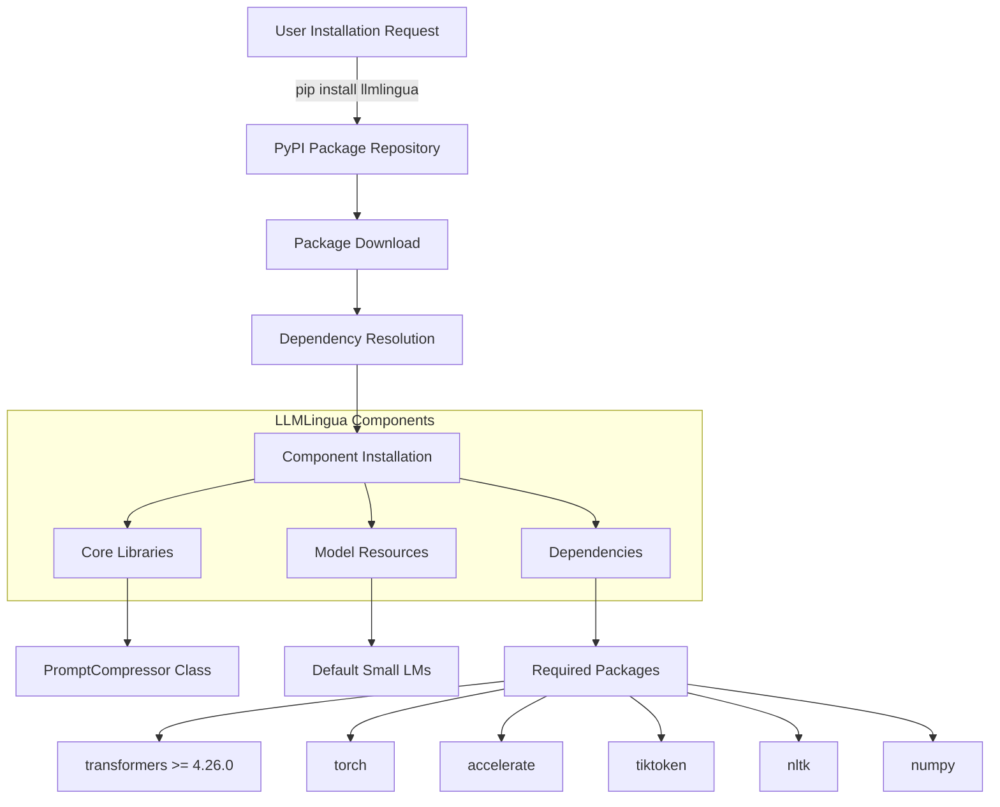
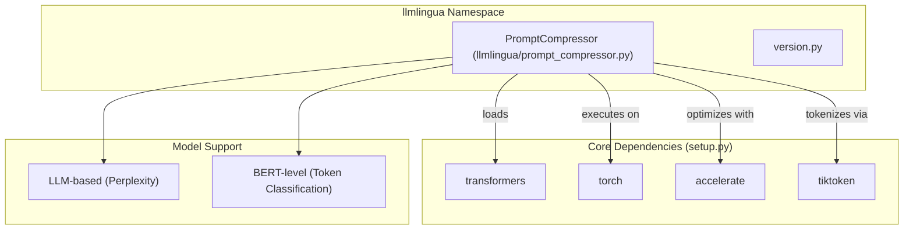

<!-- source: DeepWiki mcp.deepwiki.com · repo microsoft/LLMLingua · page 4.1 Installation · fetched 2026-10-26 -->

# Installation

<details>
<summary>Relevant source files</summary>

The following files were used as context for generating this wiki page:

- [Makefile](Makefile)
- [README.md](README.md)
- [llmlingua/version.py](llmlingua/version.py)
- [pyproject.toml](pyproject.toml)
- [setup.cfg](setup.cfg)
- [setup.py](setup.py)

</details>


This document provides detailed instructions for installing LLMLingua, a prompt compression toolkit that enables efficient inference with large language models (LLMs). LLMLingua supports various compression strategies including perplexity-based token filtering and token classification via specialized encoders.

## Overview of Installation Process

LLMLingua is distributed as a Python package via PyPI. The installation process resolves core dependencies for model loading (`transformers`), tensor computation (`torch`), and tokenization (`tiktoken`, `nltk`).



Sources: [README.md:138-144](), [setup.py:25-32]()

## System Requirements

Before installing LLMLingua, ensure your system meets the following requirements:

- **Python**: Version 3.8.0 or higher.
- **Hardware**: While LLMLingua can run on CPU, a CUDA-compatible GPU is recommended for the Small Language Models (SLMs) used during the compression process (e.g., LLaMA-7B, GPT2-small).
- **Memory**: Standard models require 8GB+ VRAM; quantized models (GPTQ) can run on significantly less.

Sources: [setup.py:68](), [README.md:36-37](), [README.md:165-167]()

## Installation Methods

### Standard Installation

The stable version of LLMLingua can be installed directly from PyPI:

```bash
pip install llmlingua
```

This installs the version defined in the codebase (currently v0.2.2).

Sources: [README.md:143](), [llmlingua/version.py:13-14]()

### Installation for Development

For developers contributing to the project or running the test suite, use the `dev` or `quality` extras. These include tools for linting (`flake8`, `isort`), formatting (`black`), and testing (`pytest`).

```bash
pip install llmlingua[dev]
```

Sources: [setup.py:33-41](), [setup.py:62-65]()

### Installation from Source

To use the most recent updates from the repository:

```bash
git clone https://github.com/microsoft/LLMLingua.git
cd LLMLingua
pip install -e .
```

You can also use the provided `Makefile` for standard development tasks:
- `make install`: Builds the wheel and installs the package.
- `make style`: Runs `black`, `isort`, and `flake8` on the `llmlingua` and `tests` directories.
- `make test`: Executes `pytest` across multiple CPU cores.

Sources: [setup.py:4-70](), [Makefile:1-17]()

## Package Structure and Data Flow

The installation sets up the `llmlingua` namespace. The primary entry point for users is the `PromptCompressor` class, which manages the lifecycle of the compression models and tokenizers.



Sources: [setup.py:25-32](), [llmlingua/version.py:1-15](), [README.md:46-49]()

## Optional Dependencies

### Quantization Support (GPTQ)
To use 4-bit quantized models (e.g., `TheBloke/Llama-2-7b-Chat-GPTQ`) which allow running LLMLingua on consumer-grade hardware with less than 8GB VRAM, you must install `auto-gptq` and `optimum`:

```bash
pip install optimum auto-gptq
```

Sources: [README.md:165-167]()

### Framework Integrations
LLMLingua can be integrated into broader RAG ecosystems. These typically require their own package installations:
- **LangChain**: Requires `langchain`.
- **LlamaIndex**: Requires `llama-index`.

Sources: [README.md:27]()

## Verifying Installation

Verify the installation and the specific version by importing the package in a Python shell:

```python
from llmlingua import PromptCompressor
import llmlingua.version as v

# Check version (expected: 0.2.2)
print(v.VERSION)

# Initialize compressor (downloads default model if not present)
compressor = PromptCompressor()
```

Sources: [llmlingua/version.py:14](), [README.md:152-154]()

## Troubleshooting

| Issue | Cause | Resolution |
| :--- | :--- | :--- |
| `ModuleNotFoundError: No module named 'transformers'` | Failed dependency resolution | `pip install transformers>=4.26.0` |
| `ImportError: cannot import name 'PromptCompressor'` | Path conflict or failed install | Ensure you are not in the root of the source tree or use `pip install -e .` |
| CUDA Errors | Mismatched `torch` and CUDA drivers | Install `torch` via instructions at [pytorch.org](https://pytorch.org) |
| Linting Failures | `isort` or `black` version mismatch | Use `pip install llmlingua[quality]` to get pinned versions |

Sources: [setup.py:25-41](), [setup.cfg:1-29](), [pyproject.toml:1-12]()

---

