# Page: Overview

# Overview

<details>
<summary>Relevant source files</summary>

The following files were used as context for generating this wiki page:

- [README.md](README.md)

</details>


## Purpose and Scope

The LMOps repository is a research initiative focused on fundamental research and technology for building AI products with foundation models. The repository encompasses three major components:

1. **LMOps Research Framework**: Six core research areas advancing LLM capabilities
2. **LLM4Science System**: Application of LLMs to automated theorem proving for P vs NP problems
3. **RRM-evaluation System**: Comprehensive framework for evaluating reward reasoning models

This overview introduces these major systems and their relationships. For detailed information about the research areas, see page 1.1. For system-specific documentation, refer to pages 2 (LLM4Science) and 3 (RRM-evaluation).

Sources: [README.md:3-11]()

## Major Systems and Research Areas

The LMOps repository is organized around three major components that address different aspects of LLM research:

#### Three-Component Architecture
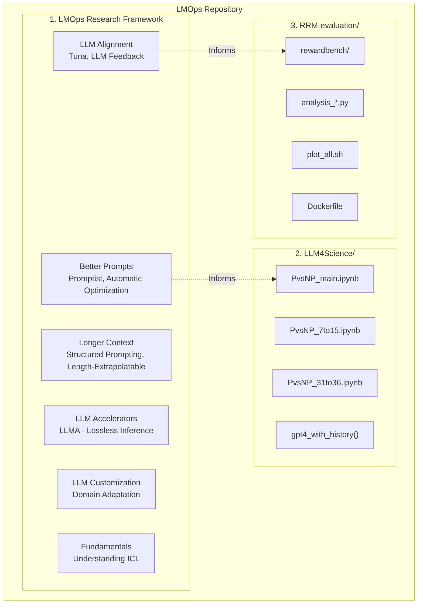

### Component Summary

| Component | Location | Primary Purpose | Key Artifacts |
|-----------|----------|-----------------|---------------|
| LMOps Research Framework | `README.md` | Foundational research in six areas | Research papers, methodologies |
| LLM4Science System | `LLM4Science/` directory | Automated theorem proving for P vs NP | Jupyter notebooks, GPT-4 integration |
| RRM-evaluation System | `RRM-evaluation/` directory | Reward model evaluation | Python scripts, Docker environment |

For detailed coverage of the six research areas (Better Prompts, Longer Context, LLM Alignment, LLM Accelerators, LLM Customization, and Fundamentals), see page 1.1.

Sources: [README.md:6-11](), [README.md:30-98]()

## System Architecture and Code Mapping

#### LLM4Science System Architecture
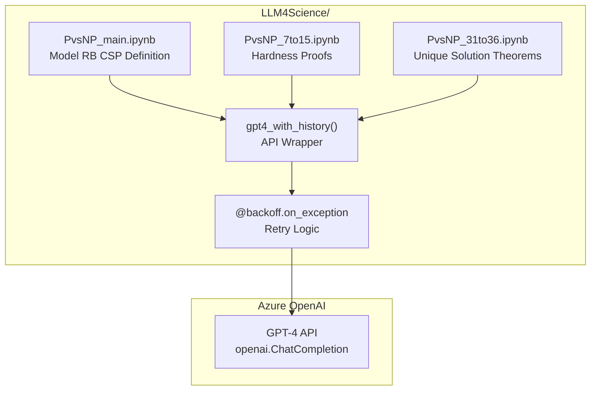

#### RRM-evaluation System Architecture
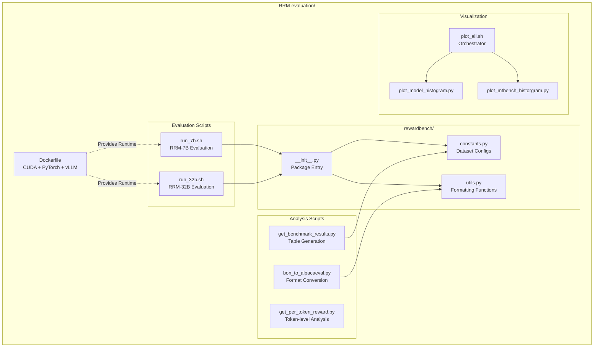

Sources: [README.md:6-11]()

## System Descriptions

### LLM4Science System

The LLM4Science system explores fundamental problems in theoretical computer science, specifically the P vs NP problem, using GPT-4 for interactive mathematical reasoning. The system consists of multiple Jupyter notebooks that conduct systematic explorations of mathematical concepts through LLM-assisted reasoning sessions.

Key components include:
- `PvsNP_main.ipynb`: Primary exploration notebook
- `PvsNP_7to15.ipynb` and `PvsNP_31to36.ipynb`: Focused exploration sessions
- `gpt4_with_history` infrastructure for robust API interactions

See [LLM4Science System](#2) for detailed documentation.

### RRM-evaluation System

The RRM-evaluation system provides a comprehensive framework for evaluating Reward Reasoning Models (RRMs) through pairwise comparison and ELO scoring methodologies. The system includes extensive analysis tools, visualization capabilities, and containerized evaluation environments.

Key components include:
- Evaluation framework for RRM-7B and RRM-32B models
- Analysis scripts in Python for data processing and visualization
- Docker-based infrastructure with the `rewardbench` package
- Statistical analysis and reporting tools

See [RRM-evaluation System](#3) for comprehensive documentation.

Sources: [README.md:1-11]()

## Code Organization and File Structure

The repository uses a two-directory structure for the research systems, with configuration files at the root level.

#### Directory Structure
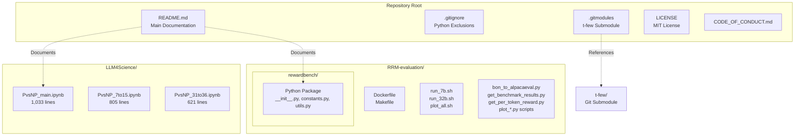

#### Concept-to-Code Mapping
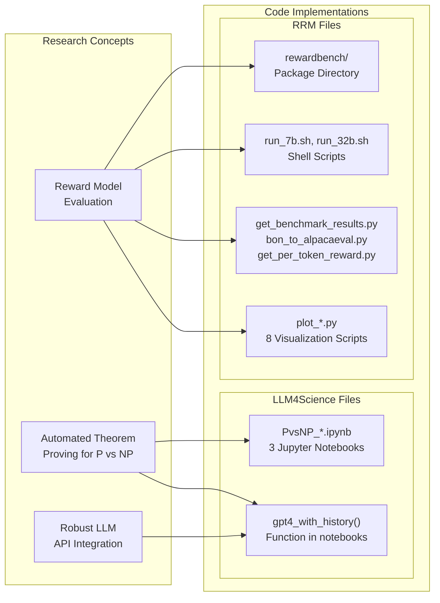

### Directory Contents

| Directory | File Count | Key Files | Purpose |
|-----------|------------|-----------|---------|
| `LLM4Science/` | 3 notebooks | `PvsNP_main.ipynb`, `PvsNP_7to15.ipynb`, `PvsNP_31to36.ipynb` | Interactive theorem exploration |
| `RRM-evaluation/` | ~20 Python files, 3 shell scripts | `rewardbench/`, `run_7b.sh`, `plot_all.sh` | Reward model evaluation pipeline |
| `RRM-evaluation/rewardbench/` | Package files | `__init__.py`, `constants.py`, `utils.py` | Core evaluation library |
| Root | 5 config files | `README.md`, `.gitignore`, `.gitmodules`, `LICENSE` | Repository configuration |

Sources: [README.md:1-112]()

## System Dependencies and Technology Stack

The three major components rely on different technology stacks optimized for their specific purposes:

#### Technology Dependencies by System
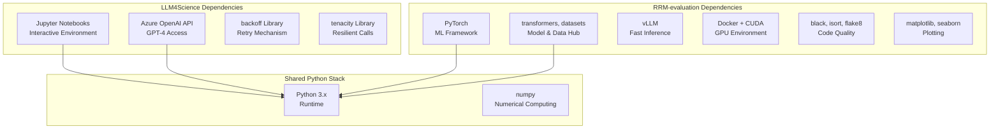

### Dependency Summary

| Component | Runtime | Key Libraries | External Services |
|-----------|---------|---------------|-------------------|
| LMOps Research | N/A (Papers) | N/A | N/A |
| LLM4Science | Jupyter | `openai`, `backoff`, `tenacity` | Azure OpenAI API |
| RRM-evaluation | Docker/Python | `torch`, `transformers`, `vllm`, `datasets` | HuggingFace Hub, multiple LLM APIs |

Both research systems follow common patterns:
- Python-based implementation
- External API/dataset integration
- Research reproducibility focus
- Modular, documented code organization

Sources: [README.md:1-112]()

## LMOps Research Framework

The LMOps Research Framework comprises six core research areas that inform the development of the two application systems. These areas represent fundamental advances in LLM technology:

### Six Research Areas

| Area | Technologies | Key Publications |
|------|--------------|------------------|
| Better Prompts | Automatic optimization, Promptist, X-Prompt, UPRISE | [Automatic Prompt Optimization](https://arxiv.org/abs/2305.03495), [Promptist](https://arxiv.org/abs/2212.09611), [Extensible Prompts](https://arxiv.org/abs/2212.00616) |
| Longer Context | Structured prompting, length-extrapolatable transformers | [Structured Prompting](https://arxiv.org/abs/2212.06713), [Length-Extrapolatable Transformers](https://arxiv.org/abs/2212.10554) |
| LLM Alignment | Tuna instruction tuning, LLM feedback | [Tuna](https://arxiv.org/pdf/2310.13385.pdf) |
| LLM Accelerators | LLMA lossless acceleration | [Inference with Reference](https://arxiv.org/abs/2304.04487) |
| LLM Customization | Domain adaptation | [Adapt LLM to Domains](https://arxiv.org/pdf/2309.09530.pdf) |
| Fundamentals | Understanding in-context learning | [Understanding ICL](https://arxiv.org/abs/2212.10559) |

### Research Timeline (2023)

- **Nov 2023**: In-Context Demonstration Selection (EMNLP)
- **Oct 2023**: Tuna, Automatic Prompt Optimization, UPRISE (EMNLP)
- **Jul 2023**: Learning to Retrieve In-Context Examples
- **Apr 2023**: LLMA Lossless Acceleration
- **Dec 2022**: Understanding In-Context Learning, Promptist, Structured Prompting, X-Prompt

For detailed coverage of each research area, including techniques and use cases, see page 1.1 (Research Areas).

Sources: [README.md:6-11](), [README.md:18-28](), [README.md:30-98]()

## Conclusion

The Microsoft LMOps repository provides a comprehensive suite of tools and systems for optimizing various aspects of large language models. From knowledge distillation and acceleration to domain adaptation and prompt engineering, these systems address the complete lifecycle of LLM development and deployment. The modular nature of the repository allows researchers and practitioners to use each system independently or combine them to create custom optimization pipelines.

For more detailed information about each system, please refer to their dedicated wiki pages.

---

# Page: Research Areas

# Research Areas

<details>
<summary>Relevant source files</summary>

The following files were used as context for generating this wiki page:

- [README.md](README.md)

</details>


## Purpose and Scope

This document details the six main research areas that comprise the LMOps initiative: Better Prompts, Longer Context, LLM Alignment, LLM Accelerator, LLM Customization, and Fundamentals. Each research area encompasses specific technologies, methodologies, and theoretical frameworks for building AI products with foundation models, particularly Large Language Models (LLMs) and Generative AI models.

For information about specific implementations of these research areas in the codebase, see [LLM4Science System](#2) and [RRM-evaluation System](#3).

## Research Areas Overview

The LMOps research initiative encompasses six interconnected research areas that address fundamental challenges in Large Language Model operations and deployment:

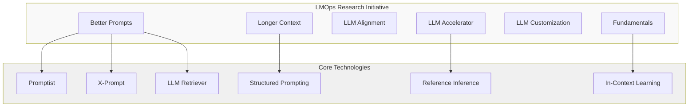

**LMOps Research Areas Taxonomy**

| Research Area | Primary Focus | Key Technologies | Current Status |
|---------------|---------------|------------------|----------------|
| Better Prompts | Prompt optimization and engineering | Promptist, X-Prompt, Universal Retrieval | Active Development |
| Longer Context | Extended context handling | Structured Prompting, Length-Extrapolatable Transformers | Research Phase |
| LLM Alignment | Model alignment and feedback | RRM evaluation, LLM feedback mechanisms | Implementation Available |
| LLM Accelerator | Inference optimization | Reference-based acceleration | Production Ready |
| LLM Customization | Domain adaptation | Domain-specific fine-tuning | Research Phase |
| Fundamentals | Theoretical understanding | In-Context Learning analysis | Ongoing Research |

Sources: [README.md:4-11]()

## Better Prompts Research Area

The Better Prompts research area focuses on advanced prompt engineering techniques and automatic prompt optimization methods. This area encompasses multiple technologies for improving LLM interaction through sophisticated prompting strategies.

### Core Technologies

**Automatic Prompt Optimization**: Gradient descent and beam search methods for systematic prompt improvement, enabling automated refinement of user inputs into model-preferred prompts.

**Promptist**: Reinforcement learning-based approach for automatic prompt optimization, specifically designed for text-to-image generation tasks using language models as prompt interfaces.

**Extensible Prompts (X-Prompt)**: Framework extending beyond natural language to enable fine-grained specifications through context-guided imaginary word learning.

**Universal Prompt Retrieval**: System for retrieving optimal prompts from large databases to improve zero-shot evaluation performance across diverse tasks.

**LLM Retriever**: Technology for learning to retrieve in-context examples specifically tailored for Large Language Models.

**In-Context Demonstration Selection**: Methods using cross entropy difference for selecting optimal demonstration examples in few-shot learning scenarios.

Sources: [README.md:6](), [README.md:34-66]()

## Longer Context Research Area

The Longer Context research area addresses the challenge of processing and understanding extended sequences in Large Language Models, enabling efficient handling of long-form content.

### Core Technologies

**Structured Prompting**: Methodology for scaling in-context learning to 1,000+ examples by organizing long-sequence prompts in structured formats, enabling efficient consumption of extensive context.

**Length-Extrapolatable Transformers**: Architecture modifications allowing Transformer models to handle sequences longer than those seen during training.

### Use Cases

1. **Retrieved Document Integration**: Prepending multiple long documents as context in GPT models
2. **Large-Scale In-Context Learning**: Scaling demonstration examples to thousands of instances

Sources: [README.md:7](), [README.md:45-55]()

## LLM Alignment Research Area

The LLM Alignment research area focuses on aligning model behavior with human preferences and intentions through feedback mechanisms and reward modeling.

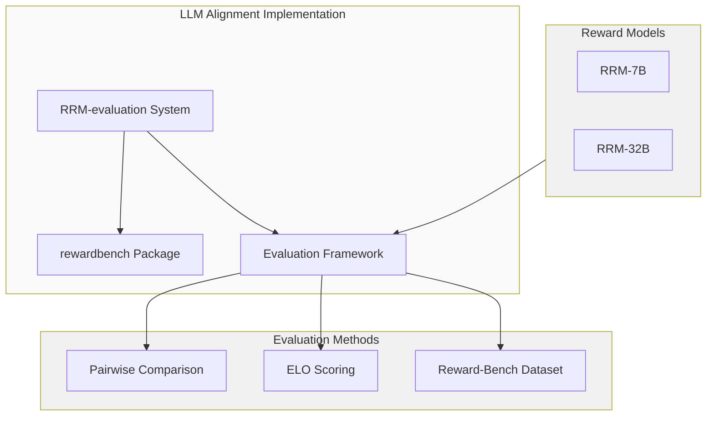

### Implementation Components

The alignment research area is implemented through the `RRM-evaluation` system, which provides comprehensive evaluation frameworks for Reward Reasoning Models using pairwise comparison methodologies and ELO scoring systems.

**Reward Model Evaluation**: Framework supporting evaluation of `RRM-7B` and `RRM-32B` models across multiple datasets using standardized benchmarking protocols.

**LLM Feedback Integration**: Mechanisms for incorporating feedback from Large Language Models into alignment processes.

Sources: [README.md:8]()

## LLM Accelerator Research Area

The LLM Accelerator research area develops techniques for accelerating Large Language Model inference without compromising output quality.

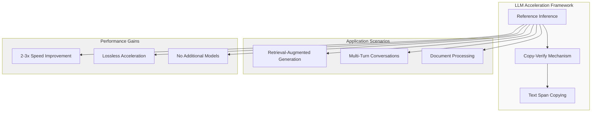

### Core Technology: Reference-Based Inference

**Lossless Acceleration**: Technology achieving 2-3x speed improvements by leveraging text span overlaps between LLM outputs and reference documents through copy-and-verify mechanisms.

**Application Domains**: Optimized for retrieval-augmented generation, multi-turn conversations, and document processing scenarios where significant text overlap exists.

Sources: [README.md:9](), [README.md:71-83]()

## LLM Customization Research Area

The LLM Customization research area focuses on adapting general-purpose Large Language Models to specific domains and use cases.

### Domain Adaptation Technologies

**Domain-Specific Fine-Tuning**: Methodologies for adapting LLMs to specialized domains while preserving general capabilities.

**Custom Model Training**: Techniques for training domain-specific variants of foundation models.

Sources: [README.md:10]()

## Fundamentals Research Area

The Fundamentals research area investigates the theoretical foundations and mechanisms underlying Large Language Model capabilities.

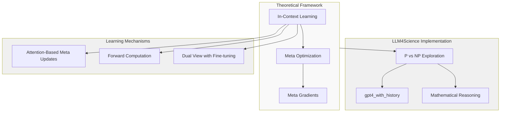

### In-Context Learning Theory

**Meta Optimization Framework**: Understanding of how GPT models perform meta optimization through forward computation, producing meta gradients for In-Context Learning (ICL) and applying them through attention mechanisms.

**Dual View with Fine-tuning**: Theoretical framework establishing the relationship between ICL meta optimization and explicit parameter updates through back-propagated gradients.

**Architecture Translation**: Methods for translating optimization algorithms (SGD with Momentum) to corresponding Transformer architectures.

### Implementation in LLM4Science

The fundamentals research area is implemented through the `LLM4Science` system, which explores theoretical computer science problems (specifically P vs NP) using GPT-4 for mathematical reasoning and theorem proving.

Sources: [README.md:11](), [README.md:88-98]()

## Research Area Integration and Implementation Mapping

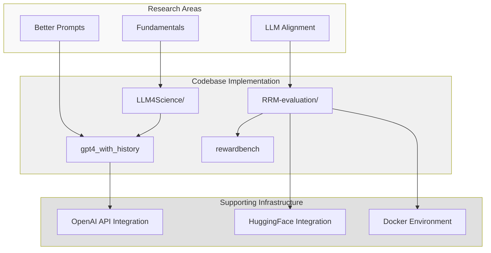

### Implementation Components

The research areas are implemented through specific codebase components:

**Fundamentals → LLM4Science**: The `LLM4Science/` directory implements fundamental research through P vs NP mathematical exploration using the `gpt4_with_history` system for robust LLM interactions.

**LLM Alignment → RRM-evaluation**: The `RRM-evaluation/` directory provides comprehensive reward model evaluation through the `rewardbench` package and associated analysis tools.

**Better Prompts → Infrastructure**: Prompt optimization techniques are implemented through the `gpt4_with_history` system with retry mechanisms and error handling for robust API interactions.

Sources: [README.md:1-111]()

---

# Page: LLM4Science System

# LLM4Science System

<details>
<summary>Relevant source files</summary>

The following files were used as context for generating this wiki page:

- [LLM4Science/PvsNP_31to36.ipynb](LLM4Science/PvsNP_31to36.ipynb)
- [LLM4Science/PvsNP_7to15.ipynb](LLM4Science/PvsNP_7to15.ipynb)
- [LLM4Science/PvsNP_main.ipynb](LLM4Science/PvsNP_main.ipynb)

</details>


## Purpose and Scope

The LLM4Science System is a research framework designed to explore fundamental mathematical problems, specifically the P vs NP problem, through interactive sessions with large language models. The system facilitates mathematical reasoning and theorem exploration by providing robust LLM integration infrastructure and structured conversation frameworks for investigating constraint satisfaction problems (CSPs), phase transitions, and complexity theory.

For information about the broader LMOps research initiative, see [Overview](#1). For details about the RRM evaluation framework, see [RRM-evaluation System](#3).

## System Architecture

The LLM4Science System consists of three main exploration notebooks that share common infrastructure for LLM interactions and mathematical reasoning:

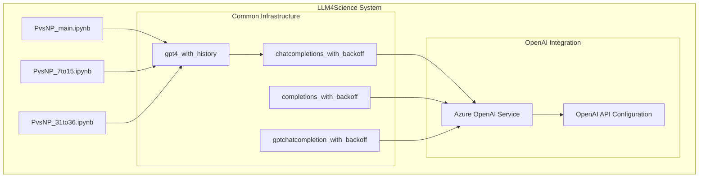

**LLM4Science System Architecture**

The system employs a modular design where each exploration notebook focuses on specific mathematical investigations while sharing robust LLM interaction infrastructure.

Sources: [LLM4Science/PvsNP_main.ipynb:1-93](), [LLM4Science/PvsNP_7to15.ipynb:1-97](), [LLM4Science/PvsNP_31to36.ipynb:1-111]()

## LLM Integration Infrastructure

The core infrastructure provides reliable interaction with GPT-4 through Azure OpenAI services with comprehensive error handling and retry mechanisms:

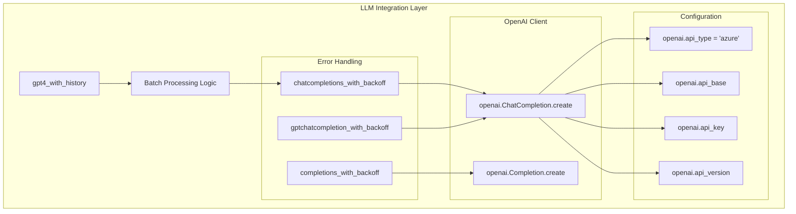

**LLM Integration Infrastructure**

### Core Functions

- **`gpt4_with_history`**: Main interface for GPT-4 interactions with conversation history management
- **`chatcompletions_with_backoff`**: Exponential backoff wrapper for chat completions using the `backoff` library
- **`completions_with_backoff`**: Exponential backoff wrapper for standard completions
- **`gptchatcompletion_with_backoff`**: Advanced retry mechanism using `tenacity` with configurable wait strategies

The retry mechanism implements a sophisticated wait chain: 3 attempts with 3-second delays, followed by 2 attempts with 5-second delays, then 10-second delays for subsequent attempts.

Sources: [LLM4Science/PvsNP_main.ipynb:59-90](), [LLM4Science/PvsNP_7to15.ipynb:64-90](), [LLM4Science/PvsNP_31to36.ipynb:78-104]()

## Mathematical Exploration Components

The system facilitates structured mathematical conversations across three main areas of investigation:

### P vs NP Theoretical Exploration

The main exploration focuses on fundamental complexity theory questions, employing philosophical and mathematical approaches to investigate the P vs NP problem:

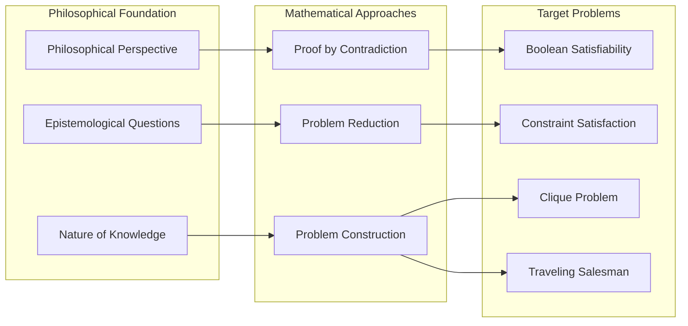

**P vs NP Exploration Framework**

Sources: [LLM4Science/PvsNP_main.ipynb:114-284]()

### CSP Phase Transition Analysis

The system investigates constraint satisfaction problems with focus on phase transitions and symmetry properties:

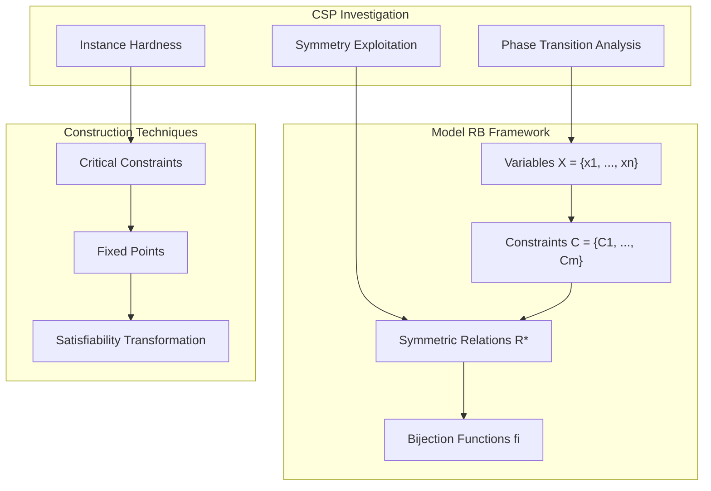

**CSP and Model RB Analysis Framework**

Sources: [LLM4Science/PvsNP_7to15.ipynb:102-418](), [LLM4Science/PvsNP_main.ipynb:315-683]()

### Advanced Theorem Proving Strategies

The latest exploration focuses on constructing specific instances of Model RB that exhibit controllable satisfiability properties:

| Exploration Focus | Description | Key Techniques |
|------------------|-------------|----------------|
| **Critical Instances** | Instances with single critical constraints | Non-critical constraint satisfaction |
| **Delicate Balance** | Instances with unique solutions | Tight constraint coupling |
| **Fixed Points** | Sets invariant under transformations | Symmetry preservation |
| **Mapping Operations** | Satisfiability-altering transformations | Value swapping for k=2 cases |

The system explores two primary instance types:
1. **Unsatisfiable to Satisfiable**: Instances with mostly non-critical constraints and one critical constraint dependent on single variable assignment
2. **Satisfiable to Unsatisfiable**: Instances with delicate constraint balance having unique solutions that become unsatisfiable when critical constraints are modified

Sources: [LLM4Science/PvsNP_31to36.ipynb:114-369]()

## Model RB Specification

The system works with an enhanced Model RB definition that incorporates symmetry requirements for generating hard CSP instances:

### Core Model Components

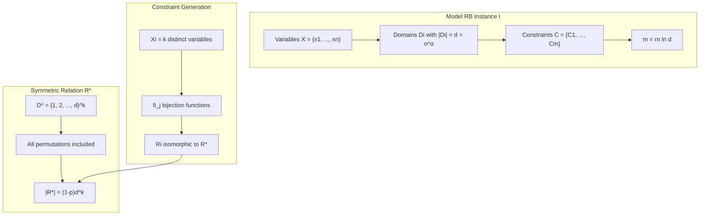

**Enhanced Model RB Structure**

### Assignment and Satisfiability Definitions

- **Assignment σ**: Function `σ: X → ∪Di` where `σ(xi) ∈ Di` for all variables
- **Constraint Satisfaction**: Constraint `Ci = (Xi, Ri)` satisfied when `(σ(xi1), σ(xi2), ..., σ(xik)) ∈ Ri`
- **Solution**: Assignment satisfying all constraints in set C
- **Satisfiability**: Instance I is satisfiable if solution σ exists

The enhanced model introduces separate bijection functions `fi_j` for each of the first `k-1` variables to increase complexity while preserving constraint symmetry requirements.

Sources: [LLM4Science/PvsNP_main.ipynb:704-717](), [LLM4Science/PvsNP_31to36.ipynb:118-369]()

---

# Page: P vs NP Mathematical Exploration

# P vs NP Mathematical Exploration

<details>
<summary>Relevant source files</summary>

The following files were used as context for generating this wiki page:

- [LLM4Science/PvsNP_31to36.ipynb](LLM4Science/PvsNP_31to36.ipynb)
- [LLM4Science/PvsNP_7to15.ipynb](LLM4Science/PvsNP_7to15.ipynb)
- [LLM4Science/PvsNP_main.ipynb](LLM4Science/PvsNP_main.ipynb)

</details>


## Purpose and Scope

This page documents the mathematical content explored in the LLM4Science notebooks that investigate the P vs NP problem through constraint satisfaction problems (CSPs). The exploration uses iterative conversations with GPT-4 to develop formal definitions, proof strategies, and theorems related to CSP hardness. The work focuses on constructing a specialized CSP model called **Model RB** with symmetric relations, then exploring how satisfiability can be transformed through mapping operations to establish fixed points.

For technical infrastructure details about the GPT-4 integration, see [LLM Integration Infrastructure](#2.2). For the broader LLM4Science system overview, see [LLM4Science System](#2).

---

## Mathematical Framework Overview

The notebooks progress through three major mathematical developments:

1. **Model RB Definition** - A random CSP model with symmetric constraints designed to exhibit phase transitions
2. **Proof Strategies** - Approaches using phase transitions, symmetries, and contradiction to establish hardness
3. **Satisfiability Transformations** - Theorems about fixed points under operations that change satisfiability

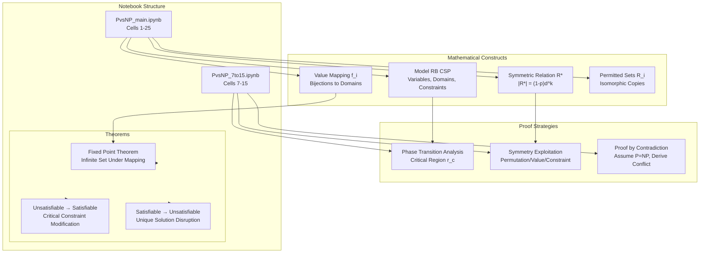

**Sources:** [LLM4Science/PvsNP_main.ipynb:115-718](), [LLM4Science/PvsNP_7to15.ipynb:103-419](), [LLM4Science/PvsNP_31to36.ipynb:117-419]()

---

## Model RB Constraint Satisfaction Problem

### Original Model RB Definition

Model RB is introduced as a random CSP model that can be encoded to NP-complete problems like SAT and CLIQUE. The original definition from Xu and Li (2000) consists of:

| Component | Definition | Parameters |
|-----------|-----------|------------|
| Variables | $\mathcal{X}=\{x_1, \ldots, x_n\}$ | Each $x_i$ has domain $D_i$ with $\|D_i\|=d=n^\alpha$ |
| Constraints | $\mathcal{C}=\{C_1, \ldots, C_m\}$ | $m=rn \ln d$ where $r>0$ is constant |
| Constraint Form | $C_i=(X_i, R_i)$ | $X_i$ is sequence of $k$ distinct variables |
| Permitted Set | $R_i \subseteq D_{i_1} \times \cdots \times D_{i_k}$ | $\|R_i\|=(1-p)d^k$ where $0<p<1$ |

**Sources:** [LLM4Science/PvsNP_main.ipynb:315-367]()

### Enhanced Model RB with Symmetric Relations

Through iterative refinement in conversations 16-24, the model is enhanced to support symmetry requirements and isomorphic permitted sets. The key innovation is introducing a **symmetric relation $R^*$** that serves as a template for all constraints.

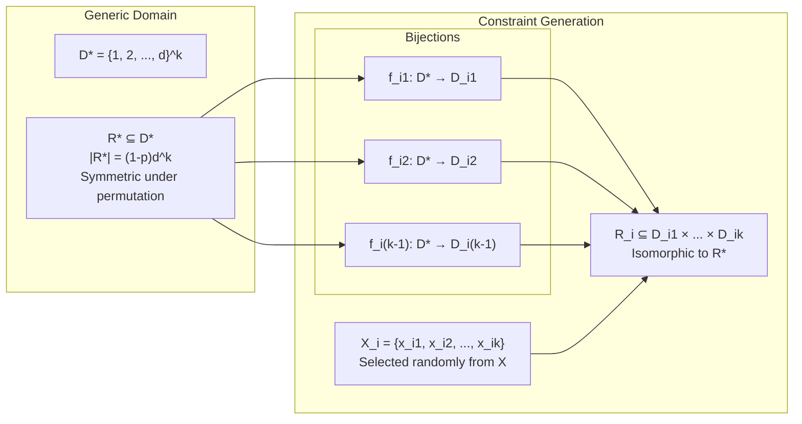

**Enhanced Model RB Components:**

1. **Symmetric Relation $R^*$**: Defined on generic domain $D^*=\{1,2,\ldots,d\}^k$ with the property that for any tuple $(a_1, a_2, \ldots, a_k) \in R^*$, all permutations of the tuple are also in $R^*$. Size: $|R^*|=(1-p)d^k$.

2. **Value Mapping Functions**: For each constraint $C_i=(X_i, R_i)$ where $X_i=\{x_{i_1}, x_{i_2}, \ldots, x_{i_k}\}$, generate random bijections $f_{i_j}: D^* \to D_{i_j}$ for the first $k-1$ variables.

3. **Permitted Set Construction**: For each tuple $(a_1, a_2, \ldots, a_k) \in R^*$, include the tuple $(f_{i_1}(a_1), f_{i_2}(a_2), \ldots, f_{i_{k-1}}(a_{k-1}), a_k)$ in $R_i$.

**Sources:** [LLM4Science/PvsNP_main.ipynb:428-683]()

### Assignments, Solutions, and Satisfiability

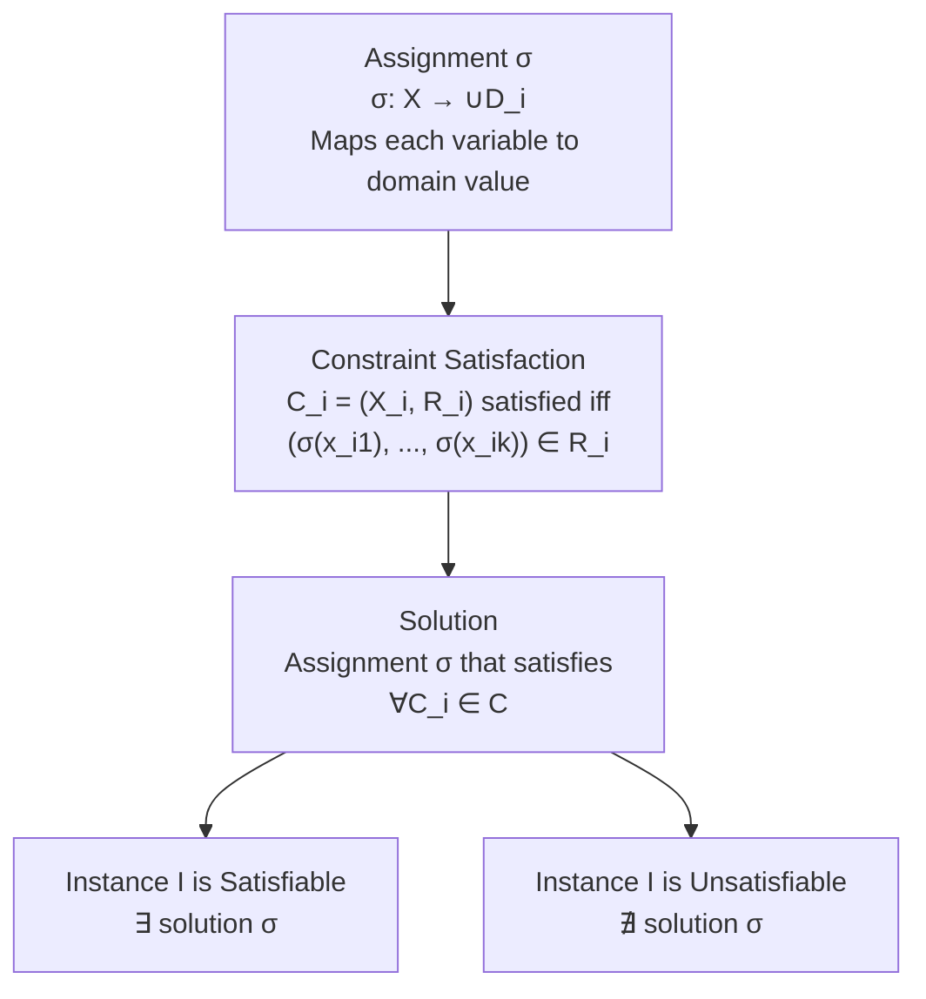

**Formal Definitions:**

- **Assignment $\sigma$**: A function $\sigma: \mathcal{X} \to \bigcup_{i=1}^n D_i$ such that $\sigma(x_i) \in D_i$ for all $i=1,\ldots,n$.

- **Constraint Satisfaction**: Constraint $C_i=(X_i, R_i)$ is satisfied by $\sigma$ if $(\sigma(x_{i_1}), \sigma(x_{i_2}), \ldots, \sigma(x_{i_k})) \in R_i$.

- **Solution**: An assignment $\sigma$ satisfying $\forall C_i \in \mathcal{C}$, $(\sigma(x_{i_1}), \sigma(x_{i_2}), \ldots, \sigma(x_{i_k})) \in R_i$.

- **Satisfiability**: Instance $I$ is satisfiable if $\exists$ a solution $\sigma$; otherwise unsatisfiable.

**Sources:** [LLM4Science/PvsNP_main.ipynb:705-718]()

---

## Proof Strategies for CSP Hardness

### Phase Transition Approach

The notebooks explore using phase transitions—regions where satisfiability changes rapidly—to prove hardness. The critical parameter is the constraint density ratio $r$.

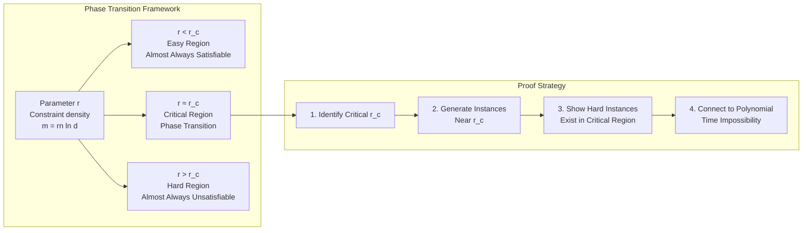

**Key Steps** (from conversation 8):

1. **Identify critical parameter**: Find the value $r_c$ where the phase transition occurs
2. **Analyze the transition**: Observe how difficulty changes as $r$ varies around $r_c$
3. **Show hard instances exist**: Prove instances near $r_c$ have properties making them difficult
4. **Relate to polynomial time**: Show any polynomial-time algorithm for hard instances would solve known NP-hard problems

**Sources:** [LLM4Science/PvsNP_7to15.ipynb:134-164]()

### Symmetry-Based Approaches

Three types of symmetry are exploited to construct hard instances:

| Symmetry Type | Definition | Construction Method |
|---------------|-----------|---------------------|
| **Permutation Symmetry** | Variables and domains interchangeable | Make $D_i = D_j$ for all $i,j$ |
| **Value Symmetry** | Values can be interchanged | Constraints invariant under value exchange |
| **Constraint Symmetry** | Problem unchanged under constraint permutation | $R_i$ symmetric with respect to variables |

The exploration identifies that "symmetry" relates to **invariance under transformations** including:
- Permutations of variables and assignments
- Rotations or reflections (for geometric problems)
- Duality (interchanging variables and constraints)
- **Fixed points** (instances unchanged under certain transformations)

**Sources:** [LLM4Science/PvsNP_7to15.ipynb:233-269](), [LLM4Science/PvsNP_main.ipynb:387-447]()

### Proof by Contradiction Framework

The general approach for proving $P \neq NP$ by contradiction:

```mermaid
flowchart TD
    Assume["Assume: ∃ Algorithm A<br/>Solves CSP class in T(n) time"]
    
    Transform["Identify Transformation F<br/>Maps instances while<br/>preserving difficulty"]
    
    Instance["Problem Instance P<br/>Exhibits phase transitions"]
    
    Transformed["Q = F(P)<br/>Transformed instance"]
    
    CriticalP["Critical Region C for P<br/>Solvability changes rapidly"]
    
    CriticalQ["Critical Region C' for Q<br/>C' = F(C)"]
    
    Contradiction["Algorithm A cannot consistently<br/>solve in T(n) due to rapid<br/>solvability changes<br/>⊥ Contradiction"]
    
    Assume --> Transform
    Transform --> Instance
    Instance --> Transformed
    Instance --> CriticalP
    Transformed --> CriticalQ
    CriticalP --> Contradiction
    CriticalQ --> Contradiction
```

**Proof Structure** (from conversation 13):

1. Assume algorithm $A$ solves the CSP class in time $T(n)$
2. Identify transformation function $F$ preserving difficulty and invariance
3. Let $P$ be a problem instance with phase transitions, $Q = F(P)$
4. Both $P$ and $Q$ should be solvable in $T(n)$ by assumption
5. Critical regions $C$ and $C'$ exist where solvability changes rapidly
6. Algorithm $A$ cannot consistently solve instances in critical regions within $T(n)$
7. Contradiction with initial assumption

**Sources:** [LLM4Science/PvsNP_7to15.ipynb:304-387]()

---

## Satisfiability Transformation Theorems

### Mapping Operations for $k=2$

For constraints with $k=2$ variables, a specific mapping operation is defined to alter satisfiability:

**Given:** Constraint $C_i = (X_i, R_i)$ where $X_i = \{x_{i_1}, x_{i_2}\}$ and $R_i$ is obtained by applying value mapping $f_i$ to $R^*$.

**Define:** New mapping $g_i(a_1, a_2) = (f_i(a_2), f_i(a_1))$ for each $(a_1, a_2) \in R^*$.

**Result:** New constraint $C'_i = (X_i, R'_i)$ where $R'_i$ is obtained by applying $g_i$ to $R^*$.

**Property:** The mapping swaps values without changing variables, ensuring $C'_i \neq C_i$ when $f_i(a_1) \neq f_i(a_2)$ for all $(a_1, a_2) \in R^*$.

**Sources:** [LLM4Science/PvsNP_31to36.ipynb:117-192]()

### Fixed Point Theorem

**Theorem:** There exists an infinite set of satisfiable and unsatisfiable instances of Model RB such that this set is a fixed point under the mapping operation of changing satisfiability (as $n \to \infty$, $d \to \infty$).

```mermaid
flowchart TD
    subgraph "Proof Approach"
        Construct["1. Constructive Reasoning<br/>Build infinite sequence<br/>with alternating satisfiability"]
        
        Logic["2. Logical Reasoning<br/>Show mapping changes<br/>satisfiability"]
        
        Fixed["3. Fixed Point Property<br/>Assume NOT fixed point<br/>→ Contradiction"]
        
        Asymp["4. Asymptotic Behavior<br/>Analyze as n,d → ∞"]
    end
    
    subgraph "Instance Types"
        Type1["Unsatisfiable → Satisfiable<br/>Non-critical constraints + 1 critical<br/>Critical depends on single variable"]
        
        Type2["Satisfiable → Unsatisfiable<br/>Delicate constraint balance<br/>Unique solution exists"]
    end
    
    Construct --> Type1
    Construct --> Type2
    Logic --> Type1
    Logic --> Type2
    Type1 --> Fixed
    Type2 --> Fixed
    Fixed --> Asymp
```

**Sources:** [LLM4Science/PvsNP_31to36.ipynb:154-193](), [LLM4Science/PvsNP_31to36.ipynb:195-232]()

### Instance Construction Strategies

Two specific instance types are identified for the fixed point theorem:

#### Type 1: Unsatisfiable → Satisfiable Transformation

**Construction:**
- Create sequence $I_1, I_2, \ldots$ where $n_j, d_j \to \infty$ as $j \to \infty$
- For each instance $I_j$, construct constraints $\mathcal{C}_j$ where:
  - All but one constraint are **non-critical** (always satisfied)
  - One constraint $C_{j,1}$ is **critical** (satisfiability depends on single variable assignment)
- Apply mapping operation to $C_{j,1}$ to create $I'_j$ with altered satisfiability
- Remaining constraints unchanged, so set $\{I_1, I_2, \ldots\}$ is fixed point

**Sources:** [LLM4Science/PvsNP_31to36.ipynb:195-232]()

#### Type 2: Satisfiable → Unsatisfiable Transformation

**Construction:**
- Create sequence $J_1, J_2, \ldots$ where $n_j, d_j \to \infty$ as $j \to \infty$
- For each instance $J_j$, construct constraints $\mathcal{C}_j$ such that:
  - All constraints satisfied by **unique solution** $\sigma_j$
  - Constraints are **tightly coupled** (high interdependence)
  - Even small change in any constraint breaks satisfiability
- Properties to enforce:
  1. Unique solution with very specific variable assignments
  2. High degree of constraint interdependence
  3. Narrow range of permitted tuples in each $R_i$
- Apply mapping operation to one critical constraint to disrupt balance

**Sources:** [LLM4Science/PvsNP_31to36.ipynb:234-275]()

---

## Conversation-Driven Development Pattern

The notebooks demonstrate a **Socratic dialogue** pattern for mathematical development:

```mermaid
flowchart LR
    subgraph "Iterative Refinement Process"
        Question["User Question<br/>Initial concept or problem"]
        Response["GPT-4 Response<br/>Formal definition or approach"]
        Clarify["User Clarification<br/>Ambiguities or extensions"]
        Refine["GPT-4 Refinement<br/>More precise formulation"]
        Iterate["Iterate until<br/>mathematical rigor achieved"]
        
        Question --> Response
        Response --> Clarify
        Clarify --> Refine
        Refine --> Question
        Refine --> Iterate
    end
    
    subgraph "Key Conversations"
        C16to24["Conversations 16-24<br/>Model RB definition<br/>from vague to rigorous"]
        C7to15["Conversations 7-15<br/>Proof strategies<br/>phase transitions/symmetries"]
        C31to36["Conversations 31-36<br/>Fixed point theorem<br/>from intuition to structure"]
    end
    
    Iterate --> C16to24
    Iterate --> C7to15
    Iterate --> C31to36
```

**Example Evolution:** Model RB definition refined through 9 conversations:
- Conv 16: Initial suggestion to add constraints/variables
- Conv 17: Specific additional constraint proposals
- Conv 18: Symmetry requirements identified
- Conv 19: First symmetric model definition
- Conv 20: Isomorphic $R_i$ requirement added
- Conv 21: $R^*$ definition and bijection $\phi_i$ introduced
- Conv 22: Changed to $f_i$, applied to $k-1$ domains
- Conv 23: Separate bijection for each domain
- Conv 24: Final consolidated definition

**Sources:** [LLM4Science/PvsNP_main.ipynb:315-683]()

---

## Implementation Notes

All mathematical exploration occurs through the `gpt4_with_history` function which maintains conversation context:

**Function Signature:**
```python
def gpt4_with_history(messages, model="gpt-4", temperature=0.7, 
                      max_tokens=800, n=1, stop=None) -> list
```

**Key Parameters:**
- `messages`: List of conversation turns with role ("system", "user", "assistant") and content
- `temperature=0.7`: Controls randomness in responses
- `max_tokens=800` (or 1024 for complex proofs): Response length limit
- Returns tuple of (outputs, messages)

**Infrastructure:**
- Azure OpenAI API integration via `openai.ChatCompletion.create`
- Retry mechanism using `@backoff.on_exception(backoff.expo, openai.error.OpenAIError)`
- Conversation state maintained by appending to `messages` list
- Random seed set to 42 for reproducibility

**Sources:** [LLM4Science/PvsNP_main.ipynb:36-97](), [LLM4Science/PvsNP_7to15.ipynb:41-98](), [LLM4Science/PvsNP_31to36.ipynb:55-112]()

---

## Key Mathematical Constructs Summary

| Construct | Definition | Purpose |
|-----------|-----------|---------|
| **Model RB** | Random CSP with $n$ variables, $m=rn\ln d$ constraints, domain size $d=n^\alpha$ | Framework for exploring hardness |
| **Symmetric Relation $R^*$** | Relation on $D^*=\{1,\ldots,d\}^k$ closed under permutations, $\|R^*\|=(1-p)d^k$ | Template ensuring constraint symmetry |
| **Value Mapping $f_{i_j}$** | Bijections $f_{i_j}: D^* \to D_{i_j}$ for first $k-1$ variables | Creates isomorphic permitted sets |
| **Permitted Set $R_i$** | Obtained by applying $f_{i_j}$ to tuples in $R^*$ | Defines allowed constraint satisfying assignments |
| **Phase Transition** | Critical density $r_c$ where satisfiability probability changes rapidly | Identifies hard instances |
| **Critical Constraint** | Single constraint determining satisfiability | Enables satisfiability transformations |
| **Fixed Point** | Set of instances unchanged under satisfiability mapping | Core of existence theorem |

**Sources:** [LLM4Science/PvsNP_main.ipynb:1-718](), [LLM4Science/PvsNP_7to15.ipynb:1-435](), [LLM4Science/PvsNP_31to36.ipynb:1-435]()

---

# Page: LLM Integration Infrastructure

# LLM Integration Infrastructure

<details>
<summary>Relevant source files</summary>

The following files were used as context for generating this wiki page:

- [LLM4Science/PvsNP_31to36.ipynb](LLM4Science/PvsNP_31to36.ipynb)
- [LLM4Science/PvsNP_7to15.ipynb](LLM4Science/PvsNP_7to15.ipynb)
- [LLM4Science/PvsNP_main.ipynb](LLM4Science/PvsNP_main.ipynb)

</details>


## Purpose and Scope

This document describes the technical infrastructure used in the LLM4Science system for integrating with GPT-4 through Azure OpenAI APIs. It covers API configuration, retry mechanisms, conversation state management, and the core `gpt4_with_history` function that enables iterative mathematical reasoning. For the mathematical content explored using this infrastructure, see [P vs NP Mathematical Exploration](#2.1).

---

## System Architecture

The LLM integration infrastructure provides a robust layer between the research notebooks and the Azure OpenAI API, handling authentication, error recovery, conversation management, and batching.

### High-Level Component Architecture

```mermaid
graph TB
    subgraph "Research Notebooks"
        MainNB["PvsNP_main.ipynb"]
        HardNB["PvsNP_7to15.ipynb"]
        ProofNB["PvsNP_31to36.ipynb"]
    end
    
    subgraph "Integration Layer"
        GPT4Func["gpt4_with_history()"]
        ChatBackoff["chatcompletions_with_backoff()"]
        CompBackoff["completions_with_backoff()"]
        TenacityRetry["gptchatcompletion_with_backoff()"]
    end
    
    subgraph "Retry Libraries"
        Backoff["backoff.on_exception()"]
        Tenacity["tenacity.retry()"]
    end
    
    subgraph "Azure OpenAI"
        API["openai.ChatCompletion.create()"]
        Config["openai.api_type<br/>openai.api_base<br/>openai.api_key<br/>openai.api_version"]
    end
    
    MainNB --> GPT4Func
    HardNB --> GPT4Func
    ProofNB --> GPT4Func
    
    GPT4Func --> ChatBackoff
    ChatBackoff --> Backoff
    ChatBackoff --> API
    
    CompBackoff --> Backoff
    TenacityRetry --> Tenacity
    TenacityRetry --> API
    
    API --> Config
```

**Sources:** [LLM4Science/PvsNP_main.ipynb:36-92](), [LLM4Science/PvsNP_7to15.ipynb:41-97](), [LLM4Science/PvsNP_31to36.ipynb:56-111]()

---

## API Configuration

The system uses Azure OpenAI services rather than standard OpenAI APIs. Configuration is performed through global `openai` module attributes.

### Configuration Parameters

| Parameter | Value | Purpose |
|-----------|-------|---------|
| `openai.api_type` | `"azure"` | Specifies Azure deployment |
| `openai.api_base` | `"your_api_base"` | Azure endpoint URL |
| `openai.api_key` | `"your_api_key"` | Authentication credential |
| `openai.api_version` | `"2023-03-15-preview"` | API version (set in `gpt4_with_history`) |

### Configuration Code

```python
openai.api_type = "azure"
openai.api_base = "your_api_base"
openai.api_key = "your_api_key"
api_key = openai.api_key
```

The `api_version` is set dynamically within the `gpt4_with_history` function at line 79 (main notebook) to `"2023-03-15-preview"`.

**Sources:** [LLM4Science/PvsNP_main.ipynb:53-62](), [LLM4Science/PvsNP_7to15.ipynb:58-67](), [LLM4Science/PvsNP_31to36.ipynb:72-81]()

---

## Retry and Error Handling

The infrastructure implements two complementary retry mechanisms to ensure robustness against transient API failures, rate limits, and network issues.

### Retry Mechanism Architecture

```mermaid
graph TB
    subgraph "Retry Strategy"
        Call["API Call Attempt"]
        BackoffCheck{"Using backoff<br/>decorator?"}
        TenacityCheck{"Using tenacity<br/>decorator?"}
        ExpoWait["Exponential Backoff<br/>backoff.expo"]
        ChainWait["Wait Chain<br/>3s x3 → 5s x2 → 10s"]
        Success["Return Response"]
        Error["openai.error.OpenAIError"]
    end
    
    Call --> BackoffCheck
    Call --> TenacityCheck
    
    BackoffCheck -->|Yes| Error
    Error --> ExpoWait
    ExpoWait --> Call
    
    TenacityCheck -->|Yes| Error
    Error --> ChainWait
    ChainWait --> Call
    
    Call --> Success
```

**Sources:** [LLM4Science/PvsNP_main.ipynb:59-79](), [LLM4Science/PvsNP_7to15.ipynb:64-79]()

### Backoff-Based Retry Functions

The `backoff` library provides exponential backoff with jitter:

**`chatcompletions_with_backoff`**
```python
@backoff.on_exception(backoff.expo, openai.error.OpenAIError)
def chatcompletions_with_backoff(**kwargs):
    return openai.ChatCompletion.create(**kwargs)
```

**`completions_with_backoff`**
```python
@backoff.on_exception(backoff.expo, openai.error.OpenAIError)
def completions_with_backoff(**kwargs):
    return openai.Completion.create(**kwargs)
```

These decorators automatically retry on any `openai.error.OpenAIError` with exponentially increasing wait times.

**Sources:** [LLM4Science/PvsNP_main.ipynb:59-67](), [LLM4Science/PvsNP_7to15.ipynb:64-72](), [LLM4Science/PvsNP_31to36.ipynb:78-86]()

### Tenacity-Based Retry Function

The `tenacity` library provides fine-grained control over retry timing:

**`gptchatcompletion_with_backoff`**
```python
@retry(wait=wait_chain(*[wait_fixed(3) for i in range(3)] +
                       [wait_fixed(5) for i in range(2)] +
                       [wait_fixed(10)]))
def gptchatcompletion_with_backoff(**kwargs):
    return openai.ChatCompletion.create(**kwargs)
```

**Wait Strategy:**
- First 3 retries: 3 seconds
- Next 2 retries: 5 seconds  
- Final retries: 10 seconds

**Sources:** [LLM4Science/PvsNP_main.ipynb:70-74](), [LLM4Science/PvsNP_7to15.ipynb:75-79](), [LLM4Science/PvsNP_31to36.ipynb:89-93]()

---

## Conversation State Management

The system maintains conversation history through a stateful messages list that persists across multiple API calls, enabling coherent multi-turn reasoning.

### Message Structure and Flow

```mermaid
graph LR
    subgraph "Message Flow"
        Init["Initial messages<br/>[system, user]"]
        Call1["gpt4_with_history()"]
        State1["messages + assistant"]
        Extend["messages.append()<br/>new user message"]
        Call2["gpt4_with_history()"]
        State2["messages + assistant"]
    end
    
    Init --> Call1
    Call1 --> State1
    State1 --> Extend
    Extend --> Call2
    Call2 --> State2
```

**Sources:** [LLM4Science/PvsNP_main.ipynb:116-122](), [LLM4Science/PvsNP_7to15.ipynb:104-111](), [LLM4Science/PvsNP_31to36.ipynb:118-133]()

### `gpt4_with_history` Function

This is the core conversation management function that handles batching, API calls, and state preservation.

**Function Signature:**
```python
def gpt4_with_history(messages, model="gpt-4", temperature=0.7, 
                      max_tokens=800, n=1, stop=None) -> list
```

**Parameters:**

| Parameter | Type | Default | Description |
|-----------|------|---------|-------------|
| `messages` | list | (required) | Conversation history in OpenAI format |
| `model` | str | `"gpt-4"` | Model engine name (Azure deployment) |
| `temperature` | float | `0.7` | Sampling temperature (0.0-1.0) |
| `max_tokens` | int | `800` | Maximum tokens in response |
| `n` | int | `1` | Number of completions to generate |
| `stop` | str/list | `None` | Stop sequence(s) |

**Return Value:**
- Tuple of `(outputs, messages)` where:
  - `outputs`: List of assistant response strings
  - `messages`: Original messages list (not modified in-place)

**Implementation Details:**

```python
def gpt4_with_history(messages, model="gpt-4", temperature=0.7, 
                      max_tokens=800, n=1, stop=None) -> list:
    outputs = []
    openai.api_version = "2023-03-15-preview"
    while n > 0:
        cnt = min(n, 20)  # Batch size limit
        n -= cnt
        res = chatcompletions_with_backoff(
            engine=model, 
            messages=messages, 
            temperature=temperature, 
            max_tokens=max_tokens, 
            n=cnt, 
            stop=stop
        )
        outputs.extend([choice["message"]["content"] for choice in res["choices"]])
    return outputs, messages
```

**Key Features:**
1. **Batching**: Splits requests into batches of max 20 completions
2. **Retry Integration**: Uses `chatcompletions_with_backoff` for automatic retries
3. **Response Extraction**: Extracts content from nested response structure
4. **State Preservation**: Returns original messages for manual extension

**Sources:** [LLM4Science/PvsNP_main.ipynb:77-85](), [LLM4Science/PvsNP_7to15.ipynb:82-90](), [LLM4Science/PvsNP_31to36.ipynb:96-104]()

---

## Usage Patterns

### Single-Turn Query Pattern

The simplest usage involves a single question to GPT-4:

```python
messages = [
    {"role": "system", "content": "You are a wise philosopher."},
    {"role": "user", "content": "Can you find the fundamental problem behind P!=NP?"}
]

outputs, messages = gpt4_with_history(messages, max_tokens=1024)
print(outputs)
```

**Example:** [LLM4Science/PvsNP_main.ipynb:116-122]()

### Multi-Turn Conversation Pattern

For iterative reasoning, the system extends the messages list:

```python
# Initial query
messages = [
    {"role": "system", "content": "You are a mathematician."},
    {"role": "user", "content": "How to prove P != NP?"}
]
outputs, messages = gpt4_with_history(messages)

# Add assistant response and continue
messages.append({"role": "assistant", "content": outputs[0]})
messages.append({"role": "user", "content": "Can you elaborate on idea #3?"})
outputs, messages = gpt4_with_history(messages)
```

**Example:** [LLM4Science/PvsNP_7to15.ipynb:136-146]()

### Socratic Dialogue Pattern

The system supports long conversation chains for stepwise refinement:

```python
messages = [
    {"role": "system", "content": "Expert mathematician."},
    {"role": "user", "content": "..."},
    {"role": "assistant", "content": "..."},
    {"role": "user", "content": "Great! Can you clarify..."},
    {"role": "assistant", "content": "..."},
    {"role": "user", "content": "Please now organize..."}
]
outputs, messages = gpt4_with_history(messages, max_tokens=1024)
```

**Example:** [LLM4Science/PvsNP_7to15.ipynb:340-369]()

### Conversation Flow Diagram

```mermaid
stateDiagram-v2
    [*] --> Initialize
    Initialize: Create messages list<br/>with system + user
    
    Initialize --> CallAPI
    CallAPI: gpt4_with_history(messages)
    
    CallAPI --> ExtractResponse
    ExtractResponse: outputs[0] contains<br/>assistant response
    
    ExtractResponse --> CheckContinue
    CheckContinue: Need more turns?
    
    CheckContinue --> AppendMessages: Yes
    AppendMessages: messages.append(assistant)<br/>messages.append(new user)
    
    AppendMessages --> CallAPI
    CheckContinue --> [*]: No
```

**Sources:** [LLM4Science/PvsNP_main.ipynb:114-285](), [LLM4Science/PvsNP_7to15.ipynb:102-420](), [LLM4Science/PvsNP_31to36.ipynb:115-400]()

---

## Configuration Parameters

### Model Parameters

The infrastructure supports flexible parameter tuning for different reasoning tasks:

**Temperature Settings:**
- Default: `0.7` (balanced creativity/accuracy)
- Common override: Not typically changed in the notebooks
- Range: `0.0` (deterministic) to `1.0` (highly random)

**Token Limits:**
- Default: `800` tokens
- Common override: `1024` tokens for complex proofs
- Purpose: Controls response length

**Batch Generation:**
- Parameter: `n` (number of completions)
- Default: `1`
- Purpose: Generate multiple responses for comparison

**Examples from notebooks:**
```python
# Standard query
outputs, messages = gpt4_with_history(messages, max_tokens=1024)

# Multiple completions (not used in provided examples)
outputs, messages = gpt4_with_history(messages, n=3, temperature=0.9)
```

**Sources:** [LLM4Science/PvsNP_main.ipynb:121](), [LLM4Science/PvsNP_7to15.ipynb:110](), [LLM4Science/PvsNP_31to36.ipynb:132]()

### Seed Configuration

Random seed initialization ensures reproducibility:

```python
def set_seed(seed):
    random.seed(seed)
    np.random.seed(seed)

set_seed(42)
```

This affects only the Python random number generation, not GPT-4's sampling (which is controlled by temperature and top_p parameters not exposed here).

**Sources:** [LLM4Science/PvsNP_main.ipynb:88-91](), [LLM4Science/PvsNP_7to15.ipynb:93-97](), [LLM4Science/PvsNP_31to36.ipynb:107-111]()

---

## Dependency Stack

### Required Libraries

```mermaid
graph TB
    subgraph "Core Dependencies"
        OpenAI["openai<br/>Azure OpenAI client"]
        Backoff["backoff<br/>Exponential retry"]
        Tenacity["tenacity<br/>Custom retry logic"]
    end
    
    subgraph "Utilities"
        NumPy["numpy<br/>Random seeding"]
        PyTorch["torch<br/>Not actively used"]
        TQDM["tqdm<br/>Progress bars"]
        JSON["json<br/>Data handling"]
    end
    
    subgraph "Functions"
        ChatBackoffFunc["chatcompletions_with_backoff"]
        GPT4Func["gpt4_with_history"]
        SetSeed["set_seed"]
    end
    
    OpenAI --> ChatBackoffFunc
    Backoff --> ChatBackoffFunc
    Tenacity --> ChatBackoffFunc
    ChatBackoffFunc --> GPT4Func
    NumPy --> SetSeed
```

**Installation command:**
```bash
pip install openai backoff
```

**Additional imports present but minimally used:**
- `torch.nn.functional` (imported but not used in API layer)
- `pathlib.Path` (imported but not used)
- `argparse` (imported but not used)
- `tqdm` (imported but not used for API calls)

**Sources:** [LLM4Science/PvsNP_main.ipynb:37-48](), [LLM4Science/PvsNP_7to15.ipynb:42-53](), [LLM4Science/PvsNP_31to36.ipynb:57-67]()

---

## Code Entity Reference

### Function Reference Table

| Function | Location | Purpose |
|----------|----------|---------|
| `chatcompletions_with_backoff` | All notebooks:59-62 | Chat API with exponential backoff |
| `completions_with_backoff` | All notebooks:64-67 | Completion API with exponential backoff |
| `gptchatcompletion_with_backoff` | All notebooks:70-74 | Chat API with tenacity retry chain |
| `gpt4_with_history` | All notebooks:77-85 | Main conversation management function |
| `set_seed` | All notebooks:88-91 | Initialize random seeds |

### Variable Reference Table

| Variable | Type | Location | Purpose |
|----------|------|----------|---------|
| `completion_tokens` | int | All notebooks:51 | Token tracking (unused) |
| `prompt_tokens` | int | All notebooks:51 | Token tracking (unused) |
| `openai.api_type` | str | All notebooks:53 | API provider type |
| `openai.api_base` | str | All notebooks:54 | Azure endpoint URL |
| `openai.api_key` | str | All notebooks:55 | Authentication key |
| `api_key` | str | All notebooks:57 | Backup key reference |
| `openai.api_version` | str | Set in gpt4_with_history:79 | API version string |

**Sources:** [LLM4Science/PvsNP_main.ipynb:36-92](), [LLM4Science/PvsNP_7to15.ipynb:41-97](), [LLM4Science/PvsNP_31to36.ipynb:56-111]()

---

# Page: RRM-evaluation System

# RRM-evaluation System

<details>
<summary>Relevant source files</summary>

The following files were used as context for generating this wiki page:

- [RRM-evaluation/Dockerfile](RRM-evaluation/Dockerfile)
- [RRM-evaluation/Makefile](RRM-evaluation/Makefile)
- [RRM-evaluation/README.md](RRM-evaluation/README.md)

</details>


## Purpose and Scope

The RRM-evaluation system is a comprehensive framework for evaluating Reward Reasoning Models (RRMs) through pairwise comparison and ELO scoring methodologies. This system provides standardized benchmarking infrastructure to assess how well reward models can differentiate between correct and incorrect responses, particularly in reasoning-intensive domains such as mathematics and science.

This document covers the overall architecture, core models, datasets, and evaluation methodologies of the RRM-evaluation system. For detailed information about specific evaluation methods and scripts, see [Evaluation Framework](#3.1). For information about analysis and visualization tools, see [Analysis and Visualization Tools](#3.2). For infrastructure and environment setup, see [Infrastructure and Environment](#3.3).

**Sources:** [RRM-evaluation/README.md:1-66]()

## System Overview

The RRM-evaluation framework is built upon the [RewardBench](https://github.com/allenai/reward-bench) repository and extends it to support advanced evaluation scenarios including multi-round conflict resolution and tournament-based ELO scoring. The system evaluates two primary reward models—RRM-7B (7 billion parameters) and RRM-32B (32 billion parameters)—against four major datasets using standardized evaluation protocols.

The framework operates within a Docker-containerized environment with CUDA support, providing reproducible evaluation results across different hardware configurations. All evaluation scripts are orchestrated through shell scripts (`run_7b.sh`, `run_32b.sh`) that manage multi-GPU execution and result aggregation.

**Sources:** [RRM-evaluation/README.md:1-6](), [RRM-evaluation/Dockerfile:1-88]()

## Core Components

### Reward Models

The system evaluates two reward reasoning models hosted on HuggingFace Hub:

| Model | Parameters | HuggingFace ID |
|-------|-----------|----------------|
| **RRM-7B** | 7B | `Reward-Reasoning/RRM-7B` |
| **RRM-32B** | 32B | `Reward-Reasoning/RRM-32B` |

These models are designed to assess response quality through learned reward signals, enabling fine-grained preference ranking across candidate outputs. Both models are accessed via the evaluation scripts using the HuggingFace Transformers library with vLLM acceleration for efficient inference.

**Sources:** [RRM-evaluation/README.md:8-17]()

### Evaluation Datasets

The framework supports four benchmark datasets, each serving different evaluation purposes:

| Dataset | Dataset Argument | Multi-Round Support | Round Range | Purpose |
|---------|-----------------|---------------------|-------------|---------|
| **RewardBench** | `"rewardbench"` | No | N/A | General preference evaluation |
| **MMLU-Pro** | `"MMLU"` | Yes | 1-5 | Multi-subject knowledge conflicts |
| **GPQA** | `"GPQA"` | Yes | 1-5 | Graduate-level science reasoning |
| **MATH** | `"MATH"` | Yes | 1-5 | Mathematical problem-solving |

For MMLU-Pro, GPQA, and MATH, the system processes five distinct "conflict rounds" where each round presents a pair of responses with different correctness properties. These conflict pairs are defined in the `PPEdataset` directory structure, enabling systematic evaluation of how reward models handle challenging discrimination scenarios.

**Sources:** [RRM-evaluation/README.md:23-34]()

### Evaluation Methodologies

The system implements two complementary evaluation approaches:

1. **Pairwise Comparison**: Binary preference judgments where the reward model selects the superior response from each pair. This methodology is applied across all four datasets and produces accuracy metrics indicating how often the model correctly identifies the better response.

2. **ELO Scoring**: Tournament-based rating system where multiple candidate responses compete in a round-robin structure. This methodology is applied to the MATH dataset using responses generated by Qwen2.5-Math-7B-Instruct. ELO scores provide granular ranking signals beyond binary win/loss judgments.

**Sources:** [RRM-evaluation/README.md:21-64]()

## System Architecture

### High-Level Component Structure

```mermaid
graph TB
    subgraph Models["Reward Models"]
        RRM7B["RRM-7B<br/>Reward-Reasoning/RRM-7B"]
        RRM32B["RRM-32B<br/>Reward-Reasoning/RRM-32B"]
    end
    
    subgraph Datasets["Evaluation Datasets"]
        RB["RewardBench<br/>Single-Round"]
        MMLU["MMLU-Pro<br/>PPEdataset/MMLU"]
        GPQA["GPQA<br/>PPEdataset/GPQA"]
        MATH["MATH<br/>PPEdataset/MATH"]
    end
    
    subgraph Scripts["Execution Scripts"]
        Run7B["run_7b.sh<br/>7B Model Evaluation"]
        Run32B["run_32b.sh<br/>32B Model Evaluation"]
        ELORival["elo_rival_results.py<br/>Round-Robin Scoring"]
        ELOAcc["elo_accuracy_results.py<br/>ELO Accuracy Analysis"]
    end
    
    subgraph Infrastructure["Infrastructure Layer"]
        Docker["Docker Container<br/>nvidia/cuda:12.1.0-cudnn8"]
        PyTorch["PyTorch + vLLM<br/>GPU Acceleration"]
        HF["HuggingFace Hub<br/>Model Downloads"]
    end
    
    subgraph Results["Output Results"]
        PairwiseOut["scripts/results/<br/>Pairwise Accuracy"]
        ELOOut["ELO Scores<br/>Tournament Rankings"]
    end
    
    Models --> Scripts
    Datasets --> Scripts
    Scripts --> PairwiseOut
    Scripts --> ELOOut
    Infrastructure --> Scripts
    HF --> Models
    
    Docker --> PyTorch
```

**Diagram: RRM-evaluation Component Architecture**

This diagram illustrates how the core components interact. Reward models stored on HuggingFace Hub are loaded into the Docker-based infrastructure, which provides GPU-accelerated inference through PyTorch and vLLM. Evaluation scripts orchestrate the assessment process by pairing models with datasets, producing both pairwise accuracy results and ELO tournament scores.

**Sources:** [RRM-evaluation/README.md:8-64](), [RRM-evaluation/Dockerfile:1-88]()

### Evaluation Execution Flow

```mermaid
flowchart TD
    Start["User Invocation"] --> SelectModel{"Model Selection"}
    SelectModel -->|"7B Model"| Run7B["bash run_7b.sh<br/>&lt;seed&gt; &lt;round_num&gt; &lt;dataset&gt;"]
    SelectModel -->|"32B Model"| Run32B["bash run_32b.sh<br/>&lt;seed&gt; &lt;round_num&gt; &lt;dataset&gt;"]
    
    Run7B --> GPUSetup["CUDA_VISIBLE_DEVICES=0,1<br/>Multi-GPU Configuration"]
    Run32B --> GPUSetup
    
    GPUSetup --> LoadModel["Load Model from HuggingFace<br/>Reward-Reasoning/RRM-{7B,32B}"]
    
    LoadModel --> LoadDataset["Load Dataset<br/>PPEdataset/{MMLU,GPQA,MATH}<br/>or rewardbench"]
    
    LoadDataset --> CheckRound{"Multi-Round<br/>Dataset?"}
    CheckRound -->|"Yes"| ProcessRound["Process Round {round_num}<br/>Conflict Pairs 1-5"]
    CheckRound -->|"No"| ProcessAll["Process All Pairs<br/>RewardBench"]
    
    ProcessRound --> Pairwise["Pairwise Comparison<br/>Compute Preferences"]
    ProcessAll --> Pairwise
    
    Pairwise --> SaveResults["Save Results<br/>scripts/results/<br/>{model}_{dataset}_{round}.json"]
    
    SaveResults --> CheckELO{"ELO Evaluation<br/>Requested?"}
    CheckELO -->|"Yes"| ELOTournament["elo_rival_results.py<br/>Round-Robin Tournament"]
    CheckELO -->|"No"| End["Evaluation Complete"]
    
    ELOTournament --> ELOAnalysis["elo_accuracy_results.py<br/>ELO Score Analysis"]
    ELOAnalysis --> End
```

**Diagram: Evaluation Execution Workflow**

This flowchart details the execution path for RRM evaluations. Users invoke either `run_7b.sh` or `run_32b.sh` with parameters specifying the random seed, round number (for multi-round datasets), and dataset name. The scripts configure GPU devices, load the appropriate model and dataset, perform pairwise comparisons, and save results. For ELO evaluation on the MATH dataset, separate Python scripts (`elo_rival_results.py`, `elo_accuracy_results.py`) process the results using tournament-based scoring.

**Sources:** [RRM-evaluation/README.md:37-64]()

### Docker Infrastructure Stack

```mermaid
graph TB
    subgraph Base["Base Image"]
        CUDA["nvidia/cuda:12.1.0-cudnn8-devel-ubuntu20.04<br/>CUDA 12.1 + cuDNN 8"]
    end
    
    subgraph SystemTools["System Tools Layer"]
        Java["openjdk-8-jre-headless"]
        BuildTools["build-essential<br/>git, wget, curl, vim"]
        Parallel["parallel, tmux"]
    end
    
    subgraph Python["Python Environment"]
        Conda["Miniconda3-py310_23.1.0-1<br/>/opt/miniconda3"]
        Pip["pip 23.x<br/>setuptools, wheel"]
    end
    
    subgraph ML["ML Frameworks"]
        PyTorchPkg["torch, torchvision, torchaudio<br/>CUDA 12.1 Compatible"]
        FlashAttn["flash-attn==2.6.3<br/>Optimized Attention"]
    end
    
    subgraph RewardBench["RewardBench Package"]
        RBCore["rewardbench/<br/>Core Evaluation Logic"]
        Scripts["scripts/<br/>Evaluation Scripts"]
        Setup["setup.py<br/>pip install -e .[generative]"]
    end
    
    subgraph APIs["External API Clients"]
        Anthropic["anthropic<br/>Claude API"]
        OpenAI["openai<br/>GPT API"]
        Together["together<br/>Together AI"]
        Google["google-generativeai<br/>Gemini API"]
    end
    
    subgraph QualityTools["Code Quality"]
        Makefile["Makefile<br/>style, quality targets"]
        Black["black --line-length 119"]
        Isort["isort --profile black"]
        Flake8["flake8 --max-line-length 119"]
    end
    
    CUDA --> SystemTools
    SystemTools --> Python
    Python --> ML
    ML --> RewardBench
    RewardBench --> APIs
    Makefile --> Black
    Makefile --> Isort
    Makefile --> Flake8
```

**Diagram: Docker Infrastructure Layering**

This diagram shows the layered construction of the Docker environment as defined in the Dockerfile. The base NVIDIA CUDA image provides GPU support, upon which system tools and Python environments are installed. The ML framework layer includes PyTorch with CUDA 12.1 support and Flash Attention for optimized transformer inference. The RewardBench package is installed in editable mode with generative extensions, providing access to external LLM APIs (Anthropic, OpenAI, Together, Google). Code quality is enforced through the Makefile, which invokes formatting and linting tools.

**Sources:** [RRM-evaluation/Dockerfile:1-88](), [RRM-evaluation/Makefile:1-13]()

## Usage Examples

### Pairwise Comparison Evaluation

To evaluate a reward model using pairwise comparison:

```bash
export CUDA_VISIBLE_DEVICES=0,1
cd scripts
bash run_7b.sh 0 1 "MATH"
```

This command evaluates RRM-7B on the MATH dataset using round 1 conflict pairs with random seed 0. The script produces output files in `scripts/results/` containing accuracy metrics for each subset and overall performance.

**Important:** The `run_name` variable within `run_7b.sh` or `run_32b.sh` must be updated when switching between datasets to ensure proper result organization.

### ELO Tournament Evaluation

To compute ELO scores for MATH dataset responses:

```bash
cd scripts
python elo_rival_results.py
python elo_accuracy_results.py
```

These scripts perform round-robin tournaments among candidate responses generated by Qwen2.5-Math-7B-Instruct, computing ELO ratings and analyzing accuracy correlations. File paths within the scripts must be configured to point to the appropriate model evaluation results.

**Sources:** [RRM-evaluation/README.md:37-66]()

## Key Configuration Points

### Dataset Arguments

The evaluation scripts accept the following dataset identifiers via the `--dataset` command-line argument:

- `"rewardbench"`: RewardBench dataset (no round specification needed)
- `"MMLU"`: MMLU-Pro dataset (requires `round_num` 1-5)
- `"GPQA"`: GPQA dataset (requires `round_num` 1-5)
- `"MATH"`: MATH dataset (requires `round_num` 1-5)

### Environment Variables

Key environment variables for execution:

- `CUDA_VISIBLE_DEVICES`: GPU device selection for multi-GPU execution
- `HF_HUB_ENABLE_HF_TRANSFER`: Enables optimized HuggingFace model downloads (set in Dockerfile)
- `PYTHONPATH`: Set to `src` in Makefile for local package testing

### Code Quality Enforcement

The Makefile provides two targets for maintaining code standards:

- `make style`: Formats code using `black` and `isort` with 119-character line length
- `make quality`: Validates code using `flake8` with the same line length constraint

These targets operate on the `rewardbench`, `scripts`, `analysis`, and `tests` directories, ensuring consistent formatting across the codebase.

**Sources:** [RRM-evaluation/Makefile:1-13](), [RRM-evaluation/Dockerfile:51]()

## System Capabilities

The RRM-evaluation framework provides the following capabilities:

1. **Multi-Model Evaluation**: Supports evaluation of both 7B and 32B parameter reward models with identical evaluation protocols
2. **Multi-Dataset Benchmarking**: Standardized evaluation across four distinct datasets covering general preferences, multi-subject knowledge, graduate-level science, and mathematics
3. **Conflict Resolution Analysis**: Multi-round evaluation structure enables systematic assessment of model behavior on challenging discrimination tasks
4. **Tournament Ranking**: ELO scoring system provides granular ranking information beyond binary preferences
5. **Reproducible Infrastructure**: Docker containerization with pinned dependencies ensures consistent results across environments
6. **API Integration**: Support for external LLM APIs (Anthropic, OpenAI, Together, Google) enables comparative evaluation against commercial models

The system's modular architecture allows researchers to extend evaluation protocols by adding new datasets, implementing alternative scoring methodologies, or integrating additional reward models.

**Sources:** [RRM-evaluation/README.md:1-66](), [RRM-evaluation/Dockerfile:81-84]()

---

# Page: Evaluation Framework

# Evaluation Framework

<details>
<summary>Relevant source files</summary>

The following files were used as context for generating this wiki page:

- [RRM-evaluation/README.md](RRM-evaluation/README.md)

</details>


## Purpose and Scope

The Evaluation Framework provides comprehensive methodologies for assessing Reward Reasoning Model (RRM) performance through pairwise comparison tasks and ELO scoring systems. This framework enables fine-grained analysis of model preferences across reasoning challenges using RRM-7B and RRM-32B models on multiple datasets including RewardBench, MMLU-Pro, GPQA, and MATH.

For information about the analysis and visualization tools that process evaluation results, see [Analysis and Visualization Tools](#3.2). For details about the infrastructure setup and environment configuration, see [Infrastructure and Environment](#3.3).

## Evaluation Methodologies Overview

The framework implements two complementary evaluation approaches that provide different perspectives on model performance and reasoning capabilities.

### Evaluation Framework Architecture

```mermaid
graph TD
    subgraph "RRM Models"
        RRM7B["RRM-7B"]
        RRM32B["RRM-32B"]
    end
    
    subgraph "Evaluation Methods"
        PairwiseComp["Pairwise Comparison"]
        ELOScoring["ELO Scoring System"]
    end
    
    subgraph "Datasets"
        RewardBench["rewardbench"]
        MMLU["MMLU-Pro"]
        GPQA["GPQA"]
        MATH["MATH"]
    end
    
    subgraph "Execution Scripts"
        run_7b["run_7b.sh"]
        run_32b["run_32b.sh"]
        elo_rival["elo_rival_results.py"]
        elo_accuracy["elo_accuracy_results.py"]
    end
    
    RRM7B --> PairwiseComp
    RRM32B --> PairwiseComp
    RRM7B --> ELOScoring
    RRM32B --> ELOScoring
    
    PairwiseComp --> RewardBench
    PairwiseComp --> MMLU
    PairwiseComp --> GPQA
    PairwiseComp --> MATH
    
    ELOScoring --> MATH
    
    run_7b --> RRM7B
    run_32b --> RRM32B
    elo_rival --> ELOScoring
    elo_accuracy --> ELOScoring
```

Sources: [RRM-evaluation/README.md:1-66]()

## Pairwise Comparison Framework

The pairwise comparison methodology evaluates models by comparing response pairs across different reasoning tasks. This approach provides direct assessment of model preferences and reasoning quality.

### Dataset Configuration and Round Structure

| Dataset | `--dataset` Argument | Uses `round_num` | Valid `round_num` Range |
|---------|---------------------|------------------|-------------------------|
| RewardBench | "rewardbench" | ❌ No | Any |
| MMLU-Pro | "MMLU" | ✅ Yes | 1 - 5 |
| GPQA | "GPQA" | ✅ Yes | 1 - 5 |
| MATH | "MATH" | ✅ Yes | 1 - 5 |

For datasets with `round_num` support, each round corresponds to one of five conflict pairs defined in the `PPEdataset` directory, enabling systematic evaluation across different reasoning scenarios.

### Pairwise Evaluation Workflow

```mermaid
flowchart TD
    subgraph "Input Configuration"
        seed["seed parameter"]
        round_num["round_num (1-5)"]
        dataset["dataset selection"]
    end
    
    subgraph "Script Execution"
        run_script["run_7b.sh / run_32b.sh"]
        cuda_config["CUDA_VISIBLE_DEVICES=0,1"]
    end
    
    subgraph "Data Sources"
        PPEdataset["PPEdataset directory"]
        conflict_pairs["conflict pairs (rounds 1-5)"]
    end
    
    subgraph "Output Storage"
        results_dir["scripts/results/"]
        example_outputs["example output files"]
    end
    
    seed --> run_script
    round_num --> run_script
    dataset --> run_script
    cuda_config --> run_script
    
    run_script --> PPEdataset
    PPEdataset --> conflict_pairs
    
    run_script --> results_dir
    results_dir --> example_outputs
```

### Execution Commands

The framework provides standardized execution patterns through shell scripts:

```bash
export CUDA_VISIBLE_DEVICES=0,1
cd scripts
bash run_7b.sh <seed> <round_num> <dataset>
# Example: bash run_7b.sh 0 1 "MATH"
```

Sources: [RRM-evaluation/README.md:21-52]()

## ELO Scoring System

The ELO scoring evaluation derives informative reward signals beyond binary best response identification by implementing a round-robin tournament structure with ELO rating calculations.

### ELO Framework Components

```mermaid
graph TD
    subgraph "Data Generation"
        Qwen25["Qwen2.5-Math-7B-Instruct"]
        MATH_dataset["MATH dataset"]
        Qwen_repo["Qwen repository"]
    end
    
    subgraph "ELO Evaluation"
        round_robin["Round-robin tournament"]
        elo_calculation["ELO rating calculation"]
    end
    
    subgraph "Analysis Scripts"
        elo_rival_script["elo_rival_results.py"]
        elo_accuracy_script["elo_accuracy_results.py"]
    end
    
    subgraph "Output Metrics"
        rival_scores["Rival comparison scores"]
        accuracy_metrics["Accuracy-based ratings"]
    end
    
    Qwen25 --> MATH_dataset
    MATH_dataset --> round_robin
    Qwen_repo --> Qwen25
    
    round_robin --> elo_calculation
    
    elo_calculation --> elo_rival_script
    elo_calculation --> elo_accuracy_script
    
    elo_rival_script --> rival_scores
    elo_accuracy_script --> accuracy_metrics
```

### ELO Execution Process

The ELO evaluation requires sequential execution of analysis scripts:

```bash
cd scripts
python elo_rival_results.py
python elo_accuracy_results.py
```

The system uses candidate responses generated by `Qwen2.5-Math-7B-Instruct` on the MATH dataset, providing a standardized baseline for comparative evaluation across different RRM models.

Sources: [RRM-evaluation/README.md:53-66]()

## Model Architecture and Capabilities

### Supported Models

| Model | Parameters | Download Location |
|-------|------------|-------------------|
| RRM-7B | 7B | HuggingFace: Reward-Reasoning/RRM-7B |
| RRM-32B | 32B | HuggingFace: Reward-Reasoning/RRM-32B |

Both models support the complete evaluation framework with identical interfaces and dataset compatibility, enabling direct performance comparisons across different model scales.

### Configuration Management

The framework requires manual configuration updates when switching between datasets or models:

- Update `run_name` in `run_7b.sh` or `run_32b.sh` for dataset changes
- Update filepaths in `elo_accuracy_result.py` and `elo_rival_results.py` for model changes

Sources: [RRM-evaluation/README.md:8-17](), [RRM-evaluation/README.md:48-49](), [RRM-evaluation/README.md:65-66]()

---

# Page: Analysis and Visualization Tools

# Analysis and Visualization Tools

<details>
<summary>Relevant source files</summary>

The following files were used as context for generating this wiki page:

- [RRM-evaluation/analysis/README.md](RRM-evaluation/analysis/README.md)

</details>


This document covers the comprehensive suite of analysis scripts and visualization tools within the RRM-evaluation system for processing evaluation results, generating statistical reports, and creating visual analyses of reward model performance.

The analysis toolkit provides data processing capabilities, statistical analysis functions, and visualization generation for reward model evaluation results. For details about the core evaluation methodology, see [Evaluation Framework](#3.1). For infrastructure and environment setup, see [Infrastructure and Environment](#3.3).

## Purpose and Scope

The analysis and visualization tools serve as the post-processing layer for reward model evaluation results. These tools transform raw evaluation outputs into meaningful insights through statistical analysis, visual representations, and formatted reports. The toolkit supports various output formats including markdown tables, LaTeX reports, and high-resolution plots for research publication.

## Analysis Pipeline Architecture

The analysis system follows a modular architecture with core utility functions, specialized processing scripts, and visualization generators:

```mermaid
graph TD
    subgraph "Data Sources"
        RawResults["Raw Evaluation Results<br/>(JSON files)"]
        HFDataset["HuggingFace Dataset<br/>(allenai/reward-bench)"]
        ModelOutputs["Model Outputs<br/>(BoN, DPO results)"]
    end
    
    subgraph "Core Infrastructure"
        Utils["utils.py<br/>load_scores()<br/>load_results()"]
        Visualization["visualization.py<br/>draw_* functions<br/>print_* functions"]
    end
    
    subgraph "Processing Scripts"
        BonConverter["bon_to_alpacaeval.py<br/>Format Conversion"]
        PerToken["per_token_reward.py<br/>Token-level Analysis"]
        ModelHist["draw_model_histogram<br/>Usage Statistics"]
        SubsetDist["plot_per_subset_dist.py<br/>Distribution Analysis"]
    end
    
    subgraph "Report Generation"
        Benchmark["get_benchmark_results.py<br/>Markdown/LaTeX Tables"]
        Plots["Statistical Plots<br/>(PDF/PNG outputs)"]
        Tables["Performance Tables<br/>(Formatted reports)"]
    end
    
    RawResults --> Utils
    HFDataset --> Utils
    ModelOutputs --> BonConverter
    
    Utils --> ProcessingScripts
    Visualization --> ProcessingScripts
    
    ProcessingScripts --> ReportGeneration
    Utils --> Benchmark
    Visualization --> Plots
```

Sources: [RRM-evaluation/analysis/README.md:1-127](), [RRM-evaluation/analysis/utils.py:1-157](), [RRM-evaluation/analysis/visualization.py:1-463]()

## Core Analysis Infrastructure

The analysis toolkit is built on two primary modules that provide foundational functionality for data loading and visualization:

### Data Loading and Processing

The `utils.py` module provides core data loading capabilities through two primary functions:

| Function | Purpose | Key Features |
|----------|---------|--------------|
| `load_scores()` | Load raw evaluation scores | JSON file aggregation, organization filtering |
| `load_results()` | Load and clean evaluation results | DataFrame processing, column cleanup, averaging |

The `load_results()` function [RRM-evaluation/analysis/utils.py:44-156]() performs extensive data cleanup including:
- Removal of internal experiment data (ai2 organization filtering)
- Column standardization and alphabetical sorting
- Average score calculation across evaluation subsets
- Model type categorization and filtering

### Visualization Framework

The `visualization.py` module provides a comprehensive visualization framework with standardized styling and multiple chart types:

```mermaid
graph LR
    subgraph "Visualization Functions"
        PerTokenReward["draw_per_token_reward()<br/>Heatmaps & Line Charts"]
        ModelStats["print_model_statistics()<br/>Markdown/LaTeX Tables"]
        ModelHist["draw_model_source_histogram()<br/>Frequency Distributions"]
        SubtokenStats["draw_subtoken_statistics()<br/>Token Length Analysis"]
    end
    
    subgraph "Styling Configuration"
        PlotParams["PLOT_PARAMS<br/>Font & Size Settings"]
        AI2Colors["AI2_COLORS<br/>Color Palette"]
        FontMgmt["_get_font()<br/>Times New Roman/STIX"]
    end
    
    subgraph "Output Formats"
        PNG["PNG Images<br/>(120 DPI)"]
        PDF["PDF Figures<br/>(Transparent)"]
        Tables["Formatted Tables<br/>(Markdown/LaTeX)"]
    end
    
    StylingConfiguration --> VisualizationFunctions
    VisualizationFunctions --> OutputFormats
```

Sources: [RRM-evaluation/analysis/visualization.py:48-84](), [RRM-evaluation/analysis/visualization.py:32-46]()

## Analysis Tool Categories

The analysis toolkit is organized into three main categories, each serving specific aspects of the evaluation pipeline:

### Data Processing and Conversion Tools

Tools for transforming and preparing evaluation data for analysis:

- **BoN to AlpacaEval Converter**: Converts Best-of-N sampling outputs to AlpacaEval format
- **Per-token Reward Calculator**: Computes reward values at token-level granularity  
- **Ensemble Evaluation Processor**: Handles multi-model evaluation aggregation

For detailed documentation of these tools, see [Data Processing and Conversion](#3.2.1).

### Visualization and Plotting Tools  

Scripts for generating visual analyses and statistical plots:

- **Distribution Plotters**: Per-subset and model usage histograms
- **Reward Visualization**: Token-level reward heatmaps and line charts
- **Statistical Charts**: Error bars, confidence intervals, and comparative analyses

For comprehensive visualization capabilities, see [Visualization and Plotting](#3.2.2).

### Statistical Analysis and Reporting

Tools for generating benchmark results and statistical reports:

- **Benchmark Result Generator**: Formatted performance tables for publications
- **DPO Analysis Reporter**: Direct Preference Optimization specific metrics
- **Subtoken Statistics**: Token usage and distribution analysis

For statistical analysis methodologies, see [Statistical Analysis and Reporting](#3.2.3).

## Integration with Evaluation Framework

The analysis tools integrate seamlessly with the broader RRM-evaluation system through standardized data formats and automated processing pipelines:

```mermaid
flowchart TD
    subgraph "Evaluation Pipeline"
        EvalFramework["Evaluation Framework<br/>(Pairwise/ELO)"]
        ResultStorage["Result Storage<br/>(JSON format)"]
    end
    
    subgraph "Analysis Processing"
        DataLoader["utils.load_results()<br/>DataFrame creation"]
        Processor["Analysis Scripts<br/>(Automated processing)"]
        Visualizer["visualization.py<br/>(Plot generation)"]
    end
    
    subgraph "Output Generation"
        PlotScript["plot_all.sh<br/>(Orchestration)"]
        Reports["Formatted Reports<br/>(Research ready)"]
        Plots["Publication Plots<br/>(High-resolution)"]
    end
    
    EvalFramework --> ResultStorage
    ResultStorage --> DataLoader
    DataLoader --> Processor
    Processor --> Visualizer
    Visualizer --> PlotScript
    PlotScript --> Reports
    PlotScript --> Plots
```

The `plot_all.sh` orchestration script [RRM-evaluation/analysis/README.md:38-40]() coordinates the execution of multiple analysis tools to generate comprehensive result sets for research publication and performance monitoring.

Sources: [RRM-evaluation/analysis/README.md:6-127](), [RRM-evaluation/analysis/utils.py:23-42](), [RRM-evaluation/analysis/visualization.py:157-205]()

---

# Page: Data Processing and Conversion

# Data Processing and Conversion

<details>
<summary>Relevant source files</summary>

The following files were used as context for generating this wiki page:

- [RRM-evaluation/analysis/bon_to_alpacaeval.py](RRM-evaluation/analysis/bon_to_alpacaeval.py)
- [RRM-evaluation/analysis/get_benchmark_results.py](RRM-evaluation/analysis/get_benchmark_results.py)
- [RRM-evaluation/analysis/get_dpo_ref_free_results.py](RRM-evaluation/analysis/get_dpo_ref_free_results.py)
- [RRM-evaluation/analysis/run_ensemble_offline.py](RRM-evaluation/analysis/run_ensemble_offline.py)

</details>


This document covers the data processing and conversion scripts within the RRM-evaluation system that handle format transformations, per-token reward computation, and ensemble evaluation processing. These scripts form the data preprocessing pipeline that prepares evaluation results for analysis and visualization.

For information about the visualization outputs generated from these processed datasets, see [Visualization and Plotting](#3.2.2). For statistical analysis performed on the converted data, see [Statistical Analysis and Reporting](#3.2.3).

## Overview

The data processing and conversion functionality consists of three primary script categories:

| Script Category | Primary Script | Purpose |
|----------------|---------------|---------|
| Format Conversion | `bon_to_alpacaeval.py` | Convert RewardBench BoN results to AlpacaEval format |
| Token-level Analysis | `get_per_token_reward.py` | Compute per-token rewards for text sequences |
| Ensemble Processing | `run_ensemble_offline.py` | Aggregate multiple model scores via ensemble methods |

## BoN to AlpacaEval Format Conversion

The `bon_to_alpacaeval.py` script converts RewardBench best-of-n (BoN) evaluation results into the AlpacaEval format for downstream analysis.

### Conversion Process

```mermaid
flowchart TD
    HF_Repo["allenai/reward-bench-results"] --> Download["hf_hub_download()"]
    Download --> Load["load_dataset()"]
    Load --> Transform["Column Transformations"]
    Transform --> Rename1["prompt → instruction"]
    Transform --> AddEmpty["Add empty 'input' column"]
    Transform --> Rename2["text → output"]
    Transform --> Rename3["model → generator"]
    Rename1 --> Save["Save to JSON"]
    AddEmpty --> Save
    Rename2 --> Save
    Rename3 --> Save
    Save --> Output["AlpacaEval Format"]
```

### Key Parameters

The script accepts the following command-line arguments defined in `get_args()`:

- **`--hf_evals_repo`**: HuggingFace repository containing evaluation results (default: `allenai/reward-bench-results`)
- **`--generation_model`**: Generation model used (`zephyr-7b` or `tulu-13b`)
- **`--reward_model`**: Reward model identifier for evaluation
- **`--best_of`**: Number of responses to consider from first index (default: 16)

The data transformation process [RRM-evaluation/analysis/bon_to_alpacaeval.py:92-101]() performs these column mappings:
- `prompt` → `instruction`
- `text` → `output` 
- `model` → `generator`
- Adds empty `input` column

Sources: [RRM-evaluation/analysis/bon_to_alpacaeval.py:1-112]()

## Per-Token Reward Computation

The `get_per_token_reward.py` script provides comprehensive per-token reward analysis using various reward model architectures.

### Reward Model Configuration

The script supports multiple reward model types through the `REWARD_MODEL_CONFIG` dictionary:

```mermaid
graph TD
    Config["REWARD_MODEL_CONFIG"] --> Default["default"]
    Config --> OASST["oasst"]
    Config --> Starling["Starling"]
    Config --> OpenBMB["openbmb"]
    Config --> PairRM["PairRM"]
    Config --> BetterPairRM["BetterPairRM"]
    Config --> SHP["SHP"]
    
    Default --> AutoModel["AutoModelForSequenceClassification"]
    OASST --> AutoModel
    Starling --> StarlingRM["starling.build_starling_rm"]
    OpenBMB --> LlamaRM["openbmb.LlamaRewardModel"]
    PairRM --> DebertaV2["pairrm.DebertaV2Model"]
    BetterPairRM --> BetterDeberta["betterpairrm.DebertaV2Model"]
    SHP --> T5Model["T5ForConditionalGeneration"]
```

### Processing Pipeline

The per-token reward computation follows this pipeline:

```mermaid
flowchart TD
    Input["Text Input"] --> Tokenize["_tokenify_string()"]
    Tokenize --> Substrings["Generate Cumulative Substrings"]
    Tokenize --> Tokens["Extract Individual Tokens"]
    Substrings --> Dataset["Dataset.from_list()"]
    Dataset --> Pipeline["load_reward_pipeline()"]
    Pipeline --> Config["Apply Model Config"]
    Config --> Inference["get_per_token_reward()"]
    Inference --> Results["Per-token Rewards"]
    Results --> Save["save_results()"]
    Tokens --> Save
```

### Key Functions

- **`_tokenify_string()`** [RRM-evaluation/analysis/get_per_token_reward.py:197-203](): Tokenizes input string and generates cumulative text substrings
- **`load_reward_pipeline()`** [RRM-evaluation/analysis/get_per_token_reward.py:295-340](): Creates reward model pipeline with appropriate configuration
- **`get_per_token_reward()`** [RRM-evaluation/analysis/get_per_token_reward.py:343-388](): Computes rewards for each text substring
- **`save_results()`** [RRM-evaluation/analysis/get_per_token_reward.py:391-440](): Saves results with hashed filenames for reproducibility

Sources: [RRM-evaluation/analysis/get_per_token_reward.py:1-444]()

## Ensemble Evaluation Processing

The `run_ensemble_offline.py` script aggregates scores from multiple reward models using ensemble methods to analyze combined model performance.

### Ensemble Aggregation Modes

The script supports three ensemble aggregation modes implemented in `compute_reward()`:

| Mode | Formula | Description |
|------|---------|-------------|
| `Mean` | `np.mean(scores)` | Average of all model scores |
| `Worst` | `np.min(scores)` | Minimum score across models |
| `Uncertainty` | `np.mean(scores) - np.std(scores)` | Mean minus standard deviation |

### Data Processing Workflow

```mermaid
flowchart TD
    Models["Input Model List"] --> Load["Load HuggingFace Results"]
    Load --> Extract["Extract scores_chosen & scores_rejected"]
    Extract --> Baseline["Calculate Baseline Statistics"]
    Baseline --> Normalize["Normalize Scores (Optional)"]
    Normalize --> Ensemble["compute_reward()"]
    Ensemble --> Compare["Score Comparison"]
    Compare --> Results["Binary Results (0/1)"]
    Results --> Group["Group by Subset"]
    Group --> Calculate["calculate_scores_per_section()"]
    Calculate --> Output["Leaderboard Results"]
```

### Score Normalization

When normalization is enabled (default), the script applies z-score normalization [RRM-evaluation/analysis/run_ensemble_offline.py:90-97]():

```
normalized_score = (score - mean_reward) / std_dev_reward
```

Where baseline statistics are computed from concatenated chosen and rejected scores for each model.

### Ensemble Computation

For each evaluation example, the script:
1. Collects scores from all ensemble models [RRM-evaluation/analysis/run_ensemble_offline.py:136-140]()
2. Applies the selected aggregation mode [RRM-evaluation/analysis/run_ensemble_offline.py:142-143]()
3. Compares chosen vs rejected ensemble scores [RRM-evaluation/analysis/run_ensemble_offline.py:146]()
4. Records binary preference result (1 if chosen > rejected, 0 otherwise)

Sources: [RRM-evaluation/analysis/run_ensemble_offline.py:1-174]()

## Data Flow Architecture

The following diagram shows how these processing scripts fit into the broader RRM-evaluation data pipeline:

```mermaid
graph TD
    subgraph "Data Sources"
        HF_Results["allenai/reward-bench-results"]
        HF_Models["HuggingFace Model Hub"]
        Local_Text["Local Text Input"]
    end
    
    subgraph "Processing Scripts"
        BON["bon_to_alpacaeval.py"]
        PerToken["get_per_token_reward.py"]
        Ensemble["run_ensemble_offline.py"]
    end
    
    subgraph "Output Formats"
        AlpacaEval["AlpacaEval JSON"]
        TokenRewards["Per-token Reward JSON"]
        EnsembleCSV["ensemble_results.csv"]
    end
    
    subgraph "Downstream Analysis"
        Visualization["visualization.py"]
        StatAnalysis["Statistical Scripts"]
    end
    
    HF_Results --> BON
    HF_Results --> Ensemble
    HF_Models --> PerToken
    Local_Text --> PerToken
    
    BON --> AlpacaEval
    PerToken --> TokenRewards
    Ensemble --> EnsembleCSV
    
    AlpacaEval --> Visualization
    TokenRewards --> Visualization
    EnsembleCSV --> StatAnalysis
```

Sources: [RRM-evaluation/analysis/bon_to_alpacaeval.py:1-112](), [RRM-evaluation/analysis/get_per_token_reward.py:1-444](), [RRM-evaluation/analysis/run_ensemble_offline.py:1-174]()

---

# Page: Visualization and Plotting

# Visualization and Plotting

<details>
<summary>Relevant source files</summary>

The following files were used as context for generating this wiki page:

- [RRM-evaluation/analysis/draw_model_histogram.py](RRM-evaluation/analysis/draw_model_histogram.py)
- [RRM-evaluation/analysis/draw_mtbench_analysis.py](RRM-evaluation/analysis/draw_mtbench_analysis.py)
- [RRM-evaluation/analysis/draw_per_token_reward.py](RRM-evaluation/analysis/draw_per_token_reward.py)
- [RRM-evaluation/analysis/draw_subtoken_statistics.py](RRM-evaluation/analysis/draw_subtoken_statistics.py)
- [RRM-evaluation/analysis/plot_all.sh](RRM-evaluation/analysis/plot_all.sh)
- [RRM-evaluation/analysis/plot_per_model_dist.py](RRM-evaluation/analysis/plot_per_model_dist.py)
- [RRM-evaluation/analysis/plot_per_subset_dist.py](RRM-evaluation/analysis/plot_per_subset_dist.py)

</details>


This document covers the visualization and plotting capabilities within the RRM-evaluation system. These tools generate comprehensive visual analyses of reward model performance, including histograms, distribution plots, per-token reward visualizations, and statistical summaries. The visualization system processes evaluation results from multiple sources and creates publication-ready figures in PDF format.

For data processing and conversion functionality, see [Data Processing and Conversion](#3.2.1). For statistical analysis and reporting, see [Statistical Analysis and Reporting](#3.2.3).

## Core Visualization Infrastructure

The visualization system is built around a centralized `analysis.visualization` module that provides common plotting functions, color schemes, and styling parameters. All plotting scripts import shared components like `AI2_COLORS` and `PLOT_PARAMS` to ensure consistent visual styling across all generated figures.

```mermaid
graph TD
    subgraph "Visualization Infrastructure"
        VizModule["analysis.visualization"]
        AI2Colors["AI2_COLORS"]
        PlotParams["PLOT_PARAMS"]
    end
    
    subgraph "Individual Plot Scripts"
        ModelHist["draw_model_histogram.py"]
        MTBench["draw_mtbench_analysis.py"]
        PerToken["draw_per_token_reward.py"]
        SubToken["draw_subtoken_statistics.py"]
        ModelDist["plot_per_model_dist.py"]
        SubsetDist["plot_per_subset_dist.py"]
    end
    
    subgraph "Orchestration"
        PlotAll["plot_all.sh"]
    end
    
    VizModule --> ModelHist
    VizModule --> MTBench
    VizModule --> PerToken
    VizModule --> SubToken
    VizModule --> ModelDist
    VizModule --> SubsetDist
    
    AI2Colors --> MTBench
    AI2Colors --> ModelDist
    AI2Colors --> SubsetDist
    PlotParams --> MTBench
    PlotParams --> ModelDist
    PlotParams --> SubsetDist
    
    PlotAll --> ModelHist
    PlotAll --> MTBench
    PlotAll --> PerToken
    PlotAll --> SubToken
    PlotAll --> ModelDist
    PlotAll --> SubsetDist
```

Sources: [RRM-evaluation/analysis/draw_model_histogram.py:20](), [RRM-evaluation/analysis/draw_mtbench_analysis.py:19](), [RRM-evaluation/analysis/draw_per_token_reward.py:26](), [RRM-evaluation/analysis/draw_subtoken_statistics.py:18](), [RRM-evaluation/analysis/plot_per_model_dist.py:25-26](), [RRM-evaluation/analysis/plot_per_subset_dist.py:26-27](), [RRM-evaluation/analysis/plot_all.sh:1-13]()

## Model Distribution Visualization

The `draw_model_histogram.py` script creates histograms showing the distribution of models used as sources for chosen and rejected completions in the evaluation dataset. This visualization helps understand the composition and bias of the evaluation data.

| Parameter | Type | Default | Description |
|-----------|------|---------|-------------|
| `output_path` | Path | Required | Filepath to save the generated figure |
| `dataset_name` | str | `"allenai/reward-bench"` | HuggingFace dataset name |
| `keys` | List[str] | `["chosen_model","rejected_model"]` | Columns to include in histogram |
| `figsize` | List[int] | `[14, 8]` | Figure dimensions |
| `normalize` | bool | `False` | Normalize values by total completions |
| `log_scale` | bool | `False` | Use logarithmic y-axis |
| `top_n` | int | `None` | Limit to top-n models |

The script calls `draw_model_source_histogram()` and `print_model_statistics()` functions from the visualization module to generate both visual and textual summaries of model usage patterns.

Sources: [RRM-evaluation/analysis/draw_model_histogram.py:23-65](), [RRM-evaluation/analysis/draw_model_histogram.py:70-79]()

## Per-Token Reward Visualization

The `draw_per_token_reward.py` script creates detailed visualizations of how reward scores vary across individual tokens within text sequences. This enables fine-grained analysis of where reward models assign higher or lower scores within responses.

```mermaid
graph TD
    subgraph "Per-Token Processing Pipeline"
        InputDir["per-token-reward/<text_hash>/"]
        JsonFiles["*.json files"]
        TokenAlign["align_tokens()"]
        RefTokens["reference_tokens"]
        AlignedRewards["aligned_rewards"]
        DrawFunc["draw_per_token_reward()"]
        OutputPlot["Heatmap or Line Chart"]
    end
    
    subgraph "Token Alignment"
        SpacyAlign["spacy_alignments"]
        WhitespaceTokenizer["whitespace_tokenizer"]
        GetAlignments["get_alignments()"]
    end
    
    InputDir --> JsonFiles
    JsonFiles --> TokenAlign
    WhitespaceTokenizer --> RefTokens
    TokenAlign --> AlignedRewards
    RefTokens --> DrawFunc
    AlignedRewards --> DrawFunc
    DrawFunc --> OutputPlot
    
    SpacyAlign --> GetAlignments
    GetAlignments --> TokenAlign
```

The script implements token alignment using the `spacy-alignments` library to ensure consistent tokenization across different reward models. The `align_tokens()` function [RRM-evaluation/analysis/draw_per_token_reward.py:63-76]() maps reward scores from model-specific tokenizations to a common reference tokenization.

Sources: [RRM-evaluation/analysis/draw_per_token_reward.py:15-16](), [RRM-evaluation/analysis/draw_per_token_reward.py:63-76](), [RRM-evaluation/analysis/draw_per_token_reward.py:94-115]()

## Distribution Analysis Plots

### Per-Model Distribution Analysis

The `plot_per_model_dist.py` script generates whisker plots showing score distributions for individual reward models. It downloads evaluation results from HuggingFace repositories and creates separate visualizations for different model types.

| Model Type | Description | Plot Configuration |
|------------|-------------|-------------------|
| Seq. Classifier | Sequence classification models | 3 columns, 12×12 figure |
| DPO | Direct Preference Optimization models | 3 columns, 16×12 figure |

The script uses the `generate_whisker_plot()` function [RRM-evaluation/analysis/plot_per_model_dist.py:107-200]() to create histograms comparing chosen vs rejected score distributions for each model.

Sources: [RRM-evaluation/analysis/plot_per_model_dist.py:51-105](), [RRM-evaluation/analysis/plot_per_model_dist.py:107-200]()

### Per-Subset Distribution Analysis

The `plot_per_subset_dist.py` script creates violin plots showing how model accuracies are distributed across different evaluation subsets. This helps identify which subsets are more challenging and how consistent model performance is within each category.

The `generate_whisker_plot()` function [RRM-evaluation/analysis/plot_per_subset_dist.py:75-177]() implements violin plots with custom quartile and whisker calculations using the `adjacent_values()` helper function [RRM-evaluation/analysis/plot_per_subset_dist.py:110-114]().

Sources: [RRM-evaluation/analysis/plot_per_subset_dist.py:53-72](), [RRM-evaluation/analysis/plot_per_subset_dist.py:75-177]()

## Specialized Analysis Scripts

### MTBench Score Analysis

The `draw_mtbench_analysis.py` script creates bar charts analyzing MTBench evaluation scores. It loads data directly from the LMSYS MTBench repository and filters for single-turn evaluations.

```mermaid
graph TD
    subgraph "MTBench Analysis Pipeline"
        MTBenchURL["LMSYS MTBench JSONL"]
        LoadDataset["load_dataset()"]
        FilterSingle["filter(single-v1)"]
        ScoreCounts["score counts 1-10"]
        BarChart["Bar chart visualization"]
    end
    
    MTBenchURL --> LoadDataset
    LoadDataset --> FilterSingle
    FilterSingle --> ScoreCounts
    ScoreCounts --> BarChart
```

Sources: [RRM-evaluation/analysis/draw_mtbench_analysis.py:24-44]()

### Subtoken Statistics

The `draw_subtoken_statistics.py` script generates statistical visualizations of token length distributions across different evaluation subsets using specified tokenizers.

| Parameter | Type | Default | Description |
|-----------|------|---------|-------------|
| `tokenizer_name` | str | `"oobabooga/llama-tokenizer"` | HuggingFace tokenizer |
| `dataset_name` | str | `"allenai/reward-bench"` | HuggingFace dataset |
| `render_latex` | bool | `False` | Generate LaTeX output |

Sources: [RRM-evaluation/analysis/draw_subtoken_statistics.py:22-64]()

## Orchestration and Workflow

The `plot_all.sh` script provides automated orchestration of the entire visualization pipeline. It executes plotting scripts in a specific sequence to generate a comprehensive set of analysis figures.

```mermaid
graph TD
    subgraph "Plot Generation Workflow"
        PlotAll["plot_all.sh"]
        
        subgraph "Model Analysis"
            SourceComp["source_completion.pdf"]
            RejectedHori["source_completions_rejected_hori.pdf"]
            ChosenHori["source_completions_chosen_hori.pdf"]
        end
        
        subgraph "Statistical Analysis"
            PromptLength["prompt_length.pdf"]
            SubsetDist["Violin plots"]
            ModelDist["Per-model distributions"]
        end
        
        subgraph "Reports"
            BenchResults["Benchmark results table"]
        end
    end
    
    PlotAll --> SourceComp
    PlotAll --> RejectedHori
    PlotAll --> ChosenHori
    PlotAll --> PromptLength
    PlotAll --> SubsetDist
    PlotAll --> ModelDist
    PlotAll --> BenchResults
```

The workflow generates the following visualization categories:

1. **Model source histograms** - Distribution of completion sources with logarithmic scaling
2. **Subtoken statistics** - Token length analysis across evaluation subsets  
3. **Distribution plots** - Violin plots for subset score distributions
4. **Per-model analysis** - Individual model performance distributions
5. **Benchmark tables** - LaTeX-formatted result summaries

Sources: [RRM-evaluation/analysis/plot_all.sh:1-13]()

## Output Formats and Integration

All visualization scripts generate PDF output files suitable for publication and research documentation. The plots integrate with the broader evaluation infrastructure by consuming results from HuggingFace repositories and local evaluation outputs.

The visualization system supports multiple output formats including:
- **PDF figures** for publication-quality plots
- **LaTeX tables** for research papers  
- **PNG images** for web display
- **Statistical summaries** in text format

Sources: [RRM-evaluation/analysis/draw_mtbench_analysis.py:43](), [RRM-evaluation/analysis/plot_per_model_dist.py:198](), [RRM-evaluation/analysis/plot_per_subset_dist.py:175]()

---

# Page: Statistical Analysis and Reporting

# Statistical Analysis and Reporting

<details>
<summary>Relevant source files</summary>

The following files were used as context for generating this wiki page:

- [RRM-evaluation/analysis/get_benchmark_results.py](RRM-evaluation/analysis/get_benchmark_results.py)
- [RRM-evaluation/analysis/get_per_token_reward.py](RRM-evaluation/analysis/get_per_token_reward.py)
- [RRM-evaluation/analysis/get_subtoken_statistics.py](RRM-evaluation/analysis/get_subtoken_statistics.py)

</details>


This document covers the statistical analysis and reporting components of the RRM-evaluation system that generate human-readable reports from evaluation results. These tools transform raw evaluation data into formatted benchmark tables, comparative analyses, and statistical summaries suitable for research publication and performance assessment.

For information about data processing and format conversion, see [Data Processing and Conversion](#3.2.1). For visualization and plotting capabilities, see [Visualization and Plotting](#3.2.2).

## Overview

The statistical analysis and reporting system consists of three main components that process evaluation results and generate formatted reports:

```mermaid
graph TD
    subgraph "Input Sources"
        HF_Repo["allenai/reward-bench-results<br/>HuggingFace Repository"]
        Local_Results["Local Evaluation Results"]
        Dataset["allenai/reward-bench<br/>Dataset"]
    end
    
    subgraph "Analysis Scripts"
        Benchmark[get_benchmark_results.py]
        DPO[get_dpo_ref_free_results.py] 
        Subtoken[get_subtoken_statistics.py]
    end
    
    subgraph "Output Formats"
        Markdown["Markdown Tables"]
        LaTeX["LaTeX Tables"]
        CSV["CSV Files"]
    end
    
    HF_Repo --> Benchmark
    HF_Repo --> DPO
    Dataset --> Subtoken
    
    Benchmark --> Markdown
    Benchmark --> LaTeX
    Benchmark --> CSV
    
    DPO --> Markdown
    DPO --> LaTeX
    DPO --> CSV
    
    Subtoken --> Markdown
    Subtoken --> LaTeX
    Subtoken --> CSV
```

Sources: [RRM-evaluation/analysis/get_benchmark_results.py:1-270](), [RRM-evaluation/analysis/get_dpo_ref_free_results.py:1-244](), [RRM-evaluation/analysis/get_subtoken_statistics.py:1-164]()

## Benchmark Results Generation

The `get_benchmark_results.py` script serves as the primary tool for generating comprehensive benchmark reports from evaluation results stored in HuggingFace repositories.

### Core Functionality

```mermaid
graph TD
    subgraph "get_benchmark_results.py"
        Main[main]
        GetArgs[get_args]
        GetAverage[get_average_over_rewardbench]
        MultiplyByCols[_multiply_numbered_cols_by]
        PrettifyName[_prettify_model_name]
    end
    
    subgraph "External Dependencies"
        SnapshotDownload[snapshot_download]
        LoadResults[load_results]
        SubsetMapping[SUBSET_MAPPING]
        ExampleCounts[EXAMPLE_COUNTS]
    end
    
    subgraph "Output Processing"
        ToLatex[to_latex]
        ToMarkdown[to_markdown]
        ToCsv[to_csv]
    end
    
    Main --> GetArgs
    Main --> SnapshotDownload
    Main --> LoadResults
    Main --> GetAverage
    
    GetAverage --> SubsetMapping
    GetAverage --> ExampleCounts
    GetAverage --> MultiplyByCols
    
    Main --> PrettifyName
    Main --> ToLatex
    Main --> ToMarkdown
    Main --> ToCsv
```

Sources: [RRM-evaluation/analysis/get_benchmark_results.py:145-270](), [RRM-evaluation/analysis/get_benchmark_results.py:90-142](), [RRM-evaluation/analysis/get_benchmark_results.py:36-81]()

### Key Configuration Options

| Parameter | Default | Description |
|-----------|---------|-------------|
| `--hf_evals_repo` | `allenai/reward-bench-results` | HuggingFace repository containing evaluation results |
| `--output_dir` | None | Directory to save generated reports |
| `--render_latex` | False | Generate LaTeX tables instead of Markdown |
| `--ignore_columns` | None | Comma-separated column names to exclude |
| `--model_type` | None | Filter results by specific model type |
| `--print_all_results` | False | Include detailed results for all categories |
| `--ignore_closed_models` | False | Exclude closed-source models from results |

Sources: [RRM-evaluation/analysis/get_benchmark_results.py:36-81]()

### Weighted Average Computation

The system computes weighted averages across different evaluation subsets using the `get_average_over_rewardbench` function:

```mermaid
graph LR
    subgraph "Subset Processing"
        SubsetCols["subset_cols = [col for col in columns if col in sub_subsets]"]
        SubData["sub_data = new_df[subset_cols].values"]
        SubCounts["sub_counts = [EXAMPLE_COUNTS[s] for s in subset_cols]"]
        WeightedAvg["np.average(sub_data, axis=1, weights=sub_counts)"]
    end
    
    SubsetCols --> SubData
    SubData --> WeightedAvg
    SubCounts --> WeightedAvg
    
    subgraph "Final Average"
        PrefSets["Prior Sets (0.5 weight)"]
        FinalWeights["weights = [2, 2, 2, 2, 1]"]
        TotalAvg["np.ma.average(masked_data, axis=1, weights=weights)"]
    end
    
    WeightedAvg --> PrefSets
    PrefSets --> TotalAvg
    FinalWeights --> TotalAvg
```

Sources: [RRM-evaluation/analysis/get_benchmark_results.py:90-142]()

## DPO Reference-Free Analysis

The `get_dpo_ref_free_results.py` script provides specialized analysis for Direct Preference Optimization (DPO) models, comparing reference-free methods against standard DPO approaches.

### Analysis Pipeline

```mermaid
graph TD
    subgraph "Data Filtering"
        LoadData[load_results]
        FilterDPO["df_dpo = hf_evals_df[model_type == 'DPO']"]
        FilterRefFree["df_dpo_ref_free = hf_evals_df[model_type == 'DPO Ref. Free']"]
        DeduplicateRefFree[drop_duplicates]
        AlignModels["df_dpo = df_dpo[df_dpo['model'].isin(df_dpo_ref_free['model'])]"]
    end
    
    subgraph "Delta Computation"
        ScaleDPO["dpo_scaled = _multiply_numbered_cols_by(100, get_average_over_rewardbench(df_dpo))"]
        ScaleRefFree["ref_free_scaled = _multiply_numbered_cols_by(100, get_average_over_rewardbench(df_dpo_ref_free))"]
        ComputeDelta["ref_free_scaled[col] = ref_free_scaled[col] - dpo_scaled[col]"]
    end
    
    subgraph "Report Generation"
        RenameColumns["rename average to Delta"]
        AddScores["add Orig. Score and New Score columns"]
        FormatLatex["apply color formatting for LaTeX"]
    end
    
    LoadData --> FilterDPO
    LoadData --> FilterRefFree
    FilterRefFree --> DeduplicateRefFree
    FilterDPO --> AlignModels
    DeduplicateRefFree --> AlignModels
    
    AlignModels --> ScaleDPO
    AlignModels --> ScaleRefFree
    ScaleDPO --> ComputeDelta
    ScaleRefFree --> ComputeDelta
    
    ComputeDelta --> RenameColumns
    RenameColumns --> AddScores
    AddScores --> FormatLatex
```

Sources: [RRM-evaluation/analysis/get_dpo_ref_free_results.py:90-244](), [RRM-evaluation/analysis/get_dpo_ref_free_results.py:115-175]()

### LaTeX Color Formatting

The DPO analysis includes sophisticated LaTeX formatting with color-coded cells based on performance deltas:

| Value Range | Color Scheme | Purpose |
|-------------|--------------|---------|
| Positive values | `\cellcolor{blue!{intensity}}` | Performance improvements |
| Negative values | `\cellcolor{red!{intensity}}` | Performance degradations |
| NaN values | `\cellcolor{gray!20}` | Missing data |

Sources: [RRM-evaluation/analysis/get_dpo_ref_free_results.py:181-208]()

## Subtoken Statistics Generation

The `get_subtoken_statistics.py` script analyzes token-level characteristics of benchmark datasets using configurable tokenizers.

### Token Analysis Pipeline

```mermaid
graph TD
    subgraph "Dataset Processing"
        LoadDataset["load_dataset(dataset_name, split=split)"]
        FilterSubsets["subsets = {s: dataset.filter(lambda x: x['subset'] == s) for s in subset_names}"]
        TokenizeExample["_tokenize: convert_tokens_to_ids(tokenizer.tokenize(text))"]
    end
    
    subgraph "Statistics Computation"
        ComputeLens["chosen_lens = len(prompt_tokens) + len(chosen_tokens)"]
        ComputeUnique["chosen_unique_lens = len(set(prompt_tokens + chosen_tokens))"]
        ComputeStats["np.mean, np.max, np.min for all metrics"]
    end
    
    subgraph "Output Generation"
        CreateDataFrame["pd.DataFrame with all statistics"]
        RenderTable["to_latex or to_markdown"]
        SaveCSV["to_csv if output_dir specified"]
    end
    
    LoadDataset --> FilterSubsets
    FilterSubsets --> TokenizeExample
    TokenizeExample --> ComputeLens
    TokenizeExample --> ComputeUnique
    ComputeLens --> ComputeStats
    ComputeUnique --> ComputeStats
    ComputeStats --> CreateDataFrame
    CreateDataFrame --> RenderTable
    CreateDataFrame --> SaveCSV
```

Sources: [RRM-evaluation/analysis/get_subtoken_statistics.py:61-92](), [RRM-evaluation/analysis/get_subtoken_statistics.py:105-120](), [RRM-evaluation/analysis/get_subtoken_statistics.py:124-161]()

### Statistical Metrics

The subtoken analysis computes comprehensive statistics for both chosen and rejected responses:

| Metric Category | Computed Statistics |
|-----------------|-------------------|
| Token Lengths | Mean, Max, Min for chosen and rejected responses |
| Unique Tokens | Mean, Max, Min unique token counts |
| Combined Analysis | Prompt + response token statistics |

Sources: [RRM-evaluation/analysis/get_subtoken_statistics.py:106-142]()

## Output Format Management

All three analysis scripts support multiple output formats with consistent formatting conventions:

```mermaid
graph LR
    subgraph "Format Selection"
        LatexFlag["--render_latex flag"]
        MarkdownDefault["Default Markdown output"]
    end
    
    subgraph "LaTeX Processing"
        LatexTable["df.to_latex(index=False, float_format='%.1f')"]
        ColorFormatting["color_for_value function"]
        PrettifyNames["_prettify_model_name function"]
    end
    
    subgraph "Markdown Processing"
        MarkdownTable["df.to_markdown(index=False, tablefmt='github')"]
        CleanNaN["replace('NaN', '').replace('nan', '')"]
    end
    
    subgraph "CSV Export"
        CSVSave["df.to_csv(output_dir / filename, index=False)"]
    end
    
    LatexFlag --> LatexTable
    LatexTable --> ColorFormatting
    ColorFormatting --> PrettifyNames
    
    MarkdownDefault --> MarkdownTable
    MarkdownTable --> CleanNaN
    
    LatexTable --> CSVSave
    MarkdownTable --> CSVSave
```

Sources: [RRM-evaluation/analysis/get_benchmark_results.py:211-266](), [RRM-evaluation/analysis/get_dpo_ref_free_results.py:181-240](), [RRM-evaluation/analysis/get_subtoken_statistics.py:148-160]()

### Standard Data Cleaning

All scripts implement consistent data cleaning procedures:

- NaN value replacement with empty strings or dashes
- Numeric precision formatting (typically 1 decimal place)
- Column renaming using `SUBSET_NAME_TO_PAPER_READY` mappings
- Model name prettification for publication-ready output

Sources: [RRM-evaluation/analysis/get_benchmark_results.py:258-259](), [RRM-evaluation/analysis/get_dpo_ref_free_results.py:232-233](), [RRM-evaluation/analysis/get_subtoken_statistics.py:153-154]()

---

# Page: Infrastructure and Environment

# Infrastructure and Environment

<details>
<summary>Relevant source files</summary>

The following files were used as context for generating this wiki page:

- [RRM-evaluation/Dockerfile](RRM-evaluation/Dockerfile)
- [RRM-evaluation/Makefile](RRM-evaluation/Makefile)

</details>


This document covers the infrastructure and environment setup for the RRM-evaluation system, including Docker containerization, build system configuration, and the core `rewardbench` package infrastructure. For information about the evaluation methodologies, see [Evaluation Framework](#3.1). For analysis and visualization components, see [Analysis and Visualization Tools](#3.2).

## Docker Environment Setup

The RRM-evaluation system uses a comprehensive Docker environment built on NVIDIA CUDA infrastructure to ensure reproducible evaluation environments across different hardware configurations.

### Base Container Configuration

The Docker environment is built on NVIDIA CUDA 12.1.0 with cuDNN 8 support on Ubuntu 20.04, providing GPU acceleration capabilities for neural model evaluation.

```mermaid
graph TD
    subgraph "Base Infrastructure"
        BaseImage["nvidia/cuda:12.1.0-cudnn8-devel-ubuntu20.04"]
        SystemTools["System Tools<br/>build-essential, git, curl, vim, etc."]
        JavaRuntime["openjdk-8-jre-headless"]
    end
    
    subgraph "Python Environment"
        Miniconda["Miniconda3-py310"]
        PyTorch["torch, torchvision, torchaudio"]
        FlashAttn["flash-attn==2.6.3"]
    end
    
    subgraph "ML Libraries"
        VLLMSupport["vLLM Support<br/>(CUDA 11.8/12.1)"]
        HuggingFace["HF Transfer Support"]
        ExternalAPIs["anthropic, openai, together, google-generativeai"]
    end
    
    BaseImage --> SystemTools
    BaseImage --> JavaRuntime
    SystemTools --> Miniconda
    Miniconda --> PyTorch
    PyTorch --> FlashAttn
    PyTorch --> VLLMSupport
    Miniconda --> HuggingFace
    Miniconda --> ExternalAPIs
```

**Sources:** [RRM-evaluation/Dockerfile:1-88]()

### System Dependencies and Tools

The container includes essential development tools and utilities required for model evaluation and analysis:

| Category | Tools | Purpose |
|----------|-------|---------|
| Build Tools | `build-essential`, `make` | Compilation and build processes |
| Version Control | `git`, `git-lfs` | Repository management and large file handling |
| Utilities | `curl`, `wget`, `jq`, `parallel` | Data fetching and processing |
| Development | `vim`, `tmux` | Interactive development environment |
| Networking | `iputils-ping` | Network diagnostics |

The system is configured with timezone `America/Los_Angeles` and includes Java 8 runtime for specific evaluation dependencies.

**Sources:** [RRM-evaluation/Dockerfile:5-24]()

### Python Environment and ML Stack

The container uses Miniconda3 with Python 3.10 as the base Python environment. Key ML dependencies include:

- **PyTorch Stack**: Core tensor computation framework with CUDA support
- **Flash Attention**: Optimized attention mechanisms for transformer models
- **vLLM**: High-performance LLM serving (supports both CUDA 11.8 and 12.1)
- **External APIs**: Integration with major LLM providers (Anthropic, OpenAI, Together, Google)

```mermaid
graph LR
    subgraph "Package Installation Flow"
        PipUpgrade["pip install --upgrade pip setuptools wheel"]
        TorchInstall["PyTorch Installation<br/>torch, torchvision, torchaudio"]
        RewardBenchInstall["pip install -e .[generative]"]
        FlashAttnInstall["flash-attn==2.6.3 --no-build-isolation"]
        ExternalInstall["External API Packages<br/>anthropic, openai, together, google-generativeai"]
    end
    
    PipUpgrade --> TorchInstall
    TorchInstall --> RewardBenchInstall
    RewardBenchInstall --> FlashAttnInstall
    FlashAttnInstall --> ExternalInstall
```

**Sources:** [RRM-evaluation/Dockerfile:53-84]()

### Container File Structure

The Docker build process copies essential project files into the container workspace at `/stage/`:

- `rewardbench/`: Core package directory
- `scripts/`: Evaluation and analysis scripts
- `setup.py`: Package installation configuration
- `Makefile`: Build system configuration
- `README.md`: Project documentation

**Sources:** [RRM-evaluation/Dockerfile:63-69]()

## Build System and Code Quality

The project uses a Makefile-based build system focused on code quality enforcement through automated formatting and linting.

### Code Quality Targets

The build system provides two primary targets for maintaining code quality:

```mermaid
graph TD
    subgraph "Build System Targets"
        StyleTarget["make style"]
        QualityTarget["make quality"]
    end
    
    subgraph "Style Tools"
        Black["black --line-length 119 --target-version py310"]
        Isort["isort --profile black"]
    end
    
    subgraph "Quality Tools"
        Flake8["flake8 --max-line-length 119"]
    end
    
    StyleTarget --> Black
    StyleTarget --> Isort
    QualityTarget --> Flake8
    
    subgraph "Target Directories"
        CheckDirs["rewardbench, scripts, analysis, tests, setup.py"]
    end
    
    Black --> CheckDirs
    Isort --> CheckDirs
    Flake8 --> CheckDirs
```

**Sources:** [RRM-evaluation/Makefile:1-13]()

### Directory Scope and Configuration

The build system operates on a defined set of directories and files:

| Target | Directories/Files |
|--------|------------------|
| Code Formatting | `rewardbench`, `scripts`, `analysis`, `tests`, `setup.py` |
| Python Path | `src` (for local development testing) |
| Line Length | 119 characters (both Black and Flake8) |
| Python Version | 3.10 target for Black formatting |

**Sources:** [RRM-evaluation/Makefile:4-6]()

## Core Package Infrastructure

The `rewardbench` package serves as the central infrastructure component providing evaluation utilities, model configurations, and data processing capabilities.

### Package Structure and Exports

```mermaid
graph TD
    subgraph "rewardbench Package"
        InitFile["__init__.py"]
        Version["__version__ = '0.1.4'"]
    end
    
    subgraph "Core Modules"
        ChatTemplates["chattemplates"]
        DPOModule["dpo.DPOInference"]
        ModelsModule["models.DPO_MODEL_CONFIG, REWARD_MODEL_CONFIG"]
        UtilsModule["utils.*"]
    end
    
    subgraph "Exported Functions"
        TokenizerCheck["check_tokenizer_chat_template"]
        DatasetOps["load_eval_dataset, load_bon_dataset, load_and_process_dataset"]
        DialoguePrep["prepare_dialogue, prepare_dialogue_from_tokenizer"]
        TorchUtils["torch_dtype_mapping"]
        HubOps["save_to_hub, reroll_and_score_dataset"]
    end
    
    InitFile --> ChatTemplates
    InitFile --> DPOModule
    InitFile --> ModelsModule
    InitFile --> UtilsModule
    
    UtilsModule --> TokenizerCheck
    UtilsModule --> DatasetOps
    UtilsModule --> DialoguePrep
    UtilsModule --> TorchUtils
    UtilsModule --> HubOps
```

**Sources:** [RRM-evaluation/rewardbench/__init__.py:15-46]()

### Key Infrastructure Components

The package provides several critical infrastructure components:

| Component | Purpose | Key Functions |
|-----------|---------|---------------|
| `DPOInference` | Direct Preference Optimization inference | Model evaluation and scoring |
| `REWARD_MODEL_CONFIG` | Reward model configurations | Model parameter and setup definitions |
| `DPO_MODEL_CONFIG` | DPO model configurations | DPO-specific model settings |
| Dataset utilities | Data loading and processing | `load_eval_dataset`, `load_bon_dataset` |
| Dialogue preparation | Text formatting for evaluation | `prepare_dialogue`, `prepare_dialogue_from_tokenizer` |
| Hub integration | HuggingFace Hub operations | `save_to_hub`, `reroll_and_score_dataset` |

**Sources:** [RRM-evaluation/rewardbench/__init__.py:17-30]()

### Environment Configuration

The infrastructure includes several environment-specific configurations:

- **HuggingFace Transfer**: `HF_HUB_ENABLE_HF_TRANSFER=1` for optimized model downloads
- **NVIDIA Capabilities**: `NVIDIA_DRIVER_CAPABILITIES=graphics,utility,compute` for GPU access
- **CUDA Library Path**: Extended `LD_LIBRARY_PATH` for CUDA runtime
- **User Permissions**: Sudo access for container environment modification

**Sources:** [RRM-evaluation/Dockerfile:28-45]()

---

# Page: Repository Infrastructure

# Repository Infrastructure

<details>
<summary>Relevant source files</summary>

The following files were used as context for generating this wiki page:

- [.gitignore](.gitignore)
- [.gitmodules](.gitmodules)
- [CODE_OF_CONDUCT.md](CODE_OF_CONDUCT.md)
- [LICENSE](LICENSE)

</details>


This document covers the foundational infrastructure components that support the LMOps repository, including Git configuration, submodule management, licensing framework, and governance policies. For information about the main research systems, see [LLM4Science System](#2) and [RRM-evaluation System](#3).

## Git Configuration Management

The repository uses Git for version control with specific configurations to manage Python development workflows and external dependencies through submodules.

### Version Control Exclusions

The `.gitignore` file implements comprehensive exclusion patterns for Python development artifacts and common development environment files. The configuration follows standard Python project patterns covering:

**Python Runtime Artifacts**: Bytecode files (`__pycache__/`, `*.py[cod]`, `*$py.class`) and compiled extensions (`*.so`) are excluded from version control [.gitignore:1-7]().

**Package Distribution Files**: Build artifacts including `build/`, `dist/`, `*.egg-info/`, and wheel-related directories are ignored to prevent packaging artifacts from being committed [.gitignore:9-28]().

**Development Environment Files**: Virtual environments (`venv/`, `.env`), IDE configurations (`.spyderproject`, `.ropeproject`), and testing artifacts (`.pytest_cache/`, `.coverage`) are excluded [.gitignore:104-129]().

**Jupyter Notebook Checkpoints**: Notebook checkpoint files (`.ipynb_checkpoints`) are ignored, which is particularly relevant given the LLM4Science notebooks in the repository [.gitignore:77-78]().

### Git Configuration Diagram

```mermaid
graph TD
    subgraph "Git Infrastructure"
        GitIgnore[".gitignore"]
        GitModules[".gitmodules"]
        Repository["LMOps Repository"]
    end
    
    subgraph "Excluded Artifacts"
        PythonCache["__pycache__/"]
        BuildDirs["build/, dist/"]
        VirtualEnvs[".venv, venv/"]
        JupyterCheckpoints[".ipynb_checkpoints"]
        TestingArtifacts[".pytest_cache/, .coverage"]
    end
    
    subgraph "External Dependencies"
        TFewSubmodule["ced_icl/t-few"]
        TFewRepo["github.com/r-three/t-few.git"]
    end
    
    GitIgnore --> PythonCache
    GitIgnore --> BuildDirs
    GitIgnore --> VirtualEnvs
    GitIgnore --> JupyterCheckpoints
    GitIgnore --> TestingArtifacts
    
    GitModules --> TFewSubmodule
    TFewSubmodule --> TFewRepo
    
    Repository --> GitIgnore
    Repository --> GitModules
```

Sources: [.gitignore:1-130](), [.gitmodules:1-4]()

### Submodule Configuration

The repository integrates external dependencies through Git submodules. The `.gitmodules` file defines one external submodule:

**T-Few Integration**: The `ced_icl/t-few` submodule points to `https://github.com/r-three/t-few.git`, indicating integration with the T-Few (Training with Few examples) research codebase [.gitmodules:1-4](). This submodule is located in the `ced_icl` directory, suggesting it supports in-context learning capabilities.

### Submodule Management Diagram

```mermaid
graph LR
    subgraph "LMOps Repository"
        MainRepo["microsoft/LMOps"]
        SubmodulePath["ced_icl/t-few"]
    end
    
    subgraph "External Repository"
        TFewRepo["r-three/t-few"]
        TFewURL["github.com/r-three/t-few.git"]
    end
    
    subgraph "Git Configuration"
        GitModulesFile[".gitmodules"]
    end
    
    MainRepo --> SubmodulePath
    SubmodulePath --> TFewRepo
    TFewRepo --> TFewURL
    GitModulesFile --> SubmodulePath
    GitModulesFile --> TFewURL
```

Sources: [.gitmodules:1-4]()

## Licensing Framework

The repository operates under the MIT License, providing broad permissions for use, modification, and distribution while maintaining minimal restrictions.

### License Terms

**Copyright Holder**: Microsoft Corporation holds the copyright for the LMOps codebase [LICENSE:3]().

**Permissions Granted**: The MIT License grants unrestricted rights to use, copy, modify, merge, publish, distribute, sublicense, and sell the software [LICENSE:5-9]().

**Requirements**: The only requirement is inclusion of the copyright notice and license text in all copies or substantial portions of the software [LICENSE:10-11]().

**Warranty Disclaimer**: The software is provided "AS IS" without warranty of any kind, with Microsoft disclaiming all liability for damages [LICENSE:14-21]().

## Code of Conduct

The repository adheres to the Microsoft Open Source Code of Conduct, establishing community standards and contact procedures for concerns.

### Governance Structure

**Adopted Framework**: The project follows the [Microsoft Open Source Code of Conduct](https://opensource.microsoft.com/codeofconduct) [CODE_OF_CONDUCT.md:3]().

**Resource Links**: The document provides links to the full code of conduct and FAQ for detailed guidance [CODE_OF_CONDUCT.md:7-8]().

**Contact Information**: Issues or concerns should be directed to `opencode@microsoft.com` [CODE_OF_CONDUCT.md:9]().

### Repository Governance Diagram

```mermaid
graph TD
    subgraph "Legal Framework"
        MIT["MIT License"]
        Copyright["Microsoft Corporation"]
    end
    
    subgraph "Governance"
        CodeOfConduct["Microsoft Open Source Code of Conduct"]
        Contact["opencode@microsoft.com"]
    end
    
    subgraph "Repository Files"
        LicenseFile["LICENSE"]
        ConductFile["CODE_OF_CONDUCT.md"]
    end
    
    subgraph "External References"
        MSOpenSource["opensource.microsoft.com/codeofconduct"]
        MSFAQ["opensource.microsoft.com/codeofconduct/faq"]
    end
    
    LicenseFile --> MIT
    MIT --> Copyright
    
    ConductFile --> CodeOfConduct
    CodeOfConduct --> MSOpenSource
    CodeOfConduct --> MSFAQ
    CodeOfConduct --> Contact
```

Sources: [LICENSE:1-22](), [CODE_OF_CONDUCT.md:1-10]()

## Infrastructure Summary

| Component | File | Purpose | External Dependencies |
|-----------|------|---------|----------------------|
| Version Control | `.gitignore` | Exclude development artifacts | None |
| Submodules | `.gitmodules` | Manage external dependencies | `r-three/t-few` |
| Licensing | `LICENSE` | Define usage terms | MIT License framework |
| Governance | `CODE_OF_CONDUCT.md` | Community standards | Microsoft Open Source policies |

The repository infrastructure provides a robust foundation for collaborative development while maintaining legal compliance and community standards. The Git configuration supports Python development workflows, the submodule system enables integration with external research codebases, and the licensing framework ensures broad accessibility under industry-standard terms.

Sources: [.gitignore:1-130](), [.gitmodules:1-4](), [LICENSE:1-22](), [CODE_OF_CONDUCT.md:1-10]()